# 17 — Матрица трассируемости исходных требований «Оптомстрой POS» (сводная)

Версия 1.5 · Дата 2026-10-21 · Статус: черновик для утверждения заказчиком (ред. 1.1 — закрытие замечаний волны 3 по ядру v1.5 §20: ID тестов 12 вместо меток-заглушек, пересмотр статусов по выпуску 00/01/12/14, окончательная нумерация вопросов 17; ред. 1.2 — закрытие замечаний независимой проверки волны 4: дословные формулировки реестра, пересмотр статусов, исправление ссылок на тесты, вопросы Q-302, Q-303; ред. 1.3 — сверка с ядром v1.6 (§21) и v1.7 (§22): SRC-A-009 → `partial` по Q-302 (§22.13 п.6), сценарии FLOW-037…FLOW-042 документа 04, новые тесты 12 волны 4 (T-BUILD-011, T-BUILD-012, T-OPS-025 и др.), пересчёт статистики скриптом; «Журнал сверки с ядром» и «Журнал независимой проверки (волна 4)» — в конце документа; ред. 1.4 — сверка с ядром v1.8 (§23) и закрытие замечаний итоговой проверки выравнивания: тесты 12 T-FLOW-037…T-FLOW-042, T-UI-113, T-BUILD-013, T-SYNC-057, T-PAY-036 внесены в столбец «Тест», диапазон `T-UI` с номерами от 000 до 112 заменён перечнем существующих ID, сводки частей A, E, F пересчитаны; статусы строк не изменились — §5.7; ред. 1.5 — сверка с ядром v1.9 (§24, ответы заказчика 2026-10-21): 31 строка регистрации, режима клиента, палитры и логотипа, интеграции с 1С и QR приведена к обновлённым требованиям владельцев 03, 05, 08, 09, 10, SRC-C-094 — `partial` → `covered`, Q-001 и Q-006 закрыты, условных `covered` — 78, пересчёт статистики скриптом — §5.8; остаточные правки ред. 1.5 — вопрос 17 о PIN вместо обязательного этапа «лицо или биометрия» (SRC-B-126) перенумерован Q-303 → **Q-304** по ядру v1.9 §24.5, «Нумерация»)

**Входные материалы:** реестр исходных требований `docs/specification/source/REQ_REGISTER_A.md` … `REQ_REGISTER_F.md` (1 324 уникальных ID `SRC-A-000` … `SRC-F-145`, включая ID с буквенными суффиксами); мастер-промт `docs/specification/source/MASTER_PROMPT_extracted.md` (строки 1–980); ядро решений `docs/research/R0_DECISION_KERNEL.md` v1.9 (§0–§24; приоритет §24 → §23 → §22 → §21 → §20 → §19 → §18 → §17 над текстом документов; по §20.1 настоящий документ — единственный канонический текст матрицы; 17 не является владельцем ни одного пункта §22, §23 и §24 — строки матрицы ссылаются на ID документов-владельцев и правила не пересказывают); части матрицы 17A…17F (шесть трассировщиков) полностью включены в §7–§12, их черновики перенесены в `source/17_parts_drafts/` и не используются (ядро §20.1); 12_TEST_PLAN.md v1.1 с правками волны 4 и сверкой с ядром v1.7 (1 014 ID `T-*`, Grep 2026-10-19 08:46, файл не менялся 4 мин; ред. 1.4 — 12 ред. 1.2, 1 022 уникальных ID по 12 §13, Grep 2026-10-19 18:11, в том числе T-FLOW-037…T-FLOW-042, T-UI-113, T-BUILD-013) — источник ID тестов (§6); 04_USER_FLOWS.md ред. 1.3 (FLOW-001…FLOW-042); документы-владельцы 03, 05, 07, 08, 09, 10, 11, сверенные с ядром v1.9 §24 (ред. 1.5, Grep 2026-10-21 18:58; 01, 02, 04, 12, 14 на эту дату с v1.9 не сверены); исследования R1…R8 — только через документы ТЗ и части 17.

**Связанные документы:** 00_EXECUTIVE_SUMMARY.md, 01_PRODUCT_REQUIREMENTS.md, 02_SCREEN_SPECIFICATION.md (единственный канонический текст экранов, ядро §19.1), 03_UX_UI_DESIGN_SYSTEM.md, 04_USER_FLOWS.md, 05_ONEC_INTEGRATION.md, 06_ARCHITECTURE.md, 07_DATA_MODEL.md, 08_API_SPECIFICATION.md, 09_AUTH_SMS_BIOMETRICS.md, 10_POS_BUSINESS_RULES.md, 11_SECURITY_PRIVACY.md, 12_TEST_PLAN.md (владелец всех ID тестов `T-*`, ядро §20.1; соответствие строк матрицы тестам — §6), 13_IMPLEMENTATION_ROADMAP.md, 14_OPEN_QUESTIONS.md (адресат окончательной нумерации вопросов 17, §13.2–§13.3), 15_DECISION_LOG.md, 16_DEPLOYMENT_PLAN.md, `visual/*`.

> **Этап.** Идёт ЭТАП 1 (ТЗ). Статус `covered` означает только «требование отражено в тексте ТЗ требованием с ID и (где применимо) критерием приёмки». Ни одна функция этим документом не объявляется созданной или работающей; код, экраны, серверы и миграции не создавались.

---

## 1. Краткое содержание

- Собрана сводная матрица из шести частей 17A…17F: **1 324 строки — по одной на каждый уникальный SRC-ID реестра**. Скриптовая сверка множеств ID реестров и матрицы: пропусков 0, лишних 0, дублей 0, порядок строк в каждой части совпадает с реестром (§4.1). Строк со статусом `gap`, добавленных сборщиком, не потребовалось.
- **Ред. 1.5 (ядро v1.9 §24 — ответы заказчика 2026-10-21; подсчёт скриптом, §2):** **covered 1004**, **process 177**, **process-ожидает 29**, **doc-stage2 83**, **partial 31**, **deferred-R2 0**, **gap 0**. SRC-C-094 — `partial` → `covered` (режим клиента — R1, источник признака «подтверждён» — привязка по телефону, подтверждённому OTP, 09 REG-039; §5.8); SRC-B-126 и SRC-C-081 остаются `partial` с уточнённой причиной; условных `covered` — **78** (было 85: сняты 8 строк, зависевших только от Q-001 или Q-006, добавлена SRC-C-094 по Q-285; §5.5). 31 строка регистрации, режима клиента, палитры и логотипа, интеграции с 1С и QR ссылается на обновлённые требования владельцев 03, 05, 08, 09, 10 (DS-098, ONEC-074…ONEC-076, SYNC-077, API-181, REG-037…REG-039, BIO-018, PAY-021…PAY-023, PAY-053) — §5.8; в 01, 02, 04, 12, 14 сверки с ядром v1.9 на дату сборки нет (Grep 2026-10-21 18:58), новых ID требований и тестов из них нет, столбец «Тест» не менялся (§6.4 п.7). Q-001 и Q-006 закрыты, Q-011 и Q-014 — частично; вопрос 17 Q-300 снимается; по уточнению нумерации ядра §24.5 номер Q-303 закреплён за вопросом о «супер-админе», вопрос 17 о PIN (SRC-B-126, прежний Q-303) — **Q-304**, Q-297 не используется (§13.2, §13.3; §15 п.12 — закрыто).
- Итог по статусам (ред. 1.3, подсчёт скриптом по столбцу «Статус покрытия» всех частей, §2): **covered 1003**, **process 177** (выполнено методикой этапа 1), **process-ожидает 29** (процесс этапа 1, ещё не выполнен — части E и F), **doc-stage2 83**, **partial 32**, **deferred-R2 0**, **gap 0**. Изменения ред. 1.3 (ядро v1.7, §5.6): SRC-A-009 — `process` → `partial` (ручные чертежи, Q-302, ядро §22.13 п.6); SRC-F-051d — `partial` → `covered` (в 12 добавлен тест проверки матрицы T-BUILD-011); SRC-F-001…003 остаются `partial` (02 §2.2 включил SRC-F-001…003 в зоны частей C, D, E, но объединённая трассировка 02 §10.3 относит их только к части A, AC-TRACE-007 не выполнен, автоматизируемого теста сверки по AC-TRACE-007 в 12 нет); строки сценариев дополнены FLOW-037…FLOW-042 (04 ред. 1.3); столбец «Тест» — новыми тестами 12 волны 4. Изменения ред. 1.2 (волна 4, журнал в конце документа): в `partial` переведены SRC-B-126, SRC-C-014, SRC-C-077, SRC-C-080, SRC-C-081, SRC-C-082, SRC-C-119, SRC-C-131a, SRC-F-001, SRC-F-002, SRC-F-003; в `process-ожидает` — SRC-F-052, SRC-F-053, SRC-F-054; SRC-F-024 — `deferred-R2` → `covered` (описание есть, реализация — условный R2). 85 строк `covered` зависят от открытых вопросов заказчика — сведены в §5.5. Столбец «Краткая формулировка» приведён к дословному тексту реестра (AC-TRACE-006). Изменения ред. 1.1 против ред. 1.0 (ядро v1.5 §20.2 п.19, §5.4): SRC-A-061a и SRC-A-080 — `partial` → `covered` (12 выпущен полностью), SRC-E-196 — `gap` → `covered` (выпущен 00); SRC-E-181d, SRC-E-184, SRC-E-208, SRC-E-210 подтверждены `covered` со ссылками на 01, 12, 14.
- Все требования типов «функц.» и «нефункц.» имеют место в ТЗ: из 585 таких строк 581 — `covered`, 4 — `partial` (SRC-B-068, SRC-B-126, SRC-B-147, SRC-C-018 — осознанные отступления или вопросы заказчику; ред. 1.5 — SRC-C-094 → `covered`, §5.8); `deferred-R2` в ред. 1.2 нет (SRC-F-024 — `covered`: описание есть, реализация сканирования лица — условный R2, D-14 / Q-003).
- Строк `gap` нет. Строки `partial` (32; ред. 1.5 — 31, §5.8) и `process-ожидает` (29) сведены в §5 с планом закрытия и владельцем; строки `covered`, условные до ответа заказчика (85; ред. 1.5 — 78), — §5.5; строки, зависевшие от выпуска 00/01/12/14, перепроверены Grep-ом (§5.4): SRC-E-025a и SRC-E-074 остаются `partial` (таблицы «роль промта → исполнители» в 00 нет, итоговая QA-проверка не выполнена).
- Тесты (§6, ядро §20.1): все **558** меток-заглушек ред. 1.0 заменены ID тестов 12_TEST_PLAN.md v1.1 — меток-заглушек в документе **0** (скрипт). Столбец «Тест» (ред. 1.2): 938 строк ссылаются на тесты 12 (2 648 явных вхождений `T-…`; 818 уникальных ID тестов 12 с учётом диапазонов; каждый ID внутри каждого диапазона существует в 12 — 45 диапазонов с отсутствующими ID заменены явными списками, §4.2), 2 строки — наборы и ворота 12 (SRC-D-153, SRC-E-003), 384 строки — «н/п» (процесс, документ, этап 2). Способ подбора для 558 строк ред. 1.1: 528 — по общим ID требований/AC и SRC-ID в строках тестов 12, 1 — через соответствие 01 → тесты (12 §5.5), 21 — наборы этапов 12 §2.15 и модулей 12 §3–§4, 3 — «косвенно» (SRC-F-001…003 → T-UI-108), 5 (SRC-F-051…051d) — теста в 12 нет, список к добавлению — §6.4. Механический подбор дал неверные связи (ред. 1.2 вручную исправлены ссылки 14 строк, §6.1); 61 строка, ни один тест которой не имеет общего ID со строкой, передана автору 12 на смысловую ревизию (§6.5). **Ред. 1.3:** 12 добавил тесты волны 4 (984 → 994 ID) — T-BUILD-011 (проверка матрицы, AC-TRACE-001…005), T-BUILD-012, T-OPS-025, T-AUTH-042, T-AUTH-043, T-CART-032, T-SESS-023, T-SYNC-055, T-ORD-031, T-FAIL-021 — и тесты сверки с ядром v1.7 (994 → 1 014 ID); все 10 тестов волны 4 и 12 тестов v1.7 с общим ID строки (T-CAT-034, T-ORD-032, T-ORD-033, T-ORD-034, T-PAY-034, T-PAY-035, T-REG-024, T-RET-014, T-RET-015, T-SYNC-056, T-SYNC-058, T-SYNC-059) внесены в столбец «Тест» (§5.6, §6.1); итог: 945 строк ссылаются на тесты 12 (2 680 явных вхождений), 377 строк — «н/п»; без общего ID — 53 строки (§6.5); тестов T-FLOW-037…T-FLOW-042 в 12 на дату сборки нет (§6.4 п.6). **Ред. 1.4** (12 ред. 1.2, Grep 18:11): T-FLOW-037…T-FLOW-042 внесены в 31 строку сценариев FLOW-037…FLOW-042 (кроме 3 строк без тестов — `process`/`partial`), диапазон SRC-D-138 расширен до T-FLOW-001…T-FLOW-042, у SRC-E-102 — T-FLOW-001…T-FLOW-042; T-UI-113 — SRC-A-009, SRC-C-014 (было «н/п»/«—»); T-BUILD-013 (скрипт AC-TRACE-007) — SRC-F-001…003; T-SYNC-057 — SRC-E-176d; T-PAY-036 — SRC-E-113, SRC-E-164; итог: 947 строк ссылаются на тесты 12, 2 720 явных вхождений `T-…`, 850 уникальных ID, «н/п» — 375 строк; без общего ID — 51 строка (§6.5); статусы строк не изменились (§5.7).
- Целостность ссылок (§4.2): в столбцах «ID требований», «Критерий приёмки», «Тест» всех частей — 10 080 вхождений (3 677 уникальных ID); все найдены в документах ТЗ, `visual/*` и ядре, кроме `AC-TRACE-001…005`, определённых в §4.3 этого документа.
- Вопросы 17 (§13.2–§13.4, ядро §20.2 п.18): окончательные номера — Q-280…Q-289 (10 вопросов частей A, C, E, F), **Q-300**, **Q-301** (кандидаты 17D-1, 17D-2) и новые вопросы ред. 1.2 **Q-302** (ручные чертежи, SRC-C-014, SRC-A-009; формулировка — ядро v1.7 §22.13 п.6) и **Q-304** (PIN вместо обязательного шага биометрии/лица, SRC-B-126; ред. 1.2–1.5 — Q-303, перенумерован ядром v1.9 §24.5); Q-280 закреплён за 17E (кандидат 17E-1), вопрос 17B с тем же номером снят как дубль Q-273; предложение Q-297 (резерв 14) отозвано (ядро v1.9 §24.5: не используется); резерв 17 — Q-305…Q-309.

---

## 2. Общая статистика покрытия

### 2.1. По частям и итого

Подсчёт выполнен скриптом `python -I -X utf8` по таблицам матрицы частей (строки, первая ячейка которых — SRC-ID, в разделах §7–§12; у всех строк 8 столбцов). Статус берётся по первому слову столбца «Статус покрытия». Ред. 1.1: пересчёт после пересмотра статусов (§5.4). Ред. 1.2: пересчёт после пересмотра статусов по замечаниям волны 4 (журнал в конце документа). Ред. 1.3: пересчёт после сверки с ядром v1.7 (§5.6). Сводки внутри частей (17A §4.1, 17B §4.1, 17C §3.1, 17D §4.1, 17E §5.1, 17F §4) отражают снимки частей; отличаются части A (covered +2, partial −2, ред. 1.1), E (covered +1, gap −1, ред. 1.1), B (covered −1, partial +1, ред. 1.2), C (covered −1, process −1, doc-stage2 −5, partial +7, ред. 1.2) и F (covered −2, partial +3, process −3, process-ожидает +3, deferred-R2 −1, ред. 1.2) — у этих сводок есть пометка редакции; ред. 1.3 сборки дополнительно меняет A (process −1, partial +1: SRC-A-009) и F (covered +1, partial −1: SRC-F-051d) — сводки частей не пересчитывались, источник истины — эта таблица. **Ред. 1.4:** сводки 17A §4.1–§4.3, 17E §5.1 и 17F §4 пересчитаны скриптом по строкам матрицы частей и совпадают с этой таблицей; сводки 17B §4.1 и 17C §3.1 уже совпадали (пометки ред. 1.2), 17D §4.1 не менялась; разрезы, не пересчитанные в ред. 1.4 (17E §5.2 по блокам промта), помечены как снимок части. Статусы строк в ред. 1.4 не менялись — таблица ниже действует без изменений. **Ред. 1.5** (ядро v1.9 §24): SRC-C-094 `partial` → `covered` (§5.8); пересчёт скриптом — строка части C и итог; сводка 17C §3.1–§3.3 пересчитана, сводки других частей не менялись (статусы их строк в ред. 1.5 не изменились).

| Часть (раздел) | Диапазон SRC | Строк | covered | partial | process | process-ожидает | deferred-R2 | doc-stage2 | gap | Доля covered |
|---|---|---|---|---|---|---|---|---|---|---|
| A (§7) | SRC-A-000 … SRC-A-114c | 203 | 115 | 4 | 66 | 0 | 0 | 18 | 0 | 56,7 % |
| B (§8) | SRC-B-001 … SRC-B-149 | 170 | 149 | 4 | 16 | 0 | 0 | 1 | 0 | 87,6 % |
| C (§9) | SRC-C-001 … SRC-C-140 | 164 | 151 | 8 | 5 | 0 | 0 | 0 | 0 | 92,1 % |
| D (§10) | SRC-D-001 … SRC-D-192 | 243 | 157 | 5 | 27 | 0 | 0 | 54 | 0 | 64,6 % |
| E (§11) | SRC-E-001 … SRC-E-249 | 374 | 285 | 4 | 50 | 26 | 0 | 9 | 0 | 76,2 % |
| F (§12) | SRC-F-001 … SRC-F-145 | 170 | 147 | 6 | 13 | 3 | 0 | 1 | 0 | 86,5 % |
| **Итого** | SRC-A-000 … SRC-F-145 | **1 324** | **1004** | **31** | **177** | **29** | **0** | **83** | **0** | **75,8 %** |
| **Доля от 1 324** | | 100 % | 75,8 % | 2,3 % | 13,4 % | 2,2 % | 0,0 % | 6,3 % | 0,0 % | |

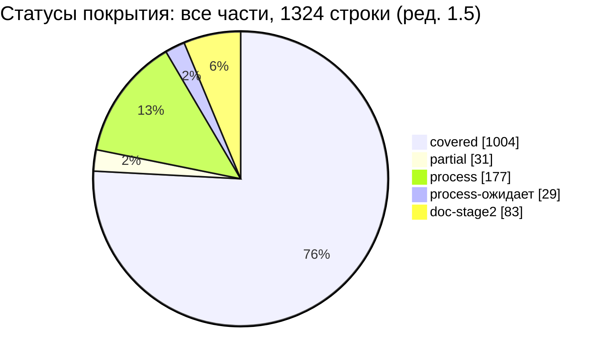

Выполнено или отражено в ТЗ (covered + process + doc-stage2): 1004 + 177 + 83 = 1 264 строки (95,5 %; ред. 1.4 — 1 263, 95,4 %); из них 78 строк `covered` (ред. 1.5; ред. 1.2–1.4 — 85) отражены условно — до ответа заказчика на открытые вопросы (§5.5). Не выполнено или выполнено частично (partial + process-ожидает + gap): 60 строк (4,5 %; ред. 1.4 — 61, 4,6 %); осознанно перенесено в R2: 0 строк (ред. 1.2 — перенос реализации сканирования лица отражён в строках SRC-B-087, SRC-B-126, SRC-F-024).

### 2.2. Статус × тип требования (тип — из реестра)

| Тип (реестр) | Строк | covered | partial | process | process-ожидает | deferred-R2 | doc-stage2 | gap |
|---|---|---|---|---|---|---|---|---|
| функц. | 444 | 440 | 4 | 0 | 0 | 0 | 0 | 0 |
| нефункц. | 141 | 141 | 0 | 0 | 0 | 0 | 0 | 0 |
| ограничение | 142 | 108 | 6 | 24 | 1 | 0 | 3 | 0 |
| процесс | 355 | 100 | 14 | 150 | 22 | 0 | 69 | 0 |
| документ | 242 | 215 | 7 | 3 | 6 | 0 | 11 | 0 |
| **Итого** | **1324** | **1004** | **31** | **177** | **29** | **0** | **83** | **0** |

Пояснения: (1) `process` и `doc-stage2` встречаются только у строк типов «процесс», «ограничение», «документ» — требования к порядку работы команды этапа 1 и к работам этапа 2; (2) у функциональных и нефункциональных требований `process`/`doc-stage2` нет.

### 2.3. Статус × приоритет (приоритет — из реестра)

| Приоритет (реестр) | Строк | covered | partial | process | process-ожидает | deferred-R2 | doc-stage2 | gap |
|---|---|---|---|---|---|---|---|---|
| must | 1254 | 934 | 31 | 177 | 29 | 0 | 83 | 0 |
| should | 67 | 67 | 0 | 0 | 0 | 0 | 0 | 0 |
| could | 3 | 3 | 0 | 0 | 0 | 0 | 0 | 0 |
| **Итого** | **1324** | **1004** | **31** | **177** | **29** | **0** | **83** | **0** |

Все строки, не покрытые полностью (partial, process-ожидает, deferred-R2), имеют приоритет `must` — поэтому каждая из них вынесена в §5 с планом закрытия.

### 2.4. Пересмотр статусов по выпуску 00, 01, 12, 14 (ред. 1.1, ядро §20.2 п.19)

Оценка ред. 1.0 «прогноз после актуализации частей» выполнена: части трассировались по снимкам 01, 12, 14 от 04:50 до 05:30 2026-10-19, а к ред. 1.1 выпущены 00_EXECUTIVE_SUMMARY.md, 01 (65 ID `NFR-*`), 12_TEST_PLAN.md v1.1 (§1–§13, «Журнал сверки с ядром» v1.5) и 14_OPEN_QUESTIONS.md. Все строки `partial`/`gap`, условие закрытия которых зависело от этих документов, перепроверены Grep-ом; результат с основаниями — §5.4: **3 строки переведены в `covered`** (SRC-A-061a, SRC-A-080, SRC-E-196), **4 строки подтверждены `covered` со ссылками** (SRC-E-181d, SRC-E-184, SRC-E-208, SRC-E-210), **3 строки остаются `partial`** с уточнённой причиной (SRC-E-025a, SRC-E-074, SRC-F-051d).

---

## 3. Методика трассировки

### 3.1. Порядок работы

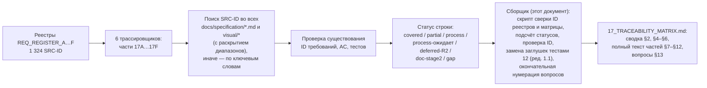

1. **Трассировка (части 17A…17F).** Для каждого SRC-ID трассировщик искал прямые ссылки в документах ТЗ (с раскрытием диапазонов вида `SRC-A-111a…111g`), при отсутствии — место по ключевым словам; в строке матрицы указаны документ и раздел, ID требований ТЗ, критерии приёмки `AC-…`, тест 12 (на снимке части — ID теста, метка-заглушка с префиксом или «н/п»; заглушки заменены в ред. 1.1 сборки, §6), статус. Каждая часть содержит собственные методику, сводку, предложения, вопросы и журнал проверки — они сохранены без изменений в §7–§12.
2. **Сборка (этот документ).** Скрипты сборщика (Python 3.13, `python -X utf8`): (а) извлекают основную таблицу каждого реестра — строки из 7 столбцов, первая ячейка которых соответствует шаблону `SRC-[A-F]-NNN[a-z]` (журналы изменений реестров с другим числом столбцов не учитываются); (б) извлекают строки матрицы каждой части — 8 столбцов, первая ячейка SRC-ID, внутри раздела «Матрица трассируемости»; (в) сравнивают множества и порядок (§4.1); (г) считают статусы по первому слову столбца «Статус покрытия» (§2); (д) проверяют существование каждого ID в столбцах 5–7 по тексту документов ТЗ (без частей 17 и без этого файла), `visual/*` и ядра (§4.2); (е) в ред. 1.1 заменяют метки-заглушки ID тестов 12 v1.1 и проверяют существование каждого ID теста в 12 (§6).
3. **Конкатенация.** Полный текст частей вставлен по порядку A → F; повторяющиеся шапки частей (заголовок, «Входные материалы», «Связанные документы», роль автора, повторное предупреждение об этапе) заменены строкой-источником с версией части; уровни заголовков частей понижены на один (`##` → `###`); прочий текст частей не изменялся. Ссылки «§N» внутри части относятся к разделам этой части. Ссылки вида «17 §N» из других документов ТЗ и из сводных разделов (§1–§6, §13–§15) относятся только к разделам верхнего уровня (`##`) этого документа; разделы частей адресуются как «17 ч. X §N» (например, «17 ч. F §13» — журнал проверки части F).
4. **Ред. 1.1 (ядро v1.5 §20).** В строках матрицы частей заменён столбец «Тест» (заглушки → ID тестов 12, §6) и статусы строк §5.4; ссылки на номера вопросов-кандидатов дополнены окончательными номерами (§13.3); упоминания заглушек в повествовательном тексте и журналах частей оставлены как история и переформулированы без меток (каждая часть имеет пометку ред. 1.1 в строке-источнике).

### 3.2. Единая легенда статусов

| Статус | Значение (единое для всех частей) | Где используется |
|---|---|---|
| `covered` | требование отражено в ТЗ: раздел, ID требования и (для функц./нефункц.) критерий приёмки `AC-…` | все части |
| `partial` | отражено не полностью: нет требования-владельца или AC, осознанное отступление до подтверждения заказчиком, зависимость от невыпущенного документа | все части |
| `process` | требование к процессу работы этапа 1, выполненное методикой этапа 1 (ядро R0, исследования R1–R8, журналы проверки, PROGRESS_LOG); в строке указано, чем выполнено | все части |
| `process-ожидает` | процессное требование этапа 1, на дату трассировки не выполненное (итоговая QA-проверка, итоговый отчёт, остановка до утверждения); в выполненные не засчитывается | 17E; 17F (SRC-F-052…054, ред. 1.2) (см. замечание к ядру п. 3) |
| `deferred-R2` | осознанно перенесено в Release 2 решением ядра со ссылкой на Q-… | в ред. 1.2 не используется (SRC-F-024 — `covered`: требование к описанию выполнено, перенос реализации отражён в SRC-B-087, SRC-B-126) |
| `doc-stage2` | работа этапа 2 (код, запуск тестов, проверка на реальных системах), запланированная в 13_IMPLEMENTATION_ROADMAP; требование, завершение которого зависит от ответа заказчика на этапе 1, — не `doc-stage2`, а `partial` (ред. 1.2) | все части; локальная легенда части C (§9, ч. C §1.3) приведена к этой |
| `gap` | места в ТЗ нет | в ред. 1.1–1.2 не используется (единственная строка ред. 1.0 — SRC-E-196 — `covered`, §5.4) |

Признак условного покрытия (ред. 1.2): строка `covered`, в которой место в ТЗ или формулировка требования зависит от открытого вопроса заказчика (`[ТРЕБУЕТ РЕШЕНИЯ ЗАКАЗЧИКА: Q-…]` или ссылка на Q-…), остаётся `covered` (требование и AC в ТЗ есть), но считается **условной** и сведена в §5.5 с номером вопроса и документом-владельцем; после ответа владелец документа подтверждает или правит требование.

### 3.3. Обозначения столбцов матрицы

`SRC-ID` · «Краткая формулировка» (ред. 1.2 — дословная копия столбца 5 «Краткая формулировка» основной таблицы реестра по SRC-ID, скрипт; сокращения формулировок частей ред. 1.0–1.1 (624 строки) заменены, AC-TRACE-006; дословная цитата промта — столбец 4 реестра) · «Тип» (функц. / нефункц. / ограничение / процесс / документ; в 17B — сокращения, 17B §2.4) · «Документ и раздел ТЗ» (номер файла `01…16`, `R0` — ядро, `R1…R8` — исследования) · «ID требования(й) ТЗ» · «Критерий приёмки (AC-…)» · «Тест» (ID 12; `T-SEC-NNN` — тесты 11 §12.2, принятые 12 §2.7 без перенумерации; `T-DS-…`/`T-ANIM-…`/`T-A11Y-…` — по 03 §17.9 в частях B, E; «косвенно» — ближайший тест модуля без общего ID; «набор этапа X, 12 §2.15» — обязательный набор тестов этапа 13; «н/п»/«—» — тест неприменим; в ред. 1.0 — метка-заглушка с префиксом, в ред. 1.1 заменена, §6) · «Статус покрытия».

### 3.4. Ограничения

1. Части трассировались параллельно с выпуском 01, 12 и 14 и опираются на разные снимки этих документов (указаны в каждой части). В ред. 1.0 сборщик не переписывал строки частей; в ред. 1.1 (ядро v1.5 §20.1) сборщик заменил в строках частей столбец «Тест» и статусы строк §5.4, прочие столбцы частей не менялись.
2. Подбор тестов в §6 механический (общий ID требования или AC в строке теста 12, прямая ссылка теста или 12 §12 на SRC-ID, соответствие 01 → тесты 12 §5.5, наборы этапов 12 §2.15); смысловое соответствие подтверждает автор 12 при ревизии обратной трассировки (12 §12).
3. Проверка существования ID (§4.2) подтверждает наличие идентификатора в документах ТЗ, но не правильность смысловой связи; смысловые связи проверены трассировщиками частей и независимыми проверками (журналы частей).

---

## 4. Проверка полноты и целостности

### 4.1. Множество SRC-ID реестров = множество SRC-ID матрицы

| Часть | Строк `\| SRC-` в файле реестра (всего) | Уникальных ID основной таблицы реестра (7 столбцов) | Строк матрицы части (8 столбцов) | Пропущено в матрице | Лишних в матрице | Дублей | Порядок совпадает |
|---|---|---|---|---|---|---|---|
| A | 203 | 203 | 203 | 0 | 0 | 0 | да |
| B | 205 | 170 | 170 | 0 | 0 | 0 | да |
| C | 175 | 164 | 164 | 0 | 0 | 0 | да |
| D | 273 | 243 | 243 | 0 | 0 | 0 | да |
| E | 405 | 374 | 374 | 0 | 0 | 0 | да |
| F | 170 | 170 | 170 | 0 | 0 | 0 | да |
| **Итого** | **1431** | **1324** | **1324** | **0** | **0** | **0** | да |

`[ПОДТВЕРЖДЕНО: скрипт сборщика, 2026-10-19]`. Разница между столбцами 2 и 3 — строки таблиц «Журнал проверки» реестров (добавленные/исправленные строки), которые повторяют уже существующие ID (B — 35, C — 11, D — 30, E — 31). **Отсутствующих в матрице SRC-ID нет**, поэтому строки со статусом `gap` сборщиком не добавлялись. Объём документа 17 «по числу SRC-строк» (ядро §11 п.9) — 1 324 строки матрицы.

### 4.2. Существование ID в столбцах «ID требования(й) ТЗ», «Критерий приёмки», «Тест»

| Проверка | Результат |
|---|---|
| Извлечено вхождений ID (шаблон: необязательный `AC-`/`T-` + префикс ядра §10/§17.6 + номер; диапазоны «…» — по концам; SRC-, D-, Q-, R-, MV-, C-NN, P-N, F-NN, G-NN, E-NN исключены) | ред. 1.2 (скрипт волны 4, тот же шаблон): 10 061 вхождение, 3 646 уникальных ID; ред. 1.1: 10 080 / 3 677 (ред. 1.0 — 8 295 / 3 392; рост — ID тестов вместо заглушек) |
| Поиск в `docs/specification/*.md` (кроме этого файла), `visual/*`, ядре R0 — 28 файлов, скрипт `python -I -X utf8`, 2026-10-19 | найдены все, кроме ID, определённых в этом документе |
| Определены в этом документе | `AC-TRACE-001`, `AC-TRACE-002`, `AC-TRACE-004`, `AC-TRACE-005` (§4.3) — строки SRC-F-051…051d; `AC-TRACE-006`, `AC-TRACE-007` (ред. 1.2) — строки SRC-F-001…003, SRC-F-052 |
| ID тестов в столбце «Тест» — по 12_TEST_PLAN.md (владелец всех `T-*`, ядро §20.1) | ред. 1.2: каждый ID внутри каждого диапазона `T-X-aaa…bbb` проверяется на существование в 12; ссылка считается ошибкой, если хотя бы один ID диапазона отсутствует. Ред. 1.1 разворачивала диапазоны только по существующим в 12 ID и пропустила 45 таких диапазонов (`T-DS-001…012`, `T-DS-067…070` у строк splash SRC-B-060…068, `T-DS-085…096`, `T-UI-000…T-UI-090` и др.); в ред. 1.2 они заменены явными списками существующих ID (непрерывные участки — диапазонами). Итог: 818 уникальных ID тестов 12, ID вне 12 внутри диапазонов — 0, явных ссылок на отсутствующие тесты — 0, меток-заглушек — 0. Ред. 1.3 (12 с правками волны 4 и ядра v1.7 — 1 014 ID): добавлены 22 новых ID (волна 4: T-BUILD-011, T-BUILD-012, T-OPS-025, T-AUTH-042, T-AUTH-043, T-CART-032, T-SESS-023, T-SYNC-055, T-ORD-031, T-FAIL-021; v1.7: T-CAT-034, T-ORD-032, T-ORD-033, T-ORD-034, T-PAY-034, T-PAY-035, T-REG-024, T-RET-014, T-RET-015, T-SYNC-056, T-SYNC-058, T-SYNC-059) — 840 уникальных ID; повтор скрипта: ID вне 12 (включая внутренности диапазонов) — 0; T-FLOW-037…T-FLOW-042 в 12 нет и в столбец «Тест» не внесены (§6.4 п.6). Ред. 1.4 (12 ред. 1.2, Grep 18:11): добавлены 10 ID — T-FLOW-037…T-FLOW-042, T-UI-113, T-BUILD-013, T-SYNC-057, T-PAY-036 — 850 уникальных ID; повтор скрипта: ID вне 12 (включая внутренности диапазонов) — 0; сокращённая запись `T-UI` с номерами от 000 до 112 (строка SRC-E-188, столбец «Документ и раздел ТЗ», и запись P-14 журнала части E) формально охватывала отсутствующие в 12 номера T-UI (009, 018, 019, 027…029, 049, 051…089, 091…100) — заменена ссылкой на перечень существующих ID в столбце «Тест» и перечнем диапазонов; повтор развёртки всех диапазонов `T-X-aaa…bbb` в строках матрицы — 0 отсутствующих ID |
| Адрес ID (ред. 1.2) | каждый ID столбца «ID требования(й) ТЗ» должен быть определён (первая ячейка строки таблицы или заголовок) в одном из документов, названных в столбце «Документ и раздел ТЗ» той же строки; ред. 1.1 этого не проверяла — 27 несоответствий в 26 строках (SRC-B-134, SRC-C-011b, SRC-C-014, SRC-C-137, SRC-D-002, SRC-E-010, SRC-E-052, SRC-F-004, 005, 011…015, 018, 019, 038…040, 042, 046, 048a, 051c, 124b, 124c, 138c) исправлены дописыванием документа и раздела; повтор скрипта — 0 |
| Устранено с ред. 1.0 | `T-DS-028` (SRC-E-188): в 12 v1.1 ID существует (12 §3.9.3) и проверяет DS-028 «Радиусы и тени», поэтому ссылка строки SRC-E-188 («тесты интерфейса», golden всех компонентов) заменена на тест golden-покрытия `T-DS-066`. Перепроверка ред. 1.2 (волна 4, Grep всех вхождений `T-DS-028`): оставшиеся ссылки — SRC-B-048 (отступы и размеры, DS-028 в столбце требований), родительская SRC-E-100 (элементы дизайн-системы, в т. ч. радиусы и тени) и упоминание в журнале §6.1 (SRC-F-040 без `T-DS-028`) — относятся к радиусам и теням и верны; ссылок `T-DS-028` в значении «golden всех компонентов» нет; метки групп `UI-10`, `UI-12`, `UI-14`, `UI-44` (17C) заменены ID тестов — ложных срабатываний шаблона нет |

### 4.3. Критерии приёмки самой матрицы `[НОВОЕ ИМЯ: префикс AC-TRACE]`

Предложение 17F (§5.1, строка SRC-F-051c) — ввести проверяемые критерии для требований к матрице и проверке полноты (SRC-F-051…055). Префикса для них в ядре нет (замечание к ядру п. 4).

| ID | Критерий | Метод | Результат при сборке | Источник |
|---|---|---|---|---|
| AC-TRACE-001 `[НОВОЕ ИМЯ]` | Множество SRC-ID основных таблиц реестров A…F равно множеству SRC-ID строк матрицы; дублей нет | скрипт §4.1 | выполнено: 1 324 = 1 324 | SRC-F-051, SRC-F-051a, SRC-F-052 |
| AC-TRACE-002 `[НОВОЕ ИМЯ]` | У каждой строки матрицы заполнены «Документ и раздел ТЗ» и статус из легенды §3.2 | скрипт §2.1 (8 столбцов, статус распознан у 1 324 строк) | выполнено | SRC-F-051b |
| AC-TRACE-003 `[НОВОЕ ИМЯ]` | Каждый ID требования, AC и теста в матрице существует в документах ТЗ | скрипт §4.2 | выполнено (ред. 1.2): все ID найдены, включая каждый ID внутри диапазонов тестов; каждый ID требования определён в документе своей строки; `AC-TRACE-*` определены в §4.3 | SRC-F-051c, SRC-F-051d |
| AC-TRACE-004 `[НОВОЕ ИМЯ]` | Каждая строка `covered` типа функц./нефункц. имеет `AC-…` (для NFR 01 §6.2 — ворота `AC-GATE-…` 12 §4.2 по соответствию 12 §5.5 и метод проверки 01); каждая строка `partial`/`gap`/`process-ожидает` имеет план закрытия | скрипт по столбцу «Критерий приёмки» + ревью §5 | ред. 1.1 объявляла «выполнено», фактически у SRC-E-181 и SRC-E-181d (нефункц., covered) AC был «—»; ред. 1.2: им указаны ворота AC-GATE (12 §4.2, §5.5) и AC-CART-009; повтор скрипта — строк `covered` функц./нефункц. без `AC-` 0 из 580; план закрытия есть у всех 61 строки (partial 32 + process-ожидает 29, §5.1, §5.3) | SRC-F-051c, SRC-F-053, SRC-F-054 |
| AC-TRACE-005 `[НОВОЕ ИМЯ]` | До утверждения ТЗ метки-заглушки заменены ID тестов 12 либо помечены «н/п» с обоснованием | повтор скрипта §6 | выполнено (ред. 1.1): меток-заглушек 0; у 5 строк SRC-F-051…051d — «н/п в 12» с обоснованием, тест к добавлению — §6.4; ред. 1.3: у строк SRC-F-051…051d — тест 12 T-BUILD-011 | SRC-F-051d, SRC-F-120 |

| AC-TRACE-006 `[НОВОЕ ИМЯ]` (ред. 1.2) | Столбец «Краткая формулировка» каждой строки матрицы побайтно равен столбцу 5 «Краткая формулировка» основной таблицы реестра для того же SRC-ID | скрипт: сравнение строк после `strip()` | ред. 1.1 — не выполнено (624 из 1 324 строк отличались: B 139, C 146, D 191, F 140 — сокращения трассировщиков частей); ред. 1.2 — столбец заменён скриптом, несовпадений 0 | SRC-F-002, SRC-F-003, SRC-F-052 |
| AC-TRACE-007 `[НОВОЕ ИМЯ]` (ред. 1.2) | Каждая строка SRC-B-060…149, SRC-C-001…140, SRC-F-021…036 типа функц./ограничение упомянута в 02 (02 §10.3 или раздел «Трассировка» части), имеет хотя бы один `UI-xx-NNN` и `AC-UI-…`, а атомы цитаты реестра (столбец 4) покрыты элементами экрана | скрипт (упоминание в 02, наличие UI/AC-UI в строке матрицы) + ревью владельца 02 по атомам | **не выполнено** (ред. 1.2): из 240 строк зоны 15 не упомянуты в 02 (SRC-B-070, 072, 075, 076, 093, 094, 096, 110, 115, 121a, 121b, 122, 132, 133, SRC-C-016); у 137 строк в матрице нет `UI-xx-NNN`, у 73 — `AC-UI-…` (часть из них — не экранные требования: SMS, backend; владелец 02 отмечает их в 02 §10.3 как «не экранное»); сверка по атомам не выполнялась. Строки SRC-F-001…003 — `partial` до выполнения. Ред. 1.3 (перепроверка Grep 02 и 12, 08:35): 02 §2.2 включил SRC-F-001…003 в зоны частей C, D, E; в 02 §10.3 строка SRC-F-001…003 по-прежнему отнесена только к части A; из 15 строк зоны 14 по-прежнему не названы в 02 явно (кроме SRC-B-075; упоминание только диапазоном зоны части не считается разметкой); 12 расширил T-UI-108 (SRC-F-001…003, ADR-064 в столбце «Требования»), но это ручной review P3 — автоматизируемого теста по этому критерию нет; результат — **не выполнено**. Ред. 1.4 (Grep 02 и 12, 18:11): 02 §10.3 относит строку SRC-F-001…003 ко всем частям A, B, C, D, E; 12 добавил автоматизируемый тест **T-BUILD-013** (12 §3.12.4, скрипт `tools/check_trace_007.py` `[НОВОЕ ИМЯ]`, этап 2; покрытие атомов — ручное ревью владельца 02 по отчёту скрипта); 15 строк зоны (SRC-B-070, 072, 075, 076, 093, 094, 096, 110, 115, 121a, 121b, 122, 132, 133, SRC-C-016) в 02 по-прежнему явно не названы и не помечены «не экранное» (Grep 02 — 0 вхождений каждого ID); результат — **не выполнено** | SRC-F-001, SRC-F-002, SRC-F-003, SRC-F-052 |

Тест, проверяющий AC-TRACE-001…005 (повтор скриптов сборщика), — **T-BUILD-011** (12 §3.12.4, static CI, добавлен 12 по замечанию волны 4; ред. 1.3). AC-TRACE-007 проверяет **T-BUILD-013** (12 §3.12.4, static CI; ред. 1.4). Для AC-TRACE-006 теста в 12 нет (T-BUILD-011 сверку столбца «Краткая формулировка» с реестром не включает, Grep 12 ред. 1.2); ID назначает 12 — владелец всех `T-*` (ядро §20.1); предложение — §6.4 п.1.

### 4.4. Журнал сборки

| № | Шаг | Результат |
|---|---|---|
| 1 | Чтение ядра v1.4 целиком (§0–§19), заголовков и итоговых разделов всех частей | приоритет §19 → §18 → §17 учтён; диапазон вопросов 17 — §19.5 |
| 2 | Скрипт сверки реестров и матрицы | §4.1: пропусков 0, лишних 0, дублей 0, порядок совпадает |
| 3 | Скрипт подсчёта статусов | §2.1–§2.3; совпадение со сводками всех шести частей |
| 4 | Скрипт проверки ID | §4.2: 1 устаревший ID (`T-DS-028`) — запись ред. 1.0; в 12 v1.1 `T-DS-028` существует и проверяет DS-028 «Радиусы и тени» (правило «`T-DS-NNN` = `DS-NNN`», 12 §3.9.3), golden-покрытие всех компонентов — `T-DS-066`; перепроверка ред. 1.2 — §4.2, строка «Устранено с ред. 1.0» |
| 5 | Скрипт подбора тестов 12 для заглушки | §6: 488 из 558 строк с кандидатами |
| 6 | Перепроверка условий закрытия partial/gap по документам-адресатам (Grep 01, 04, 12, 13, листинг каталога) | §2.4, §5 |
| 7 | Окончательная нумерация вопросов диапазона 17 | §13.2 |
| 8 | Конкатенация частей (UTF-8, LF; шапки частей заменены, заголовки понижены на уровень) | §7–§12 |
| 9 | Проверка целостности итогового файла (кодировка, число строк матрицы, закрытые блоки Mermaid, порядок заключительных разделов) | выполнено после записи |
| 10 | Ред. 1.1: чтение ядра v1.5 §18–§20 (§20 — высший приоритет; владельцы словарей §18.1, §19.1, §20.1) | 12 — владелец `T-*`; 17 — канон матрицы; диапазоны 17 — Q-280…Q-289 и Q-300…Q-309 |
| 11 | Ред. 1.1: индекс тестов 12 v1.1 (984 ID `T-*`; столбец «Требования» с развёрткой диапазонов, 12 §12, §4.3, §5.5) и замена 558 заглушек | §6: заглушек 0 |
| 12 | Ред. 1.1: пересмотр partial/gap по 00/01/12/14 (Grep) | §5.4: 3 строки → covered, 4 подтверждены, 3 остаются partial |
| 13 | Ред. 1.1: окончательная нумерация вопросов 17 | §13.2–§13.3 |
| 14 | Ред. 1.1: пересчёт статистики и повтор проверки ID (§2, §4.2); ссылки на файлы частей заменены ссылками на §7–§12 | выполнено; проверка целостности — «Журнал сверки с ядром» |
| 15 | Ред. 1.2 (волна 4): замена столбца «Краткая формулировка» дословным текстом реестра (скрипт по SRC-ID) | 624 строки заменены; несовпадений 0 (AC-TRACE-006) |
| 16 | Ред. 1.2: пересмотр статусов по замечаниям независимой проверки (14 строк), правка ссылок на тесты (14 строк), замена 45 диапазонов тестов с отсутствующими ID, дописывание документов в столбец 4 (26 строк), исправление UI-ID (SRC-C-058/059), AC для SRC-E-181/181d | §2, §4.2, §4.3, §5.1, §5.3, §5.5, §6.1, §6.4, §6.5; журнал волны 4 — в конце документа |
| 17 | Ред. 1.2: повтор скриптов §4.1, §2.1, §4.2 и проверки целостности | 1 324 строки по 8 столбцов, пропусков/лишних/дублей 0, порядок совпадает; ID вне 12 внутри диапазонов — 0; несоответствий «ID ↔ документ строки» — 0 |
| 18 | Ред. 1.3: чтение ядра v1.7 (§18.1, §19.1, §20.1, §21, §22 — высший приоритет); 17 не владеет ни одним пунктом §22 | SRC-A-009 → `partial` (§22.13 п.6, Q-302); строки возвратов SRC-A-113d, SRC-E-117, SRC-E-165 приведены к §21 п.1 (без пересказа — ссылка на 10 RET); прочие пункты §22 в строках матрицы не пересказываются — «Журнал сверки с ядром» |
| 19 | Ред. 1.3: Grep 04 (FLOW-037…FLOW-042, AC-FLOW-037…042, 04 §15.4) и 12 (1 014 ID: 10 тестов волны 4 и тесты сверки с ядром v1.7; T-FLOW-037…042 — нет) | FLOW-037…FLOW-042 внесены в 31 строку (столбцы 4–6); диапазоны «FLOW-001…FLOW-036» расширены до FLOW-042 в 7 строках; новые тесты 12 — в 32 строки (§5.6) |
| 20 | Ред. 1.3: перепроверка SRC-F-001…003 по 02 §2.2, §10.3 и 12 T-UI-108 | 02 §2.2 дополнен владельцем (зоны C, D, E), §10.3 и разметка 15 строк AC-TRACE-007 — нет; строки остаются `partial`; «косвенно» у T-UI-108 снято (тест ссылается на SRC-F-001…003) |
| 21 | Ред. 1.3: повтор скриптов §2.1–§2.3, §4.1, §4.2, §6.5 и проверки целостности | 1 324 строки по 8 столбцов, множество и порядок совпадают; covered 1003, partial 32, process 177, process-ожидает 29, doc-stage2 83; ID тестов вне 12 — 0; без общего ID — 53 строки |
| 22 | Ред. 1.4: чтение ядра v1.8 (§21, §22, §23 — высший приоритет; владельцы словарей §18.1, §19.1, §20.1); Grep 17 по темам §23 п.1–10 (ручная привязка документа 1С, момент проекции статуса, смена способа оплаты, поздняя оплата QR, отказ в долге, `order.cancel.own`, блок «Ожидают оплаты», экраны SCR-39/SCR-45, Q-168/Q-264, статистика 00/README) | 17 не владеет ни одним пунктом §23; пересказов правил §23 в строках матрицы нет; имени `order.cancel.own_draft`, `creditReason`, `review_reason` в 17 нет; изменений строк по §23 не потребовалось — «Журнал сверки с ядром» № 19–21 |
| 23 | Ред. 1.4: Grep 12 ред. 1.2 (18:11) — T-FLOW-037…T-FLOW-042, T-UI-113, T-BUILD-013, T-SYNC-057, T-PAY-036, T-ADMIN-010; Grep 02 §10.3, 04 FLOW-019, 13 §2.1, 01 §8.1 | столбец «Тест» дополнен скриптом в 38 строках, столбец «Документ и раздел ТЗ» исправлен в строке SRC-E-188 (§5.7); T-ADMIN-010 — общих ID со смысловой связью нет (SEC-043, SCR-01 — только совпадение кодов), не внесён; SRC-F-001…003, SRC-D-187, SRC-E-022 — `partial` без изменений (условия закрытия в 02, 04, 13/01 не выполнены) |
| 24 | Ред. 1.4: пересчёт сводок частей 17A §4.1–§4.3, 17E §5.1, 17F §4 скриптом | совпадают со сводной §2.1; замечание итоговой проверки о непересчитанных сводках закрыто |
| 25 | Ред. 1.4: повтор скриптов §2.1–§2.3, §4.1, §4.2 (с развёрткой всех диапазонов `T-*`), §6.5 и проверки целостности | 1 324 строки по 8 столбцов, множество и порядок совпадают; covered 1003, partial 32, process 177, process-ожидает 29, doc-stage2 83; ID тестов вне 12 — 0; без общего ID — 51 строка |
| 26 | Ред. 1.5: чтение ядра v1.9 §24 (ответы заказчика 2026-10-21, высший приоритет; владельцы словарей §18.1, §19.1, §20.1) и журналов сверки v1.9 владельцев 03, 05, 07, 08, 09, 10, 11; Grep 01, 02, 04, 12, 14 | 17 не владеет ни одним пунктом §24; владельцы 03, 05, 07, 08, 09, 10, 11 выровнены; в 01, 02, 04, 12, 14 пометок v1.9 и новых ID нет (Grep 2026-10-21 18:58) |
| 27 | Ред. 1.5: Grep матрицы по темам §24 (регистрация, `customer`, `CUSTOMER_SELF_SERVICE`, палитра, логотип, D-16, Q-001, Q-006, Q-010, Q-011, Q-014, QR, OData, HTTP-сервис, расширение) и правка строк скриптом по SRC-ID | 31 строка: столбцы «Документ и раздел ТЗ», «ID требования(й) ТЗ», «Критерий приёмки» дополнены ID владельцев, столбец «Статус покрытия» — по §24; SRC-C-094 → `covered`; столбцы «Краткая формулировка» и «Тест» не менялись (§5.8) |
| 28 | Ред. 1.5: пересмотр условного покрытия (скрипт §5.5 с исключением закрытых вопросов Q-001, Q-006) | 78 строк (A 5, B 17, C 16, D 3, E 36, F 1) |
| 29 | Ред. 1.5: повтор скриптов §2.1–§2.3, §4.1, §4.2 (существование новых ID и их определение в документе своей строки) и проверки целостности | 1 324 строки по 8 столбцов, множество и порядок совпадают; covered 1004, partial 31, process 177, process-ожидает 29, doc-stage2 83; новых ID вне документов своей строки — 0; ID тестов вне 12 — 0 |

---

## 5. Сводная таблица gap и partial с планом закрытия

Источник — разделы частей «partial и gap — предложения» (17A §5, 17B §5, 17C §4, 17D §5.1, 17E §6, 17F §5) и перепроверка сборщиком. Столбец «Состояние при сборке» — результат Grep/листинга на момент ред. 1.1 (2026-10-19). Строки, закрытые в ред. 1.1, перенесены в §5.4 с прежними номерами; номера строк §5.1 не меняются.

### 5.1. partial (строк: 31; ред. 1.5 — строка № 11 (SRC-C-094) закрыта и перенесена в §5.8; ред. 1.2 — +11 строк по замечаниям волны 4, № 25…35; ред. 1.3 — +1 строка № 36 (SRC-A-009, ядро v1.7 §22.13 п.6), строка № 23 (SRC-F-051d) закрыта и перенесена в §5.6; gap нет)

| № | SRC-ID | Статус | Тип / приоритет | Что не покрыто | План закрытия (документ-адресат: действие) | Владелец | Вопрос | Состояние при сборке |
|---|---|---|---|---|---|---|---|---|
| 2 | SRC-A-019 | partial | процесс / must | политика «рутинные задачи — экономичным моделям» не зафиксирована | 13 §2.2: добавить правило выбора моделей для агентов этапа 2 с источником SRC-A-019 | 13 | — | в 13 правила нет |
| 3 | SRC-A-020 | partial | процесс / must | политика «архитектура, интеграция, безопасность — сильнейшей модели» не зафиксирована | 13 §2.2: то же правило, источник SRC-A-020 | 13 | — | в 13 правила нет |
| 4 | SRC-A-046 | partial | процесс / must | отдельный обзор интерфейсов складских систем (WMS) не проводился (03 §3.1 — `[НЕ ПОДТВЕРЖДЕНО]`) | после ответа на Q-284: при «есть WMS/ТСД» — дополнить 03 §3 обзором; при «нет» — зафиксировать достаточность обзора POS/B2B | 03 | Q-284 | открыт |
| 7 | SRC-B-068 | partial | функц. / must | для `staff` «сразу на рабочий экран» заменено одношаговой разблокировкой SCR-08 (D-48) — осознанное отступление по ядру §19.4 | зафиксировано в 01 GEN-024 / AC-GEN-024 и в этой матрице (17B, строка SRC-B-068); 12: дополнить T-AUTH-031 вариантами `customer` и «одно действие на SCR-08»; закрывается подтверждением заказчика | заказчик, 12 | Q-273 | отступление зафиксировано, ждёт ответа |
| 8 | SRC-B-121 | partial | процесс / must | 13 RM-A-004 запрашивает учётные данные SMSPro на этапе A, до адаптера RM-D-002 — обратно порядку промта и 09 §6.12 | 13: разделить RM-A-004 — на этапе A только наличие аккаунта/договора/альфа-имени; передачу `SMSPRO_LOGIN_FILE`/`SMSPRO_PASSWORD_FILE` перенести в этап D после зелёных контрактных тестов RM-D-002; скорректировать критерий приёмки | 13 | — | расхождение сохраняется (13, строка RM-A-004) |
| 9 | SRC-B-147 | partial | функц. / must | по умолчанию OTP до формы (D-10); буквальный порядок «форма → OTP» — только при `REGISTRATION_SECOND_OTP=true` (в R1 выключено) | ответ заказчика; при выборе буквального порядка — включить флаг (09 §7.4, 02 SCR-04, 08 §4.2.1) без изменения API; 12 — тесты обоих режимов (AC-AUTH-081, AC-FLOW-004-08) | заказчик, 12 | Q-162 | открыт |
| 10 | SRC-C-018 | partial | функц. / must | «компактный список» не предлагается на compact и medium < 840 lp (02 UI-10-013), а 01 GEN-071 и 10 CAT-010 требуют трёх режимов без оговорки | вариант (а): 02 SCR-10 — добавить режим `three` на compact, расширить AC-UI-10-029; вариант (б): с согласия заказчика записать отступление в 10 CAT-010, 01 GEN-071 (AC-GEN-071), ADR в 15 | 02 / 01, 10, 15 | Q-289 | открыт |
| 12 | SRC-D-182 | partial | документ / must | перечень переменных окружения не назван в составе финального отчёта RM-I-010 | 13 RM-I-010: добавить пункт «перечень переменных окружения без значений (16 §4.3)», источник SRC-D-182 | 13 | Q-301 (кандидат 17D-2, §13.2) | RM-I-010 не изменён (Grep 13, ред. 1.1) |
| 13 | SRC-D-183 | partial | документ / must | порядок подключения 1С и SMSPro не назван в RM-I-010 | 13 RM-I-010: пункт «порядок подключения 1С и SMSPro», источник SRC-D-183 | 13 | Q-301 | не изменён |
| 14 | SRC-D-184 | partial | документ / must | «известные проблемы и блокеры» не выделены пунктом финального отчёта | 13 RM-I-010: пункт «известные проблемы и оставшиеся блокеры», источник SRC-D-184 | 13 | Q-301 | не изменён |
| 15 | SRC-D-185 | partial | документ / must | план пилота (13 §8) не назван в составе финального отчёта | 13 RM-I-010: пункт «план безопасного пилотного запуска (13 §8)», источник SRC-D-185 | 13 | Q-301 | не изменён |
| 16 | SRC-D-187 | partial | ограничение / must | нет явного запрета обещать безошибочность; 04 FLOW-019 содержит «гарантированно доходит до 1С без дублей» | 13 §2.1: принцип «отчёты и ТЗ не обещают безошибочность»; 04 FLOW-019: заменить формулировку на описание механизма (outbox, повторы, идемпотентность, `dead` + уведомление) | 13, 04 | — | формулировка в 04 (строка 1428) сохраняется; ред. 1.4 (Grep 04, 18:11): в 04 FLOW-019 «Ожидаемый результат» (строка 1682) по-прежнему «гарантированно доходит до 1С без дублей»; принципа «не обещать безошибочность» в 13 §2.1 нет — строка остаётся `partial` (поручение 04 и 13) |
| 17 | SRC-E-022 | partial | ограничение / must | нет явной нормы «молчание, положительный отзыв или просьба правок — не разрешение на разработку» | 13 §2.1 (принцип P-1) или 01 §8.1: явная норма + AC «разработка не начинается без точной фразы „ТЗ УТВЕРЖДЕНО. НАЧИНАЙ РАЗРАБОТКУ“» | 13 / 01 | — | нормы нет; ред. 1.3 — правило утверждения задано ядром v1.7 §22.13 п.5 (этап 2 разрешает только точная фраза «ТЗ УТВЕРЖДЕНО. НАЧИНАЙ РАЗРАБОТКУ»; блокирующие вопросы 14 §2 не являются условием утверждения); 00, 01, 13, 14 излагают его одинаково — строка закрывается после выравнивания 13 §2.1 / 01 §8.1 их владельцами; ред. 1.4 (Grep 01, 13, 18:11): правило «только точная фраза» изложено в 13 §2.1 P-1, §3.2 G-B1 («единственное условие») и 01 §8.3 п.1, но явной нормы «молчание, положительный отзыв или просьба правок — не разрешение» в 13 §2.1 и 01 §8.1 нет — строка остаётся `partial` (поручение 13, 01) |
| 18 | SRC-E-025a | partial | процесс / must | не зафиксировано сопоставление 8 ролей промта исполнителям (исполнителей больше 8) | 00 или итоговый отчёт: таблица «роль промта (8) → исследования R* → документы ТЗ → независимые проверки» | оркестратор | Q-281 | открыт; в 00 таблицы «роль промта → исполнители» нет (Grep 00, ред. 1.1) |
| 19 | SRC-E-074 | partial | документ / must | однозначность и полнота ТЗ не подтверждены итоговой проверкой | волна 4 (итоговая QA-проверка пакета) и выпуск 00 | оркестратор, QA | — | 00 выпущен; волна 4 не выполнена — строка остаётся partial |
| 20 | SRC-E-214 | partial | процесс / must | итоговая независимая QA-проверка пакета не выполнена (выполнены проверки отдельных документов) | волна 4; результат — в 00 и PROGRESS_LOG | QA | — | не выполнено |
| 21 | SRC-F-041 | partial | документ / must | hi-fi макетов ключевых экранов нет; есть спецификации 02 и wireframes `visual/` | по ответу: «нужны» — макеты в `visual/` (пометка «спецификация, не реализация») и строка в DS-079; «достаточно» — отступление в 01 §7 и ADR в 15 | заказчик → 03 / visual | Q-287 | открыт |
| 22 | SRC-F-051c | partial | документ / must | нет AC у строк SRC-F-051d, SRC-F-052, SRC-F-054; у строк-документов 02 AC даны ссылкой на индекс | критерии AC-TRACE-001…005 этого документа (§4.3) `[НОВОЕ ИМЯ]`; 12 §4 — критерий полноты «у каждого SCR-xx есть `SCR-xx.1…14`» | сборщик 17, 12 | — | AC-TRACE предложены (§4.3); ред. 1.3 — AC-TRACE-005 у SRC-F-051d, AC-TRACE-001/006/007 у SRC-F-052, тест 12 T-BUILD-011 (AC-TRACE-001…005); без AC остаётся SRC-F-054, строки-документы 02 — ссылкой на индекс |
| 24 | SRC-F-123 | partial | процесс / must | независимая архитектурная проверка на этапе 1 — только самооценка автора 06 §15 | волна 4: прогон чек-листа 06 §15 (CHK-1…CHK-12) независимым агентом, результат — к 12 (AC-ARCH-054); этапные проверки — 13 RM-B-010, RM-H-002 | QA волны 4 | — | не выполнено |
| 25 | SRC-B-126 | partial | функц. / must | обязательный этап «сканирование лица или настройка биометрии» заменён: для `staff` обязателен PIN (REG-006), биометрия ОС — по выбору, сканирование лица — условный R2 (D-14, D-48); осознанное отступление от must-требования (ред. 1.1 — ошибочно `covered`, в отличие от однотипной SRC-B-068) | (1) ответ заказчика на Q-003 и новый вопрос Q-304 (до ред. 1.5 — Q-303; принимается ли обязательный PIN как замена обязательного этапа «лицо или биометрия»); (2) 01 §14.3 (строка SRC-B-126, GEN-050): добавить Q-304 в столбец «Подтверждение заказчиком»; (3) при ответе «биометрия/лицо обязательны» — правка 09 REG-006, 02 SCR-04, 15 ADR-014, 12 T-REG-009 | заказчик → 01, 09, 15 | Q-003, Q-304 | отступление записано в 01 §14.3 (GEN-050, AC-GEN-050) и 15 ADR-014; подтверждения заказчика нет, вопрос о PIN как замене (тогда Q-303) в 14 не заведён; ред. 1.3 — заведён в 14 под номером Q-303 (§3.6 реестра, форма §7); ред. 1.5 — регистрацию проходит только клиент: шаг защиты входа обязателен, хотя бы один способ — биометрия или PIN (09 REG-038, ядро v1.9 §24.2), сотрудник задаёт PIN при первом входе по приглашению (09 REG-037); отступление «PIN вместо обязательной биометрии» сохраняется; номер уточнён ядром v1.9 §24.5: Q-303 → Q-304 (§15 п.12 — закрыто; перенумерация в 14 и 01 §14.3 — у владельцев) |
| 26 | SRC-C-014 | partial | процесс / must | ручных чертежей, на которые ссылается промт (стр. 264, также стр. 8, 147, 581), в материалах нет; исходным материалом без согласия заказчика взяты три цифровых макета | (1) вопрос Q-302: предоставить чертежи или подтвердить, что цифровые макеты их заменяют; (2) при получении чертежей — сверить с ними 02 SCR-10.1 и ч. B §9 (таблица отличий), 03 §2, и обновить компоновку экранов; (3) при подтверждении замены — запись в 15 (ADR) и 01 §7 | заказчик → 02 | Q-302 | открыт; ред. 1.3 — `partial` до ответа закреплён ядром v1.7 §22.13 п.6; вопрос заведён в 14 (§2.14 — краткая карточка, §3.5 реестра, форма §7; 14 §4.4 — Q-300…Q-303 из диапазона 17) |
| 27 | SRC-C-077 | partial | процесс / must | порядок резервирования и списания — по согласованному с заказчиком процессу; согласования нет (ред. 1.1 — `doc-stage2` по локальной легенде части C) | ответ на Q-012 → 10 §4.3, §8.4 (INV-024, ORD-042): подтвердить модель D-22 или исправить; проверка на копии 1С остаётся задачей 13 RM-F-010 | заказчик → 10, 13 | Q-012 | открыт |
| 28 | SRC-C-080 | partial | процесс / must | сценарии заказа/счёта/продажи спроектированы по исследованию (R1, R7), реальные процессы магазина и возможности 1С не подтверждены | ответы на Q-010, Q-012 → 10 §8.3, 05 §6.6 (ONEC-038), 08 §11: подтвердить или исправить; фиксация — 14, 13 RM-A-003 | заказчик → 10, 05, 13 | Q-010, Q-012 | открыт; ред. 1.5 — ответ по Q-010 даст специалист 1С на технический запрос (ядро v1.9 §24.3) |
| 29 | SRC-C-081 | partial | ограничение / must | перечень способов оплаты (`cash`/`qr_bakai`/`credit`) и печатных документов взят с макета и не подтверждён — соблюдение запрета «не вводить неиспользуемое» не доказано (ред. 1.1 — `covered`) | ответ на Q-012 → 10 ORD-002, PAY-007, PRINT-004/008: оставить без изменений или исключить неиспользуемые способы/документы; 08 API-074/086 — по 10 | заказчик → 10, 08 | Q-012 | открыт; ред. 1.5 — QR-оплата подтверждена заказчиком (QR через 1С, ядро v1.9 §24.4; 10 PAY-021); не подтверждены `credit` и печатные документы |
| 30 | SRC-C-082 | partial | процесс / must | «сначала выявить доступные операции» — перечень операций выведен из исследования, подтверждения магазина нет | ответ на Q-012 → 10 §2.1, §3 (матрица операций × ролей) — подтвердить; 13 RM-A-003 | заказчик → 10, 13 | Q-012 | открыт |
| 31 | SRC-C-119 | partial | процесс / must | потребность в кассовом оборудовании, фискализации, платёжном терминале и используемые устройства не выяснены (до реализации, т. е. на этапе 1) | ответы на Q-013, Q-009, Q-019, Q-214 → 10 §17, 11 SEC-125, 02 SCR-42; артефакт `docs/discovery/devices.md` (13 RM-A-008) | заказчик → 10, 13 | Q-013, Q-009, Q-019, Q-214 | открыт |
| 32 | SRC-C-131a | partial | процесс / must | итоговый набор ролей не согласован с бизнес-процессами магазина (роли — по D-15 до ответа) | ответ на Q-005 → 01 §3.1, 10 §3 — подтвердить или изменить набор ролей; 13 RM-A-003, §9 (O-09) | заказчик → 01, 10 | Q-005 | открыт; ред. 1.5 — сотрудников добавляет `admin` приглашением (ядро v1.9 §24.2); набор ролей не подтверждён |
| 33 | SRC-F-001 | partial | ограничение / must | полнота переноса первоначальных требований к экранам не подтверждена проверяемо: AC-ADR-064 проверяет только канон 02 и наличие разделов SCR; T-UI-108 — «косвенно» (ручной review P3) | (1) 02 §10.3: включить SRC-F-001…003 в зоны частей C (SCR-20…26) и E (SCR-40…50); (2) выполнить AC-TRACE-007 (§4.3): 15 строк зоны без упоминания в 02 — добавить UI-ID или пометку «не экранное»; сверка атомов цитат реестра; (3) 12: автоматизируемый тест сверки (ID назначает 12, §6.4 п.2) вместо «T-UI-108 (косвенно)» | 02, 12, сборщик 17 | — | AC-TRACE-007 не выполнен (ред. 1.2); ред. 1.3 (Grep 02, 12): п. (1) выполнен частично — 02 §2.2 включил SRC-F-001…003 в зоны частей C, D, E, но 02 §10.3 относит строку только к части A; п. (2) не выполнен (14 из 15 строк без явной разметки); 12 расширил T-UI-108 (SRC-F-001…003, ADR-064 — ручной review P3), автоматизируемого теста сверки по AC-TRACE-007 нет — п. (1) и (3) плана не выполнены; ред. 1.4 (Grep 02, 12, 18:11): п. (1) **выполнен** — 02 §10.3 относит SRC-F-001…003 к частям A, B, C, D, E; п. (3) **выполнен** — 12 T-BUILD-013 (скрипт AC-TRACE-007, внесён в столбец «Тест»); п. (2) не выполнен — 15 строк зоны в 02 не размечены (UI-ID или «не экранное»), сверка атомов не проводилась; строка остаётся `partial` до выполнения п. (2) (поручение 02) |
| 34 | SRC-F-002 | partial | ограничение / must | то же: несокращение требований к экранам не подтверждено (ред. 1.1 сама матрица сокращала формулировки — исправлено, AC-TRACE-006) | как № 33 | 02, 12, сборщик 17 | — | как № 33 |
| 35 | SRC-F-003 | partial | ограничение / must | то же: сохранение деталей не подтверждено | как № 33 | 02, 12, сборщик 17 | — | как № 33 |
| 36 | SRC-A-009 | partial | процесс / must | изучение исходных материалов не завершено: промт называет ручные чертежи экранов, в `resursi/` их нет (ядро §0); ред. 1.2 отклоняла перевод строки в `partial` — пересмотрено по ядру v1.7 §22.13 п.6 («SRC-A-009 и SRC-C-014 — `partial` до ответа») | (1) ответ заказчика на Q-302 (ядро v1.7 §22.13 п.6: «Есть ли ручные чертежи экранов? Если да — передать; ТЗ будет сверено с ними»; заведён в 14 (§2.14 — краткая карточка, §3.5 реестра, форма §7; 14 §4.4 — Q-300…Q-303 из диапазона 17)); (2) при получении чертежей — изучить и сверить с ними 02 (SCR-10.1, ч. B §9) и 03 §2 (как № 26); (3) при ответе «чертежей нет» — строка → `process` (директория изучена полностью) | заказчик → 02 | Q-302 | открыт (ред. 1.3); вопрос заведён в 14 (§2.14 — краткая карточка, §3.5 реестра, форма §7; 14 §4.4 — Q-300…Q-303 из диапазона 17) |

### 5.2. deferred-R2 (ред. 1.2 — строк нет)

Ред. 1.2: SRC-F-024 («Опиши последовательность направлений…») — требование к описанию, оно выполнено (02 SCR-05.4.1, 09 §10.3), поэтому строка — `covered`; перенос **реализации** сканирования лица в условный R2 (D-14) отражён в строках SRC-B-087 (`process`) и SRC-B-126 (`partial`, §5.1 № 25). Таблица ред. 1.1 сохранена как история:

| SRC-ID | Что перенесено | Основание | Условие возврата в R1 |
|---|---|---|---|
| SRC-F-024 (ред. 1.1) | сканирование лица с поворотами (прямо → влево → вправо → вверх) | `[РЕШЕНИЕ: D-14]`; спецификация полная (02 SCR-05, 09 §10, FACE-NNN), тесты T-FACE-002…005 условные | ответ на Q-003 и юридическое заключение (гл. 11 Цифрового кодекса КР, 09 §14.6) |

### 5.3. process-ожидает (29 строк: часть E — 26, часть F — 3, ред. 1.2)

Строки: SRC-F-052, SRC-F-053, SRC-F-054 (ред. 1.2, было `process`), SRC-E-024, SRC-E-033, SRC-E-034a, SRC-E-215, SRC-E-216, SRC-E-217, SRC-E-218, SRC-E-219, SRC-E-220, SRC-E-221, SRC-E-222, SRC-E-223, SRC-E-224, SRC-E-225, SRC-E-225a, SRC-E-227, SRC-E-233, SRC-E-234, SRC-E-236, SRC-E-238, SRC-E-238a, SRC-E-238b, SRC-E-238c, SRC-E-238d, SRC-E-238e, SRC-E-239.

| Группа | Строки | План закрытия | Владелец |
|---|---|---|---|
| Итоговая независимая QA-проверка пакета ТЗ (волна 4) и исправление найденного | SRC-E-033, SRC-E-215…SRC-E-225a, SRC-E-227, SRC-E-233; SRC-F-052 («ни одна функция не потеряна» — после AC-TRACE-006/007), SRC-F-053, SRC-F-054 (ред. 1.2) | волна 4 по 14 «линзам» проверки (17E §6.3); вход — эта матрица (§5.1, §6) и чек-лист 06 §15; затем исправления и итоговая версия ТЗ | оркестратор, QA |
| Итоговый отчёт заказчику и передача на утверждение | SRC-E-024, SRC-E-034a, SRC-E-238, SRC-E-238a…SRC-E-238e | итоговый отчёт оркестратора: что сделано, где ТЗ, решения (15), риски (01 §11), вопросы (14 §2, §7); ограничения среды — из PROGRESS_LOG | оркестратор |
| Сведение вопросов | SRC-E-234 | 14: включить вопросы 12 (Q-230…) и 17 (окончательные номера §13.2) в счётчики и §3 | 14 |
| Остановка до утверждения | SRC-E-236, SRC-E-239 | после итогового отчёта — остановка до сообщения «ТЗ УТВЕРЖДЕНО. НАЧИНАЙ РАЗРАБОТКУ» | оркестратор |

### 5.4. Пересмотр в ред. 1.1 (выпуск 00, 01, 12, 14; ядро §20.2 п.19)

Проверено Grep-ом по текущим файлам `docs/specification/` (2026-10-19). Строки 1, 5, 6 прежней таблицы §5.1 закрыты и перенесены сюда.

| № §5.1 (ред. 1.0) | SRC-ID | Было | Стало | Основание (документ и раздел) |
|---|---|---|---|---|
| 1 | SRC-E-196 | gap | **covered** | 00_EXECUTIVE_SUMMARY.md выпущен: §1–§18 (продукт, решения D-xx, архитектура, границы R1, план этапа 2, риски, «Состав ТЗ» §13, «Статистика ТЗ» §15, трассировка §17) |
| 5 | SRC-A-061a | partial | **covered** | 12 §3.1–§3.18 (тест-кейсы всех модулей), §4 (ворота AC-GATE-001…020, критерии готовности 13 §7 → тесты), §9 (UAT); столбец «Тест» — §6.3 |
| 6 | SRC-A-080 | partial | **covered** | 12_TEST_PLAN.md v1.1 выпущен полностью (§1–§13, трассировка §12, «Журнал сверки с ядром») |
| — | SRC-E-181d | covered | covered (подтверждено) | 01 §6.2 NFR-STAB-001/002; тесты T-NFR-022, T-NFR-023 (12 §3.14, 12 §5.5.3); значение — Q-277 (ведущий; Q-280 — дубль → Q-277) |
| — | SRC-E-184 | covered | covered (подтверждено) | 12 §3.1–§3.18, §4.2, §5.5 (снимок части ≈ 05:25 заменён ссылкой на 12 v1.1) |
| — | SRC-E-208 | covered | covered (подтверждено) | 12_TEST_PLAN.md v1.1, §1–§13; 12 §12 трассирует SRC-E-208 |
| — | SRC-E-210 | covered | covered (подтверждено) | 14_OPEN_QUESTIONS.md (реестр §3, соответствие §4, трассировка §9); номера вопросов 17 — §13.2 |
| 18 | SRC-E-025a | partial | partial | в 00 нет таблицы «8 ролей промта → исполнители» (Grep «8 рол», «роль промта» — 0 совпадений); вопрос Q-281 |
| 19 | SRC-E-074 | partial | partial | 00 выпущен, но итоговая QA-проверка пакета (волна 4) не выполнена |
| 23 | SRC-F-051d | partial | partial | заглушек 0, но тест проверки самой матрицы в 12 отсутствует (§6.4) |

Строки, зависящие от ответов заказчика (SRC-B-068, SRC-B-147, SRC-C-018, SRC-C-094, SRC-F-041), и от правок 13 (SRC-A-019, SRC-A-020, SRC-B-121, SRC-D-182…185, SRC-D-187, SRC-E-022) перепроверены Grep-ом 13, 01, 04: условия закрытия не выполнены (13 RM-I-010 и RM-A-004 не изменены; 04 FLOW-019 сохраняет формулировку «гарантированно доходит до 1С»).

### 5.5. covered, зависящие от ответов заказчика (условное покрытие, ред. 1.2)

Строки со статусом `covered`, в столбцах 4–8 которых есть `[ТРЕБУЕТ РЕШЕНИЯ ЗАКАЗЧИКА…]` или ссылка на открытый вопрос `Q-…` (скрипт волны 4 по столбцам «Документ и раздел ТЗ» … «Статус покрытия»). Требование и AC в ТЗ есть, поэтому статус не снижен, но покрытие **условно**: после ответа на вопрос документ-владелец подтверждает требование без изменений или правит его, а сборщик 17 пересматривает строку (при отказе от решения ТЗ — `partial`). Строк: **85** (A 6, B 19, C 15, D 5, E 38, F 2). Ссылки на закрытые решением ядра вопросы (например, Q-204, Q-216) попадают в выборку механически — при пересмотре строка исключается из таблицы. Строки `partial`, зависящие от вопросов, — в §5.1, не здесь.

| № | SRC-ID | Часть | Q (открытые вопросы в строке) | Документ-владелец покрытия (первый в столбце 4) |
|---|---|---|---|---|
| 1 | SRC-A-056d | A | Q-003 | 09 |
| 2 | SRC-A-072 | A | Q-283 | 15 |
| 3 | SRC-A-083 | A | Q-010 | 05 |
| 4 | SRC-A-106 | A | Q-036 | 06 |
| 5 | SRC-A-113d | A | Q-018 | 01 |
| 6 | SRC-A-114c | A | Q-001 — закрыт (ред. 1.5: строка не условная, §5.8) | 01 |
| 7 | SRC-B-005 | B | Q-011 (ред. 1.5: частично закрыт, ядро v1.9 §24.3), Q-010 | 05 |
| 8 | SRC-B-018 | B | Q-010 | 05 |
| 9 | SRC-B-019 | B | Q-010 | 05 |
| 10 | SRC-B-020 | B | Q-010 | 05 |
| 11 | SRC-B-021 | B | Q-021 | 05 |
| 12 | SRC-B-022 | B | Q-022 | 05 |
| 13 | SRC-B-028 | B | Q-015 | 05 |
| 14 | SRC-B-030 | B | Q-012, Q-018 | 05 |
| 15 | SRC-B-032 | B | Q-010 | 05 |
| 16 | SRC-B-043 | B | Q-006 — закрыт (ред. 1.5: строка не условная, §5.8) | 03 |
| 17 | SRC-B-057 | B | Q-007 | 03 |
| 18 | SRC-B-061 | B | Q-006 — закрыт (ред. 1.5: строка не условная, §5.8) | 03 |
| 19 | SRC-B-081 | B | Q-201 | 09 |
| 20 | SRC-B-105 | B | Q-004 | 09 |
| 21 | SRC-B-117 | B | Q-004 | 09 |
| 22 | SRC-B-118 | B | Q-004 | 09 |
| 23 | SRC-B-124 | B | Q-165 | 09 |
| 24 | SRC-B-127 | B | Q-161 | 09 |
| 25 | SRC-B-128 | B | Q-165 | 09 |
| 26 | SRC-C-010 | C | Q-009 | 10 |
| 27 | SRC-C-011c | C | Q-022 | 02 |
| 28 | SRC-C-019 | C | Q-204 | 10 |
| 29 | SRC-C-022 | C | Q-205 | 02 |
| 30 | SRC-C-029 | C | Q-206 | 10 |
| 31 | SRC-C-031 | C | Q-175 | 10 |
| 32 | SRC-C-035 | C | Q-021 | 10 |
| 33 | SRC-C-055 | C | Q-022 | 10 |
| 34 | SRC-C-067 | C | Q-015 | 10 |
| 35 | SRC-C-079a | C | Q-019 | 10 |
| 36 | SRC-C-086 | C | Q-176 | 10 |
| 37 | SRC-C-092 | C | Q-286 | 10 |
| 38 | SRC-C-113 | C | Q-015 | 10 |
| 39 | SRC-C-115a | C | Q-215 | 10 |
| 40 | SRC-C-131 | C | Q-005 | 10 |
| 41 | SRC-D-092 | D | Q-001 — закрыт (ред. 1.5: строка не условная, §5.8) | 09 |
| 42 | SRC-D-093 | D | Q-001 — закрыт (ред. 1.5: строка не условная, §5.8) | 09 |
| 43 | SRC-D-163 | D | Q-029 | 13 |
| 44 | SRC-D-164 | D | Q-011 (ред. 1.5: частично закрыт, тестовая копия не получена) | 05 |
| 45 | SRC-D-172 | D | Q-270, Q-276 | 13 |
| 46 | SRC-E-004 | E | Q-010 | 05 |
| 47 | SRC-E-049 | E | Q-022 (ред. 1.5: Q-006 закрыт) | 03 |
| 48 | SRC-E-055 | E | Q-010 | 05 |
| 49 | SRC-E-057 | E | Q-022 | 05 |
| 50 | SRC-E-067 | E | Q-012 | 05 |
| 51 | SRC-E-070 | E | Q-020 | 05 |
| 52 | SRC-E-070a | E | Q-020 | 05 |
| 53 | SRC-E-073 | E | Q-010 | 05 |
| 54 | SRC-E-099d | E | Q-006 — закрыт (ред. 1.5: строка не условная, §5.8) | 03 |
| 55 | SRC-E-107 | E | Q-001 — закрыт (ред. 1.5: строка не условная, §5.8) | 04 |
| 56 | SRC-E-113 | E | Q-014 (ред. 1.5: частично закрыт, ядро v1.9 §24.4) | 04 |
| 57 | SRC-E-116 | E | Q-015 | 04 |
| 58 | SRC-E-117 | E | Q-018 | 04 |
| 59 | SRC-E-123 | E | Q-003 | 09 |
| 60 | SRC-E-124 | E | Q-161 | 09 |
| 61 | SRC-E-128 | E | Q-004 | 09 |
| 62 | SRC-E-129 | E | Q-004 | 09 |
| 63 | SRC-E-132 | E | Q-029 | 09 |
| 64 | SRC-E-136b | E | Q-027 | 09 |
| 65 | SRC-E-141 | E | Q-022 | 10 |
| 66 | SRC-E-145 | E | Q-021 | 10 |
| 67 | SRC-E-150 | E | Q-021 | 10 |
| 68 | SRC-E-161 | E | Q-015 | 10 |
| 69 | SRC-E-163 | E | Q-012, Q-016 | 10 |
| 70 | SRC-E-165 | E | Q-018 | 10 |
| 71 | SRC-E-166 | E | Q-282 | 10 |
| 72 | SRC-E-170e | E | Q-017 | 10 |
| 73 | SRC-E-179b | E | Q-004 | 11 |
| 74 | SRC-E-179c | E | Q-005 | 11 |
| 75 | SRC-E-179g | E | Q-028 | 11 |
| 76 | SRC-E-179h | E | Q-033 | 11 |
| 77 | SRC-E-180 | E | Q-027 | 11 |
| 78 | SRC-E-181a | E | Q-020, Q-023 | 01 |
| 79 | SRC-E-181b | E | Q-023 | 01 |
| 80 | SRC-E-181d | E | Q-134, Q-277 (Q-280 — дубль → Q-277) | 01 |
| 81 | SRC-E-181i | E | Q-008 | 01 |
| 82 | SRC-E-183a | E | Q-004, Q-020, Q-023, Q-033, Q-134, Q-277 (Q-280 — дубль → Q-277) | 01 |
| 83 | SRC-E-210 | E | Q-001, Q-040, Q-101, Q-107, Q-108, Q-276, Q-290, Q-296, Q-280, Q-289, Q-300, Q-301 | 12 |
| 84 | SRC-F-024 | F | Q-003 | 02 |
| 85 | SRC-F-042 | F | Q-006 — закрыт (ред. 1.5: строка не условная, §5.8) | 03 |
| 86 | SRC-C-094 | C | Q-285 (ред. 1.5: строка `partial` → `covered`, §5.8) | 10 |

Ред. 1.3: повтор скрипта по тем же правилам — **85** строк (A 6, B 19, C 15, D 5, E 38, F 2), состав не изменился. Строки возвратов SRC-A-113d, SRC-E-117, SRC-E-165 остаются условными по Q-018 только в части отключения сценария (`returns_enabled=false` при ответе «возвраты полностью в 1С», ядро v1.6 §21 п.1); заявка на возврат — R1 must.

Ред. 1.5 (ядро v1.9 §24, ответы заказчика 2026-10-21): повтор скрипта с исключением закрытых вопросов Q-001 и Q-006 — **78** строк (A 5, B 17, C 16, D 3, E 36, F 1). Сняты с условности 8 строк, зависевших только от Q-001 или Q-006 (№ 6, 16, 18, 41, 42, 54, 55, 85 — помечены в таблице); добавлена № 86 — SRC-C-094 (`covered` с ред. 1.5, условно Q-285). Строки с Q-011 (№ 7, 44) и Q-014 (№ 56) остаются условными: вопросы закрыты частично (ядро v1.9 §24.3, §24.4), открыты конфигурация 1С (Q-010), тестовая копия и детали метода QR у специалиста 1С. № 47 (SRC-E-049) условна только по Q-022, № 83 (SRC-E-210) — по прочим вопросам перечня.

### 5.6. Пересмотр в ред. 1.3 (ядро v1.6 §21, v1.7 §22; выпуск 04 ред. 1.3 и правки 12 волны 4)

Проверено Grep-ом и скриптом по текущим файлам `docs/specification/` (2026-10-19). Документы-владельцы (07, 08, 10, 11, 05) переписаны по ядру v1.7; строки матрицы ссылаются на их ID и правила §22 не пересказывают.

| № §5.1 | SRC-ID | Было | Стало | Основание (документ и раздел) |
|---|---|---|---|---|
| 36 (новая) | SRC-A-009 | process | **partial** | ядро v1.7 §22.13 п.6: ручных чертежей в `resursi/` нет, вопрос Q-302, «SRC-A-009 и SRC-C-014 — `partial` до ответа»; решение ред. 1.2 (оставить `process`) пересмотрено |
| 23 | SRC-F-051d | partial | **covered** | 12 §3.12.4 T-BUILD-011 — повтор скриптов сборщика 17 в CI (AC-TRACE-001…005), добавлен 12 по замечанию волны 4 (12 «Журнал независимой проверки (волна 4)», № 6); критерий строки — AC-TRACE-005 |
| 26 | SRC-C-014 | partial | partial (подтверждено) | ядро v1.7 §22.13 п.6; формулировка Q-302 — по ядру (§13.2) |
| 22 | SRC-F-051c | partial | partial | AC есть у SRC-F-051d (AC-TRACE-005) и SRC-F-052; без AC — SRC-F-054; строки-документы 02 — ссылкой на индекс AC-UI |
| 33…35 | SRC-F-001, SRC-F-002, SRC-F-003 | partial | partial | 02 §2.2 (зоны частей C, D, E) дополнен SRC-F-001…003 владельцем 02; 02 §10.3 — строка SRC-F-001…003 только с частью A; AC-TRACE-007 не выполнен (14 из 15 строк без явной разметки); 12 T-UI-108 расширен (SRC-F-001…003, ADR-064), но остаётся ручным review — «косвенно» снято, автоматизируемый тест сверки по AC-TRACE-007 в 12 не добавлен (§6.4 п.2) |
| — | SRC-A-061, SRC-E-076c, SRC-E-102, SRC-E-120, SRC-E-200, SRC-E-230, SRC-F-039 | covered / process | без изменения статуса | диапазоны сценариев расширены до FLOW-001…FLOW-042 (04 ред. 1.3, §2, §12); в SRC-A-061 — AC-FLOW-001-01…AC-FLOW-042-04 |
| — | 31 строка (SRC-B-006, B-007, B-079, B-084; SRC-C-025, C-098, C-100…C-104, C-112, C-113, C-121, C-125, C-126, C-129…C-140, C-131a; SRC-E-094, E-096) | covered / process / partial | без изменения статуса | 04 §15.4: FLOW-037 (лимиты и настройки), FLOW-038 (роли, блокировка, сброс PIN), FLOW-039 (PIN и биометрия в настройках), FLOW-040 (аудит), FLOW-041 (отчёты руководителя), FLOW-042 (избранное) — добавлены в столбцы «Документ и раздел ТЗ», «ID требования(й) ТЗ», «Критерий приёмки» (AC-FLOW-037-01…AC-FLOW-042-04); тестов T-FLOW-037…042 в 12 нет — §6.4 п.6 |
| — | SRC-F-051, 051a, 051b, 051c | covered / partial | без изменения статуса | «н/п в 12 — тест к добавлению» → T-BUILD-011 |
| — | SRC-D-136…SRC-D-139, SRC-D-142, SRC-D-143 | doc-stage2 | без изменения | + T-BUILD-012 (12 §3.12.4: тесты всех уровней фактически запускаются; SRC-D-136…139, 142, 143) |
| — | SRC-D-148b | doc-stage2 | без изменения | «T-OPS-016 (косвенно)» → T-OPS-025 (12 §3.11, валидация env при старте по 16 §4.3) |
| — | SRC-D-092, SRC-D-093 | covered | без изменения | + T-AUTH-042, T-AUTH-043 (12 §3.1.1, роль `customer`, условно Q-001; связь с Q-300) |
| — | SRC-C-070, SRC-F-032; SRC-D-099; SRC-C-091; SRC-D-117; SRC-D-034 | covered | без изменения | + T-CART-032 (очередь корзины, CART-018); T-SESS-023 (SESS-012, офлайн при потере refresh); T-SYNC-055 (получатели `sync_error`, SYNC-038); T-ORD-031 (оплаченный заказ в `submit_failed`/`dead`, ORD-027/ORD-031); T-FAIL-021 (long-poll без ложного `OfflineBanner`, ARCH-062) |
| — | SRC-E-162; SRC-E-163; SRC-C-128; SRC-E-164; SRC-E-166, SRC-D-116; SRC-E-165; SRC-E-176g; SRC-B-005; SRC-E-181g; SRC-B-144; SRC-B-145 | covered | без изменения | тесты сверки 12 с ядром v1.7 (по общему ID строки): T-ORD-033 (состав транзакции `POST /orders`, §22.3); T-PAY-034 (автомат `payment_status`, §22.2); T-PAY-035 (приём оплаты в 4 статусах, §22.5); T-ORD-032 (деньги получены — заказ отклонён, §22.9); T-ORD-034 (поиск заказа по ключу после перезапуска, §22.6); T-RET-014, T-RET-015 (отклонение и согласование заявки в POS, §22.11); T-SYNC-056 (автомат `onec_outbox`, §22.1); T-SYNC-058 (обмен по плану обмена, §22.8); T-CAT-034 (офлайн-кэш каталога, §22.7); T-SYNC-059; T-REG-024 (самоподтверждение привязки, §22.12). Правила — у владельцев (07, 08, 10, 11, 05), в 17 не пересказываются |
| — | SRC-A-113d, SRC-E-117, SRC-E-165 | covered | без изменения | формулировка «условно Q-018» заменена по ядру v1.6 §21 п.1 (заявка на возврат — R1 must, `returns_enabled=true`; условна только передача в 1С, `RETURNS_FROM_POS_ENABLED`); владелец правила — 10 RET |

### 5.7. Пересмотр в ред. 1.4 (ядро v1.8 §23; замечания итоговой проверки выравнивания v1.7)

Проверено Grep-ом и скриптом по текущим файлам `docs/specification/` (2026-10-19, 18:11). Документы-владельцы 05, 07, 08, 10, 11 выровнены по ядру v1.8; строки матрицы ссылаются на их ID и правила §23 не пересказывают. **Статусы строк в ред. 1.4 не изменились.**

| № §5.1 | SRC-ID | Было | Стало | Основание (документ и раздел) |
|---|---|---|---|---|
| 33…35 | SRC-F-001, SRC-F-002, SRC-F-003 | partial | partial | 02 §10.3 — SRC-F-001…003 во всех частях A…E (п. (1) плана выполнен); 12 §3.12.4 T-BUILD-013 — автоматизируемый тест AC-TRACE-007 (п. (3) выполнен, внесён в столбец «Тест»); 15 строк зоны AC-TRACE-007 в 02 не размечены (п. (2)) — AC-TRACE-007 не выполнен |
| 36, 26 | SRC-A-009, SRC-C-014 | partial | partial | столбец «Тест»: «н/п»/«—» → T-UI-113 (12 §3.9.2, сверка ТЗ с ручными чертежами, условно Q-302; 12 §12 трассирует обе строки); статус — до ответа на Q-302 (ядро §22.13 п.6) |
| 16 | SRC-D-187 | partial | partial | 04 FLOW-019 (строка 1682) — формулировка «гарантированно доходит до 1С без дублей» сохраняется; 13 §2.1 — принципа нет |
| 17 | SRC-E-022 | partial | partial | 13 §2.1 P-1, §3.2 G-B1, 01 §8.3 п.1 — правило «только точная фраза» есть; явной нормы «молчание, отзыв или просьба правок — не разрешение» в 13 §2.1 / 01 §8.1 нет |
| — | 31 строка §5.6 (сценарии FLOW-037…FLOW-042) | covered / process / partial | без изменения статуса | + T-FLOW-037…T-FLOW-042 (12 §3, T-FLOW-NNN = FLOW-NNN) по FLOW-ID и AC-FLOW строки — 28 строк; SRC-C-121, SRC-C-125 (`process`) и SRC-C-131a (`partial`) — «—» сохранён (процессные строки тестами 12 не проверяются, §6.2 п.3) |
| — | SRC-D-138, SRC-E-102 | doc-stage2 / covered | без изменения | T-FLOW-001…T-FLOW-036 → T-FLOW-001…T-FLOW-042; у SRC-E-102 «T-FLOW-001, T-FLOW-036» → T-FLOW-001…T-FLOW-042 (все 42 ID существуют в 12) |
| — | SRC-E-176d; SRC-E-113, SRC-E-164 | covered | без изменения | + T-SYNC-057 (перенос результата 1С в агрегат, SYNC-045); + T-PAY-036 (смена способа оплаты при открытом платеже — ядро v1.8 §23 п.3; FLOW-020, PAY-050) |
| — | SRC-E-188 | covered | без изменения | столбец «Документ и раздел ТЗ»: `T-UI` с номерами от 000 до 112 → «T-UI-* — перечень существующих ID в столбце «Тест»» (сокращённая запись охватывала отсутствующие ID, замечание итоговой проверки); столбец «Тест» не менялся |

### 5.8. Пересмотр в ред. 1.5 (ядро v1.9 §24 — ответы заказчика 2026-10-21)

Проверено Grep-ом и скриптом по текущим файлам `docs/specification/` (2026-10-21, 18:58). Владельцы 03, 05, 07, 08, 09, 10, 11 сверены с ядром v1.9 (их журналы сверки v1.9); строки матрицы ссылаются на их ID и решения §24 не пересказывают. 01, 02, 04, 12, 14 на дату сборки с v1.9 не сверены (в них сохраняются пометки «условно Q-001» у режима клиента, SCR-06, SCR-50, FLOW-006 и тестов `customer`) — §15 п.13. Изменена 31 строка матрицы; **статус изменён у одной** (SRC-C-094), у остальных уточнены место в ТЗ, ID требований и критериев и пометка в столбце статуса. Столбцы «Краткая формулировка» (AC-TRACE-006) и «Тест» не менялись.

| № §5.1 | SRC-ID | Было | Стало | Основание (документ и раздел) |
|---|---|---|---|---|
| 11 | SRC-C-094 | partial | **covered** (условно Q-285, §5.5 № 86) | ядро v1.9 §24.2: режим клиента — R1, привязка к карточке 1С по телефону, подтверждённому OTP, — основной сценарий (09 §14.3 REG-039, AC-AUTH-049); источник признака «подтверждён» по 10 CUST-003 в R1 есть — условие плана № 11 («указать источник») выполнено ответом на Q-001; открыт только вопрос о признаке в самой карточке 1С (Q-285) |
| 25 | SRC-B-126 | partial | partial | регистрацию проходит только клиент: шаг «защита входа» обязателен, хотя бы один способ — биометрия или PIN (09 REG-038, BIO-018, AC-AUTH-089); сотрудник — PIN при первом входе по приглашению (09 REG-037, AC-AUTH-088); обязательную биометрию по-прежнему заменяет PIN — отступление до ответа на Q-003 и Q-304 (вопрос 17, §13.2; прежний номер Q-303 — ядро v1.9 §24.5) |
| 29 | SRC-C-081 | partial | partial | QR-оплата подтверждена заказчиком (QR через 1С — 10 §9.3 PAY-021, PAY-023; ядро v1.9 §24.4); `credit` и печатные документы не подтверждены — Q-012 |
| 32 | SRC-C-131a | partial | partial | сотрудников добавляет `admin` приглашением (ядро v1.9 §24.2; 09 REG-022, REG-037); набор ролей — Q-005; «супер-админ» — вопрос ядро v1.9 §24.5 (§15 п.12) |
| 28 | SRC-C-080 | partial | partial | строка матрицы не менялась; Q-010 открыт до ответа специалиста 1С на технический запрос (ядро v1.9 §24.3), Q-012 открыт |
| — | SRC-A-114c, SRC-D-092, SRC-D-093, SRC-D-149c, SRC-E-107 | covered / doc-stage2 | без изменения статуса; условность по Q-001 снята | ядро v1.9 §24.2 (Q-001 закрыт): режим клиента — R1; + 09 §14.3 REG-020, REG-037…REG-039, AC-AUTH-047, AC-AUTH-049, AC-AUTH-088, AC-AUTH-089; вопрос 17 Q-300 снимается (§13.2) |
| — | SRC-A-056e, SRC-B-101, SRC-B-123, SRC-E-106, SRC-E-123 | covered | без изменения | регистрация — клиента, сотрудник — по приглашению без регистрационной формы: + 09 REG-037, REG-038, AC-AUTH-088, AC-AUTH-089; 08 §11.12 API-181, AC-API-181 (SRC-B-101) |
| — | SRC-E-082, SRC-E-083 | covered | без изменения | столбец «Документ и раздел ТЗ»: SCR-06, SCR-50 — R1 (ядро v1.9 §24.2) вместо «условно»; в 02 ред. 1.6 пометка «условно» сохраняется (§15 п.13) |
| — | SRC-B-043, SRC-B-044, SRC-B-061, SRC-E-041, SRC-E-049, SRC-E-099d, SRC-F-042, SRC-F-048a | covered / process | без изменения статуса; условность по Q-006 снята (SRC-E-049 — условна по Q-022) | ядро v1.9 §24.1: основная палитра — B «Оранжевый», логотип — оранжевый `Logo Orange.png`; + 03 §18.12 DS-098, AC-DS-098 (SRC-B-044, SRC-E-099d); векторный исходник логотипа — открытая часть Q-006, на покрытие не влияет |
| — | SRC-A-084, SRC-A-085, SRC-A-088, SRC-B-005, SRC-D-164, SRC-E-004 | process / covered | без изменения статуса | ядро v1.9 §24.3: основной путь — API на стороне 1С, который специалист 1С делает по нашему запросу (HTTP-сервис расширения), OData — запасной; + 05 §4.2 ONEC-074, AC-ONEC-074; документ запроса `18_ONEC_API_REQUEST.md` на дату сборки не выпущен — в строки не внесён (§15 п.13) |
| — | SRC-E-113 | covered | без изменения | ядро v1.9 §24.4: QR через 1С — основной вариант R1, ручное подтверждение — запасной, прямой банк — R2; + 10 §9.3 PAY-021, PAY-022, PAY-023, PAY-053; 05 §6.7.5 ONEC-075, ONEC-076, SYNC-077 с AC; условна по Q-014 (частично закрыт) |

---

## 6. Тесты 12_TEST_PLAN.md в матрице (замена меток-заглушек, ядро §20.1)

### 6.1. Итог и метод

В ред. 1.0 у 558 строк матрицы вместо ID теста стояла метка-заглушка с префиксом (тест не найден на снимке части). Ядро v1.5 §20.1 запрещает такие метки в итоговой версии: 12_TEST_PLAN.md — владелец всех ID `T-*`, 17 ссылается на реальные `T-*`. В ред. 1.1 все 558 меток заменены ID тестов 12_TEST_PLAN.md v1.1; **меток-заглушек в документе — 0** (скрипт, §4.2).

Метод (скрипт `python -I -X utf8`, 2026-10-19): (1) из 12 извлечены все строки тестов `| T-… |` разделов 3, 7, 8 (984 ID) с содержимым столбцов (ID в столбце «Требования», диапазоны `X-001…X-010` развёрнуты), таблицы 12 §12 (SRC → тесты) и §4.3 (критерии 13 §7 → тесты), соответствие 01 → тесты 12 §5.5 (`GEN-`, `ROLE-`, `NFR-`); (2) для каждой строки матрицы взяты SRC-ID и ID столбцов «Документ и раздел ТЗ», «ID требования(й) ТЗ», «Критерий приёмки» (для префиксов с AC 1:1 `AC-X-NNN` ↔ `X-NNN`; `UI-NN-…`/`AC-UI-NN-…` → `SCR-NN` → приёмочный набор `T-UI-0NN`; `AC-FLOW-NNN-kk` → `FLOW-NNN`); (3) тест засчитан, если в его строке есть общий ID или ссылка на SRC-ID; ранжирование — сначала тесты префикса прежней заглушки, затем по числу совпавших ID; в ячейку вносятся до четырёх лучших тестов и тесты-кандидаты, которые трассировщик части уже назвал рядом с заглушкой (`T-SEC-…` 11 §12.2); диапазон, если более четырёх тестов префикса ссылаются на SRC-ID строки; (4) для строк этапов 13 (SRC-D-148…153, `doc-stage2`) — обязательные наборы этапа 12 §2.15; (5) если общего ID нет — ближайший тест модуля с пометкой «косвенно»; (6) если покрытия в 12 нет — «н/п в 12» с обоснованием и запись в §6.4 (ID тестов не придумываются).

| Часть | Строк с заглушкой в ред. 1.0 | SRC-ID / общие ID требований и AC | 01 → тесты (12 §5.5) | Наборы этапов / модулей (12 §2.15, §3–§4) | Косвенно | Теста в 12 нет (§6.4) | Заглушек в ред. 1.1 |
|---|---|---|---|---|---|---|---|
| A (§7) | 87 | 85 | 1 | 1 | 0 | 0 | 0 |
| B (§8) | 69 | 69 | 0 | 0 | 0 | 0 | 0 |
| C (§9) | 133 | 133 | 0 | 0 | 0 | 0 | 0 |
| D (§10) | 117 | 97 | 0 | 20 | 0 | 0 | 0 |
| E (§11) | 6 | 6 | 0 | 0 | 0 | 0 | 0 |
| F (§12) | 146 | 138 | 0 | 0 | 3 | 5 | 0 |
| **Итого** | **558** | **528** | **1** | **21** | **3** | **5** | **0** |

Всего в столбце «Тест» после ред. 1.1: 939 строк ссылаются на тесты 12 (2 531 явных вхождений `T-…`, 836 уникальных ID тестов 12 из 984 с учётом диапазонов; ссылок на отсутствующие в 12 тесты — 0), 1 строка — набор этапа H (SRC-D-153), 384 строки — «н/п» (процесс, документ, этап 2: приёмка — ревью артефакта или задача 13). Смысловое соответствие механически подобранных тестов подтверждает автор 12 при ревизии обратной трассировки (12 §12) `[НЕ ПОДТВЕРЖДЕНО: подбор скриптом по общим ID]`.

**Ред. 1.2 (волна 4).** Утверждение ред. 1.1 «528 строк — по общим ID требований/AC» верно только как описание способа подбора, но не как гарантия связи: независимая проверка нашла неверные связи (тест с общим ID, но о другом предмете, либо тест без общего ID). Исправлено вручную 14 строк: SRC-E-100c, SRC-E-100d, SRC-E-100e, SRC-E-100h, SRC-B-049 → T-DS-025 «Отступы, сетка, кнопки, радиусы, иконки» (DS-025…029; было T-DS-012 «Контраст» / T-DS-041 / диапазоны); SRC-E-100f, SRC-E-100g → T-DS-055 (DS-055, DS-056); SRC-E-099c → T-DS-012, T-DS-001, T-DS-005; SRC-F-040 → T-DS-049 (DS-079) без T-DS-028 «Радиусы и тени», T-DS-041, T-DS-059; SRC-F-038, SRC-F-046 → T-DS-049 только как ревью DS-079 + тест к добавлению (§6.4 п.5); SRC-A-061a → «н/п (процесс)» вместо набора T-AUTH/T-SMS/T-BIO; SRC-E-003 → ворота AC-GATE-001…020; SRC-F-021 → дополнен шагами к добавлению (§6.4 п.4). Кроме того, 45 диапазонов с отсутствующими в 12 ID заменены явными списками (§4.2). Фактические числа после правки: 938 строк со ссылками на тесты 12, из них **61 строка**, ни один тест которой не имеет общего ID требования/AC или SRC-ID со строкой (скрипт волны 4; A 2, B 2, D 37, E 17, F 3), — передана автору 12 на смысловую ревизию (§6.5); 37 строк D — в основном наборы этапов 12 §2.15 (способ (4)), для них отсутствие общего ID ожидаемо.

**Ред. 1.3 (ядро v1.7; 12 с правками волны 4).** 12 добавил 10 тестов (журнал волны 4 документа 12, № 2, 6, 11, 12): T-BUILD-011, T-BUILD-012, T-OPS-025, T-AUTH-042, T-AUTH-043, T-CART-032, T-SESS-023, T-SYNC-055, T-ORD-031, T-FAIL-021 (984 → 994 ID); при сверке 12 с ядром v1.7 — ещё 20 ID (994 → 1 014; Grep 08:46), из них 12 с общим ID строки матрицы: T-CAT-034, T-ORD-032, T-ORD-033, T-ORD-034, T-PAY-034, T-PAY-035, T-REG-024, T-RET-014, T-RET-015, T-SYNC-056, T-SYNC-058, T-SYNC-059 (автоматы `onec_outbox` и `payment_status`, состав транзакции `POST /orders`, поиск заказа по ключу, приём оплаты в 4 статусах, офлайн-кэш каталога, обмен по плану обмена, возвраты в POS, самоподтверждение привязки). Все внесены в столбец «Тест» 32 строк по общему ID или SRC-ID в столбце «Требования» теста (перечень — §5.6); T-ADMIN-010 (аварийный код, §22.13 п.2), T-SYNC-057, T-PAY-036 и прочие новые ID строк матрицы с общим ID не имеют — не внесены; у SRC-F-001…003 снята пометка «косвенно» (T-UI-108 ссылается на эти SRC-ID). Итог: 945 строк со ссылками на тесты 12 (+7: SRC-F-051…051d, SRC-D-142, SRC-D-143), 2 680 явных вхождений `T-…`, 840 уникальных ID тестов (метод ред. 1.2), ссылок на отсутствующие в 12 ID — 0; «н/п» — 377 строк. Тестов T-FLOW-037…T-FLOW-042 в 12 нет (§6.4 п.6).

**Ред. 1.4 (ядро v1.8; 12 ред. 1.2, Grep 2026-10-19 18:11).** В 12 определены T-FLOW-037…T-FLOW-042 (12 §3, «T-FLOW-NNN = FLOW-NNN»), T-UI-113 (сверка с ручными чертежами, Q-302), T-BUILD-013 (скрипт AC-TRACE-007); тесты T-SYNC-057, T-PAY-036, T-ADMIN-010 и прочие новые ID сопоставлены со строками матрицы скриптом по общему ID требования/AC или SRC-ID с ручной проверкой смысла. Внесено скриптом в столбец «Тест» 38 строк (перечень — §5.7): T-FLOW-037…042 — в 28 строк сценариев, T-FLOW-001…T-FLOW-042 — SRC-D-138, SRC-E-102; T-UI-113 — SRC-A-009, SRC-C-014; T-BUILD-013 — SRC-F-001…003; T-SYNC-057 — SRC-E-176d; T-PAY-036 — SRC-E-113, SRC-E-164. **Не внесены:** T-ADMIN-010 (аварийный код входа, 09 SMS-035; строки с SMS-035 в матрице нет, общие коды SEC-043/SCR-01 со строками SRC-A-056g, SRC-C-137 смысловой связи не дают); прочие тесты 12, у которых общий ID есть, но строка уже содержит до четырёх лучших тестов (метод ред. 1.1, §6.1 п.3), — по решению автора 12 при ревизии обратной трассировки (§6.2 п.1). Итог: 947 строк со ссылками на тесты 12 (+2: SRC-A-009, SRC-C-014), 2 720 явных вхождений `T-…` (+40), 850 уникальных ID тестов (+10), ссылок на отсутствующие в 12 ID (включая внутренности диапазонов) — 0; «н/п» — 375 строк.

### 6.2. Указания автору 12

1. Для строк §6.3 — при ревизии 12 добавить SRC-ID строки в столбец «Требования» назначенных тестов (обратная трассировка 12 §12); при несогласии со ссылкой — сообщить сборщику 17, строка пересобирается тем же скриптом.
2. Описать тест из §6.4 (ID назначает 12, ядро §20.1) и уточнить T-UI-108 для строк «косвенно».
3. Строки `process`, `doc-stage2` и `process-ожидает` тестами 12 не проверяются (приёмка — ревью артефакта или задача 13); «н/п» у них сохраняется, кроме строк этапов 13 со ссылкой на наборы 12 §2.15.

### 6.3. Построчное соответствие (558 строк, бывшие заглушки)

Ред. 1.2: столбцы «Статус строки» и «Тесты 12…» у 17 строк, изменённых волной 4, синхронизированы с матрицей §7–§12 скриптом (заголовки столбцов сохраняют пометку «ред. 1.1»; источник истины — матрица). Ред. 1.3: та же синхронизация повторена скриптом для строк, изменённых при сверке с ядром v1.7 и правками 12 (SRC-B-005, SRC-B-144, SRC-C-070, SRC-C-091, SRC-C-128, SRC-D-034, SRC-D-136, SRC-D-137, SRC-D-138, SRC-D-139, SRC-D-148b, SRC-F-001, SRC-F-002, SRC-F-003, SRC-F-032, SRC-F-051, SRC-F-051a, SRC-F-051b, SRC-F-051c, SRC-F-051d; всего 20).

| № | SRC-ID | Часть | Статус строки (ред. 1.1) | Префикс прежней заглушки | Тесты 12 в столбце «Тест» (ред. 1.1) | Способ подбора |
|---|---|---|---|---|---|---|
| 1 | SRC-A-002 | A | covered | GEN | T-ARCH-011, T-FLOW-001, T-FLOW-013, T-FLOW-020 | общие ID требований и AC |
| 2 | SRC-A-008 | A | covered | GEN | T-FLOW-001, T-FLOW-013, T-FLOW-020, T-NFR-022 | 01 → тесты (12 §5.5) |
| 3 | SRC-A-040 | A | covered | ONEC | T-ONEC-019 | общие ID требований и AC |
| 4 | SRC-A-040a | A | covered | ONEC | T-ONEC-019 | общие ID требований и AC |
| 5 | SRC-A-040b | A | covered | ONEC | T-ONEC-019 | общие ID требований и AC |
| 6 | SRC-A-040c | A | covered | ONEC | T-ONEC-019 | общие ID требований и AC |
| 7 | SRC-A-040d | A | covered | ONEC | T-ONEC-019 | общие ID требований и AC |
| 8 | SRC-A-040e | A | covered | ONEC | T-ONEC-012, T-ONEC-019, T-FAIL-016, T-SYNC-043; T-SEC-046 (11 §12.2, принят 12 §2.7) | общие ID требований и AC |
| 9 | SRC-A-040f | A | covered | ONEC | T-ONEC-019, T-SYNC-014 | общие ID требований и AC |
| 10 | SRC-A-040g | A | covered | ONEC | T-ONEC-019 | общие ID требований и AC |
| 11 | SRC-A-040h | A | covered | ONEC | T-ONEC-019, T-SYNC-013 | общие ID требований и AC |
| 12 | SRC-A-040i | A | covered | ONEC | T-ONEC-009, T-ONEC-019 | общие ID требований и AC |
| 13 | SRC-A-040j | A | covered | ONEC | T-ONEC-019, T-CASH-003, T-SYNC-011 | общие ID требований и AC |
| 14 | SRC-A-040k | A | covered | ONEC | T-ONEC-010, T-ONEC-019, T-SYNC-015 | общие ID требований и AC |
| 15 | SRC-A-042 | A | covered | ONEC | T-ONEC-026, T-ONEC-001, T-ONEC-019, T-ONEC-029 | SRC-ID в строке теста 12 / 12 §12, §4.3 |
| 16 | SRC-A-043 | A | covered | ARCH | T-ARCH-001, T-BUILD-003 | общие ID требований и AC |
| 17 | SRC-A-044 | A | covered | ARCH | T-ARCH-003, T-UI-102 | общие ID требований и AC |
| 18 | SRC-A-044a | A | covered | ARCH | T-ARCH-003 | общие ID требований и AC |
| 19 | SRC-A-044c | A | covered | UI | T-UI-010, T-UI-011, T-UI-012, T-UI-013 | общие ID требований и AC |
| 20 | SRC-A-044d | A | covered | UI | T-UI-014, T-UI-015, T-UI-016, T-UI-111 | общие ID требований и AC |
| 21 | SRC-A-044e | A | covered | CART | T-CART-001, T-CART-024, T-UI-020, T-ARCH-010 | общие ID требований и AC |
| 22 | SRC-A-044f | A | covered | UI | T-UI-041, T-ARCH-010, T-PRIV-002, T-PRIV-006 | общие ID требований и AC |
| 23 | SRC-A-044g | A | covered | UI | T-ARCH-010 | общие ID требований и AC |
| 24 | SRC-A-045 | A | covered | ARCH | T-ARCH-008, T-ARCH-009, T-UI-090, T-FAIL-001 | общие ID требований и AC |
| 25 | SRC-A-047 | A | covered | DS | T-DS-012, T-DS-001, T-DS-004, T-A11Y-001 | общие ID требований и AC |
| 26 | SRC-A-049 | A | covered | DS | T-DS-030, T-DS-041, T-DS-061, T-DS-066 | общие ID требований и AC |
| 27 | SRC-A-050 | A | covered | DS | T-DS-001, T-DS-004 | общие ID требований и AC |
| 28 | SRC-A-052 | A | covered | API | T-ARCH-002, T-ARCH-004, T-BUILD-009 | общие ID требований и AC |
| 29 | SRC-A-052a | A | covered | API | T-API-001, T-API-002, T-ARCH-009 | общие ID требований и AC |
| 30 | SRC-A-052b | A | covered | DATA | T-DATA-003, T-REG-012 | общие ID требований и AC |
| 31 | SRC-A-052c | A | covered | DATA | T-DATA-006 | общие ID требований и AC |
| 32 | SRC-A-052d | A | covered | DATA | T-DATA-006, T-ORD-028 | общие ID требований и AC |
| 33 | SRC-A-053 | A | covered | DATA | T-DATA-010, T-FAIL-013, T-ARCH-004, T-SYNC-031 | общие ID требований и AC |
| 34 | SRC-A-053a | A | covered | API | T-API-006, T-SYNC-004, T-DATA-010, T-FAIL-017; T-SEC-023, T-SEC-024 (11 §12.2, приняты 12 §2.7) | общие ID требований и AC |
| 35 | SRC-A-053b | A | covered | DATA | T-DATA-004, T-DATA-012, T-PERF-002 | общие ID требований и AC |
| 36 | SRC-A-053c | A | covered | DATA | T-DATA-014, T-COMPAT-001, T-OPS-011, T-ARCH-011 | общие ID требований и AC |
| 37 | SRC-A-055 | A | doc-stage2 | API | T-ONEC-001, T-ONEC-029 | общие ID требований и AC |
| 38 | SRC-A-059 | A | covered | CASH | T-CASH-007, T-CART-001, T-CART-024, T-ORD-001 | общие ID требований и AC |
| 39 | SRC-A-059a | A | covered | CASH | T-CASH-002, T-CASH-007, T-CASH-008, T-CASH-011 | общие ID требований и AC |
| 40 | SRC-A-059b | A | covered | DISC | T-DISC-001; T-SEC-022 (11 §12.2, принят 12 §2.7) | общие ID требований и AC |
| 41 | SRC-A-059c | A | covered | DEBT | T-DEBT-001; T-SEC-042 (11 §12.2, принят 12 §2.7) | общие ID требований и AC |
| 42 | SRC-A-059d | A | covered | TXN | T-TXN-001, T-TXN-003, T-UI-036, T-ARCH-010 | общие ID требований и AC |
| 43 | SRC-A-059e | A | covered | FAV | T-FAV-001, T-FAV-006, T-UI-040, T-ARCH-010 | общие ID требований и AC |
| 44 | SRC-A-059f | A | covered | CART | T-CART-001, T-CART-024, T-ARCH-010 | общие ID требований и AC |
| 45 | SRC-A-060 | A | doc-stage2 | MNY | T-MNY-033 | общие ID требований и AC |
| 46 | SRC-A-060a | A | doc-stage2 | ONEC | T-ONEC-001, T-ONEC-019, T-ONEC-029 | общие ID требований и AC |
| 47 | SRC-A-060b | A | doc-stage2 | ORD | T-ORD-020, T-ORD-021, T-ORD-023, T-CART-010 | общие ID требований и AC |
| 48 | SRC-A-060c | A | doc-stage2 | SYNC | T-SYNC-004, T-ONEC-001, T-ONEC-029; T-SEC-023, T-SEC-024 (11 §12.2, приняты 12 §2.7) | общие ID требований и AC |
| 49 | SRC-A-060d | A | doc-stage2 | SYNC | T-SYNC-029, T-CART-006, T-CAT-033 | общие ID требований и AC |
| 50 | SRC-A-060e | A | covered | MNY | T-MNY-033, T-ARCH-009 | общие ID требований и AC |
| 51 | SRC-A-060f | A | covered | INV | T-ONEC-019 | общие ID требований и AC |
| 52 | SRC-A-060g | A | covered | ORD | T-ORD-020, T-ORD-021, T-ORD-022, T-ORD-023 | общие ID требований и AC |
| 53 | SRC-A-060h | A | covered | ORD | T-ORD-023, T-SYNC-004, T-SYNC-033, T-SYNC-F05; T-SEC-023 (11 §12.2, принят 12 §2.7) | общие ID требований и AC |
| 54 | SRC-A-060i | A | covered | CART | T-CART-006, T-CAT-033, T-FLOW-014, T-SYNC-029 | общие ID требований и AC |
| 55 | SRC-A-061a | A | covered | ВСЕ | н/п (процесс: подготовка приёмочных тестов; артефакт — 12 §3.1–§3.18, ворота AC-GATE-001…AC-GATE-020 12 §4.2, UAT 12 §9) | набор этапа / модулей (12 §2.15, §3–§4) |
| 56 | SRC-A-083 | A | covered | ONEC | T-ONEC-019 | общие ID требований и AC |
| 57 | SRC-A-092 | A | covered | ARCH | T-ARCH-005, T-ONEC-002, T-SYNC-022 | общие ID требований и AC |
| 58 | SRC-A-105 | A | covered | ARCH | T-ARCH-005 | общие ID требований и AC |
| 59 | SRC-A-106 | A | covered | ARCH | T-ARCH-005 | общие ID требований и AC |
| 60 | SRC-A-106a | A | covered | ARCH | T-ARCH-005 | общие ID требований и AC |
| 61 | SRC-A-107 | A | covered | DATA | T-DATA-001, T-DATA-002, T-ONEC-028, T-SYNC-040 | общие ID требований и AC |
| 62 | SRC-A-108b | A | covered | ARCH | T-ARCH-005, T-ONEC-002, T-DATA-002, T-ONEC-001 | общие ID требований и AC |
| 63 | SRC-A-108c | A | covered | ARCH | T-ARCH-005, T-ONEC-002, T-SYNC-022 | общие ID требований и AC |
| 64 | SRC-A-109 | A | covered | ARCH | T-ARCH-005, T-ARCH-009, T-CAT-006, T-DATA-002 | общие ID требований и AC |
| 65 | SRC-A-111 | A | covered | DATA | T-DATA-002, T-ONEC-028, T-SYNC-040, T-ARCH-005 | общие ID требований и AC |
| 66 | SRC-A-111a | A | covered | ONEC | T-ONEC-028, T-ONEC-019, T-ARCH-005, T-SYNC-040 | общие ID требований и AC |
| 67 | SRC-A-111b | A | covered | ONEC | T-ONEC-028, T-ONEC-019, T-DATA-004, T-ARCH-005 | общие ID требований и AC |
| 68 | SRC-A-111c | A | covered | ONEC | T-ONEC-019, T-ONEC-028, T-DATA-004, T-ARCH-005 | общие ID требований и AC |
| 69 | SRC-A-111d | A | covered | ONEC | T-ONEC-028, T-ONEC-019, T-ARCH-005, T-CAT-003 | общие ID требований и AC |
| 70 | SRC-A-111e | A | covered | ONEC | T-ONEC-028, T-ONEC-019, T-ARCH-005, T-DATA-004 | общие ID требований и AC |
| 71 | SRC-A-111f | A | covered | ONEC | T-ONEC-028, T-ONEC-019, T-DATA-004, T-ARCH-005 | общие ID требований и AC |
| 72 | SRC-A-111g | A | covered | ONEC | T-ONEC-019, T-ONEC-028, T-ONEC-009, T-DATA-005 | общие ID требований и AC |
| 73 | SRC-A-112 | A | covered | DATA | T-DATA-002, T-ONEC-028, T-ARCH-005, T-FAV-007 | общие ID требований и AC |
| 74 | SRC-A-112a | A | covered | DATA | T-DATA-006, T-DATA-004, T-DATA-013, T-ONEC-028 | общие ID требований и AC |
| 75 | SRC-A-112b | A | covered | DATA | T-DATA-006, T-ARCH-005, T-ONEC-028, T-FAV-001 | общие ID требований и AC |
| 76 | SRC-A-112c | A | covered | DATA | T-DATA-007, T-ARCH-005, T-ONEC-028, T-ADMIN-004 | общие ID требований и AC |
| 77 | SRC-A-112d | A | covered | DATA | T-DATA-006, T-DATA-013, T-ARCH-005, T-ONEC-028 | общие ID требований и AC |
| 78 | SRC-A-113 | A | covered | DATA | T-DATA-002, T-ONEC-028, T-ARCH-005, T-SYNC-040 | общие ID требований и AC |
| 79 | SRC-A-113a | A | covered | ORD | T-ORD-028, T-ORD-029, T-DATA-006, T-ONEC-019 | общие ID требований и AC |
| 80 | SRC-A-113b | A | covered | ONEC | T-ONEC-028, T-ONEC-019, T-CASH-003, T-DATA-006 | общие ID требований и AC |
| 81 | SRC-A-113c | A | covered | PAY | T-PAY-014, T-DATA-006, T-ONEC-008, T-ARCH-005 | общие ID требований и AC |
| 82 | SRC-A-113d | A | covered | RET | T-DATA-006, T-ONEC-011, T-ARCH-005, T-ONEC-028 | общие ID требований и AC |
| 83 | SRC-A-113e | A | covered | DEBT | T-DEBT-001, T-DEBT-003, T-DATA-005, T-SYNC-015 | общие ID требований и AC |
| 84 | SRC-A-113f | A | covered | DISC | T-DISC-012, T-DATA-005, T-ARCH-005, T-ONEC-028 | общие ID требований и AC |
| 85 | SRC-A-114 | A | covered | DATA | T-DATA-002, T-ONEC-028, T-ARCH-005, T-ONEC-019 | общие ID требований и AC |
| 86 | SRC-A-114a | A | covered | DATA | T-DATA-003, T-ONEC-028, T-ONEC-019, T-ARCH-005 | общие ID требований и AC |
| 87 | SRC-A-114c | A | covered | DATA | T-DATA-005, T-DATA-008, T-ONEC-028, T-CUST-012 | общие ID требований и AC |
| 88 | SRC-B-001 | B | covered | ONEC | T-ONEC-028, T-ARCH-005, T-SYNC-040, T-DATA-002 | общие ID требований и AC |
| 89 | SRC-B-003 | B | covered | SYNC | T-SYNC-020, T-SYNC-041 | общие ID требований и AC |
| 90 | SRC-B-004 | B | covered | SYNC | T-SYNC-001, T-SYNC-003, T-SYNC-007, T-SYNC-008 | общие ID требований и AC |
| 91 | SRC-B-005 | B | covered | SYNC | T-SYNC-002, T-SYNC-031, T-ARCH-009, T-ONEC-004, T-SYNC-058 | общие ID требований и AC |
| 92 | SRC-B-006 | B | covered | SYNC | T-SYNC-020, T-UI-046, T-ADMIN-003, T-PERF-011 | общие ID требований и AC |
| 93 | SRC-B-007 | B | covered | SYNC | T-SYNC-020, T-SYNC-041, T-SYNC-030, T-SYNC-046 | общие ID требований и AC |
| 94 | SRC-B-008 | B | covered | SYNC, UI | T-UI-043, T-SYNC-024, T-SYNC-001, T-SYNC-012 | общие ID требований и AC |
| 95 | SRC-B-009 | B | covered | SYNC | T-SYNC-001, T-SYNC-002, T-SYNC-006, T-SYNC-024 | общие ID требований и AC |
| 96 | SRC-B-010 | B | covered | SYNC | T-SYNC-004, T-SYNC-001, T-SYNC-032, T-SYNC-033 | общие ID требований и AC |
| 97 | SRC-B-011 | B | covered | SYNC | T-SYNC-002, T-SYNC-005, T-SYNC-007 | общие ID требований и AC |
| 98 | SRC-B-012 | B | covered | SYNC | T-SYNC-024, T-SYNC-001, T-SYNC-005, T-SYNC-F06 | общие ID требований и AC |
| 99 | SRC-B-013 | B | covered | SYNC | T-SYNC-024, T-SYNC-001, T-SYNC-003, T-SYNC-008 | общие ID требований и AC |
| 100 | SRC-B-014 | B | covered | SYNC | T-SYNC-024, T-SYNC-001, T-SYNC-003, T-SYNC-006 | общие ID требований и AC |
| 101 | SRC-B-015 | B | covered | SYNC | T-SYNC-021, T-SYNC-022 | общие ID требований и AC |
| 102 | SRC-B-016 | B | covered | SYNC | T-SYNC-021, T-SYNC-022 | общие ID требований и AC |
| 103 | SRC-B-018 | B | covered | ONEC | T-ONEC-019, T-SYNC-005, T-SYNC-019, T-SYNC-F09 | общие ID требований и AC |
| 104 | SRC-B-019 | B | covered | ONEC | T-ONEC-019 | общие ID требований и AC |
| 105 | SRC-B-020 | B | covered | ONEC | T-ONEC-019 | общие ID требований и AC |
| 106 | SRC-B-021 | B | covered | ONEC | T-ONEC-019 | общие ID требований и AC |
| 107 | SRC-B-022 | B | covered | SYNC | T-SYNC-043, T-SYNC-044, T-SYNC-F11, T-ONEC-012 | общие ID требований и AC |
| 108 | SRC-B-023 | B | covered | SYNC | T-SYNC-014, T-ONEC-019, T-ONEC-018 | общие ID требований и AC |
| 109 | SRC-B-024 | B | covered | SYNC | T-SYNC-013, T-ONEC-019, T-ONEC-018 | общие ID требований и AC |
| 110 | SRC-B-025 | B | covered | SYNC | T-SYNC-041, T-SYNC-013, T-ONEC-013, T-ONEC-019 | общие ID требований и AC |
| 111 | SRC-B-026 | B | covered | SYNC | T-SYNC-005, T-SYNC-018, T-SYNC-F10, T-ONEC-009 | общие ID требований и AC |
| 112 | SRC-B-027 | B | covered | SYNC | T-SYNC-011, T-SYNC-017, T-CASH-003, T-ONEC-019 | общие ID требований и AC |
| 113 | SRC-B-028 | B | covered | ONEC | T-ONEC-005, T-ONEC-019 | общие ID требований и AC |
| 114 | SRC-B-029 | B | covered | SYNC | T-SYNC-015, T-SYNC-050, T-ONEC-010, T-DEBT-012 | общие ID требований и AC |
| 115 | SRC-B-030 | B | covered | SYNC | T-SYNC-017, T-SYNC-039, T-SYNC-F07, T-ONEC-011 | общие ID требований и AC |
| 116 | SRC-B-031 | B | covered | ONEC | T-ONEC-019, T-CAT-008, T-SYNC-045 | общие ID требований и AC |
| 117 | SRC-B-032 | B | covered | ONEC | T-ONEC-019 | общие ID требований и AC |
| 118 | SRC-B-032a | B | covered | ONEC | T-ONEC-019 | общие ID требований и AC |
| 119 | SRC-B-032b | B | covered | ONEC | T-ONEC-019 | общие ID требований и AC |
| 120 | SRC-B-032c | B | covered | SYNC | T-ONEC-019 | общие ID требований и AC |
| 121 | SRC-B-032d | B | covered | SYNC | T-SYNC-010, T-SYNC-003, T-SYNC-F03, T-ONEC-019 | общие ID требований и AC |
| 122 | SRC-B-032e | B | covered | SYNC | T-SYNC-001, T-SYNC-031, T-SYNC-048, T-SYNC-F03 | общие ID требований и AC |
| 123 | SRC-B-033 | B | covered | SYNC | T-SYNC-043, T-SYNC-F11, T-FAIL-016 | общие ID требований и AC |
| 124 | SRC-B-034 | B | covered | SYNC | T-SYNC-043, T-SYNC-F11, T-ONEC-012, T-FAIL-016 | общие ID требований и AC |
| 125 | SRC-B-035 | B | covered | SYNC | T-SYNC-007, T-SYNC-003, T-SYNC-F04, T-ONEC-023 | общие ID требований и AC |
| 126 | SRC-B-036 | B | covered | SYNC | T-SYNC-009 | общие ID требований и AC |
| 127 | SRC-B-037 | B | covered | SYNC | T-SYNC-004, T-SYNC-001, T-SYNC-009, T-SYNC-F03 | SRC-ID в строке теста 12 / 12 §12, §4.3 |
| 128 | SRC-B-038 | B | covered | DS | T-A11Y-001…022², T-DS-005, T-DS-025, T-DS-041 | общие ID требований и AC |
| 129 | SRC-B-048 | B | covered | DS | T-DS-025, T-DS-028 | общие ID требований и AC |
| 130 | SRC-B-050 | B | covered | DS | T-DS-085² (DS-090), T-DS-025, T-NFR-036, T-NFR-037, T-UI-101, T-A11Y-001…022² | общие ID требований и AC |
| 131 | SRC-B-053 | B | covered | UI | T-DS-050, T-DS-053, T-DS-055, T-DS-059, T-DS-061, T-DS-064, T-DS-066², T-UI-090, T-UI-102, T-AUTH-027, T-AUTH-031 | общие ID требований и AC |
| 132 | SRC-B-054 | B | covered | UI | T-DS-050, T-DS-053, T-DS-055, T-DS-059, T-DS-061, T-DS-064, T-DS-066², T-UI-043, T-SYNC-024, T-ANIM-021, T-CAT-021 | общие ID требований и AC |
| 133 | SRC-B-058 | B | covered | DS | T-DS-005, T-DS-059, T-DS-061, T-AUTH-041 | общие ID требований и AC |
| 134 | SRC-B-066 | B | covered | UI | T-DS-067², T-AUTH-031⁴, T-UI-000, T-ANIM-028, T-ANIM-001 | общие ID требований и AC |
| 135 | SRC-B-123 | B | covered | REG | T-AUTH-002³, T-REG-002, T-REG-023, T-REG-003, T-REG-004 | общие ID требований и AC |
| 136 | SRC-B-124 | B | covered | REG | T-REG-002, T-REG-003, T-REG-004, T-REG-023 | общие ID требований и AC |
| 137 | SRC-B-125 | B | covered | REG | T-REG-004, T-REG-002, T-REG-003, T-REG-023 | общие ID требований и AC |
| 138 | SRC-B-126 | B | partial | REG | T-AUTH-038⁴, T-FACE-001⁴, T-REG-009, T-REG-002, T-REG-023, T-UI-004 | общие ID требований и AC |
| 139 | SRC-B-127 | B | covered | REG | T-SEC-048¹, T-REG-002, T-REG-003, T-REG-004, T-REG-005 | общие ID требований и AC |
| 140 | SRC-B-129 | B | covered | REG | T-REG-004, T-REG-002, T-REG-003, T-REG-023 | общие ID требований и AC |
| 141 | SRC-B-130 | B | covered | REG | T-REG-004, T-REG-002, T-REG-003, T-REG-023 | общие ID требований и AC |
| 142 | SRC-B-131 | B | covered | REG | T-REG-003, T-REG-002, T-REG-004, T-REG-023 | общие ID требований и AC |
| 143 | SRC-B-132 | B | covered | REG | T-REG-003, T-REG-002, T-REG-004, T-REG-023 | общие ID требований и AC |
| 144 | SRC-B-133 | B | covered | REG | T-REG-003, T-REG-008 | общие ID требований и AC |
| 145 | SRC-B-134 | B | covered | REG | T-AUTH-002³, T-DS-085² (DS-096), T-REG-002, T-REG-023, T-REG-004, T-UI-003 | общие ID требований и AC |
| 146 | SRC-B-135 | B | covered | REG | T-REG-002, T-REG-010, T-REG-023, T-UI-004 | общие ID требований и AC |
| 147 | SRC-B-136 | B | covered | REG | T-AUTH-029⁴, T-REG-012, T-REG-002, T-REG-023, T-UI-004 | общие ID требований и AC |
| 148 | SRC-B-138 | B | covered | REG, CUST | T-CUST-005, T-REG-018, T-CUST-004, T-CUST-003 | общие ID требований и AC |
| 149 | SRC-B-139 | B | covered | REG | T-REG-002, T-REG-018, T-REG-021, T-REG-023 | общие ID требований и AC |
| 150 | SRC-B-140 | B | covered | REG | T-REG-021, T-REG-002, T-REG-004, T-REG-023 | общие ID требований и AC |
| 151 | SRC-B-141 | B | covered | REG | T-REG-021, T-REG-002, T-REG-004, T-REG-023 | общие ID требований и AC |
| 152 | SRC-B-142 | B | covered | REG | T-REG-018, T-REG-002, T-REG-019, T-REG-023 | общие ID требований и AC |
| 153 | SRC-B-143 | B | covered | REG | T-REG-018, T-REG-019, T-REG-021, T-FLOW-006 | общие ID требований и AC |
| 154 | SRC-B-144 | B | covered | REG | T-REG-018, T-CUST-005, T-SYNC-F08, T-CAT-010, T-SYNC-059 | общие ID требований и AC |
| 155 | SRC-B-146 | B | covered | REG | T-SEC-055¹, T-REG-018, T-REG-020, T-REG-002, T-REG-023 | общие ID требований и AC |
| 156 | SRC-B-148 | B | covered | REG | T-REG-010, T-REG-002, T-REG-023, T-UI-004 | общие ID требований и AC |
| 157 | SRC-C-001 | C | covered | UI | T-UI-010, T-UI-109, T-UI-111, T-CAT-021 | общие ID требований и AC |
| 158 | SRC-C-002 | C | covered | UI | T-UI-010, T-UI-109, T-UI-111, T-CAT-021 | общие ID требований и AC |
| 159 | SRC-C-003 | C | covered | UI | T-UI-010, T-UI-109, T-UI-111, T-CAT-021 | общие ID требований и AC |
| 160 | SRC-C-004 | C | covered | UI | T-UI-010, T-UI-041, T-UI-109, T-UI-111 | общие ID требований и AC |
| 161 | SRC-C-004a | C | covered | UI | T-UI-010, T-UI-109, T-UI-111, T-CAT-021 | общие ID требований и AC |
| 162 | SRC-C-005 | C | covered | UI | T-UI-010, T-UI-043, T-UI-109, T-UI-111 | общие ID требований и AC |
| 163 | SRC-C-006 | C | covered | UI | T-UI-010, T-UI-044, T-UI-109, T-UI-111 | общие ID требований и AC |
| 164 | SRC-C-007 | C | covered | CAT | T-CAT-002, T-CAT-012, T-CAT-014, T-CAT-009 | общие ID требований и AC |
| 165 | SRC-C-008 | C | covered | CAT | T-CAT-011, T-CAT-001, T-CAT-003, T-CAT-012 | общие ID требований и AC |
| 166 | SRC-C-009 | C | covered | CAT | T-CAT-009, T-CAT-001, T-CAT-003, T-CAT-012 | общие ID требований и AC |
| 167 | SRC-C-010 | C | covered | CAT | T-CAT-012, T-CAT-013, T-CAT-001, T-CAT-003 | общие ID требований и AC |
| 168 | SRC-C-011 | C | covered | UI | T-UI-010, T-UI-109, T-UI-111, T-CAT-003 | общие ID требований и AC |
| 169 | SRC-C-011a | C | covered | UI | T-UI-010, T-UI-109, T-UI-111, T-CAT-003 | общие ID требований и AC |
| 170 | SRC-C-011b | C | covered | UI | T-UI-012, T-UI-010, T-UI-111, T-UI-109 | общие ID требований и AC |
| 171 | SRC-C-011c | C | covered | UI | T-UI-012, T-UI-010, T-UI-111, T-UI-109 | общие ID требований и AC |
| 172 | SRC-C-012 | C | covered | CAT | T-CAT-020, T-CAT-003, T-CAT-016, T-CAT-001 | общие ID требований и AC |
| 173 | SRC-C-013 | C | covered | UI | T-UI-012, T-UI-010, T-UI-111, T-UI-109 | общие ID требований и AC |
| 174 | SRC-C-015 | C | covered | CAT | T-CAT-001, T-CAT-003, T-CAT-012, T-CAT-016 | общие ID требований и AC |
| 175 | SRC-C-016 | C | covered | CAT | T-CAT-001, T-CAT-003, T-CAT-012, T-CAT-016 | общие ID требований и AC |
| 176 | SRC-C-017 | C | covered | CAT | T-CAT-001, T-CAT-003, T-CAT-012, T-CAT-016 | общие ID требований и AC |
| 177 | SRC-C-018 | C | partial | UI | T-UI-010, T-UI-111, T-UI-109, T-CAT-016 | общие ID требований и AC |
| 178 | SRC-C-019 | C | covered | CAT | T-CAT-016, T-CAT-001, T-CAT-002, T-CAT-003 | общие ID требований и AC |
| 179 | SRC-C-020 | C | covered | CAT | T-CAT-017, T-CAT-001, T-CAT-003, T-CAT-012 | общие ID требований и AC |
| 180 | SRC-C-021 | C | covered | CAT | T-CAT-017, T-CAT-001, T-CAT-003, T-UI-013 | общие ID требований и AC |
| 181 | SRC-C-022 | C | covered | CAT | T-CAT-017, T-CAT-001, T-CAT-003, T-CAT-007 | общие ID требований и AC |
| 182 | SRC-C-023 | C | covered | CAT | T-CAT-017, T-CAT-001, T-CAT-003, T-UI-013 | общие ID требований и AC |
| 183 | SRC-C-024 | C | covered | CAT | T-CAT-017, T-UI-013, T-UI-111, T-DATA-004 | общие ID требований и AC |
| 184 | SRC-C-025 | C | covered | CAT | T-CAT-017, T-CAT-022, T-CAT-001, T-CAT-003 | общие ID требований и AC |
| 185 | SRC-C-026 | C | covered | CAT | T-CAT-016, T-CAT-001, T-CAT-003, T-CAT-012 | общие ID требований и AC |
| 186 | SRC-C-027 | C | covered | CAT | T-CAT-016, T-CAT-001, T-CAT-003, T-CAT-012 | общие ID требований и AC |
| 187 | SRC-C-028 | C | covered | CAT | T-CAT-016, T-CAT-001, T-CAT-003, T-CAT-012 | общие ID требований и AC |
| 188 | SRC-C-029 | C | covered | INV | T-CAT-030, T-UI-010, T-CAT-001, T-AUTH-001 | общие ID требований и AC |
| 189 | SRC-C-030 | C | covered | INV | T-INV-008, T-UI-010, T-CAT-001, T-CAT-007 | общие ID требований и AC |
| 190 | SRC-C-031 | C | covered | INV | T-UI-010, T-CAT-001, T-CAT-007, T-CAT-009 | общие ID требований и AC |
| 191 | SRC-C-032 | C | covered | INV | T-INV-010, T-UI-010, T-CART-001, T-CAT-001 | общие ID требований и AC |
| 192 | SRC-C-033 | C | covered | INV | T-INV-010, T-UI-010, T-UI-014, T-UI-040 | общие ID требований и AC |
| 193 | SRC-C-034 | C | covered | INV | T-INV-010, T-INV-005, T-UI-016, T-UI-111 | общие ID требований и AC |
| 194 | SRC-C-035 | C | covered | INV | T-INV-002, T-INV-010, T-INV-001, T-UI-014 | общие ID требований и AC |
| 195 | SRC-C-036 | C | covered | INV | T-INV-006, T-INV-001, T-INV-003, T-INV-004 | общие ID требований и AC |
| 196 | SRC-C-037 | C | covered | INV | T-UI-014, T-CAT-029, T-ANIM-014, T-CAT-005 | общие ID требований и AC |
| 197 | SRC-C-038 | C | covered | UI | T-UI-014, T-UI-111, T-CAT-029, T-ANIM-014 | общие ID требований и AC |
| 198 | SRC-C-039 | C | covered | UI | T-UI-014, T-UI-111, T-CAT-029, T-ANIM-014 | общие ID требований и AC |
| 199 | SRC-C-040 | C | covered | INV | T-UI-014, T-CAT-005, T-UI-015, T-CAT-029 | общие ID требований и AC |
| 200 | SRC-C-041 | C | covered | INV | T-UI-014, T-CAT-005, T-CAT-029, T-CAT-028 | общие ID требований и AC |
| 201 | SRC-C-042 | C | covered | INV | T-UI-014, T-CAT-005, T-CAT-029, T-CAT-028 | общие ID требований и AC |
| 202 | SRC-C-043 | C | covered | INV | T-UI-014, T-CAT-007, T-CAT-005, T-CAT-029 | общие ID требований и AC |
| 203 | SRC-C-044 | C | covered | INV | T-UI-014, T-CAT-029, T-ANIM-014, T-CAT-005 | общие ID требований и AC |
| 204 | SRC-C-045 | C | covered | INV | T-UI-014, T-CAT-005, T-CAT-029, T-ANIM-014 | общие ID требований и AC |
| 205 | SRC-C-046 | C | covered | INV | T-UI-014, T-CAT-029, T-ANIM-014, T-CAT-005 | общие ID требований и AC |
| 206 | SRC-C-047 | C | covered | INV | T-UI-014, T-CAT-029, T-CAT-028, T-ANIM-014 | общие ID требований и AC |
| 207 | SRC-C-048 | C | covered | INV | T-UI-014, T-CAT-005, T-CAT-029, T-ANIM-014 | общие ID требований и AC |
| 208 | SRC-C-049 | C | covered | INV | T-INV-013, T-UI-014, T-CAT-029, T-ANIM-014 | общие ID требований и AC |
| 209 | SRC-C-050 | C | covered | INV | T-UI-014, T-CAT-007, T-CAT-029, T-ANIM-014 | общие ID требований и AC |
| 210 | SRC-C-051 | C | covered | INV | T-INV-010, T-UI-014, T-UI-016, T-CAT-029 | общие ID требований и AC |
| 211 | SRC-C-052 | C | covered | INV | T-INV-010, T-UI-014, T-CAT-029, T-ANIM-014 | общие ID требований и AC |
| 212 | SRC-C-053 | C | covered | INV | T-UI-010, T-UI-014, T-CAT-029, T-UI-111 | общие ID требований и AC |
| 213 | SRC-C-054 | C | covered | INV | T-UI-014, T-SYNC-043, T-CAT-008, T-FAIL-016 | общие ID требований и AC |
| 214 | SRC-C-055 | C | covered | INV | T-FAIL-016, T-SYNC-043, T-CAT-008, T-ONEC-012 | общие ID требований и AC |
| 215 | SRC-C-056 | C | covered | INV | T-UI-010, T-CAT-006, T-NFR-030, T-PERF-016 | общие ID требований и AC |
| 216 | SRC-C-057 | C | covered | INV | T-UI-010, T-PERF-016, T-CAT-006, T-CAT-001 | общие ID требований и AC |
| 217 | SRC-C-058 | C | covered | CART | T-CART-024, T-CART-001, T-UI-010, T-CAT-016 | общие ID требований и AC |
| 218 | SRC-C-059 | C | covered | CART | T-CART-001, T-CART-024, T-UI-020, T-UI-010 | общие ID требований и AC |
| 219 | SRC-C-060 | C | covered | CART | T-CART-001, T-CART-024, T-UI-020, T-DS-041 | общие ID требований и AC |
| 220 | SRC-C-061 | C | covered | CART | T-CART-001, T-CART-024, T-UI-020, T-DS-041 | общие ID требований и AC |
| 221 | SRC-C-062 | C | covered | CART | T-CART-003, T-UI-020, T-UI-016, T-INV-010 | общие ID требований и AC |
| 222 | SRC-C-063 | C | covered | CART | T-CART-002, T-CART-003, T-UI-020, T-INV-006 | общие ID требований и AC |
| 223 | SRC-C-064 | C | covered | CART | T-CART-004, T-UI-020, T-UI-015, T-CAT-005 | общие ID требований и AC |
| 224 | SRC-C-065 | C | covered | CART | T-CART-011, T-UI-020, T-DS-041, T-NFR-033 | общие ID требований и AC |
| 225 | SRC-C-066 | C | covered | CART | T-CART-011, T-UI-020, T-UI-021, T-NFR-033 | общие ID требований и AC |
| 226 | SRC-C-067 | C | covered | CART | T-CART-012, T-UI-020, T-DISC-003, T-API-018 | общие ID требований и AC |
| 227 | SRC-C-068 | C | covered | MNY | T-MNY-033, T-UI-020, T-UI-021, T-NFR-033 | общие ID требований и AC |
| 228 | SRC-C-069 | C | covered | CART | T-CART-025, T-CART-026, T-CART-013, T-CART-018 | общие ID требований и AC |
| 229 | SRC-C-070 | C | covered | CART | T-CART-005, T-CART-010, T-CART-018, T-UI-020, T-CART-032 | общие ID требований и AC |
| 230 | SRC-C-071 | C | covered | CART | T-CART-014, T-CART-010, T-UI-020, T-API-018 | общие ID требований и AC |
| 231 | SRC-C-072 | C | covered | CART | T-CART-006, T-CART-007, T-CART-016, T-UI-020 | общие ID требований и AC |
| 232 | SRC-C-073 | C | covered | CART | T-CART-005, T-UI-020, T-DS-041, T-NFR-033 | общие ID требований и AC |
| 233 | SRC-C-074 | C | covered | CART | T-CART-005, T-UI-020, T-DS-041, T-NFR-033 | общие ID требований и AC |
| 234 | SRC-C-075 | C | covered | ORD | T-ORD-007, T-ORD-009, T-ORD-012, T-ORD-027 | общие ID требований и AC |
| 235 | SRC-C-075a | C | covered | ORD | T-ORD-007, T-ORD-001, T-ORD-009, T-ORD-012 | общие ID требований и AC |
| 236 | SRC-C-075b | C | covered | ORD | T-ORD-007, T-ORD-027, T-UI-021, T-API-018 | общие ID требований и AC |
| 237 | SRC-C-075c | C | covered | ORD | T-ORD-007, T-ORD-009, T-ORD-027, T-UI-020 | общие ID требований и AC |
| 238 | SRC-C-076 | C | covered | INV | T-INV-012, T-UI-020, T-CART-019, T-API-017 | общие ID требований и AC |
| 239 | SRC-C-078 | C | covered | ORD | T-ORD-009, T-ORD-016, T-ORD-024, T-ORD-001 | общие ID требований и AC |
| 240 | SRC-C-079 | C | covered | ORD | T-ORD-001, T-ORD-009, T-ORD-016, T-ORD-027 | общие ID требований и AC |
| 241 | SRC-C-079a | C | covered | PRINT | T-PRINT-002, T-PRINT-001, T-UI-022, T-UI-024 | общие ID требований и AC |
| 242 | SRC-C-079b | C | covered | PAY | T-PAY-001, T-PAY-002, T-PAY-011, T-PAY-018 | общие ID требований и AC |
| 243 | SRC-C-081 | C | partial | ORD | T-ORD-001, T-ORD-002, T-ORD-008, T-ORD-027 | общие ID требований и AC |
| 244 | SRC-C-083 | C | covered | CASH | T-CASH-008, T-CASH-002, T-CASH-007, T-CASH-009 | общие ID требований и AC |
| 245 | SRC-C-084 | C | covered | CUST | T-UI-030, T-UI-031, T-CASH-008, T-CASH-001 | общие ID требований и AC |
| 246 | SRC-C-085 | C | covered | FAV | T-FAV-005, T-UI-030, T-CASH-008, T-CASH-002 | общие ID требований и AC |
| 247 | SRC-C-086 | C | covered | TXN | T-TXN-009, T-UI-030, T-CASH-008, T-CASH-002 | общие ID требований и AC |
| 248 | SRC-C-087 | C | covered | DEBT | T-DEBT-007, T-UI-030, T-CASH-008, T-CASH-002 | общие ID требований и AC |
| 249 | SRC-C-088 | C | covered | DISC | T-DISC-009, T-UI-030, T-CASH-008, T-UI-035 | общие ID требований и AC |
| 250 | SRC-C-089 | C | covered | CASH | T-CASH-008, T-CASH-002, T-CASH-006, T-CASH-011 | общие ID требований и AC |
| 251 | SRC-C-090 | C | covered | CASH | T-CASH-008, T-CASH-002, T-CASH-011, T-CASH-013 | общие ID требований и AC |
| 252 | SRC-C-090a | C | covered | CASH | T-CASH-008, T-CASH-002, T-CASH-016, T-CASH-011 | общие ID требований и AC |
| 253 | SRC-C-091 | C | covered | CASH | T-CASH-008, T-CASH-013, T-CASH-002, T-CASH-011, T-SYNC-055 | общие ID требований и AC |
| 254 | SRC-C-093 | C | covered | CUST | T-CUST-001, T-UI-032, T-FAV-006 | общие ID требований и AC |
| 255 | SRC-C-093a | C | covered | CUST | T-CUST-001, T-UI-032, T-FAV-006 | общие ID требований и AC |
| 256 | SRC-C-094 | C | covered | CUST | T-CUST-001, T-CUST-011, T-UI-032, T-FAV-006 | общие ID требований и AC |
| 257 | SRC-C-095 | C | covered | CUST | T-CUST-001, T-UI-033, T-CASH-003, T-UI-032 | общие ID требований и AC |
| 258 | SRC-C-097 | C | covered | DISC | T-DISC-009, T-DISC-005, T-UI-035, T-UI-032 | общие ID требований и AC |
| 259 | SRC-C-098 | C | covered | CUST | T-CUST-001, T-UI-032, T-UI-031, T-CASH-002 | общие ID требований и AC |
| 260 | SRC-C-099 | C | covered | CUST | T-CUST-001, T-CUST-010, T-UI-032, T-FAV-006 | общие ID требований и AC |
| 261 | SRC-C-099a | C | covered | TXN | T-UI-032, T-CUST-001, T-CUST-010, T-FAV-006 | общие ID требований и AC |
| 262 | SRC-C-100 | C | covered | FAV | T-FAV-006, T-FAV-001, T-FAV-005, T-UI-032 | общие ID требований и AC |
| 263 | SRC-C-101 | C | covered | FAV | T-FAV-006, T-FAV-001, T-FAV-005, T-UI-040 | общие ID требований и AC |
| 264 | SRC-C-102 | C | covered | FAV | T-FAV-006, T-FAV-005, T-UI-030, T-UI-040 | общие ID требований и AC |
| 265 | SRC-C-103 | C | covered | FAV | T-FAV-001, T-FAV-005, T-FAV-006, T-FAV-008 | общие ID требований и AC |
| 266 | SRC-C-104 | C | covered | DEBT | T-DEBT-001, T-DEBT-003, T-DEBT-002, T-DEBT-006 | общие ID требований и AC |
| 267 | SRC-C-105 | C | covered | DEBT | T-DEBT-001, T-DEBT-002, T-DEBT-006, T-DEBT-013 | общие ID требований и AC |
| 268 | SRC-C-106 | C | covered | DEBT | T-DEBT-002, T-DEBT-006, T-DEBT-013, T-DEBT-014 | общие ID требований и AC |
| 269 | SRC-C-107 | C | covered | DEBT | T-DEBT-002, T-DEBT-003, T-DEBT-006, T-DEBT-013 | общие ID требований и AC |
| 270 | SRC-C-107a | C | covered | DEBT | T-DEBT-002, T-DEBT-003, T-DEBT-006, T-DEBT-010 | общие ID требований и AC |
| 271 | SRC-C-108 | C | covered | DEBT | T-DEBT-002, T-DEBT-003, T-DEBT-006, T-DEBT-013 | общие ID требований и AC |
| 272 | SRC-C-109 | C | covered | DEBT | T-DEBT-002, T-DEBT-003, T-DEBT-006, T-DEBT-013 | общие ID требований и AC |
| 273 | SRC-C-110 | C | covered | DEBT | T-DEBT-014, T-DEBT-002, T-DEBT-003, T-DEBT-006 | общие ID требований и AC |
| 274 | SRC-C-111 | C | covered | DEBT | T-DEBT-002, T-DEBT-006, T-DEBT-009, T-DEBT-013 | общие ID требований и AC |
| 275 | SRC-C-112 | C | covered | DEBT | T-DEBT-002, T-DEBT-006, T-DEBT-013, T-DEBT-014 | общие ID требований и AC |
| 276 | SRC-C-115 | C | covered | TXN | T-TXN-002, T-TXN-003, T-TXN-001, T-UI-036 | общие ID требований и AC |
| 277 | SRC-C-115a | C | covered | TXN | T-TXN-002, T-TXN-003, T-UI-036, T-CASH-006 | общие ID требований и AC |
| 278 | SRC-C-115c | C | covered | TXN | T-TXN-002, T-TXN-003, T-UI-036, T-API-022 | общие ID требований и AC |
| 279 | SRC-C-115d | C | covered | TXN | T-TXN-002, T-TXN-003, T-UI-036, T-CASH-006 | общие ID требований и AC |
| 280 | SRC-C-116 | C | covered | TXN | T-TXN-003, T-TXN-001, T-UI-036, T-UI-037 | общие ID требований и AC |
| 281 | SRC-C-116a | C | covered | TXN | T-TXN-003, T-TXN-001, T-UI-037, T-UI-036 | общие ID требований и AC |
| 282 | SRC-C-116b | C | covered | TXN | T-TXN-003, T-TXN-008, T-UI-037, T-UI-036 | общие ID требований и AC |
| 283 | SRC-C-116c | C | covered | TXN | T-TXN-003, T-TXN-002, T-UI-037, T-UI-036 | общие ID требований и AC |
| 284 | SRC-C-127 | C | covered | CASH | T-CASH-002, T-CASH-015, T-UI-040, T-UI-010 | общие ID требований и AC |
| 285 | SRC-C-127a | C | covered | CASH | T-CASH-015, T-UI-021, T-NFR-033, T-ORD-027 | общие ID требований и AC |
| 286 | SRC-C-128 | C | covered | CASH | T-CASH-016, T-CASH-002, T-CASH-008, T-CASH-011, T-PAY-035 | общие ID требований и AC |
| 287 | SRC-C-129 | C | covered | CASH | T-CASH-015, T-UI-045, T-UI-046, T-ADMIN-001 | общие ID требований и AC |
| 288 | SRC-C-130 | C | covered | CASH | T-CASH-011, T-CASH-015, T-UI-048, T-ADMIN-006 | общие ID требований и AC |
| 289 | SRC-C-131 | C | covered | CASH | T-CASH-014, T-CASH-015, T-UI-045, T-CAT-032 | общие ID требований и AC |
| 290 | SRC-D-007 | D | covered | MOD | T-ARCH-001 | общие ID требований и AC |
| 291 | SRC-D-008 | D | covered | MOD | T-ARCH-010 | общие ID требований и AC |
| 292 | SRC-D-009 | D | covered | MOD | T-ARCH-010 | общие ID требований и AC |
| 293 | SRC-D-010 | D | covered | MOD | T-ARCH-010 | общие ID требований и AC |
| 294 | SRC-D-011 | D | covered | MOD | T-ARCH-010 | общие ID требований и AC |
| 295 | SRC-D-012 | D | covered | MOD | T-ARCH-010 | общие ID требований и AC |
| 296 | SRC-D-013 | D | covered | MOD | T-ARCH-010 | общие ID требований и AC |
| 297 | SRC-D-014 | D | covered | MOD | T-ARCH-010 | общие ID требований и AC |
| 298 | SRC-D-015 | D | covered | MOD | T-ARCH-010 | общие ID требований и AC |
| 299 | SRC-D-016 | D | covered | MOD | T-ARCH-010 | общие ID требований и AC |
| 300 | SRC-D-017 | D | covered | MOD | T-ARCH-010 | общие ID требований и AC |
| 301 | SRC-D-018 | D | covered | MOD | T-ARCH-010 | общие ID требований и AC |
| 302 | SRC-D-019 | D | covered | MOD | T-ARCH-010 | общие ID требований и AC |
| 303 | SRC-D-020 | D | covered | MOD | T-ARCH-010 | общие ID требований и AC |
| 304 | SRC-D-021 | D | covered | MOD | T-ARCH-010 | общие ID требований и AC |
| 305 | SRC-D-022 | D | covered | MOD | T-ARCH-010 | общие ID требований и AC |
| 306 | SRC-D-023 | D | covered | ARCH | T-ARCH-001 | общие ID требований и AC |
| 307 | SRC-D-024 | D | covered | ARCH | T-ARCH-001, T-BUILD-003 | общие ID требований и AC |
| 308 | SRC-D-025 | D | covered | ARCH | T-ARCH-003, T-BUILD-004 | общие ID требований и AC |
| 309 | SRC-D-026 | D | covered | ARCH | T-ARCH-003, T-BUILD-004 | общие ID требований и AC |
| 310 | SRC-D-027 | D | covered | ARCH | T-ARCH-003, T-UI-102 | общие ID требований и AC |
| 311 | SRC-D-028 | D | covered | ARCH | T-ARCH-006 | общие ID требований и AC |
| 312 | SRC-D-034 | D | covered | ARCH | T-ARCH-008, T-ARCH-003, T-ARCH-009, T-UI-090, T-FAIL-021 | общие ID требований и AC |
| 313 | SRC-D-035 | D | covered | ARCH | T-ARCH-003, T-ARCH-008, T-CAT-023, T-FAIL-001 | общие ID требований и AC |
| 314 | SRC-D-037 | D | process | ARCH | T-ARCH-012, T-NFR-035, T-A11Y-009, T-A11Y-010 | общие ID требований и AC |
| 315 | SRC-D-038 | D | process | ARCH | T-ARCH-012 | общие ID требований и AC |
| 316 | SRC-D-039 | D | process | ARCH | T-ARCH-012, T-PERF-018, T-CAT-012, T-CAT-013 | общие ID требований и AC |
| 317 | SRC-D-041 | D | covered | ARCH | T-ARCH-012, T-BUILD-007 | общие ID требований и AC |
| 318 | SRC-D-044 | D | covered | DATA | T-DATA-003, T-REG-012 | общие ID требований и AC |
| 319 | SRC-D-045 | D | covered | DATA | T-DATA-003 | общие ID требований и AC |
| 320 | SRC-D-046 | D | covered | DATA | T-DATA-005, T-DATA-008, T-CUST-012 | общие ID требований и AC |
| 321 | SRC-D-047 | D | covered | DATA | T-DATA-004 | общие ID требований и AC |
| 322 | SRC-D-048 | D | covered | DATA | T-DATA-004 | общие ID требований и AC |
| 323 | SRC-D-049 | D | covered | DATA | T-DATA-004, T-CAT-003 | общие ID требований и AC |
| 324 | SRC-D-050 | D | covered | DATA | T-DATA-004, T-SYNC-043 | общие ID требований и AC |
| 325 | SRC-D-051 | D | covered | DATA | T-DATA-004 | общие ID требований и AC |
| 326 | SRC-D-052 | D | covered | DATA | T-DATA-004 | общие ID требований и AC |
| 327 | SRC-D-053 | D | covered | DATA | T-DATA-004 | общие ID требований и AC |
| 328 | SRC-D-054 | D | covered | DATA | T-DATA-005, T-CUST-008, T-ORD-004, T-REG-021 | общие ID требований и AC |
| 329 | SRC-D-055 | D | covered | DATA | T-DATA-008, T-DATA-006, T-ORD-017 | общие ID требований и AC |
| 330 | SRC-D-056 | D | covered | DATA | T-DATA-006, T-DATA-009, T-MNY-029, T-PRINT-006 | общие ID требований и AC |
| 331 | SRC-D-057 | D | covered | DATA | T-DATA-006, T-DATA-008, T-PAY-014 | общие ID требований и AC |
| 332 | SRC-D-058 | D | covered | DATA | T-DATA-002, T-DATA-006, T-TXN-005 | общие ID требований и AC |
| 333 | SRC-D-059 | D | covered | DATA | T-DATA-005, T-DATA-002, T-DEBT-001, T-SYNC-015 | общие ID требований и AC |
| 334 | SRC-D-060 | D | covered | DATA | T-DATA-006, T-FAV-001, T-FAV-005 | общие ID требований и AC |
| 335 | SRC-D-061 | D | covered | DATA | T-DATA-006, T-DATA-008, T-DATA-013, T-CART-005 | общие ID требований и AC |
| 336 | SRC-D-062 | D | covered | DATA | T-DATA-006 | общие ID требований и AC |
| 337 | SRC-D-063 | D | covered | DATA | T-DATA-007, T-DATA-008, T-SYNC-001, T-SYNC-021 | общие ID требований и AC |
| 338 | SRC-D-064 | D | covered | DATA | T-DATA-007, T-SYNC-025 | общие ID требований и AC |
| 339 | SRC-D-065 | D | covered | DATA | T-DATA-011, T-DATA-007, T-SEC-030, T-SEC-038 | общие ID требований и AC |
| 340 | SRC-D-067 | D | covered | DATA | T-DATA-002, T-DATA-001, T-DATA-004, T-DATA-005 | общие ID требований и AC |
| 341 | SRC-D-068 | D | covered | DATA | T-DATA-001, T-DATA-015, T-CAT-010 | общие ID требований и AC |
| 342 | SRC-D-069 | D | covered | DATA | T-DATA-006, T-DATA-002, T-DATA-001, T-DATA-005 | общие ID требований и AC |
| 343 | SRC-D-070 | D | covered | DATA | T-DATA-004, T-DATA-007, T-DATA-003, T-DATA-005 | общие ID требований и AC |
| 344 | SRC-D-071 | D | covered | DATA | T-DATA-012, T-DATA-004, T-DATA-014, T-CAT-002 | общие ID требований и AC |
| 345 | SRC-D-072 | D | covered | DATA | T-DATA-001, T-DATA-016, T-DATA-006, T-DATA-007 | общие ID требований и AC |
| 346 | SRC-D-073 | D | covered | DATA | T-DATA-002, T-DATA-001, T-DATA-004, T-DATA-005 | общие ID требований и AC |
| 347 | SRC-D-074 | D | covered | MNY | T-MNY-009, T-MNY-014, T-MNY-028, T-MNY-029 (тест-векторы `MV-NN` 10 §18.2) | общие ID требований и AC |
| 348 | SRC-D-075 | D | covered | DATA | T-DATA-006, T-DATA-008, T-DATA-010, T-SEC-023 | общие ID требований и AC |
| 349 | SRC-D-076 | D | covered | DATA | T-DATA-006, T-DATA-011, T-DATA-001, T-DATA-007, T-SEC-041 | общие ID требований и AC |
| 350 | SRC-D-077 | D | covered | SEC | T-SEC-026, T-SEC-036, T-SEC-007, T-SEC-050 | общие ID требований и AC |
| 351 | SRC-D-078 | D | covered | SEC | T-SEC-037, T-SEC-036, T-SEC-007, T-SEC-028 | общие ID требований и AC |
| 352 | SRC-D-079 | D | covered | SEC | T-SEC-016, T-SEC-015, T-SEC-018, T-SEC-004 | общие ID требований и AC |
| 353 | SRC-D-080 | D | covered | SEC | T-SEC-009, T-SEC-016, T-SEC-010, T-SEC-028 | общие ID требований и AC |
| 354 | SRC-D-081 | D | covered | SEC | T-SEC-006, T-SEC-001, T-SEC-002, T-SEC-003, T-SEC-005, T-SEC-004 | общие ID требований и AC |
| 355 | SRC-D-082 | D | covered | SEC | T-SEC-005, T-SEC-001, T-SEC-002, T-SEC-003 | общие ID требований и AC |
| 356 | SRC-D-083 | D | covered | SEC | T-SEC-025, T-SEC-021, T-SEC-027, T-SEC-005 | общие ID требований и AC |
| 357 | SRC-D-084 | D | covered | SEC | T-SEC-029, T-SEC-008, T-SEC-050, T-SEC-037 | общие ID требований и AC |
| 358 | SRC-D-085 | D | covered | SEC | T-SEC-046, T-SEC-033, T-SEC-060, T-FACE-004 | общие ID требований и AC |
| 359 | SRC-D-086 | D | covered | SEC | T-SEC-023, T-SEC-024, T-SEC-039, T-SEC-050 | общие ID требований и AC |
| 360 | SRC-D-087 | D | covered | OPS | T-OPS-002, T-OPS-004, T-OPS-001, T-OPS-006, T-SEC-049 | общие ID требований и AC |
| 361 | SRC-D-087a | D | covered | OPS | T-OPS-004, T-OPS-017, T-OPS-001, T-SEC-049 | общие ID требований и AC |
| 362 | SRC-D-089 | D | covered | SEC | T-SEC-036, T-SEC-054, T-SEC-062, T-NFR-041 | SRC-ID в строке теста 12 / 12 §12, §4.3 |
| 363 | SRC-D-090 | D | covered | SEC | T-SEC-048, T-SEC-029, T-SEC-007, T-SEC-008 | SRC-ID в строке теста 12 / 12 §12, §4.3 |
| 364 | SRC-D-136 | D | doc-stage2 |  | C-04, C-10 (12 §2.10); unit-тесты по префиксам — T-NFR-004, T-ARCH-007; T-BUILD-012 (12 §3.12.4) | SRC-ID в строке теста 12 / 12 §12, §4.3 |
| 365 | SRC-D-137 | D | doc-stage2 | UI | C-04, C-05 (12 §2.10); T-UI-000…T-UI-008, T-UI-010…T-UI-017, T-UI-020…T-UI-026, T-UI-030…T-UI-048, T-UI-050, T-UI-090; T-BUILD-012 (12 §3.12.4) | SRC-ID в строке теста 12 / 12 §12, §4.3 |
| 366 | SRC-D-138 | D | doc-stage2 | FLOW | C-06 (12 §2.10); T-FLOW-001…T-FLOW-036 (integration_test); T-BUILD-012 (12 §3.12.4) | SRC-ID в строке теста 12 / 12 §12, §4.3 |
| 367 | SRC-D-139 | D | doc-stage2 | API | C-10…C-13 (12 §2.10); T-ARCH-007; T-BUILD-012 (12 §3.12.4) | общие ID требований и AC |
| 368 | SRC-D-148 | D | doc-stage2 | ARCH | T-ARCH-001…T-ARCH-007 (набор этапа C, 12 §2.15) | набор этапа / модулей (12 §2.15, §3–§4) |
| 369 | SRC-D-148a | D | doc-stage2 | API | T-ARCH-001…T-ARCH-007, T-BUILD-001…T-BUILD-010 (набор этапа C, 12 §2.15) | набор этапа / модулей (12 §2.15, §3–§4) |
| 370 | SRC-D-148b | D | doc-stage2 | OPS | T-SEC-007, T-SEC-037 (набор этапа C, 12 §2.15); T-OPS-025 (12 §3.11) | SRC-ID в строке теста 12 (ред. 1.3: T-OPS-025) |
| 371 | SRC-D-148c | D | doc-stage2 | DATA | T-DATA-001, T-DATA-014 (набор этапа C, 12 §2.15) | набор этапа / модулей (12 §2.15, §3–§4) |
| 372 | SRC-D-148d | D | doc-stage2 | SEC | T-SEC-029 | общие ID требований и AC |
| 373 | SRC-D-149 | D | doc-stage2 | REG | T-REG-001…T-REG-023 (набор этапа D, 12 §2.15) | набор этапа / модулей (12 §2.15, §3–§4) |
| 374 | SRC-D-149b | D | doc-stage2 | SMS | T-SMS-001…T-SMS-020 (набор этапа D, 12 §2.15) | набор этапа / модулей (12 §2.15, §3–§4) |
| 375 | SRC-D-149c | D | doc-stage2 | REG | T-ARCH-010 | общие ID требований и AC |
| 376 | SRC-D-149d | D | doc-stage2 | BIO | T-SEC-031, T-SEC-032, T-SEC-033 | общие ID требований и AC |
| 377 | SRC-D-150 | D | doc-stage2 | SYNC | T-SYNC-001…T-SYNC-030 (набор этапа E, 12 §2.15) | набор этапа / модулей (12 §2.15, §3–§4) |
| 378 | SRC-D-150a | D | doc-stage2 | CAT | T-CAT-003, T-CAT-004 | общие ID требований и AC |
| 379 | SRC-D-150b | D | doc-stage2 | INV | T-CAT-005, T-INV-001…T-INV-014 (набор этапа E, 12 §2.15) | набор этапа / модулей (12 §2.15, §3–§4) |
| 380 | SRC-D-150c | D | doc-stage2 | INV | T-CAT-006, T-SYNC-043…T-SYNC-046 (набор этапа E, 12 §2.15) | набор этапа / модулей (12 §2.15, §3–§4) |
| 381 | SRC-D-150d | D | doc-stage2 | CAT | T-CAT-002, T-PERF-001 (набор этапа E, 12 §2.15) | набор этапа / модулей (12 §2.15, §3–§4) |
| 382 | SRC-D-150e | D | doc-stage2 | INV | T-CAT-007, T-INV-001…T-INV-014 (набор этапа E, 12 §2.15) | набор этапа / модулей (12 §2.15, §3–§4) |
| 383 | SRC-D-151 | D | doc-stage2 | CART | T-CART-001…T-CART-031 (набор этапа F, 12 §2.15) | набор этапа / модулей (12 §2.15, §3–§4) |
| 384 | SRC-D-151a | D | doc-stage2 | CART | T-CART-006, T-CAT-033, T-SYNC-029 | общие ID требований и AC |
| 385 | SRC-D-151b | D | doc-stage2 | ORD | T-ORD-027, T-UI-021, T-NFR-033, T-PAY-018 | общие ID требований и AC |
| 386 | SRC-D-151c | D | doc-stage2 | PAY | T-PAY-001…T-PAY-033 (набор этапа F, 12 §2.15) | набор этапа / модулей (12 §2.15, §3–§4) |
| 387 | SRC-D-151d | D | doc-stage2 | ORD | T-ORD-012, T-FAIL-003…T-FAIL-013 (набор этапа F, 12 §2.15) | набор этапа / модулей (12 §2.15, §3–§4) |
| 388 | SRC-D-152 | D | doc-stage2 | CUST | T-CUST-001…T-CUST-012 (набор этапа G, 12 §2.15) | набор этапа / модулей (12 §2.15, §3–§4) |
| 389 | SRC-D-152a | D | doc-stage2 | FAV | T-FAV-001…T-FAV-008 (набор этапа E, 12 §2.15) | набор этапа / модулей (12 §2.15, §3–§4) |
| 390 | SRC-D-152b | D | doc-stage2 | DEBT | T-DEBT-001…T-DEBT-014 (набор этапа G, 12 §2.15) | набор этапа / модулей (12 §2.15, §3–§4) |
| 391 | SRC-D-152c | D | doc-stage2 | DISC | T-DISC-001…T-DISC-012 (набор этапа F, 12 §2.15) | набор этапа / модулей (12 §2.15, §3–§4) |
| 392 | SRC-D-152d | D | doc-stage2 | CUST | T-CASH-003 | общие ID требований и AC |
| 393 | SRC-D-152e | D | doc-stage2 | TXN | T-TXN-001…T-TXN-011 (набор этапа G, 12 §2.15) | набор этапа / модулей (12 §2.15, §3–§4) |
| 394 | SRC-D-153 | D | doc-stage2 | ВСЕ | все T-* 12 §3, §7, §8 — набор этапа H (12 §2.15, RM-H-001); ворота AC-GATE-001…AC-GATE-019 (12 §4.2) | набор этапа / модулей (12 §2.15, §3–§4) |
| 395 | SRC-D-161 | D | covered | DS | T-DS-001, T-DS-066, T-DS-075, T-BUILD-005 (golden) | SRC-ID в строке теста 12 / 12 §12, §4.3 |
| 396 | SRC-D-165 | D | covered | SYNC | T-SYNC-001, T-SYNC-007, T-SYNC-043 | SRC-ID в строке теста 12 / 12 §12, §4.3 |
| 397 | SRC-D-166 | D | covered | CAT | T-CAT-002…T-CAT-017 | SRC-ID в строке теста 12 / 12 §12, §4.3 |
| 398 | SRC-D-166a | D | covered | CAT | T-CAT-017, T-UI-013, T-UI-111 | общие ID требований и AC |
| 399 | SRC-D-166b | D | covered | INV | T-CAT-005 | общие ID требований и AC |
| 400 | SRC-D-166c | D | covered | INV | T-CAT-007, T-CAT-001, T-CAT-009 | общие ID требований и AC |
| 401 | SRC-D-167 | D | covered | CART | T-CART-006, T-CART-007, T-ORD-007, T-SYNC-041 | SRC-ID в строке теста 12 / 12 §12, §4.3 |
| 402 | SRC-D-168 | D | covered | CASH | T-CASH-001…T-CASH-007 | SRC-ID в строке теста 12 / 12 §12, §4.3 |
| 403 | SRC-D-169 | D | covered | SEC | T-SEC-001…T-SEC-066 (T-SEC-001…T-SEC-055) | SRC-ID в строке теста 12 / 12 §12, §4.3 |
| 404 | SRC-D-173 | D | covered | ONEC | T-ONEC-022, T-ONEC-001, T-SEC-007, T-SMS-016 | SRC-ID в строке теста 12 / 12 §12, §4.3 |
| 405 | SRC-D-174 | D | covered | ONEC | T-ONEC-001, T-ONEC-022, T-NFR-045, T-SMS-016 | общие ID требований и AC |
| 406 | SRC-D-176 | D | covered | OPS | T-OPS-016, T-SEC-007, T-NFR-045, T-SMS-016 | SRC-ID в строке теста 12 / 12 §12, §4.3 |
| 407 | SRC-E-053 | E | covered | ONEC | T-ONEC-019 | общие ID требований и AC |
| 408 | SRC-E-056 | E | covered | ONEC | T-ONEC-019 | общие ID требований и AC |
| 409 | SRC-E-058 | E | covered | ONEC | T-ONEC-019 | общие ID требований и AC |
| 410 | SRC-E-062 | E | covered | ONEC | T-ONEC-019 | общие ID требований и AC |
| 411 | SRC-E-066 | E | covered | ONEC | T-ONEC-019 | общие ID требований и AC |
| 412 | SRC-E-181d | E | covered | NFR | T-NFR-022, T-NFR-023, T-API-006, T-CART-005 | общие ID требований и AC |
| 413 | SRC-F-001 | F | partial | UI | T-UI-108 (12 §3.9.2; SRC-F-001…003 и ADR-064 в столбце «Требования», review P3), T-UI-000…T-UI-008, T-UI-010…T-UI-017, T-UI-020…T-UI-026, T-UI-030…T-UI-048, T-UI-050, T-UI-090 (12 §3.9.1) | SRC-ID в строке теста 12 (ред. 1.3: T-UI-108 ссылается на SRC-F-001…003) |
| 414 | SRC-F-002 | F | partial | UI | T-UI-108 (12 §3.9.2; review P3) | SRC-ID в строке теста 12 (ред. 1.3: T-UI-108 ссылается на SRC-F-001…003) |
| 415 | SRC-F-003 | F | partial | UI | T-UI-108 (12 §3.9.2; review P3) | SRC-ID в строке теста 12 (ред. 1.3: T-UI-108 ссылается на SRC-F-001…003) |
| 416 | SRC-F-004 | F | covered | UI | T-UI-111, T-UI-037, T-UI-000, T-UI-001 | общие ID требований и AC |
| 417 | SRC-F-005 | F | covered | UI | T-UI-010, T-UI-001, T-UI-109, T-UI-111 | общие ID требований и AC |
| 418 | SRC-F-006 | F | covered | UI | T-UI-001, T-UI-010, T-UI-109, T-UI-111 | общие ID требований и AC |
| 419 | SRC-F-007 | F | covered | UI | T-UI-010, T-UI-014, T-UI-111, T-UI-109 | общие ID требований и AC |
| 420 | SRC-F-008 | F | covered | UI | T-DS-030, T-DS-066 | общие ID требований и AC |
| 421 | SRC-F-009 | F | covered | UI | T-UI-010, T-UI-001, T-UI-109, T-UI-111 | общие ID требований и AC |
| 422 | SRC-F-010 | F | covered | ANIM | T-ANIM-001, T-ANIM-002, T-ANIM-003, T-ANIM-004 | общие ID требований и AC |
| 423 | SRC-F-011 | F | covered | UI | T-UI-010, T-UI-001, T-UI-109, T-UI-111 | общие ID требований и AC |
| 424 | SRC-F-012 | F | covered | UI | T-UI-001, T-UI-010, T-UI-090, T-UI-111 | общие ID требований и AC |
| 425 | SRC-F-013 | F | covered | UI | T-UI-001, T-UI-010, T-UI-109, T-UI-111 | общие ID требований и AC |
| 426 | SRC-F-014 | F | covered | UI | T-UI-010, T-UI-001, T-UI-109, T-UI-111 | общие ID требований и AC |
| 427 | SRC-F-015 | F | covered | UI | T-UI-010, T-UI-001, T-UI-109, T-UI-111 | общие ID требований и AC |
| 428 | SRC-F-016 | F | covered | UI | T-UI-104, T-AUTH-032, T-DS-030, T-CART-008 | общие ID требований и AC |
| 429 | SRC-F-017 | F | covered | DS | T-DS-049 | общие ID требований и AC |
| 430 | SRC-F-018 | F | covered | UI | T-UI-010, T-UI-001, T-UI-109, T-UI-111 | общие ID требований и AC |
| 431 | SRC-F-019 | F | covered | UI | T-UI-012, T-UI-016, T-UI-111, T-INV-010 | общие ID требований и AC |
| 432 | SRC-F-020 | F | covered | UI | T-UI-010, T-UI-001, T-UI-005, T-UI-014 | общие ID требований и AC |
| 433 | SRC-F-028 | F | covered | CAT | T-CAT-002, T-CAT-003, T-CAT-014, T-CAT-017 | общие ID требований и AC |
| 434 | SRC-F-029 | F | covered | INV | T-UI-014, T-CAT-029, T-UI-015, T-CAT-005 | общие ID требований и AC |
| 435 | SRC-F-030 | F | covered | CAT | T-CAT-008, T-CAT-001, T-CAT-005, T-CAT-026 | SRC-ID в строке теста 12 / 12 §12, §4.3 |
| 436 | SRC-F-031 | F | covered | CART | T-CART-006, T-CART-009, T-CART-022, T-CART-007 | общие ID требований и AC |
| 437 | SRC-F-032 | F | covered | CART | T-CART-025, T-CART-005, T-CART-013, T-CART-018, T-CART-032 | общие ID требований и AC |
| 438 | SRC-F-033 | F | covered | CART | T-CART-008, T-CART-009, T-CART-002, T-CART-017 | общие ID требований и AC |
| 439 | SRC-F-034 | F | covered | CASH | T-CASH-002, T-CASH-006, T-CASH-008, T-CASH-010 | общие ID требований и AC |
| 440 | SRC-F-035 | F | covered | CUST | T-CUST-001, T-UI-031, T-UI-032, T-UI-033 | общие ID требований и AC |
| 441 | SRC-F-036 | F | covered | CASH | T-CASH-010, T-CASH-012, T-CASH-007, T-CASH-004 | общие ID требований и AC |
| 442 | SRC-F-038 | F | covered | DS | T-DS-049 (DS-079: ревью визуальных материалов); полнота карты экранов против ядра §9 — тест к добавлению, §6.4 п.5 | общие ID требований и AC |
| 443 | SRC-F-039 | F | covered | FLOW | T-FLOW-001, T-FLOW-002, T-FLOW-003, T-FLOW-004 | общие ID требований и AC |
| 444 | SRC-F-040 | F | covered | DS | T-DS-049 (DS-079: ревью визуальных материалов); наличие wireframe у каждого SCR ядра §9 — тест к добавлению, §6.4 п.5 | общие ID требований и AC |
| 445 | SRC-F-041 | F | partial | DS | T-DS-049 | общие ID требований и AC |
| 446 | SRC-F-042 | F | covered | DS | T-DS-001 | общие ID требований и AC |
| 447 | SRC-F-043 | F | covered | DS | T-DS-004 | общие ID требований и AC |
| 448 | SRC-F-044 | F | covered | DS | T-DS-030, T-DS-066 | общие ID требований и AC |
| 449 | SRC-F-045 | F | covered | DS | T-DS-030, T-DS-040, T-DS-066, T-CART-014 | общие ID требований и AC |
| 450 | SRC-F-046 | F | covered | DS | T-DS-049 (DS-079: ревью визуальных материалов); соответствие схемы навигации маршрутам ядра §9 — тест к добавлению, §6.4 п.5 | общие ID требований и AC |
| 451 | SRC-F-047 | F | covered | DS | T-DS-041, T-DS-046, T-DS-047, T-DS-049 | общие ID требований и AC |
| 452 | SRC-F-049 | F | covered | DS | T-DS-049 | общие ID требований и AC |
| 453 | SRC-F-050 | F | covered | DS | T-DS-049 | общие ID требований и AC |
| 454 | SRC-F-051 | F | covered | TRACE | T-BUILD-011 (12 §3.12.4; AC-TRACE-001…005) | тест добавлен в 12 (ред. 1.3, T-BUILD-011) |
| 455 | SRC-F-051a | F | covered | TRACE | T-BUILD-011 (12 §3.12.4; AC-TRACE-001…005) | тест добавлен в 12 (ред. 1.3, T-BUILD-011) |
| 456 | SRC-F-051b | F | covered | TRACE | T-BUILD-011 (12 §3.12.4; AC-TRACE-001…005) | тест добавлен в 12 (ред. 1.3, T-BUILD-011) |
| 457 | SRC-F-051c | F | partial | TRACE | T-BUILD-011 (12 §3.12.4; AC-TRACE-001…005) | тест добавлен в 12 (ред. 1.3, T-BUILD-011) |
| 458 | SRC-F-051d | F | covered | TRACE | T-BUILD-011 (12 §3.12.4; AC-TRACE-001…005) | тест добавлен в 12 (ред. 1.3, T-BUILD-011) |
| 459 | SRC-F-055 | F | covered | RM | T-ARCH-011, T-DEPLOY-009 | общие ID требований и AC |
| 460 | SRC-F-056 | F | covered | ARCH | T-ARCH-013, T-ARCH-011 | общие ID требований и AC |
| 461 | SRC-F-057 | F | covered | ARCH | T-ARCH-001 | общие ID требований и AC |
| 462 | SRC-F-058 | F | covered | ARCH | T-ARCH-001 | общие ID требований и AC |
| 463 | SRC-F-059 | F | covered | ARCH | T-ARCH-001 | общие ID требований и AC |
| 464 | SRC-F-060 | F | covered | ARCH | T-ARCH-001 | общие ID требований и AC |
| 465 | SRC-F-061 | F | covered | ARCH | T-ARCH-001, T-ARCH-010 | общие ID требований и AC |
| 466 | SRC-F-062 | F | covered | ARCH | T-ARCH-003 | общие ID требований и AC |
| 467 | SRC-F-063 | F | covered | ARCH | T-ARCH-001, T-BUILD-003 | общие ID требований и AC |
| 468 | SRC-F-064 | F | covered | ARCH | T-ARCH-001, T-BUILD-003 | общие ID требований и AC |
| 469 | SRC-F-065 | F | covered | ARCH | T-ARCH-001, T-BUILD-003 | общие ID требований и AC |
| 470 | SRC-F-066 | F | covered | ARCH | T-ARCH-014, T-ARCH-002 | общие ID требований и AC |
| 471 | SRC-F-066a | F | covered | ARCH | T-ARCH-014 | общие ID требований и AC |
| 472 | SRC-F-067 | F | covered | MOD | T-ARCH-001 | общие ID требований и AC |
| 473 | SRC-F-068 | F | covered | MOD | T-ARCH-010 | общие ID требований и AC |
| 474 | SRC-F-069 | F | covered | MOD | T-ARCH-010 | общие ID требований и AC |
| 475 | SRC-F-070 | F | covered | MOD | T-ARCH-010 | общие ID требований и AC |
| 476 | SRC-F-071 | F | covered | MOD | T-ARCH-010 | общие ID требований и AC |
| 477 | SRC-F-072 | F | covered | MOD | T-ARCH-010 | общие ID требований и AC |
| 478 | SRC-F-073 | F | covered | MOD | T-ARCH-010 | общие ID требований и AC |
| 479 | SRC-F-074 | F | covered | MOD | T-ARCH-010 | общие ID требований и AC |
| 480 | SRC-F-075 | F | covered | MOD | T-ARCH-010 | общие ID требований и AC |
| 481 | SRC-F-076 | F | covered | MOD | T-ARCH-010 | общие ID требований и AC |
| 482 | SRC-F-077 | F | covered | MOD | T-ARCH-010 | общие ID требований и AC |
| 483 | SRC-F-078 | F | covered | MOD | T-ONEC-002, T-ARCH-010, T-ARCH-005, T-ONEC-001 | общие ID требований и AC |
| 484 | SRC-F-079 | F | covered | MOD | T-NOTIF-001, T-ARCH-010, T-ARCH-013 | общие ID требований и AC |
| 485 | SRC-F-080 | F | covered | MOD | T-ARCH-010 | общие ID требований и AC |
| 486 | SRC-F-082 | F | covered | MOD | T-ARCH-010 | общие ID требований и AC |
| 487 | SRC-F-083 | F | covered | EVO | T-ARCH-010, T-ARCH-013 | общие ID требований и AC |
| 488 | SRC-F-084 | F | covered | ARCH | T-ARCH-004, T-ARCH-002, T-BUILD-009, T-ONEC-002 | общие ID требований и AC |
| 489 | SRC-F-085 | F | covered | ARCH | T-ARCH-005 | общие ID требований и AC |
| 490 | SRC-F-086a | F | covered | ORD | T-ONEC-015, T-ARCH-005, T-API-010, T-ARCH-009 | общие ID требований и AC |
| 491 | SRC-F-086b | F | covered | SEC | T-SEC-016, T-SEC-018, T-ARCH-005, T-CASH-007 | общие ID требований и AC |
| 492 | SRC-F-086c | F | covered | ARCH | T-ARCH-005, T-ARCH-009, T-SEC-022, T-ONEC-015 | общие ID требований и AC |
| 493 | SRC-F-087 | F | covered | EVO | T-ARCH-013, T-ONEC-019, T-ONEC-027 | общие ID требований и AC |
| 494 | SRC-F-088 | F | covered | DATA | T-DATA-014, T-COMPAT-001, T-OPS-011, T-ONEC-027 | общие ID требований и AC |
| 495 | SRC-F-089 | F | covered | API | T-API-001, T-API-012, T-COMPAT-003, T-ARCH-009 | общие ID требований и AC |
| 496 | SRC-F-090 | F | covered | API | T-API-006, T-FAIL-003, T-SYNC-004, T-CART-008 | общие ID требований и AC |
| 497 | SRC-F-091 | F | covered | SEC | T-SEC-029, T-SEC-052, T-SEC-001, T-SEC-008 | общие ID требований и AC |
| 498 | SRC-F-092 | F | covered | SYNC | T-SYNC-036, T-SYNC-034, T-SYNC-006, T-SYNC-031 | общие ID требований и AC |
| 499 | SRC-F-093 | F | covered | ARCH | T-ARCH-011 | общие ID требований и AC |
| 500 | SRC-F-094 | F | covered | ARCH | T-ARCH-005, T-ARCH-011 | общие ID требований и AC |
| 501 | SRC-F-095 | F | covered | EVO | T-ARCH-013, T-NFR-014 | общие ID требований и AC |
| 502 | SRC-F-096 | F | covered | EVO | T-ARCH-002, T-ARCH-013, T-NFR-014, T-ARCH-001 | общие ID требований и AC |
| 503 | SRC-F-097 | F | covered | EVO | T-ARCH-002, T-ARCH-013, T-ONEC-022, T-SYNC-035 | общие ID требований и AC |
| 504 | SRC-F-098 | F | covered | EVO | T-ARCH-013, T-API-001, T-COMPAT-003, T-COMPAT-011 | общие ID требований и AC |
| 505 | SRC-F-099 | F | covered | EVO | T-ARCH-009, T-ARCH-013, T-ONEC-019, T-ARCH-002 | общие ID требований и AC |
| 506 | SRC-F-100 | F | covered | API | T-API-006, T-ARCH-009, T-CART-008, T-NFR-023 | общие ID требований и AC |
| 507 | SRC-F-101 | F | covered | ONEC | T-ONEC-019, T-ONEC-005, T-ARCH-009, T-ARCH-013 | общие ID требований и AC |
| 508 | SRC-F-101a | F | covered | SYNC | T-SYNC-005, T-SYNC-F06, T-SYNC-F07, T-SYNC-F09 | общие ID требований и AC |
| 509 | SRC-F-102 | F | covered | SEC | T-SEC-037, T-SEC-029, T-NFR-048, T-ARCH-009 | общие ID требований и AC |
| 510 | SRC-F-103 | F | covered | EVO | T-ARCH-007, T-ARCH-013 | общие ID требований и AC |
| 511 | SRC-F-104 | F | covered | EVO | T-ARCH-013 | общие ID требований и AC |
| 512 | SRC-F-105 | F | covered | ARCH | T-ARCH-003, T-ARCH-002, T-ARCH-009, T-NFR-048 | общие ID требований и AC |
| 513 | SRC-F-106 | F | covered | ADR | T-ARCH-003, T-NFR-048 | общие ID требований и AC |
| 514 | SRC-F-107 | F | covered | ARCH | T-ARCH-011 | общие ID требований и AC |
| 515 | SRC-F-108 | F | covered | ARCH | T-ARCH-011, T-ARCH-013 | общие ID требований и AC |
| 516 | SRC-F-109 | F | covered | ARCH | T-ARCH-011 | общие ID требований и AC |
| 517 | SRC-F-110 | F | covered | ARCH | T-ARCH-011 | общие ID требований и AC |
| 518 | SRC-F-111 | F | covered | EVO | T-ARCH-013, T-ARCH-010 | общие ID требований и AC |
| 519 | SRC-F-112 | F | covered | OPS | T-OPS-011, T-OPS-013, T-OPS-012, T-OPS-010 | общие ID требований и AC |
| 520 | SRC-F-113 | F | covered | EVO | T-COMPAT-001…T-COMPAT-012 | SRC-ID в строке теста 12 / 12 §12, §4.3 |
| 521 | SRC-F-114 | F | covered | ARCH | T-ARCH-011 | общие ID требований и AC |
| 522 | SRC-F-115 | F | covered | ARCH | T-ARCH-011 | общие ID требований и AC |
| 523 | SRC-F-116 | F | covered | ARCH | T-ARCH-011 | общие ID требований и AC |
| 524 | SRC-F-117 | F | covered | DATA | T-ARCH-011 | общие ID требований и AC |
| 525 | SRC-F-118 | F | covered | API | T-API-001, T-ONEC-029, T-ARCH-009, T-ARCH-011 | общие ID требований и AC |
| 526 | SRC-F-119 | F | covered | ARCH | T-ARCH-011, T-ARCH-003, T-DATA-014, T-COMPAT-001 | общие ID требований и AC |
| 527 | SRC-F-120 | F | covered | ARCH | T-ARCH-007 | общие ID требований и AC |
| 528 | SRC-F-121 | F | covered | EVO | T-ARCH-011, T-ARCH-013 | общие ID требований и AC |
| 529 | SRC-F-122 | F | covered | ADR | T-ARCH-011, T-ARCH-013, T-SYNC-043 | общие ID требований и AC |
| 530 | SRC-F-123 | F | partial | ARCH | T-ARCH-011 | общие ID требований и AC |
| 531 | SRC-F-125 | F | covered | RM | T-ARCH-011, T-DEPLOY-009 | общие ID требований и AC |
| 532 | SRC-F-126 | F | doc-stage2 | RM | T-ARCH-011, T-DEPLOY-009 | общие ID требований и AC |
| 533 | SRC-F-127 | F | covered | EVO | T-ARCH-011, T-ARCH-013, T-DEPLOY-009 | общие ID требований и AC |
| 534 | SRC-F-128 | F | covered | ARCH | T-ARCH-011 | общие ID требований и AC |
| 535 | SRC-F-131 | F | covered | DEPLOY | T-DEPLOY-001 | общие ID требований и AC |
| 536 | SRC-F-132 | F | covered | DEPLOY | T-DEPLOY-001, T-ONEC-022 | общие ID требований и AC |
| 537 | SRC-F-134 | F | covered | DEPLOY | T-DEPLOY-001, T-DEPLOY-012, T-ARCH-009 | общие ID требований и AC |
| 538 | SRC-F-134a | F | covered | DEPLOY | T-DEPLOY-010, T-FAIL-014, T-NFR-013, T-NFR-021 | общие ID требований и AC |
| 539 | SRC-F-134b | F | covered | OPS | T-OPS-001, T-OPS-002, T-OPS-005 | общие ID требований и AC |
| 540 | SRC-F-134c | F | covered | OPS | T-OPS-012, T-OPS-010, T-BUILD-008 | общие ID требований и AC |
| 541 | SRC-F-134d | F | covered | OPS | T-OPS-007, T-OPS-006, T-OPS-008, T-NFR-032 | общие ID требований и AC |
| 542 | SRC-F-134e | F | covered | OPS | T-OPS-004, T-OPS-017, T-NFR-010, T-COMPAT-007 | общие ID требований и AC |
| 543 | SRC-F-135 | F | covered | DEPLOY | T-DEPLOY-008, T-DEPLOY-002, T-ONEC-021, T-ARCH-009 | общие ID требований и AC |
| 544 | SRC-F-136 | F | covered | DEPLOY | T-DEPLOY-008, T-DEPLOY-018, T-ONEC-021 | общие ID требований и AC |
| 545 | SRC-F-137 | F | covered | DEPLOY | T-DEPLOY-003, T-DEPLOY-002, T-ARCH-009, T-ONEC-021 | общие ID требований и AC |
| 546 | SRC-F-138 | F | covered | SEC | T-SEC-026, T-SEC-036, T-SEC-063, T-DEPLOY-004 | общие ID требований и AC |
| 547 | SRC-F-138a | F | covered | SEC | T-SEC-037, T-SEC-045, T-SEC-007, T-SEC-029 | общие ID требований и AC |
| 548 | SRC-F-138b | F | covered | SEC | T-SEC-051, T-DEPLOY-003, T-DEPLOY-007, T-DEPLOY-002 | общие ID требований и AC |
| 549 | SRC-F-138c | F | covered | SEC | T-SEC-016, T-SEC-018, T-ARCH-005, T-CASH-007 | общие ID требований и AC |
| 550 | SRC-F-139 | F | covered | DEPLOY | T-DEPLOY-009, T-ONEC-021 | общие ID требований и AC |
| 551 | SRC-F-140 | F | covered | DEPLOY | T-DEPLOY-001, T-DEPLOY-010 | общие ID требований и AC |
| 552 | SRC-F-141 | F | covered | DEPLOY | T-DEPLOY-011, T-OPS-016, T-ONEC-001, T-ONEC-030 | SRC-ID в строке теста 12 / 12 §12, §4.3 |
| 553 | SRC-F-142 | F | covered | DATA | T-DATA-014, T-COMPAT-001, T-OPS-011, T-COMPAT-002 | общие ID требований и AC |
| 554 | SRC-F-142a | F | covered | OPS | T-OPS-001, T-OPS-002, T-OPS-005 | общие ID требований и AC |
| 555 | SRC-F-142b | F | covered | OPS | T-OPS-013, T-COMPAT-002 | общие ID требований и AC |
| 556 | SRC-F-143 | F | covered | DEPLOY | T-DEPLOY-012 | общие ID требований и AC |
| 557 | SRC-F-144 | F | covered | DEPLOY | T-DEPLOY-001 | общие ID требований и AC |
| 558 | SRC-F-145 | F | covered | DEPLOY | T-DEPLOY-009, T-DEPLOY-016 | общие ID требований и AC |

### 6.4. Тесты к добавлению в 12_TEST_PLAN.md (ID назначает 12)

| № | Строки SRC | Что должен проверять тест | Раздел 12 (предложение) | Текущее состояние строки |
|---|---|---|---|---|
| 1 | SRC-F-051, SRC-F-051a, SRC-F-051b, SRC-F-051c, SRC-F-051d | повтор скриптов сборщика 17 в CI: множество SRC-ID реестров = множеству строк матрицы, у каждой строки место в ТЗ и статус из легенды §3.2, у строк функц./нефункц. `covered` — `AC-…`, в столбце «Тест» — существующий ID 12 или «н/п», меток-заглушек нет, все ID существуют (AC-TRACE-001…005, §4.3) | 12 §5 (матрица покрытия) или §3.12 (статические проверки); префикс — по ядру §20.1 (`TRACE-` ядром не введён) | **выполнено (ред. 1.3):** 12 §3.12.4 T-BUILD-011 (AC-TRACE-001…005); строки SRC-F-051…051d ссылаются на него; SRC-F-051d → `covered`, SRC-F-051c — `partial` по другой причине (§5.1 № 22); для AC-TRACE-006 теста нет — предложение: дополнить T-BUILD-011 сверкой столбца «Краткая формулировка» с реестром; ред. 1.4 (Grep 12 ред. 1.2): T-BUILD-011 по-прежнему проверяет AC-TRACE-001…005, сверки по AC-TRACE-006 нет (поручение 12) |
| 2 | SRC-F-001, SRC-F-002, SRC-F-003 | полнота и несокращение спецификации экранов относительно первоначальных требований (ADR-064): 14 пунктов на каждый SCR, сохранение макетных подписей | уточнение T-UI-108 (12 §3.9.2): добавить SRC-F-001…003 и ADR-064 в столбец «Требования»; ред. 1.2 — дополнительно автоматизируемый тест-скрипт сверки по AC-TRACE-007 (§4.3): каждая строка SRC-B-060…149, SRC-C-001…140, SRC-F-021…036 типа функц./ограничение упомянута в 02 и имеет UI-xx-NNN и AC-UI (ID назначает 12) | **частично (ред. 1.3):** T-UI-108 дополнен SRC-F-001…003 и ADR-064 («косвенно» снято), но остаётся ручным review P3; автоматизируемого теста сверки по AC-TRACE-007 в 12 нет; строки `partial` (§5.1 № 33…35); **ред. 1.4 — выполнено в части 12:** T-BUILD-013 (12 §3.12.4, скрипт AC-TRACE-007, static CI) внесён в строки SRC-F-001…003; строки остаются `partial` до разметки 15 строк в 02 (§5.7) |
| 3 | SRC-D-148b | проверка конфигурации окружений этапа C (env по 16 §4.3, валидация при старте) | уточнение набора этапа C (12 §2.15): T-OPS-016 или тест `T-SEC`/`T-OPS` на валидацию env | **выполнено (ред. 1.3):** 12 §3.11 T-OPS-025 (валидация env при старте, SRC-D-148b); строка ссылается на T-SEC-007, T-SEC-037, T-OPS-025 |
| 4 | SRC-F-021 | все 8 состояний персонажа авторизации (02 ч. A §0.3): отдельно состояние 5 «Отказ» — ответ `OTP_LOCKED` / `SMS_PROVIDER_ERROR` → error **без** автоматического retry; состояние 8 «Переход в приложение» — удержание success ≤ 900 мс и навигация на рабочий экран (на SCR-03 — shared-axis) | дополнение T-AUTH-034 (12 §3.1) шагами или новый тест T-AUTH | T-AUTH-034 проверяет только цепочку idle → typing → verifying → success/error → retry (ред. 1.3 — в 12 не изменён; ред. 1.4 — Grep 12 ред. 1.2: не изменён, поручение 12) |
| 5 | SRC-F-038, SRC-F-040, SRC-F-046 | состав визуальных материалов против ядра §9: каждый SCR есть на карте экранов (`visual/screen-map.md`), имеет wireframe (`visual/wireframes-*.html`) и маршрут на схеме навигации (`visual/navigation.md`); пометка «спецификация, не реализация» (DS-079) | 12 §3.9 (T-DS) или §5: расширение T-DS-049 на DS-079 по составу (скрипт) | T-DS-049 проверяет адаптив, а не состав материалов (ред. 1.3 — в 12 не изменён; ред. 1.4 — Grep 12 ред. 1.2: не изменён, поручение 12) |
| 6 | 31 строка §5.6 (сценарии FLOW-037…FLOW-042), SRC-D-138, SRC-E-102 | сквозные e2e/integration_test сценариев 04 FLOW-037 (лимиты и настройки), FLOW-038 (роль, блокировка, сброс PIN, сессии), FLOW-039 (PIN и биометрия в настройках), FLOW-040 (аудит), FLOW-041 (отчёты руководителя), FLOW-042 (избранное) по критериям AC-FLOW-037-01…AC-FLOW-042-04 | 12 §3 (T-FLOW): T-FLOW-037…T-FLOW-042 по правилу «T-FLOW-NNN = FLOW-NNN» (ID назначает 12) | ред. 1.3: в 12 (1 014 ID, Grep 08:46) тестов T-FLOW-037…042 нет; в строках матрицы указаны FLOW-ID и AC-FLOW, столбец «Тест» не дополнен (ссылки на несуществующие ID запрещены, AC-TRACE-003); после выпуска тестов сборщик дописывает их скриптом; **ред. 1.4 — выполнено:** 12 ред. 1.2 определил T-FLOW-037…T-FLOW-042; внесены скриптом в 28 строк сценариев, SRC-D-138 и SRC-E-102 (T-FLOW-001…T-FLOW-042) — §5.7 |
| 7 (ред. 1.5) | SRC-A-056e, SRC-A-088, SRC-A-114c, SRC-B-005, SRC-B-044, SRC-B-101, SRC-B-126, SRC-C-081, SRC-C-094, SRC-D-092, SRC-D-093, SRC-D-164, SRC-E-004, SRC-E-099d, SRC-E-106, SRC-E-107, SRC-E-113, SRC-E-123 | тесты к требованиям владельцев по ядру v1.9 §24: первый вход приглашённого сотрудника и защита входа клиента (09 REG-037, REG-038, AC-AUTH-088, AC-AUTH-089), привязка как основной сценарий R1 (09 REG-039), режим клиента R1 (10 CUST-021…CUST-025, 08 API-179…API-182, 11 SEC-136), QR через 1С (05 ONEC-075…ONEC-078, SYNC-077…SYNC-079, 08 API-183…API-185, 10 PAY-021, PAY-023, PAY-053, 11 SEC-135), путь интеграции (05 ONEC-074), палитра B (03 DS-098); снятие пометок «условно Q-001» у T-AUTH-042, T-AUTH-043, T-REG-018, T-REG-019, T-REG-024, T-CAT-032, T-UI-006, T-UI-050, T-SEC-016.A12 | 12 §3.1–§3.2 (T-AUTH, T-REG), §3.5 (T-PAY), §3.6 (T-CUST), §3.7.6 (T-ONEC), §3.9 (T-DS); ID назначает 12 | ред. 1.5 (Grep 12 ред. 1.2, 2026-10-21 18:58): 12 с ядром v1.9 не сверен, тестов с этими ID требований нет; в столбец «Тест» новые ID не внесены |

### 6.5. Строки с тестами без общего ID (на смысловую ревизию автору 12, ред. 1.2–1.3)

Скрипт волны 4: тест засчитан как «связанный», если строка теста в 12 содержит хотя бы один ID требования/AC строки матрицы (с развёрткой диапазонов) или её SRC-ID. Ниже — строки, у которых **ни один** тест столбца «Тест» не связан этим правилом. Это не обязательно ошибка (наборы этапов 12 §2.15, тесты `T-SEC` по 11 §12.2, сквозные `T-FLOW`), но смысловое соответствие подтверждает только автор 12 (12 §12); при несогласии строка пересобирается.

| Часть | Строк | SRC-ID |
|---|---|---|
| A | 2 | SRC-A-008, SRC-A-071 |
| B | 1 | SRC-B-055 (ред. 1.2: также SRC-B-145) |
| D | 34 | SRC-D-032, SRC-D-033, SRC-D-091, SRC-D-140, SRC-D-148, SRC-D-148a, SRC-D-148c, SRC-D-148d, SRC-D-149, SRC-D-149a, SRC-D-149b, SRC-D-149c, SRC-D-149d, SRC-D-150, SRC-D-150a, SRC-D-150b, SRC-D-150c, SRC-D-150d, SRC-D-150e, SRC-D-151, SRC-D-151a, SRC-D-151b, SRC-D-151c, SRC-D-151d, SRC-D-152, SRC-D-152a, SRC-D-152b, SRC-D-152c, SRC-D-152d, SRC-D-152e, SRC-D-161, SRC-D-162, SRC-D-165, SRC-D-169 |
| E | 16 | SRC-E-105, SRC-E-124, SRC-E-125, SRC-E-132, SRC-E-135, SRC-E-136, SRC-E-136a, SRC-E-136c, SRC-E-167, SRC-E-172i, SRC-E-174f, SRC-E-174g, SRC-E-174h, SRC-E-179d, SRC-E-184, SRC-E-186 (ред. 1.2: также SRC-E-166) |
| F | 0 | — (ред. 1.2: SRC-F-001, SRC-F-002, SRC-F-003) |

Ред. 1.3 (повтор по 12 с 1 014 ID): строк **53** (A 2, B 1, D 34, E 16, F 0). Исключены как связанные: SRC-F-001…003 (T-UI-108 ссылается на SRC-F-001…003), SRC-D-137, SRC-D-138 (T-BUILD-012 ссылается на SRC-D-136…139), SRC-D-148b (T-OPS-025 ссылается на SRC-D-148b), SRC-B-145 (T-REG-024, REG-029), SRC-E-166 (T-ORD-034, ORD-028). Новые строки не появились.

Ред. 1.4 (повтор по 12 ред. 1.2, Grep 18:11): строк **51** (A 2: SRC-A-008, SRC-A-071; B 0; D 33 — список выше без SRC-D-140; E 16 — список выше без SRC-E-186 и с SRC-E-187; F 0). Скрипт ред. 1.4 разворачивает каждый диапазон столбца «Тест» (включая записи с пометками ², ³, ⁴) и не считает ID тестов в столбце «ID требования(й) ТЗ» идентификаторами требований; поэтому отличия от списка ред. 1.3 — методические: SRC-B-055, SRC-D-140, SRC-E-186 связаны через тесты внутри диапазонов (T-ANIM-…, T-SEC-…, T-SYNC-…), а у SRC-E-187 («тесты безопасности») в столбце требований только диапазон `T-SEC-001…T-SEC-055`, общего ID требования нет — ожидаемо, на ревизию автору 12. Тесты, внесённые в ред. 1.4 (§5.7), новых строк без общего ID не дали.

---

## 7. Часть A — Матрица трассируемости: часть A реестра исходных требований (SRC-A-000 … SRC-A-114c)

> Источник: часть A — раздел §7 настоящего документа (черновик части — `source/17_parts_drafts/`, ядро §20.1) · Версия 1.0 · Дата 2026-10-19 · Статус: черновик для утверждения заказчиком · Шапка части («Входные материалы», «Связанные документы», роль автора) опущена — см. шапку настоящего документа. Ссылки вида «§N» внутри этого раздела указывают на разделы **части A** (заголовки части сохранены с исходной нумерацией и понижены на один уровень; в сводных разделах настоящего документа на них ссылаются как «17A §N»); номера вопросов Q-28x в тексте части — предварительные, окончательные — §13.2. **Ред. 1.1 сборки (ядро v1.5 §20):** в столбце «Тест» строк этой части метки-заглушки заменены ID тестов 12 (§6), статусы строк §5.4 пересмотрены, номера вопросов — по §13.2–§13.3; упоминания заглушек и их числа в повествовательном тексте и журналах части ниже — история ред. части, действующие значения — §2, §6, §13.

### 1. Краткое содержание

- Протрассированы **все 203 строки** части A реестра (SRC-A-000…SRC-A-114c, включая суффиксные строки); пропусков и лишних строк нет — проверено скриптом сравнения списка ID реестра со списком строк матрицы (приложение А).
- Места в ТЗ найдены поиском SRC-ID во всех файлах `docs/specification/*.md` и `visual/*` с раскрытием диапазонов вида `SRC-A-111a…111g`, `SRC-A-094…105`, `SRC-A-111…114c`; прямые ссылки на SRC-A (в требованиях и таблицах трассировки) есть в 01, 03, 05, 06, 07, 12, 14, 15 и двух файлах `visual/` — у 147 строк части A. Для 56 строк без прямых ссылок место найдено поиском по ключевым словам и ID; **каждый указанный в матрице ID требования, критерия приёмки и теста проверен** по индексу строк-требований и тестов ТЗ (приложение А).
- Итог по статусам (§4): **covered 113**, **process 67**, **doc-stage2 18**, **partial 5**, **deferred-R2 0**, **gap 0** — всего 203.
- Часть A по природе — в основном требования к **процессу работы** (роль оркестратора, команда агентов, правила делегирования, независимая проверка): 67 строк закрыты методикой этапа 1 (ядро R0, PROGRESS_LOG, журналы независимой проверки документов, R1–R8), 18 строк относятся к этапу 2 и указаны в 13_IMPLEMENTATION_ROADMAP.
- Главные находки (partial): **12_TEST_PLAN.md выпущен не полностью** (есть §1–§3.1, нет разделов 3.2+), поэтому приёмочные тесты описаны не для всех критериев (SRC-A-061a, SRC-A-080); не зафиксирована политика выбора моделей для субагентов (SRC-A-019, 020); обзор интерфейсов складских систем в R4 не проводился (SRC-A-046). SRC-A-002 и SRC-A-073 закрыты выпуском **01_PRODUCT_REQUIREMENTS.md** (GEN-001, AC-GEN-001).
- Тесты (§7): 18 строк (авторизация, SMS, сессии, биометрия, безопасность) получили реальные ID тестов 12 §3.1 (`T-AUTH-…`, `T-SMS-…`, `T-SESS-…`, `T-BIO-…`, `T-FACE-…`) и/или тесты `T-SEC-…` из 11 §12.2, принятые в 12 §2.7 без перенумерации; у 87 строк остаётся заглушка `<префикс>` (19 префиксов и общая строка SRC-A-061a) до выпуска разделов 12 §3.2+; 98 строк — `н/п`.
- Новые вопросы — §8.2 (Q-283, Q-284 `[НОВЫЙ ВОПРОС]`; номера предварительные — диапазон 17 пересекается в нескольких частях, окончательные номера назначает сборщик 17); замечания к ядру — §10.

---

### 2. Методика трассировки

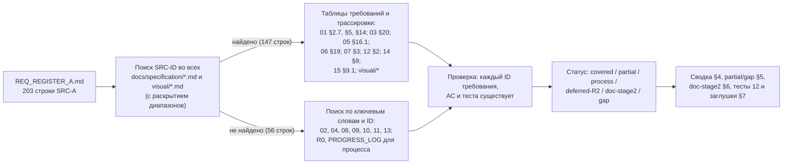

#### 2.1. Правила присвоения статуса

| Статус | Когда ставится |
|---|---|
| `covered` | В ТЗ есть хотя бы одно требование с ID и критерием приёмки `AC-…`, которое прямо выражает строку реестра (для строк типа «документ» — существующий файл ТЗ, назначенный ADR-045) |
| `partial` | Требование отражено не полностью: нет требования-владельца, нет файла-адресата, часть содержания помечена `[НЕ ПОДТВЕРЖДЕНО]` или нет записи о процессе там, где она нужна |
| `process` | Строка — требование к порядку работы команды; выполнено методикой этапа 1. В столбце статуса указано **чем** (ядро R0, PROGRESS_LOG, журналы проверки, R1–R8, разделы ТЗ) |
| `doc-stage2` | Строка относится к работе этапа 2 (код, запуск тестов, проверка кода); указаны задачи и правила 13_IMPLEMENTATION_ROADMAP, где она запланирована |
| `deferred-R2` | Требование осознанно перенесено в Release 2 решением ядра с Q-ссылкой (в части A таких строк нет) |
| `gap` | Требование не найдено в ТЗ ни по SRC-ID, ни по ключевым словам (в части A таких строк нет) |

#### 2.2. Обозначения в матрице

- Документы ТЗ обозначены номером файла: `01` = 01_PRODUCT_REQUIREMENTS.md, `02` = 02_SCREEN_SPECIFICATION.md, `03` = 03_UX_UI_DESIGN_SYSTEM.md, `04` = 04_USER_FLOWS.md, `05` = 05_ONEC_INTEGRATION.md, `06` = 06_ARCHITECTURE.md, `07` = 07_DATA_MODEL.md, `08` = 08_API_SPECIFICATION.md, `09` = 09_AUTH_SMS_BIOMETRICS.md, `10` = 10_POS_BUSINESS_RULES.md, `11` = 11_SECURITY_PRIVACY.md, `12` = 12_TEST_PLAN.md, `13` = 13_IMPLEMENTATION_ROADMAP.md, `14` = 14_OPEN_QUESTIONS.md, `15` = 15_DECISION_LOG.md, `16` = 16_DEPLOYMENT_PLAN.md; `R0` — ядро решений; `R1…R8` — исследования.
- «Документ и раздел ТЗ» — разделы, где находятся указанные требования (для ADR — номер записи `15 ADR-0NN`, для экранов — `02 SCR-NN`, для сценариев — раздел 04, в котором стоит заголовок `### FLOW-NNN` с его критериями `AC-FLOW-NNN-kk`: например, FLOW-014 — 04 §5, FLOW-026 — 04 §6, FLOW-032 — 04 §8; `04 §2` (оглавление сценариев) указывается только для строк о документе в целом), затем дополнительные места без ID (абзацы, таблицы трассировки документов).
- «Критерий приёмки» — AC указанных требований ровно как в документах; для экранов — диапазон из индекса 02 §10.1 (`AC-UI-NN-001…NNN`), для сценариев — `AC-FLOW-NNN-kk` (формат ядра §19.1). Если требований более семи — список усечён знаком «…».
- «Тест (12)»: `T-AUTH-…`, `T-SMS-…`, `T-SESS-…`, `T-BIO-…`, `T-FACE-…` — тесты 12 §3.1, у которых в столбце «Требования» есть требование или AC этой строки матрицы; `T-SEC-NNN (11 §12.2, принят 12 §2.7)` — тест безопасности из 11 §12.2, который 12 §2.7 принимает с сохранением ID (это тест 12, а не кандидат); заглушка `<префикс>` — тест в выпущенной части 12 (§1–§3.1) не найден, разделы 12 §3.2+ ещё не выпущены; заглушка `GEN (AC-GEN-001)` — критерий приёмки 01 есть, теста в 12 пока нет; `н/п` — тест неприменим (требование к процессу или к наличию документа; проверка — ревью).
- Тип строки — как в реестре: функц., нефункц., ограничение, процесс, документ.

#### 2.3. Ограничения на момент трассировки (2026-10-19, повторная проверка)

1. Все документы волны 3 есть в каталоге `docs/specification/`, но два из них — черновики, которые ещё дописываются: `01_PRODUCT_REQUIREMENTS.md` (требования GEN-/NFR-/ROLE-, обратная трассировка 01 §14) и `12_TEST_PLAN.md` (выпущены §1–§3.1; разделов 3.2–13 нет). `14_OPEN_QUESTIONS.md` выпущен (174 идентификатора; вопросы 01, 12 и 17 в него ещё не включены — 14 §8). Ссылки на `GEN-` даны по строкам требований 01, у которых в столбце «Источник» указана строка SRC-A; ссылки на `T-…` — только на тесты, найденные в выпущенной части 12; ничего не выдумывается.
2. Прямые ссылки на SRC-A есть в 01 (требования GEN-001, 003, 007, 008, 009, 171, 173, 197, 232, риск R-20 и таблица 01 §14), 03, 05, 06, 07, 12 (шапка; §2.1 P-2, P-4; §2.10 C-11), 14 §9, 15 и `visual/components-states.md`, `visual/navigation.md`; документы 02, 04, 08, 09, 10, 11, 13, 16 трассируют на другие части реестра (B…F), поэтому их требования найдены по ключевым словам.
3. Таблица 05 §16.1 «Часть A» и 06 §19 содержат собственную обратную трассировку; при совпадении настоящая матрица повторяет их ID, при расхождении — указывает дополнительно найденные требования (например, ARCH-002 для границы Firebase в SRC-A-036). Таблица 01 §14 сопоставляет строкам части A также GEN-требования, у которых в столбце «Источник» нет ссылки на SRC-A (например, GEN-002 для SRC-A-002, GEN-094 для SRC-A-112…112d, GEN-106 для SRC-A-113…113f, GEN-051 и GEN-055 для SRC-A-114…114c); по правилу ядра §10 (требование ссылается на SRC) матрица их не приводит — см. замечание 1 в §10.

---

### 3. Матрица трассируемости

#### 3.1. Преамбула и раздел 1 «Главные правила работы» (строки 2–20 промта)

| SRC-ID | Краткая формулировка | Тип | Документ и раздел ТЗ | ID требования(й) ТЗ | Критерий приёмки (AC-…) | Тест (12) | Статус покрытия |
|---|---|---|---|---|---|---|---|
| SRC-A-000 | Контекстная позиция: название продукта — «Оптомстрой POS»; рамка работы — автономный AI-оркестратор и команда разработки (субагентов) | процесс | 01 §2.1, §2.7; R0 §0, §15; 13 §2.2 | GEN-001 | AC-GEN-001 | н/п | process — рамка работы задана ядром R0 §0/§15 (оркестратор + авторы-агенты по документам); ход работ — PROGRESS_LOG.md; цель и рамка продукта — 01 GEN-001 |
| SRC-A-001 | Исполнитель выступает в роли главного архитектора/CTO/руководителя субагентов с экспертизой во Flutter, POS/ERP, 1С, UX/UI, безопасности, БД и автотестировании | процесс | 05 §4.2; 05 §5.2; 15 §2.4; 05 §16.1; 15 §9.1 | ONEC-023, ONEC-107, ADR-000 | AC-ONEC-023, AC-ONEC-107, AC-ADR-000 | н/п | process — роль исполнена оркестратором этапа 1: исследования R1–R8, ядро R0 v1.0–v1.4, журнал решений 15 |
| SRC-A-002 | Результат проекта — полноценная коммерческая POS-система «Оптомстрой» для оптового магазина хозтоваров (проектирование + реализация) | функц. | 01 §2.1, §2.7; 06 §17.1; R0 §4.1; 13 §7 | GEN-001, ARCH-056, ARCH-058 | AC-GEN-001, AC-ARCH-056, AC-ARCH-058 | T-ARCH-011, T-FLOW-001, T-FLOW-013, T-FLOW-020 | covered — цель продукта — 01 GEN-001 (источник SRC-A-002), детализация — 06 ARCH-056/058 и таблица готовности 13 §7 |
| SRC-A-003 | Работа ведётся автономно, в режиме руководителя инженерной команды | процесс | PROGRESS_LOG.md; R0 §2, §12 | — | — | н/п | process — решения D-01…D-48 приняты оркестратором, блокирующие неизвестные вынесены в Q-, работа продолжена на допущениях |
| SRC-A-004 | Исполнитель сам анализирует проект и изучает документацию | процесс | 13 §10; R1…R8; PROGRESS_LOG.md (2026-10-18); 13 §3.1 | RM-A-002 | AC-RM-A-002 | н/п | process — изучены resursi/ и официальная документация (R1–R8); фактическая конфигурация 1С — RM-A-002 после доступа |
| SRC-A-005 | Исполнитель распределяет задачи субагентам и принимает архитектурные решения | процесс | 15 §2.4; R0 §2, §15 | ADR-000 | AC-ADR-000 | н/п | process — задачи распределены по документам-владельцам (R0 §15), архитектурные решения — D-xx / ADR |
| SRC-A-006 | Полный цикл: написание кода, запуск тестов, исправление ошибок, проверка результата (на этапе реализации) | процесс | 13 §10; 13 §2.1 (P-6), §6.1 | RM-H-001, RM-H-006 | AC-RM-H-001, AC-RM-H-006 | н/п | doc-stage2 — код, запуск тестов и исправления — этап 2; на этапе 1 код запрещён (R0 §0) |
| SRC-A-007 | Запрещено останавливаться на плане, прототипе или макетах | ограничение | 01 §2.7; 13 §10; 13 §2.1 (P-6), §7 (правило заполнения) | GEN-001, RM-H-010 | AC-GEN-001, AC-RM-H-010 | н/п | doc-stage2 — макеты и заглушки не считаются готовностью; доказательства готовности — таблица 13 §7; продуктовое требование «не прототип и не набор макетов» — 01 GEN-001 |
| SRC-A-008 | Продукт должен быть рабочим, поддерживаемым, безопасным и пригодным к реальному внедрению в магазине | нефункц. | 01 §2.1, §2.7; 06 §17.1; 13 §10; 11 (весь документ); 13 §7, §8 | GEN-001, ARCH-056, ARCH-047, RM-I-004, RM-I-008 | AC-GEN-001, AC-ARCH-056, AC-ARCH-047, AC-RM-I-004, AC-RM-I-008 | T-FLOW-001, T-FLOW-013, T-FLOW-020, T-NFR-022 | covered |
| SRC-A-009 | До начала работы изучить всю рабочую директорию: код, структуру, чертежи от руки, изображения, логотипы, техдокументы и прочие материалы | процесс | 13 §10; PROGRESS_LOG.md (2026-10-18); R0 §14; 13 §3.1 | RM-A-002 | AC-RM-A-002 | T-UI-113 (12 §3.9.2, условно Q-302) | partial — изучены resursi/ (3 макета, логотип, промт) и текущий lib/ (стартовый шаблон); ручных чертежей экранов, названных промтом, в материалах нет — изучение исходных материалов не завершено до ответа заказчика на **Q-302** (`[ТРЕБУЕТ РЕШЕНИЯ ЗАКАЗЧИКА: Q-302]`; ядро v1.7 §22.13 п.6; §5.1 № 36; ред. 1.3, было `process`); использование чертежей как исходного материала компоновки — строка SRC-C-014 (`partial`) |
| SRC-A-010 | Запрещено игнорировать существующие файлы проекта | ограничение | 13 §10; R0 §14; 13 §3.1 | RM-C-001 | AC-RM-C-001 | н/п | process — материалы учтены: факты макетов и логотипа — R0 §14, расхождения — Q-002, Q-006 |
| SRC-A-011 | При наличии рабочего кода сохранять его архитектуру там, где это разумно | ограничение | 13 §10; 13 §3.1 | RM-C-001 | AC-RM-C-001 | н/п | process — текущий lib/ — стартовый шаблон без рабочей архитектуры (13 §3.1); проект расширяется на этапе 2 (RM-C-001) |
| SRC-A-012 | Запрещено переписывать целые файлы без необходимости | ограничение | 13 §10; 13 §5.2, §5.3 | RM-B-012 | AC-RM-B-012 | н/п | doc-stage2 — expand-only изменения и владельцы файлов — правила этапа 2 |
| SRC-A-013 | До реализации должны быть сформированы архитектура, критерии готовности (DoD), модель данных и план интеграции | процесс | 05 §4.2; 06 §17.1; 06; 07; 05; 13 §6 (DoD) | ONEC-069, ARCH-052, ARCH-053 | AC-ONEC-069, AC-ARCH-052, AC-ARCH-053 | н/п | process — архитектура (06), модель данных (07), план интеграции (05), критерии готовности (13 §6) сформированы до реализации |
| SRC-A-014 | После подготовки архитектуры переходить к реализации, не зацикливаясь на планировании | процесс | 13 §10; 13 §2.1 (P-1), §3 | RM-B-001 | AC-RM-B-001 | н/п | doc-stage2 — старт реализации — по воротам G-B1 после фразы заказчика |
| SRC-A-015 | Субагенты применяются для независимых параллельных задач | процесс | R0 §15; PROGRESS_LOG.md (волны); 13 §2.3, §4.3 | — | — | н/п | process — параллельные независимые работы: 8 исследований, волны документов; на этапе 2 — дорожки 13 §4.3 |
| SRC-A-016 | Ответственность за общую архитектуру, совместимость модулей и качество остаётся за оркестратором | процесс | R0 §16–§19; 13 §2.2 (ARCH), §5 | — | — | н/п | process — оркестратор сводит расхождения документов в ядро (v1.1–v1.4) и утверждает каноны |
| SRC-A-017 | Запрещено давать всем агентам одинаковую работу | ограничение | R0 §15 | — | — | н/п | process — у каждого документа ТЗ свой владелец и свои префиксы ID |
| SRC-A-018 | У каждого агента — отдельная зона ответственности, конкретный результат и критерии приёмки | процесс | R0 §10, §15; 13 §2.2, §2.5 | — | — | н/п | process — у каждого автора — зона (документ), результат (файл) и критерии (AC-, независимая проверка); на этапе 2 — задачи RM с критерием завершения |
| SRC-A-019 | Рутинные исследования, тесты, документацию и типовой код поручать экономичным моделям; условие применимости — платформа позволяет выбирать модели для субагентов (при выполнении условия требование обязательно) | процесс | — | — | — | н/п | partial — политика выбора экономичных моделей для субагентов не зафиксирована ни в R0, ни в 13; добавить в 13 §2.2 |
| SRC-A-020 | Сложные архитектурные решения, интеграция и проверка безопасности — на самой сильной модели | процесс | — | — | — | н/п | partial — политика «сильная модель — архитектура, интеграция, безопасность» не зафиксирована; добавить в 13 §2.2 |
| SRC-A-021 | Запрещено параллельное редактирование одних файлов несколькими агентами без согласованного разделения | ограничение | 13 §10; R0 §11 п.10; 13 §2.1 (P-3), §5.2 | RM-B-012 | AC-RM-B-012 | н/п | process — автор пишет только свой файл (R0 §11 п.10); на этапе 2 — один владелец у каталога |
| SRC-A-022 | Для каждого модуля, файла и интерфейса должен быть определён владелец | процесс | 15 ADR-063; R0 §15, §18.1; 13 §5.1, §5.2 | ADR-063 | AC-ADR-063 | н/п | process — владельцы документов, словарей и контрактов назначены |
| SRC-A-023 | Запрещено тратить дорогие вызовы на повторное чтение неизменившихся файлов | ограничение | PROGRESS_LOG.md (2026-10-18, «Блокеры») | — | — | н/п | process — готовые агенты не перезапускались, работа продолжена с кэшем |
| SRC-A-023a | Запрещено тратить дорогие вызовы на дублирование анализа | ограничение | R0 (единый источник имён и решений) | — | — | н/п | process — анализ не дублируется: авторы опираются на ядро и R1–R8 |
| SRC-A-023b | Запрещено тратить дорогие вызовы на избыточные отчёты | ограничение | PROGRESS_LOG.md (формат) | — | — | н/п | process — журнал краткий; ответы агентов — структурированные данные |
| SRC-A-024 | Кэшировать контекст | процесс | PROGRESS_LOG.md (2026-10-18) | — | — | н/п | process — контекст переиспользуется (кэш, ядро R0) |
| SRC-A-024a | Объединять независимые исследования | процесс | R1…R8; PROGRESS_LOG.md | — | — | н/п | process — независимые исследования объединены в одну волну (R1–R8) |
| SRC-A-024b | Использовать краткие структурированные отчёты | процесс | PROGRESS_LOG.md | — | — | н/п | process — краткий журнал «готово / проверяется / блокеры / следующий результат» |
| SRC-A-025 | Экономия токенов не должна снижать качество, безопасность и тестирование | ограничение | 11 §12.3; PROGRESS_LOG.md; журналы проверки 03 §22, 05 §18, 07 §20, 11 прил. А, 15 прил. А; 13 §6.1 | SEC-126, SEC-127 | AC-SEC-126, AC-SEC-127 | н/п | process — каждый документ проходит независимую проверку; на этапе 2 — DoD 13 §6.1 |
| SRC-A-026 | Функция считается работающей только после проверки реализации и соответствующих тестов | процесс | 01 §2.7; 12 §2.1 (P-2); 13 §10; R0 §11 п.5; 13 §2.1 (P-6), §7 | GEN-009, RM-H-010 | AC-GEN-009, AC-RM-H-010 | н/п | process — запрет «реализовано/работает» без доказательства (R0 §11 п.5); на этапе 2 — правило 13 §7; продуктовое требование — 01 GEN-009; правило доказательств тестов — 12 §2.1 P-2 |
| SRC-A-027 | При отсутствии доступа к серверу/API/устройству/учётной записи — явно зафиксировать ограничение и подготовить проверяемую интеграцию | процесс | 01 §2.7, §5.22; 12 §2.1 (P-4); 05 §4.2; 05 §12; 15 ADR-048; 13 §10; 05 §2 (U1–U10), §16.1; 13 §2.1 (P-7) | GEN-007, GEN-232, ONEC-023, ONEC-091, ONEC-096, ADR-048, RM-C-008 | AC-GEN-007, AC-GEN-232, AC-ONEC-023, AC-ONEC-091, AC-ONEC-096, AC-ADR-048, AC-RM-C-008 | н/п | process — ограничения доступа зафиксированы (05 §2, R0 §0, Q-010, Q-029, Q-030); проверяемая интеграция — FakeOnecGateway / fixtures; продуктовые требования — 01 GEN-007, GEN-232; изолированный тестовый режим с пометкой — 12 §2.1 P-4 |
| SRC-A-028 | Запрещено задавать вопросы, ответ на которые есть в проекте или официальной документации | ограничение | R0 §12 (столбец «Рекомендуемое допущение»); R1…R8 | — | — | н/п | process — вопросы Q- поставлены только по неустранимым неизвестным, каждый с допущением |
| SRC-A-029 | При блокирующем решении — один конкретный вопрос заказчику, остальные независимые задачи продолжаются | процесс | 13 §10; R0 §12; 14 (весь документ), 14 §9; 01 §11 (R-20) | RM-A-003 | AC-RM-A-003 | н/п | process — работа продолжена на допущениях; вопросы сведены в единый перечень 14_OPEN_QUESTIONS.md (выпущен, 174 идентификатора); риск затягивания ответов — 01 §11 R-20 |
| SRC-A-030 | Запрещено останавливаться на TODO; задачи доводятся до проверяемого результата | процесс | 12 (шапка: зона документа); 13 §2.5; журналы проверки документов | — | — | н/п | process — каждая задача доведена до файла и передана на проверку; на этапе 2 — критерии завершения RM |
| SRC-A-031 | Выполненная работа передаётся независимому проверяющему агенту (см. также SRC-A-062 — Агент 8) | процесс | 12 (шапка: зона документа); 13 §10; PROGRESS_LOG.md; 13 §2.1 (P-4), §6.1 п.11 | RM-H-002 | AC-RM-H-002 | н/п | process — независимая проверка документов этапа 1 (журналы проверки); на этапе 2 — P-4 |
| SRC-A-032 | Вести краткий журнал прогресса: готово / проверяется / блокеры / следующий результат | документ | 13 §10; docs/PROGRESS_LOG.md; 13 §6.3 | RM-H-009 | AC-RM-H-009 | н/п | process — журнал ведётся в PROGRESS_LOG.md в требуемом формате; на этапе 2 — отчёты этапов 13 §6.3 |

#### 3.2. Раздел 2 «Команда субагентов» и «Правила оркестрации» (строки 22–66)

| SRC-ID | Краткая формулировка | Тип | Документ и раздел ТЗ | ID требования(й) ТЗ | Критерий приёмки (AC-…) | Тест (12) | Статус покрытия |
|---|---|---|---|---|---|---|---|
| SRC-A-033 | Сформировать команду субагентов из 8 перечисленных ролей (Агент 1 … Агент 8) | процесс | R0 §15; 13 §2.2 | — | — | н/п | process — этап 1 — авторы-агенты по R0 §15; этап 2 — 8 ролей 13 §2.2 (нумерация отличается от промта, см. «Замечания к ядру») |
| SRC-A-034 | При невозможности выделить агента на каждую роль — использовать доступные механизмы делегирования; запрещена симуляция выполненной работы | ограничение | 13 §10; R0 §11 п.5; 13 §2.1 (P-7), §7 (п. 7.14) | RM-C-008 | AC-RM-C-008 | н/п | process — симуляция запрещена: метки достоверности, fake-режимы только с явной пометкой |
| SRC-A-035 | Агент 1 проектирует общую архитектуру приложения | процесс | 06 §17.1; 15 ADR-001; 06; 15 | ARCH-001, ADR-001 | AC-ARCH-001, AC-ADR-001 | н/п | process — роль Агента 1 исполнена документами 06 и 15 |
| SRC-A-036 | Агент 1 определяет границы ответственности между Flutter, backend, 1С, Firebase и хранилищем файлов | процесс | 05 §4.2; 05 §5.2; 06 §17.1; 05 §16.1 | ONEC-024, ONEC-025, ONEC-108, ARCH-002, ARCH-008, ARCH-034 | AC-ONEC-024, AC-ONEC-025, AC-ONEC-108, AC-ARCH-002, AC-ARCH-008, AC-ARCH-034 | н/п | process — границы зафиксированы в 05 и 06 (Firebase — ARCH-002) |
| SRC-A-037 | Агент 1 проектирует API, права доступа, модель данных и стратегию синхронизации | процесс | 05 §4.2; 05 §7.1; 05 §7.2; 05 §7.3; 08 §11.1; 11 §4.5; 07 §3; 08; 11 §4.3–§4.4; 07; 05 §7–§9 | ONEC-069, SYNC-001, SYNC-011, SYNC-021, API-001, SEC-027, DATA-020 | AC-ONEC-069, AC-SYNC-001, AC-SYNC-011, AC-SYNC-021, AC-API-001, AC-SEC-027, AC-DATA-020 | н/п | process — API (08), права (11 §4.3–§4.4), модель данных (07), стратегия синхронизации (05 §7–§9) |
| SRC-A-038 | Архитектурные решения и компромиссы документируются (см. docs/DECISIONS.md, SRC-A-081) | документ | 15 §2.4; 06 §3 | ADR-000 | AC-ADR-000 | н/п (ревью документа) | covered |
| SRC-A-039 | Агент 2 исследует фактическую конфигурацию 1С и доступные интерфейсы обмена | процесс | 05 §5.2; 13 §10; 05 §2, §3, §16.1; R1 | ONEC-107, RM-A-002 | AC-ONEC-107, AC-RM-A-002 | н/п | process — исследование по документации (R1, 05 §3); фактическая конфигурация — RM-A-002 после доступа (Q-010) |
| SRC-A-040 | Из 1С должны быть получены товары; способ получения определяется исследованием Агента 2 (то же для SRC-A-040a…040k) | функц. | 05 §5.1a; 05 §16.1 | ONEC-001 | AC-ONEC-001 | T-ONEC-019 | covered |
| SRC-A-040a | Из 1С должны быть получены артикулы | функц. | 05 §5.1a; 05 §16.1 | ONEC-002 | AC-ONEC-002 | T-ONEC-019 | covered |
| SRC-A-040b | Из 1С должны быть получены категории | функц. | 05 §5.1a; 05 §16.1 | ONEC-003 | AC-ONEC-003 | T-ONEC-019 | covered |
| SRC-A-040c | Из 1С должны быть получены характеристики товаров | функц. | 05 §5.1a; 05 §16.1 | ONEC-004 | AC-ONEC-004 | T-ONEC-019 | covered |
| SRC-A-040d | Из 1С должны быть получены варианты товаров | функц. | 05 §5.1a; 05 §5.2; 05 §16.1 | ONEC-005, ONEC-073 | AC-ONEC-005, AC-ONEC-073 | T-ONEC-019 | covered |
| SRC-A-040e | Из 1С должны быть получены фотографии товаров | функц. | 05 §5.1a; 05 §6.6; 05 §7.5; 05 §16.1 | ONEC-006, ONEC-049, SYNC-035 | AC-ONEC-006, AC-ONEC-049, AC-SYNC-035 | T-ONEC-012, T-ONEC-019, T-FAIL-016, T-SYNC-043; T-SEC-046 (11 §12.2, принят 12 §2.7) | covered |
| SRC-A-040f | Из 1С должны быть получены цены | функц. | 05 §5.1a; 05 §7.2; 05 §16.1 | ONEC-007, ONEC-022, SYNC-015 | AC-ONEC-007, AC-ONEC-022, AC-SYNC-015 | T-ONEC-019, T-SYNC-014 | covered |
| SRC-A-040g | Из 1С должны быть получены склады | функц. | 05 §5.1a; 05 §5.2; 05 §16.1 | ONEC-019, ONEC-070 | AC-ONEC-019, AC-ONEC-070 | T-ONEC-019 | covered |
| SRC-A-040h | Из 1С должны быть получены остатки | функц. | 05 §5.1a; 05 §5.2; 05 §7.2; 05 §16.1 | ONEC-009, ONEC-070, SYNC-014 | AC-ONEC-009, AC-ONEC-070, AC-SYNC-014 | T-ONEC-019, T-SYNC-013 | covered |
| SRC-A-040i | Из 1С должны быть получены клиенты | функц. | 05 §5.1a; 05 §16.1 | ONEC-011, ONEC-012 | AC-ONEC-011, AC-ONEC-012 | T-ONEC-009, T-ONEC-019 | covered |
| SRC-A-040j | Из 1С должна быть получена история покупок | функц. | 05 §5.1a; 05 §7.1; 05 §16.1 | ONEC-013, SYNC-008 | AC-ONEC-013, AC-SYNC-008 | T-ONEC-019, T-CASH-003, T-SYNC-011 | covered |
| SRC-A-040k | Из 1С должны быть получены взаиморасчёты | функц. | 05 §5.1a; 05 §6.6; 05 §7.2; 05 §16.1 | ONEC-014, ONEC-047, SYNC-016 | AC-ONEC-014, AC-ONEC-047, AC-SYNC-016 | T-ONEC-010, T-ONEC-019, T-SYNC-015 | covered |
| SRC-A-041 | Проверить поддержку 1С: инкрементальный обмен, расписание, журналы изменений, повторная отправка данных | процесс | 05 §7.2; 05 §7.3; 05 §7.5; 05 §8.1; 13 §10; 05 §3, §7, §16.1 | SYNC-011, SYNC-012, SYNC-021, SYNC-029, SYNC-043, RM-A-002 | AC-SYNC-011, AC-SYNC-012, AC-SYNC-021, AC-SYNC-029, AC-SYNC-043, AC-RM-A-002 | н/п | process — возможности 1С проверены по документации (R1, 05 §3); подтверждение на реальной базе — RM-A-002 (Q-010, Q-011) |
| SRC-A-042 | Адаптер интеграции с 1С и его тесты строятся на реальных схемах данных, когда они доступны | функц. | 05 §12; 05 §5.2; 13 §10; 05 §2.1 (U9), §12, §16.1 | ONEC-072, ONEC-091, ONEC-096, ONEC-107, RM-A-005, RM-E-011 | AC-ONEC-072, AC-ONEC-091, AC-ONEC-096, AC-ONEC-107, AC-RM-A-005, AC-RM-E-011 | T-ONEC-026, T-ONEC-001, T-ONEC-019, T-ONEC-029 | covered |
| SRC-A-043 | Клиентское приложение — Flutter; Агент 3 создаёт его архитектуру | функц. | 06 §17.1; 06 §17.2; 15 ADR-005 | ARCH-016, ARCH-017, MOD-001, ADR-005 | AC-ARCH-016, AC-ARCH-017, AC-MOD-001, AC-ADR-005 | T-ARCH-001, T-BUILD-003 | covered |
| SRC-A-044 | Flutter-приложение реализует навигацию | функц. | 06 §17.1; 15 ADR-050; visual/navigation.md §1, §11 | ARCH-019, ADR-050 | AC-ARCH-019, AC-ADR-050 | T-ARCH-003, T-UI-102 | covered |
| SRC-A-044a | Flutter-приложение реализует управление состоянием | функц. | 06 §17.1 | ARCH-018 | AC-ARCH-018 | T-ARCH-003 | covered |
| SRC-A-044b | Flutter-приложение реализует экран/модуль авторизации | функц. | 06 §17.2; 09 §14.1; 02 SCR-01; 02 SCR-02; 02 SCR-08 | MOD-004, AUTH-001, SCR-01, SCR-02, SCR-08 | AC-MOD-004, AC-AUTH-001, AC-UI-01-001…018, AC-UI-02-001…023, AC-UI-08-001…017 | T-AUTH-001, T-AUTH-037, T-AUTH-041, T-BIO-009; T-SEC-001…T-SEC-006 (11 §12.2, приняты 12 §2.7) | covered |
| SRC-A-044c | Flutter-приложение реализует каталог | функц. | 06 §17.2; 10 §5; 02 SCR-10; 02 SCR-11; 02 SCR-12; 02 SCR-13 | MOD-006, CAT-001, SCR-10, SCR-11, SCR-12, SCR-13 | AC-MOD-006, AC-CAT-001, AC-UI-10-001…031, AC-UI-11-001…014, AC-UI-12-001…013, AC-UI-13-001…012 | T-UI-010, T-UI-011, T-UI-012, T-UI-013 | covered |
| SRC-A-044d | Flutter-приложение реализует карточку товара | функц. | 06 §17.2; 02 SCR-14; 02 SCR-15; 02 SCR-16 | MOD-007, SCR-14, SCR-15, SCR-16 | AC-MOD-007, AC-UI-14-001…024, AC-UI-15-001…012, AC-UI-16-001…012 | T-UI-014, T-UI-015, T-UI-016, T-UI-111 | covered |
| SRC-A-044e | Flutter-приложение реализует корзину | функц. | 06 §17.2; 10 §7.2; 02 SCR-20 | MOD-008, CART-001, SCR-20 | AC-MOD-008, AC-CART-001, AC-UI-20-001…029 | T-CART-001, T-CART-024, T-UI-020, T-ARCH-010 | covered |
| SRC-A-044f | Flutter-приложение реализует профиль пользователя | функц. | 06 §17.2; 02 SCR-41 | MOD-014, SCR-41 | AC-MOD-014, AC-UI-41-001…015 | T-UI-041, T-ARCH-010, T-PRIV-002, T-PRIV-006 | covered |
| SRC-A-044g | Flutter-приложение реализует все остальные экраны (полный состав — по карте экранов ТЗ) | функц. | 06 §17.2; 02 §4 (карта экранов), §10.1 (индекс AC-UI, 712 критериев); visual/screen-map.md | MOD-018 | AC-MOD-018 | T-ARCH-010 | covered |
| SRC-A-045 | Приложение устойчиво работает при медленном интернете и временной недоступности сервера | нефункц. | 06 §17.1; 05 §9; 05 §11; 15 ADR-032; 02 SCR-90; 04 §8 (FLOW-032); R0 §13 (NFR-OFFLINE-001) | ARCH-026, ARCH-062, SYNC-058, SYNC-062, ADR-032, SCR-90, FLOW-032 | AC-ARCH-026, AC-ARCH-062, AC-SYNC-058, AC-SYNC-062, AC-ADR-032, AC-UI-90-001…019, AC-FLOW-032-01…04 | T-ARCH-008, T-ARCH-009, T-UI-090, T-FAIL-001 | covered |
| SRC-A-046 | Провести исследование актуальных интерфейсов профессиональных POS, складских систем и B2B-каталогов | процесс | 03 §18.6; 03 §3 (3.1, 3.2, абзац «Складские системы»), §20 | DS-055 | AC-DS-055 | н/п | partial — обзор POS и B2B выполнен; отдельный обзор интерфейсов складских систем (WMS) в R4 не проводился — 03 §3.1 помечает [НЕ ПОДТВЕРЖДЕНО] |
| SRC-A-047 | Цветовая палитра выбирается по критериям: читаемость, контраст, доступность, контекст магазина, удобство ежедневной работы | нефункц. | 03 §18.1; 03 §15; 15 ADR-016; 03 §4, §5.6–§5.7, §20 | DS-001, DS-004, DS-012, A11Y-001, ADR-016 | AC-DS-001, AC-DS-004, AC-DS-012, AC-A11Y-001, AC-ADR-016 | T-DS-012, T-DS-001, T-DS-004, T-A11Y-001 | covered |
| SRC-A-048 | Дизайн-система предлагается на основе исследования существующих материалов проекта и обосновывается | документ | 03 §18.1; 03 §20 | DS-001, DS-008 | AC-DS-001, AC-DS-008 | н/п (ревью документа) | covered |
| SRC-A-049 | Должен быть единый набор UI-компонентов, их состояний, анимаций и адаптивных экранов | функц. | 03 §18.4; 03 §18.5; 03 §18.7; 15 ADR-051; visual/components-states.md; visual/responsive-spec.md | DS-030, DS-041, DS-065, ADR-051 | AC-DS-030, AC-DS-041, AC-DS-065, AC-ADR-051 | T-DS-030, T-DS-041, T-DS-061, T-DS-066 | covered |
| SRC-A-050 | Запрещён произвольный (необоснованный) выбор цветов | ограничение | 03 §18.1; 03 §20 | DS-001, DS-003, DS-004 | AC-DS-001, AC-DS-003, AC-DS-004 | T-DS-001, T-DS-004 | covered |
| SRC-A-051 | Запрещено копирование дизайна конкурентов без анализа | ограничение | 03 §3 (вводный абзац), §20 | — | — | н/п | process — обзор только по официальной документации, скриншоты конкурентов не анализировались (03 §3) |
| SRC-A-052 | Backend реализует серверные бизнес-операции | функц. | 06 §17.2; 06 §17.1; 15 ADR-003; 08 §4 | MOD-021, ARCH-030, ARCH-031, ADR-003 | AC-MOD-021, AC-ARCH-030, AC-ARCH-031, AC-ADR-003 | T-ARCH-002, T-ARCH-004, T-BUILD-009 | covered |
| SRC-A-052a | Backend предоставляет API | функц. | 08 §11.1; 06 §17.1; 08 §4, §8 | API-001, ARCH-040 | AC-API-001, AC-ARCH-040 | T-API-001, T-API-002, T-ARCH-009 | covered |
| SRC-A-052b | Backend обеспечивает хранение пользовательских данных | функц. | 07 §5.A | DATA-100, DATA-101 | AC-DATA-100, AC-DATA-101 | T-DATA-003, T-REG-012 | covered |
| SRC-A-052c | Backend обеспечивает хранение корзин | функц. | 07 §5.D; 15 ADR-052 | DATA-134, ADR-052 | AC-DATA-134, AC-ADR-052 | T-DATA-006 | covered |
| SRC-A-052d | Backend обеспечивает хранение заказов | функц. | 07 §5.D | DATA-136, DATA-138 | AC-DATA-136, AC-DATA-138 | T-DATA-006, T-ORD-028 | covered |
| SRC-A-052e | Backend обеспечивает хранение (и применение) прав доступа | функц. | 07 §5.A; 07 §12.5; 11 §4.5; 11 §4.3–§4.4 | DATA-103, DATA-105, DATA-278, SEC-027, SEC-028, SEC-029 | AC-DATA-103, AC-DATA-105, AC-DATA-278, AC-SEC-027, AC-SEC-028, AC-SEC-029 | T-SEC-016, T-SEC-019 (11 §12.2, приняты 12 §2.7) | covered |
| SRC-A-053 | Backend/БД обеспечивают транзакционность | нефункц. | 06 §17.1; 07 §8.6; 15 ADR-003; 07 §8.5 | ARCH-032, DATA-227, ADR-003 | AC-ARCH-032, AC-DATA-227, AC-ADR-003 | T-DATA-010, T-FAIL-013, T-ARCH-004, T-SYNC-031 | covered |
| SRC-A-053a | Backend/БД обеспечивают идемпотентность операций | нефункц. | 06 §17.1; 07 §8.6; 11 §3.5; 05 §7.5; 05 §8.1; 05 §6.6; 05 §10.1; 07 §8.1; 05 §16.1 | ARCH-036, DATA-220, DATA-221, SEC-022, SEC-023, SYNC-031, SYNC-041, SYNC-043, ONEC-037, ONEC-063 | AC-ARCH-036, AC-DATA-220, AC-DATA-221, AC-SEC-022, AC-SEC-023, AC-SYNC-031, AC-SYNC-041, … | T-API-006, T-SYNC-004, T-DATA-010, T-FAIL-017; T-SEC-023, T-SEC-024 (11 §12.2, приняты 12 §2.7) | covered |
| SRC-A-053b | БД имеет спроектированные индексы | нефункц. | 07 §10.6; 07 §5.B; 07 §10.2 | DATA-241, DATA-164 | AC-DATA-241, AC-DATA-164 | T-DATA-004, T-DATA-012, T-PERF-002 | covered |
| SRC-A-053c | БД имеет механизм миграций | нефункц. | 06 §17.1; 07 §12.5; 15 ADR-003; 07 §12 | ARCH-057, DATA-270, DATA-271, DATA-272, DATA-273, ADR-003 | AC-ARCH-057, AC-DATA-270, AC-DATA-271, AC-DATA-272, AC-DATA-273, AC-ADR-003 | T-DATA-014, T-COMPAT-001, T-OPS-011, T-ARCH-011 | covered |
| SRC-A-053d | Backend/БД ведут аудит | нефункц. | 15 ADR-036; 07 §9.7; 11 §7.3; 07 §9; 11 §7 | ADR-036, DATA-230, DATA-231, DATA-232, SEC-073, SEC-079, SEC-080 | AC-ADR-036, AC-DATA-230, AC-DATA-231, AC-DATA-232, AC-SEC-073, AC-SEC-079, AC-SEC-080 | T-SEC-030, T-SEC-038 (11 §12.2, приняты 12 §2.7) | covered |
| SRC-A-054 | Сервер не доверяет данным мобильного клиента напрямую (валидация на сервере) | нефункц. | 11 §3.2; 06 §17.1; 10 §11.2; 10 §18.2 | SEC-008, SEC-010, ARCH-034, DISC-001, MNY-001 | AC-SEC-008, AC-SEC-010, AC-ARCH-034, AC-DISC-001, AC-MNY-001 | T-SEC-021 (11 §12.2, принят 12 §2.7) | covered |
| SRC-A-055 | Для backend готовятся интеграционные тесты | процесс | 13 §10; 05 §12; 13 §6.1 п.5; 12 §2.10 (C-11) | RM-H-001, ONEC-072 | AC-RM-H-001, AC-ONEC-072 | T-ONEC-001, T-ONEC-029 | doc-stage2 — интеграционные тесты пишутся и запускаются на этапе 2 (13 §6.1 п.5, RM-H-001); команда прогона — 12 §2.10 C-11; тест-кейсы backend в выпущенной части 12 (§1–§3.1) ещё не описаны |
| SRC-A-056 | Исследовать подсистему авторизации (процесс исследования Агента 6): SMSPro Nikita KG, телефонную авторизацию, защиту OTP, биометрию, регистрацию, сессии и управление ролями; функциональный состав подсистемы — SRC-A-056a…056g | процесс | R2, R6; 09; 11 | — | — | н/п | process — исследование выполнено отчётами R2 (SMSPro) и R6 (авторизация и безопасность), результаты — 09 и 11 |
| SRC-A-056a | SMS-провайдер подсистемы авторизации — SMSPro Nikita KG | функц. | 09 §14.2 | SMS-001, SMS-002, SMS-004 | AC-AUTH-025 | T-SMS-001, T-SMS-020; T-SEC-050 (11 §12.2, принят 12 §2.7) | covered |
| SRC-A-056b | Авторизация по номеру телефона | функц. | 09 §14.1; 02 SCR-01 | AUTH-001, AUTH-003, AUTH-004, SCR-01 | AC-AUTH-001, AC-AUTH-017, AC-UI-01-001…018 | T-AUTH-001, T-AUTH-023, T-AUTH-037 | covered |
| SRC-A-056c | Подтверждение одноразовым кодом (OTP); OTP должен быть защищён | функц. | 09 §14.1; 11 §3.3; 15 ADR-009; 15 ADR-010 | AUTH-021, AUTH-022, SEC-016, ADR-009, ADR-010 | AC-AUTH-006, AC-AUTH-005, AC-SEC-016, AC-ADR-009, AC-ADR-010 | T-AUTH-003, T-AUTH-005, T-AUTH-006; T-SEC-001…T-SEC-004 (11 §12.2, приняты 12 §2.7) | covered |
| SRC-A-056d | Биометрический вход | функц. | 09 §14.5; 11 §8.2 | BIO-001, BIO-002, BIO-003, BIO-004, BIO-005, SEC-089 | AC-AUTH-076, AC-AUTH-009, AC-AUTH-010, AC-AUTH-064, AC-AUTH-066, AC-AUTH-067, AC-SEC-089 | T-AUTH-009, T-AUTH-010, T-BIO-001, T-BIO-003, T-BIO-004, T-BIO-006, T-BIO-007, T-BIO-008, T-FACE-001; T-SEC-031…T-SEC-033 (11 §12.2, приняты 12 §2.7) | covered — системная биометрия + PIN — R1; FACE-SCAN — условный модуль R2 (Q-003) |
| SRC-A-056e | Регистрация пользователя | функц. | 09 §14.3; 02 SCR-03; 02 SCR-04 | REG-001, REG-002, REG-003, REG-037, REG-038, SCR-03, SCR-04 | AC-AUTH-046, AC-AUTH-041, AC-AUTH-039, AC-AUTH-040, AC-AUTH-088, AC-AUTH-089, AC-UI-03-001…015, AC-UI-04-001…019 | T-AUTH-002; T-SEC-048 (11 §12.2, принят 12 §2.7); для REG-003 отдельного теста в выпущенной части 12 нет | covered (регистрация по телефону — для клиентов; сотрудников создаёт администратор приглашением, первый вход сотрудника — без регистрационной формы, ядро v1.9 §24.2) |
| SRC-A-056f | Управление сессиями пользователей | функц. | 09 §14.4; 11 §4.5 | SESS-001, SESS-002, SESS-003, SESS-005, SEC-048 | AC-AUTH-054, AC-AUTH-059, AC-SEC-048 | T-SESS-001, T-SESS-002, T-SESS-009, T-SESS-014; T-SEC-009…T-SEC-012 (11 §12.2, приняты 12 §2.7) | covered |
| SRC-A-056g | Управление ролями пользователей | функц. | 11 §4.5; 07 §5.A; 02 SCR-45; 11 §4.2–§4.5 | SEC-027, SEC-039, SEC-040, SEC-043, DATA-106, SCR-45 | AC-SEC-027, AC-SEC-039, AC-SEC-040, AC-SEC-043, AC-DATA-106, AC-UI-45-001…017 | T-SEC-013, T-SEC-043 (11 §12.2, приняты 12 §2.7) | covered |
| SRC-A-057 | Обеспечить и проверить безопасное хранение секретов | нефункц. | 11 §5.2; 15 ADR-061; 11 §5.1–§5.2 | SEC-049, SEC-050, SEC-051, SEC-058, ADR-061 | AC-SEC-049, AC-SEC-050, AC-SEC-051, AC-SEC-058, AC-ADR-061 | T-SEC-036, T-SEC-037 (11 §12.2, приняты 12 §2.7) | covered |
| SRC-A-057a | Обеспечить и проверить ограничение числа попыток (ввода кода / запросов) | нефункц. | 09 §14.1; 11 §3.3; 11 §4.5 | AUTH-021, SEC-015, SEC-016, SEC-017, SEC-047 | AC-AUTH-006, AC-SEC-015, AC-SEC-016, AC-SEC-017, AC-SEC-047 | T-AUTH-006; T-SEC-001, T-SEC-005, T-SEC-044 (11 §12.2, приняты 12 §2.7) | covered |
| SRC-A-057b | Обеспечить и проверить защиту от повторного использования OTP-кода | нефункц. | 09 §14.1; 15 ADR-010 | AUTH-022, ADR-010 | AC-AUTH-005, AC-ADR-010 | T-AUTH-005; T-SEC-002 (11 §12.2, принят 12 §2.7) | covered |
| SRC-A-057c | Обеспечить и проверить защиту от утечки клиентских данных | нефункц. | 11 §4.5; 11 §6.2; 11 §10.6; 11 §4.5, §6.2, §10.6 | SEC-030, SEC-031, SEC-032, SEC-062, PRIV-014 | AC-SEC-030, AC-SEC-031, AC-SEC-032, AC-SEC-062, AC-PRIV-014 | T-SEC-015, T-SEC-017, T-SEC-029 (11 §12.2, приняты 12 §2.7) | covered |
| SRC-A-058 | Отдельная оценка рисков обработки фотографий и биометрических данных (результат может войти в docs/SECURITY.md, SRC-A-079) | процесс | 11 §9.1; 11 §9.2; 11 §9.1–§9.2; R6 §4 | SEC-101, SEC-106, SEC-107, SEC-108 | AC-SEC-101, AC-SEC-106, AC-SEC-107, AC-SEC-108 | н/п | process — оценка рисков выполнена: 11 §9 (фото товаров, биометрия, FACE-SCAN) |
| SRC-A-059 | Бизнес-логика роли продавца | функц. | 10 §3; 10 §8.2; 10 §7.2; 10 §3 (матрица операция × роль) | CASH-001, ORD-001, CART-001 | AC-CASH-001, AC-ORD-001, AC-CART-001 | T-CASH-007, T-CART-001, T-CART-024, T-ORD-001 | covered |
| SRC-A-059a | Бизнес-логика роли кассира | функц. | 10 §3; 06 §17.2; 02 SCR-30; 02 SCR-38; 10 §3, §14 | CASH-001, MOD-010, SCR-30, SCR-38 | AC-CASH-001, AC-MOD-010, AC-UI-30-001…021, AC-UI-38-001…025 | T-CASH-002, T-CASH-007, T-CASH-008, T-CASH-011 | covered |
| SRC-A-059b | Бизнес-логика скидок | функц. | 10 §11.2; 11 §4.5; 10 §11 | DISC-001, SEC-034 | AC-DISC-001, AC-SEC-034 | T-DISC-001; T-SEC-022 (11 §12.2, принят 12 §2.7) | covered |
| SRC-A-059c | Бизнес-логика задолженностей | функц. | 10 §10; 11 §4.5 | DEBT-001, SEC-035 | AC-DEBT-001, AC-SEC-035 | T-DEBT-001; T-SEC-042 (11 §12.2, принят 12 §2.7) | covered |
| SRC-A-059d | Бизнес-логика транзакций | функц. | 10 §13; 06 §17.2; 02 SCR-36 | TXN-001, MOD-012, SCR-36 | AC-TXN-001, AC-MOD-012, AC-UI-36-001…016 | T-TXN-001, T-TXN-003, T-UI-036, T-ARCH-010 | covered |
| SRC-A-059e | Бизнес-логика избранного | функц. | 10 §6; 06 §17.2; 02 SCR-40 | FAV-001, MOD-013, SCR-40 | AC-FAV-001, AC-MOD-013, AC-UI-40-001…013 | T-FAV-001, T-FAV-006, T-UI-040, T-ARCH-010 | covered |
| SRC-A-059f | Бизнес-логика корзины | функц. | 10 §7.2; 06 §17.2; 10 §7 | CART-001, MOD-008 | AC-CART-001, AC-MOD-008 | T-CART-001, T-CART-024, T-ARCH-010 | covered |
| SRC-A-060 | Верификация корректности денежных расчётов | процесс | 10 §18.2; 15 ADR-019; 13 §10; 10 §18.2 (тест-векторы MV-NN) | MNY-001, ADR-019, RM-F-009, RM-I-007 | AC-MNY-001, AC-ADR-019, AC-RM-F-009, AC-RM-I-007 | T-MNY-033 | doc-stage2 — тест-векторы денежной арифметики заданы в 10 §18.2; проверка — RM-F-009 (property-based) и RM-I-007 |
| SRC-A-060a | Верификация работы с разными складами | процесс | 05 §5.2; 05 §12; 13 §10; 05 §16.1 | ONEC-070, ONEC-072, RM-E-011 | AC-ONEC-070, AC-ONEC-072, AC-RM-E-011 | T-ONEC-001, T-ONEC-019, T-ONEC-029 | doc-stage2 — проверка работы со складами — регрессия ONEC-072 и загрузка RM-E-011 на этапе 2 |
| SRC-A-060b | Верификация отмен операций | процесс | 10 §8.4; 13 §10 | ORD-050, ORD-051, ORD-053, RM-F-009 | AC-ORD-050, AC-ORD-051, AC-ORD-053, AC-RM-F-009 | T-ORD-020, T-ORD-021, T-ORD-023, T-CART-010 | doc-stage2 — проверка отмен — тесты статусных машин RM-F-009 |
| SRC-A-060c | Верификация повторных операций | процесс | 05 §7.5; 05 §12; 13 §10; 05 §16.1 | SYNC-069, ONEC-072, RM-F-009 | AC-SYNC-069, AC-ONEC-072, AC-RM-F-009 | T-SYNC-004, T-ONEC-001, T-ONEC-029; T-SEC-023, T-SEC-024 (11 §12.2, приняты 12 §2.7) | doc-stage2 — проверка повторных операций — RM-F-009, регрессия ONEC-072 |
| SRC-A-060d | Верификация изменения цен | процесс | 05 §9; 10 §7.2; 13 §10; 05 §16.1 | SYNC-070, CART-013, RM-I-007 | AC-SYNC-070, AC-CART-013, AC-RM-I-007 | T-SYNC-029, T-CART-006, T-CAT-033 | doc-stage2 — проверка изменения цен — сценарий SYNC-070 и финансовый чек-лист RM-I-007 |
| SRC-A-060e | Денежные расчёты должны быть корректны | нефункц. | 10 §18.2; 06 §17.1; 15 ADR-019; 10 §18; 07 §7 | MNY-001, ARCH-048, ADR-019 | AC-MNY-001, AC-ARCH-048, AC-ADR-019 | T-MNY-033, T-ARCH-009 | covered |
| SRC-A-060f | Система поддерживает работу с несколькими (разными) складами | функц. | 05 §5.1a; 05 §5.2; 05 §16.1; 10 §4.3 | ONEC-009, ONEC-019, ONEC-070 | AC-ONEC-009, AC-ONEC-019, AC-ONEC-070 | T-ONEC-019 | covered |
| SRC-A-060g | Система поддерживает отмену операций | функц. | 10 §8.4; 04 §6 (FLOW-026) | ORD-050, ORD-051, ORD-052, ORD-053, FLOW-026 | AC-ORD-050, AC-ORD-051, AC-ORD-052, AC-ORD-053, AC-FLOW-026-01…06 | T-ORD-020, T-ORD-021, T-ORD-022, T-ORD-023 | covered |
| SRC-A-060h | Система корректно обрабатывает повторные операции | функц. | 05 §7.5; 05 §8.1; 05 §6.6; 10 §8.4; 06 §17.1; 05 §16.1 | SYNC-031, SYNC-043, SYNC-069, ONEC-037, ORD-053, ARCH-062 | AC-SYNC-031, AC-SYNC-043, AC-SYNC-069, AC-ONEC-037, AC-ORD-053, AC-ARCH-062 | T-ORD-023, T-SYNC-004, T-SYNC-033, T-SYNC-F05; T-SEC-023 (11 §12.2, принят 12 §2.7) | covered |
| SRC-A-060i | Система корректно обрабатывает изменение цен | функц. | 10 §7.2; 10 §4.4; 10 §8.2; 05 §9; 04 §5 (FLOW-014) | CART-013, INV-034, ORD-007, SYNC-070, FLOW-014 | AC-CART-013, AC-INV-034, AC-ORD-007, AC-SYNC-070, AC-FLOW-014-01…06 | T-CART-006, T-CAT-033, T-FLOW-014, T-SYNC-029 | covered |
| SRC-A-061 | Готовятся бизнес-сценарии | документ | 04 §2, §12; 10 §19.1 | FLOW-001…FLOW-042 | AC-FLOW-001-01…AC-FLOW-042-04 (04), AC-<ПРЕФИКС>-NNN (10 §19.1) | н/п (ревью документа) | covered — сценарии FLOW-001…FLOW-042 (04; FLOW-037…042 — ред. 1.3 сборки по волне 4 документа 04) и сводка сценариев промта (10 §19.1) |
| SRC-A-061a | Готовятся приёмочные тесты | процесс | 10 §19 (AC-<ПРЕФИКС>-NNN); 02 §10.1 (AC-UI); 04 (AC-FLOW-NNN-kk); 01 (AC-GEN-NNN); 12 §3.1 | — | — | н/п (процесс: подготовка приёмочных тестов; артефакт — 12 §3.1–§3.18, ворота AC-GATE-001…AC-GATE-020 12 §4.2, UAT 12 §9) | covered — критерии приёмки сформулированы в 01, 02, 04, 10; приёмочные тест-кейсы описаны для всех модулей в 12 §3.1–§3.18, ворота модулей и критерии приёмки по модулям — 12 §4, UAT — 12 §9 (ред. 1.1 сборки: пересмотр по выпуску 12, ядро §20.2 п.19) |
| SRC-A-062 | QA/ревьюер работает независимо от разработчиков | процесс | 13 §10; PROGRESS_LOG.md; 13 §2.1 (P-4) | RM-H-002 | AC-RM-H-002 | н/п | process — этап 1 — независимые проверяющие документов (журналы проверки); этап 2 — QA-агент 13 §2.2 |
| SRC-A-063 | Область проверки QA: код | процесс | 13 §10; 13 §3.8 | RM-H-002 | AC-RM-H-002 | н/п | doc-stage2 — проверка кода — этап 2 |
| SRC-A-063a | Область проверки QA: бизнес-требования | процесс | 13 §10; настоящая матрица (17); журналы проверки документов | RM-H-009 | AC-RM-H-009 | н/п | process — бизнес-требования проверяются трассировкой SRC → ТЗ (17); на этапе 2 — протокол приёмки RM-H-009 |
| SRC-A-063b | Область проверки QA: безопасность | процесс | 13 §10; 11 §12.3 | RM-H-003, SEC-127 | AC-RM-H-003, AC-SEC-127 | н/п | doc-stage2 — аудит безопасности — этап 2 |
| SRC-A-063c | Область проверки QA: дизайн | процесс | 13 §10; 13 §3.8 | RM-H-005 | AC-RM-H-005 | н/п | doc-stage2 — проверка дизайна и доступности — этап 2 |
| SRC-A-063d | Область проверки QA: миграции | процесс | 07 §12.5; 13 §10; 07 §12.3 | DATA-274, RM-C-006, RM-C-012 | AC-DATA-274, AC-RM-C-006, AC-RM-C-012 | н/п | doc-stage2 — проверка миграций — этап 2 |
| SRC-A-063e | Область проверки QA: тесты | процесс | 13 §10; 11 §12.3; 13 §6.1 | RM-H-001, SEC-126 | AC-RM-H-001, AC-SEC-126 | н/п | doc-stage2 — проверка тестов — этап 2 |
| SRC-A-063f | Область проверки QA: обработка ошибок | процесс | 13 §10; 13 §3.6, §3.8 | RM-F-007, RM-H-002 | AC-RM-F-007, AC-RM-H-002 | н/п | doc-stage2 — проверка обработки ошибок — этап 2 |
| SRC-A-064 | Отчёт разработчика не является доказательством работоспособности | ограничение | 13 §10; 13 §2.1 (P-4, P-6), §7 | RM-H-002 | AC-RM-H-002 | н/п | doc-stage2 — доказательство — команда и лог запуска, а не отчёт автора |
| SRC-A-065 | QA фиксирует дефекты, ведёт список блокеров и возвращает критические проблемы на исправление | процесс | 13 §10; 11 прил. А; 15 прил. А; 13 §6.1 п.12, §6.2 | RM-H-006 | AC-RM-H-006 | н/п | process — этап 1: замечания проверяющих фиксируются и исправляются (журналы проверки); этап 2: RM-H-006 |
| SRC-A-066 | Исправления проходят повторную проверку QA | процесс | 13 §10; 11 прил. А (раунды 1–2); 15 прил. А (итерации) | RM-H-006 | AC-RM-H-006 | н/п | process — повторная проверка исправлений документов выполнена раундами; на этапе 2 — регрессионный прогон RM-H-006 |
| SRC-A-067 | Каждое делегирование содержит: задание, контекст, ожидаемые файлы, ограничения, критерии завершения | процесс | R0 §10, §11, §15 | — | — | н/п | process — задание автору содержит контекст (ядро), выходной файл, ограничения (R0 §0, §11) и критерии (AC-, обязательные разделы) |
| SRC-A-068 | Параллельно выполняются только независимые работы (пример: исследование 1С, UX-анализ, изучение SMS API) | процесс | PROGRESS_LOG.md (R1…R8); 05 §16.1; 13 §2.3 | — | — | н/п | process — исследования 1С (R1), UX (R4), SMS (R2) выполнены параллельно |
| SRC-A-069 | Работы, зависящие от схемы данных, начинаются только после согласования контрактов | процесс | 13 §10; R0 §16–§19; 13 §2.1 (P-2), §5.1, §5.4 | RM-B-003, RM-B-005 | AC-RM-B-003, AC-RM-B-005 | н/п | process — волна 2 (02, 04) начата после фиксации контрактов ядром v1.2–v1.3; на этапе 2 — «контракты первыми» |
| SRC-A-070 | Оркестратор лично утверждает архитектурные решения, API-контракты, интегрирует изменения и определяет готовность к следующему этапу | процесс | 13 §10; R0 v1.0–v1.4; 13 §2.2 (ARCH) | RM-B-001 | AC-RM-B-001 | н/п | process — архитектурные решения и контракты утверждены ядром; готовность к этапу 2 — ворота G-B1 |
| SRC-A-071 | Запрещено передавать агентам секреты, реальные пароли и ключи без необходимости | ограничение | 11 §5.2; 13 §10 | SEC-052, RM-A-004 | AC-SEC-052, AC-RM-A-004 | T-SEC-037 (11 §12.2, принят 12 §2.7) | covered |

#### 3.3. Раздел 3 «Исследование и архитектура до разработки»: документы, 1С, выбор backend, схема (строки 68–106)

| SRC-ID | Краткая формулировка | Тип | Документ и раздел ТЗ | ID требования(й) ТЗ | Критерий приёмки (AC-…) | Тест (12) | Статус покрытия |
|---|---|---|---|---|---|---|---|
| SRC-A-072 | До разработки изучить проект и создать набор документов (9 файлов в каталоге docs/, SRC-A-073…081) | документ | 15 ADR-045; R0 §15 | ADR-045 | AC-ADR-045 | н/п (ревью документа) | covered — набор документов промта отображён на файлы docs/specification/NN_*.md (ADR-045); см. Q-283 |
| SRC-A-073 | Создать документ docs/PRODUCT_REQUIREMENTS.md | документ | 15 ADR-045; R0 §15; 01_PRODUCT_REQUIREMENTS.md | ADR-045 | AC-ADR-045 | н/п (ревью документа) | covered — файл 01_PRODUCT_REQUIREMENTS.md выпущен (черновик для утверждения заказчиком; GEN-, NFR-, ROLE-, обратная трассировка 01 §14) |
| SRC-A-074 | Создать документ docs/ARCHITECTURE.md | документ | 15 ADR-045; 06_ARCHITECTURE.md | ADR-045 | AC-ADR-045 | н/п (ревью документа) | covered |
| SRC-A-075 | Создать документ docs/DATA_MODEL.md | документ | 15 ADR-045; 07_DATA_MODEL.md | ADR-045 | AC-ADR-045 | н/п (ревью документа) | covered |
| SRC-A-076 | Создать документ docs/ONEC_INTEGRATION.md | документ | 15 ADR-045; 05_ONEC_INTEGRATION.md | ADR-045 | AC-ADR-045 | н/п (ревью документа) | covered |
| SRC-A-077 | Создать документ docs/AUTHENTICATION.md | документ | 15 ADR-045; 09_AUTH_SMS_BIOMETRICS.md | ADR-045 | AC-ADR-045 | н/п (ревью документа) | covered |
| SRC-A-078 | Создать документ docs/DESIGN_SYSTEM.md | документ | 15 ADR-045; 03_UX_UI_DESIGN_SYSTEM.md | ADR-045 | AC-ADR-045 | н/п (ревью документа) | covered |
| SRC-A-079 | Создать документ docs/SECURITY.md | документ | 15 ADR-045; 11_SECURITY_PRIVACY.md | ADR-045 | AC-ADR-045 | н/п (ревью документа) | covered |
| SRC-A-080 | Создать документ docs/TEST_PLAN.md | документ | 15 ADR-045; R0 §15; 12_TEST_PLAN.md (§1–§13) | ADR-045 | AC-ADR-045 | н/п (ревью документа) | covered — 12_TEST_PLAN.md выпущен полностью (§1–§13: стратегия, тест-кейсы всех модулей, критерии приёмки §4, матрица покрытия §5, регрессия, совместимость, нагрузка, UAT, пилот; трассировка §12) — ред. 1.1 сборки, ядро §20.2 п.19 |
| SRC-A-081 | Создать документ docs/DECISIONS.md (журнал решений) | документ | 15 §2.4; 15 ADR-045; 15_DECISION_LOG.md | ADR-000, ADR-045 | AC-ADR-000, AC-ADR-045 | н/п (ревью документа) | covered |
| SRC-A-082 | Содержание документов — реальные решения по проекту, не шаблонный текст | ограничение | 15 §2.4; 15 ADR-044; 15 ADR-047; 15 ADR-063; 15 §9.1 | ADR-000, ADR-044, ADR-047, ADR-063 | AC-ADR-000, AC-ADR-044, AC-ADR-047, AC-ADR-063 | н/п (ревью документа) | covered |
| SRC-A-083 | Запрещено предполагать версию 1С и доступные API без проверки | ограничение | 05 §5.2; 05 §2, §16.1; R0 §12 (Q-010) | ONEC-106 | AC-ONEC-106 | T-ONEC-019 | covered |
| SRC-A-084 | Проверить вариант интеграции: HTTP-сервисы и REST-подобные интерфейсы 1С | процесс | 05 §3 (строка «HTTP-сервис»), §6, §16.1 | — | — | н/п | process — вариант проанализирован в 05 §3 и выбран для записи (05 §6); ред. 1.5: HTTP-сервис расширения — основной путь интеграции R1, API реализует специалист 1С заказчика по нашему запросу (05 ONEC-074, ядро v1.9 §24.3) |
| SRC-A-085 | Проверить вариант интеграции: OData (если поддерживается конфигурацией) | процесс | 05 §3 (строка OData), §4 (фаза 0), §16.1 | — | — | н/п | process — вариант проанализирован, выбран для чтения мастер-данных (D-28); ред. 1.5: стандартный OData — запасной путь (фаза 0), если API специалиста 1С задерживается (05 §4, ядро v1.9 §24.3) |
| SRC-A-086 | Проверить вариант интеграции: веб-сервисы (SOAP) 1С | процесс | 05 §3 (строка SOAP), §16.1 | — | — | н/п | process — вариант проанализирован в 05 §3 |
| SRC-A-087 | Проверить вариант интеграции: регламентированный обмен файлами | процесс | 05 §7.5; 05 §3 (CommerceML, EnterpriseData, обмен файлами), §16.1 | SYNC-036 | AC-SYNC-036 | н/п | process — вариант проанализирован; CommerceML — разовая выгрузка и резерв |
| SRC-A-088 | Проверить вариант интеграции: расширение 1С или отдельный интеграционный адаптер | процесс | 05 §4.2; 05 §6.6; 05 §3, §16.1 | ONEC-023, ONEC-030, ONEC-074 | AC-ONEC-023, AC-ONEC-030, AC-ONEC-074 | н/п | process — выбраны расширение «OptomstroyPOS» и адаптер onec-adapter; расширение реализует специалист 1С заказчика по нашему запросу (05 ONEC-074, ядро v1.9 §24.3) |
| SRC-A-089 | Проверить доступные механизмы изменения данных в 1С (запись в 1С) | процесс | 05 §5.1a; 05 §4.2; 05 §6.6; 05 §9; 05 §3, §16.1 | ONEC-020, ONEC-028, ONEC-037, ONEC-043, ONEC-045, SYNC-066, SYNC-067 | AC-ONEC-020, AC-ONEC-028, AC-ONEC-037, AC-ONEC-043, AC-ONEC-045, AC-SYNC-066, AC-SYNC-067 | н/п | process — механизмы записи проанализированы и специфицированы |
| SRC-A-089a | Проверить доступные события обмена 1С (уведомления/триггеры об изменениях) | процесс | 05 §6.6; 05 §7.2; 05 §3 (план обмена), §16.1 | ONEC-034, SYNC-011 | AC-ONEC-034, AC-SYNC-011 | н/п | process — события обмена — план обмена «POS» в расширении |
| SRC-A-090 | Определить местонахождение оригинальных (мастер) данных и перечень объектов 1С, доступных на чтение/изменение | процесс | 05 §4.2; 05 §5.2; 05 §16.1; 07 §3 | ONEC-026, ONEC-027, ONEC-107 | AC-ONEC-026, AC-ONEC-027, AC-ONEC-107 | н/п | process — источники истины и объекты чтения/записи определены |
| SRC-A-091 | Получить подтверждение фактической структуры в 1С: товары, цены, склады, клиенты, документы продаж, взаиморасчёты | процесс | 05 §5.2; 13 §10; 05 §2.2 п.9–10 | ONEC-107, RM-A-002, RM-A-005 | AC-ONEC-107, AC-RM-A-002, AC-RM-A-005 | н/п | doc-stage2 — подтверждение структуры возможно только после доступа к 1С: RM-A-002, RM-A-005 (Q-010, Q-040) |
| SRC-A-092 | Запрещено прямое подключение Flutter-клиента к БД 1С | ограничение | 05 §4.2; 06 §17.1; 15 ADR-001; 15 ADR-028; 06 §2.2 (C-1) | ONEC-024, ARCH-005, ADR-001, ADR-028 | AC-ONEC-024, AC-ARCH-005, AC-ADR-001, AC-ADR-028 | T-ARCH-005, T-ONEC-002, T-SYNC-022 | covered |
| SRC-A-093 | Наличие сервера 1С не считается доказательством доступности API | ограничение | 05 шапка, §2.2 п.4, §16.1; R0 §0 (Q-030, Q-031) | — | — | н/п | process — ТЗ не утверждает доступность API 1С; все имена объектов 1С — [ТИПОВО] |
| SRC-A-094 | Провести сравнение трёх вариантов backend: Firebase, Supabase, собственный backend — по заданному набору критериев | процесс | 01 §2.7; 06 §17.1; 15 ADR-001; 06 §3.2, §19 | GEN-008, ARCH-003, ADR-001 | AC-GEN-008, AC-ARCH-003, AC-ADR-001 | н/п | process — сравнение выполнено в 06 §3.2 |
| SRC-A-095 | Критерий сравнения backend: безопасность | процесс | 01 §2.7; 06 §17.1; 06 §3.2 (критерий 1), §10, §19 | GEN-008, ARCH-003, ARCH-006, ARCH-047 | AC-GEN-008, AC-ARCH-003, AC-ARCH-006, AC-ARCH-047 | н/п | process — критерий оценён в 06 §3.2 |
| SRC-A-096 | Критерий сравнения backend: интеграция с 1С | процесс | 01 §2.7; 06 §17.1; 06 §3.2 (критерий 2), §8, §19; 05 §16.1 | GEN-008, ARCH-003, ARCH-007 | AC-GEN-008, AC-ARCH-003, AC-ARCH-007 | н/п | process — критерий оценён в 06 §3.2 |
| SRC-A-097 | Критерий сравнения backend: согласованность остатков и цен | процесс | 01 §2.7; 06 §17.1; 05 §6.6; 05 §7.2; 05 §9; 06 §3.2, §19; 05 §9, §16.1 | GEN-008, ARCH-003, ARCH-048, ONEC-050, SYNC-014, SYNC-015, SYNC-052, SYNC-071 | AC-GEN-008, AC-ARCH-003, AC-ARCH-048, AC-ONEC-050, AC-SYNC-014, AC-SYNC-015, AC-SYNC-052, AC-SYNC-071 | н/п | process — критерий оценён в 06 §3.2; механизмы согласованности — 05 §9 |
| SRC-A-098 | Критерий сравнения backend: разграничение доступа | процесс | 01 §2.7; 06 §17.1; 06 §3.2, §19 | GEN-008, ARCH-003, ARCH-006 | AC-GEN-008, AC-ARCH-003, AC-ARCH-006 | н/п | process — критерий оценён в 06 §3.2 |
| SRC-A-099 | Критерий сравнения backend: транзакции и аудит | процесс | 01 §2.7; 06 §17.1; 06 §17.2; 06 §3.2, §7.4, §7.6, §19 | GEN-008, ARCH-003, ARCH-032, ARCH-043, MOD-028 | AC-GEN-008, AC-ARCH-003, AC-ARCH-032, AC-ARCH-043, AC-MOD-028 | н/п | process — критерий оценён в 06 §3.2 |
| SRC-A-100 | Критерий сравнения backend: поиск по каталогу | процесс | 01 §2.7; 06 §17.1; 15 ADR-031; 06 §3.2, §4.6, §19 | GEN-008, ARCH-003, ADR-031 | AC-GEN-008, AC-ARCH-003, AC-ADR-031 | н/п | process — критерий оценён в 06 §3.2 |
| SRC-A-101 | Критерий сравнения backend: работа с фотографиями | процесс | 01 §2.7; 06 §17.1; 06 §3.2, §9, §19 | GEN-008, ARCH-003, ARCH-045 | AC-GEN-008, AC-ARCH-003, AC-ARCH-045 | н/п | process — критерий оценён в 06 §3.2 |
| SRC-A-102 | Критерий сравнения backend: стоимость эксплуатации | процесс | 01 §2.7; 06 §17.1; 06 §3.1, §3.2, §19 | GEN-008, ARCH-003, ARCH-046 | AC-GEN-008, AC-ARCH-003, AC-ARCH-046 | н/п | process — критерий оценён в 06 §3.2 |
| SRC-A-103 | Критерий сравнения backend: удобство поддержки | процесс | 01 §2.7; 06 §17.1; 06 §3.2, §19 | GEN-008, ARCH-003, ARCH-056 | AC-GEN-008, AC-ARCH-003, AC-ARCH-056 | н/п | process — критерий оценён в 06 §3.2 |
| SRC-A-104 | По итогам сравнения предложить оптимальную архитектуру с обоснованием выбора | документ | 01 §2.7; 06 §17.1; 15 ADR-001; 06 §3.3, §19 | GEN-008, ARCH-001, ADR-001 | AC-GEN-008, AC-ARCH-001, AC-ADR-001 | н/п (ревью документа) | covered |
| SRC-A-105 | Запрещено подключать несколько БД одновременно только ради популярных технологий | ограничение | 01 §2.7; 06 §17.1; 15 ADR-001; 15 ADR-002; 15 ADR-057; 06 §2.2 (C-2), §3.3 | GEN-008, ARCH-001, ADR-001, ADR-002, ADR-057 | AC-GEN-008, AC-ARCH-001, AC-ADR-001, AC-ADR-002, AC-ADR-057 | T-ARCH-005 | covered |
| SRC-A-106 | Разрешение: Firebase допустим для подходящих задач — push-уведомления, аналитика, хранение файлов (ограничение на иные функции — SRC-A-106a) | ограничение | 06 §17.1; 15 ADR-002; 15 ADR-041; 06 §2.2 (C-3), §3.3 | ARCH-002, ADR-002, ADR-041 | AC-ARCH-002, AC-ADR-002, AC-ADR-041 | T-ARCH-005 | covered — в R1 Firebase не используется; push через FCM — R2 при решении Q-036 |
| SRC-A-106a | Любое иное (вне перечисленных задач) использование Firebase допускается только при наличии обоснования; необоснованное использование Firebase запрещено | ограничение | 06 §17.1; 15 ADR-002; 06 §3.3 | ARCH-002, ADR-002 | AC-ARCH-002, AC-ADR-002 | T-ARCH-005 | covered |
| SRC-A-107 | Для каждого вида данных явно определён единственный источник истины | нефункц. | 01 §2.6–§2.7; 05 §4.2; 06 §17.1; 06 §17.2; 07 §2.2; 07 §3; 06 §3.4 | GEN-003, ONEC-026, ONEC-027, ARCH-004, MOD-026, MOD-027, DATA-013, DATA-020 | AC-GEN-003, AC-ONEC-026, AC-ONEC-027, AC-ARCH-004, AC-MOD-026, AC-MOD-027, AC-DATA-013, AC-DATA-020 | T-DATA-001, T-DATA-002, T-ONEC-028, T-SYNC-040 | covered |
| SRC-A-108 | Рассмотреть (проверить) базовую схему: Flutter POS → защищённый Backend/API → интеграционный сервис → 1С (элементы схемы — SRC-A-108a…108c) | процесс | 06 §17.1; 05 §4.2; 15 ADR-001; 06 §4.1 | ARCH-001, ARCH-005, ARCH-007, ONEC-024, ONEC-025, ADR-001 | AC-ARCH-001, AC-ARCH-005, AC-ARCH-007, AC-ONEC-024, AC-ONEC-025, AC-ADR-001 | н/п | process — схема рассмотрена и принята с уточнением: интеграционный сервис — модуль onec-adapter внутри pos-api / pos-worker (R0 §5) |
| SRC-A-108a | Backend/API должен быть защищённым (аутентификация, авторизация, защита от неавторизованных запросов) | нефункц. | 06 §17.1; 05 §10; 11 §3.3; 15 ADR-015; 06 §4.1, §10 | ARCH-006, ARCH-047, ONEC-089, SEC-013, ADR-015 | AC-ARCH-006, AC-ARCH-047, AC-ONEC-089, AC-SEC-013, AC-ADR-015 | T-SEC-009, T-SEC-016 (11 §12.2, приняты 12 §2.7) | covered |
| SRC-A-108b | Между Backend/API и 1С — отдельный слой «интеграционный сервис»; 1С доступна только через него (см. SRC-A-092) | ограничение | 01 §5.18; 06 §17.1; 05 §4.2; 15 ADR-028; 07 §3; 06 §8 | GEN-197, ARCH-007, ONEC-023, ONEC-025, ADR-028, DATA-021 | AC-GEN-197, AC-ARCH-007, AC-ONEC-023, AC-ONEC-025, AC-ADR-028, AC-DATA-021 | T-ARCH-005, T-ONEC-002, T-DATA-002, T-ONEC-001 | covered — слой спроектирован как модуль onec-adapter внутри pos-api / pos-worker (не отдельный сервис) — D-45 |
| SRC-A-108c | Flutter POS взаимодействует только с защищённым Backend/API (не с интеграционным сервисом и не с 1С напрямую; см. SRC-A-092) | ограничение | 06 §17.1; 05 §4.2; 15 ADR-001; 06 §4.1 | ARCH-005, ONEC-024, ADR-001 | AC-ARCH-005, AC-ONEC-024, AC-ADR-001 | T-ARCH-005, T-ONEC-002, T-SYNC-022 | covered |
| SRC-A-109 | Допускаются отдельные хранилища для фотографий, кэша и оперативных данных | ограничение | 06 §17.1; 05 §5.2; 07 §3; 07 §11.6; 06 §4.1, §9 | ARCH-008, ARCH-045, ONEC-108, DATA-026, DATA-250 | AC-ARCH-008, AC-ARCH-045, AC-ONEC-108, AC-DATA-026, AC-DATA-250 | T-ARCH-005, T-ARCH-009, T-CAT-006, T-DATA-002 | covered |
| SRC-A-110 | Все связи между хранилищами должны быть документированы | документ | 06 §17.1; 05 §5.2; 07 §3; 06 §4.1–§4.2 | ARCH-008, ONEC-108, DATA-026 | AC-ARCH-008, AC-ONEC-108, AC-DATA-026 | н/п (ревью документа) | covered |

#### 3.4. Раздел 3 «Раздели данные на:» (строки 107–111)

| SRC-ID | Краткая формулировка | Тип | Документ и раздел ТЗ | ID требования(й) ТЗ | Критерий приёмки (AC-…) | Тест (12) | Статус покрытия |
|---|---|---|---|---|---|---|---|
| SRC-A-111 | Данные делятся на категории; категория 1 — «Мастер-данные 1С» (состав — SRC-A-111a…111g; принадлежность к категории определяет источник истины и режим синхронизации) | функц. | 01 §2.6–§2.7; 05 §4.2; 05 §8.1; 06 §17.1; 06 §17.2; 07 §3; 06 §5.1 | GEN-003, ONEC-026, SYNC-051, ARCH-009, ARCH-013, MOD-026, DATA-021, DATA-027 | AC-GEN-003, AC-ONEC-026, AC-SYNC-051, AC-ARCH-009, AC-ARCH-013, AC-MOD-026, AC-DATA-021, AC-DATA-027 | T-DATA-002, T-ONEC-028, T-SYNC-040, T-ARCH-005 | covered |
| SRC-A-111a | Товары относятся к мастер-данным 1С | функц. | 01 §2.6–§2.7; 05 §5.1a; 05 §4.2; 06 §17.1; 07 §5.B; 07 §3; 06 §5.1 | GEN-003, ONEC-001, ONEC-026, ARCH-009, DATA-115 | AC-GEN-003, AC-ONEC-001, AC-ONEC-026, AC-ARCH-009, AC-DATA-115 | T-ONEC-028, T-ONEC-019, T-ARCH-005, T-SYNC-040 | covered |
| SRC-A-111b | Артикулы относятся к мастер-данным 1С | функц. | 01 §2.6–§2.7; 05 §5.1a; 06 §17.1; 07 §5.B; 07 §10.6; 07 §3; 06 §5.1 | GEN-003, ONEC-002, ARCH-009, DATA-115, DATA-121, DATA-246 | AC-GEN-003, AC-ONEC-002, AC-ARCH-009, AC-DATA-115, AC-DATA-121, AC-DATA-246 | T-ONEC-028, T-ONEC-019, T-DATA-004, T-ARCH-005 | covered |
| SRC-A-111c | Характеристики относятся к мастер-данным 1С | функц. | 01 §2.6–§2.7; 05 §5.1a; 06 §17.1; 07 §5.B; 07 §3; 06 §5.1 | GEN-003, ONEC-004, ONEC-005, ARCH-009, DATA-116, DATA-117, DATA-118 | AC-GEN-003, AC-ONEC-004, AC-ONEC-005, AC-ARCH-009, AC-DATA-116, AC-DATA-117, AC-DATA-118 | T-ONEC-019, T-ONEC-028, T-DATA-004, T-ARCH-005 | covered |
| SRC-A-111d | Категории относятся к мастер-данным 1С | функц. | 01 §2.6–§2.7; 05 §5.1a; 06 §17.1; 07 §5.B; 07 §3; 06 §5.1 | GEN-003, ONEC-003, ARCH-009, DATA-114 | AC-GEN-003, AC-ONEC-003, AC-ARCH-009, AC-DATA-114 | T-ONEC-028, T-ONEC-019, T-ARCH-005, T-CAT-003 | covered |
| SRC-A-111e | Склады относятся к мастер-данным 1С | функц. | 01 §2.6–§2.7; 05 §5.1a; 06 §17.1; 07 §5.B; 07 §3; 06 §5.1 | GEN-003, ONEC-019, ARCH-009, DATA-123 | AC-GEN-003, AC-ONEC-019, AC-ARCH-009, AC-DATA-123 | T-ONEC-028, T-ONEC-019, T-ARCH-005, T-DATA-004 | covered |
| SRC-A-111f | Цены относятся к мастер-данным 1С | функц. | 01 §2.6–§2.7; 05 §5.1a; 06 §17.1; 07 §5.B; 07 §3; 06 §5.1 | GEN-003, ONEC-007, ARCH-009, DATA-125, DATA-126 | AC-GEN-003, AC-ONEC-007, AC-ARCH-009, AC-DATA-125, AC-DATA-126 | T-ONEC-028, T-ONEC-019, T-DATA-004, T-ARCH-005 | covered |
| SRC-A-111g | Клиентские идентификаторы относятся к мастер-данным 1С | функц. | 01 §2.6–§2.7; 05 §5.1a; 05 §5.2; 06 §17.1; 07 §3; 07 §5.C; 06 §5.1 | GEN-003, ONEC-011, ONEC-101, ARCH-009, DATA-025, DATA-127, DATA-128 | AC-GEN-003, AC-ONEC-011, AC-ONEC-101, AC-ARCH-009, AC-DATA-025, AC-DATA-127, AC-DATA-128 | T-ONEC-019, T-ONEC-028, T-ONEC-009, T-DATA-005 | covered |
| SRC-A-112 | Категория 2 — «Операционные данные POS» (состав — SRC-A-112a…112d) | функц. | 01 §2.6–§2.7; 05 §5.2; 06 §17.1; 07 §3; 06 §5.2 | GEN-003, ONEC-105, ARCH-010, ARCH-013, DATA-022, DATA-027 | AC-GEN-003, AC-ONEC-105, AC-ARCH-010, AC-ARCH-013, AC-DATA-022, AC-DATA-027 | T-DATA-002, T-ONEC-028, T-ARCH-005, T-FAV-007 | covered |
| SRC-A-112a | Корзины относятся к операционным данным POS | функц. | 01 §2.6–§2.7; 05 §5.2; 06 §17.1; 07 §5.D; 07 §5.B; 07 §11.6; 07 §3; 06 §5.2 | GEN-003, ONEC-105, ARCH-010, DATA-134, DATA-135, DATA-165, DATA-253 | AC-GEN-003, AC-ONEC-105, AC-ARCH-010, AC-DATA-134, AC-DATA-135, AC-DATA-165, AC-DATA-253 | T-DATA-006, T-DATA-004, T-DATA-013, T-ONEC-028 | covered |
| SRC-A-112b | Избранное относится к операционным данным POS | функц. | 01 §5.15; 01 §2.6–§2.7; 06 §17.1; 06 §17.2; 07 §5.D; 07 §3; 06 §5.2 | GEN-171, GEN-173, GEN-003, ARCH-010, MOD-013, DATA-146, DATA-147 | AC-GEN-171, AC-GEN-173, AC-GEN-003, AC-ARCH-010, AC-MOD-013, AC-DATA-146, AC-DATA-147 | T-DATA-006, T-ARCH-005, T-ONEC-028, T-FAV-001 | covered |
| SRC-A-112c | Пользовательские настройки относятся к операционным данным POS | функц. | 01 §2.6–§2.7; 06 §17.1; 07 §5.E; 07 §3; 06 §5.2 | GEN-003, ARCH-010, DATA-158 | AC-GEN-003, AC-ARCH-010, AC-DATA-158 | T-DATA-007, T-ARCH-005, T-ONEC-028, T-ADMIN-004 | covered |
| SRC-A-112d | Черновики относятся к операционным данным POS | функц. | 01 §2.6–§2.7; 06 §17.1; 07 §5.D; 07 §11.6; 07 §3, §11.2; 06 §5.2 | GEN-003, ARCH-010, DATA-134, DATA-253 | AC-GEN-003, AC-ARCH-010, AC-DATA-134, AC-DATA-253 | T-DATA-006, T-DATA-013, T-ARCH-005, T-ONEC-028 | covered |
| SRC-A-113 | Категория 3 — «Документы и финансовые данные» (состав — SRC-A-113a…113f) | функц. | 01 §2.6–§2.7; 05 §4.2; 06 §17.1; 07 §3; 06 §5.3; 05 §8 | GEN-003, ONEC-026, ARCH-011, ARCH-013, DATA-023, DATA-027 | AC-GEN-003, AC-ONEC-026, AC-ARCH-011, AC-ARCH-013, AC-DATA-023, AC-DATA-027 | T-DATA-002, T-ONEC-028, T-ARCH-005, T-SYNC-040 | covered |
| SRC-A-113a | Заказы относятся к документам и финансовым данным | функц. | 01 §2.6–§2.7; 05 §5.1a; 05 §6.6; 05 §10.1; 05 §9; 06 §17.1; 07 §5.D; 07 §3; 06 §5.3 | GEN-003, ONEC-020, ONEC-021, ONEC-042, ONEC-068, SYNC-057, ARCH-011, DATA-136, DATA-137, DATA-138 | AC-GEN-003, AC-ONEC-020, AC-ONEC-021, AC-ONEC-042, AC-ONEC-068, AC-SYNC-057, AC-ARCH-011, AC-DATA-136, … | T-ORD-028, T-ORD-029, T-DATA-006, T-ONEC-019 | covered |
| SRC-A-113b | Продажи относятся к документам и финансовым данным | функц. | 01 §2.6–§2.7; 05 §5.1a; 06 §17.1; 07 §5.D; 07 §13.4; 07 §3; 06 §5.3 | GEN-003, ONEC-013, ARCH-011, DATA-141, DATA-142, DATA-284 | AC-GEN-003, AC-ONEC-013, AC-ARCH-011, AC-DATA-141, AC-DATA-142, AC-DATA-284 | T-ONEC-028, T-ONEC-019, T-CASH-003, T-DATA-006 | covered |
| SRC-A-113c | Платежи относятся к документам и финансовым данным | функц. | 01 §2.6–§2.7; 05 §5.1a; 05 §6.6; 06 §17.1; 07 §5.D; 07 §3; 06 §5.3 | GEN-003, ONEC-016, ONEC-043, ARCH-011, DATA-139, DATA-140 | AC-GEN-003, AC-ONEC-016, AC-ONEC-043, AC-ARCH-011, AC-DATA-139, AC-DATA-140 | T-PAY-014, T-DATA-006, T-ONEC-008, T-ARCH-005 | covered |
| SRC-A-113d | Возвраты относятся к документам и финансовым данным | функц. | 01 §2.6–§2.7; 05 §5.1a; 05 §6.6; 06 §17.1; 07 §5.D; 07 §3; 06 §5.3 | GEN-003, ONEC-015, ONEC-048, ARCH-011, DATA-144, DATA-145 | AC-GEN-003, AC-ONEC-015, AC-ONEC-048, AC-ARCH-011, AC-DATA-144, AC-DATA-145 | T-DATA-006, T-ONEC-011, T-ARCH-005, T-ONEC-028 | covered — R1 — только заявка на возврат: R1 must — заявка на возврат включена по умолчанию (`returns_enabled=true`; ядро v1.6 §21 п.1, владелец — 10 RET); условна только передача заявки в 1С через outbox (`RETURNS_FROM_POS_ENABLED`, Q-012/Q-018); отключение — только при ответе Q-018 «возвраты полностью в 1С»; документ возврата — в 1С (D-25) |
| SRC-A-113e | Долги относятся к документам и финансовым данным | функц. | 01 §2.6–§2.7; 05 §5.1a; 06 §17.1; 07 §3; 07 §5.C; 06 §5.3 | GEN-003, ONEC-014, ARCH-011, DATA-024, DATA-130, DATA-131 | AC-GEN-003, AC-ONEC-014, AC-ARCH-011, AC-DATA-024, AC-DATA-130, AC-DATA-131 | T-DEBT-001, T-DEBT-003, T-DATA-005, T-SYNC-015 | covered |
| SRC-A-113f | Скидки относятся к документам и финансовым данным | функц. | 01 §2.6–§2.7; 05 §6.6; 06 §17.1; 07 §5.C; 07 §3; 06 §5.3 | GEN-003, ONEC-039, ARCH-011, DATA-132, DATA-133 | AC-GEN-003, AC-ONEC-039, AC-ARCH-011, AC-DATA-132, AC-DATA-133 | T-DISC-012, T-DATA-005, T-ARCH-005, T-ONEC-028 | covered |
| SRC-A-114 | Категория 4 — «Данные авторизации» (состав — SRC-A-114a…114c) | функц. | 01 §2.6–§2.7; 05 §5.2; 06 §17.1; 07 §3; 06 §5.4 | GEN-003, ONEC-105, ARCH-012, ARCH-013, DATA-025, DATA-027 | AC-GEN-003, AC-ONEC-105, AC-ARCH-012, AC-ARCH-013, AC-DATA-025, AC-DATA-027 | T-DATA-002, T-ONEC-028, T-ARCH-005, T-ONEC-019 | covered |
| SRC-A-114a | Телефоны относятся к данным авторизации | функц. | 01 §2.6–§2.7; 05 §5.1a; 05 §5.2; 06 §17.1; 07 §5.A; 07 §3; 06 §5.4 | GEN-003, ONEC-012, ONEC-105, ARCH-012, DATA-100, DATA-110, DATA-111 | AC-GEN-003, AC-ONEC-012, AC-ONEC-105, AC-ARCH-012, AC-DATA-100, AC-DATA-110, AC-DATA-111 | T-DATA-003, T-ONEC-028, T-ONEC-019, T-ARCH-005 | covered |
| SRC-A-114b | Подтверждённые сессии относятся к данным авторизации | функц. | 01 §2.6–§2.7; 05 §5.2; 06 §17.1; 07 §5.A; 07 §3; 06 §5.4 | GEN-003, ONEC-105, ARCH-012, ARCH-021, DATA-106, DATA-107, DATA-108, DATA-109 | AC-GEN-003, AC-ONEC-105, AC-ARCH-012, AC-ARCH-021, AC-DATA-106, AC-DATA-107, AC-DATA-108, AC-DATA-109 | T-SESS-004 | covered |
| SRC-A-114c | Привязки пользователей приложения к существующим клиентам 1С относятся к данным авторизации | функц. | 01 §2.6–§2.7; 05 §5.2; 05 §7.2; 06 §17.1; 07 §5.C; 07 §6.6; 07 §3; 06 §5.4; 09 §14.3 | GEN-003, ONEC-105, SYNC-019, ARCH-012, DATA-129, DATA-207, REG-039 | AC-GEN-003, AC-ONEC-105, AC-SYNC-019, AC-ARCH-012, AC-DATA-129, AC-DATA-207, AC-AUTH-049 | T-DATA-005, T-DATA-008, T-ONEC-028, T-CUST-012 | covered — режим клиента-покупателя — R1 (Q-001 закрыт ответом заказчика, ядро v1.9 §24.2); привязка к карточке 1С по подтверждённому телефону — основной сценарий R1 (09 REG-039); модель привязки — в R1 |

---

### 4. Сводка по статусам покрытия

#### 4.1. Итог по части A

> Ред. 1.1 сборки: SRC-A-061a, SRC-A-080 — `partial` → `covered` (§5.4 сводной части). Ред. 1.3 сборки: SRC-A-009 — `process` → `partial` (Q-302, ядро v1.7 §22.13 п.6). **Ред. 1.4 сборки:** таблицы §4.1–§4.3 пересчитаны скриптом по строкам матрицы части A и совпадают со сводной §2.1 (covered 115, process 66, doc-stage2 18, partial 4); снимок части ред. 1.0 — covered 113, process 67, doc-stage2 18, partial 5.

| Статус | Строк | Доля |
|---|---|---|
| covered | 115 | 56,7 % |
| process | 66 | 32,5 % |
| doc-stage2 | 18 | 8,9 % |
| partial | 4 | 2,0 % |
| deferred-R2 | 0 | 0 % |
| gap | 0 | 0 % |
| **Всего** | **203** | 100 % |

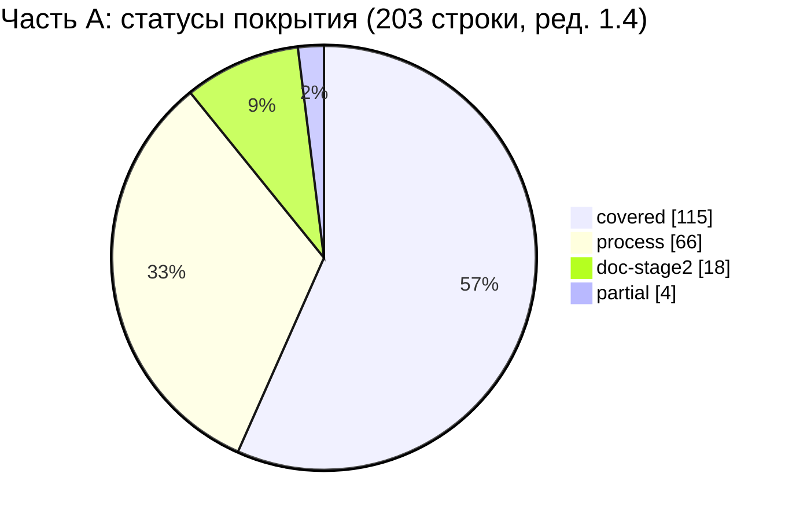

#### 4.2. Статус × тип строки реестра

| Тип (реестр) | covered | process | doc-stage2 | partial | deferred-R2 | gap | Всего |
|---|---|---|---|---|---|---|---|
| функц. | 72 | 0 | 0 | 0 | 0 | 0 | 72 |
| нефункц. | 16 | 0 | 0 | 0 | 0 | 0 | 16 |
| ограничение | 11 | 12 | 3 | 0 | 0 | 0 | 26 |
| процесс | 1 | 53 | 15 | 4 | 0 | 0 | 73 |
| документ | 15 | 1 | 0 | 0 | 0 | 0 | 16 |
| **Всего** | **115** | **66** | **18** | **4** | **0** | **0** | **203** |

Пояснения: (1) все функциональные и нефункциональные строки покрыты требованиями с критериями приёмки (SRC-A-002 — после выпуска 01, GEN-001); (2) 12 ограничений со статусом `process` — ограничения на способ работы этапа 1 (например, SRC-A-010 «не игнорировать файлы», SRC-A-051 «не копировать дизайн конкурентов», SRC-A-093 «сервер 1С ≠ доступный API»); (3) строка типа «документ» со статусом `process` — SRC-A-032 (журнал прогресса — `docs/PROGRESS_LOG.md`); (4) ред. 1.4 (пересчёт скриптом): «процесс / covered» — SRC-A-061a и «документ / covered» — SRC-A-080 (обе `partial` → `covered` в ред. 1.1); «процесс / partial» — SRC-A-009 (ред. 1.3), SRC-A-019, SRC-A-020, SRC-A-046.

#### 4.3. Статус × раздел промта

| Раздел матрицы | Строки | covered | process | doc-stage2 | partial |
|---|---|---|---|---|---|
| 3.1. Преамбула и «Главные правила работы» | SRC-A-000…032 (37) | 2 | 28 | 4 | 3 |
| 3.2. «Команда субагентов», «Правила оркестрации» | SRC-A-033…071 (98) | 66 | 18 | 13 | 1 |
| 3.3. Документы, исследование 1С, выбор backend, схема | SRC-A-072…110 (44) | 23 | 20 | 1 | 0 |
| 3.4. «Раздели данные на:» | SRC-A-111…114c (24) | 24 | 0 | 0 | 0 |
| **Всего** | **203** | **115** | **66** | **18** | **4** |

---

### 5. Строки со статусом partial и gap — предложения, куда добавить

Строк `gap` в части A нет. Пять строк `partial` (SRC-A-002 и SRC-A-073 закрыты выпуском 01: требование GEN-001 с критерием AC-GEN-001 и сам файл 01_PRODUCT_REQUIREMENTS.md):

| № | SRC-ID | Что не покрыто | Предложение (документ-адресат) |
|---|---|---|---|
| 1 | SRC-A-019 | Нет записи о поручении рутинных работ экономичным моделям | 13 §2.2: добавить столбец или абзац «класс модели» для ролей этапа 2 (рутинные тесты, документация, типовой код — экономичная модель, если платформа позволяет выбирать) |
| 2 | SRC-A-020 | Нет записи о закреплении сложных решений за самой сильной моделью | 13 §2.2: тот же абзац — архитектурные решения, интеграция с 1С, ревью безопасности (ARCH, ONEC, SEC, QA-аудит RM-H-002/H-003) — самая сильная модель |
| 3 | SRC-A-046 | Обзор интерфейсов складских систем (WMS) в R4 не проводился; 03 §3.1 помечает это `[НЕ ПОДТВЕРЖДЕНО]` и опирается на паттерны POS/B2B | 03 §3.1 (или дополнение R4): краткий обзор складских интерфейсов по официальной документации либо фиксация решения об исключении после ответа на Q-284 (§8) |
| 4 | SRC-A-061a | Критерии приёмки есть (01 — AC-GEN, 02 §10.1 — 712 AC-UI, 04 — AC-FLOW, 10 §19 — AC-префиксы), но в 12 приёмочные тесты описаны только для авторизации, SMS, сессий, биометрии и FACE-SCAN (12 §3.1); разделы 12 §3.2+ и §4 не выпущены | 12_TEST_PLAN.md §3.2+ и §4: для каждого AC — тест `T-<ПРЕФИКС>-NNN`; список оставшихся заглушек части A — §7.2 |
| 5 | SRC-A-080 | Файл 12_TEST_PLAN.md выпущен как черновик, но не завершён: есть §1–§3.1, нет разделов 3.2+ и 4–13 | Завершить 12; после выпуска сборщик 17 заменяет оставшиеся заглушка `<префикс>` (§7.2) реальными ID тестов и переводит строку в covered |

---

### 6. Строки со статусом doc-stage2 (артефакты этапа 2 в 13_IMPLEMENTATION_ROADMAP)

| SRC-ID | Суть | Где запланировано в 13 |
|---|---|---|
| SRC-A-006 | Код, запуск тестов, исправления, проверка результата | P-6 (§2.1), §6.1, RM-H-001, RM-H-006 |
| SRC-A-007 | Не останавливаться на плане, прототипе, макетах | P-6, §7 (правило заполнения), RM-H-010 |
| SRC-A-012 | Не переписывать целые файлы без необходимости | §5.2, §5.3 (expand-only), RM-B-012 |
| SRC-A-014 | Переход к реализации без зацикливания на планировании | P-1, §3, RM-B-001 (ворота G-B1) |
| SRC-A-055 | Интеграционные тесты backend | §6.1 п.5, RM-H-001; 05 ONEC-072 |
| SRC-A-060 | Проверка денежных расчётов | RM-F-009, RM-I-007; тест-векторы 10 §18.2 |
| SRC-A-060a | Проверка работы с разными складами | RM-E-011; 05 ONEC-070, ONEC-072 |
| SRC-A-060b | Проверка отмен | RM-F-009; 10 ORD-050…ORD-053 |
| SRC-A-060c | Проверка повторных операций | RM-F-009; 05 SYNC-069, ONEC-072 |
| SRC-A-060d | Проверка изменения цен | RM-I-007; 05 SYNC-070; 10 CART-013 |
| SRC-A-063 | QA проверяет код | RM-H-002 |
| SRC-A-063b | QA проверяет безопасность | RM-H-003; 11 SEC-127 |
| SRC-A-063c | QA проверяет дизайн | RM-H-005 |
| SRC-A-063d | QA проверяет миграции | RM-C-006, RM-C-012; 07 DATA-274 |
| SRC-A-063e | QA проверяет тесты | RM-H-001; 11 SEC-126 |
| SRC-A-063f | QA проверяет обработку ошибок | RM-F-007, RM-H-002 |
| SRC-A-064 | Отчёт разработчика — не доказательство | P-4, P-6, §7, RM-H-002 |
| SRC-A-091 | Подтверждение фактической структуры данных 1С | RM-A-002, RM-A-005 (зависит от Q-010, Q-040); 05 ONEC-107 |

---

### 7. Тесты 12_TEST_PLAN.md

12_TEST_PLAN.md выпущен как черновик: есть §1–§2 (стратегия; в §2.7 перечень `T-SEC-001…T-SEC-055` принят из 11 §12.2 с сохранением ID) и §3.1 (`T-AUTH-001…041`, `T-SMS-001…020`, `T-SESS-001…022`, `T-BIO-001…018`, `T-FACE-001…005`); разделов 3.2+ (остальные модули) и 4–13 нет. Строкам матрицы, чьи требования или AC указаны в столбце «Требования» тестов 12 §3.1, назначены реальные ID (§7.1); тесты `T-SEC-…` считаются тестами 12. Для остальных строк остаются заглушки `<префикс>` (§7.2), которые автор 12 заменит ID `T-<ПРЕФИКС>-NNN` (ядро §10). Префиксы `T-CAT`, `T-CART`, `T-CASH`, `T-SYNC`, `T-MNY` 12 уже объявляет в §1 п.2, `T-ONEC`/`T-SYNC` — 05 ONEC-072; сами тест-кейсы этих префиксов в выпущенной части 12 отсутствуют.

#### 7.1. Строки с реальными тестами 12

| № | Строка SRC-A | Тесты 12 §3.1 | Тесты T-SEC (11 §12.2, приняты 12 §2.7) | По каким требованиям сопоставлено (столбец «Требования» теста) |
|---|---|---|---|---|
| 1 | SRC-A-044b | T-AUTH-001, T-AUTH-037, T-AUTH-041, T-BIO-009 | T-SEC-001…T-SEC-006 | AUTH-001, AC-AUTH-001 (T-AUTH-001, T-AUTH-037); экраны SCR-01/02 (golden T-AUTH-041) и SCR-08 (T-BIO-009) |
| 2 | SRC-A-056a | T-SMS-001, T-SMS-020 | T-SEC-050 | SMS-004, AC-AUTH-025 (T-SMS-001); SMS-001, SMS-002 (T-SMS-020) |
| 3 | SRC-A-056b | T-AUTH-001, T-AUTH-023, T-AUTH-037 | — | AUTH-001, AC-AUTH-001; AUTH-003, AUTH-004, AC-AUTH-017 (T-AUTH-023) |
| 4 | SRC-A-056c | T-AUTH-003, T-AUTH-005, T-AUTH-006 | T-SEC-001…T-SEC-004 | AUTH-021, AC-AUTH-006 (T-AUTH-003, T-AUTH-006); AUTH-022, AC-AUTH-005 (T-AUTH-005) |
| 5 | SRC-A-056d | T-AUTH-009, T-AUTH-010, T-BIO-001, T-BIO-003, T-BIO-004, T-BIO-006, T-BIO-007, T-BIO-008, T-FACE-001 | T-SEC-031…T-SEC-033 | BIO-001…BIO-005, SEC-089, AC-AUTH-009, AC-AUTH-010, AC-AUTH-064, AC-AUTH-066, AC-AUTH-067, AC-AUTH-076 |
| 6 | SRC-A-056e | T-AUTH-002 | T-SEC-048 | REG-001, REG-002 (T-AUTH-002); для REG-003 (поле «ФИО») отдельного теста в выпущенной части 12 нет — ожидается в разделах 12 §3.2+ |
| 7 | SRC-A-056f | T-SESS-001, T-SESS-002, T-SESS-009, T-SESS-014 | T-SEC-009…T-SEC-012 | SESS-001, SESS-003, SESS-005, AC-AUTH-054 (T-SESS-001); SESS-002 (T-SESS-002); SEC-048 (T-SESS-009); AC-AUTH-059 (T-SESS-014) |
| 8 | SRC-A-057b | T-AUTH-005 | T-SEC-002 | AUTH-022, AC-AUTH-005 |
| 9 | SRC-A-057a | T-AUTH-006 | T-SEC-001, T-SEC-005, T-SEC-044 | AUTH-021, AC-AUTH-006 |
| 10 | SRC-A-114b | T-SESS-004 | — | DATA-108 |
| 11 | SRC-A-052e | — | T-SEC-016, T-SEC-019 | права доступа на сервере (SEC-027…SEC-029) |
| 12 | SRC-A-053d | — | T-SEC-030, T-SEC-038 | аудит (SEC-073, SEC-079, SEC-080) |
| 13 | SRC-A-054 | — | T-SEC-021 | недоверие к данным клиента (SEC-008, SEC-010) |
| 14 | SRC-A-056g | — | T-SEC-013, T-SEC-043 | роли (SEC-039, SEC-040, SEC-043) |
| 15 | SRC-A-057 | — | T-SEC-036, T-SEC-037 | секреты (SEC-049…SEC-051, SEC-058) |
| 16 | SRC-A-057c | — | T-SEC-015, T-SEC-017, T-SEC-029 | утечки клиентских данных (SEC-030…SEC-032, SEC-062, PRIV-014) |
| 17 | SRC-A-071 | — | T-SEC-037 | секреты вне агентов и репозитория (SEC-052) |
| 18 | SRC-A-108a | — | T-SEC-009, T-SEC-016 | защищённость backend (SEC-013, ARCH-006) |

Сопоставление T-SEC со строками SEC-требований выполнено по перечню 11 §12.2 (как в первой редакции матрицы); 12 §2.7 принимает этот перечень без перенумерации.

#### 7.2. Бывшие заглушки тестов (закрыто в ред. 1.1 сборки)

Ред. 1.1 сборки (2026-10-19, ядро v1.5 §20.1, §20.2 п.18–19): все 87 меток-заглушек теста этой части заменены в столбце «Тест» матрицы ID тестов 12_TEST_PLAN.md v1.1; построчное соответствие и способ подбора — §6.3 настоящего документа, тесты к добавлению в 12 — §6.4. Исходный список заглушек части с предложениями для 12 — в черновике части (`source/17_parts_drafts/`).

---

### 8. Открытые вопросы

#### 8.1. Вопросы ядра, от которых зависят строки части A

| Q | Строки SRC-A | Влияние на трассировку |
|---|---|---|
| Q-001 | SRC-A-114c | Привязка `customer_link` для режима клиента — условная (флаг `CUSTOMER_SELF_SERVICE`); ред. 1.5 сборки: Q-001 закрыт ответом заказчика, режим клиента — R1 (ядро v1.9 §24.2) |
| Q-002, Q-006 | SRC-A-010 | Расхождения макета входа и логотипа с промтом учтены как вопросы, а не проигнорированы; ред. 1.5 сборки: Q-006 закрыт — логотип оранжевый (ядро v1.9 §24.1) |
| Q-003 | SRC-A-056d | Биометрия R1 — системная + PIN; FACE-SCAN — условный модуль R2 |
| Q-010, Q-011 | SRC-A-039, SRC-A-041, SRC-A-083, SRC-A-091 | Подтверждение конфигурации 1С, инкремента и расширения — только после доступа (RM-A-002, RM-A-006); ред. 1.5 сборки: Q-011 частично закрыт — API делает специалист 1С по нашему запросу (ядро v1.9 §24.3) |
| Q-018 | SRC-A-113d | Заявка на возврат из приложения — условный элемент R1 |
| Q-029, Q-030, Q-031 | SRC-A-027, SRC-A-071, SRC-A-093 | Нет доступа к SMSPro, серверу и 1С — ограничения зафиксированы, интеграции проверяемы в fake-режимах |
| Q-036 | SRC-A-106 | Использование Firebase (FCM push) — только R2 после решения |
| Q-040 | SRC-A-042, SRC-A-091 | Тесты адаптера на реальных схемах — после получения образцов данных 1С |

#### 8.2. Новые вопросы части A (диапазон 17 — Q-280…Q-289 по ядру §19.5)

> Ред. 1.1 сборки: окончательные номера вопросов диапазона 17 — §13.2, соответствие прежних номеров и меток — §13.3 (ядро v1.5 §20.2 п.18).

Части 17A…17F выбирают номера из общего диапазона Q-280…Q-289 независимо, и номера пересекаются сразу в нескольких частях. На момент повторной проверки: **17B** — Q-280; **17C** — Q-280…Q-282; **17E** — Q-280…Q-282; **17F** — Q-287, Q-288 (17F указывает, что Q-280…Q-284 заняты частями 17A…17C); **17D** номера не назначает и передаёт это сборщику. Поэтому номера Q-283, Q-284 ниже — **предварительные**. Рекомендация сборщику 17_TRACEABILITY_MATRIX: составить таблицу перенумерации «часть → предварительный номер → окончательный номер» и передать окончательные номера вместе с текстами вопросов составителю 14_OPEN_QUESTIONS.md — в 14 (174 идентификатора, новые вопросы 14 — Q-290…Q-296) вопросы 17 ещё не включены (14 §4, строка «17_TRACEABILITY_MATRIX»; 14 §8). См. замечание 5 в §10.

| ID | Вопрос заказчику | Строки | Влияние | Допущение в ТЗ до ответа |
|---|---|---|---|---|
| Q-283 `[НОВЫЙ ВОПРОС]` (номер предварительный) | Принимает ли заказчик, что документы промта `docs/PRODUCT_REQUIREMENTS.md`, `docs/ARCHITECTURE.md`, `docs/DATA_MODEL.md`, `docs/ONEC_INTEGRATION.md`, `docs/AUTHENTICATION.md`, `docs/DESIGN_SYSTEM.md`, `docs/SECURITY.md`, `docs/TEST_PLAN.md`, `docs/DECISIONS.md` выпущены как `docs/specification/01…15_*.md` по таблице соответствия ADR-045, а не под исходными именами? | SRC-A-072…SRC-A-081 | Приёмка комплекта документов | Да, по ADR-045; при необходимости на этапе 2 в `docs/` создаются файлы-указатели с исходными именами |
| Q-284 `[НОВЫЙ ВОПРОС]` (номер предварительный) | Использует ли магазин помимо 1С складскую систему или терминалы сбора данных, интерфейс которых сотрудники знают и который нужно учесть в дизайне (обзор WMS, SRC-A-046)? | SRC-A-046 | Полнота обзора 03 §3 | Нет; складские паттерны покрываются обзором POS и B2B (03 §3.1) |

---

### 9. Трассировка на исходные требования

Настоящий документ целиком является трассировкой части A: каждая строка реестра `REQ_REGISTER_A.md` имеет ровно одну строку в матрице §3.

| Раздел промта (строки) | Диапазон SRC-ID | Строк реестра | Строк в матрице | Раздел этого документа |
|---|---|---|---|---|
| Заголовок, преамбула, раздел 1 (2–20) | SRC-A-000…SRC-A-032 (вкл. 023a/b, 024a/b) | 37 | 37 | §3.1 |
| Раздел 2: агенты 1–8 и правила оркестрации (22–66) | SRC-A-033…SRC-A-071 (вкл. суффиксы 040a–k, 044a–g, 052a–e, 053a–d, 056a–g, 057a–c, 059a–f, 060a–i, 061a, 063a–f) | 98 | 98 | §3.2 |
| Раздел 3: документы, 1С, выбор backend, схема (68–106) | SRC-A-072…SRC-A-110 (вкл. 089a, 106a, 108a–c) | 44 | 44 | §3.3 |
| Раздел 3: «Раздели данные на:» (107–111) | SRC-A-111…SRC-A-114c | 24 | 24 | §3.4 |
| **Итого** | | **203** | **203** | |

Строка 112 промта («Не считай все эти категории одинаково подходящими для свободной двусторонней синхронизации») по примечанию 1 реестра A относится к части B (SRC-B-001) и здесь не трассируется; её покрытие — 05 ONEC-027, 06 ARCH-013.

---

### 10. Замечания к ядру

1. **01 и 12 выпускаются позже остальных документов и ещё дописываются.** На момент повторной проверки 01 (GEN-/NFR-/ROLE-, обратная трассировка 01 §14) и 14 (174 идентификатора) есть в каталоге, а 12 выпущен только до §3.1. Следствия для части A: SRC-A-061a и SRC-A-080 остаются `partial`, у 87 строк — заглушки; таблица 01 §14 сопоставляет строкам части A GEN-требования, в столбце «Источник» которых нет SRC-A (GEN-002, GEN-094, GEN-106, GEN-051, GEN-055), — двусторонняя трассировка в 01 расходится. Предложение: (а) сборщик 17 повторно заменяет заглушки после выпуска 12 §3.2+; (б) автор 01 добавляет SRC-A в «Источник» тех GEN-требований, которые 01 §14 сопоставляет части A, либо убирает их из §14; (в) ссылка таблицы 05 §16.1 (строка SRC-A-096) на «D-01 (01_PRD)» теперь сопоставима с 01 GEN-008 — её стоит заменить на GEN-008.
2. **ID тестов вне 12.** Ядро §10 закрепляет `T-<ПРЕФИКС>-NNN` за 12; 11 §12.2 определяет T-SEC-001…T-SEC-055, и 12 §2.7 уже принял этот перечень с сохранением ID — расхождение по T-SEC снято на уровне 12. Ссылки 03 на T-DS-…/T-A11Y-…, 09 — на T-AUTH-001…003, 04 — на T-FLOW-036 сверяются с 12 после выпуска его остальных разделов. Предложение: зафиксировать в ядре, что T-SEC-001…055 из 11 §12.2 — канонические ID тестов 12 (как принято в 12 §2.7).
3. **Статус «process».** Ядро §10 требует, чтобы каждое требование ТЗ, вытекающее из промта, ссылалось на SRC, но для требований к порядку работы команды (SRC-A-000…035, 062…071) требования-владельца в ТЗ нет; доказательства — `PROGRESS_LOG.md`, журналы проверки документов, ядро. Предложение: в ядре признать статус `process` и перечень допустимых доказательств; политику выбора моделей для субагентов (SRC-A-019, 020) записать в 13 §2.2.
4. **Нумерация агентов.** Промт нумерует агентов 1–8 (System Architect = 1 … QA = 8; SRC-A-035…066), 13 §2.2 вводит другую нумерацию (архитектор без номера, QA — агент 7, POS-аналитик — агент 8). Предложение: в ядре таблица соответствия «агент промта → роль 13 §2.2», чтобы трассировка SRC-A-033…066 на этап 2 была однозначной.
5. **Диапазон вопросов 17.** Ядро §19.5 отдаёт документу 17 диапазон Q-280…Q-289 без разбиения между шестью трассировщиками. Фактические пересечения: 17B — Q-280; 17C — Q-280…Q-282; 17E — Q-280…Q-282; 17F — Q-287, Q-288; настоящая часть — Q-283, Q-284 (предварительно). Предложение: закрепить поддиапазоны по частям или поручить окончательную нумерацию сборщику 17 с таблицей перенумерации (часть → предварительный номер → окончательный номер), которую затем использует 14_OPEN_QUESTIONS.md.
6. **Обратная трассировка в документах.** Требования, прямо реализующие строки части A, в 02, 04, 08, 09, 10, 11, 13 трассируются только на части B…F (например, 09 SMS-/AUTH-/BIO- для SRC-A-056a…g, 10 CART-/DISC-/DEBT- для SRC-A-059a…f, 13 RM-H-* для SRC-A-062…066). Блокером это не является (место найдено по ключевым словам), но для двусторонней трассируемости рекомендуется добавить SRC-A-ID в разделы «Трассировка» этих документов.

---

### Приложение А. Журнал самопроверки

Приложение вынесено за основные разделы, чтобы последними разделами документа оставались «Открытые вопросы», «Трассировка на исходные требования» и «Замечания к ядру» (ядро §11 п.3).

| № | Проверка | Способ | Результат |
|---|---|---|---|
| 1 | Все строки реестра A присутствуют в матрице, без дублей и лишних | Скрипт: список ID из `REQ_REGISTER_A.md` (203) сравнён со списком первых ячеек строк матрицы §3 | 203 = 203, пропусков 0, лишних 0, дублей 0 |
| 2 | Каждый ID требования из столбца «ID требования(й) ТЗ» существует | Индекс первых ячеек таблиц всех `docs/specification/*.md` (включая 01, 12, 14) и `visual/*.md`, заголовков `### FLOW-NNN` и кодов `SCR-NN`, `AC-…` (7 192 ID при повторной проверке) | Несуществующих ID 0 (включая добавленные GEN-001, 003, 007, 008, 009, 171, 173, 197, 232) |
| 3 | Каждый AC в столбце «Критерий приёмки» взят из строки соответствующего требования | AC извлечены из той же строки таблицы; для `AC-UI` — индекс 02 §10.1, для `AC-FLOW` — фактический диапазон в 04; `AC-GEN-NNN` — столбец «Критерий приёмки» строк 01 | Выдуманных AC нет |
| 4 | Ссылки на разделы | Номер раздела взят из ближайшего заголовка `##`/`###` строки требования; ручные ссылки (01 §2.6–§2.7/§5.15/§5.18/§5.22/§11/§14, 04 §5/§6/§8, 05 §2/§3/§16.1, 06 §2.2/§3.2/§19, 03 §3/§20, 12 §2.1/§2.7/§2.10/§3.1, 13 §2.1…§7, 14 §4/§8/§9, 15 §9.1/прил. А, 11 прил. А) сверены с заголовками файлов | Расхождений нет |
| 5 | Сумма статусов | Подсчёт скриптом по матрице | 113 + 67 + 18 + 5 + 0 + 0 = 203; разбивка по типам и разделам (§4.2, §4.3) пересчитана тем же скриптом |
| 6 | Тесты | Каждый `T-AUTH/SMS/SESS/BIO/FACE-NNN` в столбце «Тест (12)» найден в 12 §3.1, и в его столбце «Требования» есть требование, AC или экран строки матрицы; каждый `T-SEC-NNN` найден в 11 §12.2 (перечень принят 12 §2.7) | Несуществующих тестов 0, несопоставленных 0; строк с реальными тестами — 18, с заглушками — 87, `н/п` — 98 (сумма 203) |
| 7 | Запреты этапа 1 | Документ не изменяет `lib/`, `pubspec.yaml`, `resursi/`, ядро и чужие файлы; слова «реализовано/работает» встречаются только в цитатах реестра и в формулировке запрета | Соблюдено |

### Приложение Б. Журнал проверки

Доработка 2026-10-19 по замечаниям независимой проверки (7 замечаний: 2 major, 5 minor). Правки точечные; структура матрицы и формулировки строк реестра не менялись.

| № | Замечание (суть) | Серьёзность | Что исправлено | Где |
|---|---|---|---|---|
| 1 | 01_PRODUCT_REQUIREMENTS.md объявлен отсутствующим, хотя он есть и содержит GEN-требования с источниками SRC-A; SRC-A-002 и SRC-A-073 ошибочно в `partial` | major | Повторный поиск SRC-A по 01, 12, 14. Добавлены GEN-001/AC-GEN-001 в SRC-A-000, 002, 007, 008; GEN-009 — в SRC-A-026; GEN-007, GEN-232 — в SRC-A-027; GEN-008 — в SRC-A-094…105; GEN-003 — в SRC-A-107 и SRC-A-111…114c; GEN-197 — в SRC-A-108b; GEN-171, GEN-173 — в SRC-A-112b. SRC-A-002 и SRC-A-073 переведены в `covered`; partial 7 → 5, covered 111 → 113; пересчитаны §4.1–§4.3; заглушка `GEN` связан с AC-GEN-001. Отдельно отмечено расхождение 01 §14 с источниками GEN-требований (§2.3 п.3, §10 п.1) | шапка, §1, §2 (схема), §2.2, §2.3, §3.1, §3.3, §3.4, §4, §5, §7.2, §10 п.1 |
| 2 | 12_TEST_PLAN.md объявлен невыпущенным; строкам авторизации/SMS/сессий/биометрии оставлены заглушки; заглушка `REG` не соответствует 12; T-SEC названы «кандидатами» | major | Строкам SRC-A-044b, 056a…056f, 057a, 057b, 114b назначены реальные тесты 12 §3.1 (по столбцу «Требования» тестов); заглушка `REG` заменён на T-AUTH-002; T-SEC-… помечены как тесты 12 (12 §2.7 принимает перечень 11 §12.2 с сохранением ID); для строк SEC заглушка `SEC` снята. SRC-A-080 оставлен `partial` с причиной «12 не завершён: есть §1–§3.1, нет разделов 3.2+ и 4–13»; SRC-A-061a — `partial` с актуальной причиной; SRC-A-026/027/055 дополнены ссылками на 12 §2.1 (P-2, P-4) и §2.10 (C-11). §7 разделён на §7.1 (реальные тесты) и §7.2 (оставшиеся заглушки: 87 строк вместо 105) | §1, §2.2, §3.2, §3.3, §3.4, §5, §7, прил. А п.6 |
| 3 | 14_OPEN_QUESTIONS.md назван отсутствующим / «в работе»; Q-283, Q-284 в него не внесены | minor | Указано, что 14 выпущен (174 идентификатора, новые вопросы — Q-290…); SRC-A-029 ссылается на 14 как на единый перечень вопросов; в §8.2 — передача Q-283, Q-284 сборщику 17 и составителю 14 | шапка, §2.3, §3.1, §8.2 |
| 4 | Пересечения номеров Q-280…Q-289 описаны неполно; Q-283, Q-284 без метки «[НОВЫЙ ВОПРОС]» | minor | Перечислены фактические пересечения на момент повторной проверки (17B — Q-280; 17C — Q-280…Q-282; 17E — Q-280…Q-282; 17F — Q-287, Q-288, ранее Q-280…Q-282); рекомендована таблица перенумерации у сборщика 17; Q-283, Q-284 помечены `[НОВЫЙ ВОПРОС]` и «номер предварительный» | §8.2, §10 п.5 |
| 5 | Ссылки на сценарии вели на «04 §2 Оглавление сценариев» | minor | Правило §2.2 изменено: указывается раздел с заголовком `### FLOW-NNN`; SRC-A-045 → 04 §8 (FLOW-032), SRC-A-060g → 04 §6 (FLOW-026), SRC-A-060i → 04 §5 (FLOW-014) | §2.2, §3.2 |
| 6 | Формулировка статуса SRC-A-108b нарушала запрет ядра §11 п.5 на слова «реализовано/работает» | minor | Заменено на «слой спроектирован как модуль onec-adapter внутри pos-api / pos-worker (не отдельный сервис) — D-45» | §3.3 (SRC-A-108b; в замечании указан §3.4) |
| 7 | После «Замечаний к ядру» стоял раздел §11 «Журнал самопроверки» | minor | Журнал самопроверки перенесён в приложение А; журнал проверки — приложение Б; последними основными разделами остаются §8 «Открытые вопросы», §9 «Трассировка на исходные требования», §10 «Замечания к ядру» | приложения А, Б |

Проверка целостности после доработки: файл сохранён в UTF-8, все 203 строки матрицы имеют 8 столбцов, суммы статусов и тестов сходятся (приложение А п.1, 5, 6); 01 и 12 на момент проверки ещё дописываются их авторами, поэтому сборщику 17 рекомендуется повторить поиск SRC-A по 01 и 12 перед сборкой.

---

## 8. Часть B — Матрица трассируемости — часть B реестра исходных требований (синхронизация, дизайн, splash, персонаж, вход по лицу, вход по телефону, SMSPro, регистрация)

> Источник: часть B — раздел §8 настоящего документа (черновик части — `source/17_parts_drafts/`, ядро §20.1) · Версия 1.1 · Дата 2026-10-19 · Статус: черновик для утверждения заказчиком (доработан по замечаниям проверки — раздел 10) · Шапка части («Входные материалы», «Связанные документы», роль автора) опущена — см. шапку настоящего документа. Ссылки вида «§N» внутри этого раздела указывают на разделы **части B** (заголовки части сохранены с исходной нумерацией и понижены на один уровень; в сводных разделах настоящего документа на них ссылаются как «17B §N»); номера вопросов Q-28x в тексте части — предварительные, окончательные — §13.2. **Ред. 1.1 сборки (ядро v1.5 §20):** в столбце «Тест» строк этой части метки-заглушки заменены ID тестов 12 (§6), статусы строк §5.4 пересмотрены, номера вопросов — по §13.2–§13.3; упоминания заглушек и их числа в повествовательном тексте и журналах части ниже — история ред. части, действующие значения — §2, §6, §13.

### 1. Краткое содержание

- Протрассированы **все 170 строк** реестра части B (149 исходных ID + 21 подстрока `a…f`), без пропусков; полнота проверена сверкой со списком ID реестра (раздел 8).
- Для каждой строки указаны документ и раздел ТЗ, ID требований ТЗ, критерии приёмки `AC-…`, тест и статус покрытия. Все ссылки найдены поиском (Grep) по SRC-ID в файлах `docs/specification/*.md` и `visual/*.md` и по ID требований; разделы сверены с заголовками документов `[ПОДТВЕРЖДЕНО: Grep по ТЗ, 2026-10-19]`.
- Итог по статусам: **covered — 150**, **partial — 3** (SRC-B-068, SRC-B-121, SRC-B-147), **process — 16**, **doc-stage2 — 1** (SRC-B-114), **deferred-R2 — 0**, **gap — 0**.
- Частичные покрытия: (1) SRC-B-068 — для `staff` «сразу на рабочий экран» выполняется через одношаговую разблокировку SCR-08 (осознанное отступление по D-48, ядро §19.4; зафиксировано в 01 GEN-024 / AC-GEN-024 и в строке SRC-B-068 настоящего документа); (2) SRC-B-121 — 13 RM-A-004 запрашивает учётные данные SMSPro на этапе A, раньше адаптера RM-D-002, что расходится с порядком промта и 09 §6.12; (3) SRC-B-147 — по умолчанию OTP подтверждает номер **до** формы регистрации (D-10), буквальный порядок «форма → OTP» доступен только флагом `REGISTRATION_SECOND_OTP` (Q-162).
- Файлы **01_PRODUCT_REQUIREMENTS.md и 12_TEST_PLAN.md выпускаются параллельно** с частями 17 и в `docs/specification/` есть `[ПОДТВЕРЖДЕНО: листинг каталога и Grep, 2026-10-19 05:07]`. В 01 отступление SRC-B-068 зафиксировано требованием GEN-024 с критерием AC-GEN-024 (01 §5.1, также §1). В 12 на момент проверки описан модуль §3.1 (тесты T-AUTH-001…041, T-SMS-001…020, T-SESS-001…022, T-BIO-001…018, T-FACE-001…005); разделов T-SYNC, T-ONEC, T-REG, T-UI, T-DS, T-CUST в 12 пока нет.
- Столбец «Тест»: ⁴ — тест описан в 12 §3.1 (50 строк); ¹ — `T-SEC-NNN` из 11 §12.2; ² — `T-DS-…`, `T-ANIM-…`, `T-A11Y-…` из 03 §17.9; ³ — `T-AUTH-001…010` из 09 §16.4 (те же ID описаны в 12 §3.1.1). заглушка `<префикс>` остался в **69 строках** (было 105): SYNC — 30, REG — 22, ONEC — 10, UI — 4, DS — 4, CUST — 1; префиксы AUTH, SESS, BIO, FACE, SMS закрыты тестами 12. Полный список — в разделе 6.
- Новых вопросов нет. Подтверждение заказчиком отступления SRC-B-068 уже вынесено документом 01 как Q-273; номер Q-280 из версии 1.0 отозван (номер занят в других частях 17, коллизия описана в разделе 7.1 и в замечании 6 раздела 9) — раздел 7.

---

### 2. Методика и обозначения

#### 2.1. Порядок трассировки

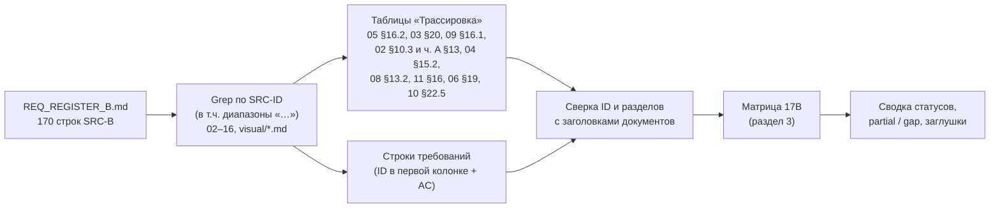

1. Список ID взят из основной таблицы реестра B (строки с `| SRC-B-… |`; журнал проверки реестра не учитывается).
2. По каждому ID выполнен поиск прямых упоминаний (`SRC-B-NNN` без продолжения цифрой/буквой, чтобы `SRC-B-032` не совпадал с `SRC-B-032a`) и упоминаний в диапазонах вида `SRC-B-090…097`. Прямые упоминания в строках требований и в таблицах трассировки документов — основной источник; диапазоны — только вспомогательный.
3. ID требований и критериев приёмки взяты из строк, где они определены (первая колонка таблицы требований; критерий `AC-<ID>` — в той же строке). Номера разделов взяты из заголовков документов (`#`…`####`).
4. Для 02 указывается экран (`SCR-NN`) и пункт его 14-пунктовой структуры («п. N»), либо общий раздел 02 (§3, §6, §7, ч. A §0).

#### 2.2. Статусы покрытия

| Статус | Значение |
|---|---|
| `covered` | Требование полностью отражено проверяемыми требованиями ТЗ с критериями приёмки |
| `partial` | Отражено не полностью или с отступлением от буквального текста промта; предложение — в разделе 5 |
| `process` | Требование к процессу работы (исследовать, изучить, проверить) — выполнено методикой этапа 1; в столбце статуса указано, чем (исследование R*, раздел ТЗ) |
| `deferred-R2` | Перенесено в R2 с Q-ссылкой (в части B таких строк нет: условный модуль FACE-SCAN не делает строки B «отложенными», т.к. обязательная альтернатива R1 специфицирована) |
| `doc-stage2` | Артефакт этапа 2, указанный в 13_IMPLEMENTATION_ROADMAP.md |
| `gap` | Покрытия в ТЗ нет (в части B не выявлено) |

#### 2.3. Обозначения тестов

| Обозначение | Смысл |
|---|---|
| заглушка `<ПРЕФИКС>` | Тест не описан; добавить в 12_TEST_PLAN.md (раздел 6) |
| `T-…-NNN`⁴ | Тест описан в 12_TEST_PLAN.md §3.1 (T-AUTH-011…041, T-SMS, T-SESS, T-BIO, T-FACE); выбран по совпадению ID требований и `AC-…` в столбце «Требования» теста 12 и в строке матрицы |
| `T-SEC-NNN`¹ | ID зарезервирован в 11_SECURITY_PRIVACY.md §12.2 «Перечень тестов T-SEC»; в 12 перенести без перенумерации |
| `T-DS-…`² / `T-ANIM-…`² / `T-A11Y-…`² | Диапазоны зарезервированы в 03_UX_UI_DESIGN_SYSTEM.md §17.9 «Тесты дизайн-системы (для 12_TEST_PLAN)», в т. ч. `T-ANIM-001…030` (длительности и кривые `DsMotion`, reduce-motion) и `T-DS-085…096` (дополнения ядра v1.4) |
| `T-AUTH-NNN`³ | ID назначены в 09_AUTH_SMS_BIOMETRICS.md §16.4 (сценарии промта строк 451–460); те же ID описаны в 12 §3.1.1 |
| `н/п` | Не применимо: строка типа «процесс», проверяется ревью артефактов этапа 1 |

#### 2.4. Сокращения в столбце «Тип»

`функц.` — функциональное, `нефункц.` — нефункциональное, `огр.` — ограничение, `процесс`, `документ` — как в реестре.

---

### 3. Матрица трассируемости SRC-B

#### 3.1. Синхронизация с 1С и синхронизируемые сущности (SRC-B-001…SRC-B-037)

Все имена объектов 1С в 05 имеют метку `[ТИПОВО]` до ответа Q-010 и выгрузки `$metadata` (13 RM-A-002); это не снижает статус покрытия требования к ТЗ, но подтверждение на конкретной базе — работа этапа 2.

| SRC-ID | Краткая формулировка | Тип | Документ и раздел ТЗ | ID требований ТЗ | Критерий приёмки | Тест | Статус покрытия |
|---|---|---|---|---|---|---|---|
| SRC-B-001 | Для каждой категории данных (мастер-данные 1С, операционные POS, документы/финансы, авторизация) определить свой режим синхронизации; свободная двусторонняя синхронизация не является умолчанием | огр. | 05 §4.2, §8.1; 06 §5, §17.1; 07 §3 | ONEC-026, ONEC-027, SYNC-051; ARCH-009…ARCH-013; DATA-027 | AC-ONEC-026, AC-ONEC-027, AC-SYNC-051, AC-ARCH-013, AC-DATA-027 | T-ONEC-028, T-ARCH-005, T-SYNC-040, T-DATA-002 | covered |
| SRC-B-002 | Проверить, достаточен ли интервал 30 минут для каждой категории данных, и обосновать | процесс | 05 §7.3, §11; 15 ADR-029 | SYNC-022, SYNC-060; ADR-029 | AC-SYNC-022, AC-SYNC-060, AC-ADR-029 | н/п | process: анализ выполнен в исследованиях R1 §8 и R5 §6, итог — таблица соответствия интервалов по сущностям (05 §7.3) и оценка нагрузки (05 §11) `[РЕШЕНИЕ: D-29]` `[ТРЕБУЕТ РЕШЕНИЯ ЗАКАЗЧИКА: Q-020]` |
| SRC-B-003 | Предложить гибридную (многоуровневую) стратегию синхронизации с 1С | документ | 05 §4, §7, §9; 15 ADR-029 | SYNC-022, SYNC-052; ADR-029 | AC-SYNC-022, AC-SYNC-052 | T-SYNC-020, T-SYNC-041 | covered |
| SRC-B-004 | Стратегия включает первоначальную полную загрузку данных из 1С и их сверку | функц. | 05 §7.1; 15 ADR-048 | SYNC-001, SYNC-003, SYNC-009 | AC-SYNC-001, AC-SYNC-003, AC-SYNC-009 | T-SYNC-001, T-SYNC-003, T-SYNC-007, T-SYNC-008 | covered |
| SRC-B-005 | Инкрементальный обмен по метке времени изменения или журналу изменений 1С, если 1С это поддерживает | функц. | 05 §4.2, §6.6, §7.2, §10.1; 06 §5.1, §17.1; 15 ADR-028, ADR-048 | SYNC-011, SYNC-012, ONEC-034, ONEC-061, ONEC-074; ARCH-035, ARCH-037 | AC-SYNC-011, AC-SYNC-012, AC-ONEC-034, AC-ONEC-061, AC-ONEC-074 | T-SYNC-002, T-SYNC-031, T-ARCH-009, T-ONEC-004, T-SYNC-058 | covered `[ТИПОВО: план обмена «POS» в расширении — Q-010]`; расширение с планом обмена реализует специалист 1С заказчика по нашему запросу — основной путь (05 ONEC-074, ядро v1.9 §24.3; Q-011 частично закрыт) |
| SRC-B-006 | Периодическая фоновая синхронизация с ориентировочным интервалом 30 минут | функц. | 05 §7.3; 02 SCR-46 (интервалы `sync_interval.<entity>`); 15 ADR-029; 04 FLOW-037 (ред. 1.3) | SYNC-021, SYNC-022, FLOW-037 | AC-SYNC-021, AC-SYNC-022, AC-FLOW-037-01…AC-FLOW-037-06 | T-SYNC-020, T-UI-046, T-ADMIN-003, T-PERF-011, T-FLOW-037 | covered `[РЕШЕНИЕ: D-29]` |
| SRC-B-007 | Возможность более частого обновления критичных данных (остатки, цены и т.п.) при потребности бизнеса и технической возможности 1С (условие — триггер, само требование обязательно) | функц. | 05 §6.6, §7.3, §7.5, §9, §11; 04 FLOW-037 (ред. 1.3) | SYNC-021, SYNC-022, SYNC-030, SYNC-052, SYNC-056, SYNC-060, SYNC-071, ONEC-050, FLOW-037 | AC-SYNC-021, AC-SYNC-052, AC-SYNC-056, AC-SYNC-071, AC-ONEC-050, AC-FLOW-037-01…AC-FLOW-037-06 | T-SYNC-020, T-SYNC-041, T-SYNC-030, T-SYNC-046, T-FLOW-037 | covered `[РЕШЕНИЕ: D-29]` |
| SRC-B-008 | Ручной запуск синхронизации пользователем с отображением её статуса | функц. | 05 §7.1, §7.4; 02 SCR-43; visual/screen-map.md §2.6 | SYNC-010, SYNC-025, SYNC-026; UI-43-004, UI-43-005 | AC-SYNC-025, AC-SYNC-026, AC-UI-43-003, AC-UI-43-005, AC-UI-43-007 | T-UI-043, T-SYNC-024, T-SYNC-001, T-SYNC-012 | covered |
| SRC-B-009 | Автоматические повторные попытки (retry) при временных ошибках обмена | функц. | 05 §6.6, §7.5, §8.1, §10.1; 02 SCR-43 | SYNC-029, SYNC-044, ONEC-035, ONEC-055, ONEC-063 | AC-SYNC-029, AC-SYNC-044, AC-ONEC-035, AC-ONEC-055, AC-UI-43-011 | T-SYNC-001, T-SYNC-002, T-SYNC-006, T-SYNC-024 | covered |
| SRC-B-010 | Операции синхронизации должны быть идемпотентными (повтор не создаёт побочных эффектов) | нефункц. | 05 §6.6, §7.1, §7.5, §8.1, §9, §10.1; 02 SCR-43; 15 ADR-028 | SYNC-002, SYNC-031, SYNC-042, SYNC-043, SYNC-048, SYNC-066, SYNC-069, ONEC-035, ONEC-037, ONEC-061, ONEC-063 | AC-SYNC-031, AC-SYNC-043, AC-SYNC-069, AC-ONEC-037, AC-UI-43-005, AC-UI-43-006 | T-SYNC-004, T-SYNC-001, T-SYNC-032, T-SYNC-033 | covered |
| SRC-B-011 | Контроль версий синхронизируемых объектов | нефункц. | 05 §7.2, §7.5 | SYNC-012, SYNC-013, SYNC-032, SYNC-068 | AC-SYNC-012, AC-SYNC-013, AC-SYNC-032, AC-SYNC-068 | T-SYNC-002, T-SYNC-005, T-SYNC-007 | covered |
| SRC-B-012 | Обнаружение конфликтов при синхронизации (разнонаправленные изменения) | функц. | 05 §7.5 (SYNC-033 — основная ссылка), §13 (F6, F9); 02 SCR-43 (UI-43-007 «Ошибки» — записи `sync_errors`, в т. ч. `BARCODE_CONFLICT`); 02 SCR-45 (смежное: конфликты привязки клиента, SYNC-033 п. «г») | SYNC-033 | AC-SYNC-033, AC-UI-45-013 | T-SYNC-024, T-SYNC-001, T-SYNC-005, T-SYNC-F06 | covered |
| SRC-B-013 | Мониторинг времени последней успешной синхронизации | функц. | 05 §6.6, §7.4, §7.6, §10.1; 02 SCR-43; visual/screen-map.md §2.6 | SYNC-026, SYNC-037, ONEC-051, ONEC-064; UI-43-001 | AC-SYNC-037, AC-ONEC-051, AC-ONEC-064, AC-UI-43-001, AC-UI-43-008 | T-SYNC-024, T-SYNC-001, T-SYNC-003, T-SYNC-008 | covered |
| SRC-B-014 | Мониторинг количества ошибок синхронизации | функц. | 05 §7.6; 02 SCR-43 | SYNC-037, SYNC-038; UI-43-001 | AC-SYNC-037, AC-SYNC-038, AC-UI-43-001, AC-UI-43-008 | T-SYNC-024, T-SYNC-001, T-SYNC-003, T-SYNC-006 | covered |
| SRC-B-015 | Учитывать, что фоновые периодические задачи на мобильном устройстве не гарантируют выполнение по расписанию | огр. | 05 §7 (вводная), §7.3 | SYNC-023, SYNC-024 | AC-SYNC-023, AC-SYNC-024 | T-SYNC-021, T-SYNC-022 | covered |
| SRC-B-016 | Планировщик синхронизации размещается на сервере или ином постоянно работающем компоненте, а не в мобильном приложении | огр. | 05 §7.3; 15 ADR-003, ADR-029 | SYNC-023, SYNC-024; ADR-029 | AC-SYNC-023, AC-SYNC-024, AC-ADR-029 | T-SYNC-021, T-SYNC-022 | covered `[РЕШЕНИЕ: D-29, D-44]` |
| SRC-B-017 | Исследовать (не предполагать) возможность получения из 1С каждой перечисленной ниже сущности | процесс | 05 §5.1, §5.1a, §5.2, §6.6 | ONEC-001, ONEC-017, ONEC-018, ONEC-057, ONEC-106 | AC-ONEC-001, AC-ONEC-106 | н/п | process: исследование R1 (§5, §6, §9); итог — карта сущностей 05 §5 с метками `[ТИПОВО]`; подтверждение на базе заказчика — 13 RM-A-002 `[ТРЕБУЕТ РЕШЕНИЯ ЗАКАЗЧИКА: Q-010]` |
| SRC-B-018 | Синхронизация товаров и артикулов из 1С | функц. | 05 §5.1a, §7.2 | ONEC-001, ONEC-002, ONEC-017, SYNC-020 | AC-ONEC-001, AC-ONEC-002, AC-SYNC-020 | T-ONEC-019, T-SYNC-005, T-SYNC-019, T-SYNC-F09 | covered `[ТИПОВО: Q-010]` |
| SRC-B-019 | Синхронизация категорий и подкатегорий | функц. | 05 §5.1a | ONEC-003 | AC-ONEC-003 | T-ONEC-019 | covered `[ТИПОВО: Q-010]` |
| SRC-B-020 | Синхронизация описаний и характеристик товаров | функц. | 05 §5.1a | ONEC-004 | AC-ONEC-004 | T-ONEC-019 | covered `[ТИПОВО: Q-010]` |
| SRC-B-021 | Синхронизация цветов, размеров, моделей и вариантов товаров | функц. | 05 §5.1a, §5.2 | ONEC-005, ONEC-073 | AC-ONEC-005, AC-ONEC-073 | T-ONEC-019 | covered `[ТИПОВО: Q-021]` |
| SRC-B-022 | Синхронизация изображений товаров и/или ссылок на изображения | функц. | 05 §5.1a, §6.6, §7.5; 15 ADR-030 | ONEC-006, ONEC-049, SYNC-035, SYNC-036 | AC-ONEC-006, AC-ONEC-049, AC-SYNC-035, AC-SYNC-036 | T-SYNC-043, T-SYNC-044, T-SYNC-F11, T-ONEC-012 | covered `[РЕШЕНИЕ: D-30]` `[ТРЕБУЕТ РЕШЕНИЯ ЗАКАЗЧИКА: Q-022]` |
| SRC-B-023 | Синхронизация цен и правил ценообразования | функц. | 05 §5.1a, §7.2, §10.1 | ONEC-007, ONEC-008, ONEC-022, ONEC-062, SYNC-015 | AC-ONEC-007, AC-ONEC-008, AC-ONEC-022, AC-SYNC-015 | T-SYNC-014, T-ONEC-019, T-ONEC-018 | covered |
| SRC-B-024 | Синхронизация остатков в разрезе каждого склада | функц. | 05 §5.1a, §5.2, §7.2, §10.1 | ONEC-009, ONEC-019, ONEC-062, ONEC-070, SYNC-014 | AC-ONEC-009, AC-ONEC-019, AC-ONEC-070, AC-SYNC-014 | T-SYNC-013, T-ONEC-019, T-ONEC-018 | covered |
| SRC-B-025 | Синхронизация резервов и доступного (свободного) количества | функц. | 05 §5.1a, §6.6, §7.2, §9; 15 ADR-022 | ONEC-010, ONEC-050, SYNC-014, SYNC-052, SYNC-053, SYNC-071 | AC-ONEC-010, AC-ONEC-050, AC-SYNC-052, AC-SYNC-053 | T-SYNC-041, T-SYNC-013, T-ONEC-013, T-ONEC-019 | covered `[РЕШЕНИЕ: D-22]` |
| SRC-B-026 | Синхронизация клиентской базы | функц. | 05 §5.1a, §7.2 | ONEC-011, ONEC-012, SYNC-019 | AC-ONEC-011, AC-ONEC-012, AC-SYNC-019 | T-SYNC-005, T-SYNC-018, T-SYNC-F10, T-ONEC-009 | covered |
| SRC-B-027 | Синхронизация истории продаж и покупок | функц. | 05 §5.1a, §7.1, §7.2 | ONEC-013, SYNC-008, SYNC-018 | AC-ONEC-013, AC-SYNC-008, AC-SYNC-018 | T-SYNC-011, T-SYNC-017, T-CASH-003, T-ONEC-019 | covered |
| SRC-B-028 | Синхронизация скидок и условий оптовых продаж | функц. | 05 §5.1a, §6.6 | ONEC-008, ONEC-039 | AC-ONEC-008, AC-ONEC-039 | T-ONEC-005, T-ONEC-019 | covered `[ТРЕБУЕТ РЕШЕНИЯ ЗАКАЗЧИКА: Q-015]` |
| SRC-B-029 | Синхронизация задолженностей и взаиморасчётов | функц. | 05 §5.1a, §6.6, §7.2, §10.1; 15 ADR-024 | ONEC-014, ONEC-047, ONEC-062, SYNC-016, SYNC-073 | AC-ONEC-014, AC-ONEC-047, AC-SYNC-016, AC-SYNC-073 | T-SYNC-015, T-SYNC-050, T-ONEC-010, T-DEBT-012 | covered `[РЕШЕНИЕ: D-24]` |
| SRC-B-030 | Синхронизация возвратов и платёжных документов | функц. | 05 §5.1a, §6.6, §7.2, §8.1; 15 ADR-025 | ONEC-015, ONEC-016, ONEC-020, ONEC-043, ONEC-048, ONEC-067, SYNC-018, SYNC-050 | AC-ONEC-015, AC-ONEC-016, AC-ONEC-043, AC-SYNC-050 | T-SYNC-017, T-SYNC-039, T-SYNC-F07, T-ONEC-011 | covered `[ТРЕБУЕТ РЕШЕНИЯ ЗАКАЗЧИКА: Q-012, Q-018]` |
| SRC-B-031 | Доступность полей 1С не декларируется без подтверждения в конкретной конфигурации 1С заказчика | огр. | 05 §5.2, §9; 15 ADR-047 | ONEC-106, SYNC-072; ADR-047 | AC-ONEC-106, AC-SYNC-072, AC-ADR-047 | T-ONEC-019, T-CAT-008, T-SYNC-045 | covered |
| SRC-B-032 | Для каждого синхронизируемого поля зафиксировать исходный объект 1С (словарь данных) | документ | 05 §5.2, §5.3 (словарь полей) | ONEC-100 | AC-ONEC-100 | T-ONEC-019 | covered `[ТИПОВО: имена 1С — RM-A-002, Q-010]` |
| SRC-B-032a | Для каждого синхронизируемого поля зафиксировать идентификатор (словарь данных) | документ | 05 §5.2, §5.3 | ONEC-100, ONEC-101 | AC-ONEC-100, AC-ONEC-101 | T-ONEC-019 | covered |
| SRC-B-032b | Для каждого синхронизируемого поля зафиксировать тип данных (словарь данных) | документ | 05 §5.2, §5.3 | ONEC-103 | AC-ONEC-103 | T-ONEC-019 | covered |
| SRC-B-032c | Для каждого синхронизируемого поля определить правила обновления (кто источник истины, когда и как поле перезаписывается) | функц. | 05 §5.2, §5.3 | ONEC-104 | AC-ONEC-104 | T-ONEC-019 | covered |
| SRC-B-032d | Для каждого синхронизируемого поля определить обработку удаления объекта в 1С (как удаление отражается в POS) | функц. | 05 §5.2, §5.3, §7.1, §7.5 | ONEC-102, SYNC-006, SYNC-034 | AC-ONEC-102, AC-SYNC-006, AC-SYNC-034 | T-SYNC-010, T-SYNC-003, T-SYNC-F03, T-ONEC-019 | covered |
| SRC-B-032e | Для каждого синхронизируемого поля определить способ восстановления после сбоя синхронизации (досинхронизация после обрыва/ошибки) | функц. | 05 §5.1 (столбец), §7.1, §13; 06 §5.1, §7.6, §17.1 | SYNC-002, SYNC-063; ARCH-037, ARCH-039 | AC-SYNC-002, AC-SYNC-063, AC-ARCH-037, AC-ARCH-039 | T-SYNC-001, T-SYNC-031, T-SYNC-048, T-SYNC-F03 | covered |
| SRC-B-033 | Фотографии не перекачиваются при каждой периодической синхронизации без необходимости | огр. | 05 §7.3, §7.5 | SYNC-035 | AC-SYNC-035 | T-SYNC-043, T-SYNC-F11, T-FAIL-016 | covered `[РЕШЕНИЕ: D-29, D-30]` |
| SRC-B-034 | Для фотографий использовать идентификаторы, контрольные суммы или версионирование файлов для определения изменений (условие «если это возможно» — триггер, само требование обязательно) | функц. | 05 §5.1a, §6.6, §7.5; 15 ADR-030 | ONEC-006, ONEC-049, SYNC-035 | AC-ONEC-049, AC-SYNC-035, AC-ADR-030 | T-SYNC-043, T-SYNC-F11, T-ONEC-012, T-FAIL-016 | covered |
| SRC-B-035 | При первоначальной загрузке сверять количество объектов в 1С и в POS | функц. | 05 §7.1, §7.2, §12 | SYNC-003, SYNC-007, SYNC-068, ONEC-092 | AC-SYNC-003, AC-SYNC-007, AC-SYNC-068, AC-ONEC-092 | T-SYNC-007, T-SYNC-003, T-SYNC-F04, T-ONEC-023 | covered |
| SRC-B-036 | При первоначальной загрузке контролировать дубликаты объектов | функц. | 05 §7.1 | SYNC-004 | AC-SYNC-004 | T-SYNC-009 | covered |
| SRC-B-037 | Повторная синхронизация не создаёт дубликатов товаров и клиентов | огр. | 05 §7.1; 10 §15.3 | SYNC-002, SYNC-004, SYNC-005; CUST-012 | AC-SYNC-005, AC-CUST-012 | T-SYNC-004, T-SYNC-001, T-SYNC-009, T-SYNC-F03 | covered |

#### 3.2. Дизайн и визуальная система (SRC-B-038…SRC-B-059)

| SRC-ID | Краткая формулировка | Тип | Документ и раздел ТЗ | ID требований ТЗ | Критерий приёмки | Тест | Статус покрытия |
|---|---|---|---|---|---|---|---|
| SRC-B-038 | Интерфейс: современный, премиально аккуратный, удобный для продавца, пригодный для длительной ежедневной работы | нефункц. | 03 §4.1, §5.6, §15 | DS-005, DS-027, DS-045, A11Y-003 | AC-DS-005, AC-DS-027, AC-DS-045, AC-A11Y-003 | T-A11Y-001…022², T-DS-005, T-DS-025, T-DS-041 | covered |
| SRC-B-039 | Палитра не выбирается произвольно — только после исследования (п. 147–150) | процесс | 03 §2, §5 | DS-001, DS-004 | AC-DS-001, AC-DS-004 | н/п | process: исследование материалов и палитр (R4 §3; 03 §2) выполнено до выбора палитры (03 §5.7) `[РЕШЕНИЕ: D-16]` |
| SRC-B-040 | Изучить приложенные заказчиком логотипы, изображения и ручные чертежи до проектирования дизайна | процесс | 03 §2.1–§2.4 | DS-008 | AC-DS-008 | н/п | process: материалы изучены (R4 §1; 03 §2; ядро §14); ручных чертежей нет (ядро §0, §14) `[ПОДТВЕРЖДЕНО: ядро §14]` (ред. 1.2, волна 4: использование ручных чертежей как исходного материала компоновки — строка SRC-C-014, `partial`, вопрос Q-302) |
| SRC-B-041 | Исследовать актуальные профессиональные POS-интерфейсы и B2B-каталоги как референсы | процесс | 03 §3.1–§3.4 | — (раздел 3 без ID требований) | — | н/п | process: обзор паттернов POS и B2B (R4 §2; 03 §3) |
| SRC-B-042 | Провести анализ читаемости, контраста, плотности информации и числа действий для типовых задач продавца | процесс | 03 §4.1–§4.4, §18.5, §18.8 | DS-045, DS-071…DS-074 | AC-DS-045, AC-DS-071…AC-DS-074 | T-DS-071² | process: анализ — 03 §4; проверяемые нормы числа действий — DS-071…DS-074 |
| SRC-B-043 | Подготовить два обоснованных варианта палитры и провести их сравнение | документ | 03 §5.2–§5.6; 15 ADR-016; visual/palette-comparison.html | DS-003, DS-004; ADR-016 | AC-DS-003, AC-DS-004, AC-ADR-016 | T-DS-001, T-DS-004, T-DS-005, T-DS-011, T-DS-012² | covered — варианты A и B подготовлены и сравнены; выбор заказчика 2026-10-21 — вариант B «Оранжевый» `[РЕШЕНИЕ: ядро v1.9 §24.1; Q-006 закрыт]` (03 §5.3, DS-003, DS-004) |
| SRC-B-044 | Выбрать лучший вариант палитры и зафиксировать его в файле docs/DESIGN_SYSTEM.md | документ | 03 §5.3, §5.7, §18.12; 15 ADR-016, ADR-045 | DS-001; DS-098; ADR-045 | AC-DS-001, AC-DS-098, AC-ADR-045 | T-DS-001, T-DS-004, T-DS-005, T-DS-011, T-DS-012² | covered: роль `docs/DESIGN_SYSTEM.md` выполняет 03_UX_UI_DESIGN_SYSTEM.md (ADR-045; SRC-E-199); выбран и зафиксирован вариант B «Оранжевый» (03 §5.3, DS-001, DS-098) `[РЕШЕНИЕ: D-16, пересмотрено ядро v1.9 §24.1 по выбору заказчика]` |
| SRC-B-045 | Определить цветовые токены: фон, поверхности, основной текст, вторичный текст, интерактивные элементы, успех, предупреждение, ошибка | документ | 03 §5.2; 15 ADR-016, ADR-043 | DS-001, DS-005 | AC-DS-001, AC-DS-005 | T-DS-001, T-DS-004, T-DS-005, T-DS-011, T-DS-012² | covered |
| SRC-B-046 | Проверить контраст и читаемость мелких подписей в выбранной палитре | нефункц. | 03 §4.1, §4.2, §5.4, §15 | DS-007, DS-008, DS-012, A11Y-001, A11Y-008 | AC-DS-007, AC-DS-008, AC-DS-012, AC-A11Y-001, AC-A11Y-008 | T-DS-001, T-DS-004, T-DS-005, T-DS-011, T-DS-012², T-A11Y-001…022² | covered |
| SRC-B-046a | Интерфейс (дизайн-система) обязан включать все элементы перечня строк 154–163, а не их часть | нефункц. | 03 §6–§11; 15 ADR-051 | DS-013, DS-025, DS-026, DS-029, DS-041, DS-050…DS-054, DS-061 | AC-DS-013, AC-DS-025, AC-DS-026, AC-DS-029, AC-DS-041, AC-DS-050, AC-DS-061 | T-DS-050, T-DS-053, T-DS-055, T-DS-059, T-DS-061, T-DS-064, T-DS-066² | covered |
| SRC-B-047 | Согласованная типографика во всём интерфейсе | нефункц. | 03 §6; 15 ADR-017, ADR-049 | DS-013…DS-019 | AC-DS-013, AC-DS-019 | T-DS-013, T-DS-015, T-DS-017² | covered `[РЕШЕНИЕ: D-17]` |
| SRC-B-048 | Единая система отступов и размеров | нефункц. | 03 §7.1, §7.4 | DS-025, DS-027, DS-028 | AC-DS-025, AC-DS-027, AC-DS-028 | T-DS-025, T-DS-028 | covered |
| SRC-B-049 | Сетка карточек и компонентов | нефункц. | 03 §7.2–§7.3 | DS-026 | AC-DS-026 | T-DS-025² | covered |
| SRC-B-050 | Понятные (однозначно читаемые) иконки | нефункц. | 03 §7.7, §15 | DS-029, DS-090, A11Y-004, A11Y-007, A11Y-019 | AC-DS-029, AC-DS-090, AC-A11Y-004, AC-A11Y-007, AC-A11Y-019 | T-DS-085² (DS-090), T-DS-025, T-NFR-036, T-NFR-037, T-UI-101, T-A11Y-001…022² | covered |
| SRC-B-051 | Скелетоны (skeleton) загрузки для состояний ожидания данных | функц. | 03 §9.42, §18.6; 02 §3.3, §6 (колонка «Загрузка») | DS-050, ANIM-013 | AC-DS-050 | T-DS-050, T-DS-053, T-DS-055, T-DS-059, T-DS-061, T-DS-064, T-DS-066² | covered |
| SRC-B-052 | Оформленные пустые состояния (empty states) экранов и списков | функц. | 03 §9.43, §14, §18.4; 02 §3.3, §6 (колонка «Пусто») | DS-037, DS-051, ANIM-022 | AC-DS-037, AC-DS-051 | T-DS-030, T-DS-040², T-DS-050, T-DS-053, T-DS-055, T-DS-059, T-DS-061, T-DS-064, T-DS-066² | covered |
| SRC-B-053 | Оформленные состояния ошибок (error states) | функц. | 03 §9.41, §9.44; 02 §3.3, §6, SCR-90 | DS-034, DS-052, DS-054 | AC-DS-034, AC-DS-052, AC-DS-054 | T-DS-050, T-DS-053, T-DS-055, T-DS-059, T-DS-061, T-DS-064, T-DS-066², T-UI-090, T-UI-102, T-AUTH-027, T-AUTH-031 | covered |
| SRC-B-054 | Индикаторы состояния синхронизации в интерфейсе | функц. | 03 §9.40; 02 §3.1, SCR-43; 05 §7.4, §9; visual/components-states.md, visual/screen-map.md §2.6 | DS-053, ANIM-021, SYNC-026, SYNC-059 | AC-DS-053, AC-SYNC-026, AC-SYNC-059, AC-UI-43-013 | T-DS-050, T-DS-053, T-DS-055, T-DS-059, T-DS-061, T-DS-064, T-DS-066², T-UI-043, T-SYNC-024, T-ANIM-021, T-CAT-021 | covered |
| SRC-B-055 | Анимации плавные и не мешающие работе | нефункц. | 03 §11; 02 §3.7 | DS-061…DS-064, A11Y-006 | AC-DS-061, AC-DS-062, AC-DS-063, AC-DS-064, AC-A11Y-006 | T-ANIM-001…030², T-A11Y-001…022² | covered |
| SRC-B-056 | Адаптивность интерфейса под целевые телефоны, планшеты и POS-экраны | нефункц. | 03 §8; 02 §3.2; visual/responsive-spec.md | DS-041…DS-049, A11Y-014 | AC-DS-041, AC-DS-049, AC-A11Y-014 | T-DS-041, T-DS-046, T-DS-047, T-DS-049² | covered `[РЕШЕНИЕ: D-18]` |
| SRC-B-057 | Все тексты UI централизованы (локализация) для возможности добавления других языков | нефункц. | 03 §16; 02 §7 (сводный словарь строк), SCR-42 «Язык» | DS-080…DS-084 | AC-DS-080, AC-DS-084, AC-UI-42-001 | T-DS-075², T-DS-080…084² | covered `[РЕШЕНИЕ: D-38]` `[ТРЕБУЕТ РЕШЕНИЯ ЗАКАЗЧИКА: Q-007]` |
| SRC-B-058 | Рабочее пространство не перегружается декоративными элементами | огр. | 03 §5.8, §14.1; 02 §3.11 | DS-006, DS-060, DS-063 | AC-DS-006, AC-DS-060, AC-DS-063 | T-DS-005, T-DS-059, T-DS-061, T-AUTH-041 | covered |
| SRC-B-059 | Основные операции продавца доступны быстро и предсказуемо | нефункц. | 03 §4.4, §15; 02 §3.5, §3.8 | DS-047, DS-071…DS-074, A11Y-009, A11Y-022 | AC-DS-047, AC-DS-071, AC-A11Y-009, AC-A11Y-022 | T-DS-071², T-A11Y-001…022² | covered |

#### 3.3. Экран запуска — Splash (SRC-B-060…SRC-B-068)

| SRC-ID | Краткая формулировка | Тип | Документ и раздел ТЗ | ID требований ТЗ | Критерий приёмки | Тест | Статус покрытия |
|---|---|---|---|---|---|---|---|
| SRC-B-060 | Наличие современного анимированного экрана запуска (splash) | функц. | 03 §11.2, §12; 02 SCR-00; 04 FLOW-001 | DS-067, ANIM-001 | AC-DS-067, AC-UI-00-001, AC-UI-00-002 | T-DS-067² | covered |
| SRC-B-061 | На splash используется логотип «Оптомстрой» из существующих материалов заказчика (если имеется) | функц. | 03 §2.4, §9.53, §12.1; 02 SCR-00 | DS-067 (`SplashLogo`) | AC-DS-067 | T-DS-067² | covered — логотип — оранжевый `Logo Orange.png` по ответу заказчика `[РЕШЕНИЕ: ядро v1.9 §24.1; Q-006 закрыт]`; векторный исходник не получен — растр до получения SVG (03 §2.4; открытая часть Q-006, на покрытие не влияет) |
| SRC-B-062 | Плавное появление логотипа на splash | функц. | 03 §11.2, §12.2; 02 SCR-00 | ANIM-001, DS-067 | AC-DS-067, AC-UI-00-001 | T-DS-067², T-ANIM-001…030² | covered |
| SRC-B-063 | Анимация splash качественная и соответствует дизайн-системе | нефункц. | 03 §11.1, §12 | DS-061, DS-066, DS-067 | AC-DS-061, AC-DS-066, AC-DS-067 | T-DS-067², T-ANIM-001…030² | covered |
| SRC-B-064 | Индикатор загрузки на splash показывается только при реальной необходимости загрузки | функц. | 03 §12.1–§12.2; 02 SCR-00 | DS-068; UI-00-002 | AC-DS-068, AC-UI-00-001, AC-UI-00-003 | T-DS-067² | covered |
| SRC-B-065 | На splash проверяется состояние приложения | функц. | 03 §12.2–§12.3; 02 SCR-00 (п. 6, п. 9); 09 §8 | DS-068, DS-070 | AC-DS-068, AC-DS-070 | T-DS-067², T-AUTH-031⁴ | covered |
| SRC-B-065a | На splash проверяется состояние авторизационной сессии | функц. | 03 §12.3; 02 SCR-00 (п. 6); 09 §4.5, §8 | DS-070 | AC-DS-070, AC-UI-00-005 | T-DS-067², T-AUTH-031⁴ | covered |
| SRC-B-066 | После splash — корректный переход на нужный экран в зависимости от состояния | функц. | 03 §12.3; 02 SCR-00 (п. 6); visual/navigation.md (охрана G-0…G-5) | DS-070, ANIM-028 | AC-UI-00-005…AC-UI-00-009 | T-DS-067², T-AUTH-031⁴, T-UI-000, T-ANIM-028, T-ANIM-001 | covered |
| SRC-B-067 | Запрещено задерживать пользователя искусственной (не обусловленной загрузкой) анимацией | огр. | 03 §12.2; 02 SCR-00 (п. 5) | DS-062, DS-069 | AC-DS-062, AC-DS-069 | T-DS-067², T-ANIM-001…030² | covered |
| SRC-B-068 | Авторизованный пользователь сразу попадает на свой рабочий экран, минуя авторизацию | функц. | 01 §5.1 (GEN-024, AC-GEN-024 — фиксация отступления; также §1); 03 §12.3; 02 SCR-00 (п. 6, п. 14), SCR-08; 09 §4.5; visual/navigation.md §7.1; 13 RM-D-007 | GEN-024; DS-069, DS-070, DS-095; SESS-031, BIO-013 | AC-GEN-024, AC-DS-069, AC-DS-070, AC-DS-095 | T-DS-067², T-DS-085² (DS-095), T-AUTH-031⁴, T-SESS-021⁴, T-BIO-009⁴ | partial: для `staff` переход выполняется через одношаговую разблокировку SCR-08 (PIN/биометрия) — осознанное отступление `[РЕШЕНИЕ: D-48; ядро §19.4]`; отступление зафиксировано в 01 GEN-024 / AC-GEN-024 `[ПОДТВЕРЖДЕНО: Grep 01, 2026-10-19 05:07]` и в данной строке 17; подтверждение заказчика — Q-273 (вопрос 01, раздел 7) |

#### 3.4. Экран авторизации и эмоциональный персонаж (SRC-B-069…SRC-B-078)

Логика состояний — 09 §11 (6 состояний Rive `idle`, `typing`, `verifying`, `success`, `error`, `retry` для 8 состояний процесса), визуал — 03 §13, экранные правила — 02 ч. A §0.3 `[РЕШЕНИЕ: D-40]`. Стиль персонажа — `[ТРЕБУЕТ РЕШЕНИЯ ЗАКАЗЧИКА: Q-035]`.

| SRC-ID | Краткая формулировка | Тип | Документ и раздел ТЗ | ID требований ТЗ | Критерий приёмки | Тест | Статус покрытия |
|---|---|---|---|---|---|---|---|
| SRC-B-069 | Экран авторизации — белый (цветовое ограничение; сверить с палитрой DESIGN_SYSTEM.md) | огр. | 03 §13.2; 09 §11; 02 ч. A §0.1, SCR-01; visual/screen-map.md §2.1 | DS-059, AUTH-050 | AC-AUTH-073, AC-UI-01-001 | T-AUTH-041⁴ | covered (фон `surface #FFFFFF`; тёмный макет входа не используется — ядро §14, D-09) |
| SRC-B-069a | Экран авторизации — минималистичный по составу элементов | огр. | 03 §2.3, §13.2; 09 §3, §11; 02 SCR-01 | AUTH-050 | AC-AUTH-073, AC-UI-01-001 | T-AUTH-041⁴ | covered |
| SRC-B-069b | На экране авторизации присутствует дружелюбный анимированный персонаж | функц. | 03 §9.52, §13; 09 §11; 02 ч. A §0.3, SCR-01…SCR-04, SCR-08; visual/components-states.md | DS-059, AUTH-043, AUTH-050 | AC-DS-059, AC-AUTH-073 | T-AUTH-041⁴, T-AUTH-034⁴ | covered |
| SRC-B-070 | Персонаж меняет состояние в зависимости от этапа процесса авторизации | функц. | 03 §13.3, §13.5, §13.8; 09 §11.1, §11.2 | DS-059, AUTH-043, AUTH-044 | AC-AUTH-073, AC-AUTH-074 | T-AUTH-034⁴ | covered |
| SRC-B-071 | Состояние «ожидание»: открытые глаза, спокойное выражение | функц. | 03 §13.3; 09 §11.1 (`idle`); 02 ч. A §0.3 | ANIM-002, AUTH-043 | AC-AUTH-073, AC-UI-01-011 | T-AUTH-034⁴, T-ANIM-001…030² | covered |
| SRC-B-072 | Состояние «ввод данных»: персонаж смотрит на поле ввода | функц. | 03 §13.3, §13.5; 09 §11.1 (`typing`, `lookX`) | ANIM-003, AUTH-043, AUTH-049 | AC-AUTH-073 | T-AUTH-034⁴, T-ANIM-001…030² | covered |
| SRC-B-073 | Состояние «проверка»: лёгкая анимация ожидания | функц. | 03 §13.3; 09 §11.1 (`verifying`) | ANIM-004, AUTH-043, AUTH-044 | AC-AUTH-073, AC-AUTH-074 | T-AUTH-034⁴, T-ANIM-001…030² | covered |
| SRC-B-074 | Состояние «успех»: улыбка, затем появление зелёной галочки | функц. | 03 §13.3, §13.6 (`SuccessCheck`); 09 §11.1 (`success`) | ANIM-005, AUTH-043, AUTH-048 | AC-AUTH-073, AC-AUTH-075 | T-AUTH-034⁴, T-AUTH-035⁴, T-ANIM-001…030² | covered |
| SRC-B-075 | Состояние «ошибка»: мягкая анимация отрицания персонажа | функц. | 03 §13.3; 09 §11.1 (`error`) | ANIM-011, AUTH-043 | AC-AUTH-003, AC-AUTH-073 | T-AUTH-003³, T-AUTH-034⁴, T-ANIM-001…030² | covered |
| SRC-B-075a | Состояние «ошибка»: понятное текстовое сообщение об ошибке (текст — централизованный, см. SRC-B-057) | функц. | 09 §3.3, §4.4, §11.1; 03 §13.3; 02 ч. A §0.2, п. 8 каждого экрана, §7 | AUTH-007, AUTH-043, A11Y-013, DS-034 | AC-AUTH-003, AC-AUTH-018, AC-A11Y-013 | T-AUTH-003³, T-AUTH-024⁴, T-AUTH-034⁴ | covered |
| SRC-B-076 | Состояние «повторная попытка»: возврат персонажа в нейтральное состояние | функц. | 03 §13.3; 09 §11.1 (`retry`) | ANIM-026, AUTH-043 | AC-AUTH-073 | T-AUTH-034⁴, T-ANIM-001…030² | covered |
| SRC-B-077 | Переходы между состояниями персонажа плавные | нефункц. | 03 §13.4; 09 §11.1 (инварианты); 02 ч. A §0.3 | AUTH-045 | AC-AUTH-073 | T-AUTH-035⁴, T-ANIM-001…030² | covered |
| SRC-B-078 | Запрещены резкие мигания, раздражающие эффекты и чрезмерная анимация персонажа | огр. | 03 §11.1, §13.4; 09 §11.1; 02 ч. A §0.3, SCR-42 (UI-42-007 «Уменьшить анимации» — владелец AC-UI-42-011), SCR-44 (UI-44-011) | DS-063, A11Y-018, AUTH-045; UI-42-007, UI-44-011 | AC-DS-063, AC-A11Y-018, AC-AUTH-073, AC-UI-42-011 | T-AUTH-035⁴, T-ANIM-001…030², T-A11Y-001…022² | covered |

#### 3.5. Вход по лицу и системная биометрия (SRC-B-079…SRC-B-089)

| SRC-ID | Краткая формулировка | Тип | Документ и раздел ТЗ | ID требований ТЗ | Критерий приёмки | Тест | Статус покрытия |
|---|---|---|---|---|---|---|---|
| SRC-B-079 | В ТЗ и реализации различать системную биометрию ОС и распознавание лица по фотографии как разные механизмы | огр. | 09 §9.1, §10; 02 SCR-04, SCR-05; visual/screen-map.md §2.1; 04 FLOW-039 (ред. 1.3) | BIO-001, FLOW-039 | AC-AUTH-076, AC-FLOW-039-01…AC-FLOW-039-05 | T-BIO-001⁴, T-FACE-001⁴, T-FLOW-039 | covered `[РЕШЕНИЕ: D-13, D-14]` |
| SRC-B-080 | Сценарий строк 189–193 (привязка номера → биометрия ОС → токен сессии → fallback по телефону) является предпочтительным, а не единственно допустимым (альтернатива — строка 195) | огр. | 09 §9.2; 04 FLOW-003; 02 SCR-02, SCR-04 | BIO-002 | AC-AUTH-009, AC-AUTH-064 | T-AUTH-009³ | covered |
| SRC-B-080a | Шаг 1 предпочтительного сценария: пользователь привязывает подтверждённый номер телефона к аккаунту | функц. | 09 §4, §9.2 | BIO-002, AUTH-039 | AC-AUTH-072 | T-AUTH-031⁴ | covered |
| SRC-B-081 | После привязки номера приложение предлагает включить биометрический вход средствами ОС | функц. | 09 §9.2, §9.5; 02 SCR-02 (UI-02-018), SCR-04 (UI-04-006, UI-04-010, UI-04-014); 08 §4.3.6; visual/screen-map.md §2.1 | BIO-002, BIO-010, REG-006 | AC-AUTH-042, AC-AUTH-064, AC-UI-02-021, AC-UI-02-022, AC-UI-04-018 | T-BIO-001⁴, T-AUTH-038⁴ | covered `[ТРЕБУЕТ РЕШЕНИЯ ЗАКАЗЧИКА: Q-201]` (step-up при включении сразу после OTP) |
| SRC-B-082 | Шаг 3 предпочтительного сценария: последующий вход выполняется через системную биометрию ОС | функц. | 09 §9.2, §9.3; 02 SCR-08 | BIO-002, BIO-003 | AC-AUTH-009, AC-UI-08-001 | T-AUTH-009³, T-BIO-006⁴, T-SEC-031¹, T-SEC-033¹ | covered `[РЕШЕНИЕ: D-13]` |
| SRC-B-082a | Токен сессии хранится на устройстве безопасно (защищённое хранилище ОС) и используется при биометрическом входе | нефункц. | 09 §8.1–§8.8, §9.2, §9.6; 11 §8.2; 02 SCR-08 | SESS-001…SESS-032, BIO-003, BIO-011, BIO-019; SEC-085, SEC-086, SEC-089 | AC-AUTH-054…AC-AUTH-058, AC-AUTH-062, AC-AUTH-064, AC-AUTH-080, AC-SEC-085, AC-SEC-086 | T-SEC-031¹, T-SEC-032¹, T-SEC-033¹, T-SEC-035¹, T-SESS-022⁴ | covered `[РЕШЕНИЕ: ядро §18.2 п. 2]` |
| SRC-B-083 | При успешной биометрической проверке открывается аккаунт именно этого пользователя | функц. | 09 §4.5, §8.4, §8.7, §9.2 | BIO-002, BIO-024, AUTH-039, AUTH-040, SESS-013, SESS-016, SESS-017, SESS-022, SESS-023, SESS-029 | AC-AUTH-009, AC-AUTH-024, AC-AUTH-059, AC-AUTH-061, AC-AUTH-072 | T-AUTH-009³ | covered |
| SRC-B-084 | При отказе/ошибке биометрии предлагается альтернативный вход по номеру телефона | функц. | 09 §8.8, §9.3, §9.6, §9.7; 02 SCR-08 (UI-08-016, п. 4); 04 FLOW-039 (ред. 1.3) | BIO-002, BIO-013, BIO-014, BIO-018…BIO-023, SESS-024…SESS-027, SESS-031, FLOW-039 | AC-AUTH-010, AC-AUTH-060, AC-AUTH-066, AC-AUTH-080, AC-FLOW-039-01…AC-FLOW-039-05 | T-AUTH-010³, T-BIO-014⁴, T-FLOW-039 | covered |
| SRC-B-085 | Не декларировать универсальный Face ID во Flutter для всех Android-устройств | огр. | 09 §8.8, §9.2, §9.4; 02 SCR-04 (UI-04-006), SCR-08 (п. 12); 04 FLOW-003 | BIO-005, BIO-008, BIO-017, SESS-032 | AC-AUTH-067, AC-AUTH-068, AC-AUTH-080 | T-BIO-004⁴, T-BIO-005⁴, T-BIO-010⁴, T-SESS-020⁴ | covered |
| SRC-B-086 | Исследовать возможности пакета local_auth и системные ограничения платформ | процесс | 09 §9.2, §9.4 | BIO-006, BIO-007, BIO-008, BIO-009, BIO-026 | AC-AUTH-010, AC-AUTH-067, AC-AUTH-068, AC-AUTH-071 | н/п | process: исследование R3 §6 и R6 §3; итог — матрица платформ 09 §9.4 `[РЕШЕНИЕ: D-13]` |
| SRC-B-087 | Если нужно распознавание лица с поворотами головы — оценить необходимость отдельного решения распознавания и проверки живого присутствия (liveness); условие — триггер, оценка обязательна | процесс | 09 §10.1; 02 SCR-05 (п. 1) | FACE-009 | AC-AUTH-079, AC-UI-05-012 | н/п | process: оценка выполнена (R6 §4, R3 §6.3–§6.5; 09 §10.1); модуль FACE-SCAN — условный R2 `[РЕШЕНИЕ: D-14]` `[ТРЕБУЕТ РЕШЕНИЯ ЗАКАЗЧИКА: Q-003]` |
| SRC-B-088 | Серия фотографий не считается защитой от подделки (anti-spoofing) | огр. | 09 §10.1; 02 SCR-05 (п. 1) | FACE-010 | AC-AUTH-079, AC-UI-05-012 | T-FACE-004⁴ | covered |
| SRC-B-089 | Хранение необработанных биометрических данных допускается только при обоснованной необходимости, явном согласии, защите и установленном сроке хранения | огр. | 09 §2.3, §9.5, §10.5; 11 §9.2; 02 SCR-04 (п. 10), SCR-05 (п. 9–10) | BIO-016, FACE-012, FACE-013 | AC-AUTH-069, AC-AUTH-070, AC-AUTH-079, AC-UI-05-011 | T-SEC-033¹, T-BIO-010⁴, T-FACE-004⁴, T-FACE-005⁴ | covered `[РЕШЕНИЕ: D-13]` |

#### 3.6. Вход по номеру телефона и поток авторизации (SRC-B-090…SRC-B-106)

Принцип потока — нейтральный ответ `/auth/otp/request` и ветвление «вход / регистрация» только после верного OTP `[РЕШЕНИЕ: D-10]`; соответствие формулировкам промта разобрано в 09 §5.5. Формат телефона — ввод/отображение `+996 XXX XXX XXX`, хранение E.164 (ядро §17.2). Для группы SRC-B-090…097 общие критерии экрана — AC-UI-01-002…AC-UI-01-005 и AC-UI-01-013 (02 SCR-01).

| SRC-ID | Краткая формулировка | Тип | Документ и раздел ТЗ | ID требований ТЗ | Критерий приёмки | Тест | Статус покрытия |
|---|---|---|---|---|---|---|---|
| SRC-B-090 | Удобное поле ввода номера телефона | функц. | 09 §3; 02 SCR-01 (UI-01-006, UI-01-007, п. 4, п. 8) | AUTH-003…AUTH-006 | AC-AUTH-017, AC-UI-01-002…AC-UI-01-005 | T-AUTH-023⁴, T-AUTH-024⁴ | covered |
| SRC-B-091 | Автоматическое форматирование номера при вводе | функц. | 09 §3.1, §3.2; 02 SCR-01 | AUTH-004, AUTH-005 | AC-AUTH-017 | T-AUTH-023⁴ | covered |
| SRC-B-092 | Корректный международный код в поле номера | функц. | 09 §3.1; 02 SCR-01 | AUTH-003 | AC-AUTH-017 | T-AUTH-023⁴ | covered |
| SRC-B-093 | Понятное отображение кода Кыргызстана | функц. | 09 §3.1; 02 SCR-01 | AUTH-003 | AC-AUTH-017 | T-AUTH-023⁴ | covered |
| SRC-B-094 | Валидация номера телефона | функц. | 09 §3.2, §3.4; 02 SCR-01 | AUTH-006, AUTH-009 | AC-AUTH-018, AC-AUTH-020 | T-AUTH-024⁴, T-AUTH-026⁴ | covered |
| SRC-B-095 | Поддержка изменения введённого номера | функц. | 09 §3.2 (п. 7), §4.4, §4.7; 04 FLOW-008; 02 SCR-02 | AUTH-008, AUTH-038 | AC-AUTH-019, AC-AUTH-023 | T-AUTH-025⁴, T-AUTH-029⁴ | covered |
| SRC-B-096 | Удобное редактирование номера в поле | функц. | 09 §3.2; 02 SCR-01 | AUTH-005 | AC-AUTH-017 | T-AUTH-023⁴ | covered |
| SRC-B-097 | Понятные сообщения об ошибках ввода номера | функц. | 09 §3.3; 02 SCR-01 (п. 8) | AUTH-007 | AC-AUTH-018 | T-AUTH-024⁴ | covered |
| SRC-B-098 | Шаг 1 потока авторизации: пользователь вводит номер телефона | функц. | 09 §4.1, §4.2; 04 FLOW-002 (S1–S2); 08 §4.1.1, §5.1; 02 SCR-01 | AUTH-001, AUTH-016; API-031, API-035 | AC-AUTH-001, AC-API-031, AC-API-035 | T-AUTH-001³ | covered |
| SRC-B-099 | Шаг 2: Backend проверяет существование учётной записи, связанной с номером | функц. | 09 §4.1, §5.5; 04 FLOW-002 (S3); 08 §4.1.1, §5.1 | AUTH-010; API-035 | AC-AUTH-011, AC-API-035 | T-AUTH-011⁴ | covered |
| SRC-B-100 | Шаг 3а: если аккаунт существует — отправляется OTP через SMSPro | функц. | 09 §4.1, §5.5; 04 FLOW-002 (S3–S4); 08 §4.1.1, §7.1 | AUTH-012; API-036, API-129 | AC-AUTH-001, AC-AUTH-011, AC-API-036, AC-API-129 | T-AUTH-001³ | covered (SMS отправляется и для нового номера — следствие нейтрального ответа, 09 §4.1) |
| SRC-B-100a | Шаг 3б: если аккаунт существует — открывается экран подтверждения OTP-кода (отдельный экран UI) | функц. | 09 §4.4; 04 FLOW-002 (S4); 08 §4.1.2; 02 SCR-02 | AUTH-013; API-038 | AC-AUTH-001, AC-API-038 | T-AUTH-001³ | covered |
| SRC-B-101 | Если аккаунта нет — переход на экран регистрации | функц. | 09 §4.1, §5.5, §7, §14.3; 04 FLOW-002 (S6) → FLOW-004; 08 §4.1.2, §4.2.1, §5.2, §11.12; 02 SCR-02 (п. 6) | AUTH-014, AUTH-017, REG-020…REG-022, REG-037; API-038, API-039, API-040, API-181 | AC-AUTH-002, AC-AUTH-047, AC-AUTH-048, AC-AUTH-053, AC-AUTH-088, AC-API-039, AC-API-181 | T-AUTH-002³ | covered (регистрация открывается после подтверждения кода — 09 §5.5; регистрируется только клиент; номер с действующим приглашением администратора — учётная запись сотрудника без регистрационной формы, 09 REG-037, 08 API-181, ядро v1.9 §24.2) |
| SRC-B-102 | После верного OTP существующий пользователь автоматически попадает в свой аккаунт | функц. | 09 §4.1, §4.4; 04 FLOW-002 (S7); 08 §4.1.2, §5.1; 02 SCR-02 | AUTH-014, AUTH-015, AUTH-017; API-038, API-040 | AC-AUTH-001, AC-FLOW-002-02, AC-UI-02-009 | T-AUTH-001³ | covered |
| SRC-B-103 | Проверка существования аккаунта выполняется только на сервере | огр. | 09 §4.1, §5.5; 08 §4.1.1; 11 §3.3 | AUTH-010; API-035; SEC-017 | AC-AUTH-011, AC-API-035, AC-SEC-017 | T-SEC-006¹, T-AUTH-011⁴ | covered |
| SRC-B-104 | Защита от перебора (enumeration) номеров телефонов | нефункц. | 09 §4.1, §4.3, §5.4, §5.5; 08 §2.9, §4.1.1; 11 §3.2, §3.3; 02 SCR-01 | AUTH-009, AUTH-011, AUTH-052; API-021, API-035, API-037, API-052; SEC-011, SEC-017, SEC-068 | AC-AUTH-011, AC-AUTH-013, AC-AUTH-020, AC-AUTH-082, AC-SEC-017 | T-SEC-006¹, T-AUTH-011⁴, T-AUTH-026⁴ | covered |
| SRC-B-105 | Защита от злоупотребления отправкой SMS | нефункц. | 09 §5.4, §6.8; 08 §2.9, §7.1; 11 §3.3 | AUTH-024…AUTH-027, SMS-015, SMS-021; API-021, API-022, API-036, API-037, API-129; SEC-016 | AC-AUTH-007, AC-AUTH-013, AC-AUTH-014, AC-AUTH-030, AC-SEC-016 | T-SEC-005¹ | covered `[РЕШЕНИЕ: D-10]` `[ТРЕБУЕТ РЕШЕНИЯ ЗАКАЗЧИКА: Q-004]` |
| SRC-B-106 | Ответы API/экраны авторизации не раскрывают клиентскую информацию посторонним | огр. | 09 §3.3, §4.3, §5.5, §11.1; 08 §2.4, §3.7, §4.11, §9; 11 §3.3; 04 FLOW-002 | AUTH-007, AUTH-011, AUTH-037, AUTH-041, AUTH-047; API-006, API-035, API-048, API-060, API-096, API-101, API-104, API-105, API-128, API-134; SEC-017, SEC-030, SEC-031, SEC-037, SEC-042, SEC-098 | AC-AUTH-011, AC-AUTH-018, AC-AUTH-021, AC-AUTH-074, AC-SEC-017 | T-SEC-006¹, T-SEC-015¹, T-SEC-017¹ | covered |

#### 3.7. Интеграция SMSPro Nikita KG (SRC-B-107…SRC-B-122)

Факты API SMSPro в 09 §6 воспроизведены из R2 без изменений `[ПОДТВЕРЖДЕНО: R2 §3–§11]`; выбран HTTP-XML API, OTP API вендора — резервный вариант (Q-242) `[РЕШЕНИЕ: D-11, D-47]`.

| SRC-ID | Краткая формулировка | Тип | Документ и раздел ТЗ | ID требований ТЗ | Критерий приёмки | Тест | Статус покрытия |
|---|---|---|---|---|---|---|---|
| SRC-B-107 | SMS-провайдер — SMSPro Nikita KG; официальный ресурс https://smspro.nikita.kg/ | документ | 09 §6 | SMS-001 | AC-AUTH-025, AC-AUTH-038 | T-SMS-020⁴ | covered `[РЕШЕНИЕ: D-11]` |
| SRC-B-108 | Источники документации SMSPro: страницы techno.html, about.html, faq.html | документ | 09 §6 (вводная), §6.1 | SMS-002 | AC-AUTH-025 | н/п | process: страницы изучены в R2 (источники S2–S4 реестра источников R2); 09 §6 опирается на R2 |
| SRC-B-109 | Изучить официальный XML API SMSPro | процесс | 09 §6.1–§6.6 | SMS-002, SMS-031 | AC-AUTH-025 | н/п | process: R2 §3–§5; результат — спецификация 09 §6.1–§6.6 |
| SRC-B-109a | Изучить официальный SOAP-интерфейс SMSPro | процесс | 09 §6 (вводная) | SMS-034 | — (критерия нет: SOAP вне R1) | н/п | process: SOAP изучен (R2 §7), в R1 не используется |
| SRC-B-109b | Изучить доступные официальные примеры SMSPro | процесс | 09 §6 (вводная, S14), §6.1 | SMS-002, SMS-034 | AC-AUTH-025 | н/п | process: R2 (источник S14) |
| SRC-B-109c | Изучить требования SMSPro к авторизации | процесс | 09 §6.2 (`login`, `pwd`), §6.7 | SMS-003, SMS-007, SMS-018, SMS-031 | AC-AUTH-031, AC-AUTH-038 | н/п | process: R2 §3.2; результат — 09 §6.2 |
| SRC-B-109d | Изучить требования SMSPro к формату номера | процесс | 09 §6.2 (`phone`) | SMS-008 | AC-AUTH-025 | н/п | process: R2 §3.2; результат — 09 §6.2 |
| SRC-B-109e | Изучить требования SMSPro к отправке сообщения | процесс | 09 §6.2, §6.7 | SMS-004…SMS-009, SMS-012, SMS-025, SMS-032 | AC-AUTH-025, AC-AUTH-028, AC-AUTH-037 | н/п | process: R2 §3; результат — 09 §6.2, §6.7 |
| SRC-B-109f | Изучить требования SMSPro к обработке ответа | процесс | 09 §6.3–§6.6 | SMS-010…SMS-018 | AC-AUTH-026…AC-AUTH-033 | T-AUTH-007³, T-SEC-050¹ | process: R2 §3.3–§5; результат — 09 §6.3–§6.6 (коды `status` 0–11, DLR, `/api/info`) |
| SRC-B-110 | Запрещено придумывать адреса API, имена полей, XML-теги, параметры SMSPro вне официальной документации | огр. | 09 §6 (вводная), §6.2 | SMS-004, SMS-010 | AC-AUTH-025, AC-AUTH-026 | T-SMS-001⁴, T-SMS-002⁴, T-SMS-020⁴ | covered |
| SRC-B-111 | Отправка SMS выполняется только на серверной стороне | огр. | 09 §6, §6.8; 11 §3.1, §3.6, §5.2, §10.6; 02 SCR-01 (п. 10) | SMS-001; SEC-005, SEC-026, SEC-051, PRIV-008, PRIV-021 | AC-AUTH-025, AC-SEC-051, AC-PRIV-008 | T-SEC-036¹ | covered |
| SRC-B-112 | Секреты SMSPro (логин, пароль, API-ключ и пр.) не хранятся во Flutter-коде, приложении и репозитории | огр. | 09 §6.11, §6.12; 11 §5.2, §8.2, §13.3 | SMS-023, SMS-028; SEC-051, SEC-093, SEC-123 | AC-AUTH-012, AC-AUTH-035, AC-SEC-051, AC-SEC-093, AC-SEC-123 | T-SEC-036¹, T-SEC-037¹, T-SMS-015⁴ | covered |
| SRC-B-113 | Конфигурация SMSPro через переменные окружения | огр. | 09 §6.11; 11 §5.2; 16 §4.3 | SMS-026; SEC-049, SEC-050 | AC-AUTH-034, AC-SEC-049, AC-SEC-050 | T-SEC-037¹, T-SMS-014⁴ | covered `[РЕШЕНИЕ: ядро §16 п. 3, §18.1]` |
| SRC-B-114 | Файл-пример конфигурации (например .env.example) без секретов | документ | 09 §6.11; 16 §4.3 (пример `.env.example` — спецификация); 11 §5.2; 13 RM-C-009 | SMS-027; SEC-050; RM-C-009 | AC-AUTH-035, AC-SEC-050, AC-RM-C-009 | T-SEC-037¹, T-SMS-015⁴ | doc-stage2: файл `.env.example` — артефакт этапа 2 (13 RM-C-009); его состав специфицирован (09 §6.11, 16 §4.3) |
| SRC-B-115 | Тестовый режим отправки SMS (без реального провайдера) | функц. | 09 §5.8, §6.8; 11 §5.2, §10.6, §12.3; 13 RM-C-008 | AUTH-031, AUTH-032, SMS-009, SMS-019, SMS-020; SEC-056, SEC-129, PRIV-028 | AC-AUTH-016, AC-AUTH-027, AC-AUTH-034, AC-SEC-056, AC-PRIV-028 | T-SEC-007¹, T-AUTH-022⁴, T-SMS-016⁴ | covered |
| SRC-B-116 | Журналирование SMS-отправок без записи OTP-кодов в логи | нефункц. | 09 §5.7, §6.9; 11 §6.2; 02 SCR-02 (п. 4) | AUTH-030, SMS-022, SMS-023, SMS-024; SEC-061, SEC-062 | AC-AUTH-012, AC-AUTH-036, AC-SEC-061, AC-SEC-062, AC-UI-02-019 | T-SEC-008¹, T-SEC-029¹, T-AUTH-040⁴, T-SMS-012⁴, T-SMS-013⁴ | covered |
| SRC-B-117 | Ограничение частоты запросов на отправку OTP (rate limiting) | нефункц. | 09 §5.3, §5.4; 11 §3.3; 02 SCR-01 (UI-01-012) | AUTH-023, AUTH-024, AUTH-028; SEC-015, SEC-016 | AC-AUTH-013, AC-AUTH-014, AC-AUTH-015, AC-SEC-015 | T-SEC-005¹, T-AUTH-014⁴, T-AUTH-015⁴ | covered `[РЕШЕНИЕ: D-10]` `[ТРЕБУЕТ РЕШЕНИЯ ЗАКАЗЧИКА: Q-004]` |
| SRC-B-118 | Ограниченное время действия OTP-кода | функц. | 09 §5.3; 11 §3.3; 02 SCR-02 | AUTH-018, AUTH-020; SEC-016 | AC-AUTH-004, AC-SEC-016 | T-AUTH-004³, T-SEC-003¹ | covered `[РЕШЕНИЕ: D-10]` `[ТРЕБУЕТ РЕШЕНИЯ ЗАКАЗЧИКА: Q-004]` |
| SRC-B-119 | Лимит попыток ввода OTP | функц. | 09 §5.3; 11 §3.3; 02 SCR-02 | AUTH-021; SEC-016 | AC-AUTH-003, AC-AUTH-006, AC-SEC-016 | T-AUTH-006³, T-SEC-001¹ | covered `[РЕШЕНИЕ: D-10]` |
| SRC-B-120 | Защита от повторного использования OTP (одноразовость кода) | функц. | 09 §5.3, §5.6; 11 §3.3; 04 FLOW-002 | AUTH-019, AUTH-022, AUTH-023, AUTH-029, AUTH-051; SEC-016 | AC-AUTH-005, AC-AUTH-015, AC-AUTH-022 | T-AUTH-005³, T-SEC-002¹ | covered |
| SRC-B-121 | Порядок работ: сначала адаптер SMSPro по официальной документации, затем запрос учётных данных заказчика | процесс | 09 §6.12; 11 §5.2, §13.3; 13 RM-A-004, RM-D-002 | SMS-029; SEC-052, SEC-123 | AC-AUTH-038, AC-SEC-052 | н/п | partial: 09 §6.12 задаёт порядок «адаптер и контрактные тесты на фикстурах → запрос параметров», но 13 RM-A-004 (этап A) предусматривает передачу учётных данных SMSPro до RM-D-002 (адаптер, этап D) — расхождение с порядком промта (раздел 5) |
| SRC-B-121a | Запрашиваются только минимально необходимые параметры подключения SMSPro | огр. | 09 §6.12; 11 §5.2 | SMS-029; SEC-052 | AC-AUTH-038, AC-SEC-052 | T-SMS-018⁴, T-SMS-019⁴ | covered |
| SRC-B-121b | Параметры подключения передаются через безопасный способ настройки (не через чат) | огр. | 09 §6.12; 11 §5.2; 13 RM-A-004 | SMS-030; SEC-052 | AC-AUTH-035, AC-SEC-052 | T-SMS-015⁴, T-SMS-018⁴ | covered |
| SRC-B-122 | Запрещено запрашивать пароль от личного кабинета SMSPro в открытом чате | огр. | 09 §6.12; 11 §5.2 | SMS-030; SEC-052 | AC-AUTH-035, AC-SEC-052 | T-SMS-015⁴ | covered |

#### 3.8. Регистрация пользователя и требования к форме (SRC-B-123…SRC-B-137)

Порядок экранов R1: SCR-01/02 (OTP) → SCR-03 «Данные» → SCR-04 «Защита входа» + согласие → (условно) SCR-06 «Привязка» → «Готово»; `RegistrationStepper` — 3 шага (+ «Привязка») `[РЕШЕНИЕ: ядро §19.3]`.

| SRC-ID | Краткая формулировка | Тип | Документ и раздел ТЗ | ID требований ТЗ | Критерий приёмки | Тест | Статус покрытия |
|---|---|---|---|---|---|---|---|
| SRC-B-123 | Современный экран регистрации с заданным набором полей | функц. | 09 §7.1; 02 SCR-03, SCR-04; 04 FLOW-004; visual/screen-map.md §2.1 | REG-002 | AC-AUTH-039 | T-AUTH-002³, T-REG-002, T-REG-023, T-REG-003, T-REG-004 | covered (поля формы регистрации — поля клиента; сотрудники форму не заполняют — ядро v1.9 §24.2, 09 REG-037) |
| SRC-B-124 | Поле «ФИО» — обязательное | функц. | 09 §7.1; 02 SCR-03 (UI-03-006…UI-03-009) | REG-003 | AC-AUTH-039, AC-UI-03-001 | T-REG-002, T-REG-003, T-REG-004, T-REG-023 | covered `[ТРЕБУЕТ РЕШЕНИЯ ЗАКАЗЧИКА: Q-165]` (правило для ФИО) |
| SRC-B-125 | Поле «Номер телефона» — обязательное | функц. | 09 §7.1; 02 SCR-03 | REG-004 | AC-AUTH-039, AC-UI-03-001 | T-REG-004, T-REG-002, T-REG-003, T-REG-023 | covered |
| SRC-B-126 | Этап «сканирование лица или настройка биометрии» — обязательный, по утверждённому безопасному сценарию | функц. | 09 §7.1, §9.5, §10, §14.3, §14.5; 02 SCR-04, SCR-05; visual/screen-map.md §2.1 | REG-006, REG-037, REG-038, BIO-018, FACE-001 | AC-AUTH-042, AC-AUTH-076, AC-AUTH-088, AC-AUTH-089 | T-AUTH-038⁴, T-FACE-001⁴, T-REG-009, T-REG-002, T-REG-023, T-UI-004 | partial: регистрацию в R1 проходит только клиент (ядро v1.9 §24.2): шаг «защита входа» обязателен и не пропускается — хотя бы один способ, системная биометрия или PIN (09 REG-038, BIO-018); сотрудник регистрацию не проходит — при первом входе по приглашению PIN обязателен, биометрия — по выбору (09 REG-037, D-48); сканирование лица — условный модуль R2 `[РЕШЕНИЕ: D-14, D-48, ядро v1.9 §24.2]`; остаётся осознанное отступление: обязательную «настройку биометрии» может заменить PIN `[ТРЕБУЕТ РЕШЕНИЯ ЗАКАЗЧИКА: Q-003, Q-304 (17 §13.2; прежний номер Q-303 — ядро v1.9 §24.5)]`; план закрытия — §5.1 (ред. 1.2, волна 4; было `covered`; ред. 1.5 — уточнено по ядро v1.9) |
| SRC-B-127 | Поле «Год рождения» — обязательное | функц. | 09 §7.1; 11 §10.2, §10.6; 02 SCR-03 | REG-007; PRIV-003, PRIV-005 | AC-AUTH-039, AC-PRIV-003 | T-SEC-048¹, T-REG-002, T-REG-003, T-REG-004, T-REG-005 | covered `[ТРЕБУЕТ РЕШЕНИЯ ЗАКАЗЧИКА: Q-161]` (граница года) |
| SRC-B-128 | Поле «Сфера деятельности» — необязательное | функц. | 09 §7.1; 11 §10.6; 02 SCR-03 | REG-008; PRIV-003, PRIV-005, PRIV-006 | AC-AUTH-039, AC-PRIV-005 | T-SEC-048¹ | covered `[ТРЕБУЕТ РЕШЕНИЯ ЗАКАЗЧИКА: Q-165]` (справочник) |
| SRC-B-129 | Пропущенный пункт 3 в исходном перечне не заменяется дополнительным обязательным полем | огр. | 09 §7.1; 02 SCR-03 (п. 1) | REG-005 | AC-AUTH-039, AC-UI-03-001 | T-REG-004, T-REG-002, T-REG-003, T-REG-023 | covered |
| SRC-B-130 | Форматирование номера телефона в форме регистрации | функц. | 09 §7.4; 02 SCR-03; visual/screen-map.md §2.1 | REG-004 | AC-AUTH-039 | T-REG-004, T-REG-002, T-REG-003, T-REG-023 | covered |
| SRC-B-131 | Проверка заполнения обязательных полей | функц. | 09 §7.4; 02 SCR-03 (п. 8) | REG-010 | AC-AUTH-039 | T-REG-003, T-REG-002, T-REG-004, T-REG-023 | covered |
| SRC-B-132 | Понятные сообщения об ошибках формы регистрации | функц. | 09 §7.4; 02 SCR-03 (п. 8); visual/screen-map.md §2.1 | REG-011 | AC-AUTH-040 | T-REG-003, T-REG-002, T-REG-004, T-REG-023 | covered |
| SRC-B-133 | Корректный тип клавиатуры для каждого поля (телефон, год, текст) | функц. | 09 §3.2, §7.1, §7.4 | REG-012 | AC-AUTH-040 | T-REG-003, T-REG-008 | covered |
| SRC-B-134 | Индикатор прогресса регистрации | функц. | 09 §7.1, §7.4; 02 SCR-03 (`RegistrationStepper`); visual/screen-map.md §2.1; 03 §18.10 (DS-096) | REG-002; DS-096 | AC-AUTH-041, AC-DS-096 | T-AUTH-002³, T-DS-085² (DS-096), T-REG-002, T-REG-023, T-REG-004, T-UI-003 | covered `[РЕШЕНИЕ: ядро §19.3]` |
| SRC-B-135 | Анимация подтверждения успешной регистрации | функц. | 09 §7.4; 02 SCR-04 (UI-04-015); 03 §13.6; visual/components-states.md | REG-013, ANIM-005 | AC-AUTH-043, AC-UI-04-009 | T-REG-002, T-REG-010, T-REG-023, T-UI-004 | covered |
| SRC-B-136 | Защита от повторной регистрации того же пользователя/номера | функц. | 09 §7.3, §7.4; 02 SCR-04 (п. 11); 04 FLOW-004 | REG-017, AUTH-038 | AC-AUTH-023, AC-AUTH-044, AC-UI-04-008 | T-AUTH-029⁴, T-REG-012, T-REG-002, T-REG-023, T-UI-004 | covered |
| SRC-B-137 | Сохранение введённых данных формы при временной ошибке сети | функц. | 09 §7.4; 02 SCR-03 (п. 11, UI-03-017), SCR-04 (UI-04-016) | REG-018, AUTH-034 | AC-AUTH-008, AC-AUTH-045, AC-AUTH-046 | T-AUTH-008³ | covered (черновик формы — в `flutter_secure_storage`, ядро §18.2 п. 1, §19.3) |

#### 3.9. Регистрация и клиентская база 1С (SRC-B-138…SRC-B-149)

Привязка аккаунта к клиенту 1С (SCR-06) применяется в режиме клиента `CUSTOMER_SELF_SERVICE` (по умолчанию выключен) и при создании клиента сотрудником `[РЕШЕНИЕ: D-07, D-08]` `[ТРЕБУЕТ РЕШЕНИЯ ЗАКАЗЧИКА: Q-001, Q-025]`. Ред. 1.5 сборки: режим клиента — R1, `CUSTOMER_SELF_SERVICE=true` по умолчанию, привязка по подтверждённому телефону — основной сценарий R1 (Q-001 закрыт ответом заказчика; ядро v1.9 §24.2, 09 REG-039).

| SRC-ID | Краткая формулировка | Тип | Документ и раздел ТЗ | ID требований ТЗ | Критерий приёмки | Тест | Статус покрытия |
|---|---|---|---|---|---|---|---|
| SRC-B-138 | Перед созданием клиента — поиск существующей записи 1С по подтверждённому номеру и другим разрешённым признакам | функц. | 09 §7.8; 05 §6.6, §8.1; 10 §15.3; 04 FLOW-006, FLOW-029; 02 SCR-06 | REG-025; ONEC-044, ONEC-045, SYNC-049; CUST-012, CUST-013, CUST-014 | AC-AUTH-047, AC-AUTH-049, AC-ONEC-044, AC-CUST-012, AC-CUST-013 | T-CUST-005, T-REG-018, T-CUST-004, T-CUST-003 | covered `[РЕШЕНИЕ: D-08]` |
| SRC-B-139 | Отсутствие в старой записи 1С нового поля регистрации — не основание для создания дубликата | огр. | 09 §7.7; 05 §6.6, §7.1; 04 FLOW-029; 02 SCR-06 | REG-024; ONEC-044, ONEC-045, SYNC-005 | AC-AUTH-049, AC-ONEC-045, AC-SYNC-005 | T-REG-002, T-REG-018, T-REG-021, T-REG-023 | covered |
| SRC-B-140 | Профиль пользователя приложения и карточка клиента 1С — раздельные сущности | огр. | 09 §2.1, §7.7; 05 §5.2, §6.6; 10 §15.3; 02 SCR-03, SCR-41 (UI-41-009) | REG-023; ONEC-105, ONEC-046; CUST-014 | AC-AUTH-052, AC-ONEC-105, AC-CUST-014, AC-UI-41-002 | T-REG-021, T-REG-002, T-REG-004, T-REG-023 | covered |
| SRC-B-141 | Поля, отсутствующие в 1С, хранятся отдельно или передаются в 1С только по согласованным правилам | функц. | 09 §7.7; 05 §5.2, §6.6; 04 FLOW-004; 02 SCR-03, SCR-41 | REG-023; ONEC-105, ONEC-046 | AC-AUTH-052, AC-ONEC-046, AC-ONEC-105 | T-REG-021, T-REG-002, T-REG-004, T-REG-023 | covered |
| SRC-B-142 | При найденном клиенте — предложить безопасную привязку к существующей записи 1С | функц. | 09 §7.8, §7.9; 04 FLOW-006 (S1–S3); 05 §6.6, §7.2; 02 SCR-06 (UI-06-004…UI-06-012), SCR-41 (UI-41-011), SCR-45 | REG-027; ONEC-044, SYNC-019 | AC-AUTH-049, AC-AUTH-050, AC-UI-06-002…AC-UI-06-009, AC-UI-41-010 | T-REG-018, T-REG-002, T-REG-019, T-REG-023 | covered |
| SRC-B-143 | При привязке сохраняются история покупок, долги и связанные документы клиента | функц. | 09 §7.9; 04 FLOW-006 (S4); 05 §5.2, §7.2 | REG-030; SYNC-019, ONEC-102 | AC-AUTH-050, AC-FLOW-006-03 | T-REG-018, T-REG-019, T-REG-021, T-FLOW-006 | covered |
| SRC-B-144 | При найденном клиенте новая карточка не создаётся автоматически | огр. | 09 §7.8; 04 FLOW-006 (A1), FLOW-029; 05 §6.6, §7.1, §8.1 | REG-026; ONEC-045, SYNC-005, SYNC-049 | AC-AUTH-049, AC-ONEC-045 | T-REG-018, T-CUST-005, T-SYNC-F08, T-CAT-010, T-SYNC-059 | covered |
| SRC-B-145 | Финансовая информация клиента не показывается до подтверждения владения аккаунтом | огр. | 09 §2.4, §7.8, §7.9; 04 FLOW-006, FLOW-030 (A3); 05 §10; 02 SCR-06, SCR-41, SCR-50; visual/responsive-spec.md | REG-027, REG-029, REG-031…REG-033; ONEC-089 | AC-AUTH-049, AC-AUTH-050, AC-FLOW-006-01, AC-UI-50-005, AC-UI-50-006 | T-SEC-055¹, T-SEC-017¹; T-REG-024 (12, ред. 1.3) | covered |
| SRC-B-146 | Неоднозначное совпадение с записями 1С передаётся на безопасное (ручное/контролируемое) разрешение конфликта | функц. | 09 §7.8, §7.9; 04 FLOW-006 (A2); 05 §6.6, §7.2, §7.5, §8.1; 02 SCR-06, SCR-45 (UI-45-017, UI-45-018) | REG-028; ONEC-045, SYNC-019, SYNC-033, SYNC-049 | AC-AUTH-049, AC-AUTH-051, AC-FLOW-006-02, AC-UI-45-013 | T-SEC-055¹, T-REG-018, T-REG-020, T-REG-002, T-REG-023 | covered (список конфликтов — `GET /customers?linkStatus=proposed,conflict`, ядро §19.2) |
| SRC-B-147 | После заполнения формы регистрации отправляется OTP | функц. | 09 §5.5, §7.4; 04 FLOW-004 (A3); 08 §4.2.1; 02 SCR-04 (п. 6) | REG-019 | AC-AUTH-002, AC-AUTH-081, AC-FLOW-004-08 | T-AUTH-002³ | partial: по умолчанию OTP подтверждает номер **до** формы (SCR-01/02 → SCR-03) `[РЕШЕНИЕ: D-10]`; буквальный порядок «форма → OTP» — только при `REGISTRATION_SECOND_OTP=true` (в R1 выключено) `[ТРЕБУЕТ РЕШЕНИЯ ЗАКАЗЧИКА: Q-162]` |
| SRC-B-148 | При верном OTP регистрация завершается автоматически и открывается приложение без отдельного нажатия «Войти» | функц. | 09 §7.4; 04 FLOW-004 (S10–S11); 02 SCR-04 | REG-014 | AC-AUTH-043, AC-FLOW-004-05, AC-UI-04-009 | T-REG-010, T-REG-002, T-REG-023, T-UI-004 | covered |
| SRC-B-149 | Регистрация считается завершённой только после успешной серверной проверки номера | огр. | 09 §7.1, §7.4; 04 FLOW-004 (S1); 02 SCR-03 (UI-03-007), SCR-04 (п. 9) | REG-001, REG-015, AUTH-012 | AC-AUTH-002, AC-AUTH-046, AC-FLOW-004-01 | T-AUTH-002³ | covered |

---

### 4. Сводка по статусам покрытия

#### 4.1. Счётчики

| Подраздел матрицы | Строки SRC-B | Всего | covered | partial | process | doc-stage2 | deferred-R2 | gap |
|---|---|---|---|---|---|---|---|---|
| 3.1. Синхронизация и сущности 1С | 001…037 (+032a…032e) | 42 | 40 | 0 | 2 | 0 | 0 | 0 |
| 3.2. Дизайн и визуальная система | 038…059 (+046a) | 23 | 19 | 0 | 4 | 0 | 0 | 0 |
| 3.3. Splash | 060…068 (+065a) | 10 | 9 | 1 | 0 | 0 | 0 | 0 |
| 3.4. Экран авторизации и персонаж | 069…078 (+069a, 069b, 075a) | 13 | 13 | 0 | 0 | 0 | 0 | 0 |
| 3.5. Вход по лицу и биометрия | 079…089 (+080a, 082a) | 13 | 11 | 0 | 2 | 0 | 0 | 0 |
| 3.6. Поле телефона и поток авторизации | 090…106 (+100a) | 18 | 18 | 0 | 0 | 0 | 0 | 0 |
| 3.7. SMSPro | 107…122 (+109a…109f, 121a, 121b) | 24 | 14 | 1 | 8 | 1 | 0 | 0 |
| 3.8. Регистрация и форма | 123…137 | 15 | 14 | 1 | 0 | 0 | 0 | 0 |
| 3.9. Регистрация и клиентская база 1С | 138…149 | 12 | 11 | 1 | 0 | 0 | 0 | 0 |
| **Итого** | **SRC-B-001…149** | **170** | **149** | **4** | **16** | **1** | **0** | **0** |

Ред. 1.2 сборки (волна 4): SRC-B-126 — `covered` → `partial` (обязательный этап «лицо или биометрия» заменён обязательным PIN — осознанное отступление до ответа на Q-003, Q-304 (до ред. 1.5 сводной — Q-303); §5.1 № 25 сводной части); счётчики подраздела 3.8 и «Итого» пересчитаны, прочий текст §4 части — снимок ред. 1.1.

Доля строк, покрытых требованиями ТЗ с критериями приёмки (covered + partial + doc-stage2): 154 из 170 (90,6 %); остальные 16 строк — требования к процессу этапа 1 (process), выполненные исследованиями R1–R6 и отражённые в разделах ТЗ.

#### 4.2. Распределение по документам-владельцам

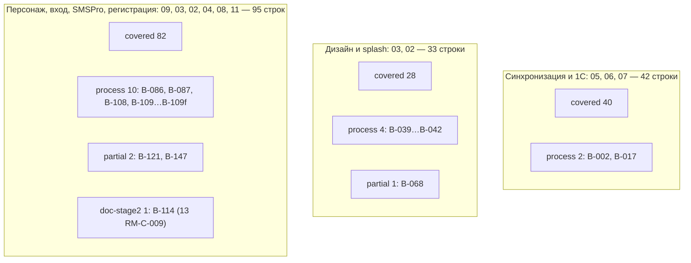

Основные документы-владельцы зоны B (по таблицам трассировки самих документов): 05 §16.2 (SRC-B-001…037, 054, 138…146), 03 §20 (SRC-B-038…078), 09 §16.1 (SRC-B-069…149); дополнительно — 02 §10.3 и ч. A §13, 04 §15.2, 08 §13.2, 11 §16, 06 §19, 10 §22.5, 15 §9.2.

---

### 5. Строки partial и gap — предложения по доработке

Строк со статусом `gap` нет.

| SRC-ID | Что не покрыто или покрыто с отступлением | Предложение: куда добавить | Ответственный документ |
|---|---|---|---|
| SRC-B-068 | Для `staff` переход «сразу на рабочий экран» заменён одношаговой разблокировкой SCR-08 (PIN проверяется сервером, D-48); холодный старт `staff` требует сети (ядро §19.3) | (1) Фиксация, которую требует ядро §19.4 «в 01 и 17», выполнена: 01 §5.1 GEN-024 / AC-GEN-024 (и §1 документа 01) и строка SRC-B-068 раздела 3.3 `[ПОДТВЕРЖДЕНО: Grep 01, 2026-10-19 05:07]`; доработка 01 не требуется. (2) Тесты в 12 §3.1 есть: T-AUTH-031 (Splash → SCR-08 при наличии токенов и PIN), T-SESS-021 (холодный старт `staff` без сети), T-BIO-009 (SCR-08 в двух режимах). Предложение для 12: дополнить T-AUTH-031 вариантом «`customer` без защиты входа → рабочий экран без промежуточных экранов» и проверкой «для `staff` — одно действие пользователя на SCR-08». (3) Подтверждение заказчика — Q-273 (вопрос 01; при сведении в 14 новый номер из диапазона 17 не нужен) | 12, 14 (Q-273) |
| SRC-B-121 | 13 RM-A-004 (этап A) предусматривает передачу учётных данных SMSPro в секрет-хранилище до создания адаптера RM-D-002 (этап D); промт и 09 §6.12 требуют обратного порядка: сначала адаптер и контрактные тесты на фикстурах, затем запрос только необходимых параметров | В 13: разделить RM-A-004 — на этапе A фиксировать только наличие аккаунта, договора и заявки на альфа-имя (без логина и пароля); передачу `SMSPRO_LOGIN_FILE`/`SMSPRO_PASSWORD_FILE` перенести в этап D после зелёных контрактных тестов RM-D-002 (шаги 1→2 из 09 §6.12); критерий приёмки RM-A-004 скорректировать | 13 |
| SRC-B-126 (ред. 1.2 сборки) | Обязательный этап «сканирование лица или настройка биометрии» заменён обязательным PIN для `staff` (REG-006); биометрия ОС — по выбору, сканирование лица — условный R2 (D-14, D-48); отступление записано в 01 §14.3 (GEN-050), но не подтверждено заказчиком | вопросы Q-003 и Q-304 (сводная §13.2; прежний номер Q-303 — ядро v1.9 §24.5); 01 §14.3 — добавить Q-304 в «Подтверждение заказчиком»; при ответе «биометрия обязательна» — 09 REG-006, 02 SCR-04, 15 ADR-014, 12 T-REG-009 | заказчик → 01, 09 |
| SRC-B-147 | По умолчанию OTP подтверждает номер **до** формы регистрации (D-10, нейтральный ответ); буквальный порядок промта «форма → OTP» доступен только при `REGISTRATION_SECOND_OTP=true` (в R1 выключено) | Решение заказчика по Q-162; при выборе буквального порядка — включить флаг (09 §7.4, 02 SCR-04 п. 6, 08 §4.2.1) без изменения API; в 12 — тесты обоих режимов по AC-AUTH-081 и AC-FLOW-004-08 | 14 (Q-162), 12 |

Наблюдения, не меняющие статус:

- SRC-B-114 (`doc-stage2`): приёмка RM-C-009 должна включать проверку «в `.env.example` нет значений секретов» (T-SEC-037¹).
- SRC-B-109a: требование SMS-034 (SOAP вне R1) не имеет критерия `AC-…` в 09 §16.1 — допустимо для строки типа «процесс»; при желании 09 может добавить AC «интерфейс SOAP не используется адаптером».
- SRC-B-041: обзор POS/B2B (03 §3) не оформлен отдельным ID требования — допустимо для строки типа «процесс».
- Для строк SRC-B-018…SRC-B-032e полнота подтверждена на уровне ТЗ; фактическая доступность полей конкретной 1С подтверждается на этапе 2 (13 RM-A-002, Q-010) — это не `gap`, а ограничение, прямо требуемое SRC-B-031.

---

### 6. Тесты 12_TEST_PLAN.md для части B

12_TEST_PLAN.md выпускается параллельно; на момент проверки в нём описан модуль §3.1 «Авторизация, OTP, SMS, сессии, биометрия/PIN» (T-AUTH-001…041, T-SMS-001…020, T-SESS-001…022, T-BIO-001…018, T-FACE-001…005) `[ПОДТВЕРЖДЕНО: Grep 12, 2026-10-19 05:07]`. Тесты §3.1 внесены в матрицу (пометка ⁴, таблица 6.3); ниже — тесты, которые 12 должен ещё описать, чтобы закрыть столбец «Тест». Критерии приёмки, которые проверяет каждый тест, указаны в соответствующих строках раздела 3.

#### 6.1. Бывшие заглушки тестов (закрыто в ред. 1.1 сборки)

Ред. 1.1 сборки (2026-10-19, ядро v1.5 §20.1, §20.2 п.18–19): все 69 меток-заглушек теста этой части заменены в столбце «Тест» матрицы ID тестов 12_TEST_PLAN.md v1.1; построчное соответствие и способ подбора — §6.3 настоящего документа, тесты к добавлению в 12 — §6.4. Исходный список заглушек части с предложениями для 12 — в черновике части (`source/17_parts_drafts/`).

#### 6.2. Зарезервированные тест-ID, которые 12 должен принять без перенумерации

| Тест-ID | Где зарезервирован | Строки SRC-B |
|---|---|---|
| T-AUTH-001 | 09 §16.4; описан в 12 §3.1.1 | 098, 100, 100a, 102 |
| T-AUTH-002 | 09 §16.4; описан в 12 §3.1.1 | 101, 123, 134, 147, 149 |
| T-AUTH-003 | 09 §16.4; описан в 12 §3.1.1 | 075, 075a |
| T-AUTH-004 | 09 §16.4; описан в 12 §3.1.1 | 118 |
| T-AUTH-005 | 09 §16.4; описан в 12 §3.1.1 | 120 |
| T-AUTH-006 | 09 §16.4; описан в 12 §3.1.1 | 119 |
| T-AUTH-007 | 09 §16.4; описан в 12 §3.1.1 | 109f |
| T-AUTH-008 | 09 §16.4; описан в 12 §3.1.1 | 137 |
| T-AUTH-009 | 09 §16.4; описан в 12 §3.1.1 | 080, 082, 083 |
| T-AUTH-010 | 09 §16.4; описан в 12 §3.1.1 | 084 |
| T-SEC-001, T-SEC-002, T-SEC-003 | 11 §12.2 | 119; 120; 118 |
| T-SEC-005, T-SEC-006 | 11 §12.2 | 105, 117; 103, 104, 106 |
| T-SEC-007, T-SEC-008 | 11 §12.2 | 115; 116 |
| T-SEC-015, T-SEC-017 | 11 §12.2 | 106; 106, 145 |
| T-SEC-029 | 11 §12.2 | 116 |
| T-SEC-031, T-SEC-032, T-SEC-033, T-SEC-035 | 11 §12.2 | 082, 082a; 082a; 082, 082a, 089; 082a |
| T-SEC-036, T-SEC-037 | 11 §12.2 | 111, 112; 112, 113, 114 |
| T-SEC-048, T-SEC-050, T-SEC-055 | 11 §12.2 | 127, 128; 109f; 145, 146 |
| T-DS-001…012 | 03 §17.9 | 043, 044, 045, 046 |
| T-DS-013…020 | 03 §17.9 | 047 |
| T-DS-030…040 | 03 §17.9 | 052 |
| T-DS-041…049 | 03 §17.9 | 049, 056 |
| T-DS-050…066 | 03 §17.9 | 046a, 051, 052, 053, 054 |
| T-DS-067…070 | 03 §17.9 | 060, 061, 062, 063, 064, 065, 065a, 066, 067, 068 |
| T-DS-071…074 | 03 §17.9 | 042, 059 |
| T-DS-075…079, T-DS-080…084 | 03 §17.9 | 057 |
| T-DS-085…096 | 03 §17.9 (дополнения ядра v1.4, п. 18.10) | 050 (DS-090), 068 (DS-095), 134 (DS-096) |
| T-ANIM-001…030 | 03 §17.9 (длительности и кривые `DsMotion`, reduce-motion) | 055, 062, 063, 067, 071, 072, 073, 074, 075, 076, 077, 078 |
| T-A11Y-001…022 | 03 §17.9 | 038, 046, 050, 055, 059, 078 |

Строки со статусом `process` (16, включая SRC-B-108 типа «документ») проверяются не тестами, а ревью артефактов этапа 1 — `н/п`; исключения — SRC-B-042 (T-DS-071…074²) и SRC-B-109f (T-AUTH-007³, T-SEC-050¹), где тесты есть у связанных требований. SRC-B-121 имеет тип «процесс», но статус `partial` (раздел 5); тест для неё также `н/п`.

#### 6.3. Тесты 12 §3.1, внесённые в матрицу (пометка ⁴)

Тест выбран, если ID требования или критерия `AC-…` из строки матрицы указан в столбце «Требования» теста 12 `[ПОДТВЕРЖДЕНО: Grep 12 §3.1, 2026-10-19]`.

| Тест 12 | Название в 12 | Строки SRC-B |
|---|---|---|
| T-AUTH-011 | Нейтральный ответ `/auth/otp/request` | 099, 103, 104 |
| T-AUTH-014, T-AUTH-015 | Cooldown 60 с и повторная отправка; лимит 3 отправки / 15 мин | 117 |
| T-AUTH-022 | Тестовый режим OTP только вне prod | 115 |
| T-AUTH-023 | `PhoneField`: формат и нормализация | 090, 091, 092, 093, 096 |
| T-AUTH-024 | `PhoneField`: валидация и сообщения | 075a, 090, 094, 097 |
| T-AUTH-025 | «Изменить номер» на SCR-02 | 095 |
| T-AUTH-026 | Серверная нормализация, не-KG номера | 094, 104 |
| T-AUTH-029 | Смена номера телефона | 095, 136 |
| T-AUTH-031 | Splash → нужный экран | 065, 065a, 066, 068, 080a |
| T-AUTH-034 | Персонаж: состояния по этапам | 069b, 070, 071, 072, 073, 074, 075, 075a, 076 |
| T-AUTH-035 | Персонаж: тайминги и reduce-motion | 074, 077, 078 |
| T-AUTH-038 | Компенсации SMS как restricted-аутентификатора | 081, 126 |
| T-AUTH-040 | OTP не попадает в логи | 116 |
| T-AUTH-041 | Экран входа: визуальный состав | 069, 069a, 069b |
| T-SMS-001, T-SMS-002 | Формат запроса `/api/message`; разбор ответа | 110 |
| T-SMS-012, T-SMS-013 | `sms_outbox` без текста и кода; логи и метрики отправки | 116 |
| T-SMS-014 | Валидация конфигурации при старте | 113 |
| T-SMS-015 | Секреты вне клиента и репозитория | 112, 114, 121b, 122 |
| T-SMS-016 | `FakeSmsGateway` и `OtpService` | 115 |
| T-SMS-018 | Smoke с тестовым аккаунтом (`test=1`) | 121a, 121b |
| T-SMS-019 | Приёмочный smoke с реальной SMS | 121a |
| T-SMS-020 | Только документированные адреса и интерфейсы | 107, 110 |
| T-SESS-020 | Разблокировка по PIN и правило Windows | 085 |
| T-SESS-021 | Телефон не хранится на устройстве; холодный старт без сети | 068 |
| T-SESS-022 | Параметры secure storage | 082a |
| T-BIO-001 | Включение биометрии | 079, 081 |
| T-BIO-004 | Windows Hello только гейт | 085 |
| T-BIO-005 | Android без Class 3 / API 24–27 | 085 |
| T-BIO-006 | Криптопривязка Android | 082 |
| T-BIO-009 | SCR-08 в двух режимах | 068 |
| T-BIO-010 | Биометрические данные не хранятся | 085, 089 |
| T-BIO-014 | Цепочка fallback | 084 |
| T-FACE-001 | FACE-SCAN выключен в R1 | 079, 126 |
| T-FACE-004 | Ничего не хранится и не заявляется (условно) | 088, 089 |
| T-FACE-005 | Условия включения | 089 |

Итого тесты 12 §3.1 (⁴) указаны в 50 строках матрицы; с учётом T-AUTH-001…010³ ссылки на тесты, уже описанные в 12, есть в 66 строках.

---

### 7. Открытые вопросы

#### 7.1. Новые вопросы этого документа (диапазон 17: Q-280…Q-289, ядро §19.5)

> Ред. 1.1 сборки: окончательные номера вопросов диапазона 17 — §13.2, соответствие прежних номеров и меток — §13.3 (ядро v1.5 §20.2 п.18).

Новых вопросов нет. Вопрос версии 1.0 (номер Q-280) отозван по двум причинам: (1) номер Q-280 занят другими частями: 17E — метрика стабильности (SRC-E-181d); 17C в первой редакции использовал Q-280 для признака подтверждённого телефона в 1С (SRC-C-094) и затем перешёл на предварительные номера; 17A и 17F считают Q-280…Q-284 занятыми `[ПОДТВЕРЖДЕНО: Grep 17A…17F, 2026-10-19 05:07]`; (2) тот же вопрос уже вынесен документом 01 как Q-273 (01 §4 и §5.1 GEN-024 / AC-GEN-024: «подтверждение заказчиком — Q-273»). Ниже — вопрос, на который ссылается строка SRC-B-068; его владелец — 01.

| ID | Вопрос | Влияние | Допущение в ТЗ |
|---|---|---|---|
| Q-273 (документ 01, диапазон Q-270…Q-279; в 17 не перенумеровывается) | Подтверждает ли заказчик уже принятое и зафиксированное отступление (ядро §19.4, 01 GEN-024 / AC-GEN-024): для сотрудников требование «если пользователь уже авторизован, переходи к его рабочему экрану» (SRC-B-068) выполняется через одношаговую разблокировку SCR-08 (PIN или биометрия, проверка на сервере), а не прямым переходом без действия пользователя? Заказчик подтверждает решение, а не принимает его с нуля. | SCR-00, SCR-08, D-48, NFR-PERF-005, T-AUTH-031, T-SESS-021, T-BIO-009 | Да — по ядру §19.4 (осознанное отступление по D-48); для `customer` без защиты входа — прямой переход |

Если при сведении 14 окажется, что 01 не определил Q-273 в своём разделе вопросов (на момент проверки он упомянут в 01 §4 и §5.1, а раздел вопросов 01 ещё не выпущен), сборщик 17_TRACEABILITY_MATRIX назначает вопросу номер **Q-28x** из диапазона 17 (предварительный; номер назначает сборщик).

#### 7.2. Вопросы ядра и документов, влияющие на статус строк части B

| ID | Связанные строки SRC-B | Состояние |
|---|---|---|
| Q-001 | 138…146 (режим клиента `CUSTOMER_SELF_SERVICE`) | ред. 1.5 сборки: закрыт ответом заказчика 2026-10-21 (ядро v1.9 §24.2) — режим клиента R1, `CUSTOMER_SELF_SERVICE=true` по умолчанию (ред. 1.0–1.4: открыт; флаг выключен по умолчанию) |
| Q-003 | 087, 088, 126 (FACE-SCAN) | открыт; модуль условный R2 |
| Q-004 | 105, 117, 118 (числовые параметры OTP) | открыт; значения D-10 |
| Q-006 | 043, 061 (палитра, логотип) | ред. 1.5 сборки: закрыт ответом заказчика 2026-10-21 (ядро v1.9 §24.1) — палитра B «Оранжевый», логотип оранжевый; открыт только векторный исходник (ред. 1.0–1.4: открыт; A+ (D-16)) |
| Q-007 | 057 (языки) | открыт; `ru`, каркас `ky`/`en` |
| Q-010, Q-011 | 005, 017…032e (конфигурация 1С, расширение) | Q-010 открыт; Q-011 частично закрыт — расширение делает специалист 1С по запросу (ядро v1.9 §24.3, ред. 1.5 сборки); имена 1С `[ТИПОВО]` |
| Q-012, Q-018 | 030 (платёжные документы, возвраты) | открыты |
| Q-015 | 028 (скидки) | открыт |
| Q-020 | 002 (свежесть данных) | открыт; D-29 |
| Q-021, Q-022 | 021, 022 (варианты, фото) | открыты |
| Q-025 | 138…146 (правила создания клиента) | открыт |
| Q-035 | 069b…078 (стиль персонажа) | открыт |
| Q-161, Q-165 | 124, 127, 128 (год рождения, ФИО, сфера) | открыты |
| Q-162 | 147 (порядок OTP и формы) | открыт — определяет статус `partial` |
| Q-201 | 080, 081 (step-up при включении биометрии сразу после OTP) | открыт |
| Q-242 | 107…109f (OTP API SMSPro как альтернатива) | открыт; R1 — собственный `OtpService` |
| Q-273 (документ 01) | 068 (подтверждение отступления для `staff`, 01 GEN-024) | открыт; допущение — ядро §19.4, D-48 |
| Q-216 | 146 (список конфликтов привязки) | закрыт решением ядра v1.4 (`GET /customers?linkStatus=proposed,conflict`, ядро §19.2) |

---

### 8. Трассировка на исходные требования

#### 8.1. Покрытие зоны по разделам промта

| Раздел промта (строки) | ID реестра B | Строк | Подраздел матрицы | Статусы |
|---|---|---|---|---|
| 3. Архитектура данных — хвост (112) | SRC-B-001 | 1 | 3.1 | covered 1 |
| 4. Синхронизация с 1С (114–124) | SRC-B-002…SRC-B-016 | 15 | 3.1 | covered 14, process 1 |
| 4. Синхронизируемые сущности (126–143) | SRC-B-017…SRC-B-037 (+032a…032e) | 26 | 3.1 | covered 25, process 1 |
| 5. Дизайн и визуальная система (145–165) | SRC-B-038…SRC-B-059 (+046a) | 23 | 3.2 | covered 19, process 4 |
| 6. Splash Screen (167–175) | SRC-B-060…SRC-B-068 (+065a) | 10 | 3.3 | covered 9, partial 1 |
| 7. Авторизация — персонаж (177–185) | SRC-B-069…SRC-B-078 (+069a, 069b, 075a) | 13 | 3.4 | covered 13 |
| 7. Вход по лицу (187–196) | SRC-B-079…SRC-B-089 (+080a, 082a) | 13 | 3.5 | covered 11, process 2 |
| 8. Вход по номеру телефона и поток (198–212) | SRC-B-090…SRC-B-106 (+100a) | 18 | 3.6 | covered 18 |
| 8. Интеграция SMSPro (214–223) | SRC-B-107…SRC-B-122 (+109a…109f, 121a, 121b) | 24 | 3.7 | covered 14, process 8, partial 1, doc-stage2 1 |
| 9. Регистрация и требования к форме (225–240) | SRC-B-123…SRC-B-137 | 15 | 3.8 | covered 15 |
| 9. Регистрация и клиентская база 1С (242–252) | SRC-B-138…SRC-B-149 | 12 | 3.9 | covered 11, partial 1 |
| **Итого** | | **170** | | covered 150, partial 3, process 16, doc-stage2 1 |

#### 8.2. Проверка полноты

- Число строк основной таблицы реестра `REQ_REGISTER_B.md` — 170 (149 исходных + 21 подстрока; совпадает с итогом «Самопроверки» реестра). Число строк матрицы раздела 3 — 170; порядок совпадает с реестром; дубликатов нет `[ПОДТВЕРЖДЕНО: скрипт сверки ID, 2026-10-19]`.
- Все ID в столбцах «Документ и раздел ТЗ», «ID требований ТЗ», «Критерий приёмки» и «Тест» матрицы (826 уникальных ID вида `ПРЕФИКС-…-N`, включая `SCR-`, `UI-`, `FLOW-`, `RM-`, `ADR-`, `D-`, `Q-`; версия 1.0 считала 721 ID без ссылок на 01 и 12) найдены в текстах документов ТЗ `docs/specification/*.md` и `visual/*`, включая 01_PRODUCT_REQUIREMENTS.md (GEN-024, AC-GEN-024) и 12_TEST_PLAN.md §3.1 (тесты с пометкой ⁴) `[ПОДТВЕРЖДЕНО: скрипт сверки ID, 2026-10-19 05:10]`.
- Каждая строка части B имеет прямое (не только диапазонное) упоминание своего SRC-ID хотя бы в одном документе ТЗ.

---

### 9. Замечания к ядру

1. **Документы 01, 12 и части 17 выпускаются параллельно.** Требование ядра §19.4 зафиксировать отступление SRC-B-068 «в 01 и 17» выполнено: 01 §5.1 GEN-024 / AC-GEN-024 и строка SRC-B-068 настоящего документа; вопрос подтверждения — Q-273 (01). 12 на момент проверки содержит только модуль §3.1 (T-AUTH, T-SMS, T-SESS, T-BIO, T-FACE); его тесты внесены в матрицу (раздел 6.3), заглушки остались в 69 строках из 170 (SYNC, ONEC, REG, UI, DS, CUST). Сборщику 17_TRACEABILITY_MATRIX.md — после выпуска остальных модулей 12 заменить оставшиеся заглушка `<префикс>` фактическими ID и сверить столбец «Тест» между частями 17A…17F (части сверялись с разными состояниями 12).
2. **Резервирование тест-ID вне 12.** 11 §12.2 (T-SEC-001…055), 03 §17.9 (T-DS-…, T-ANIM-…, T-A11Y-…), 09 §16.4 (T-AUTH-001…010) уже назначают ID с префиксом `T-`, который по ядру §10 принадлежит 12. Предложение: дополнить ядро правилом «12 принимает зарезервированные ID без перенумерации и продолжает нумерацию после них».
3. **Расхождение 13 RM-A-004 с SRC-B-121 и 09 §6.12** (порядок «адаптер → учётные данные»). Ядро не содержит решения по этому порядку; предложение — закрепить в ядре (раздел решений по SMS, рядом с D-11): «учётные данные SMSPro запрашиваются только после готовности адаптера и контрактных тестов на фикстурах (этап D)».
4. **Объём части B.** В задании трассировщика ориентир объёма для части B — 205 строк, тогда как основная таблица `REQ_REGISTER_B.md` содержит 170 ID (с подстроками), что совпадает с итогом самопроверки реестра. Матрица следует реестру как источнику ID; сборщику 17 — использовать фактические числа строк реестров при расчёте итогов.
5. **SRC-B-147 и D-10.** Ядро фиксирует D-10 (ветвление только после OTP), из которого следует порядок «OTP → форма»; это прямое отступление от must-требования промта (строка 251). В ядре §19 отступление явно не названо (в отличие от SRC-B-068). Предложение: добавить в ядро §19 строку, аналогичную §19.4 для SRC-B-068, с привязкой к Q-162.
6. **Общий диапазон вопросов 17 (Q-280…Q-289) на шесть частей.** Ядро §19.5 даёт документу 17 один диапазон на шесть параллельных трассировщиков 17A…17F; уже возникла коллизия номера Q-280 (17B в версии 1.0, 17C в первой редакции, 17E). Предложение: дополнить ядро §19.5 разбиением диапазона между частями (например, по одному-два номера на часть) или правилом «части 17 используют предварительные номера Q-28x, окончательные назначает сборщик 17_TRACEABILITY_MATRIX». Кроме того, вопрос, уже вынесенный документом-владельцем (здесь — Q-273 в 01), в 17 не дублируется.

---

### 10. Журнал проверки

Доработка версии 1.0 → 1.1 по замечаниям проверки (2026-10-19). Матрица по-прежнему содержит 170 строк; статусы покрытия не изменились (covered 150, partial 3, process 16, doc-stage2 1).

| № | Серьёзность | Замечание | Что сделано | Где |
|---|---|---|---|---|
| 1 | major | Документ утверждал, что 01 и 12 отсутствуют; фиксация SRC-B-068 в 01 GEN-024 не учтена; заглушки не заменены тестами 12 §3.1 | Ссылки на 01 §5.1 GEN-024 / AC-GEN-024 добавлены в строку SRC-B-068 (столбцы документа, ID, AC, статус) и в раздел 5; фраза «файл 01 отсутствует» удалена. Тесты 12 §3.1 внесены в 50 строк (пометка ⁴, таблица 6.3), подбор — по совпадению ID требований и AC; заглушки сократились со 105 до 69 строк, префиксы AUTH, SESS, BIO, FACE, SMS закрыты. Пересчитаны §1, §6.1, переписаны §8.2 п. 2 и §9 п. 1; отметки «листинг каталога» заменены актуальными `[ПОДТВЕРЖДЕНО: … 05:07]` | §1, §2.3, §3.3–§3.9, §5, §6, §8.2, §9 |
| 2 | major | Номер Q-280 занят в других частях 17; не помечен как предварительный | Вопрос с номером Q-280 отозван: тот же вопрос уже вынесен документом 01 как Q-273 (01 §4, §5.1); в §7.1 формулировка — подтверждение уже принятого отступления; резервный путь — Q-28x (номер назначает сборщик 17). В §7.2 добавлен Q-273; в §9 добавлено замечание 6 о разбиении диапазона Q-280…Q-289 | §1, §5, §7.1, §7.2, §9 |
| 3 | minor | В «Связанных документах» нет 01 и 14 | Добавлены 01_PRODUCT_REQUIREMENTS.md и 14_OPEN_QUESTIONS.md | шапка |
| 4 | minor | SRC-B-078: не назван экран-владелец AC-UI-42-011 | В столбец документа добавлен SCR-42 (UI-42-007 «Уменьшить анимации»), в столбец ID — UI-42-007 | §3.4 |
| 5 | minor | Не использованы T-ANIM-001…030 и T-DS-085…096 из 03 §17.9 | T-ANIM-001…030² указан в 12 строках (055, 062, 063, 067, 071…078); T-DS-085…096² — в строках 050 (DS-090), 068 (DS-095), 134 (DS-096, добавлен с AC-DS-096); строки добавлены в §6.2; заглушка DS сокращён с 5 до 4 строк, заглушка AUTH — с 22 до 0 | §2.3, §3.2–§3.4, §3.8, §6 |
| 6 | minor | Фраза о строках «процесс» в §6.2 смешивала тип и статус | Переформулировано: строки со статусом `process` (16, включая SRC-B-108 типа «документ»); отдельно указано, что SRC-B-121 типа «процесс» имеет статус `partial` | §6.2 |
| 7 | minor | SRC-B-012: SCR-45 относится к требованию косвенно | Основная ссылка — 05 §7.5 SYNC-033 (и §13, сценарии F6, F9); добавлен SCR-43 UI-43-007 (вкладка «Ошибки», записи `sync_errors`); SCR-45 помечен «смежное: конфликты привязки клиента, SYNC-033 п. «г»» | §3.1 |

Проверка целостности после доработки `[ПОДТВЕРЖДЕНО: скрипты сверки, 2026-10-19]`:

- строк матрицы SRC-B — 170, у каждой 8 столбцов; дубликатов нет; итоги статусов по строкам совпадают с §4.1 и §8.1;
- 826 уникальных ID из столбцов документа, требований, AC и тестов найдены в `docs/specification/*.md` и `visual/*`;
- разделы 1–10 на месте, файл в UTF-8; номера разделов, на которые ссылается текст (5, 6.1–6.3, 7.1, 7.2, 9), существуют.

---

## 9. Часть C — Матрица трассируемости — часть C реестра исходных требований (SRC-C-001 … SRC-C-140)

> Источник: часть C — раздел §9 настоящего документа (черновик части — `source/17_parts_drafts/`, ядро §20.1) · Версия 1.0 · Дата 2026-10-19 · Статус: черновик для утверждения заказчиком · Шапка части («Входные материалы», «Связанные документы», роль автора) опущена — см. шапку настоящего документа. Ссылки вида «§N» внутри этого раздела указывают на разделы **части C** (заголовки части сохранены с исходной нумерацией и понижены на один уровень; в сводных разделах настоящего документа на них ссылаются как «17C §N»); номера вопросов Q-28x в тексте части — предварительные, окончательные — §13.2. **Ред. 1.1 сборки (ядро v1.5 §20):** в столбце «Тест» строк этой части метки-заглушки заменены ID тестов 12 (§6), статусы строк §5.4 пересмотрены, номера вопросов — по §13.2–§13.3; упоминания заглушек и их числа в повествовательном тексте и журналах части ниже — история ред. части, действующие значения — §2, §6, §13.

### Краткое содержание

- Документ — матрица трассируемости «исходное требование → требования ТЗ → критерий приёмки → тест» для **всех 164 строк** части C реестра (разделы 10–13 промта); пропусков нет, порядок строк — как в реестре.
- Каждая ссылка на раздел и ID ТЗ найдена поиском по ID `SRC-C-…` (с развёрткой диапазонов вида «SRC-C-115a…115d») во всех `docs/specification/*.md` и `visual/*.md`, а при отсутствии прямой ссылки — по ключевым словам; существование каждого приведённого ID проверено повторным поиском (§1.4).
- Итог покрытия (ред. 1.5 сборки): **covered — 151**, **partial — 8** (SRC-C-018 «компактный список» на телефоне; ред. 1.5 — SRC-C-094 «подтверждённый номер» → `covered`, сводная §5.8; ред. 1.2 сборки — covered 150, partial 9; ред. 1.2 — SRC-C-014 ручные чертежи, SRC-C-081 способы оплаты, SRC-C-077, 080, 082, 119, 131a — ждут ответа заказчика), **process — 5** (выполнено методикой этапа 1), **doc-stage2 — 0**, **deferred-R2 — 0**, **gap — 0**. Ред. 1.0–1.1 части: covered 151, partial 2, process 6, doc-stage2 5.
- Основные владельцы покрытия: 10_POS_BUSINESS_RULES (CAT/INV/CART/ORD/PAY/CASH/CUST/DEBT/DISC/TXN/FAV/PRINT — 10 §22.1 трассирует все 164 строки), 02 (UI-xx-NNN, AC-UI-…; 02 §10.3), 08 (API-NNN, 08 §11), 11 (SEC-NNN, PRIV-NNN, T-SEC-NNN), 04 (FLOW-NNN); продуктовый уровень — 01_PRODUCT_REQUIREMENTS (GEN-, ROLE-, NFR-; с AC-GEN/AC-ROLE), на который ссылаются 163 из 164 строк (кроме SRC-C-014).
- *(История ред. 1.0 части; в ред. 1.1 сборки заглушки заменены ID тестов 12 v1.1 — сводная §6; утверждение ниже не действует.)* `12_TEST_PLAN.md` на дату трассировки не содержал тестов зоны C (готов был только §3.1 — T-AUTH/T-SMS/T-SESS/T-BIO/T-FACE; ссылок на SRC-C не было): тесты указаны как заглушка `<префикс>` (сводный список для 12 — §5), кроме тестов безопасности `T-SEC-NNN`, перечень которых зафиксирован в 11 §12.2 и принят 12 §2.7 с сохранением ID (детализация — будущий 12 §3.12).
- Найдены 2 частичных покрытия и 3 расхождения между документами (§4, «Замечания к ядру»); расхождение по SRC-C-018 затрагивает три документа (01 GEN-071, 10 CAT-010, 02 UI-10-013). Сформулированы 3 новых вопроса — Q-285, Q-286, Q-289 (диапазон 17 по ядру §19.5; номера предварительные, перенумерованы из Q-280…Q-282 из-за коллизии с частями 17B/17E — «Замечания к ядру», п. 7).
- Метки статуса: все выводы о покрытии — `[РЕШЕНИЕ: …]` документов ТЗ либо `[ТРЕБУЕТ РЕШЕНИЯ ЗАКАЗЧИКА: Q-…]`; документ ничего не утверждает о готовности программного кода (этап 1, код запрещён).

---

### 1. Методика и обозначения

#### 1.1. Порядок трассировки

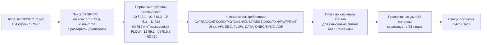

1. Реестр прочитан полностью; учтены только строки основной таблицы (164 ID). В файле реестра есть ещё 11 строк, начинающихся с `SRC-C-…`, — это строки «Журнала проверки» (таблица «Исправленные строки»), а не требования; поэтому механический подсчёт даёт 175, а требований — 164 (см. «Замечания к ядру», п. 2).
2. Для каждой строки выполнен поиск ID во всех `docs/specification/*.md` и `docs/specification/visual/*.md` (черновики `source/02_parts_drafts/` не использовались — ядро §19.1). Диапазоны вида «SRC-C-026…SRC-C-032», «SRC-C-075…075c», «SRC-C-011a…c» развёрнуты.
3. Главная точка опоры — таблица 10 §22.1 (трассирует все 164 строки части C на правила POS); она сверена с 02 §10.3 (UI → SRC), 08 §11 (API → SRC), 11 §16 (SEC/PRIV → SRC), 04 §15 и абзацами «Трассировка» сценариев FLOW, 15 §9.2, 05 §16.5, 03 §20, а также с колонкой «Источник» требований 01 (GEN- §2.7, §5; ROLE- §3.2–§3.3; NFR- §6.2; диапазоны вида «SRC-C-094…SRC-C-099a» развёрнуты в порядке реестра).
4. Смысловые связи без прямой SRC-ссылки (например, API-054/API-058/API-059 для фильтров и поиска, FLOW-010/FLOW-013/FLOW-028 по названию сценария, DATA-122/DATA-146 по имени таблицы) добавлены только после прочтения соответствующей строки требования.

#### 1.2. Сокращения документов

| Сокращение | Файл |
|---|---|
| 01 | `01_PRODUCT_REQUIREMENTS.md` (ROLE- — §3.2 карточки ролей, §3.3 правила прав; GEN- — §2.7, §5.1…§5.19; NFR- — §6.2) |
| 02 | `02_SCREEN_SPECIFICATION.md` (ч. B — SCR-10…SCR-17, ч. C — SCR-20…SCR-26, ч. D — SCR-30…SCR-39, ч. E — SCR-40…SCR-50) |
| 03 | `03_UX_UI_DESIGN_SYSTEM.md` |
| 04 | `04_USER_FLOWS.md` |
| 05 | `05_ONEC_INTEGRATION.md` |
| 07 | `07_DATA_MODEL.md` |
| 08 | `08_API_SPECIFICATION.md` (таблицы требований API-NNN — §11.1…§11.10) |
| 10 | `10_POS_BUSINESS_RULES.md` |
| 11 | `11_SECURITY_PRIVACY.md` |
| 13 | `13_IMPLEMENTATION_ROADMAP.md` |
| 15 | `15_DECISION_LOG.md` |
| ядро | `docs/research/R0_DECISION_KERNEL.md` v1.4 |

#### 1.3. Статусы покрытия

| Статус | Смысл |
|---|---|
| `covered` | Требование полностью отражено проверяемыми требованиями ТЗ с критериями приёмки |
| `partial` | Отражено не полностью или с отступлением / противоречием между документами; предложение — §4 |
| `process` | Требование к процессу работы; выполнено методикой этапа 1 (указано, чем именно) |
| `doc-stage2` | Ред. 1.2: локальное определение ред. 1.0–1.1 («требование к процессу, завершение которого зависит от ответа заказчика») снято — действует единая легенда сводной части §3.2 (работа этапа 2: код, запуск тестов, проверка на реальных системах). Строки, ждущие ответа заказчика, — `partial` |
| `deferred-R2` | Перенесено в R2 решением ядра с Q-ссылкой (в части C таких строк нет) |
| `gap` | Покрытие в ТЗ не найдено (в части C таких строк нет) |

#### 1.4. Колонки «Критерий приёмки» и «Тест»

- **Критерий приёмки**: приводятся реально существующие ID — `AC-<ПРЕФИКС>-NNN` из 10 §19, `AC-UI-xx-NNN` из 02 §10.1, `AC-API-NNN` (08), `AC-SEC-NNN`/`AC-PRIV-NNN` (11), `AC-DATA-NNN` (07), `AC-ONEC/SYNC-NNN` (05), `AC-ADR-NNN` (15), `AC-GEN-NNN`/`AC-ROLE-NNN` (01, колонка «Критерий приёмки» строк GEN-/ROLE-). Запись «AC-UI-14-004…006» означает непрерывный диапазон, подтверждённый в 02 §10.3. Карточки ролей 01 §3.2 (ROLE-001…ROLE-005) и строки NFR 01 §6.2 собственных AC не имеют (у NFR — «Метод проверки»), поэтому для них в колонке AC ничего не добавлено.
- **Тест** *(история ред. 1.0 части; в ред. 1.1 сборки столбец «Тест» содержит ID тестов 12 v1.1 — сводная §6; утверждение ниже не действует)*: `12_TEST_PLAN.md` на дату трассировки не содержал тестов зоны C (готов только §3.1 — T-AUTH/T-SMS/T-SESS/T-BIO/T-FACE; ссылок на SRC-C в 12 нет), поэтому ни один `T-<ПРЕФИКС>-NNN` для строк части C, кроме `T-SEC-NNN`, пока не описан. Для таких строк указано заглушка `<префикс>` (префикс — владелец основного требования; сводный список — §5). `T-SEC-NNN` — ID, зафиксированные в 11 §12.2 («перечень … обязательный минимум тестов безопасности для 12_TEST_PLAN.md, владелец 12 детализирует шаги, сохраняя ID») и принятые 12 §2.7 («`T-SEC-001…T-SEC-055` (11 §12.2, сохранены ID)»; шаги тестов — будущий 12 §3.12). Для строк `process`/`doc-stage2` тест не применяется («—»), проверка — по артефакту.
- Проверка ID: после сборки матрицы все ID вида `CAT-…`, `UI-…`, `AC-…`, `API-…`, `SEC-…`, `FLOW-…`, `DATA-…`, `ONEC-…`, `SYNC-…`, `ADR-…`, `GEN-…`, `ROLE-…`, `NFR-…`, `T-SEC-…`, `RM-…`, `Q-…`, `SCR-…` повторно найдены поиском в документах ТЗ или ядре (кроме новых Q-285, Q-286, Q-289, вводимых настоящим документом).

---

### 2. Матрица трассируемости SRC-C → ТЗ

#### 2.1. Раздел 10 промта — главный экран продавца, поиск, категории, каталог, карточка товара (SRC-C-001 … SRC-C-057)

| SRC-ID | Краткая формулировка | Тип | Документ и раздел ТЗ | ID требования(й) ТЗ | Критерий приёмки (AC-…) | Тест | Статус покрытия |
|---|---|---|---|---|---|---|---|
| SRC-C-001 | Должно существовать отдельное рабочее пространство (главный экран) продавца | функц. | 10 §5; 02 ч. B SCR-10 (SCR-10.1); ядро §3.2, §9; visual/screen-map.md §2.2; 01 §5.5 | CAT-013; SCR-10; GEN-065 | AC-CAT-013; AC-UI-10-001; AC-GEN-065 | T-UI-010, T-UI-109, T-UI-111, T-CAT-021 | covered |
| SRC-C-002 | В верхней панели слева размещается логотип «Оптомстрой» | функц. | 02 §3.1, SCR-10.3; 10 §5; 01 §5.5 | UI-10-001; CAT-013; GEN-065 | AC-UI-10-001; AC-CAT-013; AC-GEN-065 | T-UI-010, T-UI-109, T-UI-111, T-CAT-021 | covered |
| SRC-C-003 | В центре верхней панели — большая строка поиска | функц. | 02 SCR-10.3; 10 §5; 01 §5.5 | UI-10-003; CAT-001; CAT-013; GEN-065 | AC-UI-10-001; AC-CAT-001; AC-GEN-065 | T-UI-010, T-UI-109, T-UI-111, T-CAT-021 | covered |
| SRC-C-004 | Справа в верхней панели — профиль пользователя | функц. | 02 SCR-10.3, SCR-41; 10 §5; 01 §5.5 | UI-10-006; UI-10-033; UI-41-008; CAT-013; GEN-065 | AC-UI-10-001; AC-UI-41-001; AC-CAT-013; AC-GEN-065 | T-UI-010, T-UI-041, T-UI-109, T-UI-111 | covered |
| SRC-C-004a | Справа в верхней панели отображается имя пользователя | функц. | 02 SCR-10.3; 10 §5; 01 §5.5 | UI-10-006; CAT-013; GEN-065 | AC-UI-10-001; AC-CAT-013; AC-GEN-065 | T-UI-010, T-UI-109, T-UI-111, T-CAT-021 | covered |
| SRC-C-005 | Справа в верхней панели отображается статус синхронизации | функц. | 02 SCR-10.3, SCR-43; 05 §7.4; 10 §4.3, §5; 01 §5.5, §5.18 | UI-10-004; UI-43-019; SYNC-026; INV-027; CAT-013; GEN-065; GEN-195 | AC-UI-10-001; AC-UI-43-015; AC-SYNC-026; AC-INV-027; AC-GEN-065; AC-GEN-195 | T-UI-010, T-UI-043, T-UI-109, T-UI-111 | covered |
| SRC-C-006 | Справа в верхней панели отображаются необходимые уведомления | функц. | 02 SCR-10.3, SCR-44; 10 §5, §10; 15 ADR-041; 01 §5.5, §5.17 | UI-10-007; UI-44-005; CAT-013; DEBT-013; GEN-065; GEN-183 | AC-UI-10-001; AC-UI-44-001; AC-CAT-013; AC-ADR-041; AC-GEN-065; AC-GEN-183 | T-UI-010, T-UI-044, T-UI-109, T-UI-111 | covered |
| SRC-C-007 | Поиск товаров по названию, артикулу, штрихкоду и другим доступным полям | функц. | 10 §4.2, §5; 02 SCR-11; 08 §11.3; 04 FLOW-010, FLOW-011; 15 ADR-031; 01 §5.5, §6.2 | CAT-001; INV-017; UI-10-003; UI-11-001; API-058; API-059; GEN-066; NFR-SEARCH-001 | AC-CAT-001; AC-INV-017; AC-UI-11-003; AC-UI-11-004; AC-ADR-031; AC-GEN-066 | T-CAT-002, T-CAT-012, T-CAT-014, T-CAT-009 | covered |
| SRC-C-008 | Задержка (debounce) перед отправкой поискового запроса | нефункц. | 10 §5; 02 SCR-10, SCR-11; 15 ADR-031 (300 мс, D-31); 01 §5.5 | CAT-002; UI-11-001; GEN-067 | AC-CAT-002; AC-UI-10-013; AC-UI-11-001; AC-GEN-067 | T-CAT-011, T-CAT-001, T-CAT-003, T-CAT-012 | covered |
| SRC-C-009 | Корректная обработка и отображение пустого результата поиска | функц. | 10 §5; 02 SCR-10, SCR-11; 01 §5.5 | CAT-004; UI-11-013; UI-10-037; GEN-068 | AC-CAT-004; AC-UI-11-005; AC-GEN-068 | T-CAT-009, T-CAT-001, T-CAT-003, T-CAT-012 | covered |
| SRC-C-010 | Возможность поиска сканированием штрихкода при наличии поддерживающего оборудования | функц. | 10 §5; 02 SCR-17, SCR-10/11 (HID), SCR-42; 04 FLOW-011; 08 §11.3; 15 ADR-042; 01 §5.5, §6.2 | CAT-003; UI-17-014; API-059; GEN-069; NFR-PERF-012 | AC-CAT-003; AC-UI-10-014; AC-UI-17-012; AC-UI-17-014; AC-ADR-042; AC-GEN-069 | T-CAT-012, T-CAT-013, T-CAT-001, T-CAT-003 | covered (модели сканеров — Q-009) |
| SRC-C-011 | Меню категорий размещается под логотипом | функц. | 10 §5; 02 SCR-10.3; 03 §2.3; 01 §5.5 | CAT-009; UI-10-009; GEN-070 | AC-CAT-009; AC-UI-10-002; AC-GEN-070 | T-UI-010, T-UI-109, T-UI-111, T-CAT-003 | covered |
| SRC-C-011a | Меню категорий имеет вертикальную ориентацию | функц. | 10 §5; 02 SCR-10.3; 03 §2.3, §9.10; 01 §5.5 | CAT-009; UI-10-009; GEN-070 | AC-CAT-009; AC-UI-10-002; AC-GEN-070 | T-UI-010, T-UI-109, T-UI-111, T-CAT-003 | covered |
| SRC-C-011b | Элементы меню категорий выполнены в виде компактных карточек | функц. | 02 SCR-10.3, SCR-12; 03 §9.10 (`CategoryTile`); 01 §5.5; 10 §5 (CAT-009) | CAT-009; UI-10-009; UI-12-006; GEN-070 | AC-UI-10-002; AC-UI-12-004; AC-GEN-070 | T-UI-012, T-UI-010, T-UI-111, T-UI-109 | covered |
| SRC-C-011c | Каждая карточка категории содержит изображение и название | функц. | 02 SCR-10.3, SCR-12; 03 §9.10; 10 §5; 01 §5.5 | UI-10-009 (изображение 1С 32×32, fallback `iconKey`); UI-12-006; CAT-009; GEN-070 | AC-UI-10-002; AC-UI-12-004; AC-UI-12-012; AC-GEN-070 | T-UI-012, T-UI-010, T-UI-111, T-UI-109 | covered (фото категорий в 1С — Q-022) |
| SRC-C-012 | Под строкой поиска и профилем — горизонтальная полоса категорий/подборок товаров (если полезно для рабочего сценария) | функц. | 10 §5, §6; 02 SCR-10, SCR-12; 01 §5.5 | CAT-012; FAV-005; UI-10-016; UI-10-036; UI-12-007; GEN-070 | AC-CAT-012; AC-UI-10-003; AC-UI-12-001; AC-GEN-070 | T-CAT-020, T-CAT-003, T-CAT-016, T-CAT-001 | covered |
| SRC-C-013 | Подкатегории отображаются только при их фактическом наличии | функц. | 10 §5; 02 SCR-10, SCR-12; 01 §5.5 | CAT-009; UI-10-016; UI-12-003; UI-12-007; GEN-070 | AC-CAT-009; AC-UI-10-003; AC-UI-12-001; AC-UI-12-002; AC-GEN-070 | T-UI-012, T-UI-010, T-UI-111, T-UI-109 | covered |
| SRC-C-014 | Приложенные ручные чертежи (эскизы) заказчика — обязательный исходный материал для компоновки экранов; произвольная компоновка недопустима | процесс | 02 §3.11, ч. B §9 и SCR-10.1 (таблица отличий от макета); 03 §2 (табл. «Ручные чертежи — отсутствуют»); 13 §3.1 (этап A); ядро §0, §14; 10 §5 (CAT-013) | CAT-013 | — | T-UI-113 (12 §3.9.2, условно Q-302) | partial: ручных чертежей в переданных материалах нет `[ПОДТВЕРЖДЕНО: ядро §0, R4 §1, 03 §2]`; вместо них исходным материалом компоновки взяты три цифровых макета (ядро §14; 02 SCR-10.1, ч. B §9) — замена не согласована с заказчиком `[ТРЕБУЕТ РЕШЕНИЯ ЗАКАЗЧИКА: Q-302]`; закрытие — §5.1 (ред. 1.2, волна 4; было `process`); ред. 1.3 — статус `partial` до ответа на Q-302 закреплён ядром v1.7 §22.13 п.6 (вопрос: «Есть ли ручные чертежи экранов? Если да — передать; ТЗ будет сверено с ними») |
| SRC-C-015 | В каталоге должно быть переключение представления (режима отображения) списка товаров | функц. | 10 §5; 02 SCR-10 (UI-10-013); 03 §9.26 (`ViewModeSegmented`); 01 §5.5 | CAT-010; UI-10-013; GEN-071 | AC-CAT-010; AC-UI-10-004; AC-GEN-071 | T-CAT-001, T-CAT-003, T-CAT-012, T-CAT-016 | covered |
| SRC-C-016 | Режим представления каталога «сетка» | функц. | 10 §5; 02 SCR-10; 01 §5.5 | CAT-010; UI-10-013; GEN-071 | AC-CAT-010; AC-UI-10-004; AC-GEN-071 | T-CAT-001, T-CAT-003, T-CAT-012, T-CAT-016 | covered |
| SRC-C-017 | Режим представления каталога «список» | функц. | 10 §5; 02 SCR-10; 01 §5.5 | CAT-010; UI-10-013; GEN-071 | AC-CAT-010; AC-UI-10-004; AC-GEN-071 | T-CAT-001, T-CAT-003, T-CAT-012, T-CAT-016 | covered |
| SRC-C-018 | Режим представления каталога «компактный список» | функц. | 10 §5; 02 SCR-10 (UI-10-013, UI-10-118), ч. B §14 (замечание 23); 01 §5.5 | CAT-010; UI-10-013; UI-10-118; GEN-071 | AC-CAT-010; AC-UI-10-029; AC-GEN-071 | T-UI-010, T-UI-111, T-UI-109, T-CAT-016 | partial: на compact и medium < 840 lp режим «компакт» не предлагается (UI-10-013 — вариант `two`), тогда как CAT-010 (10) и GEN-071 (01, «сетка, список, компактный список» без оговорки о ширине) требуют переключения всех трёх представлений; см. §4 P-1, Q-289 |
| SRC-C-019 | Сортировка товаров в каталоге | функц. | 10 §5; 02 SCR-10, SCR-11; 08 §11.10; 01 §5.5 | CAT-006; CAT-005; UI-10-014; UI-11-008; API-159; GEN-072 | AC-CAT-006; AC-UI-10-031; AC-GEN-072 | T-CAT-016, T-CAT-001, T-CAT-002, T-CAT-003 | covered (Q-204 закрыт решением ядра v1.4) |
| SRC-C-020 | Фильтры товаров в каталоге | функц. | 10 §5; 02 SCR-13; 08 §11.3; 01 §5.5 | CAT-007; CAT-008; UI-10-015; API-054; GEN-073 | AC-CAT-007; AC-UI-13-001; AC-GEN-073 | T-CAT-017, T-CAT-001, T-CAT-003, T-CAT-012 | covered |
| SRC-C-021 | Фильтр по диапазону цены (если данные доступны) | функц. | 02 SCR-13 (UI-13-002); 10 §5; 08 §11.3 (`priceMin/priceMax`); 01 §5.5 | CAT-007; UI-13-002; API-054; GEN-073 | AC-CAT-007; AC-UI-13-002; AC-GEN-073 | T-CAT-017, T-CAT-001, T-CAT-003, T-UI-013 | covered |
| SRC-C-022 | Фильтр по наличию товара на складах | функц. | 02 SCR-13 (UI-13-003, UI-13-016); 10 §4.3, §5; 08 §11.3 (`inStock`, `warehouseId`); 01 §5.5 | CAT-007; INV-025; UI-13-003; API-054; GEN-073 | AC-CAT-007; AC-INV-025; AC-UI-13-007; AC-GEN-073 | T-CAT-017, T-CAT-001, T-CAT-003, T-CAT-007 | covered (мультивыбор складов — Q-205) |
| SRC-C-023 | Фильтр по категории | функц. | 02 SCR-13 (UI-13-004); 10 §5; 08 §11.3 (`categoryId`); 01 §5.5 | CAT-007; UI-13-004; API-054; GEN-073 | AC-CAT-007; AC-GEN-073 | T-CAT-017, T-CAT-001, T-CAT-003, T-UI-013 | covered |
| SRC-C-024 | Фильтры по бренду, модели, цвету, размеру и другим реальным (существующим в данных) характеристикам | функц. | 10 §5; 02 SCR-13; 07 (`product_attributes`); 01 §5.5 | CAT-007; CAT-008; UI-13-005…UI-13-008; UI-13-012; DATA-117; GEN-073 | AC-CAT-008; AC-UI-13-001; AC-UI-13-003; AC-GEN-073 | T-CAT-017, T-UI-013, T-UI-111, T-DATA-004 | covered |
| SRC-C-025 | В каталоге есть «избранное» (пункт списка под «Добавь переключение представления»; является ли это фильтром или отдельным режимом отображения — требует уточнения у заказчика) | функц. | 10 §5, §6; 02 SCR-10, SCR-13, SCR-40; 01 §5.5; 04 FLOW-042 (ред. 1.3) | CAT-014; CAT-007; FAV-001; FAV-003; FAV-004; UI-10-010; UI-13-009; GEN-074; FLOW-042 | AC-CAT-014; AC-UI-10-015; AC-UI-13-008; AC-GEN-074; AC-FLOW-042-01…AC-FLOW-042-04 | T-CAT-017, T-CAT-022, T-CAT-001, T-CAT-003, T-FLOW-042 | covered (CAT-014 закладывает обе трактовки: фильтр «только избранные» и раздел SCR-40) |
| SRC-C-026 | Карточка товара в каталоге содержит фотографию | функц. | 10 §5; 02 ч. B п. 2.3, SCR-10 (UI-10-101…UI-10-112); 01 §5.5 | CAT-010; UI-10-102; GEN-075 | AC-CAT-010; AC-UI-10-005; AC-UI-10-021; AC-GEN-075 | T-CAT-016, T-CAT-001, T-CAT-003, T-CAT-012 | covered |
| SRC-C-027 | Карточка товара содержит название | функц. | 10 §5; 02 SCR-10; 01 §5.5 | CAT-010; UI-10-101…UI-10-112; GEN-075 | AC-CAT-010; AC-UI-10-005; AC-GEN-075 | T-CAT-016, T-CAT-001, T-CAT-003, T-CAT-012 | covered |
| SRC-C-028 | Карточка товара содержит артикул | функц. | 10 §5; 02 SCR-10; ядро §14 (на макете артикула нет — ТЗ добавляет); 01 §5.5 | CAT-010; UI-10-101…UI-10-112; GEN-075 | AC-CAT-010; AC-UI-10-005; AC-GEN-075 | T-CAT-016, T-CAT-001, T-CAT-003, T-CAT-012 | covered |
| SRC-C-029 | Карточка товара содержит цену с понятным обозначением условий (какие именно условия — в промте не раскрыто, требует уточнения у заказчика) | функц. | 10 §4.4, §5; 02 SCR-10; 01 §5.5, §5.6 | INV-030; INV-031; INV-032; CAT-010; GEN-075; GEN-086 | AC-INV-031; AC-CAT-010; AC-UI-10-009; AC-GEN-075; AC-GEN-086 | T-CAT-030, T-UI-010, T-CAT-001, T-AUTH-001 | covered (трактовка «условий» — вид цены и единица/упаковка, INV-031; цена товара с вариантами — Q-206) |
| SRC-C-030 | Карточка товара содержит доступный остаток | функц. | 10 §4.3; 02 SCR-10; 01 §5.5 | INV-009; INV-020; INV-022; CAT-010; GEN-075 | AC-INV-020; AC-INV-022; AC-UI-10-010; AC-GEN-075 | T-INV-008, T-UI-010, T-CAT-001, T-CAT-007 | covered |
| SRC-C-031 | Карточка товара содержит статус наличия | функц. | 10 §4.3; 02 SCR-10; 03 §9.17 (`StockBadge`); 01 §5.5 | INV-022; INV-023; CAT-010; GEN-075 | AC-INV-022; AC-INV-023; AC-GEN-075 | T-UI-010, T-CAT-001, T-CAT-007, T-CAT-009 | covered (порог «Мало» — Q-175) |
| SRC-C-032 | Карточка товара содержит кнопку добавления или контрол количества | функц. | 10 §4.5; 02 SCR-10; 01 §5.5 | INV-040; CAT-010; UI-10-109; GEN-075 | AC-INV-040; AC-UI-10-006; AC-GEN-075 | T-INV-010, T-UI-010, T-CART-001, T-CAT-001 | covered |
| SRC-C-033 | Повторное нажатие на контрол добавления увеличивает количество без открытия дополнительных окон/диалогов | функц. | 10 §4.5, §7.2; 02 ч. B п. 2.3, SCR-10, SCR-14, SCR-40, SCR-50; 04 FLOW-011, FLOW-013; 01 §5.5 | INV-014; INV-040; INV-043; CART-002; UI-10-109; UI-10-119; UI-14-020; UI-40-002; UI-50-009; GEN-076 | AC-INV-040; AC-UI-10-006; AC-UI-10-026; AC-UI-10-027; AC-UI-14-011; AC-UI-40-007; AC-GEN-076 | T-INV-010, T-UI-010, T-UI-014, T-UI-040 | covered |
| SRC-C-034 | Отдельный механизм быстрого ввода количества (ввод числа вручную) | функц. | 10 §4.5; 02 SCR-16; 03 §9.21 (`QuantityNumpadSheet`); 01 §5.5 | INV-041; INV-006; GEN-076 | AC-INV-041; AC-UI-16-001; AC-GEN-076 | T-INV-010, T-INV-005, T-UI-016, T-UI-111 | covered |
| SRC-C-035 | Поддержка единиц измерения и упаковок (штуки, коробки, метры и др.), реально используемых в 1С | функц. | 10 §4.1; 02 SCR-14 (UI-14-009), SCR-16 (UI-16-002); 05 §5.1a (ONEC-018); 01 §5.6 | INV-001; INV-002; INV-003; CART-025; ONEC-018; GEN-083 | AC-INV-001; AC-UI-14-009; AC-UI-16-005; AC-ONEC-018; AC-GEN-083 | T-INV-002, T-INV-010, T-INV-001, T-UI-014 | covered (состав единиц/упаковок — Q-021) |
| SRC-C-036 | Недопустимы некорректные количества (критерии корректности в промте не раскрыты — определить на этапе ТЗ) | ограничение | 10 §4.1; 02 SCR-16; 01 §5.6 | INV-001; INV-004…INV-008; INV-010; INV-042; CART-012; GEN-083 | AC-INV-004; AC-UI-16-002; AC-UI-16-003; AC-UI-16-004; AC-GEN-083 | T-INV-006, T-INV-001, T-INV-003, T-INV-004 | covered (критерии: точность единицы, кратность, минимальная партия, остаток — INV-001…INV-010) |
| SRC-C-037 | При открытии товара отображается подробная карточка — удобная панель или отдельный экран | функц. | 10 §4.2; 02 SCR-14; 01 §5.6 | INV-018; SCR-14; GEN-080 | AC-INV-018; AC-UI-14-001; AC-UI-14-002; AC-GEN-080 | T-UI-014, T-CAT-029, T-ANIM-014, T-CAT-005 | covered |
| SRC-C-038 | В подробной карточке слева или сверху — крупная фотография товара | функц. | 02 SCR-14 (UI-14-003); 03 §9.15 (`ImageGallery`); 10 §4.2; 01 §5.6 | INV-018; UI-14-003; GEN-080 | AC-INV-018; AC-UI-14-003; AC-GEN-080 | T-UI-014, T-UI-111, T-CAT-029, T-ANIM-014 | covered |
| SRC-C-039 | Рядом с крупным фото или под ним — миниатюры других изображений и вариантов товара | функц. | 02 SCR-14 (UI-14-004); 10 §4.2; 01 §5.6 | INV-018; UI-14-004; GEN-080 | AC-INV-018; AC-UI-14-003; AC-GEN-080 | T-UI-014, T-UI-111, T-CAT-029, T-ANIM-014 | covered |
| SRC-C-040 | Для товаров с цветами, размерами или моделями показываются доступные варианты | функц. | 10 §4.2; 02 SCR-14 (UI-14-008), SCR-15; 04 FLOW-012; 01 §5.6 | INV-011; INV-012; UI-14-008; GEN-081 | AC-INV-012; AC-UI-14-004…006; AC-GEN-081 | T-UI-014, T-CAT-005, T-UI-015, T-CAT-029 | covered |
| SRC-C-041 | При выборе варианта обновляются фотографии и характеристики | функц. | 10 §4.2; 02 SCR-14; 04 FLOW-012; 01 §5.6 | INV-012; UI-14-008; GEN-081 | AC-INV-012; AC-UI-14-004…006; AC-GEN-081 | T-UI-014, T-CAT-005, T-CAT-029, T-CAT-028 | covered |
| SRC-C-042 | Отображается артикул конкретного выбранного варианта | функц. | 10 §4.2; 02 SCR-14 (UI-14-006); 01 §5.6 | INV-011; INV-012; UI-14-006; GEN-081 | AC-INV-011; AC-UI-14-004…006; AC-GEN-081 | T-UI-014, T-CAT-005, T-CAT-029, T-CAT-028 | covered |
| SRC-C-043 | Отображается остаток выбранного варианта в разрезе каждого склада | функц. | 10 §4.3; 02 SCR-14 (UI-14-013); 03 §9.18 (`WarehouseStockTable`); 08 §11.3; 01 §5.6 | INV-020; INV-021; INV-011; UI-14-013; API-061; GEN-081; GEN-082 | AC-INV-021; AC-UI-14-004…006; AC-GEN-081; AC-GEN-082 | T-UI-014, T-CAT-007, T-CAT-005, T-CAT-029 | covered |
| SRC-C-044 | Основная часть подробной карточки содержит название | функц. | 10 §4.2; 02 SCR-14 (зоны C–E); 01 §5.6 | INV-018; GEN-080 | AC-INV-018; AC-UI-14-008; AC-GEN-080 | T-UI-014, T-CAT-029, T-ANIM-014, T-CAT-005 | covered |
| SRC-C-045 | Основная часть подробной карточки содержит артикул | функц. | 10 §4.2; 02 SCR-14; 01 §5.6 | INV-018; INV-011; GEN-080 | AC-INV-018; AC-UI-14-008; AC-GEN-080 | T-UI-014, T-CAT-005, T-CAT-029, T-ANIM-014 | covered |
| SRC-C-046 | Основная часть подробной карточки содержит описание | функц. | 10 §4.2; 02 SCR-14; 01 §5.6 | INV-018; GEN-080 | AC-INV-018; AC-UI-14-008; AC-GEN-080 | T-UI-014, T-CAT-029, T-ANIM-014, T-CAT-005 | covered |
| SRC-C-047 | Основная часть подробной карточки содержит характеристики | функц. | 10 §4.2; 02 SCR-14; 01 §5.6 | INV-016; INV-018; GEN-080 | AC-INV-018; AC-UI-14-010…015; AC-GEN-080 | T-UI-014, T-CAT-029, T-CAT-028, T-ANIM-014 | covered |
| SRC-C-048 | Основная часть подробной карточки содержит варианты | функц. | 10 §4.2; 02 SCR-14; 01 §5.6 | INV-012; INV-018; GEN-080 | AC-INV-012; AC-UI-14-010…015; AC-GEN-080 | T-UI-014, T-CAT-005, T-CAT-029, T-ANIM-014 | covered |
| SRC-C-049 | Основная часть подробной карточки содержит цену | функц. | 10 §4.2, §4.4; 02 SCR-14; 01 §5.6 | INV-013; INV-018; INV-031; GEN-080 | AC-INV-018; AC-UI-14-010…015; AC-GEN-080 | T-INV-013, T-UI-014, T-CAT-029, T-ANIM-014 | covered |
| SRC-C-050 | Основная часть подробной карточки содержит доступность | функц. | 10 §4.3; 02 SCR-14; 01 §5.6 | INV-018; INV-021; GEN-080 | AC-INV-021; AC-UI-14-010…015; AC-GEN-080 | T-UI-014, T-CAT-007, T-CAT-029, T-ANIM-014 | covered |
| SRC-C-051 | Основная часть подробной карточки содержит выбор количества | функц. | 10 §4.5; 02 SCR-14, SCR-16; 01 §5.6 | INV-018; INV-041; GEN-080 | AC-INV-018; AC-UI-14-010…015; AC-GEN-080 | T-INV-010, T-UI-014, T-UI-016, T-CAT-029 | covered |
| SRC-C-052 | Основная часть подробной карточки содержит действие «добавить в корзину» | функц. | 10 §4.5; 02 SCR-14; 01 §5.6 | INV-018; INV-040; GEN-080 | AC-INV-018; AC-UI-14-010…015; AC-GEN-080 | T-INV-010, T-UI-014, T-CAT-029, T-ANIM-014 | covered |
| SRC-C-053 | При отсутствии фотографии товара отображается качественная заглушка | функц. | 10 §4.6; 02 SCR-10 (UI-10-102), SCR-14 (UI-14-003); 15 ADR-030; 01 §5.6 | INV-050; UI-10-102; GEN-084 | AC-INV-050; AC-UI-10-021; AC-UI-14-007; AC-ADR-030; AC-GEN-084 | T-UI-010, T-UI-014, T-CAT-029, T-UI-111 | covered |
| SRC-C-054 | Запрещено подставлять изображение другого товара вместо отсутствующего | ограничение | 10 §4.6; 07 (`product_images`); 15 ADR-030; 01 §5.6 | INV-050; DATA-122; GEN-084 | AC-INV-050; AC-UI-14-007; AC-DATA-122; AC-GEN-084 | T-UI-014, T-SYNC-043, T-CAT-008, T-FAIL-016 | covered |
| SRC-C-055 | Фотографии привязаны к реальным товарам из 1С | функц. | 10 §4.6; 05 §5.1a, §7.5 (ONEC-006, SYNC-035, SYNC-036); 15 ADR-030; 01 §5.6 | INV-050; ONEC-006; SYNC-035; SYNC-036; GEN-084 | AC-INV-050; AC-ONEC-006; AC-SYNC-035; AC-GEN-084 | T-FAIL-016, T-SYNC-043, T-CAT-008, T-ONEC-012 | covered (место хранения фото в 1С — Q-022) |
| SRC-C-056 | Кэширование фотографий товаров | нефункц. | 10 §4.6; 02 SCR-10 (UI-10-102); 08 §11.3 (`immutable`); 15 ADR-030; 01 §5.6, §6.2 | INV-051; API-057; GEN-084; NFR-PERF-010; NFR-OFFLINE-004 | AC-INV-051; AC-UI-10-021; AC-GEN-084 | T-UI-010, T-CAT-006, T-NFR-030, T-PERF-016 | covered |
| SRC-C-057 | Загрузка фотографий по требованию (lazy loading) | нефункц. | 10 §4.6; 02 SCR-10 (UI-10-102); 01 §5.6, §6.2 | INV-051; UI-10-102; GEN-084; NFR-PERF-010 | AC-INV-051; AC-UI-10-021; AC-GEN-084 | T-UI-010, T-PERF-016, T-CAT-006, T-CAT-001 | covered |

#### 2.2. Раздел 11 промта — корзина и оформление заказа, заказ ≠ продажа (SRC-C-058 … SRC-C-082)

| SRC-ID | Краткая формулировка | Тип | Документ и раздел ТЗ | ID требования(й) ТЗ | Критерий приёмки (AC-…) | Тест | Статус покрытия |
|---|---|---|---|---|---|---|---|
| SRC-C-058 | На мобильных устройствах корзина доступна из нижней части интерфейса | функц. | 10 §7.2; 02 SCR-20 (UI-20-019 `CartFab`), SCR-10 (UI-10-040 `CartFab` compact над BottomNavBar); 03 §18.5 (DS-042); 15 ADR-018; 01 §5.1, §5.7 | CART-001; UI-10-040; UI-20-019; DS-042; GEN-022; GEN-090 | AC-CART-001; AC-UI-20-001; AC-ADR-018; AC-GEN-022; AC-GEN-090 | T-CART-024, T-CART-001, T-UI-010, T-CAT-016 | covered |
| SRC-C-059 | На больших экранах корзина доступна из постоянно доступной панели | функц. | 10 §7.2; 02 SCR-20 (вариант `panel` 340, UI-20-001), SCR-10 (UI-10-020…UI-10-031 `CartPanel` expanded); 03 §9.27 (`CartPanel`); 15 ADR-018; 01 §5.1, §5.7 | CART-001; UI-10-020…UI-10-031; UI-20-001; GEN-022; GEN-090 | AC-CART-001; AC-UI-20-001; AC-ADR-018; AC-GEN-022; AC-GEN-090 | T-CART-001, T-CART-024, T-UI-020, T-UI-010 | covered |
| SRC-C-060 | Отображается счётчик товаров (позиций) в корзине | функц. | 10 §7.2; 02 SCR-20; 01 §5.7 | CART-001; UI-20-001; UI-20-021; GEN-090 | AC-CART-001; AC-UI-20-002; AC-GEN-090 | T-CART-001, T-CART-024, T-UI-020, T-DS-041 | covered |
| SRC-C-061 | Отображается общее количество единиц в корзине | функц. | 10 §7.2 (`units_count`); 02 SCR-20; 01 §5.7 | CART-001; UI-20-021; GEN-090 | AC-CART-001; AC-UI-20-002; AC-GEN-090 | T-CART-001, T-CART-024, T-UI-020, T-DS-041 | covered |
| SRC-C-062 | Корзина поддерживает изменение количества позиции | функц. | 10 §7.2; 02 SCR-20, SCR-16; 01 §5.7 | CART-003; UI-20-008; GEN-091 | AC-CART-003; AC-UI-20-004; AC-UI-20-005; AC-GEN-091 | T-CART-003, T-UI-020, T-UI-016, T-INV-010 | covered |
| SRC-C-063 | Корзина поддерживает удаление позиции | функц. | 10 §7.2; 02 SCR-20; 01 §5.7 | CART-004; CART-012; UI-20-010; UI-20-018; GEN-091 | AC-CART-004; AC-UI-20-005; AC-UI-20-006; AC-GEN-091 | T-CART-002, T-CART-003, T-UI-020, T-INV-006 | covered |
| SRC-C-064 | Корзина поддерживает выбор/смену варианта товара | функц. | 10 §4.2, §7.2; 02 SCR-20 (UI-20-007), SCR-15; 01 §5.7 | CART-005; INV-015; UI-20-007; GEN-092 | AC-CART-005; AC-UI-20-007; AC-GEN-092 | T-CART-004, T-UI-020, T-UI-015, T-CAT-005 | covered |
| SRC-C-065 | Корзина отображает цену и сумму по каждой позиции | функц. | 10 §7.2; 02 SCR-20; 01 §5.7 | CART-006; UI-20-006; UI-20-009; GEN-093 | AC-CART-006; AC-UI-20-008; AC-GEN-093 | T-CART-011, T-UI-020, T-DS-041, T-NFR-033 | covered |
| SRC-C-066 | Корзина отображает промежуточный итог | функц. | 10 §7.2; 02 SCR-20, SCR-21; 01 §5.7 | CART-006; UI-20-014; UI-21-015; GEN-093 | AC-CART-006; AC-UI-20-003; AC-UI-21-002; AC-GEN-093 | T-CART-011, T-UI-020, T-UI-021, T-NFR-033 | covered |
| SRC-C-067 | Корзина отображает скидку, если она разрешена (правами/правилами) | функц. | 10 §7.2, §11; 02 SCR-20; 04 FLOW-015, FLOW-016; 08 §11.4; 15 ADR-023; 01 §5.7 | CART-007; DISC-002; DISC-004; UI-20-013; API-067; GEN-093; GEN-103 | AC-CART-007; AC-UI-20-011; AC-UI-20-022…025; AC-API-067; AC-GEN-093; AC-GEN-103 | T-CART-012, T-UI-020, T-DISC-003, T-API-018 | covered (лимиты по ролям — Q-015) |
| SRC-C-068 | Корзина отображает итоговую сумму | функц. | 10 §7.2, §18; 02 SCR-20, SCR-21; ядро §17.2 (16 850,00 − 842,50 = 16 007,50); 01 §5.7 | CART-006; MNY-001; UI-20-014; GEN-093 | AC-CART-006; AC-UI-20-003; AC-UI-21-002; AC-GEN-093 | T-MNY-033, T-UI-020, T-UI-021, T-NFR-033 | covered |
| SRC-C-069 | Корзина поддерживает сохранение черновика | функц. | 10 §7.2, §7.3; 02 SCR-20 (UI-20-023), SCR-23; 04 FLOW-017; 08 §11.4; 07 (`carts`); 01 §5.7 | CART-008; CART-018; CART-030; CART-031; CART-033…CART-035; API-068; DATA-134; GEN-094 | AC-CART-008; AC-UI-20-013; AC-UI-23-001; AC-GEN-094 | T-CART-025, T-CART-026, T-CART-013, T-CART-018 | covered |
| SRC-C-070 | Корзина восстанавливается после перезапуска приложения | функц. | 10 §7.2; 02 SCR-20 §4.11, SCR-21 §5.11; 15 ADR-032; 01 §5.7 | CART-009; CART-018; ORD-010; GEN-094 | AC-CART-009; AC-UI-20-013; AC-UI-21-017; AC-ADR-032; AC-GEN-094 | T-CART-005, T-CART-010, T-CART-018, T-UI-020, T-CART-032 | covered |
| SRC-C-071 | Очистка корзины выполняется только с подтверждением | функц. | 10 §7.2; 02 SCR-20; 08 §11.4; 01 §5.7 | CART-011; UI-20-003; UI-20-029; API-069; GEN-095 | AC-CART-011; AC-UI-20-012; AC-GEN-095 | T-CART-014, T-CART-010, T-UI-020, T-API-018 | covered |
| SRC-C-072 | Понятные предупреждения пользователю об изменившихся ценах и остатках по позициям корзины | функц. | 10 §4.4, §7.2; 02 SCR-20, SCR-21; 04 FLOW-014; 08 §11.4; 01 §5.7 | CART-013; CART-014; CART-016; INV-034; API-065; GEN-096 | AC-CART-013; AC-CART-014; AC-UI-20-009; AC-UI-20-010; AC-UI-20-018; AC-GEN-096 | T-CART-006, T-CART-007, T-CART-016, T-UI-020 | covered |
| SRC-C-073 | Выбранные товары, варианты и количества сохраняются при переходах между экранами | функц. | 10 §7.2; 02 SCR-20 §4.6; 01 §5.7 | CART-010; GEN-097 | AC-CART-010; AC-UI-20-017; AC-GEN-097 | T-CART-005, T-UI-020, T-DS-041, T-NFR-033 | covered |
| SRC-C-074 | Корзина не теряется при переходе в карточку товара и обратно в каталог | ограничение | 10 §7.2; 02 SCR-20 §4.6; 01 §5.7 | CART-010; GEN-097 | AC-CART-010; AC-UI-20-017; AC-GEN-097 | T-CART-005, T-UI-020, T-DS-041, T-NFR-033 | covered |
| SRC-C-075 | Перед подтверждением заказа сервер повторно проверяет актуальные цены | функц. | 10 §8.2, §8.3; 02 SCR-20 (UI-20-016), SCR-21; 04 FLOW-018; 08 §11.4, §11.10; 15 ADR-029; 01 §5.8 | ORD-007; ORD-008; ORD-020; INV-034; API-065; API-070; API-071; API-161; GEN-110 | AC-ORD-008; AC-UI-21-002; AC-UI-21-010; AC-API-070; AC-API-161; AC-GEN-110 | T-ORD-007, T-ORD-009, T-ORD-012, T-ORD-027 | covered |
| SRC-C-075a | Перед подтверждением заказа сервер повторно проверяет актуальные остатки | функц. | 10 §8.2; 02 SCR-21 (UI-21-021); 04 FLOW-018; 08 §11.4, §11.10; 01 §5.8 | ORD-007; ORD-008; INV-008; CART-014; API-070; API-161; GEN-110 | AC-ORD-008; AC-UI-21-011; AC-API-070; AC-GEN-110 | T-ORD-007, T-ORD-001, T-ORD-009, T-ORD-012 | covered |
| SRC-C-075b | Перед подтверждением заказа сервер повторно проверяет права пользователя | функц. | 10 §8.2, §3; 02 SCR-21 §5.10 (`CheckoutPreview.permissions`); 08 §11.4, §11.5; 01 §5.8 | ORD-008; CASH-001; API-070; API-097; GEN-110 | AC-ORD-008; AC-UI-21-018; AC-API-070; AC-GEN-110 | T-ORD-007, T-ORD-027, T-UI-021, T-API-018 | covered |
| SRC-C-075c | Перед подтверждением заказа сервер повторно проверяет правила скидок | функц. | 10 §8.2, §11; 02 SCR-20, SCR-21; 08 §11.4; 15 ADR-023; 01 §5.8 | ORD-008; ORD-020; DISC-010; API-067; API-070; GEN-110 | AC-ORD-008; AC-UI-20-023; AC-UI-20-024; AC-API-067; AC-GEN-110 | T-ORD-007, T-ORD-009, T-ORD-027, T-UI-020 | covered |
| SRC-C-076 | Добавление товара в корзину не приводит к окончательному списанию складского остатка | ограничение | 10 §4.3, §7.2; 02 SCR-20 §4.1; 08 §11.3, §11.4, §11.10; 07 (`carts`); 15 ADR-022; 01 §5.7 | INV-024; CART-019; API-061; API-084; API-151; DATA-134; GEN-098 | AC-INV-024; AC-UI-20-026; AC-DATA-134; AC-ADR-022; AC-GEN-098 | T-INV-012, T-UI-020, T-CART-019, T-API-017 | covered |
| SRC-C-077 | Резервирование и списание остатков выполняются по согласованному с заказчиком бизнес-процессу | процесс | 10 §4.3, §8.4; 02 SCR-21 §5.1, SCR-24 (UI-24-003); 15 ADR-022; 13 RM-A-003, §9 (O-10), RM-F-010; 01 §5.7 | INV-024; ORD-042; ORD-033; ORD-040; GEN-098 | AC-INV-024; AC-ORD-042; AC-UI-24-001; AC-GEN-098 | — | partial: завершение зависит от ответа заказчика (Q-012), это обязанность этапа 1 до разработки, а не работа этапа 2 — план закрытия §5.1 (ред. 1.2, волна 4; было `doc-stage2` по локальной легенде части C); прежнее обоснование: модель D-22 заложена в ТЗ [ТИПОВО: УТ 11.5, ORD-042]; согласование процесса — ответ на Q-012 в 14_OPEN_QUESTIONS v1.1 (13 RM-A-003, O-10), проверка на копии 1С — RM-F-010 |
| SRC-C-078 | Заказ и продажа — разные сущности; добавление в корзину не считается завершённой продажей | ограничение | 10 §2.1, §8.4; 02 SCR-21 §5.1, SCR-24 §8.1; 08 §11.4; 15 ADR-020; 01 §5.8 | ORD-001; ORD-032; ORD-060; API-063; API-073; API-077; GEN-106; GEN-117 | AC-ORD-032; AC-UI-24-002; AC-API-073; AC-ADR-020; AC-GEN-106; AC-GEN-117 | T-ORD-009, T-ORD-016, T-ORD-024, T-ORD-001 | covered |
| SRC-C-079 | Отдельный сценарий оформления заказа | функц. | 10 §8; 02 SCR-21; 04 FLOW-018; 08 §11.4; 01 §5.8 | ORD-001; ORD-032; API-074; GEN-105 | AC-ORD-001; AC-UI-21-001; AC-API-074; AC-GEN-105 | T-ORD-001, T-ORD-009, T-ORD-016, T-ORD-027 | covered |
| SRC-C-079a | Отдельный сценарий выставления счёта | функц. | 10 §8.2, §16; 02 SCR-21 (UI-21-016), SCR-22 (UI-22-008), SCR-24 (UI-24-009); 04 FLOW-027; 08 §11.4, §11.8; 15 ADR-027; 01 §5.8 | ORD-009; PRINT-001; PRINT-002; PRINT-003; API-080; API-131; GEN-106 | AC-PRINT-002; AC-UI-22-002; AC-UI-24-008; AC-API-080; AC-ADR-027; AC-GEN-106 | T-PRINT-002, T-PRINT-001, T-UI-022, T-UI-024 | covered (формы и НДС — Q-019) |
| SRC-C-079b | Отдельный сценарий кассовой продажи | функц. | 10 §8.1, §9.2; 02 SCR-22 (UI-22-012, UI-22-018), SCR-24 (UI-24-010) → SCR-38; 04 FLOW-020; 08 §11.4; 01 §5.8 | ORD-001; PAY-010; PAY-011; API-081; GEN-106 | AC-PAY-010; AC-UI-22-007; AC-API-081; AC-GEN-106 | T-PAY-001, T-PAY-002, T-PAY-011, T-PAY-018 | covered (кассовая продажа R1 = заказ + приём оплаты; реализация — в 1С, ядро §4.2) |
| SRC-C-080 | Сценарии заказа/счёта/продажи проектируются исходя из реальных процессов магазина и возможностей 1С | процесс | 10 §8.3; 02 SCR-21 (UI-21-018); 05 §6.6 (ONEC-038); 08 §11.4, §11.8; 15 ADR-020, ADR-028; 13 RM-A-003, §9 (O-10), RM-F-010; 01 §5.8 | ORD-001; ORD-024; ONEC-038; API-073; API-075; API-076; API-130; GEN-109 | AC-ORD-024; AC-UI-21-009; AC-ONEC-038; AC-GEN-109 | — | partial: завершение зависит от ответа заказчика (Q-010, Q-012), это обязанность этапа 1 до разработки, а не работа этапа 2 — план закрытия §5.1 (ред. 1.2, волна 4; было `doc-stage2` по локальной легенде части C); прежнее обоснование: процессы и возможности 1С исследованы на этапе 1 (R1, R7 → ядро D-20, D-28), открытые параметры — Q-010, Q-012; ответы фиксируются в 14_OPEN_QUESTIONS v1.1 (13 RM-A-003, O-10), сквозная проверка — RM-F-010 |
| SRC-C-081 | Запрещено вводить способы оплаты и документы, которые магазин не использует | ограничение | 10 §8.2, §9, §16; 02 SCR-21 (UI-21-012, UI-21-016); 04 FLOW-021; 08 §11.4, §11.5; 15 ADR-021; 01 §5.8 | ORD-002; PAY-007; PAY-012; PAY-021; PAY-023; PRINT-004; PRINT-008; API-074; API-086; GEN-109 | AC-ORD-002; AC-UI-21-021; AC-UI-21-007; AC-PAY-021; AC-PAY-023; AC-API-074; AC-ADR-021; AC-GEN-109 | T-ORD-001, T-ORD-002, T-ORD-008, T-ORD-027 | partial: QR-оплату магазин использует — подтверждено заказчиком 2026-10-21 (в 1С есть интеграция с банком; основной вариант — QR через 1С, ядро v1.9 §24.4; 10 PAY-021, PAY-023); остальной перечень способов оплаты (`cash`, `credit`) и печатных документов взят с макета `IMG_7090.PNG` и не подтверждён заказчиком — выполнение ограничения «не вводить неиспользуемое» не доказано `[ТРЕБУЕТ РЕШЕНИЯ ЗАКАЗЧИКА: Q-012]`; закрытие — ответ на Q-012, затем ORD-002/PAY-007 (10) без изменений или с правкой — §5.1 (ред. 1.2, волна 4; было `covered`) |
| SRC-C-082 | Сначала выявить доступные в магазине операции, затем реализовать их с корректной синхронизацией с 1С | процесс | 10 §2.1, §3, §8.3; 02 SCR-21 (UI-21-018), SCR-22 (UI-22-014); 05 §6.6 (ONEC-038); 08 §11.4, §11.6, §11.8; 13 RM-A-003, §9 (O-10); 01 §5.8 | ORD-002; ORD-024…ORD-026; PAY-012; CUST-014; API-075; API-102; API-130; API-133; GEN-109 | AC-ORD-024; AC-UI-21-009; AC-UI-22-002; AC-GEN-109 | — | partial: завершение зависит от ответа заказчика (Q-012), это обязанность этапа 1 до разработки, а не работа этапа 2 — план закрытия §5.1 (ред. 1.2, волна 4; было `doc-stage2` по локальной легенде части C); прежнее обоснование: перечень операций выявлен на этапе 1 (10 §2.1 — границы сущностей, §3 — матрица операций × ролей; R7), подтверждение документов 1С — Q-012 → 14_OPEN_QUESTIONS v1.1 (13 RM-A-003, O-10) |

#### 2.3. Раздел 12 промта — экран кассира, клиенты, долги и скидки, транзакции (SRC-C-083 … SRC-C-120)

| SRC-ID | Краткая формулировка | Тип | Документ и раздел ТЗ | ID требования(й) ТЗ | Критерий приёмки (AC-…) | Тест | Статус покрытия |
|---|---|---|---|---|---|---|---|
| SRC-C-083 | Отдельный интерфейс кассира с быстрым доступом к повседневным операциям | функц. | 10 §14; 02 ч. D SCR-30; ядро §3.2; visual/screen-map.md, visual/responsive-spec.md §12; 01 §2.7, §3.2, §5.10 | CASH-010; CASH-015; SCR-30; GEN-005; ROLE-002; GEN-133 | AC-CASH-010; AC-UI-30-001; AC-UI-30-016; AC-GEN-005; AC-GEN-133 | T-CASH-008, T-CASH-002, T-CASH-007, T-CASH-009 | covered |
| SRC-C-084 | На главном экране кассира — поиск клиентов | функц. | 10 §14.1, §15.2; 02 SCR-30 (UI-30-002), SCR-31; 04 FLOW-028; 01 §5.10, §5.11 | CASH-010; CUST-008; UI-30-002; GEN-133; GEN-139 | AC-CUST-008; AC-UI-30-005; AC-UI-31-011; AC-GEN-133; AC-GEN-139 | T-UI-030, T-UI-031, T-CASH-008, T-CASH-001 | covered |
| SRC-C-085 | На главном экране кассира — избранные клиенты | функц. | 10 §6, §14.1; 02 SCR-30 (UI-30-005); 08 §11.6, §11.10 (`favoriteCustomers` ≤ 12); 01 §5.10 | FAV-006; CASH-010; API-112; API-166; GEN-133 | AC-FAV-006; AC-UI-30-006; AC-GEN-133 | T-FAV-005, T-UI-030, T-CASH-008, T-CASH-002 | covered |
| SRC-C-086 | На главном экране кассира — недавние операции | функц. | 10 §13, §14.1; 02 SCR-30 (UI-30-006); 01 §5.10 | TXN-009; CASH-010; GEN-133 | AC-TXN-009; AC-UI-30-001; AC-GEN-133 | T-TXN-009, T-UI-030, T-CASH-008, T-CASH-002 | covered (число строк — [НЕ ПОДТВЕРЖДЕНО, Q-176]) |
| SRC-C-087 | На главном экране кассира — долги и просроченные задолженности (при наличии данных) | функц. | 10 §10, §14.1; 02 SCR-30 (UI-30-007, UI-30-008, UI-30-017); 08 §11.5; 01 §5.10, §5.12 | DEBT-007; CASH-010; API-099; GEN-133; GEN-153 | AC-DEBT-007; AC-UI-30-014; AC-GEN-133; AC-GEN-153 | T-DEBT-007, T-UI-030, T-CASH-008, T-CASH-002 | covered |
| SRC-C-088 | На главном экране кассира — скидки и условия продаж | функц. | 10 §11.2, §14.1; 02 SCR-30 (UI-30-009), SCR-35; 01 §5.10, §5.12 | DISC-013; CASH-010; GEN-133; GEN-158 | AC-DISC-013; AC-UI-30-015; AC-GEN-133; AC-GEN-158 | T-DISC-009, T-UI-030, T-CASH-008, T-UI-035 | covered |
| SRC-C-089 | На главном экране кассира — список транзакций | функц. | 10 §13, §14.1; 02 SCR-30 (UI-30-006, UI-30-015) → SCR-36; 01 §5.10 | CASH-010; TXN-002; GEN-133 | AC-CASH-010; AC-UI-30-001; AC-GEN-133 | T-CASH-008, T-CASH-002, T-CASH-006, T-CASH-011 | covered |
| SRC-C-090 | На главном экране кассира — быстрый доступ к каталогу | функц. | 10 §14.1; 02 SCR-30 (UI-30-003 «Принять оплату» и «Каталог», UI-30-016); 01 §5.10 | CASH-010; UI-30-003; GEN-133 | AC-CASH-010; AC-UI-30-001; AC-GEN-133 | T-CASH-008, T-CASH-002, T-CASH-011, T-CASH-013 | covered |
| SRC-C-090a | На главном экране кассира — быстрый доступ к кассе | функц. | 10 §14.2; 02 SCR-30 (UI-30-003) → SCR-38; 01 §5.10 | CASH-010; CASH-012; GEN-133; GEN-136 | AC-CASH-012; AC-UI-30-003; AC-GEN-133; AC-GEN-136 | T-CASH-008, T-CASH-002, T-CASH-016, T-CASH-011 | covered |
| SRC-C-091 | На главном экране кассира — уведомления об ошибках синхронизации | функц. | 10 §14.2; 02 SCR-30 (UI-30-001, UI-30-010); 05 §7.6 (SYNC-038); 08 §11.7 (`GET /sync/status`); 15 ADR-041; 01 §5.10 | CASH-017; CASH-010; SYNC-038; API-113; GEN-133 | AC-CASH-017; AC-UI-30-012; AC-SYNC-038; AC-ADR-041; AC-GEN-133 | T-CASH-008, T-CASH-013, T-CASH-002, T-CASH-011, T-SYNC-055 | covered (уведомление `sync_error` по SYNC-038 адресовано `admin`/`owner`; кассир видит ошибки баннером дашборда по CASH-017) |
| SRC-C-092 | Карточка клиента показывает только данные, разрешённые «его роли» (неоднозначность: роль текущего пользователя приложения или роль/категория клиента — требует уточнения у заказчика) | ограничение | 10 §15.1; 02 ч. D §0.4, SCR-32; 08 §11.6; 11 §4.5; 01 §3.3, §5.11 | CUST-001; CUST-009; DEBT-004; API-101; SEC-031; ROLE-018; GEN-140 | AC-CUST-001; AC-UI-32-002; AC-SEC-031; AC-ROLE-018; AC-GEN-140 | T-SEC-017 | covered (трактовка «роль текущего пользователя» принята CUST-001 [РЕШЕНИЕ]; подтверждение трактовки — Q-286) |
| SRC-C-093 | Карточка клиента содержит имя | функц. | 10 §15.2; 02 SCR-32 (UI-32-001, UI-32-016); 01 §5.11 | CUST-002; GEN-140 | AC-CUST-002; AC-UI-32-001; AC-GEN-140 | T-CUST-001, T-UI-032, T-FAV-006 | covered |
| SRC-C-093a | Карточка клиента содержит идентификатор | функц. | 10 §15.2; 02 SCR-32 (UI-32-001, UI-32-016); 01 §5.11 | CUST-002; GEN-140 | AC-CUST-002; AC-UI-32-001; AC-GEN-140 | T-CUST-001, T-UI-032, T-FAV-006 | covered |
| SRC-C-094 | Карточка клиента содержит подтверждённый номер (в промте не уточнено, какой именно номер — предположительно телефона; требует уточнения у заказчика) | функц. | 10 §15.2; 09 §7.8, §14.3; 02 SCR-32 (UI-32-001, `Customer.phones[].verified`); ядро §19.2, §24.2; 01 §5.11 | CUST-003; CUST-013 (R2); REG-039; GEN-140 | AC-CUST-003; AC-AUTH-049; AC-GEN-140 | T-CUST-001, T-CUST-011, T-UI-032, T-FAV-006 | covered (ред. 1.5; было `partial`): режим клиента — R1 (Q-001 закрыт ответом заказчика, ядро v1.9 §24.2), привязка клиента к карточке 1С по номеру, подтверждённому OTP, — основной сценарий R1 (09 REG-039), поэтому источник признака «подтверждён» по 10 CUST-003 (ядро §19.2) в R1 есть; номер клиента, созданного кассиром, — «не подтверждён» (подтверждение при создании — R2, CUST-013); наличие признака в самой карточке 1С — условно до ответа на Q-285 (§5.5, §5.8) |
| SRC-C-095 | Карточка клиента содержит историю покупок | функц. | 10 §15.2; 02 SCR-33, SCR-32; 08 §11.6; 01 §5.11 | CUST-005; API-103; GEN-140; GEN-141 | AC-CUST-005; AC-UI-33-002; AC-GEN-140; AC-GEN-141 | T-CUST-001, T-UI-033, T-CASH-003, T-UI-032 | covered |
| SRC-C-096 | Карточка клиента содержит разрешённые (по роли) сведения о взаиморасчётах | функц. | 10 §10, §15; 02 SCR-32 (UI-32-006), SCR-34; 11 §4.5; 01 §3.3, §5.11, §5.12 | CUST-004; DEBT-002; DEBT-004; SEC-031; SEC-032; ROLE-018; GEN-140; GEN-151 | AC-CUST-004; AC-UI-32-003; AC-SEC-032; AC-ROLE-018; AC-GEN-140; AC-GEN-151 | T-SEC-017; T-SEC-020 | covered |
| SRC-C-097 | Карточка клиента содержит доступные скидки | функц. | 10 §11.2, §15.2; 02 SCR-35, SCR-32; 01 §5.11, §5.12 | DISC-013; CUST-004; DISC-005; DISC-007; GEN-140; GEN-158 | AC-DISC-013; AC-UI-35-001; AC-GEN-140; AC-GEN-158 | T-DISC-009, T-DISC-005, T-UI-035, T-UI-032 | covered |
| SRC-C-098 | Карточка клиента содержит признак «избранный» | функц. | 10 §6, §15.2; 02 SCR-32 (UI-32-003), SCR-31; 01 §5.11; 04 FLOW-042 (ред. 1.3) | CUST-006; FAV-006; GEN-140; GEN-144; FLOW-042 | AC-CUST-006; AC-UI-32-006; AC-UI-31-007; AC-GEN-140; AC-GEN-144; AC-FLOW-042-01…AC-FLOW-042-04 | T-CUST-001, T-UI-032, T-UI-031, T-CASH-002, T-FLOW-042 | covered |
| SRC-C-099 | Карточка клиента содержит связанные заказы | функц. | 10 §13, §15.2; 02 SCR-32 (UI-32-007); 01 §5.11 | CUST-007; TXN-011; ORD-070; GEN-140 | AC-CUST-007; AC-UI-32-009; AC-GEN-140 | T-CUST-001, T-CUST-010, T-UI-032, T-FAV-006 | covered |
| SRC-C-099a | Карточка клиента содержит связанные транзакции | функц. | 10 §13, §15.2; 02 SCR-32 (UI-32-007); 01 §5.11 | CUST-007; TXN-011; GEN-140 | AC-TXN-011; AC-UI-32-009; AC-GEN-140 | T-UI-032, T-CUST-001, T-CUST-010, T-FAV-006 | covered |
| SRC-C-100 | Возможность добавить клиента в избранное | функц. | 10 §6; 02 SCR-30, SCR-31 (UI-31-003), SCR-32 (UI-32-003), SCR-40 (UI-40-003); 08 §11.6; 01 §5.11; 04 FLOW-042 (ред. 1.3) | FAV-006; CUST-006; API-106; GEN-144; FLOW-042 | AC-FAV-006; AC-UI-40-002; AC-UI-32-006; AC-GEN-144; AC-FLOW-042-01…AC-FLOW-042-04 | T-FAV-006, T-FAV-001, T-FAV-005, T-UI-032, T-FLOW-042 | covered |
| SRC-C-101 | Возможность удалить клиента из избранного | функц. | 10 §6; 02 SCR-30, SCR-32, SCR-40 (UI-40-003, UI-40-004); 08 §11.6; 01 §5.11; 04 FLOW-042 (ред. 1.3) | FAV-006; CUST-006; API-106; GEN-144; FLOW-042 | AC-FAV-006; AC-UI-40-003; AC-UI-30-006; AC-GEN-144; AC-FLOW-042-01…AC-FLOW-042-04 | T-FAV-006, T-FAV-001, T-FAV-005, T-UI-040, T-FLOW-042 | covered |
| SRC-C-102 | Быстрый поиск/доступ к избранному клиенту с главного экрана кассира | функц. | 10 §6, §15.2; 02 SCR-30 (UI-30-005), SCR-40 (UI-40-006); 01 §5.11; 04 FLOW-042 (ред. 1.3) | FAV-006; FAV-007; CUST-006; GEN-144; FLOW-042 | AC-UI-30-006; AC-UI-40-002; AC-CUST-006; AC-GEN-144; AC-FLOW-042-01…AC-FLOW-042-04 | T-FAV-006, T-FAV-005, T-UI-030, T-UI-040, T-FLOW-042 | covered |
| SRC-C-103 | Избранные клиенты хранятся на сервере или в ином постоянном хранилище; не теряются после закрытия приложения | функц. | 10 §6; 07 (`favorites_customers`); 08 §11.6; 02 SCR-32 п. 4, SCR-40 п. 9, 11; 01 §5.11; 04 FLOW-042 (ред. 1.3) | FAV-001; FAV-002; FAV-006; DATA-146; DATA-147; API-106; GEN-144; FLOW-042 | AC-FAV-002; AC-UI-32-006; AC-UI-40-004; AC-UI-40-006; AC-DATA-146; AC-GEN-144; AC-FLOW-042-01…AC-FLOW-042-04 | T-FAV-001, T-FAV-005, T-FAV-006, T-FAV-008, T-FLOW-042 | covered |
| SRC-C-104 | Задолженность отображается на основании данных 1С или утверждённого источника финансовой информации | функц. | 10 §10; 02 SCR-34; 05 §5.1a, §6.6, §7.2 (ONEC-014, ONEC-047, SYNC-016); 07 (`receivables`); 08 §11.5; 15 ADR-024; 01 §5.12; 04 FLOW-041 (ред. 1.3) | DEBT-001; ONEC-014; ONEC-047; SYNC-016; DATA-024; DATA-130; API-096; GEN-149; FLOW-041 | AC-DEBT-001; AC-ONEC-047; AC-DATA-024; AC-ADR-024; AC-GEN-149; AC-FLOW-041-01…AC-FLOW-041-05 | T-DEBT-001, T-DEBT-003, T-DEBT-002, T-DEBT-006, T-FLOW-041 | covered |
| SRC-C-105 | Запрещено вычислять долг только по истории покупок без данных об оплатах, возвратах, корректировках и взаимозачётах | ограничение | 10 §10; 02 SCR-33 (UI-33-006), SCR-34; 07 (`receivables`); 01 §5.12 | DEBT-001; PAY-037; DATA-024; GEN-149 | AC-DEBT-001; AC-UI-33-004; AC-DATA-024; AC-GEN-149 | T-DEBT-001, T-DEBT-002, T-DEBT-006, T-DEBT-013 | covered |
| SRC-C-106 | В данных о взаиморасчётах отдельно выделяется сумма долга | функц. | 10 §10; 02 SCR-34 (UI-34-001); 01 §5.12 | DEBT-002; GEN-150 | AC-DEBT-002; AC-UI-34-001; AC-GEN-150 | T-DEBT-002, T-DEBT-006, T-DEBT-013, T-DEBT-014 | covered |
| SRC-C-107 | Отдельно выделяется дата документа | функц. | 10 §10; 02 SCR-34 (UI-34-005); 01 §5.12 | DEBT-003; GEN-150 | AC-DEBT-003; AC-UI-34-005; AC-GEN-150 | T-DEBT-002, T-DEBT-003, T-DEBT-006, T-DEBT-013 | covered |
| SRC-C-107a | Отдельно выделяется статус документа | функц. | 10 §10; 02 SCR-34 (UI-34-005, `documents[].status` — ядро §19.2); 01 §5.12 | DEBT-003; DEBT-012; GEN-150 | AC-DEBT-003; AC-UI-34-005; AC-GEN-150 | T-DEBT-002, T-DEBT-003, T-DEBT-006, T-DEBT-010 | covered |
| SRC-C-108 | Отдельно выделяются платежи | функц. | 10 §9.5, §10; 02 SCR-34, SCR-38 (режим долга); 01 §5.12 | DEBT-003; PAY-040; PAY-041; GEN-150 | AC-DEBT-003; AC-PAY-040; AC-UI-34-005; AC-GEN-150 | T-DEBT-002, T-DEBT-003, T-DEBT-006, T-DEBT-013 | covered |
| SRC-C-109 | Отдельно выделяются возвраты | функц. | 10 §10, §12; 02 SCR-34; 04 FLOW-031; 15 ADR-025; 01 §5.12 | DEBT-003; RET-007; PAY-051; GEN-150 | AC-DEBT-003; AC-UI-34-005; AC-GEN-150 | T-DEBT-002, T-DEBT-003, T-DEBT-006, T-DEBT-013 | covered |
| SRC-C-110 | Отдельно выделяются скидки | функц. | 10 §10, §11; 02 SCR-34 (`kind` = `discount`/`adjustment`), SCR-35; 01 §5.12 | DEBT-003; DEBT-008; GEN-150 | AC-DEBT-003; AC-UI-35-001; AC-GEN-150 | T-DEBT-014, T-DEBT-002, T-DEBT-003, T-DEBT-006 | covered |
| SRC-C-111 | Отдельно выделяется доступный лимит, если он существует | функц. | 10 §9.4, §10; 02 SCR-34 (UI-34-002), SCR-32 (UI-32-006); 04 FLOW-023; 01 §5.12 | DEBT-002; DEBT-011; PAY-030; GEN-150 | AC-DEBT-002; AC-UI-34-001; AC-UI-32-015; AC-GEN-150 | T-DEBT-002, T-DEBT-006, T-DEBT-009, T-DEBT-013 | covered |
| SRC-C-112 | Отдельно отображается дата последней синхронизации финансовых данных | функц. | 10 §10, §14.2; 02 SCR-34 (UI-34-003); 05 §7.4 (SYNC-027); 11 §10.6 (PRIV-017); 04 FLOW-025; 01 §5.12; 04 FLOW-041 (ред. 1.3) | DEBT-002; DEBT-006; CASH-018; SYNC-027; PRIV-017; GEN-150; FLOW-041 | AC-DEBT-006; AC-UI-34-006; AC-PRIV-017; AC-GEN-150; AC-FLOW-041-01…AC-FLOW-041-05 | T-DEBT-002, T-DEBT-006, T-DEBT-013, T-DEBT-014, T-FLOW-041 | covered |
| SRC-C-113 | Скидки рассчитываются по утверждённым (согласованным) правилам | функц. | 10 §11; 08 §11.4, §11.7; 11 §4.5; 15 ADR-023; 01 §5.12; 04 FLOW-037 (ред. 1.3) | DISC-001; DISC-002; DISC-004…DISC-010; DISC-015; SEC-034; API-066; API-067; API-117; GEN-154; FLOW-037 | AC-DISC-001; AC-SEC-034; AC-API-067; AC-ADR-023; AC-GEN-154; AC-FLOW-037-01…AC-FLOW-037-06 | T-SEC-022, T-FLOW-037 | covered (лимиты — Q-015) |
| SRC-C-114 | Клиент (мобильное приложение) не может самостоятельно изменить итоговую цену через запросы к серверу; цена контролируется сервером | ограничение | 10 §8.3, §11, §18; 08 §11.1, §11.4; 11 §3.2; 02 SCR-35, SCR-38 (UI-38-001); 01 §5.12 | ORD-020; DISC-001; DISC-011; PAY-002; MNY-001; SEC-008; SEC-010; API-025; API-027; API-032; API-071; GEN-154 | AC-DISC-011; AC-SEC-010; AC-API-032; AC-UI-35-003; AC-UI-38-002; AC-GEN-154 | T-SEC-021 | covered |
| SRC-C-115 | Есть список транзакций | функц. | 10 §13; 02 SCR-36; 04 FLOW-036; 08 §11.6; 01 §5.13 | TXN-001; API-107; GEN-160 | AC-TXN-001; AC-UI-36-001; AC-API-107; AC-GEN-160 | T-TXN-002, T-TXN-003, T-TXN-001, T-UI-036 | covered |
| SRC-C-115a | Список транзакций фильтруется по периоду | функц. | 10 §13; 02 SCR-36; 04 FLOW-036 (FLOW-036.S2); 08 §11.6; 01 §5.13 | TXN-002; API-107; GEN-160 | AC-TXN-002; AC-UI-36-002; AC-UI-36-007; AC-GEN-160 | T-TXN-002, T-TXN-003, T-UI-036, T-CASH-006 | covered (период ≤ 366 дней — ядро §19.4; умолчания — Q-215) |
| SRC-C-115b | Список транзакций фильтруется по клиенту | функц. | 10 §13; 02 SCR-36; 08 §11.6; 11 §4.5; 01 §5.13 | TXN-002; API-107; SEC-042; GEN-160 | AC-TXN-002; AC-UI-36-002; AC-SEC-042; AC-GEN-160 | T-SEC-015 | covered |
| SRC-C-115c | Список транзакций фильтруется по статусу | функц. | 10 §13; 02 SCR-36; 08 §11.6, §11.10; 01 §5.13 | TXN-002; API-107; API-168; GEN-160 | AC-TXN-002; AC-UI-36-002; AC-API-168; AC-GEN-160 | T-TXN-002, T-TXN-003, T-UI-036, T-API-022 | covered |
| SRC-C-115d | Список транзакций фильтруется по типу операции | функц. | 10 §13; 02 SCR-36; 04 FLOW-036.S2; 08 §11.6; 01 §5.13 | TXN-002; API-107; GEN-160 | AC-TXN-002; AC-UI-36-002; AC-GEN-160 | T-TXN-002, T-TXN-003, T-UI-036, T-CASH-006 | covered |
| SRC-C-116 | Для каждой транзакции отображается номер | функц. | 10 §13; 02 SCR-36 (UI-36-003), SCR-37; 08 §11.6; 01 §5.13 | TXN-001; TXN-003; API-108; GEN-161 | AC-TXN-003; AC-UI-36-003; AC-API-108; AC-GEN-161 | T-TXN-003, T-TXN-001, T-UI-036, T-UI-037 | covered |
| SRC-C-116a | Для каждой транзакции отображается дата | функц. | 10 §13; 02 SCR-36, SCR-37; 04 FLOW-036.S4; 08 §11.6; 01 §5.13 | TXN-001; TXN-003; API-108; GEN-161 | AC-TXN-003; AC-UI-36-003; AC-API-108; AC-GEN-161 | T-TXN-003, T-TXN-001, T-UI-037, T-UI-036 | covered |
| SRC-C-116b | Для каждой транзакции отображается сумма | функц. | 10 §13; 02 SCR-36, SCR-37; 08 §11.6; 11 §4.5; 01 §5.13 | TXN-003; TXN-008; API-108; SEC-031; GEN-161 | AC-TXN-003; AC-UI-36-003; AC-API-108; AC-GEN-161 | T-TXN-003, T-TXN-008, T-UI-037, T-UI-036 | covered |
| SRC-C-116c | Для каждой транзакции отображается статус | функц. | 10 §13; 02 SCR-36, SCR-37; 08 §11.6, §11.10; 01 §5.13 | TXN-003; API-108; API-168; GEN-161 | AC-TXN-003; AC-UI-36-003; AC-API-168; AC-GEN-161 | T-TXN-003, T-TXN-002, T-UI-037, T-UI-036 | covered |
| SRC-C-116d | Для каждой транзакции отображаются связанные документы (если данные доступны) | функц. | 10 §13; 02 SCR-36 (UI-36-017), SCR-37; 08 §11.6; 11 §4.5; 01 §5.13 | TXN-003; TXN-007; API-108; SEC-030; GEN-161 | AC-TXN-003; AC-UI-36-004; AC-UI-37-009; AC-SEC-030; AC-GEN-161 | T-SEC-015 | covered |
| SRC-C-117 | Исключено повторное проведение одной и той же финансовой операции из-за повторного нажатия или сетевой ошибки | ограничение | 10 §8.3, §9.1, §13; 02 §3.5, SCR-37, SCR-38; 08 §11.1, §11.4, §11.10; 11 §3.5; 04 FLOW-018, FLOW-021; 01 §5.9 | ORD-021; PAY-003; PAY-004; TXN-005; API-012; API-016; API-019; API-162; SEC-022; SEC-023; GEN-123 | AC-PAY-003; AC-TXN-005; AC-UI-38-005; AC-UI-37-005; AC-SEC-022; AC-SEC-023; AC-GEN-123 | T-SEC-023; T-SEC-024 | covered |
| SRC-C-118 | Серверная идемпотентность финансовых операций | нефункц. | 08 §11.1, §11.5; 11 §3.5; 07 (`idempotency_keys`); 10 §8.3, §9.1; 15 ADR-037; 01 §5.9 | ORD-021; PAY-003; TXN-005; API-012; API-013; API-093; SEC-022; DATA-155; GEN-123 | AC-API-012; AC-API-013; AC-SEC-022; AC-DATA-155; AC-ADR-037; AC-GEN-123 | T-SEC-023 | covered |
| SRC-C-118a | Аудит финансовых операций | нефункц. | 10 §9.1, §13; 11 §7.3; 08 §11.4, §11.5, §11.8; 07 (`audit_logs`); 04 FLOW-022; 01 §5.12, §5.19 | PAY-006; TXN-012; PAY-024; PAY-026; PAY-029; SEC-073; API-085; API-100; API-142; DATA-156; GEN-157; GEN-202 | AC-PAY-006; AC-TXN-012; AC-SEC-073; AC-API-100; AC-GEN-157; AC-GEN-202 | T-SEC-038 | covered |
| SRC-C-119 | До реализации выяснить у магазина потребность в кассовом оборудовании, фискализации, платёжном терминале и используемые устройства/требования | процесс | 10 §17; 11 §3.7 (SEC-125); 02 SCR-42 (секции «Сканер», «Принтер»), §10.2.1 (Q-214); 15 ADR-026; 13 RM-A-008, RM-A-009, §9 (O-10, O-13); 01 §5.16 | SEC-125; PRINT-010; PRINT-011; GEN-178 | AC-SEC-125; AC-UI-42-008…010; AC-GEN-178 | — | partial: завершение зависит от ответа заказчика (Q-013, Q-009, Q-019, Q-214), это обязанность этапа 1 до разработки, а не работа этапа 2 — план закрытия §5.1 (ред. 1.2, волна 4; было `doc-stage2` по локальной легенде части C); прежнее обоснование: на этапе 1 заданы вопросы Q-013, Q-009, Q-019, Q-214 и принято допущение D-26; артефакты — `docs/discovery/devices.md` (13 RM-A-008) и образцы печатных форм (RM-A-009) |
| SRC-C-120 | Запрещено позиционировать приложение как фискальную кассу без необходимой интеграции и проверки требований законодательства | ограничение | 10 §16, §17; 11 §3.7; 02 SCR-38 (UI-38-006, UI-38-021), SCR-39 (UI-39-011); 04 FLOW-027; 15 ADR-026; 01 §5.16 | PRINT-010; PRINT-011; PRINT-005; PAY-014; RET-010; SEC-125; GEN-178 | AC-PRINT-010; AC-SEC-125; AC-ADR-026; AC-GEN-178 | T-SEC-041 | covered |

#### 2.4. Раздел 13 промта — профили, роли, права доступа, аудит (SRC-C-121 … SRC-C-140)

| SRC-ID | Краткая формулировка | Тип | Документ и раздел ТЗ | ID требования(й) ТЗ | Критерий приёмки (AC-…) | Тест | Статус покрытия |
|---|---|---|---|---|---|---|---|
| SRC-C-121 | Должна быть спроектирована ролевая модель доступа (задача этапа ТЗ; функциональное требование к системе — SRC-C-126) | процесс | 11 §4.2–§4.4; 10 §3; 07 (`roles`, `permissions`, `role_permissions`); 02 SCR-45; 15 ADR-015; 01 §3.3; 04 FLOW-038 (ред. 1.3) | CASH-004; SEC-027; DATA-103…DATA-106; ROLE-010; FLOW-038 | AC-CASH-004; AC-SEC-027; AC-ROLE-010; AC-FLOW-038-01…AC-FLOW-038-06 | — | process: ролевая модель спроектирована на этапе 1 — словарь `permissions` (11 §4.3) и матрица «ресурс × действие × роль» (11 §4.4, владелец по ядру §18.1), матрица операций POS (10 §3), ADR-015; состав ролей подтверждает заказчик (Q-005) |
| SRC-C-122 | Исследовать роль «продавец» | процесс | 11 §4.2, §4.4; 10 §3; ядро §3.1, D-15; 01 §3.2 | CASH-004; CASH-005; ROLE-001 | AC-CASH-005 | — | process: роль исследована (R7 §10, R6 §5 → ядро §3.1; права — 11 §4.4, операции — 10 §3) |
| SRC-C-123 | Исследовать роль «кассир» | процесс | 11 §4.2, §4.4; 10 §3, §14; ядро §3.1, D-15; 01 §3.2 | CASH-004; CASH-005; ROLE-002 | AC-CASH-005 | — | process: роль исследована (R7 §10, R6 §5 → ядро §3.1; рабочее место — 10 §14, права — 11 §4.4) |
| SRC-C-124 | Исследовать роль «администратор» | процесс | 11 §4.2, §4.4; 10 §3; 02 SCR-45, SCR-46; ядро §3.1, §17.2; 01 §3.2 | CASH-004; CASH-005; ROLE-004 | AC-CASH-005 | — | process: роль исследована (R6 §5 → ядро §3.1, уточнение §17.2 «без кассовых операций»; права — 11 §4.4) |
| SRC-C-125 | Исследовать роль «руководитель или владелец» | процесс | 11 §4.2, §4.4; 10 §3; 02 SCR-48; ядро §3.1, §17.2, §19.1; 01 §3.2; 04 FLOW-041 (ред. 1.3) | CASH-003; CASH-004; CASH-005; ROLE-005; FLOW-041 | AC-CASH-003; AC-CASH-005; AC-FLOW-041-01…AC-FLOW-041-05 | — | process: роль `owner` исследована (ядро §3.1; без кассовых прав — CASH-003; ограниченный режим SCR-45/46 — ядро §19.1, 11 §4.4) |
| SRC-C-126 | Роли имеют различные наборы разрешений | функц. | 11 §4.3–§4.4; 10 §3; 02 SCR-45 (UI-45-019); 07 (`role_permissions`); 15 ADR-015; 01 §3.3; 04 FLOW-038 (ред. 1.3) | CASH-004; CASH-006; CASH-016; CUST-016; SEC-027; DATA-105; ROLE-010; FLOW-038 | AC-SEC-027; AC-UI-45-014; AC-ADR-015; AC-ROLE-010; AC-FLOW-038-01…AC-FLOW-038-06 | T-SEC-019, T-FLOW-038 | covered |
| SRC-C-127 | Пример прав роли «продавец»: поиск товаров | функц. | 10 §3, §14.2; 11 §4.4; 02 SCR-10, SCR-40, SCR-50; 01 §3.2 | CASH-005; ROLE-001 | AC-CASH-005; AC-UI-40-007 | T-CASH-002, T-CASH-015, T-UI-040, T-UI-010 | covered |
| SRC-C-127a | Пример прав роли «продавец»: создание разрешённых заказов | функц. | 10 §3, §14.2; 11 §4.4; 02 SCR-21; 01 §3.2 | CASH-005; ROLE-001 | AC-CASH-005 | T-CASH-015, T-UI-021, T-NFR-033, T-ORD-027 | covered |
| SRC-C-128 | Пример прав роли «кассир»: выполнение доступных кассовых операций | функц. | 10 §3, §9, §14; 02 SCR-30, SCR-38; 04 FLOW-020; 01 §3.2 | CASH-005; CASH-012; PAY-010; PAY-011; ROLE-002 | AC-CASH-005; AC-CASH-012 | T-CASH-016, T-CASH-002, T-CASH-008, T-CASH-011, T-PAY-035 | covered |
| SRC-C-129 | Пример прав роли «администратор»: управление пользователями и настройками | функц. | 10 §3; 11 §4.4; 02 SCR-45, SCR-46; 08 §11.7; 01 §3.2, §5.19; 04 FLOW-037, FLOW-038 (ред. 1.3) | CASH-005; API-116; ROLE-004; GEN-200; FLOW-037, FLOW-038 | AC-CASH-005; AC-UI-45-001…016; AC-UI-46-001…012; AC-GEN-200; AC-FLOW-037-01…AC-FLOW-037-06, AC-FLOW-038-01…AC-FLOW-038-06 | T-CASH-015, T-UI-045, T-UI-046, T-ADMIN-001, T-FLOW-037, T-FLOW-038 | covered |
| SRC-C-130 | Пример прав роли «руководитель»: просмотр разрешённых отчётов | функц. | 10 §3, §13; 02 SCR-48; 08 §11.7; 01 §3.2, §5.19; 04 FLOW-041 (ред. 1.3) | CASH-003; CASH-005; TXN-010; PAY-029; API-119; ROLE-005; GEN-204; FLOW-041 | AC-CASH-005; AC-UI-48-001; AC-GEN-204; AC-FLOW-041-01…AC-FLOW-041-05 | T-CASH-011, T-CASH-015, T-UI-048, T-ADMIN-006, T-FLOW-041 | covered |
| SRC-C-131 | Перечисленные роли — предварительные, не утверждение о текущей структуре магазина | ограничение | 10 §3; 02 SCR-45 (п. 1); ядро §12; 01 §3.1 (принцип без ID: роли — по D-15 до ответа Q-005); 04 FLOW-038 (ред. 1.3) | CASH-004; CASH-006; FLOW-038 | AC-CASH-004, AC-FLOW-038-01…AC-FLOW-038-06 | T-CASH-014, T-CASH-015, T-UI-045, T-CAT-032, T-FLOW-038 | covered (матрица §3 действует как допущение, CASH-004 [ТРЕБУЕТ РЕШЕНИЯ ЗАКАЗЧИКА: Q-005]) |
| SRC-C-131a | Итоговый набор ролей согласуется с реальными бизнес-процессами магазина | процесс | 10 §3; 13 RM-A-003, §9 (O-09); 01 §3.1 (принцип без ID: роли — по D-15 до ответа Q-005); 04 FLOW-038 (ред. 1.3) | CASH-004; CASH-006; CUST-016; FLOW-038 | AC-CASH-004, AC-FLOW-038-01…AC-FLOW-038-06 | — | partial: завершение зависит от ответа заказчика (Q-005), это обязанность этапа 1 до разработки, а не работа этапа 2 — план закрытия §5.1 (ред. 1.2, волна 4; было `doc-stage2` по локальной легенде части C); прежнее обоснование: вопрос Q-005 поставлен на этапе 1; ответ фиксируется в 14_OPEN_QUESTIONS v1.1 (13 RM-A-003) и подтверждением бизнес-правил (13 §9, O-09); ред. 1.5: ответ заказчика 2026-10-21 «продавца добавляет супер-админ» подтверждает способ появления сотрудников (приглашение `admin`, ядро v1.9 §24.2), но не итоговый набор ролей — Q-005 открыт; кто такой «супер-админ» — вопрос ядро v1.9 §24.5 (§15 п.12) |
| SRC-C-132 | Все критические права проверяются на сервере | нефункц. | 11 §4.5; 10 §3; 08 §11.2, §11.8, §11.10; 02 ч. D §0.5; 15 ADR-015; 01 §3.3; 04 FLOW-038 (ред. 1.3) | CASH-001; CASH-007; SEC-027; SEC-028; SEC-029; SEC-033; API-046; API-127; API-167; ROLE-011; FLOW-038 | AC-CASH-001; AC-SEC-029; AC-SEC-033; AC-API-127; AC-ROLE-011; AC-FLOW-038-01…AC-FLOW-038-06 | T-SEC-016; T-SEC-018; T-SEC-020; T-FLOW-038 | covered |
| SRC-C-133 | Скрытие элементов UI во Flutter не считается механизмом безопасности (не заменяет серверную проверку прав) | ограничение | 11 §4.5; 10 §3; 08 §11.2, §11.8, §11.9; 02 ч. D §0.5, ч. E (п. 10 экранов); 01 §3.3; 04 FLOW-038 (ред. 1.3) | CASH-001; SEC-029; SEC-044; SEC-046; API-047; API-148; ROLE-011; FLOW-038 | AC-SEC-044; AC-SEC-046; AC-UI-40-010; AC-UI-43-004; AC-ROLE-011; AC-FLOW-038-01…AC-FLOW-038-06 | T-SEC-016; T-SEC-019; T-FLOW-038 | covered |
| SRC-C-134 | Журнал аудита для чувствительных операций | функц. | 11 §7; 10 §13; 02 SCR-47; 07 (`audit_logs`); 08 §11.7; 15 ADR-036; 01 §5.19; 04 FLOW-040 (ред. 1.3) | TXN-012; SEC-041; SEC-073; SEC-075; SEC-077; DISC-012; DATA-156; API-118; GEN-202; FLOW-040 | AC-TXN-012; AC-SEC-073; AC-UI-47-001…010; AC-ADR-036; AC-GEN-202; AC-FLOW-040-01…AC-FLOW-040-05 | T-SEC-038, T-FLOW-040 | covered |
| SRC-C-135 | В журнал аудита попадает изменение цен | функц. | 11 §7.2, §7.3; 10 §11.2; 02 SCR-47; 01 §5.19; 04 FLOW-040 (ред. 1.3) | TXN-012; DISC-011; SEC-074; SEC-075; GEN-202; GEN-205; FLOW-040 | AC-SEC-075; AC-DISC-011; AC-UI-47-003; AC-GEN-202; AC-GEN-205; AC-FLOW-040-01…AC-FLOW-040-05 | T-SEC-038, T-FLOW-040 | covered (цены в приложении R1 не изменяются; фиксируются `sync.prices.applied` и `price.override_attempt` — ядро §17.2, §18.1) |
| SRC-C-136 | В журнал аудита попадает изменение скидок | функц. | 10 §11.2; 11 §7.2, §4.5; 02 SCR-46, SCR-47; 04 FLOW-016; 01 §5.12, §5.19; 04 FLOW-037, FLOW-040 (ред. 1.3) | DISC-010; DISC-012; TXN-012; SEC-034; SEC-075; GEN-157; GEN-202; FLOW-037, FLOW-040 | AC-DISC-012; AC-SEC-075; AC-UI-46-009; AC-GEN-157; AC-GEN-202; AC-FLOW-037-01…AC-FLOW-037-06, AC-FLOW-040-01…AC-FLOW-040-05 | T-SEC-022; T-SEC-038; T-FLOW-037; T-FLOW-040 | covered |
| SRC-C-137 | В журнал аудита попадает изменение прав доступа | функц. | 11 §4.5, §7.2; 07 (`role_permissions`, `user_roles`); 02 SCR-45, SCR-47; 04 FLOW-005, FLOW-007; 01 §5.19; 10 §11.2 (DISC-012), §13 (TXN-012); 04 FLOW-038, FLOW-040 (ред. 1.3) | DISC-012; TXN-012; SEC-039; SEC-040; SEC-043; DATA-105; DATA-106; GEN-202; FLOW-038, FLOW-040 | AC-SEC-040; AC-UI-45-005; AC-UI-47-004; AC-GEN-202; AC-FLOW-038-01…AC-FLOW-038-06, AC-FLOW-040-01…AC-FLOW-040-05 | T-SEC-013; T-SEC-043; T-FLOW-038; T-FLOW-040 | covered |
| SRC-C-138 | В журнал аудита попадает отмена транзакций | функц. | 10 §8.4, §9.5, §12; 11 §7.3; 02 SCR-47; 04 FLOW-026, FLOW-031; 01 §5.19; 04 FLOW-040 (ред. 1.3) | ORD-053; PAY-050; RET-011; TXN-012; SEC-076; GEN-202; FLOW-040 | AC-ORD-053; AC-SEC-076; AC-UI-47-003; AC-GEN-202; AC-FLOW-040-01…AC-FLOW-040-05 | T-SEC-038, T-FLOW-040 | covered |
| SRC-C-139 | В журнал аудита попадает корректировка остатков | функц. | 10 §4.3; 11 §7.2, §7.3; 02 SCR-47; 01 §5.19; 04 FLOW-040 (ред. 1.3) | INV-028; TXN-012; SEC-074; SEC-075; GEN-202; GEN-205; FLOW-040 | AC-INV-028; AC-SEC-075; AC-UI-47-003; AC-GEN-202; AC-GEN-205; AC-FLOW-040-01…AC-FLOW-040-05 | T-SEC-038, T-FLOW-040 | covered (корректировки остатков — только в 1С, INV-028; в R1 фиксируется `sync.stock.applied` — ядро §17.2) |
| SRC-C-140 | В журнал аудита попадает работа с финансовыми данными | функц. | 11 §4.5, §7.3; 10 §9.1, §10, §15.2; 02 SCR-47, SCR-48; 04 FLOW-022, FLOW-024; 01 §5.12, §5.19; 04 FLOW-040, FLOW-041 (ред. 1.3) | PAY-006; DEBT-005; CUST-020; SEC-031; SEC-032; SEC-035; SEC-083; GEN-151; GEN-202; FLOW-040, FLOW-041 | AC-DEBT-005; AC-SEC-032; AC-UI-47-005; AC-UI-48-010; AC-GEN-151; AC-GEN-202; AC-FLOW-040-01…AC-FLOW-040-05, AC-FLOW-041-01…AC-FLOW-041-05 | T-SEC-017; T-SEC-020; T-SEC-042; T-FLOW-040; T-FLOW-041 | covered |

---

### 3. Сводка по статусам покрытия

#### 3.1. Счётчики

| Статус | Количество строк | Доля | SRC-ID |
|---|---|---|---|
| `covered` | 151 | 92,1 % | все, кроме перечисленных ниже |
| `partial` | 8 | 4,9 % | SRC-C-014, SRC-C-018, SRC-C-077, SRC-C-080, SRC-C-081, SRC-C-082, SRC-C-119, SRC-C-131a (ред. 1.5 сборки: SRC-C-094 → `covered`) |
| `process` | 5 | 3,0 % | SRC-C-121, SRC-C-122, SRC-C-123, SRC-C-124, SRC-C-125 |
| `doc-stage2` | 0 | 0 % | — (ред. 1.2: 5 строк прежнего `doc-stage2` по локальной легенде — `partial`) |
| `deferred-R2` | 0 | 0 % | — |
| `gap` | 0 | 0 % | — |
| **Итого** | **164** | 100 % | SRC-C-001 … SRC-C-140 (140 основных ID + 24 ID с суффиксом) |

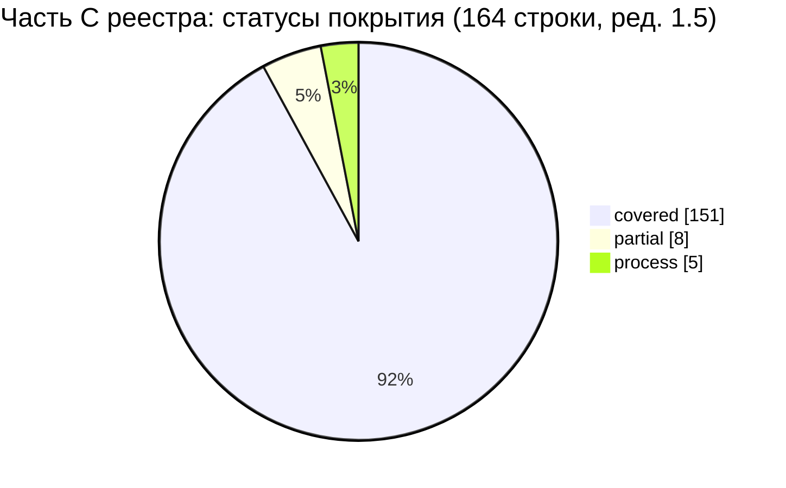

Ред. 1.2 сборки (волна 4): SRC-C-014 `process` → `partial` (ручных чертежей нет, Q-302); SRC-C-081 `covered` → `partial` (Q-012); SRC-C-077, SRC-C-080, SRC-C-082, SRC-C-119, SRC-C-131a `doc-stage2` → `partial` (локальная легенда §1.3 приведена к единой легенде §3.2 сводной части). План закрытия — сводная §5.1 № 26…32. Ред. 1.5 сборки: SRC-C-094 `partial` → `covered` (режим клиента — R1, ядро v1.9 §24.2; сводная §5.8).

#### 3.2. Разрез по разделам промта

| Раздел промта (строки) | Раздел матрицы | Строк | covered | partial | process | doc-stage2 | deferred-R2 | gap |
|---|---|---|---|---|---|---|---|---|
| 10. Главный экран продавца (253–306) | §2.1 | 61 | 59 | 2 | 0 | 0 | 0 | 0 |
| 11. Корзина и оформление заказа (307–328) | §2.2 | 30 | 26 | 4 | 0 | 0 | 0 | 0 |
| 12. Экран кассира (329–367) | §2.3 | 51 | 50 | 1 | 0 | 0 | 0 | 0 |
| 13. Профили, роли и права доступа (368–378) | §2.4 | 22 | 16 | 1 | 5 | 0 | 0 | 0 |
| **Итого** | | **164** | **151** | **8** | **5** | **0** | **0** | **0** |

#### 3.3. Разрез по типу требования (из реестра)

| Тип | Строк | Статусы |
|---|---|---|
| функц. | 134 | covered 133, partial 1 (SRC-C-018; ред. 1.5 сборки — SRC-C-094 → covered) |
| ограничение | 13 | covered 12, partial 1 (SRC-C-081, ред. 1.2) |
| нефункц. | 6 | covered 6 |
| процесс | 11 | process 5, partial 6 (SRC-C-014, SRC-C-077, SRC-C-080, SRC-C-082, SRC-C-119, SRC-C-131a, ред. 1.2) |

---

### 4. Частичные покрытия, пробелы и найденные расхождения — предложения

Пробелов (`gap`) в части C не найдено. Ниже — строки `partial` и расхождения между документами, влияющие на проверяемость требований части C.

| № | SRC-ID / объект | Что не так | Где проявляется | Предложение: куда добавить | Вопрос |
|---|---|---|---|---|---|
| P-1 | SRC-C-018 «компактный список» | 10 CAT-010 и 01 GEN-071 («сетка, список, компактный список; выбор запоминается», AC-GEN-071 «три режима на SCR-10/SCR-12») требуют переключения трёх представлений без оговорки о ширине экрана, а 02 UI-10-013 на compact и medium < 840 lp предлагает только два (`two`), отступление обосновано в 02 ч. B §14 (замечание 23). Требование промта на телефоне и планшете в портретной ориентации не выполняется, а три документа (01, 10, 02) расходятся | 01 §5.5 GEN-071, AC-GEN-071; 10 §5 CAT-010; 02 SCR-10 UI-10-013, UI-10-118, AC-UI-10-029 | Вариант (а): 02 SCR-10 — добавить режим `three` на compact (компактная строка без таблицы колонок UI-10-118; спецификация вида — 03 §9.26 `ViewModeSegmented`, §9.13 `ProductCardCompact`), AC-UI-10-029 расширить на compact; 01 и 10 не меняются. Вариант (б): с согласия заказчика явно зафиксировать отступление «компактный список — при ширине ≥ 840 lp» в 10 CAT-010 и 01 GEN-071 (с уточнением AC-GEN-071), запись об осознанном отступлении — в сводной 17 (по аналогии с ядром §19.4 для SRC-B-068), ADR — в 15 | Q-289 |
| P-2 | SRC-C-094 «подтверждённый номер» | CUST-003 считает номер подтверждённым только при совпадении с номером, подтверждённым OTP при `customer_link`; `customer_link` создаётся в режиме клиента-покупателя, который в R1 выключен (D-07, Q-001), а SMS-подтверждение при создании клиента перенесено в R2 (CUST-013, ядро §19.2). В R1 признак `verified` фактически не может стать `true` | 10 §15.2 CUST-003, CUST-013; 02 SCR-32 UI-32-001; 08 DTO `Customer.phones[{value, verified}]`; 01 §5.11 GEN-140 (AC-GEN-140 — только DTO по ролям, источник признака не задан) | 10 CUST-003 — указать источник признака в R1 после ответа на Q-285 (если в 1С есть реквизит подтверждения телефона — маппинг в 05 §5.1a и DTO 08; [НЕ ПОДТВЕРЖДЕНО]); иначе — записать в 01 и сводной 17 осознанное отступление «в R1 номер отображается с признаком „не подтверждён“, подтверждение — R2 (CUST-013)» и добавить AC в 10 §19.9. **Ред. 1.5 сборки:** источник в R1 есть — режим клиента включён в R1 ответом заказчика на Q-001, привязка по OTP-подтверждённому телефону — основной сценарий (ядро v1.9 §24.2, 09 REG-039); строка `covered`, условно Q-285 (сводная §5.8) | Q-285 |
| P-3 | SRC-C-092 (трактовка «его роли») | Покрытие полное, но реестр помечает формулировку как неоднозначную; ТЗ выбрало трактовку «роль текущего пользователя» без вопроса заказчику | 10 §15.1 CUST-001; 11 §4.4; 02 ч. D §0.4; 01 §3.3 ROLE-018 (видимость финансовых данных по роли сотрудника) | 14_OPEN_QUESTIONS — подтвердить трактовку; при иной трактовке (категория клиента) — доработать 10 §15.1, 11 §4.4 и 01 ROLE-018 | Q-286 |
| P-4 | Код `RECEIVABLES_STALE` (влияет на тесты SRC-C-112, SRC-C-140) | 07 AC-DATA-130 ожидает HTTP **409**, тогда как владелец кодов ошибок 08 §2.4 (ядро §18.1) и 11 AC-SEC-035 задают **422** | 07 DATA-130; 08 §2.4; 11 SEC-035 | 07 — привести AC-DATA-130 к 422 по 08 §2.4 | — |
| P-5 | SRC-C-091 (адресаты уведомлений) | Не дефект: уведомление `sync_error` (05 SYNC-038) адресовано `admin`/`owner`, а кассир видит ошибки синхронизации баннером дашборда (CASH-017, UI-30-001) по `GET /sync/status`. В центре уведомлений кассира (SCR-44) ошибок синхронизации не будет | 05 §7.6 SYNC-038; 10 CASH-017; 02 SCR-30 | Сохранить как есть или (по решению заказчика) расширить адресатов SYNC-038 ролью `cashier` для сущностей `stock`, `prices`, `receivables` | — |
| P-6 | 10 CASH-004 (ссылка «ROLE-* (01)») | Не дефект (снято при доработке): ссылка разрешается — 01 §3.2 содержит карточки ROLE-001…ROLE-007, 01 §3.3 — правила ROLE-010…ROLE-021; строки SRC-C-121…130, 132, 133 ссылаются на ROLE-001, ROLE-002, ROLE-004, ROLE-005, ROLE-010, ROLE-011, ROLE-018 (см. матрицу §2.4). Для SRC-C-131 и SRC-C-131a в 01 отдельного ROLE-ID нет: предварительность ролей зафиксирована только принципом 01 §3.1 со ссылкой на Q-005 | 10 §14.2 CASH-004; 01 §3.1–§3.3 | 01 — при желании выделить принцип §3.1 в отдельную строку ROLE-NNN с AC (не блокирует) | — |
| P-7 (ред. 1.2 сборки) | SRC-C-014, SRC-C-077, SRC-C-080, SRC-C-081, SRC-C-082, SRC-C-119, SRC-C-131a | Требования этапа 1, выполнение которых зависит от материалов или ответов заказчика (ручные чертежи; документы и способы оплаты 1С; доступные операции; кассовое оборудование; набор ролей), были помечены `process`/`doc-stage2`/`covered`; по единой легенде §3.2 сводной части — `partial` | матрица §2.1–§2.4 части | сводная §5.1 № 26…32 — план закрытия по каждой строке | Q-302, Q-012, Q-010, Q-013, Q-009, Q-019, Q-214, Q-005 |

---

### 5. Тесты 12_TEST_PLAN.md для части C (заглушки закрыты в ред. 1.1 сборки)

Ред. 1.1 сборки (2026-10-19, ядро v1.5 §20.1, §20.2 п.18–19): все 133 меток-заглушек теста этой части заменены в столбце «Тест» матрицы ID тестов 12_TEST_PLAN.md v1.1; построчное соответствие и способ подбора — §6.3 настоящего документа, тесты к добавлению в 12 — §6.4. Исходный список заглушек части с предложениями для 12 — в черновике части (`source/17_parts_drafts/`). Тесты безопасности `T-SEC-NNN` 11 §12.2 приняты 12 без перенумерации (ядро §20.1). Строки `process` и `doc-stage2` (11 строк) тестами не проверяются: приёмка — по наличию артефакта или методике этапа 1.

---

### 6. Открытые вопросы

#### 6.1. Вопросы ядра и документов ТЗ, влияющие на покрытие части C

| ID | Кратко | Строки части C | Статус |
|---|---|---|---|
| Q-001 | Режим клиента-покупателя в R1 | SRC-C-094 (источник `verified`) | закрыт ответом заказчика 2026-10-21 (ядро v1.9 §24.2); SRC-C-094 → `covered` (ред. 1.5 сборки, сводная §5.8) |
| Q-005 | Реальный состав ролей | SRC-C-121…131a | открыт (13 RM-A-003) |
| Q-009 | Сканеры штрихкодов | SRC-C-010, SRC-C-119 | открыт (13 RM-A-008) |
| Q-010 | Конфигурация и версия 1С | SRC-C-080 | открыт |
| Q-012 | Документы 1С для оплат/возвратов, приём заказов извне | SRC-C-077, 080, 081, 082 | открыт (13 RM-A-003, O-10) |
| Q-013 | Фискализация | SRC-C-119, SRC-C-120 | открыт (13 O-10) |
| Q-015 | Лимиты ручной скидки | SRC-C-067, SRC-C-113 | открыт |
| Q-019 | Печатные формы, НДС/ЭСФ | SRC-C-079a, SRC-C-119 | открыт (13 RM-A-009) |
| Q-021 | Единицы, упаковки, кратность | SRC-C-035 | открыт |
| Q-022 | Хранение фото в 1С, фото категорий | SRC-C-011c, SRC-C-055 | открыт |
| Q-175 | Порог статуса «Мало» | SRC-C-031 | открыт |
| Q-176 | Числовые параметры POS (недавние операции и др.) | SRC-C-086 | открыт |
| Q-204 | Сортировки «Сначала в наличии», «По артикулу» | SRC-C-019 | закрыт решением ядра v1.4 |
| Q-205 | Мультивыбор складов в фильтре наличия | SRC-C-022 | открыт |
| Q-206 | Цена на карточке товара с вариантами | SRC-C-029 | открыт |
| Q-214 | Кассовое оборудование на рабочем месте кассира | SRC-C-119 | открыт (13 RM-A-008) |
| Q-215 | Период журнала транзакций по умолчанию | SRC-C-115a | открыт (максимум 366 дней — ядро §19.4) |

#### 6.2. Новые вопросы трассировщика (диапазон 17: Q-280…Q-289, ядро §19.5)

> Ред. 1.1 сборки: окончательные номера вопросов диапазона 17 — §13.2, соответствие прежних номеров и меток — §13.3 (ядро v1.5 §20.2 п.18).

Номера **предварительные**. В первой редакции документа вопросы имели номера Q-280…Q-282, но эти номера уже заняты другими вопросами в частях 17B (Q-280) и 17E (Q-280…Q-282), а Q-283/Q-284 и Q-287/Q-288 — частями 17A и 17F. Поэтому взяты оставшиеся свободные номера диапазона 17 — Q-285, Q-286, Q-289. Окончательные номера назначает сборщик 17_TRACEABILITY_MATRIX или 14_OPEN_QUESTIONS (при необходимости — из диапазона 14, Q-290…Q-299); см. «Замечания к ядру», п. 7.

| ID | Прежний номер (ред. 1) | Вопрос | Влияние | Рекомендуемое допущение до ответа |
|---|---|---|---|---|
| Q-285 [НОВЫЙ ВОПРОС] | Q-280 | Есть ли в карточке клиента 1С признак подтверждённого телефона (или иной утверждённый источник подтверждения), который можно показывать как «подтверждённый номер» в R1? Если нет — согласен ли заказчик, что в R1 номер клиента отображается с признаком «не подтверждён», а подтверждение появится в R2 (CUST-013)? | SRC-C-094; 10 CUST-003; 01 GEN-140; 02 SCR-32; 05 §5.1a; 08 DTO `Customer.phones` | В R1 — «не подтверждён», если нет OTP-подтверждения через `customer_link`; отступление фиксируется в 01 и 17 |
| Q-286 [НОВЫЙ ВОПРОС] | Q-281 | Подтвердите трактовку промта «карточка клиента показывает только данные, разрешённые его роли»: имеется в виду роль сотрудника, открывшего карточку (продавец, кассир, администратор, руководитель), а не категория самого клиента? | SRC-C-092; 10 CUST-001, §15.1; 11 §4.4; 01 ROLE-018 | Роль текущего пользователя приложения (как в CUST-001 и ROLE-018) |
| Q-289 [НОВЫЙ ВОПРОС] | Q-282 | Нужен ли режим «компактный список» каталога на телефонах и на планшетах в портретной ориентации (ширина < 840 lp), или достаточно его на POS-мониторах и планшетах в альбомной ориентации? | SRC-C-018; 01 GEN-071 (AC-GEN-071); 10 CAT-010; 02 UI-10-013, UI-10-118; 03 §9.26 | По 02 UI-10-013 (компакт — при ширине ≥ 840 lp) с записью отступления; GEN-071 и CAT-010 уточняются после ответа |

---

### 7. Трассировка на исходные требования

Документ сам является трассировкой; собственных требований с ID он не вводит. Ниже — покрытие зоны и отображение новых вопросов на SRC.

#### 7.1. Покрытие зоны части C

| Раздел промта | Строки промта | SRC-ID | Раздел настоящего документа | Строк в матрице |
|---|---|---|---|---|
| 10. Главный экран продавца | 253–306 | SRC-C-001 … SRC-C-057 (с 004a, 011a…011c) | §2.1 | 61 |
| 11. Корзина и оформление заказа | 307–328 | SRC-C-058 … SRC-C-082 (с 075a…075c, 079a…079b) | §2.2 | 30 |
| 12. Экран кассира | 329–367 | SRC-C-083 … SRC-C-120 (с 090a, 093a, 099a, 107a, 115a…115d, 116a…116d, 118a) | §2.3 | 51 |
| 13. Профили, роли и права доступа | 368–378 | SRC-C-121 … SRC-C-140 (с 127a, 131a) | §2.4 | 22 |
| **Итого** | 253–378 | 164 ID | §2 | **164** |

#### 7.2. Новые элементы документа → SRC

| Элемент | SRC |
|---|---|
| Q-285 (предварительный номер; ред. 1 — Q-280) | SRC-C-094 |
| Q-286 (предварительный номер; ред. 1 — Q-281) | SRC-C-092 |
| Q-289 (предварительный номер; ред. 1 — Q-282) | SRC-C-018 |
| §4 P-4 (код `RECEIVABLES_STALE`) | SRC-C-112, SRC-C-140 |
| §5 (список заглушек) | все строки `covered`/`partial` части C, кроме закрытых только T-SEC |

---

### 8. Замечания к ядру

1. **Состояние 01 и 12 на дату трассировки (исправлено при доработке).** `01_PRODUCT_REQUIREMENTS.md` выпущен и ссылается на SRC-C (GEN-005, GEN-022, GEN-065…GEN-205, ROLE-001/002/004/005, ROLE-010, ROLE-011, ROLE-018, NFR-PERF-010, NFR-PERF-012, NFR-SEARCH-001, NFR-OFFLINE-004); его ID и AC-GEN/AC-ROLE внесены в матрицу §2 (163 из 164 строк; без ссылки из 01 — только SRC-C-014). Ссылка 10 CASH-004 на «ROLE-* (01)» разрешается (§4 P-6). `12_TEST_PLAN.md` существует, но в работе: готов только §3.1 (T-AUTH/T-SMS/T-SESS/T-BIO/T-FACE), тестов зоны C и ссылок на SRC-C нет; перечень `T-SEC-001…T-SEC-055` принят 12 §2.7 с сохранением ID 11 §12.2. Следствие: колонка «Тест» заполнена метками заглушка `<префикс>` (133 строки), кроме тестов `T-SEC-NNN`. Предложение: сборщику 17_TRACEABILITY_MATRIX заменить заглушки на ID из 12 после выпуска разделов 3.2 и далее; 01 — при желании выделить принцип §3.1 о предварительности ролей (SRC-C-131, SRC-C-131a) в отдельную строку ROLE-NNN с AC.
2. **Число строк части C.** В задании трассировщику объём части C указан как 175 (ядро §11 п.9 задаёт объём 17 «по числу SRC-строк»); это механический подсчёт всех строк файла, начинающихся с `| SRC-C-`, включая 11 строк таблицы «Исправленные строки» журнала проверки реестра. Требований в части C — **164** (140 исходных ID + 24 ID с суффиксом, что подтверждает и сам реестр: «всего в реестре 164 требования»). Предложение: считать объём по основной таблице реестра.
3. **Расхождение 01 / 10 ↔ 02 по SRC-C-018** (§4 P-1): GEN-071 (01) и CAT-010 (10 — владелец бизнес-правил по ядру §19.4) требуют трёх представлений без оговорки о ширине, а UI-10-013 (02) не предлагает «компактный список» на compact/medium < 840 lp. Предложение: решение ядра по Q-289 и, при сохранении отступления, его запись рядом с отступлением для SRC-B-068 (ядро §19.4, «фиксируется в 01 и 17»).
4. **Следствие ядра §19.2 для SRC-C-094** (§4 P-2): перенос CUST-013 в R2 при выключенном `CUSTOMER_SELF_SERVICE` оставляет «подтверждённый номер» без источника в R1. Предложение: зафиксировать в ядре как осознанное отступление (аналогично SRC-B-068) или назначить источник по ответу на Q-285. Ред. 1.5 сборки: снято ответом заказчика на Q-001 (ядро v1.9 §24.2) — сводная §5.8.
5. **Код ошибки `RECEIVABLES_STALE`** (§4 P-4): 07 AC-DATA-130 — 409, 08 §2.4 (владелец по ядру §18.1) и 11 AC-SEC-035 — 422. По правилу §18.1 07 приводится к 08.
6. **Обратные ссылки на SRC-C в 06, 07, 09, 13, 16.** В этих документах прямых ссылок на SRC-C нет; требования 07 (DATA-024, DATA-122, DATA-130, DATA-134, DATA-146, DATA-147, DATA-155, DATA-156, DATA-103…DATA-106), покрывающие строки части C, ссылаются на D-xx и SRC других частей. Нарушения ядра §10 нет (ссылка на SRC присутствует), но для сквозной обратной трассировки рекомендуется дополнить их трассировки ссылками на SRC-C (не блокирует).
7. **Номера вопросов документа 17 (коллизия).** Ядро §19.5 даёт документу 17 один общий диапазон Q-280…Q-289 без разбиения между шестью частями трассировки A–F. Первая редакция настоящей части использовала Q-280…Q-282 и тем самым пересеклась с 17B (Q-280 — отступление SRC-B-068) и 17E (Q-280 — метрика стабильности, Q-281 — «8 ролей», Q-282 — повторные запросы); 17A заняла Q-283, Q-284, 17F — Q-287, Q-288, 17D оставила кандидатов без номеров. Настоящая часть перенумерована на оставшиеся свободные номера Q-285, Q-286, Q-289 (помечены как предварительные, §6.2); после этого диапазон 17 исчерпан, и кандидатам 17D номеров в нём не остаётся. Предложение: (а) закрепить окончательные номера за сборщиком 17_TRACEABILITY_MATRIX с таблицей соответствия «часть → прежний номер → итоговый номер»; (б) снять двойное использование Q-280…Q-282 в 17B/17E (одна из частей переходит на номера из диапазона 14, Q-290…Q-299); (в) в следующей версии ядра разбить диапазон 17 по частям или выделить 17 дополнительный диапазон.

---

### Журнал проверки

Доработка по замечаниям рецензента (ред. 2, 2026-10-19). Правки точечные: статусы покрытия, счётчики §3 и список заглушек §5 не изменились.

| № | Замечание (важность) | Что исправлено | Где |
|---|---|---|---|
| 1 | Номера новых вопросов Q-280…Q-282 совпадают с вопросами 17B/17E (major) | Вопросы перенумерованы на свободные номера диапазона 17 и помечены как предварительные: Q-280 → **Q-285** (SRC-C-094), Q-281 → **Q-286** (SRC-C-092), Q-282 → **Q-289** (SRC-C-018). В §6.2 добавлена колонка «Прежний номер (ред. 1)» и пояснение о занятых номерах (17A — Q-283/Q-284, 17B — Q-280, 17E — Q-280…Q-282, 17F — Q-287/Q-288). Коллизия и исчерпание диапазона описаны в «Замечаниях к ядру», п. 7 | шапка; Краткое содержание; §1.4; §2.1 SRC-C-018; §2.3 SRC-C-092, SRC-C-094; §4 P-1…P-3; §6.2; §7.2; §8 п. 3, 4, 7 |
| 2 | Документ ошибочно утверждал, что 01 отсутствует; ID из 01 не были внесены в матрицу (major) | По Grep «SRC-C-» в 01 (с развёрткой диапазонов в порядке реестра) в колонки «Документ и раздел ТЗ», «ID требования(й) ТЗ» и «Критерий приёмки» добавлены ID 01: GEN-xxx (§2.7, §5.1…§5.19) с AC-GEN-xxx, ROLE-010/011/018 (§3.3) с AC-ROLE-xxx, карточки ROLE-001/002/004/005 (§3.2, без AC), NFR-PERF-010, NFR-PERF-012, NFR-SEARCH-001, NFR-OFFLINE-004 (§6.2, без AC). Ссылку из 01 получили 163 из 164 строк; SRC-C-131 и SRC-C-131a указывают на принцип 01 §3.1 без ID; без ссылки из 01 только SRC-C-014. Утверждения об отсутствии 01 убраны; P-6 переведён в «не дефект»; в P-1 и Q-289 GEN-071 указан как третий затронутый документ | шапка; Краткое содержание; §1.1 п. 3; §1.2; §1.4; §2.1–§2.4; §4 P-1, P-2, P-3, P-6; §6.2; §8 п. 1, 3 |
| 3 | Неверная формулировка «12_TEST_PLAN.md отсутствует» (minor) | Заменено на «12_TEST_PLAN.md на дату трассировки не содержит тестов зоны C (готов только §3.1)». Добавлено, что 12 §2.7 принимает перечень `T-SEC-001…T-SEC-055` из 11 §12.2 с сохранением ID. Метки-заглушки и список §5 сохранены | Краткое содержание; §1.4; §5 (вводный абзац и абзац T-SEC); §8 п. 1 |
| 4 | SRC-C-080 и SRC-C-082 ссылались на 08 §11.7 вместо §11.8 (minor) | «§11.7» заменено на «§11.8» (API-130, API-133 — 08 §11.8) | §2.2 |
| 5 | SRC-C-133: не указан 08 §11.9 (API-148); SRC-C-075/075a: не указан 08 §11.10 (API-161) (minor) | Добавлены §11.9 в строку SRC-C-133 и §11.10 в строки SRC-C-075, SRC-C-075a | §2.2, §2.4 |
| 6 | Найдено при повторной сверке (сверх замечаний) | В строке SRC-C-022 был указан API-054 без раздела 08; добавлено «08 §11.3 (`inStock`, `warehouseId`)» | §2.1 |

**Повторная проверка целостности (после правок):**

- В матрице §2 — 164 строки с уникальными ID SRC-C-001…SRC-C-140 (включая 24 ID с суффиксом), в каждой 8 колонок; итог по статусам — covered 151, partial 2, process 6, doc-stage2 5 (совпадает с §3.1); строк с заглушками — 133 (совпадает с §5).
- Все ID `GEN-…`, `ROLE-…`, `NFR-…`, `AC-GEN-…`, `AC-ROLE-…` из матрицы и текста найдены в 01_PRODUCT_REQUIREMENTS.md.
- Сверка «API-NNN в строке → подраздел 08 §11.x» выполнена скриптом для всех строк: у каждой строки указан подраздел 08 каждого её API-ID. Лишние ссылки остались в двух строках: SRC-C-117 (§11.4 — контекст идемпотентности заказов ORD-021) и SRC-C-133 (§11.8 — безопасность контракта); они не ошибочны и сохранены.
- Устаревшие номера Q-280…Q-282 остаются только как «прежний номер» и в описании коллизии (Краткое содержание, §6.2, §7.2, §8 п. 7).
- Файл записан в UTF-8; Mermaid-блоков два, оба закрыты.

---

## 10. Часть D — Матрица трассируемости, часть D: Flutter-архитектура, backend и модель данных, безопасность, тестирование, план реализации, критерии готовности, финальный отчёт

> Источник: часть D — раздел §10 настоящего документа (черновик части — `source/17_parts_drafts/`, ядро §20.1) · Версия 1.0 · Дата 2026-10-19 · Статус: черновик для утверждения заказчиком · Шапка части («Входные материалы», «Связанные документы», роль автора) опущена — см. шапку настоящего документа. Ссылки вида «§N» внутри этого раздела указывают на разделы **части D** (заголовки части сохранены с исходной нумерацией и понижены на один уровень; в сводных разделах настоящего документа на них ссылаются как «17D §N»); номера вопросов Q-28x в тексте части — предварительные, окончательные — §13.2. **Ред. 1.1 сборки (ядро v1.5 §20):** в столбце «Тест» строк этой части метки-заглушки заменены ID тестов 12 (§6), статусы строк §5.4 пересмотрены, номера вопросов — по §13.2–§13.3; упоминания заглушек и их числа в повествовательном тексте и журналах части ниже — история ред. части, действующие значения — §2, §6, §13.

**Состояние документов 01, 12, 14 на момент сверки.** В первой версии матрицы этих документов в каталоге не было. При доработке их листинг выполнялся дважды, и оба раза файлы ещё дописывались. В 05:08 (+04:00): 01 — 1537 строк, 12 — 385 строк (только §1–§3.1), 14 — 752 строки. В 05:20 (+04:00): 01 — 1537 строк (изменён в 05:10), 12 — 1395 строк (изменён в 05:17; написаны §1–§3.14, разделов §4–§13 оглавления ещё нет), 14 — 819 строк (изменён в 05:15). Матрица сверена с содержимым на 05:20 `[ПОДТВЕРЖДЕНО: листинг каталога и Grep по SRC-D 2026-10-19 05:20 +04:00]`. Сверку по 01, 12 и 14 нужно повторить при сборке 17, после того как авторы закончат эти документы (§10 п. 1).

### 1. Краткое содержание

1. Документ — матрица трассируемости для **всех 243 записей** части D реестра исходных требований (`SRC-D-001`…`SRC-D-192` с суффиксами): для каждой записи указано место в ТЗ, ID требований, критерий приёмки, тест и статус покрытия.
2. Каждая ссылка на раздел или ID проверена Grep по SRC-ID во всех `docs/specification/*.md` и `visual/*.md`, включая 01, 12 и 14 в состоянии на 05:20. У 17 записей прямой SRC-ссылки нет ни в одном документе: SRC-D-177…182, SRC-D-184, SRC-D-185, SRC-D-187…192 с суффиксами 189a…c. Для них место найдено поиском по ключевым словам и ID требований (помечено «по ключевым словам») `[ПОДТВЕРЖДЕНО: Grep 2026-10-19 05:20]`. В первой версии таких записей было 24. Прямые ссылки появились у SRC-D-134…139 (01 GEN-239, 12 C-01…C-10) и у SRC-D-186 (12 P-2).
3. Итог по статусам (§4): covered — 157, doc-stage2 — 54, process — 27, partial — 5, gap — 0, deferred-R2 — 0. Требований без места в ТЗ нет. Все 5 частичных покрытий относятся к составу финального отчёта и к запрету обещать безошибочность (SRC-D-182…185, SRC-D-187). После появления 12 и 14 в covered переведены SRC-D-091 (partial), SRC-D-172 (partial) и SRC-D-172a (doc-stage2).
4. Колонка «Тест» содержит ID теста или команды из 12_TEST_PLAN.md, если в 12 есть строка со ссылкой на эту запись SRC-D. Так заполнены 70 записей. Для пяти из них — SRC-D-032, 033, 140, 149a, 162 — строка 12 найдена по ключевым словам, а не по SRC-ссылке. Тесты обязательных сценариев промта: `T-AUTH-001…010` (12 §3.1.1), `T-CAT-001…010` (§3.3.1), `T-CART-001…010` (§3.4.1), `T-CASH-001…007` (§3.6.1), `T-SYNC-001…008` (§3.7.1), сценарии сбоев `T-SYNC-F01…F18` (§3.7.5). Команды CI — `C-01…C-18` (12 §2.9–§2.10). Также используются `T-ARCH`, `T-BUILD`, `T-SESS`, `T-SMS`, `T-ONEC`, `T-DEPLOY`. Строки 12 по префиксам DATA, SEC, INV, ORD и другим на записи SRC-D не ссылаются, поэтому для этих записей сохранены заглушка `<префикс>` и кандидаты документов-владельцев: 11 §12.2 — `T-SEC-001…055`, 04 — `T-FLOW-NNN-kk`. Привязку оставшихся заглушек к тестам 12 выполняет сборщик 17 (§7).
5. Требования разделов 18–20 промта (план, критерии готовности, финальный отчёт) по природе выполняются на ЭТАПЕ 2; они трассируются на задачи и доказательства 13_IMPLEMENTATION_ROADMAP.md (статус doc-stage2). На ЭТАПЕ 1 код не создаётся (R0 §0).
6. Обнаружено: регистр части D содержит 243 записи, а не 273 (273 — число строк с префиксом `| SRC-D` вместе с таблицами журнала проверки реестра); формулировка «гарантированно доходит до 1С» в 04 противоречит SRC-D-187; 08 не содержит SRC-D-ссылок, хотя покрывает SRC-D-080/083/086 (§5, §10).

---

### 2. Методика, легенда статусов и правила колонок

#### 2.1. Порядок трассировки

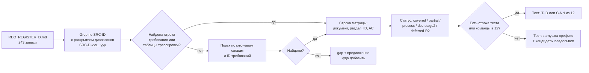

- Диапазоны вида `SRC-D-102…SRC-D-109`, `SRC-D-145…145d`, `SRC-D-104/104a` раскрывались по порядку записей реестра.
- Ссылки из шапок документов («Входные материалы», «зона трассировки: SRC-D-001…SRC-D-041») покрытием **не считались**; учитывались только строки требований (`| ID | … | Источник SRC-… |`), строки таблиц трассировки документов и строки трассировки экранов 02 (`SCR-xx.14`).
- Все ссылки колонки «Документ и раздел ТЗ» — `[ПОДТВЕРЖДЕНО: Grep 2026-10-19]`; номер раздела указан так, как он озаглавлен в документе. «(трасс.)» — таблица трассировки документа; «(по ключевым словам)» — место найдено без прямой SRC-ссылки.

#### 2.2. Легенда статусов покрытия

| Статус | Значение |
|---|---|
| covered | В ТЗ есть проверяемое требование (ID) и критерий приёмки `AC-…`, полностью покрывающие запись |
| partial | Покрыта часть записи, или нет отдельного требования/AC, или нет обратной SRC-ссылки при неочевидном соответствии — предложение в §5 |
| process | Требование к процессу работы; выполнено методикой ЭТАПА 1 (указано, чем) и/или закреплено правилом для ЭТАПА 2 |
| doc-stage2 | Артефакт или действие ЭТАПА 2; в ТЗ указано, где он будет создан/выполнен (задача `RM-…` в 13, раздел 16) |
| deferred-R2 | Перенесено в Release 2 с Q-ссылкой (в части D таких записей нет) |
| gap | Места в ТЗ не найдено (в части D таких записей нет) |

#### 2.3. Правила колонок

- «Тип» — из реестра (функц. / нефункц. / ограничение / процесс / документ).
- «Критерий приёмки» — ID `AC-…` из документа-владельца требования; «—» — у требования нет отдельного AC (раздел/таблица 13 служит доказательством).
- «Тест» — ID теста `T-…` или команды CI `C-NN` из 12_TEST_PLAN.md с указанием раздела 12, если в 12 на момент листинга (05:20) есть такая строка со ссылкой на запись SRC-D или однозначным номером сценария. Если строки нет — заглушка `<префикс>`, а в скобках ID-кандидаты, уже назначенные документами-владельцами. Если номер теста подобран по номеру сценария, а не по SRC-ссылке (например, `T-SYNC-F03` по сбою F3 из 05 §13), это указано в ячейке «Документ и раздел ТЗ» («по номеру сбоя») или «(по ключевым словам)». «н/п» — тест неприменим (процесс или документ ЭТАПА 1).
- Сокращения документов: 01 … 16 — номера файлов ТЗ; `ADR-…` — 15_DECISION_LOG.md; `RM-…` — 13_IMPLEMENTATION_ROADMAP.md; `GEN-…`, `NFR-…`, `ROLE-…` — 01_PRODUCT_REQUIREMENTS.md; `C-NN`, `P-N` (в ссылке «12 …») — 12 §2.10 и §2.1. Ссылки на 01, 12 и 14 расположены в конце ячейки «Документ и раздел ТЗ»: они добавлены при доработке по состоянию на 05:20.

---

### 3. Матрица трассируемости

#### 3.1. Раздел 14 промта — требования к Flutter-архитектуре (SRC-D-001…SRC-D-041)

| SRC-ID | Краткая формулировка | Тип | Документ и раздел ТЗ | ID требования(й) ТЗ | Критерий приёмки (AC-…) | Тест | Статус покрытия |
|---|---|---|---|---|---|---|---|
| SRC-D-001 | Использовать актуальную стабильную версию Flutter | ограничение | 06 §2.1, §6.16, §17.1, §19 (трасс.); 15 ADR-004; 12 §3.12.3 (T-ARCH-003) | ARCH-014; ADR-004 | AC-ARCH-014; AC-ADR-004 | T-ARCH-003 (12 §3.12.3) | covered |
| SRC-D-002 | Зависимости должны быть совместимы и проверены в текущем окружении | ограничение | 06 §6.16, §16, §17.1; 13 §3.3; 01 §6.2; 12 §3.12.3 (T-ARCH-003); 15 ADR-004 | ARCH-014; ADR-004; RM-C-013; NFR-MAINT-001 | AC-ARCH-014; AC-RM-C-013 | T-ARCH-003 (12 §3.12.3) | covered (совместимость набора `[ТИПОВО]` до пробной сборки RM-C-013) |
| SRC-D-003 | Перед выбором библиотеки проверить её совместимость | процесс | 06 §16, §17.1, §19 (трасс.); 01 §6.2; 12 §3.12.3 (T-ARCH-003) | ARCH-015; NFR-MAINT-001 | AC-ARCH-015 | н/п (процесс ЭТАПА 1); на ЭТАПЕ 2 — T-ARCH-003 (12 §3.12.3) | process (ЭТАП 1: исследование R3 §1, обоснование 06 §16; правило ARCH-015 для ЭТАПА 2) |
| SRC-D-004 | Перед выбором библиотеки проверить её поддержку (активность сопровождения) | процесс | 06 §16, §17.1; 15 ADR-004; 01 §6.2; 12 §3.12.3 (T-ARCH-003) | ARCH-015; ADR-004; NFR-MAINT-001 | AC-ARCH-015; AC-ADR-004 | н/п (процесс ЭТАПА 1); на ЭТАПЕ 2 — T-ARCH-003 (12 §3.12.3) | process (ЭТАП 1: R3 §1 — даты релизов/активность; 06 §16) |
| SRC-D-005 | Перед выбором библиотеки проверить её лицензию | процесс | 06 §16, §17.1; 15 ADR-004, ADR-049; 01 §6.2; 12 §3.12.3 (T-ARCH-003) | ARCH-015; ADR-004; ADR-049; NFR-MAINT-001 | AC-ARCH-015; AC-ADR-004 | н/п (процесс ЭТАПА 1); на ЭТАПЕ 2 — T-ARCH-003 (12 §3.12.3) | process (ЭТАП 1: лицензии в 06 §16, 15 ADR-004/ADR-049) |
| SRC-D-006 | Перед выбором библиотеки проверить состояние проекта (жив/заброшен) | процесс | 06 §16, §17.1; 15 ADR-004; 01 §6.2; 12 §3.12.3 (T-ARCH-003) | ARCH-015; ADR-004; NFR-MAINT-001 | AC-ARCH-015; AC-ADR-004 | н/п (процесс ЭТАПА 1); на ЭТАПЕ 2 — T-ARCH-003 (12 §3.12.3) | process (ЭТАП 1: R3 §12 — отказ от discontinued пакетов, 06 §6.13) |
| SRC-D-007 | Приложение организуется по функциональным модулям | нефункц. | 06 §6.2, §6.15, §17.2; 15 ADR-005; 01 §5.21 | MOD-001; ADR-005; GEN-219 | AC-MOD-001; AC-ADR-005; AC-GEN-219 | T-ARCH-001 | covered |
| SRC-D-008 | Предусмотреть модуль core | нефункц. | 06 §6.2, §17.2; 01 §5.21 | MOD-002; GEN-219 | AC-MOD-002; AC-GEN-219 | T-ARCH-010 | covered |
| SRC-D-009 | Предусмотреть модуль design_system | нефункц. | 06 §6.2, §17.2; 01 §5.21 | MOD-003; GEN-219 | AC-MOD-003; AC-GEN-219 | T-ARCH-010 | covered |
| SRC-D-010 | Предусмотреть модуль authentication | нефункц. | 06 §6.15, §17.2; 01 §5.21 | MOD-004; GEN-219 | AC-MOD-004; AC-GEN-219 | T-ARCH-010 | covered |
| SRC-D-011 | Предусмотреть модуль registration | нефункц. | 06 §6.15, §17.2; 01 §5.21 | MOD-005; GEN-219 | AC-MOD-005; AC-GEN-219 | T-ARCH-010 | covered |
| SRC-D-012 | Предусмотреть модуль catalog | нефункц. | 06 §6.15, §17.2; 01 §5.21 | MOD-006; GEN-219 | AC-MOD-006; AC-GEN-219 | T-ARCH-010 | covered |
| SRC-D-013 | Предусмотреть модуль product_details | нефункц. | 06 §6.15, §17.2; 01 §5.21 | MOD-007; GEN-219 | AC-MOD-007; AC-GEN-219 | T-ARCH-010 | covered |
| SRC-D-014 | Предусмотреть модуль cart | нефункц. | 06 §6.15, §17.2; 01 §5.21 | MOD-008; GEN-219 | AC-MOD-008; AC-GEN-219 | T-ARCH-010 | covered |
| SRC-D-015 | Предусмотреть модуль checkout | нефункц. | 06 §6.15, §17.2; 01 §5.21 | MOD-009; GEN-219 | AC-MOD-009; AC-GEN-219 | T-ARCH-010 | covered |
| SRC-D-016 | Предусмотреть модуль cashier | нефункц. | 06 §6.15, §17.2; 01 §5.21 | MOD-010; GEN-219 | AC-MOD-010; AC-GEN-219 | T-ARCH-010 | covered |
| SRC-D-017 | Предусмотреть модуль customers | нефункц. | 06 §6.15, §17.2; 01 §5.21 | MOD-011; GEN-219 | AC-MOD-011; AC-GEN-219 | T-ARCH-010 | covered |
| SRC-D-018 | Предусмотреть модуль transactions | нефункц. | 06 §6.15, §17.2; 01 §5.21 | MOD-012; GEN-219 | AC-MOD-012; AC-GEN-219 | T-ARCH-010 | covered |
| SRC-D-019 | Предусмотреть модуль favorites | нефункц. | 06 §6.15, §17.2; 01 §5.21 | MOD-013; GEN-219 | AC-MOD-013; AC-GEN-219 | T-ARCH-010 | covered |
| SRC-D-020 | Предусмотреть модуль profile | нефункц. | 06 §6.15, §17.2; 01 §5.21 | MOD-014; GEN-219 | AC-MOD-014; AC-GEN-219 | T-ARCH-010 | covered |
| SRC-D-021 | Предусмотреть модуль settings | нефункц. | 06 §6.15, §17.2; 01 §5.21 | MOD-015; GEN-219 | AC-MOD-015; AC-GEN-219 | T-ARCH-010 | covered |
| SRC-D-022 | Предусмотреть модуль sync_status | нефункц. | 06 §6.15, §17.2; 01 §5.21 | MOD-016; GEN-219 | AC-MOD-016; AC-GEN-219 | T-ARCH-010 | covered |
| SRC-D-023 | Разделить слои: UI, состояние, бизнес-логика, репозитории, сетевой слой | нефункц. | 06 §6.1, §17.1; 15 ADR-005; 01 §5.21 | ARCH-016; ADR-005; GEN-217 | AC-ARCH-016; AC-ADR-005; AC-GEN-217 | T-ARCH-001 | covered |
| SRC-D-024 | Запрет на сосредоточение всей логики в одном файле/виджете | ограничение | 06 §6.1, §17.1; 15 ADR-005; 01 §5.21 | ARCH-017; ADR-005; GEN-218 | AC-ARCH-017; AC-GEN-218 | T-ARCH-001, T-BUILD-003 | covered |
| SRC-D-025 | Использовать типизированные модели данных | нефункц. | 06 §6.8, §17.1 | ARCH-022 | AC-ARCH-022 | T-ARCH-003, T-BUILD-004 | covered |
| SRC-D-026 | Централизованная обработка ошибок | нефункц. | 06 §6.8, §17.1; 15 ADR-056; 01 §5.21 | ARCH-022; ADR-056; GEN-225 | AC-ARCH-022; AC-ADR-056; AC-GEN-225 | T-ARCH-003, T-BUILD-004 | covered |
| SRC-D-027 | Маршрутизация (навигация) выделена как отдельный архитектурный механизм | нефункц. | 06 §6.4, §17.1; 15 ADR-050; visual/navigation.md; 01 §5.1 | ARCH-019; ADR-050; GEN-021 | AC-ARCH-019; AC-ADR-050; AC-GEN-021 | T-ARCH-003, T-UI-102 | covered |
| SRC-D-028 | Управление конфигурацией приложения | нефункц. | 06 §6.9, §17.1; 01 §5.21 | ARCH-024; GEN-225 | AC-ARCH-024; AC-GEN-225 | T-ARCH-006 | covered |
| SRC-D-029 | Сервисы должны быть тестируемыми | нефункц. | 06 §6.13, §7.12, §17.1; 12 §2.1 (P-7); 12 §3.12.3 (T-ARCH-007) | ARCH-025 | AC-ARCH-025 | T-ARCH-007 (12 §3.12.3) | covered |
| SRC-D-030 | Запрет добавления пакетов лишь по популярности | ограничение | 06 §2.2 (C-6), §16, §17.1; 15 ADR-004, §9 (трасс.); 01 §5.21 | ARCH-015; ADR-004; GEN-226 | AC-ARCH-015; AC-ADR-004; AC-GEN-226 | н/п | covered |
| SRC-D-031 | Каждая существенная архитектурная зависимость должна быть обоснована | процесс | 06 §16, §17.1; 15 §6, ADR-004; 01 §5.21 | ARCH-015; ADR-004; GEN-226 | AC-ARCH-015; AC-ADR-004; AC-GEN-226 | н/п | process (ЭТАП 1: 06 §16 и 15 §6 — польза/стоимость/альтернативы по каждой зависимости) |
| SRC-D-032 | Безопасное хранение сессионных данных в приложении | нефункц. | 06 §6.6, §17.1; 15 ADR-012, ADR-061; 02 SCR-08.14 (трасс.); 01 §5.4, §5.21; 12 §3.1.3 (T-SESS-003, T-SESS-022) (по ключевым словам) | ARCH-021; ADR-012; ADR-061; GEN-055; GEN-056; GEN-229 | AC-ARCH-021; AC-ADR-012; AC-GEN-055; AC-GEN-056; AC-GEN-229 | T-SESS-003, T-SESS-022 (12 §3.1.3); T-SEC-035 | covered |
| SRC-D-033 | Корректное завершение сессии (logout/истечение) | функц. | 06 §6.7, §17.1; 15 ADR-012; 02 SCR-07.14, SCR-08.14, SCR-90.14 (трасс.); 01 §5.4; 12 §3.1.3 (T-SESS-013) (по ключевым словам) | ARCH-021; ADR-012; GEN-061 | AC-ARCH-021; AC-ADR-012; AC-GEN-061 | T-SESS-013 (12 §3.1.3); T-SEC-012 | covered |
| SRC-D-034 | Обработка потери сети в приложении | функц. | 06 §6.7, §6.11, §6.12, §17.1; 15 ADR-032; 02 SCR-08.14, SCR-90.14 (трасс.); 01 §5.1, §5.7, §5.21 | ARCH-020; ARCH-026; ARCH-027; ARCH-062; ADR-032; GEN-023; GEN-101; GEN-228 | AC-ARCH-026; AC-ARCH-027; AC-ARCH-062; AC-ADR-032; AC-GEN-023; AC-GEN-101; AC-GEN-228 | T-ARCH-008, T-ARCH-003, T-ARCH-009, T-UI-090, T-FAIL-021 | covered |
| SRC-D-035 | Восстановление состояния приложения | функц. | 06 §6.4, §6.12, §17.1; 15 ADR-032, ADR-050; 01 §5.21 | ARCH-019; ARCH-020; ARCH-026; GEN-228 | AC-ARCH-019; AC-ARCH-020; AC-ARCH-026; AC-GEN-228 | T-ARCH-003, T-ARCH-008, T-CAT-023, T-FAIL-001 | covered |
| SRC-D-036 | Для каждой целевой платформы (Windows/Android/iOS) отдельно проверить требования платформы | процесс | 06 §6.16, §17.1; 15 ADR-039; 01 §5.23 | ARCH-028; ADR-039; GEN-241 | AC-ARCH-028; AC-ADR-039; AC-GEN-241 | н/п | process (ЭТАП 1: чек-лист платформ 06 §6.16 по R3 §13; проверка сборкой — RM-C-013, ЭТАП 2; iOS — Q-008) |
| SRC-D-037 | Проверить ввод с клавиатуры на каждой целевой платформе | процесс | 06 §6.16, §17.1; 15 ADR-042; visual/navigation.md, visual/responsive-spec.md; 01 §5.1, §5.23, §6.2 | ARCH-028; ADR-042; GEN-028; GEN-241; NFR-A11Y-002 | AC-ARCH-028; AC-ADR-042; AC-GEN-028; AC-GEN-241 | T-ARCH-012, T-NFR-035, T-A11Y-009, T-A11Y-010 | process (чек-лист 06 §6.16; фактическая проверка — RM-C-013/RM-H-007) |
| SRC-D-038 | Проверить размеры экрана на каждой целевой платформе | процесс | 06 §6.16, §17.1; 01 §5.23 | ARCH-028; GEN-241 | AC-ARCH-028; AC-GEN-241 | T-ARCH-012 | process (брейкпоинты D-18, 06 §6.16; golden-тесты compact/medium/expanded — 13 §6.1 п. 4) |
| SRC-D-039 | Проверить работу сканеров на каждой целевой платформе | процесс | 06 §6.16, §17.1; 15 ADR-042; 01 §5.23, §6.2 | ARCH-028; ADR-042; GEN-241; NFR-PERF-012; NFR-DEV-003 | AC-ARCH-028; AC-ADR-042; AC-GEN-241 | T-ARCH-012, T-PERF-018, T-CAT-012, T-CAT-013 | process (чек-лист 06 §6.16; модели сканеров — Q-009, RM-A-008) |
| SRC-D-040 | Проверить особенности установки на каждой целевой платформе | процесс | 06 §6.16, §17.1; 15 ADR-039; 01 §5.23 | ARCH-028; ADR-039; GEN-241 | AC-ARCH-028; AC-GEN-241 | н/п | process (Windows R1 — zip-архив и установка администратором, подписанный MSIX — R2 по ядру v1.5 §20.2 п.13; APK — 06 §6.16; фактическая установка — RM-H-007, RM-I-001) |
| SRC-D-041 | Запрет заявлять поддержку платформы без проверенной сборки | ограничение | 06 §2.2 (C-8), §6.16, §17.1; 15 ADR-039; 01 §5.23 | ARCH-029; ADR-039; GEN-241 | AC-ARCH-029; AC-ADR-039; AC-GEN-241 | T-ARCH-012, T-BUILD-007 | covered |

#### 3.2. Раздел 15 промта — backend и модель данных (SRC-D-042…SRC-D-076)

| SRC-ID | Краткая формулировка | Тип | Документ и раздел ТЗ | ID требования(й) ТЗ | Критерий приёмки (AC-…) | Тест | Статус покрытия |
|---|---|---|---|---|---|---|---|
| SRC-D-042 | Сущности проектируются по реальной структуре магазина | процесс | 07 §1, §3, §5, §18 (трасс.) | DATA-102 | AC-DATA-102 | н/п | process (ЭТАП 1: карточки 07 §5 построены по R1 §5, R5 §4 и макетам; подтверждение по `$metadata` 1С — RM-A-002, Q-010) |
| SRC-D-043 | Перед проектированием исследовать перечисленные сущности-кандидаты | процесс | 07 §2.2, §3, §5, §18 (трасс.), §19 | DATA-003 | AC-DATA-003 | н/п | process (ЭТАП 1: по каждой сущности-кандидату — карточка 07 §5 или решение об объединении/исключении, 07 §19 п. 1–2) |
| SRC-D-044 | Исследовать/предусмотреть сущность users | процесс | 07 §5.1, §18 (трасс.) | DATA-100 | AC-DATA-100 | T-DATA-003, T-REG-012 | covered |
| SRC-D-045 | Исследовать/предусмотреть сущность user_profiles | процесс | 07 §5.2, §18 (трасс.) | DATA-101 | AC-DATA-101 | T-DATA-003 | covered |
| SRC-D-046 | Исследовать/предусмотреть сущность customer_links (связь пользователя с клиентом) | процесс | 07 §5.30, §6.6, §18 (трасс.) | DATA-129; DATA-207 | AC-DATA-129; AC-DATA-207 | T-DATA-005, T-DATA-008, T-CUST-012 | covered |
| SRC-D-047 | Исследовать/предусмотреть сущность products | процесс | 07 §5.16, §18 (трасс.) | DATA-115 | AC-DATA-115 | T-DATA-004 | covered |
| SRC-D-048 | Исследовать/предусмотреть сущность product_variants | процесс | 07 §5.17–5.19, §18 (трасс.) | DATA-116; DATA-117; DATA-118 | AC-DATA-116; AC-DATA-117; AC-DATA-118 | T-DATA-004 | covered |
| SRC-D-049 | Исследовать/предусмотреть сущность categories | процесс | 07 §5.15, §18 (трасс.) | DATA-114 | AC-DATA-114 | T-DATA-004, T-CAT-003 | covered |
| SRC-D-050 | Исследовать/предусмотреть сущность product_images | процесс | 07 §5.23, §18 (трасс.) | DATA-122 | AC-DATA-122 | T-DATA-004, T-SYNC-043 | covered |
| SRC-D-051 | Исследовать/предусмотреть сущность warehouses | процесс | 07 §5.24, §18 (трасс.) | DATA-123 | AC-DATA-123 | T-DATA-004 | covered |
| SRC-D-052 | Исследовать/предусмотреть сущность stock_balances | процесс | 07 §5.25, §18 (трасс.) | DATA-124 | AC-DATA-124 | T-DATA-004 | covered |
| SRC-D-053 | Исследовать/предусмотреть сущность price_lists | процесс | 07 §5.26–5.27, §18 (трасс.) | DATA-125; DATA-126 | AC-DATA-125; AC-DATA-126 | T-DATA-004 | covered |
| SRC-D-054 | Исследовать/предусмотреть сущность customers | процесс | 07 §5.28–5.29, §18 (трасс.) | DATA-127; DATA-128; DATA-166; DATA-167 | AC-DATA-127; AC-DATA-166 | T-DATA-005, T-CUST-008, T-ORD-004, T-REG-021 | covered |
| SRC-D-055 | Исследовать/предусмотреть сущность orders | процесс | 07 §5.37, §6.3, §6.6, §18 (трасс.) | DATA-136; DATA-201; DATA-202 | AC-DATA-136; AC-DATA-201; AC-DATA-202 | T-DATA-008, T-DATA-006, T-ORD-017 | covered |
| SRC-D-056 | Исследовать/предусмотреть сущность order_items | процесс | 07 §5.38, §7.6, §18 (трасс.) | DATA-137; DATA-213 | AC-DATA-137; AC-DATA-213 | T-DATA-006, T-DATA-009, T-MNY-029, T-PRINT-006 | covered |
| SRC-D-057 | Исследовать/предусмотреть сущность payments | процесс | 07 §5.40–5.41, §6.4, §6.6, §18 (трасс.) | DATA-139; DATA-140; DATA-203 | AC-DATA-139; AC-DATA-140; AC-DATA-203 | T-DATA-006, T-DATA-008, T-PAY-014 | covered |
| SRC-D-058 | Исследовать/предусмотреть сущность transactions | процесс | 07 §4.6, §5.44, §18 (трасс.) | DATA-032; DATA-143 | AC-DATA-032; AC-DATA-143 | T-DATA-002, T-DATA-006, T-TXN-005 | covered |
| SRC-D-059 | Исследовать/предусмотреть сущность receivables (дебиторская задолженность/долги) | процесс | 07 §3, §5.31–5.32, §18 (трасс.) | DATA-024; DATA-130; DATA-131 | AC-DATA-024; AC-DATA-130; AC-DATA-131 | T-DATA-005, T-DATA-002, T-DEBT-001, T-SYNC-015 | covered |
| SRC-D-060 | Исследовать/предусмотреть сущность favorites | процесс | 07 §5.47–5.48, §18 (трасс.) | DATA-146; DATA-147 | AC-DATA-146; AC-DATA-147 | T-DATA-006, T-FAV-001, T-FAV-005 | covered (сущность промта представлена двумя таблицами ядра `favorites_products`, `favorites_customers`) |
| SRC-D-061 | Исследовать/предусмотреть сущность carts | процесс | 07 §5.35, §6.6, §11.6, §18 (трасс.) | DATA-134; DATA-205; DATA-253 | AC-DATA-134; AC-DATA-205; AC-DATA-253 | T-DATA-006, T-DATA-008, T-DATA-013, T-CART-005 | covered |
| SRC-D-062 | Исследовать/предусмотреть сущность cart_items | процесс | 07 §5.36, §18 (трасс.) | DATA-135 | AC-DATA-135 | T-DATA-006 | covered |
| SRC-D-063 | Исследовать/предусмотреть сущность sync_runs | процесс | 07 §5.51–5.52, §5.54, §6.6, §18 (трасс.) | DATA-150; DATA-151; DATA-153; DATA-154; DATA-209 | AC-DATA-150; AC-DATA-209 | T-DATA-007, T-DATA-008, T-SYNC-001, T-SYNC-021 | covered |
| SRC-D-064 | Исследовать/предусмотреть сущность sync_errors | процесс | 07 §5.53, §18 (трасс.) | DATA-152 | AC-DATA-152 | T-DATA-007, T-SYNC-025 | covered |
| SRC-D-065 | Исследовать/предусмотреть сущность audit_logs | процесс | 07 §5.57–5.58, §9, §9.7, §18 (трасс.) | DATA-156; DATA-157; DATA-230…DATA-238 | AC-DATA-156; AC-DATA-230 | T-DATA-011, T-DATA-007, T-SEC-030, T-SEC-038 | covered |
| SRC-D-066 | Перечень сущностей является предварительным и подлежит уточнению | процесс | 07 §1, §2.2, §5, §18 (трасс.), §19 | DATA-003 | AC-DATA-003 | н/п | process (ЭТАП 1: 63 карточки 07 §5 = 56 таблиц ядра §6 + 7 таблиц ядра §17.3 — уточнение предварительного перечня) |
| SRC-D-067 | Запрет дублирования сущностей, уже существующих в проекте или принадлежащих 1С | ограничение | 07 §2.2, §3, §5, §18 (трасс.); 05 §4.2, §7.1, §16 (трасс.); 10 §15.3, §22 (трасс.) | DATA-013; DATA-020; DATA-021; DATA-163; DATA-166; ONEC-026; SYNC-004; CUST-014 | AC-DATA-013; AC-DATA-020; AC-ONEC-026; AC-SYNC-004; AC-CUST-014 | T-DATA-002, T-DATA-001, T-DATA-004, T-DATA-005 | covered |
| SRC-D-068 | Для каждой сущности определить первичный ключ | документ | 07 §2.2, §5 (поле PK), §14.8, §18 (трасс.) | DATA-001; DATA-008; DATA-285 | AC-DATA-001; AC-DATA-008; AC-DATA-285 | T-DATA-001, T-DATA-015, T-CAT-010 | covered |
| SRC-D-069 | Для каждой сущности определить внешний идентификатор 1С | документ | 07 §2.2, §3, §5 (поле «Внешний id 1С»), §8.6, §18 (трасс.); 05 §4.2, §5.2, §16 (трасс.); 15 ADR-028 | DATA-008; DATA-021; DATA-023; DATA-127; DATA-136; DATA-139; DATA-141; DATA-222; ONEC-026; ONEC-100 | AC-DATA-008; AC-DATA-023; AC-ONEC-100 | T-DATA-006, T-DATA-002, T-DATA-001, T-DATA-005 | covered |
| SRC-D-070 | Для каждой сущности определить ограничения уникальности | документ | 07 §2.2, §5 (поле «Уникальность»), §18 (трасс.) | DATA-008; DATA-100; DATA-102; DATA-116; DATA-121; DATA-123; DATA-125; DATA-126; DATA-127; DATA-129; DATA-134; DATA-139; DATA-150; DATA-154; DATA-155 | AC-DATA-008; AC-DATA-116; AC-DATA-129 | T-DATA-004, T-DATA-007, T-DATA-003, T-DATA-005 | covered |
| SRC-D-071 | Для каждой сущности определить индексы | документ | 07 §5 (поле «Индексы»), §10.2, §10.6, §12.5, §18 (трасс.) | DATA-164; DATA-240…DATA-243; DATA-246; DATA-272 | AC-DATA-164; AC-DATA-240; AC-DATA-272 | T-DATA-012, T-DATA-004, T-DATA-014, T-CAT-002 | covered |
| SRC-D-072 | Для каждой сущности определить правила удаления | документ | 07 §2.2, §5 (поле «Удаление»), §13.3–13.4, §15.3, §15.6, §18 (трасс.) | DATA-006; DATA-007; DATA-148; DATA-149; DATA-282; DATA-293; DATA-294 | AC-DATA-006; AC-DATA-007; AC-DATA-293 | T-DATA-001, T-DATA-016, T-DATA-006, T-DATA-007 | covered |
| SRC-D-073 | Для каждой сущности определить происхождение данных (источник: 1С / приложение / иное) | документ | 07 §2.2, §3, §5 (колонка «Происх.»), §6.6, §11.6, §18 (трасс.); 05 §4.2, §5.2 | DATA-013; DATA-020; DATA-021; DATA-163; DATA-166; DATA-209; DATA-251; ONEC-026; ONEC-100 | AC-DATA-020; AC-DATA-251; AC-ONEC-100 | T-DATA-002, T-DATA-001, T-DATA-004, T-DATA-005 | covered |
| SRC-D-074 | Денежные значения хранятся и вычисляются в точной десятичной арифметике; неконтролируемые double-вычисления для денег недопустимы | ограничение | 07 §2.2, §7, §7.6, §11.6, §18 (трасс.); 10 §18.2, §22 (трасс.); 11 §3.2, §16 (трасс.); 13 §2.1 (P-9); 01 §5.12, §6.2 | DATA-005; DATA-210…DATA-215; DATA-217; DATA-252; MNY-008; SEC-010; GEN-156; NFR-TEST-004 | AC-DATA-005; AC-DATA-210; AC-MNY-008; AC-SEC-010; AC-GEN-156 | T-MNY-009, T-MNY-014, T-MNY-028, T-MNY-029 (тест-векторы `MV-NN` 10 §18.2) | covered |
| SRC-D-075 | Финансовые изменения и критичные переходы статусов выполняются атомарно (транзакционно) там, где это требуется бизнес-процессом | нефункц. | 07 §5, §6.6, §8.5, §8.6, §18 (трасс.); 11 §3.5, §16 (трасс.) | DATA-138; DATA-142; DATA-143; DATA-146; DATA-162; DATA-201; DATA-203; DATA-222; DATA-227; SEC-023; SEC-024 | AC-DATA-201; AC-DATA-222; AC-SEC-023; AC-SEC-024 | T-DATA-006, T-DATA-008, T-DATA-010, T-SEC-023 | covered |
| SRC-D-076 | Запрет изменения финансовой истории задним числом без корректирующих документов и записи аудита | ограничение | 07 §2.2, §8.6, §9.2, §9.7, §12.5, §14.8, §15.6, §18 (трасс.); 11 §3.5, §16 (трасс.); 01 §5.21 | DATA-004; DATA-136; DATA-156; DATA-161; DATA-228; DATA-231; DATA-235; DATA-275; DATA-287; DATA-293; SEC-024; SEC-074…SEC-076; SEC-079; SEC-084; SEC-125; GEN-221 | AC-DATA-004; AC-DATA-228; AC-SEC-024; AC-GEN-221 | T-DATA-006, T-DATA-011, T-DATA-001, T-DATA-007, T-SEC-041 | covered |

#### 3.3. Раздел 16 промта — безопасность (SRC-D-077…SRC-D-090)

| SRC-ID | Краткая формулировка | Тип | Документ и раздел ТЗ | ID требования(й) ТЗ | Критерий приёмки (AC-…) | Тест | Статус покрытия |
|---|---|---|---|---|---|---|---|
| SRC-D-077 | HTTPS для всех сетевых соединений | нефункц. | 11 §3.1, §8.2, §16 (трасс.); 08 §2.1 (по ключевым словам); 01 §5.20, §6.2 | SEC-001…SEC-006; SEC-086; SEC-095; API-001; GEN-207; NFR-SEC-001 | AC-SEC-001; AC-SEC-006; AC-SEC-086; AC-GEN-207 | T-SEC-026, T-SEC-036, T-SEC-007, T-SEC-050 | covered |
| SRC-D-078 | Секреты хранятся вне исходного кода | нефункц. | 11 §3.4, §5.1, §5.2, §16 (трасс.); 16 §4.3 (по ключевым словам); 01 §5.20, §6.2 | SEC-019; SEC-049; SEC-050; SEC-056; SEC-057; SEC-058; SEC-060; GEN-209; NFR-SEC-004 | AC-SEC-049; AC-SEC-050; AC-SEC-060; AC-GEN-209 | T-SEC-037, T-SEC-036, T-SEC-007, T-SEC-028 | covered |
| SRC-D-079 | Серверная проверка полномочий | нефункц. | 11 §3.3, §4.3–§4.5, §16 (трасс.); 01 §3.3, §6.2 | SEC-014; SEC-028; SEC-029; SEC-030; SEC-033; SEC-045; ROLE-011; NFR-SEC-001 | AC-SEC-014; AC-SEC-028; AC-SEC-029; AC-ROLE-011 | T-SEC-016, T-SEC-015, T-SEC-018, T-SEC-004 | covered |
| SRC-D-080 | Защита API от неавторизованных запросов | нефункц. | 11 §3.1, §3.3, §3.4, §3.6, §6.2, §16 (трасс.); 15 ADR-037; 01 §5.20 | SEC-007; SEC-013; SEC-015; SEC-018…SEC-021; SEC-025; SEC-069; ADR-037; GEN-208 | AC-SEC-013; AC-SEC-015; AC-ADR-037; AC-GEN-208 | T-SEC-009, T-SEC-016, T-SEC-010, T-SEC-028 | covered |
| SRC-D-081 | Безопасная авторизация по номеру телефона | нефункц. | 11 §2.3, §3.3, §4.5, §8.2, §16 (трасс.); 09 §4, §5 (по ключевым словам) | SEC-017; SEC-047; SEC-085; SEC-088…SEC-090 | AC-SEC-017; AC-SEC-085 | T-SEC-006, T-SEC-001, T-SEC-002, T-SEC-003, T-SEC-005, T-SEC-004 | covered |
| SRC-D-082 | Rate limiting на отправку SMS (ограничение частоты запросов кода) | нефункц. | 11 §3.3, §6.2, §16 (трасс.); 09 §5 (по ключевым словам); 01 §5.2 | SEC-016; SEC-068; GEN-034 | AC-SEC-016; AC-SEC-068; AC-GEN-034 | T-SEC-005, T-SEC-001, T-SEC-002, T-SEC-003 | covered |
| SRC-D-082a | Rate limiting на проверку OTP (ограничение числа/частоты попыток ввода кода) | нефункц. | 09 §4.3, §5.3, §5.4, §13.1, §14.1, §16.4 (трасс.); 11 §3.3, §6.2, §16 (трасс.); 01 §5.2; 12 §3.1.1 (T-AUTH-006) | AUTH-021; AUTH-051; SEC-016; SEC-068; GEN-033 | AC-AUTH-006; AC-AUTH-022; AC-SEC-016; AC-GEN-033 | T-AUTH-006 (12 §3.1.1); T-SEC-001 | covered |
| SRC-D-083 | Валидация входных данных | нефункц. | 11 §3.2, §16 (трасс.); 08 §2.14 (по ключевым словам); 01 §5.20 | SEC-008; SEC-009; SEC-011; SEC-012; GEN-208 | AC-SEC-008; AC-SEC-009; AC-GEN-208 | T-SEC-025, T-SEC-021, T-SEC-027, T-SEC-005 | covered |
| SRC-D-084 | В журналах не должно быть паролей, токенов и OTP-кодов | ограничение | 11 §5.2, §6.2, §7.3, §8.2, §16 (трасс.); 15 ADR-036; 01 §5.11, §5.20, §6.2 | SEC-058; SEC-061…SEC-064; SEC-066; SEC-078; SEC-096; ADR-036; GEN-146; GEN-210; NFR-LOG-001 | AC-SEC-061; AC-SEC-062; AC-SEC-096; AC-GEN-146; AC-GEN-210 | T-SEC-029, T-SEC-008, T-SEC-050, T-SEC-037 | covered |
| SRC-D-085 | Безопасная обработка фотографий (загрузка/хранение/отдача) | нефункц. | 11 §9.1, §9.2, §16 (трасс.); 15 ADR-030; 01 §5.20 | SEC-101…SEC-108; ADR-030; GEN-211 | AC-SEC-101; AC-SEC-105; AC-GEN-211 | T-SEC-046, T-SEC-033, T-SEC-060, T-FACE-004 | covered |
| SRC-D-086 | Защита от повторных финансовых запросов (идемпотентность) | нефункц. | 11 §3.5, §3.6, §6.2, §13.3, §16 (трасс.); 15 ADR-037; 08 §2.7 (по ключевым словам); 01 §5.9 | SEC-022; SEC-023; SEC-025; SEC-070; SEC-122; API-012…API-014; GEN-123 | AC-SEC-022; AC-SEC-023; AC-ADR-037; AC-GEN-123 | T-SEC-023, T-SEC-024, T-SEC-039, T-SEC-050 | covered |
| SRC-D-087 | Резервное копирование данных | нефункц. | 11 §5.2, §6.2, §7.3, §11.3, §16 (трасс.); 16 §8, §18 (трасс.); 15 ADR-035; 01 §5.22 | SEC-059; SEC-071; SEC-081; SEC-082; SEC-109…SEC-115; SEC-117; OPS-001; OPS-003; OPS-008; ADR-035; GEN-233 | AC-SEC-109; AC-SEC-110; AC-OPS-008; AC-ADR-035; AC-GEN-233 | T-OPS-002, T-OPS-004, T-OPS-001, T-OPS-006, T-SEC-049 | covered |
| SRC-D-087a | Документированная процедура восстановления из резервной копии | документ | 11 §11.3, §13.3, §16 (трасс.); 16 §8.5, §15, §16.2, §18 (трасс.); 15 ADR-035; 01 §5.22 | SEC-109; SEC-114; SEC-116; SEC-118; SEC-119; SEC-123; OPS-008; OPS-028; GEN-233 | AC-SEC-116; AC-OPS-008; AC-OPS-028; AC-GEN-233 | T-OPS-004, T-OPS-017, T-OPS-001, T-SEC-049 | covered |
| SRC-D-088 | Тестирование разграничения доступа | процесс | 11 §4.5, §6.2, §12.2, §12.3, §13.3, §16 (трасс.); 01 §5.23; 12 §2.1 (P-5), §2.10 (C-13); 12 §3.6.1 (T-CASH-007) | SEC-041; SEC-046; SEC-069; SEC-124; SEC-126; SEC-127; SEC-128; GEN-240 | AC-SEC-046; AC-SEC-126; AC-SEC-128; AC-GEN-240 | T-CASH-007 (12 §3.6.1); C-13 (12 §2.10); T-SEC-015…T-SEC-020, T-SEC-043 | covered |
| SRC-D-089 | Запрет размещения секретов 1С и SMSPro во Flutter-клиенте | ограничение | 11 §2.2.1, §5.2, §8.2, §12.3, §16 (трасс.); 05 §6.6, §10, §10.1, §16 (трасс.); 01 §5.20, §6.2 | SEC-051; SEC-093; SEC-094; SEC-126; ONEC-032; ONEC-066; ONEC-084; GEN-209; NFR-SEC-004 | AC-SEC-051; AC-SEC-093; AC-ONEC-084; AC-GEN-209 | T-SEC-036, T-SEC-054, T-SEC-062, T-NFR-041 | covered |
| SRC-D-090 | Запрет использования реальных данных клиентов в тестах, логах и демо-экранах без необходимости и разрешения | ограничение | 11 §5.2, §6.2, §8.2, §10.6, §11.3, §12.3, §16 (трасс.); 01 §5.20; 12 §1 п. 6, §2.1 (P-3) | SEC-056; SEC-062; SEC-096; SEC-112; SEC-117; SEC-129; PRIV-023; PRIV-027; PRIV-028; GEN-213 | AC-SEC-129; AC-PRIV-027; AC-PRIV-028; AC-GEN-213 | T-SEC-048, T-SEC-029, T-SEC-007, T-SEC-008 | covered |

#### 3.4. Раздел 17 промта — тестирование и проверки (SRC-D-091…SRC-D-143)

| SRC-ID | Краткая формулировка | Тип | Документ и раздел ТЗ | ID требования(й) ТЗ | Критерий приёмки (AC-…) | Тест | Статус покрытия |
|---|---|---|---|---|---|---|---|
| SRC-D-091 | Автоматические тесты для ключевых сценариев | процесс | 04 §15 (трасс.: все AC-FLOW → `T-FLOW-*`); 06 §6.13, §7.12; 13 §6.1 п. 3–5, §3.8; 01 §5.23, §6.2; 12 §2.1 (P-1), §3.1.1; 12 §3.3.1, §3.4.1, §3.6.1, §3.7.1, §3.13 | ARCH-025; RM-H-001; GEN-238; NFR-TEST-001 | AC-ARCH-025; AC-RM-H-001; AC-GEN-238 | T-AUTH-001…T-AUTH-010 (12 §3.1.1), T-CAT-001…T-CAT-010 (§3.3.1), T-CART-001…T-CART-010 (§3.4.1), T-CASH-001…T-CASH-007 (§3.6.1), T-SYNC-001…T-SYNC-008 (§3.7.1); сквозные T-FLOW-* (12 §3.13) | covered (01 GEN-238 и AC-GEN-238, NFR-TEST-001, 12 P-1; у каждого сценария промта SRC-D-092…133 — отдельный тест с пометкой «[промт]» в 12 §3; прогон — ЭТАП 2) |
| SRC-D-092 | Автотест авторизации: зарегистрированный клиент | процесс | 09 §13.1, §14.3, §16.4 (трасс.); 04 §4 (FLOW-002), §15 (трасс.); 01 §5.23; 12 §3.1.1 (T-AUTH-001) | FLOW-002; GEN-238; REG-037 | AC-AUTH-001; AC-AUTH-088; AC-FLOW-002-02; AC-GEN-238 | T-AUTH-001 (12 §3.1.1); T-AUTH-042 (12 §3.1.1) | covered (зарегистрированный клиент — роль `customer`: режим клиента — R1, Q-001 закрыт ответом заказчика, ядро v1.9 §24.2; T-AUTH-042 — вход клиента; сотрудник входит по приглашению — 09 REG-037; вопрос 17 о трактовке «клиента» снят — §13.2) |
| SRC-D-093 | Автотест авторизации: новый клиент | процесс | 09 §4, §7, §13.1, §14.3, §16.4 (трасс.); 04 §4 (FLOW-004), §15 (трасс.); 01 §5.23; 12 §3.1.1 (T-AUTH-002) | FLOW-004; GEN-238; REG-020; REG-038 | AC-AUTH-002; AC-AUTH-047; AC-AUTH-089; AC-FLOW-004-01…AC-FLOW-004-06; AC-GEN-238 | T-AUTH-002 (12 §3.1.1); T-AUTH-043 (12 §3.1.1) | covered (новый номер без приглашения → регистрация клиента `customer`, `CUSTOMER_SELF_SERVICE=true` по умолчанию; `pending_activation` — только при выключенном флаге — ядро v1.9 §24.2, 09 REG-020; Q-001 закрыт ответом заказчика) |
| SRC-D-094 | Автотест авторизации: неправильный OTP | процесс | 09 §4.4, §5.3, §13.1, §16.4 (трасс.); 04 FLOW-002.E6; 07 §5 (DATA-110), §18 (трасс.); 01 §5.2, §5.23; 12 §3.1.1 (T-AUTH-003) | DATA-110; GEN-033; GEN-238 | AC-AUTH-003; AC-FLOW-002-03; AC-DATA-110; AC-GEN-033; AC-GEN-238 | T-AUTH-003 (12 §3.1.1) | covered |
| SRC-D-095 | Автотест авторизации: истёкший OTP | процесс | 09 §5.3, §13.1, §16.4 (трасс.); 04 FLOW-002.E7; 07 DATA-110; 01 §5.2, §5.23; 12 §3.1.1 (T-AUTH-004) | DATA-110; GEN-033; GEN-238 | AC-AUTH-004; AC-FLOW-002-04; AC-GEN-033; AC-GEN-238 | T-AUTH-004 (12 §3.1.1); T-SEC-003 | covered |
| SRC-D-096 | Автотест авторизации: повторное использование OTP | процесс | 09 §5.3, §5.6, §13.1, §14.1, §16.4 (трасс.); 04 §15 (трасс.); 07 DATA-110; 01 §5.2, §5.23; 12 §3.1.1 (T-AUTH-005) | AUTH-051; DATA-110; GEN-033; GEN-238 | AC-AUTH-005; AC-FLOW-002-04; AC-GEN-033; AC-GEN-238 | T-AUTH-005 (12 §3.1.1); T-SEC-002 | covered |
| SRC-D-097 | Автотест авторизации: ограничение числа попыток | процесс | 09 §5.3, §5.4, §13.1, §16.4 (трасс.); 04 FLOW-002.E3, E8; 07 DATA-110; 01 §5.2, §5.23; 12 §3.1.1 (T-AUTH-006) | DATA-110; GEN-033; GEN-238 | AC-AUTH-006; AC-FLOW-002-03; AC-FLOW-002-05; AC-GEN-033; AC-GEN-238 | T-AUTH-006 (12 §3.1.1); T-SEC-001 | covered |
| SRC-D-098 | Автотест авторизации: ошибка SMS-сервиса | процесс | 09 §4.2, §4.3, §6.4, §6.8, §13.1, §13.5, §14.1, §14.2, §16.4 (трасс.); 04 FLOW-002.E5; 01 §5.2, §5.23, §6.2; 12 §3.1.1 (T-AUTH-007) | AUTH-035; AUTH-052; SMS-021; GEN-039; GEN-238; NFR-STAB-005 | AC-AUTH-007; AC-AUTH-082; AC-FLOW-002-06; AC-GEN-039; AC-GEN-238 | T-AUTH-007 (12 §3.1.1); T-SEC-050 | covered |
| SRC-D-099 | Автотест авторизации: потеря сети | процесс | 09 §4.4, §5.6, §8.3, §13.1, §13.5, §14.1, §14.4, §16.4 (трасс.); 04 FLOW-002.E1, FLOW-003.E5; 02 SCR-90.14 (трасс.); 01 §5.23; 12 §3.1.1 (T-AUTH-008) | AUTH-029; AUTH-034; AUTH-036; SESS-012; GEN-238 | AC-AUTH-008; AC-AUTH-056; AC-FLOW-001-06; AC-GEN-238 | T-AUTH-008 (12 §3.1.1); T-SESS-023 (12 §3.1.3) | covered |
| SRC-D-100 | Автотест авторизации: успешный биометрический вход | процесс | 09 §9.2, §9.3, §13.1, §16.4 (трасс.); 04 FLOW-003; 01 §5.4, §5.23; 12 §3.1.1 (T-AUTH-009) | FLOW-003; GEN-057; GEN-238 | AC-AUTH-009; AC-FLOW-003-01; AC-GEN-057; AC-GEN-238 | T-AUTH-009 (12 §3.1.1) | covered |
| SRC-D-101 | Автотест авторизации: неуспешный биометрический вход | процесс | 09 §9.3, §9.7, §13.1, §16.4 (трасс.); 04 FLOW-003; 01 §5.4, §5.23; 12 §3.1.1 (T-AUTH-010) | FLOW-003; GEN-057; GEN-238 | AC-AUTH-010; AC-FLOW-003-04; AC-FLOW-003-05; AC-GEN-057; AC-GEN-238 | T-AUTH-010 (12 §3.1.1); T-SEC-031, T-SEC-032 | covered |
| SRC-D-102 | Автотест каталога: получение товаров | процесс | 10 §5, §22 (трасс.); 02 SCR-10.14, §10.3 (трасс.); 04 FLOW-001.S7, FLOW-010; 01 §5.23; 12 §3.3.1 (T-CAT-001) | CAT-011; GEN-238 | AC-CAT-011; AC-UI-10-011; AC-GEN-238 | T-CAT-001 (12 §3.3.1) | covered |
| SRC-D-103 | Автотест каталога: поиск по артикулу | процесс | 10 §5, §22 (трасс.); 02 SCR-10.14, SCR-11.14, §10.3 (трасс.); 04 FLOW-010.A1; 01 §5.5, §5.23; 12 §3.3.1 (T-CAT-002) | CAT-001; GEN-066; GEN-238 | AC-CAT-001; AC-UI-11-003; AC-FLOW-010-02; AC-GEN-066; AC-GEN-238 | T-CAT-002 (12 §3.3.1) | covered |
| SRC-D-104 | Автотест каталога: категории | процесс | 10 §5, §22 (трасс.); 02 SCR-10.14, SCR-12.14, §10.3 (трасс.); 04 FLOW-010.A4; 01 §5.23; 12 §3.3.1 (T-CAT-003) | CAT-009; GEN-238 | AC-CAT-009; AC-UI-12-001; AC-FLOW-010-07; AC-GEN-238 | T-CAT-003 (12 §3.3.1) | covered |
| SRC-D-104a | Автотест каталога: подкатегории | процесс | 10 §5, §22 (трасс.); 02 SCR-10.14, SCR-12.14, §10.3 (трасс.); 04 FLOW-010.A4; 01 §5.23; 12 §3.3.1 (T-CAT-004) | CAT-009; GEN-238 | AC-CAT-009; AC-FLOW-010-06; AC-GEN-238 | T-CAT-004 (12 §3.3.1) | covered |
| SRC-D-105 | Автотест каталога: варианты товара | процесс | 10 §4.2, §22 (трасс.); 02 SCR-14.14, §10.3 (трасс.); 04 FLOW-012; 01 §5.6, §5.23; 12 §3.3.1 (T-CAT-005) | INV-012; GEN-081; GEN-238 | AC-INV-012; AC-FLOW-012-02; AC-GEN-081; AC-GEN-238 | T-CAT-005 (12 §3.3.1) | covered |
| SRC-D-105a | Автотест каталога: фотографии товара | процесс | 10 §4.2, §4.6, §22 (трасс.); 02 SCR-14.14, §10.3 (трасс.); 04 FLOW-012; 01 §5.6, §5.23; 12 §3.3.1 (T-CAT-006) | INV-012; INV-050; GEN-084; GEN-238 | AC-INV-050; AC-FLOW-012-02; AC-GEN-084; AC-GEN-238 | T-CAT-006 (12 §3.3.1) | covered |
| SRC-D-106 | Автотест каталога: остатки по складам | процесс | 10 §4.3, §22 (трасс.); 02 SCR-14.14, §10.3 (трасс.); 04 FLOW-012.A1; 01 §5.6, §5.23; 12 §3.3.1 (T-CAT-007) | INV-021; GEN-082; GEN-238 | AC-INV-021; AC-FLOW-012-06; AC-GEN-082; AC-GEN-238 | T-CAT-007 (12 §3.3.1) | covered |
| SRC-D-107 | Автотест каталога: товар без изображения | процесс | 10 §4.6, §22 (трасс.); 07 §5 (DATA-122), §18 (трасс.); 02 SCR-10.14, SCR-14.14 (трасс.); 04 FLOW-010.E3; 01 §5.6, §5.23; 12 §3.3.1 (T-CAT-008) | INV-050; DATA-122; GEN-084; GEN-238 | AC-INV-050; AC-FLOW-010-09; AC-DATA-122; AC-GEN-084; AC-GEN-238 | T-CAT-008 (12 §3.3.1) | covered |
| SRC-D-108 | Автотест каталога: отсутствующий товар | процесс | 10 §4.3, §5, §22 (трасс.); 02 SCR-11.14, SCR-14.14 (трасс.); 04 FLOW-010.E1, FLOW-011.E1, E2; 01 §5.6, §5.23; 12 §3.3.1 (T-CAT-009) | INV-023; CAT-004; GEN-085; GEN-238 | AC-INV-023; AC-CAT-004; AC-GEN-085; AC-GEN-238 | T-CAT-009 (12 §3.3.1) | covered |
| SRC-D-109 | Автотест каталога: повторная синхронизация не создаёт дубликатов | процесс | 05 §7.1, §13, §16 (трасс.); 10 §4.6; 07 §5 (DATA-115); 02 SCR-12.14 (трасс.); 04 FLOW-033.E2; 01 §5.6, §5.23; 12 §3.3.1 (T-CAT-010) | SYNC-004; SYNC-005; SYNC-065; INV-054; DATA-115; GEN-088; GEN-238 | AC-SYNC-005; AC-INV-054; AC-FLOW-033-03; AC-GEN-088; AC-GEN-238 | T-CAT-010 (12 §3.3.1) | covered |
| SRC-D-110 | Автотест корзины: добавление товара | процесс | 10 §4.5, §7.2, §22 (трасс.); 07 §5 (DATA-135); 02 SCR-10.14, SCR-17.14, §10.3 (трасс.); 04 FLOW-013; 01 §5.7, §5.23; 12 §3.4.1 (T-CART-001) | INV-040; CART-002; DATA-135; GEN-091; GEN-238 | AC-CART-002; AC-INV-040; AC-FLOW-013-01; AC-UI-10-006; AC-GEN-091; AC-GEN-238 | T-CART-001 (12 §3.4.1) | covered |
| SRC-D-110a | Автотест корзины: удаление товара | процесс | 10 §7.2, §22 (трасс.); 02 SCR-10.14, SCR-16.14, §10.3 (трасс.); 04 FLOW-013; 01 §5.7, §5.23; 12 §3.4.1 (T-CART-002) | CART-003; CART-004; CART-012; GEN-091; GEN-238 | AC-CART-004; AC-UI-16-006; AC-GEN-091; AC-GEN-238 | T-CART-002 (12 §3.4.1) | covered |
| SRC-D-111 | Автотест корзины: изменение количества | процесс | 10 §7.2, §22 (трасс.); 02 SCR-10.14, SCR-16.14 (трасс.); 04 FLOW-013.S2–S4; 01 §5.7, §5.23; 12 §3.4.1 (T-CART-003) | CART-003; GEN-091; GEN-238 | AC-CART-003; AC-FLOW-013-02; AC-GEN-091; AC-GEN-238 | T-CART-003 (12 §3.4.1) | covered |
| SRC-D-112 | Автотест корзины: выбор другого варианта товара | процесс | 10 §7.2, §22 (трасс.); 02 SCR-15.14 (трасс.); 04 FLOW-012.A2; 01 §5.7, §5.23; 12 §3.4.1 (T-CART-004) | CART-005; GEN-092; GEN-238 | AC-CART-005; AC-FLOW-012-03; AC-GEN-092; AC-GEN-238 | T-CART-004 (12 §3.4.1) | covered |
| SRC-D-113 | Автотест корзины: восстановление корзины | процесс | 10 §7.2, §22 (трасс.); 04 FLOW-013.E2, FLOW-032; 01 §5.7, §5.23; 12 §3.4.1 (T-CART-005) | CART-009; GEN-094; GEN-238 | AC-CART-009; AC-FLOW-013-05; AC-GEN-094; AC-GEN-238 | T-CART-005 (12 §3.4.1) | covered |
| SRC-D-114 | Автотест продаж: изменение цены | процесс | 10 §7.2, §22 (трасс.); 04 FLOW-014; 01 §5.7, §5.23; 12 §3.4.1 (T-CART-006) | CART-013; GEN-096; GEN-238 | AC-CART-013; AC-FLOW-014-01; AC-GEN-096; AC-GEN-238 | T-CART-006 (12 §3.4.1) | covered |
| SRC-D-115 | Автотест продаж: недостаточный остаток | процесс | 10 §4.5, §7.2, §22 (трасс.); 02 SCR-16.14 (трасс.); 04 FLOW-014.S5–S6; 01 §5.7, §5.23; 12 §3.4.1 (T-CART-007) | INV-042; CART-014; GEN-096; GEN-238 | AC-CART-014; AC-INV-042; AC-FLOW-014-03; AC-GEN-096; AC-GEN-238 | T-CART-007 (12 §3.4.1) | covered |
| SRC-D-116 | Автотест продаж: повторный (дублирующий) запрос | процесс | 10 §8.3, §22 (трасс.); 04 FLOW-018.E1, E8, FLOW-020.E1; 08 §2.7 (по ключевым словам); 01 §5.8, §5.21, §5.23, §6.2; 12 §3.4.1 (T-CART-008) | ORD-021; ORD-028; API-013; API-014; GEN-111; GEN-224; GEN-238; NFR-STAB-002 | AC-ORD-021; AC-ORD-028; AC-FLOW-018-02; AC-GEN-111; AC-GEN-224; AC-GEN-238 | T-CART-008 (12 §3.4.1); T-SEC-023; T-ORD-034 (12 §3.4.2) | covered |
| SRC-D-117 | Автотест продаж: ошибка создания заказа | процесс | 10 §7.2, §8.3, §22 (трасс.); 04 FLOW-018.E2, E6, FLOW-019.E3; 01 §5.8, §5.23; 12 §3.4.1 (T-CART-009) | CART-022; ORD-027; GEN-113; GEN-114; GEN-238 | AC-CART-022; AC-ORD-027; AC-GEN-113; AC-GEN-114; AC-GEN-238 | T-CART-009 (12 §3.4.1); T-ORD-031 (12 §3.4.2) | covered |
| SRC-D-118 | Автотест продаж: отмена операции | процесс | 10 §8.2, §8.4, §22 (трасс.); 04 FLOW-018.A3, FLOW-026; 01 §5.8, §5.23; 12 §3.4.1 (T-CART-010) | ORD-010; ORD-050; GEN-116; GEN-238 | AC-ORD-010; AC-ORD-050; AC-GEN-116; AC-GEN-238 | T-CART-010 (12 §3.4.1) | covered |
| SRC-D-119 | Автотест кассира: поиск клиента | процесс | 10 §15.2, §22 (трасс.); 02 SCR-31.14 (трасс.); 04 FLOW-028; 01 §5.11, §5.23; 12 §3.6.1 (T-CASH-001) | CUST-008; GEN-139; GEN-238 | AC-CUST-008; AC-GEN-139; AC-GEN-238 | T-CASH-001 (12 §3.6.1) | covered |
| SRC-D-120 | Автотест кассира: избранное | процесс | 10 §6, §22 (трасс.); 04 FLOW-028.S4, A1; 01 §5.11, §5.23; 12 §3.6.1 (T-CASH-002) | FAV-006; GEN-144; GEN-238 | AC-FAV-006; AC-GEN-144; AC-GEN-238 | T-CASH-002 (12 §3.6.1) | covered |
| SRC-D-121 | Автотест кассира: история покупок | процесс | 10 §15.2, §22 (трасс.); 02 SCR-33.14 (трасс.); 04 FLOW-030.S4; 01 §5.11, §5.23; 12 §3.6.1 (T-CASH-003) | CUST-005; GEN-141; GEN-238 | AC-CUST-005; AC-GEN-141; AC-GEN-238 | T-CASH-003 (12 §3.6.1) | covered |
| SRC-D-122 | Автотест кассира: отображение долга | процесс | 10 §10, §22 (трасс.); 04 FLOW-030, FLOW-025; 01 §5.12, §5.23; 12 §3.6.1 (T-CASH-004) | DEBT-002; GEN-149; GEN-238 | AC-DEBT-002; AC-GEN-149; AC-GEN-238 | T-CASH-004 (12 §3.6.1) | covered |
| SRC-D-123 | Автотест кассира: применение скидки по правилам | процесс | 10 §11.2, §18.2, §22 (трасс.); 02 SCR-35.14 (трасс.); 04 FLOW-015, FLOW-016; 15 ADR-023; 01 §5.12, §5.23; 12 §3.6.1 (T-CASH-005) | DISC-003; DISC-004; DISC-010; MNY-004; GEN-154; GEN-238 | AC-DISC-003; AC-DISC-004; AC-DISC-010; AC-MNY-004; AC-GEN-154; AC-GEN-238 | T-CASH-005 (12 §3.6.1); T-SEC-022 | covered |
| SRC-D-124 | Автотест кассира: просмотр транзакций | процесс | 10 §13, §22 (трасс.); 02 SCR-36.14 (трасс.); 04 FLOW-036; 01 §5.13, §5.23; 12 §3.6.1 (T-CASH-006) | TXN-002; FLOW-036; GEN-160; GEN-238 | AC-TXN-002; AC-FLOW-036-01…AC-FLOW-036-09; AC-GEN-160; AC-GEN-238 | T-CASH-006 (12 §3.6.1) | covered |
| SRC-D-125 | Автотест кассира: отсутствие доступа к запрещённым операциям | процесс | 10 §14.2, §22 (трасс.); 04 §15 (трасс.); visual/navigation.md, visual/screen-map.md; 01 §5.23; 12 §3.6.1 (T-CASH-007) | CASH-016; GEN-238; GEN-240 | AC-CASH-016; AC-FLOW-016-02; AC-FLOW-020-04; AC-GEN-238; AC-GEN-240 | T-CASH-007 (12 §3.6.1); T-SEC-016 | covered |
| SRC-D-126 | Автотест интеграции: первоначальная загрузка | процесс | 05 §7.1, §12 (по ключевым словам); 04 FLOW-001.S7, A2, §15 (трасс.); 01 §5.18, §5.23; 12 §3.7.1 (T-SYNC-001) | SYNC-001; SYNC-003; SYNC-010; ONEC-072; GEN-185; GEN-238 | AC-SYNC-001; AC-ONEC-072; AC-GEN-185; AC-GEN-238 | T-SYNC-001 (12 §3.7.1) | covered (обратная SRC-ссылка в 05 отсутствует — §5.2) |
| SRC-D-127 | Автотест интеграции: инкрементальная синхронизация | процесс | 05 §7.2, §12, §13, §16 (трасс.); 04 FLOW-034.S2, FLOW-014.S1; 01 §5.18, §5.23; 12 §3.7.1 (T-SYNC-002) | SYNC-011; SYNC-012; SYNC-065; ONEC-072; GEN-185; GEN-238 | AC-SYNC-065; AC-ONEC-072; AC-GEN-185; AC-GEN-238 | T-SYNC-002 (12 §3.7.1) | covered |
| SRC-D-128 | Автотест интеграции: частичный сбой | процесс | 05 §7.1, §13 (сбои F3, F4) (по ключевым словам); 04 FLOW-033.S8, A2; 01 §5.18, §5.23; 12 §3.7.1 (T-SYNC-003); 12 §3.7.5 (T-SYNC-F03, T-SYNC-F04 — по номеру сбоя 05 §13) | SYNC-006; SYNC-065; GEN-191; GEN-238 | AC-FLOW-033-06; AC-SYNC-065; AC-GEN-191; AC-GEN-238 | T-SYNC-003 (12 §3.7.1); T-SYNC-F03, T-SYNC-F04 (12 §3.7.5) | covered (обратная SRC-ссылка в 05 отсутствует — §5.2) |
| SRC-D-129 | Автотест интеграции: повторная обработка | процесс | 05 §7.5 (SYNC-069), §13 (сбой F5) (по ключевым словам); 04 FLOW-033.S6, FLOW-019.S4; 01 §5.18, §5.23; 12 §3.7.1 (T-SYNC-004); 12 §3.7.5 (T-SYNC-F05 — по номеру сбоя 05 §13) | SYNC-069; SYNC-065; GEN-194; GEN-238 | AC-SYNC-069; AC-SYNC-065; AC-GEN-194; AC-GEN-238 | T-SYNC-004 (12 §3.7.1); T-SYNC-F05 (12 §3.7.5) | covered (обратная SRC-ссылка в 05 отсутствует — §5.2) |
| SRC-D-130 | Автотест интеграции: конфликт данных | процесс | 05 §7.2 (SYNC-019), §13 (сбои F8, F9, F10) (по ключевым словам); 04 FLOW-013.A4, FLOW-026.E2, FLOW-006.A2; 01 §5.18, §5.23; 12 §3.7.1 (T-SYNC-005); 12 §3.7.5 (T-SYNC-F08…T-SYNC-F10 — по номеру сбоя 05 §13) | SYNC-019; SYNC-065; GEN-190; GEN-238 | AC-SYNC-019; AC-SYNC-065; AC-GEN-190; AC-GEN-238 | T-SYNC-005 (12 §3.7.1); T-SYNC-F08…T-SYNC-F10 (12 §3.7.5) | covered (обратная SRC-ссылка в 05 отсутствует — §5.2) |
| SRC-D-131 | Автотест интеграции: отсутствие связи с 1С | процесс | 05 §9, §12, §13 (сбой F1), §16 (трасс.); 04 FLOW-019; 01 §5.8, §5.23, §6.2; 12 §3.7.1 (T-SYNC-006); 12 §3.7.5 (T-SYNC-F01 — по номеру сбоя 05 §13) | SYNC-054; SYNC-065; ONEC-072; GEN-113; GEN-238; NFR-STAB-003 | AC-SYNC-054; AC-FLOW-019-01…AC-FLOW-019-03; AC-GEN-113; AC-GEN-238 | T-SYNC-006 (12 §3.7.1); T-SYNC-F01 (12 §3.7.5) | covered |
| SRC-D-132 | Автотест интеграции: сверка количества объектов | процесс | 05 §7.1, §7.2, §13 (сбой F4) (по ключевым словам); 04 FLOW-034.A1; 01 §5.18, §5.23; 12 §3.7.1 (T-SYNC-007); 12 §3.7.5 (T-SYNC-F04 — по номеру сбоя 05 §13) | SYNC-003; SYNC-068; GEN-192; GEN-238 | AC-SYNC-003; AC-SYNC-068; AC-FLOW-034-05; AC-GEN-192; AC-GEN-238 | T-SYNC-007 (12 §3.7.1); T-SYNC-F04 (12 §3.7.5) | covered (обратная SRC-ссылка в 05 отсутствует — §5.2) |
| SRC-D-133 | Автотест интеграции: восстановление после ошибки | процесс | 05 §13 (SYNC-063, SYNC-065) (по ключевым словам); 04 FLOW-033; 01 §5.18, §5.23; 12 §3.7.1 (T-SYNC-008); 12 §3.7.5 (T-SYNC-F03, T-SYNC-F16 — по номеру сбоя 05 §13) | SYNC-063; SYNC-065; GEN-191; GEN-238 | AC-SYNC-063; AC-SYNC-065; AC-GEN-191; AC-GEN-238 | T-SYNC-008 (12 §3.7.1); T-SYNC-F03, T-SYNC-F16 (12 §3.7.5) | covered (обратная SRC-ссылка в 05 отсутствует — §5.2) |
| SRC-D-134 | Проверка: анализатор Flutter (flutter analyze) | процесс | 06 §6.13 (строка «статика»), §13.6 (по ключевым словам); 13 §3.3 (RM-C-011, job `app-analyze-test`); 01 §5.23; 12 §2.10 (C-01); 12 §3.12.4 (T-BUILD-001) | RM-C-011; GEN-239 | AC-RM-C-011; AC-GEN-239 | C-01 (12 §2.10); T-BUILD-001 (12 §3.12.4) | doc-stage2 (RM-C-011, 12 C-01; обратная SRC-ссылка есть в 01 GEN-239 и 12 C-01, в 13 RM-C-011 отсутствует — §5.2) |
| SRC-D-135 | Проверка: форматирование кода | процесс | 06 §6.13 (`dart format --set-exit-if-changed`), §13.6 (по ключевым словам); 13 §3.3 (RM-C-011); 01 §5.23; 12 §2.10 (C-02); 12 §3.12.4 (T-BUILD-002) | RM-C-011; GEN-239 | AC-RM-C-011; AC-GEN-239 | C-02 (12 §2.10); T-BUILD-002 (12 §3.12.4) | doc-stage2 (RM-C-011, 12 C-02; в перечне jobs RM-C-011 форматирование явно не названо — §5.2) |
| SRC-D-136 | Проверка: unit-тесты | процесс | 06 §6.13 (domain, data), §7.12 (по ключевым словам); 13 §6.1 п. 3; 01 §5.23; 12 §2.10 (C-04, C-10) | ARCH-025; RM-C-011; GEN-239 | AC-ARCH-025; AC-RM-C-011; AC-GEN-239 | C-04, C-10 (12 §2.10); unit-тесты по префиксам — T-NFR-004, T-ARCH-007; T-BUILD-012 (12 §3.12.4) | doc-stage2 (RM-C-011, 13 §6.1) |
| SRC-D-137 | Проверка: widget-тесты | процесс | 06 §6.13 (widgets, golden) (по ключевым словам); 13 §6.1 п. 4, п. 6; 01 §5.23, §6.2; 12 §2.10 (C-04; C-05 — по ключевым словам) | RM-C-011; GEN-239; NFR-TEST-005 | AC-RM-C-011; AC-GEN-239 | C-04, C-05 (12 §2.10); T-UI-000…T-UI-008, T-UI-010…T-UI-017, T-UI-020…T-UI-026, T-UI-030…T-UI-048, T-UI-050, T-UI-090; T-BUILD-012 (12 §3.12.4) | doc-stage2 (RM-C-011 job `app-golden`, 13 §6.1) |
| SRC-D-138 | Проверка: интеграционные тесты | процесс | 06 §6.13 (integration) (по ключевым словам); 13 §6.1 п. 5, §3.8; 01 §5.23; 12 §2.10 (C-06) | RM-H-001; GEN-239 | AC-RM-H-001; AC-GEN-239 | C-06 (12 §2.10); T-FLOW-001…T-FLOW-042 (integration_test); T-BUILD-012 (12 §3.12.4) | doc-stage2 (RM-H-001) |
| SRC-D-139 | Проверка: backend-тесты | процесс | 06 §7.12 (по ключевым словам); 13 §3.3 (RM-C-011, jobs `api-lint-test`, `api-e2e`), §6.1; 01 §5.23; 12 §2.10 (C-10; C-11…C-13 — по ключевым словам) | ARCH-025; RM-C-011; GEN-239 | AC-ARCH-025; AC-RM-C-011; AC-GEN-239 | C-10…C-13 (12 §2.10); T-ARCH-007; T-BUILD-012 (12 §3.12.4) | doc-stage2 (RM-C-011) |
| SRC-D-140 | Проверка: тесты безопасности | процесс | 11 §4.5, §12.2, §12.3, §16 (трасс.); 13 §10, §12 (трасс.); 01 §5.23; 12 §2.7, §2.10 (C-15…C-17) (по ключевым словам) | SEC-046; SEC-126; SEC-127; RM-D-011; RM-G-009; RM-H-003; GEN-239 | AC-SEC-126; AC-SEC-127; AC-RM-H-003; AC-GEN-239 | T-SEC-001…T-SEC-055 (11 §12.2; 12 §2.7); C-15…C-17 (12 §2.10) | covered (перечень — 11 §12.2; запуск — ЭТАП 2) |
| SRC-D-141 | Проверка: сборка целевых платформ | процесс | 13 §3.1, §3.3, §3.8, §12 (трасс.); 16 §16.1, §18 (трасс.); 15 ADR-039; 01 §5.23; 12 §2.9, §2.10 (C-18); 12 §3.11 (T-DEPLOY-017), §3.12.4 (T-BUILD-005…T-BUILD-007) | RM-A-008; RM-C-013; RM-H-007; DEPLOY-044; GEN-239 | AC-RM-C-013; AC-RM-H-007; AC-DEPLOY-044; AC-GEN-239 | C-18 (12 §2.9, §2.10); T-BUILD-005…T-BUILD-007 (12 §3.12.4); T-DEPLOY-017 (12 §3.11) | doc-stage2 (RM-C-013, RM-H-007) |
| SRC-D-142 | Тесты должны фактически запускаться, а не только создаваться | процесс | 13 §2.1 (P-6), §6.1, §6.3, §7 (п. 7.10), §12 (трасс.); 01 §2.7, §5.23; 12 §2.1 (P-1) | RM-C-011; GEN-009; GEN-239 | AC-RM-C-011; AC-GEN-009; AC-GEN-239 | T-BUILD-012 (12 §3.12.4) | doc-stage2 (P-6; лог запуска в отчёте этапа 13 §6.3) |
| SRC-D-143 | Найденные тестами дефекты должны исправляться | процесс | 13 §3.8, §6.1 п. 12, §12 (трасс.); 01 §5.23; 12 §2.1 (P-1) | RM-H-006; GEN-239 | AC-RM-H-006; AC-GEN-239 | T-BUILD-012 (12 §3.12.4) | doc-stage2 (RM-H-006) |

#### 3.5. Раздел 18 промта — план реализации (SRC-D-144…SRC-D-159)

| SRC-ID | Краткая формулировка | Тип | Документ и раздел ТЗ | ID требования(й) ТЗ | Критерий приёмки (AC-…) | Тест | Статус покрытия |
|---|---|---|---|---|---|---|---|
| SRC-D-144 | Работа выполняется поэтапно | процесс | 13 §3 (этапы A–I), §4.1, §12 (трасс.) | RM-A-…, RM-I-… (задачи этапов) | — | н/п | process (ЭТАП 1 = этапы A/B плана; этапы C–I — 13 §3, ворота §4.1) |
| SRC-D-145 | Этап A Discovery: изучить рабочую папку | процесс | 13 §3.1 («что уже сделано»), §12 (трасс.) | — | — | н/п | process (ЭТАП 1: изучены `D:\optomstroy`, `resursi/` — R0 §0, §14; 13 §3.1) |
| SRC-D-145a | Этап A Discovery: изучить документы | процесс | 13 §3.1, §12 (трасс.) | — | — | н/п | process (ЭТАП 1: исследования R1–R8, реестр SRC A–F, ядро R0) |
| SRC-D-145b | Этап A Discovery: изучить чертежи | процесс | 13 §3.1, §12 (трасс.) | — | — | н/п | process (ЭТАП 1: ручных чертежей нет; изучены три цифровых макета и логотип — R0 §0, §14) (ред. 1.2, волна 4: использование ручных чертежей как исходного материала компоновки — строка SRC-C-014, `partial`, вопрос Q-302) |
| SRC-D-145c | Этап A Discovery: изучить текущий код | процесс | 13 §3.1, §12 (трасс.) | — | — | н/п | process (ЭТАП 1: стартовый шаблон `lib/`, `pubspec.yaml` изучен и не изменяется — 13 §3.1, R3 §0) |
| SRC-D-145d | Этап A Discovery: изучить доступные системы | процесс | 13 §3.1, §10, §12 (трасс.) | RM-A-001; RM-A-002; RM-A-004 | AC-RM-A-001; AC-RM-A-002; AC-RM-A-004 | н/п | doc-stage2 (доступ к серверу, 1С и SMSPro не предоставлен — Q-030, Q-010, Q-029; задачи RM-A-001/002/004) |
| SRC-D-146 | Этап A Discovery: выявить неизвестные параметры | процесс | 13 §3.1, §10, §11, §12 (трасс.); 14 §5, §9 (трасс.) | RM-A-002; RM-A-003 | AC-RM-A-002; AC-RM-A-003 | н/п | process (ЭТАП 1: R0 §12 Q-001…Q-040 и разделы «Открытые вопросы» документов; закрытие — RM-A-003) |
| SRC-D-147 | Этап B Architecture: утвердить архитектуру | документ | 06 (весь документ); 15 (ADR); 13 §3.2, §12 (трасс.) | RM-B-001; RM-B-010 | AC-RM-B-001; AC-RM-B-010 | н/п | covered (архитектура — 06 и 15; утверждение — ворота RM-B-001 «ТЗ УТВЕРЖДЕНО») |
| SRC-D-147a | Этап B Architecture: утвердить модель данных | документ | 07 (весь документ); 13 §2.1 (P-2), §3.2 | RM-B-005 | AC-RM-B-005 | н/п | covered (07; контракт `0001_init.sql` — RM-B-005) |
| SRC-D-147b | Этап B Architecture: утвердить контракты API | документ | 08 (весь документ); 13 §2.1 (P-2), §3.2 | RM-B-003 | AC-RM-B-003 | н/п | covered (08; `pos-api.v1.yaml` — RM-B-003) |
| SRC-D-147c | Этап B Architecture: утвердить роли | документ | 11 §4.2–§4.4 (канон прав, R0 §18.1); 10 §3; 13 §2.1 (P-2), §3.2; 01 §3.1–§3.4 (ROLE-001…ROLE-007 — каталог ролей; ROLE-010…ROLE-021 — правила прав; §3.4 — сводка «роль × возможность», канон — 11 §4.4) | RM-B-008; ROLE-001…ROLE-021 | AC-RM-B-008; AC-ROLE-010; AC-ROLE-011 | н/п | covered (роли — 01 §3 (ROLE-*); канон прав и матрица — 11 §4.3–§4.4 (R0 §18.1); `permissions.yaml` — RM-B-008) |
| SRC-D-147d | Этап B Architecture: утвердить стратегию синхронизации | документ | 05 §7, §16 (трасс.); 13 §2.1 (P-2), §3.2 | RM-B-004 | AC-RM-B-004 | н/п | covered (05 §7; контракт 1С — RM-B-004) |
| SRC-D-147e | Этап B Architecture: утвердить дизайн-систему | документ | 03 (весь документ); 13 §2.1 (P-2), §3.2 | DS-001; RM-B-006 | AC-RM-B-006 | н/п | covered (03; `tokens.json` — RM-B-006) |
| SRC-D-148 | Этап C Foundation: подготовить структуру Flutter-проекта | процесс | 13 §3.3, §12 (трасс.); 06 §6.2 | RM-C-001; RM-C-002 | AC-RM-C-001; AC-RM-C-002 | T-ARCH-001…T-ARCH-007 (набор этапа C, 12 §2.15) | doc-stage2 (RM-C-001, RM-C-002) |
| SRC-D-148a | Этап C Foundation: подготовить backend | процесс | 13 §3.3; 06 §7.3 | RM-C-005 | AC-RM-C-005 | T-ARCH-001…T-ARCH-007, T-BUILD-001…T-BUILD-010 (набор этапа C, 12 §2.15) | doc-stage2 (RM-C-005) |
| SRC-D-148b | Этап C Foundation: подготовить конфигурацию окружений | процесс | 13 §3.3; 16 §4.3; 06 §6.9, §7.10 | RM-C-009 | AC-RM-C-009 | T-SEC-007, T-SEC-037 (набор этапа C, 12 §2.15); T-OPS-025 (12 §3.11) | doc-stage2 (RM-C-009) |
| SRC-D-148c | Этап C Foundation: подготовить миграции БД | процесс | 13 §3.3; 07 §12; 06 §7.7 | RM-C-006 | AC-RM-C-006 | T-DATA-001, T-DATA-014 (набор этапа C, 12 §2.15) | doc-stage2 (RM-C-006) |
| SRC-D-148d | Этап C Foundation: подготовить логирование | процесс | 13 §3.3; 11 §6; 06 §7.11 | RM-C-010 | AC-RM-C-010 | T-SEC-029 | doc-stage2 (RM-C-010) |
| SRC-D-148e | Этап C Foundation: подготовить тестовый контур | процесс | 13 §3.3; 16 §11 | RM-C-012 | AC-RM-C-012 | н/п | doc-stage2 (RM-C-012) |
| SRC-D-149 | Этап D Authentication: реализовать регистрацию | процесс | 13 §3.4; 09 §7 | RM-D-004 | AC-RM-D-004 | T-REG-001…T-REG-023 (набор этапа D, 12 §2.15) | doc-stage2 (RM-D-004) |
| SRC-D-149a | Этап D Authentication: реализовать OTP | процесс | 13 §3.4; 09 §5 | RM-D-001 | AC-RM-D-001 | T-AUTH-001…T-AUTH-010 (12 §3.1.1) | doc-stage2 (RM-D-001) |
| SRC-D-149b | Этап D Authentication: реализовать интеграцию SMSPro | процесс | 13 §3.4; 09 §6 | RM-D-002 | AC-RM-D-002 | T-SMS-001…T-SMS-020 (набор этапа D, 12 §2.15) | doc-stage2 (RM-D-002) |
| SRC-D-149c | Этап D Authentication: реализовать привязку клиента | процесс | 13 §3.4; 06 §17.2 (MOD-005); 07 §5.30 | RM-D-005 | AC-RM-D-005 | T-ARCH-010 | doc-stage2 (RM-D-005; режим `customer` — R1, ядро v1.9 §24.2; Q-001 закрыт ответом заказчика) |
| SRC-D-149d | Этап D Authentication: реализовать безопасный биометрический сценарий | процесс | 13 §3.4; 09 §9; 15 ADR-013 | RM-D-008 | AC-RM-D-008 | T-SEC-031, T-SEC-032, T-SEC-033 | doc-stage2 (RM-D-008) |
| SRC-D-150 | Этап E Catalog: реализовать синхронизацию товаров | процесс | 13 §3.5; 05 §7, §16 (трасс.) | RM-E-001; RM-E-002 | AC-RM-E-001; AC-RM-E-002 | T-SYNC-001…T-SYNC-030 (набор этапа E, 12 §2.15) | doc-stage2 (RM-E-001, RM-E-002) |
| SRC-D-150a | Этап E Catalog: реализовать категории | процесс | 13 §3.5; 10 §5 (CAT-009) | RM-E-004 | AC-RM-E-004 | T-CAT-003, T-CAT-004 | doc-stage2 (RM-E-004) |
| SRC-D-150b | Этап E Catalog: реализовать варианты товара | процесс | 13 §3.5, §10 (источник RM-E-004); 10 §4.2 | RM-E-004 | AC-RM-E-004 | T-CAT-005, T-INV-001…T-INV-014 (набор этапа E, 12 §2.15) | doc-stage2 (RM-E-004) |
| SRC-D-150c | Этап E Catalog: реализовать фотографии товара | процесс | 13 §3.5; 06 §9; 15 ADR-030 | RM-E-003 | AC-RM-E-003 | T-CAT-006, T-SYNC-043…T-SYNC-046 (набор этапа E, 12 §2.15) | doc-stage2 (RM-E-003) |
| SRC-D-150d | Этап E Catalog: реализовать поиск | процесс | 13 §3.5; 07 §10; 10 §5 | RM-E-005 | AC-RM-E-005 | T-CAT-002, T-PERF-001 (набор этапа E, 12 §2.15) | doc-stage2 (RM-E-005) |
| SRC-D-150e | Этап E Catalog: реализовать складские остатки | процесс | 13 §3.5, §10 (источник RM-E-004); 10 §4.3 | RM-E-004 | AC-RM-E-004 | T-CAT-007, T-INV-001…T-INV-014 (набор этапа E, 12 §2.15) | doc-stage2 (RM-E-004) |
| SRC-D-151 | Этап F Cart and POS: реализовать корзину | процесс | 13 §3.6; 10 §7 | RM-F-001; RM-F-005 | AC-RM-F-001; AC-RM-F-005 | T-CART-001…T-CART-031 (набор этапа F, 12 §2.15) | doc-stage2 (RM-F-001, RM-F-005) |
| SRC-D-151a | Этап F Cart and POS: реализовать проверку цен | процесс | 13 §3.6, §10 (источник RM-F-001); 10 §7.2 (CART-013); 05 §9 | RM-F-001 | AC-RM-F-001 | T-CART-006, T-CAT-033, T-SYNC-029 | doc-stage2 (RM-F-001) |
| SRC-D-151b | Этап F Cart and POS: реализовать оформление заказа | процесс | 13 §3.6; 10 §8; visual/screen-map.md (SCR-21) | RM-F-002; RM-F-006 | AC-RM-F-002; AC-RM-F-006 | T-ORD-027, T-UI-021, T-NFR-033, T-PAY-018 | doc-stage2 (RM-F-002, RM-F-006) |
| SRC-D-151c | Этап F Cart and POS: реализовать разрешённые кассовые операции | процесс | 13 §3.6; 10 §9, §14 | RM-F-003 | AC-RM-F-003 | T-PAY-001…T-PAY-033 (набор этапа F, 12 §2.15) | doc-stage2 (RM-F-003) |
| SRC-D-151d | Этап F Cart and POS: реализовать обработку ошибок | процесс | 13 §3.6; 08 §2.4 | RM-F-007 | AC-RM-F-007 | T-ORD-012, T-FAIL-003…T-FAIL-013 (набор этапа F, 12 §2.15) | doc-stage2 (RM-F-007) |
| SRC-D-152 | Этап G Cashier: реализовать работу с клиентами | процесс | 13 §3.7; 10 §15 | RM-G-001 | AC-RM-G-001 | T-CUST-001…T-CUST-012 (набор этапа G, 12 §2.15) | doc-stage2 (RM-G-001) |
| SRC-D-152a | Этап G Cashier: реализовать избранное | процесс | 13 §3.5, §3.7; 10 §6 | RM-E-006; RM-G-004 | AC-RM-E-006; AC-RM-G-004 | T-FAV-001…T-FAV-008 (набор этапа E, 12 §2.15) | doc-stage2 (RM-E-006, RM-G-004) |
| SRC-D-152b | Этап G Cashier: реализовать долги (дебиторскую задолженность) | процесс | 13 §3.7; 10 §10 | RM-G-002 | AC-RM-G-002 | T-DEBT-001…T-DEBT-014 (набор этапа G, 12 §2.15) | doc-stage2 (RM-G-002) |
| SRC-D-152c | Этап G Cashier: реализовать скидки | процесс | 13 §3.7; 10 §11 | RM-G-003 | AC-RM-G-003 | T-DISC-001…T-DISC-012 (набор этапа F, 12 §2.15) | doc-stage2 (RM-G-003) |
| SRC-D-152d | Этап G Cashier: реализовать историю покупок | процесс | 13 §3.7, §10 (источник RM-G-001); 10 §15.2 (CUST-005) | RM-G-001 | AC-RM-G-001 | T-CASH-003 | doc-stage2 (RM-G-001) |
| SRC-D-152e | Этап G Cashier: реализовать транзакции | процесс | 13 §3.7, §10 (источник RM-G-004); 10 §13 | RM-G-004 | AC-RM-G-004 | T-TXN-001…T-TXN-011 (набор этапа G, 12 §2.15) | doc-stage2 (RM-G-004) |
| SRC-D-153 | Этап H Verification: выполнить интеграционные тесты | процесс | 13 §3.8, §12 (трасс.) | RM-H-001; RM-H-009 | AC-RM-H-001; AC-RM-H-009 | все T-* 12 §3, §7, §8 — набор этапа H (12 §2.15, RM-H-001); ворота AC-GATE-001…AC-GATE-019 (12 §4.2) | doc-stage2 (RM-H-001, RM-H-009) |
| SRC-D-153a | Этап H Verification: провести независимый аудит (независимую проверку) | процесс | 13 §2.1 (P-4), §3.2, §3.4, §3.8; 06 §15; 11 §12.3 (SEC-127); 01 §6.2 | RM-B-010; RM-D-012; RM-H-002; SEC-127; NFR-SEC-006 | AC-RM-H-002; AC-SEC-127 | н/п | doc-stage2 (RM-H-002; P-4) |
| SRC-D-153b | Этап H Verification: исправить найденные ошибки | процесс | 13 §3.8, §6.1 п. 12 | RM-H-006 | AC-RM-H-006 | н/п | doc-stage2 (RM-H-006) |
| SRC-D-153c | Этап H Verification: проверить сборки целевых платформ | процесс | 13 §3.3, §3.8 | RM-C-013; RM-H-007 | AC-RM-C-013; AC-RM-H-007 | н/п | doc-stage2 (RM-H-007) |
| SRC-D-154 | Этап I Pilot: подготовить тестовое внедрение | процесс | 13 §3.9, §8.1, §8.2, §12 (трасс.); 01 §5.22, §5.23 | RM-I-001; RM-I-004; GEN-232; GEN-242 | AC-RM-I-001; AC-RM-I-004; AC-GEN-232; AC-GEN-242 | н/п | doc-stage2 (RM-I-001, RM-I-004) |
| SRC-D-154a | Тестовое внедрение выполняется на копии данных 1С, а не на боевой базе | ограничение | 13 §2.1 (P-10), §3.1, §3.9, §9 (O-05); 05 §11, §12, §16 (трасс.); 01 §5.22; 12 §3.14 (T-ONEC-030) | RM-A-006; RM-I-002; RM-I-004; ONEC-090; SYNC-060; GEN-232 | AC-ONEC-090; AC-SYNC-060; AC-RM-I-002; AC-GEN-232 | T-ONEC-030 (12 §3.14) | covered |
| SRC-D-154b | Этап I Pilot: подготовить инструкции по внедрению | документ | 13 §3.9; 01 §5.22 | RM-I-003; GEN-236 | AC-RM-I-003; AC-GEN-236 | н/п | doc-stage2 (RM-I-003) |
| SRC-D-154c | Этап I Pilot: подготовить план отката | документ | 13 §8.5, §3.9; 16 §10.4, §14.2; 01 §5.22 | RM-I-005; GEN-235 | AC-RM-I-005; AC-GEN-235 | н/п | covered (план отката описан в 13 §8.5 и 16 §14.2; учебный откат — RM-I-005) |
| SRC-D-155 | Реальные продажи включаются только после проверки финансовых сценариев и согласования с магазином | ограничение | 13 §2.1 (P-10), §8.3, §8.4, §8.6, §9 (O-21), §12 (трасс.); 01 §5.23 | RM-I-007; RM-I-008; GEN-242 | AC-RM-I-007; AC-RM-I-008; AC-GEN-242 | н/п | covered |
| SRC-D-156 | После каждого этапа фиксировать перечень готовых файлов | документ | 13 §6.3 п. 1, §12 (трасс.) | RM-A-010; RM-B-013; RM-C-014; RM-D-012; RM-E-012; RM-F-011; RM-G-010; RM-H-010; RM-I-010 | AC-RM-A-010; AC-RM-H-010 | н/п | doc-stage2 (шаблон отчёта этапа 13 §6.3) |
| SRC-D-157 | После каждого этапа фиксировать выполненные проверки | документ | 13 §6.3 п. 2, §12 (трасс.) | те же RM-*-отчёты | AC-RM-A-010; AC-RM-H-010 | н/п | doc-stage2 (13 §6.3) |
| SRC-D-158 | После каждого этапа фиксировать известные проблемы | документ | 13 §6.3 п. 3, §12 (трасс.) | те же RM-*-отчёты | AC-RM-A-010; AC-RM-H-010 | н/п | doc-stage2 (13 §6.3) |
| SRC-D-159 | После каждого этапа фиксировать условия перехода к следующему этапу | документ | 13 §6.3 п. 4, §4.1 (ворота), §12 (трасс.) | те же RM-*-отчёты | AC-RM-A-010; AC-RM-H-010 | н/п | doc-stage2 (13 §6.3) |

#### 3.6. Раздел 19 промта — что считается завершённым продуктом (SRC-D-160…SRC-D-176)

| SRC-ID | Краткая формулировка | Тип | Документ и раздел ТЗ | ID требования(й) ТЗ | Критерий приёмки (AC-…) | Тест | Статус покрытия |
|---|---|---|---|---|---|---|---|
| SRC-D-160 | Макеты, заглушки и статические карточки не являются готовым продуктом | ограничение | 13 §7 (правило заполнения), §2.1 (P-6), §12 (трасс.); 01 §2.7, §10, §14.2 (трасс.) | RM-H-010; GEN-001 | AC-RM-H-010; AC-GEN-001 | н/п | covered |
| SRC-D-161 | Критерий готовности: запускаемое Flutter-приложение с единой дизайн-системой | функц. | 13 §7 (п. 7.1), §12 (трасс.); 03 (DS-001…); 06 §17.2 (MOD-003); 01 §5.1, §6.2, §10 п. 1, §14.2 (трасс.) | RM-C-003; RM-H-007; MOD-003; GEN-025; NFR-TEST-005 | AC-RM-C-003; AC-MOD-003; AC-GEN-025 | T-DS-001, T-DS-066, T-DS-075, T-BUILD-005 (golden) | covered |
| SRC-D-162 | Критерий готовности: работающие экраны авторизации и регистрации | функц. | 13 §7 (п. 7.2); 02 Часть A (SCR-00…SCR-08); 09 §4, §7; 01 §10 п. 2, §14.2 (трасс.); 12 §3.1.1 (по ключевым словам) | RM-D-007; GEN-030…GEN-063 | AC-RM-D-007 | T-AUTH-001…T-AUTH-010 (12 §3.1.1) | covered |
| SRC-D-163 | Критерий готовности: подготовленный и проверенный адаптер SMSPro | функц. | 13 §7 (п. 7.3); 09 §6; 13 §3.1 (RM-A-004), §3.4; 01 §10 п. 3, §14.2 (трасс.); 12 §3.1.2 (T-SMS-018, T-SMS-019) | RM-A-004; RM-D-002; GEN-038…GEN-041 | AC-RM-D-002; AC-RM-A-004 | T-SMS-018, T-SMS-019 (12 §3.1.2); T-SEC-050 | covered (реальная проверка — при наличии аккаунта, Q-029) |
| SRC-D-164 | Критерий готовности: документированная интеграция с 1С, проверенная на тестовом окружении | функц. | 05 §4.2, §12, §16 (трасс.); 13 §7 (п. 7.4); 01 §10 п. 4, §14.2 (трасс.); 12 §3.7.6 (T-ONEC-023) | ONEC-072; ONEC-074; ONEC-092; ONEC-093; RM-E-001; RM-F-010; GEN-112; GEN-185…GEN-198 | AC-ONEC-092; AC-ONEC-093; AC-ONEC-074; AC-RM-F-010 | T-ONEC-023 (12 §3.7.6) | covered (основной путь — API на стороне 1С, который специалист 1С делает по нашему запросу, 05 ONEC-074, ядро v1.9 §24.3; тестовая копия — Q-011, частично закрыт) |
| SRC-D-165 | Критерий готовности: реальная загрузка товаров и изображений (при наличии доступа к данным) | функц. | 13 §7 (п. 7.5); 01 §10 п. 5, §14.2 (трасс.) | RM-E-003; RM-E-011; GEN-084; GEN-188; GEN-192 | AC-RM-E-003; AC-RM-E-011 | T-SYNC-001, T-SYNC-007, T-SYNC-043 | covered (без доступа — явная пометка «на фикстурах», SRC-D-176) |
| SRC-D-166 | Критерий готовности: рабочий поиск по каталогу | функц. | 13 §7 (п. 7.6); 10 §5; 07 §10; 01 §10 п. 6, §14.2 (трасс.) | CAT-001…CAT-005; RM-E-005; GEN-066…GEN-069 | AC-CAT-001; AC-RM-E-005 | T-CAT-002…T-CAT-017 | covered |
| SRC-D-166a | Критерий готовности: рабочие фильтры каталога | функц. | 13 §7 (п. 7.6); 10 §5; 02 SCR-13; 01 §10 п. 6, §14.2 (трасс.) | CAT-007; CAT-008; RM-E-007; GEN-073 | AC-CAT-007; AC-CAT-008; AC-RM-E-007 | T-CAT-017, T-UI-013, T-UI-111 | covered |
| SRC-D-166b | Критерий готовности: рабочие варианты товара | функц. | 13 §7 (п. 7.6); 10 §4.2; 01 §10 п. 6, §14.2 (трасс.) | INV-011; INV-012; RM-E-008; GEN-081 | AC-INV-012; AC-RM-E-008 | T-CAT-005 | covered |
| SRC-D-166c | Критерий готовности: рабочие остатки | функц. | 13 §7 (п. 7.6), §10 (источник RM-E-008); 10 §4.3; 01 §10 п. 6, §14.2 (трасс.) | INV-020…INV-023; RM-E-008; GEN-082 | AC-INV-021; AC-RM-E-008 | T-CAT-007, T-CAT-001, T-CAT-009 | covered |
| SRC-D-167 | Критерий готовности: корзина с проверкой цен и остатков | функц. | 13 §7 (п. 7.7); 10 §7.2; 01 §10 п. 7, §14.2 (трасс.) | CART-013; CART-014; RM-F-001; RM-F-005; GEN-096; GEN-110 | AC-CART-013; AC-CART-014; AC-RM-F-001 | T-CART-006, T-CART-007, T-ORD-007, T-SYNC-041 | covered |
| SRC-D-168 | Критерий готовности: реализованные разрешённые сценарии кассира | функц. | 13 §7 (п. 7.8); 10 §3, §14; 02 Часть D; 01 §2.7, §10 п. 8, §14.2 (трасс.) | CASH-001; CASH-002; RM-G-004; RM-G-007; GEN-005; GEN-133…GEN-169 | AC-CASH-001; AC-CASH-002; AC-RM-G-007; AC-GEN-005 | T-CASH-001…T-CASH-007 | covered |
| SRC-D-169 | Критерий готовности: серверная защита пользовательских и финансовых данных | нефункц. | 13 §7 (п. 7.9); 11 (весь документ); 01 §2.7, §5.20, §6.2, §10 п. 9, §14.2 (трасс.) | RM-D-006; RM-G-006; RM-H-003; GEN-005; GEN-006; GEN-207…GEN-215; ROLE-010…ROLE-021; NFR-SEC-006 | AC-RM-H-003; AC-GEN-005; AC-GEN-214 | T-SEC-001…T-SEC-066 (T-SEC-001…T-SEC-055) | covered |
| SRC-D-170 | Критерий готовности: автотесты с фактическими результатами запуска | процесс | 13 §2.1 (P-6), §7 (п. 7.10); 01 §2.7, §10 п. 10, §14.2 (трасс.) | RM-C-011; RM-H-001; GEN-009; GEN-238; GEN-239 | AC-RM-C-011; AC-RM-H-001; AC-GEN-009 | н/п | doc-stage2 (`docs/stages/H_full_test_run.md` — 13 §7, п. 7.10) |
| SRC-D-171 | Критерий готовности: инструкция по установке, настройке и развёртыванию | документ | 16 §14, §15, §16.1, §16.2, §18 (трасс.); 13 §7 (п. 7.11); 01 §5.22, §10 п. 11, §14.2 (трасс.) | DEPLOY-042; OPS-028; OPS-031; RM-H-008; RM-I-009; GEN-236 | AC-DEPLOY-042; AC-OPS-031; AC-RM-H-008; AC-GEN-236 | н/п | covered (содержание — 16; файл `docs/deploy/INSTALL.md` — ЭТАП 2) |
| SRC-D-172 | Критерий готовности: список нерешённых вопросов | документ | 13 §7 (п. 7.12), §11; R0 §12; разделы «Открытые вопросы» каждого документа; 01 §10 п. 12, §13, §14.2 (трасс.); 14 §3 (полный реестр), §9 (трасс.) | RM-G-010; RM-H-008; Q-270…Q-276 (01 §13.1) | AC-RM-H-008 | н/п | covered (сводный реестр — 14 §3; критерий готовности — 01 §10 п. 12; файл для ЭТАПА 2 — 13 §7 п. 7.12) |
| SRC-D-172a | Критерий готовности: список внешних зависимостей | документ | 13 §7 (п. 7.12) (`docs/external_dependencies.md`); 01 §8.2, §10 п. 12, §14.2 (трасс.); 14 §6, §9 (трасс.) | RM-H-008 | AC-RM-H-008 | н/п | covered (список — 14 §6 и 01 §8.2; файл `docs/external_dependencies.md` — ЭТАП 2, RM-H-008) |
| SRC-D-172b | Критерий готовности: список действий, требующих участия владельца магазина | документ | 13 §9 (O-01…), §7 (п. 7.12); 01 §8.3, §10 п. 12, §14.2 (трасс.); 14 §6, §7, §9 (трасс.) | RM-H-008 | AC-RM-H-008 | н/п | covered (перечень — 13 §9, 14 §6–§7, 01 §8.3; файл `docs/owner_actions.md` — ЭТАП 2) |
| SRC-D-173 | При отсутствии доступа к 1С/SMSPro — изолированный тестовый режим | функц. | 05 §4.2, §6.6, §12, §16 (трасс.); 13 §2.1 (P-7), §7 (п. 7.13); 16 §16.2; 01 §2.7, §5.2, §6.2, §10, §14.2 (трасс.); 12 §2.1 (P-4); 14 §5, §9 (трасс.) | ONEC-023; ONEC-056; ONEC-091; ONEC-097; RM-C-008; OPS-027; GEN-007; GEN-041; NFR-TEST-003 | AC-ONEC-091; AC-RM-C-008; AC-OPS-027; AC-GEN-007; AC-GEN-041 | T-ONEC-022, T-ONEC-001, T-SEC-007, T-SMS-016 | covered |
| SRC-D-174 | При отсутствии доступа к 1С/SMSPro — адаптеры для подключения | функц. | 05 §4.2, §6.6, §12, §16 (трасс.); 13 §2.1 (P-7), §7 (п. 7.13); 01 §2.7, §5.22, §6.2, §8.2, §10, §14.2 (трасс.); 14 §5, §9 (трасс.) | ONEC-023; ONEC-091; RM-C-008; RM-D-002; GEN-007; GEN-038; GEN-197; GEN-236; NFR-TEST-003 | AC-ONEC-023; AC-RM-C-008; AC-GEN-007; AC-GEN-236 | T-ONEC-001, T-ONEC-022, T-NFR-045, T-SMS-016 | covered |
| SRC-D-175 | При отсутствии доступа к 1С/SMSPro — понятные инструкции подключения | документ | 05 §6.6, §12, §16 (трасс.); 13 §7 (п. 7.13); 01 §2.7, §5.22, §6.2, §10, §14.2 (трасс.); 14 §5, §9 (трасс.) | ONEC-056; ONEC-097; RM-H-008; GEN-007; GEN-236; NFR-TEST-003 | AC-ONEC-097; AC-RM-H-008; AC-GEN-007; AC-GEN-236 | н/п | covered (содержание — 05; файлы `docs/integration/*` — ЭТАП 2) |
| SRC-D-176 | Запрет выдавать фиктивные данные за реальную интеграцию | ограничение | 13 §2.1 (P-7), §7 (п. 7.14), §12 (трасс.); 16 §16.2; 01 §2.7, §6.2, §10, §14.2 (трасс.); 12 §2.1 (P-4); 14 §5, §6, §9 (трасс.) | RM-C-008; RM-E-011; RM-F-010; OPS-027; GEN-007; NFR-TEST-003 | AC-RM-E-011; AC-OPS-027; AC-GEN-007 | T-OPS-016, T-SEC-007, T-NFR-045, T-SMS-016 | covered |

#### 3.7. Раздел 20 промта — правила финального отчёта (SRC-D-177…SRC-D-192)

| SRC-ID | Краткая формулировка | Тип | Документ и раздел ТЗ | ID требования(й) ТЗ | Критерий приёмки (AC-…) | Тест | Статус покрытия |
|---|---|---|---|---|---|---|---|
| SRC-D-177 | Финальный отчёт: краткая сводка реализованных функций | документ | 13 §3.9, §10 (RM-I-010, `docs/FINAL_REPORT.md`) (по ключевым словам) | RM-I-010 | AC-RM-I-010 | н/п | doc-stage2 (RM-I-010) |
| SRC-D-178 | Финальный отчёт: архитектурная схема | документ | 13 §3.9 (RM-I-010) (по ключевым словам); основа — 06 §4 | RM-I-010 | AC-RM-I-010 | н/п | doc-stage2 (RM-I-010) |
| SRC-D-179 | Финальный отчёт: список созданных и изменённых файлов | документ | 13 §3.9 (RM-I-010), §6.3 п. 1 (по ключевым словам) | RM-I-010 | AC-RM-I-010 | н/п | doc-stage2 (RM-I-010) |
| SRC-D-180 | Финальный отчёт: команды запуска и сборки | документ | 13 §3.9 (RM-I-010), §3.8 (RM-H-008, README) (по ключевым словам) | RM-I-010; RM-H-008 | AC-RM-I-010 | н/п | doc-stage2 (RM-I-010) |
| SRC-D-181 | Финальный отчёт: результаты выполненных тестов | документ | 13 §3.9 (RM-I-010), §7 (п. 7.10) (по ключевым словам) | RM-I-010; RM-H-001 | AC-RM-I-010; AC-RM-H-001 | н/п | doc-stage2 (RM-I-010) |
| SRC-D-182 | Финальный отчёт: перечень переменных окружения без значений секретов | документ | 16 §4.3 (канонический перечень, `.env.example` без значений) (по ключевым словам); 13 §3.9 (RM-I-009: реестр секретов без значений) | RM-I-009 | AC-RM-I-009 | н/п | partial (содержание есть в 16 §4.3; RM-I-010 не включает пункт в состав финального отчёта — §5.1) |
| SRC-D-183 | Финальный отчёт: порядок подключения 1С и SMSPro | документ | 05 §6.6, §12, §16 (трасс.); 13 §3.8 (RM-H-008: `docs/integration/*`) | ONEC-056; ONEC-097; RM-H-008 | AC-ONEC-097; AC-RM-H-008 | н/п | partial (содержание — 05/09 и RM-H-008; RM-I-010 не включает пункт — §5.1) |
| SRC-D-184 | Финальный отчёт: известные проблемы и оставшиеся блокеры | документ | 13 §6.3 п. 3, §3.7 (RM-G-010), §3.8 (RM-H-008: `docs/known_issues.md`) (по ключевым словам) | RM-G-010; RM-H-008 | AC-RM-G-010; AC-RM-H-008 | н/п | partial (RM-I-010 упоминает «известные ограничения» отчёта этапа I, но не пункт финального отчёта — §5.1) |
| SRC-D-185 | Финальный отчёт: план безопасного пилотного запуска | документ | 13 §8 (8.1–8.6) (по ключевым словам) | RM-I-004…RM-I-008 | AC-RM-I-004; AC-RM-I-007 | н/п | partial (план пилота есть в 13 §8; в составе финального отчёта RM-I-010 не назван — §5.1) |
| SRC-D-186 | Каждое утверждение о готовности сопровождается проверяемым доказательством (файл, тест, результат команды, ответ интеграции) | процесс | 13 §6.1 (колонка «Доказательство»), §7 (правило заполнения), §2.1 (P-6) (по ключевым словам); R0 §11 п. 5; 12 §2.1 (P-2) | RM-H-010 | AC-RM-H-010 | н/п | process (ЭТАП 1: запрет утверждений о готовности без доказательства и метки достоверности — R0 §0, §11 п. 5; ЭТАП 2: таблица доказательств 13 §7) |
| SRC-D-187 | Запрет обещать гарантированную безошибочность | ограничение | 13 §7 (правило заполнения) (по ключевым словам); R0 §11 п. 5 | — | — | н/п | partial (явного требования нет; в 04 FLOW-019 формулировка «гарантированно доходит до 1С без дублей» — §5.1, §10) |
| SRC-D-188 | Надёжность обеспечивается тестами, независимой проверкой и документированными ограничениями | процесс | 13 §2.1 (P-4, P-6), §6.1, §3.8 (RM-H-002); 06 §14.4, §15 (по ключевым словам) | RM-H-002; ARCH-061 | AC-RM-H-002 | н/п | process (ЭТАП 1: независимая проверка каждого документа (журналы проверки 05/06/07/09/10/11), ограничения R1 — 06 §14.4; ЭТАП 2 — P-4, P-6) |
| SRC-D-189 | Немедленно: исследовать рабочую папку | процесс | 13 §3.1 (по ключевым словам) | — | — | н/п | process (ЭТАП 1: R0 §0, §14; 13 §3.1) |
| SRC-D-189a | Немедленно: изучить материалы и документацию | процесс | 13 §3.1 (по ключевым словам) | — | — | н/п | process (ЭТАП 1: R1–R8, реестр SRC A–F) |
| SRC-D-189b | Работа организуется через команду субагентов (оркестратор субагентов) | процесс | 13 §2.2, §5.2, §12 (трасс. SRC-E-241) (по ключевым словам); R0 §15 | — | — | н/п | process (ЭТАП 1: документы ТЗ пишут агенты-владельцы R0 §15 под оркестратором; ЭТАП 2: роли-агенты 13 §2.2) |
| SRC-D-189c | Немедленно: составить архитектуру | процесс | 06 (весь документ); R0 §5 (по ключевым словам) | — | — | н/п | process (ЭТАП 1: архитектура R0 §5 и 06) |
| SRC-D-190 | Работать автономно в пределах доступных полномочий | процесс | 13 §2.1 (P-1) (по ключевым словам); R0 §0 | — | — | н/п | process (ЭТАП 1 выполняется автономно; код, серверы, подключение сервисов запрещены R0 §0) |
| SRC-D-191 | Переходить к реализации, не останавливаясь на плане — ПРИМЕЧАНИЕ: перекрыто правилом двух этапов второго промта (стр. 553–559): на ЭТАПЕ 1 реализация запрещена, старт разработки только после сообщения «ТЗ УТВЕРЖДЕНО. НАЧИНАЙ РАЗРАБОТКУ» | процесс | 13 §2.1 (P-1), §3.2 (RM-B-001, ворота G-B1), §9 (O-01) (по ключевым словам); R0 §0 | RM-B-001 | AC-RM-B-001 | н/п | process (перекрыто стр. 550–559: старт ЭТАПА 2 только после «ТЗ УТВЕРЖДЕНО. НАЧИНАЙ РАЗРАБОТКУ») |
| SRC-D-192 | Запрет заявлять непроверенные результаты | ограничение | 13 §7 (правило заполнения), §2.1 (P-6) (по ключевым словам); 06 §17.1 (ARCH-029); R0 §11 п. 5 | ARCH-029; RM-H-010 | AC-ARCH-029; AC-RM-H-010 | н/п | covered |

---

### 4. Сводка по статусам

#### 4.1. Счётчики по разделам промта

| Раздел промта | Диапазон SRC | Записей | covered | partial | process | doc-stage2 | deferred-R2 | gap |
|---|---|---|---|---|---|---|---|---|
| 14. Flutter-архитектура | SRC-D-001…041 | 41 | 31 | 0 | 10 | 0 | 0 | 0 |
| 15. Backend и модель данных | SRC-D-042…076 | 35 | 32 | 0 | 3 | 0 | 0 | 0 |
| 16. Безопасность | SRC-D-077…090 (+082a, 087a) | 16 | 16 | 0 | 0 | 0 | 0 | 0 |
| 17. Тестирование и проверки | SRC-D-091…143 (+104a, 105a, 110a) | 56 | 47 | 0 | 0 | 9 | 0 | 0 |
| 18. План реализации | SRC-D-144…159 (+145a…d, 147a…e, 148a…e, 149a…d, 150a…e, 151a…d, 152a…e, 153a…c, 154a…c) | 54 | 9 | 0 | 6 | 39 | 0 | 0 |
| 19. Завершённый продукт | SRC-D-160…176 (+166a…c, 172a…b) | 22 | 21 | 0 | 0 | 1 | 0 | 0 |
| 20. Финальный отчёт | SRC-D-177…192 (+189a…c) | 19 | 1 | 5 | 8 | 5 | 0 | 0 |
| **Итого** | | **243** | **157** | **5** | **27** | **54** | **0** | **0** |

Проверка: 157 + 5 + 27 + 54 = 243 = числу записей реестра `[ПОДТВЕРЖДЕНО: скрипт сверки ID матрицы с реестром и подсчёта статусов по колонке «Статус покрытия», 2026-10-19 05:22 — расхождений и дублей нет, порядок совпадает]`. По сравнению с первой версией: SRC-D-091 перешла из partial в covered (в 12 появились тесты всех сценариев промта), SRC-D-172 — из partial в covered (появился 14), SRC-D-172a — из doc-stage2 в covered (14 §6, 01 §8.2).

#### 4.2. Распределение по документам ТЗ (число строк матрицы, в которых документ указан как место покрытия)

Правило подсчёта: строка учитывается для документа, если номер документа хотя бы раз встречается в колонке «Документ и раздел ТЗ» как ссылка. Учитываются и формы «06 (весь документ)» и «основа — 06 §4». Номера разделов вида «§13» документом не считаются. `[ПОДТВЕРЖДЕНО: скрипт подсчёта 2026-10-19 05:22]`. В первой версии для 06 было указано 61 строка, по этому правилу их 62: учтены SRC-D-178 и SRC-D-189c.

| Документ | Строк | Основные зоны |
|---|---|---|
| 01_PRODUCT_REQUIREMENTS.md | 140 | GEN-* верхнего уровня (§5.1–§5.23), NFR-* (§6.2), ROLE-* (§3), критерии готовности §10, трассировка §14.2 |
| 13_IMPLEMENTATION_ROADMAP.md | 107 | план A–I, DoD, критерии готовности §7, пилот §8, действия владельца §9 |
| 12_TEST_PLAN.md | 75 | принципы P-1…P-7, команды CI C-01…C-18, тесты сценариев промта T-AUTH/T-CAT/T-CART/T-CASH/T-SYNC, сбои T-SYNC-F, T-ARCH, T-BUILD, T-SESS, T-SMS, T-ONEC; состояние на 05:20 — документ дописывается (нет §4–§13) |
| 06_ARCHITECTURE.md | 62 | Flutter-архитектура, модули, тестируемость, платформы |
| 10_POS_BUSINESS_RULES.md | 50 | автотесты каталога/корзины/продаж/кассира, деньги |
| 07_DATA_MODEL.md | 47 | сущности-кандидаты, PK/внешний id/уникальность/индексы/удаление/происхождение |
| 04_USER_FLOWS.md | 46 | сценарии автотестов (FLOW, `AC-FLOW-NNN-kk`) |
| 15_DECISION_LOG.md | 32 | ADR-004/005/012/013/023/028/030/032/035/036/037/039/042/049/050/056/061 |
| 02_SCREEN_SPECIFICATION.md | 26 | трассировка экранов `SCR-xx.14`, §10.3 |
| 11_SECURITY_PRIVACY.md | 24 | раздел 16 промта, тесты T-SEC |
| 05_ONEC_INTEGRATION.md | 22 | интеграционные автотесты, изолированный режим, копия 1С |
| 09_AUTH_SMS_BIOMETRICS.md | 19 | автотесты авторизации, OTP, SMSPro, биометрия |
| 16_DEPLOYMENT_PLAN.md | 11 | бэкапы, восстановление, инструкция развёртывания, сборки |
| 14_OPEN_QUESTIONS.md | 8 | реестр вопросов §3, неизвестные параметры §5, внешние зависимости и действия владельца §6–§7 |
| 08_API_SPECIFICATION.md | 6 | HTTPS, валидация, идемпотентность, ошибки (без SRC-D-ссылок) |
| visual/* | 4 | навигация, горячие клавиши/сканер, карта экранов |
| 03_UX_UI_DESIGN_SYSTEM.md | 2 | дизайн-система (этап B, критерий готовности 7.1) |

---

### 5. Записи partial и недостающие обратные ссылки — предложения, куда добавить

#### 5.1. Записи со статусом partial (5)

| SRC-ID | Что не покрыто | Предложение (куда добавить) | Метка |
|---|---|---|---|
| SRC-D-182 | Перечень переменных окружения есть (16 §4.3), но в составе финального отчёта RM-I-010 не назван | 13 §3.9 / §10, строка RM-I-010: добавить пункт «перечень переменных окружения без значений (из 16 §4.3)» и источник SRC-D-182 | предложение трассировщика |
| SRC-D-183 | Порядок подключения 1С и SMSPro есть (05 ONEC-056/ONEC-097, 09 §6, RM-H-008), но в составе RM-I-010 не назван | 13, строка RM-I-010: пункт «порядок подключения 1С и SMSPro (ссылки на `docs/integration/*`)» + источник SRC-D-183 | предложение трассировщика |
| SRC-D-184 | Известные проблемы ведутся (`docs/known_issues.md`, RM-G-010, RM-H-008, 13 §6.3 п. 3), но пункт финального отчёта «известные проблемы и оставшиеся блокеры» не выделен | 13, строка RM-I-010: пункт «известные проблемы и оставшиеся блокеры» + источник SRC-D-184 | предложение трассировщика |
| SRC-D-185 | План пилота есть (13 §8), но в составе финального отчёта не назван | 13, строка RM-I-010: пункт «план безопасного пилотного запуска (ссылка на 13 §8)» + источник SRC-D-185 | предложение трассировщика |
| SRC-D-187 | Нет явного требования «не обещать гарантированную безошибочность»; в 04 (сценарий FLOW-019, строка 1428) формулировка «гарантированно доходит до 1С без дублей» | (а) 13 §2.1 — принцип P-11 «Отчёты и ТЗ не обещают безошибочность; надёжность подтверждается тестами, независимой проверкой и документированными ограничениями» с источником SRC-D-187/188; (б) 04 FLOW-019 — заменить «гарантированно доходит» на «доставляется через outbox с повторами и идемпотентностью; при исчерпании попыток — статус outbox `dead` (R0 §6) и уведомление» | предложение трассировщика |

#### 5.2. Покрытие есть, но в документе-владельце нет обратной ссылки на SRC-D (рекомендация, статус не снижает)

| SRC-ID | Где покрыто | Куда добавить ссылку |
|---|---|---|
| SRC-D-126, 128, 129, 130, 132, 133 | 05 SYNC-001/003/006/019/063/065/068/069, ONEC-072, §13 (F1–F18); обратные ссылки уже есть в 01 (GEN-185, GEN-190, GEN-191, GEN-192, GEN-194, GEN-238) | 05: в колонку «Источник» SYNC-065 и ONEC-072 добавить SRC-D-126, 128, 129, 130, 132, 133; в 05 §16 — строки трассировки |
| SRC-D-134, 135 | 06 §6.13 (статика), §13.6; 13 RM-C-011; обратные ссылки уже есть в 01 GEN-239 и 12 C-01, C-02 | 13 RM-C-011: источник SRC-D-134, SRC-D-135; явно назвать job форматирования (`dart format --set-exit-if-changed`, 12 C-02) |
| SRC-D-136…139 | 06 §6.13, §7.12; 13 §6.1 п. 3–5, RM-C-011, RM-H-001; обратные ссылки уже есть в 01 GEN-239 и 12 C-04, C-06, C-10 | 06 ARCH-025 и 13 RM-C-011: источник SRC-D-136…139 |
| SRC-D-177…181 | 13 RM-I-010 (`docs/FINAL_REPORT.md`) | 13 RM-I-010: источник SRC-D-177…185 (сейчас — SRC-D-156…159, SRC-F-121) |
| SRC-D-186, 188, 192 | 13 §7 (правило заполнения), P-4, P-6; 06 §14.4, §15; для SRC-D-186 обратная ссылка уже есть в 12 P-2 | 13 §2.1 P-6 и §7: источник SRC-D-186, 188, 192 |
| SRC-D-189…191 | 13 §2.1 P-1, §2.2, §3.1; R0 §0, §15 | 13 §12: строки трассировки SRC-D-189…191 |
| SRC-D-077, 083, 086 | 08 §2.1 (API-001), §2.14, §2.7 (API-012…API-014) | 08: в колонку «Источник» API-001, API-012…API-014 и правил §2.14 добавить SRC-D-077/083/086 (в 08 нет ни одной ссылки SRC-D) |
| SRC-D-032, 033 | 06 ARCH-021; 02 SCR-08.14; обратные ссылки уже есть в 01 GEN-055, GEN-056, GEN-061, GEN-229; тесты 12 T-SESS-003/013/022 ссылаются только на SESS-* и T-SEC-* | 09 §8 (SESS): источник SRC-D-032, SRC-D-033 (09 трассирует часть D только для автотестов и SRC-D-082a); 12 T-SESS-003, T-SESS-013, T-SESS-022: добавить SRC-D-032/033 в колонку «Требования» |
| SRC-D-161, 147e | 03 (вся дизайн-система), 13 RM-B-006, RM-C-003; для SRC-D-161 обратная ссылка уже есть в 01 GEN-025, NFR-TEST-005 | 03: строка трассировки SRC-D-147e, SRC-D-161 (в 03 нет ни одной ссылки SRC-D) |
| SRC-D-147c | 11 §4.2–§4.4; 01 §3 (ROLE-001…ROLE-021) | 01 §3.3 или §14.2: источник SRC-D-147c (утверждение ролей на этапе B); сейчас ни одно требование ROLE-* не ссылается на SRC-D-147c |
| SRC-D-140 | 11 §12.2 (T-SEC-001…055); 12 §2.7; 01 GEN-239 (диапазон SRC-D-134…143) | 12 §2.7 или C-15…C-17: источник SRC-D-140 |

---

### 6. Записи с особенностями интерпретации

| SRC-ID | Особенность | Как трактовано в матрице |
|---|---|---|
| SRC-D-092, 093 | «Клиент» в автотестах авторизации; в R1 пользователи приложения — сотрудники (D-07), режим `customer` условный (Q-001) | Покрыто AC-AUTH-001/002 на пользователях `staff` и `pending_activation`; при включении `CUSTOMER_SELF_SERVICE` нужны те же сценарии для `customer` (кандидат T-SEC-055) |
| SRC-D-145d, 163, 164, 165 | Доступ к серверу, 1С и SMSPro не предоставлен (Q-030, Q-010, Q-011, Q-029) | ЭТАП 1 описывает проверку; фактическое выполнение — ЭТАП 2 (RM-A-001/002/004, RM-E-011, RM-F-010); при отсутствии доступа — пометка «на фикстурах» (SRC-D-176) |
| SRC-D-191 | Перекрыто правилом двух этапов (стр. 550–559) | process: ворота RM-B-001 / G-B1; реализация на ЭТАПЕ 1 не ведётся |
| SRC-D-036…041 | iOS-сборка на текущей машине невозможна (нет macOS, R0 §0) | Платформы R1 — Android и Windows (D-39); iOS — «архитектурно поддерживается, сборка не проверена» (ARCH-029, Q-008) |
| SRC-D-060 | Сущность `favorites` промта | Две таблицы ядра: `favorites_products`, `favorites_customers` (07 §5.47–5.48) |

---

### 7. Тесты 12_TEST_PLAN.md для части D (заглушки закрыты в ред. 1.1 сборки)

Ред. 1.1 сборки (2026-10-19, ядро v1.5 §20.1, §20.2 п.18–19): все 117 меток-заглушек теста этой части заменены в столбце «Тест» матрицы ID тестов 12_TEST_PLAN.md v1.1; построчное соответствие и способ подбора — §6.3 настоящего документа, тесты к добавлению в 12 — §6.4. Исходный список заглушек части с предложениями для 12 — в черновике части (`source/17_parts_drafts/`).

---

### 8. Открытые вопросы (ссылки на Q-…)

#### 8.1. Вопросы ядра и документов, от которых зависит покрытие части D

| Q-ID | Влияние на часть D | Записи SRC-D |
|---|---|---|
| Q-001 | Трактовка «зарегистрированный/новый клиент» в автотестах авторизации; привязка клиента (ред. 1.5 сборки: закрыт — клиент = роль `customer`, R1, ядро v1.9 §24.2) | 092, 093, 149c |
| Q-003 | Объём биометрического сценария (FACE-SCAN — условный R2) | 100, 101, 149d |
| Q-008 | Обязательные платформы; iOS без проверки сборки | 036…041, 141, 153c |
| Q-009 | Модели сканеров и режим HID | 037, 039 |
| Q-010, Q-011 | Конфигурация 1С, тестовая копия, 1С-разработчик — проверка интеграции (ред. 1.5 сборки: Q-011 частично закрыт — специалист 1С сделает API по запросу, ядро v1.9 §24.3) | 042, 126…133, 145d, 154a, 164, 165 |
| Q-029 | Аккаунт SMSPro — проверка адаптера | 098, 149b, 163 |
| Q-030 | Аудит сервера — изучение доступных систем, развёртывание | 145d, 154, 171 |
| Q-192 | Платформа CI (13) — гейты analyze/format/tests | 134…139, 142 |
| Q-195 | Размер выборки сверки загруженного каталога (13 §7, п. 7.5) | 165 |

Сводный реестр всех перечисленных вопросов — 14_OPEN_QUESTIONS.md §3 (формулировки и статусы — по 14). Вопросы 01 (Q-270…Q-276, 01 §13.1) на покрытие части D не влияют: Grep по их строкам SRC-D-ссылок не находит.

#### 8.2. Кандидаты в новые вопросы (номера из диапазона 17, Q-280…Q-289, назначает сборщик 17)

> Ред. 1.1 сборки: окончательные номера вопросов диапазона 17 — §13.2, соответствие прежних номеров и меток — §13.3 (ядро v1.5 §20.2 п.18).

Распределение номеров из §10 п. 3 первой версии (D: Q-286…Q-287) больше применить нельзя. Состояние номеров по 14 §3.10 и Grep частей 17A…17F на 2026-10-19 05:20 `[ПОДТВЕРЖДЕНО: 14 §3.10; Grep строк вопросов в частях 17A…17F, ныне §7–§12]`:

- 17A — Q-283, Q-284;
- 17B — Q-280 (14 §4.2 считает его дублем Q-273, номер отзывается);
- 17C — Q-285, Q-286, Q-289 (ред. 1: Q-280…Q-282);
- 17E — Q-280…Q-282;
- 17F — Q-287, Q-288.

Все десять номеров заняты, а по Q-280 есть коллизия между 17B и 17E. 14 §3.10 уже внёс кандидатов части D в реестр как «17D-1 (без номера)» и «17D-2 (без номера)». Если присвоить им номера из диапазона 17, коллизий станет больше. Поэтому кандидаты остаются без номеров, а номера назначает сборщик 17. Предложение о расширении диапазона — в §10 п. 3.

| Кандидат | Вопрос | Кому | Рекомендуемое допущение |
|---|---|---|---|
| 17D-1 → **Q-300** `[НОВЫЙ ВОПРОС]` (номер назначен в §13.2) | Принимает ли заказчик трактовку SRC-D-092/093 («клиент» = пользователь приложения; в R1 — сотрудник, D-07), или автотесты должны покрывать и `customer`-аккаунты при выключенном флаге `CUSTOMER_SELF_SERVICE`? | заказчик | Сценарии на `staff`; для `customer` — тесты «флаг выключен» (13 §7, п. 7.8); ред. 1.5 сборки: снимается — ответ заказчика на Q-001 (ядро v1.9 §24.2), сводная §13.2 |
| 17D-2 → **Q-301** `[НОВЫЙ ВОПРОС]` (номер назначен в §13.2) | Нужен ли финальный отчёт (SRC-D-177…185) отдельным документом `docs/FINAL_REPORT.md` с обязательной структурой из 9 пунктов промта, или достаточно отчёта этапа I (RM-I-010) со ссылками? | оркестратор/заказчик | Отдельный `docs/FINAL_REPORT.md` с 9 разделами SRC-D-177…185 |

---

### 9. Трассировка на исходные требования

Настоящий документ трассирует **каждую** запись части D; обратное соответствие «раздел этого документа → SRC»:

| Раздел 17D | SRC-ID | Записей |
|---|---|---|
| §3.1 | SRC-D-001…SRC-D-041 | 41 |
| §3.2 | SRC-D-042…SRC-D-076 | 35 |
| §3.3 | SRC-D-077…SRC-D-090 (+082a, 087a) | 16 |
| §3.4 | SRC-D-091…SRC-D-143 (+104a, 105a, 110a) | 56 |
| §3.5 | SRC-D-144…SRC-D-159 (с суффиксами) | 54 |
| §3.6 | SRC-D-160…SRC-D-176 (+166a…c, 172a…b) | 22 |
| §3.7 | SRC-D-177…SRC-D-192 (+189a…c) | 19 |
| **Итого** | | **243** |

Пропусков нет: множество ID матрицы совпадает с множеством ID реестра, дублей нет, порядок совпадает с реестром `[ПОДТВЕРЖДЕНО: скрипт сверки 2026-10-19]`. Все ID требований, AC, тестов и команд, указанные в §3 и §7, найдены Grep в документах ТЗ, включая 01, 12 и 14 в состоянии на 05:20 (§9.1). Номера тестов, подобранные по номеру сценария (`T-SYNC-F03` и т. п.), теперь тоже есть строками в 12 §3.7.5.

#### 9.1. Проверка идентификаторов

| Проверка | Результат | Метка |
|---|---|---|
| ID матрицы ↔ реестр `REQ_REGISTER_D.md` | 243 = 243, дублей нет, порядок совпадает | `[ПОДТВЕРЖДЕНО: скрипт сверки 2026-10-19 05:22]` |
| Уникальные ID требований, AC, тестов и команд в §3 и §7 (без SRC-, D-, R-, MV-) | 1068 найдено, 0 не найдено. Команды `C-NN` и принципы `P-N` проверялись по 12, ограничения C-6 и C-8 — по 06 §2.2 | `[ПОДТВЕРЖДЕНО: скрипт сверки 2026-10-19 05:22]` |
| Записи без прямой SRC-ссылки ни в одном документе ТЗ | 17 (SRC-D-177…182, 184, 185, 187…192, 189a…c) | `[ПОДТВЕРЖДЕНО: Grep 2026-10-19 05:20]` |
| Состояние 01, 12, 14 | документы дописываются; сверка — по состоянию на 05:20 | `[НЕ ПОДТВЕРЖДЕНО]` для их будущих версий — повторить при сборке 17 |

---

### 10. Замечания к ядру

1. **Документы 01, 12 и 14 выпускаются параллельно с трассировкой.** В первой версии матрицы этих документов не было. При доработке они уже были в каталоге, но их ещё дописывали: на 05:20 в 12 нет §4–§13 оглавления. Матрица сверена с состоянием на 05:20, см. шапку и §9.1. Предложения:
   - (а) сборщик 17 повторяет Grep по SRC-D в 01, 12 и 14 после того, как авторы закончат эти документы, и обновляет колонки «Документ и раздел ТЗ» и «Тест»;
   - (б) оставшиеся заглушки (§7) сборщик привязывает к тестам 12 по AC;
   - (в) ядру стоит зафиксировать порядок: трассировщики 17 начинают работу после выпуска 01, 12 и 14 либо явно работают по снимку с указанием времени листинга.
2. **Число записей части D.** Задание оркестратора указывает 273 строки; реестр содержит **243** записи (так указано и в журнале проверки реестра: «243 записи после правки»); 273 — число строк, начинающихся с `| SRC-D`, вместе с таблицами журнала проверки. Предложение: в ядре/задании сборщика использовать 243.
3. **Диапазон вопросов 17 (Q-280…Q-289) исчерпан.** Шесть частей трассировки уже заняли все 10 номеров, а Q-280 используется дважды (17B и 17E; см. §8.2 и 14 §3.10). Предложение из первой версии (по два номера на часть, D: Q-286…Q-287) больше применить нельзя: эти номера заняты частями 17C и 17F. Предложения ядру:
   - (а) выделить документу 17 дополнительный диапазон (например, Q-300…Q-309) и поручить сборщику 17 назначить из него номера оставшимся кандидатам, включая 17D-1 и 17D-2;
   - (б) закрепить, что части трассировки номеров не назначают, а предлагают кандидатов без номеров.
4. **Формулировка «гарантированно» в 04.** 04 (FLOW-019, стр. 1428): «гарантированно доходит до 1С без дублей» противоречит SRC-D-187 (запрет обещать гарантированную безошибочность). Предложение: ядру зафиксировать правило словаря (не использовать «гарантированно/гарантирует» для поведения системы; описывать механизм — outbox, повторы, идемпотентность, `dead` + уведомление).
5. **Расположение частей трассировки.** Ядро §15 называет только 17_TRACEABILITY_MATRIX.md; части создавались отдельными файлами `17A…17F_TRACE_*.md` (ныне — разделы §7–§12 этого документа; закрыто ядром v1.5 §20.1: 17 — единственный канонический текст, черновики частей — `source/17_parts_drafts/`). Предложение: добавить папку в §15/§19.1 как рабочие материалы сборщика (аналогично `source/02_parts_drafts/`).
6. **08 без SRC-D-ссылок.** 08_API_SPECIFICATION.md покрывает SRC-D-077/083/086 (API-001, §2.7, §2.14), но не ссылается на часть D; 03 не ссылается на SRC-D-147e/161. Предложение: при следующей сверке документов-владельцев добавить обратные ссылки по §5.2.

---

### Журнал проверки

| № | Замечание (серьёзность) | Что сделано | Где |
|---|---|---|---|
| 1 | Матрица устарела относительно 01, 12, 14; ложная метка `[ПОДТВЕРЖДЕНО]` об отсутствии файлов (major) | Утверждение об отсутствии файлов убрано из шапки, §1, Mermaid §2.1, §2.3 и §10 п. 1 и заменено меткой с точным временем листинга (05:08 и 05:20). Повторён Grep по SRC-D в 01, 12, 14 с раскрытием диапазонов. Ссылки на 01 (GEN-*, NFR-*, ROLE-*, §10, §14.2) добавлены в 140 строк, на 12 — в 75 строк, на 14 — в 8 строк; AC-GEN/AC-ROLE — в колонку AC. В колонке «Тест»: T-AUTH-001…010 (12 §3.1.1), T-CAT/T-CART/T-CASH/T-SYNC-001…, T-SYNC-F (12 §3.7.5), C-01…C-18 (12 §2.9–§2.10), T-ARCH, T-BUILD, T-SESS, T-SMS, T-ONEC, T-DEPLOY. Статусы: SRC-D-091 partial → covered, SRC-D-172 partial → covered, SRC-D-172a doc-stage2 → covered. SRC-D-147c трассирована на 01 §3 (ROLE-001…ROLE-021). §4.1 и §4.2 пересчитаны скриптом, §5.1, §5.2 и §7 обновлены | шапка; §1 п. 2–5; §2.1; §2.3; §3.1–§3.7; §4; §5; §7; §9.1; §10 п. 1 |
| 2 | Счётчик 06 в §4.2 — 61 вместо 62 (minor) | Исправлено на 62. Правило подсчёта записано явно: «основа — 06 §4» и «06 (весь документ)» учитываются. Подсчёт выполнен скриптом, остальные счётчики первой версии совпали с пересчётом рецензента | §4.2 |
| 3 | Запрещённое правилом задания слово в статусе SRC-D-060 (minor) | Заменено на «представлена». В §1 п. 5 «ЭТАП 1 ничего не реализует» заменено на «На ЭТАПЕ 1 код не создаётся». Цитата запрета в статусе SRC-D-186 переформулирована без запрещённого слова. Остались только название раздела промта «план реализации» и фраза «реализация на ЭТАПЕ 1 не ведётся» (§6) | §3.2; §3.7 (SRC-D-186); §1 п. 5 |
| 4 | Кандидаты 17D-1/17D-2 без номеров Q-280…Q-289 (minor) | Номера не проставлены. Причина: на 05:20 все 10 номеров диапазона заняты частями 17A, 17B, 17C, 17E и 17F, по Q-280 есть коллизия; 14 §3.10 уже учитывает 17D-1 и 17D-2 как кандидатов без номера. Прежнее предложение §10 п. 3 (D: Q-286…Q-287) отозвано, потому что эти номера заняты. Ядру предложен дополнительный диапазон, номера назначает сборщик 17 | §8.2; §10 п. 3 |
| 5 | Номера T-SYNC-F03…F16 не проверялись Grep (minor) | Сверено с 12: строки T-SYNC-F01…T-SYNC-F18 есть в 12 §3.7.5. Привязка к SRC-D подобрана по номеру сбоя (05 §13), это отмечено в ячейках. Проверка ID §9.1 повторена: 1068 ID, 0 не найдено | §3.4 (SRC-D-128…133); §7; §9.1 |
| 6 | Целостность файла | Файл сохранён в UTF-8 без BOM с LF. В матрице 243 строки по 8 ячеек, дублей SRC-ID нет, порядок совпадает с реестром. Сумма статусов 157 + 5 + 27 + 54 = 243. Mermaid §2.1 синтаксически замкнут. Заключительные разделы на месте: «Открытые вопросы», «Трассировка на исходные требования», «Замечания к ядру» | весь документ |

Ограничение проверки: 01, 12 и 14 на момент доработки ещё дописывались. Ссылки на них верны для состояния на 2026-10-19 05:20 (+04:00) `[ПОДТВЕРЖДЕНО: листинг и Grep]`; для их следующих версий сверку нужно повторить (§10 п. 1).

---

## 11. Часть E — Матрица трассируемости: часть E реестра исходных требований «Оптомстрой POS»

> Источник: часть E — раздел §11 настоящего документа (черновик части — `source/17_parts_drafts/`, ядро §20.1) · Версия 1.0 · Дата 2026-10-19 · Статус: черновик для утверждения заказчиком · Шапка части («Входные материалы», «Связанные документы», роль автора) опущена — см. шапку настоящего документа. Ссылки вида «§N» внутри этого раздела указывают на разделы **части E** (заголовки части сохранены с исходной нумерацией и понижены на один уровень; в сводных разделах настоящего документа на них ссылаются как «17E §N»); номера вопросов Q-28x в тексте части — предварительные, окончательные — §13.2. **Ред. 1.1 сборки (ядро v1.5 §20):** в столбце «Тест» строк этой части метки-заглушки заменены ID тестов 12 (§6), статусы строк §5.4 пересмотрены, номера вопросов — по §13.2–§13.3; упоминания заглушек и их числа в повествовательном тексте и журналах части ниже — история ред. части, действующие значения — §2, §6, §13.

### 1. Краткое содержание

- Протрассированы **все 374 уникальных требования** части E (SRC-E-001…SRC-E-249 с дочерними ID); 31 строка журнала изменений реестра, начинающаяся с `| SRC-E-`, отнесена к своим основным ID (§4) — пропусков нет.
- Итог по статусам (после повторной трассировки по 01, 12, 14 на ≈ 05:25): **covered — 284**, **process — 50** (выполнено), **process-ожидает — 26** (не выполнено, выполняется в конце этапа 1), **partial — 4**, **doc-stage2 — 9**, **gap — 1**, deferred-R2 — 0.
- Содержательные разделы ТЗ 4.1–4.15 (цели и границы, экраны, дизайн-система, сценарии, авторизация, каталог, корзина и касса, модель данных, API, синхронизация, безопасность, НФТ, план тестирования, план разработки) покрыты с ID требований и критериями приёмки; раздел 4.1 и НФТ 4.13 — в 01 §2–§8 (в т. ч. НФТ «стабильность» — NFR-STAB-001), раздел 4.14 — в 12 §1–§13.
- Пробел (gap) один: файл `00_EXECUTIVE_SUMMARY.md` отсутствует (SRC-E-196).
- Частичное покрытие (partial): итоговая QA-проверка пакета (волна 4) не выполнена (SRC-E-074, 214); нет явной нормы о «молчании» как неразрешении на разработку (SRC-E-022) и сопоставления 8 ролей промта исполнителям (SRC-E-025a).
- Процессные требования: 50 выполнены методикой этапа 1 (указано, чем); 26 ожидают завершения этапа (итоговая QA-проверка, итоговый отчёт, остановка до утверждения) и в выполненные не засчитываются.
- Тесты: в столбце «Тест» — ID из 12 §3 (сопоставлены по общим ID требований), `T-SEC-*` (11 §12, сохранены в 12), `T-DS-*`, `T-A11Y-*` (03 §17.9; нумерация T-DS в 12 отличается — §7, §10 п.9). Без теста осталось 6 строк — **2 группы заглушек** (ONEC — 5 строк исследования 1С, NFR — стабильность) (§7).
- Кандидаты в новые вопросы (номер назначает сборщик 17; общий диапазон Q-280…Q-289 уже занят частями 17A, 17B, 17C, 17F): 17E-1 (утверждение показателя стабильности NFR-STAB-001), 17E-2 (соответствие исполнителей 8 ролям промта), 17E-3 (трактовка «повторных запросов»).

---

### 2. Методика и легенда

1. Для каждого SRC-ID выполнен Grep по `docs/specification/*.md` и `visual/*.md` с раскрытием диапазонов вида `SRC-E-121…136c`, `SRC-E-099a…e`, `SRC-E-174h/174i`; при отсутствии ссылки — поиск по ключевым словам (например, «Firebase», «стабильн», «молчан», `NFR-AVAIL-001`). Скрипт-проверка подтвердил, что **каждый** ID требования, критерия приёмки и теста, указанный в матрице, присутствует в текстах ТЗ `[ПОДТВЕРЖДЕНО: Grep по файлам ТЗ, 2026-10-19 ≈ 04:50; повторно после доработки ≈ 05:30, §11]`.
2. Ссылки «NN §X» — документ ТЗ и раздел; «R0 §X» — ядро; «R1…R8» — исследовательские отчёты (вход ТЗ, не документ ТЗ). Диапазоны ID (`SYNC-001…SYNC-010`, `AC-UI-14-001…024`) перечисляют реально существующие ID (проверены первый и последний номера).
3. `12_TEST_PLAN.md` во время доработки дописывался (04:57 — 385 строк, §1–§3.1; ≈ 05:23 — 2 507 строк, §1–§13). Матрица сверена со снимком ≈ 05:23 `[ПОДТВЕРЖДЕНО: Grep по 12, ≈ 05:25]`. ID тестов в столбце «Тест» для строк, где ранее стояло заглушка `<префикс>`, подобраны скриптом: тест 12 включён, если в его строке указан хотя бы один ID требования или критерия приёмки из этой строки матрицы (предпочтение — тестам того же префикса; при числе тестов > 6 показаны первые 6 и «и ещё N в 12»). `T-AUTH-001…010` и `T-SEC-001…055` в 12 совпадают с 09 §16 и 11 §12.2. Столбец «Тест»: (а) ID из 12 и из 03/11; (б) заглушка `<префикс>` — тест в 12 не найден (§7); (в) «н/п» — требование документное, процессное или относится к этапу 2 и проверяется ревью.
4. `01_PRODUCT_REQUIREMENTS.md` на ≈ 05:25 содержит §1–§15 и журнал проверки (1 576 строк): роли ROLE-001…007, ROLE-010…021 (§3), процессы GEN-010…GEN-016 (§4), GEN-020…GEN-242 (§5), таблица NFR (§6.2, включая `NFR-STAB-001…005`), границы R1 (§7), риски R-01…R-22 (§11), трассировка (§14). Строки SRC-E-076…077c, 181…183a, 197 протрассированы по этому состоянию. Если 01, 12 или 14 изменятся до сборки 17, сборщику следует повторить проверку существования ID (п.1).

**Статусы покрытия**

| Статус | Значение |
|---|---|
| covered | требование описано в ТЗ: указан раздел, ID требования и (если применимо) критерий приёмки |
| partial | описано не полностью или документ-владелец не завершён; что не хватает — в столбце статуса и в §6 |
| process | требование к процессу работы этапа 1, **выполненное** методикой этапа 1; в строке указано, чем выполнено |
| process-ожидает | процессное требование этапа 1, которое на дату трассировки **не выполнено** (выполняется в конце этапа 1: итоговая QA-проверка, итоговый отчёт, остановка до утверждения); в выполненные не засчитывается, перечень — §6.3 |
| deferred-R2 | осознанно перенесено в Release 2 со ссылкой на Q-xxx |
| doc-stage2 | процесс этапа 2, зафиксированный в 13_IMPLEMENTATION_ROADMAP.md |
| gap | в ТЗ нет покрытия; предложение — в §6 |

Метки достоверности в столбце статуса (`[ТИПОВО]`, `[НЕ ПОДТВЕРЖДЕНО]`, ссылки на Q-xxx) повторяют метки документов-источников.

---

### 3. Матрица трассируемости SRC-E → ТЗ

Столбцы: SRC-ID · краткая формулировка (из реестра) · тип · документ и раздел ТЗ · ID требования(й) ТЗ · критерий приёмки · тест · статус покрытия.

#### 3.1. Двухэтапный режим, роль исполнителя, состав системы (стр. 550–561)

| SRC-ID | Краткая формулировка | Тип | Документ и раздел ТЗ | ID требования(й) ТЗ | Критерий приёмки (AC-…) | Тест | Статус покрытия |
|---|---|---|---|---|---|---|---|
| SRC-E-001 | Работа ведётся в два этапа: сначала полное ТЗ, затем разработка только после разрешения заказчика | процесс | 06 §2.2 (C-10), §17; 13 §2.1 (P-1), §3.2; 01 §1 | ARCH-055, RM-B-001 | AC-ARCH-055, AC-RM-B-001 | н/п (процесс) | **covered** — двухэтапность закреплена воротами утверждения RM-B-001 |
| SRC-E-002 | Исполнитель действует в роли CTO, главного архитектора, руководителя AI-команды и оркестратора субагентов | процесс | R0 (шапка: «главный архитектор (оркестратор)»), R0 §15 | — | — | н/п (процесс) | **process** — роль исполняет оркестратор: ведёт ядро R0 v1.0–v1.4 и распределяет документы по владельцам (R0 §15) |
| SRC-E-003 | Целевой продукт — полноценная POS-система «Оптомстрой» | функц. | 06 §4 (целевая архитектура); 01 §2.1 | ARCH-001, GEN-001 | AC-ARCH-001, AC-GEN-001 | AC-GATE-001…AC-GATE-020 (ворота R1, 12 §4.2; требование интегральное, готовность — 13 §7) | **covered** |
| SRC-E-003a | Технология клиентского приложения — Flutter | ограничение | 06 §6 (Flutter-архитектура); 15 ADR-004 | ARCH-001, ARCH-014, ADR-004 | AC-ARCH-014, AC-ADR-004 | T-ARCH-003, T-ARCH-005 | **covered** |
| SRC-E-004 | Система должна интегрироваться с существующей 1С магазина | функц. | 05 (весь документ), §4; 06 §8 | ONEC-023, ONEC-074, ARCH-007 | AC-ONEC-023, AC-ONEC-074, AC-ARCH-007 | T-ONEC-001, T-ONEC-002 | **covered** — основной путь интеграции — API на стороне 1С, который специалист 1С заказчика делает по нашему запросу; стандартный OData — запасной (05 ONEC-074, ядро v1.9 §24.3); имена объектов 1С — [ТИПОВО] до Q-010 |
| SRC-E-005 | В состав системы входит серверная часть (backend) | функц. | 06 §7 (backend-архитектура); 15 ADR-001, ADR-003 | ARCH-001, ARCH-030, ADR-003 | AC-ARCH-001, AC-ADR-003 | T-ARCH-002, T-ARCH-004, T-ARCH-005 | **covered** |
| SRC-E-006 | В состав системы входит клиентская база (база клиентов/покупателей) | функц. | 10 §15 (§15.1–§15.2 карточка и поиск клиентов, §15.3 новый клиент и дедупликация); 06 §17 (MOD-011); 01 §4.1 (процесс GEN-016); 02 SCR-31, SCR-32 | MOD-011, CUST-001, CUST-008, GEN-016 | AC-MOD-011, AC-CUST-001, AC-CUST-008 | T-CUST-001 | **covered** — CUST-018 (системный клиент «Розничный покупатель») к клиентской базе в целом не относится и из трассировки исключён |
| SRC-E-007 | В состав системы входит каталог товаров | функц. | 10 §4–§5 (INV, CAT); 06 §17 (MOD-006); 02 SCR-10…SCR-17 | MOD-006, CAT-001 | AC-MOD-006, AC-UI-10-001…031 | T-CAT-002, T-CAT-014 | **covered** |
| SRC-E-008 | В состав системы входит авторизация пользователей | функц. | 09 §4–§5 (AUTH); 06 §17 (MOD-004) | MOD-004, AUTH-001 | AC-MOD-004, AC-AUTH-001 | T-AUTH-001 | **covered** |
| SRC-E-009 | В состав системы входит корзина | функц. | 10 §7 (CART); 06 §17 (MOD-008); 02 SCR-20 | CART-001, MOD-008 | AC-CART-001, AC-MOD-008 | T-CART-001, T-CART-024 | **covered** |
| SRC-E-010 | В состав системы входит рабочее место кассира | функц. | 10 §14 (CASH); 02 SCR-30; visual/screen-map.md §2.3; 06 §17.2 (MOD-010) | CASH-010, MOD-010 | AC-CASH-010, AC-UI-30-001…021 | T-CASH-002, T-CASH-008 | **covered** |
| SRC-E-011 | Этапы 1 и 2 строго разделены и не смешиваются | процесс | 06 §2.2 (C-10); 13 §2.1 (P-1) | ARCH-055, RM-B-001 | AC-ARCH-055, AC-RM-B-001 | н/п (процесс) | **covered** |
| SRC-E-012 | Этап 1 — исследование и ТЗ; полноценная разработка на этапе 1 запрещена; работа начинается исключительно с этапа 1 | ограничение | R0 §0; 06 §2.2 (C-10); 13 §3.1 | ARCH-055 | AC-ARCH-055 | н/п (процесс) | **process** — этап 1 ведётся без разработки: `lib/`, `pubspec.yaml` не изменяются (13 §3.1 «стартовый шаблон, не трогается»); выход этапа — только документы |
| SRC-E-013 | На этапе 1 запрещено создавать рабочие экраны приложения | ограничение | R0 §0; visual/README.md | — | — | н/п (процесс) | **process** — рабочие экраны не создаются; `visual/wireframes-*.html` — макеты требований (разрешены SRC-E-019), не код приложения |
| SRC-E-014 | На этапе 1 запрещено реализовывать бизнес-логику | ограничение | R0 §0, §11 п.5 | — | — | н/п (процесс) | **process** — бизнес-логика описана только как правила (10) и интерфейсы (08 §7 «реализация — ЭТАП 2») |
| SRC-E-015 | На этапе 1 запрещено писать производственный код | ограничение | R0 §11 п.5; 08 §7; 07 §14 («DDL — как спецификация») | — | — | н/п (процесс) | **process** — сигнатуры, DDL и JSON приводятся как спецификация, не как производственный код |
| SRC-E-016 | На этапе 1 запрещено разворачивать серверы | ограничение | R0 §0, D-33; 06 §2.2 (C-9); 16 §14 («план первичного развёртывания (этап 2)») | — | — | н/п (процесс) | **process** — серверы не разворачиваются; доступ к серверу не предоставлен (Q-030) |
| SRC-E-017 | На этапе 1 запрещено выполнять миграции баз данных | ограничение | R0 §0; 07 §12, §14; 13 RM-B-005 (этап 2) | — | — | н/п (процесс) | **process** — миграции описаны как спецификация; применение — этап 2 |
| SRC-E-018 | На этапе 1 запрещено подключать реальные внешние сервисы | ограничение | R0 §0; 13 §2.1 (P-7); 09 §6 (`FakeSmsGateway`); 05 §4 (`FakeOnecGateway`) | ONEC-023 | — | н/п (процесс) | **process** — реальные 1С, SMSPro, Бакай Банк не подключались; предусмотрен изолированный тестовый режим |
| SRC-E-019 | На этапе 1 разрешены: изучение кода и материалов, исследование официальной документации, анализ, архитектура, схемы, макеты требований, тест-планы, документация | процесс | R1…R8, R0, 02–16, visual/* | — | — | н/п (процесс) | **process** — выполнялись только разрешённые виды работ: исследование, анализ, архитектура, схемы, макеты требований, документация |
| SRC-E-020 | Этап 2 (разработка) начинается только после личного изучения ТЗ заказчиком и отдельного сообщения с точной фразой «ТЗ УТВЕРЖДЕНО. НАЧИНАЙ РАЗРАБОТКУ» (дубль: стр. 559 и 820) | процесс | 13 §9 (O-01), §2.1 (P-1), §3.2 (RM-B-001); 01 §1 | RM-B-001 | AC-RM-B-001 | н/п (процесс) | **covered** — точная фраза «ТЗ УТВЕРЖДЕНО. НАЧИНАЙ РАЗРАБОТКУ» — ворота G-B1 |
| SRC-E-021 | До получения точной команды исполнитель остаётся на этапе 1 | ограничение | 13 §3.2 (RM-B-001: «точная фраза заказчика до любого кода») | RM-B-001 | AC-RM-B-001 | н/п (процесс) | **covered** |
| SRC-E-022 | Молчание, положительный отзыв или просьба внести исправления не являются разрешением на разработку | ограничение | R0 §0; 13 RM-B-001 | — | — | н/п (процесс) | **partial** — ворота открываются только точной фразой, но явной нормы «молчание, отзыв или просьба правок не являются разрешением» в документах ТЗ нет (Grep «молчан» — 0 совпадений по смыслу) |
| SRC-E-023 | При запросе изменений ТЗ — внести правки и повторно проверить связанные разделы | процесс | R0 §16–§19 (версии ядра); «Журнал сверки с ядром» в 03–11, 13, 15, 16; 13 RM-B-002 | RM-B-002 | AC-RM-B-002 | н/п (процесс) | **process** — изменения вносятся версиями ядра с повторной сверкой связанных документов |
| SRC-E-024 | После правок предоставить обновлённую версию ТЗ на утверждение | процесс | PROGRESS_LOG.md (план, п.5 «итоговый отчёт заказчику»); 13 RM-B-002 | RM-B-002 | AC-RM-B-002 | н/п (процесс) | **process-ожидает** — обновлённая версия передаётся на утверждение; на дату трассировки — ожидает выполнения |

#### 3.2. Организация команды (стр. 563–577)

| SRC-ID | Краткая формулировка | Тип | Документ и раздел ТЗ | ID требования(й) ТЗ | Критерий приёмки (AC-…) | Тест | Статус покрытия |
|---|---|---|---|---|---|---|---|
| SRC-E-025 | Независимые направления исследуются параллельно с помощью субагентов | процесс | PROGRESS_LOG.md (волны 1–3); R1…R8 | — | — | н/п (процесс) | **process** — независимые направления (R1…R8, документы волн 1–3) выполнялись параллельными субагентами |
| SRC-E-025a | Команда состоит ровно из 8 назначенных ролей, перечисленных в стр. 566–573 (SRC-E-026…033); все роли должны быть назначены, лишние/пропущенные роли не допускаются | процесс | R0 §15 (владельцы документов); PROGRESS_LOG.md | — | — | н/п (процесс) | **partial** — сопоставление «8 ролей промта → агенты и документы» нигде не зафиксировано; фактически исполнителей больше 8 (по документам и частям) — Q-281 (кандидат 17E-2, §13.2) |
| SRC-E-026 | Роль «Главный архитектор»: общая архитектура, границы компонентов, API, интеграции, технические решения | процесс | R0 (оркестратор); 06; 15 | — | — | н/п (процесс) | **process** — главный архитектор = оркестратор (R0, D-01…D-48), документ 06, журнал ADR 15 |
| SRC-E-027 | Роль «Эксперт по 1С»: конфигурация, объекты учёта, способы обмена, доступные данные | процесс | R1; 05 (шапка, §2–§3) | — | — | н/п (процесс) | **process** — роль выполнена исследованием R1 и документом 05 (05 §16.3) |
| SRC-E-028 | Роль «Flutter-архитектор»: структура приложения, платформы, навигация, управление состоянием | процесс | R3; 06 §6; visual/navigation.md §11 | — | — | н/п (процесс) | **process** — роль выполнена исследованием R3, 06 §6, visual/navigation.md (трассирует SRC-E-028) |
| SRC-E-029 | Роль «UI/UX-дизайнер»: анализ POS-систем, удобство продавцов, визуальные концепции, дизайн-система | процесс | R4; 03; visual/* | — | — | н/п (процесс) | **process** — роль выполнена исследованием R4, документами 03, 02, visual/* |
| SRC-E-030 | Роль «Backend и Database Engineer»: варианты backend, модель данных, API, транзакции, безопасность | процесс | R5; 07; 08 | — | — | н/п (процесс) | **process** — роль выполнена исследованием R5, документами 07, 08 |
| SRC-E-031 | Роль «Специалист по авторизации»: SMSPro Nikita KG, OTP, биометрический вход, регистрация | процесс | R2, R6; 09 | — | — | н/п (процесс) | **process** — роль выполнена исследованиями R2 (SMSPro), R6 и документом 09 |
| SRC-E-032 | Роль «POS-бизнес-аналитик»: каталог, склады, цены, скидки, корзина, клиенты, долги, платежи, возвраты | процесс | R7; 10 | — | — | н/п (процесс) | **process** — роль выполнена исследованием R7 и документом 10 |
| SRC-E-033 | Роль «QA и Security Reviewer»: независимая проверка полноты требований, рисков, тестируемости, безопасности | процесс | R6; 11; журналы проверки 03 §22, 05 §18, 06 прил. А, 07 §20, 08 §15, 09 §18, 10 §24, 11 прил. А, 16 §20 | — | — | н/п (процесс) | **process-ожидает** — независимая проверка каждого документа выполнена; итоговая QA-проверка пакета — волна 4 (ожидает) |
| SRC-E-034 | При нехватке реальных субагентов — использовать доступные возможности делегирования | процесс | PROGRESS_LOG.md | — | — | н/п (процесс) | **process** — субагенты доступны и использовались; делегирование штатное |
| SRC-E-034a | При нехватке реальных субагентов — честно сообщить заказчику об ограничениях среды (требование к отчётности) | процесс | PROGRESS_LOG.md («Блокеры») | — | — | н/п (процесс) | **process-ожидает** — ограничения среды фиксируются в журнале прогресса (исчерпание лимита); в итоговом отчёте заказчику — ожидает выполнения |
| SRC-E-035 | Каждому агенту выдаются: отдельная задача, список вопросов, ожидаемый результат, критерии качества | процесс | R0 §11 (правила), §15 (владельцы); задания агентов оркестратора | — | — | н/п (процесс) | **process** — агент получает задачу, ожидаемый результат и критерии качества (пример — задание этой трассировки); тексты заданий в docs/ не хранятся |
| SRC-E-036 | Дублирование работы между агентами не допускается | процесс | R0 §15, §18.1 (владельцы словарей), §19.1 | — | — | н/п (процесс) | **process** — один владелец на документ и словарь; черновики 02a…02e выведены в source/02_parts_drafts (R0 §19.1) |
| SRC-E-037 | Сводное (родительское): три обязанности оркестратора — см. SRC-E-037a…037c | процесс | R0 §16–§19 | — | — | н/п (процесс) | **process** — см. SRC-E-037a…037c |
| SRC-E-037a | Оркестратор сам координирует команду | процесс | R0 §15; PROGRESS_LOG.md | — | — | н/п (процесс) | **process** — координация через ядро R0 и волны работ |
| SRC-E-037b | Оркестратор согласовывает противоречия между результатами агентов | процесс | R0 §16–§19 (сведение замечаний и расхождений) | — | — | н/п (процесс) | **process** — противоречия сводятся дополнениями ядра v1.1–v1.4 |
| SRC-E-037c | Окончательные архитектурные решения принимает оркестратор | процесс | R0 §2, §17.1 (D-01…D-48); 15 (ADR-001…ADR-069) | — | — | н/п (процесс) | **process** — окончательные решения — D-xx ядра, оформлены как ADR |
| SRC-E-038 | Контекст и вычислительные ресурсы экономятся (императив без оговорок); приёмы — см. SRC-E-038a…038c | процесс | R0; PROGRESS_LOG.md | — | — | н/п (процесс) | **process** — см. SRC-E-038a…038c |
| SRC-E-038a | Отчёты агентов — краткие | процесс | R0 (сжатое ядро для всех авторов) | — | — | н/п (процесс) | **process** — авторы получают ядро вместо полных отчётов R1…R8 |
| SRC-E-038b | Независимые исследования выполняются параллельно | процесс | PROGRESS_LOG.md (волны 1–3) | — | — | н/п (процесс) | **process** — параллельные независимые исследования и документы |
| SRC-E-038c | Уже изученные материалы используются повторно, а не изучаются заново | процесс | R0; PROGRESS_LOG.md («готовые агенты не перезапускались») | — | — | н/п (процесс) | **process** — повторное использование материалов через R0 и R1…R8 |

#### 3.3. Исследование рабочей папки (стр. 579–590)

| SRC-ID | Краткая формулировка | Тип | Документ и раздел ТЗ | ID требования(й) ТЗ | Критерий приёмки (AC-…) | Тест | Статус покрытия |
|---|---|---|---|---|---|---|---|
| SRC-E-039 | До составления ТЗ изучаются все доступные материалы проекта | процесс | 03 §2.1; 13 §3.1; R0 §0, §14 | — | — | н/п (процесс) | **process** — выполнено до ТЗ (13 §3.1: «изучены рабочая папка, resursi/, текущий Flutter-каркас») |
| SRC-E-040 | Изучить ручные чертежи экранов | процесс | 03 §2.1 (строка «Ручные чертежи — отсутствуют»); R0 §0 | — | — | н/п (процесс) | **process** — ручных чертежей нет — зафиксировано (ред. 1.2, волна 4: использование ручных чертежей как исходного материала компоновки — строка SRC-C-014, `partial`, вопрос Q-302) |
| SRC-E-041 | Изучить логотипы | процесс | 03 §2.1, §2.3 (логотип), §2.4; R0 §14 | — | — | н/п (процесс) | **process** — изучены оранжевый `Logo Orange.png` и синий логотип макетов; расхождение снято ответом заказчика 2026-10-21 — логотип оранжевый (ядро v1.9 §24.1; Q-006 закрыт, открыт только векторный исходник) |
| SRC-E-042 | Изучить изображения | процесс | 03 §2.1–§2.2; R0 §14 | — | — | н/п (процесс) | **process** — изучены три цифровых макета |
| SRC-E-043 | Изучить существующие документы | процесс | source/MASTER_PROMPT_extracted.md; source/REQ_REGISTER_A…F.md; 13 §3.1 | — | — | н/п (процесс) | **process** — мастер-промт извлечён и разложен в реестр SRC |
| SRC-E-044 | Изучить возможный исходный код | процесс | 13 §3.1 (текущий Flutter-каркас `lib/`, `pubspec.yaml` — стартовый шаблон); R3 §0 | — | — | н/п (процесс) | **process** — исходный код изучен: стартовый шаблон Flutter |
| SRC-E-045 | Изучить описания бизнес-процессов | процесс | R0 §0 (перечень материалов); 03 §2.1 | — | — | н/п (процесс) | **process** — описаний бизнес-процессов в материалах нет; процессы восстановлены из промта (04, 10) |
| SRC-E-046 | Изучить доступные примеры товаров и данных 1С | процесс | 05 §12 (ONEC-096); 13 §3.1 (RM-A-005); R0 §12 (Q-040) | ONEC-096, RM-A-005 | AC-ONEC-096, AC-RM-A-005 | н/п (процесс) | **process** — примеров данных 1С нет; запрошены (Q-040, RM-A-005) |
| SRC-E-047 | Исходные материалы проекта изменять запрещено | ограничение | R0 §0 («resursi — только чтение»); 13 §3.1 | — | — | н/п (процесс) | **process** — исходные материалы не изменялись (PROGRESS_LOG 2026-10-18) |
| SRC-E-048 | Удалять файлы проекта запрещено | ограничение | R0 §0; PROGRESS_LOG.md | — | — | н/п (процесс) | **process** — файлы не удалялись (черновики 02a…02e перенесены, не удалены — R0 §19.1) |
| SRC-E-049 | Зафиксировать перечень найденных материалов, что они подтверждают и открытые вопросы | документ | 03 §2.1–§2.4; R0 §14; 13 §3.1; R0 §12 | — | — | н/п (документ) | **covered** — перечень найденных материалов, что они подтверждают, и вопросы (Q-006 — закрыт ответом заказчика 2026-10-21, ядро v1.9 §24.1, кроме векторного логотипа; Q-022) зафиксированы |
| SRC-E-050 | Содержимое отсутствующих файлов не выдумывается | ограничение | R0 §11 п.5; 15 ADR-047; метки [НЕ ПОДТВЕРЖДЕНО]/[ТИПОВО] во всех документах | ADR-047 | AC-ADR-047 | н/п (процесс) | **process** — отсутствующее не выдумывается: метки статуса и вопросы Q-xxx |

#### 3.4. Исследование 1С и архитектуры (стр. 592–613)

| SRC-ID | Краткая формулировка | Тип | Документ и раздел ТЗ | ID требования(й) ТЗ | Критерий приёмки (AC-…) | Тест | Статус покрытия |
|---|---|---|---|---|---|---|---|
| SRC-E-051 | До утверждения архитектуры исследовать возможные способы интеграции с установленной 1С магазина | процесс | 05 §3 (анализ способов обмена); 15 ADR-028 | ADR-028 | AC-ADR-028 | н/п (документ) | **covered** — исследование R1 оформлено в 05 §3 до выбора архитектуры (D-28) |
| SRC-E-052 | Проверить официальную документацию по HTTP-сервисам, OData, веб-сервисам, регламентированному обмену и другим механизмам 1С | процесс | 05 §3 (все строки таблицы механизмов); R1; 15 ADR-028 | ADR-028 | AC-ADR-028 | н/п (документ) | **covered** |
| SRC-E-053 | Не предполагать, что конкретный API 1С включён или доступен | ограничение | 05 §2, §5.2; 15 ADR-048 | ONEC-106, ADR-048 | AC-ONEC-106, AC-ADR-048 | T-ONEC-019 | **covered** |
| SRC-E-054 | Определить, какие данные реально можно получать из 1С и при каких условиях | процесс | 05 §5, §5.2 | ONEC-107 | AC-ONEC-107 | н/п (документ) | **covered** |
| SRC-E-055 | Исследовать возможность и условия получения из 1С товаров и артикулов | процесс | 05 §5.1a | ONEC-001, ONEC-002, ONEC-017, ONEC-018 | AC-ONEC-001, AC-ONEC-002, AC-ONEC-017, AC-ONEC-018 | T-ONEC-019 | **covered** — имена объектов [ТИПОВО] до Q-010 |
| SRC-E-056 | Исследовать возможность и условия получения из 1С категорий и подкатегорий | процесс | 05 §5.1a | ONEC-003 | AC-ONEC-003 | T-ONEC-019 | **covered** |
| SRC-E-057 | Исследовать возможность и условия получения из 1С фотографий товаров | процесс | 05 §5.1a; 06 §9 (D-30) | ONEC-006, SYNC-036 | AC-ONEC-006 | T-ONEC-012 | **covered** — место хранения фото — Q-022 |
| SRC-E-058 | Исследовать возможность и условия получения из 1С описаний и характеристик | процесс | 05 §5.1a | ONEC-004 | AC-ONEC-004 | T-ONEC-019 | **covered** |
| SRC-E-059 | Исследовать возможность и условия получения из 1С моделей, размеров и цветов | процесс | 05 §5.1a, §5.2 | ONEC-005, ONEC-073 | AC-ONEC-005, AC-ONEC-073 | T-ONEC-019 | **covered** |
| SRC-E-060 | Исследовать возможность и условия получения из 1С цен и оптовых условий | процесс | 05 §5.1a | ONEC-007, ONEC-008, ONEC-022 | AC-ONEC-007, AC-ONEC-008, AC-ONEC-022 | T-ONEC-019 | **covered** |
| SRC-E-061 | Исследовать возможность и условия получения из 1С остатков по каждому складу | процесс | 05 §5.1a, §5.2 | ONEC-009, ONEC-019, ONEC-070 | AC-ONEC-009, AC-ONEC-019, AC-ONEC-070 | T-ONEC-019 | **covered** |
| SRC-E-062 | Исследовать возможность и условия получения из 1С резервов | процесс | 05 §5.1a | ONEC-010 | AC-ONEC-010 | T-ONEC-019 | **covered** |
| SRC-E-063 | Исследовать возможность и условия получения из 1С клиентов | процесс | 05 §5.1a | ONEC-011, ONEC-012 | AC-ONEC-011, AC-ONEC-012 | T-ONEC-009 | **covered** |
| SRC-E-064 | Исследовать возможность и условия получения из 1С истории покупок | процесс | 05 §5.1a; 07 DATA-141 | ONEC-013 | AC-ONEC-013 | T-CASH-003 | **covered** |
| SRC-E-065 | Исследовать возможность и условия получения из 1С долгов и взаиморасчётов | процесс | 05 §5.1a | ONEC-014 | AC-ONEC-014 | T-ONEC-010 | **covered** |
| SRC-E-066 | Исследовать возможность и условия получения из 1С скидок | процесс | 05 §5.1a | ONEC-008 | AC-ONEC-008 | T-ONEC-019 | **covered** |
| SRC-E-067 | Исследовать возможность и условия получения из 1С документов продаж, платежей и возвратов | процесс | 05 §5.1a, §6, §7.2 | ONEC-013, ONEC-015, ONEC-016, ONEC-020, ONEC-021, ONEC-067, SYNC-018 | AC-ONEC-013, AC-ONEC-015, AC-ONEC-016, AC-ONEC-020, AC-SYNC-018 | T-ONEC-006, T-ONEC-008, T-ONEC-011 | **covered** — документы оплаты/возврата 1С — Q-012 |
| SRC-E-068 | Сводное (родительское): для каждой сущности 1С описываются пять атрибутов — см. SRC-E-068a…068e | документ | 05 §5.1 (столбцы карты сущностей), §5.2 | ONEC-100…ONEC-106 | AC-ONEC-100…AC-ONEC-106 | н/п (документ) | **covered** — см. SRC-E-068a…068e |
| SRC-E-068a | Для каждой сущности 1С описан источник истины | документ | 05 §4, §5.1 | ONEC-026 | AC-ONEC-026 | н/п (документ) | **covered** |
| SRC-E-068b | Для каждой сущности 1С описан способ обмена | документ | 05 §5.1 (столбцы «чтение/запись»), §4 | ONEC-027 | AC-ONEC-027 | н/п (документ) | **covered** |
| SRC-E-068c | Для каждой сущности 1С описаны идентификаторы | документ | 05 §5.1, §5.2 | ONEC-101 | AC-ONEC-101 | н/п (документ) | **covered** |
| SRC-E-068d | Для каждой сущности 1С описана частота обновления | документ | 05 §5.1 (столбец частоты), §7.3 | SYNC-021, SYNC-022 | AC-SYNC-021, AC-SYNC-022 | н/п (документ) | **covered** |
| SRC-E-068e | Для каждой сущности 1С описана обработка ошибок | документ | 05 §5.1 (столбец «восстановление»), §6, §13 | ONEC-055 | AC-ONEC-055 | н/п (документ) | **covered** |
| SRC-E-069 | Рассмотреть режим первоначальной загрузки данных из 1С (см. также стр. 743, SRC-E-176a) | функц. | 05 §7.1 | SYNC-001…SYNC-010 | AC-SYNC-001…AC-SYNC-010 | T-SYNC-001, T-SYNC-003, T-SYNC-007, T-SYNC-008, T-SYNC-009, T-SYNC-010 и ещё 4 в 12 | **covered** |
| SRC-E-069a | Рассмотреть режим инкрементальной синхронизации с 1С (см. также стр. 743, SRC-E-176c) | функц. | 05 §7.2 | SYNC-011…SYNC-020 | AC-SYNC-011…AC-SYNC-020 | T-SYNC-002, T-SYNC-005, T-SYNC-013, T-SYNC-014, T-SYNC-015, T-SYNC-016 и ещё 5 в 12 | **covered** |
| SRC-E-070 | Рассмотреть периодический обмен с 1С каждые 30 минут (см. также стр. 743, SRC-E-176b) | функц. | 05 §7.3; 15 ADR-029 | SYNC-021, SYNC-022, ADR-029 | AC-SYNC-021, AC-SYNC-022, AC-ADR-029 | T-SYNC-020 | **covered** — 30 мин — мастер-данные, клиенты, долги, история (D-29); значения — Q-020 |
| SRC-E-070a | Критичные данные обновляются чаще, чем базовый период 30 минут (единственное место в промте; состав «критичных данных» требует уточнения) | функц. | 05 §7.3; 15 ADR-029 | SYNC-021, SYNC-022, ADR-029 | AC-SYNC-021, AC-ADR-029 | T-SYNC-020 | **covered** — «критичные данные» приняты по D-29: остатки 5–10 мин, цены 10–15 мин, статусы заказов 5 мин; подтверждение — Q-020 |
| SRC-E-071 | Сравнить варианты backend: Firebase, Supabase, собственный backend | процесс | 06 §3.1–§3.3; 15 ADR-001, ADR-002; 01 (GEN-008) | ARCH-003, ARCH-002, GEN-008 | AC-ARCH-003, AC-ADR-002 | н/п (документ) | **covered** |
| SRC-E-072 | Сводное (родительское): выбор архитектуры обосновывается тремя критериями — см. SRC-E-072a…072c | процесс | 06 §3.2–§3.3 | ARCH-003 | AC-ARCH-003 | н/п (документ) | **covered** — см. SRC-E-072a…072c |
| SRC-E-072a | Критерий выбора архитектуры: реальные требования (а не предположения) | процесс | 06 §3.2 (9 критериев заказчика SRC-A-095…103) | ARCH-003 | AC-ARCH-003 | н/п (документ) | **covered** |
| SRC-E-072b | Критерий выбора архитектуры: безопасность | процесс | 06 §3.2 (критерий 1 «Безопасность»), §10 | ARCH-003, ARCH-047 | AC-ARCH-003 | н/п (документ) | **covered** |
| SRC-E-072c | Критерий выбора архитектуры: стоимость эксплуатации | процесс | 06 §3.1 (тарифы), §3.2 (критерий 8 «Стоимость эксплуатации») | ARCH-003 | AC-ARCH-003 | н/п (документ) | **covered** |
| SRC-E-073 | Не заявлять о наличии доступа к данным 1С, если он не был предоставлен | ограничение | 05 (шапка, §2); 06 §2.1; R0 §0 | — | — | н/п (документ) | **covered** — доступ к 1С не заявляется; все имена объектов — [ТИПОВО] (Q-010) |

#### 3.5. Требования к ТЗ в целом и раздел 4.1 «Цели и границы» (стр. 615–625)

| SRC-ID | Краткая формулировка | Тип | Документ и раздел ТЗ | ID требования(й) ТЗ | Критерий приёмки (AC-…) | Тест | Статус покрытия |
|---|---|---|---|---|---|---|---|
| SRC-E-074 | ТЗ должно быть профессиональным, однозначным и достаточно подробным для реализации другой командой без догадок | документ | весь пакет 01–16, visual/* | — | — | н/п (проверка QA) | **partial** — однозначность и полнота подтверждаются итоговой QA-проверкой (волна 4, не выполнена); на ≈ 05:25 01, 12 и 14 выпущены, 00 отсутствует |
| SRC-E-075 | ТЗ включает обязательные разделы 4.1–4.15 | документ | 4.1→01 §2–§8; 4.2→02, visual/screen-map.md; 4.3→03; 4.4→04; 4.5→09; 4.6→10 §4–§6, 02 ч. B; 4.7→10 §7–§12; 4.8→10 §14, 02 ч. D; 4.9→07; 4.10→08, 05; 4.11→05 §7; 4.12→11; 4.13→01 §6; 4.14→12 (§2 стратегия, §3 тест-кейсы, §4 критерии приёмки, §5 матрица покрытия); 4.15→13 | — | — | н/п (документ) | **covered** — все 15 разделов промта сопоставлены файлам ТЗ (01 §2–§8 — 4.1 и 4.13; 12 §1–§13 — 4.14); сводная таблица «раздел → файл» для 00 — см. E-G-1 |
| SRC-E-076 | Сводное (родительское): раздел 4.1 «Цели и границы проекта» содержит пункты, см. SRC-E-076a…076d | документ | 01 §2–§6 (трассировка — 01 §14.2) | GEN-001…GEN-016, ROLE-001…ROLE-007, ROLE-010…ROLE-021, GEN-020…GEN-242, NFR-* | AC-GEN-001 | н/п (документ) | **covered** — см. SRC-E-076a…076d |
| SRC-E-076a | Раздел 4.1 содержит назначение системы | документ | 01 §2.1 «Назначение», §2.7 | GEN-001, GEN-002 | AC-GEN-001 | н/п (документ) | **covered** |
| SRC-E-076b | Раздел 4.1 содержит пользователей и роли | документ | 01 §2.3, §3 (§3.2 каталог ролей, §3.3 правила прав, §3.4 сводка «роль × возможность»); 10 §3; 11 §4.4 | ROLE-001…ROLE-007, ROLE-010…ROLE-021 | AC-ROLE-010…AC-ROLE-021 | н/п (документ) | **covered** — канон матрицы прав — 11 §4.3–§4.4 (ядро §18.1); 01 §3.4 — уровень продукта |
| SRC-E-076c | Раздел 4.1 содержит основные бизнес-процессы | документ | 01 §4 (§4.1 сводка, §4.2–§4.7 процессы GEN-010…GEN-015, §4.8 соответствие сценариям 04); 04 FLOW-001…FLOW-042 | GEN-010…GEN-016, FLOW-001…FLOW-042 | AC-FLOW-001-01… | н/п (документ) | **covered** |
| SRC-E-076d | Раздел 4.1 содержит функциональные и нефункциональные требования | документ | 01 §5 (§5.1–§5.23, GEN), §6 (§6.1 правила, §6.2 таблица NFR); детализация — 02, 04, 09, 10 | GEN-020…GEN-242, NFR-* (01 §6.2) | AC-GEN-020…AC-GEN-242 | н/п (документ) | **covered** |
| SRC-E-077 | Сводное (родительское): раздел 4.1 фиксирует границы проекта, см. SRC-E-077a…077c | документ | 06 §14; 01 §7–§8 | ARCH-058, ARCH-059, ARCH-061 | AC-ARCH-058, AC-ARCH-059, AC-ARCH-061 | н/п (документ) | **covered** — см. SRC-E-077a…077c |
| SRC-E-077a | Раздел 4.1 определяет состав первой версии | документ | 06 §14.1; R0 §4.1 | ARCH-058 | AC-ARCH-058 | н/п (документ) | **covered** |
| SRC-E-077b | Раздел 4.1 определяет, что откладывается на будущие версии | документ | 06 §14.2; R0 §4.2 | ARCH-059 | AC-ARCH-059 | н/п (документ) | **covered** |
| SRC-E-077c | Раздел 4.1 определяет ограничения и внешние зависимости | документ | 06 §2.2 (C-1…C-12), §14.4; 13 §9 (действия владельца) | ARCH-061 | AC-ARCH-061 | н/п (документ) | **covered** |

#### 3.6. Раздел 4.2 «Полная карта экранов» (стр. 626–638)

| SRC-ID | Краткая формулировка | Тип | Документ и раздел ТЗ | ID требования(й) ТЗ | Критерий приёмки (AC-…) | Тест | Статус покрытия |
|---|---|---|---|---|---|---|---|
| SRC-E-078 | ТЗ содержит полную карту экранов с описанием каждого экрана | документ | 02 §4 (§4.1 таблица экранов, §4.2 схема навигации); visual/screen-map.md §2 | SCR-00…SCR-90 | 02 §10.1 (индекс AC-UI) | T-UI-000, T-UI-090, T-UI-102 | **covered** — 45 позиций, 771 UI-ID, 712 AC-UI (02 §4.1) |
| SRC-E-079 | Сводное (родительское): для каждого экрана описываются десять атрибутов — см. SRC-E-079a…079j | документ | 02 §2.3 (структура описания экрана — 14 пунктов) | SCR-00…SCR-90 | AC-UI-00-001… | T-UI-000, T-UI-090, T-UI-102 | **covered** — см. SRC-E-079a…079j |
| SRC-E-079a | Для каждого экрана описано назначение | документ | 02 §2.3 п.1; §9 (каждый экран) | SCR-xx п.1 | AC-UI-xx-NNN | н/п (документ) | **covered** |
| SRC-E-079b | Для каждого экрана описан состав элементов | документ | 02 §2.3 п.3 (таблица элементов, UI-ID) | UI-xx-NNN | AC-UI-xx-NNN | н/п (документ) | **covered** |
| SRC-E-079c | Для каждого экрана описано расположение элементов | документ | 02 §2.3 п.2–п.3 | UI-xx-NNN | AC-UI-xx-NNN | н/п (документ) | **covered** |
| SRC-E-079d | Для каждого экрана описаны доступные действия | документ | 02 §2.3 п.4, п.10; §5 (матрица «экран × роль × действия») | UI-xx-NNN | AC-UI-xx-NNN | н/п (документ) | **covered** |
| SRC-E-079e | Для каждого экрана описаны переходы | документ | 02 §2.3 п.6; §4.2; visual/navigation.md §5; visual/screen-map.md §4 | SCR-xx п.6 | AC-UI-xx-NNN | н/п (документ) | **covered** |
| SRC-E-079f | Для каждого экрана описаны состояния загрузки | документ | 02 §2.3 п.7; §3.3; §6 (матрица «экран × состояния») | SCR-xx п.7 | AC-UI-xx-NNN | н/п (документ) | **covered** |
| SRC-E-079g | Для каждого экрана описаны пустые состояния | документ | 02 §2.3 п.7; §6 | SCR-xx п.7 | AC-UI-xx-NNN | н/п (документ) | **covered** |
| SRC-E-079h | Для каждого экрана описана обработка ошибок | документ | 02 §2.3 п.7–п.8; §3.3; §6 | SCR-xx п.7–8 | AC-UI-xx-NNN | н/п (документ) | **covered** |
| SRC-E-079i | Для каждого экрана описаны доступные права (кто имеет доступ) | документ | 02 §2.3 п.10; §4.1 (роли); §5; 11 §4.4 | SCR-xx п.10 | AC-UI-xx-NNN | н/п (документ) | **covered** |
| SRC-E-079j | Для каждого экрана описана адаптивность | документ | 02 §2.3 п.2, п.12; §3.2; visual/responsive-spec.md | SCR-xx п.12 | AC-UI-xx-NNN | н/п (документ) | **covered** |
| SRC-E-080 | Карта экранов включает splash screen | функц. | 02 §9 SCR-00; 03 §12 | SCR-00 | AC-UI-00-001…012 | T-UI-000 | **covered** |
| SRC-E-081 | Карта экранов включает экран авторизации | функц. | 02 §9 SCR-01, SCR-02, SCR-08 | SCR-01, SCR-02, SCR-08 | AC-UI-01-001…018, AC-UI-02-001…023 | T-UI-001, T-UI-002, T-UI-008 | **covered** |
| SRC-E-082 | Карта экранов включает экран регистрации | функц. | 02 §9 SCR-03, SCR-04 (SCR-05 — R2; SCR-06 — R1 по ядро v1.9 §24.2) | SCR-03, SCR-04 | AC-UI-03-001…015, AC-UI-04-001…019 | T-UI-003, T-UI-004 | **covered** |
| SRC-E-083 | Карта экранов включает каталог | функц. | 02 §9 SCR-10, SCR-12 (SCR-50 — R1 по ядро v1.9 §24.2) | SCR-10, SCR-12 | AC-UI-10-001…031, AC-UI-12-001…013 | T-UI-010, T-UI-012, T-UI-109, T-UI-111 | **covered** |
| SRC-E-084 | Карта экранов включает поиск | функц. | 02 §9 SCR-11, SCR-17 | SCR-11, SCR-17 | AC-UI-11-001…014, AC-UI-17-001…014 | T-UI-011, T-UI-017, T-UI-111 | **covered** |
| SRC-E-085 | Карта экранов включает карточку товара | функц. | 02 §9 SCR-14; §4.1 | SCR-14 | AC-UI-14-001…024 | T-UI-014 | **covered** |
| SRC-E-086 | Карта экранов включает экран/блок вариантов товара | функц. | 02 §9 SCR-15 | SCR-15 | AC-UI-15-001…012 | T-UI-015 | **covered** |
| SRC-E-087 | Карта экранов включает корзину | функц. | 02 §9 SCR-20, SCR-23 | SCR-20, SCR-23 | AC-UI-20-001…029, AC-UI-23-001…013 | T-UI-020, T-UI-023, T-UI-109 | **covered** |
| SRC-E-088 | Карта экранов включает оформление заказа | функц. | 02 §9 SCR-21, SCR-22 | SCR-21, SCR-22 | AC-UI-21-001…023, AC-UI-22-001…012 | T-UI-021, T-UI-022, T-UI-109 | **covered** |
| SRC-E-089 | Карта экранов включает кассу | функц. | 02 §9 SCR-30, SCR-38 | SCR-30, SCR-38 | AC-UI-30-001…021, AC-UI-38-001…025 | T-UI-030, T-UI-038 | **covered** |
| SRC-E-090 | Карта экранов включает экран клиентов | функц. | 02 §9 SCR-31, SCR-32, SCR-26 | SCR-31, SCR-32, SCR-26 | AC-UI-31-001…011, AC-UI-32-001…016 | T-UI-026, T-UI-031, T-UI-032 | **covered** |
| SRC-E-091 | Карта экранов включает экран долгов | функц. | 02 §9 SCR-34 | SCR-34 | AC-UI-34-001…017 | T-UI-034 | **covered** |
| SRC-E-092 | Карта экранов включает экран скидок | функц. | 02 §9 SCR-35 | SCR-35 | AC-UI-35-001…010 | T-UI-035 | **covered** |
| SRC-E-093 | Карта экранов включает экран транзакций | функц. | 02 §9 SCR-36, SCR-37 | SCR-36, SCR-37 | AC-UI-36-001…016, AC-UI-37-001…013 | T-UI-036, T-UI-037 | **covered** |
| SRC-E-094 | Карта экранов включает избранное | функц. | 02 §9 SCR-40; 04 FLOW-042 (ред. 1.3) | SCR-40, UI-40-007, FLOW-042 | AC-UI-40-001…013, AC-FLOW-042-01…AC-FLOW-042-04 | T-UI-040, T-FLOW-042 | **covered** |
| SRC-E-095 | Карта экранов включает профиль | функц. | 02 §9 SCR-41 | SCR-41, UI-41-001 | AC-UI-41-001…015 | T-UI-041 | **covered** |
| SRC-E-096 | Карта экранов включает настройки | функц. | 02 §9 SCR-42; 04 FLOW-039 (ред. 1.3) | SCR-42, UI-42-001, FLOW-039 | AC-UI-42-001…017, AC-FLOW-039-01…AC-FLOW-039-05 | T-UI-042, T-FLOW-039 | **covered** |

#### 3.7. Раздел 4.3 «Дизайн-система»

| SRC-ID | Краткая формулировка | Тип | Документ и раздел ТЗ | ID требования(й) ТЗ | Критерий приёмки (AC-…) | Тест | Статус покрытия |
|---|---|---|---|---|---|---|---|
| SRC-E-097 | Исследовать профессиональные POS-интерфейсы и современные B2B-каталоги | процесс | 03 §3; R4 §2 | — | — | н/п (процесс) | **covered** — обзор POS- и B2B-интерфейсов по официальным источникам |
| SRC-E-098 | Предложить и сравнить два варианта цветовой палитры | документ | 03 §5; visual/palette-comparison.html; 15 ADR-016 | DS-003, DS-004, ADR-016 | AC-DS-003, AC-ADR-016 | T-DS-001, T-DS-004, T-DS-005, T-DS-011, T-DS-012 | **covered** |
| SRC-E-099 | Сводное (родительское): выбор палитры обосновывается пятью критериями — см. SRC-E-099a…099e | документ | 03 §5.6; 15 ADR-016 | DS-004 | AC-DS-004 | н/п (документ) | **covered** — см. SRC-E-099a…099e |
| SRC-E-099a | Критерий обоснования палитры: удобство | документ | 03 §5.6 (строка «Удобство») | DS-004 | AC-DS-004 | н/п (документ) | **covered** |
| SRC-E-099b | Критерий обоснования палитры: читаемость | документ | 03 §5.6; §15 | DS-004, A11Y-001 | AC-DS-004, AC-A11Y-001 | T-A11Y-001…022 | **covered** |
| SRC-E-099c | Критерий обоснования палитры: контраст | документ | 03 §5.4, §5.6; §15 | DS-004, DS-012, A11Y-001, A11Y-002 | AC-DS-012, AC-A11Y-001 | T-DS-012, T-DS-001, T-DS-005 | **covered** |
| SRC-E-099d | Критерий обоснования палитры: ассоциации с брендом | документ | 03 §5.6, §5.8, §18.12 | DS-004, DS-006, DS-098 | AC-DS-004, AC-DS-006, AC-DS-098 | н/п (документ) | **covered** — логотип оранжевый, основная палитра — B «Оранжевый», по ответу заказчика (ядро v1.9 §24.1; Q-006 закрыт) |
| SRC-E-099e | Критерий обоснования палитры: пригодность для длительной ежедневной работы | документ | 03 §4.1, §5.6 | DS-004 | AC-DS-004 | н/п (документ) | **covered** |
| SRC-E-100 | Сводное (родительское): дизайн-система определяет двенадцать элементов — см. SRC-E-100a…100l | документ | 03 §5–§17 | DS-001…DS-084 | AC-DS-001… | T-DS-001, T-DS-004, T-DS-005, T-DS-011…T-DS-013, T-DS-015, T-DS-017, T-DS-021, T-DS-022, T-DS-024, T-DS-025, T-DS-028, T-DS-030, T-DS-040, T-DS-041, T-DS-046, T-DS-047, T-DS-049, T-DS-050, T-DS-053, T-DS-055, T-DS-059, T-DS-061, T-DS-064, T-DS-066, T-DS-067, T-DS-071, T-DS-075, T-DS-080…T-DS-085 | **covered** — см. SRC-E-100a…100l |
| SRC-E-100a | Дизайн-система определяет цвета | документ | 03 §5 | DS-001…DS-012 | AC-DS-001 | T-DS-001, T-DS-004, T-DS-005, T-DS-011, T-DS-012 | **covered** |
| SRC-E-100b | Дизайн-система определяет типографику | документ | 03 §6 | DS-013…DS-024 | AC-DS-013 | T-DS-013, T-DS-015, T-DS-017 | **covered** |
| SRC-E-100c | Дизайн-система определяет сетку | документ | 03 §7.2–§7.3 | DS-026 | AC-DS-026 | T-DS-025 | **covered** |
| SRC-E-100d | Дизайн-система определяет отступы | документ | 03 §7.1 | DS-025 | AC-DS-025 | T-DS-025 | **covered** |
| SRC-E-100e | Дизайн-система определяет размеры кнопок | документ | 03 §7.4 | DS-027 | AC-DS-027 | T-DS-025 | **covered** |
| SRC-E-100f | Дизайн-система определяет карточки | документ | 03 §9.11–§9.13 | DS-055, DS-026 | AC-DS-055 | T-DS-055 | **covered** |
| SRC-E-100g | Дизайн-система определяет поля ввода | документ | 03 §9.3–§9.7 | DS-056 | AC-DS-056 | T-DS-055 | **covered** |
| SRC-E-100h | Дизайн-система определяет иконки | документ | 03 §7.7 | DS-029 | AC-DS-029 | T-DS-025 | **covered** |
| SRC-E-100i | Дизайн-система определяет состояния элементов | документ | 03 §9, §10 (матрица «компонент × состояние») | DS-030…DS-040 | AC-DS-030 | T-DS-030, T-DS-040 | **covered** |
| SRC-E-100j | Дизайн-система определяет анимации | документ | 03 §11 | DS-061…DS-066, ANIM-001…ANIM-030 | AC-DS-061, AC-DS-065 | T-ANIM-001, T-ANIM-009 | **covered** |
| SRC-E-100k | Дизайн-система определяет адаптивность | документ | 03 §8; visual/responsive-spec.md | DS-041…DS-049 | AC-DS-041 | T-DS-041, T-DS-046, T-DS-047, T-DS-049 | **covered** |
| SRC-E-100l | Дизайн-система определяет требования доступности | нефункц. | 03 §15 | A11Y-001…A11Y-022 | AC-A11Y-001, AC-A11Y-002 | T-A11Y-001…022 | **covered** |
| SRC-E-101 | Цвета дизайн-системы не выбираются произвольно | ограничение | 03 §2, §5 | DS-001, DS-004, DS-008 | AC-DS-001, AC-DS-004 | н/п (документ) | **covered** |
| SRC-E-101a | При выборе цветов учитываются логотип и материалы, найденные в проекте (вход для дизайна; связь: SRC-E-041…043) | процесс | 03 §2, §5.8 | DS-006, DS-008 | AC-DS-006, AC-DS-008 | н/п (документ) | **covered** |

#### 3.8. Раздел 4.4 «Подробные пользовательские сценарии»

| SRC-ID | Краткая формулировка | Тип | Документ и раздел ТЗ | ID требования(й) ТЗ | Критерий приёмки (AC-…) | Тест | Статус покрытия |
|---|---|---|---|---|---|---|---|
| SRC-E-102 | ТЗ содержит пошаговые пользовательские сценарии | документ | 04 §4–§9, §12 (сводная таблица сценариев) | FLOW-001…FLOW-042 | AC-FLOW-001-01… | T-FLOW-001…T-FLOW-042 | **covered** |
| SRC-E-103 | Сценарий «первый запуск» | функц. | 04 §4 FLOW-001 | FLOW-001 | AC-FLOW-001-01…06 | T-FLOW-001 | **covered** |
| SRC-E-104 | Сценарий «вход по телефону» | функц. | 04 §4 FLOW-002; 09 §4 | FLOW-002, AUTH-001 | AC-FLOW-002-01…09, AC-AUTH-001 | T-AUTH-001, T-AUTH-003 | **covered** |
| SRC-E-105 | Сценарий «вход через системную биометрию» | функц. | 04 §4 FLOW-003; 09 §9; 15 ADR-013 | FLOW-003, BIO-001 | AC-FLOW-003-01…07 | T-AUTH-009, T-AUTH-010 | **covered** |
| SRC-E-106 | Сценарий «регистрация» | функц. | 04 §4 FLOW-004, FLOW-005, FLOW-007; 09 §7, §14.3 | FLOW-004, FLOW-005, FLOW-007, REG-037, REG-038 | AC-FLOW-004-01…09, AC-FLOW-005-01…04, AC-FLOW-007-01…07, AC-AUTH-088, AC-AUTH-089 | T-AUTH-002 | **covered** — регистрация — клиента; первый вход приглашённого сотрудника без регистрационной формы — 09 REG-037 (ядро v1.9 §24.2) |
| SRC-E-107 | Сценарий «привязка существующего клиента из 1С» | функц. | 04 §4 FLOW-006 (Q-001 закрыт ответом заказчика — ядро v1.9 §24.2), §7 FLOW-029; 05 §6 (ONEC-044); 09 §7.8, §14.3 (REG-039) | FLOW-006, FLOW-029, ONEC-044, SYNC-019, REG-039 | AC-FLOW-006-01…04, AC-FLOW-029-01…05, AC-AUTH-049 | T-SEC-055, T-FLOW-006, T-FLOW-029 | **covered** — привязка к карточке 1С по подтверждённому телефону — основной сценарий R1 (ядро v1.9 §24.2) |
| SRC-E-108 | Сценарий «поиск товара» | функц. | 04 §5 FLOW-010, FLOW-011 | FLOW-010, FLOW-011 | AC-FLOW-010-01…12, AC-FLOW-011-01…07 | T-FLOW-010, T-FLOW-011 | **covered** |
| SRC-E-109 | Сценарий «выбор варианта» | функц. | 04 §5 FLOW-012 | FLOW-012 | AC-FLOW-012-01…08 | T-FLOW-012 | **covered** |
| SRC-E-110 | Сценарий «добавление нескольких товаров в корзину» | функц. | 04 §5 FLOW-013 | FLOW-013 | AC-FLOW-013-01…11 | T-FLOW-013 | **covered** |
| SRC-E-111 | Сценарий «изменение цены или остатка» | функц. | 04 §5 FLOW-014; 05 §9 (SYNC-070) | FLOW-014, SYNC-070 | AC-FLOW-014-01…06, AC-SYNC-070 | T-FLOW-014 | **covered** |
| SRC-E-112 | Сценарий «оформление заказа» | функц. | 04 §6 FLOW-018, FLOW-019, FLOW-023 | FLOW-018, FLOW-019, FLOW-023 | AC-FLOW-018-01…14, AC-FLOW-019-01…07, AC-FLOW-023-01…08 | T-FLOW-018, T-FLOW-019, T-FLOW-023 | **covered** |
| SRC-E-113 | Сценарий «кассовая продажа» | функц. | 04 §6 FLOW-020, FLOW-021, FLOW-022; 10 §9.3; 05 §6.7.5 | FLOW-020, FLOW-021, FLOW-022, PAY-021, PAY-022, PAY-023, PAY-053, ONEC-075, ONEC-076, SYNC-077 | AC-FLOW-020-01…07, AC-FLOW-021-01…05, AC-FLOW-022-01…05, AC-PAY-021, AC-PAY-023, AC-PAY-053, AC-ONEC-075, AC-ONEC-076 | T-FLOW-020, T-FLOW-021, T-FLOW-022, T-PAY-036 | **covered** — QR через 1С (`QR_PROVIDER=onec`) — основной вариант R1, статический QR с ручным подтверждением — запасной, прямой банк — R2 (ядро v1.9 §24.4); банк, протокол и статусы метода 1С — Q-014 (частично закрыт) |
| SRC-E-114 | Сценарий «поиск клиента» | функц. | 04 §7 FLOW-028 | FLOW-028 | AC-FLOW-028-01…08 | T-FLOW-028 | **covered** |
| SRC-E-115 | Сценарий «просмотр разрешённых финансовых данных» | функц. | 04 §7 FLOW-030, §6 FLOW-025 | FLOW-030, FLOW-025 | AC-FLOW-030-01…07, AC-FLOW-025-01…07 | T-SEC-017, T-FLOW-025, T-FLOW-030 | **covered** |
| SRC-E-116 | Сценарий «применение скидки» | функц. | 04 §5 FLOW-015, FLOW-016 | FLOW-015, FLOW-016 | AC-FLOW-015-01…05, AC-FLOW-016-01…05 | T-SEC-022, T-FLOW-015, T-FLOW-016 | **covered** — лимиты скидок — Q-015 |
| SRC-E-117 | Сценарий «возврат» | функц. | 04 §7 FLOW-031; 15 ADR-025 | FLOW-031, ADR-025 | AC-FLOW-031-01…06, AC-ADR-025 | T-FLOW-031 | **covered** — R1 — заявка на возврат: R1 must — заявка на возврат включена по умолчанию (`returns_enabled=true`; ядро v1.6 §21 п.1, владелец — 10 RET); условна только передача заявки в 1С через outbox (`RETURNS_FROM_POS_ENABLED`, Q-012/Q-018); отключение — только при ответе Q-018 «возвраты полностью в 1С»; документ — в 1С (D-25) |
| SRC-E-118 | Сценарий «потеря интернета» | функц. | 04 §8 FLOW-032, §6 FLOW-019 | FLOW-032, FLOW-019 | AC-FLOW-032-01…04, AC-FLOW-019-01…07 | T-AUTH-008, T-FLOW-019, T-FLOW-032 | **covered** |
| SRC-E-119 | Сценарий «восстановление после ошибки синхронизации» | функц. | 04 §8 FLOW-033, FLOW-034; 05 §8, §13 | FLOW-033, FLOW-034, SYNC-046, SYNC-063, SYNC-065 | AC-FLOW-033-01…07, AC-FLOW-034-01…06, AC-SYNC-065 | T-FLOW-033, T-FLOW-034 | **covered** |
| SRC-E-120 | Для каждого сценария указываются ожидаемый результат и критерии успешного завершения | документ | 04 §4–§9 (раздел «Ожидаемый результат» и таблица AC каждого сценария), §12 | FLOW-001…FLOW-042 | AC-FLOW-NNN-kk (R0 §19.1) | н/п (документ) | **covered** |

#### 3.9. Раздел 4.5 «Регистрация и авторизация»

| SRC-ID | Краткая формулировка | Тип | Документ и раздел ТЗ | ID требования(й) ТЗ | Критерий приёмки (AC-…) | Тест | Статус покрытия |
|---|---|---|---|---|---|---|---|
| SRC-E-121 | Поле регистрации «ФИО» — обязательное | функц. | 09 §7.1; 02 §9 SCR-03 (UI-03-006) | REG-003, UI-03-006 | AC-AUTH-039 | T-REG-003 | **covered** |
| SRC-E-122 | Поле регистрации «Номер телефона» — обязательное | функц. | 09 §7.1; 02 §9 SCR-03 | REG-004 | AC-AUTH-039 | T-REG-003, T-REG-004 | **covered** |
| SRC-E-123 | При регистрации предусмотрена настройка биометрического входа или согласованный сценарий проверки лица | функц. | 09 §7.1, §9.5, §10, §14.3; 02 §9 SCR-04 (SCR-05 — R2); 15 ADR-014 | REG-006, REG-038, ADR-014 | AC-AUTH-042, AC-AUTH-089, AC-ADR-014 | T-AUTH-038, T-BIO-001 | **covered** — R1 — шаг защиты входа при регистрации клиента обязателен: системная биометрия или PIN, хотя бы один способ (09 REG-038, ядро v1.9 §24.2); сценарий лица FACE-SCAN — условный R2 (Q-003) |
| SRC-E-124 | Поле регистрации «Год рождения» — обязательное | функц. | 09 §7.1; 02 §9 SCR-03 (UI-03-008) | REG-007, UI-03-008 | AC-AUTH-039, AC-AUTH-040 | T-SEC-048 | **covered** — границы года — Q-161 |
| SRC-E-125 | В форме регистрации присутствует поле «Сфера деятельности» (наличие поля обязательно; заполнение пользователем — необязательно) | функц. | 09 §7.1; 02 §9 SCR-03 (UI-03-009) | REG-008, UI-03-009 | AC-AUTH-039 | T-SEC-048 | **covered** |
| SRC-E-126 | Описать форматирование номера телефона | функц. | 09 §3, §7.4; 02 §9 SCR-01, SCR-03 | REG-004, AUTH-004 | AC-AUTH-017, AC-AUTH-039 | T-AUTH-023 | **covered** |
| SRC-E-126a | Описать проверку обязательных полей формы регистрации | функц. | 09 §7.4 | REG-010 | AC-AUTH-039 | T-REG-003 | **covered** |
| SRC-E-127 | Описать отправку OTP | функц. | 09 §4–§6; 02 §9 SCR-01, SCR-02 | AUTH-012, AUTH-016, AUTH-052, REG-019, SMS-021 | AC-AUTH-001, AC-AUTH-002, AC-AUTH-081 | T-AUTH-001, T-AUTH-002, T-AUTH-007 | **covered** |
| SRC-E-128 | Описать ограничения числа попыток (ввода/отправки OTP) | функц. | 09 §5.3–§5.4; 11 §3.3 (SEC-016) | AUTH-021, AUTH-024, SEC-016 | AC-AUTH-006, AC-AUTH-013 | T-AUTH-006, T-SEC-001, T-SEC-005 | **covered** — значения — Q-004 |
| SRC-E-129 | Описать время действия OTP-кода | функц. | 09 §5.3 | AUTH-020 | AC-AUTH-004 | T-AUTH-004, T-SEC-003 | **covered** — TTL 5 мин — Q-004 |
| SRC-E-130 | Описать автоматический переход после успешного подтверждения кода | функц. | 09 §4.4, §7.4 | AUTH-015, REG-014 | AC-AUTH-001, AC-AUTH-043 | T-AUTH-001, T-REG-010 | **covered** |
| SRC-E-131 | Исследовать официальную документацию SMSPro Nikita KG (https://smspro.nikita.kg/) | процесс | 09 §6 (вводная, источники S8–S15); R2 | SMS-002 | AC-AUTH-025 | н/п (процесс) | **covered** |
| SRC-E-132 | Проверить доступные методы API SMSPro и требования к подключению | процесс | 09 §6.1–§6.7, §6.12; 15 ADR-060 | SMS-002, SMS-007, ADR-060 | AC-AUTH-025, AC-AUTH-038 | T-SEC-050 | **covered** — параметры аккаунта — Q-029 |
| SRC-E-133 | Параметры API SMSPro не выдумываются | ограничение | 09 §6 (вводная), §6.2; 15 ADR-047 | SMS-004, ADR-047 | AC-AUTH-025 | н/п (документ) | **covered** |
| SRC-E-134 | Отдельно (в самостоятельном подразделе) описать механизм привязки существующих записей клиентов 1С к учётным записям приложения; ограничения — SRC-E-134a/134b | функц. | 09 §7.8–§7.9; 05 §6, §7.2; 10 §15.3 | REG-025, ONEC-044, ONEC-045, SYNC-019, CUST-011, CUST-017 | AC-AUTH-049, AC-ONEC-044, AC-CUST-017 | T-REG-018 | **covered** — самостоятельный подраздел — 09 §7.8–§7.9 |
| SRC-E-134a | При привязке клиента 1С дубликаты записей клиента не создаются | ограничение | 09 §7.8–§7.9; 05 §6, §7.1; 10 §15.3; 04 FLOW-029 | REG-030, ONEC-045, SYNC-005, CUST-011, CUST-012, CUST-015 | AC-AUTH-049, AC-AUTH-050, AC-CUST-011, AC-ONEC-045 | T-CUST-003, T-CUST-004, T-CUST-005, T-CUST-006 | **covered** |
| SRC-E-134b | При привязке клиента 1С история покупок и взаиморасчётов не теряется | ограничение | 09 §7.9; 05 §5.2, §7.2; 10 §15.2–§15.3 | REG-030, SYNC-019, ONEC-102, CUST-005, CUST-015, CUST-017 | AC-AUTH-050, AC-CUST-005, AC-SYNC-019 | T-CUST-006, T-CUST-012 | **covered** |
| SRC-E-135 | Различать системную биометрию устройства и полноценное распознавание лица | ограничение | 09 §9.1, §10; 02 §9 SCR-04 (UI-04-010); 15 ADR-014 | BIO-001, ADR-014 | AC-AUTH-076 | T-SEC-033 | **covered** |
| SRC-E-136 | Сводное (родительское): для биометрии описываются три аспекта — см. SRC-E-136a…136c | документ | 09 §9.4, §9.8 | BIO-001…BIO-028 | AC-AUTH-064…AC-AUTH-070 | T-SEC-031…033 | **covered** — см. SRC-E-136a…136c |
| SRC-E-136a | Для биометрии описаны ограничения платформ (iOS/Android) | документ | 09 §9.2, §9.4; 15 ADR-013 | BIO-003, BIO-004, BIO-005, BIO-014 | AC-AUTH-066, AC-AUTH-067 | T-SEC-031, T-SEC-032, T-SEC-033 | **covered** |
| SRC-E-136b | Для биометрии описаны требования согласия пользователя (юридически значимый пункт) | документ | 09 §7.1, §9.5, §9.8; 11 §10 (PRIV) | REG-009, BIO-011, BIO-012, BIO-025, FACE-013 | AC-AUTH-042, AC-AUTH-064, AC-AUTH-065 | T-BIO-001, T-BIO-002, T-BIO-016 | **covered** — текст согласия и юр. заключение — Q-027 |
| SRC-E-136c | Для биометрии описана защита биометрических данных (юридически значимый пункт) | нефункц. | 09 §2.3, §9.5, §9.8; 11 §9.2 | BIO-016, FACE-013, SEC-108 | AC-AUTH-070, AC-SEC-108 | T-SEC-033 | **covered** |

#### 3.10. Раздел 4.6 «Каталог и карточка товара»

| SRC-ID | Краткая формулировка | Тип | Документ и раздел ТЗ | ID требования(й) ТЗ | Критерий приёмки (AC-…) | Тест | Статус покрытия |
|---|---|---|---|---|---|---|---|
| SRC-E-137 | Каталог: описать режимы отображения «сетка» и «список» | функц. | 10 §5; 02 §9 SCR-10 (UI-10-013) | CAT-010, UI-10-013 | AC-CAT-010 | T-CAT-018 | **covered** |
| SRC-E-138 | Каталог: описать поиск | функц. | 10 §5; 02 §9 SCR-11; 04 FLOW-010 | CAT-001 | AC-CAT-001, AC-UI-11-011 | T-SEC-027, T-CAT-002, T-CAT-014 | **covered** |
| SRC-E-139 | Каталог: описать сортировку | функц. | 10 §5; 02 §9 SCR-10 (UI-10-014) | CAT-006, UI-10-014 | AC-CAT-006 | T-CAT-016 | **covered** |
| SRC-E-140 | Каталог: описать фильтры | функц. | 10 §5; 02 §9 SCR-13 | CAT-007 | AC-CAT-007 | T-CAT-017 | **covered** |
| SRC-E-141 | Каталог: описать категории | функц. | 10 §5; 02 §9 SCR-12 | CAT-009 | AC-CAT-009, AC-UI-10-002 | T-CAT-003, T-CAT-004 | **covered** — фото категорий — Q-022 |
| SRC-E-142 | Каталог: описать подкатегории | функц. | 10 §5; 02 §9 SCR-12 | CAT-009 | AC-CAT-009 | T-CAT-003, T-CAT-004 | **covered** |
| SRC-E-143 | Каталог/карточка: описать фотографии | функц. | 10 §4.6; 02 §9 SCR-10 (UI-10-102), SCR-14 (UI-14-003); 05 ONEC-006 | INV-050, UI-10-102, UI-14-003 | AC-INV-050 | T-SEC-046, T-CAT-008, T-FAIL-016 | **covered** |
| SRC-E-144 | Карточка товара: описать варианты | функц. | 10 §4.2; 02 §9 SCR-14 (UI-14-008), SCR-15 | INV-011, UI-14-008 | AC-INV-011 | T-CAT-005 | **covered** |
| SRC-E-145 | Карточка товара: описать артикулы | функц. | 10 §4.2; 02 §9 SCR-10 (UI-10-105), SCR-14 (UI-14-006); 05 ONEC-002 | INV-011, UI-14-006, ONEC-002 | AC-INV-011, AC-ONEC-002 | T-CAT-005 | **covered** — артикул характеристики — Q-021 |
| SRC-E-146 | Карточка товара: описать характеристики | функц. | 10 §4.2; 02 §9 SCR-14 (UI-14-016), SCR-13 (UI-13-012) | INV-016, UI-14-016 | AC-INV-016 | T-CAT-028 | **covered** |
| SRC-E-147 | Карточка товара: описать цены | функц. | 10 §4.2, §4.4; 02 §9 SCR-14 (UI-14-007, UI-14-021) | INV-013, INV-030, INV-031 | AC-INV-013, AC-INV-030, AC-INV-031 | T-INV-013 | **covered** |
| SRC-E-148 | Карточка товара: описать склады | функц. | 10 §4.3; 02 §9 SCR-14 (UI-14-013), SCR-13 (UI-13-003) | INV-021, INV-025, INV-026 | AC-INV-021, AC-INV-025, AC-INV-026 | T-CAT-007, T-CART-007, T-CART-031 | **covered** |
| SRC-E-149 | Карточка товара: описать доступные остатки | функц. | 10 §4.1, §4.3; 02 §9 SCR-10 (UI-10-106), SCR-14 (UI-14-013) | INV-009, INV-020, INV-021 | AC-INV-009, AC-INV-020, AC-INV-021 | T-INV-008 | **covered** |
| SRC-E-150 | Карточка товара: описать единицы измерения | функц. | 10 §4.1; 02 §9 SCR-14 (UI-14-009), SCR-16 (UI-16-002) | INV-001, INV-002 | AC-INV-001, AC-INV-002 | T-INV-001, T-INV-002 | **covered** — кратность/упаковки — Q-021 |
| SRC-E-151 | Карточка товара: описать управление количеством | функц. | 10 §4.1, §4.5; 02 §9 SCR-14 (UI-14-010), SCR-16 | INV-003, INV-041 | AC-INV-003, AC-INV-041 | T-INV-002, T-INV-010 | **covered** |
| SRC-E-152 | Каталог/карточка: описать избранное | функц. | 10 §5, §6; 02 §9 SCR-10 (UI-10-010), SCR-14 (UI-14-002) | CAT-007, CAT-014, FAV-001 | AC-CAT-014, AC-FAV-001 | T-FAV-001 | **covered** |
| SRC-E-153 | Описать обработку отсутствующих фотографий и данных | функц. | 10 §4.6; 05 §5.2, §7.5, §9; 02 §9 SCR-14 | INV-050, INV-052, SYNC-035, SYNC-072, ONEC-106 | AC-INV-050, AC-INV-052, AC-UI-14-007, AC-UI-14-008 | T-SEC-046, T-INV-014 | **covered** |
| SRC-E-154 | Описать механизм выбора нескольких вариантов одного товара | функц. | 10 §4.2, §7.2; 02 §9 SCR-15 (UI-15-002), SCR-10 | INV-012, INV-014, INV-015, CART-002 | AC-INV-014, AC-INV-015, AC-UI-15-002 | T-CAT-005, T-CART-001, T-CART-004 | **covered** |

#### 3.11. Раздел 4.7 «Корзина и касса»

| SRC-ID | Краткая формулировка | Тип | Документ и раздел ТЗ | ID требования(й) ТЗ | Критерий приёмки (AC-…) | Тест | Статус покрытия |
|---|---|---|---|---|---|---|---|
| SRC-E-155 | Описать структуру корзины | функц. | 10 §7.2; 02 §9 SCR-20 | CART-001 | AC-CART-001, AC-UI-20-008 | T-CART-001, T-CART-024 | **covered** |
| SRC-E-156 | Корзина: изменение количества | функц. | 10 §7.2; 02 §9 SCR-20 (UI-20-008) | CART-003, UI-20-008 | AC-CART-003, AC-UI-20-004 | T-CART-003 | **covered** |
| SRC-E-157 | Корзина: удаление позиции | функц. | 10 §7.2; 02 §9 SCR-20 (UI-20-010) | CART-004, UI-20-010 | AC-CART-004, AC-UI-20-006 | T-CART-002 | **covered** |
| SRC-E-158 | Корзина: сохранение черновика | функц. | 10 §7.2; 02 §9 SCR-20 (UI-20-023), SCR-23; 15 ADR-052 | CART-008, CART-030, CART-035, ADR-052 | AC-CART-008, AC-UI-20-013, AC-UI-23-009 | T-CART-013, T-CART-025, T-CART-030 | **covered** |
| SRC-E-159 | Корзина: проверка актуальной цены | функц. | 10 §7.2, §8.2; 05 §9; 02 §9 SCR-20, SCR-21 | CART-013, ORD-007, SYNC-052, SYNC-070, SYNC-071 | AC-CART-013, AC-ORD-007, AC-UI-20-009, AC-UI-21-010 | T-CART-006 | **covered** |
| SRC-E-160 | Корзина: проверка остатков | функц. | 10 §7.2, §8.2; 05 §9; 02 §9 SCR-20, SCR-21 | CART-014, CART-015, ORD-007, SYNC-071 | AC-CART-014, AC-CART-015, AC-UI-20-010, AC-UI-21-011 | T-CART-007, T-CART-015 | **covered** |
| SRC-E-161 | Корзина/касса: применение скидок | функц. | 10 §7.2, §11.2; 02 §9 SCR-20 (UI-20-013), SCR-21 (UI-21-015) | CART-007, CART-020, DISC-001, DISC-014 | AC-CART-007, AC-DISC-001, AC-DISC-014, AC-UI-20-011 | T-SEC-022, T-DISC-001, T-DISC-010 | **covered** — лимиты — Q-015 |
| SRC-E-162 | Оформление заказа | функц. | 10 §8.2–§8.3; 02 §9 SCR-21, SCR-22 | ORD-001, ORD-005, ORD-023, ORD-024, ORD-029 | AC-ORD-001, AC-ORD-023, AC-UI-21-001…023 | T-ORD-001, T-ORD-005, T-ORD-009, T-ORD-033 | **covered** |
| SRC-E-163 | Кассовая продажа | функц. | 10 §8.3, §9.1–§9.2; 02 §9 SCR-22, SCR-38 | PAY-001, PAY-010, PAY-012, PAY-013, PAY-014, PAY-020, MNY-005 | AC-PAY-001, AC-PAY-010, AC-UI-22-007, AC-UI-38-001…025 | T-PAY-001, T-PAY-009, T-PAY-010, T-PAY-011, T-PAY-031, T-PAY-034 | **covered** — документ оплаты в 1С — Q-012; округление — Q-016 |
| SRC-E-164 | Отмена (заказа/продажи) | функц. | 10 §8.4, §9.5; 02 §9 SCR-24 (UI-24-013), SCR-37 (UI-37-009) | ORD-050, ORD-051, ORD-052, ORD-071, PAY-050 | AC-ORD-050, AC-ORD-051, AC-UI-24-004 | T-ORD-020, T-ORD-021, T-ORD-022, T-ORD-026, T-ORD-032, T-PAY-036 | **covered** |
| SRC-E-165 | Возврат | функц. | 10 §12, §9.5; 02 §9 SCR-24 (UI-24-012), SCR-39 | RET-001…RET-012, ORD-052, PAY-051 | AC-RET-001, AC-RET-002, AC-UI-24-012 | T-RET-001, T-RET-002, T-RET-003, T-RET-004, T-RET-005, T-RET-006 и ещё 6 в 12; T-RET-014, T-RET-015 | **covered** — R1 — заявка: R1 must — заявка на возврат включена по умолчанию (`returns_enabled=true`; ядро v1.6 §21 п.1, владелец — 10 RET); условна только передача заявки в 1С через outbox (`RETURNS_FROM_POS_ENABLED`, Q-012/Q-018); отключение — только при ответе Q-018 «возвраты полностью в 1С»; документ возврата и деньги — 1С (D-25) |
| SRC-E-166 | Описать обработку повторных запросов при операциях корзины/кассы (в контексте SRC-E-167 и 4.10 «идемпотентность», «правила повторных запросов» — SRC-E-174h/174i; смысл «повторный» — дублирующий/повторно отправленный запрос; трактовка как retry — предположение, требует уточнения у заказчика) | функц. | 10 §7.2, §8.3; 08 §11.1; 02 §3.5, SCR-20, SCR-21 | CART-023, ORD-021, ORD-022, ORD-028, API-012 | AC-CART-023, AC-ORD-021, AC-API-012, AC-UI-20-019 | T-SEC-023, T-SEC-024, T-ORD-034 | **covered** — трактовка «повторный запрос» = дублирующий/повторно отправленный — подтвердить (Q-282 — кандидат 17E-3, §13.2) |
| SRC-E-167 | Защита от двойных финансовых операций | функц. | 10 §7.2, §8.3, §9.1, §13; 08 §11.1; 15 ADR-021 | CART-023, ORD-021, PAY-003, TXN-005, API-012 | AC-PAY-003, AC-TXN-005, AC-ORD-021, AC-UI-21-008 | T-SEC-023, T-SEC-024 | **covered** |
| SRC-E-168 | Чётко различать сущности: корзина, заказ, продажа, оплата, фискальный документ | ограничение | 10 §2, §8.3, §9.1, §16; 15 ADR-020, ADR-026; 02 §9 SCR-24 | ORD-032, ORD-001, PAY-005, ORD-060, PRINT-005 | AC-ORD-032, AC-PAY-005, AC-PRINT-005, AC-UI-24-002 | T-SEC-041, T-ORD-001, T-ORD-016, T-ORD-024 | **covered** |
| SRC-E-169 | Не объединять корзину/заказ/продажу/оплату/фискальный документ в один статус без обоснования | ограничение | 10 §8.3–§8.4, §9.1, §12; 15 ADR-020; 02 §9 SCR-24, SCR-25 | ORD-032, ORD-033, ORD-041, PAY-005, RET-007 | AC-ORD-033, AC-ORD-041, AC-UI-24-002, AC-UI-25-005 | T-ORD-016, T-ORD-017 | **covered** |

#### 3.12. Раздел 4.8 «Рабочее место кассира»

| SRC-ID | Краткая формулировка | Тип | Документ и раздел ТЗ | ID требования(й) ТЗ | Критерий приёмки (AC-…) | Тест | Статус покрытия |
|---|---|---|---|---|---|---|---|
| SRC-E-170 | Сводное (родительское): рабочее место кассира содержит восемь элементов — см. SRC-E-170a…170h | функц. | 10 §14; 02 §9 SCR-30…SCR-38 | CASH-010 | AC-CASH-010 | T-CASH-002, T-CASH-008 | **covered** — см. SRC-E-170a…170h |
| SRC-E-170a | Рабочее место кассира: главная панель | функц. | 10 §14.2; 02 §9 SCR-30 | CASH-010 | AC-CASH-010, AC-UI-30-001…021 | T-CASH-002, T-CASH-008 | **covered** |
| SRC-E-170b | Рабочее место кассира: избранные клиенты | функц. | 10 §6, §14.2; 02 §9 SCR-30 (UI-30-005), SCR-40 | FAV-006, CASH-010 | AC-FAV-006 | T-FAV-005 | **covered** |
| SRC-E-170c | Рабочее место кассира: поиск | функц. | 10 §15.2; 02 §9 SCR-30 (UI-30-002), SCR-31 | CUST-008, CASH-010 | AC-CUST-008 | T-CASH-001, T-CASH-002, T-CASH-008 | **covered** |
| SRC-E-170d | Рабочее место кассира: история операций | функц. | 10 §13; 02 §9 SCR-30 (UI-30-006); 04 FLOW-036 | TXN-009, CASH-010 | AC-TXN-009 | T-TXN-009 | **covered** |
| SRC-E-170e | Рабочее место кассира: долги | функц. | 10 §10, §14.2; 02 §9 SCR-30 (UI-30-007), SCR-34, SCR-38 | DEBT-002, DEBT-007, CASH-013 | AC-DEBT-002, AC-DEBT-007, AC-CASH-013 | T-SEC-042, T-DEBT-002, T-DEBT-007 | **covered** — права на долг — Q-017 |
| SRC-E-170f | Рабочее место кассира: скидки | функц. | 10 §11.2; 02 §9 SCR-30 (UI-30-009), SCR-35 | DISC-013, CASH-010 | AC-DISC-013 | T-DISC-009 | **covered** |
| SRC-E-170g | Рабочее место кассира: транзакции | функц. | 10 §13; 02 §9 SCR-30 (UI-30-014), SCR-36 | TXN-001, CASH-010 | AC-TXN-001 | T-TXN-001 | **covered** |
| SRC-E-170h | Рабочее место кассира: перечень доступных действий | функц. | 10 §13, §14.2; 02 §9 SCR-30 (UI-30-003), SCR-37 | TXN-006, CASH-012, CASH-013 | AC-TXN-006, AC-CASH-012 | T-CASH-016 | **covered** |
| SRC-E-171 | Указать, какие сведения берутся из 1С и какие операции выполняются в приложении | документ | 10 §3, §14.2; 05 §5.1, §6; 02 §9 SCR-30 (таблица зон) | CASH-011, FAV-008, CUST-019, ONEC-016, ONEC-043, ONEC-047 | AC-CASH-011, AC-ONEC-043, AC-ONEC-047 | н/п (документ) | **covered** |

#### 3.13. Раздел 4.9 «Модель данных»

| SRC-ID | Краткая формулировка | Тип | Документ и раздел ТЗ | ID требования(й) ТЗ | Критерий приёмки (AC-…) | Тест | Статус покрытия |
|---|---|---|---|---|---|---|---|
| SRC-E-172 | Сводное (родительское): модель данных содержит девять составляющих — см. SRC-E-172a…172i | документ | 07 (весь документ), §18 | DATA-030, DATA-285 | AC-DATA-030, AC-DATA-285 | н/п (документ) | **covered** — см. SRC-E-172a…172i |
| SRC-E-172a | Модель данных: ER-диаграмма | документ | 07 §4 (ER по доменам, §4.6 общая); 15 ADR-046 | DATA-030, ADR-046 | AC-DATA-030, AC-ADR-046 | н/п (документ) | **covered** |
| SRC-E-172b | Модель данных: таблицы или коллекции | документ | 07 §5 (карточки таблиц), §14 | DATA-100…DATA-167, DATA-285 | AC-DATA-100, AC-DATA-285 | T-DATA-003, T-DATA-005 | **covered** |
| SRC-E-172c | Модель данных: поля | документ | 07 §5 (таблицы полей каждой карточки) | DATA-285 | AC-DATA-285 | н/п (документ) | **covered** |
| SRC-E-172d | Модель данных: типы данных | документ | 07 §2.2, §7.6 | DATA-005, DATA-011, DATA-210, DATA-211 | AC-DATA-005, AC-DATA-011, AC-DATA-210, AC-DATA-211 | T-DATA-009 | **covered** |
| SRC-E-172e | Модель данных: ключи | документ | 07 §2.2, §5 (PK, FK, UNIQUE) | DATA-001, DATA-008 | AC-DATA-001, AC-DATA-008 | T-DATA-001 | **covered** |
| SRC-E-172f | Модель данных: связи | документ | 07 §2.2, §4.6, §5 (FK) | DATA-004, DATA-030, DATA-031 | AC-DATA-004, AC-DATA-031 | н/п (документ) | **covered** |
| SRC-E-172g | Модель данных: индексы | документ | 07 §5 (индексы), §10 | DATA-164, DATA-241 | AC-DATA-164, AC-DATA-241 | T-DATA-004 | **covered** |
| SRC-E-172h | Модель данных: ограничения (constraints) | документ | 07 §5 (ограничения), §7.5, §14.8 | DATA-287 | AC-DATA-287 | T-SEC-030, T-DATA-015 | **covered** |
| SRC-E-172i | Модель данных: правила доступа к данным | документ | 07 §3, §5 (доступ), §9, §10, §15.6; 11 §4.3–§4.4 | DATA-020, DATA-103, DATA-104, DATA-237, DATA-243, DATA-296 | AC-DATA-020, AC-DATA-104, AC-DATA-237, AC-DATA-296 | T-SEC-015, T-SEC-019, T-SEC-030 | **covered** |
| SRC-E-173 | Для каждой сущности определить владельца и источник истины | документ | 07 §3; 05 §4, §5.1a; 06 §3.4; 10 §15.3 | DATA-020…DATA-027, ONEC-026, ONEC-027, ARCH-004, CUST-019 | AC-DATA-020, AC-ONEC-026, AC-ARCH-004, AC-CUST-019 | н/п (документ) | **covered** |

#### 3.14. Раздел 4.10 «API и интеграции»

| SRC-ID | Краткая формулировка | Тип | Документ и раздел ТЗ | ID требования(й) ТЗ | Критерий приёмки (AC-…) | Тест | Статус покрытия |
|---|---|---|---|---|---|---|---|
| SRC-E-174 | Сводное (родительское): каждый API-контракт описывается девятью атрибутами — см. SRC-E-174a…174i | документ | 08 (весь документ), §11; 05 §6.3; 15 ADR-037 | API-001…, ONEC-071, ADR-037 | AC-API-001, AC-ONEC-071, AC-ADR-037 | T-API-002 | **covered** — см. SRC-E-174a…174i |
| SRC-E-174a | API-контракт: назначение | документ | 08 §4 (назначение каждого эндпоинта), §11.8; 05 §6.3, §10.1 | API-142, ONEC-071 | AC-API-142, AC-ONEC-071 | н/п (документ) | **covered** |
| SRC-E-174b | API-контракт: методы | документ | 08 §2, §4, §11.1, §11.10; 05 §6.3 | API-001, API-002, API-029, API-141, ONEC-071 | AC-API-001, AC-API-141 | T-API-001, T-API-002, T-API-024 | **covered** |
| SRC-E-174c | API-контракт: параметры | документ | 08 §2, §3, §4, §11.1; 05 §6.4 | API-002, API-003, API-010, API-054 | AC-API-003, AC-API-010, AC-API-054 | T-API-002, T-API-005 | **covered** |
| SRC-E-174d | API-контракт: типы ответов | документ | 08 §3, §11.1; 05 §6.4–§6.5 | API-004, API-009, API-023, ONEC-058 | AC-API-004, AC-API-009, AC-ONEC-058 | T-API-003, T-API-004, T-API-008 | **covered** |
| SRC-E-174e | API-контракт: коды ошибок | документ | 08 §2.4, §11.1; 05 §6.5; 15 ADR-056 | API-003…API-008, ONEC-055 | AC-API-004, AC-API-005, AC-API-007, AC-ONEC-055 | T-SEC-028, T-API-002, T-API-003 | **covered** |
| SRC-E-174f | API-контракт: авторизация | документ | 08 §2, §11.2; 05 §6, §10.1 | API-033, API-034, API-041, ONEC-032, ONEC-060 | AC-API-041, AC-API-051, AC-ONEC-032, AC-ONEC-060 | T-SEC-009, T-SEC-010 | **covered** |
| SRC-E-174g | API-контракт: ограничения доступа | документ | 08 §9 (матрица endpoint × роль), §11; 05 §6, §10; 11 §4.4 | API-021, API-044, API-046, API-152, ONEC-052, ONEC-080 | AC-API-152, AC-ONEC-052, AC-ONEC-080 | T-SEC-015, T-SEC-016, T-SEC-018 | **covered** |
| SRC-E-174h | API-контракт: идемпотентность операций (связь: SRC-E-166/167) | функц. | 08 §2, §11.1; 05 §6, §7.5, §8, §10.1 | API-012…API-015, SYNC-031, SYNC-043, SYNC-069, ONEC-037, ONEC-061, ONEC-063 | AC-API-012, AC-API-013, AC-SYNC-043, AC-ONEC-037 | T-SEC-023, T-SEC-024 | **covered** |
| SRC-E-174i | API-контракт: правила повторных запросов (связь: SRC-E-166/167) | функц. | 08 §2, §11.1; 05 §6, §7.5, §8 | API-017…API-020, SYNC-029, SYNC-044, SYNC-069, ONEC-055 | AC-API-017, AC-API-018, AC-SYNC-029, AC-SYNC-044 | T-ORD-014, T-SYNC-004, T-SYNC-006, T-SYNC-034, T-SYNC-F01, T-SYNC-F02 и ещё 5 в 12 | **covered** |
| SRC-E-175 | В API/интеграциях подтверждённые сведения отделяются от предварительных предложений | ограничение | 08 §10 (реестр «подтверждено / предварительно»), §11.8, §11.10; 05 (метки статусов); 15 ADR-047 | API-138, API-170, ADR-047 | AC-API-138, AC-API-170, AC-ADR-047 | н/п (документ) | **covered** |

#### 3.15. Раздел 4.11 «Синхронизация»

| SRC-ID | Краткая формулировка | Тип | Документ и раздел ТЗ | ID требования(й) ТЗ | Критерий приёмки (AC-…) | Тест | Статус покрытия |
|---|---|---|---|---|---|---|---|
| SRC-E-176 | Сводное (родительское): раздел «Синхронизация» описывает девять аспектов — см. SRC-E-176a…176i (см. также стр. 611, SRC-E-069/069a/070) | функц. | 05 §7 (целиком); 02 §9 SCR-43 | SYNC-001…SYNC-072 | AC-SYNC-001… | T-SYNC-001, T-SYNC-045 | **covered** — см. SRC-E-176a…176i |
| SRC-E-176a | Синхронизация: первоначальная загрузка (дубль: стр. 611, SRC-E-069) | функц. | 05 §7.1 | SYNC-001…SYNC-010 | AC-SYNC-001…AC-SYNC-010 | T-SYNC-001, T-SYNC-003, T-SYNC-007, T-SYNC-008, T-SYNC-009, T-SYNC-010 и ещё 4 в 12 | **covered** |
| SRC-E-176b | Синхронизация: периодическое обновление каждые 30 минут (дубль: стр. 611, SRC-E-070) | функц. | 05 §7.3; 15 ADR-029 | SYNC-021, SYNC-022 | AC-SYNC-021, AC-SYNC-022 | T-SYNC-020 | **covered** |
| SRC-E-176c | Синхронизация: инкрементальный обмен (дубль: стр. 611, SRC-E-069a) | функц. | 05 §7.2, §10.1 | SYNC-011, SYNC-012, ONEC-061 | AC-SYNC-011, AC-SYNC-012, AC-ONEC-061 | T-SYNC-002 | **covered** |
| SRC-E-176d | Синхронизация: контроль изменений (отслеживание, что изменилось с момента последнего обмена) | функц. | 05 §5.1a, §6, §7.2, §7.5, §8, §9 | SYNC-011, SYNC-012, SYNC-017, SYNC-032, SYNC-045, SYNC-066, SYNC-068, ONEC-021, ONEC-034, ONEC-041 | AC-SYNC-017, AC-SYNC-032, AC-ONEC-034 | T-SYNC-002, T-SYNC-005, T-SYNC-007, T-SYNC-016, T-SYNC-035, T-SYNC-047 и ещё 2 в 12, T-SYNC-057 | **covered** |
| SRC-E-176e | Синхронизация: обработка удаления объектов (единственное упоминание в промте) | функц. | 05 §5.2, §6, §7.1, §7.5 | SYNC-034, SYNC-006, ONEC-102, ONEC-034 | AC-SYNC-034, AC-SYNC-006, AC-ONEC-102 | T-SYNC-002, T-SYNC-003, T-SYNC-010, T-SYNC-F03 | **covered** |
| SRC-E-176f | Синхронизация: разрешение конфликтов (единственное упоминание в промте) | функц. | 05 §5.2, §7.5; 06 §5 (ARCH-039) | SYNC-033, ONEC-104, ARCH-039 | AC-SYNC-033, AC-ONEC-104, AC-ARCH-039 | T-SYNC-005, T-SYNC-F06, T-SYNC-F07, T-SYNC-F09 | **covered** |
| SRC-E-176g | Синхронизация: повторные попытки при сбоях обмена | функц. | 05 §6, §7.5, §8, §10.1 | SYNC-029, SYNC-044, ONEC-037, ONEC-063 | AC-SYNC-029, AC-SYNC-044, AC-ONEC-063 | T-SYNC-004, T-SYNC-006, T-SYNC-033, T-SYNC-034, T-SYNC-F01, T-SYNC-F02 и ещё 2 в 12; T-SYNC-056 | **covered** |
| SRC-E-176h | Синхронизация: журналы обмена | нефункц. | 05 §6, §7.6; 02 §9 SCR-43 | SYNC-037, SYNC-039, ONEC-054 | AC-SYNC-037, AC-SYNC-039, AC-ONEC-054, AC-UI-43-001 | T-SYNC-003, T-SYNC-008, T-SYNC-025 | **covered** |
| SRC-E-176i | Синхронизация: мониторинг обмена | нефункц. | 05 §6, §7.6, §9, §10.1, §13; 16 §9; 01 §6.2 (мониторинг и алерты) | SYNC-037, SYNC-038, SYNC-040, SYNC-064, SYNC-067, ONEC-051, ONEC-064, NFR-LOG-003 | AC-SYNC-038, AC-SYNC-040, AC-SYNC-064, AC-ONEC-051 | T-SYNC-003, T-SYNC-006, T-SYNC-008, T-SYNC-026, T-SYNC-047, T-SYNC-049 и ещё 3 в 12 | **covered** |
| SRC-E-177 | Предусмотреть ручной запуск синхронизации | функц. | 05 §7.4; 02 §9 SCR-43; 04 FLOW-034 | SYNC-025 | AC-SYNC-025, AC-UI-43-009, AC-FLOW-034-01 | T-SYNC-012, T-SYNC-023 | **covered** — права запуска — R0 §17.2 |
| SRC-E-178 | Отображать время последнего успешного обмена | функц. | 05 §7.4; 02 §9 SCR-43 | SYNC-026, SYNC-027 | AC-SYNC-026, AC-SYNC-027, AC-UI-43-001 | T-SYNC-024 | **covered** |

#### 3.16. Раздел 4.12 «Безопасность»

| SRC-ID | Краткая формулировка | Тип | Документ и раздел ТЗ | ID требования(й) ТЗ | Критерий приёмки (AC-…) | Тест | Статус покрытия |
|---|---|---|---|---|---|---|---|
| SRC-E-179 | Сводное (родительское): раздел «Безопасность» определяет девять аспектов — см. SRC-E-179a…179i | нефункц. | 11 §3–§13 | SEC-001…SEC-129, PRIV-001…PRIV-030 | AC-SEC-001… | T-SEC-001…055 | **covered** — см. SRC-E-179a…179i |
| SRC-E-179a | Безопасность: защита API | нефункц. | 11 §3, §8.2 | SEC-001, SEC-008, SEC-012, SEC-018, SEC-099 | AC-SEC-001, AC-SEC-008, AC-SEC-012, AC-SEC-018 | T-SEC-009, T-SEC-025, T-SEC-026, T-SEC-028, T-SEC-040 | **covered** |
| SRC-E-179b | Безопасность: управление сессиями | нефункц. | 11 §3.3, §4.5, §8.2 | SEC-013, SEC-014, SEC-039, SEC-047, SEC-048, SEC-085, SEC-086, SEC-087 | AC-SEC-013, AC-SEC-014, AC-SEC-087 | T-SEC-010, T-SEC-011, T-SEC-012, T-SEC-013, T-SEC-014 | **covered** — сроки — Q-004 |
| SRC-E-179c | Безопасность: роли пользователей | нефункц. | 11 §4.5 | SEC-027, SEC-036, SEC-038 | AC-SEC-027, AC-SEC-036, AC-SEC-038 | T-SEC-019, T-SEC-043 | **covered** — состав ролей — Q-005 |
| SRC-E-179d | Безопасность: права доступа | нефункц. | 11 §4.3–§4.5; 08 §9 | SEC-027, SEC-036, SEC-040 | AC-SEC-027, AC-SEC-040 | T-SEC-015, T-SEC-016, T-SEC-017, T-SEC-018 | **covered** |
| SRC-E-179e | Безопасность: хранение секретов | нефункц. | 11 §5, §13.3; 16 §4.3 | SEC-049, SEC-053, SEC-054, SEC-055, SEC-057, SEC-059, SEC-060, SEC-119, SEC-123 | AC-SEC-049, AC-SEC-055, AC-SEC-057 | T-SEC-036, T-SEC-037, T-SEC-045 | **covered** |
| SRC-E-179f | Безопасность: защита OTP | нефункц. | 11 §3.3, §5.2; 09 §5 | SEC-016, SEC-054 | AC-SEC-016, AC-SEC-054 | T-SEC-001…T-SEC-008 | **covered** |
| SRC-E-179g | Безопасность: аудит | нефункц. | 11 §6.2, §7.3; 07 §9 | SEC-064, SEC-065, SEC-067, SEC-070, SEC-071, SEC-073, SEC-079…SEC-084 | AC-SEC-064, AC-SEC-073, AC-SEC-079 | T-SEC-030, T-SEC-038 | **covered** — срок хранения — Q-028 |
| SRC-E-179h | Безопасность: резервное копирование (отдельное НФТ со своими критериями приёмки) | нефункц. | 11 §11.3; 16 §8, §16.2; 15 ADR-035 | SEC-109, SEC-110, SEC-111, SEC-113, SEC-115, OPS-003, ADR-035 | AC-SEC-109, AC-SEC-110, AC-OPS-003, AC-ADR-035 | T-SEC-049 | **covered** — RPO/RTO — Q-033 |
| SRC-E-179i | Безопасность: восстановление после сбоев/потери данных (отдельное НФТ со своими критериями приёмки) | нефункц. | 11 §11.3; 05 §12–§13; 16 §8, §16.2 | SEC-113, SEC-114, SEC-116, SYNC-063, SYNC-065, ONEC-098, OPS-007 | AC-SEC-114, AC-SEC-116, AC-SYNC-063, AC-OPS-007 | T-SEC-049, T-SEC-053 | **covered** |
| SRC-E-180 | Отдельно описать защиту персональных и финансовых данных | нефункц. | 11 §4.5, §6, §8, §9, §10 (PRIV), §11 | SEC-031, SEC-032, SEC-035, SEC-037, SEC-063, SEC-097, SEC-098, SEC-100, SEC-106, SEC-108, PRIV-001…PRIV-030 | AC-SEC-031, AC-SEC-035, AC-SEC-097 | T-SEC-017, T-SEC-034, T-SEC-035, T-SEC-047, T-SEC-048 | **covered** — согласия и юр. заключение — Q-027 |

#### 3.17. Раздел 4.13 «Нефункциональные требования»

| SRC-ID | Краткая формулировка | Тип | Документ и раздел ТЗ | ID требования(й) ТЗ | Критерий приёмки (AC-…) | Тест | Статус покрытия |
|---|---|---|---|---|---|---|---|
| SRC-E-181 | Сводное (родительское): девять НФТ, каждое с отдельным измеримым значением — см. SRC-E-181a…181i | нефункц. | R0 §13; 06 §2.3; 01 §6.1–§6.2 | NFR-PERF-001…012, NFR-SEARCH-001, NFR-CAT-001…004, NFR-STAB-001…005, NFR-AVAIL-001…004, NFR-SCALE-001…004, NFR-SYNC-001…004, NFR-OFFLINE-001…004, NFR-LOG-001…003, NFR-DEV-001…003 | AC-GATE-018, AC-GATE-020 (ворота 12 §4.2, соответствие NFR → тесты 12 §5.5); детальные AC — строки SRC-E-181a…SRC-E-181i | T-PERF-001…012, T-NFR-002, T-NFR-003, T-NFR-005, T-NFR-006 | **covered** — все 9 аспектов имеют измеримое значение в 01 §6.2; значения — предложение, требуют согласования (01 §6.1) |
| SRC-E-181a | НФТ: скорость поиска | нефункц. | R0 §13 (NFR-PERF-001/002); 01 §6.2; 07 §10; 02 §9 SCR-11; 15 ADR-031; 13 RM-H-004 | NFR-PERF-001, NFR-PERF-002, NFR-PERF-007, DATA-247, ADR-031, RM-H-004 | AC-UI-11-011, AC-DATA-247, AC-ADR-031, AC-RM-H-004 | T-PERF-001, T-PERF-002, T-PERF-003, T-DATA-012 | **covered** — ≤ 300 мс p95 сервер, ≤ 1 с результат — согласование Q-020/Q-023 |
| SRC-E-181b | НФТ: объём каталога | нефункц. | R0 §13 (50 000 SKU); 01 §6.2; 07 §13; 10 §7.2; 15 ADR-055 | NFR-CAT-001…NFR-CAT-004, DATA-280, CART-024, ADR-055 | AC-ADR-055, AC-CART-024 | T-PERF-001, T-PERF-007, T-CART-022, T-DATA-015 | **covered** — объёмы [НЕ ПОДТВЕРЖДЕНО] — Q-023 |
| SRC-E-181c | НФТ: время загрузки | нефункц. | R0 §13 (NFR-PERF-005/006); 01 §6.2; 05 §7.1, §11; 07 §11; 03 §12 | NFR-PERF-003…NFR-PERF-006, NFR-PERF-008, SYNC-062, SYNC-010, DATA-257, DS-069 | AC-SYNC-062, AC-DATA-257, AC-DS-069, AC-FLOW-003-06 | T-PERF-004, T-PERF-005, T-PERF-006, T-PERF-007, T-PERF-020, T-DS-067, T-CAT-025, T-SYNC-051 | **covered** — NFR-PERF-005 проверяется двумя замерами (T-PERF-006, T-PERF-020; ядро v1.5 §20.2 п.3) |
| SRC-E-181d | НФТ: стабильность | нефункц. | 01 §6.2 (NFR-STAB-001 «Стабильность клиента в пилоте»: 0 потерь корзины/черновика при перезапуске, ≤ 1 аварийного завершения приложения на 500 рабочих сессий; NFR-STAB-002 — 0 дублей финансовых операций); 06 §2.3; 06 §18 (Q-134 — crash-репортинг) | NFR-STAB-001, NFR-STAB-002 | AC-GATE-007, AC-GATE-017, AC-GATE-020 (12 §5.5: NFR-STAB-001/002 → ворота); AC-CART-009 (восстановление корзины); метод проверки — 01 §6.2 (журнал инцидентов пилота 13 §8; e2e повторов) | T-NFR-022, T-NFR-023, T-API-006, T-CART-005 | **covered** — метрика стабильности NFR-STAB-001 (01 §6.2), тесты 12 §3.14 и 12 §5.5.3 (ядро §20.2 п.19); значение `[НЕ ПОДТВЕРЖДЕНО]`, требует согласования — Q-277 (01 §13.1, ведущий; Q-280 — кандидат 17E-1, §13.2, дубль → Q-277) |
| SRC-E-181e | НФТ: доступность | нефункц. | R0 §13 (NFR-AVAIL-001); 01 §6.2; 16 §9, §16.2 | NFR-AVAIL-001, NFR-AVAIL-003, OPS-033 | AC-OPS-033 | T-OPS-021, T-PERF-010 | **covered** — 99,5 % в рабочие часы — требует согласования |
| SRC-E-181f | НФТ: масштабирование | нефункц. | R0 §13 (NFR-SCALE-001), §16 п.7; 01 §6.2; 16 §5; 15 ADR-034; 13 RM-H-004 | NFR-SCALE-001, NFR-SCALE-002, ADR-034, RM-H-004 | AC-ADR-034, AC-RM-H-004 | T-PERF-008, T-PERF-009, T-PERF-012 | **covered** |
| SRC-E-181g | НФТ: работа при слабом интернете | нефункц. | R0 §13 (NFR-OFFLINE-001); 01 §6.2; 06 §6.12; 05 §9; 04 FLOW-032; 15 ADR-032 | NFR-OFFLINE-001, NFR-OFFLINE-002, NFR-OFFLINE-004, ARCH-026, SYNC-058, ADR-032, FLOW-032 | AC-ARCH-026, AC-SYNC-058, AC-ADR-032, AC-FLOW-032-01 | T-AUTH-008, T-FLOW-032, T-CAT-034 | **covered** |
| SRC-E-181h | НФТ: логирование | нефункц. | R0 §13 (NFR-LOG-001); 01 §6.2; 06 §12; 11 §6; 05 §6, §10 | NFR-LOG-001, NFR-LOG-002, ARCH-043, SEC-063, ONEC-054, ONEC-088 | AC-ARCH-043, AC-SEC-063, AC-ONEC-054 | T-SEC-008, T-SEC-029 | **covered** |
| SRC-E-181i | НФТ: поддерживаемые устройства | нефункц. | R0 §13 (NFR-DEV-001); 01 §6.2; 06 §6, §17; 03 §8; 15 ADR-039 | NFR-DEV-001, ARCH-028, ARCH-029, DS-048, ADR-039 | AC-ARCH-028, AC-ARCH-029, AC-DS-048, AC-ADR-039 | T-ARCH-012 | **covered** — платформы — Q-008 |
| SRC-E-182 | Показатели НФТ не выдумываются без основания | ограничение | R0 §11 п.4; 15 ADR-047; 06 §2.1; 01 §6.1 | ADR-047 | AC-ADR-047 | н/п (документ) | **covered** — все значения НФТ помечены как предложение |
| SRC-E-183 | Для НФТ предлагаются измеримые значения | документ | R0 §13; 01 §6.1–§6.2 (колонки «Цель R1», «Метод проверки»); 06 §2.3; 13 RM-H-004 | NFR-* (01 §6.2), RM-H-004 | AC-RM-H-004 | н/п (документ) | **covered** — у каждого NFR в 01 §6.2 есть целевое значение и метод проверки |
| SRC-E-183a | Показатели НФТ, требующие согласования с владельцем магазина, помечаются отдельно (вход для 14_OPEN_QUESTIONS, SRC-E-210) | документ | 01 §6.1 (правило «каждое числовое значение требует согласования», привязка к Q-004, Q-020, Q-023, Q-033); 01 §6.2 (колонка «Статус»: `НЕ ПОДТВЕРЖДЕНО` / `РЕШЕНИЕ; Q-…`); 14 §3 (Q-020, Q-023, Q-033, Q-134) | NFR-* (01 §6.2) | — | н/п (документ) | **covered** — у NFR-STAB-001 статус `НЕ ПОДТВЕРЖДЕНО` со ссылкой на Q-277 (01 §6.2, §13.1); Q-280 (кандидат 17E-1, §13.2) — дубль → Q-277 |

#### 3.18. Раздел 4.14 «План тестирования и критерии приёмки»

| SRC-ID | Краткая формулировка | Тип | Документ и раздел ТЗ | ID требования(й) ТЗ | Критерий приёмки (AC-…) | Тест | Статус покрытия |
|---|---|---|---|---|---|---|---|
| SRC-E-184 | Подготовить функциональные тесты | документ | 12 §3.1–§3.7, §3.9, §3.13–§3.14 (тест-кейсы по модулям: T-AUTH, T-SMS, T-SESS, T-BIO, T-REG, T-CAT, T-INV, T-FAV, T-CART, T-ORD, T-MNY, T-PAY, T-DEBT, T-DISC, T-CASH, T-CUST, T-TXN, T-RET, T-PRINT, T-NOTIF, T-ADMIN, T-UI, T-FLOW); 12 §12 (трассировка SRC-E-184) | — | AC-* документов-владельцев; 12 §4 (`AC-GATE-NNN`) | T-AUTH-001…041, T-REG-001…023, T-CAT-001…033, T-CART-001…031, T-ORD-001…030, T-PAY-001…032, T-CASH-001…016, T-FLOW-001…036 и др. (12 §5.3) | **covered** — тест-кейсы всех модулей 12 §3.1–§3.18, ворота 12 §4.2, соответствие 01 → тесты 12 §5.5 (пересмотр ред. 1.1 сборки по 12 v1.1, ядро §20.2 п.19) |
| SRC-E-185 | Подготовить интеграционные тесты | документ | 05 §12 (ONEC-072, ONEC-090…ONEC-098); 12 §2.5–§2.6 (стратегия), §3.1.2 (SMSPro: T-SMS-001…020), §3.7.6 (контракты расширения 1С и входящего обмена: T-ONEC-001…030); 13 RM-H-001 | ONEC-072, ONEC-090…ONEC-098, RM-H-001 | AC-ONEC-072, AC-ONEC-093, AC-RM-H-001 | T-SMS-001…020, T-ONEC-001, T-ONEC-003, T-ONEC-022, T-ONEC-023, T-ONEC-024, T-ONEC-025 и ещё 4 в 12 | **covered** — 12 §12 трассирует SRC-E-185 |
| SRC-E-186 | Подготовить тесты синхронизации | документ | 05 §12–§13 (ONEC-093, SYNC-065); 04 FLOW-033; 12 §3.7 (T-SYNC-001…054, сценарии сбоев T-SYNC-F01…F18) | ONEC-072, ONEC-093, SYNC-065 | AC-ONEC-093, AC-SYNC-065 | T-SYNC-001…054, T-SYNC-F01…F18 | **covered** — 12 §12 трассирует SRC-E-186 |
| SRC-E-187 | Подготовить тесты безопасности | документ | 11 §12 (12.1–12.4); 12 §2.7, §3.8 (T-SEC-001…066, T-PRIV-001…009) | T-SEC-001…T-SEC-055 | AC-SEC-… | T-SEC-001…055 | **covered** — 12 сохранил `T-SEC-001…055` из 11 §12.2 и добавил T-SEC-056…066 |
| SRC-E-188 | Подготовить тесты интерфейса | документ | 03 §17.9 (T-DS, T-A11Y); 02 AC-UI-…; 12 §2.3, §3.9 (T-UI-* — перечень существующих ID в столбце «Тест», T-DS, T-A11Y-001…022, T-ANIM-001…010); 13 RM-H-005 | DS-078, RM-H-005 | AC-DS-078, AC-RM-H-005 | T-UI-000…T-UI-008, T-UI-010…T-UI-017, T-UI-020…T-UI-026, T-UI-030…T-UI-048, T-UI-050, T-UI-090, T-UI-101…T-UI-112, T-A11Y-001…022, T-ANIM-001…010, T-DS-050, T-DS-053, T-DS-055, T-DS-059, T-DS-061, T-DS-064, T-DS-066 (03 §17.9); golden-покрытие компонентов — T-DS-066 (12 §3.9.3) | **covered** — 12 §12 трассирует SRC-E-188; нумерация T-DS в 12 не совпадает с 03 §17.9 (§10 п.9) |
| SRC-E-189 | Подготовить сценарии отказов | документ | 05 §13 (сценарии сбоев F1–F18); 11 §13; 16 §15 (runbooks); 04 §8; 12 §3.7.5, §3.10 (T-FAIL-001…020) | SYNC-063, SYNC-064, SYNC-065, SEC-119, SEC-123 | AC-SYNC-063, AC-SYNC-065 | T-SEC-050, T-SEC-053, T-SYNC-048, T-SYNC-049, T-SYNC-F16, T-SYNC-F17, T-SYNC-053, T-FAIL-001…020 | **covered** |
| SRC-E-190 | Подготовить критерии приёмки для каждого модуля | документ | AC-* в каждом документе; 06 §17 (AC-MOD-001…); 13 §6 (DoD модуля); 12 §4 (критерии приёмки по модулям, ворота `AC-GATE-NNN`) | MOD-001… | AC-MOD-001… | н/п (документ) | **covered** — сводный реестр — 12 §4 |
| SRC-E-191 | Каждое требование получает уникальный идентификатор формата вида AUTH-001, CAT-001, CART-001, SYNC-001 | документ | R0 §10; 15 ADR-044; все документы | ADR-044 | AC-ADR-044 | н/п (документ) | **covered** |

#### 3.19. Раздел 4.15 «План разработки»

| SRC-ID | Краткая формулировка | Тип | Документ и раздел ТЗ | ID требования(й) ТЗ | Критерий приёмки (AC-…) | Тест | Статус покрытия |
|---|---|---|---|---|---|---|---|
| SRC-E-192 | Сводное (родительское): план разработки имеет четыре составляющие — см. SRC-E-192a…192d | документ | 13 §3, §4, §10 | RM-A-001…RM-I-010 | AC-RM-… | н/п (документ) | **covered** — см. SRC-E-192a…192d |
| SRC-E-192a | План разработки разбит на этапы | документ | 13 §3 (этапы A–I) | RM-<этап>-NNN | AC-RM-… | н/п (документ) | **covered** |
| SRC-E-192b | План разработки содержит задачи | документ | 13 §3, §10 | RM-A-001…RM-I-010 | AC-RM-… | н/п (документ) | **covered** |
| SRC-E-192c | План разработки содержит зависимости между задачами/этапами | документ | 13 §4 (граф зависимостей и параллельность) | — | — | н/п (документ) | **covered** |
| SRC-E-192d | План разработки содержит проверяемые результаты для каждого этапа/задачи | документ | 13 §3 (критерий завершения), §6 (DoD), §10 | RM-… | AC-RM-… | н/п (документ) | **covered** |
| SRC-E-193 | Определить порядок реализации, исключающий создание несовместимых компонентов | процесс | 13 §2.1 (P-2), §5 | RM-B-012 | AC-RM-B-012 | н/п (документ) | **covered** |
| SRC-E-194 | Указать параллельные задачи и задачи, зависящие от завершения предыдущего этапа | документ | 13 §2.3, §4.2, §4.3 | — | — | н/п (документ) | **covered** |

#### 3.20. Обязательные файлы первого этапа

| SRC-ID | Краткая формулировка | Тип | Документ и раздел ТЗ | ID требования(й) ТЗ | Критерий приёмки (AC-…) | Тест | Статус покрытия |
|---|---|---|---|---|---|---|---|
| SRC-E-195 | Документы ТЗ сохраняются в отдельной папке «docs/specification/» | документ | docs/specification/ | — | — | н/п (процесс) | **covered** — папка существует, документы сохраняются в ней |
| SRC-E-196 | Файл 00_EXECUTIVE_SUMMARY.md — краткое описание проекта | документ | 00_EXECUTIVE_SUMMARY.md (§1–§18; §13 «Состав ТЗ», §15 «Статистика ТЗ») | — | — | н/п (документ) | **covered** — файл 00_EXECUTIVE_SUMMARY.md выпущен (§1–§18: продукт, решения D-xx, архитектура, границы R1, план этапа 2, риски, состав ТЗ §13, статистика §15, трассировка §17) — ред. 1.1 сборки, ядро §20.2 п.19 |
| SRC-E-197 | Файл 01_PRODUCT_REQUIREMENTS.md — требования и границы | документ | 01_PRODUCT_REQUIREMENTS.md (1 576 строк на ≈ 05:25; §1–§15 и журнал проверки: роли §3, процессы §4, GEN §5, NFR §6, границы R1 §7, ограничения §8, риски §11, трассировка §14) | GEN-001…GEN-242, NFR-*, ROLE-001…ROLE-021 | AC-GEN-001…AC-GEN-242, AC-ROLE-010…AC-ROLE-021 | н/п (документ) | **covered** |
| SRC-E-198 | Файл 02_SCREEN_SPECIFICATION.md — полное описание экранов | документ | 02_SCREEN_SPECIFICATION.md | SCR-00…SCR-90 | AC-UI-… | н/п (документ) | **covered** |
| SRC-E-199 | Файл 03_UX_UI_DESIGN_SYSTEM.md — дизайн-система и обоснование цветов | документ | 03_UX_UI_DESIGN_SYSTEM.md (§5 — обоснование цветов) | DS-001… | AC-DS-… | н/п (документ) | **covered** |
| SRC-E-200 | Файл 04_USER_FLOWS.md — пользовательские сценарии | документ | 04_USER_FLOWS.md | FLOW-001…FLOW-042 | AC-FLOW-… | н/п (документ) | **covered** |
| SRC-E-201 | Файл 05_ONEC_INTEGRATION.md — исследование и план интеграции с 1С | документ | 05_ONEC_INTEGRATION.md | ONEC-…, SYNC-… | AC-ONEC-… | н/п (документ) | **covered** |
| SRC-E-202 | Файл 06_ARCHITECTURE.md — архитектура и сравнение технологий | документ | 06_ARCHITECTURE.md (§3 — сравнение backend, §16 — обоснование зависимостей) | ARCH-…, MOD-…, EVO-… | AC-ARCH-… | н/п (документ) | **covered** |
| SRC-E-203 | Файл 07_DATA_MODEL.md — модель данных и ER-диаграмма | документ | 07_DATA_MODEL.md (§4 — ER) | DATA-… | AC-DATA-… | н/п (документ) | **covered** |
| SRC-E-204 | Файл 08_API_SPECIFICATION.md — контракты будущего API | документ | 08_API_SPECIFICATION.md | API-… | AC-API-… | н/п (документ) | **covered** |
| SRC-E-205 | Файл 09_AUTH_SMS_BIOMETRICS.md — авторизация, SMSPro и биометрия | документ | 09_AUTH_SMS_BIOMETRICS.md | AUTH-…, REG-…, BIO-…, SMS-…, SESS-… | AC-AUTH-… | н/п (документ) | **covered** |
| SRC-E-206 | Файл 10_POS_BUSINESS_RULES.md — корзина, касса, скидки, долги и транзакции | документ | 10_POS_BUSINESS_RULES.md | CART-…, CASH-…, DISC-…, DEBT-…, TXN-… | AC-CART-… | н/п (документ) | **covered** |
| SRC-E-207 | Файл 11_SECURITY_PRIVACY.md — безопасность и персональные данные | документ | 11_SECURITY_PRIVACY.md | SEC-…, PRIV-… | AC-SEC-… | н/п (документ) | **covered** |
| SRC-E-208 | Файл 12_TEST_PLAN.md — тестирование и критерии приёмки | документ | 12_TEST_PLAN.md (2 507 строк на ≈ 05:25; §1–§13: стратегия §2, тест-кейсы §3, критерии приёмки §4, матрица покрытия §5, регрессия §6, совместимость §7, нагрузка §8, UAT §9, пилот §10) | T-<ПРЕФИКС>-NNN (12 §5.3), AC-GATE-NNN | — | н/п (документ) | **covered** — 12_TEST_PLAN.md v1.1 выпущен полностью (§1–§13, «Журнал сверки с ядром» v1.5; владелец всех ID `T-*` — ядро §20.1); 12 §12 трассирует SRC-E-208 (пересмотр ред. 1.1 сборки, ядро §20.2 п.19) |
| SRC-E-209 | Файл 13_IMPLEMENTATION_ROADMAP.md — этапы будущей разработки | документ | 13_IMPLEMENTATION_ROADMAP.md | RM-… | AC-RM-… | н/п (документ) | **covered** |
| SRC-E-210 | Файл 14_OPEN_QUESTIONS.md — вопросы без подтверждённых ответов | документ | 14_OPEN_QUESTIONS.md (819 строк на ≈ 05:25; §3 реестр по 8 категориям, §3.10 предварительные вопросы 12 и 17, §4 таблицы соответствия, §9 трассировка SRC-E-210) | Q-001…Q-040, Q-101…Q-107, Q-108…Q-276, Q-290…Q-296 | — | н/п (документ) | **covered** — 14_OPEN_QUESTIONS.md выпущен (реестр §3, блокирующие вопросы, таблицы соответствия §4; трассировка SRC-E-210 — 14 §9); вопросы 17 — окончательные номера §13.2 настоящего документа (Q-280…Q-289, Q-300, Q-301) для сведения в 14 (пересмотр ред. 1.1 сборки, ядро §20.2 п.18–19) |
| SRC-E-211 | Файл 15_DECISION_LOG.md — архитектурные решения и их обоснования | документ | 15_DECISION_LOG.md | ADR-000…ADR-069 | AC-ADR-000 | н/п (документ) | **covered** |
| SRC-E-212 | При необходимости добавляются диаграммы, таблицы, карта экранов и схемы взаимодействия | документ | 05, 06, 07 (Mermaid); visual/*; 15 ADR-046 | ADR-046 | AC-ADR-046 | н/п (документ) | **covered** |
| SRC-E-213 | Запрещено создавать пустые файлы ради выполнения списка обязательных файлов | ограничение | docs/specification/*.md (размеры 23–2 595 КБ) | — | — | н/п (процесс) | **process** — пустых файлов нет; 12 и 14 выпущены с содержанием, отсутствующий 00 заглушкой не создавался (≈ 05:25) |
| SRC-E-213a | Каждый документ ТЗ содержит полезное (содержательное) наполнение | документ | 02–16, visual/* | — | — | н/п (процесс) | **process** — каждый созданный документ содержательный (таблицы требований, AC, трассировка) |

#### 3.21. Независимая проверка ТЗ

| SRC-ID | Краткая формулировка | Тип | Документ и раздел ТЗ | ID требования(й) ТЗ | Критерий приёмки (AC-…) | Тест | Статус покрытия |
|---|---|---|---|---|---|---|---|
| SRC-E-214 | Готовые документы ТЗ проходят независимую проверку QA-агентом | процесс | журналы проверки 03 §22, 05 §18, 06 прил. А, 07 §20, 08 §15, 09 §18, 10 §24, 11 прил. А, 16 §20; 13 RM-B-001 | RM-B-001 | AC-RM-B-001 | н/п (процесс) | **partial** — каждый документ проверен независимо; итоговая QA-проверка пакета (волна 4) не выполнена |
| SRC-E-215 | QA проверяет: описаны ли все экраны | процесс | 02 §8 (проверка согласованности частей); 02 §12 (журнал сборки) | — | — | н/п (процесс) | **process-ожидает** — ожидает: итоговая QA-проверка (волна 4) |
| SRC-E-216 | QA проверяет: согласованность требований и архитектуры | процесс | 06 §15 (независимая архитектурная проверка) | ARCH-054 | AC-ARCH-054 | н/п (процесс) | **process-ожидает** — архитектура проверена (06 §15); сквозная проверка требований × архитектуры — волна 4 (ожидает) |
| SRC-E-217 | QA проверяет: отсутствие противоречий между 1С и backend | процесс | 05 §17; 05 §4 (ONEC-029), §6 (ONEC-033) | ONEC-029, ONEC-033 | AC-ONEC-029, AC-ONEC-033 | н/п (процесс) | **process-ожидает** — противоречия 1С ↔ backend сведены в 05 и ядре §18.1; итоговая QA-проверка — волна 4 (ожидает) |
| SRC-E-218 | QA проверяет: реализуемость всех основных сценариев | процесс | 04 §10–§12 (карты «сценарий × экраны/требования») | — | — | н/п (процесс) | **process-ожидает** — ожидает: итоговая QA-проверка (волна 4) |
| SRC-E-219 | QA проверяет: определены ли права доступа | процесс | 11 §4.3–§4.4 (словарь прав, матрица); 08 §9 | — | — | н/п (процесс) | **process-ожидает** — права определены; проверка QA — волна 4 (ожидает) |
| SRC-E-220 | QA проверяет: учтены ли ошибки сети и синхронизации | процесс | 05 §9, §13; 04 §8 | SYNC-030, SYNC-054, SYNC-056, SYNC-057, SYNC-058, SYNC-065, SYNC-066, SYNC-067, ONEC-065 | AC-SYNC-054, AC-SYNC-058, AC-SYNC-065 | н/п (процесс) | **process-ожидает** — ошибки сети и синхронизации описаны; проверка QA — волна 4 (ожидает) |
| SRC-E-221 | QA проверяет: защиту персональных и финансовых данных | процесс | 11 §4.5, §8–§10 | — | — | н/п (процесс) | **process-ожидает** — ожидает: итоговая QA-проверка (волна 4) |
| SRC-E-222 | QA проверяет: наличие проверяемых критериев приёмки | процесс | AC-* во всех документах | — | — | н/п (процесс) | **process-ожидает** — ожидает: итоговая QA-проверка (волна 4); эта матрица — вход проверки |
| SRC-E-223 | QA проверяет: отсутствие выдуманных неподтверждённых API | процесс | 08 §10; 05 (метки [ТИПОВО]); 09 §6 | API-138, API-170 | AC-API-138 | н/п (процесс) | **process-ожидает** — ожидает: итоговая QA-проверка (волна 4) |
| SRC-E-224 | QA проверяет: отсутствие ненужных функций, повышающих стоимость разработки | процесс | 06 §2.2 (C-6), §16; 15 §6 | — | — | н/п (процесс) | **process-ожидает** — ожидает: итоговая QA-проверка (волна 4) |
| SRC-E-225 | После независимой проверки найденные противоречия исправляются | процесс | R0 §16–§19 (сведение расхождений после проверок) | — | — | н/п (процесс) | **process-ожидает** — исправления по проверкам волн 1–2 выполнены; по волне 4 — ожидает |
| SRC-E-225a | После исправлений выпускается итоговая версия ТЗ | процесс | PROGRESS_LOG.md (план, п.4–5) | — | — | н/п (процесс) | **process-ожидает** — ожидает: итоговая версия ТЗ после волны 4 |

#### 3.22. Условия завершения первого этапа

| SRC-ID | Краткая формулировка | Тип | Документ и раздел ТЗ | ID требования(й) ТЗ | Критерий приёмки (AC-…) | Тест | Статус покрытия |
|---|---|---|---|---|---|---|---|
| SRC-E-226 | Критерий завершения этапа 1: изучены все доступные материалы проекта (связь: SRC-E-039…046) | процесс | 13 §3.1; 03 §2; R0 §0, §14 | — | — | н/п (процесс) | **process** — выполнено (см. SRC-E-039…046) |
| SRC-E-227 | Критерий завершения: подготовлено полное ТЗ (связь: SRC-E-074/075) | процесс | пакет 01–16 | — | — | н/п (процесс) | **process-ожидает** — ожидает: на ≈ 05:25 01–16 выпущены, нет 00; итоговая QA-проверка (волна 4) не выполнена |
| SRC-E-228 | Критерий завершения: определена предварительная архитектура (связь: SRC-E-071/072) | процесс | 06; R0 §2, §17.1; 15 | — | — | н/п (процесс) | **process** — выполнено: архитектура D-01, ADR-001…ADR-069 |
| SRC-E-229 | Критерий завершения: документирована интеграция с 1С и SMSPro с явным указанием неизвестных параметров | процесс | 05 §2, §15 (ONEC-056, ONEC-092); 09 §6 (SMS-002, SMS-004; Q-029) | ONEC-056, ONEC-092, SMS-004 | AC-ONEC-056, AC-ONEC-092 | н/п (процесс) | **process** — выполнено: неизвестные параметры 1С и SMSPro указаны явно (Q-010, Q-011, Q-029) |
| SRC-E-230 | Критерий завершения: описаны все экраны и ключевые сценарии (связь: SRC-E-078…120) | процесс | 02 (SCR-00…SCR-90); 04 (FLOW-001…FLOW-042) | — | — | н/п (процесс) | **process** — выполнено для 02 и 04 |
| SRC-E-231 | Критерий завершения: подготовлены модель данных, API-контракты и стратегия синхронизации (связь: SRC-E-172…178) | процесс | 07; 08; 05 §7 | — | — | н/п (процесс) | **process** — выполнено (05 §16.3: §5.3, §6.3–§6.5, §7) |
| SRC-E-232 | Критерий завершения: определены безопасность и критерии приёмки (связь: SRC-E-179/180, 184…191) | процесс | 11; AC-* в документах; 12 §4 (критерии приёмки по модулям), §2.7 и §3.8 (тесты безопасности) | — | — | н/п (процесс) | **process** — безопасность определена (11), критерии приёмки сведены (12 §4); 12 §12 трассирует SRC-E-232 |
| SRC-E-233 | Критерий завершения: выполнена независимая проверка QA-агентом (связь: SRC-E-214…225) | процесс | PROGRESS_LOG.md (план, п.4) | — | — | н/п (процесс) | **process-ожидает** — ожидает: волна 4 |
| SRC-E-234 | Критерий завершения: все существенные вопросы и ограничения перечислены отдельно (связь: SRC-E-210) | процесс | R0 §12; разделы «Открытые вопросы» документов; 14 §3 (181 ID), §3.10 (предварительные вопросы 12 и 17) | — | — | н/п (процесс) | **process-ожидает** — ожидает: 14 выпущен и включает вопросы 01 (Q-270…Q-276); вопросы 12 (Q-230…) и 17 (номера частей 17A…17F) приведены в 14 §3.10 как предварительные — окончательное сведение после нумерации сборщиком 17 |
| SRC-E-235 | Критерий завершения: документы сохранены в рабочей папке (связь: SRC-E-195) | процесс | docs/specification/ | — | — | н/п (процесс) | **process** — выполнено |
| SRC-E-236 | После выполнения условий завершения этапа 1 работа останавливается (дубль: стр. 814 и 832) | ограничение | R0 §0; 06 §2.2 (C-10); 13 RM-B-001 | ARCH-055, RM-B-001 | AC-RM-B-001 | н/п (процесс) | **process-ожидает** — ожидает: остановка после итогового отчёта |
| SRC-E-237 | После завершения этапа 1 запрещено начинать разработку, создавать рабочие экраны и подключать реальные сервисы (дубль: стр. 556, SRC-E-012/013/018) | ограничение | R0 §0; 06 §2.2 (C-9, C-10); 13 §2.1 (P-1) | ARCH-055 | AC-ARCH-055 | н/п (процесс) | **process** — соблюдается (см. SRC-E-012…018) |
| SRC-E-238 | Сводное (родительское): по завершении этапа 1 заказчику предоставляется отчёт из пяти обязательных частей — см. SRC-E-238a…238e | документ | PROGRESS_LOG.md (план, п.5) | — | — | н/п (процесс) | **process-ожидает** — ожидает: итоговый отчёт; см. SRC-E-238a…238e |
| SRC-E-238a | Отчёт содержит список созданных документов | документ | PROGRESS_LOG.md (план, п.5) | — | — | н/п (процесс) | **process-ожидает** — ожидает: итоговый отчёт оркестратора |
| SRC-E-238b | Отчёт содержит краткое содержание ТЗ | документ | 00_EXECUTIVE_SUMMARY.md (отсутствует на ≈ 05:25); PROGRESS_LOG.md | — | — | н/п (процесс) | **process-ожидает** — ожидает: итоговый отчёт оркестратора |
| SRC-E-238c | Отчёт содержит принятые архитектурные решения | документ | 15 (ADR); PROGRESS_LOG.md | — | — | н/п (процесс) | **process-ожидает** — ожидает: итоговый отчёт (источник — 15) |
| SRC-E-238d | Отчёт содержит найденные риски | документ | разделы рисков документов; 01 §11 «Риски продукта» (R-01…R-22) | — | — | н/п (процесс) | **process-ожидает** — ожидает: итоговый отчёт (источник — 01 §11 «Риски продукта») |
| SRC-E-238e | Отчёт содержит вопросы, требующие решения заказчика | документ | R0 §12; 14 §2 (топ-12 блокирующих), §7 (форма ответа) | — | — | н/п (процесс) | **process-ожидает** — ожидает: итоговый отчёт (источник — 14) |
| SRC-E-239 | После отчёта исполнитель ждёт утверждения заказчика (дубль: стр. 817 и 832) | процесс | 13 RM-B-001; R0 §0 | RM-B-001 | AC-RM-B-001 | н/п (процесс) | **process-ожидает** — ожидает: остановка до утверждения |

#### 3.23. Переход ко второму этапу

| SRC-ID | Краткая формулировка | Тип | Документ и раздел ТЗ | ID требования(й) ТЗ | Критерий приёмки (AC-…) | Тест | Статус покрытия |
|---|---|---|---|---|---|---|---|
| SRC-E-240 | На этапе 2 следовать согласованному ТЗ | процесс | 13 §2.1 (P-5), §3.2 (RM-B-002) | RM-B-002 | AC-RM-B-002 | н/п (этап 2) | **doc-stage2** |
| SRC-E-241 | На этапе 2 делегировать задачи субагентам | процесс | 13 §2.2, §5.2 (владельцы), §2.1 (P-3) | — | — | н/п (этап 2) | **doc-stage2** |
| SRC-E-242 | На этапе 2 разрабатывать модули в порядке, установленном планом разработки | процесс | 13 §4.1, §5.4 | — | — | н/п (этап 2) | **doc-stage2** |
| SRC-E-243 | На этапе 2 запускать тесты | процесс | 13 §2.1 (P-6), §6.1; RM-H-001 | RM-H-001 | AC-RM-H-001 | н/п (этап 2) | **doc-stage2** |
| SRC-E-244 | На этапе 2 проводить независимую проверку | процесс | 13 §2.1 (P-4), §6.1; RM-H-002 | RM-H-002 | AC-RM-H-002 | н/п (этап 2) | **doc-stage2** |
| SRC-E-245 | На этапе 2 исправлять дефекты | процесс | 13 §6.1; RM-H-006 | RM-H-006 | AC-RM-H-006 | н/п (этап 2) | **doc-stage2** |
| SRC-E-246 | На этапе 2 документировать прогресс | процесс | 13 §6.3; RM-H-009 | RM-H-009 | AC-RM-H-009 | н/п (этап 2) | **doc-stage2** |
| SRC-E-247 | На этапе 2 сообщать заказчику о критических изменениях требований | процесс | 13 §2.1 (P-5), §5.3 | — | — | н/п (этап 2) | **doc-stage2** |
| SRC-E-248 | Существенные изменения архитектуры или важных бизнес-правил, влияющие на утверждённое ТЗ, требуют объяснения причины и предварительного согласования заказчика | процесс | 13 §2.1 (P-5), §5.3; RM-B-002 | RM-B-002 | AC-RM-B-002 | н/п (этап 2) | **doc-stage2** |

#### 3.24. Граница с частью F (обязательное дополнение UI/UX)

| SRC-ID | Краткая формулировка | Тип | Документ и раздел ТЗ | ID требования(й) ТЗ | Критерий приёмки (AC-…) | Тест | Статус покрытия |
|---|---|---|---|---|---|---|---|
| SRC-E-249 | Дополнение «Ультрадетальная UI/UX-спецификация» имеет статус ОБЯЗАТЕЛЬНОГО (не опционального) блока требований; его содержание (стр. 834 и далее) фиксируется в Части F. Пограничная строка: при объединении реестров E и F обязательность дополнения не должна потеряться | документ | 02 §2.3 (14 пунктов), шапка 02 (SRC-F-001…003); R0 §11 п.6, §19.1 | SCR-00…SCR-90 | AC-UI-… | н/п (документ) | **covered** — обязательность дополнения сохранена; содержание трассируется в части F (17F) |

---

### 4. Строки журнала изменений реестра (31 строка с префиксом `| SRC-E-`)

Таблица «Исправленные строки» реестра E повторяет ID в первой колонке. Это не новые требования: каждая строка отнесена к основной строке матрицы §3.

| № | Строка журнала (ID) | Суть изменения в реестре (кратко) | Основная строка(и) §3 |
|---|---|---|---|
| 1 | SRC-E-003 | Разделено: SRC-E-003 — цель (функц.), SRC-E-003a — ограничение «на Flutter» | SRC-E-003, SRC-E-003a |
| 2 | SRC-E-034 | Сужено до «используй доступные возможности делегирования»; добавлен SRC-E-034a | SRC-E-034, SRC-E-034a |
| 3 | SRC-E-037 | Родительский ID + SRC-E-037a…037c (координация; согласование противоречий; окончательные архитектурные решения) | SRC-E-037, SRC-E-037a…SRC-E-037c |
| 4 | SRC-E-038 | Приоритет should → must (императив без оговорок); добавлены SRC-E-038a…038c (краткие отчёты; параллельные исследования; повторное … | SRC-E-038, SRC-E-038a…SRC-E-038c |
| 5 | SRC-E-055…SRC-E-067 | Тип функц. → процесс; формулировка «Исследовать возможность и условия получения из 1С …» (соответствует цитате-инструкции исследования) | SRC-E-055…SRC-E-067 |
| 6 | SRC-E-068 | Родительский ID + SRC-E-068a…068e (источник истины; способ обмена; идентификаторы; частота обновления; обработка ошибок) | SRC-E-068, SRC-E-068a…SRC-E-068e |
| 7 | SRC-E-069 | Сужено до «первоначальная загрузка»; добавлен SRC-E-069a «инкрементальная синхронизация»; перекрёстные ссылки на SRC-E-176a/176c | SRC-E-069, SRC-E-069a |
| 8 | SRC-E-070 | Сужено до «периодический обмен каждые 30 минут»; добавлен SRC-E-070a; ссылка на SRC-E-176b | SRC-E-070, SRC-E-070a |
| 9 | SRC-E-072 | Родительский ID + SRC-E-072a…072c (реальные требования; безопасность; стоимость эксплуатации) | SRC-E-072, SRC-E-072a…SRC-E-072c |
| 10 | SRC-E-076 | Родительский ID + SRC-E-076a…076d (назначение; пользователи и роли; бизнес-процессы; функц. и нефункц. требования) со ссылками на строки … | SRC-E-076, SRC-E-076a…SRC-E-076d |
| 11 | SRC-E-077 | Родительский ID + SRC-E-077a…077c (первая версия; будущие версии; ограничения и внешние зависимости), строки 623–625 | SRC-E-077, SRC-E-077a…SRC-E-077c |
| 12 | SRC-E-079 | Родительский ID + SRC-E-079a…079j (десять атрибутов экрана), строки 628–637 | SRC-E-079, SRC-E-079a…SRC-E-079j |
| 13 | SRC-E-099 | Родительский ID + SRC-E-099a…099e (пять критериев обоснования палитры) | SRC-E-099, SRC-E-099a…SRC-E-099e |
| 14 | SRC-E-100 | Родительский ID + SRC-E-100a…100l (двенадцать элементов дизайн-системы), строки 643–654; «требования доступности» — тип нефункц. | SRC-E-100, SRC-E-100a…SRC-E-100l |
| 15 | SRC-E-101 | Сужено до запрета «Не выбирай цвета произвольно» (ограничение); добавлен SRC-E-101a «Учитывай логотип и материалы…» (процесс) | SRC-E-101, SRC-E-101a |
| 16 | SRC-E-125 | Приоритет should → must; формулировка уточнена: наличие поля обязательно, заполнение — необязательно | SRC-E-125 |
| 17 | SRC-E-126 | Сужено до «форматирование телефона»; добавлен SRC-E-126a «проверка обязательных полей» | SRC-E-126, SRC-E-126a |
| 18 | SRC-E-134 | Сужено до «отдельно опиши, как привязывать существующие записи 1С»; добавлены SRC-E-134a/134b | SRC-E-134, SRC-E-134a, SRC-E-134b |
| 19 | SRC-E-136 | Родительский ID + SRC-E-136a…136c | SRC-E-136, SRC-E-136a…SRC-E-136c |
| 20 | SRC-E-166 | Формулировка исправлена: «retry» убран как утверждение, оставлен как помеченное предположение; добавлены ссылки на SRC-E-167, … | SRC-E-166 |
| 21 | SRC-E-170 | Родительский ID + SRC-E-170a…170h (восемь элементов рабочего места кассира) | SRC-E-170, SRC-E-170a…SRC-E-170h |
| 22 | SRC-E-172 | Родительский ID + SRC-E-172a…172i (девять составляющих модели данных) | SRC-E-172, SRC-E-172a…SRC-E-172i |
| 23 | SRC-E-174 | Родительский ID + SRC-E-174a…174i (девять атрибутов API-контракта), строки 732–740; идемпотентность и правила повторных запросов — тип … | SRC-E-174, SRC-E-174a…SRC-E-174i |
| 24 | SRC-E-176 | Родительский ID + SRC-E-176a…176i (девять аспектов синхронизации); отмечено, что «удаление объектов» и «разрешение конфликтов» встречаются … | SRC-E-176, SRC-E-176a…SRC-E-176i |
| 25 | SRC-E-179 | Родительский ID + SRC-E-179a…179i (девять аспектов безопасности); резервное копирование и восстановление — отдельные НФТ | SRC-E-179, SRC-E-179a…SRC-E-179i |
| 26 | SRC-E-181 | Родительский ID + SRC-E-181a…181i (девять НФТ) | SRC-E-181, SRC-E-181a…SRC-E-181i |
| 27 | SRC-E-183 | Сужено до «предлагай измеримые значения»; добавлен SRC-E-183a | SRC-E-183, SRC-E-183a |
| 28 | SRC-E-192 | Родительский ID + SRC-E-192a…192d (этапы; задачи; зависимости; проверяемые результаты) | SRC-E-192, SRC-E-192a…SRC-E-192d |
| 29 | SRC-E-213 | Сужено до запрета пустых файлов; добавлен SRC-E-213a «каждый документ содержит полезное содержание» | SRC-E-213, SRC-E-213a |
| 30 | SRC-E-225 | Сужено до «исправь найденные противоречия»; добавлен SRC-E-225a «выпусти итоговую версию ТЗ» | SRC-E-225, SRC-E-225a |
| 31 | SRC-E-238 | Родительский ID + SRC-E-238a…238e (пять обязательных частей отчёта) | SRC-E-238, SRC-E-238a…SRC-E-238e |

---

### 5. Сводка по статусам

Счётчики посчитаны скриптом по столбцу «Статус покрытия» §3 (374 строки, по одной на ID) после повторной трассировки по 01, 12, 14 на ≈ 05:25. `process` и `process-ожидает` разделены: в выполненные засчитывается только `process`.

#### 5.1. Итог

> Ред. 1.1 сборки: SRC-E-196 — `gap` → `covered` (выпущен 00, §5.4 сводной части); действующий итог части E — covered 285, gap 0 (§2.1). **Ред. 1.4 сборки:** таблица и диаграмма §5.1 пересчитаны скриптом по строкам матрицы части E и совпадают со сводной §2.1 (снимок части ред. 1.0 — covered 284, gap 1); разрез §5.2 по блокам промта — снимок части ред. 1.0 (строка SRC-E-196 учтена в нём как `gap`).

| Статус | Количество | Доля |
|---|---|---|
| covered | 285 | 76.2 % |
| partial | 4 | 1.1 % |
| process (выполнено) | 50 | 13.4 % |
| process-ожидает (не выполнено) | 26 | 7.0 % |
| deferred-R2 | 0 | 0.0 % |
| doc-stage2 | 9 | 2.4 % |
| gap | 0 | 0.0 % |
| **Всего** | **374** | 100 % (сумма долей 100,1 % — округление) |

Выполнено (covered + process + doc-stage2): 344 из 374 (92.0 %); не выполнено или выполнено частично (partial + process-ожидает + gap): 30 (8.0 %).

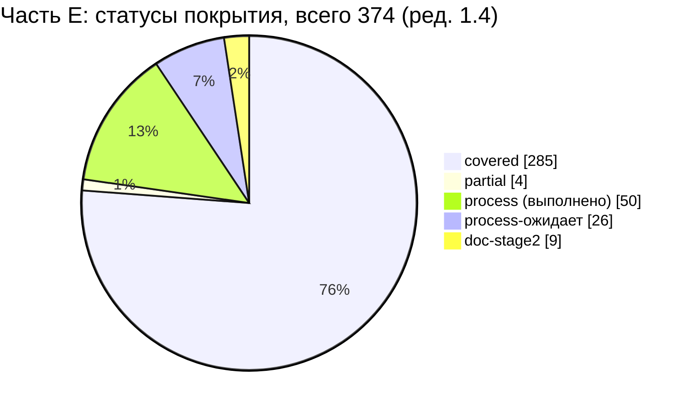

#### 5.2. По блокам промта

| Блок | Всего | covered | partial | process | process-ожидает | deferred-R2 | doc-stage2 | gap |
|---|---|---|---|---|---|---|---|---|
| Двухэтапный режим, роль исполнителя, состав системы (стр. 550–561) | 25 | 13 | 1 | 10 | 1 | 0 | 0 | 0 |
| Организация команды (стр. 563–577) | 22 | 0 | 1 | 19 | 2 | 0 | 0 | 0 |
| Исследование рабочей папки (стр. 579–590) | 12 | 1 | 0 | 11 | 0 | 0 | 0 | 0 |
| Исследование 1С и архитектуры (стр. 592–613) | 33 | 33 | 0 | 0 | 0 | 0 | 0 | 0 |
| Требования к ТЗ в целом и раздел 4.1 «Цели и границы» (стр. 615–625) | 11 | 10 | 1 | 0 | 0 | 0 | 0 | 0 |
| Раздел 4.2 «Полная карта экранов» (стр. 626–638) | 29 | 29 | 0 | 0 | 0 | 0 | 0 | 0 |
| Раздел 4.3 «Дизайн-система» | 23 | 23 | 0 | 0 | 0 | 0 | 0 | 0 |
| Раздел 4.4 «Подробные пользовательские сценарии» | 19 | 19 | 0 | 0 | 0 | 0 | 0 | 0 |
| Раздел 4.5 «Регистрация и авторизация» | 22 | 22 | 0 | 0 | 0 | 0 | 0 | 0 |
| Раздел 4.6 «Каталог и карточка товара» | 18 | 18 | 0 | 0 | 0 | 0 | 0 | 0 |
| Раздел 4.7 «Корзина и касса» | 15 | 15 | 0 | 0 | 0 | 0 | 0 | 0 |
| Раздел 4.8 «Рабочее место кассира» | 10 | 10 | 0 | 0 | 0 | 0 | 0 | 0 |
| Раздел 4.9 «Модель данных» | 11 | 11 | 0 | 0 | 0 | 0 | 0 | 0 |
| Раздел 4.10 «API и интеграции» | 11 | 11 | 0 | 0 | 0 | 0 | 0 | 0 |
| Раздел 4.11 «Синхронизация» | 12 | 12 | 0 | 0 | 0 | 0 | 0 | 0 |
| Раздел 4.12 «Безопасность» | 11 | 11 | 0 | 0 | 0 | 0 | 0 | 0 |
| Раздел 4.13 «Нефункциональные требования» | 13 | 13 | 0 | 0 | 0 | 0 | 0 | 0 |
| Раздел 4.14 «План тестирования и критерии приёмки» | 8 | 8 | 0 | 0 | 0 | 0 | 0 | 0 |
| Раздел 4.15 «План разработки» | 7 | 7 | 0 | 0 | 0 | 0 | 0 | 0 |
| Обязательные файлы первого этапа | 20 | 17 | 0 | 2 | 0 | 0 | 0 | 1 |
| Независимая проверка ТЗ | 13 | 0 | 1 | 0 | 12 | 0 | 0 | 0 |
| Условия завершения первого этапа | 19 | 0 | 0 | 8 | 11 | 0 | 0 | 0 |
| Переход ко второму этапу | 9 | 0 | 0 | 0 | 0 | 0 | 9 | 0 |
| Граница с частью F (обязательное дополнение UI/UX) | 1 | 1 | 0 | 0 | 0 | 0 | 0 | 0 |
| **Итого** | **374** | **284** | **4** | **50** | **26** | **0** | **9** | **1** |

#### 5.3. По типу требования (из реестра)

| Тип | Всего | covered | partial | process | process-ожидает | deferred-R2 | doc-stage2 | gap |
|---|---|---|---|---|---|---|---|---|
| процесс | 96 | 29 | 2 | 37 | 19 | 0 | 9 | 0 |
| функц. | 110 | 110 | 0 | 0 | 0 | 0 | 0 | 0 |
| ограничение | 27 | 13 | 1 | 12 | 1 | 0 | 0 | 0 |
| документ | 116 | 107 | 1 | 1 | 6 | 0 | 0 | 1 |
| нефункц. | 25 | 25 | 0 | 0 | 0 | 0 | 0 | 0 |
| **Итого** | **374** | **284** | **4** | **50** | **26** | **0** | **9** | **1** |

Примечание: deferred-R2 — 0. Условные элементы (FACE-SCAN — Q-003, режим клиента — Q-001, заявка на возврат — Q-018, QR-вебхук — Q-014) не снижают покрытие части E: каждое такое требование промта имеет покрытие в R1 альтернативным решением ядра (D-14, D-07, D-25, D-21), что отмечено в столбце статуса. Ред. 1.5 сборки: режим клиента — R1 (Q-001 закрыт), QR — через 1С (Q-014 частично закрыт) — ядро v1.9 §24.2, §24.4; статусы строк не изменились.

---

### 6. Список gap и partial с предложениями, куда добавить

Номера пунктов имеют префикс части (`E-G-n` — gap, `E-P-n` — partial), чтобы не путать их с принципами 13 §2.1 (P-1…P-7) и с пунктами других частей 17 при сборке.

#### 6.1. Gap

| № | SRC-ID | Чего нет | Предложение (куда добавить, владелец) |
|---|---|---|---|
| E-G-1 | SRC-E-196 | Файл `00_EXECUTIVE_SUMMARY.md` (на ≈ 05:25 отсутствует) | оркестратор (волна 3): краткое описание проекта; включить таблицу «раздел промта 4.1–4.15 → файл ТЗ» (§3, строка SRC-E-075) и сводку статусов §5 |

Пункты первичной версии, закрытые повторной трассировкой (≈ 05:25):

| Прежний № | SRC-ID | Было | Стало |
|---|---|---|---|
| G-1 | SRC-E-181d | нет измеримого НФТ «стабильность» | **covered**: 01 §6.2 `NFR-STAB-001` (≤ 1 аварийного завершения на 500 рабочих сессий; 0 потерь корзины/черновика), `NFR-STAB-002`; трассировка на SRC-E-181d в 01; утверждение значения — Q-277 (ведущий; Q-280, кандидат 17E-1, — дубль → Q-277) |
| G-2 | SRC-E-184 | 12 отсутствует, функциональных тестов нет | **covered**: 12 §3 (тест-кейсы по модулям), 12 §12 трассирует SRC-E-184 |
| G-3 | SRC-E-196 | 00 отсутствует | без изменений → E-G-1 |
| G-4 | SRC-E-208 | 12 отсутствует | **covered**: 12 выпущен (§1–§13) |
| G-5 | SRC-E-210 | 14 отсутствует | **covered**: 14 выпущен (181 ID, §9 трассирует SRC-E-210) |

#### 6.2. Partial

| № | SRC-ID | Что не хватает | Предложение |
|---|---|---|---|
| E-P-1 | SRC-E-074 | Однозначность и полнота ТЗ не подтверждены итоговой проверкой; 00 нет | закрывается волной 4 (QA по 14 линзам) и выпуском 00 |
| E-P-2 | SRC-E-022 | Нет явной нормы «молчание, положительный отзыв или просьба о правках не являются разрешением на разработку» | 13 §2.1 (дополнение к принципу P-1 документа 13) или 01 §8.1 (п.1 «ЭТАП 1 …»): явная норма + AC «разработка не начинается без точной фразы, иные сообщения не открывают ворота G-B1» |
| E-P-3 | SRC-E-025a | Не зафиксировано соответствие исполнителей восьми ролям промта; фактически исполнителей больше 8 | 00 или итоговый отчёт: таблица «роль промта (8) → исследование R* → документы ТЗ → независимые проверки»; `[ТРЕБУЕТ РЕШЕНИЯ ЗАКАЗЧИКА: Q-281]` (кандидат 17E-2) |
| E-P-4 | SRC-E-214 | Итоговая независимая QA-проверка пакета не выполнена (выполнены проверки отдельных документов) | волна 4; результат зафиксировать в 00 и журнале прогресса |

Пункты partial первичной версии, закрытые повторной трассировкой (≈ 05:25) → **covered**: P-2 (SRC-E-075 — 12 §1–§13), P-5 (SRC-E-076), P-6 (SRC-E-076b — 01 §3, ROLE-001…021), P-7 (SRC-E-076c — 01 §4, GEN-010…016), P-8 (SRC-E-076d — 01 §5–§6), P-9 (SRC-E-181 — все 9 НФТ в 01 §6.2), P-10 (SRC-E-183 — 01 §6.2), P-11 (SRC-E-183a — 01 §6.1–§6.2, 14 §3), P-12 (SRC-E-185 — 12 §3.7.6, T-ONEC-001…030), P-13 (SRC-E-186 — 12 §3.7, T-SYNC-001…054, F01…F18), P-14 (SRC-E-188 — 12 §3.9, T-UI-000…T-UI-008, T-UI-010…T-UI-017, T-UI-020…T-UI-026, T-UI-030…T-UI-048, T-UI-050, T-UI-090, T-UI-101…T-UI-112), P-15 (SRC-E-197 — 01 §1–§15). Соответствие оставшихся: P-1 → E-P-1, P-3 → E-P-2, P-4 → E-P-3, P-16 → E-P-4.

#### 6.3. Процессные требования, ожидающие завершения этапа 1 (`process-ожидает`)

Ниже — 26 строк со статусом `process-ожидает`. Они **не выполнены** на дату трассировки и не засчитываются в выполненные (§5.1); выполняются оркестратором в конце этапа 1 (PROGRESS_LOG.md, «Следующие результаты», п.4–5). SRC-E-232 (критерий «определены безопасность и критерии приёмки») после выпуска 12 §4 переведён в `process`.

| SRC-ID | Что ожидается |
|---|---|
| SRC-E-024 | обновлённая версия передаётся на утверждение; на дату трассировки — ожидает выполнения |
| SRC-E-033 | независимая проверка каждого документа выполнена; итоговая QA-проверка пакета — волна 4 (ожидает) |
| SRC-E-034a | ограничения среды фиксируются в журнале прогресса (исчерпание лимита); в итоговом отчёте заказчику — ожидает выполнения |
| SRC-E-215 | ожидает: итоговая QA-проверка (волна 4) |
| SRC-E-216 | архитектура проверена (06 §15); сквозная проверка требований × архитектуры — волна 4 (ожидает) |
| SRC-E-217 | противоречия 1С ↔ backend сведены в 05 и ядре §18.1; итоговая QA-проверка — волна 4 (ожидает) |
| SRC-E-218 | ожидает: итоговая QA-проверка (волна 4) |
| SRC-E-219 | права определены; проверка QA — волна 4 (ожидает) |
| SRC-E-220 | ошибки сети и синхронизации описаны; проверка QA — волна 4 (ожидает) |
| SRC-E-221 | ожидает: итоговая QA-проверка (волна 4) |
| SRC-E-222 | ожидает: итоговая QA-проверка (волна 4); эта матрица — вход проверки |
| SRC-E-223 | ожидает: итоговая QA-проверка (волна 4) |
| SRC-E-224 | ожидает: итоговая QA-проверка (волна 4) |
| SRC-E-225 | исправления по проверкам волн 1–2 выполнены; по волне 4 — ожидает |
| SRC-E-225a | ожидает: итоговая версия ТЗ после волны 4 |
| SRC-E-227 | ожидает: на ≈ 05:25 01–16 выпущены, нет 00; итоговая QA-проверка (волна 4) не выполнена |
| SRC-E-233 | ожидает: волна 4 |
| SRC-E-234 | ожидает: 14 включает вопросы 01 (Q-270…Q-276); вопросы 12 (Q-230…) и 17 приведены в 14 §3.10 как предварительные — окончательное сведение после нумерации сборщиком 17 |
| SRC-E-236 | ожидает: остановка после итогового отчёта |
| SRC-E-238 | ожидает: итоговый отчёт; см. SRC-E-238a…238e |
| SRC-E-238a | ожидает: итоговый отчёт оркестратора |
| SRC-E-238b | ожидает: итоговый отчёт оркестратора (00 отсутствует) |
| SRC-E-238c | ожидает: итоговый отчёт (источник — 15) |
| SRC-E-238d | ожидает: итоговый отчёт (источник — 01 §11 «Риски продукта», R-01…R-22) |
| SRC-E-238e | ожидает: итоговый отчёт (источник — 14 §2, §7) |
| SRC-E-239 | ожидает: остановка до утверждения |

Всего: 26 строк.

---

### 7. Тесты 12_TEST_PLAN.md для части E (заглушки закрыты в ред. 1.1 сборки)

Ред. 1.1 сборки (2026-10-19, ядро v1.5 §20.1, §20.2 п.18–19): все 6 меток-заглушек теста этой части заменены в столбце «Тест» матрицы ID тестов 12_TEST_PLAN.md v1.1; построчное соответствие и способ подбора — §6.3 настоящего документа, тесты к добавлению в 12 — §6.4. Исходный список заглушек части с предложениями для 12 — в черновике части (`source/17_parts_drafts/`).

---

### 8. Открытые вопросы

> Ред. 1.1 сборки: окончательные номера вопросов диапазона 17 — §13.2, соответствие прежних номеров и меток — §13.3 (ядро v1.5 §20.2 п.18).

Ядро §19.5 отдаёт документу 17 один диапазон Q-280…Q-289 на шесть параллельных частей трассировки. На ≈ 05:25 номера этого диапазона уже использованы другими частями: Q-280 — 17B (по 14 §3.10 — дубль Q-273, в кратком содержании 17B номер отозван); Q-283, Q-284 — 17A; Q-285, Q-286, Q-289 — 17C (в строках матрицы 17C ещё встречаются Q-280…Q-282 до её перенумерации); Q-287, Q-288 — 17F; 17D использует кандидатов без номеров. Поэтому новые вопросы этой части оформлены как **кандидаты 17E-1…17E-3** без номера Q. Окончательный номер назначает сборщик `17_TRACEABILITY_MATRIX.md`, после чего 14_OPEN_QUESTIONS.md включает вопрос под этим номером (см. §10 п.7). 14 §3.10 (≈ 05:15) приводит эти вопросы под прежними номерами первичной версии 17E (Q-280…Q-282) как предварительные, с пометкой о коллизии; при сведении их следует заменить на номера, назначенные сборщиком.

| Кандидат | Вопрос | Влияние | Рекомендуемое допущение |
|---|---|---|---|
| 17E-1 → **Q-280** `[НОВЫЙ ВОПРОС]` (номер назначен в §13.2; ред. 1.2 — **дубль → Q-277**, ведущий — Q-277 документа 01, 14 §3) | Утверждает ли заказчик показатель стабильности `NFR-STAB-001` из 01 §6.2 (0 потерь корзины/черновика при перезапуске; ≤ 1 аварийного завершения приложения на 500 рабочих сессий) и способ его измерения в пилоте: по журналу инцидентов (13 §8) или с автоматическим сбором отчётов о сбоях (связь с Q-134)? | SRC-E-181d, SRC-E-183a, 01 §6.2, 12 §5.5.3 (T-NFR-022, T-NFR-023) | до ответа — значение 01 со статусом `НЕ ПОДТВЕРЖДЕНО`, измерение по журналу инцидентов пилота `[ТРЕБУЕТ РЕШЕНИЯ ЗАКАЗЧИКА: кандидат 17E-1]` |
| 17E-2 → **Q-281** `[НОВЫЙ ВОПРОС]` (номер назначен в §13.2) | Считается ли выполненным требование «назначь 8 ролей» (SRC-E-025a), если работы выполняли более 8 агентов, каждый из которых сопоставлен одной из восьми ролей промта? (связь с Q-191 — состав команды этапа 2) | процессная приёмка этапа 1, итоговый отчёт | да, при наличии таблицы соответствия «роль → исполнители» в итоговом отчёте |
| 17E-3 → **Q-282** `[НОВЫЙ ВОПРОС]` (номер назначен в §13.2) | Подтвердить трактовку «обработки повторных запросов» (SRC-E-166) как обработки дублирующих и повторно отправленных запросов (идемпотентность, повтор с тем же ключом), а не только автоматических повторов при сбое | 10 (CART-023, ORD-021…028), 08 (API-012…020), 01 §6.2 (NFR-STAB-002) | трактовка реестра и 10/08: дубли + повторы с тем же `Idempotency-Key` |

Существующие вопросы, влияющие на статусы этой матрицы: Q-001 (режим клиента, SRC-E-107; ред. 1.5 сборки — закрыт, ядро v1.9 §24.2), Q-003 (FACE-SCAN, SRC-E-123), Q-004 (OTP/сессии, SRC-E-128/129/179b), Q-006 (логотип, SRC-E-041/099d; ред. 1.5 сборки — закрыт, ядро v1.9 §24.1), Q-010/Q-011 (1С, SRC-E-055…067), Q-012 (документы оплаты, SRC-E-163), Q-014 (QR, SRC-E-113; ред. 1.5 сборки — частично закрыт, ядро v1.9 §24.4), Q-015 (лимиты скидок), Q-017 (долг), Q-018 (возвраты, SRC-E-117/165), Q-020 (свежесть, SRC-E-070/070a), Q-021 (единицы/варианты), Q-022 (фото), Q-023 (объёмы, SRC-E-181b), Q-027 (согласия, SRC-E-136b/180), Q-028 (срок аудита), Q-029 (SMSPro), Q-033 (RPO/RTO), Q-040 (образцы 1С, SRC-E-046), Q-134 (crash-репортинг, SRC-E-181d), Q-161 (год рождения), Q-191 (состав команды, SRC-E-025a), Q-272 (рабочие часы для NFR-AVAIL-001, SRC-E-181e).

---

### 9. Трассировка на исходные требования

| Раздел этого документа | SRC-ID | Примечание |
|---|---|---|
| §3 Матрица | SRC-E-001…SRC-E-249 (все 374 ID) | по одной строке на ID |
| §4 Строки журнала изменений реестра | SRC-E-003, 034, 037, 038, 055…067, 068, 069, 070, 072, 076, 077, 079, 099, 100, 101, 125, 126, 134, 136, 166, 170, 172, 174, 176, 179, 181, 183, 192, 213, 225, 238 | отнесены к основным строкам §3 |
| §5 Сводка | все SRC-E | счётчики по статусам, блокам и типам (скрипт по §3) |
| §6.1–§6.2 Gap/partial | SRC-E-022, 025a, 074, 196, 214; закрытые: 075, 076, 076b, 076c, 076d, 181, 181d, 183, 183a, 184, 185, 186, 188, 197, 208, 210 | предложения по доработке; таблицы закрытых пунктов |
| §6.3 process-ожидает | SRC-E-024, 033, 034a, 215…225a, 227, 233, 234, 236, 238…238e, 239 | 26 строк, не засчитываются в выполненные |
| §7 заглушки | SRC-E-053, 056, 058, 062, 066, 181d; закрытые группы — все строки с тестами 12 | вход для 12_TEST_PLAN.md |
| §8 Вопросы | SRC-E-025a, 166, 181d, 183a | кандидаты 17E-1…17E-3 → Q-280…Q-282 (§13.2; Q-280 — дубль → Q-277) |
| вся матрица как метод | SRC-E-214…SRC-E-222, SRC-E-232 | матрица — вход независимой QA-проверки (волна 4) |

---

### 10. Замечания к ядру

1. **Состав 17 (R0 §15).** Ядро называет один файл `17_TRACEABILITY_MATRIX.md` с «6 трассировщиками + сборщиком», но не определяет имена частей. Предлагается закрепить: рабочие части — отдельные файлы 17A…17F, канон — сборка `17_TRACEABILITY_MATRIX.md`; при расхождении приоритет у сборки. Закрыто ядром v1.5 §20.1 (части — разделы §7–§12, черновики — `source/17_parts_drafts/`).
2. **Объём части E.** В реестре E 405 строк начинаются с `| SRC-E-`, но 31 из них — таблица журнала изменений (ссылки на уже существующие ID). Уникальных требований — 374 (итог реестра: «Итого строк: 374»). Предлагается считать объём части E по 374 ID, чтобы сборщик 17 не получил ложных «пропусков» или дублей.
3. **ID тестов вне 12.** R0 §10 отводит префикс `T-` документу 12, но ID уже присвоены в 03 §17.9 (`T-DS-001…096`, `T-A11Y-001…022`), 09 §16 (`T-AUTH-001…010`) и 11 §12.2 (`T-SEC-001…055`). 12 сохранил `T-AUTH-001…010` и `T-SEC-001…055` без перенумерации, но `T-DS` перенумеровал (п.9). Предлагается правило по аналогии с Q-xxx: 12 включает все такие ID без перенумерации.
4. **НФТ «стабильность».** 01 §6.2 ввёл область `NFR-STAB` (`NFR-STAB-001…005`, `[НОВОЕ ИМЯ]`) с измеримым значением «≤ 1 аварийного завершения на 500 рабочих сессий» в статусе `НЕ ПОДТВЕРЖДЕНО`. Предлагается канонизировать область `NFR-STAB` в ядре §13 (вместе с другими новыми областями 01: `NFR-SEARCH`, `NFR-CAT`, `NFR-L10N`, `NFR-MAINT`) и связать утверждение значения с вопросом (кандидат 17E-1).
5. **Восемь ролей промта (SRC-E-025a).** R0 §15 назначает владельцев документов, но не сопоставляет их восьми ролям промта. Предлагается добавить в ядро или в 00 таблицу «роль промта → исполнители», чтобы процессная приёмка была проверяемой (кандидат 17E-2).
6. **Снимок состояния.** Документы ТЗ менялись во время трассировки: 01 (163 строки на 04:50 → 1 576 строк на ≈ 05:25), 12 (создан в 04:57; 385 строк на ≈ 05:10 → 2 507 строк на ≈ 05:23), 14 (752 строки на ≈ 05:04 → 819 строк на ≈ 05:15). Первичная версия этой части опиралась на снимок 04:50 и устарела; при доработке (§11) строки, зависящие от 01, 12 и 14, протрассированы заново по состоянию ≈ 05:25. Предлагается, чтобы трассировка запускалась после выпуска всех документов волны 3, а сборщик 17 перед сборкой повторял проверку существования ID (скрипт из §2 п.1).
7. **Общий диапазон вопросов 17 (R0 §19.5).** Диапазон Q-280…Q-289 выдан документу 17 целиком, без разбиения между шестью частями, которые писались параллельно. Результат — коллизии: Q-280 использует 17B, в 17C ранее тоже были Q-280…Q-282, в первичной версии 17E — также Q-280…Q-282 (14 §3.10 фиксирует эти коллизии); свободных номеров для трёх вопросов части E нет. Эту проблему фиксируют и части 17A, 17D, 17F. Предлагается: (а) поручить окончательную нумерацию вопросов 17 только сборщику `17_TRACEABILITY_MATRIX.md` (части дают кандидатов `17X-n`), либо (б) выделить документу 17 второй диапазон и разбить его по частям заранее. До решения часть E использует кандидатов 17E-1…17E-3 (§8).
8. **Статус `process-ожидает`.** Задание определяет `process` как «выполнено методикой этапа 1». Процессные требования, которые на дату трассировки ещё не выполнены (итоговая QA-проверка, итоговый отчёт, остановка до утверждения), в части E выделены в отдельный статус `process-ожидает` и не засчитываются в выполненные. Предлагается принять этот статус (или перевод таких строк в `partial`) единообразно для всех частей 17A…17F, чтобы сводный процент выполнения при сборке не был завышен.
9. **Расхождение нумерации `T-DS` между 03 и 12.** 03 §17.9 (владелец компонентов и токенов по ядру §18.1) задаёт `T-DS-001…096` диапазонами, 12 §3.9.3 присвоил `T-DS-001…029`, `T-DS-080…084` с другим смыслом (например, splash: 03 — `T-DS-067…070`, 12 — `T-DS-025`). Один и тот же ID обозначает разные тесты в двух документах. Предлагается решить в ядре, какой документ — владелец ID `T-DS` (по ядру §10 — 12), и обязать 03 §17.9 ссылаться на ID 12 (или 12 — сохранить ID 03). Соответствие по названиям — §7.

---

### 11. Журнал проверки

| № | Замечание проверки (уровень) | Что сделано | Где |
|---|---|---|---|
| 1 | Коллизия номеров Q-280…Q-282 с частями 17A, 17B, 17C, 17F; фраза «включаются без перенумерации»; проблема общего диапазона не поднята (major) | Вопросы переоформлены в кандидатов 17E-1…17E-3, номер назначает сборщик 17; фраза «включаются без перенумерации» удалена; приведён перечень номеров, занятых другими частями, и ссылка на 14 §3.10; добавлено замечание к ядру о разбиении диапазона | шапка («Связанные документы»), §1, §3 (SRC-E-025a, 166, 181d, 183a), §6.2 (E-P-3), §7, §8, §9, §10 п.4, п.5, п.7 |
| 2 | Трассировка опиралась на устаревший снимок 04:50: 01, 12, 14 считались отсутствующими или незавершёнными (major) | Повторная трассировка по 01 (1 576 строк), 12 (2 507 строк, §1–§13) и 14 (819 строк) на ≈ 05:25. Во время доработки 12 дописывался (385 → 2 507 строк), поэтому строки 4.14 проверены дважды. SRC-E-075, 076, 076b, 076c, 076d, 181, 181d, 183, 183a, 184, 185, 186, 188, 197, 208, 210 → covered (01 §2–§6, NFR-STAB-001 с трассировкой на SRC-E-181d; 12 §1–§13; 14); SRC-E-232 → process; строки 181a…181i, 176i, 182, 187, 189, 190 дополнены ID из 01 §6.2 и 12. Из 147 строк с заглушками 141 получила ID тестов 12 (138 — скриптом по общим ID требований, §2 п.3; SRC-E-123, 126, 136b — вручную; для SRC-E-181, 181a, 181b, 181c, 181e список уточнён тестами T-PERF), без теста осталось 6 строк. Пересчитаны §5.1–§5.3 и pie-диаграмма (скрипт по §3: covered 284, process 50, process-ожидает 26, partial 4, doc-stage2 9, gap 1; всего 374), переписаны §6 и §7 | §1, §2 п.3–4, §3, §5, §6, §7, §10 п.6 |
| 3 | Строки «process … ожидает» засчитывались как выполненные; легенда расширена против определения задания (minor) | Легенда приведена к определению: `process` — выполнено (указано чем); введён отдельный статус `process-ожидает` (не выполнено, не засчитывается); 27 строк переведены в него, затем SRC-E-232 после выпуска 12 §4 возвращён в `process` (итог — 26); §5.1–§5.3 разделяют 50 и 26; §6.3 озаглавлен по новому статусу | §2, §3, §5, §6.3, §10 п.8 |
| 4 | Смысловые несоответствия ссылок: SRC-E-006 → CUST-018; SRC-E-176i → T-SEC-052 (minor) | SRC-E-006: CUST-018 заменён на MOD-011, CUST-001, CUST-008, GEN-016 (AC-CUST-001, AC-CUST-008), тест — T-CUST-001; SRC-E-176i: T-SEC-052 удалён, добавлены NFR-LOG-003 (01 §6.2) и тесты синхронизации 12 (T-SYNC-*); строка T-SEC-052 удалена из таблицы присвоенных тестов §7 | §3.1, §3.15, §7 |
| 5 | Номера G-n/P-n неоднозначны с принципами 13 §2.1 (P-1…P-7) и пунктами других частей (minor) | Введены префиксы части: E-G-1, E-P-1…E-P-4; добавлены таблицы соответствия прежних номеров (G-1…G-5, P-1…P-16) новым или закрытым пунктам | §6.1, §6.2 |
| 6 | Группа заглушка `12` — номер документа вместо префикса (minor) | Группа упразднена; SRC-E-184 трассирован на тесты 12 §3 по модулям; группы заглушка `<префикс>` сопоставлены с разделами и ID 12; оставшиеся 2 группы (ONEC — 5 строк, NFR — SRC-E-181d) получили предложения для 12 | §1, §3 (SRC-E-184), §7 |
| 7 | (найдено при доработке) Нумерация `T-DS` в 03 §17.9 и 12 §3.9.3 не совпадает | Ссылки матрицы на `T-DS-*` оставлены по 03 §17.9 с явной пометкой; добавлена таблица соответствия по названиям `[НЕ ПОДТВЕРЖДЕНО]`; замечание к ядру | §3 (SRC-E-188), §7, §10 п.9 |

**Проверка целостности после доработки** `[ПОДТВЕРЖДЕНО: скрипт по файлу, 2026-10-19 ≈ 05:30]`: в §3 374 строки и 374 уникальных SRC-E-ID; у каждой строки ровно один статус из легенды §2; суммы §5.1, §5.2 (по 24 блокам) и §5.3 (по 5 типам) равны 374 и совпадают по каждому статусу; число столбцов в каждой строке каждой таблицы равно числу столбцов заголовка; перечень §6.3 совпадает со строками `process-ожидает` в §3; номера Q-280…Q-282 не используются как вопросы этой части; каждый ID требования, критерия приёмки и теста, указанный в документе, найден Grep в `docs/specification/*.md`, `visual/*.md` или ядре.

---

## 12. Часть F — Матрица трассируемости: часть F реестра исходных требований (SRC-F-001 … SRC-F-145)

> Источник: часть F — раздел §12 настоящего документа (черновик части — `source/17_parts_drafts/`, ядро §20.1) · Версия 1.1 · Дата 2026-10-19 · Статус: черновик для утверждения заказчиком (доработан по замечаниям проверки — «Журнал проверки» в конце) · Шапка части («Входные материалы», «Связанные документы», роль автора) опущена — см. шапку настоящего документа. Ссылки вида «§N» внутри этого раздела указывают на разделы **части F** (заголовки части сохранены с исходной нумерацией и понижены на один уровень; в сводных разделах настоящего документа на них ссылаются как «17F §N»); номера вопросов Q-28x в тексте части — предварительные, окончательные — §13.2. **Ред. 1.1 сборки (ядро v1.5 §20):** в столбце «Тест» строк этой части метки-заглушки заменены ID тестов 12 (§6), статусы строк §5.4 пересмотрены, номера вопросов — по §13.2–§13.3; упоминания заглушек и их числа в повествовательном тексте и журналах части ниже — история ред. части, действующие значения — §2, §6, §13.

### 1. Краткое содержание

- Протрассированы **все 170 строк** части F реестра (SRC-F-001…SRC-F-145 + 25 суффиксных строк a…e); пропусков и дублей нет (скриптовое сравнение ID реестра и матрицы, §9).
- Место в ТЗ найдено поиском по SRC-ID во всех файлах `docs/specification/*.md` и `visual/*` (с раскрытием диапазонов вида `SRC-F-004…019`), для SRC-F-051…055 — по ключевым словам; все 1501 вхождение ID требований, критериев приёмки, тестов и решений (790 уникальных ID), указанных в столбцах 4–7 матрицы, проверены на существование в документах ТЗ и ядре (§9, пересчёт ред. 1.1).
- Итог по статусам (§4, ред. 1.2 сборки): **covered 146**, **process 13**, **process-ожидает 3**, **partial 7**, **deferred-R2 0**, **doc-stage2 1**, **gap 0** — всего 170 (ред. 1.0–1.1 части: covered 148, process 16, partial 4, deferred-R2 1, doc-stage2 1).
- Главные находки (ред. 1.0 части; п. (1) — история: в ред. 1.1 сборки заглушки заменены ID тестов 12, сводная §6): (1) 12_TEST_PLAN.md выпускается параллельно — тесты из 12 найдены для 8 строк (T-AUTH-034/035, T-FACE-001…005, T-SMS-015), 146 строк помечены заглушка `<префикс>` (23 префикс-группы, §6), кандидаты `T-SEC-…` из 11 §12.2 указаны; (1а) must-требование SRC-F-123 «независимая архитектурная проверка» на этапе 1 покрыто только самооценкой автора 06 §15 — статус `partial` (§5.1), полная проверка — 13 RM-B-010 / RM-H-002; (2) SRC-F-051…SRC-F-055 («Проверка полноты») не упоминаются в документах ТЗ, кроме ADR-044 (SRC-F-051a), — их закрывают этот документ, 13 RM-B-001 и методика этапа 1; (3) SRC-F-041 «подробные макеты ключевых экранов» закрыт только спецификациями 02 и wireframes (по SRC-F-049) — нужен ответ заказчика (Q-287); (4) 08 и 11 описывают решения по SRC-F-086…091, 138…138c без конкретных обратных ссылок SRC-F-ID (в 08 есть только обобщённая ссылка «SRC-F (EVO — 06)» в строке API-029); (5) в 02 §10.3 устаревшая нумерация подразделов части C, AC-DS-079 называет несуществующий `visual/wireframes.html`.
- Сканирование лица (SRC-F-024) — в ред. 1.0–1.1 единственная строка «deferred-R2» (D-14, Q-003); в ред. 1.2 сборки — `covered` (требование «опиши последовательность» выполнено, реализация — условный R2); описание шагов, подсказок и ограничений технологии (SRC-F-025…027) в ТЗ присутствует полностью, тесты T-FACE — условные.
- Новые вопросы: Q-287, Q-288 (диапазон 17 по ядру §19.5, номера предварительные — §10); замечания к ядру — §12.

---

### 2. Методика трассировки

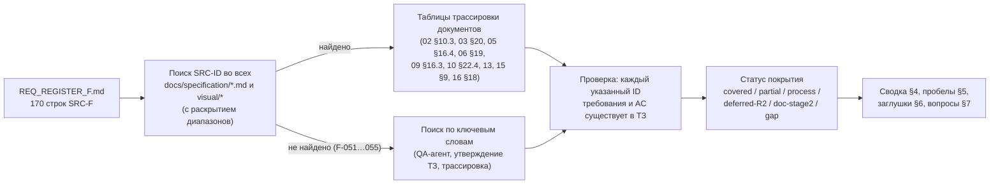

#### 2.1. Правила присвоения статуса

| Статус | Когда ставится |
|---|---|
| `covered` | требование отражено в тексте ТЗ: есть раздел и ID требования (или раздел-артефакт для документных требований), для функциональных/нефункциональных — критерий приёмки `AC-…` |
| `partial` | отражено не полностью: нет критерия/теста там, где они нужны, артефакт заменён упрощённым, или зависит от невыпущенного документа ТЗ |
| `process` | требование к процессу работы, **полностью** выполненное методикой этапа 1 (в пределах информации, доступной на этапе 1) — в столбце «Документ и раздел» указано, чем именно; если методикой этапа 1 требование выполнено лишь частично, ставится `partial`, если работа целиком отнесена к этапу 2 — `doc-stage2` |
| `deferred-R2` | функция осознанно вынесена за R1 решением ядра; указаны D-xx и Q-ссылка |
| `doc-stage2` | артефакт или действие этапа 2 (разработки), запланированное в 13_IMPLEMENTATION_ROADMAP |
| `gap` | места в ТЗ нет — не обнаружено ни одной такой строки |

#### 2.2. Обозначения в таблице

- «02 ч. A…E» — часть A…E раздела 9 сводного 02 (полный текст частей внутри 02; черновики `source/02_parts_drafts/` не используются, ядро §19.1). «п.N» у экрана 02 — подраздел `SCR-xx.N` (14 пунктов промта).
- `AC-UI-*` — критерии приёмки экранов; полный индекс — 02 §10.1.
- Столбец «Тест»: заглушка `<префикс>` — тест должен быть описан в 12_TEST_PLAN.md (документ не выпущен); в скобках «канд.» — существующие тест-ID из 11 §12.2 (T-SEC-…), которые 12 может принять без перенумерации. Для строк `process` тест не применяется («—»), проверка — ревью QA.
- Тип — из реестра (функц. / нефункц. / ограничение / процесс / документ).

---

### 3. Матрица трассируемости SRC-F → ТЗ

#### 3.1. Ультрадетальная спецификация экранов (SRC-F-001…SRC-F-020)

| SRC-ID | Краткая формулировка | Тип | Документ и раздел ТЗ | ID требования(й) ТЗ | Критерий приёмки (AC-…) | Тест | Статус покрытия |
|---|---|---|---|---|---|---|---|
| SRC-F-001 | Первоначальные требования заказчика к экранам — обязательная часть проекта | ограничение | 02 §2.2 (зоны частей A…E; части C, E — ред. 1.3), §2.5, §10.3 (строка SRC-F-001…003 — часть A; трассировки частей A, B, D); 15 ADR-064 | ADR-064 | AC-ADR-064; AC-TRACE-007 (§4.3, не выполнен) | T-UI-108 (12 §3.9.2; SRC-F-001…003 и ADR-064 в столбце «Требования», review P3), T-UI-000…T-UI-008, T-UI-010…T-UI-017, T-UI-020…T-UI-026, T-UI-030…T-UI-048, T-UI-050, T-UI-090 (12 §3.9.1); T-BUILD-013 (12 §3.12.4, AC-TRACE-007) | partial: AC-ADR-064 проверяет только канон 02 и наличие разделов SCR, но не полноту переноса исходных требований; зоны частей C (SCR-20…26) и E (SCR-40…50) в 02 §2.2 включают SRC-F-001…003 (ред. 1.3, Grep 02), но в объединённой трассировке 02 §10.3 строка SRC-F-001…003 отнесена только к части A; проверка полноты — AC-TRACE-007 (§4.3, не выполнен); T-UI-108 (12) — ручной review без автоматизируемой сверки по AC-TRACE-007, автоматизируемый тест сверки в 12 отсутствует (§6.4 п.2); план — §5.1 (ред. 1.2, волна 4; было `covered`) |
| SRC-F-002 | Запрет сокращать требования к экранам и заменять их общими формулировками | ограничение | 02 §10.3; 02 ч. B §13, ч. D «Трассировка»; ядро §19.1 (верхняя граница объёма 02 снята); 15 ADR-064 | ADR-064 | AC-ADR-064; AC-TRACE-007 (§4.3, не выполнен) | T-UI-108 (12 §3.9.2; review P3); T-BUILD-013 (12 §3.12.4, AC-TRACE-007) | partial: как SRC-F-001 — несокращение требований к экранам не подтверждено проверяемо (AC-TRACE-007, §6.4 п.2; ред. 1.3 — 02 §2.2 дополнен, §10.3 и тест сверки в 12 — нет); план — §5.1 (ред. 1.2, волна 4; было `covered`) |
| SRC-F-003 | Запрет исключать любые детали требований к экранам, даже «несущественные» | ограничение | 02 §10.3; 02 ч. D §0.7 (макетные подписи сохранены); 15 ADR-064 | ADR-064 | AC-ADR-064; AC-TRACE-007 (§4.3, не выполнен) | T-UI-108 (12 §3.9.2; review P3); T-BUILD-013 (12 §3.12.4, AC-TRACE-007) | partial: как SRC-F-001 — сохранение деталей не подтверждено проверяемо (AC-TRACE-007, §6.4 п.2; ред. 1.3 — 02 §2.2 дополнен, §10.3 и тест сверки в 12 — нет); план — §5.1 (ред. 1.2, волна 4; было `covered`) |
| SRC-F-004 | До начала разработки — ультрадетальная спецификация всех экранов | документ | 02 целиком (§9 ч. A–E — SCR-00…SCR-50, SCR-90); `visual/screen-map.md` §2; 15 ADR-064 | SCR-00…SCR-90 (ядро §9), ADR-064 | AC-ADR-064 (у каждого SCR-xx есть раздел в 02); индекс AC-UI-* — 02 §10.1 | T-UI-111, T-UI-037, T-UI-000, T-UI-001 | covered |
| SRC-F-005 | Для каждого экрана: назначение и роль пользователя | документ | 02, подраздел `SCR-xx.1` каждого экрана; `visual/screen-map.md` §2; 15 ADR-064 | ADR-064; SCR-xx.1 у каждого экрана (напр. SCR-01.1, SCR-10.1) | AC-ADR-064; напр. AC-UI-10-019 (роль `owner`); индекс AC-UI — 02 §10.1 | T-UI-010, T-UI-001, T-UI-109, T-UI-111 | covered |
| SRC-F-006 | Для каждого экрана: полная структура сверху вниз и слева направо | документ | 02, подраздел `SCR-xx.2` (compact / medium / expanded) | ADR-064; SCR-xx.2 (напр. SCR-01.2, SCR-10.2) | AC-ADR-064; напр. AC-UI-10-030, AC-UI-01-015; индекс AC-UI — 02 §10.1 | T-UI-001, T-UI-010, T-UI-109, T-UI-111 | covered |
| SRC-F-007 | Для каждого экрана: каждый UI-элемент с расположением, размером, отступами, выравниванием, визуальной иерархией | документ | 02, подраздел `SCR-xx.3` (таблицы элементов с UI-ID; SCR-10 и SCR-14 — по зонам) | UI-<SCR>-NNN (например UI-14-006) | напр. AC-UI-10-001, AC-UI-10-020; индекс AC-UI — 02 §10.1 | T-UI-010, T-UI-014, T-UI-111, T-UI-109 | covered |
| SRC-F-008 | Для каждого экрана: цвета, типографика, иконки, радиусы, тени, состояния компонентов со ссылками на утверждённую дизайн-систему | документ | 02 `SCR-xx.3` (токены `ds.*`); 03 §7–§10 (токены, компоненты, матрица состояний) | UI-<SCR>-NNN; DS-030 | AC-UI-* (02 §10.1); AC-DS-030 | T-DS-030, T-DS-066 | covered |
| SRC-F-009 | Для каждого экрана: поведение каждого поля, кнопки, карточки, переключателя, меню, фильтра, элемента управления | документ | 02, подраздел `SCR-xx.4` | ADR-064; SCR-xx.4 (напр. SCR-01.4, SCR-10.4) | AC-ADR-064; напр. AC-UI-10-004, AC-UI-10-006; индекс AC-UI — 02 §10.1 | T-UI-010, T-UI-001, T-UI-109, T-UI-111 | covered |
| SRC-F-010 | Для каждого экрана: все анимации (начальное состояние, триггер, последовательность, конечное состояние, длительность, реакция на ошибку) | документ | 02 `SCR-xx.5` (таблицы у всех экранов); 03 §11.2 (реестр ANIM-NNN), §18.7 | DS-065, ANIM-001…ANIM-030 | AC-DS-065; AC-UI-* | T-ANIM-001, T-ANIM-002, T-ANIM-003, T-ANIM-004 | covered |
| SRC-F-011 | Для каждого экрана: все переходы между экранами с передаваемыми данными (товар, пользователь, вариант, количество и др.) | документ | 02 `SCR-xx.6`, §4 (карта экранов), §8 (перекрёстные переходы); `visual/navigation.md` §5; `visual/screen-map.md` §4; 15 ADR-064 | ADR-064; SCR-xx.6 (напр. SCR-01.6, SCR-10.6) | AC-ADR-064; напр. AC-UI-10-008, AC-UI-10-013; индекс AC-UI — 02 §10.1 | T-UI-010, T-UI-001, T-UI-109, T-UI-111 | covered |
| SRC-F-012 | Для каждого экрана: состояния загрузки, успеха, ошибки, пустого результата, нет интернета, нет разрешений, повторная попытка | документ | 02 `SCR-xx.7` (stateDiagram-v2), §6 (матрица «экран × состояния»), SCR-90; `visual/components-states.md`; `visual/responsive-spec.md` §12; 01 §6.2 (NFR-OFFLINE-001) | SCR-90, NFR-OFFLINE-001 | напр. AC-UI-10-017, AC-UI-01-010; индекс AC-UI — 02 §10.1 | T-UI-001, T-UI-010, T-UI-090, T-UI-111 | covered |
| SRC-F-013 | Для каждого экрана: правила валидации, сообщения пользователю, ограничения ввода | документ | 02 `SCR-xx.8`; 02 §7 (словарь строк UI); 15 ADR-064 | ADR-064; SCR-xx.8 (напр. SCR-01.8, SCR-10.8) | AC-ADR-064; напр. AC-UI-01-003, AC-UI-01-005; индекс AC-UI — 02 §10.1 | T-UI-001, T-UI-010, T-UI-109, T-UI-111 | covered |
| SRC-F-014 | Для каждого экрана: источники данных, API, состояния приложения и бизнес-правила для каждого элемента | документ | 02 `SCR-xx.9`; 08 (эндпоинты); 10 (бизнес-правила); 15 ADR-064 | ADR-064; SCR-xx.9 (напр. SCR-01.9, SCR-10.9) | AC-ADR-064; напр. AC-UI-10-012, AC-UI-10-024; индекс AC-UI — 02 §10.1 | T-UI-010, T-UI-001, T-UI-109, T-UI-111 | covered |
| SRC-F-015 | Для каждого экрана: доступные действия по ролям и ограничения безопасности | документ | 02 `SCR-xx.10` (матрицы роль × действие), §5 (сводная матрица «экран × роль»); 11 §4.4; 15 ADR-064 | ADR-064; SCR-xx.10 (напр. SCR-01.10, SCR-10.10) | AC-ADR-064; напр. AC-UI-10-019; индекс AC-UI — 02 §10.1 | T-UI-010, T-UI-001, T-UI-109, T-UI-111 | covered |
| SRC-F-016 | Для каждого экрана: поведение при повторном нажатии, двойном запросе, возврате назад, повторном запуске приложения | документ | 02 `SCR-xx.11`; 03 §18.4 (DS-033, DS-039); `visual/navigation.md` §6–§7 | DS-033, DS-039, DS-046 | AC-DS-033, AC-DS-039, AC-DS-046 | T-UI-104, T-AUTH-032, T-DS-030, T-CART-008 | covered |
| SRC-F-017 | Для каждого экрана: требования к мобильным, планшетам и другим согласованным платформам | документ | 02 `SCR-xx.12`, §3.2; 03 §18.5 (DS-049); `visual/responsive-spec.md` §1.1, §3–§8; 15 ADR-018 | DS-049, ADR-018 | AC-DS-049, AC-ADR-018 | T-DS-049 | covered |
| SRC-F-018 | Для каждого экрана: критерии приёмки для проверки реализации | документ | 02 `SCR-xx.13`; 02 §10.1 (индекс AC-UI); 15 ADR-064 | ADR-064; SCR-xx.13 (напр. SCR-01.13, SCR-10.13) | AC-ADR-064; напр. AC-UI-01-001…AC-UI-01-018, AC-UI-10-001…AC-UI-10-031; индекс AC-UI — 02 §10.1 | T-UI-010, T-UI-001, T-UI-109, T-UI-111 | covered |
| SRC-F-019 | Описание экрана не должно сводиться к одному абзацу | ограничение | 02: все подразделы `.1…14` развёрнуты — 02 §10.3 (строка SRC-F-019), 02 ч. B §13 (строка SRC-F-019: пункты, бывшие абзацем, переведены в таблицы), 02 ч. B §15 «Журнал проверки (версия 1.1)», пп. П-1…П-4; 15 ADR-064 | ADR-064; SCR-xx.1…14 (напр. SCR-12.5, SCR-12.9…SCR-12.12, SCR-16.10) | AC-ADR-064; AC-UI-12-010…AC-UI-12-013, AC-UI-16-012 (02 ч. B §15, П-1, П-4) | T-UI-012, T-UI-016, T-UI-111, T-INV-010 | covered |
| SRC-F-020 | Для сложных экранов — отдельные подразделы, таблицы элементов, диаграммы переходов, последовательности действий | документ | 02 ч. A §13 (SCR-05.4.1–SCR-05.4.2, SCR-90 зоны A–H, sequence SCR-01/02/04/08); 02 ч. B §13 (SCR-10 зоны A–F, SCR-14 зоны A–E, sequence/stateDiagram); 02 §4 (flowchart) | SCR-05, SCR-10, SCR-14, SCR-90 | напр. AC-UI-10-011; индекс AC-UI — 02 §10.1 | T-UI-010, T-UI-001, T-UI-005, T-UI-014 | covered |

#### 3.2. Персонаж, сканирование лица, каталог, корзина, кассир (SRC-F-021…SRC-F-036)

| SRC-ID | Краткая формулировка | Тип | Документ и раздел ТЗ | ID требования(й) ТЗ | Критерий приёмки (AC-…) | Тест | Статус покрытия |
|---|---|---|---|---|---|---|---|
| SRC-F-021 | Подробно описать 8 состояний персонажа авторизации: нейтральное лицо, реакция на ввод телефона, ожидание проверки, успешная авторизация, отказ, неправильный OTP, повторная попытка, переход в приложение | документ | 02 ч. A §0.3 («8 состояний промта → 6 состояний `MascotAuth`»), SCR-02/04/08 п.14; 03 §13.3, §13.8; 09 §13.6, §14.1; 15 ADR-040 (D-40); 01 §5.2 (GEN-036) | AUTH-043, AUTH-048, DS-059, ADR-040, GEN-036 | AC-AUTH-073, AC-AUTH-075, AC-ADR-040, AC-GEN-036 | T-AUTH-034, T-AUTH-035 (12 §3.1); состояния 5 «Отказ» (error без авто-retry) и 8 «Переход в приложение» (удержание success ≤ 900 мс, навигация) — шаги к добавлению в 12, §6.4 п.4 | covered |
| SRC-F-022 | Запрет подменять реальное распознавание лица анимацией | ограничение | 02 ч. A §0.3 (И1, И4), SCR-05.1; 03 §13.1; 09 §10.2, §13.6, §14.6; 15 ADR-014; 01 §5.2 (GEN-036) | AUTH-044, FACE-011, DS-059, ADR-014, GEN-036 | AC-AUTH-074, AC-AUTH-079, AC-UI-05-015, AC-ADR-014, AC-GEN-036 | T-AUTH-034 (12 §3.1) | covered |
| SRC-F-023 | Визуальная реакция персонажа и результат проверки лица — независимые слои (архитектурное/проектное требование, не пользовательская функция) | нефункц. | 09 §10.2; 03 §9.52 (`Mascot`), §13.1, §17.6 (`MascotController`); 02 SCR-02 п.14; 15 ADR-040; 01 §5.2 (GEN-036) | AUTH-044, FACE-011, DS-059, ADR-040, GEN-036 | AC-AUTH-074, AC-AUTH-079, AC-ADR-040, AC-GEN-036 | T-AUTH-034 (12 §3.1) | covered |
| SRC-F-024 | Сканирование лица: последовательность направлений прямо, влево, вправо, вверх | функц. | 02 SCR-05.4.1; 09 §10.3, §14.6 (FACE-NNN, «R2, вне R1»); 15 ADR-014; ядро D-14, §4.2; 01 §5.3 (GEN-050) | FACE-004, ADR-014, GEN-050 | AC-AUTH-077, AC-ADR-014, AC-GEN-050 | T-FACE-001, T-FACE-002 (12 §3.1, условно) | covered: последовательность направлений (прямо → влево → вправо → вверх) описана — 02 SCR-05.4.1, 09 §10.3 (FACE-004); реализация — условный модуль R2 `[РЕШЕНИЕ: D-14]` `[ТРЕБУЕТ РЕШЕНИЯ ЗАКАЗЧИКА: Q-003]`, перенос реализации отражён в строках SRC-B-087, SRC-B-126 (ред. 1.2, волна 4; было `deferred-R2`) |
| SRC-F-025 | Для каждого шага сканирования: подсказки, индикатор выполнения, условия успешного захвата, повторная попытка, отмена, обработка неподдерживаемого устройства | документ | 02 SCR-05.4.1–SCR-05.4.2 (UI-05-004…017); 09 §10.3–10.4, §14.6; 01 §5.3 (GEN-050) | FACE-003, FACE-005, FACE-006, FACE-007, FACE-008, GEN-050 | AC-AUTH-077, AC-AUTH-078 | T-FACE-002, T-FACE-003 (12 §3.1, условно) | covered |
| SRC-F-026 | Отдельно указать, какие функции подтверждены выбранной технологией, а какие требуют дополнительного SDK | документ | 02 SCR-05.1.1; 09 §10.1; 01 §5.3 (GEN-050) | FACE-009, GEN-050 | AC-AUTH-079 | T-FACE-004, T-FACE-005 (12 §3.1) | covered |
| SRC-F-027 | Запрет заявлять полноценную защиту от подделки (anti-spoofing) без соответствующей технологии | ограничение | 02 SCR-05.1, SCR-05.14; 09 §10.1, §14.6; 01 §5.3 (GEN-050) | FACE-010, GEN-050 | AC-UI-05-012, AC-AUTH-079 | T-FACE-004 (12 §3.1) | covered |
| SRC-F-028 | Отдельно описать: главный каталог, поиск, результаты поиска, категории, подкатегории, фильтры, сетку, список, карточку товара | документ | 02 ч. B SCR-10…SCR-14, п. 2.3; 10 §4.2, §5; `visual/wireframes-catalog.html` | SCR-10…SCR-14, CAT-001, CAT-004, CAT-005, CAT-006, CAT-007, CAT-009, CAT-010, INV-018 | AC-CAT-001, AC-CAT-004, AC-CAT-005, AC-CAT-006, AC-CAT-007, AC-CAT-009, AC-CAT-010, AC-INV-018 | T-CAT-002, T-CAT-003, T-CAT-014, T-CAT-017 | covered |
| SRC-F-029 | Для каждого варианта товара: связь с артикулом, изображениями, ценой, единицей измерения, остатками по складам | функц. | 02 SCR-14 зоны B–D, SCR-15 п.14, ч. C §3.3 (строка корзины); 10 §4.2; 05 §5.2; 03 §18.6; 04 FLOW-012 | INV-011, ONEC-073, DS-055, UI-14-006, UI-14-007, UI-14-009, UI-14-013, CART-006 | AC-UI-14-004, AC-INV-011, AC-ONEC-073, AC-DS-055 | T-UI-014, T-CAT-029, T-UI-015, T-CAT-005 | covered |
| SRC-F-030 | Поведение интерфейса каталога при большом количестве товаров, длинных названиях, отсутствии фото, нескольких расцветках, большом количестве характеристик | нефункц. | 02 ч. B §5 («Поведение при больших объёмах и „трудных“ данных»), SCR-10.3, SCR-14/15 п.14; 10 §4.2, §4.3, §4.6, §5; 03 §14.3, §18.2, §18.4, §18.6; 15 ADR-055 | INV-015, INV-016, INV-022, INV-052, INV-053, CAT-008, CAT-011, DS-017, DS-035, DS-055, DS-060, ADR-055 | AC-UI-10-011, AC-UI-10-020, AC-UI-14-014, AC-UI-15-006, AC-INV-053, AC-CAT-011 | T-CAT-008, T-CAT-001, T-CAT-005, T-CAT-026 | covered |
| SRC-F-031 | Описать состояния корзины: пустая, с товарами, изменение количества, удаление позиции, изменение цены, недостаточный остаток, устаревшие данные, ошибка оформления | документ | 02 ч. C SCR-20.7, SCR-21.7 (в 02 §10.3 — устаревшая нумерация «§4.7», «§5.7»); 10 §7.1–7.2, §8.3; 03 §18.6 (DS-057); 04 FLOW-013, FLOW-014; 01 §5.7 (GEN-102) | CART-013…CART-022, CART-016, CART-021, CART-022, CART-024, ORD-027, DS-057, GEN-102 | AC-UI-20-009, AC-UI-20-010, AC-UI-20-018, AC-UI-21-010, AC-CART-016, AC-ORD-027, AC-GEN-102 | T-CART-006, T-CART-009, T-CART-022, T-CART-007 | covered |
| SRC-F-032 | Определить механизм сохранения корзины | функц. | 02 ч. C SCR-20.3 (UI-20-023), SCR-20.9, SCR-20.11, SCR-23; 10 §7.2; 15 ADR-032, ADR-052; 04 FLOW-013, FLOW-017, FLOW-032 | CART-008, CART-009, CART-018, CART-030, UI-20-023, ADR-052 | AC-UI-20-013, AC-UI-20-014, AC-CART-008, AC-ADR-052 | T-CART-025, T-CART-005, T-CART-013, T-CART-018, T-CART-032 | covered |
| SRC-F-033 | Определить, как предотвращаются повторные операции в корзине | функц. | 02 ч. C SCR-20.11, SCR-20.11.1 (UI-20-020, UI-20-027), SCR-21.4, SCR-21.4.1, SCR-21.11 (UI-21-019); 10 §7.2, §8.3; 03 §18.4 (DS-039); 15 ADR-052 | CART-017, CART-022, CART-023, CART-025, ORD-021, ORD-028, DS-039 | AC-UI-20-016, AC-UI-20-028, AC-UI-21-008, AC-CART-023, AC-CART-025 | T-CART-008, T-CART-009, T-CART-002, T-CART-017 | covered |
| SRC-F-034 | Отдельно описать экраны кассира: главная панель, поиск клиентов, профиль клиента, история покупок, задолженности, скидки, транзакции, избранное, детали операции, подтверждение критических действий | документ | 02 ч. D SCR-30…SCR-38, §0.5; 02 ч. E SCR-40 (избранное); 10 §13, §14.2; 04 FLOW-028; `visual/wireframes-cashier.html`; 01 §5.10 (GEN-137) | SCR-30…SCR-38, SCR-40, CASH-010, CASH-014, TXN-003, GEN-137 | AC-CASH-010, AC-CASH-014, AC-TXN-003, AC-GEN-137 | T-CASH-002, T-CASH-006, T-CASH-008, T-CASH-010 | covered |
| SRC-F-035 | Указать, какие данные разрешено показывать каждой роли | функц. | 02 ч. D §0.4 (матрица видимости полей клиента), п.10 экранов SCR-30…36; 10 §4.4, §9.4, §10, §13, §15.2; 11 §4.4; 04 FLOW-028, FLOW-030; 01 §5.10 (GEN-137) | CUST-001, CUST-009, DEBT-004, TXN-004, INV-033, PAY-036, SEC-031, SEC-042, GEN-137 | AC-CUST-001, AC-CUST-009, AC-DEBT-004, AC-TXN-004, AC-INV-033, AC-PAY-036, AC-GEN-137 | T-CUST-001, T-UI-031, T-UI-032, T-UI-033 | covered |
| SRC-F-036 | Указать, какие операции должны быть подтверждены сервером | функц. | 02 ч. D §0.5 (P-STEPUP), SCR-34/37/38/39 п.14; 10 §3 (матрица операция × роль × где выполняется), §8.4, §9.3–9.4, §10–§12, §14.2; 04 FLOW-016, FLOW-022, FLOW-024, FLOW-026, FLOW-031; 01 §5.10 (GEN-137) | CASH-001, CASH-002, CASH-007, CASH-008, CASH-014, ORD-051, PAY-026, PAY-032, DEBT-010, DISC-010, RET-006, RET-009, GEN-137 | AC-CASH-001, AC-CASH-002, AC-CASH-007, AC-CASH-008, AC-CASH-014, AC-ORD-051, AC-DEBT-010, AC-RET-009, AC-GEN-137 | T-CASH-010, T-CASH-012, T-CASH-007, T-CASH-004 | covered |

#### 3.3. Визуальные материалы и проверка полноты (SRC-F-037…SRC-F-055)

| SRC-ID | Краткая формулировка | Тип | Документ и раздел ТЗ | ID требования(й) ТЗ | Критерий приёмки (AC-…) | Тест | Статус покрытия |
|---|---|---|---|---|---|---|---|
| SRC-F-037 | Визуальные материалы готовятся до начала программирования, в меру возможностей доступных инструментов | процесс | Выполнено методикой этапа 1: папка `visual/` (8 файлов, `visual/README.md` §1) подготовлена до разработки; 03 §18.9 | DS-079 | AC-DS-079 | — (process) | process |
| SRC-F-038 | Подготовить карту экранов | документ | `visual/screen-map.md` §2, §4; 02 §4 «Карта экранов»; 03 §18.9 (DS-079) | DS-079 | AC-DS-079 | T-DS-049 (DS-079: ревью визуальных материалов); полнота карты экранов против ядра §9 — тест к добавлению, §6.4 п.5 | covered |
| SRC-F-039 | Подготовить пользовательские flow-диаграммы | документ | 04 FLOW-001…FLOW-042 (Mermaid-диаграммы, §3.4, §10); 15 ADR-046; 03 §18.9 (DS-079) | FLOW-001…FLOW-042, DS-079, ADR-046 | AC-DS-079, AC-ADR-046, AC-FLOW-NNN-kk (04) | T-FLOW-001, T-FLOW-002, T-FLOW-003, T-FLOW-004 | covered |
| SRC-F-040 | Подготовить wireframes всех основных экранов | документ | `visual/wireframes-auth.html` (SCR-00…08, SCR-90), `visual/wireframes-catalog.html` (SCR-10…26), `visual/wireframes-cashier.html` (SCR-30…48); вместе покрывают все SCR ядра §9; 03 §18.9 (DS-079) | DS-079 | AC-DS-079 (формулировка устарела — см. §12 п. 2) | T-DS-049 (DS-079: ревью визуальных материалов); наличие wireframe у каждого SCR ядра §9 — тест к добавлению, §6.4 п.5 | covered |
| SRC-F-041 | Подготовить подробные макеты ключевых экранов | документ | Заменены структурированными спецификациями 02 (п.3 таблицы элементов с токенами) и wireframes `visual/` по правилу SRC-F-049; 03 §20 (строка SRC-F-041) | DS-079 | AC-DS-079 | T-DS-049 | partial (Q-287) |
| SRC-F-042 | Подготовить два варианта цветовой системы | документ | 03 §5.2–5.3; `visual/palette-comparison.html`; ядро D-16, §8.1, §24.1 (вариант B — основная, Q-006 закрыт); 15 ADR-016 | DS-003, ADR-016 | AC-DS-003, AC-ADR-016 | T-DS-001 | covered |
| SRC-F-043 | Подготовить сравнительный анализ вариантов цветовой системы | документ | 03 §5.4–5.6; `visual/palette-comparison.html` | DS-004 | AC-DS-004 | T-DS-004 | covered |
| SRC-F-044 | Подготовить таблицу всех UI-компонентов | документ | 03 §9 (спецификация компонентов), §10; `visual/components-states.md` §2, §4; 02 §10.3 (строка сборки); 15 ADR-051 | DS-030, ADR-051 | AC-DS-030, AC-ADR-051 | T-DS-030, T-DS-066 | covered |
| SRC-F-045 | Подготовить таблицу состояний компонентов | документ | 03 §10 («Сводная матрица компонент × состояние»); `visual/components-states.md`; 02 §6 | DS-030, DS-040 | AC-DS-030, AC-DS-040 | T-DS-030, T-DS-040, T-DS-066, T-CART-014 | covered |
| SRC-F-046 | Подготовить схему навигации | документ | `visual/navigation.md` §2–§5; 02 §3.1, §4.2, §8.1; 15 ADR-050; 03 §18.9 (DS-079) | DS-079, ADR-050 | AC-DS-079, AC-ADR-050 | T-DS-049 (DS-079: ревью визуальных материалов); соответствие схемы навигации маршрутам ядра §9 — тест к добавлению, §6.4 п.5 | covered |
| SRC-F-047 | Подготовить спецификацию адаптивных состояний | документ | `visual/responsive-spec.md` §1–§8; 03 §8, §18.5; 02 §3.2, п.2 и п.12 экранов; 15 ADR-018 | DS-041…DS-049, ADR-018 | AC-DS-041, AC-DS-049, AC-ADR-018 | T-DS-041, T-DS-046, T-DS-047, T-DS-049 | covered |
| SRC-F-048 | Порядок работ: визуальная концепция готовится первой, до остальных визуальных материалов | процесс | Выполнено методикой: 03 (разделы 2–8 — концепция) выпущен в волне 1 до визуальных материалов и экранов 02 (`docs/PROGRESS_LOG.md`, 2026-10-19); 03 §20 | DS-079 | AC-DS-079 | — (process) | process |
| SRC-F-048a | Контрольная точка: визуальная концепция предлагается заказчику на утверждение в составе ТЗ | процесс | Выполнено методикой: 03 и `visual/` имеют статус «черновик для утверждения заказчиком»; выбор палитры/персонажа вынесен в Q-006, Q-035; решение заказчика — в составе утверждения ТЗ (RM-B-001); 13 §3.2 (RM-B-001) | DS-079, RM-B-001 | AC-RM-B-001 | — (process) | process (ред. 1.5: палитра B и оранжевый логотип выбраны заказчиком 2026-10-21 — ядро v1.9 §24.1, Q-006 закрыт; персонаж — Q-035; утверждение визуальной концепции в целом — в составе ТЗ, RM-B-001) |
| SRC-F-049 | При отсутствии инструмента для редактируемых макетов — структурированные спецификации и схемы | документ | 03 §8–§10 (схемы, таблицы), §18.9; 02 (таблицы элементов); `visual/*.md` (Mermaid) | DS-079 | AC-DS-079 | T-DS-049 | covered |
| SRC-F-050 | Запрет выдавать статичную иллюстрацию за готовый интерфейс | ограничение | 03 §18.9 (DS-079: пометка на всех визуальных материалах); `visual/README.md` §2.2, §5; пометка «Wireframe / структурная схема для ТЗ — не финальный интерфейс» в HTML-файлах `visual/` | DS-079 | AC-DS-079 | T-DS-049 | covered |
| SRC-F-051 | Создать матрицу трассируемости, охватывающую каждое первоначальное требование заказчика | документ | Этот документ (часть F) и части 17A…17E → сборный 17_TRACEABILITY_MATRIX.md (ядро §15); формат трассировки — 15 ADR-044 | ADR-044 | AC-ADR-044 | T-BUILD-011 (12 §3.12.4; AC-TRACE-001…005) | covered |
| SRC-F-051a | Атрибут матрицы: у каждого первоначального требования есть идентификатор | документ | Столбец «SRC-ID» этой матрицы (ID реестра без изменений, ядро §10); 15 ADR-044 | ADR-044 | AC-ADR-044 | T-BUILD-011 (12 §3.12.4; AC-TRACE-001…005) | covered |
| SRC-F-051b | Атрибут матрицы: у каждого первоначального требования указано место в ТЗ | документ | Столбцы «Документ и раздел ТЗ» и «ID требования(й) ТЗ» этой матрицы — заполнены для 170 из 170 строк | ADR-044 | AC-ADR-044 | T-BUILD-011 (12 §3.12.4; AC-TRACE-001…005) | covered |
| SRC-F-051c | Атрибут матрицы: у каждого первоначального требования есть критерий приёмки | документ | Столбец «Критерий приёмки» этой матрицы; AC отсутствует у 3 строк (SRC-F-051d, SRC-F-052, SRC-F-054), у остальных 14 строк `process`/`doc-stage2` AC указан; у 14 строк-документов 02 (SRC-F-004…015, 018, 020) критерий дан ссылкой на индекс AC-UI (02 §10.1) с 1–2 опорными примерами (ред. 1.1), а не полным перечнем AC по каждому экрану; 15 ADR-044 | ADR-044 | AC-ADR-044 | T-BUILD-011 (12 §3.12.4; AC-TRACE-001…005) | partial (§5.1 № 22; ред. 1.3: AC-TRACE-005 — у SRC-F-051d, AC-TRACE-001/006/007 — у SRC-F-052; без AC остаётся SRC-F-054 (`process-ожидает`), у строк-документов 02 — ссылка на индекс AC-UI) |
| SRC-F-051d | Атрибут матрицы: у каждого первоначального требования есть соответствующий тестовый сценарий | документ | Столбец «Тест» этой матрицы: после ред. 1.1 сборки (ядро §20.1) у всех 1 324 строк указан ID теста 12, набор тестов или «н/п» с обоснованием; заглушек нет (§6); SRC-F-051d входит в зону 12 (12 §5, §12) | — | AC-TRACE-005 (§4.3) | T-BUILD-011 (12 §3.12.4; AC-TRACE-001…005) | covered — у строк матрицы проставлены тесты 12 или «н/п» с обоснованием (§6.1); тест самой проверки матрицы — T-BUILD-011 (12 §3.12.4, AC-TRACE-001…005; ред. 1.3, было `partial`: теста в 12 не было) |
| SRC-F-052 | Проверить, что ни одна первоначальная функция не потеряна | процесс | Выполнено методикой: §4 (сводка статусов), §5 (gap/partial), §9 (скриптовая сверка 170/170 ID реестра с матрицей); аналогично — части 17A…17E | — | AC-TRACE-001, AC-TRACE-006, AC-TRACE-007 (§4.3) | — (process) | process-ожидает: множество ID реестров = множеству строк матрицы (AC-TRACE-001) и дословность формулировок (AC-TRACE-006) проверены скриптом; полнота переноса требований к экранам (AC-TRACE-007) не подтверждена, итоговая QA-проверка (волна 4) не завершена — §5.3 (ред. 1.2; было `process`) |
| SRC-F-053 | Только после создания матрицы трассируемости (883) и проверки, что ни одна функция не потеряна (884), — передать ТЗ независимому QA-агенту для проверки (порядок шагов обязателен) | процесс | Порядок шагов закреплён: 13 RM-B-001 («после независимой проверки ТЗ QA-агентом»); план волны 4 «независимая QA-проверка всего пакета» — `docs/PROGRESS_LOG.md` | RM-B-001 | AC-RM-B-001 | — (process) | process-ожидает: порядок закреплён (13 RM-B-001); итоговая независимая QA-проверка пакета (волна 4) на дату ред. 1.2 не завершена — §5.3 (ред. 1.2; было `process`) |
| SRC-F-054 | Исправить все существенные пробелы, найденные QA | процесс | Методика этапа 1: каждый документ ТЗ содержит «Журнал проверки» с исправлениями по замечаниям проверяющего (например, 02 §12, 06 прил. А, 16 §20); итоговые исправления пакета — волна 4 (`docs/PROGRESS_LOG.md`) | — | — | — (process) | process-ожидает: исправления по замечаниям волны 4 вносятся в документы ТЗ (журналы проверки документов); завершение — итоговая версия ТЗ после волны 4 — §5.3 (ред. 1.2; было `process`) |
| SRC-F-055 | Запрет разработки до отдельного письменного утверждения итогового ТЗ | ограничение | 13 §2.1 P-1, §3.2 RM-B-001; 06 ARCH-055; ядро §0. Строки ссылаются на SRC-F-125 / SRC-E-020, а не на SRC-F-055 (§5.2) | P-1, RM-B-001, ARCH-055 | AC-RM-B-001, AC-ARCH-055 | T-ARCH-011, T-DEPLOY-009 | covered |

#### 3.4. Clean Architecture, модули, backend и БД, правила развития (SRC-F-056…SRC-F-103)

| SRC-ID | Краткая формулировка | Тип | Документ и раздел ТЗ | ID требования(й) ТЗ | Критерий приёмки (AC-…) | Тест | Статус покрытия |
|---|---|---|---|---|---|---|---|
| SRC-F-056 | Проектировать как профессиональную коммерческую POS: сначала MVP / Release 1, далее расширение функциями, модулями, интеграциями | нефункц. | 06 §2.3, §14; 06 §17.1, §17.3; 01 §2.7 (GEN-002) | ARCH-056, EVO-022, GEN-002 | AC-ARCH-056, AC-EVO-022, AC-GEN-002 | T-ARCH-013, T-ARCH-011 | covered |
| SRC-F-057 | Проектирование на основе Clean Architecture, SOLID, разделения ответственности, слабой связанности | нефункц. | 06 §6.1; 15 ADR-005 (D-05); 01 §5.21 (GEN-217) | ARCH-016, ADR-005, GEN-217 | AC-ARCH-016, AC-ADR-005, AC-GEN-217 | T-ARCH-001 | covered |
| SRC-F-058 | Слой Presentation для Flutter: экраны, UI-компоненты, состояния, обработка действий пользователя | нефункц. | 06 §6.1, §6.2; 01 §5.21 (GEN-217) | ARCH-016, GEN-217 | AC-ARCH-016, AC-GEN-217 | T-ARCH-001 | covered |
| SRC-F-059 | Слой Domain: бизнес-сущности, правила, интерфейсы репозиториев, Use Cases | нефункц. | 06 §6.1; 15 ADR-005; 01 §5.21 (GEN-217) | ARCH-016, ADR-005, GEN-217 | AC-ARCH-016, AC-ADR-005, AC-GEN-217 | T-ARCH-001 | covered |
| SRC-F-060 | Слой Data: реализации репозиториев, DTO, источники данных, API-клиенты, локальное хранилище | нефункц. | 06 §6.1, §6.5, §6.7; 01 §5.21 (GEN-217) | ARCH-016, GEN-217 | AC-ARCH-016, AC-GEN-217 | T-ARCH-001 | covered |
| SRC-F-061 | Слой Core: общие утилиты, обработка ошибок, конфигурация, сетевой слой, общие компоненты вне бизнес-функций | нефункц. | 06 §6.1, §6.2, §6.8, §6.9; 01 §5.21 (GEN-217) | ARCH-016, MOD-002, GEN-217 | AC-ARCH-016, AC-MOD-002, AC-GEN-217 | T-ARCH-001, T-ARCH-010 | covered |
| SRC-F-062 | Выбрать и обосновать способ управления состоянием | документ | 06 §6.3 (Riverpod 3 — обоснование и альтернативы); 15 ADR-004 (D-04); 01 §5.21 (GEN-218) | ARCH-018, ADR-004, GEN-218 | AC-ARCH-018, AC-ADR-004, AC-GEN-218 | T-ARCH-003 | covered |
| SRC-F-063 | Запрет смешивать бизнес-логику с UI | ограничение | 06 §6.1 (правила зависимостей); 01 §5.21 (GEN-218) | ARCH-017, GEN-218 | AC-ARCH-017, AC-GEN-218 | T-ARCH-001, T-BUILD-003 | covered |
| SRC-F-064 | Запрет обращаться к API напрямую из экранов | ограничение | 06 §6.1; 01 §5.21 (GEN-218) | ARCH-017, GEN-218 | AC-ARCH-017, AC-GEN-218 | T-ARCH-001, T-BUILD-003 | covered |
| SRC-F-065 | Запрет огромных файлов и универсальных («god») классов | ограничение | 06 §6.1, §17.1; 01 §5.21 (GEN-218) | ARCH-017, GEN-218 | AC-ARCH-017, AC-GEN-218 | T-ARCH-001, T-BUILD-003 | covered |
| SRC-F-066 | Структура слоёв — ориентир; запрет создавать ненужные абстракции | ограничение | 06 §6.1, §17.1–17.2; 01 §5.21 (GEN-218) | ARCH-023, MOD-023, GEN-218 | AC-ARCH-023, AC-MOD-023, AC-GEN-218 | T-ARCH-014, T-ARCH-002 | covered |
| SRC-F-066a | Структура проекта соответствует его реальному масштабу | нефункц. | 06 §6.1; 01 §5.21 (GEN-218) | ARCH-023, GEN-218 | AC-ARCH-023, AC-GEN-218 | T-ARCH-014 | covered |
| SRC-F-067 | Разделить систему на логические функциональные модули | нефункц. | 06 §6.15, §7.4, §17.2; 15 ADR-006 (D-06); 01 §5.21 (GEN-219) | MOD-001, ADR-006, GEN-219 | AC-MOD-001, AC-ADR-006, AC-GEN-219 | T-ARCH-001 | covered |
| SRC-F-068 | Модуль Authentication: авторизация, SMS OTP, биометрический вход | функц. | 06 §6.15, §17.2; 09 (весь документ); 01 §5.21 (GEN-219) | MOD-004, GEN-219 | AC-MOD-004, AC-GEN-219 | T-ARCH-010 | covered |
| SRC-F-069 | Модуль User Profile: профиль и регистрационные данные | функц. | 06 §6.15, §17.2; 01 §5.17 (GEN-180), §5.21 (GEN-219) | MOD-005, MOD-014, GEN-180, GEN-219 | AC-MOD-005, AC-MOD-014, AC-GEN-219 | T-ARCH-010 | covered |
| SRC-F-070 | Модуль Catalog: товары, категории, подкатегории, варианты | функц. | 06 §6.15, §17.2; 01 §5.21 (GEN-219) | MOD-006, MOD-007, GEN-219 | AC-MOD-006, AC-MOD-007, AC-GEN-219 | T-ARCH-010 | covered |
| SRC-F-071 | Модуль Search & Filters: поиск, сортировка, фильтрация | функц. | 06 §6.15 (объединён с Catalog), §17.2; 15 ADR-031; 01 §5.21 (GEN-219) | MOD-006, ADR-031, GEN-219 | AC-MOD-006, AC-ADR-031, AC-GEN-219 | T-ARCH-010 | covered |
| SRC-F-072 | Модуль Inventory: остатки и склады | функц. | 06 §6.15, §17.2; 01 §5.21 (GEN-219) | MOD-006, MOD-007, GEN-219 | AC-MOD-006, AC-MOD-007, AC-GEN-219 | T-ARCH-010 | covered |
| SRC-F-073 | Модуль Cart: корзина и сохранённые черновики | функц. | 06 §6.15, §17.2; 01 §5.21 (GEN-219) | MOD-008, GEN-219 | AC-MOD-008, AC-GEN-219 | T-ARCH-010 | covered |
| SRC-F-074 | Модуль POS / Sales: оформление и проведение продаж | функц. | 06 §6.15, §17.2; 01 §5.21 (GEN-219) | MOD-009, MOD-010, GEN-219 | AC-MOD-009, AC-MOD-010, AC-GEN-219 | T-ARCH-010 | covered |
| SRC-F-075 | Модуль Customers: клиентская база и история покупок | функц. | 06 §6.15, §17.2; 01 §5.21 (GEN-219) | MOD-011, GEN-219 | AC-MOD-011, AC-GEN-219 | T-ARCH-010 | covered |
| SRC-F-076 | Модуль Debts & Discounts: задолженности, скидки, связанные правила доступа | функц. | 06 §6.15, §17.2; 01 §5.21 (GEN-219) | MOD-011, GEN-219 | AC-MOD-011, AC-GEN-219 | T-ARCH-010 | covered |
| SRC-F-077 | Модуль Favorites: избранные товары | функц. | 06 §6.15, §17.2; 01 §5.15 (GEN-171), §5.21 (GEN-219) | MOD-013, GEN-171, GEN-219 | AC-MOD-013, AC-GEN-171, AC-GEN-219 | T-ARCH-010 | covered |
| SRC-F-078 | Модуль OneC Integration: интеграция и синхронизация с 1С | функц. | 06 §6.15, §8, §17.2; 05 §4.2; 01 §5.21 (GEN-219) | MOD-016, ARCH-007, ONEC-023, ONEC-025, GEN-219 | AC-MOD-016, AC-ONEC-023, AC-ONEC-025, AC-GEN-219 | T-ONEC-002, T-ARCH-010, T-ARCH-005, T-ONEC-001 | covered |
| SRC-F-079 | Модуль Notifications: уведомления и системные сообщения | функц. | 06 §6.15, §17.2–17.3; 15 ADR-041 (R1 — только in-app, push — R2); 01 §5.17 (GEN-182), §5.21 (GEN-219) | MOD-017, EVO-019, ADR-041, GEN-182, GEN-219 | AC-MOD-017, AC-EVO-019, AC-ADR-041, AC-GEN-182, AC-GEN-219 | T-NOTIF-001, T-ARCH-010, T-ARCH-013 | covered |
| SRC-F-080 | Модуль Settings: настройки приложения и пользователя | функц. | 06 §6.15, §17.2; 01 §5.17 (GEN-181), §5.21 (GEN-219) | MOD-015, GEN-181, GEN-219 | AC-MOD-015, AC-GEN-181, AC-GEN-219 | T-ARCH-010 | covered |
| SRC-F-081 | Проверить, какие модули действительно нужны для первого релиза | процесс | Выполнено методикой: 06 §6.15 «Модули из списка заказчика: нужен / объединён / отложен»; 01 §5.21 (GEN-219) | MOD-019, GEN-219 | AC-MOD-019, AC-GEN-219 | — (process) | process |
| SRC-F-082 | Запрет создавать пустые модули ради списка | ограничение | 06 §6.15, §17.2; 15 ADR-006; 01 §5.21 (GEN-219) | MOD-019, ADR-006, GEN-219 | AC-MOD-019, AC-ADR-006, AC-GEN-219 | T-ARCH-010 | covered |
| SRC-F-083 | Предусмотреть понятный способ добавления модулей в дальнейшем | нефункц. | 06 §6.14 (шаблон feature-модуля), §13.1; 01 §5.21 (GEN-219) | MOD-020, EVO-001, GEN-219 | AC-MOD-020, AC-EVO-001, AC-GEN-219 | T-ARCH-010, T-ARCH-013 | covered |
| SRC-F-084 | Серверная архитектура с чётким разделением API, бизнес-логики, доступа к данным, авторизации, синхронизации с 1С, фоновых задач | нефункц. | 06 §7.2, §7.4, §7.5; 05 §4.2, §7.3; 01 §5.21 (GEN-220) | ARCH-030, ARCH-031, ARCH-033, MOD-021, ONEC-025, SYNC-023, GEN-220 | AC-ARCH-030, AC-ARCH-031, AC-ARCH-033, AC-MOD-021, AC-SYNC-023, AC-GEN-220 | T-ARCH-004, T-ARCH-002, T-BUILD-009, T-ONEC-002 | covered |
| SRC-F-085 | Определить разделение операций: сервер vs устройство | документ | 06 §4.6 («Что выполняется на сервере, а что допустимо на устройстве»); 01 §2.7 (GEN-006) | ARCH-034, GEN-006 | AC-ARCH-034, AC-GEN-006 | T-ARCH-005 | covered |
| SRC-F-086 | Секреты SMS-сервиса не зависят исключительно от Flutter-клиента (хранятся/используются на сервере) | ограничение | 06 §4.6, §10; 09 §14 (SMS-026, SMS-028); 11 §5.2; 05 §10; 01 §2.7 (GEN-006) | ARCH-034, ARCH-047, SMS-026, SMS-028, SEC-051, ONEC-084, GEN-006 | AC-ARCH-034, AC-ARCH-047, AC-AUTH-034, AC-AUTH-035, AC-ONEC-084, AC-GEN-006 | T-SMS-015 (12 §3.1); канд. T-SEC-036, T-SEC-037 | covered |
| SRC-F-086a | Критичные финансовые операции не зависят исключительно от Flutter-клиента | ограничение | 06 §4.6, §10; 05 §6.6, §9, §10; 08 §11.1 (API-032 — цены и итоги в теле запроса запрещены); 01 §2.7 (GEN-006) | ARCH-034, ARCH-047, ONEC-052, ONEC-053, ONEC-089, SYNC-052, API-032, GEN-006 | AC-ARCH-034, AC-ARCH-047, AC-ONEC-052, AC-SYNC-052, AC-API-032, AC-GEN-006 | T-ONEC-015, T-ARCH-005, T-API-010, T-ARCH-009 | covered |
| SRC-F-086b | Проверка прав доступа не зависит исключительно от Flutter-клиента | ограничение | 06 §4.6, §10; 11 §4.5 (deny by default); 01 §2.7 (GEN-006) | ARCH-034, ARCH-006, SEC-028, GEN-006 | AC-ARCH-034, AC-ARCH-006, AC-GEN-006 | T-SEC-016, T-SEC-018, T-ARCH-005, T-CASH-007 | covered |
| SRC-F-086c | Доверенные бизнес-правила не зависят исключительно от Flutter-клиента | ограничение | 06 §4.6, §10; 05 §6.6, §10; 11 §4.5 (SEC-034 — лимит скидки на сервере); 01 §2.7 (GEN-006) | ARCH-034, ARCH-047, ONEC-053, ONEC-089, SEC-034, GEN-006 | AC-ARCH-034, AC-ARCH-047, AC-ONEC-089, AC-GEN-006 | T-ARCH-005, T-ARCH-009, T-SEC-022, T-ONEC-015 | covered |
| SRC-F-087 | Схема данных расширяема без нарушения истории покупок, задолженностей, идентификаторов клиентов, связей с 1С | нефункц. | 06 §13.3; 05 §5.2, §12; 15 ADR-054; 01 §5.21 (GEN-221) | EVO-007, EVO-010, ONEC-100, ONEC-102, ONEC-098, ADR-054, GEN-221 | AC-EVO-007, AC-EVO-010, AC-ONEC-100, AC-ONEC-102, AC-ADR-054, AC-GEN-221 | T-ARCH-013, T-ONEC-019, T-ONEC-027 | covered |
| SRC-F-088 | Продумать миграции базы данных | нефункц. | 06 §7.7; 07 (DATA-270…DATA-279); 16 §10.1 (OPS-019); 05 ONEC-098; 01 §5.21 (GEN-222) | ARCH-057, EVO-004, DATA-270, DATA-271, OPS-019, ONEC-098, GEN-222 | AC-ARCH-057, AC-EVO-004, AC-DATA-271, AC-OPS-019, AC-GEN-222 | T-DATA-014, T-COMPAT-001, T-OPS-011, T-ONEC-027 | covered |
| SRC-F-089 | Продумать версионирование API | нефункц. | 06 §7.9; 08 §2.1, §2.11 (API-028, API-029); 05 ONEC-033; 01 §5.21 (GEN-223) | ARCH-041, EVO-003, API-028, API-029, ONEC-033, GEN-223 | AC-ARCH-041, AC-EVO-003, AC-API-029, AC-ONEC-033, AC-GEN-223 | T-API-001, T-API-012, T-COMPAT-003, T-ARCH-009 | covered |
| SRC-F-090 | Продумать обработку повторных запросов | нефункц. | 06 §7.6; 08 §2.7, §2.10 (API-012…API-019); 11 §3.5; 05 §7.5, §8.1; 01 §5.21 (GEN-224) | ARCH-036, API-012, API-013, API-014, SYNC-031, SYNC-043, SYNC-069, GEN-224 | AC-ARCH-036, AC-API-013, AC-SYNC-031, AC-SYNC-069, AC-GEN-224 | T-API-006, T-FAIL-003, T-SYNC-004, T-CART-008 | covered |
| SRC-F-091 | Продумать журналирование | нефункц. | 06 §7.11; 11 §6 (SEC-061…SEC-069), §7 (аудит); 05 §7.6 | ARCH-043, SEC-061, SEC-064, SYNC-037, SYNC-039 | AC-ARCH-043, AC-SYNC-037 | T-SEC-029, T-SEC-052, T-SEC-001, T-SEC-008 | covered |
| SRC-F-092 | Продумать восстановление после ошибок синхронизации | нефункц. | 06 §5.3, §7.6; 05 §13 «Сценарии сбоев и восстановления»; 16 §15.2; 01 §5.18 (GEN-194), §6.2 (NFR-STAB-004) | ARCH-037, ARCH-039, SYNC-029, SYNC-046, SYNC-063, GEN-194, NFR-STAB-004 | AC-ARCH-037, AC-ARCH-039, AC-SYNC-029, AC-SYNC-063, AC-GEN-194 | T-SYNC-036, T-SYNC-034, T-SYNC-006, T-SYNC-031 | covered |
| SRC-F-093 | Запрет автоматического выбора микросервисной архитектуры | ограничение | 06 §2.2 (C-5); ядро D-45; 01 §5.21 (GEN-220) | ARCH-051, GEN-220 | AC-ARCH-051, AC-GEN-220 | T-ARCH-011 | covered |
| SRC-F-094 | Для Release 1 — модульный монолит, если анализ не докажет иное | нефункц. | 06 §3.3, §7.4; 15 ADR-006, ADR-058 (D-45); 01 §5.21 (GEN-220) | ARCH-051, ARCH-001, ADR-058, GEN-220 | AC-ARCH-051, AC-ARCH-001, AC-ADR-058, AC-GEN-220 | T-ARCH-005, T-ARCH-011 | covered |
| SRC-F-095 | Учитывать будущее расширение: функции, роли, отчёты, аналитика, новые склады, финансовые инструменты, интеграции, уведомления, бизнес-модули | нефункц. | 06 §13, §14.3; 15 ADR-053, ADR-069; 01 §3.3 (ROLE-021); 01 §6.2 (NFR-SCALE-004) | EVO-015, EVO-016, EVO-017, EVO-018, EVO-019, ADR-053, ROLE-021, NFR-SCALE-004 | AC-EVO-015, AC-EVO-016, AC-EVO-017, AC-EVO-018, AC-EVO-019, AC-ROLE-021 | T-ARCH-013, T-NFR-014 | covered |
| SRC-F-096 | Новая функция не требует переписывания несвязанных модулей | нефункц. | 06 §13.1; 05 ONEC-029, ONEC-030; 15 ADR-006; 01 §2.7 (GEN-002), §3.3 (ROLE-021) | EVO-001, MOD-025, MOD-022, ONEC-029, GEN-002, ROLE-021 | AC-EVO-001, AC-MOD-025, AC-MOD-022, AC-ONEC-029, AC-GEN-002, AC-ROLE-021 | T-ARCH-002, T-ARCH-013, T-NFR-014, T-ARCH-001 | covered |
| SRC-F-097 | Изменения одного модуля минимально затрагивают остальные | нефункц. | 06 §7.4, §13; 05 ONEC-030; 15 ADR-006 | EVO-002, MOD-022, MOD-024, MOD-026, MOD-027, MOD-028, ONEC-030 | AC-EVO-002, AC-MOD-024, AC-ONEC-030 | T-ARCH-002, T-ARCH-013, T-ONEC-022, T-SYNC-035 | covered |
| SRC-F-098 | Контролируемое изменение контрактов API и схем данных | нефункц. | 06 §13.2; 08 §2.11; 05 ONEC-033, ONEC-095; 15 ADR-059, ADR-067; 01 §5.21 (GEN-223), §6.2 (NFR-MAINT-002) | EVO-003, EVO-004, EVO-005, EVO-006, ARCH-040, ARCH-041, API-029, ADR-059, GEN-223, NFR-MAINT-002 | AC-EVO-003, AC-EVO-005, AC-ARCH-040, AC-API-029, AC-ADR-059, AC-GEN-223 | T-ARCH-013, T-API-001, T-COMPAT-003, T-COMPAT-011 | covered |
| SRC-F-099 | Сохранение целостности продаж, клиентов, задолженностей, истории операций | нефункц. | 06 §5.3, §7.4 (г), §13.3; 05 ONEC-102, ONEC-059; 07 DATA-275; 01 §5.21 (GEN-221) | EVO-007, ARCH-032, ARCH-048, MOD-028, ONEC-102, DATA-275, GEN-221 | AC-EVO-007, AC-ARCH-032, AC-ARCH-048, AC-ONEC-102, AC-GEN-221 | T-ARCH-009, T-ARCH-013, T-ONEC-019, T-ARCH-002 | covered |
| SRC-F-100 | Идемпотентность и защита от дублирования критических операций | нефункц. | 06 §6.7, §7.6; 08 §2.7 (API-012…API-016); 05 §7.5, §8.1; 15 ADR-020, ADR-021, ADR-028, ADR-037, ADR-065; 01 §5.8 (GEN-111); 01 §5.18 (GEN-194), §5.21 (GEN-224), §6.2 (NFR-STAB-002) | EVO-008, ARCH-036, ARCH-037, ARCH-062, ARCH-032, API-012, API-016, ONEC-037, SYNC-042, GEN-111, GEN-194, GEN-224, NFR-STAB-002 | AC-EVO-008, AC-ARCH-036, AC-ARCH-062, AC-API-016, AC-ONEC-037, AC-SYNC-042, AC-GEN-194, AC-GEN-224 | T-API-006, T-ARCH-009, T-CART-008, T-NFR-023 | covered |
| SRC-F-101 | Для интеграции с 1С: устойчивые внешние идентификаторы сущностей | нефункц. | 06 §7.6, §13.3; 05 §5.2 (ONEC-100, ONEC-101), §6.6; 15 ADR-008, ADR-028, ADR-054; 01 §5.18 (GEN-194), §5.21 (GEN-221) | ARCH-038, EVO-009, ONEC-100, ONEC-101, ONEC-040, ONEC-059, ADR-054, GEN-194, GEN-221 | AC-ARCH-038, AC-EVO-009, AC-ONEC-100, AC-ONEC-101, AC-GEN-194, AC-GEN-221 | T-ONEC-019, T-ONEC-005, T-ARCH-009, T-ARCH-013 | covered |
| SRC-F-101a | Для интеграции с 1С: документированная стратегия разрешения конфликтов синхронизации | документ | 06 §5.3, §13.3; 05 §7.5 (SYNC-033); 15 ADR-028; 01 §5.18 (GEN-190) | ARCH-039, EVO-009, SYNC-033, GEN-190 | AC-ARCH-039, AC-SYNC-033, AC-GEN-190 | T-SYNC-005, T-SYNC-F06, T-SYNC-F07, T-SYNC-F09 | covered |
| SRC-F-102 | Профессиональная организация зависимостей, конфигурации окружений, секретов, логирования, обработки ошибок | нефункц. | 06 §7.10, §7.11, §12, §16; 11 §5, §6; 16 §4.3 (канон переменных окружения); 15 ADR-011, ADR-033, ADR-037, ADR-061, ADR-067, ADR-069; 01 §5.21 (GEN-225), §6.2 (NFR-MAINT-001) | ARCH-042, ARCH-043, EVO-021, SEC-049, SEC-058, GEN-225, NFR-MAINT-001 | AC-ARCH-042, AC-ARCH-043, AC-EVO-021, AC-GEN-225 | T-SEC-037, T-SEC-029, T-NFR-048, T-ARCH-009 | covered |
| SRC-F-103 | Архитектура поддерживает автоматизированное тестирование и CI/CD | нефункц. | 06 §6.13, §7.12, §13.6; 15 ADR-005; 12 §2.2, §2.10 (пирамида тестов по слоям, инструменты) | EVO-014, ARCH-025 | AC-EVO-014, AC-ARCH-025 | T-ARCH-007, T-ARCH-013 | covered |

#### 3.5. Границы Release 1, документация и контроль качества, этапность (SRC-F-104…SRC-F-128)

| SRC-ID | Краткая формулировка | Тип | Документ и раздел ТЗ | ID требования(й) ТЗ | Критерий приёмки (AC-…) | Тест | Статус покрытия |
|---|---|---|---|---|---|---|---|
| SRC-F-104 | Запрет реализовывать все функции будущих версий сразу | ограничение | 06 §14; 15 §9.1 (ADR-002, ADR-014, ADR-025, ADR-026, ADR-041, ADR-043, ADR-058), §5; ядро §4.2; 01 §7 (вводная), §7.1–§7.2 | EVO-022, ADR-058 | AC-EVO-022, AC-ADR-058 | T-ARCH-013 | covered |
| SRC-F-104a | Порядок: сначала надёжная основа, реализуется только утверждённый объём Release 1 | процесс | Выполнено методикой: ядро §4.1–4.3 фиксирует объём R1; 06 §14; 15 §9.1 (ADR-001, ADR-003, ADR-005, ADR-032, ADR-058; статусы «Принято условно», §5); 13 §3 (этапы A–I); 01 §2.7 (GEN-002); 01 §7 (вводная), §7.1–§7.2 | EVO-022, GEN-002 | AC-EVO-022, AC-GEN-002 | — (process) | process |
| SRC-F-105 | Запрет добавлять технологии, библиотеки, серверы, очереди сообщений, абстракции без обоснования | ограничение | 06 §16; 15 §6, ADR-000, ADR-057 (без Redis, D-44), ADR-058; 01 §5.21 (GEN-226) | ARCH-035, MOD-023, ARCH-015, ADR-057, GEN-226 | AC-ARCH-035, AC-MOD-023, AC-ARCH-015, AC-ADR-057, AC-GEN-226 | T-ARCH-003, T-ARCH-002, T-ARCH-009, T-NFR-048 | covered |
| SRC-F-106 | Для каждого существенного архитектурного решения: польза, стоимость сопровождения, альтернативы | документ | 06 §16 («Обоснование существенных зависимостей»); 15 §2.1 (обязательные поля ADR), §6; 01 §5.21 (GEN-226) | ARCH-015, GEN-226 | AC-ARCH-015, AC-GEN-226 | T-ARCH-003, T-NFR-048 | covered |
| SRC-F-107 | В ТЗ: что входит в первый релиз | документ | 06 §14.1; ядро §4.1; 15 §9.1 (ADR-045 — владелец границ 01); 01 §7.1 «Объём R1 по модулям» | ARCH-058 | AC-ARCH-058 | T-ARCH-011 | covered |
| SRC-F-108 | В ТЗ: что намеренно не входит в первый релиз | документ | 06 §14.2; ядро §4.2, §19.2 «Не в R1 (R2)»; 15 §9.1; 01 §7.2 «Намеренно не входит в R1», §7.3 | ARCH-059, EVO-022 | AC-ARCH-059, AC-EVO-022 | T-ARCH-011, T-ARCH-013 | covered |
| SRC-F-109 | В ТЗ: архитектурные решения, обеспечивающие расширяемость | документ | 06 §14.3; 15 §9.1 (ADR-005, ADR-006, ADR-050, ADR-051, ADR-053, ADR-054, ADR-058, ADR-059, ADR-062); 01 §5.21 (GEN-227), §7.6 | ARCH-060, GEN-227 | AC-ARCH-060, AC-GEN-227 | T-ARCH-011 | covered |
| SRC-F-110 | В ТЗ: допустимые ограничения первого релиза | документ | 06 §14.4; 01 §7.5 «Допустимые ограничения R1», §8.1; 15 §9.1 (ADR-022, ADR-024, ADR-026, ADR-027, ADR-032, ADR-035, ADR-039, ADR-057) | ARCH-061 | AC-ARCH-061 | T-ARCH-011 | covered |
| SRC-F-111 | В ТЗ: как добавлять новые функции в последующих версиях | документ | 06 §13.1, §14.5; 15 §2.3; 01 §5.21 (GEN-227), §7.6 | EVO-001, EVO-025, MOD-020, GEN-227 | AC-EVO-001, AC-EVO-025, AC-MOD-020, AC-GEN-227 | T-ARCH-013, T-ARCH-010 | covered |
| SRC-F-112 | В ТЗ: как обновлять приложение и БД без потери данных | документ | 06 §13.4, §14.6; 16 §10 (OPS-018…OPS-022); 05 ONEC-094, ONEC-098, SYNC-063; 15 ADR-003, ADR-035, ADR-059, ADR-062; 01 §5.21 (GEN-222), §5.22 (GEN-235), §7.6 | EVO-011, EVO-012, ARCH-057, OPS-021, OPS-022, GEN-222, GEN-235 | AC-EVO-011, AC-EVO-012, AC-ARCH-057, AC-OPS-021, AC-OPS-022, AC-GEN-222, AC-GEN-235 | T-OPS-011, T-OPS-013, T-OPS-012, T-OPS-010 | covered |
| SRC-F-113 | В ТЗ: как тестировать совместимость новых версий с существующими данными и интеграцией с 1С | документ | 06 §13.5, §14.7; 05 §12 (ONEC-094, ONEC-095); 15 ADR-059, ADR-062; 12 — в зоне документа (§7 «Тестирование совместимости версий» по оглавлению 12); 01 §5.21 (GEN-227), §7.6 | EVO-013, EVO-006, EVO-024, ONEC-094, ONEC-095, GEN-227 | AC-EVO-013, AC-EVO-024, AC-ONEC-094, AC-ONEC-095, AC-GEN-227 | T-COMPAT-001…T-COMPAT-012 | covered |
| SRC-F-114 | До разработки: архитектурная схема приложения и backend | документ | 06 §4.1–§4.5 (контекст, контейнеры, компоненты, sequence); 13 §3.2 (входы этапа B) | ARCH-052 | AC-ARCH-052 | T-ARCH-011 | covered |
| SRC-F-115 | До разработки: структура каталогов и модулей | документ | 06 §6.2 (`lib/`), §7.3 (backend), §6.15; 13 RM-C-001 (создание структуры — этап 2) | ARCH-052, RM-C-001 | AC-ARCH-052, AC-RM-C-001 | T-ARCH-011 | covered |
| SRC-F-116 | До разработки: диаграмма зависимостей между слоями | документ | 06 §6.1, §7.2; 15 ADR-005, ADR-046 | ARCH-052 | AC-ARCH-052, AC-ADR-046 | T-ARCH-011 | covered |
| SRC-F-117 | До разработки: ER-диаграмма базы данных | документ | 07 (erDiagram — 8 диаграмм); 06 ARCH-053; 13 RM-B-005 (DDL и `docs/erd/` — этап B) | ARCH-053, RM-B-005 | AC-ARCH-053, AC-RM-B-005 | T-ARCH-011 | covered |
| SRC-F-118 | До разработки: контракты API и интеграции с 1С | документ | 08 (весь документ, §2 конвенции, §4 эндпоинты); 05 §6.3–§6.5; 06 §7.8; 13 RM-B-003, RM-B-004 | ARCH-040, ARCH-053, ONEC-033, ONEC-069, ONEC-071, RM-B-003, RM-B-004 | AC-ARCH-040, AC-ARCH-053, AC-ONEC-033, AC-RM-B-003, AC-RM-B-004 | T-API-001, T-ONEC-029, T-ARCH-009, T-ARCH-011 | covered |
| SRC-F-119 | До разработки: стратегия обработки ошибок, синхронизации и миграций | документ | 06 §6.8, §7.7, §5; 05 §7, §13; 08 §2.4; 07 (DATA-270…DATA-279); 13 RM-C-006, RM-F-007 | ARCH-053, ARCH-022, ARCH-057, ONEC-098, ONEC-069 | AC-ARCH-053, AC-ARCH-022, AC-ARCH-057, AC-ONEC-098 | T-ARCH-011, T-ARCH-003, T-DATA-014, T-COMPAT-001 | covered |
| SRC-F-120 | До разработки: стратегия тестирования каждого слоя | документ | 06 §6.13 «Тестируемость (стратегия по слоям)», §7.12; 12 §2.2 «Пирамида тестов и слои», §2.3–§2.5 (Flutter, backend, 1С); 13 §6.1 п. 3–5 | ARCH-025 | AC-ARCH-025 | T-ARCH-007 | covered |
| SRC-F-121 | До разработки: план развития от Release 1 к следующим версиям | документ | 06 §13 (EVO-NNN), §14.3; 13 (план R1, RM-I-010 — бэклог Release 2); ядро §4.2 | ARCH-053, EVO-025, RM-I-010 | AC-ARCH-053, AC-EVO-025, AC-RM-I-010 | T-ARCH-011, T-ARCH-013 | covered |
| SRC-F-122 | До разработки: перечень архитектурных решений с обоснованием (ADR) | документ | 15 целиком (ADR-000…ADR-069, §7 индекс); 06 ARCH-053, EVO-020; 13 RM-B-012 | ARCH-053, EVO-020, ADR-044 | AC-ARCH-053, AC-EVO-020, AC-RM-B-012 | T-ARCH-011, T-ARCH-013, T-SYNC-043 | covered |
| SRC-F-123 | Независимая архитектурная проверка: циклические зависимости, смешивание слоёв, дублирование бизнес-логики, избыточные абстракции, риски потери данных, сложности сопровождения | процесс | На этапе 1 — только чек-лист и самооценка автора (06 §15) и журналы проверки 06 прил. А; ARCH-054 требует проверки QA-агентом до утверждения ТЗ — отчёта нет; полная проверка — 13 RM-B-010 (этап B дорожной карты), RM-H-002 (этап H) — этап 2 | ARCH-054, RM-B-010, RM-H-002 | AC-ARCH-054, AC-RM-B-010, AC-RM-H-002 | T-ARCH-011 | partial (§5.1) |
| SRC-F-124 | Констатация текущего этапа: подготовка ТЗ (не разработка) | процесс | Выполнено методикой: шапки всех документов ТЗ («черновик для утверждения заказчиком»), ядро §0; 06 §2.2 (C-10); 13 (преамбула) | ARCH-055 | AC-ARCH-055 | — (process) | process |
| SRC-F-124a | Контрольная точка: архитектура описывается и согласовывается с заказчиком до остальных шагов | процесс | Выполнено методикой: 06 §4 и 15 выпущены в волне 1; согласование — в составе утверждения ТЗ (13 §3.1–§3.2, RM-B-001) | ARCH-055, RM-B-001 | AC-ARCH-055, AC-RM-B-001 | — (process) | process |
| SRC-F-124b | Контрольная точка: границы первого релиза описываются и согласовываются с заказчиком | процесс | Выполнено методикой: 06 §14, ядро §4; согласование — RM-B-001; 13 §3.2 (RM-B-001) | ARCH-055, RM-B-001 | AC-ARCH-055, AC-RM-B-001 | — (process) | process |
| SRC-F-124c | Контрольная точка: план будущего расширения описывается и согласовывается с заказчиком | процесс | Выполнено методикой: 06 §13; согласование — RM-B-001; 13 §3.2 (RM-B-001) | ARCH-055, RM-B-001 | AC-ARCH-055, AC-RM-B-001 | — (process) | process |
| SRC-F-125 | Запрет реализации до явного утверждения ТЗ | ограничение | 13 §2.1 P-1, §3.2 RM-B-001; 06 ARCH-055 | P-1, RM-B-001, ARCH-055 | AC-RM-B-001, AC-ARCH-055 | T-ARCH-011, T-DEPLOY-009 | covered |
| SRC-F-126 | После утверждения: поэтапная реализация с проверкой каждого модуля тестами | процесс | 13 §3 (этапы C–I), §6 (DoD, независимая проверка модуля, P-4); 06 §13.6; 12 — в зоне документа (регрессия и прогоны CI, §6 по оглавлению 12) | ARCH-055 | AC-ARCH-055 | T-ARCH-011, T-DEPLOY-009 | doc-stage2 |
| SRC-F-127 | Запрет нарушать утверждённую архитектуру без документированного обоснования | ограничение | 13 §2.1 P-5, §5.3, §5.4; 06 §13; 13 RM-B-012 | EVO-020, ARCH-055, RM-B-012 | AC-EVO-020, AC-ARCH-055, AC-RM-B-012 | T-ARCH-011, T-ARCH-013, T-DEPLOY-009 | covered |
| SRC-F-128 | Цель: чистая, понятная, поддерживаемая архитектура как основа следующих релизов | нефункц. | 06 §2.3 (цели качества) | ARCH-056 | AC-ARCH-056 | T-ARCH-011 | covered |

#### 3.6. Использование существующего сервера (SRC-F-129…SRC-F-145; промт 955–967 и дубль 968–980)

| SRC-ID | Краткая формулировка | Тип | Документ и раздел ТЗ | ID требования(й) ТЗ | Критерий приёмки (AC-…) | Тест | Статус покрытия |
|---|---|---|---|---|---|---|---|
| SRC-F-129 | До выбора инфраструктуры изучить размещение backend на существующем сервере заказчика | процесс | Выполнено методикой в пределах доступной информации: 16 §1, §3, §3.5 (дерево выбора после аудита); 06 §11; доступ к серверу не предоставлен — Q-030 | DEPLOY-001, ARCH-046 | AC-DEPLOY-001 | — (process) | process |
| SRC-F-130 | Аудит сервера: ОС, CPU, RAM, диски, сеть, службы, порты, домены, текущие приложения | процесс | Выполнено методикой: 16 §2 (чек-лист аудита), §2.5 (форма ответа заказчика); результаты ожидаются — Q-030; 15 ADR-034 | DEPLOY-002 | AC-DEPLOY-002 | — (process) | process |
| SRC-F-131 | Запрет выдумывать характеристики сервера при отсутствии доступа | ограничение | 16 §2, §2.5 (значения — только из ответа заказчика); 05 §2.2 | DEPLOY-002 | AC-DEPLOY-002 | T-DEPLOY-001 | covered |
| SRC-F-132 | Список команд и проверок для заказчика с объяснением результатов простым языком | документ | 16 §2.2 (Linux), §2.3 (Windows Server), §2.4; 05 §2.2 (команды для 1С), ONEC-097 | DEPLOY-003, ONEC-097 | AC-DEPLOY-003, AC-ONEC-097 | T-DEPLOY-001, T-ONEC-022 | covered |
| SRC-F-133 | Оценить безопасное размещение backend, БД и задач синхронизации с 1С на имеющейся инфраструктуре | процесс | Выполнено методикой в пределах доступной информации (как SRC-F-129, SRC-F-130): 16 §3.4, §3.5 (оценка сценариев размещения); 05 §10, §10.1, §11; 06 §11; фактические данные сервера не получены — Q-030, Q-031 | DEPLOY-004, ARCH-046, ONEC-060 | AC-DEPLOY-004, AC-ONEC-060 | — (process) | process |
| SRC-F-134 | Подготовить схему развёртывания backend на сервере | документ | 16 §3.1–§3.3, §4 (топология, compose, Caddyfile); 06 §4.2, §11; 15 ADR-033 (D-33) | DEPLOY-006, ARCH-046, ADR-033 | AC-DEPLOY-006, AC-ADR-033 | T-DEPLOY-001, T-DEPLOY-012, T-ARCH-009 | covered |
| SRC-F-134a | Подготовить требования к ресурсам сервера | документ | 16 §5 (D-34, рост на 2–3 года); 15 ADR-034 | DEPLOY-027, DEPLOY-028, ADR-034 | AC-DEPLOY-027, AC-DEPLOY-028, AC-ADR-034 | T-DEPLOY-010, T-FAIL-014, T-NFR-013, T-NFR-021 | covered |
| SRC-F-134b | Подготовить план резервного копирования | документ | 16 §8 (D-35); 11 §11; 15 ADR-035 | OPS-001, OPS-002, OPS-003, OPS-004, OPS-009, ADR-035 | AC-OPS-001, AC-OPS-003, AC-OPS-009, AC-ADR-035 | T-OPS-001, T-OPS-002, T-OPS-005 | covered |
| SRC-F-134c | Подготовить план обновления | документ | 16 §10 (10.1–10.6) | OPS-018, OPS-021, OPS-026 | AC-OPS-018, AC-OPS-021, AC-OPS-026 | T-OPS-012, T-OPS-010, T-BUILD-008 | covered |
| SRC-F-134d | Подготовить план мониторинга | документ | 16 §9 «Мониторинг и алерты»; 05 SYNC-038; 11 §6 | OPS-010, OPS-011, OPS-012, OPS-013, OPS-014, OPS-015, SYNC-038 | AC-OPS-010, AC-OPS-011, AC-OPS-015, AC-SYNC-038 | T-OPS-007, T-OPS-006, T-OPS-008, T-NFR-032 | covered |
| SRC-F-134e | Подготовить план восстановления после сбоя | документ | 16 §8.1, §8.5, §15 (runbooks); 05 §13; 15 ADR-035 | OPS-006, OPS-007, OPS-008, OPS-028, SYNC-063 | AC-OPS-006, AC-OPS-008, AC-OPS-028, AC-SYNC-063 | T-OPS-004, T-OPS-017, T-NFR-010, T-COMPAT-007 | covered |
| SRC-F-135 | Изоляция приложения от уже работающих сервисов сервера | нефункц. | 16 §6.1, §6.2; 06 §2.2 (C-9), §11; 05 ONEC-085, ONEC-086, ONEC-087, SYNC-061 | DEPLOY-023, DEPLOY-025, DEPLOY-012, ARCH-046, ONEC-085 | AC-DEPLOY-023, AC-DEPLOY-025, AC-DEPLOY-012, AC-ONEC-085 | T-DEPLOY-008, T-DEPLOY-002, T-ONEC-021, T-ARCH-009 | covered |
| SRC-F-136 | Запрет изменять существующие конфигурации, порты, DNS, firewall, БД без согласования | ограничение | 16 §6.3 (перечень согласований), §14.2; 05 ONEC-087; 15 ADR-033 | DEPLOY-024, DEPLOY-046, ONEC-087 | AC-DEPLOY-024, AC-DEPLOY-046, AC-ONEC-087 | T-DEPLOY-008, T-DEPLOY-018, T-ONEC-021 | covered |
| SRC-F-137 | Запрет публикации БД напрямую в интернет | ограничение | 16 §4.2, §7 (H-1, H-5); 06 §10 (S-7); 05 ONEC-080, ONEC-031; ядро D-33 (postgres без публикации порта) | DEPLOY-008, DEPLOY-009, DEPLOY-020, ONEC-080 | AC-DEPLOY-008, AC-DEPLOY-009, AC-DEPLOY-020, AC-ONEC-080 | T-DEPLOY-003, T-DEPLOY-002, T-ARCH-009, T-ONEC-021 | covered |
| SRC-F-138 | Использовать HTTPS для доступа к backend | нефункц. | 16 §4.5, §7; 11 §3.1 (SEC-001…SEC-003); 05 ONEC-081 | DEPLOY-010, DEPLOY-011, DEPLOY-013, DEPLOY-015, DEPLOY-018, DEPLOY-047, SEC-001, ONEC-081 | AC-DEPLOY-010, AC-DEPLOY-011, AC-ONEC-081 | T-SEC-026, T-SEC-036, T-SEC-063, T-DEPLOY-004 | covered |
| SRC-F-138a | Безопасное хранение секретов на сервере | нефункц. | 16 §4.3, §7 (H-6), §8.2, §15.6; 11 §5 (SEC-049…SEC-060); 05 ONEC-084 | DEPLOY-013, OPS-004, OPS-005, OPS-029, SEC-049, SEC-050, ONEC-084 | AC-DEPLOY-013, AC-OPS-004, AC-OPS-005, AC-OPS-029, AC-ONEC-084 | T-SEC-037, T-SEC-045, T-SEC-007, T-SEC-029 | covered |
| SRC-F-138b | Ограничение доступа к серверу и сервисам | нефункц. | 16 §4.2, §6.1, §7 (H-2, H-5, H-10); 11 §5.2 (SEC-060); 05 ONEC-082, ONEC-083 | DEPLOY-008, DEPLOY-017, DEPLOY-018, DEPLOY-020, DEPLOY-047, SEC-060, ONEC-082 | AC-DEPLOY-017, AC-DEPLOY-047, AC-ONEC-082 | T-SEC-051, T-DEPLOY-003, T-DEPLOY-007, T-DEPLOY-002 | covered |
| SRC-F-138c | Серверная проверка прав доступа | нефункц. | 16 §1 п. 6, §4.5, §7 (H-15); 11 §4.5 (SEC-028, SEC-029); 06 ARCH-006; 05 §10 (ONEC-089) | DEPLOY-049, SEC-028, ARCH-006, ONEC-089 | AC-DEPLOY-049, AC-ARCH-006, AC-ONEC-089 | T-SEC-016, T-SEC-018, T-ARCH-005, T-CASH-007 | covered |
| SRC-F-139 | Запрет устанавливать или запускать что-либо на сервере до отдельного разрешения заказчика | ограничение | 16 шапка (§0), §14 предусловия; 05 ONEC-087; ядро D-33 | DEPLOY-026, ONEC-087 | AC-DEPLOY-026, AC-ONEC-087 | T-DEPLOY-009, T-ONEC-021 | covered |
| SRC-F-139a | На первом этапе — только план развёртывания и необходимые требования (документы, без действий на сервере) | процесс | Выполнено методикой: 16 — документ-план без действий на сервере (шапка, §1 п. 9, §14 предусловия); 15 ADR-033 | DEPLOY-026 | AC-DEPLOY-026 | — (process) | process |
| SRC-F-140 | При недостаточной мощности/небезопасной конфигурации — минимальные улучшения и сравнение стоимости с альтернативами | документ | 16 §13 (13.1 улучшения, 13.2 VPS, 13.3 сравнение на 3 года); 15 ADR-034 | DEPLOY-029, ADR-034 | AC-DEPLOY-029, AC-ADR-034 | T-DEPLOY-001, T-DEPLOY-010 | covered |
| SRC-F-141 | Разделение тестового и рабочего окружений в меру ресурсов | нефункц. | 16 §11; 11 §5.2 (SEC-056); 05 ONEC-090, ONEC-091 | DEPLOY-030, DEPLOY-031, SEC-056, ONEC-090 | AC-DEPLOY-030, AC-DEPLOY-031, AC-ONEC-090 | T-DEPLOY-011, T-OPS-016, T-ONEC-001, T-ONEC-030 | covered |
| SRC-F-142 | Предусмотреть безопасные миграции БД | нефункц. | 16 §10.1, §10.4; 07 (DATA-270…DATA-279); 06 §7.7; 05 ONEC-098 | OPS-019, OPS-020, OPS-022, OPS-009, DATA-271, DATA-274, ARCH-057 | AC-OPS-019, AC-OPS-020, AC-DATA-271, AC-DATA-274, AC-ARCH-057 | T-DATA-014, T-COMPAT-001, T-OPS-011, T-COMPAT-002 | covered |
| SRC-F-142a | Предусмотреть резервные копии | нефункц. | 16 §8.2, §8.3, §10.1; 15 ADR-035 | OPS-001, OPS-002, OPS-003, OPS-009 | AC-OPS-001, AC-OPS-002, AC-OPS-003, AC-OPS-009 | T-OPS-001, T-OPS-002, T-OPS-005 | covered |
| SRC-F-142b | Предусмотреть откат обновлений | нефункц. | 16 §10.4, §14.2 | OPS-022 | AC-OPS-022 | T-OPS-013, T-COMPAT-002 | covered |
| SRC-F-143 | Clean Architecture и модульная структура сохраняются независимо от места развёртывания backend | ограничение | 16 §3 (вводная); 06 §6.1, §7.4; 15 ADR-033 | DEPLOY-032 | AC-DEPLOY-032 | T-DEPLOY-012 | covered |
| SRC-F-144 | В ТЗ: что размещается на сервере заказчика, какие ресурсы нужны, какие компоненты внешние, как организована связь с 1С | документ | 16 §1 («итог для ТЗ по SRC-F-144»), §5, §12 (связь с 1С); 05 §10, §11; 06 §11 | DEPLOY-005 | AC-DEPLOY-005 | T-DEPLOY-001 | covered |
| SRC-F-145 | Запрет развёртывания до утверждения ТЗ | ограничение | 16 §14 (предусловия плана первичного развёртывания); 13 RM-B-001; 15 ADR-033 | DEPLOY-026, DEPLOY-042, RM-B-001 | AC-DEPLOY-026, AC-DEPLOY-042, AC-RM-B-001 | T-DEPLOY-009, T-DEPLOY-016 | covered |

---

### 4. Сводка по статусам покрытия

| Статус | Количество | SRC-ID |
|---|---|---|
| covered | 147 | все строки, не перечисленные ниже (ред. 1.2: включая SRC-F-024; ред. 1.3: включая SRC-F-051d) |
| partial | 6 | SRC-F-001, SRC-F-002, SRC-F-003 (ред. 1.2), SRC-F-041, SRC-F-051c, SRC-F-123 |
| process | 13 | SRC-F-037, SRC-F-048, SRC-F-048a, SRC-F-081, SRC-F-104a, SRC-F-124, SRC-F-124a, SRC-F-124b, SRC-F-124c, SRC-F-129, SRC-F-130, SRC-F-133, SRC-F-139a |
| process-ожидает | 3 | SRC-F-052, SRC-F-053, SRC-F-054 (ред. 1.2; итоговая QA-проверка волны 4 не завершена) |
| deferred-R2 | 0 | — (ред. 1.0–1.1: SRC-F-024, D-14, Q-003) |
| doc-stage2 | 1 | SRC-F-126 (13 §3, §6) |
| gap | 0 | — |
| **Итого** | **170** | совпадает с числом строк реестра части F |

Распределение по типам требований реестра:

| Тип | covered | partial | process | process-ожидает | deferred-R2 | doc-stage2 | Всего |
|---|---|---|---|---|---|---|---|
| документ | 65 | 2 | 0 | 0 | 0 | 0 | 67 |
| нефункц. | 38 | 0 | 0 | 0 | 0 | 0 | 38 |
| ограничение | 25 | 3 (SRC-F-001…003) | 0 | 0 | 0 | 0 | 28 |
| функц. | 19 | 0 | 0 | 0 | 0 | 0 | 19 |
| процесс | 0 | 1 (SRC-F-123) | 13 | 3 | 0 | 1 | 18 |
| **Итого** | **147** | **6** | **13** | **3** | **0** | **1** | **170** |

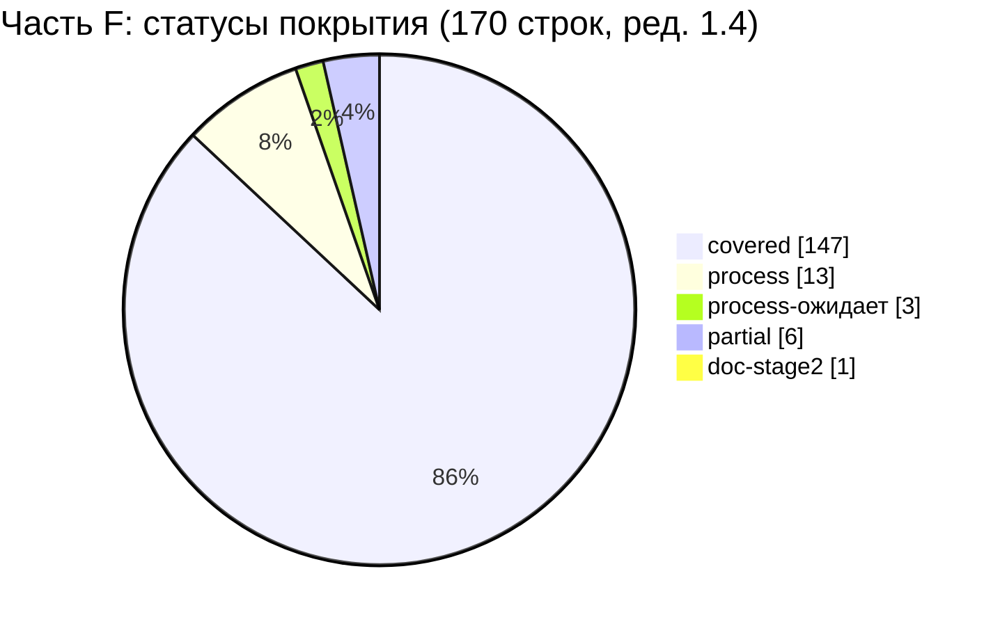

Ред. 1.2 сборки (волна 4): SRC-F-001…003 `covered` → `partial` (полнота переноса требований к экранам не подтверждена, AC-TRACE-007); SRC-F-052…054 `process` → `process-ожидает` (итоговая QA-проверка не завершена); SRC-F-024 `deferred-R2` → `covered`. Планы — сводная §5.1 № 33…35, §5.3. Ред. 1.3 сборки: SRC-F-051d `partial` → `covered` (тест проверки матрицы T-BUILD-011 в 12; сводная §5.6) — итог части F: covered 147, partial 6 (сводная §2.1). **Ред. 1.4 сборки:** обе таблицы и диаграмма этого раздела пересчитаны скриптом по строкам матрицы части F и совпадают со сводной §2.1; SRC-F-001…003 остаются `partial` (сводная §5.7).

---

### 5. Пробелы и частичное покрытие — предложения, куда добавить

#### 5.1. Строки со статусом partial

| SRC-ID | Что не хватает | Предложение (куда добавить) | Владелец |
|---|---|---|---|
| SRC-F-041 | «Подробные макеты ключевых экранов» представлены только wireframes и таблицами элементов 02 (по правилу SRC-F-049); детализированных (hi-fi) макетов ключевых экранов (SCR-01, SCR-10, SCR-14, SCR-20, SCR-21, SCR-30) нет | (а) получить решение заказчика Q-287; (б) при ответе «нужны» — добавить в `visual/` hi-fi макеты ключевых экранов с пометкой «спецификация, не реализация» и строку в DS-079; (в) при ответе «достаточно» — зафиксировать отступление в 01 §7 и 15 (ADR) | заказчик → 03 / visual |
| SRC-F-051c | Критерий приёмки отсутствует у 3 строк: SRC-F-051d, SRC-F-052, SRC-F-054 (у остальных 14 строк `process`/`doc-stage2` AC указан). У 14 строк-документов 02 (SRC-F-004…015, 018, 020) критерий дан ссылкой на индекс `AC-UI-*` (02 §10.1); в ред. 1.1 к ним добавлены опорные конкретные AC (AC-ADR-064 и 1–2 примера AC-UI, например AC-UI-10-011), но полного перечня AC по каждому экрану в матрице нет | (а) для SRC-F-052, SRC-F-054 в сборном 17_TRACEABILITY_MATRIX.md ввести критерий «ревью методики QA волны 4» с ID в 12 (например `AC-TRACE-NNN` `[НОВОЕ ИМЯ]`); для SRC-F-051d AC появится вместе с 12; (б) в 12 §4 добавить критерий-кандидат полноты спецификации экранов: «у каждого SCR-xx ядра §9 в 02 есть подразделы `SCR-xx.1…SCR-xx.14` и непустой `SCR-xx.13`» (проверка скриптом по заголовкам; опора — AC-ADR-064) | 12, сборщик 17 |
| SRC-F-005, SRC-F-006, SRC-F-009, SRC-F-011, SRC-F-013…SRC-F-015, SRC-F-018, SRC-F-019 (покрытие `covered`, замечание к конкретности) | В 02 нет отдельных ID требований вида «у каждого экрана есть подраздел `.N`»: в матрице указаны шаблоны `SCR-xx.N` с опорными примерами (SCR-01.N, SCR-10.N) и примерами AC (AC-UI-10-004, AC-UI-01-003 и др.); полноты по всем экранам эти примеры не доказывают | (а) принять в 12 §4 критерий-кандидат из строки SRC-F-051c п. (б) и тест (ред. 1.0 — заглушка `UI`; ред. 1.2 — тест к добавлению, сводная §6.4 п.2, AC-TRACE-007) — скриптовая проверка заголовков `SCR-xx.1…14` у каждого SCR ядра §9; (б) по решению владельца 02 — добавить в 02 §10.1 сводную строку «экран → диапазон AC-UI» для всех SCR, чтобы матрица ссылалась на конкретные диапазоны | 12, 02, сборщик 17 |
| SRC-F-051d | *История ред. 1.0 части:* 12 выпускался параллельно, тест-ID найдены только для 8 строк, 146 строк были заглушками. **Ред. 1.1–1.2 сборки:** заглушек 0 — все заменены ID тестов 12 v1.1 (сводная §6); остаётся отсутствие в 12 теста проверки самой матрицы (AC-TRACE-001…007) и тестов по сводной §6.4 п.2, 4, 5; ред. 1.3 — тест проверки матрицы добавлен (12 T-BUILD-011), строка `covered` (сводная §5.6); открытыми остаются пункты сводной §6.4 п.2, 4, 5, 6 — они относятся к своим строкам | 12 §3–§5: описать тесты по списку сводной §6.4 (ID назначает 12); сборщик 17 повторяет скрипты §4, §6 сводной части при каждой ревизии 12 | 12, сборщик 17 |
| SRC-F-123 | must-требование «независимая архитектурная проверка» на этапе 1 закрыто только чек-листом и самооценкой автора (06 §15) и журналами проверки 06 прил. А; ARCH-054 требует проверки QA-агентом до утверждения ТЗ с отчётом по CHK-1…CHK-12 — такого отчёта нет; полная проверка запланирована в 13 RM-B-010 (этап B) и RM-H-002 (этап H) | (а) в отчёт QA волны 4 включить прогон чек-листа 06 §15 (CHK-1…CHK-12) независимым агентом и приложить результат к 12 (AC-ARCH-054); (б) после этого пересмотреть статус строки (часть этапа 1 — covered; этапные проверки остаются за RM-B-010 / RM-H-002) | QA волны 4, 12 |

#### 5.2. Строки covered/process с замечаниями (не пробелы, но требуют правки текста ТЗ)

| № | SRC-ID | Замечание | Предложение | Владелец |
|---|---|---|---|---|
| 1 | SRC-F-051…SRC-F-055 | Раздел промта «Проверка полноты» не упоминается ни в одном документе ТЗ, кроме ADR-044 (SRC-F-051a); найдено только по ключевым словам | добавить SRC-F-051…055 в столбцы «Источник» 13 RM-B-001 (порядок: матрица → проверка полноты → QA → исправления → утверждение) и в 12 (зона QA-проверки ТЗ) | 13, 12 |
| 2 | SRC-F-040, SRC-F-050 | AC-DS-079 (03 §18.9) называет файл `visual/wireframes.html` и пишет «на 2026-10-18 — `wireframes-auth.html`, остальные зоны в работе»; фактически выпущены три файла `wireframes-auth/catalog/cashier.html`, вместе покрывающие все SCR ядра §9; 03 §20 (строка SRC-F-040) — та же устаревшая формулировка | обновить AC-DS-079 и 03 §20: перечислить три файла wireframes; см. §12 п. 2 | 03 |
| 3 | SRC-F-055 | Запрет разработки до утверждения покрыт 13 P-1, RM-B-001 и 06 ARCH-055, но они ссылаются на SRC-F-125 / SRC-E-020, а не на SRC-F-055 | добавить SRC-F-055 в источники RM-B-001 и ARCH-055 | 13, 06 |
| 4 | SRC-F-031…SRC-F-033 | 02 §10.3 и 02 ч. C §13 ссылаются на устаревшую нумерацию черновика («SCR-20 §4.7, §4.9, §4.11, §4.11.1; SCR-21 §5.4, §5.4.1, §5.7»); в сводном 02 заголовки — `SCR-20.7`, `SCR-20.9`, `SCR-20.11`, `SCR-20.11.1`, `SCR-21.4`, `SCR-21.4.1`, `SCR-21.7` | заменить ссылки в 02 §10.3 и ч. C §13 на `SCR-xx.N` | 02 |
| 5 | SRC-F-086…086c, SRC-F-089, SRC-F-090, SRC-F-091, SRC-F-138…138c | 08_API_SPECIFICATION.md и 11_SECURITY_PRIVACY.md описывают решения по этим требованиям (08 §2.7, §2.11, §11.1; 11 §3.1, §4.5, §5, §6), но не содержат конкретных SRC-F-ID (в 08 API-029 — только обобщённая ссылка «SRC-F (EVO — 06)», в 11 ссылок на SRC-F нет) — трассировка односторонняя (из 06/16/05) | добавить SRC-F-ID в столбцы «Источник» API-012…019, API-028/029, API-032, SEC-001…003, SEC-028, SEC-049…060, SEC-061…066 | 08, 11 |
| 6 | SRC-F-129, SRC-F-130, SRC-F-133 | Изучение и аудит сервера, оценка размещения выполнены «в меру доступа»: чек-лист и форма ответа готовы (16 §2), сценарии размещения оценены (16 §3.4–§3.5), фактических данных нет; все три строки — `process` (в ред. 1.0 SRC-F-133 непоследовательно имела `covered`) | ответ заказчика Q-030 / Q-031; после него — обновить 16 §3.5 (выбор сценария) | заказчик → 16 |
| 7 | SRC-F-107, SRC-F-108, SRC-F-110 | Канонический владелец границ R1 по 15 ADR-045 — 01 §7; раздел появился во время трассировки (01 §7.1, §7.2, §7.5 учтены в матрице), но 01 ещё дописывается; ссылки на SRC-F-110 в 01 §7.5 нет (найдено по заголовку раздела) | после выпуска 01 — повторить скрипт §9 и добавить SRC-F-110 в источники 01 §7.5 | 01, сборщик 17 |
| 8 | SRC-F-024 (ред. 1.2 — `covered`) | Функция сканирования лица вне R1 (D-14); спецификация полная (02 SCR-05, 09 §10, FACE-NNN), тесты T-FACE-002…005 условные | включение — только после Q-003 и юридического заключения (09 §14.6) | заказчик |

#### 5.3. Строки gap

Не выявлено. Для каждой из 170 строк найдено место в ТЗ (раздел и ID требования либо артефакт методики этапа 1).

---

### 6. Тесты 12_TEST_PLAN.md для части F (заглушки закрыты в ред. 1.1 сборки)

Ред. 1.1 сборки (2026-10-19, ядро v1.5 §20.1, §20.2 п.18–19): все 146 меток-заглушек теста этой части заменены в столбце «Тест» матрицы ID тестов 12_TEST_PLAN.md v1.1; построчное соответствие и способ подбора — §6.3 настоящего документа, тесты к добавлению в 12 — §6.4. Исходный список заглушек части с предложениями для 12 — в черновике части (`source/17_parts_drafts/`). Пять строк SRC-F-051…051d — «н/п в 12» (тест проверки матрицы к добавлению, §6.4); SRC-F-001…003 — T-UI-108 («косвенно»).

---

### 7. Зависимость от документов, выпускаемых параллельно

| Документ | Состояние на момент трассировки | Влияние на часть F | Что сделать сборщику 17 |
|---|---|---|---|
| 12_TEST_PLAN.md | в выпуске: написаны §1–§3.1 (T-AUTH, T-SMS, T-SESS, T-BIO, T-FACE, T-SEC); зона 12 включает SRC-F-051d, SRC-F-103, SRC-F-113, SRC-F-120, SRC-F-126 | 146 строк с заглушками | после выпуска 12 — заменить заглушка `<префикс>` на ID из 12 §3/§5, повторить проверку §9 |
| 01_PRODUCT_REQUIREMENTS.md | в выпуске: на момент завершения трассировки написаны §1–§9; ссылки на SRC-F найдены и учтены в 72 строках (GEN-002, GEN-006, GEN-036, GEN-050, GEN-102, GEN-111, GEN-137, GEN-171, GEN-180…182, GEN-190, GEN-194, GEN-217…227, GEN-235, ROLE-021, NFR-STAB-002/004, NFR-SCALE-004, NFR-MAINT-001/002; §7.1–§7.6) | границы R1 (SRC-F-107…111) подтверждены 01 §7 и 06 §14 | после выпуска финальной версии 01 — повторить скрипт §9 (новые GEN-ID) |
| 14_OPEN_QUESTIONS.md | выпущен; вопросы 17 (Q-280…Q-289) в нём не сведены | новые вопросы Q-287, Q-288 (§10) | включить в 14 после назначения окончательных номеров |

---

### 8. Обратная проверка: какие документы ТЗ покрывают часть F

Число строк матрицы §3, в столбце «Документ и раздел ТЗ» которых упомянут документ (строка может ссылаться на несколько документов). Метод (ред. 1.1, пересчёт по замечанию проверки): в тексте столбца 4 ищутся двузначные номера документов 01…16 как отдельные токены (в начале текста или после пробела, «(», «;», «,», «»», не после «§», «-», «/» и не перед цифрой, «.», «–», «…», «-»; фраза «NN строк» исключена) — учитываются формы «02 §…», «02 ч. B», «02, подраздел», «05 ONEC-…», «13 RM-…», «12_TEST_PLAN.md»; «ядро» — по словам «ядро/ядра» и R0; `visual/` — по подстроке. Отличия от ред. 1.0 (02 — 34, 05 — 22, 13 — 10, 16 — 32, 06 — 92, 15 — 59, 03 — 21, 12 — 4) — следствие прежнего неполного шаблона (не учитывались формы «02, подраздел», «05 ONEC-…», «13 RM-…»).

| Документ | Строк части F | Основные зоны |
|---|---|---|
| 06_ARCHITECTURE.md | 93 | Clean Architecture, модули, backend, правила развития, границы R1, документация (SRC-F-056…SRC-F-128) |
| 01_PRODUCT_REQUIREMENTS.md | 72 | GEN/ROLE/NFR верхнего уровня, границы R1 §7 (документ в выпуске) |
| 15_DECISION_LOG.md | 60 | ADR по экранам, палитре, персонажу, модулям, развитию, развёртыванию |
| 02_SCREEN_SPECIFICATION.md | 46 | ультрадетальная спецификация экранов (SRC-F-001…036), визуальные материалы (SRC-F-038…049), строки 051c, 054 |
| 05_ONEC_INTEGRATION.md | 38 | идентификаторы 1С, конфликты, повторы, миграции, публикация 1С, связь backend ↔ 1С (SRC-F-029; выборочно 078…101a, 112…119, 131…144) |
| 16_DEPLOYMENT_PLAN.md | 33 | существующий сервер, развёртывание, эксплуатация (SRC-F-129…145; также 054, 088, 092, 102, 112) |
| 03_UX_UI_DESIGN_SYSTEM.md | 22 | визуальные материалы, персонаж, состояния компонентов |
| visual/ | 21 | карта экранов, навигация, адаптивность, wireframes, палитры |
| 13_IMPLEMENTATION_ROADMAP.md | 18 | ворота утверждения, этапность, контракты этапа B, независимая проверка (SRC-F-053, 055, 104a, 114, 115, 117…127 кроме 124b/124c, 145) |
| ядро R0 | 17 | границы R1, решения D-14, D-33, D-45 |
| 11_SECURITY_PRIVACY.md | 15 | секреты, логирование, RBAC, HTTPS |
| 10_POS_BUSINESS_RULES.md | 10 | каталог, корзина, касса, роли |
| 09_AUTH_SMS_BIOMETRICS.md | 9 | персонаж, FACE-SCAN, секреты SMS |
| 08_API_SPECIFICATION.md | 8 | версии API, идемпотентность, серверные итоги |
| 04_USER_FLOWS.md | 7 | flow-диаграммы, сценарии корзины и кассира |
| 07_DATA_MODEL.md | 5 | миграции, ERD, целостность данных |
| 12_TEST_PLAN.md | 5 | стратегия тестирования по слоям, зона 12 (SRC-F-051d, 103, 113, 120, 126; документ в выпуске) |

---

### 9. Проверка целостности матрицы

| Проверка | Метод | Результат |
|---|---|---|
| Все строки реестра присутствуют | сравнение множества `SRC-F-…` из `REQ_REGISTER_F.md` и столбца «SRC-ID» этой матрицы (скрипт, `diff`) | 170 = 170, расхождений нет, дублей нет |
| Указанные ID требований и AC существуют | извлечение всех ID (`ARCH-`, `MOD-`, `EVO-`, `DEPLOY-`, `OPS-`, `DS-`, `AC-…`, `T-SEC-…` и др.) из столбцов 4–7 и поиск каждого в `docs/specification/*.md`, `visual/*` | ред. 1.1 (пересчёт после правок): проверено 1501 вхождение (790 уникальных ID; шаблон «необязательный `AC-`/`T-` + ПРЕФИКС + номер», диапазоны «…» — по концам, SRC-ID исключены), поиск в `docs/specification/*.md`, `visual/*` и ядре R0; 0 не найдено. Число 720 из ред. 1.0 получено прежним, более узким шаблоном и не воспроизводится — заменено. В ред. 1.0 исправлена одна ошибка: AC для SMS-028 — `AC-AUTH-035` |
| Ссылки на разделы | выборочная сверка заголовков 02, 03, 05, 06, 09, 10, 13, 16, 01, 12 | несовпадения в 02 §10.3 (устаревшая нумерация частей) зафиксированы в §5.2 п. 4; в матрице указаны фактические заголовки |
| Сумма статусов | подсчёт скриптом по столбцу «Статус покрытия» | 148 + 4 + 16 + 1 + 1 = 170 (ред. 1.1: SRC-F-123 process → partial, SRC-F-133 covered → process) |
| Кодировка и формат | UTF-8 без BOM, LF, таблицы Markdown с 8 столбцами | соблюдено |

---

### 10. Открытые вопросы

> Ред. 1.1 сборки: окончательные номера вопросов диапазона 17 — §13.2, соответствие прежних номеров и меток — §13.3 (ядро v1.5 §20.2 п.18).

Ссылки на канонические вопросы ядра §12 и документов, от которых зависит покрытие части F:

| Q | Суть | Строки части F |
|---|---|---|
| Q-003 | Нужно ли сканирование лица с поворотами в R1 (liveness-SDK, юридическое заключение) | SRC-F-024…027 |
| Q-006 | Логотип, цвет интерактива, вариант палитры A+ / B, тёмная тема (ред. 1.5 сборки: закрыт ответом заказчика — палитра B, логотип оранжевый, ядро v1.9 §24.1; открыт векторный исходник) | SRC-F-042, SRC-F-043, SRC-F-048a |
| Q-030 | Результаты аудита сервера | SRC-F-129, SRC-F-130, SRC-F-133, SRC-F-134a, SRC-F-140 |
| Q-031 | Сетевая связь backend ↔ 1С | SRC-F-133, SRC-F-144 |
| Q-035 | Стиль персонажа, бюджет на Rive | SRC-F-021, SRC-F-048a |

Новые вопросы трассировщика части F (диапазон 17 — Q-280…Q-289 по ядру §19.5). Занятость номеров на момент ред. 1.1: Q-280…Q-282 — 17B/17E, Q-283/Q-284 — 17A, Q-285/Q-286/Q-289 — 17C (после перенумерации, 17C §6.2); 17F — Q-287/Q-288 (предварительно; с другими частями не конфликтуют, что подтверждает 17C §6.2). Окончательные номера назначает сборщик 17:

| Q | Вопрос | Влияние | Рекомендуемое допущение | Строки |
|---|---|---|---|---|
| Q-287 | Принимает ли заказчик замену «подробных макетов ключевых экранов» структурированными спецификациями 02 и wireframes `visual/` (промт допускает это, «если инструмент не позволяет создавать редактируемые макеты»), или до разработки нужны детализированные макеты ключевых экранов в графическом редакторе? | объём работ этапа 1 / этапа B, бюджет дизайнера | достаточно спецификаций 02 + wireframes; hi-fi макеты — в этапе B по решению заказчика | SRC-F-041, SRC-F-049 |
| Q-288 | Утверждает ли заказчик визуальную концепцию (палитра A+, синий интерактивный цвет, логотип, персонаж) отдельно и раньше остального ТЗ или в составе общего утверждения «ТЗ УТВЕРЖДЕНО»? | порядок контрольных точек, сроки | утверждение в составе ТЗ, с ответами на Q-006 и Q-035 (ред. 1.5 сборки: палитра и логотип выбраны заказчиком — Q-006 закрыт, ядро v1.9 §24.1; остаётся персонаж — Q-035) | SRC-F-048, SRC-F-048a |

---

### 11. Трассировка на исходные требования

Зона этого документа — все 170 строк части F (таблица §3). Собственные требования к самому документу трассировки:

| Раздел этого документа | SRC-ID |
|---|---|
| §3 (матрица: ID, место в ТЗ, критерий приёмки, тест) | SRC-F-051, SRC-F-051a, SRC-F-051b, SRC-F-051c, SRC-F-051d |
| §4, §5, §9 (сводка, пробелы, проверка целостности — «ни одна функция не потеряна») | SRC-F-052 |
| §5 (список существенных пробелов для исправления после QA) | SRC-F-053, SRC-F-054 |
| §6 (список тестов для 12) | SRC-F-051d, SRC-F-120 |
| §10 (вопросы заказчику) | SRC-F-041, SRC-F-048a |

---

### 12. Замечания к ядру

1. **Документы волны 3 выпускаются одновременно с трассировкой.** Ядро §15 делает 17 зависимым от 12 (тесты) и 01 (границы R1), но 01, 12 и 17 пишутся параллельно; на момент завершения трассировки 01 дописывается (§1–§9), а у 12 написаны только §1–§3.1. Предложение: в ядре зафиксировать, что сборщик 17 после выпуска 01 и 12 повторяет скриптовую проверку (§9) и заменяет заглушки на фактические ID; статус `partial` у SRC-F-051d снимается только после этого.
2. **Имя файла wireframes.** Ядро §15 перечисляет `visual/wireframes.html`, AC-DS-079 (03 §18.9) и 03 §20 — тоже; фактически выпущены `wireframes-auth.html`, `wireframes-catalog.html`, `wireframes-cashier.html` (вместе покрывают все SCR ядра §9; `visual/README.md` §1 уже описывает их). Предложение: канонизировать три файла в ядре §15 и обновить AC-DS-079.
3. **Диапазон вопросов 17.** Ядро §19.5 даёт документу 17 один диапазон Q-280…Q-289 на шесть параллельных трассировщиков; уже возникла коллизия (Q-280 используется частями 17B и 17E; 17C от Q-280 отказалась и перешла на Q-285, Q-286, Q-289). Предложение: разбить диапазон по частям (например, A — Q-280/281, B — Q-282/283, …, F — Q-288/289) или поручить нумерацию только сборщику; в этом документе использованы Q-287, Q-288 как предварительные.
4. **Префикс тестов для проверки трассировки.** В ядре §10 нет префикса для требований к самой матрице и QA-процессу (SRC-F-051…055); использовано заглушка `TRACE` `[НОВОЕ ИМЯ]`. Предложение: добавить префикс `TRACE-` (требования/тесты к 17) или закрепить эти проверки за `T-RM-` (13).
5. **Владелец тест-ID `T-SEC-…`.** Ядро §10 закрепляет `T-<ПРЕФИКС>-NNN` за 12, но 11 §12.2 уже определяет перечень T-SEC (на него ссылается и 12 §3.1, например T-SMS-015 → T-SEC-036, T-SEC-037). Предложение: зафиксировать в ядре, что T-SEC — канон 11 §12.2, а 12 включает их без перенумерации.
6. **Обратные ссылки на SRC-F в 08 и 11.** Ядро §10 требует, чтобы каждое требование из промта ссылалось хотя бы на один SRC; в 08 и 11 нет конкретных SRC-F-ID (в 08 API-029 есть только обобщённая ссылка «SRC-F (EVO — 06)»), хотя они описывают решения по SRC-F-086…086c, 089, 090, 091, 138…138c (см. §5.2 п. 5). Предложение: включить в чек-лист сверки волны 4 проверку «двусторонней» трассировки для этих строк.

---

### 13. Журнал проверки части F (раздел части; «17 §13» — раздел верхнего уровня «Открытые вопросы»)

Редакция 1.1 (2026-10-19) — доработка по замечаниям проверки ред. 1.0. Правки точечные; затронутые разделы пересчитаны скриптом (§4, §6, §8, §9).

| № | Замечание (уровень) | Где | Что сделано |
|---|---|---|---|
| 1 | SRC-F-123 (must) получила `process`, хотя на этапе 1 есть только самооценка автора 06 §15; частичное покрытие не попадало в §5.1 (major) | §3.5, §4, §5.2 п. 6, §2.1 | Статус SRC-F-123 → `partial (§5.1)`; столбец «Документ и раздел» уточнён (ARCH-054 требует проверки QA-агентом до утверждения ТЗ — отчёта нет; полная проверка — 13 RM-B-010, RM-H-002); тест — заглушка `ARCH`. Строка перенесена из §5.2 (п. 6 удалён, пп. 7–9 → 6–8) в §5.1 с предложением. В §2.1 уточнено: `process` — только при полном выполнении методикой этапа 1, частичное → `partial`. Пересчитаны §4 (таблица статусов, таблица по типам, pie), §1, §9 |
| 2 | Утверждение «AC отсутствует у 17 строк process/doc-stage2» противоречит матрице (minor) | §3.3 SRC-F-051c, §5.1 | Исправлено: AC отсутствует у 3 строк (SRC-F-051d, 052, 054), у 14 остальных строк `process`/`doc-stage2` AC указан. Число строк-документов 02 со ссылкой на индекс `AC-UI-*` уточнено скриптом: 14 (SRC-F-004…015, 018, 020), а не 18 |
| 3 | Шаблоны `SCR-xx.N`, `AC-UI-*` вместо конкретных ID у SRC-F-005, 006, 009, 011, 013–015, 018, 019 (minor) | §3.1, §5.1, §6 | В строки добавлены опорные ID: ADR-064 / AC-ADR-064 и примеры подразделов (SCR-01.N, SCR-10.N) и AC (например, AC-UI-10-019, AC-UI-10-030, AC-UI-01-015, AC-UI-10-004, AC-UI-10-006, AC-UI-10-008, AC-UI-10-013, AC-UI-01-003, AC-UI-01-005, AC-UI-10-012, AC-UI-10-024, AC-UI-01-001…018, AC-UI-10-001…031; для 019 — AC-UI-12-010…013, AC-UI-16-012); примеры добавлены также в 007, 012, 020. В §5.1 — отдельная строка с предложением: критерий-кандидат в 12 §4 «у каждого SCR-xx ядра §9 есть подразделы `.1…14`» и сводка «экран → диапазон AC-UI» в 02 §10.1. Все добавленные ID проверены в 02 |
| 4 | Счётчики §8 «подсчёт скриптом» не воспроизводятся (minor) | §8 | Пересчитано по тексту столбца 4 с учётом форм «02, подраздел», «05 ONEC-…», «13 RM-…»; метод описан в §8. Новые значения: 06 — 93, 01 — 72, 15 — 60, 02 — 46, 05 — 38, 16 — 33, 03 — 22, visual — 21, 13 — 18, ядро — 17, 11 — 15, 10 — 10, 09 — 9, 08 — 8, 04 — 7, 07 — 5, 12 — 5; порядок строк обновлён. Расхождение с оценкой проверяющего по 16 (34) и 02 (39–42): шаблон ред. 1.1 не считает ссылкой на документ фразу вида «16 строк» (была в SRC-F-051c ред. 1.0), а для 02 учитывает все формы упоминания, включая «02, подраздел» и «строк-документов 02»; тот же скрипт на тексте ред. 1.0 даёт те же значения (16 — 33, 02 — 46) |
| 5 | Неточное описание занятых номеров Q-280…Q-289 (minor) | §10, §12 п. 3 | §10: «Q-280…Q-282 — 17B/17E, Q-283/284 — 17A, Q-285/286/289 — 17C (17C §6.2); 17F — Q-287/288 (предварительно)». §12 п. 3: «17B и 17C» → «17B и 17E» (17C перешла на Q-285, Q-286, Q-289). Сверено с 17A §8.2 и 17C §6.2 |
| 6 | «08 не содержит ни одной ссылки на SRC-F» — неточно (minor) | §1 п. (4), §5.2 п. 5, §12 п. 6 | Уточнено: в 08 и 11 нет конкретных SRC-F-ID; в 08 API-029 есть только обобщённая ссылка «SRC-F (EVO — 06)» (проверено поиском по 08 и 11) |
| 7 | Неверная ссылка «02 ч. B §15 … п. 17» в SRC-F-019 (minor) | §3.1 | Заменено на «02 ч. B §15, пп. П-1…П-4»; добавлены 02 §10.3 (строка SRC-F-019) и 02 ч. B §13 (строка SRC-F-019) |
| 8 | «T-DS-050 (03 §10)» — неверный раздел (minor) | §6 | Заменено на «T-DS-050…066 (03 §17.9)» |
| 9 | Для SRC-F-086c не указан кандидат T-SEC-022 (SEC-034 → T-SEC-022, 11 §12.2) (minor) | §3.4, §6 | В столбец «Тест» SRC-F-086c добавлено «канд. T-SEC-022»; в §6 строка заглушка ARCH дополнена кандидатом T-SEC-022 |
| 10 | Непоследовательные статусы SRC-F-133 (covered) и однотипных SRC-F-129/130 (process) (minor) | §3.6, §4, §5.2 п. 6, §6 | SRC-F-133 переведена в `process` по аналогии с 129/130 (оценка размещения выполнена в меру доступа, фактических данных нет — Q-030, Q-031); тест — «—». Пересчитаны §4 (covered 148, process 16), §6 (заглушка DEPLOY — 13 строк; итог заглушек — 146 без изменений: +1 SRC-F-123, −1 SRC-F-133) |

**Проверка целостности после правок (скрипт):** в §3 — 170 строк по 8 столбцов, множество SRC-ID совпадает с реестром (170 = 170, без дублей); статусы: covered 148 + partial 4 + process 16 + deferred-R2 1 + doc-stage2 1 = 170; по типам — документ 67, нефункц. 38, ограничение 28, функц. 19, процесс 18; заглушки — 146 (23 префикс-группы), тесты из 12 — 8 строк, `process` без теста — 16 (146 + 8 + 16 = 170); ID в столбцах 4–7 — 1501 вхождение, 0 не найдено; файл — UTF-8 без BOM, LF.

---

## 13. Открытые вопросы

### 13.1. Вопросы, от которых зависят строки partial / deferred-R2 / process-ожидает

Полные перечни вопросов, влияющих на каждую часть, — в разделах «Открытые вопросы» частей (17A §8, 17B §7, 17C §6, 17D §8, 17E §8, 17F §10). Ниже — только вопросы, от ответа на которые зависит закрытие строк §5.

| Q | Кратко | Строки матрицы (§5) | Состояние |
|---|---|---|---|
| Q-003 | сканирование лица с поворотами в R1 (liveness-SDK, юридическое заключение) | SRC-B-126 (partial, ред. 1.2); SRC-F-024 (ред. 1.1 — deferred-R2, ред. 1.2 — covered условно, §5.5) | открыт `[ТРЕБУЕТ РЕШЕНИЯ ЗАКАЗЧИКА: Q-003]` |
| Q-302 [НОВЫЙ ВОПРОС, ред. 1.2] | ручные чертежи, на которые ссылается промт, в материалах отсутствуют (формулировка — ядро v1.7 §22.13 п.6) | SRC-C-014, SRC-A-009 (partial; ред. 1.3 — SRC-A-009 добавлена по ядру §22.13 п.6) | открыт (§13.2); заведён в 14 (§2.14 — краткая карточка, §3.5 реестра, форма §7; 14 §4.4 — Q-300…Q-303 из диапазона 17) |
| Q-304 [НОВЫЙ ВОПРОС, ред. 1.2; до ред. 1.5 — Q-303] | обязательный PIN как замена обязательного этапа «лицо или биометрия» | SRC-B-126 (partial) | открыт (§13.2); ред. 1.5 — частично отвечен ядро v1.9 §24.2 для клиента (хотя бы один способ: биометрия или PIN); номер Q-304 — уточнение нумерации ядро v1.9 §24.5 (Q-303 — вопрос о «супер-админе») |
| Q-012 | документы 1С для наличных, QR, долга; какие способы оплаты и документы использует магазин | SRC-C-077, SRC-C-080, SRC-C-081, SRC-C-082 (partial, ред. 1.2) | открыт |
| Q-010 | конфигурация и релиз 1С | SRC-C-080 (partial, ред. 1.2) | открыт; ответ даст специалист 1С по техническому запросу (ядро v1.9 §24.3) |
| Q-013, Q-009, Q-019, Q-214 | фискализация; сканеры; печатные формы и принтеры; кассовое оборудование | SRC-C-119 (partial, ред. 1.2) | открыты |
| Q-005 | реальный состав ролей | SRC-C-131a (partial, ред. 1.2) | открыт |
| Q-162 | порядок «форма → OTP» или «OTP → форма» при регистрации | SRC-B-147 | открыт |
| Q-273 (документ 01) | подтверждение отступления: `staff` попадает на рабочий экран через одношаговую разблокировку SCR-08 | SRC-B-068 | открыт; допущение — ядро §19.4, D-48 |
| Q-281 | сопоставление 8 ролей промта исполнителям | SRC-E-025a | открыт (окончательный номер, §13.2) |
| Q-301 | отдельный финальный отчёт `docs/FINAL_REPORT.md` (кандидат 17D-2) | SRC-D-182, SRC-D-183, SRC-D-184, SRC-D-185 | открыт (окончательный номер, §13.2; ред. 1.1) |
| Q-284 | складская система / ТСД помимо 1С | SRC-A-046 | открыт (§13.2) |
| Q-285 | источник признака «подтверждённый номер» клиента в R1 | SRC-C-094 (ред. 1.5 — `covered` условно, §5.5, §5.8) | открыт (§13.2) |
| Q-287 | замена hi-fi макетов спецификациями 02 и wireframes | SRC-F-041 | открыт (§13.2) |
| Q-289 | «компактный список» при ширине < 840 lp | SRC-C-018 | открыт (§13.2) |
| Q-204, Q-216, Q-218(б), Q-221 | сортировки каталога; список конфликтов привязки; публичные настройки; точечное обновление долга | SRC-C-019, SRC-B-146 и др. (covered) | **закрыт решением ядра v1.4** (§19.2, §19.5) |
| Q-001, Q-006 | кто регистрируется (режим клиента); палитра и логотип | SRC-C-094 (ред. 1.5 → `covered`); 8 строк §5.5 сняты с условности | **закрыты ответом заказчика 2026-10-21** (ядро v1.9 §24.2, §24.1; у Q-006 открыт только векторный логотип) |
| Q-011, Q-014 | разработчик 1С и тестовая копия; QR и подтверждение оплаты | SRC-B-005, SRC-D-164, SRC-E-113 (covered условно, §5.5) | частично закрыты (ядро v1.9 §24.3, §24.4) |

### 13.2. Окончательная нумерация вопросов 17 (Q-280…Q-289 и Q-300…Q-309; ядро §19.5, §20.2 п.18)

Части 17A…17F выбирали номера из общего диапазона независимо; возникли коллизии (Q-280 — 17B и 17E; Q-280…Q-282 — ред. 1 части 17C), а кандидатов оказалось 12 при 10 номерах. Ядро v1.5 §20.2 п.18 выделило документу 17 дополнительный диапазон Q-300…Q-309. Сборщик сохраняет номера, уже не конфликтующие и учтённые в 14 §3.10, и присваивает номера кандидатам части D из дополнительного диапазона. **Сводная таблица вопросов 17 (14 вопросов; ред. 1.2 — добавлены Q-302 и вопрос о PIN, с ред. 1.5 — Q-304, прежний Q-303):**

| Окончательный номер | Часть | Номер / метка в тексте части | Вопрос заказчику (кратко) | Строки SRC | Рекомендуемое допущение до ответа | Решение сборщика |
|---|---|---|---|---|---|---|
| **Q-280** [НОВЫЙ ВОПРОС] — **дубль → Q-277** (ред. 1.2) | 17E | кандидат 17E-1 (14 §3.10 — «Q-280 (17E)») | утверждает ли заказчик показатель стабильности `NFR-STAB-001` (≤ 1 аварийного завершения на 500 рабочих сессий; 0 потерь корзины/черновика) и способ его измерения в пилоте (журнал инцидентов 13 §8 или автоматический сбор отчётов о сбоях, связь с Q-134) | SRC-E-181d, SRC-E-183a | значение 01 со статусом `НЕ ПОДТВЕРЖДЕНО`; измерение — по журналу инцидентов пилота | номер закреплён за 17E; вопрос 17B с номером Q-280 **отозван** (дубль Q-273, 14 §4.2); ред. 1.2 (волна 4): статус **«дубль → Q-277»** — Q-277 документа 01 (01 §13.1) уже спрашивает об утверждении NFR-STAB-001 и способе его измерения в пилоте; ведущий — меньший номер (ядро §20.2 п.17), так же ведёт 14 §3 и §3.10; ответ на Q-277 закрывает Q-280, номер не переиспользуется |
| **Q-281** [НОВЫЙ ВОПРОС] | 17E | кандидат 17E-2 (14 §3.10 — «Q-281 (17E)») | считается ли выполненным требование «назначь 8 ролей», если работы выполняли более 8 агентов, каждый из которых сопоставлен одной из восьми ролей промта (связь с Q-191) | SRC-E-025a | да — при таблице «роль → исполнители» в итоговом отчёте | 17C (ред. 1) использовала номер для другого вопроса — ныне Q-286 |
| **Q-282** [НОВЫЙ ВОПРОС] | 17E | кандидат 17E-3 (14 §3.10 — «Q-282 (17E)») | подтвердить трактовку «обработки повторных запросов» как обработки дублирующих и повторно отправленных запросов (идемпотентность, повтор с тем же ключом), а не только автоматических повторов при сбое | SRC-E-166 | трактовка реестра, 10 (CART-023, ORD-021…028) и 08 (API-012…020) | 17C (ред. 1) использовала номер для другого вопроса — ныне Q-289 |
| **Q-283** [НОВЫЙ ВОПРОС] | 17A | Q-283 (предварительный) | принимает ли заказчик выпуск документов промта (`docs/PRODUCT_REQUIREMENTS.md`, `docs/ARCHITECTURE.md` и др.) как `docs/specification/01…15_*.md` по таблице ADR-045 | SRC-A-072…SRC-A-081 | да, по ADR-045; на этапе 2 при необходимости — файлы-указатели | номер сохранён |
| **Q-284** [НОВЫЙ ВОПРОС] | 17A | Q-284 (предварительный) | используется ли помимо 1С складская система или терминалы сбора данных, интерфейс которых нужно учесть в дизайне | SRC-A-046 | нет; складские паттерны покрываются обзором POS/B2B (03 §3.1) | номер сохранён |
| **Q-285** [НОВЫЙ ВОПРОС] | 17C | Q-285 (ред. 1 — Q-280) | есть ли в карточке клиента 1С признак подтверждённого телефона; если нет — согласен ли заказчик, что в R1 номер клиента показывается как «не подтверждён», а подтверждение — в R2 (CUST-013) | SRC-C-094 | «не подтверждён», если нет OTP-подтверждения через `customer_link` | номер сохранён |
| **Q-286** [НОВЫЙ ВОПРОС] | 17C | Q-286 (ред. 1 — Q-281) | «данные, разрешённые его роли» в карточке клиента — роль сотрудника, открывшего карточку, а не категория клиента? | SRC-C-092 | роль текущего пользователя (CUST-001, ROLE-018) | номер сохранён |
| **Q-287** [НОВЫЙ ВОПРОС] | 17F | Q-287 (предварительный) | достаточно ли спецификаций 02 и wireframes `visual/` вместо подробных (hi-fi) макетов ключевых экранов | SRC-F-041, SRC-F-049 | достаточно; hi-fi — на этапе B по решению заказчика | номер сохранён |
| **Q-288** [НОВЫЙ ВОПРОС] | 17F | Q-288 (предварительный) | утверждается ли визуальная концепция (палитра A+, синий интерактивный цвет, логотип, персонаж) отдельно и раньше остального ТЗ | SRC-F-048, SRC-F-048a | в составе общего утверждения ТЗ, с ответами на Q-006 и Q-035 | номер сохранён; ред. 1.5: палитра B и логотип выбраны заказчиком (Q-006 закрыт, ядро v1.9 §24.1) — формулировка «палитра A+, синий интерактивный цвет» устарела, вопрос сохраняется в части персонажа (Q-035) и порядка утверждения |
| **Q-289** [НОВЫЙ ВОПРОС] | 17C | Q-289 (ред. 1 — Q-282) | нужен ли «компактный список» каталога на телефонах и планшетах в портретной ориентации (< 840 lp) | SRC-C-018 | по 02 UI-10-013 (компакт — от 840 lp) с записью отступления | номер сохранён |
| **Q-300** [НОВЫЙ ВОПРОС] | 17D | кандидат 17D-1 (17D §8.2; 14 §3.10 — «17D-1 (без номера)») | должны ли автотесты авторизации покрывать `customer`-аккаунты, или «клиент» в SRC-D-092/093 — пользователь приложения (в R1 — сотрудник, D-07) | SRC-D-092, SRC-D-093 | сценарии на `staff` + тесты «флаг `CUSTOMER_SELF_SERVICE` выключен» (13 §7, п. 7.8) | номер из дополнительного диапазона 17 (ядро §20.2 п.18); связан с Q-001 — ответ на Q-001 (кто регистрируется в R1) определяет ответ; ред. 1.0 сводила кандидата к подпункту Q-001 — заменено; **ред. 1.5: снимается** — ответ заказчика на Q-001 (ядро v1.9 §24.2): клиент-покупатель регистрируется в R1, автотесты SRC-D-092/093 покрывают `customer` (T-AUTH-042, T-AUTH-043); статус в реестре — у владельца 14 |
| **Q-301** [НОВЫЙ ВОПРОС] | 17D | кандидат 17D-2 (17D §8.2; 14 §3.10 — «17D-2 (без номера)») | нужен ли финальный отчёт этапа 2 отдельным документом `docs/FINAL_REPORT.md` с 9 обязательными пунктами промта (SRC-D-177…185), или достаточно отчёта этапа I (RM-I-010) со ссылками | SRC-D-177…SRC-D-185 | отдельный `docs/FINAL_REPORT.md` с 9 разделами | номер из дополнительного диапазона 17 (ядро §20.2 п.18); предложение ред. 1.0 — Q-297 из резерва 14 — отозвано |
| **Q-302** [НОВЫЙ ВОПРОС] | сводная (ред. 1.2, волна 4; формулировка ред. 1.3 — по ядру v1.7 §22.13 п.6) | — | «Есть ли ручные чертежи экранов? Если да — передать; ТЗ будет сверено с ними» (ядро v1.7 §22.13 п.6). Контекст: промт (стр. 8, 147, 264, 581) ссылается на приложенные ручные чертежи экранов и требует использовать их как исходный материал компоновки; в `resursi/` их нет (ядро §0); до ответа исходным материалом взяты три цифровых макета (ядро §14) | SRC-C-014, SRC-A-009 (обе — `partial` до ответа, ядро §22.13 п.6); также SRC-B-040, SRC-D-145b, SRC-E-040 — в части изучения материалов | до ответа исходный материал — три цифровых макета и требования промта; отличия от макетов — 02 SCR-10.1, ч. B §9 | номер из дополнительного диапазона 17 (ядро §20.2 п.18); при получении чертежей — сверка 02 SCR-10.1 / ч. B §9 (владелец 02) |
| **Q-304** [НОВЫЙ ВОПРОС] (до ред. 1.5 — Q-303) | сводная (ред. 1.2, волна 4) | — | промт (стр. 228) делает «сканирование лица или настройку биометрии» обязательным этапом регистрации; ТЗ в R1 делает обязательным PIN (для `staff`), биометрию ОС — по выбору, сканирование лица — условным R2 (D-14, D-48). Принимает ли заказчик PIN как замену обязательного этапа, или биометрия (лицо/отпечаток) должна быть обязательной там, где устройство её поддерживает? | SRC-B-126 | обязательный PIN + биометрия ОС по выбору (09 REG-006); связан с Q-003 | номер из дополнительного диапазона 17; ответ «биометрия обязательна» требует правки 09 REG-006, 02 SCR-04, 15 ADR-014, 12 T-REG-009; ред. 1.5: для клиента частично отвечен ядро v1.9 §24.2 (хотя бы один способ — биометрия или PIN, 09 REG-038), сотрудник задаёт PIN при первом входе (09 REG-037, D-48); ядро v1.9 §24.5 («Нумерация», уточнение 2026-10-21) закрепило Q-303 за вопросом о «супер-админе», этот вопрос — Q-304; Q-297 не используется; §15 п.12 — закрыто; перенумерация в реестре 14 — у владельца 14 |

Итого: 14 вопросов — Q-280…Q-289 (части A, C, E, F), Q-300, Q-301 (часть D) и Q-302, Q-304 (сводная часть, ред. 1.2, по замечаниям волны 4; Q-304 до ред. 1.5 — Q-303); снят один номер — Q-280 части B (дубль Q-273, ядро §20.2 п.17: ведущий — меньший номер); Q-280 части E имеет статус «дубль → Q-277» (ред. 1.2: ведущий — Q-277 документа 01, как в 14 §3), поэтому самостоятельных вопросов, требующих отдельного ответа, — 13; резерв документа 17 — Q-305…Q-309. Ссылки строк матрицы и таблиц частей на кандидатов (17D-1, 17D-2, 17E-1…17E-3) дополнены окончательными номерами (ред. 1.1); прочие упоминания предварительных номеров в тексте частей читаются по §13.3. 14_OPEN_QUESTIONS.md переносит вопросы 17 из §3.10 («предварительные», «без номера») в §3 и счётчики под номерами этой таблицы. Ред. 1.5: новых вопросов 17 нет; Q-300 снимается ответом заказчика на Q-001 (ядро v1.9 §24.2) — самостоятельных вопросов 17, требующих ответа, — 12 (статус Q-300 в реестре — у владельца 14); Q-288 сужен до персонажа и порядка утверждения; вопрос о PIN — Q-304 (прежний Q-303; ядро v1.9 §24.5, «Нумерация»; §13.3, §15 п.12 — закрыто).

### 13.3. Соответствие прежних номеров и меток окончательным

| Часть | Прежний номер / метка (где) | Окончательный номер | Примечание |
|---|---|---|---|
| 17A | Q-283 (предварительный, §7 → 8.2 части A) | Q-283 | без изменений |
| 17A | Q-284 (предварительный, §7 → 8.2 части A) | Q-284 | без изменений |
| 17B | Q-280 (ред. 1.0 части B; отозван в §8 → 7.1 части B) | — (снят) | дубль Q-273 (документ 01); ведущий — Q-273 |
| 17C | Q-280 (ред. 1 части C) | Q-285 | §9 → 6.2 части C |
| 17C | Q-281 (ред. 1 части C) | Q-286 | §9 → 6.2 части C |
| 17C | Q-282 (ред. 1 части C) | Q-289 | §9 → 6.2 части C |
| 17C | Q-285, Q-286, Q-289 (предварительные) | Q-285, Q-286, Q-289 | без изменений |
| 17D | кандидат 17D-1 (§10 → 8.2 части D) | Q-300 | ред. 1.0 сборки: «уточнение Q-001» — заменено номером |
| 17D | кандидат 17D-2 (§10 → 8.2 части D) | Q-301 | ред. 1.0 сборки: «предлагается Q-297» (резерв 14) — отозвано |
| 17E | кандидат 17E-1 (§11 → 8 части E; 14 §3.10 — «Q-280 (17E)») | Q-280 (дубль → Q-277) | коллизия с 17B снята; ред. 1.2 — дубль Q-277 документа 01 (ведущий — меньший номер, ядро §20.2 п.17) |
| 17E | кандидат 17E-2 (14 §3.10 — «Q-281 (17E)») | Q-281 | без изменений номера по 14 |
| 17E | кандидат 17E-3 (14 §3.10 — «Q-282 (17E)») | Q-282 | без изменений номера по 14 |
| 17F | Q-287, Q-288 (предварительные, §12 → 10 части F) | Q-287, Q-288 | без изменений |
| сводная | Q-303 (ред. 1.2–1.5 сборки; 14 §3.6, форма §7; 01 §14.3) | Q-304 | ядро v1.9 §24.5 «Нумерация» (2026-10-21): Q-303 — вопрос о «супер-админе»; Q-297 не используется; перенумерация в 14 и 01 — у владельцев |

### 13.4. Новые вопросы этого документа

Ред. 1.2 (волна 4): **Q-302** (ручные чертежи, SRC-C-014) и **Q-304** (до ред. 1.5 — Q-303; PIN вместо обязательного этапа «лицо или биометрия», SRC-B-126) — карточки в §13.2. 14_OPEN_QUESTIONS.md должен включить их в реестр §3 и счётчики (владелец сводного реестра вопросов — 14); до включения статус в 14 — «нет записи». Других новых вопросов нет.

Ред. 1.3: Q-302 закреплён ядром v1.7 §22.13 п.6 («новый вопрос Q-302 (14)»; строки SRC-A-009 и SRC-C-014 — `partial` до ответа). Перепроверка Grep 14 (2026-10-19, 08:35): владелец 14 завёл оба вопроса — Q-302 (§2.14 «блокирует только сверку экранов», §3.5 реестра, форма §7) и Q-303 (§3.6 реестра, форма §7); 14 §4.4 числит за 17 номера Q-280…Q-289, Q-300…Q-303, резерв — Q-304…Q-309; поручение ред. 1.2 выполнено. Формулировка Q-302 в 14 совпадает с ядром и дополнена альтернативой «если нет — подтверждение трёх цифровых макетов». Новых вопросов ред. 1.3 нет.

Ред. 1.5 (ядро v1.9 §24): новых вопросов нет. Ядро §24.5 вводит «новый вопрос Q-303» («кто такой "супер-админ"»), тогда как Q-303 — вопрос этого документа (ред. 1.2, §13.2), заведённый владельцем 14 (§3.6 реестра, форма §7); владельцы 09, 10, 11 используют Q-303 в значении ядра и отмечают коллизию (09 §17 п.22 (д), 10 §23 п.33). Уточнение нумерации ядра §24.5 (2026-10-21): Q-303 закреплён за вопросом о «супер-админе», вопрос 17 о PIN (SRC-B-126) — Q-304, Q-297 не используется; 17 приведён к этому (§1, §5.1 № 25, §5.8, §13.1–§13.3, ч. B). От вопроса Q-303 («супер-админ») ни одна строка матрицы от него не зависит (допущение `admin` не меняет набор ролей; SRC-C-131a зависит от Q-005). §15 п.12 — закрыто.

---

## 14. Трассировка на исходные требования

Документ целиком является трассировкой: каждая из 1 324 строк матрицы (§7–§12) соответствует ровно одному SRC-ID реестров A…F (§4.1). Требования к самому документу трассировки и к проверке полноты:

| Раздел этого документа | SRC-ID | Как выполнено |
|---|---|---|
| §7–§12 (матрица: ID, место в ТЗ, критерий приёмки, тест) | SRC-F-051, SRC-F-051a, SRC-F-051b, SRC-F-051c, SRC-F-051d | 1 324 строки по 8 столбцов; AC-TRACE-001…003 (§4.3); тест 12 — T-BUILD-011 (ред. 1.3) |
| §2, §4.1, §4.3 (сводка; «ни одна первоначальная функция не потеряна») | SRC-F-052 | скриптовая сверка множеств ID (пропусков 0) и дословности формулировок (AC-TRACE-006, ред. 1.2); полнота переноса требований к экранам (AC-TRACE-007) не подтверждена — строка `process-ожидает` |
| §5 (список существенных пробелов для исправления после QA) | SRC-F-053, SRC-F-054, SRC-E-225 | ред. 1.5: 31 строка partial (−SRC-C-094, §5.8) + 29 process-ожидает, 78 условных covered (§5.5); ред. 1.3: 32 строки partial (+SRC-A-009, −SRC-F-051d, §5.6) + 29 process-ожидает; ред. 1.2: 32 строки partial + 29 process-ожидает с планом закрытия и владельцем (§5.1, §5.3), 85 условных covered (§5.5); пересмотр ред. 1.1 — §5.4; SRC-F-053, SRC-F-054 сами — `process-ожидает` до завершения волны 4 |
| §6 (тесты 12 в матрице) | SRC-F-051d, SRC-F-120, SRC-E-184 | 558 бывших заглушек заменены ID тестов 12 v1.1 (заглушек 0); ред. 1.3 — новые тесты 12 волны 4 внесены (§6.1, §5.6); тесты к добавлению в 12 — §6.4 п.2, 4, 5, 6 |
| §4.3 (критерии приёмки матрицы) | SRC-F-051c, SRC-E-222 | AC-TRACE-001…005 `[НОВОЕ ИМЯ]` |
| §13 (вопросы перечислены отдельно, окончательные номера) | SRC-E-234, SRC-A-029 | §13.2–§13.3 |
| §2.4, §5 (осознанные отступления: SRC-B-068, SRC-B-126 (ред. 1.2) и кандидаты SRC-B-147, SRC-C-018, SRC-C-094 (ред. 1.5 — закрыта, §5.8)) | SRC-B-068 (ядро §19.4: «фиксируется в 01 и 17»), SRC-B-126 (01 §14.3, GEN-050) | строки 7 и 25 таблицы §5.1, строки SRC-B-068 и SRC-B-126 части B |

---

## 15. Замечания к ядру

1. **Диапазон вопросов 17 исчерпан (§19.5).** Шесть частей предложили 12 вопросов на 10 номеров Q-280…Q-289, с коллизией Q-280 (17B/17E). Сборщик назначил окончательные номера (§13.2): Q-280…Q-289 — десяти вопросам частей A, C, E, F; 17D-1 сведён к Q-001; для 17D-2 предложен Q-297 из резерва 14. Предложение: (а) подтвердить в ядре таблицу §13.2 как каноническую; (б) подтвердить Q-297 за 17D-2 или выделить документу 17 дополнительный диапазон; (в) для будущих параллельных частей — правило «части предлагают кандидатов без номеров, номера назначает сборщик» (предложение всех шести частей). **Состояние (ядро v1.5 §20.2 п.18):** документу 17 выделен дополнительный диапазон Q-300…Q-309; 17D-1 → Q-300, 17D-2 → Q-301, предложение Q-297 отозвано (§13.2–§13.3).
2. **Статус рабочих частей.** Ядро §15 называло только `17_TRACEABILITY_MATRIX.md`; части 17A…17F полностью включены в этот документ (§7–§12). Предложение ред. 1.0: по аналогии с ядром §19.1 (02) считать этот документ единственным каноническим текстом матрицы, а отдельные файлы частей — рабочими черновиками. **Закрыто ядром v1.5 §20.1:** 17 — единственный канонический текст, черновики частей — `source/17_parts_drafts/`; ссылки на файлы частей заменены ссылками на разделы §7–§12.
3. **Единая легенда статусов.** Статус `process-ожидает` (процесс этапа 1, ещё не выполненный) введён только частью E (17E §10 п.8); остальные части такие строки не выделяют. Предложение: принять `process-ожидает` в легенде ядра для всех частей 17 и при ревизии частей A, B, C, D, F перепроверить строки `process` на это условие, чтобы сводный процент выполнения (§2.1) не был завышен.
4. **Префикс для матрицы и проверки полноты.** В ядре §10 нет префикса для требований и тестов к самой матрице (SRC-F-051…055). В §4.3 введены `AC-TRACE-001…005` `[НОВОЕ ИМЯ]`, в 12 предлагался отдельный тест проверки матрицы. Предложение: добавить префикс `TRACE-` (владелец — 17) в ядро §10/§17.6. **Состояние (ядро v1.5):** префикс не введён; ID теста назначает 12 (§20.1) — предложение в §6.4. **Состояние (ред. 1.3):** 12 назначил тест T-BUILD-011 (AC-TRACE-001…005); префикс `TRACE-` ядром v1.6–v1.7 не введён, критерии остаются `AC-TRACE-*` этого документа.
5. **Владелец тест-ID с префиксом `T-`.** 11 §12.2 (`T-SEC-001…055`), 03 §17.9 (`T-DS-…`, `T-ANIM-…`, `T-A11Y-…`), 09 §16 (`T-AUTH-001…010`) назначают ID, которые по ядру §10 принадлежат 12. 12 сохранил `T-SEC` и `T-AUTH`, но перенумеровал `T-DS` (правило «`T-DS-NNN` = `DS-NNN`»), из-за чего ссылка 17E на `T-DS-028` устарела (§4.2), а `T-DS-050…066` в 03 и 12 могут обозначать разные тесты. Предложение: закрепить в ядре, что ID тестов назначает только 12, а 03/09/11 ссылаются на ID 12 (или 12 принимает их без перенумерации) — и обязать 03 §17.9 выровняться. **Закрыто ядром v1.5 §20.1:** 12 — владелец всех `T-*`; `T-DS-028` в 12 v1.1 существует и проверяет DS-028 «Радиусы и тени»; строка SRC-E-188 (golden всех компонентов) ссылается на `T-DS-066` (§4.2, перепроверка ред. 1.2).
6. **Порядок выпуска.** Части 17 писались параллельно с 01, 12 и 14 и опираются на разные снимки (04:50…05:30); после выпуска полной версии 12 у 558 строк оставались метки-заглушки теста. Предложение: зафиксировать в ядре порядок «выпуск 01/12/14 → ревизия частей 17 (замена заглушек, пересмотр SRC-A-061a, SRC-A-080, SRC-F-051d) → пересборка 17 → волна 4 (QA)». **Выполнено в ред. 1.1 (ядро v1.5 §20.1, §20.2 п.19):** заглушки заменены ID тестов 12 (§6), статусы пересмотрены (§5.4).
7. **Объём 17 «по числу SRC-строк» (§11 п.9).** Число строк, начинающихся с `| SRC-`, в реестрах (1 431) больше числа требований (1 324) из-за журналов изменений реестров B, C, D, E (§4.1). Предложение: в ядре считать объём по уникальным ID основных таблиц реестров — 1 324.
8. **Осознанные отступления от промта.** Ядро §19.4 фиксирует отступление только для SRC-B-068. Аналогичные строки `partial` — SRC-B-126 (D-14, D-48; Q-003, Q-304; ред. 1.2 — уже записано в 01 §14.3), SRC-B-147 (D-10, Q-162), SRC-C-018 (Q-289), SRC-C-094 (Q-285; ред. 1.5 — `covered`, §5.8) — следует после ответов заказчика либо закрыть доработкой, либо внести в ядро тем же способом («фиксируется в 01 и 17»).
9. **Расхождения, требующие решения ядра или владельцев (из частей).** (а) 13 RM-A-004 запрашивает учётные данные SMSPro до адаптера — против SRC-B-121 и 09 §6.12 (17B §9 п.3); (б) 04 FLOW-019 «гарантированно доходит до 1С» — против SRC-D-187 (17D §10 п.4; при сборке формулировка сохраняется); (в) ядро §15 и AC-DS-079 называют `visual/wireframes.html`, фактически выпущены три файла `wireframes-auth/catalog/cashier.html` (17F §12 п.2); (г) 07 AC-DATA-130 — HTTP 409 для `RECEIVABLES_STALE` против 422 у владельца кодов 08 §2.4 (17C §8 п.5). **Состояние (ред. 1.3, Grep):** (г) устранено — 07 DATA-130/AC-DATA-130 возвращают `422 RECEIVABLES_STALE` по ядру v1.7 §22.4 (владелец решения — 10 PAY-031); (б) сохраняется — 04 FLOW-019 «Ожидаемый результат» по-прежнему содержит «гарантированно доходит до 1С без дублей» (строка SRC-D-187 — `partial`, §5.1 № 16).
10. **Ручные чертежи (ред. 1.2, волна 4).** Ядро §0 фиксирует «Ручных чертежей нет; есть три цифровых макета» как факт о материалах, но не как согласованную с заказчиком замену; промт требует использовать приложенные чертежи как исходный материал (SRC-C-014). Предлагается дополнить ядро ссылкой на вопрос Q-302 (§13.2) и правилом «до ответа исходный материал — цифровые макеты и промт; отличия фиксируются в 02 SCR-10.1». Аналогично для SRC-B-126 — ссылка на Q-304 (до ред. 1.5 — Q-303) рядом с D-14/D-48. **Закрыто ядром v1.7 §22.13 п.6** (в части Q-302): вопрос Q-302 (14) с формулировкой ядра, SRC-A-009 и SRC-C-014 — `partial` до ответа (§5.1 № 26, 36); по Q-304 решения ядра нет — предложение остаётся.
11. **Сценарии FLOW-037…FLOW-042 без тестов 12 (ред. 1.3).** 04 ред. 1.3 добавил шесть сценариев критических операций ядра §3.3 (лимиты, роли, блокировка, сброс PIN, аудит, отчёты, избранное), а 12 (владелец `T-*`) на дату сборки тестов T-FLOW-037…042 не содержит. Строки матрицы получили FLOW-ID и AC-FLOW, но столбец «Тест» не дополнен (§6.4 п.6). Предложение: в ядре закрепить, что каждый новый `FLOW-NNN` выпускается вместе с `T-FLOW-NNN` в 12.
12. **Коллизия номера Q-303 (ред. 1.5, ядро v1.9 §24.5).** Ядро вводит «новый вопрос Q-303» («кто такой "супер-админ": администратор системы или владелец магазина»), но Q-303 с ред. 1.2 — вопрос этого документа (PIN вместо обязательного этапа «лицо или биометрия», SRC-B-126; §13.2), заведённый в 14 (§3.6, форма §7) и упомянутый в 01 §14.3 (GEN-050) и строке SRC-B-126. Владельцы 09, 10, 11 уже используют Q-303 в значении ядра. Предложение: оставить Q-303 за вопросом 17 и присвоить вопросу о «супер-админе» свободный номер (у владельца реестра 14 или из резерва 17 Q-304…Q-309 по поручению оркестратора); если ядро сохраняет Q-303 за «супер-админом» — перенумеровать вопрос 17 решением ядра, после чего 17 обновит §13.1, §13.2, §5.1 № 25 и строку SRC-B-126. До решения 17 номер не меняет. Прежний Q-303 частично отвечен ядро v1.9 §24.2 (для клиента — хотя бы один способ защиты входа, для сотрудника — PIN). **Закрыто ядром v1.9 §24.5 («Нумерация», уточнение 2026-10-21):** Q-303 закреплён за вопросом о «супер-админе»; вопрос 17 о PIN (SRC-B-126) — **Q-304**; Q-297 не используется. 17 обновил §1, §5.1 № 25, §5.8, §13.1–§13.4, §15 п.8, п.10 и строки SRC-B-126 части B; резерв 17 — Q-305…Q-309; перенумерация в 14 (§3.6, форма §7) и 01 §14.3 — у владельцев.
13. **Документы, не сверенные с ядром v1.9 на дату сборки (ред. 1.5).** Grep 2026-10-21 18:58: в 01, 02, 04, 12, 14, 15 пометок v1.9 нет — 02 SCR-50 и SCR-06 («условно … Q-001»), 04 FLOW-006 («условно, Q-001»), 12 T-AUTH-042, T-AUTH-043, T-REG-018, T-REG-019, T-REG-024, T-CAT-032, T-UI-006, T-UI-050, T-SEC-016.A12 («условно Q-001»), 14 — Q-001 и Q-006 числятся открытыми; тестов к новым ID владельцев (09 REG-037…REG-039, 05 ONEC-074…ONEC-078, SYNC-077…SYNC-079, 08 API-179…API-185, 10 CUST-021…CUST-025, PAY-053, 11 SEC-135, SEC-136, 03 DS-098) в 12 нет (§6.4 п.7); `18_ONEC_API_REQUEST.md` ({V} §24.3) не выпущен — строки интеграции ссылаются на 05 ONEC-074 (владелец содержания методов — 05 §6). После сверки этих документов сборщик 17 дополняет столбцы «Документ и раздел ТЗ», «ID требования(й) ТЗ» и «Тест»; статусы меняются, только если владелец изменит требование.

---

## Журнал сверки с ядром

| № | Версия ядра | Пункт ядра | Что сверено / изменено в 17 | Раздел 17 |
|---|---|---|---|---|
| 1 | v1.4 | §19.1, §19.4, §19.5 | ред. 1.0 сборки: канон 02 (§19.1), отступление SRC-B-068 через SCR-08 (§19.4), диапазон вопросов 17 Q-280…Q-289 (§19.5) | §5.1, §13.2 |
| 2 | v1.5 | §20.1 — 17 единственный канонический текст матрицы, части 17A…17F — черновики | ссылки на файлы частей (`17A…17F_TRACE_*.md`) заменены ссылками на разделы §7–§12; черновики — `source/17_parts_drafts/`; ссылок на файлы-черновики частей 02 в документе нет | шапка, §2.1, §7–§12, §15 п.2 |
| 3 | v1.5 | §20.1 — 12 владелец всех ID `T-*`; метки-заглушки недопустимы | 558 заглушек заменены ID тестов 12 v1.1 по столбцу «Требования» тестов, 12 §12, §4.3, §5.5 и наборам 12 §2.15; заглушек 0; 836 уникальных ID тестов, все существуют в 12 | §6, §4.2, §4.3 |
| 4 | v1.5 | §20.1 — формат `NFR-<ОБЛАСТЬ>-NNN`, области SEARCH, CAT, STAB, L10N, MAINT; ROLE-001…007 / ROLE-010…021 | ID `NFR-*` и `ROLE-*` в столбцах матрицы найдены в 01 (скрипт §4.2); тесты NFR — через 12 §5.5.3 | §4.2, §6 |
| 5 | v1.5 | §20.2 п.17 — статусы вопросов, «дубль → Q-NNN» (ведущий — меньший номер) | вопрос части B с номером Q-280 — «дубль → Q-273» | §13.2, §13.3 |
| 6 | v1.5 | §20.2 п.18 — диапазоны 17: Q-280…Q-289 и Q-300…Q-309 | 17D-1 → Q-300, 17D-2 → Q-301; 17E-1…17E-3 → Q-280…Q-282; предложение Q-297 отозвано; сводная таблица и соответствие прежних номеров | §13.2, §13.3, §5.1, части D, E |
| 7 | v1.5 | §20.2 п.19 — пробелы 17, закрытые выпуском 00, 01, 12, 14 | SRC-E-196 gap → covered; SRC-E-181d, 184, 208, 210 — covered со ссылками; SRC-A-061a, SRC-A-080 → covered (выпуск 12); SRC-E-025a, SRC-E-074, SRC-F-051d — partial с уточнённой причиной | §5.4, §2, §1 |
| 8 | v1.5 | §18.1, §19.1, §20.1 — владельцы словарей | существование ID столбцов «ID требований», «Критерий приёмки», «Тест» проверено скриптом по всем `docs/specification/*.md`, `visual/*` и ядру: несуществующих 0 (кроме `AC-TRACE-*`, определённых в §4.3) | §4.2 |
| 9 | v1.5 | §20.2 п.1–16 (CI, NFR-TEST-001, NFR-PERF-005, PIN, оплата долга, prod-smoke и др.) | строки матрицы ссылаются на ID документов-владельцев, а не на значения; выравнивание значений — в документах-владельцах; в 17 выровнены SRC-D-040 (п.13: zip + установка администратором в R1, MSIX — R2) и SRC-E-181c (п.3: второй замер NFR-PERF-005 — T-PERF-020) | §10, §11 |
| 10 | v1.5 | проверка целостности ред. 1.1 | `wc -l`, хвост файла, 1 324 строки матрицы по 8 столбцов, число столбцов во всех таблицах, закрытые блоки кода, отсутствие меток-заглушек — выполнено скриптом после записи | весь документ |
| 11 | v1.6 | §21 п.1 — заявка на возврат R1 must, `returns_enabled=true`, условна только передача в 1С (`RETURNS_FROM_POS_ENABLED`) | строки SRC-A-113d, SRC-E-117, SRC-E-165: «условно Q-018» заменено формулировкой ядра со ссылкой на владельца 10 RET; статус `covered` без изменений; в §5.5 строки остаются условными только в части отключения по Q-018 | §11, §7, §5.5, §5.6 |
| 12 | v1.6 | §21 п.2 (D-13: прототип `biometric_storage` → ADR), п.3 (`owner` в SCR-45/SCR-46) | строки матрицы ссылаются на ID владельцев (13 RM-C-013, 15 ADR, 11 §4.4, 02 SCR-45/46) и не пересказывают правило; изменений строк не потребовалось | — |
| 13 | v1.7 | §22 (принцип: владелец переписывает раздел, остальные ссылаются) | 17 не является владельцем ни одного пункта §22; Grep 17 по темам §22.1–§22.12 (outbox, `payment_status`, создание заказа, долг, приём оплаты, ключи идемпотентности, офлайн-кэш, обмен с 1С, отмена, одна точка, возвраты, привязка клиента): пересказов правил в строках матрицы нет — строки ссылаются на ID документов-владельцев 07, 08, 10, 11, 05; формулировка вопроса Q-282 (идемпотентность) — текст вопроса части E, правило ключей — 08 §2.7/§2.10 (ядро §22.6) | §7–§12, §13.2 |
| 14 | v1.7 | §22.13 п.6 — ручные чертежи, Q-302 (14), SRC-A-009 и SRC-C-014 — `partial` до ответа | SRC-A-009 `process` → `partial` (решение ред. 1.2 «отклонено в части» пересмотрено); формулировка Q-302 приведена к ядру; §5.1 № 36, §13.1, §13.2, §13.4, §15 п.10; Q-302 и Q-303 заведены владельцем 14 (§2.14, §3.5, §3.6, форма §7) | §5.1, §5.6, §13, §15 |
| 15 | v1.7 | §22.13 п.5 — правило утверждения ТЗ (только точная фраза; блокирующие вопросы не условие утверждения) | строка SRC-E-022 (`partial`, §5.1 № 17) ссылается на §22.13 п.5 и на владельцев изложения 00, 01, 13, 14; правило в 17 не пересказывается иначе; строки SRC-E-236, SRC-E-239 (`process-ожидает`) — без изменений | §5.1 |
| 16 | v1.7 | §22.13 п.1–4, п.7 (долг в поиске, аварийный код, отчёты SCR-48, хэш-цепочка, backoff outbox) | значений в строках матрицы нет — только ID владельцев (03 DS-073, 09 SMS-035, 08 §4.18.8, 11, 07 §6.5); изменений не потребовалось | — |
| 17 | v1.7 | §18.1, §19.1, §20.1 — владельцы словарей (02 — экраны, 04 — FLOW/AC-FLOW, 12 — `T-*`) | FLOW-037…FLOW-042 и AC-FLOW-037-01…AC-FLOW-042-04 (04 ред. 1.3) внесены в 31 строку и 7 диапазонов; 10 новых тестов 12 волны 4 и 12 тестов сверки 12 с ядром v1.7 — в 32 строки; T-FLOW-037…042 в 12 нет — не внесены (§6.4 п.6); SRC-F-001…003 сверены с 02 §2.2 (дополнен) и §10.3 (только часть A) — `partial` | §5.6, §6, §4.2 |
| 18 | v1.7 | проверка целостности ред. 1.3 | `wc -l`, хвост файла, 1 324 строки матрицы по 8 столбцов, множество и порядок SRC-ID = реестрам, число столбцов во всех таблицах, закрытые блоки кода, Mermaid (pie, flowchart; `sequenceDiagram` в документе нет), ID тестов вне 12 — 0 — скрипт после записи | весь документ |
| 19 | v1.8 | §23 п.1–5 (ручная привязка документа 1С `pending`/`failed`/`dead` → `sent`; проекция статуса заказа при `sent` по 10 §2.2; смена способа оплаты без step-up, `void_reason=method_changed`; `qr_expired → manual_confirm`, `review_reason=late_payment`; `CUSTOMER_NOT_IDENTIFIED`, `creditReason=credit_not_allowed`) | 17 не владеет ни одним пунктом §23; Grep 17 (`onec-link`, `ORDER_MATCH_AMBIGUOUS`, `voided`, `method_changed`, `review_reason`, `creditReason`, `CREDIT_BLOCKED`, `pending_approval`): пересказов правил в строках матрицы нет — строки ссылаются на ID владельцев 05, 07, 08, 10, 11 (выровнены по v1.8). По п.3 тест 12 T-PAY-036 (смена способа оплаты при открытом платеже) внесён в SRC-E-113, SRC-E-164 | §5.7, §6.1 |
| 20 | v1.8 | §23 п.6–10 (`order.cancel.own`; блок «Ожидают оплаты» SCR-30; действия SCR-39/SCR-45; Q-168, Q-264 в реестре 14; статистика 00/README у владельцев) | имён `order.cancel.own_draft` и прав в 17 нет; Q-168, Q-264 входят в диапазоны строки SRC-E-210 (Q-108…Q-276); T-ADMIN-010 (аварийный код SCR-45, условно Q-168) смысловой строки в матрице не имеет — не внесён (§6.1); статистика 17 (§1, §2, §4.2, §6.1) получена скриптом по самому документу и 12 (§23 п.10) | §6.1, §4.4 |
| 21 | v1.8 | §18.1, §19.1, §20.1 — владельцы словарей (02 — экраны, 04 — FLOW, 12 — `T-*`); замечания итоговой проверки выравнивания v1.7 | T-FLOW-037…T-FLOW-042 (12 ред. 1.2) внесены в 28 строк, SRC-D-138, SRC-E-102; T-UI-113 — SRC-A-009, SRC-C-014; T-BUILD-013 — SRC-F-001…003; `T-UI` с номерами от 000 до 112 (SRC-E-188, журнал части E) заменён перечнем существующих ID; сводки частей 17A, 17E, 17F пересчитаны; статусы строк не изменились (SRC-F-001…003, SRC-D-187, SRC-E-022 — `partial`, условия закрытия у владельцев 02, 04, 13, 01 не выполнены) | §1, §2.1, §4.2–§4.4, §5.1, §5.7, §6, части A, E, F |
| 22 | v1.8 | проверка целостности ред. 1.4 | `wc -l`, хвост файла, 1 324 строки матрицы по 8 столбцов, множество и порядок SRC-ID = реестрам, число столбцов во всех таблицах, закрытые блоки кода, Mermaid (pie, flowchart; `sequenceDiagram` в документе нет), развёртка всех диапазонов `T-*` в строках матрицы — ID вне 12 0 — скрипт после записи | весь документ |
| 23 | v1.9 | §24.1 — основная палитра B «Оранжевый», логотип оранжевый (Q-006 закрыт, кроме векторного логотипа; ответы заказчика 2026-10-21) | строки SRC-B-043, SRC-B-044, SRC-B-061, SRC-E-041, SRC-E-049, SRC-E-099d, SRC-F-042, SRC-F-048a: пометки «требует решения заказчика: Q-006» заменены решением §24.1; добавлены 03 §18.12 DS-098, AC-DS-098 (SRC-B-044, SRC-E-099d); статусы без изменений; вопросы частей A §8.1, B §7.2, E §8, F §10 и §13.2 (Q-288) дополнены | §5.8, §7, §8, §11, §12, §13.2 |
| 24 | v1.9 | §24.2 — регистрация по телефону для клиентов, режим клиента — R1 (Q-001 закрыт); сотрудников создаёт `admin` приглашением (ответы заказчика 2026-10-21) | SRC-C-094 `partial` → `covered` (условно Q-285); SRC-B-126 — `partial` с уточнённой причиной; строки SRC-A-056e, SRC-A-114c, SRC-B-101, SRC-B-123, SRC-D-092, SRC-D-093, SRC-D-149c, SRC-E-082, SRC-E-083, SRC-E-106, SRC-E-107, SRC-E-123, SRC-C-131a — ссылки на 09 REG-020, REG-037…REG-039, BIO-018, AC-AUTH-047, AC-AUTH-049, AC-AUTH-088, AC-AUTH-089, 08 API-181; пометки «условно Q-001» сняты; вопрос 17 Q-300 снимается; пересчёт §2, ч. C §3; правила §24.2 в строках не пересказываются | §2, §5.1, §5.5, §5.8, §9, §10, §13 |
| 25 | v1.9 | §24.3 — API 1С делает специалист 1С по нашему запросу: HTTP-сервис расширения — основной путь, OData — запасной; `18_ONEC_API_REQUEST.md` (Q-011 частично закрыт, Q-010 открыт) | строки SRC-A-084, SRC-A-085, SRC-A-088, SRC-B-005, SRC-D-164, SRC-E-004 → 05 §4.2 ONEC-074, AC-ONEC-074; §5.1 № 28 (Q-010); 18 на дату сборки не выпущен — ссылок на него в строках нет (§15 п.13) | §5.1, §5.8, §7, §8, §10, §11 |
| 26 | v1.9 | §24.4 — QR через 1С (`QR_PROVIDER=onec`) — основной вариант R1, ручное подтверждение — запасной, прямой банк — R2 (Q-014 частично закрыт) | SRC-E-113 → 10 §9.3 PAY-021…PAY-023, PAY-053; 05 §6.7.5 ONEC-075, ONEC-076, SYNC-077 с AC; SRC-C-081 — `partial` (QR подтверждён заказчиком, `credit` и документы — Q-012); автомат платежа в 17 не пересказывается | §5.1, §5.8, §9, §11 |
| 27 | v1.9 | §24.5 — Q-001, Q-006 закрыты; Q-011, Q-014 — частично; новый вопрос Q-303 | §5.5: условных `covered` — 78 (−8 строк Q-001/Q-006, +SRC-C-094); §13.1, §13.2, §13.4; коллизия номера Q-303 с вопросом 17 — §15 п.12 (номер 17 не изменён) | §5.5, §13, §15 |
| 28 | v1.9 | §18.1, §19.1, §20.1 — владельцы словарей; проверка целостности ред. 1.5 | новые ID в 31 строке (REG-020, REG-037…REG-039, BIO-018, AC-AUTH-047, AC-AUTH-049, AC-AUTH-088, AC-AUTH-089, API-181, AC-API-181, ONEC-074…ONEC-076, SYNC-077, PAY-021…PAY-023, PAY-053, DS-098 с AC) — скрипт: существуют и определены в документе своей строки; 01, 02, 04, 12, 14 с v1.9 не сверены (§15 п.13), ID тестов не добавлялись; `wc -l`, хвост файла, 1 324 строки по 8 столбцов, множество и порядок SRC-ID = реестрам, число столбцов во всех таблицах, закрытые блоки кода, Mermaid (pie, flowchart; `sequenceDiagram` в документе нет) — скрипт после записи | весь документ |
| 29 | v1.9 | §24.5 «Нумерация» (уточнение 2026-10-21) — Q-303 закреплён за вопросом о «супер-админе»; прежний вопрос 17 о PIN вместо обязательного этапа «лицо или биометрия» (SRC-B-126) — Q-304; Q-297 не используется; остаточные правки ред. 1.5 | действующие упоминания вопроса о PIN Q-303 → Q-304: §1, §5.1 № 25, §5.8, §13.1, §13.2 (карточка, итог), §13.3 (новая строка соответствия), §13.4, §15 п.8, п.10, строки SRC-B-126 части B (§4.1, §5); резерв 17 — Q-305…Q-309; §15 п.12 — закрыто; исторические записи (журналы, строка 27, ред. 1.2–1.4) не переписаны; прочие ID не менялись; число столбцов во всех таблицах и хвост файла проверены скриптом после записи | §1, §5, §13, §15, ч. B |

---

## Журнал независимой проверки (волна 4)

| Замечание | Линза | Действие |
|---|---|---|
| §13.2 Q-280 — дубль Q-277 (оба об утверждении NFR-STAB-001 и способа его измерения в пилоте); minor | known | Исправлено: Q-280 помечен «дубль → Q-277» (ведущий — меньший номер, ядро §20.2 п.17; совпадает со статусом в 14 §3 и §3.10) в §13.2 (номер, «Решение сборщика», «Итого» — 13 самостоятельных вопросов из 14 номеров), §13.3 (строка 17E-1), §5.4 (SRC-E-181d), §5.5 (строки 80, 82), части E §3.17 (SRC-E-181d, SRC-E-183a: у NFR-STAB-001 в 01 §6.2 уже есть ссылка на Q-277), §6.1 (G-1), §8 (17E-1), §9; номер Q-280 не переиспользуется |
| Ссылки `T-DS-028`: теперь это DS-028 «Радиусы и тени», golden всех компонентов — `T-DS-066`; minor | known | Перепроверено Grep по всем вхождениям: ссылок `T-DS-028` в значении «golden всех компонентов» нет (строка SRC-E-188 уже ссылается на `T-DS-066`); ссылки SRC-B-048, SRC-E-100 и пометка §6.1 (SRC-F-040) относятся к радиусам и теням — оставлены. Уточнены описания: §4.2 «Устранено с ред. 1.0», §4.4 шаг 4 (запись ред. 1.0 об «устаревшем» ID), §15 п.5 |

### Замечания линз `trace` и `ids` (агент 8, 16 замечаний)

Ред. 1.2 (2026-10-19). Источник — 16 замечаний независимого проверяющего (агент 8, линзы `trace`, `ids`). Правки точечные, структура разделов и ID сохранены; строки матрицы изменены скриптом (`python -X utf8`, по SRC-ID), прозаические разделы — построчно. Другие документы не изменялись; требуемые правки других документов перечислены в столбце «Действие» как адресные поручения.

| Замечание (severity) | Линза | Действие |
|---|---|---|
| 1. SRC-C-014: обязательный исходный материал (ручные чертежи) подменён тремя цифровыми макетами без согласия заказчика; статус `process`, вопроса нет (critical) | trace | **Исправлено.** SRC-C-014 → `partial`; новый вопрос **Q-302** (§13.1, §13.2, §13.4); строка §5.1 № 26 (владелец «заказчик → 02», условие закрытия — чертежи сверены с 02 SCR-10.1 / ч. B §9 либо замена подтверждена ADR); в столбец 4 добавлен 10 §5 (CAT-013); к строкам SRC-A-009, SRC-B-040, SRC-D-145b, SRC-E-040 — пометка о Q-302. **Отклонено в части** перевода SRC-A-009 в `partial`: требование — «изучить всю *доступную* рабочую директорию», оно выполнено (директория изучена, отсутствие чертежей зафиксировано ядром §0); неисполненное использование чертежей отражено в SRC-C-014. **Поручение 14:** завести Q-302 в реестр §3 и счётчики. **Ред. 1.3:** отклонение пересмотрено по ядру v1.7 §22.13 п.6 — SRC-A-009 → `partial` (§5.1 № 36, §5.6) |
| 2. Столбец «Краткая формулировка» расходится с реестром в 624 строках, теряется суть требований (major) | trace | **Исправлено.** Столбец заменён дословной копией столбца 5 реестра скриптом по SRC-ID (624 строки; несовпадений 0); §3.3 уточнён; введён AC-TRACE-006 (§4.3); проверка — §4.4 шаги 15, 17 |
| 3. SRC-F-001…003 `covered` без проверяемого подтверждения полноты переноса требований к экранам (major) | trace | **Исправлено.** Строки → `partial` (§5.1 № 33…35); введён AC-TRACE-007 (§4.3) с фактическим результатом «не выполнено» (15 строк зоны не упомянуты в 02); §6.4 п.2 — автоматизируемый тест сверки. **Поручения:** 02 §10.3 — включить SRC-F-001…003 в зоны частей C и E и разметить 15 строк; 12 — тест сверки (ID назначает 12) |
| 4. SRC-B-126 `covered`, хотя обязательный этап заменён PIN — отступление от must (major) | trace | **Исправлено.** → `partial`; §5.1 № 25; новый вопрос **Q-303**; ч. B §4.1 и §5 дополнены; §2 пересчитан. Уточнение к замечанию: отступление уже записано в 01 §14.3 (GEN-050) и 15 ADR-014 — новых GEN/ADR не требуется. **Поручения:** 01 §14.3 — добавить Q-303 в «Подтверждение заказчиком»; 14 — завести Q-303 |
| 5. SRC-F-052…054 `process`, хотя однотипные строки E — `process-ожидает` (major) | trace | **Исправлено.** SRC-F-052, 053, 054 → `process-ожидает`, добавлены в §5.3; легенда §3.2 («17E; 17F»); §2 пересчитан (process 178, process-ожидает 29; process уменьшен ещё на 1 за счёт SRC-C-014) |
| 6. Локальная легенда части C переопределяет `doc-stage2`; C-077, 080, 082, 119, 131a засчитаны в «выполнено» (major) | trace | **Исправлено.** Локальное определение снято со ссылкой на §3.2; пять строк → `partial` (§5.1 № 27, 28, 30, 31, 32; Q-012, Q-010, Q-013, Q-009, Q-019, Q-214, Q-005); счётчики ч. C §3.1–§3.3, §4 (P-7) и краткое содержание обновлены; легенда §3.2 дополнена правилом |
| 7. SRC-C-081 `covered` при неподтверждённом перечне способов оплаты; 82 условных `covered` не сведены (major) | trace | **Исправлено.** SRC-C-081 → `partial` (§5.1 № 29, Q-012); введён признак условного покрытия (§3.2) и таблица §5.5 — 85 строк `covered` с Q-ссылкой или `[ТРЕБУЕТ РЕШЕНИЯ ЗАКАЗЧИКА]` (скрипт по столбцам 4–8; отличие от оценки 82 — охват столбцов) с номером вопроса и документом-владельцем |
| 8. Механический подбор тестов даёт неверные связи; 73 строки без общего ID (major) | trace | **Исправлено.** Ссылки 14 строк исправлены (§6.1: SRC-E-100c/d/e/h, SRC-B-049 → T-DS-025; SRC-E-100f/g → T-DS-055; SRC-E-099c; SRC-F-038/040/046 → T-DS-049 + тест к добавлению §6.4 п.5; SRC-A-061a → «н/п (процесс)»; SRC-E-003; SRC-F-021); §6.1 дополнен фактическими числами; список **61** строки без общего ID после правок — §6.5 для ревизии автором 12. SRC-F-041, SRC-F-049, SRC-F-050 оставлены с T-DS-049: тест проверяет DS-079 (общий ID), предмет строк — форма и пометки материалов DS-079 |
| 9. 45 диапазонов в столбце «Тест» содержат ID, отсутствующие в 12; §4.2 их не считала (major) | trace | **Исправлено.** 39 диапазонов заменены скриптом явными списками существующих ID 12 (непрерывные участки — диапазонами), 6 — вручную (п. 8); метод §4.2 изменён: проверяется каждый ID внутри диапазона; повтор — 0 ошибок; §6.3 синхронизирован с матрицей |
| 10. AC-TRACE-004 объявлен выполненным, но у SRC-E-181/181d AC «—»; у SRC-E-003 нет теста (minor) | trace | **Исправлено.** SRC-E-181 → AC-GATE-018, AC-GATE-020; SRC-E-181d → AC-GATE-007, AC-GATE-017, AC-GATE-020, AC-CART-009 (по 12 §5.5); SRC-E-003 → ворота AC-GATE-001…020; AC-TRACE-004 — фактический результат и уточнённая формулировка для NFR. **Поручение 01 (по желанию владельца):** ввести собственные AC для NFR-STAB-001/002 |
| 11. SRC-C-058 / SRC-C-059: перепутаны UI-ID `CartPanel` и `CartFab` (minor) | trace | **Исправлено.** SRC-C-058 → UI-10-040, UI-20-019 (`CartFab`); SRC-C-059 → UI-10-020…UI-10-031, UI-20-001 (`CartPanel`, panel 340); сверено с 02 (E1–E9 SCR-10, № 1 и 26 SCR-20) |
| 12. SRC-F-021: тест не проверяет состояния 5 «Отказ» и 8 «Переход в приложение» (minor) | trace | **Исправлено в 17.** Столбец «Тест» дополнен; §6.4 п.4 — шаги к добавлению. **Поручение 12:** дополнить T-AUTH-034 (OTP_LOCKED → error без retry; success → навигация ≤ 900 мс, на SCR-03 — shared-axis) со ссылкой на 02 ч. A §0.3 п.5, п.8 |
| 13. SRC-F-024 `deferred-R2` смешивает перенос реализации с требованием к описанию (minor) | trace | **Исправлено.** → `covered` с пометкой «реализация — условный R2, D-14/Q-003»; перенос реализации отражён в SRC-B-087, SRC-B-126; §5.2 — история; ч. F §1, §4 пересчитаны. Тип строки оставлен по реестру («функц.»): тип берётся только из реестра (§3.3) |
| 14. Устаревшие места: легенда gap (SRC-E-196), ч. F §5.1 о заглушках, локальный doc-stage2 части C (minor) | trace | **Исправлено.** §3.2: gap — «не используется в ред. 1.1–1.2», deferred-R2 — «не используется в ред. 1.2»; ч. F §5.1 (SRC-F-051d, строка SCR-шаблонов) и краткое содержание ч. F переписаны по факту ред. 1.1–1.2 с пометкой истории; ч. C §1.3 — ссылка на §3.2 |
| 15. 27 случаев: ID требования определён в документе, не указанном в столбце «Документ и раздел ТЗ» (minor) | trace | **Исправлено.** В 26 строках (27 ID) дописаны документ и раздел (10 §5, §11.2, §13; 15 ADR-004/016/028/044/064; 03 §18.9, §18.10; 06 §17.2; 01 §6.2; 05 §10; 13 §3.2); в §4.2 добавлена проверка «ID определён в документе своей строки» — повтор 0 |
| 16. Номер «13» дважды (ч. F «### 13. Журнал проверки» и «## 13. Открытые вопросы»); устаревшие утверждения ч. C (minor) | ids | **Исправлено.** Заголовок ч. F переименован («Журнал проверки части F»); в §3.1 п.3 правило: «17 §N» — только разделы `##`, разделы частей — «17 ч. X §N»; утверждения ч. C о «12 без тестов зоны C» помечены как история ред. 1.0. Перенумерация разделов частей не выполнялась — она сломала бы внутренние ссылки «§N» частей (§3.1 п.3) |

**Проверка целостности после правок (скрипт волны 4):** UTF-8 без BOM, LF; строк матрицы с 8 столбцами — 1 324, множество и порядок SRC-ID совпадают с реестрами, дублей 0; статусы распознаны у всех строк (covered 1002, partial 32, process 178, process-ожидает 29, doc-stage2 83, deferred-R2 0, gap 0); формулировки = реестр (0 расхождений); ID тестов вне 12 (включая внутренности диапазонов) — 0; ID столбцов 5–7, не найденные в документах ТЗ, — 0; несоответствий «ID ↔ документ строки» — 0; строк `covered` функц./нефункц. без `AC-` — 0; §5.1 — 32 строки без дублей; блоки Mermaid закрыты.

### Открытые замечания повторной проверки волны 4 (ред. 1.3)

Источник — перечень открытых замечаний повторной проверки, относящихся к 17 (2026-10-19). Правились только строки и разделы этого документа; правки других документов — адресные поручения владельцам.

| Замечание | Действие в 17 (ред. 1.3) | Поручение другим документам |
|---|---|---|
| 1 (major). FLOW-037…FLOW-042 (04 §2, §10, §11, §12, §15) отсутствуют в 12 и 17; диапазоны 17 «FLOW-001…FLOW-036» и «T-FLOW-001…T-FLOW-036» | **Исправлено в части 17.** Диапазоны сценариев расширены до FLOW-042 (SRC-A-061 — также AC-FLOW-001-01…AC-FLOW-042-04; SRC-E-076c, SRC-E-102, SRC-E-120, SRC-E-200, SRC-E-230, SRC-F-039); по 04 §15.4 FLOW-037…FLOW-042 и их AC-FLOW внесены в 31 строку (§5.6). Диапазон `T-FLOW-001…T-FLOW-036` (SRC-D-138) и тесты строк не расширены: перепроверка Grep 12 — `T-FLOW-037…T-FLOW-042` не определены, ссылка на несуществующие ID нарушила бы AC-TRACE-003 (§6.4 п.6, §15 п.11) | **12** (владелец `T-*`): добавить T-FLOW-037…T-FLOW-042 со ссылками на AC-FLOW-037-01…AC-FLOW-042-04; после выпуска сборщик 17 дописывает их скриптом (SRC-D-138, SRC-E-102 и 31 строка §5.6) |
| 7 (major). Q-302 / Q-303 нет в 14 §3, §2, §7; 14 (стр. 596, 918) числит Q-302 резервом | В 17 Q-302 приведён к формулировке ядра v1.7 §22.13 п.6, добавлена строка SRC-A-009 (§5.1 № 36); §13.1, §13.2, §13.4, §5.1 № 25, 26, 36 — перепроверено Grep 14 (08:35): оба вопроса заведены владельцем 14 (Q-302 — §2.14, §3.5, форма §7; Q-303 — §3.6, форма §7; 14 §4.4 — Q-300…Q-303 за 17, резерв Q-304…Q-309) | **14**: выполнено владельцем; поручений нет |
| 8 (major). SRC-F-001…003: зоны частей C и E в 02 §2.2 без SRC-F-001…003; в 12 нет автоматизируемого теста для AC-TRACE-007, «T-UI-108 (косвенно)» | Перепроверено Grep (2026-10-19, 08:35): 02 §2.2 владелец дополнил (SRC-F-001…003 в зонах частей C, D, E), 02 §10.3 относит строку SRC-F-001…003 только к части A, 14 из 15 строк AC-TRACE-007 явно не размечены; 12 расширил T-UI-108 (SRC-F-001…003, ADR-064) — пометка «косвенно» снята, но тест — ручной review P3. Строки остаются `partial` (§5.1 № 33…35, §5.6); AC-TRACE-007 — «не выполнено» (§4.3); §6.4 п.2 — «частично» | **02**: в §10.3 отнести строку SRC-F-001…003 ко всем частям A…E (§2.2 уже дополнен), разметить 15 строк зоны AC-TRACE-007 (UI-ID или «не экранное»); **12**: автоматизируемый тест-скрипт сверки по AC-TRACE-007 (ID назначает 12) |

**Проверка целостности после правок ред. 1.3 (скрипт):** UTF-8 без BOM, LF; строк матрицы с 8 столбцами — 1 324, множество и порядок SRC-ID совпадают с реестрами, дублей 0; статусы распознаны у всех строк (covered 1003, partial 32, process 177, process-ожидает 29, doc-stage2 83, deferred-R2 0, gap 0); ID тестов вне 12 (включая внутренности диапазонов) — 0; строк `covered` с открытым вопросом — 85; §5.1 — 32 строки без дублей; число ячеек каждой строки таблиц равно заголовку; блоки кода и Mermaid закрыты.

### Замечания итоговой проверки выравнивания v1.7 (ред. 1.4)

Источник — перечень замечаний итоговой проверки, относящихся к 17 (2026-10-19), и ядро v1.8 §23. Правились только строки и разделы этого документа (скрипт по SRC-ID для столбцов матрицы, построчно — прозаические разделы); существующие ID и номера строк §5.1 сохранены; правки других документов — поручения владельцам.

| Замечание | Действие в 17 (ред. 1.4) | Поручение другим документам |
|---|---|---|
| 1 (minor). Сокращённая запись `T-UI` с номерами от 000 до 112 (строка SRC-E-188, столбец «Документ и раздел ТЗ»; так же в 12 AC-GATE-014) формально охватывает отсутствующие в 12 номера T-UI (009, 018, 019, 027…029, 049, 051…089, 091…100) | **Исправлено.** В строке SRC-E-188 запись заменена ссылкой «T-UI-* — перечень существующих ID в столбце «Тест»» (точный перечень T-UI-000…008, 010…017, 020…026, 030…048, 050, 090, 101…112 — в столбце «Тест»); в записи P-14 журнала части E — тем же перечнем диапазонов; повтор развёртки всех диапазонов `T-X-aaa…bbb` в строках матрицы — 0 отсутствующих ID (§4.2) | **12**: AC-GATE-014 — тот же перечень (у владельца 12) |
| 2 (left-by-author). T-FLOW-037…T-FLOW-042 нет в 12; после выпуска — дописать в SRC-D-138, SRC-E-102 и 31 строку §5.6 | **Исправлено.** 12 ред. 1.2 определил T-FLOW-037…042 (Grep 18:11); скриптом внесены в 28 строк по FLOW-ID/AC-FLOW строки, SRC-D-138 → T-FLOW-001…T-FLOW-042, SRC-E-102 → T-FLOW-001…T-FLOW-042; в 3 строках без тестов (SRC-C-121, SRC-C-125 — `process`; SRC-C-131a — `partial`) «—» сохранён (§6.2 п.3); §1, §4.2, §6.1, §6.4 п.6, §5.7 | — |
| 3 (left-by-author). SRC-F-001…003 `partial`: 02 §10.3 и разметка 15 строк AC-TRACE-007; автоматизируемый тест AC-TRACE-007 в 12 | **Перепроверено, статус сохранён.** 02 §10.3 относит строку ко всем частям A…E; 12 добавил T-BUILD-013 — внесён в SRC-F-001…003; 15 строк зоны в 02 не размечены (Grep — 0 вхождений каждого ID) — AC-TRACE-007 не выполнен, строки `partial` (§4.3, §5.1 № 33, §5.7, §6.4 п.2) | **02**: разметить 15 строк зоны (UI-ID или «не экранное») в §10.3 / трассировках частей |
| 4 (left-by-author). Нет теста AC-TRACE-006 (§6.4 п.1); не выполнены §6.4 п.4, п.5 | **Перепроверено (Grep 12 ред. 1.2).** T-BUILD-011 не включает сверку формулировок (AC-TRACE-006); T-AUTH-034 (состояния 5 и 8) и T-DS-049 (состав визуальных материалов) не изменены; §4.3, §6.4 п.1, п.4, п.5 дополнены состоянием ред. 1.4 | **12**: дополнить T-BUILD-011 (AC-TRACE-006), T-AUTH-034, T-DS-049 |
| 5 (left-by-author). Новые тесты 12 (T-ADMIN-010, T-SYNC-057, T-PAY-036 и др.) без общего ID со строками | **Исправлено в части, где связь есть.** Скрипт по общему ID требования/AC или SRC-ID с ручной проверкой смысла: T-SYNC-057 → SRC-E-176d (SYNC-045); T-PAY-036 → SRC-E-113 (FLOW-020), SRC-E-164 (PAY-050); T-UI-113 → SRC-A-009, SRC-C-014; T-BUILD-013 → SRC-F-001…003. T-ADMIN-010 не внесён: строки с SMS-035 нет, совпадение SEC-043/SCR-01 смысловой связи не даёт (§6.1) | **12** (по желанию): указать SRC-ID в столбце «Требования» T-ADMIN-010 для обратной трассировки 12 §12 |
| 6 (left-by-author). SRC-E-022 `partial` до изложения правила в 13 §2.1 и 01 §8.1 | **Перепроверено (Grep 01, 13).** Правило «только точная фраза» есть в 13 §2.1 P-1, §3.2 G-B1, 01 §8.3 п.1; явной нормы «молчание, положительный отзыв или просьба правок — не разрешение» нет — строка `partial` (§5.1 № 17, §5.7) | **13** §2.1 / **01** §8.1: явная норма со ссылкой на SRC-E-022 |
| 7 (left-by-author). SRC-D-187 `partial`: 04 FLOW-019 «гарантированно доходит до 1С без дублей» | **Перепроверено (Grep 04, 13).** Формулировка в 04 FLOW-019 (строка 1682) сохраняется; принципа «не обещать безошибочность» в 13 §2.1 нет — строка `partial` (§5.1 № 16, §5.7) | **04** FLOW-019: описать механизм (outbox, повторы, `externalId`, `dead` + уведомление); **13** §2.1: принцип с источником SRC-D-187 |
| 8 (left-by-author). Сводки внутри частей (17A §4.1, 17F §4) не пересчитаны | **Исправлено.** 17A §4.1–§4.3, 17E §5.1 и 17F §4 (таблицы и диаграммы) пересчитаны скриптом по строкам матрицы частей и совпадают со сводной §2.1; 17B §4.1, 17C §3.1 уже совпадали, 17D §4.1 не менялась; §2.1 дополнен | — |

**Проверка целостности после правок ред. 1.4 (скрипт):** UTF-8 без BOM, LF; строк матрицы с 8 столбцами — 1 324, множество и порядок SRC-ID совпадают с реестрами, дублей 0; статусы распознаны у всех строк (covered 1003, partial 32, process 177, process-ожидает 29, doc-stage2 83, deferred-R2 0, gap 0); ID тестов вне 12 (включая внутренности диапазонов) — 0; число ячеек каждой строки каждой таблицы равно числу ячеек её заголовка; блоки кода закрыты; диаграммы Mermaid — `pie` и `flowchart` (`sequenceDiagram` нет).
