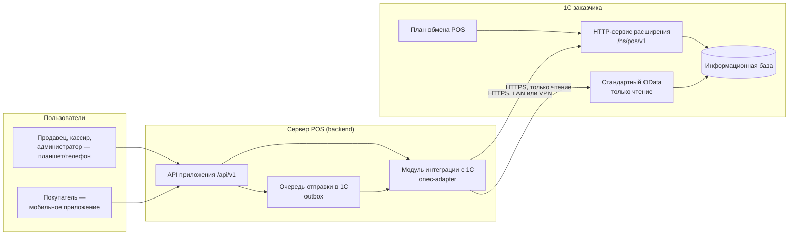
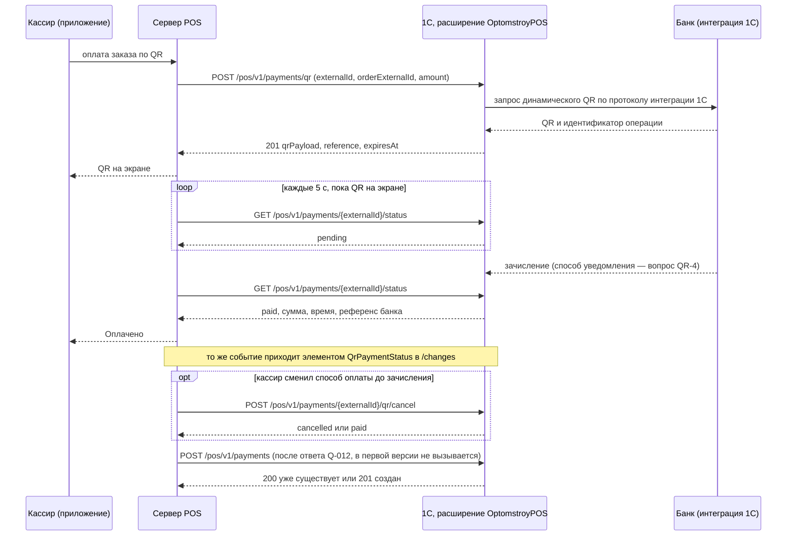

# 18. Техническое задание на API 1С для специалиста 1С — «Оптомстрой POS»

Версия 1.1 · Дата 2026-10-24 (ред. 1.0 — 2026-10-21) · Статус: черновик для утверждения заказчиком

> **Актуальная редакция для передачи программисту 1С — `docs/integration/1C_API_requirements.md`** (ТЗ для программиста 1С, версия 1.1; Word — `docs/integration/Optomstroy_TZ_API_1C.docx`) вместе с контрактом `contracts/onec/onec-http-service.v1.yaml` версии 1.1.0. Этот документ — исходный запрос (2026-10-21), сохранён для трассировки ядра v1.9 §24.3 и ссылок из 05, 13, 14. В версии 1.1 он приведён к ТЗ для 1С и 05 по итогам разбора 94 расхождений (`docs/integration/onec_api/99_discrepancies_internal.md`); при расхождении с ТЗ для 1С прав ТЗ, владелец содержания методов — 05 §6. Журнал версий — §14.

Документ создан по ядру решений v1.9 (§24.3, §24.4 — ответы заказчика от 2026-10-21, высший приоритет). Заказчик передаёт его специалисту 1С, который по запросу сделает API на стороне 1С. Сверка с ядром — §13.

**Владелец документа:** Эксперт по 1С (агент 2). **Владелец содержания методов** — `05_ONEC_INTEGRATION.md` §6 (ядро v1.9 §24.3, требование ONEC-074): этот документ излагает §6 для внешнего исполнителя и не вводит собственных требований. Если метод, поле, код ошибки или правило повтора меняется, изменение сначала вносится в 05 §6, затем сюда. Новых ID требований документ не вводит: ссылки идут на `ONEC-NNN`, `SYNC-NNN` и критерии `AC-ONEC-NNN` документа 05.

**Входные материалы**

| Материал | Что взято |
|---|---|
| `docs/research/R0_DECISION_KERNEL.md` v1.9 | §24.3 (API делает специалист 1С по нашему запросу, OData — запасной путь, состав этого документа), §24.4 (QR-оплата через 1С, `QR_PROVIDER=onec`, `QR_ONEC_POLL_SECONDS`), §24.2 (заказы могут оформлять клиенты в приложении), §24.5 (Q-011, Q-014 частично закрыты), §22.1 (автомат исходящей очереди), §22.2 (автомат платежа), §22.8 (обмен с 1С, подтверждение пакета), §11 (правила документов) |
| `docs/specification/05_ONEC_INTEGRATION.md` | §2.2 (чек-лист для специалиста 1С), §4 (стратегия), §5 (карта объектов 1С), §6.1–§6.7 (расширение, план обмена, методы, форматы, ошибки, требования, QR), §7.3 (расписание), §8 (исходящая очередь), §9 (синхронная проверка), §10 (сеть и безопасность), §11 (нагрузка), §12 (тестовая копия и приёмка) |
| `docs/specification/07_DATA_MODEL.md` | имена полей на стороне POS, которые попадают в `externalId` (`orders.id`, `payments.id`, `customers.id`, `return_requests.id`) |
| `docs/specification/10_POS_BUSINESS_RULES.md` | правила заказа, оплаты, долга, возврата (ORD, PAY, DEBT, RET), которые определяют, когда POS вызывает методы 1С |
| `docs/specification/11_SECURITY_PRIVACY.md` | SEC-051, SEC-055, SEC-057 (секреты и минимальные права учётных записей интеграции), SEC-062 (запрет ПДн в журналах) |
| `docs/specification/16_DEPLOYMENT_PLAN.md` §4.3, §12 | значения по умолчанию таймаутов и QR (`ONEC_TIMEOUT_MS`, `QR_TTL_MINUTES`), варианты связи с 1С (LAN, WireGuard, C-2) |
| `docs/specification/source/REQ_REGISTER_A.md`, `…_B.md`, `…_D.md`, `…_E.md`, `…_F.md` | исходные требования заказчика к интеграции с 1С (трассировка — §11) |

**Связанные документы:** 05_ONEC_INTEGRATION.md (канонический текст методов), 06_ARCHITECTURE.md (модуль `onec-adapter`), 07_DATA_MODEL.md, 08_API_SPECIFICATION.md (API приложения, не 1С), 10_POS_BUSINESS_RULES.md, 11_SECURITY_PRIVACY.md, 12_TEST_PLAN.md (тесты T-ONEC, T-SYNC), 13_IMPLEMENTATION_ROADMAP.md (ворота G-B1, задачи RM-A-002, RM-A-005, RM-A-006, RM-F-010), 14_OPEN_QUESTIONS.md, 16_DEPLOYMENT_PLAN.md.

**Как читать метки.** `[ТИПОВО]` — так называется объект в типовой конфигурации «Управление торговлей 11» (базовая гипотеза), в вашей базе имя может отличаться: проверьте по `$metadata` или в Конфигураторе и сообщите фактическое. `[НЕ ПОДТВЕРЖДЕНО]` — имени нет в известных нам источниках, это предположение, проверьте обязательно. `[РЕШЕНИЕ]` — имя или правило придумано нами для расширения (объекты расширения создаёте вы, имена можно сохранить). `[ВОПРОС: Q-xxx]` — ответ нужен от вас или от заказчика. Мы **не** имеем доступа к вашей базе и ничего в ней не проверяли: все имена объектов 1С ниже — гипотезы до ваших ответов.

---

## 0. Краткое содержание

1. Магазину «Оптомстрой» (Кыргызстан, валюта — сом, KGS) разрабатывается POS-система: мобильное и планшетное приложение для продавцов, кассиров и покупателей и сервер магазина (далее — **backend**). Учёт остаётся в вашей 1С; backend читает из 1С каталог, цены, остатки, клиентов и долги и передаёт в 1С заказы, новых клиентов и заявки на возврат (платёжные документы — после ответа на Q-012, §4.11).
2. Мы просим сделать **расширение конфигурации** «OptomstroyPOS» (назначение «Адаптация», типовая конфигурация не меняется и остаётся на поддержке) с **HTTP-сервисом** `/hs/pos/v1/*`, **планом обмена** «POS» и регистром внешних идентификаторов для защиты от дублей (§3).
3. API вызывает только backend; приложение на телефонах к 1С не обращается никогда. База 1С в интернет не публикуется: доступ только из локальной сети магазина или через VPN-туннель (§3.4).
4. Методы (§4): проверка доступности, выдача изменений по плану обмена с подтверждением пакета, проверка корзины (цены, остатки, долг), создание и отмена заказа клиента, статусы заказов, поиск и создание клиентов, долг клиента, регистрация оплаты, **QR-оплата через имеющуюся у вас интеграцию с банком** (§5), заявка на возврат, картинки товаров, перечень созданных из POS объектов.
5. Каждый метод записи защищён от дублей ключом `externalId` (UUID, который присваивает POS): повторный вызов с тем же ключом возвращает уже созданный документ, а не создаёт второй (§3.7).
6. Прежде чем начать, нам нужно знать вашу конфигурацию, релиз, версию платформы и состав объектов учёта (§2) — пока это неизвестно (Q-010).
7. Работа ведётся на **тестовой копии** базы (§6), приёмка — по контрольному примеру и критериям по каждому методу (§7). Что предоставим мы — §8. Сводка вопросов к вам — §10.
8. Стандартный OData 1С только на чтение нужен и в целевом режиме: для первой загрузки справочников и, пока в HTTP-сервисе нет методов срезов, для регулярного чтения срезов цен и остатков (05 §6.2 п. 5, Q-319). Временный режим «только OData, заказы в 1С вручную» не выбран и не реализован (05 §9): если API задерживается, владелец решает — ждать или заказывать доработку. Основной путь — ваше API.

---

## 1. Зачем нужно API и кто будет им пользоваться

### 1.1. Как устроена система



- **Кто вызывает API:** только backend (модуль `onec-adapter`) под отдельным пользователем 1С. Ни приложение, ни люди API напрямую не вызывают.
- **Кто работает в приложении:** продавцы, кассиры, старшие продавцы, администратор магазина и покупатели. Покупатели регистрируются в приложении по номеру телефона, смотрят каталог со своими ценами и оформляют **заявку-заказ**, которая уходит в 1С как обычный «Заказ клиента» в статусе «Не согласован» и согласуется магазином (ядро v1.9 §24.2). Для 1С заказ продавца и заказ покупателя — один и тот же метод.
- **Источник истины.** Каталог, характеристики, цены, склады, остатки, клиенты, соглашения, долги, реализации и возвраты — в 1С; backend держит их копию только для чтения. Документы, которые создаются в POS, — заказы, оплаты, новые клиенты, заявки на возврат; после записи в 1С истиной становится документ 1С (его статус, суммы, пометка удаления).

### 1.2. Что API должно уметь

| № | Сценарий | Что делает 1С | Метод (§4) |
|---|---|---|---|
| 1 | Первая загрузка и постоянное обновление каталога, цен, клиентов, документов | отдаёт изменения по плану обмена «POS», снимает регистрацию после подтверждения | `/changes`, `/changes/ack`, `/changes/reregister` (§4.2–§4.3) |
| 2 | Подтверждение заказа в приложении | быстро проверяет корзину: актуальная цена, свободный остаток, долг и лимит клиента | `/check` (§4.4) |
| 3 | Оформление заказа | создаёт «Заказ клиента» в статусе «Не согласован», без резерва | `/orders` (§4.5) |
| 4 | Отмена заказа из POS | отменяет заказ по типовым правилам или отказывает, если он отгружен | `/orders/{uuid}/cancel` (§4.6) |
| 5 | Отображение статуса заказа продавцу и покупателю | возвращает статус, согласование, отгрузки | `/orders/{uuid}/status`, `/orders/status` (§4.7) |
| 6 | Поиск клиента по телефону и создание нового | ищет по телефону, создаёт партнёра/контрагента без дублей | `/customers` (§4.8–§4.9) |
| 7 | Продажа в долг и показ долга | возвращает сальдо, просрочку, детализацию, лимит и отсрочку | `/customers/{ref}/receivables` (§4.10) |
| 8 | Приём оплаты наличными и по QR, оплата долга | создаёт ПКО или поступление, распределяет по документам долга (в первой версии POS метод не вызывает, Q-012) | `/payments` (§4.11) |
| 9 | Оплата по QR | создаёт динамический QR через вашу интеграцию с банком, сообщает об оплате, отменяет QR | `/payments/qr`, `/payments/{externalId}/status`, `/payments/{externalId}/qr/cancel` (§4.12–§4.14, §5) |
| 10 | Заявка на возврат | создаёт заявку на возврат на основании реализации, сообщает её статус | `/returns`, `/returns/{uuid}/status` (§4.15) |
| 11 | Фотографии товаров | отдаёт файл картинки номенклатуры | `/images/{ref}` (§4.16) |
| 12 | Восстановление после сбоя сервера POS | отдаёт перечень объектов, созданных из POS | `/external-ids` (§4.17) |
| 13 | Контроль доступности | версия, состояние очереди изменений | `/health` (§4.1) |

### 1.3. Чего API делать не должно

- Не изменяет справочники и цены 1С (номенклатура, характеристики, цены, склады, скидки — только чтение). Исключение — создание нового клиента (§4.9).
- Не создаёт реализации, документы возврата товаров, возврат денег, корректировки долга: их по-прежнему оформляют сотрудники в 1С (ONEC-026).
- Не ставит резерв при создании заказа: строки заказа — «К обеспечению», резерв ставит менеджер при согласовании (ONEC-038).
- Не принимает от вызывающей стороны произвольные имена объектов, полей или текст запросов («универсальной записи» нет, ONEC-053).
- Не передаёт персональные данные плательщика (имя, счёт, телефон) из банковской интеграции (§5).

### 1.4. Объём работ кратко

| Группа | Методы | Важность для запуска |
|---|---|---|
| Обязательно | `health`, `changes`, `changes/ack`, `changes/reregister`, `check`, `orders`, `orders/{uuid}/cancel`, `orders/{uuid}/status`, `orders/status`, `customers` (поиск и создание), `customers/{ref}/receivables`, `payments`, `returns`, `returns/{uuid}/status`, `images/{ref}` | без них POS не работает в целевом режиме (ONEC-093) |
| Обязательно, если ваша интеграция с банком это позволяет (§5) | `payments/qr`, `payments/{externalId}/status`, `payments/{externalId}/qr/cancel` | при отрицательных ответах QR-3/QR-4 QR подтверждается кассиром вручную (SYNC-079) |
| Желательно | `external-ids`, журнал запросов `POS_ЖурналЗапросовPOS` | восстановление после сбоя, разбор инцидентов (SYNC-063, ONEC-054) |
| Опционально, после основных | `catalog/{ref}` («карточка товара одним вызовом») | не является условием приёмки (ONEC-057) |

---

## 2. Что нам нужно знать о вашей 1С

Пожалуйста, пришлите ответы до начала разработки: от них зависят имена объектов во всех методах. Подробный чек-лист с ожидаемыми ответами — 05 §2.2 (пункты 1–20); ниже — то же, сгруппированно. Пункты 16–19 чек-листа выполняются только на тестовой копии.

### 2.1. Сведения о программе и сервере (Q-010)

| № | Что сообщить | Где посмотреть | Пример ответа |
|---|---|---|---|
| 1 | Название, редакция и релиз конфигурации; есть ли «базовая» версия; локализация «для Кыргызстана» | «Справка → О программе» (кнопка «i» или «Сервис и настройки → О программе») — скриншот окна | «Управление торговлей, редакция 11.5 (11.5.xx.xx)» `[ТИПОВО]` |
| 2 | Версия платформы | там же | `8.3.2x.xxxx` |
| 3 | Файловая или клиент-серверная база; есть ли сервер 1С:Предприятия и серверная лицензия; число клиентских лицензий | там же (строка «Каталог» или «Сервер / Информационная база»); у администратора | «клиент-серверная, сервер 8.3, 10 лицензий» |
| 4 | Конфигурация на поддержке или снята с поддержки; какие расширения уже установлены | Конфигуратор → Конфигурация → Поддержка → Настройка поддержки; Конфигурация → Расширения конфигурации | «на поддержке, расширений нет» |
| 5 | Опубликована ли база на веб-сервере (Apache / IIS, версия); включён ли стандартный OData | адреса `http://<сервер>/<база>/` и `http://<сервер>/<база>/odata/standard.odata/` | «Apache 2.4, OData не опубликован» |
| 6 | Разрешено ли лицензионными правилами обращение внешней системы к HTTP-сервису без дополнительных клиентских лицензий (уточнить у франчайзи) | франчайзи, ИТС | «подтверждено франчайзи» или «нужны лицензии» |
| 7 | Выгрузка `$metadata` стандартного OData (файл XML) **или**, если OData не публикуется, список объектов из Конфигуратора по перечню §2.2 | `http://<сервер>/<база>/odata/standard.odata/$metadata` | файл, начинающийся с `<edmx:Edmx` |
| 8 | Сеть: где стоит сервер 1С, работает ли он круглосуточно, есть ли статический IP и роутер с VPN, кто администрирует сеть | администратор сети | «сервер в магазине, 24/7, роутер MikroTik с WireGuard» |
| 9 | Объёмы: число позиций номенклатуры, характеристик, клиентов, документов продаж в год, размер базы, число одновременных пользователей 1С (Q-023) | отчёты или `…/Catalog_Номенклатура/$count` | «3 000 позиций, 2 500 клиентов, 30 000 документов в год» |

### 2.2. Объекты учёта, которые использует POS

По каждой строке ответьте: используется ли в вашей базе, точное имя объекта (из `$metadata` или Конфигуратора) и особенности. Имена во втором столбце — для «Управление торговлей 11»; для других конфигураций (Розница, УНФ, Бухгалтерия, ERP, КА) — свои имена, см. 05 §5.1.

| Что нужно POS | Вероятный объект 1С | Метка | Что уточнить |
|---|---|---|---|
| Номенклатура и группы (категории) | `Справочник.Номенклатура` (группы — `IsFolder=true`); реквизиты `Артикул`, `ЕдиницаИзмерения`, `ВидНоменклатуры`, `ФайлКартинки`, `Описание` | `[ТИПОВО]` | используются ли группы как категории витрины; уникален ли артикул |
| Характеристики (цвет, размер, модель) | `Справочник.ХарактеристикиНоменклатуры` | `[ТИПОВО]` | ведётся ли учёт по характеристикам; общие или индивидуальные (Q-021) |
| Свойства товара | ТЧ `Номенклатура.ДополнительныеРеквизиты`, `Справочник.ЗначенияСвойствОбъектов` | `[ТИПОВО]` | какие свойства заполнены |
| Единицы и упаковки | `Справочник.УпаковкиЕдиницыИзмерения`, `Справочник.КлассификаторЕдиницИзмерения` | `[ТИПОВО]` | продаются ли товары упаковками; кратность, минимальная партия (Q-021) |
| Штрихкоды | `РегистрСведений.ШтрихкодыНоменклатуры`; реквизит `ТипШтрихкода` | `[ТИПОВО]`; `ТипШтрихкода` — `[НЕ ПОДТВЕРЖДЕНО]` | — |
| Виды цен и цены | `Справочник.ВидыЦен` (реквизиты `ИспользоватьПриПродаже`, `ВалютаЦены`, `ЦенаВключаетНДС`), `РегистрСведений.ЦеныНоменклатуры`, `Документ.УстановкаЦенНоменклатуры` | `[ТИПОВО]`; три реквизита вида цены — `[НЕ ПОДТВЕРЖДЕНО]` | какие виды цен используются при продаже; какой вид цены у розничного покупателя и как выбирается вид цены клиента (Q-121) |
| Склады | `Справочник.Склады` | `[ТИПОВО]` | сколько складов участвуют в продаже; склад по умолчанию |
| Остатки и резервы | `РегистрНакопления.ТоварыНаСкладах`, `РегистрНакопления.СвободныеОстатки` | `[ТИПОВО]` | ведутся ли серии и назначения (Q-120); как считать свободный остаток |
| Клиенты и телефоны | `Справочник.Партнеры` (признак `Клиент`), `Справочник.Контрагенты`, контактная информация (поле `НомерТелефона`) | `[ТИПОВО]`; признак `Клиент` — `[НЕ ПОДТВЕРЖДЕНО]` | ведутся ли партнёры и контрагенты раздельно; формат хранения телефонов (+996…, 0…, с пробелами), версия БСП (Q-125) |
| Соглашения с клиентами | `Справочник.СоглашенияСКлиентами` (вид цены, скидка, отсрочка, лимит); реквизит `Партнеры.ОсновноеСоглашение` | `[ТИПОВО]`; реквизит партнёра — `[НЕ ПОДТВЕРЖДЕНО]` | где задаются лимит долга и отсрочка (Q-017) |
| Скидки | `Справочник.СкидкиНаценки` | `[ТИПОВО]` | есть ли автоматические и накопительные скидки (Q-015) |
| Взаиморасчёты и долги | `РегистрНакопления.РасчетыСКлиентами` (ресурсы `ДолгКлиента`, `НашДолг`), `РасчетыСКлиентамиПоДокументам`, `РасчетыСКлиентамиПоСрокам` | `[ТИПОВО]`; имена ресурсов — `[НЕ ПОДТВЕРЖДЕНО]` | детализация взаиморасчётов (по договорам, заказам, накладным) |
| Заказы клиентов и статусы | `Документ.ЗаказКлиента`, `Перечисление.СтатусыЗаказовКлиентов` (`НеСогласован`, `КВыполнению`, `Закрыт`), регистр `СостоянияЗаказовКлиентов`, значение `ГотовКОтгрузке` | документ и перечисление — `[ТИПОВО]`; регистр состояний и значение — `[НЕ ПОДТВЕРЖДЕНО]` | включено ли «Согласование заказов клиентов»; кто согласует заказы POS; есть ли в заказе реквизиты доставки (Q-122) |
| Реализации | `Документ.РеализацияТоваровУслуг` | `[ТИПОВО]` | — |
| Оплата наличными | `Документ.ПриходныйКассовыйОрдер` (реквизиты `ХозяйственнаяОперация`, `СтатьяДДС`) | документ — `[ТИПОВО]`; реквизиты — `[НЕ ПОДТВЕРЖДЕНО]` | можно ли проводить ПКО из HTTP-сервиса автоматически (Q-124); организация и касса по умолчанию (Q-128) |
| Оплата по QR / безналичная | `Документ.ПоступлениеБезналичныхДенежныхСредств`; `Документ.ЭквайринговаяОперация` | первый — `[ТИПОВО]`; второй — `[НЕ ПОДТВЕРЖДЕНО]` | каким документом сейчас отражается оплата по QR и создаёт ли его ваша интеграция с банком (§5, QR-7, Q-012) |
| Возвраты | `Документ.ЗаявкаНаВозвратТоваровОтКлиента`, `Документ.ВозвратТоваровОтКлиента`; реквизит `ДокументОснование` | заявка и реквизит — `[НЕ ПОДТВЕРЖДЕНО]`; документ возврата — `[ТИПОВО]` | используются ли заявки на возврат; можно ли создавать их извне (Q-018) |
| Картинки товаров | `Справочник.НоменклатураПрисоединенныеФайлы` (реквизит `ВладелецФайла`), хранение в базе или в томах | справочник — `[ТИПОВО]`; реквизит — `[НЕ ПОДТВЕРЖДЕНО]` | где хранятся файлы и сколько их (Q-022) |
| Интеграция с банком для QR | объекты вашей интеграции (подсистема, обработка, внешняя компонента) | `[НЕ ПОДТВЕРЖДЕНО: Q-014]` | вопросы QR-1…QR-9 (§5.4) |
| Пользователи 1С для документов POS | реквизит «Менеджер»/«Ответственный» документов | `[ТИПОВО]` | нужно ли указывать сотрудника POS в документах и как сопоставлять пользователей (Q-129) |

### 2.3. Процессы учёта

Ответьте простым текстом (можно вместе с бухгалтером):

1. Кто и как согласует в 1С заказы, пришедшие из POS; какой статус означает «согласован», какой — «отменён» (Q-012).
2. Какими документами оформляются: оплата наличными, оплата по QR, продажа в долг, возврат товара, возврат денег (Q-012, Q-018).
3. Сколько организаций ведётся в базе; какая организация, касса и расчётный счёт используются для документов POS (Q-128).
4. Как часто и кем обновляется типовая конфигурация; есть ли окно обслуживания; готовы ли вы заранее сообщать об обновлениях (Q-126).
5. Кто будет сопровождать расширение после приёмки и кому принадлежат исходники `.cfe` (Q-127).

---

## 3. Общие требования к API

### 3.1. Расширение конфигурации

Все доработки — в **одном расширении** «OptomstroyPOS» с назначением «Адаптация» и префиксом объектов `POS_` (ONEC-030). Типовая конфигурация не изменяется и остаётся на поддержке; расширение не переопределяет формы, обработчики событий и регламентные задания типовой. Имена объектов расширения ниже — наши предложения `[РЕШЕНИЕ]`; если вы назовёте их иначе, сообщите.

| Объект расширения | Тип | Назначение |
|---|---|---|
| `POS_HTTPСервисPOS` (корневой URL `pos`) | HTTP-сервис | все методы `/pos/v1/*` (§4) |
| `POS` | План обмена (узел-получатель `POS`) | регистрация изменений объектов, нужных POS (§4.2), с авторегистрацией; ловит создание, изменение, пометку и физическое удаление |
| `POS_ВнешниеИдентификаторыPOS` | Регистр сведений, независимый, непериодический | защита от дублей: `ВнешнийИд` (строка 36, UUID) + `ТипОбъекта` → `Объект` (ссылка), `ДатаСоздания`, `СтатусОбработки`; индекс по `ВнешнийИд`; записи не удаляются при пометке документа (ONEC-059) |
| `POS_ТипыВнешнихОбъектов` | Перечисление | `Заказ`, `Платеж`, `Клиент`, `ЗаявкаНаВозврат` |
| `POS_ОплатыQR` | Регистр сведений, независимый, непериодический | связь динамического QR с платежом POS: ключ `ВнешнийИдПлатежа`; `ВнешнийИдЗаказа`, `Сумма`, `Референс`, `СрокДействия`, `Статус` (`pending`, `paid`, `expired`, `cancelled`), `СуммаОплаты`, `МоментОплаты`, `РеференсБанка`, `ДокументПоступления`; входит в план обмена «POS» (§5) |
| `POS_ЖурналЗапросовPOS` | Регистр сведений (желательно) | журнал вызовов: `Момент`, `Метод`, `ВнешнийИд`, `КодОтвета`, `Длительность`, `Ошибка` — без персональных данных, хранение 30 дней (ONEC-054) |
| `POS_ИнтеграцияPOS` | Роль | только «Использование» HTTP-сервиса; **без** прав добавления, изменения, удаления объектов и без доступа к OData (ONEC-052) |
| `POS_НастройкиPOS` | Константы | `ВерсияAPI` (`1`), `МаксимальныйРазмерПакетаИзменений` (1000), `СкладПоУмолчанию`, `ОрганизацияПоУмолчанию`, `ВидЦеныПоУмолчанию`, `ВидОперацииДляQR`, `РазрешитьПроведениеПлатежей` (Q-124), ключ `X-POS-Client-Key` (доступ только администратору) |
| `POS_Сервер` | Общий модуль (сервер) | вся логика методов; запись и чтение выполняются в привилегированном режиме **только** после проверки ключа `X-POS-Client-Key` и схемы входных данных (ONEC-053) |

Документы и справочники заполняйте **типовыми процедурами** конфигурации (заполнение по умолчанию, пересчёт сумм, НДС, скидки), а не прямой записью реквизитов (ONEC-038, ONEC-039). Создание документа и запись в регистр `POS_ВнешниеИдентификаторыPOS` — в **одной транзакции** (ONEC-037).

### 3.2. Адрес и публикация

- Базовый адрес: `https://<host-1c>/<публикация>/hs/pos/v1/…` (сегмент `hs` — `[ТИПОВО]`).
- HTTP-сервис публикуется отдельно от веб-клиента; в `default.vrd` разрешены только нужные HTTP-сервисы (ONEC-031). Веб-клиент наружу не публикуется.
- Стандартный OData публикуется **только на чтение** и только с составом из §2.2 (allow-list через «Настройки стандартного интерфейса OData» или `УстановитьСоставСтандартногоИнтерфейсаOData`, ONEC-083): backend читает через него справочники при первой загрузке и сверяет количество записей (§4.3); если OData публиковать нельзя, сообщите — первая загрузка пойдёт через план обмена.
- Повторное использование сеансов (`reuseSessions`, `sessionMaxAge`, `poolSize` в `default.vrd` — `[ТИПОВО]`) желательно включить (ONEC-086).

### 3.3. Формат данных

| Правило | Значение |
|---|---|
| Тело запроса и ответа | `application/json; charset=utf-8` (кроме `/images` — двоичный файл) |
| Имена полей JSON | латиница, camelCase, как в примерах §4 |
| Деньги | строка с точкой и двумя знаками: `"16007.50"`; валюта — `"KGS"` |
| Количества | строка с точкой и тремя знаками: `"2.000"` |
| Даты и время | ISO 8601 со смещением `+06:00` (Бишкек, без перехода на летнее время): `"2026-10-21T14:05:00+06:00"` |
| Ссылки 1С (`ref`) | GUID ссылки (`Ref_Key`) в нижнем регистре |
| `externalId` | UUID, который присваивает POS, в нижнем регистре |
| Необязательные поля | `null`; обязательные поля `null` не принимают |
| Неизвестные поля | получатель игнорирует (можно добавлять поля, не ломая совместимость) |

Проверка формата — ONEC-058 (даты по шаблону `+06:00`, деньги `^-?\d+\.\d{2}$`, количества `^-?\d+\.\d{3}$`, UUID в нижнем регистре).

### 3.4. Аутентификация, права и сеть

1. **Пользователь HTTP-сервиса** `pos_hs` `[РЕШЕНИЕ]`: отдельный пользователь информационной базы только с ролью `POS_ИнтеграцияPOS`; аутентификация Basic (или JWT, если поддерживает ваша версия платформы — выбираем вместе при приёмке). Пароль не короче 16 символов; снят флажок «Показывать в списке выбора»; запрещён интерактивный вход; не администратор; смена пароля не реже раза в 180 дней (ONEC-032, ONEC-052, ONEC-082, SEC-055).
2. **Второй ключ** — заголовок `X-POS-Client-Key` в каждом запросе: длинная случайная строка, хранится в константе расширения (доступ только администратору 1С) и в секрет-файле сервера POS. Запрос без ключа или с неверным ключом → `401` даже при верном пароле (ONEC-032).
3. **Пользователь OData** `pos_integration` `[РЕШЕНИЕ]`: только чтение объектов §2.2 и «Удалённый доступ через OData»; роль `POS_ИнтеграцияPOS` ему не назначается. Под `pos_hs` запросы к OData должны отклоняться, под `pos_integration` — запросы к `/hs/pos/v1/*` и любые `POST`/`PATCH`/`DELETE` к OData (ONEC-052).
4. **Запись только кодом расширения.** Документы и клиентов создаёт код `POS_Сервер` в привилегированном режиме; у пользователей интеграции прямых прав записи нет — обойти защиту от дублей через OData невозможно (ONEC-053).
5. **Сеть.** База 1С **не** публикуется в интернет. HTTP-сервис и OData доступны только с адреса сервера POS в локальной сети магазина (вариант LAN) или из подсети VPN-туннеля WireGuard, который инициирует сторона магазина (вариант WireGuard); входящие порты из интернета не открываются (ONEC-080, 16 §12). Выбор варианта — после аудита сети (Q-031).
6. **Всегда HTTPS** (TLS 1.2 и выше), в том числе внутри локальной сети и туннеля; допускается самоподписанный сертификат — POS закрепит его у себя (ONEC-081).
7. Резервный вариант связи «исходящий обмен» C-2 (1С сама по расписанию обращается к серверу POS, если ни LAN, ни VPN невозможны) описан в 05 §10.1 и **не входит** в этот запрос; если он понадобится, мы пришлём отдельное описание.
8. Все изменения веб-сервера, firewall и VPN на стороне заказчика выполняет его администратор по нашей письменной инструкции; мы ничего не устанавливаем на серверах заказчика без разрешения (ONEC-087).

### 3.5. Версия API

- Версия — в пути (`/pos/v1/`) и в заголовке **ответа** `X-POS-API-Version: 1` (ONEC-033).
- Добавлять поля можно без смены версии. Удаление или переименование полей и смена смысла — только через `/pos/v2/` при параллельной работе `v1` не менее 6 месяцев.
- Расширение хранит свою версию (`extensionVersion`) и отдаёт её в `/health`; при несовместимости `apiVersion` backend приостанавливает обмен и сообщает администратору (ONEC-095).

### 3.6. Ответы и формат ошибок

Тело ошибки — всегда в одном формате:

```json
{
  "code": "POS_E_VALIDATION",
  "message": "Не заполнен склад в строке 2",
  "details": { "lines": [ { "lineNumber": 2, "text": "Не заполнен склад" } ] },
  "requestId": "0192f5c3-0000-7000-8000-000000000001"
}
```

`message` — текст для журнала **без персональных данных** (без телефонов, ИНН, сумм долга). `requestId` — значение заголовка `X-Request-Id` запроса.

| HTTP | `code` | Когда | Вид ошибки | Что делает POS |
|---|---|---|---|---|
| 400 | `POS_E_BAD_REQUEST` | неверный JSON или параметры | ошибка данных | не повторяет, фиксирует ошибку |
| 401 | `POS_E_UNAUTHORIZED` | неверный пользователь, пароль, JWT или `X-POS-Client-Key` | доступ | не повторяет до исправления учётных данных: чтение по расписанию (обмен, статусы, долги, возвраты) приостанавливается на 15 минут: без повторов SYNC-029 и без плановых запусков в течение паузы, тревога администратору (не чаще раза в час); запись — элемент очереди сразу останавливается (`dead`), повтор вручную (05 §6.5) |
| 403 | `POS_E_FORBIDDEN` | у роли нет прав на объект | доступ | как 401 |
| 404 | `POS_E_NOT_FOUND` | объект по `ref`/`externalId` не найден | ошибка данных | статус заказа не меняет, сообщает администратору |
| 409 | `POS_E_DUPLICATE` | найден **другой** клиент с тем же телефоном | бизнес-отказ | предлагает кассиру выбрать существующего клиента |
| 409 | `POS_E_STATE` | недопустимое состояние (отмена отгруженного заказа, возврат больше отгруженного, QR уже оплачен) | бизнес-отказ | не повторяет, сообщает пользователю |
| 409 | `POS_E_ACK_OUT_OF_ORDER` | подтверждён номер пакета, который не выдавался | ошибка протокола | перечитывает `/health` и продолжает с подтверждённого номера |
| 409 | `POS_E_STOCK`, `POS_E_PRICE`, `POS_E_CREDIT` | 1С отклонила заказ по остаткам, ценам или долгу (если такая проверка включена при создании) | бизнес-отказ | заказ получает статус «не принят 1С», продавцу — уведомление |
| 422 | `POS_E_VALIDATION` | не прошла проверка заполнения или проведения типовой конфигурации; `details.lines[]` — номер строки и текст | ошибка данных | не повторяет автоматически |
| 423 или 503 | `POS_E_LOCKED` | объект заблокирован другим сеансом: в `POST /orders` и `POST /check` — 423, в остальных методах — 503; база в монопольном режиме — 503 в любом методе | временная | повторяет позже |
| 500 | `POS_E_INTERNAL` | исключение встроенного языка | временная | повторяет позже, после порога — тревога |
| 503 | `POS_E_MAINTENANCE` | обмен приостановлен (обновление конфигурации); отключённое расширение отвечает 404 платформы | временная | повторяет позже |
| 503 | `POS_E_QR_UNAVAILABLE` | интеграция с банком не может создать или отменить QR (банк недоступен, нет договора или настроек) — только методы §5 | временная | кассир повторяет или выбирает другой способ оплаты |

Важно разделять **временные** ошибки (`POS_E_LOCKED`, `POS_E_INTERNAL`, `POS_E_MAINTENANCE`, `POS_E_QR_UNAVAILABLE`) и **ошибки данных** (`POS_E_BAD_REQUEST`, `POS_E_VALIDATION`, `POS_E_STATE`, `POS_E_DUPLICATE`): POS повторяет только временные (ONEC-055). Повторы выполняются с паузами 1, 2, 5, 15, 60 минут, далее раз в час, не более 20 попыток и не дольше 24 часов (05 §8.1); повтор всегда идёт с тем же `externalId`, поэтому он безопасен.

### 3.7. Защита от дублей (идемпотентность)

1. Каждый объект, который POS создаёт в 1С (заказ, платёж, клиент, заявка на возврат), имеет **`externalId`** — UUID, присвоенный в POS (`orders.id`, `payments.id`, `customers.id`, `return_requests.id`). Номер заказа, видимый людям, ключом не является.
2. Получив запрос на создание, расширение ищет `externalId` в регистре `POS_ВнешниеИдентификаторыPOS` (с учётом `ТипОбъекта`):
   - нашло — возвращает **200** с уже существующим документом (его номер, дата, статус, пометка удаления), ничего не создаёт;
   - не нашло — создаёт документ и запись регистра **в одной транзакции** и возвращает **201**.
3. Параллельные запросы с одним `externalId` должны дать ровно один документ (управляемая блокировка по `ВнешнийИд` или иной способ — на ваше усмотрение). Проверка: 10 одновременных `POST` с одним `externalId` создают один документ (AC-ONEC-037).
4. Если документ помечен на удаление, повтор `POST` возвращает 200 с `deletionMark=true` (AC-ONEC-059).
5. `externalId` дублируется в реквизит `Комментарий` документа в виде `POS <uuid>` — чтобы менеджер мог найти документ поиском (ONEC-040). Для заказа POS передаёт готовую строку в поле `comment` в формате `POS <полный uuid> · <номер заказа POS>[ · заявка клиента][ · комментарий]`, не длиннее 1000 символов (§4.5); код пользователя POS в комментарий не пишется (Q-129).
6. Методы чтения (`/check`, статусы, долги, картинки) идемпотентны по природе. `/changes/ack` повторно для того же или меньшего номера (не больше подтверждённого) отвечает 200 без действий.

### 3.8. Журналирование

- Заголовок `X-Request-Id` (UUID) приходит в каждом запросе от POS; сохраните его в журнале и верните в заголовке ответа и в теле ошибки.
- Журнал `POS_ЖурналЗапросовPOS` (желательно): момент, метод, `externalId`, код ответа, длительность, текст ошибки — **без** телефонов, ИНН, сумм долга, данных плательщика; хранение 30 дней; выборка за день доступна администратору 1С (ONEC-054).
- Для `/changes/ack` фиксируйте номер подтверждённого пакета и число снятых регистраций.

### 3.9. Таймауты, скорость ответа и нагрузка

| Параметр | Значение | Источник |
|---|---|---|
| Таймаут соединения со стороны POS | 5 с | SYNC-030 |
| Таймаут `POST /check` | 6 с | SYNC-030, `ONEC_SYNC_CHECK_TIMEOUT_MS` |
| Таймаут `POST /orders` | 6 с (затем повтор очередью с тем же `externalId`) | `ONEC_SYNC_CHECK_TIMEOUT_MS`, `x-timeout-ms` контракта |
| Таймаут `GET /customers?phone=` и `GET /customers/{ref}/receivables` | 6 с | `ONEC_SYNC_CHECK_TIMEOUT_MS` |
| Таймаут `POST /payments/qr`, `GET /payments/{externalId}/status`, `POST /payments/{externalId}/qr/cancel` | 6 с | `ONEC_SYNC_CHECK_TIMEOUT_MS`, SYNC-077 |
| `GET /external-ids` при ручной привязке заказа | 6 с на все страницы | ТЗ для 1С §4.9 |
| Таймаут чтения страницы `/changes` | 60 с | SYNC-030 |
| Таймаут `/images` | 120 с | SYNC-030 |
| Прочие вызовы (`/health`, `/changes/ack`, `/changes/reregister`, статусы и отмена заказа, `POST /customers`, `POST /payments`, `POST /returns`, статус заявки, `/catalog/{ref}`, `/external-ids` при восстановлении) | 30 с по умолчанию | `ONEC_TIMEOUT_MS`, 16 §4.3 |
| Целевое время `/check` для корзины до 100 строк | не более 3 с | ONEC-050 |
| Целевое время `/payments/{externalId}/status` | не более 1 с (p95) | ONEC-076 |
| Формирование одной страницы `/changes` | не более 20 с; страница — до 1000 элементов по умолчанию, максимум 5000 | ONEC-036 |
| Одновременных соединений от POS | не более 2 | ONEC-085 |
| Частота запросов от POS | не более 10 в секунду | ONEC-085 |

Если таймаут истёк, POS считает результат неизвестным и повторяет запрос позже **с тем же** `externalId` — поэтому защита от дублей (§3.7) обязательна. Ожидаемая нагрузка — §7.4.

---

## 4. Методы

### 4.0. Сводная таблица

| Метод | Путь | Назначение | Защита от дублей | Коды ответа |
|---|---|---|---|---|
| GET | `/pos/v1/health` | доступность и версии | — | 200, 401 |
| GET | `/pos/v1/changes?since={n}&limit={m}&cursor={c}` | страница пакета изменений плана обмена | повторная выдача до подтверждения | 200, 400 |
| POST | `/pos/v1/changes/ack` | подтверждение полного применения пакета | повтор того же или меньшего номера — 200 без действий | 200, 400, 409 |
| POST | `/pos/v1/changes/reregister` | полная перерегистрация состава плана обмена | — | 202 |
| POST | `/pos/v1/check` | проверка корзины | чтение | 200, 400, 422, 423, 503 |
| POST | `/pos/v1/orders` | создать «Заказ клиента» | `externalId` | 201, 200, 400, 409, 422, 423, 503 |
| POST | `/pos/v1/orders/{uuid}/cancel` | отменить заказ POS | `externalId` | 200, 404, 409 |
| GET | `/pos/v1/orders/{uuid}/status` | статус одного заказа | чтение | 200, 404 |
| POST | `/pos/v1/orders/status` | статусы до 200 заказов | чтение | 200 (ненайденные — в `notFound`, 404 нет) |
| GET | `/pos/v1/customers?phone={e164}` | поиск клиентов по телефону | чтение | 200 |
| POST | `/pos/v1/customers` | создать клиента без дублей | `externalId`; дубль по телефону — 409 | 201, 200, 409, 422 |
| GET | `/pos/v1/customers/{ref}/receivables` | долг клиента | чтение | 200, 404 |
| POST | `/pos/v1/payments` | ПКО или поступление (в первой версии POS не вызывает, Q-012) | `externalId` | 201, 200, 409, 422 |
| POST | `/pos/v1/payments/qr` | создать динамический QR | `externalId` платежа | 201, 200, 409, 422, 503 |
| GET | `/pos/v1/payments/{externalId}/status` | статус оплаты по QR | чтение | 200, 404 |
| POST | `/pos/v1/payments/{externalId}/qr/cancel` | отменить QR | повтор — 200 | 200, 404, 503 |
| POST | `/pos/v1/returns` | заявка на возврат | `externalId` | 201, 200, 409, 422 |
| GET | `/pos/v1/returns/{uuid}/status` | статус заявки на возврат | чтение | 200, 404 |
| GET | `/pos/v1/images/{ref}` | файл картинки | `ETag` / `If-None-Match` | 200, 304, 404 |
| GET | `/pos/v1/external-ids?since={дата}&type={тип}` | объекты, созданные из POS | чтение | 200, 400 |
| GET | `/pos/v1/catalog/{ref}` (опционально) | карточка товара одним вызовом | чтение | 200, 404 |

Во всех методах: заголовки запроса `Authorization`, `X-POS-Client-Key`, `X-Request-Id`; заголовки ответа `X-POS-API-Version: 1`, `X-Request-Id`; ошибки — §3.6; `401` и `503 POS_E_MAINTENANCE` возможны в любом методе и ниже не повторяются. `{uuid}` в путях `orders` и `returns` — это `externalId` объекта.

### 4.1. `GET /pos/v1/health` — проверка доступности

- **Назначение.** Показать, что расширение работает, и сообщить версии и состояние очереди изменений (ONEC-051).
- **Параметры.** Нет.
- **Ответ 200:**

```json
{
  "apiVersion": "1",
  "extensionVersion": "1.0.3",
  "platform": "8.3.2x.xxxx",
  "configuration": "УправлениеТорговлей",
  "configurationVersion": "11.5.xx.xx",
  "serverTime": "2026-10-18T14:05:00+06:00",
  "exchangeNode": "POS",
  "registrationBacklog": 142,
  "lastAckMessageNumber": 5120,
  "status": "ok"
}
```

- `registrationBacklog` — число записей регистрации изменений узла «POS»; если не подтверждённые пакеты старше 24 ч или записей больше 100 000 — верните предупреждение (например `"status": "warning"`, 05 §6.2 п. 3).
- **Без аутентификации** — только `401`, никаких сведений о системе.
- **Частота.** Раз в 1–5 минут для мониторинга и перед каждым циклом обмена.

### 4.2. План обмена «POS»: `/changes`, `/changes/ack`, `/changes/reregister`

**Назначение.** Передавать в POS все изменения нужных объектов (создание, изменение, пометка удаления, физическое удаление) без постоянного перечитывания всего каталога (ONEC-034).

**Состав плана обмена** (имена — `[ТИПОВО: УТ 11]`, для вашей конфигурации — по §2.2; авторегистрация включена):

| Объект | Что ловится |
|---|---|
| `Справочник.Номенклатура` (элементы и группы) | создание, изменение, пометка, удаление |
| `Справочник.ХарактеристикиНоменклатуры` | то же |
| `Справочник.УпаковкиЕдиницыИзмерения`, `Справочник.КлассификаторЕдиницИзмерения` | то же |
| `Справочник.Склады`, `Справочник.ВидыЦен` | то же |
| `Справочник.Партнеры`, `Справочник.Контрагенты`, `Справочник.СоглашенияСКлиентами` | клиенты, телефоны (табличная часть — часть объекта), условия |
| `Справочник.СкидкиНаценки` | то же |
| `Справочник.НоменклатураПрисоединенныеФайлы` | смена файла картинки (сам файл — через `/images/{ref}`) |
| `РегистрСведений.ШтрихкодыНоменклатуры` | наборы записей |
| `Документ.УстановкаЦенНоменклатуры` | изменение цен (POS перечитывает цены по затронутым видам цен) |
| `Документ.ЗаказКлиента` | смена статуса, согласования, пометки заказов, в том числе созданных из POS |
| `Документ.РеализацияТоваровУслуг`, `Документ.ПриходныйКассовыйОрдер`, `Документ.ПоступлениеБезналичныхДенежныхСредств`, `Документ.ВозвратТоваровОтКлиента` | история продаж, платежи, возвраты (состав — по Q-012) |
| `РегистрСведений.POS_ОплатыQR` (объект расширения) | события QR-оплаты (§5) |
| Регистры накопления остатков и взаиморасчётов | **не включаются**: остатки и долги POS читает срезами, регистрация движений дала бы лавину записей |

**Как POS применяет элементы** (ред. 1.1, 05 §6.2 уточнение 3): обработчики есть для всех типов состава. Элементы `Document_ЗаказКлиента` применяются только для заказов POS (с `externalId`; `externalId = null` — пропуск, `ObjectDeletion` заказа статус не меняет) той же процедурой, что опрос статусов; `QrPaymentStatus` — по правилам метода статуса QR (§4.13), побеждает первое из события и опроса. Элементы ПКО и поступлений POS откладывает до ответа на Q-012, а подтверждение снимает их регистрацию — поэтому после подключения их обработки (и при переводе POS в рабочий режим) администратор POS один раз запускает перерегистрацию командой `npm run onec:reregister` (журнал действий, вызов `POST /changes/reregister`).

Известный риск: `ПланыОбмена.ВыбратьИзменения` для заимствованных документов в расширении в некоторых версиях платформы работает с ошибкой `[ТИПОВО: forum.infostart topic269967]` — проверьте на тестовой копии (чек-лист 05 §2.2 п. 19).

#### `GET /pos/v1/changes?since={N}&limit={M}&cursor={c}`

| Параметр | Обязательный | Описание |
|---|---|---|
| `since` | да | последний **подтверждённый** номер сообщения `N`; ответ — сообщение `N+1` |
| `limit` | нет | элементов на странице; по умолчанию 1000, максимум 5000 (больше — ограничить до 5000) |
| `cursor` | нет | непрозрачный ключ продолжения из предыдущей страницы того же сообщения |

Правила (05 §6.2 пп. 1–2, ONEC-035, ONEC-036):

1. Запрос **без** `cursor` начинает сообщение `N+1` (или начинает его заново): расширение вызывает `ПланыОбмена.ВыбратьИзменения(УзелPOS, N+1)` — платформа присваивает номер `N+1` всем ещё не пронумерованным регистрациям узла `[ТИПОВО: проверить — чек-лист п. 19]`.
2. Страницы формируются из таблиц регистрации узла (записи с номером не больше `N+1`, включая не снятые записи прежних номеров) в устойчивом порядке (тип объекта, ссылка или ключ набора). Пока после курсора есть элементы — `hasMore=true` и новый `cursor`.
3. Объекты передаются в **текущем** состоянии. Удаление — элемент `{"type":"ObjectDeletion","objectType":"…","ref":"…"}`. Набор записей регистра сведений — с ключом набора в `ref` (например значение штрихкода).
4. Для объектов, созданных из POS, элемент содержит `externalId` из регистра `POS_ВнешниеИдентификаторыPOS` (в том числе карточка клиента — чтобы POS сопоставил её, даже если ответ на создание потерялся).
5. Объект, изменённый в 1С после нумерации, платформа регистрирует заново без номера — он придёт в следующем сообщении; изменения не теряются.

**Ответ 200** (сокращённо):

```json
{
  "messageNumber": 5121,
  "hasMore": true,
  "cursor": "c2VxOjAwMDAwMTAwMA==",
  "generatedAt": "2026-10-18T14:05:01+06:00",
  "items": [
    {
      "type": "Catalog_Номенклатура",
      "ref": "a1b2c3d4-0000-4000-8000-000000000001",
      "dataVersion": "AAAAAgAAAAA=",
      "deletionMark": false,
      "isFolder": false,
      "code": "00001234",
      "description": "Смеситель для кухни однорычажный",
      "fullName": "Смеситель для кухни однорычажный, хром",
      "sku": "KX-1245",
      "parentRef": "a1b2c3d4-0000-4000-8000-0000000000aa",
      "baseUnitRef": "a1b2c3d4-0000-4000-8000-0000000000e1",
      "kindRef": "a1b2c3d4-0000-4000-8000-0000000000c3",
      "descriptionText": "Корпус латунь, картридж 35 мм",
      "imageFileRef": "a1b2c3d4-0000-4000-8000-0000000000f1",
      "isWeighted": false,
      "attributes": [
        { "propertyRef": "…", "name": "Цвет", "valueType": "Catalog_ЗначенияСвойствОбъектов", "valueRef": "…", "valueText": "Хром" }
      ]
    },
    {
      "type": "ObjectDeletion",
      "objectType": "Catalog_ХарактеристикиНоменклатуры",
      "ref": "a1b2c3d4-0000-4000-8000-000000000777"
    },
    {
      "type": "Document_ЗаказКлиента",
      "ref": "b2c3d4e5-0000-4000-8000-000000000010",
      "externalId": "0192f5a0-7c2e-7d3b-9a1f-3c4d5e6f7a8b",
      "number": "ОС00-004512",
      "date": "2026-10-18T13:40:00+06:00",
      "status": "КВыполнению",
      "approved": true,
      "fulfillmentState": "ГотовКОтгрузке",
      "total": "16007.50",
      "shipments": []
    }
  ]
}
```

Значения `status` (`КВыполнению`) — `[ТИПОВО]`, `fulfillmentState` (`ГотовКОтгрузке`) — `[НЕ ПОДТВЕРЖДЕНО]`: передавайте фактические значения вашей конфигурации и пришлите их перечень (по нему POS строит соответствие статусов, 05 §5.1b). Состав полей остальных типов объектов — по словарю полей 05 §5.3; точная схема каждого типа будет в OpenAPI-файле (§8).

#### `POST /pos/v1/changes/ack`

Тело: `{"messageNumber": 5121}`.

- POS отправляет подтверждение **только после того, как применил все страницы** сообщения (последняя страница — `hasMore=false`).
- Расширение снимает регистрацию **только по номеру**: `ПланыОбмена.УдалитьРегистрациюИзменений(УзелPOS, 5121)` — удаляются записи с номером не больше подтверждённого. Снимать регистрацию по отдельным объектам **запрещено**: так потеряется изменение, сделанное между выборкой и подтверждением.
- Повтор подтверждения того же или меньшего номера (не больше уже подтверждённого) → `200` без действий. Номер больше выданного → `409 POS_E_ACK_OUT_OF_ORDER`.
- Ответ 200: `{"messageNumber": 5121, "removedRegistrations": 2500}` (поле `removedRegistrations` — для журнала; если считать его дорого, можно не возвращать).
- Без подтверждения следующий `GET /changes?since=5120` без `cursor` выдаёт сообщение 5121 заново — повторная доставка безопасна: POS применяет данные по `ref`.

#### `POST /pos/v1/changes/reregister`

Полная перерегистрация всего состава плана обмена (`ПланыОбмена.ЗарегистрироватьИзменения(УзелPOS, Метаданные.<Объект>)` по каждому объекту состава) для полной перезагрузки данных в POS. Ответ `202` (работа может идти в фоне); вызов фиксируется в журнале. Вызывается редко — при первом подключении, при переводе POS в рабочий режим, после подключения обработки ПКО и поступлений и по решению администратора (со стороны POS — команда `npm run onec:reregister`, 16 §14.1 п. 8).

**Частота.** Одно задание POS на узел, по умолчанию раз в 5 минут; параллельных вызовов `/changes` от POS не бывает (SYNC-011).

### 4.3. Первая загрузка справочников

Отдельных методов выгрузки «снимков» в HTTP-сервисе нет: первая загрузка выполняется одним из двух способов (05 §4.1, §7.1).

1. **Основной — стандартный OData только на чтение** (пользователь `pos_integration`, §3.4): backend постранично читает справочники и регистры в порядке зависимостей — единицы → категории → номенклатура и упаковки → характеристики → свойства → штрихкоды → склады → виды цен и цены → остатки → клиенты и телефоны → долги → скидки → история продаж (за 12 месяцев, Q-123, ночью) → картинки. После каждой сущности backend сверяет количество записей с `$count` 1С (SYNC-001, SYNC-003). Нагрузка — страницами по 1000 записей, не более 2 соединений; история и картинки — ночью (01:00–06:00 по Бишкеку).
2. **Через план обмена** — если OData публиковать нельзя: `POST /changes/reregister`, затем чтение `/changes` страницами до `hasMore=false` и подтверждение. Остатки, цены по видам цен и долги план обмена не содержит — для них нужен опциональный метод `/catalog/{ref}` или OData; в этом случае сообщите, и мы согласуем дополнительный метод среза через 05 §6 (сначала изменение в 05, затем здесь).

OData только на чтение нужен и после первой загрузки: пока в HTTP-сервисе нет методов срезов, backend регулярно читает через него срезы цен и остатков (05 §6.2 п. 5, Q-319). Метод `/catalog/{ref}` в первой версии POS не вызывает.

Что нужно от вас для способа 1: публикация OData с составом §2.2, пользователь `pos_integration`, ответы на пункты 16–18 чек-листа 05 §2.2 на тестовой копии (проведение через OData не используется в целевом режиме; проверяются `Balance` без `Period` и серверная пагинация).

### 4.4. `POST /pos/v1/check` — проверка корзины

- **Назначение.** При подтверждении заказа быстро получить из 1С актуальную цену по виду цены или соглашению клиента, свободный остаток по складу (с учётом резервов), признак доступности, долг и лимит клиента и, по запросу, итог с автоматическими скидками 1С (ONEC-050). Ничего не записывает.
- **Параметры тела:**

| Поле | Обязательное | Описание |
|---|---|---|
| `customerRef` | нет | ссылка клиента (партнёра); `null` — розничный покупатель |
| `priceListRef` | нет | вид цены; `null` — по соглашению клиента или вид цены по умолчанию |
| `warehouseRef` | да | склад продажи |
| `paymentMethod` | да | `cash`, `qr_bakai` или `credit`; при `credit` и указанном клиенте вернуть блок `receivables` |
| `calculateDiscounts` | да | `true` — рассчитать итог с автоматическими скидками 1С |
| `lines[]` | да | `productRef`, `variantRef` (или `null`), `packagingRef` (или `null`), `quantity` |

- **Пример запроса:**

```json
{
  "customerRef": "c3d4e5f6-0000-4000-8000-000000000001",
  "priceListRef": "e5f6a7b8-0000-4000-8000-000000000001",
  "warehouseRef": "d4e5f6a7-0000-4000-8000-000000000001",
  "paymentMethod": "credit",
  "calculateDiscounts": false,
  "lines": [
    { "productRef": "a1b2c3d4-0000-4000-8000-000000000001", "variantRef": null, "packagingRef": null, "quantity": "2.000" }
  ]
}
```

- **Ответ 200:**

```json
{
  "checkedAt": "2026-10-18T13:39:05+06:00",
  "lines": [
    {
      "productRef": "a1b2c3d4-0000-4000-8000-000000000001",
      "variantRef": null,
      "price": "2350.00",
      "available": "14.000",
      "onHand": "16.000",
      "reserved": "2.000",
      "isAvailable": true,
      "warehouses": [ { "warehouseRef": "d4e5f6a7-0000-4000-8000-000000000001", "available": "14.000" } ],
      "issues": []
    }
  ],
  "receivables": {
    "snapshotAt": "2026-10-18T13:39:05+06:00",
    "balance": "12300.00",
    "overdueAmount": "0.00",
    "overdueDays": 0,
    "creditAllowed": true,
    "creditLimit": "100000.00",
    "creditDays": 14,
    "creditAvailable": "87700.00"
  },
  "totals": null,
  "issues": []
}
```

- **Коды замечаний** `issues[].code` (на строке и на всей корзине): `PRICE_CHANGED`, `STOCK_INSUFFICIENT` (количество больше `available`), `VARIANT_UNAVAILABLE`, `QTY_NOT_MULTIPLE`, `QTY_BELOW_MIN`, `CREDIT_BLOCKED`, `CREDIT_LIMIT_EXCEEDED` — ровно эти значения, POS передаёт их в приложение без перекодирования. Замечания — не ошибка: ответ всё равно `200`.
- **Ошибки.** `400 POS_E_BAD_REQUEST`, `422 POS_E_VALIDATION` (неизвестный товар, склад), `423 POS_E_LOCKED` (объект заблокирован), `503 POS_E_LOCKED` (монопольный режим) или `POS_E_MAINTENANCE`.
- **Как POS использует ответ в первой версии** (05 SYNC-052, SYNC-053; ред. 1.1): только исход вызова — проверка пройдена, 1С отклонила или 1С недоступна; `calculateDiscounts=false`; разбор `lines`, `issues` и `receivables` отложен, расхождения корзины POS находит по своим снимкам, решение о долге — по снимку `receivables`. Метод всё равно реализуйте полностью по контракту.
- **Защита от дублей.** Не нужна (только чтение).
- **Частота и скорость.** 20–100 вызовов в час, корзина 5–30 строк (до 100); ответ не дольше 3 с. Если 1С не ответит за 6 с, POS оформит заказ по последним загруженным данным с пометкой «данные могли устареть» (05 §9) — поэтому важна скорость, а не полнота.

### 4.5. `POST /pos/v1/orders` — создать заказ клиента

- **Назначение.** Создать в 1С «Заказ клиента» `[ТИПОВО: Документ.ЗаказКлиента]` из заказа POS (ONEC-037…ONEC-040). Заказ оформляет продавец, кассир или сам покупатель в приложении; для 1С это одинаково.
- **Как заполнять.** Типовыми процедурами: заполнение по умолчанию, соглашение, вид цены, склад, организация, пересчёт сумм, НДС, автоматические скидки. Статус при создании — **«Не согласован»** (или эквивалент вашей конфигурации), строки — **«К обеспечению»** (без резерва), документ проводится в той же транзакции. В `Комментарий` — `POS <externalId>` (§3.7).
- **Пример запроса:**

```json
{
  "externalId": "0192f5a0-7c2e-7d3b-9a1f-3c4d5e6f7a8b",
  "createdAt": "2026-10-21T13:39:12+06:00",
  "createdByUserCode": "0192f5a0-0000-7000-8000-0000000000aa",
  "customer": { "ref": "c3d4e5f6-0000-4000-8000-000000000001", "contractorRef": null, "agreementRef": null },
  "warehouseRef": "d4e5f6a7-0000-4000-8000-000000000001",
  "organizationRef": null,
  "priceListRef": "e5f6a7b8-0000-4000-8000-000000000001",
  "paymentMethod": "cash",
  "paymentTerms": "prepayment",
  "delivery": { "method": "pickup", "address": null, "receiverName": null, "receiverPhone": null, "desiredFrom": null, "desiredTo": null, "courierComment": null },
  "discountPercent": "5.00",
  "comment": "POS 0192f5a0-7c2e-7d3b-9a1f-3c4d5e6f7a8b · POS-2026-000123",
  "lines": [
    {
      "lineNumber": 1,
      "productRef": "a1b2c3d4-0000-4000-8000-000000000001",
      "variantRef": "a1b2c3d4-0000-4000-8000-000000000101",
      "packagingRef": null,
      "quantity": "2.000",
      "packQuantity": null,
      "price": "2350.00",
      "discountPercent": "5.00",
      "amount": "4465.00",
      "supplyOption": "КОбеспечению"
    }
  ],
  "totals": { "subtotal": "4700.00", "discount": "235.00", "total": "4465.00", "currency": "KGS" },
  "clientChecks": { "pricesSnapshotAt": null, "stockSnapshotAt": null }
}
```

Пример — фикстура `orders-create.request.json` контракта: одна строка, итоги относятся к ней (2 × 2 350,00 = 4 700,00; − 5 % = 4 465,00 сом). Для «Розничного покупателя» `customer` = `{ "ref": null, "contractorRef": null, "agreementRef": null }` (фикстура `orders-create.request.retail.json`, Q-026).

| Поле | Смысл |
|---|---|
| `paymentMethod` | `cash` (наличные или «оплата при получении»), `qr_bakai` (оплата по QR, имя значения не зависит от банка), `credit` (в долг; покупатель в приложении в долг не оформляет) |
| `paymentTerms` | `prepayment` или `credit` → условия оплаты соглашения или заказа (по Q-012) |
| `delivery.method` | `pickup` или `delivery`; реквизиты доставки — если они есть в документе (Q-122) |
| `discountPercent` | **ручная** скидка продавца на документ; тот же процент POS передаёт в каждой строке; автоматические скидки 1С применяет типовой механизм (ONEC-039) |
| `lines[].amount` | контрольная сумма строки POS **после обеих скидок** — скидки клиента 1С и ручной, поэтому может не равняться «цена × количество × (1 − процент)» |
| `totals` | **контрольные** суммы: 1С пересчитывает документ сама; если итог 1С отличается от `totals.total` больше чем на 0,01 сом — ответ `recalculated=true` с фактическими суммами. Суммы POS никогда не записываются в 1С «как есть» |
| `customer.ref` | партнёр; `null` — «Розничный покупатель» без карточки 1С: 1С подставляет розничного контрагента и соглашение по умолчанию (Q-026); `contractorRef`, `agreementRef` — `null`, если 1С подставляет их по умолчанию |
| `createdByUserCode` | UUID пользователя POS (`users.id`), а не логин; в комментарий не дублируется; отражать ли сотрудника в реквизите «Менеджер» и сопоставлять ли с пользователями 1С — Q-129 |
| `comment` | `POS <полный uuid> · <номер заказа POS>[ · заявка клиента][ · комментарий]`, не длиннее 1000 символов (§3.7) |
| `organizationRef`, `clientChecks` | сейчас POS передаёт `null` (организация по умолчанию; моменты снимков — только для журнала) |
| `supplyOption` | по умолчанию «К обеспечению» `[ТИПОВО]` |

- **Ответ 201** (создан) **или 200** (уже существует):

```json
{
  "externalId": "0192f5a0-7c2e-7d3b-9a1f-3c4d5e6f7a8b",
  "ref": "b2c3d4e5-0000-4000-8000-000000000010",
  "number": "ОС00-004512",
  "date": "2026-10-21T13:40:00+06:00",
  "status": "НеСогласован",
  "approved": false,
  "posted": true,
  "deletionMark": false,
  "recalculated": false,
  "totals": { "subtotal": "4700.00", "discount": "235.00", "total": "4465.00", "currency": "KGS" },
  "warnings": []
}
```

- **Ошибки.** `422 POS_E_VALIDATION` с `details.lines[]` (не прошла проверка заполнения или проведения); `409 POS_E_STOCK`, `POS_E_PRICE`, `POS_E_CREDIT` — только если вы включите проверку при создании; `423 POS_E_LOCKED` (объект заблокирован), `503 POS_E_LOCKED` (монопольный режим). POS ждёт ответ до 6 с, затем повторяет с тем же `externalId`.
- **Защита от дублей.** По `externalId` (§3.7): 10 одновременных запросов — один документ (AC-ONEC-037).
- **Частота.** 10–100 заказов в час; отправляет очередь backend, при недоступности 1С — повторяет позже. Если заказ оформлен на нового клиента, POS сначала создаёт клиента (§4.9) и только потом заказ.

### 4.6. `POST /pos/v1/orders/{uuid}/cancel` — отменить заказ

- **Назначение.** Отменить заказ, созданный из POS, по типовым правилам (пометка или статус «Закрыт» с причиной отмены — как принято в вашей базе), если по нему **нет проведённых реализаций** (ONEC-042). Отмена в 1С — истина: POS считает заказ отменённым только по ответу 1С.
- **Параметры.** `{uuid}` — `externalId` заказа; тело `{"reason": "Клиент отказался"}`.
- **Ответ 200.** Текущее состояние заказа в формате ответа метода статуса (§4.7) с признаком отмены (`status` отмены вашей конфигурации или `deletionMark=true`).
- **Ошибки.** `409 POS_E_STATE` — по заказу уже есть проведённая реализация, документ не меняется; `404 POS_E_NOT_FOUND` — заказа с таким `externalId` нет.
- **Защита от дублей.** По `externalId`: повторная отмена уже отменённого заказа → 200 с тем же состоянием.
- **Частота.** Единицы в день; вызывает очередь backend.

### 4.7. `GET /pos/v1/orders/{uuid}/status` и `POST /pos/v1/orders/status` — статусы заказов

- **Назначение.** Вернуть статус, признак согласования, состояние выполнения (оплата, обеспечение, отгрузка), суммы и перечень проведённых реализаций с суммами (ONEC-041). Без кэширования: изменение в 1С сразу видно в ответе.
- **Параметры.** Одиночный — `{uuid}` в пути; пакетный — тело `{"externalIds": ["…", "…"]}`, не более 200 значений.
- **Ответ 200** (одиночный — объект, пакетный — `{"items": [ … ], "notFound": [ … ]}`); состав полей совпадает с элементом `Document_ЗаказКлиента` пакета `/changes` (§4.2):

```json
{
  "externalId": "0192f5a0-7c2e-7d3b-9a1f-3c4d5e6f7a8b",
  "ref": "b2c3d4e5-0000-4000-8000-000000000010",
  "number": "ОС00-004512",
  "date": "2026-10-18T13:40:00+06:00",
  "status": "КВыполнению",
  "approved": true,
  "fulfillmentState": "ГотовКОтгрузке",
  "deletionMark": false,
  "total": "16007.50",
  "shipments": [
    { "ref": "f1e2d3c4-0000-4000-8000-000000000020", "number": "РТ00-001845", "date": "2026-10-18T16:10:00+06:00", "posted": true, "total": "16007.50" }
  ]
}
```

- **Ошибки.** `404 POS_E_NOT_FOUND` для одиночного запроса (заказа нет — POS сообщит администратору, но статус заказа не изменит).
- **Частота.** Каждые 5 минут по открытым заказам (50–200 штук, пакетами до 200, SYNC-017).

### 4.8. `GET /pos/v1/customers?phone={e164}` — поиск клиентов по телефону

- **Назначение.** Найти клиентов (партнёров и контрагентов) по телефону: для защиты от дублей при создании и для связи покупателя, зарегистрировавшегося в приложении, с его карточкой 1С (привязку подтверждает администратор магазина или сам покупатель по подтверждённому телефону, ядро §22.12) (ONEC-044).
- **Параметры.** `phone` — номер в формате `+996700000001` (символ `+` в адресе кодируется как `%2B`). POS ждёт ответ до 6 с (`ONEC_SYNC_CHECK_TIMEOUT_MS`); при недоступности 1С ищет по своей копии справочника.
- **Как искать.** По контактной информации «Телефон» партнёров и контрагентов; сравнивать нормализованно — только цифры, по **последним 9 цифрам** (номер `0700000001` и `+996700000001` — один и тот же). Поле `НомерТелефона` зависит от версии БСП (Q-125).
- **Ответ 200** — все кандидаты (0, 1 или несколько):

```json
[
  { "ref": "c3d4e5f6-0000-4000-8000-000000000001", "contractorRef": "c3d4e5f6-0000-4000-8000-0000000000c1", "code": "00004521", "name": "Клиент Пример", "phone": "+996700000001", "deletionMark": false }
]
```

- **Защита от дублей.** Не нужна. **Частота.** При создании клиента и при регистрации покупателя — единицы–десятки в день.

### 4.9. `POST /pos/v1/customers` — создать клиента

- **Назначение.** Создать клиента типовым программным интерфейсом: партнёр, контрагент (при раздельном ведении) и контактная информация «Телефон» (ONEC-045, ONEC-046). При `dedupe.failOnDuplicate=true` новая карточка не создаётся, если найден другой клиент с тем же телефоном (409). При `failOnDuplicate=false` (кассир с правом «создать всё равно» указал причину) проверка дублей не выполняется и карточка создаётся — предложение (`x-status: proposed` контракта 1.1.0), допущение Q-025.
- **Пример запроса:**

```json
{
  "externalId": "0192f5b1-1111-7aaa-8bbb-000000000001",
  "name": "Клиент Пример",
  "fullName": null,
  "phone": "+996700000001",
  "taxId": null,
  "kind": "individual",
  "priceListRef": null,
  "comment": "Создан в POS",
  "dedupe": { "byPhone": true, "failOnDuplicate": true }
}
```

- В 1С передаются только: наименование, телефон, ИНН (если есть), вид клиента, комментарий. Год рождения, сфера деятельности и согласия из профиля приложения в 1С **не** передаются.
- **Ответ 201 или 200:** `{ "externalId": "0192f5b1-…", "ref": "<Партнер>", "contractorRef": "<Контрагент или null>", "code": "00004521", "created": true }` (`created=false` при повторе).
- **Ошибки.** `409 POS_E_DUPLICATE` — при `failOnDuplicate=true` найден **другой** клиент с тем же телефоном, в `details.candidates[]` — `{ref, name, phone}`; `422 POS_E_VALIDATION`. Повтор того же `externalId` отвечает 200, а не 409.
- **Защита от дублей.** По `externalId` и по телефону. Правила создания клиента (сразу или после проверки, обязательные поля) — Q-025.
- **Частота.** Единицы–десятки в день.

### 4.10. `GET /pos/v1/customers/{ref}/receivables` — долг клиента

- **Назначение.** Вернуть сальдо, просрочку (сумма, дни), детализацию по документам и условия соглашения (разрешена ли отсрочка, лимит, дни) на момент запроса (ONEC-047). Сальдо должно совпадать с отчётом 1С «Задолженность клиентов» на тот же момент.
- **Параметры.** `{ref}` — ссылка клиента (партнёра).
- **Ответ 200** (поля итога — как блок `receivables` в `/check`, плюс детализация):

```json
{
  "customerRef": "c3d4e5f6-0000-4000-8000-000000000001",
  "snapshotAt": "2026-10-18T13:39:05+06:00",
  "balance": "12300.00",
  "overdueAmount": "0.00",
  "overdueDays": 0,
  "creditAllowed": true,
  "creditLimit": "100000.00",
  "creditDays": 14,
  "creditAvailable": "87700.00",
  "documents": [
    { "documentRef": "f1e2d3c4-0000-4000-8000-000000000031", "documentType": "Document_РеализацияТоваровУслуг", "number": "РТ00-001790", "date": "2026-10-10T11:20:00+06:00", "amount": "15300.00", "paid": "3000.00", "remaining": "12300.00", "dueDate": "2026-10-24T00:00:00+06:00", "overdueDays": 0 }
  ]
}
```

- **Ошибки.** `404 POS_E_NOT_FOUND`. **Частота.** Раз в 30 минут по активным клиентам и по запросу кассира при открытии карточки клиента (таймаут 6 с, SYNC-016, SYNC-073).

### 4.11. `POST /pos/v1/payments` — зарегистрировать оплату

- **Назначение.** Создать платёжный документ: ПКО `[ТИПОВО: Документ.ПриходныйКассовыйОрдер]` для наличных, поступление безналичных денежных средств `[ТИПОВО]` для QR — с основанием-заказом или в счёт долга клиента (ONEC-043). Какими документами оформлять — по вашему ответу на Q-012.
- **В первой версии POS этот метод не вызывает** (05 §6.7.3 п. (5), 10 PAY-012, Q-012): ПКО вводятся в 1С сотрудниками, документ поступления по QR создаёт ваша банковская интеграция. Метод нужен и входит в приёмку: POS начнёт его вызывать после ответа на Q-012.
- **Пример запроса:**

```json
{
  "externalId": "0192f5a1-4444-7eee-8fff-000000000001",
  "kind": "cash",
  "amount": "16007.50",
  "currency": "KGS",
  "customerRef": "c3d4e5f6-0000-4000-8000-000000000001",
  "orderExternalId": "0192f5a0-7c2e-7d3b-9a1f-3c4d5e6f7a8b",
  "orderRef": null,
  "receivedAt": "2026-10-18T13:45:00+06:00",
  "cashierUserCode": "0192f5b0-0000-7000-8000-000000000101",
  "post": true,
  "bankReference": null,
  "allocations": []
}
```

| Поле | Смысл |
|---|---|
| `kind` | `cash` или `qr_bakai`; «в долг» платёжным документом не является и сюда не приходит |
| `orderExternalId` / `orderRef` | основание — заказ; при оплате долга без заказа — `null` |
| `post` | проводить ли документ; применяется **только** если константа `РазрешитьПроведениеПлатежей` = Истина (Q-124), иначе документ записывается непроведённым и в ответе `posted=false` |
| `bankReference` | референс банка для оплаты по QR |
| `allocations[]` | необязательно: распределение оплаты долга по документам `{documentRef, amount}` (заполнить расшифровку платежа `[ТИПОВО: УТ 11]`); без него распределяет 1С типовым правилом (по сроку) |

- **Ответ 201 или 200:** `{ "ref": "<ПКО или Поступление>", "number": "…", "date": "…", "posted": true, "documentType": "Document_ПриходныйКассовыйОрдер" }`.
- **Ошибки.** `422 POS_E_VALIDATION` — сумма `allocations` больше `amount`, документ другого клиента, сумма больше остатка долга по документу или заказ-основание не найден (кода 404 у метода нет); `409 POS_E_STATE`.
- **Защита от дублей.** По `externalId` платежа. Особый случай QR: если ваша интеграция при зачислении сама создаёт документ поступления, зарегистрируйте его в `POS_ВнешниеИдентификаторыPOS` с `externalId` платежа — тогда этот метод ответит 200 «уже существует», и второго документа не будет (§5.3, ONEC-077).
- **Частота.** После ответа на Q-012 — 10–100 в час; отправляет очередь backend после того, как заказ создан в 1С. `cashierUserCode` — UUID пользователя POS (`users.id`) или `system`.

### 4.12. `POST /pos/v1/payments/qr` — создать динамический QR

- **Назначение.** Через вашу интеграцию с банком создать QR на конкретную сумму для оплаты заказа (ONEC-075). Документ заказа в 1С может ещё не существовать (заказ только что отправлен) — QR связывается с `orderExternalId`. `orderExternalId` всегда заполнен: динамический QR POS запрашивает только по заказу; оплату долга без заказа через QR POS не запрашивает до решения Q-152.
- **Пример запроса:**

```json
{
  "externalId": "0192f5a1-2b3c-7d4e-8f50-6a7b8c9d0e1f",
  "orderExternalId": "0192f5a0-7c2e-7d3b-9a1f-3c4d5e6f7a8b",
  "orderRef": null,
  "customerRef": "a1b2c3d4-0000-4000-8000-0000000000b1",
  "amount": "16007.50",
  "currency": "KGS",
  "purpose": "Оплата заказа POS-2026-000123",
  "requestedTtlSeconds": 900,
  "cashierUserCode": "0192f5b0-0000-7000-8000-000000000101"
}
```

- **Ответ 201** (создан) **или 200** (QR с этим `externalId` ещё действует):

```json
{
  "externalId": "0192f5a1-2b3c-7d4e-8f50-6a7b8c9d0e1f",
  "status": "pending",
  "qrPayload": "<строка для отрисовки QR в формате банка; backend её не разбирает>",
  "reference": "QR-7F3A9C21",
  "amount": "16007.50",
  "createdAt": "2026-10-21T14:05:00+06:00",
  "expiresAt": "2026-10-21T14:20:00+06:00"
}
```

- `qrPayload` — непрозрачная строка, из которой приложение рисует QR; если банк отдаёт только картинку — поле `qrImagePng` (base64) вместо строки (по ответу QR-3). `requestedTtlSeconds` — желаемый срок жизни (15 минут по умолчанию); если у банка срок короче, верните его в `expiresAt`. `reference` — идентификатор QR или операции у банка; прежние референсы платежа 1С хранит (при перевыпуске), а при `paid` сообщает `reference` того QR, по которому пришли деньги. `purpose` — «Оплата заказа <номер заказа POS>»; `cashierUserCode` — UUID пользователя POS или `system`.
- **Ошибки.** `409 POS_E_STATE` — платёж уже оплачен; `422 POS_E_VALIDATION`; `503 POS_E_QR_UNAVAILABLE` — банк недоступен или интеграция не настроена.
- **Защита от дублей.** По `externalId` платежа: пока QR действует — 200 с тем же QR; после `expired` или `cancelled` — новый QR с новым `reference` при том же `externalId` (перевыпуск).
- **Частота.** На каждую оплату по QR, единицы–десятки в час; время ответа — в пределах 6 с.

### 4.13. `GET /pos/v1/payments/{externalId}/status` — статус оплаты по QR

- **Назначение.** Сообщить, оплачен ли QR (ONEC-076).
- **Ответ 200:**

```json
{
  "externalId": "0192f5a1-2b3c-7d4e-8f50-6a7b8c9d0e1f",
  "status": "paid",
  "reference": "QR-7F3A9C21",
  "amount": "16007.50",
  "paidAmount": "16007.50",
  "paidAt": "2026-10-21T14:07:12+06:00",
  "bankReference": "BK-20261021-000123",
  "expiresAt": "2026-10-21T14:20:00+06:00",
  "documentRef": null,
  "documentType": null
}
```

- `status`: `pending` (ждём оплату), `paid` (зачислено), `expired` (срок истёк), `cancelled` (отменён). `documentRef`/`documentType` — документ поступления, если его создала интеграция (QR-7). Данные плательщика (имя, счёт, телефон) **не** передаются.
- **Ошибки.** `404 POS_E_NOT_FOUND` — QR с таким `externalId` не создавался.
- **Частота.** Пока QR на экране — каждые 5 с (`QR_ONEC_POLL_SECONDS`), до оплаты или до `expiresAt` + 60 с (SYNC-077); ответ не дольше 1 с, таймаут POS — 6 с.
- **Что делает POS без ответа.** Автоматического перевода «нет ответа — ручное подтверждение» (`no_webhook`) нет: по сроку QR POS сам переводит платёж в «QR истёк» (таймер POS); статус `expired` от 1С POS учитывает по своему сроку QR; оплата, пришедшая позже, — ручная проверка кассиром (`late_payment`). Запись `pending` с истёкшим сроком метод возвращает со `status = expired`, не переписывая её.

### 4.14. `POST /pos/v1/payments/{externalId}/qr/cancel` — отменить QR

- **Назначение.** Отменить действующий QR, когда кассир сменил способ оплаты, отменил платёж или заказ либо перевыпускает QR (ONEC-078). Если банк отмену не поддерживает (QR-6), пометьте QR отменённым в `POS_ОплатыQR`; если оплата всё же придёт, отразите её статусом `paid`.
- **Тело.** `{"reason": "method_changed"}`; значения `reason`: `method_changed`, `voided`, `order_cancelled`, `reissue`.
- **Ответ 200.** `{"externalId": "…", "status": "cancelled"}`, либо `"status": "paid"` с полями оплаты, если деньги уже зачислены.
- **Ошибки.** `404 POS_E_NOT_FOUND`; `503 POS_E_QR_UNAVAILABLE`.
- **Защита от дублей.** Повтор → 200 с текущим статусом; отмена записи в `cancelled` или `expired` → 200 `cancelled` без действий. **Частота.** Единицы в день. После смены способа оплаты, аннулирования платежа или отмены заказа при ошибке POS повторяет через 1 и 2 минуты, далее каждые 5 минут до `expiresAt` (срок неизвестен — не дольше 1 часа). Перед перевыпуском — одна синхронная попытка до 6 с без повторов; её ошибка перевыпуск не останавливает.

### 4.15. `POST /pos/v1/returns` и `GET /pos/v1/returns/{uuid}/status` — заявка на возврат

- **Назначение.** Создать заявку на возврат `[НЕ ПОДТВЕРЖДЕНО: Документ.ЗаявкаНаВозвратТоваровОтКлиента]` (или иной документ по Q-018) на основании реализации с обязательной причиной (ONEC-048). Документ возврата товара и возврат денег создают сотрудники в 1С. Передача заявок в 1С включается в POS отдельно, когда вы подтвердите, что 1С их принимает (Q-018).
- **Пример запроса:**

```json
{
  "externalId": "0192f5d2-3333-7ccc-8ddd-000000000001",
  "shipmentRef": "f1e2d3c4-0000-4000-8000-000000000020",
  "orderExternalId": "0192f5a0-7c2e-7d3b-9a1f-3c4d5e6f7a8b",
  "customerRef": "c3d4e5f6-0000-4000-8000-000000000001",
  "reasonCode": "defect",
  "reasonText": "Течёт картридж",
  "requestedAt": "2026-10-20T10:15:00+06:00",
  "lines": [ { "shipmentLineNumber": 1, "productRef": "a1b2c3d4-0000-4000-8000-000000000001", "variantRef": null, "quantity": "1.000" } ]
}
```

`reasonCode`: `defect`, `wrong_item`, `not_suitable`, `surplus`, `seller_error`, `other`.

- **Ответ 201 или 200:** `{ "ref": "…", "number": "…", "status": "submitted", "onecStatus": "<значение статуса заявки в 1С>" }`. Метод статуса возвращает те же поля.
- **Поле `status`** — значение, уже переведённое расширением в понятия POS (ONEC-067); `onecStatus` — исходное значение 1С (для журнала). Имя перечисления статусов заявки — `[НЕ ПОДТВЕРЖДЕНО]`, поэтому правило задано через факты:

| Состояние в 1С | `status` |
|---|---|
| заявка записана, не согласована, «на рассмотрении» | `submitted` |
| заявка согласована; созданный, но не проведённый документ возврата сам по себе статус не меняет | `accepted` |
| заявка отклонена, помечена на удаление или заполнена причина отказа | `rejected` |
| проведён возврат товаров на **все** строки заявки | `completed` |
| возврат проведён не на все строки | остаётся `accepted` |

- **Ошибки.** `409 POS_E_STATE` — количество по строке больше «отгружено минус уже возвращено»; `422 POS_E_VALIDATION`.
- **Защита от дублей.** По `externalId`. **Частота.** Создание — единицы в день; статус — каждые 30 минут по открытым заявкам (ТЗ для 1С §4.9). `lines[].productRef` всегда ссылка 1С: строку без ссылки на номенклатуру или характеристику POS не отправляет.

### 4.16. `GET /pos/v1/images/{ref}` — картинка товара

- **Назначение.** Отдать байты присоединённого файла номенклатуры из базы или тома через программный интерфейс присоединённых файлов (ONEC-049). Путь к файлу на диске 1С в ответе запрещён.
- **Параметры.** `{ref}` — ссылка присоединённого файла (`imageFileRef` из `/changes`); заголовок запроса `If-None-Match` (необязательный).
- **Ответ 200** — тело файла; заголовки `Content-Type` (по расширению), `Content-Length`, `ETag: "<sha256>"` — SHA-256 содержимого в hex в кавычках. Если хеш SHA-256 в вашей версии платформы недоступен `[ТИПОВО]`, `ETag` = `"<ДатаМодификацииУниверсальная>-<Размер>"`, а хеш посчитает backend.
- **Ответ 304** — если `If-None-Match` совпал с текущим `ETag` (без тела). **404** — файла нет.
- **Частота.** Ночью раз в сутки и после появления новых товаров, только по изменившимся файлам; первичная выгрузка — несколько ночей.

### 4.17. `GET /pos/v1/external-ids` — перечень объектов, созданных из POS

- **Назначение.** Восстановить связь документов после аварийного восстановления сервера POS из резервной копии (SYNC-063) и найти «Заказ клиента» по номеру при ручной привязке заказа. Желательно, не является условием первого запуска.
- **Параметры.** `since` — дата (ISO 8601), с которой вернуть записи, **необязателен** (контракт 1.1.0, `x-status: proposed`): без `since` — все записи; `type` — `Заказ`, `Платеж`, `Клиент` или `ЗаявкаНаВозврат` (необязательно); `limit` — не более 1000. Порядок выдачи — по убыванию `ДатаСоздания`, затем `ВнешнийИд`. При ручной привязке POS вызывает метод **без** `since` (`type=Заказ`, `limit=500`, до 20 страниц, 6 с на все страницы). Отдельный поиск заказа по номеру `GET /pos/v1/orders?number={номер}` — предложение (`x-proposed-operations` контракта, вопрос 56 ТЗ для 1С), в перечень методов не входит.
- **Ответ 200:** `{ "items": [ { "externalId": "…", "objectType": "Заказ", "ref": "…", "number": "ОС00-004512", "date": "…", "deletionMark": false } ], "hasMore": false, "cursor": null }`. Продолжение страниц — по `cursor`, как в `/changes` (предложение; см. §12 замечание 2).
- **Ошибки.** `400 POS_E_BAD_REQUEST` (запрос без `since` ошибкой не является). **Частота.** При восстановлении и при ручной привязке заказа.

### 4.18. `GET /pos/v1/catalog/{ref}` — карточка товара (опционально)

Реквизиты товара, характеристики, упаковки, штрихкоды, цены по видам цен и остатки по складам одним вызовом. Делается после всех остальных методов; если метода нет (`404`), POS читает те же данные через OData (ONEC-057).

---

## 5. QR-оплата через 1С

### 5.1. Что мы просим

Заказчик сообщил, что в его 1С уже есть интеграция с банком для оплаты по QR (ядро v1.9 §24.4). Поэтому мы **не** подключаемся к банку напрямую, а просим 1С:

1. по запросу POS создать **динамический** QR на сумму заказа (§4.12);
2. сообщать, оплачен ли он: ответом метода статуса (§4.13) **и** событием в плане обмена — изменение записи `POS_ОплатыQR` попадает в `/changes` элементом `QrPaymentStatus` (§5.3);
3. отменять QR по запросу (§4.14);
4. не создавать второй платёжный документ, если интеграция при зачислении уже создала свой (§4.11).

Как именно это сделать внутри 1С (через какие объекты вашей интеграции) — решаете вы; нам нужен только контракт §4.12–§4.14. Возможность интеграции делать всё это пока не подтверждена — вопросы QR-1…QR-9 (§5.4).

### 5.2. Последовательность



### 5.3. Правила на стороне 1С

1. Запись `POS_ОплатыQR` создаётся при выдаче QR (`Статус = pending`) и меняется только кодом расширения по событиям интеграции с банком: `paid` (с `СуммаОплаты`, `МоментОплаты`, `РеференсБанка`), `expired` (истёк срок), `cancelled` (отмена по запросу POS, в 1С или банком).
2. Регистр входит в план обмена «POS»; изменение записи выдаётся в `/changes` элементом:
   `{ "type": "QrPaymentStatus", "ref": "<externalId платежа>", "externalId": "…", "status": "paid", "reference": "…", "paidAmount": "16007.50", "paidAt": "…", "bankReference": "…", "documentRef": null }`.
   Если включить регистр в план обмена нельзя — сообщите: тогда POS обходится только опросом статуса.
3. Сумму зачисления передавайте **фактическую**: если она отличается от суммы QR, POS сам отправит платёж на ручную проверку кассиру; если оплата пришла после истечения или отмены QR — всё равно верните `paid`, POS разберёт такой случай вручную.
4. Если интеграция при зачислении создаёт документ поступления — запишите его в `ДокументПоступления`, верните в `documentRef`/`documentType` и зарегистрируйте в `POS_ВнешниеИдентификаторыPOS` с `externalId` платежа (тип `Платеж`). Если не создаёт — после ответа на Q-012 документ создаст `POST /pos/v1/payments` с `kind=qr_bakai` и `bankReference`; в первой версии POS этот метод не вызывает (§4.11).
5. Персональные данные плательщика в POS не передаются.

### 5.4. Вопросы о вашей интеграции с банком (часть Q-014)

| № | Вопрос | Зачем нам | Если ответ «нет» |
|---|---|---|---|
| QR-1 | Какой банк (Бакай Банк или другой) и как 1С связана с ним: типовая подсистема, обработка, внешняя компонента, собственная доработка; название и версия | понять, на чём строить методы | — |
| QR-2 | Протокол обмена 1С с банком (REST API банка, файлы, иное); кто его сопровождает; есть ли у банка тестовый режим | приёмка на тестовой копии | приёмка — пробной оплатой минимальной суммы в рабочей базе по согласованию с заказчиком |
| QR-3 | Умеет ли интеграция создавать **динамический** QR на конкретную сумму по запросу (а не только статический QR магазина); в каком виде отдаёт QR (строка или картинка) | основа `POST /payments/qr` | QR-оплата через 1С не используется: статический QR и ручное подтверждение кассиром |
| QR-4 | Как 1С узнаёт о зачислении: уведомление банка, регламентный опрос банка (с каким интервалом), только выписка | задержка статуса `paid` | только выписка — ручное подтверждение кассиром |
| QR-5 | Срок жизни QR у банка; можно ли задать его при создании | `expiresAt` | действует срок банка |
| QR-6 | Можно ли отменить выданный QR до оплаты; что будет при оплате отменённого QR | `/qr/cancel`, поздняя оплата | отмена только в POS, поздняя оплата разбирается вручную |
| QR-7 | Какой документ 1С создаётся при зачислении (поступление безналичных, эквайринговая операция, иной), автоматически ли, можно ли связать его с заказом и `externalId` платежа | исключить двойной документ | документ создаёт `POST /payments` |
| QR-8 | Какие данные зачисления доступны: сумма, время, референс банка | ответ метода статуса | минимум — статус и сумма; без суммы — ручная проверка |
| QR-9 | Возможна ли по одному QR частичная или повторная оплата; есть ли комиссия банка, и вычитается ли она из зачисленной суммы | правило сверки суммы | — |

### 5.5. Если интеграция не умеет нужного

Если ответы на QR-3 или QR-4 отрицательные, методы §4.12–§4.14 **не делаются**: POS показывает статический QR магазина, а кассир подтверждает оплату вручную с дополнительной проверкой (SYNC-079). Прямое подключение сервера POS к банку — следующий релиз (R2). Платёжный документ в первой версии вводится в 1С (ПКО — сотрудниками, поступление по QR — банковской интеграцией); после ответа на Q-012 — методом `/payments` (§4.11).

---

## 6. Тестовая копия базы и тестовые данные

1. Вся разработка и приёмка — **только на копии** рабочей базы (выгрузка `.dt` или резервная копия СУБД), опубликованной под отдельным именем, например `<база>-test`, с отдельным пользователем интеграции (`pos_integration_test` и тестовый `pos_hs`). Рабочая база не используется до подписания акта приёмки (ONEC-090).
2. Персональные данные клиентов в копии обезличиваются (имена, телефоны, ИНН заменяются тестовыми), кроме 3–5 тестовых клиентов с телефонами сотрудников заказчика, согласованных заранее.
3. В копии должны быть: товары с характеристиками и без, с упаковками, весовые или метражные (если есть); не менее двух складов; не менее двух видов цен; клиенты с долгом и просрочкой, с лимитом и без отсрочки; один клиент с двумя карточками на одном телефоне (для проверки дублей); проведённые реализации для заявки на возврат; картинки товаров.
4. Для QR: тестовый режим банка (QR-2), если он есть; иначе — пробная оплата минимальной суммы по отдельному согласованию.
5. Образцы данных для наших автотестов (обезличенные): `$metadata`, 50–100 карточек номенклатуры с характеристиками, прайс, остатки, 10–20 клиентов (Q-040, задача RM-A-005 в 13).
6. Копию обновляйте вместе с рабочей базой: каждое обновление типовой конфигурации сначала проверяется на копии (§7.5).

---

## 7. Порядок работ и приёмка

### 7.1. Этапы

| Этап | Что делает специалист 1С | Что делаем мы | Результат |
|---|---|---|---|
| 1. Сведения | отвечает на §2 и §5.4, присылает `$metadata` и образцы данных | заменяем гипотетические имена на фактические, присылаем уточнённую спецификацию и OpenAPI-файл | согласованный список объектов и полей |
| 2. Подготовка | готовит тестовую копию, публикацию HTTPS, пользователей, сеть до сервера POS | готовим тестовый сервер POS и набор запросов | `GET /health` отвечает с сервера POS |
| 3. Чтение | план обмена, `/changes`, `/ack`, `/reregister`, `/check`, статусы, поиск клиентов, долги, `/images`, `/health`; публикация OData только на чтение | подключаем модуль интеграции, первая загрузка | каталог, цены, остатки, клиенты загружены, количества сходятся |
| 4. Запись | `/orders`, `/cancel`, `/customers`, `/payments`, `/returns`, регистр внешних идентификаторов, журнал | проверяем защиту от дублей и ошибки | заказы и оплаты создаются без дублей |
| 5. QR | `/payments/qr`, `/status`, `/qr/cancel`, `POS_ОплатыQR` в плане обмена — если ответы QR-3, QR-4 положительные | проверяем оплату и отмену | пробная оплата проходит |
| 6. Приёмка | передаёт `.cfe`, инструкцию установки и публикации | прогоняем контрольный пример §7.2 и критерии §7.3, замер нагрузки §7.4 | подписанный протокол приёмки (ONEC-093) |
| 7. Перенос в рабочую базу | устанавливает расширение в рабочую базу в окно обслуживания | переключаем сервер POS на рабочую базу | запуск |

Режим «только чтение через OData, заказы в 1С вручную» не выбран и не реализован (05 §9, `docs/stages/E_onec_extension_acceptance.md` §6): если этапы 3–4 задерживаются, владелец решает — ждать или заказывать доработку.

### 7.2. Контрольный пример

Выполняется на тестовой копии набором запросов, который мы предоставим (§8). Каждый шаг фиксируется в протоколе: запрос, ответ, что видно в 1С.

| Шаг | Действие | Ожидаемый результат |
|---|---|---|
| КП-1 | `GET /health` с верными пользователем и ключом; затем без ключа | 200 с версиями; без ключа — 401 без сведений |
| КП-2 | `POST /changes/reregister`, чтение `/changes` всеми страницами, `POST /changes/ack` | все объекты состава пришли; после подтверждения `registrationBacklog` = 0 |
| КП-3 | Изменить в 1С цену товара, удалить тестовую характеристику, затем `/changes` | цена (через `УстановкаЦенНоменклатуры`) и `ObjectDeletion` в следующем сообщении |
| КП-4 | Прочитать первую страницу, изменить в 1С товар с этой страницы, дочитать, подтвердить | изменённый товар приходит в следующем сообщении с новыми данными |
| КП-5 | `GET /customers?phone=…` в форматах `0700000001` и `+996700000001` | одна и та же карточка |
| КП-6 | `POST /customers` нового клиента, повтор с тем же `externalId`, затем другой `externalId` с тем же телефоном | 201; 200 без второй карточки; 409 `POS_E_DUPLICATE` с кандидатами |
| КП-7 | `POST /check` по корзине из 30 строк, в одной строке количество больше остатка, `paymentMethod=credit` | 200 ≤ 3 с; `STOCK_INSUFFICIENT` в строке; блок `receivables` |
| КП-8 | `POST /orders`; повтор; 10 одновременных запросов с новым `externalId` | 201 «Не согласован», без резерва, `POS <uuid>` в комментарии; 200 тот же документ; один документ на 10 запросов |
| КП-9 | Заказ с автоматической скидкой 1С | `recalculated=true` и суммы 1С |
| КП-10 | Согласовать заказ в 1С, затем `GET /orders/{uuid}/status` и `/changes` | статус «согласован» в обоих |
| КП-11 | `POST /payments/qr` по заказу; повтор; пробная оплата; `GET /payments/{externalId}/status`; `/changes` | 201; 200 тот же `reference`; `paid` с суммой, временем, референсом; элемент `QrPaymentStatus` |
| КП-12 | `POST /payments` для этого платежа (`kind=qr_bakai`) | 200 «уже существует», если интеграция создала документ, иначе 201; в 1С ровно один документ поступления |
| КП-13 | Второй QR, затем `/qr/cancel`, затем статус; повторная отмена | `cancelled`; статус `cancelled`; повтор — 200 |
| КП-14 | `POST /payments` наличными в счёт долга с `allocations` из двух документов; повтор | ПКО с расшифровкой по двум документам; повтор не создаёт второй ПКО |
| КП-15 | Второй заказ, затем `POST /orders/{uuid}/cancel` | 200, заказ отменён в 1С |
| КП-16 | Провести реализацию по первому заказу, затем `/cancel` | 409 `POS_E_STATE`, документ не изменён |
| КП-17 | `POST /returns` на 1 шт. по реализации КП-16; затем на количество больше отгруженного; согласовать заявку в 1С | 201 `submitted`; 409 `POS_E_STATE`; статус `accepted` |
| КП-18 | `GET /images/{ref}`; повтор с `If-None-Match` | 200 с `ETag`; 304 без тела |
| КП-19 | `GET /external-ids?since=<начало теста>` | все объекты КП-6…КП-17 с `externalId` |
| КП-20 | Заблокировать заказ в 1С другим сеансом и вызвать `/cancel`; передать неверный JSON | 503 `POS_E_LOCKED` (423 — только у `/orders` и `/check`); 400 `POS_E_BAD_REQUEST` в едином формате ошибки |

### 7.3. Критерии приёмки по методам

| Метод | Критерий | Ссылка |
|---|---|---|
| `/health` | без аутентификации — только 401; с ней — все поля §4.1 | AC-ONEC-051 |
| аутентификация | без `X-POS-Client-Key` — 401 при верном пароле; под пользователем OData — 401/403; под `pos_hs` запросы OData отклоняются | AC-ONEC-032, AC-ONEC-052 |
| `/changes`, `/ack` | два `GET` без подтверждения дают один номер и все элементы; повтор подтверждения — 200 без изменений; 2 500 изменений читаются тремя страницами и одним подтверждением, после него очередь пуста | AC-ONEC-035, AC-ONEC-036 |
| состав плана обмена | удаление тестовой характеристики приходит как `ObjectDeletion` | AC-ONEC-034 |
| `/check` | корзина из 100 строк — не дольше 3 с; `STOCK_INSUFFICIENT` при количестве больше свободного остатка | AC-ONEC-050 |
| `/orders` | 10 параллельных запросов — один документ; заказ открывается в 1С без ошибок проверки заполнения; резерва нет; поиск по `POS <uuid>` находит заказ; автоскидка даёт `recalculated=true`; после пометки повтор — 200 и `deletionMark=true` | AC-ONEC-037, AC-ONEC-038, AC-ONEC-039, AC-ONEC-040, AC-ONEC-059 |
| `/orders/{uuid}/cancel` | заказ с проведённой реализацией — 409 `POS_E_STATE`, документ не изменён; без реализаций — 200 | AC-ONEC-042 |
| `/orders/status` | смена статуса в 1С сразу видна в ответе | AC-ONEC-041 |
| `/customers` | поиск по разным форматам номера находит одну карточку; создание с телефоном существующего клиента при `failOnDuplicate=true` — 409 с кандидатами, при `false` — 201; в запросе нет полей профиля | AC-ONEC-044, AC-ONEC-045, AC-ONEC-046 |
| `/receivables` | сальдо совпадает с отчётом «Задолженность клиентов» на тот же момент | AC-ONEC-047 |
| `/payments` | повтор не создаёт второй документ; сумма равна `amount`; `allocations` отражены в расшифровке; чужой документ или лишняя сумма — 422 | AC-ONEC-043 |
| `/payments/qr` | повтор при действующем QR — тот же `reference`; после истечения — новый; при отключённом банке — 503 `POS_E_QR_UNAVAILABLE` | AC-ONEC-075 |
| `/payments/{externalId}/status` | после пробной оплаты — `paid` с суммой, временем, референсом; неизвестный `externalId` — 404; p95 не более 1 с на 100 вызовах | AC-ONEC-076 |
| событие QR в `/changes` | оплата даёт `QrPaymentStatus` в ближайшем сообщении; в 1С ровно один документ поступления | AC-ONEC-077 |
| `/qr/cancel` | отмена действующего — `cancelled`; оплаченного — 200 `paid`; повтор — 200 | AC-ONEC-078 |
| `/returns` | заявка на 3 шт. при отгруженных 2 — 409; согласование в 1С даёт `accepted` | AC-ONEC-048, AC-ONEC-067 |
| `/images` | повтор с `If-None-Match` — 304 без тела | AC-ONEC-049 |
| формат | даты с `+06:00`, деньги и количества — строки по шаблонам §3.3, UUID в нижнем регистре; лишние поля не мешают | AC-ONEC-058 |
| ошибки | временные и ошибки данных различаются кодом и HTTP-статусом | AC-ONEC-055 |
| безопасность | код расширения не использует `Выполнить()` и динамические запросы по входным данным | AC-ONEC-053 |
| поставка | расширение устанавливается по инструкции без консультаций | AC-ONEC-056 |

### 7.4. Нагрузка

Ожидаемая нагрузка от POS в рабочее время (оценка для верхней границы — 50 000 позиций, 4 склада, 5 000 клиентов; для магазина по макету — 1,5–3 тыс. позиций; все значения требуют замера на копии, 05 §11):

| Вызов | Частота |
|---|---|
| `/changes` | раз в 5 минут, одна страница — обычно, несколько — после массовых изменений |
| `/orders/status` | раз в 5 минут, 1–4 пакета до 200 заказов |
| `/check` | 20–100 в час |
| `/orders` | 10–100 в час (`/payments` — столько же после ответа на Q-012) |
| `/customers/{ref}/receivables` | раз в 30 минут по активным клиентам + по запросу |
| `/payments/{externalId}/status` | каждые 5 с на каждый QR, пока он на экране (обычно 1–3 минуты) |
| `/images` | ночью, только изменившиеся файлы |
| OData (первая загрузка, сверки) | страницами по 1000 записей, ночью или по запросу администратора |

На тестовой копии проводится замер (SYNC-060): длительность и загрузка сервера 1С для полного среза остатков, среза цен, страницы номенклатуры и `/check` на 30 строк (5 повторов, p50 и p95), максимальная длительность блокировок. Если срез остатков дольше 30 с или растут блокировки, POS увеличивает интервалы (для файловой базы остатки — не чаще раза в 15 минут, SYNC-061). Работа пользователей 1С не должна ухудшаться.

### 7.5. Регрессия после обновлений типовой конфигурации

1. Заказчик заранее (предлагаем — за 3 рабочих дня, Q-126) сообщает об обновлении; на время обновления POS принимает `POS_E_MAINTENANCE`/`POS_E_LOCKED` как временные ошибки.
2. Обновление сначала применяется на тестовой копии; затем проверяется: расширение применяется без ошибок, `GET /health`, `/changes` на тестовом изменении, `POST /orders` тестового заказа, `/check` (ONEC-094).
3. Только после успешной проверки обновляется рабочая база. Если расширение после обновления не применяется — обновление рабочей базы откладывается до исправления.

### 7.6. Комплект поставки

1. Файл расширения `.cfe` и его версия (ONEC-056).
2. Инструкция установки, публикации HTTP-сервиса и OData, создания пользователей, простым языком с ожидаемыми результатами (ONEC-097).
3. Набор тестовых запросов (наш, дополненный вами) и протокол контрольного примера.
4. Перечень фактических имён объектов и значений перечислений (статусы заказов и заявок на возврат, виды операций платёжных документов).
5. Описание отличий от этого документа, если они есть.

---

## 8. Что мы предоставим специалисту

1. Этот документ и раздел 05 §6 (полное описание расширения) — по запросу.
2. Файл OpenAPI `contracts/onec/onec-http-service.v1.yaml` (версия 1.1.0) со схемами всех методов, полей и ошибок (ONEC-033, ONEC-071) — передаётся вместе с ТЗ для программиста 1С `docs/integration/1C_API_requirements.md`; уточнённая версия — после ваших ответов на §2.
3. Тестовый сервер POS, подключаемый к тестовой копии, и коллекцию запросов (HTTP-файл или `curl`) для каждого шага §7.2 — чтобы вы проверяли методы сами, не дожидаясь нас.
4. Генератор UUID и правила формата §3.3 с примерами для самопроверки.
5. Инструкцию по сети и VPN для администратора заказчика (16 §12).
6. Контакт технического ответственного со стороны разработчиков POS (имя и канал связи передаёт заказчик вместе с этим документом) для вопросов по контракту; срок ответа — 1 рабочий день.
7. Протоколы приёмки и замера нагрузки по итогам каждого этапа.

---

## 9. Глоссарий

| Термин | Значение |
|---|---|
| POS | система «Оптомстрой POS»: приложение для сотрудников и покупателей и сервер магазина |
| backend, сервер POS | серверная часть POS; единственный, кто обращается к 1С |
| `onec-adapter` | модуль backend, который вызывает API 1С |
| Расширение конфигурации | механизм платформы 1С для доработок без изменения типовой конфигурации; назначение «Адаптация» |
| HTTP-сервис | объект 1С, принимающий HTTP-запросы по адресу `/hs/<корень>/…` |
| План обмена «POS» | объект 1С, который регистрирует изменения нужных объектов для узла «POS» |
| Сообщение (пакет) обмена | набор зарегистрированных изменений с номером `N+1`; может выдаваться страницами |
| Подтверждение (ack) | вызов `/changes/ack`: POS сообщает, что применил сообщение полностью, и 1С снимает регистрацию по номеру |
| `externalId` | UUID объекта POS; ключ защиты от дублей при создании документов в 1С |
| `ref`, `Ref_Key` | GUID ссылки объекта 1С |
| Защита от дублей, идемпотентность | повторный запрос с тем же `externalId` не создаёт второй документ |
| Очередь отправки, outbox | очередь backend, из которой заказы, оплаты, клиенты и заявки на возврат отправляются в 1С с повторами |
| Временная ошибка | ошибка, после которой запрос можно повторить (блокировка, обслуживание, сбой) |
| Ошибка данных | ошибка, которую повтор не исправит (неверное заполнение, недопустимое состояние) |
| Стандартный OData | встроенный в платформу REST-интерфейс 1С (`/odata/standard.odata/`); в проекте — только чтение |
| `$metadata` | описание всех объектов, опубликованных через OData (файл XML) |
| Фаза 0 / фаза 1 | фаза 0 — временный режим «только чтение через OData»; фаза 1 — целевой режим с расширением |
| Динамический QR | QR на конкретную сумму конкретного заказа, создаваемый по запросу |
| ПКО | приходный кассовый ордер |
| Соглашение | условия работы с клиентом в 1С: вид цены, скидка, отсрочка, лимит |
| Свободный остаток | остаток на складе за вычетом резервов |
| Тестовая копия | копия рабочей базы 1С для разработки и приёмки, с обезличенными данными |
| LAN, WireGuard, C-2 | варианты связи сервера POS с 1С: локальная сеть, VPN-туннель, исходящий обмен от 1С |
| KGS, сом, тыйын | валюта Кыргызстана; 1 сом = 100 тыйынов |
| ISO 8601 | формат даты и времени `2026-10-21T14:05:00+06:00` |

---

## 10. Сводка вопросов к специалисту 1С (открытые вопросы)

Номера `Q-…` — из реестра 14_OPEN_QUESTIONS.md; номера пунктов чек-листа — 05 §2.2.

| № | Вопрос | Q | Где в документе | Пункт чек-листа 05 §2.2 |
|---|---|---|---|---|
| 1 | Конфигурация, релиз, версия платформы, тип базы, публикация, OData, лицензии | Q-010 | §2.1 | 1–7, 9 |
| 2 | Сроки работ, тестовая копия, кто сопровождает расширение и владеет исходниками | Q-011 (частично закрыт: специалист есть и сделает API), Q-127 | §2.3, §6, §7.1 | 14, 15 |
| 3 | Документы для наличных, QR, долга, возвратов; принимает ли 1С документы извне; кто согласует заказы | Q-012 | §2.2, §2.3, §4.5, §4.11 | 10, 13 |
| 4 | Интеграция с банком для QR: вопросы QR-1…QR-9 | Q-014 (частично закрыт: интеграция в 1С есть) | §5.4 | 20 |
| 5 | Автоматические и накопительные скидки | Q-015 | §2.2, §4.5 | 10 |
| 6 | Где задаются лимит долга и отсрочка | Q-017 | §2.2, §4.10 | 10 |
| 7 | Заявки на возврат: есть ли документ и можно ли создавать его извне | Q-018 | §4.15 | 9, 13 |
| 8 | Какую нагрузку выдерживает 1С; допустимая свежесть остатков и цен | Q-020, Q-023 | §3.9, §7.4 | 11 |
| 9 | Упаковки, кратность, минимальная партия, характеристики | Q-021 | §2.2 | 10 |
| 10 | Хранение и количество картинок | Q-022 | §4.16 | 10 |
| 11 | Правила создания клиента и дедупликации | Q-025 | §4.9 | 13 |
| 12 | Сеть: где сервер 1С, VPN, статический IP | Q-031 | §2.1, §3.4 | 12 |
| 13 | Образцы данных и `$metadata` | Q-040 | §2.1, §6 | 9 |
| 14 | Серии и назначения в остатках | Q-120 | §2.2 | 10 |
| 15 | Вид цены для ролей и клиентов | Q-121 | §2.2, §4.4 | 10 |
| 16 | Реквизиты доставки в заказе | Q-122 | §4.5 | 10 |
| 17 | Глубина истории продаж для первой загрузки | Q-123 | §4.3 | — |
| 18 | Проводить ли платёжные документы из HTTP-сервиса | Q-124 | §4.11 | 13 |
| 19 | Версия БСП, поле `НомерТелефона`, формат телефонов | Q-125 | §4.8 | 9 |
| 20 | Обновления типовой и окно обслуживания | Q-126 | §7.5 | — |
| 21 | Организация, касса, счёт по умолчанию | Q-128 | §2.3 | 10 |
| 22 | Отражать ли сотрудника POS в документах 1С | Q-129 | §4.5 | 13 |
| 23 | Можно ли включить регистр `POS_ОплатыQR` в план обмена | Q-014 | §5.3 | 20 |
| 24 | Работает ли `ВыбратьИзменения` для заимствованных документов в расширении на вашей платформе | Q-010 | §4.2 | 19 |

Пока ответов нет, действуют допущения 14_OPEN_QUESTIONS.md (базовая гипотеза — «Управление торговлей 11.5»). Вопросы Q-010, Q-011 и Q-014 блокируют только задачи интеграции с 1С и QR (ядро v1.9 §24.5), а не утверждение ТЗ.

---

## 11. Трассировка на исходные требования

Документ не вводит собственных требований; трассировка идёт через требования-владельцы 05.

| Раздел 18 | Требования 05 (владелец) | Исходные требования (SRC) и решения |
|---|---|---|
| §1, §3.1 | ONEC-024, ONEC-026, ONEC-030, ONEC-074 | SRC-A-088, SRC-A-092, SRC-A-107, SRC-F-096, SRC-F-097; D-28; ядро v1.9 §24.3 |
| §2 | ONEC-090…ONEC-092, чек-лист 05 §2.2 | SRC-E-229, SRC-A-042, SRC-D-154a |
| §3.2, §3.4 | ONEC-031, ONEC-032, ONEC-052, ONEC-053, ONEC-080…ONEC-087 | SRC-F-137, SRC-F-138, SRC-F-138a, SRC-F-138b, SRC-F-138c, SRC-F-086c, SRC-D-089 |
| §3.3, §3.5 | ONEC-033, ONEC-058, ONEC-095 | SRC-F-089, SRC-F-098, SRC-E-174d, SRC-F-113; D-19 |
| §3.6 | ONEC-055, 05 §6.5 | SRC-E-174e, SRC-E-174i, SRC-E-068e |
| §3.7 | ONEC-037, ONEC-040, ONEC-059, SYNC-043 | SRC-B-010, SRC-A-053a, SRC-E-174h, SRC-F-100, SRC-F-101 |
| §3.8 | ONEC-054, ONEC-088 | SRC-E-176h, SRC-F-091 |
| §3.9, §7.4 | ONEC-036, ONEC-050, ONEC-076, ONEC-085, SYNC-030, SYNC-060, SYNC-061 | SRC-F-135, SRC-B-002, SRC-B-007 |
| §4.1 | ONEC-051 | SRC-B-013, SRC-E-176i |
| §4.2–§4.3 | ONEC-034…ONEC-036, SYNC-001, SYNC-003, SYNC-011 | SRC-B-005, SRC-A-089a, SRC-E-176d, SRC-E-176e, SRC-B-035 |
| §4.4 | ONEC-050 | SRC-B-007, SRC-B-025, SRC-A-097 |
| §4.5–§4.7 | ONEC-037…ONEC-042 | SRC-C-080, SRC-C-082, SRC-A-113a, SRC-A-113f, SRC-E-176d |
| §4.8–§4.9 | ONEC-044…ONEC-046 | SRC-B-138, SRC-B-139, SRC-B-140, SRC-B-144, SRC-E-134a |
| §4.10 | ONEC-047 | SRC-B-029, SRC-A-040k, SRC-E-171 |
| §4.11 | ONEC-043 | SRC-A-113c, SRC-B-030, SRC-E-171 |
| §4.12–§4.14, §5 | ONEC-075…ONEC-078, SYNC-077…SYNC-079 | ядро v1.9 §24.4; D-21; Q-014 |
| §4.15 | ONEC-048, ONEC-067 | SRC-A-113d, SRC-B-030, SRC-E-067 |
| §4.16 | ONEC-049 | SRC-B-022, SRC-B-034, SRC-A-040e |
| §4.17–§4.18 | SYNC-063, ONEC-057 | SRC-B-017 |
| §6 | ONEC-090, ONEC-091, ONEC-096 | SRC-D-154a, SRC-F-141, SRC-A-027 |
| §7 | ONEC-029, ONEC-056, ONEC-072, ONEC-093, ONEC-094, ONEC-097 | SRC-D-164, SRC-E-186, SRC-D-175, SRC-D-183 |
| §8 | ONEC-033, ONEC-071 | SRC-E-174, SRC-F-118 |

---

## 12. Замечания к ядру

Замечания адресованы владельцу содержания методов (05 §6) и оркестратору; до их решения этот документ следует 05.

1. **Поля, примеры которых в 05 §6.4 не приведены.** В 05 §6.3 перечислен состав полей ответов `/orders/{uuid}/status` (ONEC-041), `/customers/{ref}/receivables` (ONEC-047), `/customers?phone=`, `/orders/{uuid}/cancel` и `/external-ids`, но примеров JSON нет. Здесь примеры составлены из этих перечней (ответ статуса — в формате элемента `Document_ЗаказКлиента` пакета `/changes`; детализация долга — по полям ONEC-047; ответ отмены — состояние заказа как у метода статуса). Предложение: внести примеры в 05 §6.4 как канонические.
2. **Продолжение страниц `/external-ids`.** 05 §6.3 задаёт только «постранично, `limit` ≤ 1000»; здесь предложен `cursor`/`hasMore` по образцу `/changes`. Предложение — закрепить в 05.
3. **`createdByUserCode` для заказов покупателя.** После ядра v1.9 §24.2 заказы оформляют и покупатели в приложении; в 05 §6.4 поле описано на примере продавца. Как заполнять его для заказов покупателя и надо ли отличать такие заказы в 1С (например, по `comment`) — предложение уточнить в 05 вместе с Q-129.
4. **Первая загрузка без OData.** В 05 нет HTTP-метода среза остатков, цен и долгов для случая, когда заказчик не публикует OData; здесь указано, что такой метод согласуется через 05 §6 (§4.3). Предложение — добавить вопрос в чек-лист 05 §2.2 («можно ли публиковать OData только на чтение»).
5. **Комиссия банка при QR.** В вопрос QR-9 добавлено уточнение о комиссии (влияет на сверку суммы `amount_mismatch`); предложение — внести в 05 §6.7.4.
6. **Шапка документа.** По §11 п.2 ядра дата в шапке — 2026-10-18; документ создан 2026-10-21 по ядру v1.9, поэтому в шапке — дата создания. Предложение — разрешить дату создания для документов, появившихся после v1.0.

---

## 13. Журнал сверки с ядром

| Пункт ядра | Что сделано | Где |
|---|---|---|
| v1.9 §24.3 — API делает специалист 1С по нашему запросу; отдельный документ 18 (ответы заказчика 2026-10-21) | Документ создан со структурой ядра: цель, объём, методы `/pos/v1/*` с форматами, защита от дублей по `externalId`, план обмена и подтверждение пакетов, QR-оплата, аутентификация и сеть, тестовая копия, журналирование, критерии приёмки и контрольный пример, перечень сведений от специалиста. Содержание методов взято из 05 §6.1–§6.7 без изменений (ONEC-074); собственных ID требований нет | §0–§8 |
| v1.9 §24.3 — OData — запасной путь | OData описан как канал первой загрузки и сверок только на чтение и как временный режим до готовности API (решение — G-B1) | §0 п. 8, §3.2, §4.3, §7.1 |
| v1.9 §24.4 — QR через 1С (`QR_PROVIDER=onec`), ручное подтверждение — запасной, прямой банк — R2 | Раздел §5 и методы §4.12–§4.14 по 05 §6.7: создание, статус (опрос каждые 5 с — `QR_ONEC_POLL_SECONDS`), отмена, событие `QrPaymentStatus`, отсутствие второго платёжного документа; вопросы QR-1…QR-9; запасной вариант при отрицательных ответах | §4.12–§4.14, §5 |
| v1.9 §24.2 — регистрация для клиентов, режим клиента в R1 | Указано, что заказ может оформить покупатель в приложении (для 1С — тот же метод, статус «Не согласован»), покупатель не оформляет продажу в долг; поиск по телефону используется для привязки покупателя к карточке 1С (ядро §22.12) | §1.1, §4.5, §4.8 |
| v1.9 §24.5 — Q-011, Q-014 частично закрыты, Q-010 открыт; блокируют только задачи интеграции | Отражено в сводке вопросов | §10 |
| v1.9 §24.1, §24.5 (Q-001, Q-006, Q-303) | Не относятся к предмету документа (палитра, логотип, роли сотрудников) | — |
| §22.1, §22.8 — автомат очереди отправки, подтверждение пакета только после применения, снятие регистрации по номеру | Изложено для специалиста: повторы только временных ошибок с паузами 1, 2, 5, 15, 60 мин; подтверждение после всех страниц; запрет снятия регистрации по объектам | §3.6, §4.2 |
| §22.2, §23 п.3–4 — автомат платежа, смена способа оплаты, поздняя оплата | Для специалиста — только обязанности 1С: возвращать фактическую сумму и `paid` даже после истечения или отмены QR; разбор на стороне POS | §5.3 |
| §11 п.2–3 — шапка, «Краткое содержание» первым, последние разделы | Шапка с версией 1.0 и статусом; §0 «Краткое содержание»; в конце — открытые вопросы (§10), трассировка (§11), замечания к ядру (§12); глоссарий перенесён перед вопросами, чтобы сохранить порядок последних разделов; журнал — служебное приложение | шапка, §0, §9–§13 |
| §11 п.5 — не утверждать доступность API 1С и готовность работ | Все имена объектов 1С помечены `[ТИПОВО]`/`[НЕ ПОДТВЕРЖДЕНО]`; возможности интеграции с банком — вопросы, а не факты | весь документ |

Проверка целостности (2026-10-21): файл в UTF-8, число столбцов в каждой строке таблиц совпадает с заголовком, символ `|` внутри ячеек не используется без экранирования, блоки кода закрыты, в `sequenceDiagram` нет символа «;».

---

## 14. Журнал версий документа

| Версия | Дата | Что изменилось |
|---|---|---|
| 1.0 | 2026-10-21 | первая версия запроса по ядру v1.9 §24.3, §24.4 |
| 1.1 | 2026-10-24 | пометка в начале: актуальная редакция для передачи программисту 1С — `docs/integration/1C_API_requirements.md` (Word — `Optomstroy_TZ_API_1C.docx`), контракт 1.1.0. Приведено к ТЗ для 1С и 05 по разбору `docs/integration/onec_api/99_discrepancies_internal.md`: роль OData и нереализованный режим «только OData» (§0 п. 8, §4.3, §7.1); 423 только у `/orders` и `/check`, пауза чтения 15 мин после 401/403 (§3.6); формат `comment` (§3.7, §4.5); таблица таймаутов (§3.9); коды §4.0; применение элементов `/changes` и `npm run onec:reregister` (§4.2); повтор ack того же или меньшего номера (§3.7, §4.2); `/check` в R1 — только исход (§4.4); пример заказа по фикстуре, `createdByUserCode` — UUID, `customer.ref = null` (§4.5); синтетические ПДн и телефоны `+996700000001`/`0700000001` (§4.8, §4.9, §7.2); `failOnDuplicate=false` (§4.9, §7.3); `POST /payments` в первой версии не вызывается (§1.2, §4.0, §4.11, §5.2, §5.3, §5.5, §7.4); `cashierUserCode` — UUID или `system`, `purpose`, QR только по заказу (§4.11, §4.12); без автоматического `no_webhook` (§4.13); расписание повторов отмены QR (§4.14); опрос заявок — 30 мин (§4.15); `since` необязателен, порядок выдачи, предложение поиска по номеру (§4.17); имя файла контракта (§8). ADR-108 |
