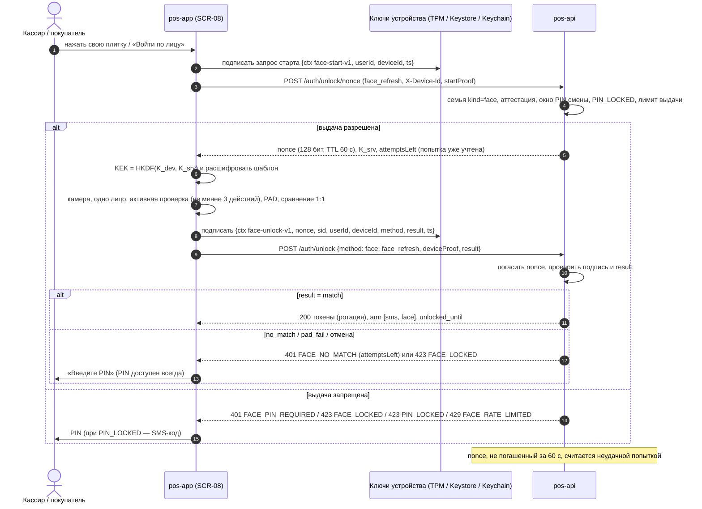

# P-001 — Предложение изменения ТЗ: собственный вход по лицу

| Поле | Значение |
|---|---|
| Номер | P-001 (первое предложение изменения утверждённого ТЗ) |
| Дата | 2026-10-28, **редакция 2** (в тот же день внесены замечания рецензии — разбор в §14) |
| Статус | **ПРОЕКТ — на утверждение заказчиком.** Утверждённое ТЗ (`docs/specification/00…18`) и ядро `docs/research/R0_DECISION_KERNEL.md` этим файлом **не меняются**. Изменения вносятся в ТЗ только после письменного утверждения заказчика и выполнения предусловий §5.1; код до этого не пишется |
| Повод | Заказчик 2026-10-26 выбрал «собственное распознавание лица в приложении»: регистрироваться и входить по лицу. Риски (юридические, подделка по фото, сложность) ему объяснены |
| Основание | Исследование `docs/research/R9_FACE_LOGIN.md` и его части `docs/research/R9_parts/1_models.md`, `2_liveness.md`, `3_legal.md`, `4_architecture.md` (URL и даты обращения — там); новые источники редакции 2 — в §14.3 |
| Затрагиваемые решения | Ядро D-13, D-14 (дополнение), новое D-49 (черновик); Q-003 (**получен ответ заказчика, остаётся открытым до заключения юриста**; связан с Q-027, R9-Q01…Q05), Q-027, Q-034, Q-304; 09 §4.5, §8.8, §9, §10, BIO-005, SESS-032, AC-AUTH-080, §17 п.14; 11 SEC-091, SEC-106…SEC-108; 16 §2, §10.7 |
| Метки | `[ПОДТВЕРЖДЕНО: …]`, `[ВТОРИЧНО]`, `[НЕ ПОДТВЕРЖДЕНО]`, `[ТРЕБУЕТ ЗАКЛЮЧЕНИЯ ЮРИСТА]`, `[ПРЕДЛОЖЕНИЕ]`, `[ВЫВОД]` (наш логический вывод, не цитата источника) — как в R9 |

---

# Часть I. Простым языком

## 1. Что получит заказчик

1. **Кассир на общей кассе входит, посмотрев в камеру.** В начале смены кассир один раз вводит свой PIN. Дальше в течение смены (8–12 часов — решаете вы) он нажимает свою плитку на экране блокировки и по подсказке делает перед камерой 3 простых движения головой — касса открывается под ним. Не нужно каждый раз вводить PIN. На плитке — имя (без фото; показывать ли роль — решаете вы). Смена кассира — «Заблокировать» (Ctrl+L) и выбрать другую плитку.
2. **Лицо можно «записать» при регистрации или позже** в «Настройки → Защита входа» — как ещё один способ входа наряду с PIN и встроенной биометрией телефона. Сотрудник записывает лицо сам; администратор только подтверждает своим PIN, что перед камерой именно этот сотрудник.
3. **Покупатель на своём телефоне** — только если вы решите включить это для покупателей, и только на телефонах **без** встроенного Face ID или отпечатка. Где встроенная защита есть, она надёжнее, и мы предлагаем её. Наша рекомендация — включать вход по лицу только для сотрудников.
4. **Всё остаётся рабочим без лица:** PIN, SMS-код и встроенная биометрия телефона. Отказ от входа по лицу ни на что не влияет и нигде не отмечается.
5. **Администратор управляет функцией:** включить для сотрудников / для всех / выключить; отключить вход по лицу конкретному сотруднику; получать уведомления о подозрительных сериях неудачных попыток.
6. **Обязательное условие для касс Windows.** Касса должна быть настроена так, чтобы кассир не мог запустить на ней постороннюю программу или скрипт (режим киоска плюс запрет запуска постороннего кода), либо у каждого кассира должна быть своя учётная запись Windows. Без этого вход по лицу на общей кассе **не включается**: см. п. 2, строка «Подделка».

**Что заказчик НЕ получит (и почему):**
- **«Зарегистрироваться только по лицу», без SMS-кода — нет.** Номер телефона — это ваш логин и ключ связи с карточкой клиента в 1С. Доказать, что номер ваш, может только SMS-код. Лицо «записывается» после кода.
- **«Войти по лицу на любой кассе или новом телефоне без SMS» — нет.** Для этого пришлось бы хранить лица всех людей на сервере магазина (центральная база биометрии). Это самый рискованный вариант и юридически, и при утечке. На новом устройстве и раз в 7 дней (сотрудник) / 30 дней (покупатель) — SMS-код, как сейчас.
- **Целую смену только по лицу, без единого PIN — нет.** Первая разблокировка в смене — по PIN.
- **Подтверждение лицом скидок, возвратов, продаж в долг — нет.** Для этих операций остаются PIN или SMS-код.
- **«Защиту от подделки» — нет.** См. п. 2.

## 2. Чем рискует заказчик

| Риск | Что это значит на практике | Как снижаем |
|---|---|---|
| **Юридический (главный)** | По Цифровому кодексу КР (ст. 80) биометрия — особая категория. Её обработка по общему правилу **запрещена**, и **согласие человека само по себе не делает её законной**. Ещё одна статья (ст. 48 ч. 5) может читаться как полный запрет для частных систем. Для сотрудников на общей кассе риск **выше**, чем для телефона покупателя: шаблоны лиц хранятся на кассе работодателя, а не «в руках» самого человека. Штраф юрлицу за нарушения с особыми категориями **и с данными детей** (регистрация в приложении разрешена с 14 лет) — 80 000 сом, повторно — 140 000 сом (Закон № 150 от 09.10.2026, по сообщению СМИ), плюс предписание прекратить обработку | Письменное заключение юриста и письменный запрос в ГАЗПД — **до** разработки и до любого теста на людях. Если юрист ответит «неясно, риск высокий», функция не включается до ответа ГАЗПД (§5.1). Лицо хранится только на устройстве, сервер биометрию не хранит. Если юрист скажет «нельзя» — функция выключается одной настройкой, без потери доступа |
| **Подделка** | (1) **Самая простая атака — без инструментов:** коллега нажимает вашу плитку, когда вы стоите рядом и смотрите в сторону кассы. (2) **Если кассир может запустить на общей учётной записи Windows любую программу или скрипт** (права администратора для этого **не нужны**), он откроет кассу под любым коллегой **вообще без лица и без PIN** — в пределах смены и для всех профилей кассы — и сможет скопировать шаблоны лиц коллег. Запрет «ставить программы» этого не закрывает: переносимые программы и PowerShell запускаются без установки. (3) Обычная веб-камера отсекает распечатанное фото и фото на экране, но **не** защищает от видео-подделок (deepfake), масок и подмены камеры программой. В Windows 11 программную камеру можно создать и без прав администратора | Кассир сам выполняет перед камерой случайные движения — так подтверждается, что входит именно он; два лица в кадре — отказ. Касса работает в режиме киоска с запретом запуска постороннего кода **или** у каждого кассира своя учётная запись Windows — **без этого режим для сотрудников не включается**. Первая разблокировка в смене — по PIN. Лицо открывает только уже привязанную к этой кассе сессию. Важные операции — PIN или SMS-код. Журнал событий. Остаточный риск заказчик принимает письменно |
| **Утечка биометрии** | Шаблон лица — не «безопасный набор чисел»: по опубликованным работам из него можно восстановить узнаваемое изображение лица | Шаблон зашифрован ключом из двух частей: одна — в защищённом чипе кассы, другая — на сервере. Как только сервер удаляет свою часть (отключение, увольнение, выключение функции), шаблон уже нельзя расшифровать даже с копией файла |
| **Ошибки распознавания** | Иногда своё лицо не узнаётся (плохой свет). Очень похожих людей (родственников) система может спутать | Сравнение только с выбранным сотрудником, а не «со всеми»; после 5 неудач — PIN; цель — не больше 5 % отказов с первой попытки |
| **Техническая сложность** | На Windows у Flutter нет готового пакета, который отдаёт поток кадров камеры при утверждённой версии Flutter; на кассах может не быть камер | Сначала технический прототип на реальной кассе (этап FL-1). Если прототип не пройдёт пороги — остаётся текущий вариант (PIN + системная биометрия) |
| **Ожидания** | Нельзя рекламировать «как Face ID», «защита от подделки», «сертифицировано» | Запрещённые формулировки в текстах и договоре |

## 3. Сколько это стоит по времени

Оценка — в условных единицах ТЗ (13 §2.4: 1 у.е. — наименьшая проверяемая задача; весь базовый объём R1 — 506 у.е.).

| Этап | Что делаем | у.е. |
|---|---|---|
| FL-0 | Подготовка: пакет для юриста, черновик DPIA, запрос цен у поставщиков SDK, опись касс (камеры, TPM, учётные записи, редакция Windows), требования к настройке касс (киоск, запрет постороннего кода) | 7 |
| FL-1 | **Технический прототип на Windows-кассе** заказчика: камера, распознавание, проверка живости, защищённый ключ и его аттестация, проверка настройки кассы. Тест на людях — **только после** заключения юриста | 31 |
| FL-2 | Windows, сотрудники: сервер, многопрофильная касса (плитки), экраны, тесты, пилот на 1 кассе | 77 |
| FL-3 | Android (сотрудники; покупатели — если решите) | 18 |
| FL-4 | iOS — только если iOS-сборка будет заказана (Q-008) | 11 |
| | **Итого** | **144 у.е. (≈ 28 % от базового объёма R1)** |

**Ориентир по календарю** (`[НЕ ПОДТВЕРЖДЕНО]`, не обязательство): по пропорции 13 §2.4 (506 у.е. ≈ 18 относительных спринтов при параллельной работе дорожек) — **около 6–8 спринтов** (дорожки лица меньше распараллеливаются), то есть ≈ 6–8 недель при спринте 1 неделя или ≈ 12–16 недель при спринте 2 недели. **Сверх этого:** ожидание заключения юриста и ответа ГАЗПД (срок неизвестен), закупка камер (если нужно), 2 недели пилота. Пересчёт — после прототипа FL-1.

**Внешние затраты (оценки нет, нужны ответы):** юридическое заключение; веб-камеры для касс без камер (цена не исследовалась); настройка касс ИТ-службой заказчика (режим киоска, запрет постороннего кода, шифрование диска) — в у.е. не входит; для коммерческого варианта — лицензии SDK (Luxand — по запросу; VeriLook у реселлера $366–1 501 за SDK плюс лицензии развёртывания `[ВТОРИЧНО]`); собственные испытания в лаборатории iBeta или BixeLab, если захотите (цена не найдена).

**Где это в плане R1.** Работа идёт **отдельной дорожкой** и не задерживает текущие этапы H–I и пилот R1; до решения функция выключена (`FACE_LOGIN_MODE=off`).

## 4. Что нужно от заказчика до старта

1. Утвердить или изменить этот документ (раздел «Решения, которые нужны от заказчика», §12).
2. Передать юристу вопросы (R9 часть 3 §13) и получить **письменное заключение**; направить **письменный запрос в ГАЗПД** (для входа сотрудников — обязательно).
3. Сообщить, какие камеры и компьютеры стоят на кассах (или разрешить провести опись), как устроены учётные записи Windows и **какая редакция Windows** (Pro / Enterprise): от неё зависит, доступны ли режим киоска и запрет запуска постороннего кода.
4. Сотрудники-добровольцы (≥ 10) для внутреннего теста нужны **только после** заключения юриста, в котором такой тест оценён отдельно (основание, срок хранения материалов, акт уничтожения).

---

# Часть II. Технически

## 5. Выбранный вариант архитектуры

### 5.1. Предусловия включения (ворота G-FL0)

Функция не реализуется в продукте и не включается ни в одном окружении с реальными людьми, пока не выполнено всё:

| № | Условие | Кто |
|---|---|---|
| (а) | Письменное заключение юриста по ст. 48 ч. 5, ст. 79 ч. 3, ст. 80 ч. 1–2, ст. 81 Цифрового кодекса КР: допустимость для частной системы, основание, квалификация 1:1, сотрудники, лица младше 18 лет, тестовый набор FL-1 (отдельно). **Письменный запрос в ГАЗПД направлен**; для режима `staff` получение ответа — обязательно при исходе «неясно» (правило ниже) | Заказчик (юрист) |
| (б) | DPIA (ст. 82) с обоснованием необходимости **отдельно для сотрудников и отдельно для покупателей** (почему недостаточно системной биометрии); в DPIA прямо записано: ориентир EDPB «шаблон у самого человека» к общей кассе не применяется (§6.4.1 п. 11); шаблон считается обратимым (§6.4.1 п. 12); подпись заказчика | Заказчик + исполнитель (технические разделы) |
| (в) | Ответственное лицо за ПДн; уровень защищённости по Пост. КМ № 384 от 02.06.2026 | Заказчик |
| (г) | Утверждённые тексты информирования/согласия (§6.4.2, §6.4.3) и локального акта для сотрудников | Заказчик (юрист) |
| (д) | Письменное принятие класса «удобство» и остаточных рисков §11, включая RR-F1 (код в учётной записи ОС) и RR-F15 (обратимость шаблона) | Заказчик |
| (е) | ADR по результатам прототипа FL-1 (пороги §6.3 выполнены по видам атак 1–4 и 8) | Исполнитель |
| (ж) | **Изоляция Windows-касс** для `FACE_LOGIN_MODE ∈ {staff, all}` (FLOG-040): либо режим киоска (Assigned Access / Shell Launcher) плюс App Control for Business (WDAC) или AppLocker в принудительном режиме с правилами для exe, dll и скриптов; либо отдельная учётная запись Windows на каждого кассира. Проверено тестами T-FLOG-060…063 на каждой кассе пилота | Заказчик (ИТ) + исполнитель (тесты) |

**Правило по исходу заключения юриста** `[ПРЕДЛОЖЕНИЕ]`:
- «допустимо» или «допустимо с условиями» — дорожка продолжается, условия становятся требованиями;
- «неясно» или «риск высокий» — функция **не включается**, пока не получен письменный ответ ГАЗПД. Альтернатива — отдельный письменный документ заказчика о принятии правового риска с перечислением последствий (штраф юрлицу 80 000 / 140 000 сом по Закону № 150 `[ВТОРИЧНО: Economist.kg, 13.10.2026]`, предписание прекратить обработку и удалить данные). Выбор — Р-04;
- «нельзя» — дорожка закрывается, остаётся текущее ТЗ (§11).

**Тест FL-1 с участием людей** начинается только после заключения юриста, в котором тестовый набор оценён отдельно: основание обработки, где и сколько хранятся материалы атак (фото и видео сотрудников), акт уничтожения. Основание «отдельное письменное согласие» само по себе не работает: согласия нет среди исключений ст. 80 ч. 2; исключение п. 11 (научные цели) требует обезличивания, невозможного для изображений лиц; у добровольцев-сотрудников есть зависимость от работодателя. До заключения прототип FL-1 проверяется **только технически**: камера, TPM, скорость конвейера — на синтетических данных или на наборах с лицензией, разрешающей коммерческое тестирование (лицензию проверить отдельно), либо на лице самого разработчика, если юрист это допустит `[ТРЕБУЕТ ЗАКЛЮЧЕНИЯ ЮРИСТА]`.

### 5.2. Вариант В — «гибрид» (рекомендуется)

| Элемент | Решение |
|---|---|
| Где шаблон лица | **Только на устройстве**, зашифрован AES-256-GCM. Ключ шифрования шаблона **разделён**: `KEK = HKDF-SHA256(K_dev ∥ K_srv)`. `K_dev` — случайный ключ, обёрнутый отдельным неизвлекаемым ключом аппаратного хранилища (Android Keystore / iOS Keychain `ThisDeviceOnly` / Windows TPM через Microsoft Platform Crypto Provider). `K_srv` — случайный ключ 256 бит на каждую регистрацию, хранится на сервере (это не биометрия) и выдаётся только на одну попытку входа. **Программное хранилище ключа запрещено**: без TPM 2.0 / аппаратного Keystore вход по лицу не включается |
| Сравнение | **1:1** на устройстве: с владельцем сессии (телефон) или с выбранной плиткой (общая касса). Поиск «со всеми» (1:N) запрещён |
| Сервер | Не хранит изображений, шаблонов, оценок сходства. Ведёт: включение по устройству, публичный ключ устройства и его аттестацию, `K_srv`, выданные nonce и счётчики попыток, окно PIN смены, блокировки, отзыв, аудит, сессии |
| Что открывает лицо | Только разблокировку уже привязанной к устройству сессии: `POST /auth/unlock {method: "face", refreshToken: face_refresh, deviceProof, result}` — вместо PIN, и только в пределах окна `FACE_PIN_WINDOW_HOURS` после разблокировки этого профиля по PIN (или входа по SMS-коду) на этом устройстве |
| Сначала nonce | Одноразовый nonce (128 бит, TTL 60 с) выдаётся **до включения камеры**, при нажатии плитки (`POST /auth/unlock/nonce`), и привязан к `user_id`, `device_id` и регистрации. Каждый выданный nonce, не погашенный успешной разблокировкой, считается неудачной попыткой — независимо от того, сообщил ли клиент о неудаче |
| Доказательство устройства | Подпись неизвлекаемым ключом устройства канонического объекта `{ctx: "optomstroy-face-unlock-v1", nonce, sid, userId, deviceId, method, result, ts}` с фиксированной сериализацией (FLOG-044). Ключ подписи используется только в протоколе входа по лицу. При регистрации клиент передаёт **аттестацию ключа** (FLOG-042); без валидной аттестации сервер отказывает |
| Что лицо не делает | Не заменяет SMS-код (новое устройство, истёк абсолютный срок 7/30 дней, смена номера); не используется для step-up и **не устанавливает `stepUpUntil`**; не снимает `PIN_LOCKED` и **не работает при `PIN_LOCKED`** (`423`, до входа по SMS-коду); не продлевает сроки сессии; не открывает первую разблокировку смены; PIN сотрудника обязателен (D-48) |
| Выключатель | `FACE_LOGIN_MODE = off \| staff \| all`, по умолчанию `off` |

**Что на самом деле доказывает вход по лицу (честно).** Ключ устройства доказывает только «запрос пришёл с этой кассы (телефона) под этой учётной записью ОС». Лицо — программная проверка в процессе приложения, сервер её проверить не может. Поэтому по сути вход по лицу — однофакторное «владение устройством» с проверкой на стороне клиента. Поэтому же:
- на общей учётной записи Windows без изоляции (§5.1 (ж)) **лицо не защищает от коллеги, который может выполнить там свой код**. Неизвлекаемый ключ TPM защищён от извлечения, но не от использования: подписывать им может любой процесс этой учётной записи `[ВЫВОД: из модели KSP — пользовательский ключ открывается по имени в хранилище пользователя без жеста (R9 ч.4 стр. 176); проверить тестом T-FLOG-060 на неизолированной кассе в FL-1]`. Ключ «cannot be extracted» `[ПОДТВЕРЖДЕНО: learn.microsoft.com/en-us/windows/win32/seccertenroll/cng-key-storage-providers, обновлено 2026-06-23, проверено 2026-10-28]`. Данные `flutter_secure_storage_windows` защищены DPAPI, а их, как правило, расшифровывает пользователь с теми же учётными данными `[ПОДТВЕРЖДЕНО: learn.microsoft.com/en-us/windows/win32/api/dpapi/nf-dpapi-cryptprotectdata, обновлено 2026-05-15, проверено 2026-10-28]`. Отсюда — обязательное условие изоляции (FLOG-040), окно PIN смены (FLOG-041) и запрет режима `staff` на неизолированных кассах;
- на устройстве с подменённым клиентом (модели, DLL, exe) лицо ничего не доказывает. Архитектура не даёт модифицированному клиенту выпустить токены **без ключа устройства**, но на самом устройстве защита — только политика ОС (FLOG-024, FLOG-040).

**Почему не другие варианты** (R9 §5.2). Вариант А (без ключа устройства и серверных счётчиков) — счётчики сбрасываются очисткой данных приложения. Вариант Б (шаблоны на сервере, вход «номер + лицо» с любого устройства) — однофакторный вход по биометрии, а NIST SP 800-63B-4 §3.2.3 допускает биометрию только в многофакторной аутентификации с физическим аутентификатором; кроме того — центральная база биометрии и противоречие SEC-108 (д). **Вариант В требованиям NIST к многофакторному аутентификатору тоже не соответствует**: ключи многофакторного криптографического аутентификатора должны быть доступны «only… through the presentation and verification of an activation factor» `[ПОДТВЕРЖДЕНО: pages.nist.gov/800-63-4/sp800-63b.html, раздел Multi-Factor Cryptographic Authenticators, проверено 2026-10-28]`, а у нас ключ устройства доступен без лица. Вариант В лишь ближе других к требованию: биометрия используется вместе с привязанным устройством, но лицо не добавляет фактора, проверяемого сервером.

Ключевое ограничение: собственное распознавание приложения **не может** быть условием доступа к аппаратному ключу ОС (Android Keystore допускает только экран блокировки или системную биометрию `[ПОДТВЕРЖДЕНО: developer.android.com/privacy-and-security/keystore, 2026-10-28]`). Отсюда серверные лимиты, окно PIN смены и запрет step-up.

### 5.3. Стек и лицензии

**Основной (стек A, для прототипа и, при успехе, для продукта):**

| Компонент | Версия | Лицензия (SPDX) | Коммерческое использование | Оговорка |
|---|---|---|---|---|
| `opencv_dart` (dartcv4) — детекция, выравнивание, эмбеддинг, DNN | 2.2.2 | Apache-2.0 | Разрешено | Совместим с Flutter 3.38.7 / Dart 3.10; модули `dnn`, `objdetect` (и `videoio` для Windows) включить в `hooks: user_defines` |
| YuNet — детекция (код и веса) | `face_detection_yunet_2023mar` | MIT | Разрешено | Обучена на WIDER FACE; зеркало набора на HF — CC-BY-NC-ND-4.0; перенос условий на веса `[НЕЯСНО]` → вопрос юристу |
| SFace — распознавание (код и веса) | `face_recognition_sface_2021dec` (fp32 или int8) | Apache-2.0 | Разрешено | Набор обучения весов Zoo не указан `[НЕЯСНО]`. 0.9940 в таблице Zoo — доля верных ответов на неназванном наборе, **это не FMR**; FMR при рабочем пороге `[НЕ ПОДТВЕРЖДЕНО]`; наличие SFace в NIST FRTE не проверялось |
| MiniFASNet (Silent-Face-Anti-Spoofing) — пассивная проверка живости | коммит 2020-08-05 (экспорт в ONNX) | Apache-2.0 | Разрешено | Обучающие данные не раскрыты `[НЕЯСНО]`; проект не развивается |
| `camera` — камера Android/iOS | 0.12.1 | BSD-3-Clause `[ТИПОВО]` | Разрешено | — |
| Камера Windows | по ADR прототипа FL-1 | — | — | Варианты: `opencv_dart VideoCapture` (Apache-2.0); собственный плагин Media Foundation (свой код); `camera_desktop` 2.0.0 (MIT) — **требует Dart ≥ 3.11, т. е. обновления Flutter и пересмотра ADR-086**; `camera_windows` 0.2.6+5 (BSD-3-Clause) потока кадров не даёт |
| `flutter_secure_storage` / `_windows` (уже в проекте) | ^11.2.0 / 4.2.2 | BSD-3-Clause | Разрешено | Хранение `face_refresh` и обёрнутого `K_dev`. На Windows — Credential Manager / DPAPI: расшифровывается процессами той же учётной записи ОС, поэтому защита держится на изоляции (FLOG-040). Каталог данных — `%LOCALAPPDATA%`, не Roaming (FLOG-007) `[НЕ ПОДТВЕРЖДЕНО: фактический путь пакета 4.2.2 — проверить в FL-1]` |
| TPM-ключи Windows | NCrypt (Microsoft Platform Crypto Provider) через FFI | Системный API Windows | — | Два ключа: подпись (только протокол входа по лицу) и обёртка `K_dev`. Аттестация ключа TPM документирована Microsoft только для RSA-ключей и для сценария с центром сертификации AD CS `[ПОДТВЕРЖДЕНО: learn.microsoft.com/windows-server/identity/ad-ds/manage/component-updates/tpm-key-attestation, обновлено 2025-09-23, проверено 2026-10-28]`; проверка на собственном сервере — `[НЕ ПОДТВЕРЖДЕНО]`, FL-1-08. Наличие TPM 2.0 на кассах — проверить (Q-R9-4-09) |

**Не используются:** веса InsightFace (только некоммерческие исследования), EdgeFace (CC-BY-NC-SA-4.0 на HF, противоречие с BSD-3-Clause на GitHub), модели на MS-Celeb-1M без заключения юриста, датасет CelebA-Spoof (только некоммерческий), `face_sdk_3divi` (AGPL-3.0), облачные face/liveness-API (трансграничная передача специальной категории, ст. 89).

**Запасной стек C (если стек A не выполнит пороги PAD):** Luxand FaceSDK 9.0.1 или Neurotechnology VeriLook (2025.2) — офлайн на Windows, Android, iOS; лицензии проприетарные, цены по запросу; Flutter-обвязки нет — FFI (Windows) и platform channel (мобильные) `[ВТОРИЧНО по ценам]`. **О проверке PAD — точно:** iBeta сама пишет, что её результаты не являются сертификацией продукта («does not translate to a certification of the vendor product»; слово «certification» исправлено после аудита NIST/NVLAP в марте 2019), а письмо-подтверждение указывает версию продукта и конфигурацию устройства захвата, на которой шёл тест `[ПОДТВЕРЖДЕНО: ibeta.com/iso-30107-3-presentation-attack-detection-confirmation-letters/, проверено 2026-10-28]`. На странице Luxand — только значок «iBeta Level 1&2 Certified» без указания, что и на каком устройстве тестировали; офлайн-работа liveness прямо не указана, есть лишь общее «No internet connection required» `[ПОДТВЕРЖДЕНО: luxand.com/facesdk/, проверено 2026-10-28]`. Neurotechnology заявляет «ISO 30107-3 compliant» и ссылается на письмо BixeLab (по имени файла — PAD Level 2), а не iBeta; устройство теста на странице не указано `[ПОДТВЕРЖДЕНО: neurotechnology.com/verilook.html, проверено 2026-10-28]`. **Нет подтверждения, что какое-либо письмо покрывает Windows с USB-веб-камерой** — это главный вопрос запроса FL-0-03. Даже PAD с письмом-подтверждением не защищает от подмены камеры (ISO/IEC 30107-3 её не охватывает).

### 5.4. Режимы для ролей

| | Сотрудник (`staff`) | Покупатель (`customer`) |
|---|---|---|
| Где | Windows-касса (основная), Android-устройство магазина | Свой телефон |
| Сравнение | 1:1 с выбранной плиткой профиля кассы | 1:1 с владельцем сессии |
| Активная проверка | **Всегда** (подтверждает намерение самого субъекта, FLOG-012) | `on_doubt` по умолчанию; пользователь сам нажимает «Войти по лицу» на своём телефоне |
| PIN | Обязателен (D-48); первая разблокировка смены — по PIN (FLOG-041) | Обязателен PIN или системная биометрия (лицо — не единственный способ; Q-R9-4-06) |
| `FACE_LOGIN_MODE` | `staff` или `all` | только `all`, и **только на устройстве без системной биометрии Class 3 / Face ID** (FLOG-034) |
| Возраст | По кадровым данным работодателя (18+) | Недоступно, если `текущий год − год рождения ≤ 18` (FLOG-027) |
| Рекомендация | Включить после пилота и только на кассах, выполняющих §5.1 (ж) | Не включать (Р-02 (а)); системная биометрия D-13 |

---

## 6. Потоки, проверка живости, правовые условия

### 6.1. Потоки по шагам

#### 6.1.1. Сотрудник на общей Windows-кассе — первое подключение лица

| Шаг | Что происходит | Экран / API |
|---|---|---|
| 1 | Администратор создаёт приглашение (номер + роль) — без изменений | SCR-45, `/admin/invitations` |
| 2 | Сотрудник на кассе: «Другой сотрудник (по SMS)» → номер → SMS-код | SCR-01, SCR-02 |
| 3 | Первый вход сотрудника: задаёт PIN (обязательно) | SCR-04 (режим «первый вход сотрудника»), `/me/pin` |
| 4 | Предложение «Вход по лицу на этой кассе» (если `FACE_LOGIN_MODE` ∈ {staff, all}, касса прошла проверку изоляции FLOG-040, есть камера и аттестуемый TPM). Можно «Не сейчас» — отказ нигде не фиксируется | SCR-04 |
| 5 | Экран информирования/согласия `face_login` (редакция для сотрудника, §6.4.3), чекбокс не отмечен; без отметки камера не включается. **Выбор сотрудник делает сам, без администратора** | новый лист SCR-04; `POST /me/consents {kind: face_login}` |
| 6 | Сотрудник подтверждает свежий step-up PIN (не ранее 60 с до начала съёмки, FLOG-014); **администратор подтверждает личность** — вводит свой PIN на кассе (FLOG-014, must) | `POST /auth/step-up {method: pin}`; подтверждение администратора |
| 7 | Съёмка: овал, подсказки света, ровно одно лицо в кадре, активная проверка (≥ 3 случайных действия), пассивная проверка живости; 3–5 кадров только в памяти | SCR-05, режим `enroll_face_login` |
| 8 | Касса создаёт ключ подписи и ключ обёртки (TPM), получает аттестацию ключа подписи, генерирует `K_dev`, вычисляет шаблон; кадры стираются | клиент |
| 9 | Регистрация на сервере: публичный ключ, аттестация, версия движка, идентификатор камеры → сервер проверяет аттестацию, создаёт `K_srv` и семью `kind=face` со сроком `expires_at = min(срок исходной standard-сессии, создание + 7 дней)` | `POST /me/face-login` → `{faceRefreshToken, enrollmentId, kSrv, expiresAt}` |
| 10 | Клиент шифрует шаблон ключом `KEK = HKDF(K_dev ∥ K_srv)`, стирает `K_srv` из памяти; сервер отправляет уведомление «На кассе N включён вход по лицу» (FLOG-046) | клиент; уведомление в приложении |
| 11 | В плитках кассы появляется профиль сотрудника | SCR-08 |

#### 6.1.2. Сотрудник — ежедневная работа

| Ситуация | Поток |
|---|---|
| Начало смены (нет разблокировки этого профиля по PIN за `FACE_PIN_WINDOW_HOURS`) | SCR-08: плитка → **PIN** (`POST /auth/unlock {method: pin}`); сервер фиксирует время как начало окна для лица. Попытка лица → `401 FACE_PIN_REQUIRED` |
| Касса заблокирована внутри смены (простой 30 мин, Ctrl+L) | SCR-08: нажать свою плитку → `POST /auth/unlock/nonce` (попытка уже учтена) → камера → одно лицо → активная проверка + живость → сравнение 1:1 → `POST /auth/unlock {method: face, deviceProof, result}` → сессия открыта (`amr: ["sms","face"]`) |
| Смена кассира | Ctrl+L (блокировка) → выбрать плитку другого → лицо (если у него открыто окно смены) или PIN. Данные экрана, корзина и черновики прежнего кассира не видны новому (профили разделены) |
| Лицо не распознано | «Лицо не распознано. Осталось попыток: n, затем — вход по PIN» (n — из ответа сервера). Кнопка «Ввести PIN» доступна всегда |
| 5 неудачных попыток подряд (несовпадение, живость, отмена, закрытое приложение, обрыв сети) | `FACE_LOCKED`: только PIN; после успешного PIN владельца лицо снова доступно без перерегистрации. Уведомление владельцу профиля и администратору, аудит «серия неудач» |
| Частые попытки | Не более 5 nonce за 10 мин на (пользователь, устройство); дальше — `429 FACE_RATE_LIMITED {retryAfter}` с нарастающей задержкой от 30 с |
| `PIN_LOCKED` | Лицо недоступно (`423 PIN_LOCKED`) до входа по SMS-коду |
| Новая касса, прошло 7 дней, сессия отозвана | SMS-код (как сейчас), затем при желании — регистрация лица на этой кассе |
| Нет сети | Лицо недоступно (сервер выдаёт nonce и `K_srv`), действует порядок 09 §6.13 (аварийный код администратора) |
| Сотрудник уходит с кассы навсегда | «Выйти» = удаление своего профиля с кассы: refresh, `face_refresh`, шаблон, ключи TPM (`NCryptDeleteKey`), `K_dev` — сразу на кассе; отзыв сессии и удаление `K_srv` на сервере |
| Увольнение / блокировка | Администратор блокирует → все `face`-семьи отозваны и `K_srv` удалены сразу (шаблоны на всех кассах становятся нерасшифровываемыми); локальные файлы и ключи удаляются по сигналу сервера в течение ≤ 5 мин при наличии сети (FLOG-019) |
| Камера заменена | Аудит `face_camera_changed`, вход только по PIN до повторной регистрации лица |

#### 6.1.3. Покупатель на своём телефоне (если `FACE_LOGIN_MODE=all`)

| Шаг | Что происходит | Экран / API |
|---|---|---|
| 1 | Номер → SMS-код (как сейчас; ответ нейтральный, D-10) | SCR-01, SCR-02 |
| 2 | Данные (ФИО, год рождения, сфера — как сейчас; год рождения обязателен, REG-007) | SCR-03 |
| 3 | «Защита входа»: системная биометрия (если есть) **или** PIN — обязательно хотя бы одно (ядро §24.2). «Вход по лицу» показывается **только** если на устройстве нет системной биометрии Class 3 / Face ID и `текущий год − год рождения > 18` | SCR-04 |
| 4 | Информирование/согласие `face_login` (редакция для покупателя, §6.4.2) | лист SCR-04 |
| 5 | Step-up: свежий PIN или вход по SMS-коду не через лицо (FLOG-014) | — |
| 6 | Съёмка на фронтальную камеру: одно лицо, активная проверка + пассивная PAD; кадры только в памяти | SCR-05 `enroll_face_login` |
| 7 | Ключи в Keystore/Keychain с аттестацией, шифрованный шаблон с разделённым ключом; `POST /me/face-login`; SMS-уведомление «На устройстве N включён вход по лицу» | — |
| 8 | Регистрация завершается (`/registration/complete` лицо **не** содержит — регистрация лица отдельным вызовом после `201`, как биометрия 09 §7.3) | SCR-04 «Готово» |
| Вход | Открытие приложения / возврат из фона > 5 мин → SCR-08 → «Войти по лицу» (или PIN) → `POST /auth/unlock/nonce` → камера → `POST /auth/unlock {method: face}` | SCR-08 |
| Новый телефон | SMS-код; лицо записывается заново на новом телефоне | SCR-01 |
| Отключение | «Настройки → Защита входа → Вход по лицу: выкл.» или «Удалить данные лица» — шаблон и ключи удаляются на этом телефоне сразу, `K_srv` — на сервере сразу; отзыв согласия. Список устройств с включённым лицом — в SCR-42 | SCR-42 |

#### 6.1.4. Последовательность разблокировки (вариант В, редакция 2: сначала nonce)

### 6.2. Проверка живости и честные ограничения

| Что делаем | Когда |
|---|---|
| Пассивная проверка (MiniFASNet, ONNX) | На каждой попытке |
| Активная проверка: случайная последовательность **не менее 3 действий** (поворот влево/вправо/вверх/вниз; проследить головой за целью, появляющейся в случайном месте экрана; моргание — если на платформе есть ориентиры глаз) со случайными тайм-аутами и проверкой времени реакции; последовательность выводится из nonce | `staff` — **всегда** (это подтверждение намерения самого субъекта: NIST указывает, что предъявление биометрии «does not always establish authentication intent», и требует явного механизма `[ПОДТВЕРЖДЕНО: pages.nist.gov/800-63-4/sp800-63b.html, раздел Authentication Intent, проверено 2026-10-28]`); при регистрации — всегда; `customer` — по `FACE_ACTIVE_CHECK = always \| on_doubt` (по умолчанию `on_doubt`) |
| Правила кадра (FLOG-043) | Ровно одно лицо; **два и более — отказ**, а не подсказка; лицо по центру овала; минимальный размер лица и межзрачковое расстояние (порог подобрать в FL-1); тайм-аут сессии камеры 15 с `[ПРЕДЛОЖЕНИЕ]` → предложение PIN |
| Активная проверка на Windows | Повороты головы и слежение за целью по 5 точкам YuNet `[ПРЕДЛОЖЕНИЕ: проверить на прототипе]`. Моргание на Windows требует модели ориентиров лица: MediaPipe на Windows не поддерживается, плагин `mediapipe_face_mesh` 3.2.2 требует Flutter ≥ 3.44, лицензия весов Face Mesh V2 по карточке не подтверждена |
| Требует потока кадров | На Windows активная проверка невозможна без решения по камере (FL-1-01) |

**Уровень:** «удобство» — аналог Android Class 1 (Convenience): обработка в процессе приложения, незащищённый конвейер `[ПОДТВЕРЖДЕНО: source.android.com/docs/security/features/biometric/measure, 2026-10-28]`.

| Обещаем (после успешного теста FL-1, на кассе с изоляцией FLOG-040) | Частично | Защиты нет |
|---|---|---|
| Вход только выбранного/привязанного человека при живом лице, выполнившего активную последовательность; отказ при распечатанном фото и фото на экране телефона в типичных условиях кассы (без гарантии, по результату теста); PIN/SMS всегда; кадры при входе не сохраняются | Повтор видео с экрана, заранее записанная библиотека поворотов; спящий/отвлечённый человек; **коллега нажимает плитку, когда владелец рядом** (закрывается активной проверкой, которую выполняет сам субъект, и отказом при двух лицах; остаётся социальная инженерия — «повернись налево»); подмена камеры программой на кассе с WDAC/киоском (запуск постороннего кода заблокирован, но см. внедрение с правами администратора) | Deepfake и анимированное фото в реальном времени; **подмена камеры или кадров** (виртуальная камера, внедрение в процесс) при правах администратора или **на кассе без изоляции**; **выполнение кода в той же учётной записи ОС без изоляции — вход под любым профилем кассы без лица** (поэтому такой режим не включается); подменённый клиент (модели, DLL) — на устройстве лицо тогда ничего не доказывает, токены без ключа устройства он всё равно не выпустит; хуки на рутованном Android; маски; близнецы и похожие родственники; принуждение и сговор; юридически значимая идентификация (KYC) |

**Материалы атак внутреннего теста** (фото и видео сотрудников-добровольцев) **хранятся** до акта уничтожения: где, сколько и на каком основании — по заключению юриста (FLOG-045); это исключение из правила «кадры не сохраняются» и указывается в тексте согласия на участие в тесте.

**Запрещённые формулировки** (интерфейс, маркетинг, договор): «защита от подделки», «распознавание живого лица гарантирует…», «соответствует ISO 30107», «как Face ID», «сертифицированная биометрия», «сертифицированный PAD».

### 6.3. Пороги (условия запуска)

| Параметр | Значение `[ПРЕДЛОЖЕНИЕ]` | Основание |
|---|---|---|
| FMR алгоритма | **Не условие ворот, если нет внешней оценки.** Порог сравнения фиксируется в ADR по опубликованной кривой ROC модели или по независимой оценке. Если такой оценки нет (наличие SFace в NIST FRTE не проверено), FMR из условий ворот исключается и вносится в остаточные риски (RR-F4) с письменным принятием. Ориентир при наличии оценки — ≤ 1:10 000 **для всех демографических групп** | NIST SP 800-63B-4 §3.2.3: FMR «one in 10000 or better for all demographic groups», группы включают пол и цвет кожи `[ПОДТВЕРЖДЕНО: pages.nist.gov/800-63-4/sp800-63b.html, проверено 2026-10-28]`; FIDO BioLevel 2; Android FAR 1/50k. Для стека A требование по группам **не подтверждено** и принимается как ограничение |
| FNMR | ≤ 5 % с первой попытки; ≤ 2 % за 3 попытки | NIST «SHOULD» < 5 % |
| APCER (по каждому виду атаки 1–4 и 8: печать, фото на экране, видео на телефоне, видео на планшете, библиотека поворотов) | ≤ 7 %; цель 0 % для печатного фото | FIDO/Android/NIST 7 %; iBeta L1 требует 0 % — наш порог заметно слабее |
| BPCER | ≤ 5 % | Иначе кассиры уйдут на PIN |
| Попытки | 5 неудач подряд (считаются выданные и не погашенные успехом nonce) → `FACE_LOCKED` до PIN владельца; выдача nonce ≤ 5 за 10 мин, дальше задержка ≥ 30 с с нарастанием | NIST SP 800-63B-4 §3.2.3: не более 5 неудач подряд (10 при PAD), после лимита — задержка не менее 30 с перед каждой попыткой `[ПОДТВЕРЖДЕНО: там же]` |
| Атаки внедрением | Порога нет — остаточный риск, принимается письменно; на изолированной кассе — проверка T-FLOG-016, T-FLOG-061, T-FLOG-063 | ISO/IEC 30107-3 не охватывает; CEN/TS 18099 |

Ограничение измерения: FMR 1:10 000 на пилоте одного магазина **не измеряется** (для 1:100 000 нужно ≈ 2,5 млн сравнений). Внутренний тест (T-FLOG-003/004) даёт только оценку снизу, в том числе по группам. Демографическая неравномерность касается **и FMR, и FNMR** (RR-F5).

### 6.4. Правовые условия

#### 6.4.1. Обязательные меры

1. Предусловия §5.1 (заключение юриста, запрос в ГАЗПД, DPIA, ответственное лицо, уровень защищённости, изоляция касс).
2. **Альтернатива без биометрии обязательна и равноправна:** PIN, SMS-код, системная биометрия ОС. Отказ и отзыв — без последствий (ст. 79 ч. 4; ст. 228-6 КоП — «связанное» согласие `[ТИПОВО: по ICNL; после Закона № 150 номер статьи не подтверждён]`).
3. **Конструкция экрана** («согласие» или «информирование и явный выбор функции») — по заключению юриста с учётом коллизии ст. 79 ч. 3 и ст. 80 ч. 2 п. 1 (R9 §4.2). Ст. 79 ч. 3 делает согласие ничтожным и тогда, когда запрос «непонятен и изложен сложным языком» `[ПОДТВЕРЖДЕНО по рецензии: reestr.dpa.gov.kg/ru/npa/59, 2026-10-28]`, поэтому текст делится на короткую первую страницу и полный текст по ссылке; юрист оценивает понятность именно по ст. 79 ч. 3. Тексты ниже — заготовка.
4. **Удаление шаблона** (ст. 83) по событиям: выключение функции; отзыв согласия; выход с устройства / удаление профиля с кассы; `logout-all`; смена номера; блокировка или удаление пользователя; команда администратора; `FACE_LOGIN_MODE=off`; неиспользование 6 месяцев `[предложение, решение юриста]`; истечение срока регистрации. Как это работает (честно):
   - **на сервере — сразу**: `face`-семья отзывается и `K_srv` удаляется; без `K_srv` шаблон на любом устройстве нельзя расшифровать (криптографическое стирание). Правило 6 месяцев выполняет сервер, поэтому оно срабатывает и на устройстве, где приложение не запускается;
   - **на устройстве**: при действии на самом устройстве — сразу; в остальных случаях — по сигналу сервера при первом контакте (heartbeat или синхронизация), для кассы ≤ 5 мин при наличии сети; удаляются файлы шаблона, `K_dev`, записи Credential Manager и ключи TPM (`NCryptDeleteKey`);
   - **на потерянном или не подключающемся устройстве** зашифрованный файл шаблона остаётся, но расшифровать его нельзя (RR-F17);
   - **Windows, zip-установка** (16 §10.7, DEPLOY-044): удаление папки приложения данные **не** удаляет — нужен скрипт очистки администратора (FLOG-047): каталог данных, записи Credential Manager, ключи TPM; шаг «очистка данных лица» — в runbook снятия кассы.
5. **Минимизация:** кадры при входе и регистрации не сохраняются (исключение — материалы атак теста FL-1, FLOG-045); на сервере, в логах, бэкапах, аналитике, 1С, отчётах об ошибках нет изображений, шаблонов и оценок сходства; аудит — только факт и результат.
6. **Только офлайн-обработка**, без облачных SDK и передачи данных вендору (проверка трафика; при SDK — договор по ст. 86 и лицензия без телеметрии ПДн).
7. **Цель — только вход.** Запрещено использовать для учёта рабочего времени, дисциплинарных целей, поиска покупателя по лицу, рекламы, аналитики. **Технические меры:** отдельный короткий срок хранения событий `auth.face.*` (Р-21); доступ к ним — только для расследований безопасности, без выгрузки в отчёты; мера записывается в DPIA (FLOG-025).
8. **Возраст.** Год рождения **обязателен** (09 REG-007: `1920 ≤ год ≤ текущий − 14`; в коде `pos-api/src/registration/registration.dto.ts` поле `birthYear` обязательно), но он **не точен** (погрешность до года) и указан самим пользователем. Правило по умолчанию: функция недоступна, если `текущий год − год рождения ≤ 18` (FLOG-027, must); для сотрудников возраст — по кадровым данным работодателя. Окончательное правило — по заключению юриста `[ТРЕБУЕТ ЗАКЛЮЧЕНИЯ ЮРИСТА: ст. 81; повышенные штрафы Закона № 150 относятся и к данным детей]`.
9. **Сотрудники:** локальный акт — добровольность, отказ без последствий, PIN как равноправная альтернатива, удаление при увольнении. Администратор только подтверждает личность на шаге съёмки; выбор и согласие сотрудник делает без него; отказ нигде не фиксируется и не показывается в SCR-45 (FLOG-048).
10. Сценарий утечки в runbook (уведомление ГАЗПД ≤ 72 ч, субъектов — по PRIV-026).
11. **Общая касса и ориентир EDPB.** EDPB Opinion 11/2024 считает «в принципе совместимым» хранение шаблона «in the hands of the individual… on their individual device, under their sole control» (сценарий 1), а также централизованное зашифрованное хранение с ключом **только у самого человека** (сценарий 2); хранение под контролем оператора (сценарии 3 и 4) — несовместимым `[ПОДТВЕРЖДЕНО: edpb.europa.eu, PDF Opinion 11/2024, принят 23.05.2024, проверено 2026-10-28]`. На общей кассе шаблоны до 10 сотрудников хранятся на устройстве работодателя, под его контролем, а вторая часть ключа (`K_srv`) — на сервере магазина. Это ближе к хранению под контролем оператора, чем к сценарию 1, и сотрудник не может сам проверить удаление. Поэтому **для режима `staff` на общей кассе ориентир «шаблон у самого человека» не применяется, и правовой риск выше, чем для телефона покупателя** — это прямо пишется в DPIA. Влияет ли хранение `K_srv` на сервере на квалификацию обработки — `[ТРЕБУЕТ ЗАКЛЮЧЕНИЯ ЮРИСТА]`.
12. **Шаблон обратим.** Опубликованы атаки, восстанавливающие узнаваемое изображение лица из шаблона, в том числе только по оценкам сходства: Mai и др., NbNet (https://arxiv.org/pdf/1703.00832); Razzhigaev и др., 2021 (https://arxiv.org/pdf/2106.14290v2); Otroshi Shahreza, Marcel, IJCB 2023 (https://publications.idiap.ch/attachments/papers/2024/OtroshiShahreza_IJCB-2_2023.pdf) `[ВТОРИЧНО: по данным рецензии 2026-10-28; полные тексты не изучались; на SFace атаки не проверялись — НЕ ПОДТВЕРЖДЕНО]`. В DPIA шаблон считается обратимым. Защищённые шаблоны по ISO/IEC 24745 — оценить в FL-1, если движок позволяет `[ПРЕДЛОЖЕНИЕ]`.

#### 6.4.2. Черновик текста — редакция для покупателя (для юриста, не утверждён)

Первая страница (коротко):

> **Вход по лицу (необязательно).** Если включите, приложение один раз снимет ваше лицо и сохранит на этом телефоне зашифрованный цифровой шаблон. Фото и видео не сохраняются. Сервер магазина шаблон не получает. Без этой функции всё работает так же: PIN, SMS-код или встроенная биометрия телефона. Выключить можно в любой момент в «Настройки → Защита входа». [Подробнее]
>
> ☐ Я согласен(на) на создание и хранение шаблона моего лица на этом устройстве для входа в приложение. (Отметка не установлена по умолчанию; отзыв — в любой момент.)

Полный текст (по ссылке «Подробнее»):

> Оператор (владелец персональных записей): <полное наименование, ИНН, адрес>. Ответственный за персональные данные: <ФИО / должность, телефон, e-mail>.
>
> **Что мы делаем.** Если вы включите функцию, приложение снимет ваше лицо камерой этого устройства и создаст из изображения цифровой шаблон. Шаблон — производная биометрических данных; из него в принципе можно восстановить похожее изображение лица, поэтому он защищён шифрованием. Фотографии и видео не сохраняются. Шаблон хранится **только на этом устройстве** в зашифрованном виде и не передаётся на сервер магазина, третьим лицам и за пределы Кыргызской Республики.
>
> **Что хранится на сервере.** Факт включения функции на этом устройстве; служебный ключ устройства (не биометрия); часть ключа шифрования шаблона (без неё шаблон нельзя расшифровать; сама по себе она биометрией не является); журнал попыток входа — время, устройство, результат, без изображений и шаблонов. Журнал хранится <срок по Р-21>.
>
> **Зачем.** Только чтобы подтвердить, что в приложение на этом устройстве входите вы — владелец учётной записи, номер которой уже подтверждён SMS-кодом. Шаблон не используется для поиска вас среди других людей, для рекламы и любых других целей.
>
> **Основание.** <по заключению юриста: статья 80 часть 2 пункт __ Цифрового кодекса КР> <и ваше отдельное согласие / ваш выбор этой функции — по заключению юриста>.
>
> **Срок и удаление.** Пока функция включена. Если вы выключите функцию или удалите данные лица на этом устройстве, шаблон удаляется с устройства сразу. Если вы отзовёте согласие, выйдете из учётной записи на другом устройстве, удалите учётную запись или не будете пользоваться функцией <6> месяцев, сервер сразу удаляет свою часть ключа — после этого шаблон уже нельзя расшифровать, — а сам файл удаляется с устройства при его ближайшем подключении к серверу. На потерянном или не подключающемся устройстве файл остаётся зашифрованным и без сервера бесполезен.
>
> **Это необязательно.** Без входа по лицу доступны все функции приложения: можно входить по SMS-коду и PIN-коду или с помощью биометрии, встроенной в устройство. Отказ ни на что не влияет.
>
> **Ограничения.** Распознавание лица может ошибаться и не является защитой от умышленной подделки. Если вход по лицу не сработал, используйте PIN или SMS-код. Важные операции всегда подтверждаются PIN-кодом или SMS-кодом.
>
> **Ваши права.** Узнать, какие данные обрабатываются; в любой момент отключить функцию в «Настройки → Защита входа» — так же просто, как включить; потребовать удаления; возразить; пожаловаться в Государственное агентство по защите персональных данных (dpa.gov.kg).

#### 6.4.3. Черновик текста — редакция для сотрудника (для юриста, не утверждён)

Первая страница (коротко):

> **Вход по лицу на этой кассе (по желанию).** Касса снимет ваше лицо и сохранит зашифрованный шаблон для быстрой разблокировки вместо PIN. Касса — устройство работодателя. Отказ ни на что не влияет и нигде не отмечается; PIN остаётся полностью равноправным. [Подробнее]
>
> ☐ Я добровольно согласен(на) на создание и хранение шаблона моего лица на этой кассе для разблокировки.

Полный текст:

> Работодатель (владелец персональных записей): <наименование, ИНН, адрес>. Ответственный за персональные данные: <ФИО / должность, контакты>.
>
> **Что делаем.** Касса снимает ваше лицо и создаёт цифровой шаблон. Фото и видео не сохраняются. Шаблон хранится в зашифрованном виде **только на этой кассе** и не передаётся на сервер, в 1С, третьим лицам и за рубеж. Шаблоны других сотрудников с вашим не сравниваются: касса сверяет лицо только с тем сотрудником, чью плитку нажали.
>
> **Где это хранится и у кого доступ.** Касса — устройство работодателя; на ней могут храниться шаблоны до <10> сотрудников. Доступ к настройке кассы есть у <ИТ-администратора / ответственного лица>. Касса настроена так, чтобы на ней нельзя было запускать посторонние программы. Расшифровать шаблон можно только при участии сервера магазина.
>
> **Что хранится на сервере.** Факт включения на этой кассе; служебный ключ кассы; часть ключа шифрования шаблона (не биометрия); журнал попыток входа — время, касса, результат, без изображений и шаблонов. Журнал хранится <срок по Р-21>, доступен только для расследований безопасности и **не** используется для учёта рабочего времени.
>
> **Зачем.** Только для быстрой разблокировки кассы вместо ввода PIN. **Не** используется для учёта рабочего времени, контроля присутствия, дисциплинарных или иных целей.
>
> **Добровольно.** Отказ не влечёт никаких последствий и нигде не фиксируется; вход по PIN-коду остаётся полностью равноправным. Администратор при записи лица только подтверждает, что это вы; решение включать или нет — ваше. Важные операции (скидки, возвраты, долг) всегда подтверждаются PIN-кодом.
>
> **Основание.** <по заключению юриста>.
>
> **Срок и удаление.** Пока функция включена. При удалении своего профиля с кассы шаблон удаляется сразу. При отключении функции, отзыве согласия, блокировке учётной записи, увольнении или если функцией не пользовались <6> месяцев сервер сразу удаляет свою часть ключа (шаблон больше нельзя расшифровать), а файл удаляется с кассы в течение нескольких минут при наличии сети, иначе — при ближайшем подключении.
>
> **Права.** Как в редакции для покупателя; отзыв — в «Настройки → Защита входа» или через ответственное лицо.

Для сотрудников дополнительно рекомендуется подписанное заявление (Кодекс письменной формы не требует, но она упрощает доказывание). Нужна ли версия на кыргызском языке — вопрос юристу. Тексты получают версию и SHA-256 в `contracts/legal/consents_ru.md` (новый раздел `face_login`; раздел `biometrics_device` про системную биометрию не меняется и не смешивается). Для участия в тесте FL-1 — отдельный текст по заключению юриста (материалы атак хранятся, FLOG-045).

---

## 7. Изменения в документах ТЗ (перечень; вносятся только после утверждения)

| Документ | Разделы | Что меняется |
|---|---|---|
| **Ядро R0** | D-13, D-14; новое D-49; §19.3 (без изменения — подтверждение «лицо не для step-up»); §24.5 (ответ заказчика) | D-13 дополняется: «биометрия не хранится на сервере; на устройстве — только зашифрованный шаблон с согласием `face_login`; на Windows — только на кассах с изоляцией»; D-14 — FACE-SCAN (R2 guided) остаётся отдельно; новое D-49 — вариант В (черновик ADR §13) |
| **02** Экраны | SCR-04 (третий способ «Вход по лицу», лист информирования/согласия с короткой первой страницей, режим сотрудника после PIN, подтверждение администратора); SCR-05 (новый режим `enroll_face_login`, Windows); SCR-08 (режимы «один профиль» и «общая касса — плитки профилей», окно камеры, сообщения о попытках/блокировке/окне PIN смены, «Другой сотрудник (по SMS)»); SCR-41/SCR-42 («Вход по лицу на этом устройстве», «Перерегистрировать», «Удалить данные лица», **список устройств с включённым лицом**, «Профили этой кассы», признак `face` в «Устройства и сессии»); SCR-45 (вход по лицу у сотрудника — только в карточке, без списка/фильтра и без статуса «отказался»; «Отключить», счётчики); SCR-46 (`FACE_LOGIN_MODE`, `FACE_ACTIVE_CHECK` для покупателей, `FACE_PIN_WINDOW_HOURS`, step-up); SCR-47 (новые события аудита, ограниченный доступ); SCR-01/SCR-02 — без изменений (нейтральность D-10) | Новые состояния, тексты, критерии приёмки, трассировка |
| **03** Дизайн-система | §9 (новые компоненты: плитка профиля кассы, окно камеры для лица с овалом, индикатор шагов активной проверки, цель слежения); §10 (матрица состояний); §11 (переиспользование ANIM-029/ANIM-030 видоискателя, ANIM-R2-001 — для активной проверки); §15 (A11Y: голосовые подсказки, альтернатива без камеры); §16 (тексты); §18 (новые DS-NNN) | Компоненты и состояния |
| **04** Потоки | Новые потоки: регистрация лица сотрудника/покупателя, разблокировка лицом (сначала nonce), первая разблокировка смены по PIN, смена кассира, блокировка лица | Диаграммы по §6.1 |
| **06** Архитектура | §4.3 (компонент `FaceAuthenticator` в `core/biometrics`, нативные плагины камеры/TPM), §16.1 (зависимости клиента), модуль `auth` backend | Порт `FaceAuthenticator` (enroll / verify / clear / capability / attest) рядом с `BiometricAuthenticator`; use case `UnlockWithFace` |
| **07** Модель данных | §5.8 `devices` (DATA-107: `face_enrolled_at`, `face_engine_version`, `face_device_pubkey`, `face_key_attestation` (уровень, результат проверки), `face_camera_id`, `face_failed_attempts`, `face_locked_until`, `face_pin_anchor_at`, `face_disabled_at` — или таблица `device_face_state`); §5.9 `sessions` (`kind = face`, `created_from_challenge_id`); §5.14 `consents` (`face_login`); §5.57 `audit_logs` (события, отдельный срок хранения); §5.59 `app_settings` (`face_login_mode`, `face_active_check`, `face_pin_window_hours`, `pos_max_profiles`); §6.1 enum-ы (`session_kind` + `face`, `consent_kind` + `face_login`); новые таблицы `face_unlock_nonces` (статус `issued \| redeemed \| expired`) и `face_enrollment_keys` (`K_srv`, зашифрован ключом сервера, удаляется при отзыве); §11 локальная БД (данные по профилям, без шаблонов в drift) | Новые поля и таблицы; биометрических данных в БД нет |
| **08** API | §2.4 (коды `FACE_LOCKED` 423, `FACE_DISABLED` 423 (отключено администратором), `FACE_PIN_REQUIRED` 401, `FACE_NO_MATCH` 401, `FACE_RATE_LIMITED` 429, `DEVICE_PROOF_INVALID` 401, `KEY_ATTESTATION_INVALID` 422); §2.12 (лицо не принимается для step-up и не устанавливает `stepUpUntil`); §4.1.6 (`kind=face`, ротация и reuse-detection); §4.1.8 `POST /auth/unlock` (`method: face`, `deviceProof`, `result`); новый `POST /auth/unlock/nonce` (с `startProof`, ответ с `kSrv`); §4.3.1 `GET /me` (`security.faceLogin*`, список устройств); новый `POST /me/face-login` (с аттестацией; рядом с §4.3.6); §4.3.7 (`face_login`); новый `DELETE /admin/users/{id}/face-login` (рядом с §4.18.9); §4.18.6 и §4.23 (`faceLogin{mode, activeCheck, pinWindowHours}`); `contracts/openapi/pos-api.v1.yaml` | Новые методы и коды; `/auth/otp/*`, `/registration/complete`, step-up — без изменений |
| **09** Авторизация | §2.3 (что хранится); §4.5 (многопрофильная касса вместо «вход другого пользователя удаляет сессию» — для Windows-касс); §8.3 (ротация и reuse-detection для `kind=face`); §8.4–§8.5 (ключи хранилища по `user_id`); §8.8 (`method: face`); §9.1, §9.4 (строка «вход по лицу» в матрице платформ), новый §9.9 «Собственный вход по лицу» (аналог §9.5), §9.7 (fallback), §9.8 (согласие `face_login`); §10 (FACE-SCAN — отделить от входа по лицу); §12 (угрозы); §13 (AC-AUTH для лица); §14 (новая таблица FLOG-NNN); **новые редакции BIO-005, SESS-032, AC-AUTH-080 и §17 п.14 — §7.1** | Новый подраздел и требования |
| **11** Безопасность | §2.2.1 (STRIDE: подмена камеры, подмена шаблона, повтор `deviceProof`, выполнение кода в общей учётной записи, отказ от авторства после входа по лицу); §8.1–§8.2 (SEC-089, SEC-091 — профили кассы); §9.2 (SEC-106 новая редакция: «сервер не содержит биометрических данных; на устройстве — только зашифрованный шаблон пользователя устройства с разделённым ключом»; SEC-107 новая редакция текста; SEC-108 — условия для входа по лицу: (г) «сертифицированный PAD» заменяется формулировкой «PAD с письмом-подтверждением iBeta/BixeLab уровня N для конкретной конфигурации» либо порогами §6.3 с письменным принятием класса «удобство» — решение заказчика); §10.1 (ст. 1 пп. 79, 81, ст. 48 ч. 6, ст. 49, ст. 81; Пост. № 384 вместо № 760; Закон № 150; поправка «п. 69» → «п. 75» — Q-180); §10.2 (строка «шаблон лица»); §10.3 (шаблон 4 «Вход по лицу»); §10.5 (сроки, срок журнала `auth.face.*`); PRIV-024 (полная DPIA до запуска); перечень остаточных рисков (новый остаточный риск §7.1); §12.2 (новые T-SEC) | Новые и изменённые SEC/PRIV |
| **12** Тест-план | §3.1 (новый набор T-FLOG), §3.8 (T-SEC), §2.9 (сборки: opencv_dart, нативные плагины), §2.17 (тестовые учётные записи с профилями кассы), §5 (матрица покрытия), §6.5 (триггеры регрессии) | Тест-план §9 |
| **13** План | Новый раздел «Дорожка FL (вход по лицу)» с задачами FL-0…FL-4, воротами G-FL0…G-FL4 и у.е. (§10); §3.12 (условный элемент, `FACE_LOGIN_MODE=off` до ворот); §9 (действия владельца) | План §10 |
| **14** Вопросы | Q-003 — **записать ответ заказчика 2026-10-26, вопрос остаётся открытым до заключения юриста** (связан с Q-027, R9-Q01…Q05); новые вопросы из R9 §8 (R9-Q01…R9-Q20) — по свободным номерам | — |
| **15** Решения | ADR «Собственный вход по лицу — вариант В» (черновик §13); ADR по результатам прототипа FL-1 (порог, FMR или его принятие); при обновлении Flutter — ADR, пересматривающий ADR-086 | — |
| **16** Развёртывание | §2 (чек-лист: камеры касс, TPM 2.0 с аттестацией, редакция Windows, **изоляция кассы: киоск + WDAC/AppLocker с правилами для exe, dll и скриптов или отдельные учётные записи**, каталог приложения недоступен на запись кассиру, шифрование диска, пароль BIOS, сбор EKPub при описи); §10.7 (установка Windows-сборки: нативные DLL opencv/ONNX, модели в составе сборки, правила подписи/хэшей WDAC для exe, DLL и моделей, **шаг «очистка данных лица» и скрипт очистки при удалении или снятии кассы**); §15 (runbook утечки шаблонов, массовое отключение `FACE_LOGIN_MODE=off`); §16 (новые DEPLOY/OPS) | Требования к оборудованию и настройке касс |
| **17** Трассировка | Новые строки FLOG → T-FLOG → экраны/API | — |
| **ARB** | `pos-app/lib/l10n/app_ru.arb`, `app_ky.arb`, `app_en.arb` — новые ключи с префиксом `face_login_*` (существующие `face_*` относятся к FACE-SCAN R2 и не переиспользуются): включение, короткая и полная версии листа информирования/согласия, подсказки камеры, «В кадре должен быть только один человек», «Лицо не распознано. Осталось попыток: {n}», «Вход по лицу временно недоступен — введите PIN», «Начало смены — введите PIN», «Вход по лицу на этой кассе отключён администратором», «На устройстве {device} включён вход по лицу», «Обновите вход по лицу», «Другой сотрудник (по SMS)», тексты SCR-45/46/47 | Тексты без запрещённых формулировок §6.2 |
| **contracts/legal/consents_ru.md** | Новый раздел `face_login` (две редакции, короткая и полная, версия, SHA-256); отдельный текст для участников теста FL-1 | По §6.4 |

### 7.1. Новые редакции утверждённых требований 09 (черновик; вносятся вместе с §9.9)

Вариант В фактически меняет утверждённые BIO-005, SESS-032, AC-AUTH-080 и §17 п.14 для профилей с включённым лицом. Эти изменения предлагаются явно:

| ID | Сейчас (кратко) | Новая редакция `[ПРЕДЛОЖЕНИЕ]` |
|---|---|---|
| BIO-005 | Windows Hello — только UX-гейт перед PIN; холодный старт и снятие idle-блокировки — только после серверной проверки PIN | Без изменения для Windows Hello. **Дополнение:** «Исключение — собственный вход по лицу (09 §9.9): на кассе, прошедшей проверку изоляции (FLOG-040), при `FACE_LOGIN_MODE ∈ {staff, all}` снятие idle-блокировки допускается `POST /auth/unlock {method: face}` с `deviceProof`, но только в пределах `FACE_PIN_WINDOW_HOURS` после разблокировки этого профиля по PIN или входа по SMS-коду на этом устройстве. Холодный старт смены — только PIN» |
| SESS-032 | Refresh без PIN — только при `unlocked_until > now()`, иначе `401 UNLOCK_REQUIRED` → SCR-08 с PIN | «…иначе `401 UNLOCK_REQUIRED` → SCR-08 с PIN, а для профиля с включённым лицом внутри окна PIN смены — с PIN или лицом (`/auth/unlock {method: face}`); `/auth/refresh` с `face_refresh` не принимается — только `/auth/unlock`» |
| AC-AUTH-080 | (б) refresh, извлечённый из Credential Manager, → `401 UNLOCK_REQUIRED` | (а)–(г) без изменения. **Новые пункты:** (д) на кассе с изоляцией FLOG-040 скрипт или переносимая программа под учётной записью кассира не запускается (T-FLOG-060); (е) `face_refresh` с другого ПК → отказ, семья отозвана (T-FLOG-022); (ж) попытка лица без разблокировки по PIN в окне смены → `401 FACE_PIN_REQUIRED` (T-FLOG-036); (з) режим `staff` на кассе без изоляции не включается (FLOG-040) |
| §17 п.14 | Остаточный риск ограничен окном `unlocked_until` (активная смена) | «На кассе с входом по лицу остаточный риск шире: при обходе политики ОС (права администратора, загрузка с внешнего носителя при отсутствии шифрования диска) злоумышленник с доступом к учётной записи кассы получает сессию любого профиля с включённым лицом без лица и без PIN в пределах окна `FACE_PIN_WINDOW_HOURS` (8–12 ч вместо 30 мин простоя). Доступны операции роли этого профиля **без пометки S!** в матрице 11 §4.4 (для `cashier` — в том числе оформление продаж, приём наличных, скидки в пределах лимита роли, просмотр карточек покупателей) `[ПРЕДЛОЖЕНИЕ: точный перечень снять по 11 §4.4 при внесении]`; операции со step-up остаются под PIN/SMS. Компенсация: изоляция FLOG-040, окно PIN смены FLOG-041, аудит FLOG-049, уведомления FLOG-046. Без изоляции режим не включается» |

---

## 8. Новые требования (черновые ID `FLOG-NNN`)

Префикс `FLOG` выбран, чтобы не пересекаться с `FACE-001…014` (FACE-SCAN, 09 §14.6). При внесении в ТЗ владелец — 09 §14 (новый подраздел), если не указано иное. Соответствие требованиям частей R9: FACE-LIV-001…009 (часть 2 §10) вошли в FLOG-001, -002, -012, -013, -024, -025, -029, -034. В редакции 2 изменены FLOG-001, -005…-014, -019…-021, -023…-025, -027, -030, -033, -034 и добавлены FLOG-036…-049 (§14).

| ID | Требование | Приоритет | Владелец | Основание |
|---|---|---|---|---|
| FLOG-001 | Собственный вход по лицу относится к классу «удобство»: разблокирует только существующую сессию этого устройства в режиме 1:1; не заменяет SMS-код (новое устройство, истёк абсолютный срок, смена номера); не принимается для step-up; не снимает `PIN_LOCKED` и не работает при нём (FLOG-037); не устанавливает `stepUpUntil` (FLOG-038) | must | 09 | R9 ч.2 §0, FACE-LIV-001; ч.4 §5 |
| FLOG-002 | Глобальный выключатель `FACE_LOGIN_MODE = off \| staff \| all`, по умолчанию `off`; перевод из `off` — только после ворот G-FL0 и ADR с результатами FL-1; при `off` способ скрыт, `face`-семьи отозваны, `K_srv` удалены | must | 09, 07 §5.59 | R9 ч.4 §5.8; FACE-LIV-005 |
| FLOG-003 | Предусловия §5.1 (а)–(ж) — условие включения в любом окружении с реальными людьми; тест FL-1 с участием людей — только после заключения юриста (FLOG-045) | must | 11 SEC-108 | R9 ч.3 §11 |
| FLOG-004 | Только верификация 1:1; идентификация 1:N (сравнение с несколькими шаблонами) запрещена, в т. ч. на общей кассе | must | 09, 11 | R9 ч.2 §6.5; ч.3 §0 п.6; ч.4 §6.2 |
| FLOG-005 | Шаблон лица хранится только на устройстве; сервер, БД, бэкапы, логи, аналитика, отчёты об ошибках, 1С не содержат изображений лица, шаблонов и оценок сходства. `K_srv` (FLOG-007) биометрией не является, хранится зашифрованным и в логи не пишется | must | 11 SEC-106 | R9 ч.3 §9; ч.4 §5.9 |
| FLOG-006 | Кадры камеры обрабатываются только в памяти и уничтожаются сразу после вычисления шаблона или сравнения; нативные плагины не пишут кадры на диск. Исключение — материалы атак теста FL-1 (FLOG-045) | must | 11 | NIST SP 800-63B-4 §3.2.3; R9 ч.4 §5.4 |
| FLOG-007 | Шаблон шифруется AES-256-GCM с дополнительными данными (`userId`, `enrollmentId`, версия движка); ключ `KEK = HKDF-SHA256(K_dev ∥ K_srv, info = "optomstroy-face-kek-v1")`; `K_dev` обёрнут отдельным неизвлекаемым ключом Android Keystore (StrongBox при наличии) / iOS Keychain `ThisDeviceOnly` / Windows TPM (Platform Crypto Provider); `K_srv` — случайный 256 бит на регистрацию, выдаётся сервером только в ответе на действующий запрос nonce и только в памяти на одну попытку; шаблон исключён из бэкапов ОС; на Windows данные — в `%LOCALAPPDATA%`, не в Roaming | must | 11 §8 | R9 ч.4 §2.3, §5.4; рецензия (§14, З-07) |
| FLOG-008 | Программное хранилище ключа устройства запрещено: без TPM 2.0 (Windows) или аппаратного Keystore/Keychain вход по лицу не включается; настройка `FACE_ALLOW_SOFTWARE_KEY` не вводится | must | 11, 07 | Рецензия (§14, З-05, З-17) |
| FLOG-009 | При включении создаётся неизвлекаемый ключ подписи устройства с аттестацией (FLOG-042); публичная часть — на сервере; ключ используется только для подписей протокола входа по лицу (FLOG-044); разблокировка требует `deviceProof` по одноразовому nonce (128 бит, TTL 60 с, привязан к `userId`, `deviceId` и `enrollmentId`) | must | 08, 09 | R9 ч.4 §5.1 |
| FLOG-010 | Сервер выдаёт токены по `method: face` только при: действующей семье `kind=face` этого устройства; валидной аттестации ключа; валидной подписи над погашаемым nonce; разрешающем `FACE_LOGIN_MODE`; открытом окне PIN смены (FLOG-041); отсутствии `FACE_LOCKED`, `FACE_DISABLED`, `PIN_LOCKED`. Признак «лицо совпало» от клиента сам по себе основанием не является; на устройстве без изоляции (FLOG-040) он фактически становится основанием, поэтому такой режим запрещён | must | 08, 11 | R9 ч.2 §8 п.1 (T9); рецензия (З-01) |
| FLOG-011 | Счётчики на сервере по (`user_id`, `device_id`): **каждый выданный nonce, не погашенный успешной разблокировкой за TTL, — неудачная попытка**, независимо от сообщения клиента; 5 неудач подряд → `FACE_LOCKED` до успешного PIN/OTP владельца (без перерегистрации); выдача nonce ≤ 5 за 10 мин, дальше — `429 FACE_RATE_LIMITED` с задержкой ≥ 30 с и нарастанием; успех обнуляет счётчик; число оставшихся попыток клиент показывает только из ответа сервера. Счётчики ограничивают перебор предъявлений, но не защищают от выполнения кода на неизолированном устройстве | must | 09, 08 | R9 ч.4 §5.5; NIST SP 800-63B-4 §3.2.3; рецензия (З-04, З-13) |
| FLOG-012 | Пассивная проверка живости на каждой попытке; активная — случайная последовательность ≥ 3 действий со случайными тайм-аутами, проверкой времени реакции и целью в случайном месте экрана; для `staff` и при регистрации — всегда; для `customer` — `FACE_ACTIVE_CHECK = always \| on_doubt` (по умолчанию `on_doubt`) | must | 09 | FACE-LIV-002, -003; NIST (Authentication Intent); рецензия (З-02, З-11) |
| FLOG-013 | Пороги приёмки §6.3 (FNMR, APCER по видам 1–4 и 8, BPCER) — условие перехода `FACE_LOGIN_MODE` из `off`; FMR — порог по ADR на основе опубликованной/независимой оценки либо, при её отсутствии, остаточный риск с письменным принятием (не условие ворот); результаты фиксируются ADR по каждой модели камеры | must | 12, 15 | FACE-LIV-004, -005; рецензия (З-10) |
| FLOG-014 | Регистрация и перерегистрация лица — только в сессии, полученной по SMS-коду на этом устройстве, и только после свежего step-up, выполненного **не через лицо**: для `staff` — PIN не ранее 60 с до начала съёмки (независимо от окна 15 мин после OTP) **и** подтверждение личности администратором его PIN (must); для `customer` — PIN или вход по SMS-коду в пределах 15 мин; для `staff` — после установки PIN | must | 09 | R9 ч.2 §8 п.6; ч.4 §3.1; рецензия (З-06, З-08) |
| FLOG-015 | Перед включением камеры — отдельный экран информирования/согласия `face_login` с неотмеченным чекбоксом (короткая первая страница + полный текст); хранятся версия и SHA-256 текста, время, устройство; отзыв — одним действием в SCR-42; конструкция экрана — по заключению юриста | must | 11 §10.3, 09 §9.8 | ст. 79 ЦК КР; R9 ч.3 §11 |
| FLOG-016 | Небиометрическая альтернатива (PIN, SMS) и системная биометрия ОС равноправны; отказ от входа по лицу не ограничивает функции приложения | must | 09 §9.7 | NIST; ст. 79 ч. 4 |
| FLOG-017 | Для `staff` PIN обязателен (D-48 без изменений); при отсутствии камеры, отказе камеры или блокировке лица PIN доступен сразу | must | 09 | D-48 |
| FLOG-018 | Для `customer` лицо не может быть единственным способом защиты входа: требуется PIN или системная биометрия `[до решения R9-Q13]` | should | 09 | R9 ч.4 §5.6 |
| FLOG-019 | Удаление по событиям §6.4.1 п. 4: сервер сразу отзывает `face`-семью и удаляет `K_srv` (криптографическое стирание; правило 6 месяцев неиспользования выполняет сервер); клиент удаляет файлы шаблона, `K_dev`, записи Credential Manager и ключи (`NCryptDeleteKey` / Keystore / Keychain) сразу при действии на устройстве, иначе — по сигналу сервера при первом контакте (heartbeat или синхронизация), для кассы ≤ 5 мин при наличии сети | must | 09, 11 §10.5 | ст. 83 ЦК КР; рецензия (З-07, З-16) |
| FLOG-020 | Повторная регистрация обязательна при смене версии движка и по истечении срока жизни шаблона (12 мес. `[решение заказчика]`); новый шаблон заменяет старый, создаются новые ключи устройства и `K_srv`, старая `face`-семья отзывается; **сроки сессии повторная регистрация не продлевает** (FLOG-036) | should | 09 | R9 ч.4 §3.1 |
| FLOG-021 | Многопрофильная Windows-касса: до `POS_MAX_PROFILES` (10) профилей сотрудников с раздельным хранением токенов и данных по `user_id`; плитки — по умолчанию имя без роли (Р-13), без фото; плитка — только у сотрудника с действующей сессией на этой кассе; «Сменить кассира» = блокировка + выбор плитки; «Выйти» = удаление своего профиля с кассы; данные экрана, корзины и черновики одного профиля недоступны другому | must | 09 §4.5, 11 SEC-091 | R9 ч.4 §6.3 |
| FLOG-022 | Покупатели на кассе не входят и не регистрируют лицо | must | 09 | R9 ч.4 §6.2 |
| FLOG-023 | Камера, на которой регистрировали лицо, закрепляется (символическая ссылка устройства из перечисления Media Foundation и модель); смена камеры → аудит `face_camera_changed` и вход только по PIN до повторной регистрации; устройства с суффиксом имени «Windows Virtual Camera» и программные источники Media Foundation отклоняются. Мера затрудняет атаку, но **не закрывает подмену кадров внутри процесса** приложения | should | 11 | R9 ч.2 §5; ч.4 §5.4 п.6; MFCreateVirtualCamera (§14.3) |
| FLOG-024 | Требования к развёртыванию Windows-касс (16 §2, §10.7): кассиры без прав администратора ОС; каталог приложения и моделей недоступен на запись учётной записи кассира; правила подписи или хэшей WDAC/AppLocker для exe, DLL и файлов моделей; шифрование диска и пароль BIOS против загрузки с внешнего носителя `[ПРЕДЛОЖЕНИЕ]`; проверяется по чек-листу 16 §2 перед включением. Не заменяет FLOG-040 | must | 16 | FACE-LIV-007; Q-034; рецензия (З-03, З-09) |
| FLOG-025 | Аудит: `auth.face.enrolled`, `auth.face.disabled`, `auth.face.unlock` (`ok \| no_match \| pad_fail \| expired \| locked`), `auth.face.locked`, `auth.face.rate_limited`, `face_camera_changed`, `admin.user.face_login.disabled`, `consent.granted/revoked (face_login)`; без изображений, шаблонов и оценок сходства; **отдельный срок хранения** событий `auth.face.*` (Р-21); доступ — только для расследований безопасности, без выгрузки в отчёты; мера против учёта рабочего времени — в DPIA `[окончательно — юрист]` | must | 07 §5.57, 11 | R9 §6.3; рецензия (З-24) |
| FLOG-026 | Только офлайн-обработка на устройстве; облачные face/liveness-API запрещены; SDK (если стек C) — без телеметрии ПДн, проверка трафика при приёмке | must | 11 §10 | ст. 86, 89 ЦК КР |
| FLOG-027 | Вход по лицу недоступен, если `текущий год − год рождения ≤ 18` (год рождения обязателен по REG-007, но не точен и указан самим пользователем); для сотрудников — возраст 18+ по кадровым данным работодателя; окончательное правило — по заключению юриста | must | 09, 11 | ст. 81 ЦК КР; Закон № 150; рецензия (З-20) |
| FLOG-028 | Запрет расширения цели: шаблон и события входа по лицу не используются для учёта рабочего времени, контроля присутствия, дисциплинарных целей, поиска покупателя, рекламы, аналитики | must | 11 | ст. 78 ЦК КР |
| FLOG-029 | Тексты UI и документов не содержат запрещённых формулировок §6.2; SCR-04 и SCR-42 сообщают класс «удобство» и способ хранения | must | 02, 03 §16 | FACE-LIV-008 |
| FLOG-030 | Администратор: отключение входа по лицу пользователю на всех устройствах (step-up), просмотр блокировок в карточке пользователя (SCR-45); глобальные настройки `FACE_LOGIN_MODE`, `FACE_ACTIVE_CHECK` (для покупателей), `FACE_PIN_WINDOW_HOURS` (SCR-46, step-up) | must | 02, 08 | R9 ч.4 §5.8 |
| FLOG-031 | Без сети вход по лицу недоступен; порядок 09 §6.13 не меняется | must | 09 | D-48, Q-241 |
| FLOG-032 | Нейтральность D-10 не меняется: SCR-01/SCR-02 и ответы `/auth/otp/*` не раскрывают, включён ли у номера вход по лицу | must | 09 §4.1 | D-10 |
| FLOG-033 | В сборку входят только модели с лицензией, разрешающей коммерческое использование, и статусом весов, подтверждённым юристом; перечень (версия, SPDX, источник, SHA-256 файла модели) — в ADR и уведомлениях о сторонних компонентах; **хэши моделей проверяются при каждом запуске**, при несовпадении вход по лицу отключается и пишется аудит | must | 06, 16 | R9 §6.2; рецензия (З-09) |
| FLOG-034 | При `FACE_LOGIN_MODE=all` собственное лицо покупателю **не предлагается**, если на устройстве доступна системная биометрия Android Class 3 или Face ID; тогда предлагается системная биометрия D-13 | must | 09 §9.4 | FACE-LIV-009; рецензия (З-18) |
| FLOG-035 | Нет камеры или разрешения → способ скрыт или показан недоступным с объяснением; переход на PIN без ошибок | should | 02 | R9 ч.4 §5.10 |
| FLOG-036 | Сроки `face`-семьи: `expires_at = min(expires_at исходной standard-сессии, создание + 7 дней (staff) / 30 дней (customer))`; idle — как у standard; повторная регистрация сроки не продлевает; связь с исходным OTP — `created_from_challenge_id` | must | 09 §7, 07 §5.9 | 09 §9.5 п.5 (аналог для biometric); рецензия (З-06) |
| FLOG-037 | При `PIN_LOCKED` вход по лицу отклоняется (`423 PIN_LOCKED` на `/auth/unlock/nonce` и `/auth/unlock`) до входа по SMS-коду | must | 09 | BIO-020; рецензия (З-06) |
| FLOG-038 | Разблокировка лицом не устанавливает `stepUpUntil` и не считается входом для окон FLOG-014; `POST /me/face-login`, `/me/pin`, `/me/biometrics` после неё требуют step-up не через лицо | must | 09, 08 §2.12 | Ядро §19.3; рецензия (З-06) |
| FLOG-039 | Для `kind=face` — ротация refresh, обнаружение повторного использования и `refresh_replay` по 09 §8.3, как для `biometric`; при повторном использовании — отзыв `face`-семьи, удаление `K_srv`, аудит | must | 09 §8.3 | RFC 9700 §4.14.2 (через 09 §8.3); рецензия (З-06) |
| FLOG-040 | **Изоляция Windows-кассы** — условие `FACE_LOGIN_MODE ∈ {staff, all}` на кассе: (1) режим киоска (Assigned Access / Shell Launcher) плюс WDAC или AppLocker в принудительном режиме с правилами для exe, dll и скриптов (PowerShell в Constrained Language Mode; запрет cmd, wscript/cscript, mshta и переносимых exe) **или** (2) отдельная учётная запись Windows на каждого кассира (ключи и данные профиля изолированы ОС). Проверка — T-FLOG-060…063 на каждой кассе; касса без пройденной проверки не предлагает вход по лицу. Вариант «общая учётная запись, только без прав администратора» недостаточен. Применимость к редакции Windows заказчика — `[НЕ ПОДТВЕРЖДЕНО, FL-0-04]` | must | 16, 11 | Рецензия (З-01, З-28) |
| FLOG-041 | Окно PIN смены: лицо для профиля разрешено, только если за последние `FACE_PIN_WINDOW_HOURS` (8–12 ч, решение заказчика Р-20) на этом устройстве была успешная разблокировка этого профиля по PIN или вход по SMS-коду; первая разблокировка смены — всегда по PIN; иначе `401 FACE_PIN_REQUIRED` | must | 09, 08 | Рецензия (З-01, З-14, З-28) |
| FLOG-042 | Аттестация ключа при `POST /me/face-login`: Android — Key Attestation (цепочка до корня Google, `attestationSecurityLevel` = TrustedEnvironment или StrongBox) плюс Play Integrity; iOS — App Attest / DeviceCheck `[НЕ ПОДТВЕРЖДЕНО: проверить в FL-4]`; Windows — аттестация ключа TPM (RSA; доверие по EKPub из описи касс или EK-сертификату) `[НЕ ПОДТВЕРЖДЕНО: реализуемость без AD CS — FL-1-08]`. Без валидной аттестации — `422 KEY_ATTESTATION_INVALID`. Если аттестацию TPM в FL-1 реализовать не удастся — в остаточные риски: привязка к устройству на Windows держится только на политике ОС (RR-F18) | must | 08, 11 | developer.android.com (key attestation); learn.microsoft.com (TPM key attestation); рецензия (З-05) |
| FLOG-043 | Правила кадра: ровно одно лицо (два и более — отказ, а не подсказка); лицо по центру овала; минимальный размер лица и межзрачковое расстояние (порог — FL-1); тайм-аут сессии камеры (15 с `[ПРЕДЛОЖЕНИЕ]`) → предложение PIN | must | 09, 02 | Рецензия (З-02) |
| FLOG-044 | `deviceProof` и `startProof` — подписи канонического объекта с фиксированной сериализацией (например, JCS RFC 8785 `[ПРЕДЛОЖЕНИЕ]`): `{ctx: "optomstroy-face-unlock-v1", nonce, sid, userId, deviceId, method, result, ts}` и `{ctx: "optomstroy-face-start-v1", userId, deviceId, ts, clientNonce}`; другие значения `ctx` отклоняются; результат попытки покрыт подписью | must | 08 | Рецензия (З-12) |
| FLOG-045 | Тестовый набор FL-1: сбор только после заключения юриста, в котором набор оценён отдельно; материалы атак (фото и видео сотрудников) хранятся только на зашифрованном носителе исполнителя `[ПРЕДЛОЖЕНИЕ]` до акта уничтожения в срок, указанный юристом; участникам — отдельный текст согласия/информирования | must | 12, 11 | Рецензия (З-15) |
| FLOG-046 | Уведомления: «На устройстве N включён вход по лицу» при каждой регистрации (в приложении; покупателю — также SMS) со ссылкой на отключение; список устройств с лицом — в SCR-42 у самого пользователя; `FACE_LOCKED` и серия неудач по профилю — уведомление владельцу профиля и администратору | must | 09, 02 | Рецензия (З-08, З-13) |
| FLOG-047 | Очистка при удалении приложения (zip-установка Windows): скрипт администратора удаляет каталог данных, записи Credential Manager и ключи TPM приложения; шаг «очистка данных лица» — в runbook 16 §10.7 при снятии или переустановке кассы | must | 16 | 16 §10.7, DEPLOY-044; рецензия (З-07, З-16) |
| FLOG-048 | Добровольность сотрудников: выбор и согласие — без администратора; администратор подтверждает только личность на шаге съёмки; отказ не фиксируется и не показывается в SCR-45 (статус — только в карточке пользователя, без списков и фильтров); закрепляется локальным актом | must | 02, 11 | ст. 79 ч. 4; рецензия (З-25) |
| FLOG-049 | Аудит для неотказуемости: при входе по лицу пишутся выбранная плитка (`user_id`), метод, идентификатор камеры, версия движка, результат; без изображений и оценок сходства | should | 07 §5.57, 11 | 11 §2.2.1 (R: кассир отрицает операцию); рецензия (З-14) |

---

## 9. Тест-план (черновые ID `T-FLOG-NNN`; владелец — 12)

### 9.1. Матрица устройств

| Платформа | Устройства | Условия |
|---|---|---|
| Windows | Каждая модель веб-камеры касс заказчика; касса с TPM 2.0; касса в конфигурации изоляции FLOG-040 и (для T-FLOG-060 — контрольно) без неё | Реальное освещение зала: утро, вечер, подсветка витрины, лампы; кассир в очках / головном уборе |
| Android | 2–3 типовых смартфона/планшета магазина: с биометрией Class 3 и без | Фронтальная камера; слабый свет |
| iOS (если Q-008 = «да») | 2 iPhone (с Face ID и без) | — |
| Минимум камеры | ≥ 720p `[ориентир: требование Regula «HD 1024x720» для liveness — ВТОРИЧНО, R9 ч.1 §4]`; уточняется по FL-1 | — |

Тесты с участием людей (точность, подделка) выполняются только после заключения юриста (FLOG-045).

### 9.2. Тест-кейсы

| ID | Проверка | Ожидаемый результат / критерий | Требования |
|---|---|---|---|
| **Точность** | | | |
| T-FLOG-001 | FNMR с первой попытки: ≥ 10 сотрудников × ≥ 50 живых попыток на каждой модели камеры | ≤ 5 % | FLOG-013 |
| T-FLOG-002 | FNMR за 3 попытки | ≤ 2 % | FLOG-013 |
| T-FLOG-003 | Межличностные сравнения на внутреннем наборе (все пары субъектов) при рабочем пороге — в целом и внутри групп (пол, возраст, цвет кожи, очки) | 0 ложных совпадений; отчёт честно указывает, что это лишь оценка снизу (FMR 1:10 000 так не подтверждается) | FLOG-004, -013 |
| T-FLOG-004 | FNMR и межличностные ложные совпадения по группам (пол, возраст, цвет кожи, очки, головной убор) | Отчёт; существенная разница — дефект для разбора | RR-F5 |
| **Защита от подделки** (по 150 атак и 50 живых предъявлений на вид; материалы ≤ 30 $) | | | |
| T-FLOG-010 | Вид 1: цветная печать A4 | APCER ≤ 7 %, цель 0 % | FLOG-013 |
| T-FLOG-011 | Вид 2: фото на экране смартфона | APCER ≤ 7 % | FLOG-013 |
| T-FLOG-012 | Вид 3: видео на экране смартфона | APCER ≤ 7 % | FLOG-013 |
| T-FLOG-013 | Вид 4: видео на планшете / ноутбуке | APCER ≤ 7 % | FLOG-013 |
| T-FLOG-014 | Вид 5: бумажная маска с вырезанными глазами | Результат в отчёт (порога нет) | §6.2 |
| T-FLOG-015 | Вид 6: анимированное фото (инструмент класса LivePortrait) на экране | Результат в отчёт; ожидаемо проходит частично | §6.2 |
| T-FLOG-016 | Вид 7: подмена видеопотока на Windows-кассе: (а) OBS Virtual Camera с правами администратора; (б) виртуальная камера Media Foundation с `MFVirtualCameraAccess_CurrentUser` без прав администратора `[НЕ ПОДТВЕРЖДЕНО: полная цепочка с регистрацией COM-источника в HKCU — проверить на прототипе]`; (в) внедрение кадров в процесс приложения без прав администратора | На кассе без изоляции — ожидаемо **проходит** (результат в отчёт). На кассе FLOG-040: (б) и (в) — запуск блокируется; (а) — требует администратора (остаточный риск). Камера с суффиксом «Windows Virtual Camera» отклоняется по FLOG-023 | FLOG-023, -024, -040 |
| T-FLOG-017 | BPCER на живых предъявлениях всех видов | ≤ 5 % | FLOG-013 |
| T-FLOG-018 | Вид 8: заранее записанная библиотека видео с поворотами (все последовательности из ≥ 3 действий) | APCER ≤ 7 % `[ПРЕДЛОЖЕНИЕ]` | FLOG-012, -013 |
| T-FLOG-019 | Владелец профиля в кадре на 0,5–1,5 м (обслуживает покупателя, смотрит в сторону кассы), плитку нажимает другой сотрудник | Без выполнения активной последовательности самим владельцем вход невозможен; при двух лицах в кадре — отказ | FLOG-012, -043 |
| **Безопасность** | | | |
| T-FLOG-020 | Повтор `deviceProof` с тем же nonce | `401 DEVICE_PROOF_INVALID` | FLOG-009 |
| T-FLOG-021 | nonce старше 60 с; nonce другого устройства или другого `userId` | Отказ | FLOG-009, -044 |
| T-FLOG-022 | `face_refresh`, обёрнутый `K_dev` и `X-Device-Id`, скопированные на другой ПК | Отказ: ключ подписи на другом ПК отсутствует, `K_dev` не разворачивается; семья отзывается | FLOG-009, -010, -042 |
| T-FLOG-023 | Подмена файла шаблона шаблоном другого профиля | Расшифровка AES-GCM с дополнительными данными (`userId`, `enrollmentId`) не проходит → лицо недоступно, предложение перерегистрации, аудит | FLOG-007 |
| T-FLOG-024 | После неудачной попытки приложение закрыто или сеть отключена; очистка данных приложения | Попытка учтена (nonce не погашен за TTL); счётчик и блокировка сохранены на сервере | FLOG-011 |
| T-FLOG-025 | Step-up (`/auth/step-up`) с `method=face` | `400/422`, лицо не принимается | FLOG-001 |
| T-FLOG-026 | Новое устройство / истёк абсолютный срок → попытка `method=face` | Только SMS-код | FLOG-001 |
| T-FLOG-027 | Мониторинг файловой системы (Process Monitor / `strace`-аналог) во время регистрации и входа | Ни одного файла изображения или кадра; шаблон — только в зашифрованном файле в `%LOCALAPPDATA%` | FLOG-005, -006, -007 |
| T-FLOG-028 | Аудит схемы БД, логов, бэкапа, Sentry-подобных отчётов на биометрию | Полей и данных изображений/шаблонов/оценок нет; `K_srv` только в зашифрованной таблице, в логах отсутствует | FLOG-005, -025 |
| T-FLOG-029 | Перехват трафика при регистрации и входе | Обращения только к `pos-api`; передачи кадров и шаблонов нет | FLOG-026 |
| T-FLOG-030 | 5 неудачных попыток подряд; 6-й nonce за 10 мин; успешный PIN владельца после `FACE_LOCKED` | `FACE_LOCKED` и уведомления владельцу и администратору; `429 FACE_RATE_LIMITED` с `retryAfter ≥ 30 с`; лицо снова доступно без перерегистрации | FLOG-011, -046 |
| T-FLOG-031 | `PIN_LOCKED` → `POST /auth/unlock/nonce` и `/auth/unlock {method: face}` | `423 PIN_LOCKED`; лицо недоступно до входа по SMS-коду | FLOG-001, -017, -037 |
| T-FLOG-032 | `logout`, `logout-all`, смена номера, блокировка пользователя, «Выйти» с кассы, `DELETE /admin/users/{id}/face-login`, 6 месяцев без использования (сдвиг часов) | Семья отозвана и `K_srv` удалён сразу; на подключённой кассе файлы и ключи удалены ≤ 5 мин; копия файлов, снятая до удаления, вместе с ключом TPM шаблон не даёт | FLOG-019, -030 |
| T-FLOG-033 | `FACE_LOGIN_MODE=off` | Способ скрыт везде; `method=face` → отказ; `K_srv` удалены | FLOG-002 |
| T-FLOG-034 | Замена камеры на другую модель; камера с суффиксом «Windows Virtual Camera»; программный источник MF | `face_camera_changed`, только PIN; виртуальные и программные — отклонены | FLOG-023 |
| T-FLOG-035 | Ответы `/auth/otp/request` и SCR-01 для номеров с лицом и без | Неразличимы (тело, статус, время в пределах допуска) | FLOG-032 |
| T-FLOG-036 | Первая разблокировка смены лицом (нет разблокировки по PIN за `FACE_PIN_WINDOW_HOURS`) | `401 FACE_PIN_REQUIRED`; после PIN лицо доступно | FLOG-041 |
| T-FLOG-037 | Регистрация лица на 6-й день standard-сессии; повторная регистрация | `expires_at` face-семьи = `expires_at` исходной сессии; повторная регистрация срок не продлевает | FLOG-036, -020 |
| T-FLOG-038 | Сразу после разблокировки лицом — `POST /me/face-login`, `/me/pin`, `/me/biometrics` | `403 STEP_UP_REQUIRED`; `stepUpUntil` не установлен | FLOG-038 |
| T-FLOG-039 | Повторное использование `face_refresh` | Отзыв `face`-семьи, удаление `K_srv`, аудит `refresh_replay` | FLOG-039 |
| **Изоляция Windows-кассы** (каждая касса пилота, без прав администратора) | | | |
| T-FLOG-060 | Скрипт или переносимая программа (PowerShell, cmd, portable exe) под учётной записью кассира пытается получить nonce и подписать `deviceProof` ключом устройства для чужого профиля и прочитать записи Credential Manager | На кассе FLOG-040 — запуск невозможен. Контрольно на кассе без изоляции — проходит (подтверждает модель угроз RR-F1) | FLOG-040 |
| T-FLOG-061 | Создание виртуальной камеры MF (`CurrentUser`) без прав администратора | На кассе FLOG-040 — запуск кода заблокирован | FLOG-040, -023 |
| T-FLOG-062 | Запись в каталог приложения из учётной записи кассира (подмена ONNX-модели или DLL); изменение файла модели администратором | Запись запрещена; при несовпадении хэша модели вход по лицу отключается, аудит | FLOG-024, -033 |
| T-FLOG-063 | Внедрение DLL в процесс приложения без прав администратора | Заблокировано правилами WDAC/AppLocker | FLOG-040 |
| T-FLOG-064 | `POST /me/face-login` без аттестации; с аттестацией другого ключа; с программным ключом | `422 KEY_ATTESTATION_INVALID` | FLOG-008, -042 |
| T-FLOG-065 | Подпись `deviceProof` с изменённым `result`, `userId` или `ctx`; объект с иной сериализацией | Подпись невалидна → `401 DEVICE_PROOF_INVALID` | FLOG-044 |
| **Права и приватность** | | | |
| T-FLOG-040 | Экран согласия: чекбокс не отмечен; без отметки камера не включается; версия и SHA-256 сохранены; отзыв одним действием удаляет шаблон и `K_srv` | Да | FLOG-015, -019 |
| T-FLOG-041 | Отказ от лица на SCR-04 | Регистрация/работа продолжаются с PIN или системной биометрией без ограничений; отказ нигде не записан | FLOG-016, -048 |
| T-FLOG-042 | Пользователь с `текущий год − год рождения ≤ 18`; покупатель на телефоне с Class 3 / Face ID | Способ недоступен; на телефоне с системной биометрией собственное лицо не предлагается | FLOG-027, -034 |
| T-FLOG-043 | Ревью текстов ARB и экранов на запрещённые формулировки | 0 совпадений | FLOG-029 |
| T-FLOG-044 | Тексты согласия: есть абзац «Что хранится на сервере», честное описание удаления, короткая первая страница | Да (ревью юриста) | FLOG-015 |
| T-FLOG-045 | SCR-45: нет списков, фильтров и статуса «отказался»; администратор не видит экран выбора сотрудника | Да | FLOG-048 |
| T-FLOG-046 | Доступ к событиям `auth.face.*` и их срок хранения | Доступ только у роли безопасности, выгрузки в отчёты нет; события старше срока удалены | FLOG-025 |
| T-FLOG-047 | Скрипт очистки после удаления zip-установки | Каталог данных, записи Credential Manager и ключи TPM приложения удалены | FLOG-047 |
| **Удобство и многопрофильность** | | | |
| T-FLOG-050 | Время разблокировки лицом от нажатия плитки до рабочего экрана (с активной проверкой из 3 действий) | p50 ≤ 4 с, p95 ≤ 7 с `[ПРЕДЛОЖЕНИЕ; пересчитать в FL-1]` | — |
| T-FLOG-051 | Плохой свет / нет лица в кадре / два лица | Подсказки при плохом свете и отсутствии лица; два лица — отказ с сообщением; через 15 с — тайм-аут и предложение PIN | FLOG-035, -043 |
| T-FLOG-052 | Переключение между 3 профилями кассы | Корзины, черновики, уведомления, кэш экранов не пересекаются; access-токены очищаются при переключении | FLOG-021 |
| T-FLOG-053 | Доступность: управление с клавиатуры, экранный диктор, альтернатива без камеры | Соответствие 03 §15 | FLOG-035 |
| T-FLOG-054 | Регистрация лица на новом устройстве | Уведомление «На устройстве N включён вход по лицу»; устройство в списке SCR-42 | FLOG-046 |
| **Регрессия** | Наборы T-AUTH, T-SESS, T-BIO, T-SEC, T-UI SCR-04/05/08/42/45/46/47; AC-AUTH-080 (а)–(г) | Без новых дефектов | — |

Правило: внутренний тест — не сертификация; в отчётах и договоре нельзя ссылаться на ISO/IEC 30107-3 или iBeta.

---

## 10. План работ по этапам (у.е. по шкале 13 §2.4: 1 · 2 · 3 · 5 · 8 · 13)

### 10.1. FL-0 — подготовка (до любого кода продукта)

| ID | Задача | Владелец | Выход | Критерий | у.е. |
|---|---|---|---|---|---|
| FL-0-01 | Пакет для юриста: вопросы (R9 ч.3 §13), обзор, черновики текстов §6.4, вопрос о тестовом наборе FL-1, проект запроса в ГАЗПД | ARCH + SEC | Письмо/пакет | Передан заказчику | 1 |
| FL-0-02 | Технические разделы DPIA (потоки данных, меры, разделённый ключ, обратимость шаблона, остаточные риски, необходимость отдельно для сотрудников и покупателей) | SEC | Черновик DPIA | Принят юристом заказчика к работе | 2 |
| FL-0-03 | Запрос коммерческих предложений Luxand и Neurotechnology: офлайн PAD на Windows, **письмо-подтверждение iBeta/BixeLab (уровень, версия продукта, конфигурация устройства захвата; покрывает ли Windows с USB-веб-камерой)**, работает ли liveness офлайн, цена за кассу, Flutter/FFI | ARCH | Запросы и ответы | Ответы получены или зафиксировано отсутствие | 1 |
| FL-0-04 | Опись касс: камеры (модель, разрешение, ИК), TPM 2.0 и EKPub, редакция Windows, учётные записи, права администратора | OPS + заказчик | Таблица по кассам | Заполнена по всем кассам пилота | 1 |
| FL-0-05 | Требования к настройке касс для ИТ заказчика: киоск (Assigned Access / Shell Launcher), правила WDAC/AppLocker для exe, dll, скриптов и моделей, права на каталог приложения, шифрование диска, скрипт очистки | SEC + OPS | Документ для ИТ | Принят ИТ заказчика | 2 |
| | **Итого FL-0** | | | | **7** |

**Ворота G-FL0:** предусловия §5.1 (а)–(д) и (ж) выполнены по правилу исхода заключения юриста (§5.1). «Нельзя» → дорожка закрывается, остаётся текущее ТЗ (§11). Тест FL-1-06 с участием людей — только при заключении, оценившем тестовый набор.

### 10.2. FL-1 — прототип на Windows-кассе (отдельная ветка, в продукт не входит)

| ID | Задача | Владелец | Выход | Критерий | у.е. |
|---|---|---|---|---|---|
| FL-1-01 | Захват кадров на Windows: `opencv_dart VideoCapture` без FFmpeg; собственный плагин Media Foundation; `camera_desktop` на ветке с обновлённым Flutter | FE (native) | Замеры fps/задержки на кассе | Выбран способ с ≥ 15 fps при 720p `[ПРЕДЛОЖЕНИЕ]` или зафиксирована невозможность | 5 |
| FL-1-02 | Конвейер YuNet → `alignCrop` → SFace → сравнение через `opencv_dart`; выбор порога по опубликованным данным | FE | Прототип | Работает на кассе, время сравнения измерено (до заключения — на синтетике / лицензированном наборе) | 5 |
| FL-1-03 | Пассивная PAD MiniFASNet (ONNX) | FE | Прототип | Работает на каждой попытке, время измерено | 3 |
| FL-1-04 | Активная проверка: ≥ 3 действия, цель на экране, время реакции, правила кадра | FE | Прототип | Случайная последовательность, тайм-ауты, отказ при двух лицах | 3 |
| FL-1-05 | Неизвлекаемые ключи TPM (NCrypt, Platform Crypto Provider) через FFI: подпись, обёртка `K_dev`, разделённый KEK | FE (native) + SEC | Прототип | Ключ не экспортируется; подпись проверяется сервером-заглушкой | 3 |
| FL-1-06 | Внутренний тест: T-FLOG-001…004, 010…019, 050 на камерах касс — **только после заключения юриста по тестовому набору** | QA + SEC | Отчёт с цифрами | Отчёт по всем видам PAI | 5 |
| FL-1-07 | ADR: стек (A или C), способ камеры, порог и FMR (или его принятие), решение «включать / не включать» | ARCH | ADR в 15 | Утверждён заказчиком | 1 |
| FL-1-08 | Аттестация ключа TPM для собственного сервера (без AD CS): EKPub из описи или EK-сертификат, RSA-ключ; проверка на сервере-заглушке | FE (native) + BE + SEC | Прототип или отчёт о невозможности | Аттестация проверяется, программный KSP отвергается — или риск RR-F18 записан | 3 |
| FL-1-09 | Проверка изоляции на кассе в конфигурации FL-0-05: T-FLOG-016, 060…063 | SEC + OPS | Отчёт | Все атаки без прав администратора заблокированы; контрольная атака без изоляции проходит | 3 |
| | **Итого FL-1** | | | | **31** |

**Ворота G-FL1:** пороги §6.3 выполнены по видам 1–4 и 8 на всех моделях камер пилота; камера даёт поток кадров; TPM-ключи работают, аттестация реализована (или записан RR-F18); проверка изоляции FL-1-09 пройдена. Иначе — стек C (повтор FL-1-02…06 с SDK, ≈ +8 у.е. `[оценка]`) или закрытие дорожки.

### 10.3. FL-2 — Windows, сотрудники (продукт)

| ID | Задача | Владелец | у.е. |
|---|---|---|---|
| FL-2-01 | Миграция: `session_kind` + `face`, `consent_kind` + `face_login`, поля `devices`, `face_unlock_nonces`, `face_enrollment_keys`, настройки `app_settings` | BE (data) | 2 |
| FL-2-02 | `POST /me/face-login` (вкл./выкл., согласие, публичный ключ, свежий step-up, подтверждение администратора) | BE | 3 |
| FL-2-03 | `POST /auth/unlock/nonce` (сначала nonce, `startProof`, `K_srv`, лимит выдачи); `POST /auth/unlock {method: face}`: `deviceProof`, `unlock_face` в `RefreshService`, счётчики по nonce, коды ошибок | BE + SEC | 5 |
| FL-2-04 | `DELETE /admin/users/{id}/face-login`; `GET /me` (`security.faceLogin*`, устройства); `/admin/settings` и `/settings/public` (`faceLogin`) | BE | 3 |
| FL-2-05 | Аудит (срок, доступ); отзыв `face`-семей и удаление `K_srv` при смене номера, блокировке, `logout-all`, 6 мес. неиспользования | BE | 2 |
| FL-2-06 | OpenAPI-контракт, генерация Dart-клиента, e2e | BE + QA | 2 |
| FL-2-07 | **Многопрофильная касса:** хранилище по `user_id`, `SessionController`/`TokenStore`, переключение профилей, SCR-08 плитки, «Выйти» = удаление профиля | FE | 13 |
| FL-2-08 | Порт `FaceAuthenticator` + Windows-реализация (камера по ADR FL-1-07, движок, PAD, активная проверка, правила кадра, проверка хэшей моделей) | FE | 8 |
| FL-2-09 | Хранилище шаблона: TPM-обёртка, AES-GCM с дополнительными данными, разделённый KEK, удаление по событиям и сигналу сервера | FE + SEC | 3 |
| FL-2-10 | SCR-04 / SCR-05 `enroll_face_login` + лист информирования/согласия (короткий и полный) | FE | 5 |
| FL-2-11 | SCR-08: разблокировка лицом, окно PIN смены, сообщения о попытках/блокировке | FE | 3 |
| FL-2-12 | SCR-42, SCR-45, SCR-46, SCR-47 | FE | 3 |
| FL-2-13 | ARB `face_login_*` (ru, ky, en), ревью формулировок | FE + DS | 1 |
| FL-2-14 | Тесты T-FLOG (unit / widget / integration) | QA | 5 |
| FL-2-15 | T-FLOG-020…039, 064, 065, T-SEC | QA + SEC | 3 |
| FL-2-16 | Повтор PAD-протокола на релизной сборке; повтор T-FLOG-060…063; пилот на 1 кассе 2 недели | QA + заказчик | 3 |
| FL-2-17 | Внесение изменений в ТЗ по §7 и §7.1 (новые версии документов), обновление DPIA, runbook утечки | ARCH | 2 |
| FL-2-18 | `K_srv`: генерация, хранение (шифрование ключом сервера), выдача только с nonce, удаление (криптографическое стирание); сигнал удаления клиенту через heartbeat/синхронизацию | BE + SEC | 3 |
| FL-2-19 | Проверка аттестации ключа на сервере (Windows TPM по итогам FL-1-08; Android Key Attestation + Play Integrity — для FL-3) | BE + SEC | 3 |
| FL-2-20 | Жизненный цикл `face`-семьи: сроки (FLOG-036), `PIN_LOCKED` (FLOG-037), без `stepUpUntil` (FLOG-038), ротация и reuse-detection (FLOG-039), окно PIN смены (FLOG-041) | BE | 2 |
| FL-2-21 | Уведомления (FLOG-046), список устройств с лицом в SCR-42, ограничение доступа к аудиту | BE + FE | 2 |
| FL-2-22 | Скрипт очистки для zip-установки и шаг runbook 16 §10.7 (FLOG-047) | OPS | 1 |
| | **Итого FL-2** | | **77** |

**Ворота G-FL2:** пилот без блокирующих дефектов; FNMR/BPCER в пилоте в пределах §6.3; изоляция подтверждена на каждой кассе; заказчик письменно разрешает `FACE_LOGIN_MODE=staff` на остальных кассах.

### 10.4. FL-3 — Android

| ID | Задача | у.е. |
|---|---|---|
| FL-3-01 | Сборка `opencv_dart` для Android (arm64-v8a, armeabi-v7a, x86_64), размер APK, производительность | 3 |
| FL-3-02 | Камера `camera` `startImageStream` → преобразование YUV → `Mat` | 3 |
| FL-3-03 | Ключи устройства в AndroidKeyStore (StrongBox при наличии), шаблон AES-GCM с разделённым KEK, `allowBackup=false` | 2 |
| FL-3-04 | Режим покупателя (если `FACE_LOGIN_MODE=all`): SCR-04 клиента, правила FLOG-018, FLOG-027, FLOG-034 | 3 |
| FL-3-05 | Тесты на 2–3 устройствах заказчика + PAD-протокол фронтальной камеры | 5 |
| FL-3-06 | Key Attestation + Play Integrity на клиенте | 2 |
| | **Итого FL-3** | **18** |

### 10.5. FL-4 — iOS (только если iOS-сборка заказана, Q-008; зависит от RM-H-007)

| ID | Задача | у.е. |
|---|---|---|
| FL-4-01 | Сборка `opencv_dart` для iOS; `NSCameraUsageDescription`; декларации приватности App Store | 3 |
| FL-4-02 | Ключи устройства (Secure Enclave / Keychain `ThisDeviceOnly`) — флаги проверить в Xcode | 2 |
| FL-4-03 | Камера: BGRA → `Mat` | 2 |
| FL-4-04 | Тесты + PAD-протокол на 2 iPhone | 3 |
| FL-4-05 | App Attest / DeviceCheck для аттестации `[НЕ ПОДТВЕРЖДЕНО: применимость]` | 1 |
| | **Итого FL-4** | **11** |

### 10.6. Сводка

| Этап | у.е. | Ворота |
|---|---|---|
| FL-0 | 7 | G-FL0 — правовые предусловия и изоляция касс |
| FL-1 | 31 | G-FL1 — прототип выполнил пороги, аттестация, изоляция |
| FL-2 | 77 | G-FL2 — пилот на 1 кассе |
| FL-3 | 18 | G-FL3 — тесты Android |
| FL-4 | 11 (условно) | G-FL4 — тесты iOS |
| **Всего** | **144** (133 без iOS) | — |

Стек C (коммерческий SDK) вместо A: ≈ +8 у.е. на обвязку Windows и ≈ +3 у.е. на каждую мобильную платформу `[оценка]`, плюс лицензии. Обновление Flutter ради `camera_desktop` — отдельная оценка регресса всего приложения (не входит в 144 у.е.). Настройка касс ИТ заказчика — вне у.е.

---

## 11. Риски и запасной вариант

| № | Риск | Вероятность / влияние | Мера | Если не удалось |
|---|---|---|---|---|
| RR-F9 | Юрист признаёт модуль недопустимым (ст. 48 ч. 5, ст. 80) или ответ «неясно» | Средняя–высокая / закрытие или задержка функции | G-FL0 до кода; запрос в ГАЗПД; правило исхода §5.1 | Запасной вариант (ниже) |
| RR-F1 | **Выполнение кода в учётной записи ОС кассы.** Любой процесс общей учётной записи может подписывать ключом TPM и читать `face_refresh` из Credential Manager; права администратора не нужны. Итог — сессия любого профиля с лицом без лица и без PIN, плюс копирование шаблонов | Высокая без изоляции / вход под чужим именем, утечка биометрии | Изоляция FLOG-040 как условие режима; окно PIN смены FLOG-041; аудит FLOG-049; уведомления. На изолированной кассе остаётся путь через права администратора или загрузку с внешнего носителя (FLOG-024) | Не включать `staff` на кассе без изоляции |
| RR-F8 | Атака подменой камеры или кадров (виртуальная камера MF без прав администратора, внедрение в процесс, OBS с правами администратора) | Высокая без изоляции, низкая–средняя с изоляцией / вход под чужим именем | FLOG-040, FLOG-023, лицо только для разблокировки, аудит | Принять письменно или не включать `staff` |
| RR-F14 | **Нет подтверждения намерения:** коллега выбирает плитку, когда владелец рядом | Средняя / вход под чужим именем без инструментов | Активная проверка всегда для `staff`, отказ при двух лицах, правила кадра; остаётся социальная инженерия | Принять письменно |
| RR-F2 | Фото/видео/маска, библиотека поворотов | Средняя / то же | PAD + активная проверка ≥ 3 действий + блокировки | Стек C |
| RR-F15 | **Утечка и обратимость шаблона**: из шаблона можно восстановить узнаваемое лицо | Низкая с изоляцией и разделённым ключом / утечка специальной категории | Разделённый ключ, криптографическое стирание, изоляция; запись в DPIA | Принять письменно; оценить ISO/IEC 24745 |
| RR-F17 | Зашифрованные файлы шаблонов остаются на потерянных или не подключающихся устройствах (в т. ч. после отката) | Средняя / формальное хранение без возможности расшифровки | Удаление `K_srv` на сервере; запись в DPIA и ADR «Откат» | Принять письменно |
| RR-F18 | Аттестацию TPM на собственном сервере реализовать не удастся | Средняя / привязка к устройству на Windows держится только на политике ОС | FL-1-08; изоляция FLOG-040 | Принять письменно или не включать `staff` |
| RR-F19 | Подмена моделей или DLL превращает проверку в «всегда совпадает» | Низкая с изоляцией / то же, что RR-F1 | FLOG-024, FLOG-033 | — |
| RR-F16 | **Ослабленная неотказуемость:** спор «это был не я» после входа по лицу разрешить труднее, чем после PIN (изображения и оценки не хранятся) | Средняя / споры о кассовых операциях | Первая разблокировка смены по PIN (FLOG-041); аудит FLOG-049; критические операции — step-up | Принять письменно |
| RR-F4 | FMR стека A не подтверждён, в т. ч. по демографическим группам | Средняя / ложный допуск похожего человека | 1:1, активная проверка, PIN смены; порог по ADR | Принять письменно или стек C |
| RR-F11 | Высокий FNMR/BPCER на камерах касс | Средняя / функция бесполезна | Пороги как условие запуска; замена камер | Не включать |
| — | Нет потока кадров на Windows при Flutter 3.38.7 | Высокая / срыв FL-1 | Три пути FL-1-01 | Обновление Flutter (пересмотр ADR-086) или стек C |
| RR-F3 | Общая учётная запись ОС: данные и ключи профилей доступны процессам этой учётной записи (TPM этого **не** снижает: ключ неизвлекаем, но доступен) | Высокая без изоляции / см. RR-F1 | FLOG-040 (киоск + WDAC или отдельные учётные записи); `UNLOCK_REQUIRED` для standard-refresh не меняется | Не включать `staff` |
| RR-F10 | Лицензии весов (наборы обучения) | Средняя / юридическая чистота | Заключение по весам | Стек C |
| RR-F13 | Обновление модели → перерегистрация всех | Высокая при обновлении / неудобство | Версия движка, поток «Обновите вход по лицу» | — |
| — | Многопрофильная касса — крупное изменение клиента (13 у.е.) | Средняя / сроки | Отдельная задача с тестами T-FLOG-052 | Отложить лицо; многопрофильность полезна и с PIN |
| — | Отдельные учётные записи Windows (вариант изоляции (2)) убирают быструю смену кассира плитками: смена кассира = смена пользователя Windows | Высокая при выборе (2) / теряется главная ценность | Рекомендуется вариант (1) — киоск + WDAC | Вариант 4 R9 (ИК-камеры Windows Hello) |
| RR-F12 | Ложные ожидания | Средняя / претензии | Тексты §6.2, принятие класса «удобство» | — |

**Запасной вариант — текущее утверждённое ТЗ:** системная биометрия + безопасно хранимый токен (D-13: Android Keystore + BiometricPrompt CryptoObject, iOS Keychain, Windows Hello как UX-гейт) + PIN на сервере (D-48) + SMS. Стоимость — 0 у.е. (входит в R1), правовой риск — низкий. Вариант В выключается настройкой `FACE_LOGIN_MODE=off` без миграции данных: `K_srv` удаляются сразу (шаблоны становятся нерасшифровываемыми), файлы удаляются на устройствах при ближайшем контакте, на не подключающихся устройствах остаются зашифрованными (RR-F17); доступ у всех сохраняется.

**Дополнительная альтернатива** `[ПРЕДЛОЖЕНИЕ; глубоко не исследовалась]`: ИК-камеры с поддержкой Windows Hello на кассах + отдельная учётная запись Windows на каждого кассира (Q-034). Даёт системное распознавание лица с ИК-защитой без обработки биометрии приложением, но смена кассира превращается в смену пользователя Windows (медленнее), а ESS с внешними камерами не работает. Стоимость камер не исследовалась. Ещё один путь — государственный сервис аутентификации по ст. 49 ЦК КР (доступность для магазина не подтверждена).

---

## 12. Решения, которые нужны от заказчика

| № | Вопрос | Варианты (рекомендация — первая) |
|---|---|---|
| Р-01 | Утверждаете ли вы вариант В (лицо только на устройстве, только разблокировка внутри смены, SMS на новом устройстве, лицо не для подтверждения операций)? | (а) да; (б) нет — оставить текущее ТЗ; (в) другое — опишите |
| Р-02 | Для кого вход по лицу? | (а) только сотрудники (`staff`); (б) сотрудники и покупатели (`all`) — покупателям только на телефонах без системной биометрии (FLOG-034) |
| Р-03 | Принимаете ли письменно класс «удобство» и остаточные риски §11 (выполнение кода при обходе политики ОС, подмена камеры, deepfake, маски, обратимость шаблона, ослабленная неотказуемость)? | (а) да; (б) нет — тогда нужен коммерческий SDK с PAD, имеющим письмо-подтверждение iBeta/BixeLab уровня N для конкретной конфигурации (Р-07 = б); риск подмены камеры и выполнения кода всё равно остаётся |
| Р-04 | Юридическое заключение и ГАЗПД | (а) юрист заказчика + письменный запрос в ГАЗПД до разработки и до теста на людях; при исходе «неясно» — ждём письменного ответа ГАЗПД; (б) то же, но при «неясно» заказчик подписывает отдельное принятие правового риска (штрафы 80 000 / 140 000 сом, предписание прекратить обработку) |
| Р-05 | Камеры на кассах | (а) есть — передадим модели; (б) нет — закупим веб-камеры ≥ 720p по рекомендации после FL-1; (в) закупим ИК-камеры Windows Hello (альтернатива §11) |
| Р-06 | Изоляция Windows-касс (FLOG-040) | (а) режим киоска + WDAC/AppLocker с правилами для exe, dll и скриптов (быстрая смена кассира сохраняется); (б) отдельная учётная запись Windows на кассира (сильная изоляция, но смена кассира = смена пользователя Windows); (в) оставить как есть — тогда вход по лицу на Windows-кассах **не включается** |
| Р-07 | Технология | (а) открытый стек A, при провале порогов — коммерческий; (б) сразу коммерческий SDK (Luxand / VeriLook) — запросить цены и письма-подтверждения; (в) только открытый, при провале — закрыть функцию |
| Р-08 | Камера на Windows (если прототип покажет необходимость) | (а) собственный плагин / `opencv_dart` без смены Flutter; (б) обновить Flutter ради `camera_desktop` (регресс всего приложения, пересмотр ADR-086); (в) захват камеры из коммерческого SDK |
| Р-09 | Пороги попыток | (а) 5 неудач подряд → только PIN; не более 5 попыток за 10 мин, дальше задержка от 30 с (§6.3); (б) мягче — до 10 неудач (NIST допускает при PAD) |
| Р-10 | Срок хранения шаблона | (а) перерегистрация раз в 12 мес. + удаление после 6 мес. неиспользования; (б) без периодической перерегистрации, удаление после 6 мес.; (в) свой срок |
| Р-11 | Покупатель: лицо без PIN? | (а) нет — нужен PIN или системная биометрия; (б) да — запасной путь только SMS |
| Р-13 | Что на плитке профиля | (а) имя без роли; (б) инициалы; (в) имя и роль |
| Р-14 | Как администратор подтверждает личность сотрудника при записи лица | (а) вводит свой PIN на кассе на шаге съёмки; выбор и согласие сотрудник делает без него; (б) другое — опишите |
| Р-15 | Проверка живости у вендора при регистрации лица | (а) нет; (б) да — только сервер вендора у заказчика в КР (наличие не подтверждено), облачные зарубежные — нет |
| Р-16 | Возраст | (а) функция недоступна при `текущий год − год рождения ≤ 18`, сотрудники — по кадровым данным; (б) по заключению юриста |
| Р-17 | iOS | (а) по общему решению Q-008 (сейчас «нет»); (б) включить FL-4 |
| Р-18 | Тестовый набор для внутреннего теста | (а) ≥ 10 добровольцев — только после заключения юриста по тестовому набору, материалы атак хранятся до акта уничтожения; (б) только технические проверки и лицензированные наборы, без сотрудников |
| Р-19 | Место в плане | (а) отдельная дорожка после пилота R1 (этап I), не задерживая R1; (б) параллельно с этапами H–I; (в) в Release 2 |
| Р-20 | Окно PIN смены `FACE_PIN_WINDOW_HOURS` | (а) 10 ч; (б) 8 ч; (в) 12 ч |
| Р-21 | Срок хранения событий входа по лицу | (а) 90 дней `[ПРЕДЛОЖЕНИЕ]`; (б) по заключению юриста; (в) другой |

Р-12 (касса без TPM) в редакции 2 решено требованием FLOG-008: программное хранилище запрещено, на такой кассе вход по лицу не включается.

---

## 13. Черновик ADR

### ADR-NNN (черновик; номер присваивается при внесении в 15) · Собственный вход по лицу: вариант В «гибрид»

- **Статус:** Предложено (2026-10-28, редакция 2), ожидает утверждения заказчиком и выполнения ворот G-FL0.
- **Контекст.** Заказчик 2026-10-26 выбрал собственное распознавание лица для регистрации и входа (ответ на Q-003; вопрос остаётся открытым до заключения юриста). Действующее решение D-13 — только системная биометрия; приложение биометрию не собирает и не хранит (SEC-106). Исследование R9 и рецензия установили: (1) на RGB-камерах собственное решение достигает лишь уровня «удобство» (аналог Android Class 1) и не защищает от атак внедрением; (2) по Цифровому кодексу КР (ст. 80) согласие не является исключением для биометрии, ст. 48 ч. 5 требует толкования — нужен юридический вывод; (3) собственное лицо не может открывать аппаратный ключ ОС, поэтому вход по лицу — по сути «владение устройством» с клиентской проверкой и не является многофакторным по NIST; (4) на общей учётной записи Windows любой процесс может пользоваться неизвлекаемым ключом TPM и данными DPAPI, поэтому без изоляции кассы лицо от коллеги не защищает; (5) реальная ценность — смена кассиров на общей Windows-кассе, где системная биометрия кассиров не различает; (6) единственный найденный открытый стек с разрешающими лицензиями кода и весов — `opencv_dart` (Apache-2.0) + YuNet (MIT) + SFace (Apache-2.0), PAD — MiniFASNet (Apache-2.0).
- **Решение.**
  1. Вход по лицу — дополнительный способ **разблокировки** привязанной к устройству сессии (`POST /auth/unlock {method: face}`), только 1:1, только внутри окна PIN смены; шаблон и сравнение — только на устройстве; сервер биометрию не хранит.
  2. Сначала nonce: nonce выдаётся до включения камеры и считается попыткой до погашения; запрос подписывается аттестованным неизвлекаемым ключом устройства (Keystore / Keychain / TPM) по каноническому объекту; счётчики, задержки и блокировки — на сервере.
  3. Шаблон шифруется разделённым ключом (`K_dev` на устройстве, `K_srv` на сервере); удаление `K_srv` — криптографическое стирание.
  4. Лицо не заменяет SMS-код на новом устройстве и по истечении абсолютного срока, не используется для step-up, не устанавливает `stepUpUntil`, не работает при `PIN_LOCKED`, не продлевает сроки; PIN `staff` обязателен (D-48), первая разблокировка смены — по PIN.
  5. Windows-касса становится многопрофильной (плитки сотрудников, ≤ 10 профилей); правило 09 §4.5 / SEC-091 заменяется для касс; BIO-005, SESS-032, AC-AUTH-080, 09 §17 п.14 получают новые редакции (§7.1).
  6. Режим `staff` на Windows — только на кассах с изоляцией (киоск + WDAC/AppLocker или отдельные учётные записи), проверенной тестами.
  7. Выключатель `FACE_LOGIN_MODE = off | staff | all`, по умолчанию `off`; включение — после G-FL0 (юрист, ГАЗПД, DPIA, тексты, принятие рисков, изоляция) и G-FL1 (пороги PAD/FNMR на камерах заказчика, аттестация).
  8. Стек A для прототипа; стек C (коммерческий SDK) — если A не выполнит пороги.
- **Отклонённые варианты.** Б — шаблоны на сервере и вход «номер + лицо» с любого устройства (однофакторный вход по биометрии, центральная база биометрии, противоречие SEC-108 (д), очень высокий правовой риск). А — без ключа устройства и серверных счётчиков (счётчики обходятся очисткой данных). 1:N «подойди к камере» (ложные совпадения растут ~ в N раз, идентификация по ст. 1 п. 81). Регистрация «только по лицу» без SMS (противоречит D-08, D-10). Общая учётная запись Windows «только без прав администратора» (не мешает запуску скриптов и переносимых программ). Программное хранилище ключа (переносимый доступ без лица и PIN).
- **Последствия.** Изменяются D-13, D-14 (дополнение), SEC-106/107/108, 09 §4.5/§8.3/§8.8/§9, BIO-005, SESS-032, AC-AUTH-080, 09 §17 п.14, 07 (`devices`, enum-ы, nonce, `face_enrollment_keys`), 08 (`/me/face-login`, `/auth/unlock`, `/auth/unlock/nonce`, `/admin/users/{id}/face-login`, коды ошибок), 02 (SCR-04/05/08/42/45/46/47), 03, 12, 13 (дорожка FL, 144 у.е.), 16 (требования к кассам, изоляция, очистка), ARB (`face_login_*`), `consents_ru.md` (`face_login`). Магазин становится владельцем записей биометрических данных (на устройствах) — DPIA, ответственное лицо, уровень защищённости по Пост. КМ № 384. Остаточные риски §11 принимаются заказчиком письменно.
- **Откат.** `FACE_LOGIN_MODE=off`: `face`-семьи отзываются и `K_srv` удаляются сразу; файлы шаблонов удаляются на устройствах при ближайшем контакте, на не подключающихся остаются зашифрованными и нерасшифровываемыми (RR-F17, записывается в DPIA); PIN, SMS и системная биометрия продолжают работать; миграция данных на сервере не нужна.
- **Источники.** `docs/research/R9_FACE_LOGIN.md` и `docs/research/R9_parts/1_models.md`, `2_liveness.md`, `3_legal.md`, `4_architecture.md`; §14.3 настоящего документа.

---

## 14. Разбор замечаний (редакция 2, 2026-10-28)

### 14.1. Как читать

Рецензия содержала 30 замечаний (5 критических, 15 существенных, 10 незначительных). Номера З-NN — в порядке поступления. «Принято» — исправлено в P-001 (и, где указано, в R9); «принято частично» — исправлено с отличием от предложения рецензента, отличие обосновано; отказов нет. Факты, которые мы перепроверили сами, помечены в тексте `[ПОДТВЕРЖДЕНО: …, проверено 2026-10-28]`; факты, взятые из рецензии без собственной проверки, — `[ВТОРИЧНО: по данным рецензии]` или `[ПОДТВЕРЖДЕНО по рецензии]`.

### 14.2. Решения по замечаниям

| № | Важность | Замечание (кратко) | Решение | Где исправлено |
|---|---|---|---|---|
| З-01 | critical | На общей учётной записи Windows любой процесс подписывает ключом TPM и читает `face_refresh` (DPAPI) → вход под любым профилем без лица и PIN; мера «без прав администратора» не закрывает; RR-F3 «TPM снижает» неверно; нет новых редакций BIO-005, SESS-032, AC-AUTH-080, §17 п.14 | **Принято.** Атака честно описана в §2, §5.2, §11 (RR-F1, RR-F3). Изоляция FLOG-040 — условие G-FL0 (ж): киоск + WDAC/AppLocker или отдельные учётные записи; тест T-FLOG-060. Р-06 (а) «только без прав администратора» удалён. Окно PIN смены FLOG-041. Новые редакции — §7.1. Факты DPAPI и KSP перепроверены; «любой процесс может подписывать» помечено как `[ВЫВОД]` с проверкой в FL-1 | §1 п.1, п.6; §2; §5.1 (ж); §5.2; §7.1; FLOG-010, -040, -041; T-FLOG-060; §11; §12 Р-06, Р-20; R9 §0, §5.6, §9 |
| З-02 | critical | Нет подтверждения намерения: коллега выбирает плитку жертвы, стоящей рядом; `on_doubt` не запускает активную проверку; два лица — лишь подсказка | **Принято.** Для `staff` активная проверка — всегда; два лица — отказ; правила кадра FLOG-043; T-FLOG-019; сценарий внесён в §6.2. Цитата NIST об intent перепроверена. Для `customer` оставлено `on_doubt`: на своём телефоне кнопку «Войти по лицу» нажимает сам владелец, это и есть явный механизм, который NIST допускает | §5.4; §6.2; FLOG-012, -043; T-FLOG-019, -051; RR-F14; R9 §3.1 |
| З-03 | major | Виртуальная камера MF с `CurrentUser` создаётся без прав администратора; подмена кадров в процессе; «запрет установки» не мешает портативным программам | **Принято.** Документация MFCreateVirtualCamera перепроверена (права администратора нужны только для `AllUsers`; система добавляет «Windows Virtual Camera»). T-FLOG-016 переписан на три случая; FLOG-024 — WDAC/AppLocker, а не «запрет установки»; FLOG-023 — отклонение по суффиксу и программным источникам с оговоркой про подмену внутри процесса. Полная цепочка без администратора — `[НЕ ПОДТВЕРЖДЕНО]` | §2; FLOG-023, -024; T-FLOG-016, -061; R9 §3.1 T4, §7 п.5 |
| З-04 | major | Счётчики только по неудачам, о которых сообщил клиент; закрыть приложение — попытка не учтена | **Принято.** Сначала nonce: каждый выданный и не погашенный успехом nonce — неудача; лимит выдачи 5 за 10 мин, задержка ≥ 30 с (NIST перепроверен). Диаграмма §6.1.4 переписана; T-FLOG-024 | §5.2; §6.1.2; §6.1.4; §6.3; FLOG-011; T-FLOG-024, -030; R9 §5.3 |
| З-05 | major | Нет аттестации ключа; программный ключ → переносимый доступ | **Принято.** Программный ключ запрещён (FLOG-008), `FACE_ALLOW_SOFTWARE_KEY` убран, Р-12 снят. Аттестация FLOG-042: Android Key Attestation (перепроверено, страница обновлена 2026-07-09) + Play Integrity; Windows — TPM key attestation (перепроверено: только RSA, сценарий AD CS; реализуемость на своём сервере — FL-1-08); iOS — `[НЕ ПОДТВЕРЖДЕНО]`. При неудаче — RR-F18 | §5.2; §5.3; FLOG-008, -042; FL-1-08; FL-2-19; FL-3-06; FL-4-05; T-FLOG-064; RR-F18 |
| З-06 | major | Жизненный цикл face-семьи не определён: сроки, `PIN_LOCKED`, `stepUpUntil`, ротация | **Принято** всеми четырьмя пунктами | FLOG-036…-039; FLOG-001, -014; T-FLOG-031, -037…-039; §7.1 |
| З-07 | major | Шаблоны коллег расшифровываются любым процессом; MAC не защищает; эмбеддинги обратимы; «при следующем запуске» против «сразу»; zip-удаление | **Принято частично.** Разделённый ключ `K_dev ∥ K_srv` с криптографическим стиранием, удаление по сигналу сервера, скрипт очистки, обратимость — в DPIA, ISO/IEC 24745 — оценить. **Отличие:** MAC заменён AES-GCM с дополнительными данными. Честная оговорка: на неизолированной кассе злоумышленник может запросить `K_srv` онлайн тем же ключом устройства, поэтому разделённый ключ делает бесполезным офлайн-копирование и даёт стирание, но от выполнения кода защищает только изоляция FLOG-040 (каждый запрос `K_srv` при этом учитывается как попытка и попадает в аудит) | §2; §5.2; §6.4.1 п.4, п.12; §6.4.2–§6.4.3; FLOG-007, -019, -047; RR-F15, RR-F17 |
| З-08 | major | Захват регистрации в окне 15 мин после OTP; «отравленная» регистрация; нет уведомления | **Принято.** Свежий step-up PIN ≤ 60 с до съёмки; подтверждение администратором — must; активная проверка; уведомление и список устройств в SCR-42. Сговор самого владельца (регистрация фото) частично закрывается активной проверкой при регистрации и присутствием администратора, остаётся в RR-F14/«принуждение и сговор» | §6.1.1; FLOG-014, -046; T-FLOG-054 |
| З-09 | major | Подмена ONNX-моделей/DLL; «модифицированный клиент закрыт архитектурой» вводит в заблуждение | **Принято.** Требования к каталогу приложения и правилам WDAC (FLOG-024), проверка хэшей при запуске (FLOG-033), формулировка §6.2 исправлена; T-FLOG-062 | §5.2; §6.2; FLOG-024, -033; T-FLOG-062; RR-F19; §7 (16) |
| З-10 | major | NIST подан как довод «за», но вариант В не многофакторный; 0.9940 — не FMR; ворота FMR непроверяемы | **Принято.** §5.2 и R9 §5.2 переформулированы (цитата NIST перепроверена); FMR — `[НЕ ПОДТВЕРЖДЕНО]`, вне ворот при отсутствии оценки, RR-F4; демографический FMR отдельно | §5.2; §5.3; §6.3; FLOG-013; RR-F4; R9 §5.2 |
| З-11 | minor | 2 действия — ≤ 9 последовательностей | **Принято.** ≥ 3 действия, случайные тайм-ауты, время реакции, цель на экране; вид атаки 8 (библиотека поворотов) | §6.2; FLOG-012; T-FLOG-018 |
| З-12 | minor | В подписи нет разделения доменов, `userId`, метода, результата | **Принято.** Канонический объект с `ctx` (FLOG-044) | §5.2; FLOG-044; T-FLOG-065 |
| З-13 | minor | DoS: 15 попыток → `FACE_DISABLED` до перерегистрации | **Принято.** `FACE_DISABLED` по неудачам убран; задержки, уведомления, восстановление после PIN владельца; `FACE_DISABLED` остаётся только как отключение администратором | §6.1.2; FLOG-011, -046; T-FLOG-030 |
| З-14 | minor | Имена и роли на экране в торговом зале; ослабленная неотказуемость | **Принято.** Р-13 по умолчанию — имя без роли; RR-F16; FLOG-049 | §1; FLOG-021, -049; RR-F16; Р-13 |
| З-15 | critical | Тест FL-1 на сотрудниках до заключения юриста; согласие — не основание по ст. 80; Р-04 (в) противоречит R9 | **Принято.** Р-04 (в) удалён; тест с людьми — только после заключения, оценившего набор; до того — только технические проверки; материалы атак хранятся (FLOG-045), это указано в §6.2 | §4 п.4; §5.1; §6.2; FLOG-045; FL-1-06; Р-04, Р-18; R9 §3.5 |
| З-16 | major | Тексты обещают «удаляется сразу», техника — «при следующем запуске»; zip; 6 месяцев; потерянное устройство; откат | **Принято.** Тексты переписаны честно; криптографическое стирание через `K_srv` решает правило 6 месяцев и откат; удаление по сигналу сервера ≤ 5 мин; `NCryptDeleteKey`; `%LOCALAPPDATA%`; скрипт очистки; RR-F17 в DPIA и ADR «Откат» | §6.1.2; §6.4.1 п.4; §6.4.2–§6.4.3; FLOG-007, -019, -047; RR-F17; §13 |
| З-17 | major | Ориентир EDPB «шаблон у человека» неприменим к общей кассе; программный вариант ещё слабее | **Принято.** EDPB перепроверен по PDF; §2, §5.1 (б), §6.4.1 п.11, текст для сотрудника; программное хранилище запрещено; отдельные учётные записи — один из вариантов изоляции FLOG-040 | §2; §5.1; §6.4.1 п.11; §6.4.3; FLOG-008, -040; R9 §4.3 |
| З-18 | major | Необходимость для покупателей не обоснована; Р-02 (в) нереализуем; FLOG-034 лишь should | **Принято.** Р-02 (в) удалён, рекомендация (а); FLOG-034 — must с запретом при системной биометрии; DPIA — отдельно для двух групп | §1 п.3; §5.1 (б); §5.4; §6.1.3; FLOG-034; Р-02 |
| З-19 | major | Нет решения для исхода «неясно»; запрос в ГАЗПД — лишь рекомендация | **Принято.** Правило исхода в §5.1; запрос в ГАЗПД обязателен; ответ ГАЗПД — условие при «неясно» (или отдельное принятие правового риска — Р-04 (б)) | §2; §4; §5.1; Р-04 |
| З-20 | major | Фактическая ошибка: год рождения обязателен (REG-007, код); 14–17 лет; FLOG-027 should | **Принято.** Ошибка исправлена (REG-007 и `registration.dto.ts` сверены); FLOG-027 — must с правилом `≤ 18`; дети — в §2; сотрудники — по кадровым данным | §2; §5.4; §6.4.1 п.8; FLOG-027; T-FLOG-042; Р-16 |
| З-21 | minor | R9: пересказ EDPB с неверной меткой | **Принято.** R9 §4.3 исправлен по PDF: совместимы «в принципе» сценарии 1 и 2, несовместимы 3 и 4 | R9 §4.3; P-001 §6.4.1 п.11 |
| З-22 | minor | Ст. 228-6 КоП без метки | **Принято** | §6.4.1 п.2 |
| З-23 | minor | Тексты не сообщают о серверных данных; длинный текст — риск по ст. 79 ч. 3 | **Принято.** Абзац «Что хранится на сервере»; короткая первая страница + полный текст; вопрос юристу о понятности | §6.4.1 п.3; §6.4.2–§6.4.3; T-FLOG-044 |
| З-24 | minor | Журнал входов даёт данные о присутствии; нет технических мер | **Принято.** Отдельный срок (Р-21), ограниченный доступ, без выгрузок, мера в DPIA | §6.4.1 п.7; FLOG-025; T-FLOG-046; Р-21 |
| З-25 | minor | Присутствие администратора давит на добровольность | **Принято частично.** Согласовано с З-08: администратор обязателен, но только для подтверждения личности на шаге съёмки; выбор и согласие — без него; отказ не фиксируется; SCR-45 без списков и статуса «отказался» | §6.1.1; §6.4.1 п.9; FLOG-048; T-FLOG-045; Р-14 |
| З-26 | minor | Q-003 «закрывается» преждевременно | **Принято** | Шапка; §7 (14); §13 |
| З-27 | minor | NIST требует FMR для всех демографических групп; оценивается только FNMR | **Принято** | §6.3; T-FLOG-003, -004; RR-F4 |
| З-28 | critical | То же, что З-01, с акцентом на «закрыт архитектурой» и на копирование шаблонов | **Принято** вместе с З-01; слова «закрыт архитектурой» убраны; FLOG-011 явно ограничивает область счётчиков; доступность шаблонов — RR-F15 и DPIA | §5.2; §6.2; FLOG-011; RR-F1, RR-F15; R9 §3.1 T9 |
| З-29 | major | То же, что З-03 (виртуальная камера без прав администратора) | **Принято** вместе с З-03; символическая ссылка устройства сохраняется (FLOG-023); вывод «без прав администратора — не смогут» убран из §2 | §2; FLOG-023; T-FLOG-016 |
| З-30 | major | «Сертификация iBeta» и «сертифицированный PAD» некорректны; значок Luxand не указывает конфигурацию; VeriLook — BixeLab; вывод «единственный путь» не доказан; P-001 сам запрещает «сертифицированную биометрию» | **Принято.** Все три страницы перепроверены. Формулировки заменены на «PAD с письмом-подтверждением iBeta/BixeLab уровня N для конкретной конфигурации»; запрос FL-0-03 дополнен (письмо, версия, конфигурация, Windows + USB-камера, офлайн). Текст исправления в задании был обрезан после слов «В запрос коммерческого предложения FL-0-03»; окончание восстановлено по смыслу замечания `[ПРЕДЛОЖЕНИЕ]` | §3; §5.3; §6.2; §7 (11); §12 Р-03, Р-07; FL-0-03; R9 §0 п.6, §2.5, §2.6, §6.1 |

### 14.3. Источники, перепроверенные в редакции 2 (все — 2026-10-28)

- NIST SP 800-63B-4 — https://pages.nist.gov/800-63-4/sp800-63b.html (разделы Authentication Intent; Multi-Factor Cryptographic Authenticators — «only… through the presentation and verification of an activation factor»; Use of Biometrics — FMR «for all demographic groups», группы включают пол и цвет кожи; не более 5 неудач подряд (10 при PAD) и задержка ≥ 30 с).
- `MFCreateVirtualCamera` — https://learn.microsoft.com/en-us/windows/win32/api/mfvirtualcamera/nf-mfvirtualcamera-mfcreatevirtualcamera (обновлено 2024-02-22; минимум Windows Build 22000; права администратора — только для `AllUsers`; «Windows Virtual Camera» добавляется к имени).
- `CryptProtectData` — https://learn.microsoft.com/en-us/windows/win32/api/dpapi/nf-dpapi-cryptprotectdata (обновлено 2026-05-15).
- CNG Key Storage Providers — https://learn.microsoft.com/en-us/windows/win32/seccertenroll/cng-key-storage-providers (обновлено 2026-06-23; по R9 и рецензии).
- TPM Key Attestation — https://learn.microsoft.com/en-us/windows-server/identity/ad-ds/manage/component-updates/tpm-key-attestation (обновлено 2025-09-23; только RSA; Microsoft Platform Crypto Provider; доверие по EKPub / EKCert; программный KSP можно выдать за TPM при правах локального администратора).
- Android Key Attestation — https://developer.android.com/privacy-and-security/security-key-attestation (обновлено 2026-07-09; `attestationSecurityLevel` TrustedEnvironment / StrongBox).
- EDPB Opinion 11/2024 — https://www.edpb.europa.eu/system/files/2024-05/edpb_opinion_202411_facialrecognitionairports_en.pdf (принят 23.05.2024; сценарии 1 и 2 — «in principle compatible», 3 и 4 — нет).
- iBeta, правила писем-подтверждений — https://www.ibeta.com/iso-30107-3-presentation-attack-detection-confirmation-letters/
- Luxand FaceSDK — https://www.luxand.com/facesdk/ ; Neurotechnology VeriLook — https://www.neurotechnology.com/verilook.html
- Не перепроверялись (по данным рецензии): атаки восстановления лица из шаблона (arXiv 1703.00832, arXiv 2106.14290v2, Idiap IJCB 2023); формулировка ст. 79 ч. 3 о «сложном языке» (reestr.dpa.gov.kg/ru/npa/59); Play Integrity; App Attest / DeviceCheck.
