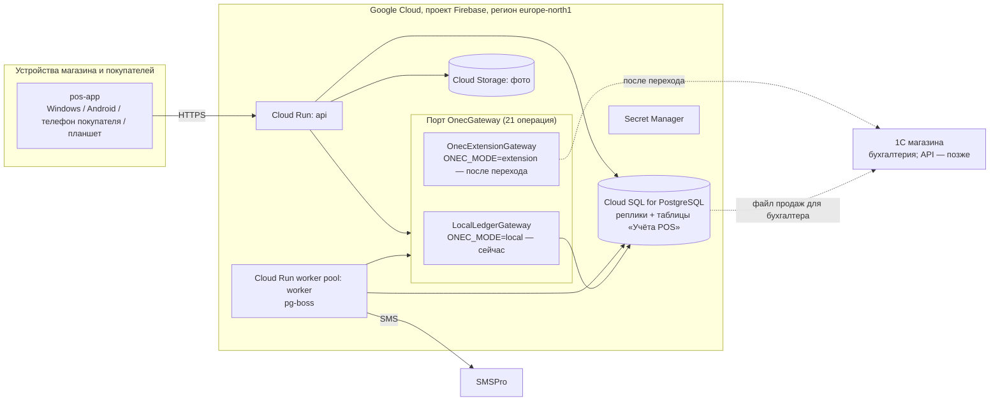

# P-003 — Предложение изменения ТЗ: работа без 1С 5–6 месяцев и сервер в облаке Google (Firebase)

> **ОТМЕНЕНО заказчиком 20.11.2026** вместе с редакцией 3 (решение — `docs/specification/15_DECISION_LOG.md` ADR-120; запись — `docs/customer/P-003_OWNER_DECISIONS.md` §5). Действует утверждённое ТЗ: 1С — главная система, сервер POS работает с 1С онлайн. Текст ниже — только история; номера Q- и Р- этой редакции не действуют.
>
> **Заменено редакцией 3: [`P-003_OWN_SERVER_NIGHTLY_1C.md`](P-003_OWN_SERVER_NIGHTLY_1C.md)** («Всё на сервере клиента, ночной обмен с 1С», 2026-11-18). Владелец не утвердил эту редакцию: на вопрос по ней он ответил 2026-11-18 «net klient pereumal hochet selat vse na svoy server …» (полностью и дословно — редакция 3, §0). Облако Google и Firebase отменены. Текст ниже сохранён для истории и как источник: редакция 3 ссылается на его разделы — «учёт у нас» (§3), сопоставление с 1С (§4.4), изменения ТЗ (§5), оценки (§7), группа Б (§9.3). Самостоятельно по нему ничего не делается. **Номера ADR-117, ADR-118 и Q-357…Q-370 этой редакции недействительны** (14 §10 п. 16; в 14 номера Q-357, Q-365, Q-366 заняты другими вопросами — точки PIN, Windows Hello, сетка товаров). Соответствие (дополнено 2026-11-19, пакет own-server:FIX-docs): ADR-118 (учёт у нас) → ADR-117 ред. 3; ADR-117 (облако) отменён, ADR-118 ред. 3 — другое решение (ночной обмен); Q-357 → Q-358 ред. 3; Q-362 → Q-360; Q-363 → Q-362; Q-364 и Q-367 → Q-361; Q-365 — закрыт ответом владельца Р-18 (а); Q-366 и Q-369 → Q-364; Q-358…Q-361 — отменены вместе с облаком (запасной интернет Q-361 — рекомендация Р-06 ред. 3); Q-368 → Q-362 ред. 3 (индивидуальные цены клиентов) и Q-360 (складские документы, вопрос В-8 ТЗ 1С); Q-370 → Q-367 ред. 3. Ссылки на эти номера в тексте ниже читать по этому соответствию.

| Поле | Значение |
|---|---|
| Номер | P-003 (третье предложение изменения утверждённого ТЗ; формат — по P-001 и P-002) |
| Дата | 2026-11-18, **редакция 2** (редакция 1 — черновик по трём рабочим картам; редакция 2 — замечания независимой проверки того же дня; разбор — §12) |
| Статус | **ОТМЕНЕНО заказчиком 20.11.2026** (15 ADR-120). До этого — **Заменено редакцией 3:** [`P-003_OWN_SERVER_NIGHTLY_1C.md`](P-003_OWN_SERVER_NIGHTLY_1C.md) — по ответу владельца 2026-11-18. Прежний статус редакции 2: **ПРОЕКТ — ждёт решения владельца.** По этому документу не пишется ни одной строки кода, пока нет «да» владельца и ответов группы А (§9). Ядро `docs/research/R0_DECISION_KERNEL.md` не правится: отступления от него перечислены в §5.1 и требуют явного согласия (Р-01) |
| Повод | Сообщение владельца 2026-11-18 (§0): клиент просит, чтобы всё работало «у нас», бэкенд — на Firebase, синхронизация с 1С — «к концу», 5–6 месяцев можно без интеграции с 1С |
| Основание | Три рабочие карты, собранные 2026-11-18 только чтением репозитория и открытых источников: карта A «что зависит от 1С», карта B «Firebase: варианты, цена, право КР», карта C «работа без 1С и переход на 1С», и независимая проверка черновика. Рабочие материалы лежат в `.tmp/p003/`; этот каталог не входит в репозиторий, поэтому все выводы перенесены в текст. Автор перепроверил код и ТЗ (§11.2) и внёс поправки к картам (§7.5, §12). Ссылки — `файл:строка`; путь без каталога — от `docs/specification/`. Номера строк — по рабочему дереву ветки `develop/stages-b-g` на 2026-11-18; параллельная сборка может сдвинуть их на несколько позиций |
| Паритет функций | Ни одна функция приложения не убирается: роли, режимы, касса, режим покупателя, планшет магазина (P-002, ADR-115), вход по лицу (P-001, ADR-116), веб-демо (ADR-113). Что в режиме без 1С работает иначе, потому что источника данных нет (QR через 1С, автоскидки 1С, история покупок до запуска), — перечислено прямо в §1.3 |
| Правила владельца | Паритет функций; существенные изменения ТЗ и архитектуры — только с согласия владельца; без реальных данных клиентов в облаке до заключения юриста (§6.8); без секретов в репозитории; ничего не устанавливать, не создавать аккаунты и облачные ресурсы без отдельного разрешения (ядро D-33) |
| Метки | `[РЕШЕНИЕ ЗАКАЗЧИКА]` — ответ владельца; `[ПРЕДЛОЖЕНИЕ]` — наше предложение; `[ВЫВОД]` — наш вывод из ТЗ, кода или источника (не цитата); `[ФАКТ]` — проверено в коде или ТЗ; `[ПОДТВЕРЖДЕНО: источник]` — официальная страница или текст закона, открытые 2026-11-18; `[ТИПОВО]` — типовое поведение 1С или Google, проверить на месте; `[НЕ ПОДТВЕРЖДЕНО]` — оценка или допущение; `[ТРЕБУЕТ РЕШЕНИЯ ЗАКАЗЧИКА]`; `[ТРЕБУЕТ ЗАКЛЮЧЕНИЯ ЮРИСТА]`; `[ТРЕБУЕТ ЗАКЛЮЧЕНИЯ БУХГАЛТЕРА]` |
| Курс | 1 USD ≈ 87,45 сом (курс НБКР на 13.11.2026 по economist.kg) `[НЕ ПОДТВЕРЖДЕНО: курс на дату оплаты]` |

---

## 0. Основание: сообщение владельца 2026-11-18

Владелец написал в чате с разработчиком 2026-11-18. Ниже — дословно, латиницей, как написано, без правки:

> «klient poprosil selat tak chtobi vse rabotalo u nas  beken poklyuchi fire base  no k konsu nya vse sinhraniziruetsya s c1  no mi mojem bez etogo rabotat eshe 5-6 mesyatsev bez integratsii v 1c  poka vse selay tua»

Как мы это прочитали (это пересказ, а не цитата): «Клиент попросил сделать так, чтобы всё работало у нас. Бэкенд подключи к Firebase. Но к концу всё синхронизируется с 1С. Но мы можем без этого работать ещё 5–6 месяцев без интеграции в 1С. Пока всё сделай тут».

**Где наше толкование.** Сообщение короткое, поэтому каждое слово мы понимаем так, как записано ниже. Где возможно другое прочтение, решение за вами.

| Слова | Как мы поняли `[ВЫВОД]` | Другое возможное прочтение | Где решается |
|---|---|---|---|
| «чтобы всё работало у нас» | Два смысла сразу: (1) магазин работает **в нашей системе**, а не в 1С — товары, цены, остатки, клиенты и долги ведутся в приложении; (2) сервер стоит **на нашей стороне**, в облаке, а не на сервере магазина | Только (2): сервер в облаке, а учёт по-прежнему ведётся в 1С, обмен с ней — файлами | Р-01, Р-08 |
| «бэкенд подключи к Firebase» | Разместить наш сервер в облаке Google, частью которого является Firebase | Переписать сервер на базу данных Firebase (Firestore) | Р-02, §2 |
| «к концу всё синхронизируется с 1С» | Когда специалист 1С сделает API, подключаем 1С по утверждённому ТЗ; 1С снова главная по товарам, ценам, остаткам и долгам | Наша система остаётся главной, а 1С только получает документы для бухгалтерии | Р-17 |
| «5–6 месяцев без интеграции в 1С» | Магазин может обходиться без связи с 1С 5–6 месяцев, считая с сегодняшнего дня | 5–6 месяцев работы, считая с запуска | §7.3 |
| «пока всё сделай тут» | Делать в нашей системе сейчас, не дожидаясь специалиста 1С | — | Р-19 |

При внесении изменений в ТЗ (P3-0-01) дословная запись сообщения и ваших ответов с датой кладётся в `docs/customer/P-003_OWNER_DECISIONS.md`, как для P-002. Перед этим текст §0 сверяется с оригиналом сообщения в чате.

Этот документ — шаг 1: письменное предложение. Код — только после вашего «да» и ответов группы А, по шагам §9.1.

---

# Часть I. Простым языком

## 1. Коротко

### 1.1. Что мы предлагаем

1. **Сервер — в облаке Google, в проекте Firebase. Это наш нынешний сервер, уже написанный и проверенный:** та же программа и та же база данных PostgreSQL. Переписывать его на базу Firebase (Firestore) мы не предлагаем. Google не поддерживает библиотеки Firebase на Windows в рабочем режиме («только для разработки»), а касса работает на Windows. Переделка стоила бы от половины до четырёх пятых всего проекта (§2).
2. **На 5–6 месяцев наш сервер сам становится учётом магазина.** В приложении заводят товары, цены, приход товара, клиентов и их условия, начальные долги. Продажи, отгрузки, оплаты и возвраты сами меняют остатки и долги. Остальная программа устроена так, будто по-прежнему говорит с 1С, и почти не меняется (§3).
3. **Когда специалист 1С сделает API, переключаем сервер на настоящую 1С по плану:** 1–2 недели сверки, ночь переключения, 3 дня на откат (§4).
4. **Сначала то, что не зависит от места сервера.** Учёт делаем первым, на нашем тестовом контуре. Облако создаём после ответа юриста о хранении данных в Европе и после проверки оплаты Google из КР. Если юрист скажет «нельзя», сервер ставим в КР, и сделанный учёт не пропадает (§9.1).

### 1.2. Что будет работать

- **Касса и продавцы — как сейчас:** каталог, поиск, корзина, заказы, оплата наличными, продажа в долг в пределах лимита, возвраты, печать счёта и товарного чека, планшет в зале, вход по лицу, приложение покупателя на телефоне.
- **Товары и цены** правит администратор в приложении. Сейчас таких экранов нет совсем. В первый раз всё загружаем из вашей 1С файлами.
- **Остатки** меняются сразу при отгрузке, возврате, приходе, списании и инвентаризации.
- **Клиенты и их условия** — вид цены, скидка, разрешён ли долг, лимит, отсрочка — ведутся в карточке клиента в приложении.
- **Долги** считает наш сервер по продажам в долг и оплатам. Оплату долга без заказа можно будет принять на кассе. Сейчас этой функции нет, без 1С она становится обязательной.
- **Заказы** согласовывают, отгружают и закрывают сотрудники кнопками в приложении. Сейчас это делает 1С.
- **Счёт** печатается с номером нашей системы; накладная — по вашему ответу Р-10.
- **Выгрузка для бухгалтера:** файл продаж, оплат, возвратов и складских документов (приход, списание, инвентаризация) для загрузки в 1С.
- **Отчёты для владельца:** остатки на дату, движение товара, поступления, «Касса за день» по кассирам, должники с просрочкой, акт сверки с клиентом. Сейчас их показывает 1С.
- **Исправление ошибок:** ошибочный документ отменяется с причиной и PIN-подтверждением, а не правится задним числом.
- **Покупатели вне магазина** (приложение на телефоне) работают, даже если в магазине пропал интернет: сервер в облаке.

### 1.3. Что будет работать иначе или не будет

- **QR-оплаты через 1С не будет:** 1С не подключена. Остаётся статический QR магазина и подтверждение оплаты кассиром со своим PIN — это в программе уже есть. Прямая связь с банком — Release 2.
- **Автоскидки 1С («Скидки и наценки») не ведутся.** Ручная скидка в пределах лимита роли остаётся, как сейчас.
- **Фискальный (кассовый) чек приложение не печатает** — так и по ТЗ (D-26). Если сейчас чек пробивает 1С, то без 1С кассиру нужна отдельная онлайн-ККМ. Это нужно выяснить до запуска (Р-09).
- **Бухгалтерия, налоги, ЭСФ, себестоимость, расчёты с поставщиками, касса и банк** в нашей системе не ведутся. Они остаются в вашей 1С. Мы рекомендуем, чтобы бухгалтер продолжал вести 1С (Р-07).
- **Приход товара** вводится в приложении. В 1С он попадает тем же файлом, что и продажи, если специалист 1С сделает загрузку файла (Р-07 (а)). Если не сделает — бухгалтер вводит приход в 1С вручную, а это двойной ввод.
- **История покупок до запуска** будет видна, только если мы загрузим её из 1С (Р-36).
- **Без интернета в магазине касса не работает.** Сервер теперь не в магазине, а в облаке. Каталог виден из памяти устройства, а заказ и оплату провести нельзя (так и по ТЗ, D-32). Нужен запасной интернет (Р-06).
- **Push-уведомлений нет** — как и по ТЗ в R1 (D-41). Firebase позволит включить их в Release 2 на Android.

### 1.4. Когда вернётся 1С

- Когда специалист 1С сделает API по документу 18 (`18_ONEC_API_REQUEST.md`, он передан заказчику на этапе G) и мы проверим его на копии базы. Даты нет. Режим без 1С рассчитан на работу без срока: если 1С задержится, магазин ничего не теряет.
- Переход: 1–2 недели теневой сверки (сервер читает 1С, но ничего в ней не меняет) → ночь переключения → 3 дня на откат.
- Чтобы переход был почти автоматическим, в стартовых файлах из 1С должен быть внутренний код каждого товара и клиента (GUID). Это главное, о чём мы просим специалиста 1С сейчас (§10 п. 6).

### 1.5. Сколько стоит и сколько длится

Оценка — в условных единицах ТЗ (13 §2.4: 1 у.е. — наименьшая проверяемая задача; весь базовый объём R1 — 506 у.е.).

| Что | Оценка `[НЕ ПОДТВЕРЖДЕНО]` |
|---|---|
| Работа до запуска без 1С: облако, учёт у нас, приложение, веб-демо | **≈ 214–222 у.е.** (≈ 42–44 % базового объёма R1); минимум ≈ 183 у.е.; с запасом на неизвестное — до ≈ 260 у.е. |
| Переход на 1С (позже, когда готов API 1С) | ≈ 36 у.е. |
| Всего | ≈ 250–258 у.е. (≈ 49–51 % базового объёма) |
| Календарь до запуска | По пропорции ТЗ — ≈ 8 относительных спринтов. На деле код в проекте идёт быстрее пропорции: планшет магазина (P-002, 134 у.е.) утверждён 04.11, а сервер, приложение и демо собраны 06.11. Поэтому срок запуска задают внешние шаги: ответ юриста, ответы бухгалтера о чеках и ЭСФ, выгрузка из 1С с GUID, оплата Google, инвентаризация и пилот в магазине. Точный срок называем письменно после подготовки (P3-0) |
| Облако Google в месяц | до запуска (тестовый контур) ≈ $45–85 (≈ 3 900–7 400 сом), часть может покрыть кредит $300; в работе ≈ $100–140 (≈ 8 700–12 200 сом) — база с выделенным ядром и свой домен; с горячим резервом базы ≈ $150–200 (≈ 13 100–17 500 сом). Европейские цены базы ещё нужно проверить в калькуляторе Google |
| SMS | как сейчас: SMSPro, ≈ 1,6–2 сома за SMS. SMS через Firebase в КР стоит $0,33–0,34 (≈ 29–30 сом) — в 14–19 раз дороже. Не берём |
| Работа специалиста 1С, юриста, бухгалтера | вне у.е., оплачиваете вы |

**О сроке 5–6 месяцев и о том, стоит ли оно того.** Режим без 1С — это ≈ 214–222 у.е. работы. Он окупается, только если магазин реально поработает в нём несколько месяцев. Если специалист 1С сдаст API раньше, чем будет готов учёт, разумнее запускаться сразу с 1С по утверждённому ТЗ: тогда большая часть работ «учёта у нас» и весь переход не нужны. Поэтому до начала разработки учёта мы просим у специалиста 1С письменный срок API (Q-367). Если API задержится, режим без 1С сроком не ограничен, и магазин ничего не теряет (§7.3).

### 1.6. Главные риски

1. **Данные покупателей и сотрудников хранятся за рубежом.** Нужно заключение юриста. Штраф юрлицу за незаконную трансграничную передачу — 65 000 сом, повторно — 120 000 сом. Основы ТЗ (ядро D-01) исходили из того, что данные должны храниться в КР; наш разбор текста закона такой общей обязанности не нашёл. Это расхождение снимает только юрист, поэтому облако — решение условное (§6).
2. **Два учёта расходятся**, если цены, приход и остатки продолжают менять ещё и в 1С.
3. **Чеки ККМ и ЭСФ**, если сейчас их делает 1С.
4. **Обрыв интернета в магазине** останавливает кассу.
5. **Наш сервер — единственное хранилище учёта.** Нужны непрерывные резервные копии и база с выделенным ядром с первого дня работы. В облаке Google копии встроены.
6. **Срок.** Учёт может быть готов ближе к концу 5–6 месяцев. Тогда выгоднее сразу подключать 1С; это решит письменный срок API от специалиста 1С.
7. **Адрес сервера зашит в приложение.** Смена адреса — новые сборки на все кассы, планшеты и телефоны покупателей. Поэтому адрес сервера — на домене магазина с первой рабочей сборки (Р-25).

Полный перечень — §8.

### 1.7. Что нужно от вас

- «Да» на этот документ и ответы группы А (§9.2): семь решений буквами и четыре блока сведений. Самые важные: Р-01 (подход и отступления от основ ТЗ), Р-02 (где сервер), Р-07 (что делает 1С эти месяцы), Р-09 (как пробиваются чеки).
- До начала работ — проверить, проходит ли оплата Google картой вашего банка (бесплатно, за день).
- Google-аккаунт магазина и платёжная карта для облака; доменное имя магазина; запасной интернет в магазине.
- Через специалиста 1С — письменный срок API и файлы выгрузки с GUID (сначала один образец).
- Передать юристу вопросы §6.5, бухгалтеру — вопросы §10 п. 9.

Полный перечень — §10.

---

# Часть II. Подробно

**Затрагиваемые решения** (полный перечень правок — §5):

- **Ядро R0** (не правится; отступления — §5.1 и Р-01): D-01, D-02, D-20, D-22, D-23, D-24, D-25, D-27, D-28, D-29, D-30, D-33; уточнение D-35; §5 «Источники истины»; §16 п. 3 (значения `ONEC_MODE`); §22.1–§22.4, §22.8; §24.3, §24.4.
- **Не меняются:** D-26 (приложение не ККМ), D-32 (офлайн), D-41 (push — R2), D-03 (стек NestJS, PostgreSQL, pg-boss).
- **Документы ТЗ:** 05 ONEC-001…ONEC-029, ONEC-074, ONEC-100…ONEC-104, §4, §7–§9, §13; 07 §3, DATA-020…DATA-027; 10 INV-020, INV-021, INV-030, ORD-033, ORD-040, ORD-041, PAY-012, PAY-031, DEBT-001, DEBT-002, RET-001, RET-013, PRINT-002, PRINT-004; 11 PRIV-001, PRIV-019, PRIV-020, SEC-111, §10.1, T-SEC-047; 16 §3, §4.3, §8, OPS-027; 01 GEN-164; 02 UI-48-006, SCR-14, SCR-24, SCR-30, SCR-32…SCR-35, SCR-38, SCR-39, SCR-43, SCR-46, SCR-48.
- **ADR:** ADR-020…ADR-030, ADR-048, ADR-072, ADR-075, ADR-080, ADR-081, ADR-113.
- **Вопросы:** Q-010, Q-011, Q-012, Q-013, Q-014, Q-019, Q-022, Q-030, Q-033, Q-152, Q-180, Q-217.

## 2. «Бэкенд подключить к Firebase»: что это может значить и что мы рекомендуем

### 2.1. Простыми словами

Firebase — набор облачных услуг Google для приложений: своя база данных (Firestore), вход по SMS, хранение файлов, хостинг сайтов, push-уведомления. Всё это работает на облаке Google Cloud. Просьбу «подключить бэкенд к Firebase» можно понять тремя способами (§2.2).

Мы рекомендуем **вариант 1**: наш сервер и наша база PostgreSQL работают в облаке Google, в проекте Firebase. Сервисы Firebase добавляем там, где они дают пользу без переделки (вариант 3а). Сам Firebase тоже предлагает PostgreSQL: его услуга SQL Connect (раньше называлась Data Connect) — это та же база Cloud SQL for PostgreSQL `[ПОДТВЕРЖДЕНО: firebase.google.com/docs/data-connect]`. Мы берём ту же базу, но без её надстройки на GraphQL: наши 18 миграций уже написаны на SQL.

### 2.2. Три толкования

| | Вариант 1. Наш сервер в Google Cloud, в проекте Firebase `[ПРЕДЛОЖЕНИЕ, рекомендуем]` | Вариант 2. Переписать сервер на Firestore и Cloud Functions | Вариант 3. Гибрид |
|---|---|---|---|
| Суть | Тот же `pos-api` (Docker-образ) в Cloud Run, база — Cloud SQL for PostgreSQL, фото — Cloud Storage, секреты — Secret Manager. Консоль Firebase — «витрина» проекта | Данные — в документной базе Firestore, логика — в Cloud Functions, вход — Firebase Authentication | (3а) вариант 1 плюс отдельные сервисы Firebase по мере надобности: Hosting, позже FCM (push), Crashlytics. (3б) Firestore как «зеркало» рядом с PostgreSQL для живых обновлений |
| Переделка сервера | Малая: инфраструктура, хранилище фото, бэкапы, документы — ≈ 31–39 у.е. | Почти полная: ≈ 250–400 у.е. | 3а: FCM ≈ 8–13 у.е., Crashlytics ≈ 2–3 у.е., Hosting ≈ 1–2 у.е.; 3б: ≈ 30–60 у.е. и двойная запись `[НЕ ПОДТВЕРЖДЕНО]` |
| Переделка приложения | Только адрес сервера. Но он — константа сборки (`API_BASE_URL`), поэтому нужны новые сборки для Windows, Android и телефонов покупателей, а свой домен магазина — с первой рабочей сборки (Р-25) | Касса на Windows не может работать с SDK Firebase в рабочем режиме → либо HTTP-API поверх Functions (тот же сервер, но на другой базе), либо отказ от кассы на Windows | 3а: FCM — только Android и iOS (для Windows плагина нет) |
| Облако в месяц, 1 магазин | ≈ $45–85 тестовый контур; ≈ $100–140 в работе; ≈ $150–200 с горячим резервом базы | ≈ $10–25 (без внешнего поиска и без SMS Firebase) | как вариант 1; Hosting, FCM, Crashlytics в объёмах магазина бесплатны |
| Привязка к поставщику | Низкая: обычный PostgreSQL и Docker-образ | Высокая | 3а — низкая; 3б — средняя |
| Рекомендация | **Да** | Нет | 3а — да, по мере надобности (в P-003 не входит); 3б — нет |

Источник таблицы — карта B §2–§5.

### 2.3. Почему не Firestore (вариант 2)

1. **Касса работает на Windows.** Google прямо пишет: «Firebase on Windows is not intended for production use cases, only local development workflows». Даже Authentication, Firestore и Storage для Windows помечены «beta» `[ПОДТВЕРЖДЕНО 2026-11-18: firebase.google.com/docs/flutter/setup; github.com/firebase/flutterfire — сноски у `cloud_firestore`, `firebase_auth`, `firebase_storage`]`.
2. **Переделка огромная.** Сервер опирается на возможности PostgreSQL `[ФАКТ: подсчёт по `pos-api` 2026-11-18, карта B §1.2]`:
   - 42 триггера и 44 функции в базе: «заморозка» финансовых полей заказа и платежа, итоги строк, хэш-цепочка аудита, нумерация;
   - 66 таблиц с внешними ключами и проверками;
   - ≈ 109 мест с транзакциями, 46 блокировок строк `FOR UPDATE`, 16 advisory-блокировок, 6 `SKIP LOCKED` — остатки, кредитный лимит, outbox, номера документов;
   - деньги в `NUMERIC` с округлением, поиск по кириллице (`tsvector`, `pg_trgm`, `unaccent`);
   - 41 очередь pg-boss с расписаниями;
   - ≈ 66 тыс. строк тестов на PostgreSQL.
   В Firestore этого нет или оно устроено иначе. Оценка переделки — ≈ 250–400 у.е., то есть от половины до четырёх пятых всего базового объёма 506 у.е. `[НЕ ПОДТВЕРЖДЕНО: порядок величины]`.
3. **Экономия не окупается.** Облако Firestore дешевле на ≈ $45–95 в месяц, а переделка стоит сотни у.е. `[ВЫВОД]`.
4. **Поиск по-русски.** Текстовый поиск в Firestore есть только в издании Enterprise. Поддержка русского и кыргызского, префиксов и опечаток не описана `[ПОДТВЕРЖДЕНО: firebase.google.com/docs/firestore/enterprise/text-search; языки — НЕ ПОДТВЕРЖДЕНО]`.
5. **Вход по SMS через Firebase** в КР стоит $0,33–0,34 за SMS, а данные Firebase Authentication обрабатываются только в США (§2.11, §6.3).
6. **Связь с 1С «к концу» уже написана под PostgreSQL** (модули `sync` и `integrations`, ≈ 19 тыс. строк). В Firestore её пришлось бы строить заново `[ФАКТ: карта B §4.1]`.
7. **Работа без 1С (§3) опирается на те же транзакции и счётчики.** На Firestore модуль учёта, импорт и переход проектировались бы заново `[ВЫВОД: карта C §13]`.

### 2.4. Вариант 1: что чем заменяется

| Сейчас (16 §4, Docker Compose) | В Google Cloud | Что меняется в коде и настройках |
|---|---|---|
| `api` (NestJS) | Cloud Run (сервис), 1 vCPU / 1 GiB, минимум 1 экземпляр — без «холодного старта» | Тот же образ (`pos-api/Dockerfile`), `WORKERS_ENABLED=false` |
| `worker` (pg-boss) | Cloud Run worker pool — постоянный фоновый процесс | Тот же образ, `WORKERS_ENABLED=true`. В сервисе с оплатой «по запросам» процессор между запросами урезается, и фоновые очереди так не работают `[ПОДТВЕРЖДЕНО: cloud.google.com/run/pricing]`. Worker pools — не превью: на странице развёртывания превью помечена только проверка «dry run» `[ПОДТВЕРЖДЕНО: docs.cloud.google.com/run/docs/deploy-worker-pools, 2026-11-18]` |
| `migrate` | Cloud Run job (разовый запуск) | Без изменений |
| `postgres` 17 | Cloud SQL for PostgreSQL, издание **Enterprise** | Роли `pos_*` создаёт пользователь с ролью `cloudsqlsuperuser`; расширения `pgcrypto`, `pg_trgm`, `unaccent` поддерживаются; PostgreSQL 17 и 18 поддерживаются `[ПОДТВЕРЖДЕНО: docs.cloud.google.com/sql/docs/postgres/extensions, …/editions-intro]` |
| Том `media` + Caddy (отдача фото) | Cloud Storage (бакет в том же регионе) | Том Cloud Storage FUSE (почти без кода, но без блокировок файлов) или адаптер хранилища в модуле фото |
| `caddy` (TLS) | Cloud Run сам даёт HTTPS на адресе `*.run.app` | Свой домен магазина — через балансировщик (≈ $18/мес), с первой рабочей сборки: адрес сервера зашит в приложение (`API_BASE_URL`), и смена адреса потребует новых сборок (Р-25) |
| `secrets/*` + `*_FILE` | Secret Manager: секреты монтируются в контейнер **файлами** — совпадает с нашей схемой `*_FILE` (ядро §16 п. 3) | Только настройки `[ПОДТВЕРЖДЕНО: docs.cloud.google.com/run/docs/configuring/services/secrets]` |
| `backup` (`pg_dump` + rclone) | Автобэкапы Cloud SQL + восстановление на момент времени (PITR) + еженедельный зашифрованный дамп с копией в КР | Скрипт бэкапа заменяется настройкой; runbook восстановления переписывается (§2.8) |
| Исходящий IP для SMSPro | Если в кабинете SMSPro включён список разрешённых IP, нужен постоянный адрес: Cloud NAT ≈ $6/мес | Только сеть |
| Мониторинг | Cloud Monitoring и Logging; логи уже в JSON; 50 GiB логов в месяц бесплатно | Алерты без ПДн (SEC-132) |
| Веб-демо | Остаётся на Netlify (ADR-113); Firebase Hosting возможен, но не нужен | — |

**Firebase App Hosting для `pos-api` не подходит:** он рассчитан на веб-приложения Next.js и Angular, а в Европе доступен только в `europe-west4` `[ПОДТВЕРЖДЕНО: firebase.google.com/docs/app-hosting]`.

### 2.5. Подводные камни варианта 1

| № | Камень | Что делаем |
|---|---|---|
| 1 | Для PostgreSQL 16+ консоль по умолчанию предлагает дорогое издание Enterprise Plus | Явно выбираем **Enterprise** `[ПОДТВЕРЖДЕНО: …/editions-intro]` |
| 2 | Малые машины с общим ядром (`db-f1-micro`, `db-g1-small`) не покрываются SLA | Тестовый контур до запуска — `db-g1-small` допустим; с первого дня работы магазина — выделенное ядро (§2.7) `[ПОДТВЕРЖДЕНО: cloud.google.com/sql/pricing]` |
| 3 | Firebase Hosting как прокси к Cloud Run обрывает запрос через **60 секунд** | API — на своём адресе, без Hosting `[ПОДТВЕРЖДЕНО: firebase.google.com/docs/hosting/cloud-run]` |
| 4 | Свой домен напрямую в Cloud Run (domain mapping) — **превью**, «не для продакшена» | Тестовые сборки — адрес `*.run.app`; рабочие сборки — домен магазина через балансировщик (Р-25) `[ПОДТВЕРЖДЕНО: docs.cloud.google.com/run/docs/mapping-custom-domains]` |
| 5 | Тариф Blaze — оплата по факту; оповещения о бюджете **не останавливают** расходы | Бюджет, оповещения и квоты; счёт оформлен на магазин (Р-05, Р-27) `[ТИПОВО]` |
| 6 | Валюты КР нет в таблице валют Google Cloud — счёт в USD, нужна международная карта | Проверить карту у банка магазина заранее `[ПОДТВЕРЖДЕНО: docs.cloud.google.com/billing/docs/resources/currency; приём карт КР — НЕ ПОДТВЕРЖДЕНО]` |
| 7 | НДС или налог на услуги иностранных компаний в КР | Вопрос бухгалтеру `[НЕ ПОДТВЕРЖДЕНО]` |
| 8 | Каждая операция кассы идёт через интернет (≈ 60–100 мс) вместо сети магазина (< 5 мс) | Кэш каталога уже есть (D-32); замер до выбора региона (§2.6) |
| 9 | Цена фонового воркера: пример на странице Google ($11,61 в `europe-west1`) не сходится с таблицей тарифов (≈ $27–31) | Считаем вилку $12–31; уточнить в калькуляторе `[НЕ ПОДТВЕРЖДЕНО]` |
| 10 | Адрес сервера — константа сборки приложения (`pos-app/lib/core/config/environment.dart:5`), а не настройка | Свой домен магазина с первой рабочей сборки; тогда смена сервера (регион, сервер в КР) — это только DNS `[ФАКТ]` |
| 11 | Плановое обслуживание Cloud SQL Enterprise — короткий перезапуск базы | Окно обслуживания — ночью по Бишкеку `[ТИПОВО]` |
| 12 | На малой машине `db-g1-small` мало подключений к базе для пулов `api` и `worker` | Проверить пулы при ОБЛ-1-03; в работе — выделенное ядро `[ТИПОВО]` |

### 2.6. Регион

Регионов Google Cloud в Средней Азии нет. Регион в Турции анонсирован 20.11.2025, срок ввода в объявлении не назван `[ПОДТВЕРЖДЕНО: cloud.google.com/blog — new-google-cloud-region-coming-to-turkiye]`; по словам вице-президента Турции — 2028–2029 `[вторичный источник: dailysabah.com]`. Пинг из Бишкека по данным WonderNetwork (между дата-центрами, данные 2026-11-17; не из сети магазина — это ориентир) `[ПОДТВЕРЖДЕНО: wondernetwork.com/pings/Bishkek/…]`:

| Город (регион Google Cloud) | Пинг из Бишкека | Ценовой уровень Cloud Run |
|---|---|---|
| Хельсинки, рядом с Хаминой (`europe-north1`, Финляндия) | **≈ 63 мс** | Tier 1 (дешевле) |
| Цюрих (`europe-west6`) | ≈ 81 мс | Tier 2 |
| Милан (`europe-west8`) | ≈ 87 мс | Tier 1 |
| Франкфурт (`europe-west3`), Варшава (`europe-central2`) | ≈ 91 мс | Tier 2 |
| Брюссель (`europe-west1`, Бельгия) | ≈ 97 мс | Tier 1 |
| Для сравнения: Москва / Алматы (регионов Google нет) | ≈ 49 / ≈ 72 мс | — |

**Предложение:** `europe-north1` (Финляндия), запасной — `europe-west1` (Бельгия). Все нужные сервисы есть в обоих `[ПОДТВЕРЖДЕНО для Cloud Run, Firestore, domain mapping; Cloud SQL в europe-north1 — ТИПОВО: регион есть в списке страницы цен]`. До выбора — замер из сети магазина и с мобильного интернета (например, сайт gcping.com) `[ПРЕДЛОЖЕНИЕ; инструмент не проверялся]`.

### 2.7. Облако в месяц (один магазин: 10–30 устройств, сотни покупателей, тысячи товаров)

Допущения `[НЕ ПОДТВЕРЖДЕНО]`: до 1 млн запросов к API в месяц; база 2–5 GB (16 §5.1); фото 25–100 GB (16 §5.2); исходящий трафик 20–60 GiB в месяц. Цены — с официальных страниц на 2026-11-18 (по карте B; страницы цен Google грузятся скриптом, и при проверке редакции 2 их цифры повторно прочитать не удалось). Цены Cloud Run для Tier 1 одинаковы для `us-central1`, `europe-north1` и `europe-west1`. Цены Cloud SQL и Cloud Storage на странице даны для `us-central1`; в Европе они могут быть выше — закладываем до +10 % на базу `[НЕ ПОДТВЕРЖДЕНО: проверить в калькуляторе для выбранного региона]`.

**Почему не «пилот на малой машине».** В режиме `local` первые месяцы работы магазина — это не тест: база — единственный учёт денег и товара. Малая машина с общим ядром (`db-g1-small`) не покрывается SLA, поэтому она годится только для тестового контура до запуска. С первого дня работы — выделенное ядро и свой домен.

| Статья | Тестовый контур (до запуска, без ПДн) | Работа (с запуска) | Работа с горячим резервом базы |
|---|---|---|---|
| `api` — Cloud Run | ≈ $0–15 (минимум 0 или 1 экземпляр) | ≈ $8–15 (минимум 1 экземпляр) | ≈ $8–15 (2 экземпляра ≈ $20–30) |
| `worker` — Cloud Run worker pool круглосуточно | ≈ $12–31 | ≈ $12–31 | ≈ $12–31 |
| База — Cloud SQL Enterprise | `db-g1-small` + 20 GiB + бэкапы ≈ $30 | 1 vCPU / 3,75 GiB + 30 GiB ≈ $55–61 | ≈ $110–121 |
| Фото — Cloud Storage | ≈ $1 | ≈ $1–2,5 | ≈ $1–2,5 |
| Исходящий трафик | ≈ $1–2 | ≈ $2–7 | ≈ $2–7 |
| Cloud NAT (только если SMSPro требует список IP) | $0–6 | $0–6 | $0–6 |
| Secret Manager, Artifact Registry, логи | < $1 | < $1 | < $1 |
| Свой домен через балансировщик | $0 (адрес `*.run.app` — только для тестовых сборок) | ≈ $18 | ≈ $18 |
| **Итого в месяц** | **≈ $45–85** (≈ 3 900–7 400 сом) | **≈ $100–140** (≈ 8 700–12 200 сом) | **≈ $150–200** (≈ 13 100–17 500 сом) |

- **Скидки:** новым клиентам Google Cloud — кредит $300 `[ПОДТВЕРЖДЕНО: cloud.google.com/sql/pricing; срок кредита — НЕ ПОДТВЕРЖДЕНО, обычно 90 дней; доступность пробного периода из КР — НЕ ПОДТВЕРЖДЕНО]`. Кредит может покрыть большую часть тестового контура. Пробный экземпляр Cloud SQL на 3 месяца при создании через SQL Connect `[ПОДТВЕРЖДЕНО: firebase.google.com/pricing; ограничения пробного экземпляра — НЕ ПОДТВЕРЖДЕНО]`. Скидки за обязательство на 1–3 года при неясном сроке работы в облаке не нужны `[ВЫВОД]`.
- **Для сравнения** (16 §13.2): VPS 2 vCPU / 4 GB — от $24 в месяц (DigitalOcean) до €36,93 (Serverspace, Алматы). Там бэкапы, обновления, TLS и мониторинг — на нас. Цен хостинга в Бишкеке поиск 2026-11-18 не дал — запросим их у 1–2 хостингов до решения Р-02 (P3-0-04).

### 2.8. Резервные копии

| | Сейчас по ТЗ (D-35, 16 §8) | Вариант 1 (Cloud SQL) |
|---|---|---|
| Ежедневные копии | `pg_dump -Fc` + внешняя копия + проверка раз в месяц | Автобэкапы по расписанию, хранение от 1 до 365 копий, шифруются `[ПОДТВЕРЖДЕНО: docs.cloud.google.com/sql/docs/postgres/backup-recovery/backups]` |
| Восстановление на момент времени (PITR) | В R1 нет (R2 или «по требованию») | Издание Enterprise — журналы до 7 дней `[ПОДТВЕРЖДЕНО: …/editions-intro]` |
| Копия в КР (SEC-111) | Обязательна | Еженедельный зашифрованный дамп → копия на носителе в КР (заодно путь выхода из облака) `[ПРЕДЛОЖЕНИЕ, Р-26]` |
| Цена | Диск заказчика | $0,08 за GiB в месяц (`us-central1`) |

Вариант 1 выполняет D-35 (RPO ≤ 24 ч, RTO ≤ 4 ч) с запасом и даёт PITR с потерей не более нескольких минут уже в R1. Для работы без 1С это обязательно (§3.13, Р-35). Ежемесячная проверка восстановления остаётся `[ВЫВОД]`.

### 2.9. Работа без интернета

| | Сценарий A ТЗ (сервер в магазине) | Вариант 1 (облако) |
|---|---|---|
| Касса и сотрудники при обрыве внешнего интернета | Работают: сервер в сети магазина | Каталог из кэша, черновик корзины; заказ и оплата — после восстановления связи (D-32) |
| Покупатели вне магазина | Не работают при обрыве у магазина | Работают |
| Что нужно | Статический IP и проброс порта 443 у магазина (16 §3) | Запасной канал интернета в магазине: второй провайдер или 4G-роутер (Р-06) `[ПРЕДЛОЖЕНИЕ]` |

Поведение приложения без сети не меняется (D-32). Меняется только то, что сервер теперь за пределами магазина `[ВЫВОД]`.

### 2.10. Привязка к поставщику и путь выхода

Привязка низкая `[ВЫВОД]`: база — обычный PostgreSQL (выгрузка `pg_dump`), сервер — тот же Docker-образ. Особенными для Google остаются только настройки развёртывания и, если выберем адаптер, код хранилища фото. Через 5–6 месяцев сервер можно перенести на сервер в КР (сценарий A ТЗ) дампом базы за дни работы `[НЕ ПОДТВЕРЖДЕНО: срок]`; при своём домене магазина приложения пересобирать не нужно (§2.5 п. 10). Чтобы магазин не зависел от исполнителя, проект Google Cloud и счёт лучше оформить на магазин, а исполнителю дать права (Р-05).

### 2.11. SMS: SMSPro, как в ТЗ

| | SMSPro (Nikita, КР) | Firebase Phone Auth |
|---|---|---|
| Цена за SMS в КР | 1,58–2,03 сома (`docs/research/R2_SMSPRO_RESEARCH.md:24`) | **$0,33–0,34** (≈ 29–30 сом): страница цен грузится скриптом, в разных копиях на 2026-11-18 — $0,33 и $0,34; первые 10 SMS в сутки бесплатно `[ПОДТВЕРЖДЕНО: cloud.google.com/identity-platform/pricing; точную цифру проверить на живой странице]` |
| 1 000 SMS в месяц | ≈ 1 600–2 000 сом | ≈ $230 (≈ 20 000 сом) `[НЕ ПОДТВЕРЖДЕНО: объём]` |
| Где обрабатываются данные | КР `[ТИПОВО: проверить договор]` | **Только США** `[ПОДТВЕРЖДЕНО: firebase.google.com/support/privacy]` |
| Касса на Windows | Не зависит: SMS шлёт сервер | `firebase_auth` на Windows — только для разработки |
| Готовность | Уже работает в `pos-api` | Писать заново и менять вход (PIN, сессии, планшет) |
| **Вывод** | **Оставить** (Р-20) | Не использовать |

Ещё один довод за SMSPro: пользователь Firebase сообщал, что SMS Firebase не доходили на номера MegaCom, а на Beeline доходили `[НЕ ПОДТВЕРЖДЕНО: единичный отчёт, github.com/firebase/functions-samples/issues/1107]`.

### 2.12. Если облако не подойдёт: сервер в КР

Если юрист скажет, что хранить данные покупателей в ЕС нельзя, или оплата Google из КР не пройдёт, остаётся сценарий ТЗ: сервер в магазине (сценарий A) или хостинг в КР (Р-02 (в)). Тогда вопроса о трансграничной передаче нет, но нужен сервер и человек, который его обслуживает. Работа без 1С (§3) от этого не меняется: она не зависит от места сервера. Цен хостинга в КР поиск 2026-11-18 не дал `[НЕ ПОДТВЕРЖДЕНО]`: до решения Р-02 запросим их у 1–2 хостингов (P3-0-04). Сервер у заказчика пока не обследован (Q-030).

---

## 3. Работа без 1С («учёт у нас»)

### 3.1. Простыми словами

Сейчас по ТЗ главная база — 1С. Товары, цены, остатки, клиенты и долги живут там, а наш сервер хранит их копию только для чтения. Ни одного экрана, где сотрудник правит товар, цену или остаток, в приложении нет. Чтобы магазин 5–6 месяцев работал без 1С, наш сервер на это время должен **сам стать учётом**.

Мы предлагаем сделать это **«встроенным учётом за той же дверью, что и 1С»**. У сервера есть одна «дверь» к 1С — 21 операция обмена. За ней ставим наш модуль «Учёт POS», который отвечает на те же 21 операцию, но хранит всё в нашей базе. Остальная программа не замечает разницы. Через 5–6 месяцев за ту же дверь ставим настоящую 1С.

Так уже работает веб-демо: на месте 1С там стоит имитатор, и весь настоящий сервер с ним торгует. Но имитатор — игрушка: остатки у него не уменьшаются, долги не считаются, всё хранится в памяти. Учёт для магазина пишется заново, а от имитатора берём только устройство «двери» и сценарии.

### 3.2. Почему сегодня без 1С торговать нельзя `[ФАКТ: карта A §0–§3]`

| Что | Что происходит без 1С | Где в коде |
|---|---|---|
| Режимы сервера | Режима «без 1С» для рабочего контура нет: `fixtures` запрещён при `APP_ENV=prod`, `extension` без адреса и ключей 1С не даёт серверу стартовать | `pos-api/src/common/config/env.schema.ts:146`, `:242`; `pos-api/src/integrations/onec/onec-adapters.ts:59-67`; `onec.module.ts:12-21` |
| Каталог | Пустой: «Товары появятся после синхронизации с 1С» | `contracts/l10n/app_ru.arb:2259` |
| Заказ | Навсегда «Ожидает отправки в 1С» (`submitting`); через 20 попыток или 24 часа элемент outbox становится `dead` | `pos-api/src/sales-domain/order/order-status.ts:66`; `env.schema.ts:181-182` |
| Счёт | Не печатается: нужен номер заказа 1С | `pos-api/src/orders/documents/documents.service.ts:84` |
| Возврат | Невозможен: нужна отгрузка из 1С | `pos-api/src/returns/returns.service.ts:242-252` |
| Продажа в долг | Отказ `RECEIVABLES_STALE` | `pos-api/src/sales-domain/credit/credit-decision.ts:184` |
| Оплата долга без заказа | Заглушка: всегда `403` | `pos-api/src/payments/debt/debt-payments.controller.ts:23-40` |
| Правка товаров, цен, остатков, условий клиентов | Нет ни API, ни экранов, ни прав; право `customer.update` зарезервировано | `contracts/rbac/permissions.yaml:212-216`; админка — только `audit`, `settings`, `tablets`, `users` (`pos-app/lib/features/admin/presentation/`) |

### 3.3. Как устроить учёт у нас: три варианта (Р-08)

| | Вариант (а) «Встроенный учёт за портом 1С» `[ПРЕДЛОЖЕНИЕ, рекомендуем]` | Вариант (б) «Правка прямо в рабочих таблицах» | Вариант (в) «1С остаётся главной, обмен файлами» |
|---|---|---|---|
| Суть | Новый режим `ONEC_MODE=local`. Модуль «Учёт POS» (`LocalLedgerGateway`) реализует тот же порт `OnecGateway` (21 операция, `pos-api/src/integrations/onec/onec-gateway.ts:153-209`) на нашей базе: документы, журналы движения товара и взаиморасчётов, нумераторы. Правки администратора идут через тот же конвейер применения, что и данные из 1С (`pos-api/src/sync/apply/*`) | Синхронизация выключена, админка пишет прямо в `products`, `prices`, `stock_balances`, `customers`, `receivables`; заказы минуют outbox | Магазин всё ведёт в 1С, включая продажи; мы ежедневно загружаем файлы 1С (остатки, цены, клиенты, долги) и выгружаем свои заказы файлом |
| Что не меняется | Проекция статусов заказа, outbox, проверка корзины, решение о долге, дельты каталога для приложения, печать | Мало что: особые ветки в `orders`, `payments`, `receivables`, `cart`, `sync`, `health` | Почти всё (как «фаза 0» с ручным оформлением в 1С, SYNC-066/067) |
| Переход на 1С | Смена `ONEC_MODE=local → extension` после переноса данных (§4) | Переписать ссылки и источник у всех правленых строк; конфликты по каждой таблице | Перехода нет: меняется только транспорт (файл → API) |
| Соответствие ТЗ | Отступление от D-28 и ONEC-104 только в режиме `local`; правило «реплики правятся только конвейером» сохраняется | Нарушает инварианты DATA-020/021/027 и ONEC-104 в рабочем режиме | Ближе всего к ТЗ, но «всё работает у нас» не выполняется: остатки и долги отстают на часы, продажи приходится грузить в 1С |
| Оценка | по карте C ≈ 131–155 у.е.; с поправками редакции 2 — УЧ-1…УЧ-3 ≈ 173 у.е. до запуска и УЧ-4 ≈ 36 у.е. (§7) | Старт сопоставим, переход дороже на 8–13 у.е., риск ошибок выше | ≈ 40–45 у.е. плюс загрузчик на стороне 1С или ручной ввод |

**Почему (а)** `[ВЫВОД]`:
- Сервер уже устроен вокруг одного порта: 21 операция, одна реализация на режим (`onec-gateway.factory.ts:19-38`).
- Веб-демо доказало, что настоящий `pos-api` полностью работает с подставной «1С» (`demo/web/backend/alias/onec-transport.mjs`; ADR-113).
- Ни один модуль продаж не получает ветку «а если 1С нет».
- Правки идут через тот же конвейер, поэтому производные поля, поиск и дельты каталога для приложения обновляются так же, как от 1С.
- Переход — это смена реализации порта и перенос данных, а не переделка модулей.

Вариант (в) — запасной, если вы решите, что магазин и так всё продолжает вести в 1С. Он соответствует ответу Р-01 (б).

### 3.4. Что делает 1С магазина эти 5–6 месяцев (Р-07)

| | (а) 1С ведёт бухгалтерию, продажи попадают туда файлом из POS `[рекомендуем]` | (б) 1С «замораживается», всё у нас, перенос в конце | (в) Оба учёта параллельно, вручную |
|---|---|---|---|
| Кто вводит продажи в 1С | Бухгалтер раз в день или в неделю загружает наш файл (продажи, оплаты, возвраты, новые клиенты; у каждой строки — `externalId`). Лучше — простой обработкой специалиста 1С, хуже — вручную по сводке | Никто до перехода | Сотрудники вручную, по каждой продаже |
| Налоги, ЭСФ, фискальные чеки | Остаются в 1С, как сейчас | Под вопросом на весь период: ЭСФ обязательны для плательщиков НДС (§3.11), отчётность помесячная | Остаются в 1С |
| Расхождение учётов | Небольшое, сверяется отчётом | Растёт 5–6 месяцев и разбирается разом при переходе | Большое: ошибки двойного ввода |
| Переход на 1С | Документы уже в 1С с `externalId`: переход = сверка (`listExternalIds`) и привязка (`POST /orders/{id}/onec-link`) | Пакетный перенос тысяч документов «задним числом» (§4.5) | Сопоставление по датам и суммам с неоднозначностями |
| Работа специалиста 1С сейчас | Обработка загрузки нашего файла. Это та же логика, что потом войдёт в методы API (`/pos/v1/orders`, `/payments`, `/customers`, `/returns`), то есть шаг к API, а не лишняя работа `[ВЫВОД]` | Нет сейчас, много в конце | Нет |

`[ТРЕБУЕТ ЗАКЛЮЧЕНИЯ БУХГАЛТЕРА]`: вариант (б) совместим с налоговой отчётностью, только если бухгалтер подтвердит, что продажи за период можно отразить в 1С позже, а ЭСФ и чеки выписываются иначе.

**Важно при (а).** Пока бухгалтер ведёт 1С, в ней остаются цены, приход и остатки. Чтобы учёты не разошлись, на каждую сущность — **одно направление**, и это направление «приложение → 1С» (§3.5). Цены и условия клиентов меняют только в приложении. Приход, списание, инвентаризацию и перемещение вводят только в приложении, а в 1С они попадают **тем же файлом**, что продажи, оплаты и возвраты (Р-44). Тогда 1С остаётся почти зеркалом нашего учёта, и переход проще. Если специалист 1С не сделает загрузку складских документов, бухгалтер вводит приход в 1С вручную — это двойной ввод (RR-P6). Права на изменение цен и прихода в 1С лучше ограничить (решение магазина) `[ПРЕДЛОЖЕНИЕ]`. Раз в неделю сверяем наш учёт с отчётами 1С по файлу (УЧ-1-25).

### 3.5. Откуда берутся данные в режиме `local`

| Данные | Старт (один раз) | Кто меняет в период | Направление при Р-07 (а) |
|---|---|---|---|
| Группы, товары, характеристики, упаковки, штрихкоды, единицы | Файл из 1С (CommerceML или Excel с GUID) | Администратор, старший продавец в приложении | POS → 1С: новые товары — в файле для бухгалтера |
| Фото | Папка выгрузки CommerceML или файлы `<GUID>.jpg` (импорт уже есть) | Загрузка в приложении | Только у нас |
| Склады, виды цен | Файл из 1С | Администратор | — |
| Цены | Файл из 1С (`offers.xml` или Excel) | Администратор, владелец: документ «Установка цен» | POS → 1С: файл действующих цен |
| Остатки | Файл из 1С на дату запуска + инвентаризация | Только документами: отгрузка, возврат, поступление, списание, инвентаризация, перемещение | Все складские документы POS → 1С тем же файлом (Р-44); еженедельная сверка с отчётом 1С |
| Клиенты, телефоны | Excel из 1С с GUID | Кассир (создание), администратор, старший продавец | POS → 1С: новые клиенты в файле |
| Условия клиентов (вид цены, скидка, долг разрешён, лимит, отсрочка) | Excel из 1С | Администратор, владелец | — |
| Долги | Excel из 1С по открытым документам; сверка с итогом по клиентам | Только документами: продажа в долг, оплата, возврат, корректировка, поступление на счёт (Р-18) | POS → 1С файлом оплат |
| Заказы, оплаты, возвраты | — | Сотрудники в приложении | POS → 1С файлом |

### 3.6. Первичная загрузка из нынешней 1С

**Что может выгрузить 1С без API** (карта C §3.1):

| № | Источник в 1С | Что даёт | GUID | Кто делает | Наша рекомендация |
|---|---|---|---|---|---|
| E1 | «Обмен с сайтом» → выгрузка в папку (CommerceML 2.x: `import.xml`, `offers.xml`, `import_files/`) | группы, товары, свойства, характеристики, виды цен, цены, остатки, картинки | да: `Ид` товара = GUID `[ТИПОВО]` | специалист 1С | для каталога, цен, остатков и фото. Разбор CommerceML для фото у нас уже есть (`pos-api/src/sync/images/image-directory-import.ts:13-20`) |
| E2 | Запрос или простая обработка → Excel по нашему шаблону | любая сущность: клиенты, телефоны, условия, долги по документам, склады, виды цен | да | специалист 1С | **для клиентов, условий и долгов**; запасной путь для каталога. Трудоёмкость — от часов до дня на сущность `[НЕ ПОДТВЕРЖДЕНО]` |
| E3 | «Ещё → Вывести список» → Excel | видимые колонки списка (`Код`, `Артикул`, наименование) | нет | сотрудник магазина | запасной путь без специалиста; при переходе — ручное сопоставление |
| E4 | Типовые отчёты → Excel («Остатки товаров», «Прайс-лист», «Задолженность клиентов») | остатки, цены, сальдо | нет | бухгалтер | **для контрольных сумм** |
| E5, E6 | EnterpriseData, «Выгрузка и загрузка данных XML» | всё | да | специалист 1С | не рекомендуем: тяжёлый формат |
| E7 | Разовое чтение OData в сети магазина нашим кодом «фазы 0» | каталог, цены, остатки (клиентов и долгов загрузчик фазы 0 не читает — `pos-api/src/jobs/sync/sync-worker.wiring.ts:181`) | да | специалист 1С публикует базу; мы запускаем загрузку | хороший путь для каталога, если публикация возможна (Q-010) |

**Рекомендуемый пакет** `[ПРЕДЛОЖЕНИЕ, Р-11]`: E1 (или E7) — каталог, цены, остатки, фото; E2 по нашим шаблонам XLSX — клиенты, телефоны, условия, склады, виды цен, долги по документам; E4 — контрольные суммы. Местные редакции 1С для КР существуют `[ТИПОВО]`, имена отчётов и объектов в них могут отличаться — сверка по Q-010.

**Шаблоны пакета** (черновик; обязательные колонки — карта C §3.2): группы; товары; характеристики; упаковки; штрихкоды; склады; виды цен; цены; остатки; клиенты (телефоны — в формате `+996…`); условия клиентов; долги по документам; фото. Ключ строки — GUID; без GUID — код, затем артикул (для клиентов — ИНН, затем телефон).

**Как загружаем** `[ПРЕДЛОЖЕНИЕ]`:
1. **Порядок** — как полная загрузка из 1С (SYNC-001, `pos-api/src/sync/apply/catalog-full-load.service.ts:39`): единицы → склады → виды цен → группы → товары → характеристики → упаковки → штрихкоды → свойства → цены → остатки → клиенты → условия → долги → фото.
2. **Пробный прогон без записи** с отчётом по каждой строке. Ошибки: нет обязательного поля, неизвестная ссылка, дубль ключа или штрихкода, телефон не нормализуется, отрицательная цена, долг не сходится с суммой по документам. Предупреждения: товар без цены, без остатка, клиент без телефона, просроченный долг.
3. **Контрольные суммы** против отчётов E4: число товаров, сумма остатков по складу, сумма долгов. Любое расхождение показываем вам до применения.
4. **Применение** — через существующий конвейер (интерфейс источника `CatalogFullSource`, `pos-api/src/sync/apply/catalog-source.ts:39-56`): новый «файловый источник» подаёт строки в тот же конвейер. Журнал загрузок и ошибок — те же `sync_runs` и `sync_errors` и экран SCR-43.
5. **Повторная загрузка** идемпотентна по ключу. До запуска — сколько угодно раз. **После запуска остатки и долги файлом не перезаписываются** (это стёрло бы продажи), только документом «Инвентаризация» или «Корректировка долга» с причиной и аудитом (Р-30).
6. **Удаление:** отсутствие строки в новом файле ничего не удаляет; пометку удаления ставят явно. Физически не удаляем (ONEC-102).
7. **Форматы:** XLSX — основной; CSV (UTF-8 или Windows-1251); CommerceML XML. Библиотеки XLSX в `pos-api` нет — нужна новая зависимость с проверкой лицензии (11) `[ВЫВОД]`.
8. **Объём:** ориентир Q-023 — 50 000 товаров; время загрузки такого файла — критерий приёмки.

### 3.7. Что сотрудники делают в приложении в режиме `local`

| Что | Действия | Кто (черновик прав) | Защита | Экран: основа | Новое |
|---|---|---|---|---|---|
| Товары, группы, характеристики, свойства | создать, изменить, пометить удаление, перенести | администратор, старший продавец | аудит | SCR-14 «Карточка товара» + «Изменить»; SCR-10/12 — дерево | формы товара и группы |
| Единицы, упаковки, штрихкоды | добавить, изменить; штрихкод — сканером | администратор, старший продавец | аудит | SCR-17 «Сканер» | вкладки формы товара |
| Фото | загрузить, сделать главным, удалить | администратор, старший продавец | аудит | конвейер фото (`pos-api/src/sync/images`) | загрузка из приложения |
| Склады, виды цен | создать, по умолчанию, видимость по ролям | администратор (виды цен — и владелец) | PIN-подтверждение (step-up) для видов цен, аудит | SCR-46 «Настройки» | разделы «Склады», «Виды цен» |
| Цены | документ «Установка цен», изменение на % по группе, история | администратор, владелец | step-up, аудит, номер документа | — | экран «Цены» |
| Приход | документ «Поступление»: склад, строки, количество; цена закупки — справочно; строки из Excel поставщика | администратор, старший продавец | аудит, номер документа | SCR-17 для набора сканером | экран «Поступление» |
| Списание, инвентаризация, перемещение | «Списание» с причиной; «Инвентаризация» (факт → разница → проведение); «Перемещение», если складов больше одного | администратор, старший продавец; проведение инвентаризации — владелец | step-up, аудит | SCR-17 | экраны «Списание», «Инвентаризация» |
| Клиенты | создать (SCR-26 уже есть), изменить реквизиты и телефоны, пометить дубль (без слияния; долг переносится «Корректировкой», Р-43) | администратор, старший продавец; создание — и кассир | аудит; пометка дубля — step-up | SCR-26, SCR-32 | форма правки, пометка дубля |
| Условия клиента | вид цены, скидка, долг разрешён, лимит, отсрочка | администратор, владелец | step-up, аудит | SCR-35 «Скидки и условия» (сейчас только просмотр) | режим правки |
| Долги | начальные остатки (при старте), «Корректировка долга» (акт сверки), просмотр | корректировка — владелец, администратор | step-up, аудит | SCR-34 «Долги и взаиморасчёты» | документ «Корректировка долга» |
| Оплата долга без заказа | приём на кассе | кассир, старший продавец (право `payment.debt.receive` уже есть) | как оплата по заказу | SCR-38 режим «по долгу» (13 RM-G-013) | становится обязательной |
| Заказы | «Согласовать», «Отклонить», «Отгружено», «Закрыть», «Отменить» | старший продавец, администратор; «Отгружено» — и кассир по настройке | аудит | SCR-24 (сейчас там «Привязать к 1С»), SCR-30 | кнопки в режиме `local`, очередь «Ждут согласования» |
| Возвраты | «Принять», «Отклонить» (есть), «Завершить» (товар на склад, деньги выданы или зачтены в долг) | старший продавец, администратор | step-up, аудит | SCR-39 | «Завершить» в режиме `local` |
| Загрузка и выгрузка | мастер загрузки (§3.6); выгрузка для бухгалтера (§3.4) | администратор, владелец | аудит | SCR-43 | экраны «Загрузка», «Выгрузка для 1С» |
| Поставщики | справочник без расчётов: название, ИНН, телефон | администратор, старший продавец | аудит | — | выбор поставщика в «Поступлении» |
| Исправление ошибок | отмена проведения поступления, списания, инвентаризации, перемещения, корректировки долга с причиной; затем новый верный документ | проводивший с правом и step-up; инвентаризация и корректировка долга — владелец, администратор | step-up, аудит; проведённый документ не правится | — | кнопка «Отменить проведение» |
| Отчёты | остатки на дату по складам; движение по товару; поступления и списания; «Касса за день» (наличные, QR, возвраты, оплаты долгов по кассирам); должники с просрочкой; акт сверки с клиентом (PDF); сверка с отчётом 1С (загрузка Excel-отчёта E4 и расхождения) | владелец, администратор; «Касса за день» — и старший кассир | — | SCR-48 «Отчёты» (сейчас — сводка продаж, долги, QR-сверка) | новые отчёты |

Что берём из имитатора `PosFakeOnec` (`pos-api/scripts/pos_fake_onec.ts`) — только **формы ответов** и **сценарии**: «согласовать», «отклонить», «завершить возврат», «изменить условия клиента», журнал изменений вместо плана обмена. Учётную логику пишем заново: хранение в PostgreSQL, движение остатков (резерв, расход, приход при возврате), расчёт долгов и просрочки, нумераторы, складские документы, проверка корзины по свободному остатку `[ВЫВОД: карта C §4.2]`.

### 3.8. Бизнес-правила в режиме `local`

| Правило | Сейчас (с 1С) | В режиме `local` `[ПРЕДЛОЖЕНИЕ]` |
|---|---|---|
| Создание заказа (08 §4.8.1) | `submitting` → outbox → «Заказ клиента» в 1С (`НеСогласован`) | то же, но outbox доставляет в модуль учёта за секунды. При Р-15 (а) — согласование автоматически |
| Проверка корзины `/check` (05 §9) | синхронно в 1С, 6 с; при недоступности — `202` с `STALE_DATA` | синхронно в модуле учёта: свободный остаток = остаток − резервы; цены — по виду цены клиента. `STALE_DATA` не возникает |
| Продажа в долг (PAY-031) | по свежему снимку 1С, иначе `RECEIVABLES_STALE` | снимок всегда свежий; лимит и просрочка — из журнала взаиморасчётов. Решение о долге (`credit-decision.ts`) не меняется |
| Резерв и списание (D-22) | резерв — согласованный заказ в 1С; списание — реализация в 1С | по Р-13: резерв при согласовании, списание при отгрузке |
| Отрицательный остаток | решает 1С | по Р-14 |
| QR (05 §6.7) | через 1С | `QR_PROVIDER=none`: статический QR и ручное подтверждение со step-up (`pos-api/src/payments/qr/qr-providers.ts:10-16`) |
| Возврат (D-25) | документ и деньги — в 1С | проведение и движение товара или долга — у нас; чек возврата — ККМ (D-26 не меняется) |
| Скидки (D-23) | итог 1С — истина; автоскидки 1С | итог POS — истина; ручная скидка в лимите роли; автоскидки не ведутся (Р-39) |
| Накладная (D-27) | печатная форма 1С | по Р-10 |
| Статус обмена, баннеры «Ошибка обмена с 1С» | по `sync_node_state` | для режима `local` — «в норме»; тексты без «1С» (§3.14) |
| Зависший резерв | — (заказ в 1С закрывают сотрудники) | неоплаченный и неотгруженный заказ снимается с резерва и отменяется в конце следующего рабочего дня (срок — ваш, Р-42); сейчас автоотмены нет (`env.schema.ts:165`: только `MANUAL_ORDER_SLA_MIN`) |
| Ошибочный документ | исправляется в 1С | проведённый документ не правится: «Отменить проведение» с причиной, step-up и аудитом, затем новый документ |

### 3.9. Безналичные оплаты организаций (Р-18) — новый вопрос

Карты A и C этого не разбирали, это наш вывод `[ВЫВОД]`. Оптовые покупатели-организации обычно платят **переводом на расчётный счёт магазина**. Сейчас бухгалтер отражает такие оплаты в 1С, и долг в 1С уменьшается. В приложении способа оплаты «перевод на счёт» нет: есть только `cash`, `qr_bakai`, `credit` (`contracts/enums.json:110-117`, ядро §6). В режиме `local` долг считает наш сервер, значит, **оплаты на счёт должны попадать и к нам**, иначе долг клиента никогда не уменьшится.

Есть ли у магазина такие клиенты и сколько, мы не знаем `[НЕ ПОДТВЕРЖДЕНО]`. Варианты — в Р-18. Рекомендуем документ модуля учёта «Поступление оплаты на счёт», который вносит бухгалтер или администратор. Это запись в журнал взаиморасчётов, а не платёж кассы, поэтому перечень способов оплаты ядра §6 не меняется.

### 3.10. Нумерация документов (Р-28)

| Документ | Номер в режиме `local` | После перехода на 1С |
|---|---|---|
| Заказ | один номер для покупателя: `POS-ГГГГ-NNNNNN` — уже есть (`pos-api/src/orders/order-create.service.ts:600-601`). Модуль учёта возвращает его как номер документа, поэтому счёт печатается с ним без изменений шаблона. Нужна мелкая правка, чтобы не печаталось «POS-… (POS-…)» (`pos-api/src/orders/documents/document-model.ts:216-217`) | 1С присваивает свой номер; номер POS и `POS <uuid>` — в комментарии (ONEC-040) |
| Оплата | `PAY-ГГГГ-NNNNNN` (есть) | как сейчас |
| Поступление, списание, инвентаризация, перемещение | `ПТ-`, `СП-`, `ИН-`, `ПМ-` + `ГГГГ-NNNNNN` (новые последовательности со сбросом по году, как `orders_number_seq`) | переносятся в 1С только итогом (§4.5) |
| Корректировка долга, начальный долг, поступление на счёт | `КД-`, `НО-`, `ПС-` + `ГГГГ-NNNNNN` | вводы остатков и корректировки |
| Возврат | номер заявки (есть) + номер документа модуля учёта | как сейчас |

Ссылки документов модуля учёта — UUID, которые мы создаём сами. В режиме `local` они записываются в `orders.onec_ref` и подобные поля **вместе с признаком происхождения** `ref_origin = local` (новая колонка у строк реплик и документов, УЧ-1-23). Без признака после перехода сервер стал бы спрашивать у 1С о заказах и долгах периода по нашим UUID и получать «не найдено». С признаком строки `local` исключаются из опроса статусов и outbox, а при переходе получают настоящие ссылки через таблицу соответствия (§4.4).

### 3.11. Кассовые чеки (ККМ), ЭСФ, накладная

- **Приложение не ККМ** — D-26 (`docs/research/R0_DECISION_KERNEL.md:86`), PRINT-010/011 (`10:964-965`). P-003 фискальных функций не добавляет `[ФАКТ]`.
- **Следствие** `[ВЫВОД]`: если сегодня фискальный чек печатает 1С через драйвер ККМ при проведении продажи (один из вариантов Q-013, `14:248`), то без 1С чек сам не появится. Варианты: самостоятельная онлайн-ККМ у кассира (сумма вводится вручную); продажа дополнительно проводится в 1С (двойной ввод); облачная ККМ из сервера — Release 2 и отдельное предложение, меняет D-26. **Q-013 становится блокирующим для запуска режима `local`** (Р-09).
- **Право КР о ККМ** `[НЕ ПОДТВЕРЖДЕНО: официальные тексты не прочитаны 2026-11-18]`: Налоговый кодекс КР от 18.01.2022 № 3 и постановление Кабинета Министров от 08.04.2022 № 193 «О мерах по внедрению ККМ» (на него ссылается ТЗ, `10:60`). Нефискальный товарный чек не заменяет чек ККМ.
- **ЭСФ** `[ПОДТВЕРЖДЕНО вторичным источником: economist.kg, 16.07.2021]`: с 1 июля 2020 года применять ЭСФ обязаны плательщики НДС, импортёры и экспортёры. С сентября 2026 года идёт пилот «ЭСФ 2.0», действующая система не заменяется (economist.kg, 18.09.2026). Плательщик ли магазин НДС — открытый Q-019 (`14:254`). Если да, ЭСФ по продажам организациям выписывается из 1С или вручную на портале `[ТИПОВО]`. Это довод за Р-07 (а).
- **Накладная.** По D-27 её печатает 1С. В режиме `local` при Р-07 (б) накладной из 1С в момент отгрузки нет. Варианты — Р-10.

### 3.12. Что из готового кода используется

| Компонент | В режиме `local` | После перехода |
|---|---|---|
| Порт `OnecGateway`, контракт `contracts/onec/onec-http-service.v1.yaml`, коды ошибок | **основа**: модуль учёта реализует тот же порт | как сейчас |
| `OnecExtensionGateway`, транспорт | не используется | основной путь |
| `OnecODataGateway`, загрузчик фазы 0 | возможен разовый источник стартовой загрузки (E7) | запасной путь |
| Конвейер применения (`pos-api/src/sync/apply/*`), полная загрузка, срезы, планировщик | **используется** для импорта файлов и потока «учёт → реплики» | как сейчас |
| Outbox (`jobs/outbox`, `sync/outbox`), ручная привязка `onec-link` | доставка в модуль учёта за секунды | как сейчас; повтор старых элементов **не** применяется (§4.5) |
| Проекция статуса заказа, решение о долге, проверка корзины | без изменений: ответы дают модуль учёта и сотрудники | без изменений |
| Фото (`pos-api/src/sync/images/*`), импорт папки (`import-images.cli.ts`) | **используется** | как сейчас |
| `FakeOnecGateway`, `PosFakeOnec`, синтетика | только тесты и демо; образец форм ответов и сценариев | тесты и демо |
| Сверка `$count`, SYNC-066/067 | не нужна | используется при переходе |
| QR через 1С (`onec-qr.provider.ts`) | не используется (`QR_PROVIDER=none`) | основной вариант |

### 3.13. Граница «мини-учёта» (Р-33)

Чего **не** делаем `[ПРЕДЛОЖЕНИЕ]`: расчёты с поставщиками, себестоимость и партии, кассовая книга, банк, зарплата, налоги и НДС, ЭСФ, регламентированная отчётность, производство, автоскидки 1С. Цена закупки в «Поступлении» — справочная колонка без расчёта себестоимости; поставщик — справочник без расчётов. Отчёт «Касса за день» — это отчёт по платежам приложения, а не кассовая книга. Всё остальное остаётся в 1С магазина (Р-07 (а)) или вне системы. Граница записывается в ADR и в критерии приёмки, чтобы учёт не «расползался».

**Резервные копии становятся строже.** Сейчас RPO ≤ 24 ч обосновано тем, что «мастер-данные восстанавливаются повторной синхронизацией из 1С» (`16_DEPLOYMENT_PLAN.md:1105`). В режиме `local` их больше нигде нет. Поэтому непрерывная копия с потерей не более нескольких минут (PITR) становится обязательной (Р-35). В облаке Google она встроена в Cloud SQL (§2.8); на сервере в КР — WAL-архив по D-35 «по требованию».

### 3.14. Тексты интерфейса со словом «1С»

В `contracts/l10n/app_ru.arb` 132 строки со словом «1С» («Отправляется в 1С», «Товары появятся после синхронизации с 1С», «Нет данных из 1С о долгах» и т. п.), а в `pos-app/lib` — 115 файлов со словом `onec` (без сгенерированных) `[ФАКТ: подсчёт `grep` 2026-11-18, карта A §A13]`. В режиме `local` показываем нейтральные тексты по режиму (Р-32). Экран SCR-43 становится «Учёт и обмен»: «1С не подключена — данные ведутся в приложении», без тревог; `/health/ready` в режиме `local` не переходит в `degraded`. ARB-файлы собираются из таблиц 02 §7 скриптом, вручную их не правим.

### 3.15. Веб-демо

Веб-демо (ADR-113) сейчас работает с имитатором `PosFakeOnec`. Предлагаем добавить в панель «ДЕМО» режим «Учёт у нас»: в нём за портом стоит настоящий `LocalLedgerGateway` на PGlite в браузере (пакет УЧ-3, 5 у.е.). Так заказчик проверит экраны товаров, цен, прихода и долгов до запуска. Правило ADR-113 «настоящий сервер без изменений» сохраняется: меняется только реализация порта, выбранная настройкой `ONEC_MODE`.

---

## 4. Переход на 1С

### 4.1. Простыми словами

Когда специалист 1С сделает API, мы не «включаем 1С одной кнопкой». Сначала 1–2 недели сервер только читает 1С и каждую ночь показывает, где наши данные и данные 1С расходятся. Когда расхождения в допуске, назначаем ночь переключения: продажи останавливаются на несколько часов, считаем товар, переносим в 1С остатки, цены, условия и долги, переключаем сервер и сверяем суммы. Ещё 3 дня можно вернуться назад. Если 1С задерживается, магазин продолжает работать в режиме «учёт у нас» без срока.

### 4.2. Кто главный после перехода (Р-01, Р-17)

- **(а) Снова 1С, как в утверждённом ТЗ** `[рекомендуем]`: товары, цены, остатки, клиенты и долги — в 1С; наш сервер снова хранит копию. Документ 18 и весь код обмена уже на это рассчитаны. Модуль учёта после окна отката становится архивом только для чтения: история за период видна в SCR-33 и SCR-36.
- **(б) Наша система остаётся главной**, а 1С получает документы для бухгалтерии. Это обратное направление для мастер-данных: его запрещает ONEC-026 (`05:152`), и для него нужны новые методы у специалиста 1С. Потребует отдельного предложения; в оценку P-003 не входит.

### 4.3. Когда можно начинать переход (ворота)

1. API специалиста 1С по `18_ONEC_API_REQUEST.md` сделан и принят на **копии** базы (12 T-ONEC, `scripts/onec_acceptance.ts`). Q-010 и Q-011 закрыты.
2. Дополнение к 18 «Перенос» (§4.5) сделано специалистом и проверено на копии.
3. Таблица соответствия идентификаторов (§4.4) без нерешённых строк классов К2 и К3.
4. Пройдена теневая сверка (§4.7), расхождения в допуске.
5. Свежая полная копия базы и проверенное восстановление (16 §8.5).
6. Ваше отдельное «да» на дату ночи перехода.

### 4.4. Сопоставление наших записей с объектами 1С

Внутренние связи в базе идут по нашим `id` (UUID), а не по ссылке 1С (`onec_ref`). Поэтому сопоставление — это запись `onec_ref` в строки, а не перестройка связей `[ФАКТ: docs/erd/schema_v1.sql — внешние ключи по id]`. Синхронизация обновляет строки только по `onec_ref` (`pos-api/src/sync/apply/replica-writer.ts:122`). Без сопоставления после переключения появились бы дубли.

| Класс | Откуда объект | Как получить ссылку 1С | Доля (ожидаемо) |
|---|---|---|---|
| К1 | загружен из 1С **с GUID** (E1, E2, E7) | уже записана при загрузке → только проверка (`getCatalogCard`, `listExternalIds`, сверка `$count`) | большинство, если пакет §3.6 соблюдён |
| К2 | загружен **без GUID** (E3, E4) | по коду → артикулу → наименованию (товары), по ИНН → телефону → наименованию (клиенты); неоднозначные — ручной разбор на экране, как «Привязать к 1С» в SCR-24. Образец автоматической привязки уже есть для вида цены: `linkSeedPriceList` (`pos-api/src/sync/apply/catalog-applier.ts:314-333`) | всё, что пришло через «Вывести список» |
| К3 | **создан у нас** за период (новые товары, клиенты, виды цен, склады) | создать в 1С: клиентов — существующим методом `createCustomer`; товары — новым методом или файлом переноса (в 21 операции создания товара нет). Можно создать объект в 1С **с нашим GUID** — тогда ссылка совпадёт `[ТИПОВО: метод «УстановитьСсылкуНового»; официального описания поиск 2026-11-18 не дал — НЕ ПОДТВЕРЖДЕНО]` | десятки — сотни |
| К4 | документы модуля учёта (заказы, оплаты, возвраты, складские) | по способу §4.5 | все документы периода |

Хранилище — новая таблица `onec_id_map` (сущность, наш `id`, ссылка 1С, способ сопоставления, статус «предложено / подтверждено / конфликт / создано», кто и когда решил) `[ПРЕДЛОЖЕНИЕ, 07]`. На стороне 1С документы и клиенты фиксируются в регистре `ВнешниеИдентификаторыPOS` (05 §6.1, ONEC-040) — это уже в ТЗ.

**Признак происхождения.** У каждой строки, созданной модулем учёта, стоит `ref_origin = local` (§3.10). Таблица соответствия заменяет такие ссылки на ссылки 1С; пока замены нет, строка не участвует в синхронизации, опросе статусов и outbox.

### 4.5. Перенос накопленных документов: три способа (способ следует из Р-07)

| | Повтор outbox | Разовый «пакет переноса» | Только остатки на дату перехода |
|---|---|---|---|
| Суть | заново отправить в 1С элементы outbox за 5–6 месяцев | файл или метод API: документы в **конечном** состоянии (реализация, оплата, возврат) с исходными датами и `externalId`, загрузка по месяцам | в 1С вводятся остатки товара (по инвентаризации ночи перехода), долги по открытым документам и новые справочники. Продажи уже в 1С (при Р-07 (а)) |
| Подходит ли | **нет** `[ВЫВОД]`: (1) метод создаёт «Заказ клиента» в статусе «НеСогласован» текущей датой — для отгруженных и оплаченных заказов это неверный документ (ONEC-020); (2) элементы старше `OUTBOX_MAX_AGE_HOURS` (24 ч) уходят в `dead`; (3) складских документов и корректировок долга в outbox нет | да, но много работы у специалиста 1С: проведение «задним числом», закрытые периоды `[ТРЕБУЕТ ЗАКЛЮЧЕНИЯ БУХГАЛТЕРА]` | да, самый простой путь |
| Когда | — | при Р-07 (б) | при Р-07 (а) `[рекомендуем]` |
| Наш объём | — | 5 у.е. + дополнение к 18 | 3 у.е. |

Если при Р-07 (а) бухгалтер загружал продажи файлом с `externalId`, при переходе документы уже есть в 1С: сверка — `listExternalIds` (`GET /pos/v1/external-ids`, есть в порте), привязка — `onec-link`. Если вводил вручную без `externalId`, сопоставляем по номеру, дате, сумме и клиенту (механизм SYNC-066/067 и код `ORDER_MATCH_AMBIGUOUS` уже есть).

### 4.6. Кто прав в ночь перехода `[ПРЕДЛОЖЕНИЕ]`

После переключения действует ONEC-104: 1С — главная, «последняя запись из 1С». Поэтому всё, что важно сохранить, **сначала попадает в 1С**, и только потом включается синхронизация.

| Данные | Кто прав | Как |
|---|---|---|
| Остатки | физический пересчёт | пересчёт по частям в 2 недели теневой сверки; в ночь перехода — только позиции с расхождениями и дорогие товары (полный пересчёт тысяч позиций строительного склада за одну ночь нереален `[ВЫВОД]`); в 1С — «Пересчёт», «Оприходование», «Списание»; у нас — снимок из 1С после переключения |
| Цены продажи | POS (по ним торговали) | выгрузка действующих цен → в 1С «Установка цен» датой перехода |
| Долги клиентов | документы, сверенные с клиентами | акт сверки с крупными должниками до ночи перехода; в 1С — остатки по открытым документам (при Р-07 (а) они уже есть) |
| Клиенты и телефоны | слияние | К1 — из 1С; новые у нас (К3) — создаются в 1С; расхождения телефонов — отчёт вам |
| Условия клиентов | POS | выгрузка → соглашения в 1С |
| Наименования, группы, артикулы, штрихкоды | 1С, если менялись в 1С; иначе POS | отчёт «изменено у нас после загрузки» → специалист вносит в 1С до переключения |
| Описания, фото, избранное, профили | POS (поля вне 1С, ONEC-105) | не трогаются |
| Незакрытые заказы | закрыть до ночи или перенести как «Заказ клиента» с `externalId` | решаем вместе с датой перехода |

### 4.7. Теневая сверка (Р-38)

- Режим остаётся `local`. Воркер **читает** 1С (`/changes`, срезы, долги, `external-ids`) в отдельные теневые таблицы, а не в рабочие копии.
- Каждую ночь — отчёт расхождений: остатки по товару и складу, цены по виду цены, сальдо клиентов, отсутствующие ссылки.
- Заказы в 1С не пишутся (кроме тестовых — на копии базы).
- Готовность: расхождение остатков — 0 по товарам дороже порога, расхождение долгов — 0 по клиентам с лимитом, все строки К2 и К3 решены. Порог — ваш.

### 4.8. Ночь перехода (черновой порядок)

- **За 2 недели:** пересчёт склада по частям, по графику; расхождения — документами «Инвентаризация» (Р-45).
- **За 7 дней:** заморозка структуры: новые товары и клиенты — только по согласованию.
- **За 1 день:** выгрузка «изменено у нас» → в 1С.
- **Ночь:** (1) запрет продаж и правок — режим только чтения (есть `common/read-only`); (2) закрытие или перенос открытых заказов; (3) пересчёт позиций с расхождениями и дорогих товаров; (4) перенос остатков, цен, условий и долгов в 1С; (5) резервная копия; (6) `ONEC_MODE=extension`, полная загрузка и сверка `$count` (SYNC-003); (7) сверка ключевых сумм с отчётом 1С; (8) открытие продаж.
- **3 дня после:** окно отката.

### 4.9. Откат и защита от ошибочного переключения

- Данные модуля учёта не удаляются (ONEC-102). Откат: `ONEC_MODE=local` + восстановление копий из резервной копии ночи перехода.
- Заказы и оплаты, созданные за окно в режиме `extension`, переносятся обратно выгрузкой из outbox: у каждого есть `externalId` и содержимое. Порядок — runbook 16 §15.
- После окна отката модуль учёта переводится в «архив только для чтения».
- **Защита** (Р-31): сервер с `ONEC_MODE=extension` при непереданных документах модуля учёта не стартует (`ConfigError`), пока не выставлен признак завершённого перехода. Так же сейчас устроен запрет `fixtures` в рабочем контуре (`env.schema.ts:242`).

### 4.10. Связь облака с 1С магазина

1С стоит в сети магазина, а сервер — в облаке. Как они будут связаны после перехода, решаем вместе с переходом `[ВЫВОД: карта B §3.2 п. 11]`:
- **С-2 из 16 §3** — 1С сама обращается к серверу по HTTPS («исходящий обмен»). В облако ложится естественно, но требует доработки у специалиста 1С.
- **С-1** — туннель WireGuard из сети магазина. В облаке для него нужна шлюзовая виртуальная машина или Cloud VPN, цена не считалась `[НЕ ПОДТВЕРЖДЕНО]`.
- Публикация HTTP-сервиса 1С в интернет со списком разрешённых адресов — возможно, но требует оценки безопасности (11).

В оценку P-003 это не входит: решается в пакете перехода УЧ-4 после ответа специалиста 1С.

### 4.11. «Хвосты» периода после перехода `[ПРЕДЛОЖЕНИЕ, УЧ-4-06]`

| Случай | Что делаем |
|---|---|
| Возврат товара, проданного в период `local` | Сейчас возврат требует отгрузки 1С (`pos-api/src/returns/returns.service.ts:242-252`). При Р-07 (а) продажа уже есть в 1С с `externalId` — возврат оформляется к ней. Если продажи в 1С нет — возврат по правилу бухгалтера (без основания или к документу ввода остатков) `[ТРЕБУЕТ ЗАКЛЮЧЕНИЯ БУХГАЛТЕРА]` |
| Оплата долга по продаже периода | Долг в 1С введён остатком по документам; платёж разносится на документ ввода остатков, а не на исходную продажу. Клиент видит долг из 1С без дублей с архивом |
| История покупок клиента (SCR-33, SCR-36) | Записи периода — из архива учёта с пометкой «до подключения 1С»; записи 1С — как сейчас; дубли исключаются по `externalId` |
| Заказы периода | Закрываются до ночи перехода или переносятся как «Заказ клиента» с `externalId`; строки `local` не попадают в опрос статусов и outbox (§3.10) |

---

## 5. Что меняется в ТЗ

### 5.1. Отступления от ядра R0 (ядро не правится; согласие — Р-01)

Каждое отступление действует только при выбранном варианте и называется в ADR (§5.4).

| № | Пункт ядра (строка в `docs/research/R0_DECISION_KERNEL.md`) | Что сказано в ядре (кратко) | Что меняется | Условие |
|---|---|---|---|---|
| 1 | D-01 (`:61`) | Flutter → свой сервер → PostgreSQL → 1С; довод — в том числе локализация ПДн в КР (Цифровой кодекс, ст. 89) | Сервер и база — в облаке Google в ЕС; в режиме `local` стрелки «→ 1С» нет до перехода. Архитектура (свой сервер, одна база PostgreSQL) не меняется | Р-02 (а); Р-08 (а) |
| 2 | D-02 (`:62`) | Firebase и Supabase не используются как база, вход и хранилище; FCM — не в R1 | База — не Firebase, а PostgreSQL (Cloud SQL); вход — наш (SMSPro, PIN). Но проект оформлен как проект Firebase, а фото лежат в Cloud Storage — том же хранилище, что «Cloud Storage for Firebase». Чтобы не было спора, оформляем как отступление явно. FCM по-прежнему не в R1 | Р-02 (а) |
| 3 | D-20 (`:80`) | Статусы заказа — проекция фактов 1С | Источник «фактов» — модуль учёта и действия сотрудников; правила проекции P1…P10 (`order-status.ts`) не меняются | `local` |
| 4 | D-22 (`:82`) | Резерв — только согласованный заказ в 1С; списание — только реализация в 1С; мягкий резерв сервера — не в R1 | Резерв и списание — в модуле учёта по Р-13 | `local` |
| 5 | D-23 (`:83`) | Итог 1С — истина; автоскидки 1С не воспроизводятся | Истина — итог POS; автоскидки не ведутся | `local` |
| 6 | D-24 (`:84`) | Долги — только из 1С, не вычисляются по истории | Долги считает модуль учёта по журналу взаиморасчётов; формат снимка и решение о долге те же. Оплата долга без заказа обязательна (Q-152 → «да») | `local` |
| 7 | D-25 (`:85`) | Документ возврата и возврат денег — в 1С | Проведение возврата и выдача денег — в POS со step-up | `local` |
| 8 | D-27 (`:87`) | Накладная — печатная форма 1С | По Р-10; счёт — с номером POS | `local` |
| 9 | D-28 (`:88`) | Стратегия интеграции: OData + HTTP-сервис расширения 1С | Третья рабочая реализация порта — `ONEC_MODE=local`; обмен с 1С — после перехода | `local` |
| 10 | D-29 (`:89`) | Расписание синхронизации с 1С | Синхронизация с 1С выключена; поток «учёт → копии» идёт тем же конвейером сразу после правки | `local` |
| 11 | D-30 (`:90`) | Фото — из 1С в файловое хранилище сервера | Фото загружают в приложении; хранилище — Cloud Storage | `local`; Р-02 (а) |
| 12 | D-33 (`:93`) | Размещение: сценарии A, B-3, C | Новый сценарий «D — Google Cloud»; ничего не создаётся без отдельного разрешения (правило D-33 сохраняется) | Р-02 (а) |
| 13 | D-35 (`:95`) — **уточнение** | `pg_dump` ежедневно + копия через rclone; PITR — R2 или «по требованию» | Способ — автобэкапы и PITR Cloud SQL + еженедельный дамп в КР. PITR в режиме `local` — это и есть «требование», поэтому D-35 не нарушается, меняется только способ | Р-02 (а); `local` |
| 14 | §5 «Источники истины» (`:151-182`) | Мастер-данные — в 1С | В режиме `local` источник истины — модуль учёта | `local` |
| 15 | §16 п. 3 (`:453`) | `ONEC_MODE` = `extension \| odata_only \| fixtures` | + значение `local`, разрешённое в рабочем контуре | `local` |
| 16 | §22.1, §22.2, §22.3, §22.4, §22.8 (`:682-723`) | outbox → 1С; `refunded` — проекцией возврата 1С; `/check` в 1С; шаг 3 решения о долге — обновление из 1С; план обмена «POS» | Доставка в модуль учёта; `refunded` — действием в POS; `/check` — модулем учёта; снимок долга — из журнала; план обмена — журнал изменений модуля | `local` |
| 17 | §24.3 (`:789`) | Основной путь интеграции — API на стороне 1С | Сохраняется как цель перехода; до него — режим `local` | `local` |
| 18 | §24.4 (`:795`) | Основной вариант QR — через 1С | В режиме `local` — `QR_PROVIDER=none` (запасной вариант §24.4) | `local` |

**Не меняются:** D-03 (стек), D-26 (приложение не ККМ), D-32 (офлайн), D-41 (push — R2), §22.10 (одна торговая точка в R1), правила ролей и прав, кроме новых прав §3.7.

### 5.2. Что меняется по документам (вносится только после «да» и ответов группы А)

| Документ | Что меняется |
|---|---|
| **Ядро R0** | Не правится. Отступления §5.1 называются в ADR-117 и ADR-118 и требуют явного согласия (Р-01) |
| **00** Резюме | Период «учёт у нас», переход на 1С, размещение в облаке |
| **01** Требования | Новые требования `LOCAL-NNN`, `IMPORT-NNN`, `CUTOVER-NNN`, `CLOUD-NNN` (§5.6); RPO для режима `local`; время импорта 50 000 товаров; GEN-164 (CSV) — по Р-37 |
| **02** Экраны | Новые экраны (черновые ID SCR-55…SCR-64): правка товара, цены, поступление, списание, инвентаризация, условия клиента, корректировка долга, загрузка, выгрузка, склады и виды цен, поставщики, отчёты (SCR-48); изменения SCR-14, SCR-24, SCR-30, SCR-32…SCR-35, SCR-38 («по долгу»), SCR-39, SCR-43, SCR-46, SCR-48; UI-48-006; таблицы строк §7 — тексты по режиму |
| **03** Дизайн-система | Формы правки и таблицы документов (если новых компонентов не нужно — без изменений); §16.5 баннер `ds_onec_down` по режиму |
| **04** Потоки | Стартовая загрузка; поступление; инвентаризация; согласование и отгрузка в `local`; оплата долга; возврат с проведением; выгрузка для бухгалтера; ночь перехода; откат |
| **05** Интеграция 1С | §1 п. 2–3; §4 — новая фаза «L — учёт у нас» рядом с фазами 0 и 1; ONEC-001…ONEC-022 (столбец «Способ записи»); ONEC-023 (третья реализация порта); ONEC-026, ONEC-027, ONEC-029, ONEC-074; ONEC-100, ONEC-101, ONEC-104 (исключение для `local`); §6.7 (QR); §7 (источник — файл); §8 (доставка в модуль учёта; повтор старых элементов не применяется); §9 (проверка в `local`); §13 (сценарии сбоев); новый раздел «Переход из режима `local`» |
| **06** Архитектура | §3.3–§3.4 (источники истины, Firebase); реализация порта `LocalLedgerGateway`, модуль «Учёт POS»; вид развёртывания в облаке; `worker` как отдельный сервис; хранилище фото |
| **07** Модель данных | §3 и DATA-020…DATA-027; таблицы модуля учёта (документы, строки, журналы движения товара и взаиморасчётов, нумераторы), `onec_id_map`, журнал импорта, колонка `ref_origin` (§3.10), справочник поставщиков; enum `onec_mode` + `local`; `sync_trigger` + `import` (если нужно); правила `NOT NULL` для `synced_at`, `source_hash`, `onec_snapshot_at` у строк из модуля учёта; `receivable_documents.onec_ref` — наш UUID; §6.2–§6.5 |
| **08** API | `/admin/catalog/*`, `/admin/prices/*`, `/admin/stock/*`, `/admin/customers/*` (условия, долг), `/admin/import/*`, `/admin/export/*`; действия заказа в `local`; §4.8, §4.9 (оплата долга — API-087 из заглушки в функцию), §4.15, §4.17, §4.18.8; `waybill` при Р-10 (а); `contracts/openapi/pos-api.v1.yaml` |
| **09** Авторизация | По сути без изменений (SMSPro, PIN, сессии); при облаке — исходящий IP для списка SMSPro |
| **10** Бизнес-правила | ORD-033, ORD-040, ORD-041 (статусы сотрудниками); INV-020, INV-021, INV-030 (движение остатков, минус); PAY-012, PAY-031 (шаг 3); DEBT-001, DEBT-002 (расчёт у нас); RET-001, RET-013 (завершение у нас); PRINT-002, PRINT-004 (счёт и накладная); DISC-* (автоскидки); фискализация — без изменений, но Q-013 блокирующий |
| **11** Безопасность | Новые права (`catalog.manage`, `prices.manage`, `stock.documents.manage`, `stock.inventory.post`, `customer.terms.update`, `receivables.adjust`, `import.run`, `export.run`, `order.local.approve`, `order.local.ship`, `order.local.close`), step-up, события аудита; PRIV-001, PRIV-019, PRIV-020 (Google как обработчик), SEC-111 (копия в КР), §10.1 (ст. 1 п. 75, ст. 86, ст. 89; штрафы по Закону № 150 — повторно 120 000, а не 100 000), реестр §10.2, T-SEC-047 (разрешённые хосты); ПДн в файлах выгрузки для бухгалтера; IAM вместо SSH и fail2ban |
| **12** Тест-план | T-LOCAL (одинаковые сценарии в `local` и `extension`), T-IMPORT, T-CUTOVER (на копии 1С), T-ROLLBACK, T-CLOUD (smoke и проверка восстановления в облаке); T-SYNC в режиме `local` не применяются |
| **13** План | Дорожки ОБЛ и УЧ (§7) вне базового объёма, место — по Р-19; RM-G-013 из условных — в обязательные для `local` |
| **14** Вопросы | Новые вопросы §5.5; Q-013 и Q-019 — блокирующие для `local`; Q-152 — «да» для `local`; Q-033 — ответ через Р-26 и Р-35 |
| **15** Решения | ADR-117 и ADR-118 (§5.4); уточнения ADR-020…ADR-030, ADR-048, ADR-072, ADR-075, ADR-080, ADR-081 |
| **16** Развёртывание | Новый сценарий «D — Google Cloud» (§3), топология (§4), переменные (§4.3: `ONEC_MODE=local`, `QR_PROVIDER=none` по умолчанию в `local`, хранилище фото, Cloud SQL, секреты), OPS-027, безопасность (§7), бэкапы и PITR (§8, строка 1105), мониторинг (§9), стоимость (§13), runbook перехода, отката и восстановления (§15) |
| **17** Трассировка | Строки новых требований; источник — датированная запись ответов в `docs/customer/` |
| **18** Запрос к 1С | Дополнение «Перенос»: загрузка остатков и документов периода; создание товаров (К3); создание объектов с заданным GUID (если подтвердится); при Р-07 (а) — обработка загрузки ежедневного файла, включая складские документы (Р-44) |
| **ARB** | Тексты по режиму (ru, ky, en) — через таблицы 02 §7 |
| **contracts/rbac/permissions.yaml** | Новые права §3.7 |
| **contracts/legal/consents_ru.md, notices_ru.md** | Если основание — согласие: текст о хранении за рубежом (§6) |
| **.env.example, infra/** | Облачное развёртывание; `ONEC_MODE=local` |
| **docs/customer/** | `P-003_OWNER_DECISIONS.md` — дословная запись сообщения и ответов; инструкция по замеру задержки; шаблоны выгрузки из 1С |
| **docs/customer/WEB_DEMO_INSTRUCTION.md** | Сценарий «Учёт у нас» |

### 5.3. Правило изменения порядка в ТЗ

Как и раньше: изменения — в документ-владелец словаря (права и аудит — 11, enum-ы — 07, ошибки и API — 08 и OpenAPI, переменные — 16, обмен с 1С — 05, экраны — 02, тесты — 12, трассировка — 17); технические уточнения — плюс ADR в 15; вопросы заказчику — новые Q в 14. Ядро не правится.

### 5.4. Черновики ADR

Номера: на 2026-11-18 в `15_DECISION_LOG.md` последний — ADR-116, следующие свободные — **ADR-117** и **ADR-118**. Номер присваивается при внесении в 15: параллельная работа может занять эти номера.

#### ADR-117 (черновик) · Размещение сервера в Google Cloud, в проекте Firebase

- **Статус:** Предложено (2026-11-18, P-003, редакция 2), ждёт решения владельца.
- **Контекст.** Владелец 2026-11-18 передал просьбу клиента: «бэкенд подключи к Firebase», «чтобы всё работало у нас» (§0). Ядро D-01, D-02 и D-33 предполагают сервер у заказчика или VPS и запрещают Firebase как базу, вход и хранилище. Сервер заказчика пока не обследован (Q-030), своего сервера у проекта нет.
- **Решение.**
  1. `pos-api` (тот же Docker-образ) работает в Cloud Run: `api` — сервис с минимумом 1 экземпляр; `worker` — worker pool; `migrate` — job.
  2. База — Cloud SQL for PostgreSQL, издание Enterprise, PostgreSQL 17; роли `pos_*`, расширения `pgcrypto`, `pg_trgm`, `unaccent`. Firestore, Firebase Authentication и SQL Connect как слой не используются.
  3. Фото — Cloud Storage в том же регионе; секреты — Secret Manager, монтирование файлами (`*_FILE`).
  4. Регион — `europe-north1` после замера из сети магазина (Р-03); запасной — `europe-west1`.
  5. Бэкапы — автобэкапы и PITR Cloud SQL; еженедельный зашифрованный дамп с копией в КР (SEC-111).
  6. SMS — SMSPro; при списке IP — постоянный исходящий адрес (Cloud NAT).
  7. Проект Google Cloud и счёт — на магазине; исполнителю — права IAM с минимальными полномочиями; бюджет и оповещения.
  8. Данные покупателей в облако загружаются только после заключения юриста по ст. 89 Цифрового кодекса (Р-04).
  9. Отступления от ядра: D-01 (место хранения ПДн), D-02 (проект Firebase и Cloud Storage), D-33 (новый сценарий «D»), уточнение D-35 (способ бэкапа) — по Р-01.
  10. Свой домен магазина с первой рабочей сборки, через балансировщик; адрес `*.run.app` — только для тестовых сборок.
  11. Облачные ресурсы создаются после заключения юриста и проверки оплаты из КР (Р-02, Р-04); база с выделенным ядром — с первого дня работы.
- **Рассмотренные варианты.** Firestore и Cloud Functions (отклонён: касса на Windows, ≈ 250–400 у.е., потеря SQL-гарантий); гибрид с Firestore-зеркалом (отклонён: двойная запись); сервер в КР (остаётся запасным, Р-02 (в)).
- **Последствия.** ≈ 31–39 у.е. работ; облако ≈ $45–85 в месяц до запуска и ≈ $100–200 в работе по режиму; запасной интернет в магазине; новые вопросы Q-358…Q-361.
- **Откат.** `pg_dump` и тот же образ → сервер в КР (сценарий A).

#### ADR-118 (черновик) · Учёт у нас за портом 1С (`ONEC_MODE=local`) и переход на 1С

- **Статус:** Предложено (2026-11-18, P-003, редакция 2), ждёт решения владельца.
- **Контекст.** Магазин должен 5–6 месяцев работать без интеграции с 1С (§0). По ТЗ 1С — хозяин каталога, цен, остатков, клиентов, долгов и документов, а сервер хранит копию для чтения (D-28, ONEC-104). Режима «без 1С» для рабочего контура нет (§3.2). Веб-демо доказало, что сервер полностью работает с подставной реализацией порта `OnecGateway`.
- **Решение.**
  1. Новое значение `ONEC_MODE=local`, разрешённое в рабочем контуре. Модуль «Учёт POS» (`LocalLedgerGateway`) реализует 21 операцию порта на таблицах PostgreSQL: документы, журналы движения товара и взаиморасчётов, нумераторы.
  2. Правки администратора и импорт файлов идут через существующий конвейер применения (`sync/apply/*`, `CatalogFullSource`); прямой записи в копии мимо конвейера нет.
  3. Заказ, оплата, возврат проходят по существующим правилам: outbox доставляет в модуль учёта; проекция статусов, решение о долге, проверка корзины не меняются.
  4. Согласование, отгрузка, закрытие заказа и завершение возврата — действия сотрудников с правами и аудитом.
  5. Оплата долга без заказа (RM-G-013) обязательна в режиме `local`.
  6. `QR_PROVIDER=none` по умолчанию в режиме `local`.
  7. Номера документов — POS (§3.10); счёт — по номеру POS.
  8. PITR обязателен в режиме `local`.
  9. Граница «мини-учёта» (§3.13) — часть критериев приёмки.
  10. Переход на 1С — по воротам §4.3, теневая сверка, ночь перехода, окно отката 3 дня; защита от старта в `extension` с непереданными документами.
  11. Отступления от ядра: D-20, D-22…D-25, D-27…D-30, §5, §16 п. 3, §22.1–§22.4, §22.8, §24.3, §24.4 — только в режиме `local`, по Р-01.
  12. Признак происхождения ссылок `ref_origin` у строк модуля учёта; строки `local` не участвуют в синхронизации и опросе статусов до сопоставления.
  13. Отчёты для владельца, отмена проведения документов, снятие зависших резервов (Р-40, Р-42) — часть режима `local`.
  14. При Р-07 (а) все документы периода, включая складские, уходят в 1С файлом (Р-44).
- **Рассмотренные варианты.** Правка рабочих таблиц напрямую (отклонён: нарушает DATA-020/021/027 и ONEC-104, переход дороже); 1С остаётся главной с обменом файлами (запасной: не выполняет «всё работает у нас»).
- **Последствия.** ≈ 183 у.е. до запуска (P3-0-01, P3-0-02, P3-0-05, УЧ-1…УЧ-3) и ≈ 36 у.е. на переход (§7); новые экраны SCR-55…SCR-64 и отчёты; новые права; 132 строки интерфейса по режиму.
- **Откат.** До перехода — режим `local` остаётся; после перехода — окно отката 3 дня (§4.9).

### 5.5. Новые вопросы для 14

Номера: на 2026-11-18 диапазон вопросов реализации — Q-310…Q-356, следующий свободный — **Q-357** (`14_OPEN_QUESTIONS.md:1585`). Номера уточняются при внесении.

| Черновой № | Кому | Вопрос | Связь |
|---|---|---|---|
| Q-357 | Владелец | Подтвердить толкование сообщения 2026-11-18 (§0): «у нас» — учёт в нашей системе или только сервер у нас? Кто главный после подключения 1С? | Р-01, Р-08, Р-17 |
| Q-358 | Владелец, магазин | Задержка до регионов Google из сети магазина и с мобильного интернета (замер) | Р-03 |
| Q-359 | Юрист | Основание ст. 89 Цифрового кодекса для хранения ПДн в Google Cloud (§6.5) | Р-04; Q-180 |
| Q-360 | Владелец, бухгалтер | Оплата Google Cloud из КР: карта, валюта, налог на иностранные услуги; кто владелец счёта | Р-05 |
| Q-361 | Владелец | Запасной канал интернета в магазине | Р-06 |
| Q-362 | Владелец, бухгалтер, специалист 1С | Что делает 1С магазина в период; может ли бухгалтер загружать файл продаж; нужна ли обработка загрузки | Р-07 |
| Q-363 | Специалист 1С | Может ли выгрузить CommerceML в папку и Excel с GUID по нашим шаблонам; сроки; есть ли публикация и OData | Р-11; Q-010 |
| Q-364 | Специалист 1С | Создание объектов с заданным GUID; загрузка документов прошлых периодов (дополнение «Перенос») | §4.4, §4.5 |
| Q-365 | Владелец, бухгалтер | Есть ли оплаты организаций на расчётный счёт, сколько в месяц | Р-18 |
| Q-366 | Владелец | Сколько складов и торговых точек; кто согласует и кто отгружает заказы | Р-13, Р-15 |
| Q-367 | Специалист 1С | Срок API по 18 с учётом 5–6 месяцев; будет ли копия базы для теневой сверки | §4.3 |
| Q-368 | Специалист 1С | Есть ли у клиентов индивидуальные цены по товарам (а не только вид цены и скидка)? Может ли обработка загрузки принимать складские документы (поступление, списание, инвентаризация, перемещение)? | Р-11, Р-44 |
| Q-369 | Владелец | Сколько продаж в день; какая доля — организациям и в долг; сколько оплат на счёт в месяц | Р-07, Р-18, Р-41 |
| Q-370 | Владелец | Через сколько снимать резерв с неоплаченного и неотгруженного заказа | Р-42 |

Действующие вопросы, которые меняют статус: **Q-013** (чеки) и **Q-019** (НДС, ЭСФ, накладная) — блокирующие для запуска `local`; **Q-152** — ответ «да» для `local`; **Q-022** (где фото) — нужен для пакета выгрузки; **Q-030** (обследование сервера заказчика) — не нужен при Р-02 (а); **Q-033** (RPO и место копии) — закрывается Р-26 и Р-35; **Q-180** — связан с Q-359; **Q-217** (CSV) — по Р-37.

### 5.6. Новые требования и тесты (черновые ID)

| Группа | Примеры требований | Тесты |
|---|---|---|
| `CLOUD-NNN` | развёртывание в Cloud Run и Cloud SQL; секреты файлами; PITR и еженедельная копия в КР; бюджет и оповещения; минимальные права IAM | T-CLOUD: smoke в облачном тестовом контуре; восстановление на момент времени; восстановление из копии в КР |
| `LOCAL-NNN` | режим `local` и защита смены режима; 21 операция порта в модуле учёта; журналы остатков и долгов; документы склада и отмена проведения; действия заказа и возврата; снятие зависших резервов; оплата долга без заказа; нумераторы; признак `ref_origin`; отчёты для владельца; тексты по режиму | T-LOCAL: те же сценарии кассы, что для `extension`, проходят в `local`; отчёты сходятся с журналами |
| `IMPORT-NNN` | пробный прогон; контрольные суммы; идемпотентность; запрет перезаписи остатков и долгов после старта; 50 000 товаров | T-IMPORT |
| `CUTOVER-NNN` | теневая сверка; таблица соответствия; ночь перехода; откат | T-CUTOVER и T-ROLLBACK на копии 1С |

---

## 6. Безопасность, персональные данные и право

### 6.1. Простыми словами

В облаке Google данные покупателей (имена, телефоны, покупки, долги) и сотрудников будут храниться в Европе. По закону КР это, по всей видимости, считается передачей данных за границу. Финляндия, Бельгия и другие страны ЕС в официальном перечне регулятора пока отмечены как «Неизвестно». Поэтому нужно основание: согласие покупателей, договор с ними или договор с Google на условиях регулятора. Какое основание надёжнее, скажет юрист. Основы ТЗ (ядро D-01) исходили из хранения данных в КР, поэтому облако — решение **условное**: строим его только после заключения юриста. До заключения в облако не попадает ни один настоящий покупатель или сотрудник (Р-04).

### 6.2. Какой закон действует

- **Закон КР № 58 от 14.04.2008 «Об информации персонального характера» утратил силу** с введением в действие Цифрового кодекса: по ICNL — с 5 февраля 2026 г. `[ПОДТВЕРЖДЕНО: icnl.org — kyrgyzstans-digital-code-understanding-and-complying-with-personal-data-provisions, март 2026; 11 §10.1]`.
- Действует **Цифровой кодекс КР № 178 от 31.07.2025**, глава 11 «Обработка персональных данных» (ст. 77–91) `[ПОДТВЕРЖДЕНО: текст на reestr.dpa.gov.kg/ru/npa/59, открыт 2026-11-18]`. Сверка с официальной базой cbd.minjust.gov.kg — открытый вопрос Q-180.

### 6.3. Что говорит текст (пересказ по реестру ГАЗПД)

| Норма | Содержание (пересказ) | Значение для облака |
|---|---|---|
| ст. 1 п. 75 | Трансграничная передача — передача ПДн **владельцам записей** под юрисдикцией других государств | Google — **обработчик**, а не владелец записей. Буквально хранение у зарубежного обработчика может не подпадать под определение. Но ст. 89 ч. 4 п. 6 прямо называет договор «владельца с обработчиком» основанием трансграничной передачи — значит, закон, по-видимому, считает передачу зарубежному обработчику трансграничной. ТЗ (11 §10.1) тоже считает хранение за рубежом передачей. Опираться на «Google — обработчик» рискованно `[ВЫВОД; ТРЕБУЕТ ЗАКЛЮЧЕНИЯ ЮРИСТА]` |
| ст. 89 ч. 1–3 | Регулятор публикует перечень государств с адекватной защитой; владелец заранее проверяет, есть ли государство в перечне | На сайте ГАЗПД 2026-11-18 «Соответствует» — только Кыргызстан; Германия, Польша, Бельгия, Финляндия, США — «Неизвестно» `[ПОДТВЕРЖДЕНО: dpa.gov.kg/ru]` |
| ст. 89 ч. 4 | В государства вне перечня — в случаях: (1) согласие субъекта; (2) международный договор; (3) оборона и безопасность; (4) договор, где субъект — сторона или выгодоприобретатель; (5) защита жизни и здоровья; (6) договор владельца с обработчиком на условиях регулятора | Реальные основания для магазина: (1), (4), (6) |
| ст. 89 ч. 5 | Переданные данные обрабатываются по праву страны получателя | Риск иностранного права, в том числе доступа властей США к данным американской компании `[ТИПОВО]` |
| ст. 86 | Обработчик — по договору с обязательными пунктами; субобработчик — только с письменного разрешения владельца | Цепочка «магазин (владелец) → исполнитель (обработчик) → Google (субобработчик)»: договор с исполнителем и письменное разрешение магазина на Google. У Google есть Cloud Data Processing Addendum; соответствие его пунктов ст. 86 и типовой форме ГАЗПД — `[ТРЕБУЕТ ЗАКЛЮЧЕНИЯ ЮРИСТА]` |
| ст. 31 ч. 3 п. 3, ч. 5 | Записи размещаются на носителях в КР «в случаях, предусмотренных Кодексом»; место обработки владелец выбирает сам, если закон не устанавливает иное | Общего требования «хранить ПДн граждан только в КР» для частного магазина в тексте не найдено `[ПОДТВЕРЖДЕНО по тексту реестра; полнота редакции и подзаконные акты — ТРЕБУЕТ ЗАКЛЮЧЕНИЯ ЮРИСТА]` |

**Расхождение с основами ТЗ.** Ядро обосновывает сервер в КР в том числе «локализацией ПДн в КР (Цифровой кодекс КР, ст. 89)» (D-01, `docs/research/R0_DECISION_KERNEL.md:61`). Наш пересказ текста такой общей обязанности для частного магазина не нашёл: ст. 89 говорит о перечне стран и основаниях передачи, а не о запрете. Кто прав, решает только юрист (Q-359). До его ответа Р-02 (а) — решение условное.

**Дополнительно для Firebase** `[ПОДТВЕРЖДЕНО: firebase.google.com/support/privacy]`: Firebase Authentication обрабатывает данные только в США — ещё одна причина не брать вход Firebase. Сервисы Firebase без выбора региона могут обрабатывать данные «где угодно в инфраструктуре Google». FCM хранит идентификаторы установок — оценка по PRIV-020 при включении push в R2. Cloud Run, Cloud SQL и Cloud Storage работают в выбранном регионе `[ТИПОВО]`.

### 6.4. Ответственность

Закон КР № 150 от 09.10.2026 (изменения в Кодекс о правонарушениях) для юрлиц: нарушение правил обработки ПДн — 65 000 сом (повторно в течение года — 120 000); данные детей и особые категории — 80 000 (140 000); **незаконная трансграничная передача — 65 000 сом, повторно — 120 000** `[ПОДТВЕРЖДЕНО: economist.kg/vlast/2026/10/13/personalnye-dannye-shtrafy-140-tys-2/]`. В 11 и R6 повторный штраф указан по редакции 2025 года (100 000) — при внесении изменений обновить. Закон вступает в силу «по истечении 10 дней со дня официального опубликования»; дата публикации не проверена `[НЕ ПОДТВЕРЖДЕНО]`.

### 6.5. Вопросы юристу `[ТРЕБУЕТ ЗАКЛЮЧЕНИЯ ЮРИСТА]`

1. Является ли хранение ПДн покупателей и сотрудников у зарубежного обработчика (Google, регион в ЕС) «трансграничной передачей» по ст. 1 п. 75, если владелец записей — магазин в КР?
2. Если да — какое основание ст. 89 ч. 4 надёжнее: согласие (п. 1; для сотрудников и покупателей отдельно), договор с субъектом (п. 4), договор с обработчиком (п. 6)? Опубликовал ли ГАЗПД условия договора по п. 6 и подходит ли под них Cloud Data Processing Addendum Google?
3. Что значит статус «Неизвестно» в перечне ГАЗПД: «не оценено» или «не соответствует»?
4. Есть ли подзаконные акты, требующие размещать именно эти данные (покупки, долги, телефоны) на носителях в КР (ст. 31 ч. 3 п. 3)?
5. Нужно ли уведомлять ГАЗПД о трансграничной передаче; какие условия передачи устанавливает регулятор (ст. 89 ч. 4 п. 6; ст. 90 — отраслевой регулятор)?
6. Что добавить в тексты согласия и информирования (`contracts/legal/consents_ru.md`, `notices_ru.md`) о хранении за рубежом и как быть с теми, кто уже дал согласие?
7. Договор «магазин — исполнитель» и письменное разрешение на субобработчика Google (ст. 86 ч. 3).
8. **Новое для режима `local`:** наш сервер становится **единственным** хранилищем долгов и телефонов всех клиентов, а не копией из 1С. Меняет ли это оценку риска и порог полной оценки воздействия (PRIV-024)?
9. **Новое для выгрузки бухгалтеру:** файл продаж с именами и телефонами клиентов покидает сервер. Какие поля в нём допустимы?

### 6.6. Меры безопасности в облаке `[ПРЕДЛОЖЕНИЕ]`

- Права IAM с минимальными полномочиями: отдельные сервисные аккаунты для `api`, `worker`, `migrate`; у людей — только нужные роли; вход в консоль — с двухфакторной защитой.
- Секреты — только в Secret Manager, монтируются файлами (`*_FILE`); в репозитории и в чате секретов нет.
- База без публичного адреса; подключение через встроенный коннектор Cloud SQL.
- Шифрование на диске — по умолчанию Google `[ТИПОВО]`; копия в КР — зашифрованная.
- Алерты и логи без ПДн (SEC-132), журнал аудита с хэш-цепочкой (уже есть).
- Бюджет, оповещения, квоты (Р-27).
- Список разрешённых внешних хостов приложения (T-SEC-047) — дополнить адресом облака.

### 6.7. Права в режиме `local`

Правка цен, видов цен, условий клиентов, корректировка долга, проведение инвентаризации, объединение клиентов и завершение возврата — со step-up (PIN) и аудитом. Новые права — §3.7 и §5.2 (11). Выгрузка для бухгалтера — отдельное право `export.run`, каждый файл записывается в аудит.

### 6.8. Порядок загрузки данных `[ПРЕДЛОЖЕНИЕ, Р-04]`

1. До заключения юриста в облако загружаются только **данные без ПДн**: каталог, цены, остатки, фото. Учётные записи сотрудников — тоже ПДн: в тестовом контуре — только вымышленные сотрудники и покупатели. Облако до заключения создаётся, только если вы отдельно решите строить его «на риск» (§9.1, шаг 4).
2. Клиенты, телефоны, долги и работа с настоящими покупателями — **после заключения юриста** и правки текстов согласия.
3. Если юрист против — сервер в КР (Р-02 (в)); работа без 1С от этого не меняется.

---

## 7. Оценка и календарь

Шкала — 13 §2.4: 1 · 2 · 3 · 5 · 8 · 13 у.е. Все оценки `[НЕ ПОДТВЕРЖДЕНО]`; пересчёт — после P3-0 и образца выгрузки из 1С. Источники — карта B §3.3 (облако) и карта C §11 (учёт и переход) с поправками автора (§7.5).

### 7.1. Пакеты работ

#### P3-0 — подготовка (после «да», до кода)

| ID | Задача | Владелец | у.е. |
|---|---|---|---|
| P3-0-01 | Изменения ТЗ по §5.2 для учёта у нас (05, 07, 08, 10, 11, 02, 04, 12, 13, 14, 17, 18), ADR-118; пилот этапа I — под режим `local`; запись сообщения и ответов в `docs/customer/P-003_OWNER_DECISIONS.md` | ARCH | 5 |
| P3-0-02 | Шаблоны пакета выгрузки из 1С (§3.6); памятка специалисту 1С (что выгрузить, с GUID) и бухгалтеру (контрольные отчёты, загрузка файла продаж) | ARCH + ONEC | 3 |
| P3-0-03 | Пакет юристу (§6.5): вопросы, черновик текстов согласия и информирования, строка реестра ПДн, оценка Google Cloud по 6 пунктам PRIV-020 | SEC | 2 |
| P3-0-04 | Изменения ТЗ для облака: 16 (сценарий «D»), 11, 06, ADR-117, `.env.example`, `infra/`; инструкция по замеру задержки из магазина; запрос цен у 1–2 хостингов в КР для сравнения (Р-02) | ARCH + OPS | 3–6 |
| P3-0-05 | Регламент «учёт у нас» и памятка сотрудникам: кто вводит товары, цены, приход, оплаты на счёт; ежедневная и еженедельная сверка; что делать при обрыве интернета | ARCH | 2 |
| | **Итого P3-0** | | **15–18** |

#### ОБЛ-1 — облако Google (по Р-02 (а))

| ID | Задача | у.е. |
|---|---|---|
| ОБЛ-1-01 | Описание инфраструктуры и скрипты: проект, регион, Cloud SQL Enterprise, Cloud Run (`api`, worker pool, job `migrate`), Artifact Registry, Secret Manager, сервисные аккаунты с минимальными правами, бюджет и оповещения | 8 |
| ОБЛ-1-02 | Фото в Cloud Storage (том или адаптер) и отдача фото вместо Caddy | 3–5 |
| ОБЛ-1-03 | Роли и миграции на Cloud SQL (`pos_*`, `cloudsqlsuperuser`, `SECURITY DEFINER`, расширения), прогон 18 миграций; пулы подключений `api` и `worker` | 3 |
| ОБЛ-1-04 | Бэкапы: автобэкапы и PITR, еженедельный дамп с копией в КР, runbook и проверка восстановления | 3 |
| ОБЛ-1-05 | Мониторинг, `/health/ready`, алерты без ПДн | 3 |
| ОБЛ-1-06 | Постоянный исходящий IP для SMSPro (если в кабинете включён список IP) | 2 |
| ОБЛ-1-07 | Домен и TLS | 1–2 |
| ОБЛ-1-08 | Прогон наборов тестов и smoke в облачном тестовом контуре | 3–5 |
| | **Итого ОБЛ-1** | **26–31** |

#### УЧ-1 — сервер «Учёта POS»

| ID | Задача | у.е. |
|---|---|---|
| УЧ-1-01 | Режим `ONEC_MODE=local`: переменные, фабрика порта, защита смены режима, health | 2 |
| УЧ-1-02 | Миграция: документы учёта, журналы движения товара и взаиморасчётов, нумераторы, `onec_id_map`, журнал импорта | 5 |
| УЧ-1-03 | Порт — заказы: создание, статус, пакет статусов, отмена, резерв | 5 |
| УЧ-1-04 | Отгрузка и закрытие: расход товара, долг при продаже в долг, факты для проекции | 5 |
| УЧ-1-05 | Оплаты и долги: `createPayment`, снимок долга (сальдо, просрочка, документы), начальные долги, корректировки | 8 |
| УЧ-1-06 | Остатки и цены: срезы для конвейера, `checkCart` по свободному остатку | 5 |
| УЧ-1-07 | Клиенты и условия: `createCustomer`, поиск, условия | 3 |
| УЧ-1-08 | Возвраты: приём и завершение (товар, деньги или зачёт в долг) | 5 |
| УЧ-1-09 | Поток «учёт → копии» через конвейер применения | 5 |
| УЧ-1-10 | API администратора: товары, группы, единицы, упаковки, штрихкоды, характеристики, свойства, склады | 8 |
| УЧ-1-11 | API цен: виды цен, установка цен, массовое изменение, история | 5 |
| УЧ-1-12 | API складских документов: поступление, списание, инвентаризация, перемещение | 5 |
| УЧ-1-13 | Права, step-up, аудит | 3 |
| УЧ-1-14 | Импорт: XLSX, CSV, CommerceML; сопоставление колонок, проверка, пробный прогон, отчёт ошибок, применение, повтор | 13 |
| УЧ-1-15 | Выгрузка для бухгалтера и 1С: продажи, оплаты, возвраты, новые клиенты и все складские документы (Р-44); XLSX и JSON в формате outbox с `externalId`, отметка «выгружено» | 5 |
| УЧ-1-16 | Runbook резервного копирования для `local` (сама PITR — в ОБЛ-1-04; на сервере в КР — 3 у.е.) | 1 |
| УЧ-1-17 | Тесты сервера: T-LOCAL, T-IMPORT; одинаковые сценарии с `extension` | 8 |
| УЧ-1-18 | Оплата долга без заказа (13 RM-G-013 из условных — в обязательные): `POST /payments` по клиенту, квитанция, режим SCR-38 «по долгу» | 3 |
| УЧ-1-19 | Отчёты: остатки на дату по складам, движение по товару, поступления и списания, «Касса за день», должники с просрочкой | 5 |
| УЧ-1-20 | Отмена проведения складских документов и корректировок долга: причина, step-up, аудит, обратные движения | 3 |
| УЧ-1-21 | Снятие зависших резервов: отмена неоплаченных и неотгруженных заказов по сроку (Р-42) | 2 |
| УЧ-1-22 | Акт сверки с клиентом (PDF по журналу взаиморасчётов) | 3 |
| УЧ-1-23 | Признак происхождения ссылок `ref_origin`: колонки, исключение строк `local` из синхронизации, опроса статусов и outbox | 2 |
| УЧ-1-24 | Справочник поставщиков без расчётов, поставщик в «Поступлении» | 2 |
| УЧ-1-25 | Сверка с отчётом 1С по файлу: загрузка Excel-отчётов E4 (остатки, долги), отчёт расхождений | 3 |
| | **Итого УЧ-1** | **114** |

#### УЧ-2 — приложение

| ID | Задача | у.е. |
|---|---|---|
| УЧ-2-01 | Режим в приложении: тексты без «1С», баннер, SCR-43 «Учёт и обмен» | 5 |
| УЧ-2-02 | Товары: правка поверх SCR-14, новый товар, штрихкоды, упаковки, фото | 8 |
| УЧ-2-03 | Цены | 5 |
| УЧ-2-04 | Склад: поступление, списание, инвентаризация (сканер SCR-17), остатки | 8 |
| УЧ-2-05 | Клиенты: правка, условия (SCR-35), начальный долг, корректировка | 5 |
| УЧ-2-06 | Заказы: действия на SCR-24, очередь на SCR-30 | 3 |
| УЧ-2-07 | Возвраты: «Завершить» на SCR-39 | 2 |
| УЧ-2-08 | Мастер загрузки и экран выгрузки | 8 |
| УЧ-2-09 | Тесты приложения | 5 |
| УЧ-2-10 | Отчёты и сверка с отчётом 1С в приложении (SCR-48) | 3 |
| УЧ-2-11 | Отмена проведения, печать акта сверки, поставщик в «Поступлении» | 2 |
| | **Итого УЧ-2** | **54** |

#### УЧ-3 — веб-демо

| ID | Задача | у.е. |
|---|---|---|
| УЧ-3-01 | Режим «Учёт у нас» в веб-демо: `LocalLedgerGateway` на PGlite, пункт панели, сценарии, инструкция | 5 |

#### УЧ-4 — переход на 1С (позже, после приёмки API 1С)

| ID | Задача | у.е. |
|---|---|---|
| УЧ-4-01 | Таблица соответствия, экран разбора К2 и К3 | 8 |
| УЧ-4-02 | Перенос (остатки или пакет документов) + дополнение к 18 | 5 |
| УЧ-4-03 | Теневой режим и отчёт расхождений | 8 |
| УЧ-4-04 | Переключение и откат: runbook, заморозка, защита | 5 |
| УЧ-4-05 | Тесты перехода на копии 1С | 5 |
| УЧ-4-06 | «Хвосты» периода (§4.11): возвраты и оплаты долгов по продажам периода, история покупок без дублей, строки `local` вне опроса статусов | 5 |
| | **Итого УЧ-4** | **36** |

### 7.2. Сводка

| Пакет | у.е. | Ворота |
|---|---|---|
| P3-0 | 15–18 | Ваше «да» на документ; для P3-0-01 и P3-0-04 — ответы группы А |
| УЧ-1 | 114 | Письменный срок API от специалиста 1С (Q-367); наш срок назван письменно, ваше «да» на срок; для УЧ-1-14 — образец выгрузки из 1С. Делается на нашем тестовом контуре, без облака и без ПДн |
| УЧ-2 | 54 | — |
| ОБЛ-1 | 26–31 | Заключение юриста (Р-04) или ваше отдельное решение строить «на риск»; проверенная оплата Google и счёт магазина (Р-05); замер задержки (Р-03); ваше отдельное разрешение создать облачные ресурсы (D-33). Если юрист против — вместо ОБЛ-1 сервер в КР |
| УЧ-3 | 5 | УЧ-1, УЧ-2 |
| **До запуска** | **214–222** (≈ 42–44 % от 506) | Запуск в магазине — после ответов Р-09 и Р-10, заключения юриста (Р-04), инвентаризации и вашего письменного разрешения |
| УЧ-4 | 36 | API 1С принят на копии; ваше «да» на дату ночи перехода |
| **Всего** | **250–258** (≈ 49–51 % от 506) | — |

- **Запас на неизвестное.** «Учёт у нас» — новая для проекта область: документы, журналы, отчёты, импорт. Для сравнения: дорожка планшета (P-002) — 134 у.е., и она проще. Поэтому к УЧ-1 и УЧ-2 закладываем запас 15–25 % (≈ +25…42 у.е.); верх до запуска — ≈ 260 у.е. Пересчёт — после P3-0 и образца выгрузки.
- **Минимум для запуска ≈ 183 у.е.:** P3-0 15 + ОБЛ-1 26 + УЧ-1 98 + УЧ-2 44. В УЧ-1 убрано: перемещения −2, CommerceML в импорте −5 (тогда каталог только через Excel с GUID или OData), выгрузка только XLSX −2, массовое изменение цен −2, акт сверки −3, справочник поставщиков −2. В УЧ-2 убрано: цены −2, склад −3, мастер загрузки −3, акт сверки и поставщик −2. Без веб-демо. Отчёты, отмена проведения, зависшие резервы, `ref_origin` и сверка с 1С остаются: без них работать без 1С нельзя.
- **Добавки по вариантам:** Р-10 (а) — накладная от POS +3…5; Р-18 (а) или (б) — +3; Р-36 (б) — история покупок, цена после образца файла; Р-37 (б) — CSV отчётов +2. Р-24 и Р-25 — только деньги в месяц, не у.е.
- **Если Р-02 (в), сервер в КР:** ОБЛ-1 не нужен (−26…31), развёртывание — по базовому плану (сценарий A); УЧ-1-16 снова 3 у.е. (WAL-архив); P3-0-04 меньше. Нужен сервер или хостинг в КР — цену запрашиваем в P3-0-04.
- **Если Р-01 (б), 1С остаётся главной с обменом файлами:** вместо УЧ-1…УЧ-4 ≈ 40–45 у.е., но «всё работает у нас» не выполняется.
- **Если Р-02 (б), Firestore:** ≈ 250–400 у.е. только на переделку сервера; учёт и переход проектируются заново. Не рекомендуем.

### 7.3. Календарь `[НЕ ПОДТВЕРЖДЕНО]`

- **Пропорция ТЗ (13 §2.4):** весь R1 — 506 у.е. и 18 относительных спринтов.
  - До запуска: 214–222 / 506 × 18 ≈ 8 спринтов; минимум 183 / 506 × 18 ≈ 6–7 спринтов.
  - Переход: 36 / 506 × 18 ≈ 1–2 спринта.
- **Фактический темп проекта выше пропорции.** Планшет магазина (P-002, 134 у.е.) утверждён 2026-11-04, а сервер, приложение и веб-демо собраны 2026-11-06 (коммит `3bbe256`). Поэтому срок запуска задают не недели кода, а внешние шаги `[ВЫВОД]`:
  - ответ юриста о хранении данных в Европе;
  - ответы бухгалтера о чеках ККМ, НДС и ЭСФ (если чек сейчас печатает 1С — ещё покупка и регистрация онлайн-ККМ);
  - выгрузка из 1С с GUID и контрольные отчёты;
  - проверенная оплата Google и Google-аккаунт магазина;
  - инвентаризация перед запуском;
  - этапы H (проверки) и I (пилот) базового плана: их объём уже в 506 у.е., но пилот I-4/I-5 (`13_IMPLEMENTATION_ROADMAP.md:881-882`) рассчитан на рабочую 1С и переписывается под режим `local` (P3-0-01).
- Сейчас идёт дорожка LF «Вход по лицу» (≈ 86 у.е.). Где встаёт P-003 — Р-19.
- **Порядок** (от вашего «да»):
  1. P3-0; проверка оплаты Google; пакет юристу; образец выгрузки из 1С; письменный срок API от специалиста 1С.
  2. Учёт (УЧ-1, УЧ-2) на нашем тестовом контуре — без облака и без ПДн.
  3. После ответа юриста: облако (ОБЛ-1) в Google или сервер в КР; загрузка каталога, затем клиентов и долгов.
  4. Веб-демо «Учёт у нас» (УЧ-3); инвентаризация; этапы H и I в режиме `local`; запуск в магазине — после ответов по чекам и ЭСФ.
  5. Переход на 1С — когда API 1С принят, без привязки к дате.
- **О 5–6 месяцах.** Если считать их с сегодняшнего дня, режим без 1С проработает тем дольше, чем быстрее пройдут внешние шаги. Режим `local` сроком не ограничен, поэтому задержка 1С ничего не ломает. Если API 1С появится раньше, чем режим `local` будет готов, запускаемся сразу по утверждённому ТЗ с 1С: УЧ-4 не понадобится, а недоделанную часть учёта останавливаем.
- **Точный срок** называем письменно после P3-0 и ответа специалиста 1С о сроке API. УЧ-1 начинается только после вашего отдельного «да» на этот срок; до него вы можете остановить работу без затрат на код.
- От нас не зависят: ответы специалиста 1С, бухгалтера и юриста, оплата Google, запасной интернет, онлайн-ККМ (если нужна).

### 7.4. Внешние затраты (вне у.е.)

| Что | Сколько | Кто платит |
|---|---|---|
| Облако Google | §2.7: ≈ $45–85 в месяц до запуска (тестовый контур), ≈ $100–140 в работе, ≈ $150–200 с горячим резервом; кредит $300 новым клиентам (доступность из КР не проверена) | магазин (счёт на магазине, Р-05) |
| SMS | как сейчас: SMSPro ≈ 1,6–2 сома за SMS | магазин |
| Специалист 1С | выгрузка (от часов до дня на сущность), обработка загрузки файла продаж (Р-07 (а)), дополнение «Перенос», API по 18 | магазин |
| Юрист, бухгалтер | заключения §6.5 и §10 п. 9 | магазин |
| Запасной интернет | второй провайдер или 4G-роутер `[НЕ ПОДТВЕРЖДЕНО: цена у местного провайдера]` | магазин |
| Онлайн-ККМ | только если сейчас чек печатает 1С (Р-09 (б)) `[НЕ ПОДТВЕРЖДЕНО]` | магазин |
| Домен | регистрация домена магазина для адреса сервера (Р-25) `[НЕ ПОДТВЕРЖДЕНО: цена]` | магазин |

### 7.5. Поправки к картам

- **Оплата долга без заказа.** Карта C (F19) считала её готовой. Это не так: `POST /payments` — заглушка с ответом `403` (`pos-api/src/payments/debt/debt-payments.controller.ts:23-40`), а задача 13 RM-G-013 — условная, 3 у.е. В режиме `local` погасить долг без неё негде, поэтому добавлена задача УЧ-1-18 (+3 у.е.).
- **Резервные копии.** Карта B (бэкапы Cloud SQL, 3 у.е.) и карта C (PITR для `local`, 3 у.е.) считают одну и ту же настройку. В облаке УЧ-1-16 уменьшена до 1 у.е. (−2).
- **D-35.** Карта B называет PITR «раньше R2» отступлением. Но D-35 допускает PITR «по требованию», поэтому это уточнение способа, а не отступление (§5.1 п. 13).
- **Оценка Firestore.** 250–400 у.е. — это ≈ 49–79 % от 506 у.е., то есть «от половины до четырёх пятых», а не «половина — две трети», как в карте B.
- **Название режима.** Карта A называла его `standalone`, карта C — `local`. Взято `local`.
- **Безналичные оплаты организаций** в картах не разбирались — добавлены §3.9 и Р-18.
- **Редакция 2 (независимая проверка 2026-11-18):** добавлены отчёты, отмена проведения, снятие зависших резервов, акт сверки, справочник поставщиков, сверка с отчётом 1С (УЧ-1-19…УЧ-1-25, УЧ-2-10, УЧ-2-11), признак `ref_origin`, «хвосты» периода (УЧ-4-06), регламент сотрудникам (P3-0-05); «объединение дублей клиентов» исключено (Р-43); в работе — база с выделенным ядром и свой домен с запуска; облако — после юриста. Подробно — §12.

---

## 8. Риски

| № | Риск | Вероятность / влияние | Мера | Если не удалось |
|---|---|---|---|---|
| RR-P1 | Регулятор считает хранение данных в ЕС незаконной трансграничной передачей | средняя / штраф 65–120 тыс. сом, репутация | Заключение юриста до загрузки ПДн (Р-04); договор и согласие; копия в КР | Сервер в КР (Р-02 (в)) переносом дампа базы |
| RR-P2 | Обрыв интернета в магазине останавливает кассу | средняя / высокое | Запасной канал (Р-06); кэш каталога (D-32); понятные сообщения | Инструкция магазина на время обрыва, ввод после восстановления `[ПРЕДЛОЖЕНИЕ]` |
| RR-P3 | Задержка 60–100 мс замедляет кассу | средняя / среднее | Замер до выбора региона; кэш; объединение запросов | Другой регион; сервер в КР |
| RR-P4 | Неожиданный счёт Google или оплата из КР не проходит | низкая / среднее; неизвестно | Бюджет, оповещения, квоты; проверить карту заранее | Сервер в КР |
| RR-P5 | Учёты POS и 1С расходятся | высокая / высокое | Одно направление на сущность (§3.4); выгрузка с `externalId`; еженедельный отчёт расхождений; теневая сверка | Ручная сверка перед переходом |
| RR-P6 | Двойной ввод продаж или прихода | высокая при Р-07 (в) / среднее | Файл вместо ручного ввода; приход — один файл поставщика в обе системы | — |
| RR-P7 | Персонал по привычке меняет цены и приход в 1С | высокая / высокое | Письменное правило «цены — только в POS»; ограничить права в 1С; отчёт «цены POS ≠ прайс 1С» | Перезагрузка цен из 1С по решению владельца |
| RR-P8 | Наш сервер — единственный учёт: потеря данных | средняя / критичное | PITR (Р-35), копия в КР (Р-26), ежемесячная проверка восстановления | Восстановление с потерей в минуты |
| RR-P9 | Нет чека ККМ, ЭСФ или накладной | средняя / критичное | Ответы Р-09 и Р-10 до запуска; Р-07 (а); заключение бухгалтера | Запуск откладывается до онлайн-ККМ или решения бухгалтера |
| RR-P10 | API 1С не готов через 6 месяцев | средняя / среднее | Режим `local` без срока; переход не привязан к дате | Продолжаем в `local` |
| RR-P11 | Стартовая выгрузка без GUID → ручное сопоставление тысяч строк | средняя / среднее | Шаблоны E2 с GUID; E1 или E7 для каталога | Экран ручного разбора (УЧ-4-01) |
| RR-P12 | Неверные начальные долги → споры с клиентами | средняя / высокое | Загрузка по документам, сверка с итогом E4, акт сверки с крупными должниками до старта | Корректировка долга с аудитом |
| RR-P13 | Неверные остатки → продажа отсутствующего товара | высокая / среднее | Инвентаризация перед стартом и ежемесячно; Р-14; отчёт «отрицательные остатки» | — |
| RR-P14 | Оплаты организаций на счёт не попадают в долги | средняя, если такие клиенты есть / высокое | Р-18 | Корректировка долга |
| RR-P15 | «Мини-учёт» расползается в бухгалтерию | средняя / высокое | Граница §3.13 в ADR и в приёмке | Отдельное предложение |
| RR-P16 | Отступления от ядра вызовут споры при приёмке | низкая / процедурное | Перечень §5.1, явное согласие Р-01, ADR-117 и ADR-118 | — |
| RR-P17 | Ошибочное переключение режимов | низкая / высокое | Защита на старте (§4.9), runbook | Откат в течение 3 дней |
| RR-P18 | Клиент ждал «настоящий Firebase» (база Firestore, живые обновления) | средняя / среднее | Объяснение §2.1–§2.3; проект оформлен как проект Firebase; FCM — в R2 | Сервисы 3а по мере надобности |
| RR-P19 | Учёт готов ближе к концу 5–6 месяцев, а API 1С приходит раньше — работа учёта используется недолго | средняя / среднее | Письменный срок API (Q-367) до начала УЧ-1; режим без срока; минимум 183 у.е.; Р-19 | Запуск сразу с 1С; недоделанную часть учёта останавливаем |
| RR-P20 | Параллельная разработка других дорожек меняет `pos-app` и `pos-api` | высокая / низкое | P-003 — после слияния текущих работ; режим `local` — отдельные модули | — |
| RR-P21 | Цены Cloud SQL в Европе выше расчёта; цена воркера не сходится с примером Google | средняя / низкое | Калькулятор Google до запуска; бюджет | — |
| RR-P22 | Облако построено до заключения юриста, а юрист против | средняя / среднее: до ≈ 31 у.е. работ | Облако — после юриста (§9.1); «на риск» — только вашим отдельным решением | Сервер в КР; учёт не теряется |
| RR-P23 | Адрес сервера зашит в сборки; смена сервера требует пересборки всех приложений | высокая при адресе `*.run.app` / среднее | Свой домен магазина с первой рабочей сборки (Р-25) | Новые сборки на все устройства |
| RR-P24 | Без отчётов и исправления ошибок сотрудники ведут учёт «в Excel рядом» | высокая без УЧ-1-19 и УЧ-1-20 / высокое | Отчёты и отмена проведения — в минимальном объёме | — |
| RR-P25 | Заказы с телефона и планшета навсегда держат резерв | высокая при Р-15 (а) / среднее | Снятие зависших резервов (Р-42) | Ручная отмена старшим продавцом |
| RR-P26 | После перехода наши UUID принимаются за ссылки 1С | средняя / высокое | Признак `ref_origin` (§3.10), таблица соответствия | Ручная правка ссылок |
| RR-P27 | Полный пересчёт склада не успевают сделать за ночь перехода | высокая / среднее | Пересчёт по частям в 2 недели теневой сверки (§4.8, Р-45) | Перенос даты перехода |

**Запасные варианты.** (1) 1С остаётся главной, обмен файлами (Р-01 (б)): ≈ 40–45 у.е. плюс облако, но учёт не «у нас». (2) Ждать API 1С без режима `local` (Р-01 (г)): 0 у.е., но магазин не работает в системе до API.

---

## 9. Решения, которые нужны от владельца

### 9.1. Как ответить и что значит ваше «да»

- **Группа А — нужна до начала работ.** Семь решений: достаточно номера и буквы, например «Р-07 — а». И четыре блока сведений: их можно прислать позже, но до задачи, которой они касаются (сроки — в таблице).
- **Группа Б — можно по умолчанию.** «Да» без оговорок принимает нашу рекомендацию по каждому решению группы Б, по которому нет вашего ответа. Ответ можно дать и позже — до начала задачи, которой он касается.
- **Простое «да» без букв** значит: документ одобрен, рекомендации группы Б приняты, обязательства §10 приняты. Ответом на Р-01 и другие решения группы А оно **не считается**: отступления от основ ТЗ нужно назвать явно («Р-01 — а»).

**Все шаги по порядку:**

1. Ваше «да» на документ → мы готовим черновики P3-0: пакет юристу, шаблоны выгрузки из 1С, памятку бухгалтеру, регламент сотрудникам, инструкцию по замеру задержки. Вы проверяете оплату Google картой банка магазина и запрашиваете у специалиста 1С письменный срок API.
2. Ваши ответы группы А → мы вносим изменения в ТЗ (P3-0-01, P3-0-04), ADR-117 и ADR-118.
3. Мы называем срок письменно, вы говорите «да» на срок → разработка учёта (УЧ-1, УЧ-2) на нашем тестовом контуре, без облака и без ПДн. До этого шага вы можете остановить работу без затрат на код.
4. Заключение юриста → облако Google (ОБЛ-1): Google-аккаунт и счёт магазина (Р-05), замер задержки (Р-03), ваше отдельное разрешение создать облачные ресурсы. Если юрист против — сервер в КР. Если к готовности учёта юрист не ответил, вы решаете: ждать или строить облако «на риск» (до ≈ 31 у.е. могут пропасть).
5. Загрузка каталога, затем клиентов и долгов; правка текстов согласия.
6. Ответы по чекам (Р-09) и ЭСФ (Р-10), инвентаризация, этапы H и I в режиме `local`, ваше письменное разрешение → работа в магазине.
7. API 1С принят на копии базы, ваше «да» на дату → переход на 1С (УЧ-4).

### 9.2. Группа А

**Решения (нужны до начала работ):**

| № | Вопрос | Варианты | Мы рекомендуем |
|---|---|---|---|
| Р-01 | Так ли мы поняли просьбу клиента и согласны ли вы на отступления от основ ТЗ (ядро R0, §5.1)? | (а) на время без 1С учёт ведётся в нашей системе; когда 1С подключится, главной **снова становится 1С**, как в утверждённом ТЗ. Отступления: облако — D-01, D-02, D-33, уточнение D-35; учёт — только в режиме `local`: D-20, D-22…D-25, D-27…D-30, §5, §16 п. 3, §22.1–§22.4, §22.8, §24.3, §24.4; (б) только облако, учёт остаётся в 1С, обмен файлами (≈ 40–45 у.е., «всё у нас» не выполняется); (в) учёт у нас, и после подключения 1С главной остаётся наша система (отдельное предложение и работа специалиста 1С); (г) ничего не менять и ждать API 1С (0 у.е., но до API магазин в системе не работает) | **(а)** |
| Р-02 | Где работает сервер? | (а) Google Cloud в проекте Firebase: наш сервер и PostgreSQL (Cloud Run, Cloud SQL, Cloud Storage) — **при двух условиях**: юрист не против хранения данных в ЕС, и оплата Google из КР проходит; (б) переписать на Firestore — не рекомендуем: касса на Windows, ≈ 250–400 у.е.; (в) сервер в КР: в магазине (сценарий A) или хостинг в КР | **(а)** при выполнении условий, иначе **(в)** |
| Р-04 | Данные покупателей и сотрудников в облаке и порядок работ | (а) облако строим после заключения юриста; до него — учёт на нашем тестовом контуре, а в облаке, если вы решите строить его раньше, — только каталог, цены, остатки и вымышленные сотрудники; (б) всё сразу, на основании согласия (риск штрафа); (в) если юрист против — сервер в КР | **(а)** |
| Р-05 | На кого оформлен проект Google Cloud и счёт | (а) на магазин; исполнителю — права; (б) на исполнителя с перевыставлением счёта | **(а)**: магазин не зависит от исполнителя |
| Р-06 | Запасной интернет в магазине | (а) да: второй провайдер или 4G-роутер; (б) нет: при обрыве касса не принимает заказы и оплаты | **(а)** |
| Р-07 | Что делает 1С магазина эти 5–6 месяцев | (а) бухгалтерия продолжает вести 1С; продажи, оплаты и складские документы попадают туда файлом из POS; (б) 1С «замораживается», всё переносим в конце; (в) оба учёта параллельно, вручную | **(а)**: налоги, ЭСФ и чеки остаются законными, переход проще. Нужна обработка загрузки у специалиста 1С; без неё — ручной ввод бухгалтером |
| Р-19 | Место в плане | (а) сразу после текущих работ (вход по лицу): сначала учёт, облако — после юриста; (б) приостановить вход по лицу и начать P-003 сейчас; (в) сначала только облако и загрузка каталога (P3-0 + ОБЛ-1 ≈ 41–49 у.е.) — не рекомендуем до ответа юриста | **(а)**; если важнее срок — (б) |

**Сведения (нужны до задачи, которой касаются):**

| № | Что нужно узнать | Зачем | До какого шага |
|---|---|---|---|
| Р-09 | Как сейчас пробиваются кассовые чеки (Q-013): (а) отдельная ККМ у кассира; (б) 1С через драйвер ККМ; (в) иначе — опишите | При (б) до запуска нужна онлайн-ККМ | до запуска в магазине |
| Р-10 | Плательщик ли магазин НДС, нужны ли ЭСФ и накладная (Q-019); затем — как печатать накладную в режиме `local`: (а) печатаем «Расходную накладную» сами по образцу магазина (+3…5 у.е.; требования к документу — бухгалтер); (б) накладную печатает 1С после загрузки файла (только при Р-07 (а), с задержкой); (в) накладная не нужна | ЭСФ и накладная — законность продаж организациям | до УЧ-1; при Р-07 (а) рекомендуем **(б)** |
| Р-18 | Есть ли оплаты организаций на расчётный счёт и сколько (§3.9); затем: (а) бухгалтер или администратор вносит в приложении «Поступление оплаты на счёт» (+3 у.е.); (б) ежедневный файл поступлений из 1С (только при Р-07 (а); +3 у.е. и выгрузка специалиста 1С); (в) через «Корректировку долга» (0 у.е., но на каждую оплату нужен PIN владельца или администратора, и отчёта по оплатам нет) | Иначе долг таких клиентов не уменьшится | до УЧ-1; рекомендуем **(а)**, если такие клиенты есть |
| Р-41 | Сведения о магазине (Q-366, Q-369): сколько складов и торговых точек; кто согласует и отгружает заказы; сколько продаж в день и какая доля — организациям и в долг; где сейчас фото товаров (Q-022) | Объём ручной работы бухгалтера при Р-07 (а); права и очереди; складской учёт | до УЧ-1 |

### 9.3. Группа Б (ваше «да» принимает рекомендацию)

| № | Вопрос | Что принимает «да» | Другой вариант и цена |
|---|---|---|---|
| Р-03 | Регион облака | `europe-north1` (Финляндия) после замера из магазина; запасной — `europe-west1` (Бельгия) | (б) другой регион по замеру |
| Р-08 | Как устроен учёт у нас | встроенный учёт за портом 1С, `ONEC_MODE=local` (§3.3) | (б) правка рабочих таблиц напрямую — переход дороже на 8–13 у.е., риск ошибок выше |
| Р-11 | Откуда стартовые данные | специалист 1С: CommerceML и Excel с GUID по нашим шаблонам | (б) разовое чтение OData в сети магазина + Excel с GUID; (в) «Вывести список» сотрудниками — без GUID, переход вручную |
| Р-12 | Где вводится приход товара | документ «Поступление» в приложении | (б) перезагрузка остатков из 1С — стирает продажи, не рекомендуем |
| Р-13 | Когда резерв и списание | резерв при согласовании заказа, списание при отгрузке — как в 1С | (б) списание при создании заказа; (в) без резерва |
| Р-14 | Продажа в минус | разрешить с предупреждением первые 2–4 недели, затем запретить | (б) запретить сразу; (в) всегда разрешать |
| Р-15 | Согласование заказа без 1С | автоматически; вручную — только продажа в долг сверх лимита (как сейчас) | (б) каждый заказ согласует старший продавец |
| Р-16 | QR без 1С | статический QR магазина и подтверждение кассиром (уже есть) | (б) прямая связь с банком — Release 2, отдельное предложение |
| Р-17 | Кто главный после подключения 1С | входит в Р-01: снова 1С | см. Р-01 (в) |
| Р-20 | SMS | SMSPro, как сейчас; SMS Firebase не используем | — |
| Р-21 | Вход и сессии | наши (номер, SMS-код, PIN, вход по лицу); Firebase Authentication не используем | — |
| Р-22 | Push-уведомления | Release 2 (D-41), FCM — только Android и iOS | (б) раньше — ≈ 8–13 у.е. `[НЕ ПОДТВЕРЖДЕНО]` и оценка по PRIV-020 |
| Р-23 | Веб-демо | остаётся на Netlify (ADR-113) | (б) Firebase Hosting — ≈ 1–2 у.е. |
| Р-24 | Горячий резерв базы (HA) | нет на старте: при сбое зоны Google касса не продаёт до восстановления (часы `[ТИПОВО]`), данные защищены PITR | (б) сразу — ≈ +$50–60 в месяц, восстановление за минуты |
| Р-25 | Адрес сервера | домен магазина с первой рабочей сборки, через балансировщик (≈ $18 в месяц); `*.run.app` — только для тестовых сборок | (б) без своего домена — −$18 в месяц, но любая смена сервера — новые сборки на все устройства |
| Р-26 | Копия базы в КР | да: еженедельный зашифрованный дамп на носитель в КР | (б) нет — нарушает SEC-111 |
| Р-27 | Бюджет облака | оповещения при $150 и $200 в месяц | (б) ваши пороги |
| Р-28 | Нумерация документов | §3.10 | — |
| Р-29 | Формат импорта | XLSX основной; CSV и CommerceML | — |
| Р-30 | Перезапись остатков и долгов файлом после старта | нельзя; только «Инвентаризация» или «Корректировка долга» с причиной | — |
| Р-31 | Таблица соответствия, признак `ref_origin` и защита от ошибочной смены режима | да (§3.10, §4.4, §4.9) | — |
| Р-32 | Тексты интерфейса | без слова «1С» в режиме `local` | — |
| Р-33 | Граница «мини-учёта» | §3.13 | — |
| Р-34 | Права и PIN-подтверждение | §3.7 | — |
| Р-35 | Непрерывная копия (PITR) | обязательна в `local` | — |
| Р-36 | История покупок до запуска | не загружаем | (б) загрузить за N месяцев — цена после образца файла |
| Р-37 | Экспорт CSV отчётов (GEN-164) | остаётся R2; выгрузка для бухгалтера — в P-003 | (б) в P-003 — +2 у.е. `[НЕ ПОДТВЕРЖДЕНО]` |
| Р-38 | Теневая сверка | 2 недели; остатки — 0 расхождений по товарам дороже вашего порога; долги — 0 по клиентам с лимитом | (б) 1 неделя |
| Р-39 | Автоскидки 1С | в режиме `local` не ведутся; ручная скидка в лимите роли | (б) простые правила скидок — цена отдельно |
| Р-40 | Отчёты для владельца | остатки, движение товара, поступления и списания, «Касса за день», должники, акт сверки (§3.7) | (б) меньший набор — до −3 у.е. |
| Р-42 | Снятие зависших резервов | неоплаченный и неотгруженный заказ отменяется в конце следующего рабочего дня (Q-370) | (б) ваш срок |
| Р-43 | Дубли клиентов | пометка «дубль» без слияния; долг переносится «Корректировкой» | (б) слияние карточек — отдельная оценка, риск ошибок в долгах |
| Р-44 | Что уходит в 1С файлом при Р-07 (а) | продажи, оплаты, возвраты, новые клиенты и все складские документы | (б) только продажи, оплаты и возвраты — приход бухгалтер вводит в 1С вручную |
| Р-45 | Пересчёт склада к переходу | по частям в 2 недели теневой сверки; в ночь — только расхождения и дорогие товары | (б) полный пересчёт за одну ночь — нереально для тысяч позиций |
| — | Ценники и этикетки со штрихкодом | не входят в P-003 | (б) по желанию — цена после образца ценника |

Решения, не принятые сразу, вносятся в 14 новыми вопросами (§5.5).

---

## 10. Что нужно от вас

Каждый пункт — одного из трёх видов: **группа А** (ответ или сведения), **группа Б** («да» принимает рекомендацию), **обязательство** (принимается словом «да»).

1. **Утвердить или изменить этот документ** и подтвердить, что §0 верно передаёт просьбу клиента (Q-357). Особенно: «у нас» — это учёт в нашей системе, а не только сервер в облаке? Кто главный после 1С (Р-17)?
2. **Ответы группы А** (§9.2), буквами и сведениями.
3. **Google-аккаунт магазина** — обязательство. Корпоративная почта магазина как владелец проекта Google Cloud и Firebase; включить двухфакторный вход. Исполнителю — доступ с нужными правами (Р-05). Аккаунт создаёте вы: мы аккаунты не создаём.
4. **Платёжный счёт Google Cloud** — обязательство, **до начала работ**. Международная карта или реквизиты для оплаты в USD; проверить, принимает ли Google карту вашего банка (`[НЕ ПОДТВЕРЖДЕНО]`); месячный бюджет (Р-27). Узнать у бухгалтера про налог на иностранные услуги (Q-360). Если оплата не проходит — сервер в КР (Р-02 (в)).
5. **Доменное имя** — группа Б (Р-25). Назовите домен, которым владеет магазин, или зарегистрируйте его. Адрес сервера на этом домене зашивается в рабочие сборки приложения; адрес `*.run.app` — только для тестовых сборок.
6. **Специалист 1С** — обязательство. Передать ему вопросы Q-363, Q-364, Q-367 и шаблоны P3-0-02; получить:
   - сначала **один обезличенный образец** выгрузки (CommerceML или Excel), чтобы мы проверили формат;
   - затем полный пакет **с GUID**: каталог, цены, остатки, фото — CommerceML или OData; клиенты, телефоны, условия, долги по документам — Excel по шаблону;
   - при Р-07 (а) — обработку загрузки нашего файла продаж;
   - **письменный срок API по 18 — до начала разработки учёта** (Q-367) и копию базы для теневой сверки;
   - ответ, есть ли у клиентов индивидуальные цены по товарам и может ли обработка загрузки принимать складские документы (Q-368).
   Работа специалиста 1С оплачивается вами, вне у.е.
7. **Контрольные отчёты из 1С** — обязательство. На дату выгрузки: «Остатки товаров», «Прайс-лист», «Задолженность клиентов» (или аналоги вашей конфигурации) — для сверки сумм.
8. **Юрист** — обязательство. Передать вопросы §6.5 (пакет P3-0-03) и получить заключение до загрузки данных покупателей (Р-04).
9. **Бухгалтер** — обязательство. Ответы: плательщик ли магазин НДС и как выписываются ЭСФ (Р-10); можно ли отражать продажи в 1С файлом раз в день или в неделю (Р-07); нужна ли накладная от POS и с какими реквизитами; есть ли оплаты организаций на счёт (Р-18).
10. **Кассовые чеки** — группа А, сведения (Р-09): какая ККМ, как печатается чек сейчас, привязана ли она к 1С.
11. **SMS** — обязательство. SMSPro продолжает работать: проверить в кабинете, включён ли список разрешённых IP (тогда нужен постоянный адрес облака, ОБЛ-1-06); имя отправителя; баланс. Логин и пароль кабинета передаются только в секреты сервера, не в чат.
12. **Интернет в магазине** — обязательство (Р-06): запасной канал до запуска.
13. **Замер задержки** — обязательство (Р-03): сотрудник магазина открывает в браузере на кассе сайт замера по нашей инструкции и присылает снимок экрана. То же — с мобильного интернета.
14. **Сведения о магазине** — группа А, Р-41: сколько складов и торговых точек; кто согласует и отгружает заказы (Р-13, Р-15, Q-366); сколько продаж в день и какая доля — организациям и в долг (Q-369); где сейчас фото товаров (Q-022).
15. **Люди** — обязательство: назначить, кто ведёт товары и цены в приложении, кто вводит приход и проводит инвентаризацию, кто принимает оплаты на счёт. Письменное правило: цены, условия клиентов и приход меняются только в приложении (RR-P7); регламент — P3-0-05.

---

## 11. Источники и проверка

### 11.1. Внешние источники (открыты 2026-11-18, если не указано иное)

**Google Cloud и Firebase:**
- Цены Firebase (Spark и Blaze, Firestore, Functions, Hosting, SQL Connect, Authentication, FCM): https://firebase.google.com/pricing
- Цены Cloud Run (тарифы, бесплатный объём, worker pools, Tier 1 и Tier 2): https://cloud.google.com/run/pricing
- Цены Cloud SQL (общие ядра без SLA, SSD, бэкапы): https://cloud.google.com/sql/pricing
- Издания Cloud SQL: https://docs.cloud.google.com/sql/docs/postgres/editions-intro
- Бэкапы Cloud SQL: https://docs.cloud.google.com/sql/docs/postgres/backup-recovery/backups
- Расширения Cloud SQL: https://docs.cloud.google.com/sql/docs/postgres/extensions
- Цены Firestore: https://cloud.google.com/firestore/pricing
- Текстовый поиск Firestore Enterprise: https://firebase.google.com/docs/firestore/enterprise/text-search
- Цены Identity Platform (SMS по странам; КР — $0,33 или $0,34 в разных копиях страницы, страница грузится скриптом): https://cloud.google.com/identity-platform/pricing
- Конфиденциальность Firebase (Authentication — только США): https://firebase.google.com/support/privacy
- Firebase для Flutter: предупреждение о Windows, статус «beta» для Windows, сноска о переименовании Data Connect → SQL Connect: https://firebase.google.com/docs/flutter/setup
- Статус Windows по плагинам FlutterFire: https://github.com/firebase/flutterfire
- Firebase App Hosting: https://firebase.google.com/docs/app-hosting
- Firebase SQL Connect (Data Connect): https://firebase.google.com/docs/data-connect
- Firebase Hosting и Cloud Run (лимит 60 с): https://firebase.google.com/docs/hosting/cloud-run
- Cloud Run: секреты — https://docs.cloud.google.com/run/docs/configuring/services/secrets ; тома Cloud Storage — https://docs.cloud.google.com/run/docs/configuring/services/cloud-storage-volume-mounts ; свои домены — https://docs.cloud.google.com/run/docs/mapping-custom-domains
- Cloud Run worker pools (превью помечена только проверка «dry run»): https://docs.cloud.google.com/run/docs/deploy-worker-pools
- Сообщение о недоставке SMS Firebase на MegaCom (единичный отчёт): https://github.com/firebase/functions-samples/issues/1107
- Цены Cloud Storage, Cloud NAT, балансировщика, исходящего трафика: https://cloud.google.com/storage/pricing ; https://cloud.google.com/nat/pricing ; https://cloud.google.com/load-balancing/pricing ; https://cloud.google.com/vpc/network-pricing
- Валюты оплаты (КР в таблице нет): https://docs.cloud.google.com/billing/docs/resources/currency
- Регион в Турции (анонс 20.11.2025, без срока): https://cloud.google.com/blog/products/infrastructure/new-google-cloud-region-coming-to-turkiye/ ; срок 2028–2029 со слов вице-президента Турции (вторичный источник): https://www.dailysabah.com/business/economy/google-cloud-to-invest-2b-in-turkiye-as-part-of-turkcell-deal/amp

**Задержки:** WonderNetwork, пинг из Бишкека — https://wondernetwork.com/pings/Bishkek/Helsinki (и `/Frankfurt`, `/Warsaw`, `/Brussels`, `/Zurich`, `/Milan`, `/Moscow`, `/Almaty` и др.), данные 2026-11-17.

**Право КР:**
- Цифровой кодекс КР № 178 от 31.07.2025 (ст. 1 п. 75, ст. 31, ст. 86, ст. 89): https://reestr.dpa.gov.kg/ru/npa/59
- Перечень государств с адекватной защитой, типовая форма договора с обработчиком: https://dpa.gov.kg/ru
- ICNL, Цифровой кодекс и ПДн (март 2026): https://www.icnl.org/post/news/kyrgyzstans-digital-code-understanding-and-complying-with-personal-data-provisions
- Закон № 150 от 09.10.2026, штрафы; вступает в силу через 10 дней после официального опубликования: https://economist.kg/vlast/2026/10/13/personalnye-dannye-shtrafy-140-tys-2/
- ЭСФ с 01.07.2020: https://economist.kg/novosti/2021/07/16/nalogovaya-sluzhba-soobshhila-o-roste-platezhej-posle-vnedreniya-elektronnyh-schet-faktur.md ; пилот «ЭСФ 2.0»: https://economist.kg/biznes/2026/09/18/esf-2-pilot-kyrgyzstan/ (по выдаче поиска)
- ККМ (вторичные, тексты статей не прочитаны — `[НЕ ПОДТВЕРЖДЕНО]`): https://prg.kz/m/amp/document/31756556/2/10000 ; https://kaktus.media/doc/503241_vnedrenie_kkm_v_kyrgyzstane._istoriia_voprosa_i_chto_proishodit_seychas.html
- Курс НБКР (13.11.2026): https://economist.kg/dengi/2026/11/11/evro-opustilsia-nizhe-98-somov-rubl-prodolzhil-padenie-kursy-valiut-na-12-noiabria/

**1С (CommerceML и выгрузки):**
- https://ru.ruwiki.ru/wiki/CommerceML
- https://its.1c.ru/db/content/metod8dev/src/developers/dataexchange/supplier%20-%20consumer/i8103433.htm
- https://habr.com/en/companies/intervolga/articles/562332 ; https://qna.habr.com/q/509586 `[ТИПОВО]`
- https://forum.infostart.ru/forum15/topic205212/ ; https://forum.infostart.ru/forum15/topic241613/ ; https://forum.infostart.ru/forum9/topic281366/ `[ТИПОВО, форум]`

### 11.2. Факты, перепроверенные автором (2026-11-18, только чтение)

| Факт | Где |
|---|---|
| `ONEC_MODE` = `extension \| odata_only \| fixtures`, по умолчанию `fixtures`; `fixtures` запрещён в prod | `pos-api/src/common/config/env.schema.ts:146`, `:242` |
| `OUTBOX_MAX_ATTEMPTS=20`, `OUTBOX_MAX_AGE_HOURS=24`; `QR_PROVIDER` по умолчанию `onec` | `env.schema.ts:181-182`, `:187` |
| Номер заказа `POS-ГГГГ-NNNNNN` из `orders_number_seq` | `pos-api/src/orders/order-create.service.ts:600-601` |
| Счёт — только при номере 1С (`state.onecNumber !== null`) | `pos-api/src/orders/documents/documents.service.ts:84` |
| Порт `OnecGateway` — 21 операция | `pos-api/src/integrations/onec/onec-gateway.ts` |
| Интерфейс `CatalogFullSource` (источник полной загрузки) | `pos-api/src/sync/apply/catalog-source.ts:39-56` |
| Оплата долга без заказа — заглушка `403` | `pos-api/src/payments/debt/debt-payments.controller.ts:23-40`; 13 RM-G-013 — условная, 3 у.е. |
| Способы оплаты — `cash`, `qr_bakai`, `credit` | `contracts/enums.json:110-117` |
| Тексты D-01, D-02, D-28, D-33, D-35; ONEC_MODE в §16 п. 3; §24.3, §24.4 | `docs/research/R0_DECISION_KERNEL.md:61-62`, `:88`, `:93`, `:95`, `:453`, `:789-800` |
| RPO ≤ 24 ч обосновано повторной синхронизацией из 1С | `16_DEPLOYMENT_PLAN.md:1105` |
| Базовый объём R1 — 506 у.е., 18 относительных спринтов; шкала 1·2·3·5·8·13 | `13_IMPLEMENTATION_ROADMAP.md:23`, §2.4 (`:69-73`) |
| Последний ADR — ADR-116; следующий свободный вопрос — Q-357 | `15_DECISION_LOG.md:5001`; `14_OPEN_QUESTIONS.md:1585` |
| Адрес сервера — константа сборки `API_BASE_URL` (`--dart-define`) | `pos-app/lib/core/config/environment.dart:1-5` |
| SQL-миграций — 18 (`0001`…`0024` с пропусками) | `pos-api/migrations/*.sql` |
| Отчёты администратора: только `sales-summary` (день, продавец, способ оплаты), `receivables`, `qr-reconciliation` | `pos-api/src/admin/reports/admin-reports.controller.ts:33-61`; `admin-reports.request.ts:11` |
| Автоотмены неоплаченных заказов и снятия резерва нет; есть только `MANUAL_ORDER_SLA_MIN` | `pos-api/src/common/config/env.schema.ts:165` |
| Возврат требует отгрузки 1С | `pos-api/src/returns/returns.service.ts:242-252` |
| Каталог `.tmp/` не входит в репозиторий | `.gitignore:96` |
| P-002 (134 у.е.) утверждён 2026-11-04, сборка — 2026-11-06 | `14_OPEN_QUESTIONS.md:3` (ред. 1.19–1.20); коммит `3bbe256` |

### 11.3. Что не подтверждено (сводка)

- Европейские цены Cloud SQL и Cloud Storage; расхождение цены worker pool между примером и таблицей Google.
- Принимает ли Google карты банков КР; налог на иностранные услуги; срок кредита $300; ограничения пробного Cloud SQL через SQL Connect.
- Поддержка русского и кыргызского в текстовом поиске Firestore.
- Соответствие Cloud Data Processing Addendum Google ст. 86 и условиям ГАЗПД; смысл статуса «Неизвестно»; подзаконные акты по ст. 31.
- Формат CommerceML и наличие GUID в выгрузках конфигурации заказчика; возможность создать объект 1С с заданным GUID; загрузка документов прошлых периодов.
- Как магазин сейчас пробивает чеки (Q-013); плательщик ли НДС (Q-019); есть ли оплаты организаций на счёт.
- Задержка из сети магазина (пинги — между дата-центрами).
- Все оценки в у.е. и календарь — пропорция до разбора задач.
- Дата вступления в силу Закона № 150; доступность пробного периода Google Cloud из КР; цены хостинга в КР.
- Есть ли у клиентов индивидуальные цены в 1С; может ли обработка загрузки 1С принимать складские документы.
- Объём продаж в день и доля продаж организациям.

---

## 12. Разбор замечаний независимой проверки (редакция 2, 2026-11-18)

Проверка — `.tmp/p003/critique.md` (рабочий материал, в репозиторий не входит). Все замечания внесены, кроме двух: ценники и этикетки не включены в объём (группа Б «по желанию»), регион не меняется.

| № | Замечание | Что изменено |
|---|---|---|
| 1 | Облако строилось до заключения юриста: при его «нет» большая часть ОБЛ-1 пропадала | Порядок: учёт сначала, облако после юриста (§1.1 п. 4, §7.2, §7.3, §9.1); Р-02 — условное; RR-P22 |
| 2 | Не названо расхождение правового вывода с основой ядра D-01; чтение «Google — обработчик» слабое (ст. 89 ч. 4 п. 6) | §1.6, §6.1, §6.3 |
| 3 | Нет отчётов, отмены проведения, снятия зависших резервов, акта сверки, справочника поставщиков, сверки с 1С по файлу | §1.2, §3.7, §3.8, §3.13; УЧ-1-19…УЧ-1-25, УЧ-2-10, УЧ-2-11; Р-40, Р-42; RR-P24, RR-P25 |
| 4 | «Объединение дублей клиентов» заявлено, не оценено и опасно для долгов | Заменено пометкой «дубль» (Р-43) |
| 5 | Наши UUID в `onec_ref` без признака происхождения; не разобраны «хвосты» периода; пересчёт склада «за ночь» нереален | §3.10, §4.4, §4.6, §4.8, новый §4.11; УЧ-1-23, УЧ-4-06; Р-45; RR-P26, RR-P27 |
| 6 | Приход при Р-07 (а) — двойной ввод | Все складские документы — в файл для 1С (Р-44, УЧ-1-15); вопрос специалисту 1С Q-368 |
| 7 | Адрес сервера — константа сборки, а не настройка | Свой домен с первой рабочей сборки (§2.2, §2.4, §2.5, Р-25); RR-P23 |
| 8 | «Пилот» на общем ядре без SLA — это работа магазина с единственной базой | §2.7: тестовый контур, работа, работа с HA; облако в работе ≈ $100–140 |
| 9 | Оценка занижена; календарь по пропорции не отражает фактический темп и внешние ворота | §1.5, §7.1–§7.3: 214–222 у.е. до запуска, 250–258 всего, запас 15–25 %; срок — по внешним шагам; письменный срок API (Q-367) до УЧ-1; RR-P19 |
| 10 | Группа А — 19 вопросов, половина технические | Группа А: 7 решений и 4 блока сведений; Р-03, Р-08, Р-11…Р-17 — в группе Б (§9.2, §9.3) |
| 11 | Фактические поправки: 18 миграций; SMS Firebase $0,33–0,34; срок региона в Турции — вторичный источник; worker pools не превью; дата вступления Закона № 150; ссылки на `.tmp/` | шапка, §2.1, §2.3, §2.4, §2.6, §2.11, §6.4, §11 |
