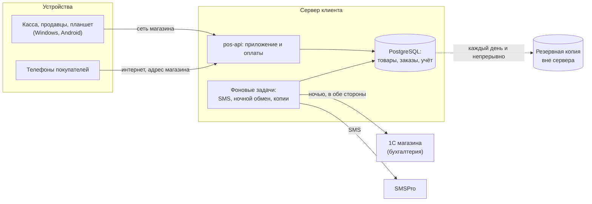

# P-003 — Предложение изменения ТЗ: всё на сервере клиента, ночной обмен с 1С (редакция 3)

> **ОТМЕНЕНО заказчиком 20.11.2026** (решение — `docs/specification/15_DECISION_LOG.md` ADR-120; слова заказчика дословно — там же и в `docs/customer/P-003_OWNER_DECISIONS.md` §5). Действует утверждённое ТЗ: 1С — главная система, сервер POS работает с 1С онлайн; своего учёта («учёт у нас», `ONEC_MODE=local`) и ночного обмена нет. Текст ниже сохранён для истории: по нему ничего не делается; номера Р-, Q-, В-, RR-N и черновики ADR-117, ADR-118 не действуют и не занимаются. Сборка этапа 1 сохранена в ветке `archive/p003-stage1-2026-11-20` (коммит `993a728`).

| Поле | Значение |
|---|---|
| Номер | P-003, **редакция 3** (третье предложение изменения утверждённого ТЗ; формат — по P-002, но короче: так просил владелец) |
| Дата | 2026-11-18 |
| Статус | **ОТМЕНЕНО заказчиком 20.11.2026** (15 ADR-120). Было: **ОДОБРЕНО 2026-11-19: ответы группы А «Р-01 а, Р-07 а»** (запись дословно — `docs/customer/P-003_OWNER_DECISIONS.md` §3). Р-07 (а) — при подтверждении бухгалтера (Q-360). Группа Б — по §8.3. Открыто: Q-358, Q-360, Р-09, Р-10, Р-41, Р-46. Ядро `docs/research/R0_DECISION_KERNEL.md` не правится: отступления — §5.1. Было: «ПРОЕКТ, редакция 3 — по ответу владельца 2026-11-18; ждёт подтверждения» |
| Заменяет | Редакцию 2 — [`P-003_NO_1C_FIREBASE.md`](P-003_NO_1C_FIREBASE.md) «Работа без 1С 5–6 месяцев и сервер в облаке Google (Firebase)». Владелец её не утвердил: «net klient pereumal» (§0). Редакция 2 сохранена с пометкой «Заменено редакцией 3»: на её разделы об «учёте у нас» эта редакция ссылается, а не повторяет их |
| Повод | Ответ владельца 2026-11-18 (§0): облака Google нет; всё — на сервере клиента; оплаты и SMS работают на этом сервере; ночью сервер обменивается с 1С; требования программисту 1С — короче и понятнее; по остальному — «a po povou rugih selay vse profesionalno» (§0.1; прочтение — §0.2 `[ВЫВОД]`) |
| Основание | Редакция 2 и её разбор; утверждённое ТЗ (05, 13, 16, 18); код `pos-api` и `pos-app` — только чтение 2026-11-18. Ссылки — `файл:строка`; путь без каталога — от `docs/specification/` |
| Паритет функций | Ни одна функция не убирается: роли, касса, режим покупателя, планшет магазина (P-002, ADR-115; биометрии на планшете нет), вход по лицу (ADR-116), веб-демо (ADR-113). Что работает иначе, чем в утверждённом ТЗ, — §1.5 |
| Правила владельца | Паритет функций; существенные изменения ТЗ — только с вашего согласия; без реальных данных клиентов в репозитории и в демо; без секретов в репозитории и в чате; на сервере клиента ничего не ставим без отдельного разрешения (ядро D-33) |
| Метки | `[РЕШЕНИЕ ЗАКАЗЧИКА]` — ответ владельца; `[ПРЕДЛОЖЕНИЕ]` — наше предложение; `[ВЫВОД]` — наш вывод или толкование, не цитата; `[ФАКТ]` — проверено в коде или ТЗ; `[ТИПОВО]` — типовое поведение 1С, проверить на месте; `[НЕ ПОДТВЕРЖДЕНО]` — оценка или допущение; `[ТРЕБУЕТ ЗАКЛЮЧЕНИЯ БУХГАЛТЕРА]` |
| Номера | Р-NN, Q-, В-N, RR-NN — номера этого предложения. Р-NN продолжают нумерацию редакции 2, на которую ответил владелец (Р-09, Р-18). В утверждённом ТЗ Р-NN предложения P-002 (10 KIOSK-020, KIOSK-034; 14 Q-339…Q-349; 15 ADR-115) — другие решения, поэтому при внесении в ТЗ решения этого предложения пишутся «P-003 Р-NN» (например, «P-003 Р-18 (а)»). В-N — вопросы программисту 1С (`docs/integration/1C_NIGHTLY_EXCHANGE_TZ.md` §10; «вопрос В-8 ТЗ 1С», кириллица); B-3 — сценарий размещения 16 §3 («сценарий B-3», латиница). Риски — RR-N1…RR-N15 (§7), как RR-T* у P-002 и RR-P* у редакции 2. Номера ADR и Q- редакции 2 недействительны — соответствие в её шапке |

---

## 0. Слова владельца и как мы их поняли

### 0.1. Дословно

Все сообщения — 2026-11-18, чат владельца с разработчиком. Латиница — как написано, без правки.

**Утром** (из него выросла редакция 2):

> «klient poprosil selat tak chtobi vse rabotalo u nas  beken poklyuchi fire base  no k konsu nya vse sinhraniziruetsya s c1  no mi mojem bez etogo rabotat eshe 5-6 mesyatsev bez integratsii v 1c  poka vse selay tua»

**Ответ на вопрос по редакции 2** «Утверждаете P-003 «Работа без 1С, сервер на Firebase» и все рекомендации группы А?» `[РЕШЕНИЕ ЗАКАЗЧИКА]`:

> «net klient pereumal hochet selat vse na svoy server  tebe nujno napisat beken i nastroit i sprashuvaet chto mne nujno at vam chtobi vi smogli poklyuchitsya k serveru i ponyat tam beken napishi trebovaniya  i napishi   i oplata sms vse buet rabotat na  nashem servere  a nochyu on obmenaetsya s c1 i dumayu izmenitsya da trebovaniya 1c programistu pereelay trebovanie no krache i ponyatnee a po povou rugih selay vse profesionalno»

**Ответы на два вопроса редакции 2** `[РЕШЕНИЕ ЗАКАЗЧИКА]`:

| Вопрос | Ответ владельца |
|---|---|
| Р-09 — как сейчас пробиваются кассовые чеки | «Не знаю, уточню» |
| Р-18 — платят ли организации на расчётный счёт | «Да, есть (Рекоменд. а)» — то есть нужен документ «Поступление оплаты на счёт» |

### 0.2. Как мы прочитали

Это **толкование, а не цитата** `[ВЫВОД]`: «Нет, клиент передумал: хочет сделать всё на свой сервер. Тебе нужно написать бэкенд и настроить. И спрашивает: что мне нужно от вас, чтобы вы смогли подключиться к серверу и понять там бэкенд — напиши требования. И оплата, SMS — всё будет работать на нашем сервере, а ночью он обменивается с 1С. И, думаю, изменятся требования программисту 1С — переделай требование, но короче и понятнее. А по поводу других — сделай всё профессионально».

| Слова | Как мы поняли `[ВЫВОД]` | Другое возможное прочтение | Где решается |
|---|---|---|---|
| «net klient pereumal» | Редакция 2 не утверждена. Облако Google и Firebase не используем | — | — |
| «hochet selat vse na svoy server» | Наш сервер (`pos-api`, база PostgreSQL, фоновые задачи) ставим на сервер, которым владеет клиент. Это сценарий утверждённого ТЗ: «сервер заказчика» (ядро D-33, 16 §3) | Арендованный сервер клиента в другой стране — тогда снова встаёт вопрос о данных за рубежом (редакция 2 §6) | Р-46, §9 |
| «tebe nujno napisat beken i nastroit» | Сервер уже написан (утверждённое ТЗ, этапы B–G). Дописываем «учёт у нас» и ночной обмен, затем ставим и настраиваем всё на сервере клиента | Написать новый сервер с нуля — не нужно и дороже | §6 |
| «chto mne nujno at vam chtobi vi smogli poklyuchitsya k serveru i ponyat tam beken napishi trebovaniya» | Клиент спрашивает, что ему дать нам, чтобы мы подключились к его серверу и **подняли** там бэкенд («ponyat» — возможно, опечатка «podnyat»). Ответ — отдельный документ требований к серверу и доступу (§9) | На сервере клиента **уже есть** чужой бэкенд, и нам надо в нём разобраться. Тогда нужно его описание — вопрос в документе требований | Р-46, Q-359 |
| «i oplata sms vse buet rabotat na  nashem servere» | Оплаты (наличные, QR магазина, долг, оплата долга, поступления на счёт) и SMS (через SMSPro, как в ТЗ) обрабатывает наш сервер на сервере клиента — не 1С и не облако | «Оплата SMS» — счёт за SMS на клиенте. Это тоже так: кабинет SMSPro — магазина | §1.4 |
| «a nochyu on obmenaetsya s c1» | Каждую ночь сервер обменивается с 1С в обе стороны: отдаёт документы дня, получает справочники | Только в одну сторону — сервер отдаёт документы, 1С ничего не присылает | Р-01, §2 |
| «izmenitsya da trebovaniya 1c programistu pereelay trebovanie no krache i ponyatnee» | Программисту 1С нужен новый, короткий документ под ночной обмен вместо нынешнего ТЗ на API (§3.8) | — | P3-0-06 |
| «a po povou rugih selay vse profesionalno» | По остальным вопросам редакции 2 принимаем наши рекомендации (группа Б, §8.3) | Это ответ и на группу А. Мы так не считаем: отступления от основ ТЗ по правилу нужно назвать явно (§8.1) | §8 |
| «5-6 mesyatsev bez integratsii v 1c» (утреннее сообщение) | Пока программист 1С не сделал свою часть, магазин работает без связи с 1С, учёт ведёт наш сервер (этап 1) | — | §2 |

Перед внесением в ТЗ эти записи с датой кладутся в `docs/customer/P-003_OWNER_DECISIONS.md` (как для P-002) и сверяются с оригиналом в чате. Номера решений там и в ТЗ — с пометкой «P-003 Р-NN» (шапка, строка «Номера»).

---

## 1. Что будет работать и как

### 1.1. Коротко

1. **Всё на сервере клиента.** Наш сервер, база и фоновые задачи стоят на сервере, которым владеет клиент. Облака нет, платы за облако нет. Данные покупателей остаются в Кыргызстане — так и задумано основами ТЗ (ядро D-01), если сервер стоит в КР.
2. **Днём магазин работает только с нашим сервером.** Касса, продавцы, планшет, приложение покупателя, оплаты, SMS — всё на нём. 1С днём не нужна: если она выключена, торговля не останавливается.
3. **Ночью сервер обменивается с 1С.** Отдаёт в 1С документы за день, получает изменения товаров, цен и клиентов, сверяет остатки и долги. Утром администратор видит отчёт.
4. **Пока обмена нет, учёт ведём у себя.** Программисту 1С нужно время. До готовности обмена наш сервер сам ведёт товары, цены, остатки, клиентов и долги — как в редакции 2 («учёт у нас»). Эта работа не пропадает: после запуска обмена операции дня по-прежнему ведутся у нас.
5. **Платежи организаций на счёт** вносятся в приложении документом «Поступление оплаты на счёт» — по вашему ответу Р-18 (а).

### 1.2. Два этапа

| | **Этап 1. «Учёт у нас»** — с запуска до готовности обмена | **Этап 2. «Ночной обмен»** — когда программист 1С сдал свою часть |
|---|---|---|
| Товары, цены, клиенты и их условия | ведутся в приложении; в первый раз загружаются из 1С файлом | ведутся в 1С, приходят на сервер каждую ночь (§2) |
| Продажи, оплаты, возвраты, приход, списание, инвентаризация | в приложении | в приложении; каждую ночь уходят в 1С |
| Остатки и долги | считает наш сервер | ночью сверяются с 1С и выравниваются по правилу §2.4 |
| 1С | бухгалтерия, как сейчас; что с продажами — Р-07 | бухгалтерия; получает все документы автоматически |
| Срок | не ограничен: если 1С задержится, магазин ничего не теряет | постоянно |

### 1.3. Что стоит на сервере клиента

### 1.4. Что получит магазин

- **Касса и продавцы — как сейчас:** каталог, поиск, корзина, заказы, наличные, продажа в долг в пределах лимита, возвраты, счёт и товарный чек, планшет в зале, вход по лицу, приложение покупателя.
- **Оплаты на нашем сервере:** наличные; QR магазина с подтверждением кассиром (есть в программе); продажа в долг; оплата долга без заказа на кассе; «Поступление оплаты на счёт» для организаций (Р-18 (а)).
- **SMS** — через SMSPro, как сейчас; кабинет и баланс — магазина.
- **Экраны учёта** для администратора: товары, цены, приход, списание, инвентаризация, клиенты и условия, начальные долги, загрузка из Excel и CSV, отчёты (остатки, движение товара, «Касса за день», должники, акт сверки), отмена ошибочного документа. Список — редакция 2 §3.7.
- **Экран «Обмен с 1С»** (этап 2): когда был обмен, что ушло, что пришло, ошибки, кнопки «Повторить обмен» и «Обновить из 1С».
- **Если сервер стоит в магазине**, касса работает и при обрыве внешнего интернета. Телефоны покупателей вне магазина в это время не работают. Если сервер в дата-центре — наоборот: магазину нужен интернет (Р-06).

### 1.5. Что иначе, чем в утверждённом ТЗ

- **QR через интеграцию 1С с банком не будет:** днём 1С не на связи. Остаётся QR магазина и подтверждение кассиром. QR с суммой и уведомлением банка — только при прямой связи с банком (Q-014), отдельное предложение.
- **Автоскидки 1С не действуют.** Ручная скидка в пределах лимита роли остаётся.
- **Цены, изменённые в 1С, действуют после обмена** — утром или после кнопки «Обновить из 1С» (этап 2). Документы дня уходят в 1С только ночью.
- **Накладную** 1С напечатает только после ночного обмена; как быть в день отгрузки — Р-10.
- **Фискальный чек** приложение не печатает — так и по ТЗ (D-26). Если сейчас чек печатает 1С, без неё нужна отдельная онлайн-ККМ. Это выяснится по вашему ответу Р-09 («Не знаю, уточню»).

---

## 2. Кто главный по каким данным

### 2.1. Простыми словами

Когда две системы хранят одно и то же, у каждой записи должен быть один хозяин. Иначе цену поменяют в двух местах, и никто не скажет, какая верная. Мы предлагаем простое правило: **справочники — у 1С, операции — у нас**. 1С — бухгалтерская книга магазина, там удобно вести товары, цены и договоры с клиентами. Наш сервер — касса и склад в реальном времени: только он видит продажу в ту же секунду.

### 2.2. Три варианта (Р-01)

| | (а) **Справочники из 1С, операции от нас** `[ПРЕДЛОЖЕНИЕ, рекомендуем]` | (б) Всё ведём у нас, 1С только получает документы | (в) Всё главное в 1С, как в утверждённом ТЗ, но обмен раз в ночь |
|---|---|---|---|
| Товары, цены, клиенты, условия | правят в 1С, ночью приходят к нам | правят в приложении, ночью уходят в 1С | правят в 1С |
| Продажи, оплаты, возвраты, склад | у нас, ночью — в 1С | у нас, ночью — в 1С | заказ ночью уходит в 1С, согласование и отгрузка — в 1С |
| Остатки и долги | база — 1С на ночь, сверху — наши операции за день (§2.4) | только наши; 1С — копия | только из 1С, отстают на сутки |
| Что делает бухгалтер | работает в 1С, как привык | не меняет в 1С ни цен, ни клиентов, ни остатков | работает в 1С |
| Работа программиста 1С | приём документов + выдача справочников + остатки и долги на время | только приём документов | всё, что в прежнем ТЗ на API, плюс передача раз в ночь |
| Годится ли | да | да, но 1С становится «зеркалом», бухгалтер теряет привычные справочники | **нет**: заказ дня попадает в 1С только ночью, его нельзя согласовать и отгрузить днём; остатки и долги на кассе — вчерашние |

**Почему (а)** `[ВЫВОД]`:
- Так обычно делят работу касса и учётная программа: справочники и бухгалтерия — в учётной, продажи — в кассовой.
- Бухгалтер продолжает вести 1С: налоги, ЭСФ, банк, поставщики остаются законными и привычными.
- «Учёт у нас» из этапа 1 не выбрасывается: операции, резервы, оплаты и долги в течение дня по-прежнему ведёт наш сервер.
- Обмен в одну сторону для каждой записи: конфликт «поменяли в двух местах» невозможен по построению.

Вариант (б) — запасной, если бухгалтер не готов принимать документы автоматически, а программист 1С не сделает выдачу справочников. Вариант (в) не рекомендуем.

### 2.3. Кто что меняет (при варианте (а))

| Данные | Этап 1 | Этап 2 | Куда течёт в этапе 2 |
|---|---|---|---|
| Товары, группы, единицы, упаковки, штрихкоды | приложение | 1С | 1С → сервер |
| Склады, виды цен, цены | приложение | 1С | 1С → сервер |
| Клиенты и их условия (вид цены, скидка, долг разрешён, лимит, отсрочка) | приложение | 1С; новый клиент может появиться на кассе (с условиями по умолчанию до утра, Р-52) | новый клиент: сервер → 1С; условия: 1С → сервер |
| Начальные долги | загрузка из 1С файлом | 1С (база на ночь) | 1С → сервер |
| Заказы, резервы | приложение | приложение; в 1С не уходят, пока не отгружены | — |
| Отгрузки (реализации), оплаты, «Поступление оплаты на счёт», возвраты; авансы (уходят в 1С в ночь получения, без продажи) и возвраты авансов при отмене заказа до отгрузки (отдельный документ) | приложение | приложение | сервер → 1С |
| Приход, списание, инвентаризация, перемещение, корректировка долга | приложение | приложение | сервер → 1С |
| Фото, описания, избранное, профили, настройки | приложение | приложение (фото — из 1С, если там есть, Р-54) | только у нас (ONEC-105) |

**Правило для людей** `[ПРЕДЛОЖЕНИЕ]`: в этапе 2 цены, товары и условия клиентов меняют **только в 1С**; приход, списание, инвентаризацию и оплаты на счёт вводят **только в приложении**. Если ввести и там, и там, ночная сверка покажет расхождение (§2.4).

**Склад — в приложении или в 1С** (Р-44). Мы рекомендуем приложение: один ввод, товар сразу доступен для продажи. Если бухгалтер хочет и дальше вводить приход и списание в 1С, это тоже работает: товар появится у нас со срезом остатков — ночью или по кнопке «Обновить из 1С». В ТЗ программисту 1С это вопрос В-8; от ответа зависит, нужен ли ему метод приёма складских документов.

### 2.4. Сверка остатков и долгов `[ПРЕДЛОЖЕНИЕ, Р-48]`

Каждую ночь сервер ставит **отсечку** — момент начала обмена (§3.1). Документы до отсечки уходят в эту ночь.

1. Сервер отдаёт в 1С документы до отсечки. По каждому 1С отвечает: **проведён**; **записан непроведённым** (например, в 1С не хватило остатка — это не отказ: товар уже у покупателя); **отклонён** (ошибка данных, например товар помечен на удаление).
2. Затем 1С отдаёт **срезы**: остатки по складам и долги по клиентам на момент среза.
3. Сервер считает: **«остаток сейчас = остаток в срезе 1С + наши движения, которых в срезе ещё нет»**. «Ещё нет» — это документы после отсечки, отклонённые и записанные непроведёнными. Долг — так же. Так в учёт попадает и то, что бухгалтер ввёл или исправил прямо в 1С.
4. Прежде чем принять срез, сервер сравнивает его со своими цифрами на тот же момент. **Каждое расхождение** записывается документом «Сверка с 1С» (с аудитом) и попадает в утренний отчёт: товар или клиент, было у нас, стало по 1С, разница в штуках и сомах.
5. **Крупное расхождение** (порог — ваш, по умолчанию от 10 000 сом по товару или клиенту) помечается «проверить». Пока расхождение по долгу клиента не разобрано, продажа ему в долг — только с подтверждением старшего продавца (как разблокировка по ядру D-24).
6. **Непроведённые документы** сервер учитывает сам и показывает в отчёте бухгалтеру, пока тот их не проведёт. Так же — оплаты на счёт, если бухгалтер проводит их при разноске выписки банка (вопрос В-4 в ТЗ программисту 1С). Чтобы сервер узнал о проведении, в ответе сверки по внешним кодам (`/external-ids`) нужен признак «проведён» — согласуем с программистом 1С `[ПРЕДЛОЖЕНИЕ]`.
7. Свободный остаток для продажи — это остаток минус наши резервы. Резервы живут только у нас, в 1С они не уходят.
8. Днём срезы можно обновить кнопкой «Обновить из 1С» (§3.6). Правило то же.

### 2.5. Как перейти от этапа 1 к этапу 2 `[ПРЕДЛОЖЕНИЕ, Р-53]`

В редакции 2 переход на 1С требовал ночи переключения с остановкой продаж и 3 дней на откат. Здесь проще: учёт остаётся у нас, меняется только то, откуда приходят справочники.

1. Программист 1С сдаёт свою часть на **копии** базы 1С; мы проверяем её на нашем имитаторе и на копии.
2. **Сопоставление.** Товары и клиенты, загруженные из 1С с внутренним кодом (GUID), сопоставляются сами. Созданные у нас за этап 1: клиенты создаются в 1С первым обменом (1С возвращает свою ссылку или находит дубль по телефону); товары бухгалтер заводит в 1С, и мы связываем их на экране разбора (редакция 2 §4.4).
3. **Документы этапа 1.** Что уже ушло в 1С через приём документов (Р-07 (а)), сервер только связывает по внешнему коду. Документы, которые бухгалтер ввёл в 1С итогами по нашему отчёту, повторно не отправляются: у них стоит отметка «учтено итогами». Отправить их задним числом можно только с согласия бухгалтера (Р-07 (в)) `[ТРЕБУЕТ ЗАКЛЮЧЕНИЯ БУХГАЛТЕРА]`.
4. **3–5 пробных ночей** на копии 1С: полный обмен и отчёт расхождений. Магазин в это время работает как обычно.
5. Включение на рабочей 1С — после вашего «да». С этого дня поля «из 1С» в приложении только для чтения.
6. **Откат** — выключить обмен. Магазин продолжает работать в этапе 1, ничего не теряется.

---

## 3. Ночной обмен

### 3.1. Окно и отсечка `[ПРЕДЛОЖЕНИЕ, Р-47]`

- Обмен начинается в **02:00** по Бишкеку и заканчивается **до 05:00** — так записано в ТЗ программисту 1С (`docs/integration/1C_NIGHTLY_EXCHANGE_TZ.md` §2). Отсечка — время начала. Часы работы магазина и ночные работы в 1С мы пока не знаем (Q-363; вопрос В-7 программисту 1С) `[НЕ ПОДТВЕРЖДЕНО]`; время — настройка сервера.
- Одновременно идёт только один обмен. Непрерывная копия нашей базы идёт всегда; ежедневная полная копия — после обмена (`docs/customer/SERVER_REQUIREMENTS.md` §6).

### 3.2. Порядок шагов

| Шаг | Что происходит | Если не вышло |
|---|---|---|
| 1. Проверка | 1С отвечает; предыдущий обмен не висит | 1С на обслуживании — повтор каждые 15 минут до 03:30, потом — следующей ночью (§3.4) |
| 2. Документы → 1С | всё до отсечки, по одному документу, одной очередью по времени события, независимо от вида: продажа — время отгрузки; оплата (в том числе на счёт), возврат, возврат аванса, складской документ — время проведения у нас; клиент — время создания. Документ ждёт тех, от кого зависит: новый клиент — раньше первого документа с ним; продажа — раньше оплат и возвратов по ней; аванс — раньше своего возврата. При равном времени поступления товара (приход, оприходование, возврат, перемещение) идут раньше расходов (продажа, списание). Оплата заказа, не отгруженного к отсечке, уходит авансом в ту же ночь. Ответ по каждому: проведён, записан непроведённым или отклонён (§2.4) | отклонённый документ — в список ошибок, остальные идут дальше; зависимый (оплата или возврат по отклонённой или ещё не переданной продаже, кроме аванса; возврат отклонённого аванса) ждёт |
| 3. Справочники ← 1С | изменения товаров, групп, штрихкодов, складов, видов цен, клиентов и условий; удаление — только пометкой | справочники остаются вчерашними; документы шага 2 не откатываются |
| 4. Срезы ← 1С | цены, остатки и долги — **только после шага 2**, чтобы в них уже были продажи дня; сверка по §2.4 | остаются наши цифры |
| 5. Сверка документов | какие наши документы есть в 1С (по внешним кодам) | повтор следующей ночью |
| 6. Отчёт | итог ночи сохраняется и ждёт администратора, владельца и бухгалтера (§3.5) | — |

Временные сбои в ходе ночи (документ занят в 1С, сбой 1С, нет ответа) сервер повторяет до 04:30, потом — следующей ночью.

### 3.3. Защита от дублей и повтор

- У каждого нашего документа — постоянный внешний код (UUID). 1С хранит его в регистре `ВнешниеИдентификаторыPOS` — это уже есть в ТЗ (05 ONEC-040). Повторная отправка того же документа возвращает уже созданный документ 1С, а не второй `[ФАКТ: правило ТЗ; ВЫВОД: годится и для ночного обмена]`.
- Справочники принимаются по коду 1С: повторный приём ничего не удваивает.
- Сверка на одну и ту же отсечку даёт тот же результат.
- Поэтому любой шаг и весь обмен можно запускать заново без вреда.
- Отправленный документ в 1С не правится и не отменяется. Ошибку исправляют новым документом: возвратом, корректировкой или обратным документом при «Отмене проведения» (редакция 2 §3.8). Он уходит следующей ночью. Так же записано в ТЗ программисту 1С (§4).

### 3.4. Если 1С недоступна

- **Магазин работает как обычно** — днём 1С не нужна.
- 1С на обслуживании или не отвечает — сервер пробует снова каждые 15 минут до 03:30; временные сбои в ходе обмена — до 04:30.
- Если обмен так и не прошёл — утром отчёт «Обмен не выполнен»; документы копятся и уходят следующей ночью; остатки и долги остаются нашими.
- Три ночи подряд без обмена — красное предупреждение владельцу и администратору.

### 3.5. Утренний отчёт `[ПРЕДЛОЖЕНИЕ, Р-50]`

Администратор, владелец и бухгалтер видят его на экране «Обмен с 1С», а при входе — короткую плашку с итогом.

- Итог: «успешно», «с ошибками» или «не выполнен»; время начала и конца.
- Документы: сколько передано, проведено, записано непроведёнными, отклонено; по каждой ошибке — номер POS, дата, сумма и понятный текст 1С («товар помечен на удаление»).
- Справочники: новые товары, сколько цен изменилось, новые и изменённые клиенты.
- Сверка: товары и клиенты с расхождением, суммы, пометка «проверить».
- Что делать: подсказка по каждой ошибке.

Если обмен не выполнен, администратору уходит SMS (≈ 1,6–2 сома). В остальных случаях — только экран.

### 3.6. Повторный запуск и «Обновить из 1С»

- **Сам:** что не прошло этой ночью, сервер повторяет следующей ночью с тем же внешним кодом. Исправленный документ (в 1С или у нас) уходит так же.
- **«Повторить обмен»** — администратор запускает обмен заново. В ночном окне — полностью; днём — только приём справочников, цен, остатков и долгов. **Документы в 1С уходят только ночью** — так договорено в ТЗ программисту 1С (§2), чтобы не мешать бухгалтеру днём.
- **«Обновить из 1С»** — днём, не чаще раза в 15 минут: например, после срочной смены цен или прихода, введённого в 1С.
- Оба действия — с PIN-подтверждением и записью в аудит; право — то же, что сейчас у ручной полной синхронизации (`sync.run.full`).

### 3.7. Как сервер связывается с 1С `[ПРЕДЛОЖЕНИЕ, Р-49]`

| | Как | Когда подходит |
|---|---|---|
| (а) HTTP-сервис 1С в сети клиента — **выбран в ТЗ программисту 1С** | Наш сервер ночью обращается к 1С по HTTPS в сети магазина или по защищённому туннелю (16 §12.1–§12.2). База 1С в интернет не публикуется. Клиент для методов контракта 1.2.0 у нас уже написан и проверен на имитаторе 1С `[ФАКТ]`; срезы, складские документы и другие новые методы добавляем по контракту 1.3.0 (НО-1-03, НО-1-10) | сервер и 1С в одной сети или связаны туннелем |
| (б) Файлы в общей папке | Сервер кладёт документы в папку; регламентное задание 1С забирает их и кладёт ответ | только если базу 1С нельзя опубликовать даже в своей сети (вопрос В-2 программисту 1С) |

### 3.8. Что делает программист 1С

Работы у него **меньше**, чем по прежнему ТЗ на API (`docs/integration/1C_API_requirements.md`): не нужны быстрые ответы днём, проверка корзины, статусы заказов, QR через 1С. Нужно пять вещей:

1. **Принимать документы POS** — новых клиентов, продажи, оплаты (в том числе авансы и их возврат), возвраты, складские документы — и создавать по ним документы 1С без дублей по внешнему коду; отвечать по каждому.
2. **Отдавать изменения справочников** — тем же планом обмена «POS», что уже описан (18 §4.2).
3. **Отдавать срезы** цен, остатков и долгов.
4. **Отдавать перечень** документов, созданных из POS (сверка).
5. **Дать копию базы** для проверки и пробных ночей.

Короткое ТЗ для него — [`docs/integration/1C_NIGHTLY_EXCHANGE_TZ.md`](../../integration/1C_NIGHTLY_EXCHANGE_TZ.md) (версия 2.1, пакет P3-0-06). Оно заменяет программисту 1С прежнее ТЗ на API; прежнее остаётся подробным справочником.

---

## 4. Что остаётся от редакции 2 и что уходит

| | Что | Где в редакции 2 |
|---|---|---|
| **Остаётся** | «Учёт у нас» за той же «дверью», что и 1С (`ONEC_MODE=local`): документы, журналы остатков и долгов, нумерация, резервы, отмена проведения, снятие зависших резервов | §3.3, §3.8, §3.10 |
| **Остаётся** | Экраны администратора: товары, цены, приход, списание, инвентаризация, клиенты и условия, долги, поставщики | §3.7 |
| **Остаётся** | Загрузка из 1С файлами: Excel, CSV, CommerceML; пробный прогон; контрольные суммы | §3.6 |
| **Остаётся** | Отчёты для владельца, акт сверки, «Касса за день» | §3.7 |
| **Остаётся** | «Поступление оплаты на счёт» — **решено**: Р-18 (а) | §3.9 |
| **Остаётся** | Граница «мини-учёта»: не ведём бухгалтерию, налоги, себестоимость, расчёты с поставщиками | §3.13 |
| **Остаётся** | Непрерывная резервная копия (PITR) обязательна; копия вне сервера | §3.13, Р-35 |
| **Остаётся** | Веб-демо с режимом «Учёт у нас» | §3.15 |
| **Меняется** | «Выгрузка для бухгалтера» — **ежедневный отчёт** «Продажи, оплаты, возвраты, склад за день» (Excel) для этапа 1, пока в 1С нет приёма документов (Р-07); второй формат — те же данные в виде запросов обмена (JSON), на случай обмена файлами | §3.4, УЧ-1-15 |
| **Меняется** | Переход «1С снова главная» с ночью переключения и откатом заменён подключением ночного обмена без остановки продаж (§2.5) | §4 |
| **Уходит** | Firebase и Google Cloud, облако ≈ $100–200 в месяц, Google-аккаунт и оплата картой в USD, выбор региона и замер задержки | §2 |
| **Уходит** | Вопрос о хранении данных за рубежом и пакет юристу по облаку: данные остаются в КР на сервере клиента — как в основах ТЗ (D-01) | §6 |
| **Уходит** | Отступления от ядра D-01, D-02, D-33 и уточнение D-35 | §5.1 |

---

## 5. Изменения ТЗ и отступления от ядра

### 5.1. Отступления от ядра R0 (ядро не правится; согласие — Р-01)

Их меньше, чем в редакции 2: 14 вместо 18. Все действуют только в режиме «учёт у нас» и при ночном обмене; в ADR они называются явно.

| № | Пункт ядра (`R0_DECISION_KERNEL.md`) | В ядре | Этап 1 | Этап 2 |
|---|---|---|---|---|
| 1 | D-20 (`:80`) | статусы заказа — проекция фактов 1С | факты дают модуль учёта и действия сотрудников; правила проекции те же | так же |
| 2 | D-22 (`:82`) | резерв и списание — в 1С | в модуле учёта | так же; в 1С уходит реализация |
| 3 | D-23 (`:83`) | итог 1С — истина; автоскидки 1С | истина — итог POS; автоскидок нет | так же |
| 4 | D-24 (`:84`) | долги только из 1С, не по истории | считает модуль учёта | база 1С на отсечку + наши документы после неё (§2.4) |
| 5 | D-25 (`:85`) | документ возврата и деньги — в 1С | в POS со step-up | так же; ночью — в 1С |
| 6 | D-27 (`:87`) | накладная — печатная форма 1С | по Р-10 | 1С печатает после обмена; в день отгрузки — по Р-10 |
| 7 | D-28 (`:88`) | OData + HTTP-сервис расширения в реальном времени | обмена нет | ночной обмен через тот же HTTP-сервис расширения (файлы — запасной путь); защита от дублей и регистр внешних кодов — как в ядре |
| 8 | D-29 (`:89`) | синхронизация каждые 5–30 минут | нет | раз в ночь; справочники и срезы — ещё по кнопке днём |
| 9 | D-30 (`:90`) | фото — из 1С | загрузка в приложении | из 1С, если есть; иначе приложение (Р-54) |
| 10 | §5 «Источники истины» (`:151-182`) | мастер-данные — 1С | модуль учёта | справочники — 1С, операции — POS (§2.3) |
| 11 | §16 п. 3 (`:453`) | `ONEC_MODE` = `extension \| odata_only \| fixtures` | + `local` в рабочем контуре | + переключатель ночного обмена |
| 12 | §22.1–§22.4, §22.8 (`:682-723`) | outbox → 1С; `refunded` — от 1С; `/check` — в 1С; долг — обновление из 1С; план обмена | доставка в модуль учёта; `/check` и долг — модуль учёта | так же; план обмена — только ночью |
| 13 | §24.3 (`:789`) | основной путь — API на стороне 1С в реальном времени | — | программист 1С делает ночной обмен (§3.8) |
| 14 | §24.4 (`:795`) | QR — через 1С | `QR_PROVIDER=none` (запасной вариант ядра) | так же |

**Больше не отступления:** D-01 (сервер и база — у клиента, данные в КР), D-02 (Firebase не используется), D-33 (сценарий A или сценарий B-3 по аудиту сервера), D-35 (непрерывная копия — это и есть «PITR по требованию»). **Не меняются:** D-03, D-11 (SMSPro), D-26, D-32, D-41, §22.10. Правило D-08 «найти клиента по телефону, прежде чем создавать» остаётся; в этапе 1 карточка клиента — наша.

### 5.2. Что меняется по документам (только после «да» и ответов группы А)

| Документ | Что меняется |
|---|---|
| **00, 01** | Этапы «учёт у нас» и «ночной обмен»; требования `LOCAL-NNN`, `IMPORT-NNN`, `NIGHT-NNN`; RPO для режима `local` |
| **02, 03, 04** | Экраны учёта (редакция 2 §5.2) и экран «Обмен с 1С» (на основе SCR-43); поля «из 1С» только для чтения; потоки: стартовая загрузка, ночной обмен, утренний разбор ошибок, подключение обмена |
| **05 и `contracts/onec/onec-http-service.v1.yaml`** | Новая фаза «L — учёт у нас» и фаза «N — ночной обмен»; ONEC-026 (документы POS → 1С: реализации, оплаты, возвраты, складские), ONEC-104 (исключение для `local`), §7–§9, §13 (сбои); новые методы и поля обмена из ТЗ программисту 1С (срезы цен, остатков и долгов, складские документы, оплата `bank_transfer`, аванс `advanceForOrderExternalId` и возврат аванса `/advance-refunds`, признак `posted` в `/external-ids`, новые значения `POS_ТипыВнешнихОбъектов`, порядок документов по времени события; продажа `/sales` — реализация и возврат `/sale-returns` — возврат товаров с РКО — новыми операциями, смысл `/orders` и `/returns` не меняется, ONEC-033) — сначала в 05 §6 (ONEC-037…040, ONEC-048/067 для ночного режима; в 10 — ORD-035, ORD-051: аванс и его возврат — документы POS), затем в контракт версии 1.3.0 (ONEC-074). Источник срезов и первой загрузки в ночном режиме — HTTP-сервис, а не OData: срезы цен и остатков — `GET /prices`, `/stock` вместо OData (SYNC-014, SYNC-015), долги — `GET /receivables` (запасной путь — `/customers/{ref}/receivables` по клиенту), первая загрузка — `POST /changes/reregister` и `/changes` вместо полной перечитки OData; сверка количеств SYNC-003/SYNC-068 без OData `$count` — по числу строк среза или выключена (НО-1-10) |
| **06, 07** | Модуль «Учёт POS», модуль ночного обмена; таблицы учёта, `onec_id_map`, журнал ночных обменов и сверок, признак `ref_origin` (редакция 2 §3.10) |
| **08 и `contracts/openapi/pos-api.v1.yaml`** | API учёта (редакция 2 §5.2), API обмена: запуск, повтор, «Обновить из 1С», отчёт, ежедневный отчёт для бухгалтера |
| **10, 11** | ORD, INV, PAY, DEBT, RET, PRINT — по режиму; новые права учёта (редакция 2 §5.2), step-up, аудит; для обмена — существующие права `sync.runs.read` (просмотр) и `sync.run.full` (запуск, со step-up) (`contracts/rbac/permissions.yaml:282`, `:292`), новых не нужно `[ВЫВОД]`; PRIV — сервер клиента в КР, доступ исполнителя к серверу |
| **12** | T-LOCAL, T-IMPORT, T-NIGHT (на имитаторе 1С и на копии 1С) |
| **13** | Дорожки УЧ, НО, РАЗ (§6) вне базового объёма; пилот этапа I — в режиме `local` |
| **14, 15** | Вопросы §5.4; ADR §5.3 |
| **16** | Сервер клиента: сценарий по аудиту (§2 и §3 документа 16), WAL-архив и копия вне сервера (§8), мониторинг обмена (§9), связь с 1С (§12), runbook обмена |
| **17** | Строки новых требований; источник — `docs/customer/P-003_OWNER_DECISIONS.md` |
| **18 и `docs/integration/1C_API_requirements.md`** | Программисту 1С передаётся короткое ТЗ `docs/integration/1C_NIGHTLY_EXCHANGE_TZ.md` (версия 2.1, §3.8); прежние остаются подробным справочником |
| **ARB** | Тексты по режиму — через таблицы 02 §7 и скрипт сборки, не вручную |
| **`contracts/rbac/permissions.yaml`, `.env.example`, `infra/`** | Новые права; `ONEC_MODE=local`, переменные обмена; шаблоны для сервера клиента (без секретов) |
| **`docs/customer/`** | `P-003_OWNER_DECISIONS.md`; требования к серверу и доступу (§9); шаблоны стартовой выгрузки; памятка «утро администратора» |

### 5.3. Черновики ADR

На 2026-11-18 последний ADR в 15 — ADR-116 `[ФАКТ]`. Номера ADR-117 и ADR-118 редакция 2 занимала только в черновике (в 15 не вносились), поэтому берём их — в другом значении: ADR-117 ред. 2 (облако) отменён, ADR-118 ред. 2 — основа ADR-117 этой редакции (соответствие — шапка редакции 2). Номер присваивается при внесении в 15.

**ADR-117 (черновик) · «Учёт у нас» за портом 1С (`ONEC_MODE=local`) на сервере клиента.** Основа — черновик ADR-118 редакции 2 (§5.4, п. 1–14) с изменениями: сервер — у клиента по сценарию после аудита (ядро D-33, 16 §3), облака нет; PITR — WAL-архив на сервере клиента и копия вне сервера; добавлен документ «Поступление оплаты на счёт» (Р-18 (а)); «выгрузка для бухгалтера» — ежедневный отчёт для этапа 1 и запасной формат обмена файлами.

**ADR-118 (черновик) · Ночной обмен с 1С: справочники из 1С, операции от нас.**
- Решение: §2.2 (а), §2.3, сверка §2.4, обмен §3, подключение §2.5. Переключатель обмена отдельно от `ONEC_MODE`: учёт остаётся `local`. Отступления — §5.1 (этап 2).
- Рассмотрены: всё у нас (запасной), всё в 1С с обменом раз в ночь (отклонён: торговля днём невозможна), API 1С в реальном времени по утверждённому ТЗ (не выбран владельцем).
- Последствия: работа программиста 1С меньше; цены из 1С действуют после обмена; ≈ 63–69 у.е. на нашей стороне (§6).
- Откат: выключить обмен — магазин продолжает в этапе 1.

### 5.4. Новые вопросы для 14

На 2026-11-19 в 14 (ред. 1.22) заняты Q-310…Q-357, Q-365, Q-366; Q-358…Q-364 оставлены этой редакции (14 §4.4, §10 п. 16); следующий свободный был Q-367 — эта редакция берёт его для Р-42 (строка ниже), и в 14 следующий свободный теперь Q-368 `[ФАКТ]`. Q-357 — вопрос о цвете точек PIN (итог работ по входу по лицу, `.tmp/face/final-report.md`, пробел 2). Номера Q- редакции 2 недействительны — соответствие в её шапке. Черновые номера ниже уточняются при внесении: параллельные документы этого же ответа могут занять номера раньше.

| № | Кому | Вопрос | Связь |
|---|---|---|---|
| Q-358 | Владелец | Подтвердить толкование §0 (сервер клиента; «поднять» или «понять» бэкенд; обмен в обе стороны) и выбор §2 | Р-01 |
| Q-359 | Владелец, клиент | Сведения о сервере клиента: где стоит, система, ресурсы, на нём ли 1С, есть ли на нём чужой бэкенд, как дать доступ (документ требований, §9) | Р-46; Q-030 |
| Q-360 | Владелец, бухгалтер | Как продажи этапа 1 попадают в 1С: итоги дня по нашему отчёту или документы через приём 1С; можно ли дополнять прошлые месяцы; приход и списание — в приложении или в 1С (вопрос В-8 ТЗ 1С) | Р-07, Р-44 |
| Q-361 | Программист 1С | Письменный срок ночного обмена; можно ли опубликовать базу по HTTPS в сети (иначе файлы); копия базы; возврат ссылки 1С на созданного клиента (§2.5 п. 2); признак «проведён» в сверке по внешним кодам; взаиморасчёты и аванс от розничного покупателя (вопросы В-1…В-10 ТЗ программисту 1С) | §2.4, §2.5, §3.7, §3.8 |
| Q-362 | Программист 1С | Стартовая выгрузка с GUID (CommerceML или Excel по шаблонам) и срок; сначала обезличенный образец; есть ли у клиентов индивидуальные цены по товарам, а не только вид цены и скидка — тогда они входят в выгрузку (был Q-368 ред. 2; в вопросах В-1…В-10 ТЗ 1С его нет — задать отдельно) | Р-11 |
| Q-363 | Владелец | Часы работы магазина; кто получает утренний отчёт и SMS о сбое обмена | Р-47, Р-50 |
| Q-364 | Владелец | Сведения о магазине: склады и точки, кто согласует и отгружает, продаж в день, доля в долг, оплат на счёт в месяц, где фото | Р-41 |
| Q-367 | Владелец | Через сколько снимать резерв с неоплаченного и неотгруженного заказа; наша рекомендация — в конце следующего рабочего дня (был Q-370 ред. 2) | Р-42 (группа Б, §8.3) |

Меняют статус: **Q-013** (чеки) — блокирующий для запуска, ответ владельца «Не знаю, уточню»; **Q-019** (НДС, ЭСФ, накладная) — блокирующий для запуска; **Q-030** (обследование сервера) — снова нужен; **Q-031** (кто начинает обмен) — решается в Р-49; **Q-152** (оплата долга без заказа) — «да»; **Q-014** (банк для QR) — без изменений.

### 5.5. Требования и тесты (черновые группы)

| Группа | Что | Тесты |
|---|---|---|
| `LOCAL-NNN` | как в редакции 2 §5.6, плюс «Поступление оплаты на счёт» | T-LOCAL |
| `IMPORT-NNN` | как в редакции 2 §5.6 | T-IMPORT |
| `NIGHT-NNN` | отсечка, порядок шагов, порядок документов по времени события и зависимостям (§3.2), авансы и их возврат, защита от дублей, повтор, сверка §2.4 (в том числе непроведённые документы и признак `posted`), отчёт, «Обновить из 1С», документы только ночью, поля «из 1С» только для чтения, подключение и откат | T-NIGHT: на имитаторе 1С (как в веб-демо) и на копии 1С; повторный запуск не создаёт дублей; приход в 10:00 и продажа того же товара в 11:00 — реализация проведена; аванс в день 1 и отгрузка в день 3 — аванс зачтён, долг 0; 1С недоступна — магазин работает, документы копятся |

---

## 6. Оценка и календарь

Шкала ТЗ (13 §2.4): 1 у.е. — наименьшая проверяемая задача; ряд 1 · 2 · 3 · 5 · 8 · 13; весь базовый объём R1 — 506 у.е. и 18 относительных спринтов (`13_IMPLEMENTATION_ROADMAP.md:23`). Все оценки `[НЕ ПОДТВЕРЖДЕНО]`; пересчёт — после P3-0 и сведений о сервере. Работа программиста 1С, бухгалтера и обслуживание сервера клиента — вне у.е.

### 6.1. Пакеты

**P3-0 — подготовка (после «да», до кода)**

| ID | Задача | у.е. |
|---|---|---|
| P3-0-01 | Изменения ТЗ по §5.2, ADR-117 и ADR-118; запись ответов в `docs/customer/P-003_OWNER_DECISIONS.md`; пилот этапа I — в режиме `local`. Решения этого предложения — в 10, 14, 15 и `P-003_OWNER_DECISIONS.md` с пометкой «P-003 Р-NN» (шапка, строка «Номера»); в 15 таблица решений ADR-117/118 — «Решения P-003 (ответы 2026-11-18)», по образцу 15 §5.5 (ADR-115) | 5 |
| P3-0-02 | Шаблоны стартовой выгрузки из 1С; памятка программисту 1С и бухгалтеру по стартовой выгрузке (редакция 2 §3.6) | 3 |
| P3-0-04 | Изменения ТЗ для сервера клиента: 16, 11, 06, `.env.example`, `infra/` (вместо облака) | 2 |
| P3-0-05 | Регламент сотрудникам: кто что ведёт в этапах 1 и 2; утро администратора; что делать без интернета | 2 |
| P3-0-06 | Короткое ТЗ программисту 1С под ночной обмен (§3.8): черновик готов 2026-11-18 (версия 2.1); согласование с программистом, контракт 1С версии 1.3.0, образцы | 3 |
| P3-0-07 | Требования к серверу клиента и доступу (§9): черновик готов 2026-11-18; доводка по ответам клиента | 2 |
| | **Итого P3-0** (P3-0-03 «пакет юристу по облаку» снят) | **17** |

**УЧ — «учёт у нас»** — пакеты редакции 2 §7.1 с поправками:

| Пакет | у.е. | Поправки к редакции 2 |
|---|---|---|
| УЧ-1 сервер | **119** | 114 + **УЧ-1-26** «Поступление оплаты на счёт»: документ, права, экран (Р-18 (а), +3) + УЧ-1-16 на сервере клиента — WAL-архив и проверка восстановления (3 вместо 1 в облаке, +2). УЧ-1-15 — теперь ежедневный отчёт для бухгалтера (Excel) и те же данные в формате обмена (JSON) для обмена файлами (5, без изменения) |
| УЧ-2 приложение | **54** | без изменений |
| УЧ-3 веб-демо | **8** | УЧ-3-01 «Учёт у нас» (5) + **УЧ-3-02** ночной обмен с имитатором 1С и утренний отчёт (3) |

**НО — ночной обмен (наша сторона; вместо УЧ-4 «переход на 1С», 36 у.е.)**

| ID | Задача | у.е. |
|---|---|---|
| НО-1-01 | Контракт обмена с 1С версии 1.3.0 (новые методы и поля из ТЗ программисту 1С; продажа и возврат — новыми операциями, смысл существующих не меняется, ONEC-033), образцы JSON | 3 |
| НО-1-02 | Расписание, окно, отсечка, порядок шагов, блокировка, повторы, «Повторить обмен» и «Обновить из 1С» | 5 |
| НО-1-03 | Отправка документов в 1С: одна очередь по времени события, зависимости, авансы и их возврат, ответ по каждому документу, накопление, отмены | 8 |
| НО-1-04 | Приём справочников из 1С через существующий конвейер синхронизации; пометки удаления; поля «из 1С» | 5 |
| НО-1-05 | Сверка остатков и долгов на отсечку (§2.4): база, исключения, порог, документ «Сверка с 1С», защита продажи в долг | 5–8 |
| НО-1-06 | Сопоставление наших записей с объектами 1С, первое подключение, экран разбора (редакция 2 §4.4) | 5–8 |
| НО-1-07 | Утренний отчёт, история обменов, SMS при сбое | 3 |
| НО-1-08 | Имитатор 1С для ночного обмена (на основе имитатора веб-демо) и тесты T-NIGHT | 5 |
| НО-1-09 | Пробные ночи на копии 1С, runbook включения и отката | 5 |
| НО-1-10 | Клиент 1С для новых методов чтения и складских документов (контракт 1.3.0): `GET /prices`, `/stock`, `/receivables` — страницами на один момент времени, `POST /stock-documents`; порт `OnecGateway` и `ONEC_OPERATIONS` (реальный шлюз, фейк, имитатор). Источник срезов `stock`/`prices` через HTTP-сервис вместо OData (`CatalogSliceSource`, `pos-api/src/sync/apply/catalog-source.ts`); общий срез долгов `/receivables` вместо цикла по клиентам (цикл остаётся запасным); `createCatalogFullSource` в режиме расширения без OData не строит `ODataCatalogSource`; первая загрузка — `npm run onec:reregister` и `/changes` вместо полной перечитки OData, сверка SYNC-068 без `$count` — замена или выключение; контрактные тесты T-NIGHT | 5 |
| НО-2-01 | Экран «Обмен с 1С»: последний обмен, шаги, ошибки, кнопки «Повторить обмен» и «Обновить из 1С» | 5 |
| НО-2-02 | Поля «из 1С» только для чтения в формах товара, цены, клиента | 3 |
| НО-2-03 | Отчёт сверки и плашка утреннего итога | 3 |
| НО-2-04 | Тесты приложения | 3 |
| | **Итого НО** (нижняя граница — если стартовая выгрузка с GUID и расхождений мало) | **63–69** |

**РАЗ — комплект для сервера клиента** (сверх базового плана; аудит сервера, выбор сценария, доступ и установка тестового и рабочего контуров уже входят в 506 у.е.: RM-A-001, RM-B-011, RM-I-001, RM-I-002, RM-I-006)

| ID | Задача | у.е. |
|---|---|---|
| РАЗ-01 | Комплект под фактический сервер клиента: сценарий A (Linux) или сценарий B-3 (Linux в виртуальной машине на Windows Server), шаблоны настроек без секретов | 3 |
| РАЗ-02 | Связь с 1С для ночного обмена: сеть, туннель или общая папка | 2 |
| РАЗ-03 | Оповещения: обмен, резервные копии, место на диске | 2 |
| РАЗ-04 | Пробная установка комплекта на чистую машину по инструкции; проверка восстановления в режиме `local` | 2 |
| | **Итого РАЗ** | **9** |

Комплект рабочего контура для сервера клиента (`infra/compose.prod*.yml`, `infra/scripts/`) собирается параллельно с этой редакцией по базовому плану. РАЗ пересчитывается после его приёмки: часть задач может оказаться уже сделанной `[НЕ ПОДТВЕРЖДЕНО]`.

### 6.2. Сводка

| Что | у.е. | Когда начинается |
|---|---|---|
| P3-0 | 17 | после вашего «да» |
| УЧ-1, УЧ-2, УЧ-3 | 181 | после ответов группы А и вашего «да» на срок; на нашем тестовом стенде, без реальных данных |
| РАЗ | 9 | после сведений о сервере и вашего разрешения на установку |
| **До запуска в магазине (этап 1)** | **207** (≈ 41 % от 506) | — |
| НО | 63–69 | по контракту 1С и имитатору — сразу после УЧ-1; подключение — когда программист 1С сдал свою часть на копии |
| **Всего** | **270–276** (≈ 53–55 % от 506) | — |

- **Запас на неизвестное** 15–25 % на УЧ-1, УЧ-2 и НО: до запуска — до ≈ 250 у.е., ночной обмен — до ≈ 86 у.е.
- **Минимум для запуска ≈ 173 у.е.:** P3-0 17 + УЧ-1 103 + УЧ-2 44 + РАЗ 9; что убирается из УЧ-1 и УЧ-2 — как в редакции 2 §7.2 (оттуда — только список сокращений; ворота пакетов — §6.2 выше, письменный срок программиста 1С — Q-361 этой редакции, а не Q-367 редакции 2); без веб-демо.
- **Сравнение с редакцией 2** (250–258 у.е.): облако ушло (−26…31), ночной обмен — постоянная связь в обе стороны со сверкой, а не разовый переход (+27…33 к УЧ-4), добавлены «Поступление оплаты на счёт», комплект сервера и требования к серверу и к программисту 1С. Зато нет ежемесячной платы за облако, и «учёт у нас» не выбрасывается после подключения 1С.
- **Вариант (б)** (всё у нас, 1С только получает документы): НО ≈ 45–50 у.е. — без приёма справочников, без выравнивания по 1С (остаётся только отчёт расхождений) и без полей «из 1С».

### 6.3. Календарь `[НЕ ПОДТВЕРЖДЕНО]`

- **По пропорции ТЗ:** до запуска 207 / 506 × 18 ≈ 7 спринтов; ночной обмен ≈ 2 спринта.
- **Фактический темп проекта выше пропорции.** Планшет магазина (P-002, 134 у.е.) утверждён 2026-11-04, собран 2026-11-06 (коммит `3bbe256`); вход по лицу (≈ 86 у.е.) утверждён 2026-11-08, в коде готов к 2026-11-18 (`.tmp/face/final-report.md`). Поэтому срок задают **внешние шаги** `[ВЫВОД]`:
  - доступ к серверу клиента и его обследование (16 §2);
  - стартовая выгрузка из 1С с GUID и контрольные отчёты;
  - ответ по чекам (Р-09) и ответы бухгалтера (Р-07, Р-10);
  - инвентаризация перед запуском;
  - письменный срок программиста 1С для ночного обмена.
- **Порядок:**
  1. Ваше «да» → P3-0; вы передаёте клиенту требования к серверу, программисту 1С — короткое ТЗ.
  2. Учёт (УЧ-1, УЧ-2) на нашем стенде; по контракту 1С версии 1.3.0 — НО-1 на имитаторе 1С.
  3. Сервер клиента: обследование, комплект (РАЗ), тестовый контур.
  4. Стартовая загрузка, инвентаризация, этапы H и I базового плана в режиме `local`, ваше письменное разрешение → **работа в магазине (этап 1)**.
  5. Программист 1С сдаёт свою часть на копии → пробные ночи → ваше «да» → **этап 2**.
- **О 5–6 месяцах.** Этап 1 длится, пока программист 1С не сдаст обмен. Если он справится раньше — этап 1 короче, но сделанное не пропадает. Если позже — магазин работает в этапе 1 без срока.
- **Точный срок** называем письменно после P3-0 и обследования сервера. Разработка учёта начинается после вашего «да» на этот срок; до него вы можете остановить работу без затрат на код.

### 6.4. Внешние затраты (вне у.е., платит магазин или клиент)

| Что | Сколько |
|---|---|
| Сервер клиента | свой; по ТЗ минимум 2 ядра, 4 ГБ памяти, 80 ГБ SSD, рекомендовано 4 ядра, 8 ГБ, 160–250 ГБ (ядро D-34). Если не хватает — доукомплектование (16 §13) |
| Хранилище резервных копий вне сервера | не меньше двух объёмов базы и фото (D-34) |
| Источник бесперебойного питания для сервера | `[НЕ ПОДТВЕРЖДЕНО: цена]` |
| Внешний адрес для телефонов покупателей | постоянный IP или домен магазина и проброс порта 443 (16 §3) |
| SMS | SMSPro, как сейчас, ≈ 1,6–2 сома за SMS |
| Программист 1С | стартовая выгрузка; ночной обмен (§3.8) |
| Бухгалтер | ответы Р-07, Р-10 |
| Онлайн-ККМ | только если сейчас чек печатает 1С (Р-09) |

---

## 7. Риски

| № | Риск | Мера | Если не удалось |
|---|---|---|---|
| RR-N1 | Одно и то же вводят и в 1С, и в приложении (приход, оплата на счёт) — двойной остаток или долг | Правило §2.3 письменно; ночная сверка §2.4 показывает разницу; права в 1С ограничить (решение магазина) | «Сверка с 1С» и разбор по отчёту |
| RR-N2 | 1С недоступна несколько ночей | Документы копятся и уходят в первую удачную ночь; предупреждение на третью ночь | Бухгалтер вводит итоги по ежедневному отчёту |
| RR-N3 | Цену поменяли в 1С днём, а касса продаёт по старой | Кнопка «Обновить из 1С»; правило «срочная цена — сразу обновить» | Ручная скидка в лимите роли |
| RR-N4 | Сервер клиента слабый, без ИБП или без копий вне сервера | Требования к серверу (§9); обследование до установки; WAL-архив и копия вне сервера | Доукомплектование или VPS по 16 §13 (с вашего решения) |
| RR-N5 | В этапе 1 наш сервер — единственный учёт; потеря данных | Непрерывная копия (PITR), копия вне сервера, проверка восстановления раз в месяц | Восстановление с потерей в минуты |
| RR-N6 | Нет доступа к серверу или доступ медленный — долго чинить | Удалённый доступ по ключам или через защищённый туннель; контакт администратора клиента | Выезд или помощь администратора клиента |
| RR-N7 | Нет чека ККМ, ЭСФ или накладной | Ответы Р-09 и Р-10 до запуска; заключение бухгалтера | Запуск откладывается |
| RR-N8 | Неверные стартовые остатки или долги | Инвентаризация, контрольные суммы, акт сверки с крупными должниками | Инвентаризация, корректировка долга с аудитом |
| RR-N9 | Стартовая выгрузка без GUID — ручное сопоставление при подключении обмена | Шаблоны выгрузки с GUID (P3-0-02, Q-362) | Экран разбора (НО-1-06) |
| RR-N10 | Программист 1С задерживает обмен | Этап 1 без срока; короткие требования; письменный срок (Q-361) | Работаем в этапе 1 |
| RR-N11 | Бухгалтер не разрешает проводить документы прошлых дней | Р-07 (а): приём документов в 1С — первым делом; до него — итоги по ежедневному отчёту | В 1С — только остатки и долги на дату включения |
| RR-N12 | Телефоны покупателей вне магазина не достают до сервера | Внешний адрес (16 §3); при сервере в магазине — запасной интернет (Р-06) | Покупатели работают в зоне сети магазина |
| RR-N13 | «Мини-учёт» расползается в бухгалтерию | Граница редакции 2 §3.13 в ADR и приёмке | Отдельное предложение |
| RR-N14 | Отступления от ядра вызовут споры при приёмке | Перечень §5.1 и явное «Р-01 — а» | — |
| RR-N15 | Сервер клиента окажется за рубежом (например, арендованный) | Документ требований рекомендует сервер в магазине; уточнить место (Q-359) | Вопрос о данных за рубежом и заключение юриста — по редакции 2 §6 |

---

## 8. Решения, которые нужны от владельца

### 8.1. Как ответить

- **Группа А** — номер и буква, например «Р-01 — а». Сведения можно прислать позже, но до задачи, которой они касаются.
- **Группа Б** — ваши слова «a po povou rugih selay vse profesionalno» (по нашему прочтению — «сделай всё профессионально», §0.2) мы понимаем как «да» нашим рекомендациям группы Б, в том числе новым и изменённым в этой редакции (Р-06, Р-19, Р-25, Р-26, Р-44, Р-47…Р-54), если при подтверждении этого текста вы не скажете иначе `[ВЫВОД]`.
- **Простое «да» без букв** значит: текст одобрен, группа Б принята. Ответом на Р-01 оно **не считается**: согласие на отступления от основ ТЗ нужно назвать явно.

### 8.2. Группа А

**Решения:**

| № | Вопрос | Варианты | Мы рекомендуем |
|---|---|---|---|
| Р-01 | Кто главный по каким данным и согласны ли вы на отступления от основ ТЗ (§5.1)? | (а) справочники из 1С, операции от нас (§2.2); до готовности обмена — учёт у нас; (б) всё у нас, 1С только получает документы; (в) всё главное в 1С, обмен раз в ночь — не рекомендуем | **(а)** |
| Р-07 | Как продажи этапа 1 попадут в 1С (налоги, отчётность), пока нет полного обмена? | (а) программист 1С **первым делом** делает приём документов из POS; пока его нет, бухгалтер вводит итоги дня по нашему ежедневному отчёту; с готовности приёма документы уходят ночью сами; (б) бухгалтер весь этап 1 вводит итоги по нашему отчёту, документы уходят только с полным обменом; (в) до обмена в 1С ничего не вводится, первым обменом уходят все документы с исходными датами — только если бухгалтер разрешит дополнять прошлые месяцы | **(а)**, если бухгалтер подтвердит (Q-360): ручной работы меньше всего, отчётность не ждёт |

**Сведения** (нужны до задачи, которой касаются):

| № | Что нужно узнать | Зачем | До какого шага |
|---|---|---|---|
| Р-09 | Как сейчас пробиваются чеки (Q-013). Ваш ответ: «Не знаю, уточню» — ждём | Если чек печатает 1С — до запуска нужна онлайн-ККМ | до запуска в магазине |
| Р-10 | Плательщик ли магазин НДС, нужны ли ЭСФ и накладная (Q-019); как печатать накладную в день отгрузки | Законность продаж организациям | до УЧ-1 |
| Р-41 | Сведения о магазине (Q-364) | Права, очереди, склады, объём работы | до УЧ-1 |
| Р-46 | Сведения о сервере клиента и доступ — по документу требований (§9, Q-359) | Без них нельзя ни поставить сервер, ни выбрать связь с 1С | до РАЗ |

### 8.3. Группа Б (принимается по ответу «a po povou rugih selay vse profesionalno», §0.2 `[ВЫВОД]`)

**Новые и изменённые в редакции 3:**

| № | Что принимается |
|---|---|
| Р-06 | Сервер в магазине — ИБП и запасной интернет для телефонов покупателей; сервер в дата-центре — запасной интернет в магазине |
| Р-19 | Начинаем сразу после текущих работ (вход по лицу готов в коде): сначала учёт и комплект сервера; ночной обмен — параллельно с программистом 1С |
| Р-25 | Внешний адрес сервера для телефонов покупателей — домен магазина с сертификатом, с первой рабочей сборки (адрес вшит в приложение) |
| Р-26 | Копия базы вне сервера клиента: ежедневная плюс WAL-архив, носитель в КР (SEC-111) |
| Р-44 | Приход, списание, инвентаризация, перемещение — в приложении и ночью в 1С. Если бухгалтер против — в 1С, как сейчас (вопрос В-8 программисту 1С, §2.3) |
| Р-47 | Обмен с 02:00 до 05:00; при обслуживании 1С — повтор каждые 15 минут до 03:30, временные сбои — до 04:30; время — настройка |
| Р-48 | Сверка: база — срез 1С, сверху — наши документы, которых в срезе ещё нет (после отсечки, отклонённые, непроведённые); порог «проверить» — от 10 000 сом; продажа в долг при неразобранном расхождении — с подтверждением старшего продавца |
| Р-49 | Связь с 1С — HTTP-сервис в сети клиента или через туннель (так в ТЗ программисту 1С); файлы — запасной путь |
| Р-50 | Утренний отчёт — экран и плашка у администратора, владельца и бухгалтера; SMS администратору — только если обмен не выполнен |
| Р-51 | Срочная смена цен или приход в 1С днём — кнопка «Обновить из 1С» у администратора, не чаще раза в 15 минут; документы — только ночью |
| Р-52 | Новый клиент с кассы получает условия по умолчанию (розничная цена, без долга) до утра, когда 1С пришлёт его условия |
| Р-53 | Подключение обмена — 3–5 пробных ночей на копии 1С, затем ваше «да»; откат — выключить обмен |
| Р-54 | Фото товаров в этапе 2 — из 1С, если они там есть; иначе загрузка в приложении |

**Как в редакции 2 §9.3, без изменений:** Р-08, Р-11…Р-16, Р-20…Р-23, Р-28…Р-37, Р-39, Р-40, Р-42 (вопрос — Q-367 этой редакции; Q-370 ред. 2 недействителен), Р-43, ценники — не входят. Номера Q- в тексте редакции 2 — по соответствию в её шапке.

**Сняты:** Р-02…Р-05, Р-24, Р-27 (облако); Р-17 (вошёл в Р-01); Р-38, Р-45 (ночи переключения нет, §2.5); Р-18 — **решён**: (а).

---

## 9. Что нужно от владельца и клиента

1. **«Да» на этот текст** и ответы группы А (§8.2). Подтвердить, что §0 передаёт слова верно (Q-358).
2. **Сервер клиента.** Передать клиенту документ «Что нам нужно от вас, чтобы подключиться к серверу и запустить систему» — [`docs/customer/SERVER_REQUIREMENTS.md`](../../customer/SERVER_REQUIREMENTS.md), для передачи — Word `docs/customer/Optomstroy_Trebovaniya_k_serveru.docx` (пакет P3-0-07). Там: какой нужен сервер и что на нём уже работает, где он стоит (лучше в магазине), сеть, адрес и домен, как дать нам доступ без передачи паролей в чат, резервные копии, SMSPro, оплата, 1С, люди и время, короткий список «что, кто, когда». Ничего не ставим без вашего отдельного разрешения.
3. **Программист 1С.** Передать ему короткое ТЗ — [`docs/integration/1C_NIGHTLY_EXCHANGE_TZ.md`](../../integration/1C_NIGHTLY_EXCHANGE_TZ.md), для передачи — Word `docs/integration/Optomstroy_TZ_1C_nightly_v2.docx` (пакет P3-0-06) — и получить: ответы В-1…В-10; письменный срок и тестовую копию базы (Q-361); сначала обезличенный образец стартовой выгрузки, затем полную выгрузку с GUID (Q-362).
4. **Бухгалтер.** Ответы по Р-07 и Р-10; можно ли проводить в 1С документы прошлых дней; где вводить приход и списание — в приложении или в 1С (Р-44; вопрос В-8 ТЗ 1С) (Q-360).
5. **Кассовые чеки** — ваш ответ по Р-09, когда уточните.
6. **Сведения о магазине** — Р-41 (Q-364); часы работы и кто получает утренний отчёт (Q-363).
7. **Люди.** Назначить, кто в этапе 1 ведёт товары и цены в приложении, кто вводит приход и оплаты на счёт, кто утром читает отчёт обмена. Письменное правило §2.3 для этапа 2.
8. **SMSPro.** Кабинет остаётся. Проверить, включён ли список разрешённых IP (тогда нужен внешний IP сервера). Логин и пароль кабинета — только в секреты сервера, не в чат.
9. **Инвентаризация** перед запуском.
