# 02a. Спецификация экранов: запуск, вход, регистрация, защита входа (SCR-00…SCR-08, SCR-90)

Версия 1.1 · Дата 2026-10-19 · Статус: черновик для утверждения заказчиком (доработан по замечаниям независимой проверки — §15)

Часть 02a сводного документа `02_SCREEN_SPECIFICATION.md` (сборщик объединяет части 02a…02f). Владелец идентификаторов `SCR-xx`, `UI-<xx>-NNN`, `AC-UI-<xx>-NNN` и сводного словаря строк — 02 (ядро §10, §11 п.7). Этап 1: документ описывает, **что должно быть**; ничего не «реализовано».

**Входные материалы**

| Источник | Что взято |
|---|---|
| `docs/research/R0_DECISION_KERNEL.md` v1.3 (§1–§18; приоритет §18 → §17 → §16 → текст волны 1) | роли, экраны и маршруты §9, токены §8, компоненты §8.5 + §17.5, решения D-07…D-16, D-38, D-40, D-46, D-48, коды ошибок §7 + §17.4 + §18.2 п.5, правила §11 п.6–7, факты о макетах §14 |
| `03_UX_UI_DESIGN_SYSTEM.md` §5, §7, §9 (компоненты), §11 (ANIM-001…ANIM-028, ANIM-R2-001), §12 (splash), §13 (персонаж), §15–§16 (A11Y, ARB) | токены, состояния компонентов, анимации, ключи ARB |
| `08_API_SPECIFICATION.md` §2.3, §2.4, §2.9–§2.12, §4.1–§4.3 | эндпоинты `/auth/*`, `/registration/*`, `/me*`, коды ошибок |
| `09_AUTH_SMS_BIOMETRICS.md` (все разделы, особенно §3, §4, §7, §8.8, §9, §10, §11) | правила AUTH/REG/SESS/BIO/FACE, логика персонажа |
| `11_SECURITY_PRIVACY.md` §4.3–§4.4, §7.2, §8, §10.3 | права, события аудита, хранение на устройстве, шаблоны согласий |
| `10_POS_BUSINESS_RULES.md` (CART — сохранение черновика корзины при отзыве сессии) | поведение корзины при выходе/блокировке |
| `visual/wireframes-auth.html` v1.3, `visual/navigation.md`, `visual/responsive-spec.md`, `visual/components-states.md`, `visual/screen-map.md` | зарезервированные UI-ID, guards G-0…G-13, раскладки по классам окна |
| Макеты `resursi/photo_2026-10-18_16-03-36.jpg` (вход), `image_2026-06-25_23-36-31.png` (каталог), `IMG_7090.PNG` (подтверждение заказа) | факты ядра §14, расхождения |
| Мастер-промт `source/MASTER_PROMPT_extracted.md` строки 166–252, 676–687, 834–857; реестры `REQ_REGISTER_B/E/F.md` | SRC-B-060…149, SRC-E-121…136c, SRC-F-001…027 |

**Связанные документы:** 01_PRODUCT_REQUIREMENTS (ROLE-, NFR-), 02b…02f (остальные экраны), 03_UX_UI_DESIGN_SYSTEM, 04_USER_FLOWS (FLOW- входа/регистрации), 07_DATA_MODEL (§6 enum-ы, §11.2 drift), 08_API_SPECIFICATION, 09_AUTH_SMS_BIOMETRICS, 11_SECURITY_PRIVACY, 12_TEST_PLAN (T-UI-, AC-UI-), 14_OPEN_QUESTIONS, 17_TRACEABILITY_MATRIX.

Метки достоверности: `[ПОДТВЕРЖДЕНО: источник]`, `[ТИПОВО: …, требует проверки]`, `[НЕ ПОДТВЕРЖДЕНО]`, `[РЕШЕНИЕ: D-xx]`, `[ТРЕБУЕТ РЕШЕНИЯ ЗАКАЗЧИКА: Q-xxx]`, `[НОВОЕ ИМЯ]`.

## Краткое содержание
1. Часть описывает 10 экранов и состояний: SCR-00 Splash, SCR-01 ввод телефона с персонажем, SCR-02 подтверждение OTP, SCR-03 форма регистрации, SCR-04 защита входа (PIN + биометрия) и согласие, SCR-05 сканирование лица (условный модуль R2, спецификация полная), SCR-06 привязка к клиенту 1С (условно, Q-001), SCR-07 ожидание активации, SCR-08 быстрый вход/разблокировка (два режима), SCR-90 глобальные состояния.
2. Единственный первичный способ входа R1 — телефон `+996` + OTP по SMS (D-09, D-10). Логин/пароль, выбор сотрудника и карта сотрудника с макета входа — кандидат R2 (Q-002); тёмный фото-фон макета заменён белым минималистичным экраном с персонажем (промт, SRC-B-069).
3. Ответ на запрос кода нейтрален: экран OTP открывается и для зарегистрированного, и для нового номера; ветка «вход / регистрация / ожидание активации» выбирается сервером только после верного кода (D-10, 09 §4.1).
4. Персонаж `Mascot` (Rive, state machine `MascotAuth`, 6 состояний) реагирует на события процесса; `success`/`error` включаются **только** по ответу сервера (или локальной валидации для `error`), визуальный слой независим от результата проверки (D-40, SRC-F-022/023). Для каждого из 8 состояний промта дана таблица «состояние · триггер · визуал · длительность · переход · reduce-motion».
5. Регистрация — 3 шага индикатора («1 Данные · 2 Защита входа · 3 Готово»; с условным SCR-06 — 4): ФИО, подтверждённый телефон, год рождения, сфера деятельности (необязательно); PIN обязателен для всех `staff` (D-48), биометрия — по выбору с отдельным отзываемым согласием; черновик переживает сбой сети и перезапуск в пределах TTL `registration_token` (15 мин); вход после регистрации — автоматический.
6. SCR-08 работает полноэкранно при холодном старте и как overlay при idle-блокировке (ядро §17.2); PIN проверяется только на сервере (`POST /auth/unlock`, D-48), офлайн-разблокировки в R1 нет (Q-241).
7. Для каждого экрана — все 14 пунктов ядра §11 п.6; критерии приёмки `AC-UI-xx-NNN` — 160 шт.; новые вопросы Q-200…Q-203; расхождения волны 1 — в «Замечаниях к ядру».

## Оглавление части
| № | Экран | Маршрут | R1 | Раздел |
|---|---|---|---|---|
| 0 | Общие правила экранов авторизации, персонаж, словарь состояний | — | — | §0 |
| 1 | SCR-00 Splash | `/splash` | да | §1 |
| 2 | SCR-01 Вход: ввод телефона (с персонажем) | `/auth/phone` | да | §2 |
| 3 | SCR-02 Подтверждение OTP | `/auth/otp` | да | §3 |
| 4 | SCR-03 Регистрация: форма | `/register` | да | §4 |
| 5 | SCR-04 Регистрация: защита входа + согласие | `/register/security` | да | §5 |
| 6 | SCR-05 Сканирование лица (guided capture) | `/register/face-scan` | **R2, условно (Q-003)** | §6 |
| 7 | SCR-06 Привязка к клиенту 1С | `/register/customer-link` | условно (Q-001) | §7 |
| 8 | SCR-07 Ожидает активации | `/pending-activation` | да | §8 |
| 9 | SCR-08 Быстрый вход (биометрия/PIN) | `/auth/unlock` | да | §9 |
| 10 | SCR-90 Глобальные состояния | overlay/dialog | да | §10 |
| — | Сводный словарь строк UI, открытые вопросы, трассировка, замечания к ядру, журнал проверки | — | — | §11–§15 |

## 0. Общие правила экранов авторизации (действуют для SCR-00…SCR-08, если в экране не сказано иное)
### 0.1. Каркас и визуальные константы
| Параметр | Значение | Источник |
|---|---|---|
| Фон экрана | `ds.color.surface` #FFFFFF на compact; на medium/expanded — `ds.color.background` #F4F5F7 + карточка `surface` | SRC-B-069, 03 §13.2, ядро §8.1 |
| Карточка формы | ширина 480 lp (SCR-01, SCR-02, SCR-08), 560 lp (SCR-03, SCR-04, SCR-05 на medium); радиус `ds.radius.xl` 20 (только SCR-01…SCR-04, SCR-08); SCR-06, SCR-07 — `ds.radius.lg` 16; тень `ds.elevation.2`; внутренний отступ `ds.space.6` 24 (compact без карточки — поля `ds.space.4` 16 от края) | ядро §17.5, §18.2 п.15 |
| Оболочка | вне `AdaptiveScaffold`: нет `BottomNavBar`/`NavigationRailApp`/сайдбара/корзины | navigation.md §2, responsive-spec §3 |
| Логотип | `SplashLogo` вариант `auth` (знак 48 + wordmark `h3`) над формой; на expanded в бренд-панели — `SplashLogo.auth`; цвет знака из asset (Q-006) | 03 §9.53 |
| Персонаж | `Mascot` вариант `auth` 160×160 (compact) / 200×200 (medium, expanded); вариант `mini` 96 — только `StepUpDialog` (03 §9.52); `mini` 56/72 в строке заголовка SCR-03/04 — расширение варианта 03 («Замечания к ядру» №14); SCR-06 — иллюстрация вместо персонажа, SCR-07 — `auth` только `idle`; при открытой клавиатуре `auth` уменьшается (размер — §2 экрана, вне шкалы 03 — замечание №14); при высоте окна < 640 lp и открытой клавиатуре — скрывается (fade 200 мс) | 03 §9.52, §13.2; wireframes прил. A |
| Типографика | заголовок экрана `ds.text.h2` 24/32/600 (compact) / `ds.text.h1` 28/36/700 (medium+); подзаголовок `ds.text.body` 14/20 `textSecondary`; подписи полей `ds.text.label` 13/18/500; подсказки и ошибки `ds.text.caption` 12/16; цифры (телефон, код, таймеры) — `tabularFigures` | ядро §8.2, D-17 |
| Кнопки | основная — `AppButton.primary` L 52, на compact `expand` (на всю ширину), на medium+ — по ширине карточки; второстепенные — `AppButton.text` M 44 | 03 §9.1, §7.4 |
| Тач-цели | ≥ 48 lp (iOS ≥ 44 pt); поля ввода 52–56 lp | ядро §8.3, NFR-A11Y-001 |
| Сканер HID | на экранах SCR-00…SCR-08 буфер HID-сканера **отключён**: ввод сканера не перехватывается и не добавляет товар (D-42 действует только в каталоге/оплате); быстрый «скан-подобный» ввод в поле телефона/PIN обрабатывается как обычный ввод с клавиатуры | responsive-spec SCR-01, 03 §9.5 |
| Звук | нет звуков по умолчанию; вибрация — только `HapticFeedback.lightImpact` при успехе и `selectionClick` на нампаде PIN (тач-устройства) | 09 §11.1 инв. 3, 03 §13.6 |
| Масштаб шрифта | до 1,3× без обрезки: ячейки `OtpField`/`PinField` 56×64, при ширине < 400 lp — интервал 6 | responsive-spec FS-9, A11Y |
| Reduce-motion | флаги `MediaQuery.disableAnimationsOf` / `AccessibilityFeatures.reduceMotion` / переключатель SCR-42 → `ds.motion.reduceMotion`: статичные кадры персонажа, crossfade ≤ 80 мс, без shake (только цвет и текст) | ядро §17.5, 03 §11.1 |
| Захват экрана | ввод PIN/OTP: маскирование и запрет автозаполнения паролей; `FLAG_SECURE` на экранах PIN — [ТРЕБУЕТ РЕШЕНИЯ ЗАКАЗЧИКА: Q-181] | 11 SEC-097 |
| Строки | только ARB (`AppLocalizations`), язык `ru`; ключи — §11 этой части | D-38, 03 §16 |

### 0.2. Общая обработка ответов сервера на экранах авторизации
| Код (08 §2.4) | HTTP | Реакция UI на экранах этой части | Персонаж |
|---|---|---|---|
| `APP_UPDATE_REQUIRED` | 426 | блокирующий экран SCR-90 «Требуется обновление» (§10.C3) поверх любого маршрута; черновики сохраняются | `idle` (персонаж скрыт под экраном) |
| `VALIDATION_FAILED` | 400/422 | подсветка полей из `errors[]`, текст под полем; фокус на первое ошибочное поле | `error` → через 1,5 с `retry` |
| `OTP_INVALID` | 422 | SCR-02: ячейки `error` + ANIM-012, текст с `attemptsLeft`, очистка, фокус в 1-ю ячейку | `error` → 1,5 с → `retry` |
| `OTP_EXPIRED` | 422 | SCR-02: «Код устарел. Запросите новый», активна повторная отправка | `error` без авто-`retry` |
| `OTP_LOCKED` | 423 | SCR-01/02: ввод заблокирован до `retryAfter`, таймер | `error` без авто-`retry` |
| `OTP_RATE_LIMITED` | 429 | SCR-01/02: кнопка запроса кода disabled с обратным отсчётом `retryAfter` | `error` без авто-`retry` |
| `SMS_PROVIDER_ERROR` | 503 | SCR-01/02: баннер «Не удалось отправить SMS…» + «Повторить» (не раньше `retryAfter`) | `error` без авто-`retry` |
| `DEVICE_MISMATCH` | 409 | SCR-02: «Код запрошен с другого устройства. Запросите новый код» → SCR-01; в сессии — как `SESSION_REVOKED` | `error` |
| `REGISTRATION_TOKEN_INVALID` | 401 | SCR-03/04: диалог «Время регистрации истекло» → SCR-01 с номером | `error` |
| `PHONE_ALREADY_REGISTERED` | 409 | SCR-03/04: «Этот номер уже зарегистрирован. Войдите» → SCR-01 | `error` |
| `CONSENT_REQUIRED` | 422 | SCR-03/04: подсветка обязательного чекбокса | `error` → `retry` |
| `PIN_INVALID` | 401 | SCR-08 / `StepUpDialog`: точки `error` + shake, `attemptsLeft`; `/auth/refresh` **не** вызывается | `error` → 1,5 с → `retry` |
| `PIN_LOCKED` | 423 | SCR-08 / `StepUpDialog`: нампад disabled, «Войти по SMS» | `error` без авто-`retry` |
| `UNLOCK_REQUIRED` | 401 | любой экран с сессией: overlay SCR-08 (`mode=idle`), токены не стираются | — |
| `SESSION_REVOKED` | 401 | SCR-90 «Сессия завершена» (§10.C) → SCR-01 | `error` (если персонаж на экране) |
| `FORBIDDEN` | 403 | после верного OTP для `blocked`: «Доступ закрыт…»; иначе «Недостаточно прав» | `error` без авто-`retry` |
| `RATE_LIMITED` | 429 | баннер «Слишком много запросов. Подождите {seconds} с» | `error` без авто-`retry` |
| `APP_READ_ONLY` | 503 | баннер SCR-90 «Только просмотр»; регистрация, смена PIN недоступны | `error` без авто-`retry` |
| `INTERNAL` / иной 5xx / неизвестный код | 500 | `ErrorState` с «Повторить» и копируемым `requestId` | `error` без авто-`retry` |
| сеть недоступна до запроса | — | `OfflineBanner.offline`, кнопки отправки disabled, ввод разрешён | `idle` (ошибки нет) |
| таймаут запроса 15 с / обрыв во время запроса | — | «Сервер не ответил. Повторить» / «Нет связи с сервером…»; введённые данные **не** очищаются | `error` |

Правило двойного запроса (все экраны части): каждая кнопка, инициирующая запрос, переходит в `loading` до ответа; повторные нажатия, `Enter`, автосабмит и программные повторы игнорируются флагом «в полёте» (`inFlight`) на уровне `AuthFlowNotifier`; сетевой повтор выполняется только явной кнопкой «Повторить» с теми же параметрами (для `/registration/complete` — с тем же `Idempotency-Key`).

### 0.3. Персонаж `Mascot`: 8 состояний промта → 6 состояний `MascotAuth` (SRC-F-021, SRC-B-069b…078)
Логика — 09 §11; визуал — 03 §13; входы Rive — `isTyping`, `isChecking`, `success`, `error`, `retry`, `lookX`, `lookY`, `reduceMotion`, `blink` (ядро §17.5). Состояние вычисляет `MascotController` (`features/auth/presentation`) по событиям `AuthFlowNotifier`; методы — `onFieldFocus`, `onCaret`, `onRequestStarted`, `onSuccess`, `onError`, `onUserRetry` (03 §17.6). Персонаж не имеет доступа к сети и к результату проверки.

| № | Состояние промта | `Mascot` | Триггер (событие процесса 09 §11.1) | Визуал (03 §13.3, ANIM) | Длительность | Переход дальше | Reduce-motion |
|---|---|---|---|---|---|---|---|
| 1 | Нейтральное лицо (ожидание) | `idle` | экран SCR-01/02/03/04/08 открыт; `retry` завершён; поле потеряло фокус > 2 с | глаза открыты, брови ровные, спокойная линия рта; дыхание scale 1→1.015→1 (2 с), моргание 120 мс каждые 3–5 с, редкий взгляд в сторону (ANIM-002) | бесконечно (loop) | `typing` при фокусе; `verifying` при авто-промпте биометрии (SCR-08) | статичный кадр `idle.png` |
| 2 | Реакция на ввод телефона (взгляд на поле) | `typing` | фокус в `PhoneField`/`OtpField`/`PinField`; каждый введённый символ (SCR-03/04 — только взгляд, без кивков) | зрачки к полю по `lookX`/`lookY` (±6 lp, 200 мс), брови приподняты, наклон головы 3°, микрокивок 2° на символ не чаще 1/300 мс (ANIM-003) | пока поле в фокусе | `idle` при потере фокуса > 2 с; `verifying` при отправке | статичный кадр `typing.png` (взгляд на поле) |
| 3 | Ожидание проверки | `verifying` | отправлен запрос `/auth/otp/request`, `/auth/otp/verify`, `/registration/complete`, `/auth/step-up`, `/auth/refresh`, `/auth/unlock`; авто-промпт биометрии SCR-08 | взгляд вверх-вбок, покачивание 1°, три точки над головой по очереди (цикл 1,2 с) (ANIM-004) | до ответа, максимум 15 с | `success` (2xx authenticated / 201); `error` (4xx/5xx/сеть/таймаут 15 с) | статичный кадр `verifying.png` + подпись «Проверяем…» |
| 4 | Успешная авторизация (улыбка → зелёная галочка) | `success` (trigger) | ответ 2xx со `status: authenticated` / `pending_activation` / `registration_required` на `/auth/otp/verify`; `201` на `/registration/complete`; 2xx на `/auth/unlock`, `/auth/refresh` (SCR-08), `/auth/step-up` | улыбка (рот-дуга, глаза-полумесяцы) 200 мс → `SuccessCheck` 48 lp: круг `success` scale 0→1 250 мс `emphasized` + галочка `onSuccess` stroke 200 мс → пауза 400 мс (ANIM-005) | ≤ 900 мс | экран уходит (ANIM-024/ANIM-028); персонаж на рабочих экранах не показывается | кадр `success.png`; галочка — crossfade ≤ 80 мс без scale |
| 5 | Отказ (блокировка, лимит, отзыв, запрет, нет связи) | `error` (trigger), **без** авто-`retry` | `OTP_LOCKED`, `OTP_EXPIRED`, `OTP_RATE_LIMITED`, `SMS_PROVIDER_ERROR`, `PIN_LOCKED`, `SESSION_REVOKED`, `FORBIDDEN`, `DEVICE_MISMATCH`, `REGISTRATION_TOKEN_INVALID`, `PHONE_ALREADY_REGISTERED`, 5xx, таймаут 15 с, обрыв сети во время запроса | брови «домиком», рот «о», мягкое покачивание ±4° ×2 (400 мс), текст ошибки fade-in 300 мс под полем (ANIM-011) | до действия пользователя | `idle`/`typing` по действию пользователя (изменил номер, «Повторить», «Отправить код повторно», «Назад») | кадр `error.png`, текст без fade |
| 6 | Неправильный OTP (мягкое отрицание + понятное сообщение) | `error` → `retry` | `OTP_INVALID`, `PIN_INVALID`, `VALIDATION_FAILED`, локальная ошибка валидации формы | как п.5 + одновременно ANIM-012 (shake поля ±4 lp, 300 мс); текст «Неверный код. Осталось попыток: {n}» | `error` 1,5 с | автоматически `retry` через 1,5 с; если пользователь начал ввод раньше — сразу `typing` (минуя `retry`) | кадр `error.png`; без shake |
| 7 | Повторная попытка (возврат в нейтральное) | `retry` | ввод заново; «Повторить»; «Отправить код повторно»; 1,5 с после п.6 | брови и рот возвращаются в нейтраль, взгляд на поле (если фокус) или прямо (ANIM-026) | 300 мс (250 + 50 задержка) | `idle` (нет фокуса) / `typing` (фокус в поле) | смена кадра на `idle.png` |
| 8 | Переход в приложение | `success` удерживается | после `success` | галочка видна; экран уходит: crossfade 200 мс на рабочий экран / shared-axis 300 мс на SCR-03, SCR-07 (ANIM-024) | ≤ 900 мс от ответа до навигации | следующий экран (персонаж не участвует; на SCR-07 — `idle`) | crossfade 80 мс; переход через 300 мс |

Инварианты (проверяются AC каждого экрана): (И1) `success`/`error` — только после ответа сервера (для `error` — также после локальной валидации); персонаж никогда не «угадывает» результат по введённому коду; (И2) `verifying` имеет таймаут 15 с = таймауту запроса → `error` «Сервер не ответил»; (И3) переходы — 250 мс `ds.motion.mascotTransition`, без миганий > 3 Гц, без звука, смена состояний ≤ 2/с; (И4) поведение персонажа на SCR-02 одинаково для существующего и нового номера (не раскрывает наличие аккаунта); (И5) анимация не блокирует ввод: пользователь может печатать во время `error`; навигация после `success` не ждёт дольше 900 мс; (И6) сбой Rive/отсутствие asset → вариант `Mascot.static` (PNG) без падения экрана; (И7) токены сохраняются **до** анимации успеха — прерывание анимации (сворачивание, тап) не отменяет вход; тап по экрану во время `success` выполняет переход немедленно.
```mermaid
stateDiagram-v2
  [*] --> idle : экран открыт
  idle --> typing : фокус в поле / ввод символа
  typing --> idle : потеря фокуса более 2 с
  typing --> verifying : запрос отправлен
  idle --> verifying : авто-промпт биометрии SCR-08
  verifying --> success : 2xx authenticated / 201
  verifying --> error : 4xx / 5xx / сеть / таймаут 15 с
  error --> retry : через 1,5 с при OTP_INVALID, PIN_INVALID, VALIDATION_FAILED
  error --> retry : действие пользователя (Повторить, новый код)
  error --> typing : пользователь начал ввод
  retry --> idle : 300 мс, фокуса нет
  retry --> typing : фокус в поле
  success --> [*] : переход в приложение не позже 900 мс
```
### 0.4. Состояние потока входа на устройстве (что хранится и где)
| Данные | Где | Переживает перезапуск | Очистка | Источник |
|---|---|---|---|---|
| `deviceId` (UUID v4) | `flutter_secure_storage` (`allowBackup=false`) | да | никогда (кроме переустановки) | ядро §18.2 п.3 |
| refresh-токен | `flutter_secure_storage` | да | logout, `SESSION_REVOKED`, `DEVICE_MISMATCH`, смена пользователя | ядро §18.2 п.2 |
| access-токен, `stepUpToken`, `registration_token` | только память процесса (11 §8.1; расхождение с 09 §7.4 — «Замечания к ядру» №6) | нет: после перезапуска регистрация продолжается после нового OTP на тот же номер, черновик подставляется | после 201, по TTL, при выходе | 11 §8.1, ядро §18.2 п.2 |
| номер телефона потока входа, `challengeId`, `expiresAt`, `resendAvailableAt` | только память (`AuthFlowNotifier`) | **нет** — после перезапуска SCR-01 с пустым полем (исключение: номер незавершённой регистрации, см. строку черновика) | при успехе/выходе | 09 §4.4, navigation §5.2 |
| черновик регистрации: ФИО, год рождения, сфера, номер телефона (E.164) | `flutter_secure_storage` (ПДн, шифрование ключом ОС) | да, 15 мин от последнего изменения (= TTL `registration_token`) | 201; истечение 15 мин; выход; вход другого номера | ядро §18.2 п.1, 09 §7.4 |
| состояние шагов регистрации (`step`, `expiresAt`, выбранный метод защиты, отметки согласий) — без ПДн и без PIN | drift `registration_draft` (07 §11.2) | да, до TTL | то же | ядро §18.2 п.1 |
| PIN, OTP | **нигде** (только в памяти поля до отправки, затем обнуляется) | нет | сразу после отправки/ухода с экрана | 09 §8.5, 11 §8.1 |
| кэш профиля для SCR-00/SCR-08 **без ПДн**: `user_id` (существующий ключ 07 §11.2), `kind`, `status`, `roles`, `security.pinSet`, `security.biometricEnabled` — ключи `profile_kind`, `profile_status`, `profile_roles`, `security_pin_set`, `security_biometric_enabled` `[НОВОЕ ИМЯ — ключи app_meta]`; последние `X-Min-App-Version`/`X-Recommended-App-Version` — существующие ключи `min_app_version_seen`/`recommended_app_version_seen` (07 §11.2, D-46; ими же запоминается ответ 426); служебные `last_location` (последний разрешённый маршрут для `from`), `device_name` (имя терминала Windows), `bio_offer_dismissed_at` (отметка «Не сейчас» UI-02-018) `[НОВОЕ ИМЯ — ключи app_meta]`; **без телефона и без ФИО** | drift `app_meta` (07 §11.2; новые ключи — «Замечания к ядру» №23) | да | logout, смена пользователя (`device_name`, `min_app_version_seen`, `recommended_app_version_seen` не очищаются) | 09 §9.3, ядро §18.2 п.12 |
| имя пользователя для SCR-08 (`displayName` — ФИО, ПДн) | `flutter_secure_storage`, ключ `profile_display_name` `[НОВОЕ ИМЯ]`; в drift ФИО не пишется (11 §8.1 не предусматривает ФИО в drift) | да | logout, смена пользователя, `SESSION_REVOKED`, `DEVICE_MISMATCH` | 09 §9.3, 11 §8.1; «Замечания к ядру» №23 |
| `biometric_refresh` | под ключом Keystore/Keychain с криптопривязкой; на Windows не хранится | да | выключение биометрии, инвалидирование ключа, logout | D-13, 11 §8.1 |

## 1. SCR-00 — Splash (маршрут `/splash`, роли: все, R1: да)
### SCR-00 — Splash (`/splash`; все роли и гость; R1)
#### 1. Назначение и роль пользователя
Экран запуска: показать бренд «Оптомстрой» плавным появлением логотипа (SRC-B-060…063) и **параллельно** проверить состояние приложения (локальная БД, `deviceId`, известная минимальная версия) и авторизационной сессии (SRC-B-065, 065a), затем перейти на нужный экран (SRC-B-066). Пользователь ничего не вводит. Искусственных задержек нет: экран держится не дольше, чем нужно для проверки, и не дольше 1,2 с (SRC-B-067, 03 §12.2). Персонаж на splash **не показывается** (03 §12.1). Роль пользователя на этом экране ещё не известна — решение принимается по кэшу профиля и ответу сервера.

#### 2. Структура экрана (сверху вниз, слева направо)
| Класс окна | Структура |
|---|---|
| compact (< 600) | фон `surface` на весь экран (совпадает с нативным splash Android 12+); по центру со смещением вверх на 8 % высоты: знак 96×96 → отступ `ds.space.4` 16 → wordmark «Оптомстрой» `h2` → отступ `ds.space.7` 32 → `AppProgress.linear` 120×2 (скрыт) → отступ 8 → подпись статуса (скрыта); внизу над `SafeArea` + 16: строка версии |
| medium (600–1023) | то же, знак 128, wordmark `h1`, индикатор 160×2 |
| expanded (≥ 1024, Windows-POS) | как medium; окно приложения открывается сразу с этим экраном (нативного splash на Windows нет — первый кадр окна = SCR-00); строка версии дополнена именем терминала (`devices.display_name` из кэша, если известно) |

#### 3. Таблица элементов
| № | UI-ID | Элемент | Компонент (03/ядро §8.5) | Расположение/размер/отступы/выравнивание | Токены | Состояния | Поведение | Источник данных | Роли | Правило |
|---|---|---|---|---|---|---|---|---|---|---|
| 1 | UI-00-001 | Знак бренда + wordmark «Оптомстрой» | `SplashLogo` вариант `splash` | центр по горизонтали; по вертикали — центр − 8 % высоты; знак 96 (compact) / 128 (medium+), wordmark под знаком через `ds.space.4` 16 | знак — цвет из asset (`brandAccent` #FF8700 для `Logo Orange.png` либо `primary` для синего логотипа — Q-006); wordmark `h2`/`h1` 700 `textPrimary`; фон `surface` | default; loading (+ индикатор); empty (asset отсутствует → только wordmark текстом) | не кликабелен; ANIM-001; `Hero` `splash_logo` при переходе на SCR-01 (ANIM-028) | локальные assets `assets/images/logo/mark.svg` (PNG 256/512/1024 до получения вектора) | все | SRC-B-061, 062; D-16; Q-006 |
| 2 | UI-00-002 | Линейный индикатор загрузки | `AppProgress.linear` неопределённый, 2 px | под wordmark через `ds.space.7` 32; ширина 120 (compact) / 160 (medium+), по центру | трек `primaryContainer`, индикатор `primary` | скрыт по умолчанию; появляется fade-in 150 мс **только** если проверка длится > 400 мс; минимальное время показа 300 мс | без взаимодействия | таймер проверки (`SplashController`) | все | SRC-B-064; 03 §12.1, §9.63 |
| 3 | UI-00-003 | Подпись статуса | текст `caption` | под индикатором через 8; по центру; 1 строка | `ds.text.caption` 12/16 `textSecondary` | скрыта; «Проверяем сессию…» (после 2 с показа индикатора); «Обновляем данные…» (идёт обновление токена) | без взаимодействия; `liveRegion` «Загрузка» только при видимом индикаторе | состояние `SplashController` | все | 03 §12.1 |
| 4 | UI-00-004 | Строка версии (и имя терминала на Windows) | текст `caption` | низ экрана: `SafeArea` + `ds.space.4` 16, по центру | `caption` 12/16 `textSecondary` (6.06:1; `textTertiary` при 12 lp запрещён — DS-007) | всегда видна | «Версия 1.0.0 (120)»; на Windows: «Версия 1.0.0 (120) · {deviceName}» | `package_info` (версия/сборка); кэш `app_meta.device_name` `[НОВОЕ ИМЯ — §0.4]` | все | 03 §12.1 |
| 5 | UI-00-005 `[НОВЫЙ UI-ID]` | Ошибка инициализации локального хранилища | `ErrorState.fullScreen` (иллюстрация `error_generic`, заголовок, текст, «Повторить») | заменяет элементы 1–3 по центру; кнопка `AppButton.primary` M | `h3` `textPrimary`, `body` `textSecondary`, `primary` | показывается только при сбое открытия drift/secure storage после 1 автоповтора | «Повторить» — повтор инициализации; при повторном сбое secure storage (типично после восстановления из бэкапа: `InvalidKeyException`) — ключи стираются, генерируется новый `deviceId`, переход на SCR-01 | результат инициализации | все | 09 §8.5 (`allowBackup=false`), 11 SEC-086 |

#### 4. Поведение каждого элемента
- **UI-00-001 логотип.** Не реагирует на тап, долгое нажатие, клавиатуру. Анимация не повторяется и не зацикливается. Если asset знака не загрузился — показывается wordmark текстом (`SplashLogo.empty`), проверка сессии не прерывается.
- **UI-00-002 индикатор.** Появляется в t = 400 мс только если решение по сессии ещё не принято; исчезает вместе с экраном. Не показывается вовсе, если решение принято ≤ 400 мс (типичный случай для гостя и для `staff`, т.к. решение принимается локально, без сети).
- **UI-00-003 подпись.** Появляется только при видимом индикаторе и длительности > 2 с (на практике — только при медленной инициализации, т.к. сетевой бюджет 1,2 с); формулировки без технических деталей.
- **UI-00-004 версия.** Статична; используется для обращения в поддержку; видна и при переходе на SCR-90 «Требуется обновление».
- **UI-00-005 ошибка инициализации.** «Повторить» — одна операция в полёте; повторное нажатие во время повтора игнорируется; `Enter`/`Space` при фокусе активируют; долгое нажатие — ничего.
- **Клавиатура/сканер (Windows).** Любые клавиши и ввод HID-сканера на splash игнорируются и **не буферизуются** (не попадут в поле телефона следующего экрана).
- **Системная «Назад» (Android).** Сворачивает приложение (как с корневого экрана); проверка продолжается, при возврате применяется результат.

#### 5. Анимации
| ID | Начальное состояние | Триггер | Последовательность | Конечное состояние | Длительность / кривая | Реакция на ошибку | Reduce-motion |
|---|---|---|---|---|---|---|---|
| ANIM-001 (03) | фон `surface`; знак opacity 0, scale .92; wordmark opacity 0 | первый кадр Flutter (t = 0) | t 0–600 мс: знак opacity 0→1, scale .92→1; t 120–600 мс: wordmark opacity 0→1; при проверке > 400 мс — `AppProgress.linear` fade-in 150 мс | логотип виден | 600 мс `ds.motion.splashLogo`, кривая `emphasized`; общий максимум экрана 1,2 с | ошибка проверки сессии → переход без ожидания конца анимации; сбой Rive-варианта знака (если включён, 03 §12.4) → статичный PNG | crossfade 80 мс без scale |
| ANIM-028 (03) | SCR-00 с логотипом | решение по сессии принято | гость → `Hero` `splash_logo` в позицию `SplashLogo.auth` на SCR-01 (300 мс `emphasized`), форма и персонаж SCR-01 fade-in 200 мс; SCR-08/SCR-07/рабочий экран → crossfade 200 мс | первый экран | 300 / 200 мс | — | crossfade 80 мс |
| Специфичная: «не ждать анимацию дольше нужного» | — | решение принято | переход выполняется в момент max(решение, конец ANIM-001 = 600 мс), но не позже 1 200 мс; никаких дополнительных пауз | — | — | — | при reduce-motion ожидание анимации не требуется: переход сразу после решения |

#### 6. Переходы
Решение принимается в порядке строк (первая сработавшая). Данные передаются только через состояние провайдеров (не через URL).

| № | Условие (локально + сервер) | Куда | Режим перехода | Передаваемые данные | Источник |
|---|---|---|---|---|---|
| 1 | Сбой инициализации drift/secure storage после автоповтора | остаётся SCR-00 с UI-00-005 | — | — | SEC-086 |
| 2 | Последняя известная `X-Min-App-Version` (кэш `app_meta.min_app_version_seen`, 07 §11.2) для `X-Platform` выше текущей версии **или** любой запрос вернул 426 `APP_UPDATE_REQUIRED` | SCR-90 «Требуется обновление» (§10, C3) | crossfade | `minVersion`, `storeUrl` | ядро §16 п.4, D-46, §18.2 п.12 |
| 3 | В secure storage нет refresh-токена | SCR-01 | `Hero` логотипа (ANIM-028) | — (номер пуст; исключение — незавершённая регистрация, §4.11) | 09 §4, navigation G-1 |
| 4 | Есть refresh-токен, кэш профиля: `status = pending_activation` | SCR-07 | crossfade | — | D-07, navigation G-3 |
| 5 | Есть refresh-токен, кэш профиля: `kind = staff` (любая платформа) **или** `customer` с `pinSet`/`biometricEnabled` | SCR-08, режим `cold` (полноэкранный) | crossfade | `from` = `app_meta.last_location` `[НОВОЕ ИМЯ — §0.4]` (если разрешённый маршрут) | ядро §17.2, D-48, navigation G-5 |
| 6 | Есть refresh-токен, `customer` без PIN/биометрии (условно Q-001): `POST /auth/refresh` → 200 | SCR-50 | crossfade | — | 09 §8.3, D-07 |
| 7 | Есть refresh-токен, но кэша профиля нет (обновление приложения, повреждённый кэш): `POST /auth/refresh` + `GET /me` в бюджете 1,2 с → решение по строкам 4–6 по свежим данным; для `staff` на Windows ответ `401 UNLOCK_REQUIRED` → строка 5 | по строкам 4–6 | crossfade | — | ядро §18.2 п.5 |
| 8 | Ответ `401 SESSION_REVOKED` (в строках 6–7) | SCR-01 + баннер «Сессия завершена. Войдите снова» | `Hero` | — (токены удалены, кроме `deviceId`) | 09 §8.3 |
| 9 | Сеть недоступна или ответа нет к t = 1,2 с (в строках 6–7) | при наличии кэша профиля — по строкам 4–6 из кэша (`customer` без PIN → SCR-50 с `OfflineBanner.offline`, данные из кэша); без кэша профиля — SCR-08 `cold` (безопасный вариант) | crossfade | — | 03 §12.2, D-32 |

Поведение «Назад»: возврат на SCR-00 невозможен (переход `go`, стек очищается); с SCR-01/SCR-08/SCR-07 «Назад» не возвращает на splash. Deep link (R2) при холодном старте сохраняется в `from` и выполняется после разблокировки/входа, если разрешён роли (navigation §5.3).
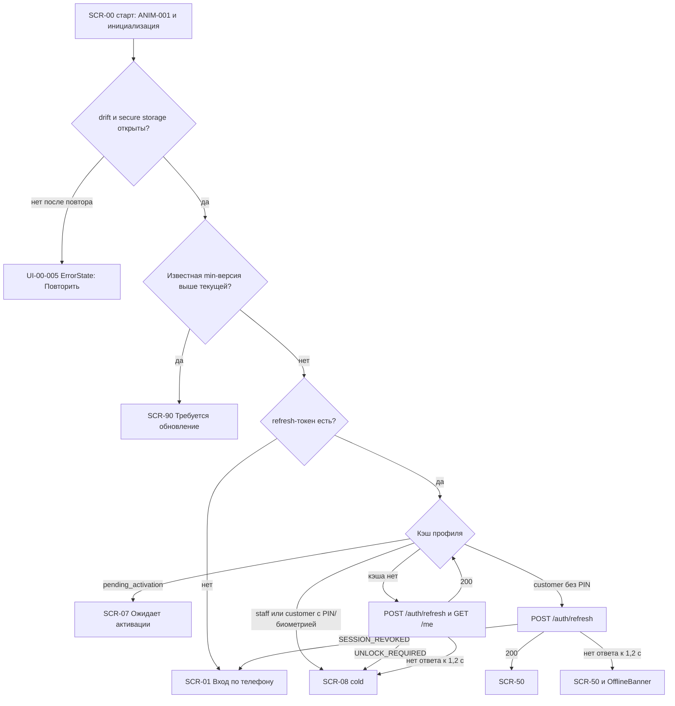
#### 7. Состояния экрана
| Состояние | Что видно | Выход |
|---|---|---|
| Загрузка (≤ 400 мс) | логотип (ANIM-001), без индикатора | решение → переход |
| Долгая загрузка (> 400 мс) | + `AppProgress.linear`; после 2 с — подпись «Проверяем сессию…» | решение или 1,2 с |
| Успех | — (мгновенный переход) | переход по §6 |
| Ошибка сервера (5xx) при refresh | не показывается на splash; переход по кэшу (строка 9) с `ErrorState.banner` на целевом экране | — |
| Пустой результат | неприменимо (нет списков) | — |
| Нет сети / офлайн | splash не задерживается; переход по кэшу или на SCR-01; `OfflineBanner.offline` на целевом экране | — |
| Нет разрешений | неприменимо (splash не запрашивает разрешения) | — |
| Требуется обновление | переход на SCR-90 (426) | — |
| Повторная попытка | только для сбоя инициализации (UI-00-005) | «Повторить» |
| Устаревшие данные | неприменимо на splash (возраст кэша показывает целевой экран) | — |
| Step-up | неприменимо | — |
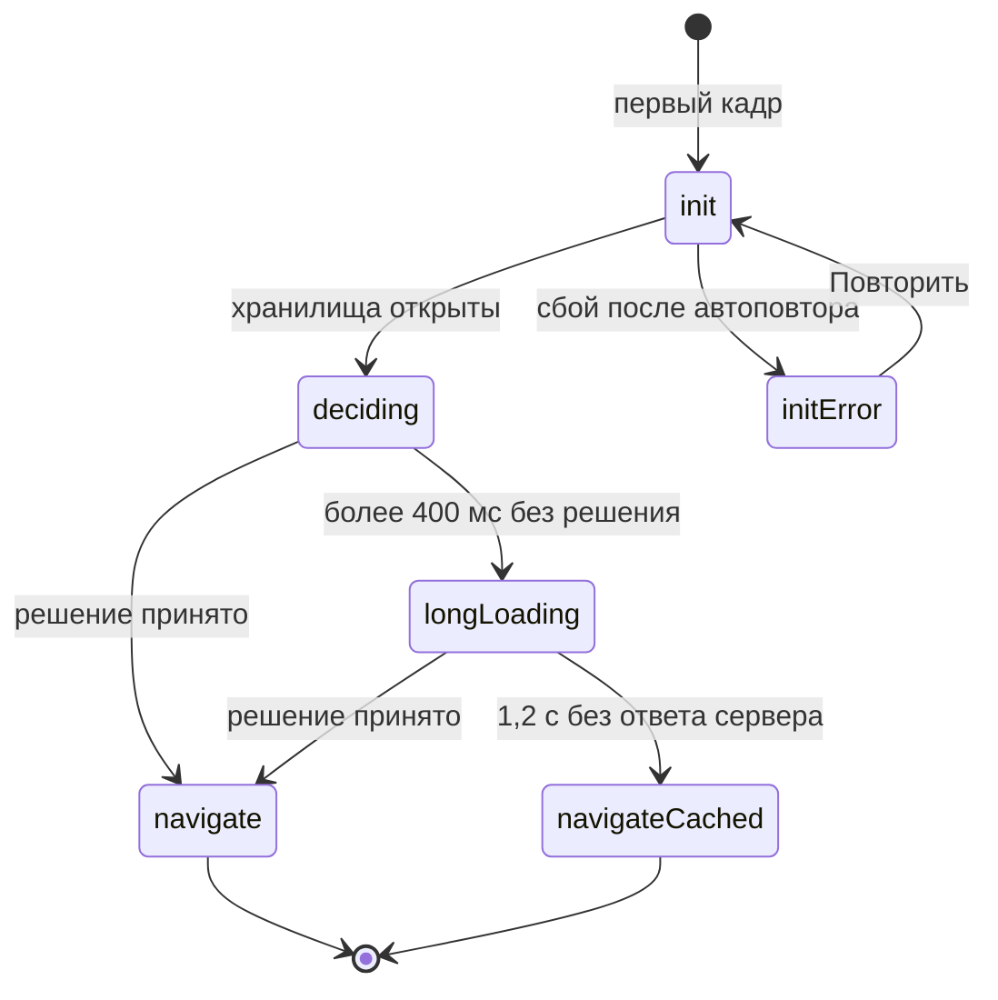
#### 8. Валидация и сообщения
Ввода нет. Тексты: `splash_status_checking` «Проверяем сессию…»; `splash_status_refreshing` «Обновляем данные…»; `splash_version` «Версия {version} ({build})»; `splash_version_terminal` «Версия {version} ({build}) · {deviceName}»; `splash_init_error_title` «Не удалось запустить приложение»; `splash_init_error_body` «Повторите попытку. Если ошибка повторяется, обратитесь в поддержку»; `ds_button_retry` «Повторить»; `splash_logo_a11y` «Логотип Оптомстрой».

#### 9. Источники данных, API, состояние приложения, бизнес-правила
| Данные | Источник | Правило |
|---|---|---|
| Версия приложения, платформа | `package_info`; передаются в каждом запросе `X-App-Version`, `X-Platform` | ядро §16 п.4, D-46 |
| Минимальная/рекомендуемая версия | заголовки `X-Min-App-Version`, `X-Recommended-App-Version` последнего ответа сервера, кэш `app_meta.min_app_version_seen` / `recommended_app_version_seen` (07 §11.2) | ядро §18.2 п.12 |
| Наличие сессии | refresh-токен в `flutter_secure_storage` | ядро §18.2 п.2; 09 §8.5 |
| `deviceId` | secure storage; если нет — генерируется UUID v4 и сохраняется до первого запроса | ядро §18.2 п.3 |
| Кэш профиля | `app_meta` (без телефона и ФИО) + `profile_display_name` в secure storage (§0.4) | 09 §9.3; 11 §8.1 |
| Обновление токена (только `customer` без PIN или нет кэша профиля) | `POST /auth/refresh {refreshToken, kind: "standard"}` + `X-Device-Id`; `GET /me` | 08 §4.1.3, §4.3.1; 09 §8.3 |
| Решение о блокировке холодного старта | D-48 (PIN обязателен для `staff`), ядро §17.2 | 09 §8.8, §9.3 |

Сеть для гостя и для `staff` на splash **не требуется** (решение локальное) — это обеспечивает NFR-PERF-005 (≤ 2,5 с до рабочего экрана) и отсутствие зависания на splash без сети.

#### 10. Действия по ролям и ограничения безопасности
| Роль / статус | Куда ведёт splash | Ограничение |
|---|---|---|
| гость (нет refresh) | SCR-01 | — |
| `seller`, `senior_seller`, `admin` / `cashier` / `owner` | SCR-08 `cold` → после разблокировки главный экран роли (SCR-10 / SCR-30 / SCR-48) | рабочий экран `staff` никогда не открывается без PIN/биометрии при холодном старте (D-48); access-токен до разблокировки не запрашивается (Android/iOS) или не выдаётся (Windows, `UNLOCK_REQUIRED`) |
| `pending_activation` | SCR-07 | доступ только к `/me`, `/me/profile`, `/me/consents`, `/me/pin`, `/me/biometrics`, `/auth/*` (09 §2.2) |
| `customer` (Q-001) | SCR-50 или SCR-08 (если включил PIN/биометрию) | финансы — только после `customer_link.confirmed` |
| `blocked` / `deleted` | SCR-01 + `SESSION_REVOKED` (сервер отзывает сессии при блокировке) | navigation G-4 |

Безопасность: splash не показывает ПДн (имя, телефон); имя терминала — только на Windows; тексты не раскрывают причин отзыва сессии.

#### 11. Повторное нажатие, двойной запрос, «Назад», перезапуск
- Повторных нажатий нет (кроме UI-00-005 — одна операция в полёте).
- Двойной запрос: `POST /auth/refresh` выполняется single-flight (`AuthInterceptor`); параллельные провайдеры ждут один результат (09 §8.3).
- «Назад»: сворачивает приложение; при возврате — продолжение с того же шага проверки.
- Перезапуск во время splash: проверка начинается заново; потеря ответа refresh покрывается окном грации 30 с (09 §8.3).
- Горячий старт (возврат из фона) — splash **не** показывается: либо прежний экран, либо overlay SCR-08 (09 §8.8, 03 §12.2).

#### 12. Требования к платформам
| Платформа | Требование |
|---|---|
| Android 7.0+ (API 24) | нативный splash `flutter_native_splash`: фон #FFFFFF, иконка 1152×1152 (Android 12+ — маска, ⅓ поля) — визуально совпадает с SCR-00; Flutter-кадр ≤ 600 мс |
| iOS 15.5+ | LaunchScreen со статичным знаком на белом; переход без «скачка» позиции знака |
| Windows 10/11 (POS) | нативного splash нет; окно открывается с SCR-00; клавиатура и HID-сканер игнорируются; иконка окна `.ico` 256 |
| Планшет | как medium; поворот экрана не перезапускает проверку |

#### 13. Критерии приёмки
| ID | Критерий (проверяемый) |
|---|---|
| AC-UI-00-001 | При холодном старте без сети и без refresh-токена SCR-01 открывается не позднее 1,2 с от первого кадра Flutter; индикатор UI-00-002 при решении ≤ 400 мс не появляется (видеозапись 60 fps, 10 запусков). |
| AC-UI-00-002 | Знак появляется по ANIM-001: opacity 0→1 и scale .92→1 за 600 ± 50 мс, wordmark стартует через 120 мс (покадровый анализ). |
| AC-UI-00-003 | При искусственной задержке `/auth/refresh` 1 с индикатор появляется в 400 ± 50 мс; подпись «Проверяем сессию…» не появляется раньше 2 с. |
| AC-UI-00-004 | При задержке ответа сервера 5 с переход происходит в 1,2 с по кэшу профиля; на целевом экране виден `OfflineBanner`. |
| AC-UI-00-005 | Пользователь `staff` с действующим refresh-токеном при холодном старте всегда попадает на SCR-08 `cold` (Android, Windows); рабочий экран до ввода PIN/биометрии не отображается ни на одном кадре. |
| AC-UI-00-006 | На Windows при холодном старте `staff` приложение не получает access-токен до `POST /auth/unlock` (журнал запросов: нет успешного `/auth/refresh`). |
| AC-UI-00-007 | Кэш профиля `pending_activation` → SCR-07; отсутствие refresh-токена → SCR-01 с `Hero` логотипа 300 мс. |
| AC-UI-00-008 | Ответ 426 `APP_UPDATE_REQUIRED` (или кэш `X-Min-App-Version` выше текущей) → SCR-90 «Требуется обновление», строка версии видна. |
| AC-UI-00-009 | `SESSION_REVOKED` на refresh → SCR-01 с баннером «Сессия завершена. Войдите снова»; refresh удалён, `deviceId` сохранён. |
| AC-UI-00-010 | При включённом reduce-motion логотип появляется crossfade ≤ 80 мс без scale; переход выполняется сразу после решения. |
| AC-UI-00-011 | Нажатия клавиш и HID-скан во время splash не попадают в поле телефона SCR-01 (поле пустое после перехода). |
| AC-UI-00-012 | Сбой secure storage (эмуляция `InvalidKeyException`) → после «Повторить» и повторного сбоя ключи очищены, открыт SCR-01, приложение не падает. |

#### 14. Трассировка
| Требование | SRC / правила |
|---|---|
| Анимированный splash, логотип, плавное появление, качество анимации | SRC-B-060, SRC-B-061, SRC-B-062, SRC-B-063; 03 §12, ANIM-001; DS-067…070 |
| Индикатор только при реальной загрузке | SRC-B-064; 03 §9.63 |
| Проверка состояния приложения и сессии | SRC-B-065, SRC-B-065a; 09 §4.5, §8.3, §8.8 |
| Корректный переход, без искусственной задержки, авторизованный — к рабочему экрану | SRC-B-066, SRC-B-067, SRC-B-068 (для `staff` — через одношаговую разблокировку SCR-08 по D-48, ядро §17.2) |
| Состав спецификации экрана | SRC-F-001…019 |

## 2. SCR-01 — Вход: ввод телефона с персонажем (маршрут `/auth/phone`, роль: гость, R1: да)
### SCR-01 — Вход по номеру телефона (`/auth/phone`; гость; R1)
#### 1. Назначение и роль пользователя
Единственная точка входа R1 для всех ролей (D-09): пользователь (сотрудник или новый пользователь) вводит номер телефона Кыргызстана, приложение запрашивает одноразовый код `POST /auth/otp/request` и открывает SCR-02. Ответ сервера нейтральный — экран не сообщает, зарегистрирован ли номер (D-10, SRC-B-103…106); ветвление «вход / регистрация» происходит только после верного кода. Экран белый, минималистичный, с дружелюбным персонажем, реагирующим на ввод (SRC-B-069…078). Роль — гость (нет сессии) либо пользователь, выбравший «Войти по номеру телефона» на SCR-08 или «Сменить аккаунт».

**Расхождение с макетом входа** (`photo_2026-10-18_16-03-36.jpg`, ядро §14): макет содержит тёмный фото-фон склада, поля «Логин или телефон» и «Пароль», «Запомнить меня», «Забыли пароль?», выбор сотрудника (Абдулла, Достон, Алишер — продавцы; Ислом — старший продавец), «Вход по карте сотрудника», «Ваши данные защищены», «© 2024 OptomStroy», «Техническая поддержка». ТЗ следует промту: телефон + OTP, белый экран с персонажем (D-09). Из макета сохраняются: логотип, подзаголовок «Рабочее место продавца», четыре преимущества (expanded), «Техническая поддержка», строка ©, плашка «Ваши данные защищены» (Q-200). Пароль, «Запомнить меня», выбор сотрудника и карта — R2 (Q-002); места под них в R1 не резервируются визуально. Мелкие отличия от макета, принятые в R1: (1) иконка-замок в синем круге над карточкой входа не переносится — визуальный якорь экрана — персонаж `Mascot` (D-40, SRC-B-069b); тему защиты на expanded передаёт плашка «Ваши данные защищены» (UI-01-016, иконка `verified_user`); (2) иконки преимуществ приведены к макету: корзина `shopping_cart`, коробка `inventory_2`, документ `description`, люди `group` (UI-01-014); (3) футер макета «© 2024 OptomStroy. Все права защищены.» заменён на «© {year} Оптомстрой. Все права защищены.» — год текущий, а не фиксированный 2024 (`auth_footer_copyright`); (4) wordmark и футер макета пишут бренд латиницей «OptomStroy», в ТЗ — «Оптомстрой»; wordmark берётся из asset логотипа (Q-006), окончательное написание бренда в текстах — Q-200.

#### 2. Структура экрана
| Класс окна | Сверху вниз, слева направо |
|---|---|
| compact (< 600) | `SafeArea`; строка шапки 56: слева `SplashLogo.auth` (знак 32 + wordmark `title`), справа `AppIconButton` «?» (поддержка) → отступ `ds.space.6` 24 → `Mascot` 160 по центру → `ds.space.6` 24 → заголовок `h2` по центру → `ds.space.2` 8 → подзаголовок `body` по центру → `ds.space.6` 24 → подпись поля «Номер телефона» → `PhoneField.auth` (высота 56, на всю ширину − 2×16) → подсказка/ошибка `caption` → `ds.space.6` 24 → `AppButton.primary` L 52 «Получить код» (на всю ширину) → `ds.space.4` 16 → текст о SMS (`caption`, по центру) → прижат к низу: футер «© 2026 Оптомстрой · Техническая поддержка». При открытой клавиатуре: персонаж уменьшается до 96 (200 мс), при высоте окна < 640 — скрывается; кнопка остаётся над клавиатурой (прокрутка `Scrollable.ensureVisible`) |
| medium (600–1023) | фон `background`; карточка 480 по центру (радиус `ds.radius.xl` 20, `ds.elevation.2`, отступ 24): шапка карточки (логотип слева, ссылка «Техническая поддержка» справа) → `Mascot` 200 → заголовок `h1` → подзаголовок → поле → кнопка (ширина карточки) → текст о SMS; под карточкой — футер © и версия |
| expanded (≥ 1024) | две колонки на фоне `background`: слева бренд-панель 560 (фон `surfaceVariant`): логотип `SplashLogo.auth`, подзаголовок «Рабочее место продавца», `Mascot` 200 по центру панели, 4 преимущества столбцом (скрываются при высоте окна < 720), внизу плашка «Ваши данные защищены»; справа по центру оставшейся ширины — карточка 480 (`ds.radius.xl` 20) с заголовком, подзаголовком, полем, кнопкой, текстом о SMS; низ окна: слева «© 2026 Оптомстрой · Версия 1.0.0 · {deviceName}», справа «Техническая поддержка» |
| large (≥ 1600) | как expanded; бренд-панель и карточка не растут, центрируются |

#### 3. Таблица элементов
| № | UI-ID | Элемент | Компонент (03/ядро §8.5) | Расположение/размер/отступы/выравнивание | Токены | Состояния | Поведение | Источник данных | Роли | Правило |
|---|---|---|---|---|---|---|---|---|---|---|
| 1 | UI-01-001 | Логотип | `SplashLogo.auth` | compact — слева в шапке 56 (знак 32); medium — шапка карточки; expanded — верх бренд-панели, отступ 32 | знак — цвет asset (Q-006); wordmark `title`/`h3` 600 `textPrimary` | default; empty (нет asset → wordmark) | не кликабелен; цель `Hero` `splash_logo` | assets | гость | D-16, Q-006 |
| 2 | UI-01-002 | «Техническая поддержка» | `AppIconButton.standard` «?» (`help`, 24, цель 48) на compact; `AppButton.text` S на medium+ | compact — справа в шапке; medium — справа в шапке карточки; expanded — низ окна справа | иконка `textSecondary`; текст `primary` | default, hover, pressed, focused | открывает `AppBottomSheet` (compact) / диалог 400 (medium+) «Поддержка»: телефон и мессенджер из настроек; кнопки «Позвонить» (`tel:`), «Скопировать номер»; доступно офлайн из кэша | `app_settings.support_contacts` `[НОВОЕ ИМЯ]` (кэш `app_meta`; при отсутствии — `privacy_contact`) | гость | макет входа; Q-200 |
| 3 | UI-01-003 | Персонаж | `Mascot.auth` (Rive `MascotAuth`) | compact — по центру, 160 (96 при клавиатуре, скрыт при высоте < 640); medium — 200 в карточке; expanded — 200 в бренд-панели | палитра 03 §13.2; фон прозрачный | `idle`, `typing`, `verifying`, `error`, `retry` (на этом экране `success` не используется) | реагирует на события §0.3; тап — лёгкий кивок 200 мс без функции; `excludeSemantics` кроме метки состояния | `MascotController` ← `AuthFlowNotifier` | гость | D-40; SRC-B-069b…078 |
| 4 | UI-01-004 | Заголовок «Вход по номеру телефона» | текст | под персонажем через 24; по центру (compact, medium), слева в карточке (expanded) | `h2` 24/32/600 (compact), `h1` 28/36/700 (medium+), `textPrimary` | default | — | ARB `auth_phone_title` | гость | SRC-B-069a |
| 5 | UI-01-005 | Подзаголовок | текст | под заголовком через 8; ширина ≤ 400 | `body` 14/20 `textSecondary` | default | не упоминает регистрацию (D-10) | ARB `auth_phone_subtitle` | гость | SRC-B-106 |
| 6 | UI-01-006 | Поле номера телефона | `PhoneField.auth` | ширина: compact — 100 % − 32; medium+ — 100 % карточки (≤ 400); высота 56; подпись над полем через 4; префикс «+996» с иконкой флага КР 20 (плейсхолдер до 03) | контейнер `surface`, обводка 1 px `borderStrong` → 2 px `primary` (фокус) / `error`; префикс `bodyLg` 500 `textSecondary`; цифры `h3` 20/500 `tnum` `textPrimary`; плейсхолдер «XXX XXX XXX» `textTertiary` | empty, focused, filled-valid, error, disabled (во время запроса и cooldown), loading (спиннер 16 в суффиксе) | маска `XXX XXX XXX`, только цифры, нормализация вставки, автофокус; кнопка очистки × в суффиксе при непустом поле; подробно — §4 | ввод пользователя; `phone_numbers_parser` (регион KG, тип `mobile`) | гость | SRC-B-090…097; 09 §3; 03 §9.4 |
| 7 | UI-01-007 | Подсказка / ошибка под полем | текст `caption` | под полем через 4; слева; до 2 строк | подсказка `caption` `textSecondary`; ошибка `caption` `error` + иконка `error` 16 | hint, counter («Ещё {n} цифр»), error | меняется при вводе; ошибка исчезает при изменении значения; `liveRegion` для ошибки | локальная валидация, коды 08 | гость | 09 §3.3; SRC-B-097 |
| 8 | UI-01-008 | Кнопка «Получить код» | `AppButton.primary` L 52, `expand` | под подсказкой через 24; compact — на всю ширину; medium+ — ширина карточки | фон `primary` #0053FA, текст `onPrimary` `bodyLg` 600; disabled — `disabledBg`/`disabledText` | disabled (номер невалиден / офлайн / cooldown), enabled, hover, pressed, focused, loading | вызывает `POST /auth/otp/request`; при cooldown текст «Получить код через 0:42» | `AuthFlowNotifier` | гость | D-10; 09 §4.3 |
| 9 | UI-01-009 | Текст о SMS и ссылка «Подробнее» | текст `caption` + `AppButton.text` S inline | под кнопкой через 16; по центру; ≤ 3 строки | `caption` `textSecondary`; ссылка `primary` | default | «Подробнее» открывает `AppBottomSheet` с полным текстом Шаблона 2 (11 §10.3) | ARB `auth_phone_sms_notice`, `auth_phone_sms_notice_more` | гость | 11 §10.3 Шаблон 2; Q-027 |
| 10 | UI-01-010 | Футер: ©, версия, имя терминала | текст `caption` | compact — низ экрана над `SafeArea`; medium — под карточкой; expanded — низ окна слева | `caption` 12/16 `textSecondary` | default | статичен; на compact содержит ссылку «Техническая поддержка» (дублирует 2) | `package_info`; `app_meta` | гость | макет входа |
| 11 | UI-01-011 | Баннер «Нет сети» | `OfflineBanner.offline` | над контентом, под строкой состояния, на всю ширину, 40 (compact 48) | `warningContainer`/`warning`, иконка `cloud_off` | скрыт / offline / reconnecting / backOnline (3 с) | сдвигает контент (ANIM-019); кнопка 8 disabled с подсказкой «Нужна сеть для входа»; ввод номера разрешён | `connectivity_plus` + результат последнего запроса | гость | D-32; 03 §9.41 |
| 12 | UI-01-012 | Баннер ошибки сервера / лимита | `ErrorState.banner` (medium+) / `AppSnackbar` 8 с (compact) | над полем (medium+) / снизу над кнопкой (compact) | `errorContainer`/`error`; для лимита — `warningContainer`/`warning` | скрыт; `sms_provider`; `rate_limited` (с таймером `tnum`); `server_error` (с `requestId`) | «Повторить» (для `SMS_PROVIDER_ERROR`, 5xx, таймаут); для лимита — таймер, по нулю баннер исчезает и кнопка 8 активируется | коды 08 §2.4, `retryAfter` | гость | 09 §3.3; SRC-B-097 |
| 13 | UI-01-013 | Подзаголовок бренд-панели «Рабочее место продавца» (только expanded) | текст | бренд-панель, под логотипом через 8 | `bodyLg` 16/24 `textSecondary` | default | статичен | ARB `auth_brand_subtitle` | гость | макет входа ядро §14 |
| 14 | UI-01-014 | Четыре преимущества (только expanded) | список: иконка 24 (`shopping_cart`, `inventory_2`, `description`, `group` — как на макете) + `label` 600 + `caption` | бренд-панель, под персонажем через 24, шаг 16; скрывается при высоте окна < 720 | иконки `primary`; заголовки `textPrimary`; подписи `textSecondary` | default | статичны | ARB `auth_brand_feature_1…4_title/_body` | гость | макет входа (тексты макета) |
| 15 | UI-01-015 | Резерв: альтернативные способы входа (R2) | — | не отображается в R1 | — | — | место в макете не резервируется; появится при решении Q-002 | — | — | Q-002, D-09 |
| 16 | UI-01-016 `[НОВЫЙ UI-ID]` | Плашка «Ваши данные защищены» (только expanded) | иконка `verified_user` 20 + `caption` | низ бренд-панели, отступ 24 | `textSecondary` | default | статична; тап — ничего | ARB `auth_brand_secure` | гость | макет входа; Q-200 |
| 17 | UI-01-017 `[НОВЫЙ UI-ID]` | Информационный баннер причины возврата на вход | `ErrorState.banner` вариант `info`/`warning`, с крестиком | над заголовком (compact — под шапкой), на всю ширину карточки | `infoContainer`/`info` или `warningContainer`/`warning` | скрыт; `session_revoked`; `reuse_detected`; `registration_expired`; `registration_resume`; `registration_cancelled`; `phone_registered`; `pin_locked`; `pin_reset`; `bio_invalidated`; `device_mismatch` (тексты `auth_entry_*`, §11) | закрывается крестиком или при первом вводе; не блокирует ввод | параметр перехода (`AuthEntryReason`) из SCR-00/02/03/04/08/90 | гость | 09 §8.3, §9.3; navigation §4.2 |

#### 4. Поведение каждого контрола
**UI-01-006 `PhoneField` (09 §3.2–§3.4; SRC-B-090…097).**
1. Автофокус при открытии: compact — с поднятием цифровой клавиатуры (`TextInputType.phone`); medium/expanded — курсор в поле без изменения раскладки. Если экран открыт поверх баннера UI-01-017, фокус всё равно в поле.
2. Префикс «+996» с флагом — несъёмный, не редактируется, курсор в него не встаёт; выбора страны в R1 нет (SRC-B-092, 093).
3. Принимаются только цифры; буквы и символы отбрасываются без ошибки. Маска по мере ввода: пробел после 3-й и 6-й цифры (`555 123 456`); курсор не встаёт внутрь разделителя; `Backspace` перед пробелом удаляет цифру слева от него; выделение и замена части номера работают как в обычном поле (SRC-B-091, 096).
4. Ведущий «0», введённый первой цифрой, удаляется автоматически (национальный префикс КР) `[ТИПОВО: метаданные libphonenumber KG]`.
5. Вставка из буфера (`Ctrl+V`, контекстное меню, долгое нажатие → «Вставить»): `0555123456` → `555 123 456`; `996555123456` → `555 123 456`; `+996 555 12 34 56` → `555 123 456`; `8 (555) …` → ошибка формата; больше 9 цифр после нормализации — лишние отбрасываются и показывается предупреждение `auth_phone_error_long`.
6. Подсказка UI-01-007: пусто — «Введите 9 цифр после +996»; 1–8 цифр — «Ещё {n} цифр» (плюрал); 9 цифр и номер валиден по `isValid(type: mobile)` — подсказка скрывается, кнопка 8 активна.
7. Кнопка очистки × (суффикс, цель 48): очищает поле, фокус остаётся, персонаж остаётся в `typing`; при пустом поле не показывается.
8. Валидация: при вводе — только счётчик; при потере фокуса и при отправке — полная (§8). Ошибка сбрасывается при любом изменении значения.
9. Во время запроса (`loading`) поле `readOnly`; при `OTP_RATE_LIMITED` поле **редактируемо** (можно ввести другой номер — таймер относится к номеру): при изменении номера баннер лимита скрывается и кнопка становится активной.
10. Клавиатура Windows: `Enter` — то же, что кнопка 8 (если активна); `Esc` — снимает фокус; `Tab` — к кнопке 8, затем к ссылке «Подробнее», «Техническая поддержка». HID-сканер не перехватывается (§0.1).
11. Долгое нажатие в поле — системное меню (вставить/выделить); других действий нет.
12. Возврат с SCR-02 («Изменить номер», «Назад») — поле заполнено прежним номером, курсор в конце, кнопка активна (SRC-B-095).

**UI-01-008 «Получить код».**
1. `disabled`, пока номер невалиден, нет сети, идёт cooldown/лимит или запрос в полёте; подсказка причины — в UI-01-007/011/012.
2. Нажатие (тап, `Enter`, `Space`): нормализация в E.164 → если текущий номер совпадает с номером активного `challengeId` в памяти и TTL кода не истёк — запрос **не** отправляется, выполняется переход на SCR-02 с существующим `challengeId` (экономия SMS, 09 §4.4); иначе — `POST /auth/otp/request {phone, purpose: "login_or_register", locale: "ru", attestation: null}` с заголовками `X-Device-Id`, `X-App-Version`, `X-Platform`.
3. На время запроса — `loading` (ширина фиксирована), поле `readOnly`, персонаж `verifying`; через 1 с без ответа под кнопкой подпись «Отправляем код…».
4. Повторное нажатие, двойной тап, `Enter` во время запроса — игнорируются (флаг `inFlight`).
5. Ответ `202` → переход на SCR-02 (ANIM-024), передаются `challengeId`, `resendAfterSec`, `otpTtlSec`, `codeLength`, `phoneMasked`, `deliveryHint` и номер (в памяти).
6. Ошибки — §7 и §0.2; при `OTP_RATE_LIMITED`/`OTP_LOCKED` кнопка показывает обратный отсчёт «Получить код через {mm:ss}» по `retryAfter` (сервер — источник истины).
7. Долгое нажатие — ничего.

**UI-01-002 «Техническая поддержка».** Тап — лист/диалог контактов; повторный тап при открытом листе игнорируется; `Esc`/свайп вниз/тап вне — закрыть; работает офлайн (данные из кэша; если кэша нет — текст «Обратитесь к администратору магазина»).

**UI-01-009 «Подробнее».** Открывает `AppBottomSheet` (compact) / диалог 480 (medium+) с текстом Шаблона 2; кнопка «Понятно»; фокус возвращается на ссылку.

**UI-01-017 баннер причины.** Крестик закрывает; первый введённый символ в поле тоже закрывает баннер (не мешает вводу).

#### 5. Анимации
| ID | Элемент | Начальное → конечное | Триггер | Длительность / кривая | Ошибка | Reduce-motion |
|---|---|---|---|---|---|---|
| ANIM-028 | вход с SCR-00 | логотип splash → `SplashLogo.auth`; форма и персонаж fade-in | первый показ | 300 / 200 мс `emphasized` | — | crossfade 80 мс |
| ANIM-002, 003, 004, 011, 026 | персонаж | `idle` → `typing` (фокус) → `verifying` (запрос) → `error` / переход | §0.3 | 250 мс переходы; `verifying` loop 1,2 с, таймаут 15 с | `error` с текстом под полем | статичные кадры |
| ANIM-012 | поле номера | покой → shake ±4 lp, обводка `error` | ошибка валидации при отправке / `VALIDATION_FAILED` | 300 мс | — | без сдвига, только цвет и текст |
| ANIM-015 | кнопка 8 | hover/pressed: фон `primaryHover`/`primaryPressed`, scale .98 | указатель/тап | 150 мс | — | без scale |
| ANIM-019 | `OfflineBanner` | скрыт → slide-down 40 lp + fade | смена сети | 200 / 150 мс | — | fade 80 мс |
| ANIM-027 | снекбар ошибки (compact) | slide-up 8 lp + fade | ошибка сервера | 150 мс | — | fade 80 мс |
| Специфичная: уменьшение персонажа | `Mascot` | 160 → 96 | открытие клавиатуры (compact) | 200 мс `standard` | — | мгновенно |
| ANIM-024 | переход на SCR-02 | shared-axis X: SCR-02 slide-in 24 lp + fade | `202` | 300 мс | — | fade 80 мс |

#### 6. Переходы
| Откуда / куда | Событие | Передаваемые данные | Тип навигации |
|---|---|---|---|
| SCR-00 → SCR-01 | нет сессии / `SESSION_REVOKED` | `AuthEntryReason` (для UI-01-017) | `go` + `Hero` |
| SCR-08 → SCR-01 | «Войти по номеру телефона», «Сменить аккаунт», «Войти по SMS» (`PIN_LOCKED`), инвалидирование биометрии | `AuthEntryReason`; номер — только при «Войти по SMS»/«Забыли PIN?» для того же пользователя (из `GET /me` предыдущей сессии в памяти; на диске не хранится) | `go` |
| SCR-02 → SCR-01 | «Изменить номер» / «Назад» | номер (память), `challengeId` остаётся в памяти до TTL | `pop` |
| SCR-03/SCR-04 → SCR-01 | `REGISTRATION_TOKEN_INVALID`, `PHONE_ALREADY_REGISTERED`, отмена регистрации | номер (память), `AuthEntryReason`; черновик регистрации — §4.11 | `go` |
| SCR-90 «Сессия завершена» → SCR-01 | «Войти снова» | `AuthEntryReason=session_revoked` | `go` |
| SCR-01 → SCR-02 | `202` на `/auth/otp/request` | `challengeId` (query), номер и параметры кода (память) | `push` |
| SCR-01 → SCR-90 | 426 `APP_UPDATE_REQUIRED` | `minVersion`, `storeUrl` | блокирующий диалог |
| «Назад» на SCR-01 | Android — сворачивание приложения (корень гостевого стека); на Windows `Esc` — только снятие фокуса | — | — |
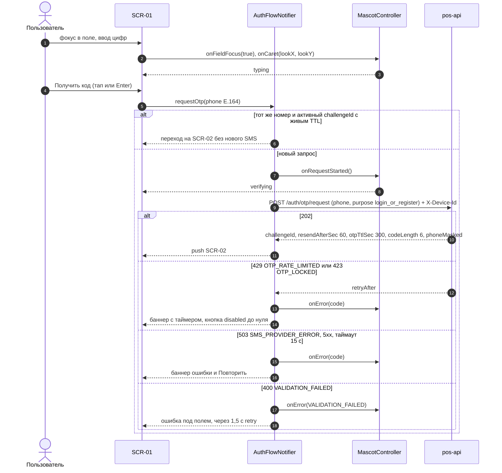
#### 7. Состояния экрана
| Состояние | Поле / кнопка | Персонаж | Текст |
|---|---|---|---|
| Ожидание | поле пустое в фокусе, кнопка disabled | `idle` → `typing` | подсказка «Введите 9 цифр после +996» |
| Ввод | маска, счётчик | `typing` | «Ещё {n} цифр» |
| Номер валиден | кнопка enabled | `typing` | — |
| Загрузка (запрос кода) | поле `readOnly`, кнопка `loading` | `verifying` | «Отправляем код…» (после 1 с) |
| Успех | переход на SCR-02 | — | — |
| Ошибка валидации | обводка `error`, shake | `error` → `retry` | §8 |
| Лимит / блокировка номера (`OTP_RATE_LIMITED`, `OTP_LOCKED`) | кнопка disabled с таймером | `error` (без авто-`retry`) | `auth_error_rate_limited` |
| Ошибка SMS-сервиса / сервера | баннер + «Повторить» | `error` | `auth_error_sms_provider` / `error_internal` |
| Нет сети | баннер, кнопка disabled, ввод разрешён | `idle` | `auth_phone_offline_hint` |
| Пустой результат | неприменимо | — | — |
| Нет разрешений | неприменимо (экран не требует разрешений; SMS-автозаполнение — на SCR-02) | — | — |
| Повторная попытка | «Повторить» в баннере повторяет тот же запрос | `retry` → `verifying` | — |
| Устаревшие данные | неприменимо | — | — |
| Step-up | неприменимо | — | — |
| Требуется обновление | SCR-90 C3 поверх | — | — |
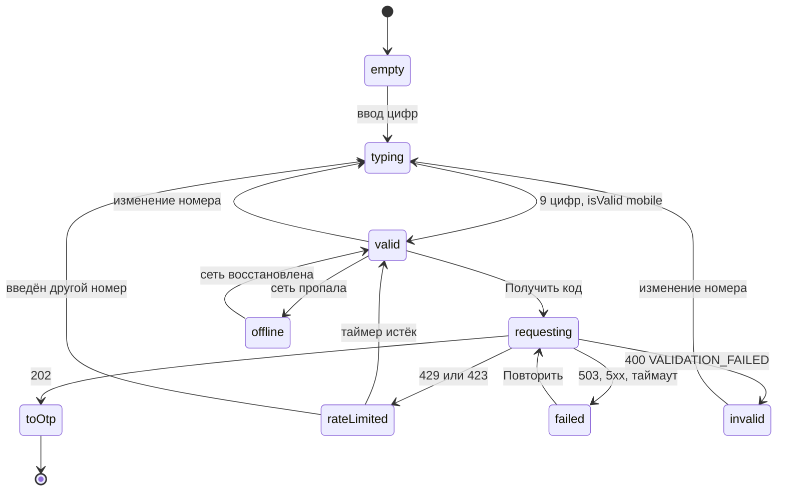
#### 8. Валидация и сообщения
| Условие | Когда | Ключ ARB | Текст |
|---|---|---|---|
| Пусто при отправке (`Enter` на пустом поле) | submit | `auth_phone_error_empty` | «Введите номер телефона» |
| Меньше 9 цифр | blur / submit | `auth_phone_error_short` | «Номер должен содержать 9 цифр после +996» |
| Больше 9 цифр после вставки | ввод | `auth_phone_error_long` | «Слишком много цифр. Проверьте номер» |
| Не мобильный / неизвестный диапазон KG | submit | `auth_phone_error_invalid` | «Похоже, номер указан неверно. Проверьте и попробуйте снова» |
| Формат «8 (…)» при вставке | ввод | `auth_phone_error_format` | «Введите номер в формате +996 XXX XXX XXX» |
| Сервер: `VALIDATION_FAILED` (phone) | ответ | `auth_phone_error_server_invalid` | «Сервер не принял номер. Проверьте формат +996 XXX XXX XXX» |
| `OTP_RATE_LIMITED` / `OTP_LOCKED` | ответ | `auth_error_rate_limited` | «Слишком много запросов. Подождите {seconds} с» (при ≥ 60 с — `auth_error_rate_limited_min` «Слишком много запросов кода на этот номер. Попробуйте через {minutes} мин») |
| `SMS_PROVIDER_ERROR` | ответ | `auth_error_sms_provider` | «Не удалось отправить SMS. Попробуйте позже» |
| Нет сети до запроса | до запроса | `auth_phone_offline_hint` | «Нужна сеть для входа» |
| Обрыв во время запроса | запрос | `auth_error_network` | «Нет связи с сервером. Проверьте сеть и повторите» |
| Таймаут 15 с | запрос | `auth_error_timeout` | «Сервер не ответил. Повторить» |
| Баннер причины возврата на вход (UI-01-017) | при открытии | `auth_entry_*` | тексты — словарь §11 (`auth_entry_session_revoked` «Сессия завершена. Войдите снова» и др.) |

Ни одно сообщение не сообщает, существует ли аккаунт (SRC-B-106). Ошибка выводится текстом под полем цветом `error` + иконка, не только цветом (A11Y-004); объявляется screen reader (`liveRegion`).

#### 9. Источники данных, API, состояние, бизнес-правила
| Что | Источник | Правило |
|---|---|---|
| Нормализация и валидация номера | `phone_numbers_parser` (`IsoCode.KG`, `PhoneNumberType.mobile`) | 09 §3.1–§3.3; AUTH-0xx |
| Запрос кода | `POST /api/v1/auth/otp/request` (публичный) → `202 {challengeId, resendAfterSec, otpTtlSec, codeLength, phoneMasked, deliveryHint}` | 08 §4.1.1; 09 §4.3; D-10 |
| Лимиты | сервер: 3/15 мин и 10/сутки на номер, IP и устройство, глобальный; клиент лишь отображает `retryAfter` | 09 §5.4; Q-004 |
| Нейтральность | одинаковые ответ и время для существующего и нового номера | 09 §4.1, §5.5 |
| Состояние потока | `AuthFlowNotifier` (Riverpod): номер, `challengeId`, `expiresAt`, `resendAvailableAt`, `inFlight` — только память | 09 §4.4 |
| Контакты поддержки | `app_settings.support_contacts` `[НОВОЕ ИМЯ]` через кэш | замечание к ядру №12 |
| Тексты согласий | Шаблон 2 (11 §10.3), версия текста — Q-027 | PRIV |

#### 10. Действия по ролям и ограничения безопасности
| Действие | Гость | Пользователь с сохранённой сессией (пришёл с SCR-08) | Примечание |
|---|---|---|---|
| Ввод номера, запрос кода | ✓ | ✓ (вход другим/тем же номером) | после успешного OTP-входа **другого** пользователя старая сессия завершается `POST /auth/logout`, локальные данные очищаются (09 §4.5) |
| Поддержка, «Подробнее» | ✓ | ✓ | офлайн |

Безопасность: номер не пишется на диск и в логи (только маска в логах сервера); запрос без Bearer; `X-Device-Id` обязателен; в release-сборке нет подсказок тестового режима; HID-сканер не перехватывается; ответы не раскрывают существование аккаунта (SRC-B-104…106).

#### 11. Повторное нажатие, двойной запрос, «Назад», перезапуск
- Повторное нажатие «Получить код» во время запроса игнорируется; после `202` — переход, повторный запрос на тот же номер в пределах TTL не отправляется (переиспользуется `challengeId`).
- Двойной запрос (двойной тап, `Enter` + тап) — один HTTP-запрос (`inFlight`); при сетевом обрыве «Повторить» отправляет тот же номер; сервер считает каждую отправку в лимите.
- «Назад» (Android) — сворачивание приложения; состояние формы сохраняется в памяти при возврате.
- Перезапуск приложения: поле пустое (номер не хранится на диске), исключение — незавершённая регистрация в пределах 15 мин (номер подставляется, §4.11); активный `challengeId` теряется — пользователь запрашивает код повторно (сервер может ответить `OTP_RATE_LIMITED` с остатком cooldown).
- Поворот экрана / смена класса окна — состояние поля и персонажа сохраняется.

#### 12. Требования к платформам
| Платформа | Требование |
|---|---|
| Android-телефон | клавиатура `phone`; кнопка над клавиатурой; персонаж уменьшается/скрывается; системная «Назад» сворачивает |
| Android-планшет / iOS-планшет | карточка 480; в ландшафте на compact-высоте (< 480) персонаж 96 слева от поля (2 колонки) |
| iOS | `textContentType: telephoneNumber`; безопасная зона |
| Windows-POS | физическая клавиатура: автофокус, `Enter` = «Получить код», `Tab` по порядку 6 → 8 → 9 → 2; мышь — hover 150 мс, курсор `click`/`text`; сенсорный монитор — системная экранная клавиатура Windows не вызывается автоматически (при необходимости — вручную) `[ТИПОВО: Q-008]`; HID-сканер игнорируется |
| Все | масштаб шрифта 1,3× — поле и кнопка без обрезки, текст переносится |

#### 13. Критерии приёмки
| ID | Критерий |
|---|---|
| AC-UI-01-001 | Экран белый (`surface`) на compact, без фото-фона; присутствуют персонаж, заголовок, поле с префиксом «+996», кнопка «Получить код»; отсутствуют поля логина/пароля, выбор сотрудника и «карта сотрудника». |
| AC-UI-01-002 | Ввод «555123456» отображается как «555 123 456» с префиксом «+996»; в запросе передаётся `"+996555123456"`. |
| AC-UI-01-003 | Вставка «0555123456», «996555123456», «+996 555 12 34 56» даёт «555 123 456»; вставка 12 цифр — первые 9 + текст «Слишком много цифр. Проверьте номер». |
| AC-UI-01-004 | Буквы и символы не вводятся; `Backspace` перед пробелом удаляет цифру слева; курсор не встаёт внутрь разделителя. |
| AC-UI-01-005 | Кнопка disabled при < 9 цифрах и при номере, не проходящем `isValid(mobile)`; на blur с 5 цифрами — «Номер должен содержать 9 цифр после +996». |
| AC-UI-01-006 | Двойной тап по кнопке в течение 200 мс отправляет ровно один `POST /auth/otp/request` (журнал сети). |
| AC-UI-01-007 | Для зарегистрированного и незарегистрированного номера экран ведёт себя одинаково: тот же `202`, переход на SCR-02, одинаковые тексты; время до перехода различается не более чем на 150 мс (медиана 20 прогонов). |
| AC-UI-01-008 | Ответ `429 OTP_RATE_LIMITED` с `retryAfter=842` → кнопка disabled с обратным отсчётом «через 14:02», поле редактируемо; ввод другого номера активирует кнопку. |
| AC-UI-01-009 | `503 SMS_PROVIDER_ERROR` → баннер «Не удалось отправить SMS. Попробуйте позже» и «Повторить»; персонаж в `error` без автоматического `retry`. |
| AC-UI-01-010 | Без сети: `OfflineBanner` виден, кнопка disabled, ввод номера возможен; при восстановлении сети кнопка активируется без перезапуска экрана. |
| AC-UI-01-011 | Персонаж: открытие — `idle`; фокус — `typing` (взгляд на поле, зрачки следуют каретке); запрос — `verifying`; потеря фокуса > 2 с — `idle`; при ошибке валидации — `error` → через 1,5 с `retry` → `typing`/`idle`. |
| AC-UI-01-012 | При reduce-motion персонаж — статичные кадры, shake отсутствует, ошибки видны цветом и текстом. |
| AC-UI-01-013 | Возврат с SCR-02 «Изменить номер» — поле содержит прежний номер; повторное «Получить код» для того же номера в пределах TTL не создаёт нового SMS (нет запроса `/auth/otp/request`). |
| AC-UI-01-014 | Windows: автофокус в поле, `Enter` отправляет запрос, `Tab` проходит 6 → 8 → 9 → 2; HID-скан штрихкода в поле не добавляет товар и не вызывает действий кроме ввода цифр. |
| AC-UI-01-015 | Expanded ≥ 1024: две колонки — бренд-панель 560 (логотип, «Рабочее место продавца», персонаж 200, 4 преимущества, «Ваши данные защищены») и карточка 480 `ds.radius.xl` (20); при высоте < 720 преимущества скрыты. |
| AC-UI-01-016 | Таймаут 15 с → персонаж `error`, текст «Сервер не ответил. Повторить», номер в поле сохранён. |
| AC-UI-01-017 | Переход с причиной `session_revoked` показывает баннер «Сессия завершена. Войдите снова»; баннер закрывается крестиком и при вводе первой цифры. |
| AC-UI-01-018 | Ни один текст экрана и ни одна ошибка не содержит слов о наличии/отсутствии аккаунта (ревью ARB-строк экрана). |

#### 14. Трассировка
| Требование | SRC / правила |
|---|---|
| Белый минималистичный экран с персонажем, реакции персонажа | SRC-B-069, 069a, 069b, 070…078; D-40; 09 §11; 03 §13 |
| Удобное поле, форматирование, код +996, валидация, изменение и редактирование номера, сообщения | SRC-B-090…097; 09 §3; 03 §9.4 |
| Поток: ввод номера → серверная проверка → OTP → экран подтверждения; нет аккаунта → регистрация после OTP | SRC-B-098…101 (нейтральное ветвление после OTP, 09 §5.5) |
| Проверка на сервере, защита от перебора и злоупотребления SMS, нераскрытие информации | SRC-B-103…106; 09 §4.1, §5.4 |
| SMS только на сервере, без секретов в приложении | SRC-B-111, SRC-B-112 (экран не содержит параметров SMSPro) |
| Ограничение частоты (отображение `retryAfter`) | SRC-B-117, SRC-E-128 |
| Описание форматирования телефона, отправки OTP | SRC-E-126, SRC-E-127 |
| Тексты централизованы (ARB) | SRC-B-075a; D-38 |
| Расхождение с макетом входа | ядро §14; Q-002, Q-200 |

## 3. SCR-02 — Подтверждение OTP (маршрут `/auth/otp`, роль: гость, R1: да)
### SCR-02 — Подтверждение кода из SMS (`/auth/otp?challengeId=`; гость; R1)
#### 1. Назначение и роль пользователя
Пользователь вводит 6-значный одноразовый код из SMS; приложение вызывает `POST /auth/otp/verify` и по ответу сервера: существующий активный пользователь «автоматически попадает в свой аккаунт» (SRC-B-102); новый номер — переход на регистрацию SCR-03 (SRC-B-101); `pending_activation` — SCR-07. Экран открывается одинаково для существующего и нового номера (SRC-B-100a, D-10). Политика кода: 6 цифр, срок действия 5 мин, ≤ 5 попыток, повторная отправка не раньше 60 с, лимиты отправок — на сервере (D-10, Q-004). Роль — гость.

#### 2. Структура экрана
| Класс окна | Сверху вниз, слева направо |
|---|---|
| compact | шапка 56: слева `AppIconButton` «←» (назад = изменить номер), справа «?» (поддержка) → `Mascot` 160 (72 при открытой клавиатуре; скрыт при высоте < 640) → `ds.space.6` → заголовок `h2` «Введите код из SMS» → `ds.space.2` → строка «Отправили на +996 555 123 456 · Изменить» → `ds.space.6` → `OtpField` 6 ячеек 48×56 (зазор 8, ширина 328, по центру) → `ds.space.2` → строка срока действия / ошибки → `ds.space.4` → строка статуса доставки (если есть) → `ds.space.6` → `AppButton.primary` L «Подтвердить» (на Android/iOS — только после первой ошибки, до этого место не резервируется; 09 §4.4) → `ds.space.4` → строка повторной отправки (таймер или ссылка) → `ds.space.2` → ссылка «Не приходит SMS?» → футер. Над клавиатурой — системная подсказка кода из SMS (ОС) |
| medium | карточка 480 (`ds.radius.xl` 20): шапка карточки: «← Изменить номер» (text) слева, «Техническая поддержка» справа → `Mascot` 200 → те же элементы; футер под карточкой |
| expanded | бренд-панель 560 (как SCR-01: логотип, «Рабочее место продавца», персонаж 200, преимущества) + карточка 480 справа; в карточке — «← Изменить номер» сверху слева, далее как medium |

#### 3. Таблица элементов
| № | UI-ID | Элемент | Компонент | Расположение/размер/отступы/выравнивание | Токены | Состояния | Поведение | Источник данных | Роли | Правило |
|---|---|---|---|---|---|---|---|---|---|---|
| 1 | UI-02-001 | Назад / «Изменить номер» | `AppIconButton` «←» (compact), `AppButton.text` S «← Изменить номер» (medium+) | compact — слева в шапке; medium+ — верх карточки слева | иконка `textSecondary`, текст `primary` | default, hover, pressed, focused, disabled (во время verify) | `pop` на SCR-01 с номером; `challengeId` хранится в памяти до TTL | `AuthFlowNotifier` | гость | 09 §4.4; SRC-B-095 |
| 2 | UI-02-002 | Персонаж | `Mascot.auth` | compact 160 (72 при клавиатуре); medium/expanded 200 | 03 §13.2 | `idle`, `typing`, `verifying`, `success`, `error`, `retry` | §0.3; при `success` — `SuccessCheck` UI-02-011 | `MascotController` | гость | D-40 |
| 3 | UI-02-003 | Заголовок «Введите код из SMS» | текст | центр (compact), слева (medium+) | `h2`/`h1` `textPrimary` | default | — | `auth_otp_title` | гость | 09 §4.4 |
| 4 | UI-02-004 | Номер + ссылка «Изменить» | `body` + `AppButton.text` S | под заголовком через 8; номер полностью `+996 555 123 456` `tnum` | `body` `textSecondary`, номер `textPrimary` 500, ссылка `primary` | default, disabled (во время verify) | «Изменить» = UI-02-001 | номер из памяти потока | гость | 09 §4.4 |
| 5 | UI-02-005 | Поле кода: 6 ячеек | `OtpField` (вариант 6) | 6 × 48×56 (44×52 при ширине < 360; 56×64 при шрифте 1,3×), зазор 8, по центру; одно скрытое поле ввода | ячейка `surface`, обводка 1 px `borderStrong`; активная — 2 px `primary`; цифра `h2` 24/600 `tnum`; плейсхолдер «•» `textTertiary`; ошибка — все `error`; успех — все `success` 400 мс; проверка — `primaryContainer` + пульс | empty, focused, filling, loading (verify), error, success, disabled (истёк / `OTP_LOCKED` / офлайн-отправка) | автофокус, автопереход, вставка, автозаполнение из SMS, автоотправка на 6-й цифре — §4 | ввод, ОС-автозаполнение | гость | 03 §9.5; 09 §4.4 |
| 6 | UI-02-006 | Подсказка / счётчик попыток / ошибка | `caption` | под ячейками через 8, по центру, ≤ 2 строки | `textSecondary` / `error` (+ иконка 16) / `success` | hint, attemptsLeft, error, verified | тексты §8; `liveRegion` | ответы 08 (`attemptsLeft`, `retryAfter`) | гость | SRC-B-119 |
| 7 | UI-02-007 | Повторная отправка: таймер / ссылка | `caption` `tnum` → `AppButton.text` M | под кнопкой 8 через 16, по центру | таймер `textSecondary`; ссылка `primary`; disabled `disabledText` | countdown («Отправить повторно через 0:59»), available («Отправить код повторно»), loading, disabled (лимит: таймер `retryAfter`) | `POST /auth/otp/request` с тем же номером → новый `challengeId`; §4 | `resendAfterSec`, `retryAfter` | гость | D-10; 09 §4.4 |
| 8 | UI-02-008 | Кнопка «Подтвердить» | `AppButton.primary` L 52, `expand` | под строкой доставки через 24 | как SCR-01 | hidden (Android/iOS до первой ошибки — 09 §4.4), disabled (< 6 цифр / истёк / заблокировано / офлайн), enabled, loading | ручная отправка: на сенсорных устройствах — только после ошибки (состояние `retry`); на Windows видна всегда (мышь, `Enter`) | — | гость | 09 §4.4 |
| 9 | UI-02-009 | «Не приходит SMS?» | `AppButton.text` S → `AppBottomSheet` (compact) / диалог 480 | под UI-02-007 через 8 | `primary` | default | лист: «Проверьте номер», «SMS может прийти в течение 1–2 мин», «Проверьте, не заблокированы ли SMS от Optomstroy», кнопки «Изменить номер», «Отправить код повторно» (если доступно), контакты поддержки; не раскрывает наличие аккаунта | `support_contacts` | гость | SRC-B-106 |
| 10 | UI-02-010 | Баннер блокировки | `ErrorState.banner` (`errorContainer`) + таймер `tnum` | над ячейками, на всю ширину карточки | `error`/`errorContainer` | скрыт; `locked` с обратным отсчётом | ячейки, кнопка 8 и ссылка 7 disabled до нуля; затем активна только «Отправить код повторно» | `OTP_LOCKED.retryAfter` | гость | D-10; 09 §5.3 |
| 11 | UI-02-011 | Галочка успеха | `SuccessCheck` 48 | справа-снизу от персонажа (перекрытие 8) на compact; справа от персонажа на medium+ | круг `success` #15803D, галочка `onSuccess` | скрыта; анимация; видна | появляется только после 2xx; тап по экрану во время показа — немедленный переход | ответ `/auth/otp/verify` | гость | SRC-B-074; ANIM-005 |
| 12 | UI-02-012 | «Нет сети» / ошибка сети | `OfflineBanner.offline` / `AppSnackbar` | баннер — верх экрана; снекбар — над кнопкой 8 | `warningContainer`/`warning` | скрыт, offline, reconnecting, backOnline | ввод цифр возможен; автоотправка откладывается до появления сети (отправляется автоматически, если код 6 цифр и TTL не истёк) | `connectivity_plus` | гость | D-32 |
| 13 | UI-02-013 | Футер | `caption` + «Техническая поддержка» | как SCR-01 UI-01-010 | `textSecondary` | default | как UI-01-002 | — | гость | — |
| 14 | UI-02-014 | Логотип бренд-панели (expanded) | `SplashLogo.auth` | как SCR-01 | как SCR-01 | default | статичен | assets | гость | Q-006 |
| 15 | UI-02-015 `[НОВЫЙ UI-ID]` | Срок действия кода | `caption` `tnum` | под ячейками (в позиции UI-02-006, когда нет ошибки) | `textSecondary`; последняя минута — `warning`; истёк — `error` | countdown «Код действует ещё 04:59»; expired | при нуле: ячейки disabled, текст «Код устарел. Запросите новый», ссылка 7 активна независимо от cooldown | `otpTtlSec` от момента `202` | гость | 09 §4.4; SRC-B-118 |
| 16 | UI-02-016 `[НОВЫЙ UI-ID]` `[УСЛОВНО: нет в 08]` | Статус доставки SMS (условно) | `caption` + иконка 16 | под строкой 15 через 8 | «Отправляем SMS…» `textSecondary` + спиннер 12; «SMS отправлено» `success`; «Не удалось отправить SMS» `error` | queued, sent, failed, скрыт | опрос раз в 3 с не дольше 30 с; при `failed` — ссылка 7 активна сразу | `GET /auth/otp/challenges/{challengeId}` `[НОВОЕ ИМЯ — эндпоинт 09 §4.3, отсутствует в ядре §7]`; без эндпоинта элемент не показывается | гость | 09 §4.3 |
| 17 | UI-02-017 `[НОВЫЙ UI-ID]` | Подсказка тестового режима | `caption` моноширинный | под строкой 16 | `info` | только сборки `ENV=dev`/`staging` и только если сервер вернул `devCode` | «dev: код {code}»; в `prod` не существует | ответ сервера dev/staging | гость | 09 §4.6, §5.8 |
| 18 | UI-02-018 `[НОВЫЙ UI-ID]` | Предложение включить биометрию после входа | `AppBottomSheet` (compact) / диалог 480: иконка `fingerprint`/`face` 48, заголовок, текст Шаблона 3, `AppCheckbox` согласия, «Включить», «Не сейчас» | поверх экрана после `success`, до перехода на рабочий экран | `primary`, `textSecondary` | скрыт; показан; loading | показывается один раз на устройство, если `biometricRefreshOffered=true`, биометрия ОС доступна и ещё не включена; «Включить» → согласие → `POST /me/biometrics` (step-up — §4) → системный промпт → шифрование `biometric_refresh`; «Не сейчас» — отметка `app_meta.bio_offer_dismissed_at` `[НОВОЕ ИМЯ — §0.4]`, повтор только из SCR-42 | ответ verify, `local_auth`, `GET /me`; `POST /me/biometrics`, `POST /auth/step-up` | `staff`, `customer` | 09 §9.2 шаг 2; 08 §4.3.6; SRC-B-081; D-13; Q-201 |

#### 4. Поведение каждого контрола
**UI-02-005 `OtpField`.**
1. Автофокус при открытии; compact — цифровая клавиатура `TextInputType.number`; `autofillHints: [AutofillHints.oneTimeCode]`.
2. Автозаполнение: Android — подсказка кода клавиатурой (autofill) и SMS User Consent API (системный запрос «Разрешить приложению прочитать это сообщение?», без разрешения `READ_SMS`) `[ТИПОВО: требует проверки на устройствах]`; SMS Retriever API не используется, т.к. шаблон `SMS_OTP_TEMPLATE` не содержит хэша приложения (09 §6.7, Q-029); iOS — `textContentType: oneTimeCode`, системное предложение кода над клавиатурой `[ТИПОВО]`; Windows — ручной ввод и вставка.
3. Ввод цифры заполняет текущую ячейку и переводит фокус на следующую; нецифровые символы игнорируются.
4. `Backspace`: в заполненной ячейке — очищает её; в пустой — переходит на предыдущую и очищает её. Тап по любой ячейке ставит курсор в первую пустую (не позволяет «дыр»).
5. Вставка (`Ctrl+V`, долгое нажатие → «Вставить», автозаполнение): берутся первые 6 цифр из буфера (пробелы и дефисы отбрасываются: «481 903» → «481903»); если цифр < 6 — заполняются первые ячейки.
6. Автоотправка: при заполнении 6-й ячейки (ввод, вставка, автозаполнение) немедленно `POST /auth/otp/verify` (кнопка 8 — дублёр). Если код с автоотправки получил ошибку — повторная автоотправка того же кода не выполняется; следующая — только после изменения цифр.
7. Во время проверки ячейки `primaryContainer` с пульсом (opacity 1→0.6→1, 1,2 с), ввод заблокирован.
8. После `OTP_INVALID`: все ячейки `error` + ANIM-012, через 300 мс очищаются, фокус в первую; текст с остатком попыток остаётся до следующего ввода.
9. После `OTP_LOCKED`, истечения срока или при офлайне без отправки — `disabled` (`disabledBg`).
10. Код в логах клиента, аналитике и снекбарах не появляется; в памяти обнуляется после ответа.

**UI-02-008 «Подтвердить».** Видимость — по 09 §4.4: на сенсорных устройствах (Android/iOS, планшет) кнопка **не показывается**, пока не было ошибки (основной путь — автоотправка на 6-й цифре); появляется (fade 150 мс) после первой ошибки проверки (`OTP_INVALID`, сетевая ошибка, таймаут — состояние `retry`) и остаётся до ухода с экрана; на Windows видна всегда (мышь). Первая редакция 02a и wireframe-auth показывали кнопку всегда — приведено к 09 («Замечания к ядру» №25). Активна при 6 цифрах, живом сроке, отсутствии блокировки; тап/`Enter`/`Space` → verify. Повтор во время запроса игнорируется. После сетевой ошибки текст кнопки «Повторить» — отправляет **тот же** `challengeId` + код. Результат повтора зависит от согласования 08 §4.1.2 ↔ 09 §5.6 («Замечания к ядру» №21): по действующему контракту 08 повтор кода, уже принятого сервером первым запросом, получает `422 OTP_EXPIRED` → «Код устарел. Запросите новый», ссылка повторной отправки активна независимо от cooldown; если первый запрос до сервера не дошёл — обычная проверка; после принятия предложения 09 §5.6 сервер в пределах 60 с выполняет новую ротацию той же сессии и пользователь входит.

**UI-02-007 повторная отправка.**
1. Обратный отсчёт от `resendAfterSec` (60 с) с момента `202`; формат «Отправить повторно через 0:59» (`tnum`).
2. По нулю — «Отправить код повторно» (активна). Также активна сразу при: истечении срока кода; `deliveryState=failed`; `OTP_LOCKED` после окончания `retryAfter`.
3. Нажатие → `POST /auth/otp/request` (тот же номер) → `202`: новый `challengeId` становится текущим, ячейки очищаются, срок и cooldown перезапускаются, снекбар «Код отправлен повторно», персонаж `retry` → `typing`. Предыдущий `challengeId` хранится в памяти как резервный до своего срока: если статус доставки нового кода стал `failed`, приложение возвращается к предыдущему `challengeId` и показывает «Не удалось отправить новый код. Введите код из предыдущего SMS» (09 §4.4, §5.3).
4. `429 OTP_RATE_LIMITED` → ссылка disabled с таймером `retryAfter`, текст `auth_error_rate_limited`; персонаж `error` без авто-`retry`.
5. Повторное нажатие во время запроса игнорируется.

**UI-02-001 / UI-02-004 «Изменить номер».** `pop` на SCR-01; текущий challenge не отменяется на сервере; при возврате с тем же номером в пределах срока — переход сюда без нового SMS, таймеры продолжаются от сохранённых значений (защита от обхода cooldown). Во время verify — disabled. Системная «Назад» (Android) и `Esc` (Windows) — то же.

**UI-02-009 «Не приходит SMS?».** Открывает лист; кнопки внутри дублируют 1 и 7 с теми же состояниями.

**UI-02-018 предложение биометрии.** «Включить» disabled, пока не отмечено согласие. Step-up: по 08 §4.3.6 и ядру §17.2 включение биометрии требует `X-Step-Up-Token`; механизма «засчитать свежий OTP-вход как step-up» (`stepUpUntil`, 09 §9.5) в 08 нет — вопрос вынесен в Q-201 (расширен) и «Замечания к ядру» №22. До решения поведение явное, без молчаливого пропуска:
1. Нажатие «Включить» → `POST /me/biometrics {enabled: true, biometricClass, consent}`; кнопка `loading`, повторные нажатия игнорируются (`inFlight`).
2. `403 STEP_UP_REQUIRED {stepUp: {allowedMethods, operation}}` и `pin` ∈ `allowedMethods` (PIN задан, `security.pinSet=true`) → `StepUpDialog` (SCR-90 B) с подсказкой `auth_bio_enable_stepup_hint`, метод PIN → `POST /auth/step-up {method: "pin", pin, operation}` (значение `operation` — из ответа 403, клиент его не придумывает) → повтор `POST /me/biometrics` с `X-Step-Up-Token`.
3. `pin` ∉ `allowedMethods` (PIN не задан) → OTP step-up автоматически **не** запускается (иначе вторая SMS подряд), снекбар `auth_bio_enable_later`, переход; включить можно из SCR-42.
4. `200 {biometricRefreshToken}` → создание ключа Keystore/Keychain с криптопривязкой → системный промпт (BiometricPrompt `BIOMETRIC_STRONG` + `CryptoObject` / Face ID / Touch ID) → шифрование `biometric_refresh` → переход.
5. Отмена `StepUpDialog` или `PIN_LOCKED` → снекбар `auth_bio_enable_later` → переход (биометрическая семья не выдана). Отмена системного промпта после выдачи токена → `POST /me/biometrics {enabled: false}` с тем же `X-Step-Up-Token` (отзыв неиспользованной семьи) → снекбар «Биометрия не включена» → переход.
6. После принятия Q-201 (сервер засчитывает свежий OTP-вход) шаг 2 не возникает; остальной поток не меняется.

«Не сейчас» → переход. На Windows лист не показывается (`biometricRefreshOffered=false`).

#### 5. Анимации
| ID | Элемент | Описание | Длительность | Ошибка | Reduce-motion |
|---|---|---|---|---|---|
| ANIM-024 | вход с SCR-01 | shared-axis X slide-in 24 lp + fade | 300 мс | — | fade 80 мс |
| ANIM-003 | персонаж | `typing`: взгляд на активную ячейку (`lookX` по индексу ячейки −1…1), микрокивок на цифру | 200 мс / 150 мс | — | кадр `typing.png` |
| ANIM-004 + пульс ячеек | проверка | персонаж `verifying`; ячейки `primaryContainer`, opacity 1→0.6→1 loop 1,2 с | до ответа, ≤ 15 с | таймаут → ANIM-011 | статичные ячейки `primaryContainer` + «Проверяем…» |
| ANIM-005 | успех | ячейки `success` 400 мс; улыбка 200 мс → `SuccessCheck` scale 0→1 250 мс + галочка 200 мс → пауза 400 мс → переход | ≤ 900 мс | — | crossfade ≤ 80 мс, переход через 300 мс |
| ANIM-011 + ANIM-012 | неверный код | персонаж покачивание ±4° ×2 (400 мс); ячейки shake ±4 lp (300 мс), `error`, очистка через 300 мс | 400 + 300 мс | повторная ошибка во время анимации — анимация не перезапускается, обновляется текст | только цвет и текст |
| ANIM-026 | после ошибки | `error` → через 1,5 с `retry` → `typing` | 300 мс | — | смена кадра |
| Специфичная: таймеры | UI-02-007, UI-02-015 | обновление раз в 1 с без анимации цифр (`tnum`, ширина стабильна); переход «таймер → ссылка» crossfade 150 мс | 150 мс | — | мгновенно |
| ANIM-025 | лист «Не приходит SMS?», UI-02-018 | slide-up 250 мс + overlay fade 200 мс | 250 мс | — | fade 80 мс |

#### 6. Переходы
| Событие | Куда | Данные | Навигация |
|---|---|---|---|
| `200 {status: "authenticated"}`, роль `seller`/`senior_seller`/`admin` | SCR-10 (или `from`, если разрешённый deep link) | токены сохранены до анимации; `GET /me` → кэш профиля | `go` (стек гостя очищается) после ANIM-005 и UI-02-018 |
| то же, `cashier` / `owner` / `customer` | SCR-30 / SCR-48 / SCR-50 | то же | `go` |
| то же, `staff` и `security.pinSet=false` (PIN не задан, например после сброса администратором) | экран «Задайте PIN» (SCR-08, UI-08-014, режим `firstSetup`) → затем главный экран роли | — | `go` |
| `200 {status: "pending_activation"}` | SCR-07 | токены сохранены | `go` |
| `200 {status: "registration_required"}` | SCR-03 | `registrationToken`, `registrationExpiresIn` (900 с), номер — память; черновик регистрации для того же номера подставляется | `pushReplacement` (возврат с SCR-03 — на SCR-01 с подтверждением) |
| Вход **другого** пользователя на устройстве с сохранённой сессией | перед переходом: `POST /auth/logout` старой сессии, очистка локальных данных прежнего пользователя (корзина-черновик прежнего пользователя удаляется) | — | 09 §4.5 |
| «Изменить номер» / «Назад» | SCR-01 | номер, `challengeId` (память) | `pop` |
| `409 DEVICE_MISMATCH` | SCR-01 с баннером UI-01-017 `device_mismatch` | номер | `go` |
| `403 FORBIDDEN` (пользователь заблокирован) | остаётся на SCR-02: `ErrorState.inline` «Доступ закрыт. Обратитесь к администратору магазина»; доступны «Изменить номер», поддержка | — | — |
| 426 | SCR-90 C3 | — | диалог |
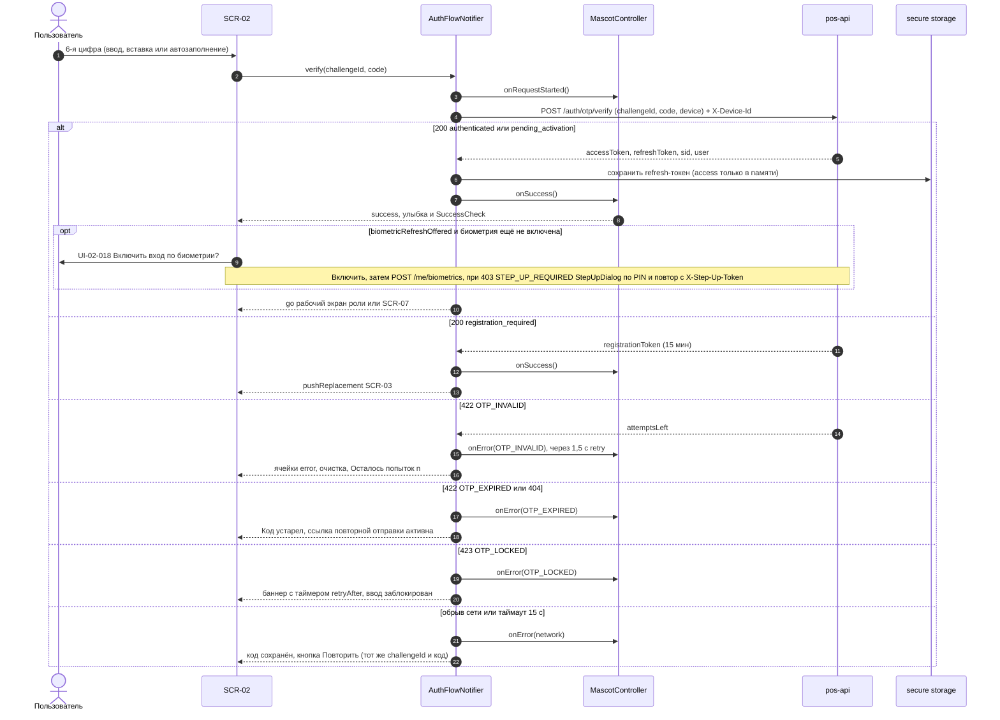
#### 7. Состояния экрана
| Состояние | Ячейки / кнопки | Персонаж | Текст |
|---|---|---|---|
| Ожидание | пустые, 1-я активна; кнопка 8 скрыта (Android/iOS) / disabled (Windows); таймер 60 с | `idle` → `typing` | «Код действует ещё 05:00» |
| Ввод | 1–5 цифр | `typing` | — |
| Загрузка (verify) | пульс, ввод заблокирован; кнопка `loading`; ссылки disabled | `verifying` | «Проверяем код…» |
| Успех | все `success` 400 мс; `SuccessCheck` | `success` | «Код подтверждён» |
| Ошибка: неверный код | `error` + shake → очистка | `error` → `retry` | «Неверный код. Осталось попыток: {n}» |
| Ошибка: код устарел (срок / `OTP_EXPIRED` / `NOT_FOUND`) | disabled; ссылка 7 активна | `error` (без авто-`retry`) | «Код устарел. Запросите новый» |
| Блокировка (`OTP_LOCKED`) | всё disabled кроме «Изменить номер» и поддержки; таймер | `error` → `idle` по действию | «Попытки исчерпаны. Запросите новый код через {seconds} с» |
| Ошибка SMS (`SMS_PROVIDER_ERROR` при повторной отправке / `deliveryState=failed`) | баннер + «Повторить»; прежний код (если жив) действует | `error` | «Не удалось отправить SMS. Попробуйте позже» |
| Нет сети | баннер; ввод разрешён; отправка отложена | `idle` | «Нет подключения. Код будет проверен, когда появится сеть» |
| Ошибка сети во время verify | код сохранён; кнопка «Повторить» | `error` | «Нет связи с сервером. Проверьте сеть и повторите» |
| Пустой результат | неприменимо | — | — |
| Нет разрешений | SMS User Consent отклонён пользователем — ручной ввод без сообщения об ошибке | — | — |
| Устаревшие данные | неприменимо | — | — |
| Step-up | только для UI-02-018: `403 STEP_UP_REQUIRED` на `POST /me/biometrics` → `StepUpDialog` по PIN (если задан), иначе перенос в SCR-42 со снекбаром (§4) | — | «Подтвердите PIN-кодом, чтобы включить вход по биометрии» |
| Заблокирован пользователь (`FORBIDDEN`) | ввод disabled; «Изменить номер» | `error` | «Доступ закрыт. Обратитесь к администратору магазина» |
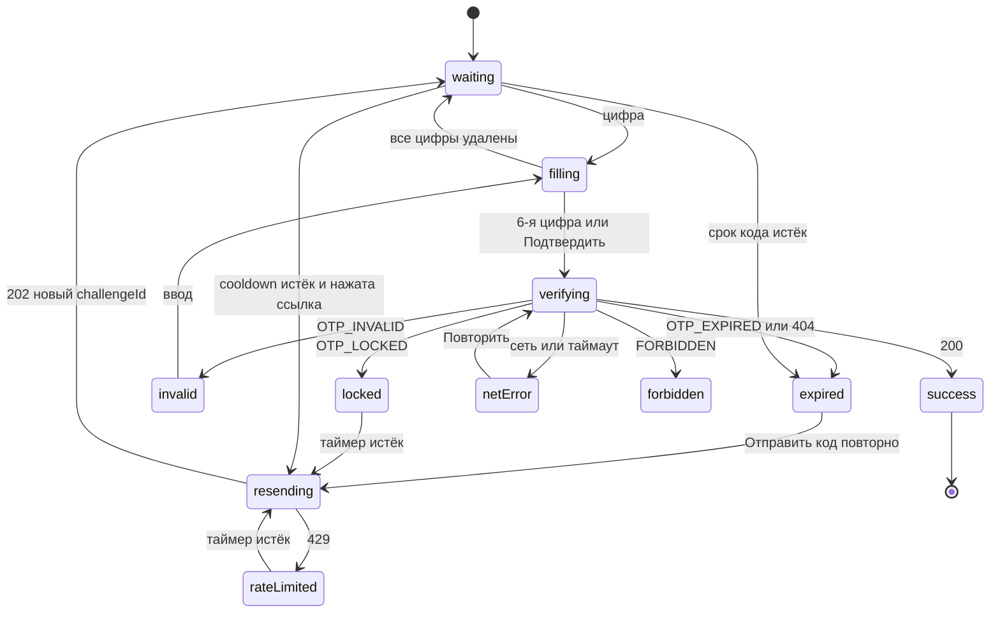
#### 8. Валидация и сообщения
| Условие | Ключ ARB | Текст |
|---|---|---|
| Заголовок | `auth_otp_title` | «Введите код из SMS» |
| Номер | `auth_otp_sent_to` | «Отправили на {phone}» |
| Срок кода | `auth_otp_ttl_timer` | «Код действует ещё {mmss}» |
| Cooldown | `auth_otp_resend_in` | «Отправить повторно через {mmss}» |
| Ссылка | `auth_otp_resend` | «Отправить код повторно» |
| После повторной отправки | `auth_otp_resent` | «Код отправлен повторно» |
| Проверка | `auth_otp_checking` | «Проверяем код…» |
| Успех | `auth_otp_verified` | «Код подтверждён» |
| `OTP_INVALID` | `auth_error_otp_invalid` | «Неверный код. Осталось попыток: {n}» |
| `OTP_EXPIRED` / истёк / `NOT_FOUND` | `auth_error_otp_expired` | «Код устарел. Запросите новый» |
| `OTP_LOCKED` | `auth_error_otp_locked` | «Попытки исчерпаны. Запросите новый код через {seconds} с» |
| `OTP_RATE_LIMITED` | `auth_error_rate_limited` | «Слишком много запросов. Подождите {seconds} с» |
| `SMS_PROVIDER_ERROR` / `failed` | `auth_error_sms_provider` | «Не удалось отправить SMS. Попробуйте позже» |
| Новый код не доставлен, используем прежний | `auth_otp_fallback_previous` | «Не удалось отправить новый код. Введите код из предыдущего SMS» |
| Нет сети | `auth_otp_offline` | «Нет подключения. Код будет проверен, когда появится сеть» |
| Обрыв во время запроса | `auth_error_network` | «Нет связи с сервером. Проверьте сеть и повторите» |
| Таймаут | `auth_error_timeout` | «Сервер не ответил. Повторить» |
| `DEVICE_MISMATCH` | `auth_error_device_mismatch` | «Код запрошен с другого устройства. Запросите новый код» |
| `FORBIDDEN` после верного кода | `auth_blocked_message` | «Доступ закрыт. Обратитесь к администратору магазина» |
| Статус доставки | `auth_otp_delivery_queued` / `_sent` / `_failed` | «Отправляем SMS…» / «SMS отправлено» / «Не удалось отправить SMS» |
| Лист помощи | `auth_otp_no_sms`, `auth_otp_no_sms_body` | «Не приходит SMS?» / «Проверьте номер. SMS может прийти в течение 1–2 минут. Если SMS не приходит, отправьте код повторно или обратитесь в поддержку» |
| Биометрия | `auth_bio_offer_title`, `auth_bio_offer_enable`, `auth_bio_offer_later`, `register_security_consent_text` | «Входить по биометрии?» / «Включить» / «Не сейчас» / Шаблон 3 (11 §10.3) |
| Step-up для биометрии | `auth_bio_enable_stepup_hint` | «Подтвердите PIN-кодом, чтобы включить вход по биометрии» |
| Step-up отменён / PIN не задан | `auth_bio_enable_later` | «Включить биометрию можно позже в настройках» |

Числа попыток и таймеры — **только** из ответа сервера (`attemptsLeft`, `retryAfter`, `resendAfterSec`, `otpTtlSec`); клиент не считает попытки сам. Код длиной ≠ 6 не отправляется.

#### 9. Источники данных, API, бизнес-правила
| Что | API / источник | Правило |
|---|---|---|
| Проверка кода | `POST /auth/otp/verify {challengeId, code, device{name, platform, osVersion, appVersion, biometricClass}}` (состав 08 §4.1.2; поле `model` из 09 не передаётся — `additionalProperties:false`, 08 §2.11; «Замечания к ядру» №24) + `X-Device-Id` → `200` (3 ветки) | 08 §4.1.2; 09 §4.3; порядок проверок AUTH-051 |
| Повторная отправка | `POST /auth/otp/request` (тот же номер, `purpose=login_or_register`) | 08 §4.1.1; cooldown 60 с; лимиты 09 §5.4 |
| Статус доставки (условно) `[УСЛОВНО: нет в 08]` | `GET /auth/otp/challenges/{challengeId}` — до появления эндпоинта в 08 элемент UI-02-016 не показывается (раздел 11.1, С-13) | 09 §4.3 `[НОВОЕ ИМЯ]` |
| Одноразовость, срок, попытки | сервер: TTL 300 с, 5 попыток, аннулирование при новой отправке | 09 §5.3; D-10; Q-004 |
| Сетевой повтор verify | действующий контракт 08 §4.1.2: повтор того же кода → `422 OTP_EXPIRED` (UI: «Код устарел. Запросите новый»); предложение 09 §5.6: тот же `challengeId`+код в пределах 60 с → новая ротация той же сессии — до согласования контрактом не считается | 08 §4.1.2; 09 §5.6; «Замечания к ядру» №21 |
| Сохранение токенов | refresh → secure storage; access → память | ядро §18.2 п.2 |
| Профиль | `GET /me` после входа → кэш профиля (§0.4: `app_meta` без ПДн + `profile_display_name` в secure storage) | 08 §4.3.1 |
| Биометрия | `POST /me/biometrics` (+ `X-Step-Up-Token` после `StepUpDialog` → `POST /auth/step-up`) | 08 §4.3.6, §4.1.7; 09 §9.5; Q-201 |

#### 10. Действия по ролям и безопасность
Экран доступен только гостю с активным потоком входа (`challengeId` в памяти); прямой переход по `/auth/otp` без потока → SCR-01 (guard). Код не сохраняется, не логируется; при сворачивании приложения на Android/iOS превью в переключателе задач размывается (SEC-097, Q-181). Ответы и поведение персонажа не раскрывают, существовал ли аккаунт до ввода верного кода (И4). Статус `blocked` сообщается только после верного кода (09 §4.3 п.5).

#### 11. Повторное нажатие, двойной запрос, «Назад», перезапуск
- Автоотправка и ручное «Подтвердить» не создают двух запросов (`inFlight`); повторная отправка того же неверного кода не выполняется автоматически.
- Двойной запрос при обрыве: «Повторить» с тем же `challengeId` и кодом. По действующему 08 §4.1.2 — `OTP_EXPIRED`, если первый запрос был принят сервером (пользователь запрашивает новый код; сессия первого запроса остаётся неиспользованной до своего idle-срока); по предложению 09 §5.6 — ротация той же сессии без создания второй (до согласования, «Замечания к ядру» №21).
- «Назад» — на SCR-01 с номером; challenge жив до срока.
- Перезапуск приложения на SCR-02: `challengeId`, номер, сроки — только в памяти → открывается SCR-01 с пустым полем (09 §4.4); новый запрос кода может получить `OTP_RATE_LIMITED` с остатком cooldown.
- Сворачивание во время проверки: ответ обрабатывается при возврате; если токены уже получены — переход на рабочий экран без повторного ввода.
- Таймеры при сворачивании: пересчитываются от абсолютного времени (`expiresAt`, `resendAvailableAt`), а не от числа тиков.

#### 12. Требования к платформам
| Платформа | Требование |
|---|---|
| Android | кнопка «Подтвердить» — только после ошибки (09 §4.4); `TextInputType.number`; autofill `oneTimeCode`; SMS User Consent `[ТИПОВО]`; без `READ_SMS`/`RECEIVE_SMS` (11 SEC-100) |
| iOS | кнопка «Подтвердить» — только после ошибки (09 §4.4); `textContentType: oneTimeCode`; системное предложение кода `[ТИПОВО]` |
| Windows-POS | цифры с клавиатуры, `Backspace`, `Ctrl+V`, `Enter` = «Подтвердить», `Esc` = «Изменить номер»; кнопка 8 видна всегда (мышь); HID-сканер игнорируется |
| Планшет / ландшафт | при высоте < 420 ячейки 44×52, персонаж скрыт |
| Все | масштаб шрифта 1,3× — ячейки 56×64, зазор 6 при ширине < 400 |

#### 13. Критерии приёмки
| ID | Критерий |
|---|---|
| AC-UI-02-001 | Экран SCR-02 открывается одинаково для зарегистрированного и нового номера (тексты, персонаж, таймеры); различие появляется только после верного кода. |
| AC-UI-02-002 | 6 ячеек 48×56; ввод цифр переводит фокус; `Backspace` в пустой ячейке очищает предыдущую. |
| AC-UI-02-003 | Вставка «481 903» заполняет все 6 ячеек и вызывает ровно один `POST /auth/otp/verify`. |
| AC-UI-02-004 | Автоотправка на 6-й цифре; одновременное нажатие «Подтвердить» или `Enter` (Windows, кнопка видна) не создаёт второго запроса. |
| AC-UI-02-005 | `OTP_INVALID` с `attemptsLeft=3` → ячейки `error`, shake 300 мс, очистка, фокус в 1-ю ячейку, текст «Неверный код. Осталось попыток: 3»; персонаж `error` → через 1,5 с `retry`. |
| AC-UI-02-006 | После 5-й неверной попытки (`OTP_LOCKED`, `retryAfter`) — ввод и кнопки disabled, баннер с обратным отсчётом; по нулю активна только «Отправить код повторно». |
| AC-UI-02-007 | Таймер повторной отправки стартует с 1:00 (`resendAfterSec`=60), первая отображаемая секунда — «Отправить повторно через 0:59», ссылка неактивна до нуля; после нажатия — новый `challengeId`, ячейки очищены, снекбар «Код отправлен повторно». |
| AC-UI-02-008 | Через 5:00 после `202` ячейки disabled, текст «Код устарел. Запросите новый», ссылка активна независимо от cooldown. |
| AC-UI-02-009 | Верный код существующего `active` пользователя → `success` (улыбка, галочка) и переход на главный экран роли не позже 900 мс после ответа; без дополнительного нажатия «Войти». |
| AC-UI-02-010 | Ответ `registration_required` → SCR-03; `pending_activation` → SCR-07. |
| AC-UI-02-011 | Обрыв сети во время verify → код не очищен, кнопка «Повторить» отправляет тот же `challengeId` и код. Проверяются обе ветки расхождения 08 §4.1.2 ↔ 09 §5.6 («Замечания к ядру» №21): (а) действующий контракт 08 — если первый запрос дошёл до сервера, повтор получает `422 OTP_EXPIRED` → ячейки disabled, текст «Код устарел. Запросите новый», ссылка «Отправить код повторно» активна независимо от cooldown; в `sessions` не более одной новой сессии; (б) после принятия 09 §5.6 в 08 — повтор в пределах 60 с выполняет ротацию той же сессии, пользователь входит, в `sessions` одна сессия. Если первый запрос не дошёл до сервера — в обеих ветках обычная проверка кода и вход. |
| AC-UI-02-012 | «Изменить номер» → SCR-01 с номером; повторный запрос для того же номера в пределах срока не отправляет SMS, таймеры продолжаются. |
| AC-UI-02-013 | Перезапуск приложения на SCR-02 → SCR-01 с пустым полем; код и номер не найдены в файлах приложения (поиск по хранилищу). |
| AC-UI-02-014 | Android: при включённом SMS User Consent код из SMS подставляется после подтверждения пользователя; при отказе — ручной ввод без ошибки `[ТИПОВО]`. |
| AC-UI-02-015 | Windows: `Ctrl+V` вставляет код; `Enter` подтверждает; `Esc` возвращает на SCR-01. |
| AC-UI-02-016 | Вход другого пользователя на устройстве с сохранённой сессией: перед переходом выполнен `POST /auth/logout` прежней сессии, локальные данные прежнего пользователя удалены. |
| AC-UI-02-017 | `biometricRefreshOffered=true` (Android Class 3) → лист UI-02-018 показан один раз; «Не сейчас» не показывает его при следующем входе; на Windows лист не показывается. |
| AC-UI-02-018 | В release-сборке подсказка UI-02-017 отсутствует даже при наличии поля `devCode` в ответе. |
| AC-UI-02-019 | Код из SMS не появляется в логах устройства (`adb logcat`), аналитике и снекбарах (проверка по шаблону 6 цифр выданного `FakeSmsGateway` кода). |
| AC-UI-02-020 | Android/iOS: до первой ошибки кнопки «Подтвердить» на экране нет; после `OTP_INVALID` или сетевой ошибки она появляется и остаётся до ухода с экрана; Windows: кнопка видна сразу, disabled до 6 цифр (09 §4.4). |
| AC-UI-02-021 | Лист UI-02-018, пользователь с заданным PIN: «Включить» → `403 STEP_UP_REQUIRED` → открыт `StepUpDialog` по PIN (включение не пропускается молча); верный PIN → повтор `POST /me/biometrics` с `X-Step-Up-Token` → `200` → системный промпт → `biometric_refresh` сохранён; отмена `StepUpDialog` → снекбар «Включить биометрию можно позже в настройках», переход на главный экран роли, биометрической семьи на сервере нет. |
| AC-UI-02-022 | Лист UI-02-018, пользователь без PIN (`security.pinSet=false`, `pin` ∉ `allowedMethods`): после `403 STEP_UP_REQUIRED` второй SMS-код автоматически не запрашивается, показан снекбар `auth_bio_enable_later`, выполнен переход; отмена системного промпта после выдачи токена вызывает `POST /me/biometrics {enabled: false}`. |

#### 14. Трассировка
| Требование | SRC / правила |
|---|---|
| Экран подтверждения после запроса кода; OTP через SMSPro | SRC-B-100, SRC-B-100a; 09 §4 |
| Автоматический вход существующего пользователя после верного кода | SRC-B-102, SRC-E-130 |
| Нет аккаунта → регистрация (после проверки владения номером) | SRC-B-101; D-10 |
| Время действия, лимит попыток, одноразовость, частота | SRC-B-118, SRC-B-119, SRC-B-120, SRC-B-117; SRC-E-128, SRC-E-129 |
| Логирование без кодов (клиентская часть) | SRC-B-116 |
| Персонаж: проверка, успех с галочкой, неправильный OTP, повтор, переход | SRC-B-073…077; SRC-F-021 |
| Предложение включить системную биометрию после привязки номера | SRC-B-080a, SRC-B-081 |
| Независимость визуального слоя от результата | SRC-F-022, SRC-F-023 |

## 4. SCR-03 — Регистрация: форма (маршрут `/register`, роль: гость с `registration_token`, R1: да)
### SCR-03 — Регистрация, шаг 1 «Данные» (`/register`; гость с действующим `registration_token`; R1)
#### 1. Назначение и роль пользователя
Первый шаг регистрации нового пользователя **после** подтверждения номера кодом (сервер вернул `registration_required` и `registration_token` на 15 мин — D-10). Пользователь вводит ФИО (обязательно), видит подтверждённый номер (обязательно, только чтение), год рождения (обязательно), сферу деятельности (необязательно; пропущенный пункт 3 промта не превращается в лишнее поле — SRC-B-129), знакомится с условиями обработки персональных данных. Данные не отправляются на сервер на этом шаге — они уходят одним запросом `POST /registration/complete` на SCR-04 (09 §7.2). Роль создаваемого аккаунта определяет сервер (приглашение → роль; иначе `pending_activation` или `customer` при `CUSTOMER_SELF_SERVICE`, D-07); экран роль не показывает и не обещает мгновенного доступа.

**Порядок промта «форма → OTP» (SRC-B-147).** В принятом потоке код отправляется и подтверждается **до** формы (иначе невозможен нейтральный ответ без раскрытия наличия аккаунта, 09 §5.5); регистрация не завершается без серверной проверки номера (SRC-B-149). Буквальный порядок доступен как конфигурация `REGISTRATION_SECOND_OTP` (09 §7.4, Q-162): при включении после SCR-04 добавляется второй код на SCR-02 в режиме `register` (тот же экран, те же правила).

#### 2. Структура экрана
| Класс окна | Сверху вниз, слева направо |
|---|---|
| compact | шапка 56: «←» слева, заголовок «Регистрация» `title` по центру → `RegistrationStepper` compact: «Шаг 1 из 3 · Данные» `label` + `AppProgress.linear` 4 px (33 %) → `ds.space.6` → строка заголовка: «Расскажите о себе» `h2` слева + `Mascot.mini` 56 справа → подзаголовок `body` → `ds.space.6` → поля столбцом через `ds.space.4` 16: ФИО, Телефон (только чтение), Год рождения (ширина 160), Сфера деятельности; при «Другое» — поле уточнения → блок информирования ПДн (текст 3 строки + «Подробнее») → чекбокс «Я ознакомлен(а)…» → (при выбранной сфере) чекбокс согласия на сферу → строка «Время на регистрацию: ещё 14:20» → кнопка «Продолжить» L 52 закреплена внизу над клавиатурой/`SafeArea` (контент прокручивается) |
| medium | фон `background`; карточка 560 (`ds.radius.xl` 20), выровнена к верху (отступ 32): шапка карточки «← Отменить регистрацию» / «Техническая поддержка»; `RegistrationStepper` horizontal «① Данные — ② Защита входа — ③ Готово»; заголовок + `Mascot.mini` 72 справа; ФИО на всю ширину; Телефон на всю ширину; Год рождения (160) и Сфера (остаток) в одной строке; блок ПДн; чекбоксы; таймер слева и «Продолжить» справа (ширина 220) в одной строке |
| expanded | как medium, карточка 560 по центру окна; без бренд-панели (форма важнее бренда) |

#### 3. Таблица элементов
| № | UI-ID | Элемент | Компонент | Расположение/размер/отступы | Токены | Состояния | Поведение | Источник данных | Роли | Правило |
|---|---|---|---|---|---|---|---|---|---|---|
| 1 | UI-03-001 | Назад / «Отменить регистрацию» | `AppIconButton` «←» (compact), `AppButton.text` S (medium+) | слева в шапке | `textSecondary` / `primary` | default, hover, pressed, focused | `ConfirmDialog` «Прервать регистрацию?» → «Прервать»: SCR-01 (номер предзаполнен), черновик сохраняется до 15 мин; «Продолжить заполнение» — закрыть диалог | — | гость | navigation §8 |
| 2 | UI-03-002 | Индикатор прогресса | `RegistrationStepper` (compact: строка + `AppProgress.linear` 4 px; medium+: horizontal) | под шапкой, на всю ширину; отступ 16 | активный шаг `primary`, предстоящие — обводка `border`, завершённые — `success` + галочка | шаг 1 из 3 (33 %); при условном SCR-06 — 1 из 4 (25 %) | шаги вперёд не кликабельны | конфигурация потока (`CUSTOMER_SELF_SERVICE`, `REGISTRATION_SECOND_OTP` не добавляет шаг) | гость | SRC-B-134; 09 §7.1; 03 §9.66 |
| 3 | UI-03-003 | Заголовок «Расскажите о себе» | текст | слева | `h2`/`h1` `textPrimary` | default | — | `reg_form_title` | гость | — |
| 4 | UI-03-004 | Персонаж (малый) | `Mascot.mini` (размер 56 compact / 72 medium+ и состояния `typing`/`retry` — расширение варианта 03 §9.52, «Замечания к ядру» №14) | справа от заголовка, по центру строки | 03 §13.2 | `idle`, `typing` (только взгляд на активное поле, без кивков), `error`, `retry` | скрывается при клавиатуре и высоте < 640 | `MascotController` | гость | 09 §11.1 |
| 5 | UI-03-005 | Подзаголовок | `body` | под заголовком через 8 | `textSecondary` | default | — | `reg_form_subtitle` | гость | D-07 |
| 6 | UI-03-006 | ФИО * | `AppTextField` L 56 (compact) / M 48 (medium+), `single`, `withClear` | на всю ширину; подпись «ФИО *» над полем; подсказка под полем | как 03 §9.3 | empty, focused, filled, error, warning (одно слово) | `TextInputType.name`, `textCapitalization.words`, `AutofillHints.name`, `maxLength` 120, `TextInputAction.next` | ввод; черновик | гость | SRC-B-124, SRC-E-121; 09 §7.1 |
| 7 | UI-03-007 | Телефон (подтверждён) | `PhoneField.form` в состоянии `readOnly` + суффикс `StatusChip.success` «подтверждён» с иконкой `check` | на всю ширину; подпись «Телефон» | фон `surfaceVariant`, текст `textPrimary` `tnum`, чип `successContainer`/`success` | readOnly | не редактируется; рядом ссылка «Изменить» → как UI-03-001 (смена номера = новый OTP) | `phone_e164` из `registration_token` (память) | гость | SRC-B-125, 130, 149; 09 §7.1 |
| 8 | UI-03-008 | Год рождения * | `AppTextField` `number`, 4 цифры, `tnum` | ширина 160; подпись «Год рождения *»; плейсхолдер «ГГГГ» | как 03 §9.3 | empty, focused, filled, error | `TextInputType.number`, только цифры, `maxLength` 4, `TextInputAction.next` | ввод; черновик | гость | SRC-B-127, SRC-E-124; 09 §7.1; Q-161 |
| 9 | UI-03-009 | Сфера деятельности (необязательно) | `AppDropdown` → `AppBottomSheet` (compact, строки 48) / меню под полем (medium+) | на всю ширину (compact) / остаток строки (medium+); подпись «Сфера деятельности (необязательно)» | как `AppTextField`; выбранный пункт в листе — `primaryContainer` + `check` | empty («Выберите из списка»), selected, open | значения: «Сантехник», «Прораб / строитель», «Магазин / перепродажа», «Монтажная организация», «Частное лицо», «Другое» (коды `plumber`, `foreman`, `reseller`, `installer`, `private`, `other`) `[НЕ ПОДТВЕРЖДЕНО — Q-203]`; пункт «Не указывать» сбрасывает выбор | ARB; черновик | гость | SRC-B-128, SRC-E-125 |
| 10 | UI-03-010 | Время на регистрацию | `caption` `tnum` | над кнопкой (compact) / слева от кнопки (medium+) | `textSecondary`; последняя минута — `warning` | countdown, expired | обратный отсчёт от `expiresAt` токена; при нуле — UI-03-012 | `registrationExpiresIn` из verify | гость | D-10; 09 §7.1 |
| 11 | UI-03-011 | Кнопка «Продолжить» | `AppButton.primary` L 52 (compact `expand`; medium+ ширина 220) | закреплена внизу (compact) / справа (medium+) | `primary`/`onPrimary` | disabled (не заполнены ФИО или год, не отмечен UI-03-014), enabled, pressed, focused | полная валидация → SCR-04; §4 | черновик | гость | SRC-B-131; 09 §7.4 |
| 12 | UI-03-012 | Диалог «Время регистрации истекло» | `ConfirmDialog` с одной кнопкой «Подтвердить номер снова» | по центру | 03 §9.45 | скрыт / показан | → SCR-01 с номером; черновик сохраняется (§11) | таймер / `401 REGISTRATION_TOKEN_INVALID` с SCR-04 | гость | 09 §7.3 |
| 13 | UI-03-013 | Баннер «Номер уже зарегистрирован» | `ErrorState.banner` (warning) + кнопка «Войти» | над формой | `warningContainer`/`warning` | скрыт / показан | «Войти» → SCR-01 с номером; черновик удаляется | `409 PHONE_ALREADY_REGISTERED` с SCR-04 (возврат на SCR-03 не выполняется — показ на SCR-01 через UI-01-017) | гость | SRC-B-136 |
| 14 | UI-03-014 `[НОВЫЙ UI-ID; перенесён с UI-04-011]` | Информирование об обработке ПДн + отметка «Я ознакомлен(а)» * | блок `body` 3 строки + `AppButton.text` «Подробнее» + `AppCheckbox` `withDescription` | под полями через 24; на всю ширину | текст `textSecondary`; чекбокс 03 §9.65 | unchecked, checked, error | «Подробнее» → `AppBottomSheet`/диалог с полным текстом Шаблона 1 (11 §10.3); без отметки кнопка 11 disabled; в запросе — `consents[{kind: "personal_data", version, granted: true}]` | ARB `register_consent_pd_text`, версия текста — `GET /me/consents` недоступен гостю → версия встроена в сборку и подтверждается сервером (`CONSENT_REQUIRED` при несовпадении) | гость | 11 §10.3 Шаблон 1; 09 §7.1; Q-027 |
| 15 | UI-03-015 `[НОВЫЙ UI-ID]` | Согласие на обработку сведений о сфере деятельности (необязательное) | `AppCheckbox` `withDescription` | под UI-03-014; показывается только при выбранной сфере | 03 §9.65 | hidden, unchecked, checked | без отметки сфера **не передаётся** (`null`), подсказка «Без согласия сфера не будет сохранена»; отзыв — SCR-42 | вид согласия `activity_sphere` `[НОВОЕ ИМЯ — 11 §10.3]` | гость | 11 §10.2–10.3; ст. 79 |
| 16 | UI-03-016 `[НОВЫЙ UI-ID]` | Уточнение «Другое» | `AppTextField` M, `single`, счётчик 0/60 | под UI-03-009 (на всю ширину), появляется при выборе «Другое» (ANIM-020) | как 03 §9.3 | hidden, empty, filled, error | `maxLength` 60; пустое при «Другое» — допустимо (сохраняется код `other`) | ввод; черновик | гость | 09 §7.1 |
| 17 | UI-03-017 `[НОВЫЙ UI-ID]` | Баннер «Данные восстановлены» | `ErrorState.banner` вариант `info`, с крестиком | над заголовком | `infoContainer`/`info` | скрыт / показан | показывается, если форма заполнена из черновика после нового OTP/перезапуска; закрывается крестиком или при первом изменении | черновик secure storage | гость | SRC-B-137; 09 §7.4 |

#### 4. Поведение каждого контрола
- **ФИО (UI-03-006).** Автофокус при открытии (если пусто). Ввод: кириллица (включая кыргызские Ң Ө Ү), латиница, пробел, дефис, апостроф; цифры и прочие символы отфильтровываются при вводе (с подсказкой `reg_error_name_invalid` при попытке вставки). Двойные пробелы схлопываются при потере фокуса; trim по краям. Одно слово — предупреждение `reg_warning_name_one_word` (цвет `warning`, не блокирует). `Enter`/«Далее» на клавиатуре → фокус в год рождения. Долгое нажатие — системное меню.
- **Телефон (UI-03-007).** Фокус не принимает; тап по полю — без действия; «Изменить» — как отмена регистрации (новый OTP на другой номер).
- **Год рождения (UI-03-008).** Только цифры, 4 знака; проверка диапазона при потере фокуса и при «Продолжить»; при 4 введённых цифрах фокус переходит в «Сферу» (открывает список только по явному тапу/`Enter`, не автоматически).
- **Сфера (UI-03-009).** Тап/`Enter`/`Space` открывает лист (compact) или меню (medium+); стрелки ↑/↓ и `Enter` выбирают на Windows; `Esc` закрывает без изменения; повторный выбор того же пункта ничего не меняет; «Не указывать» очищает значение и скрывает UI-03-015/016.
- **Чекбокс ПДн (UI-03-014).** Тап по квадрату или подписи — переключение; `Space` при фокусе; ссылка «Подробнее» не переключает чекбокс. При попытке «Продолжить» без отметки (через `Enter`) — обводка `error` + текст `reg_error_consent_required`, фокус на чекбокс.
- **Чекбокс сферы (UI-03-015).** Необязательный; по умолчанию не отмечен (согласие не может быть предустановлено).
- **«Продолжить» (UI-03-011).** Активна, когда ФИО непустое, год содержит 4 цифры и отмечен UI-03-014. Нажатие: полная валидация (§8) → при ошибках фокус и прокрутка к первому ошибочному полю, персонаж `error` → `retry`; при успехе — сохранение черновика и `push` SCR-04. Сетевых запросов нет, поэтому двойное нажатие безопасно (второй `push` подавляется флагом навигации). `Enter` в последнем поле = «Продолжить».
- **«Отменить регистрацию» (UI-03-001).** `ConfirmDialog` (фокус на «Продолжить заполнение»); подтверждение — SCR-01; системная «Назад» и `Esc` — то же.
- **Таймер (UI-03-010).** Пересчитывается от абсолютного `expiresAt`; при сворачивании не останавливается.

#### 5. Анимации
| ID | Элемент | Описание | Длительность | Reduce-motion |
|---|---|---|---|---|
| ANIM-024 | вход с SCR-02 | shared-axis X | 300 мс | fade 80 мс |
| ANIM-005 (часть) | переход с SCR-02 | `SuccessCheck` SCR-02 завершается до показа SCR-03 | ≤ 900 мс | crossfade |
| ANIM-003 (вариант «только взгляд») | персонаж | зрачки к активному полю по `lookY` (позиция поля), без кивков | 200 мс | кадр `typing.png` |
| ANIM-011 + ANIM-012 | ошибки валидации | персонаж покачивание 400 мс; поле shake ±4 lp 300 мс + обводка `error` | 400 / 300 мс | только цвет и текст |
| ANIM-020 | поле «Другое», чекбокс сферы | `AnimatedSize` 0→n + fade 200 мс | 200 мс | мгновенно |
| ANIM-025 | лист выбора сферы, лист «Подробнее» | slide-up 250 мс | 250 мс | fade 80 мс |
| ANIM-023 | диалоги UI-03-001, UI-03-012 | scale .96→1 + fade | 250 / 200 мс | fade 80 мс |
| Специфичная: таймер | UI-03-010 | последняя минута — цвет `textSecondary` → `warning` crossfade 150 мс | 150 мс | мгновенно |
| ANIM-018 (узел степпера) | переход на SCR-04 | узел 1 → галочка scale-in 200 мс `emphasized`, `AppProgress` 33 → 67 % 200 мс | 200 мс | fade 80 мс |

#### 6. Переходы
| Событие | Куда | Данные | Навигация |
|---|---|---|---|
| Вход | с SCR-02 (`registration_required`) | `registrationToken`, `expiresAt`, номер — память | `pushReplacement` |
| «Продолжить» (валидно) | SCR-04 | черновик (ФИО, год, сфера, согласия) — память + secure storage | `push` |
| Возврат с SCR-04 | SCR-03 | поля сохранены | `pop` |
| «Отменить регистрацию» (подтверждено), «Изменить» у телефона | SCR-01 | номер (память), `AuthEntryReason=registration_cancelled` | `go` |
| Истёк `registration_token` | диалог UI-03-012 → SCR-01 | номер; `AuthEntryReason=registration_expired` | `go` |
| 426 | SCR-90 C3 | — | диалог |

#### 7. Состояния экрана
| Состояние | Описание |
|---|---|
| Загрузка | нет сетевой загрузки; при восстановлении черновика — синхронное чтение secure storage до первого кадра (≤ 50 мс), без скелетонов |
| Ввод | персонаж `typing` (взгляд), кнопка disabled до заполнения обязательных |
| Ошибка валидации | обводки `error`, тексты под полями, фокус на первое ошибочное поле, персонаж `error` → `retry` |
| Успех | переход на SCR-04 |
| Пустой результат | неприменимо |
| Нет сети | экран работает полностью (сетевых запросов нет); `OfflineBanner` показывается, но не блокирует; отправка произойдёт на SCR-04 |
| Нет разрешений | неприменимо |
| Повторная попытка | неприменимо (нет запросов) |
| Устаревшие данные | восстановленный черновик — баннер UI-03-017 |
| Истёк токен | диалог UI-03-012 |
| Step-up | неприменимо |
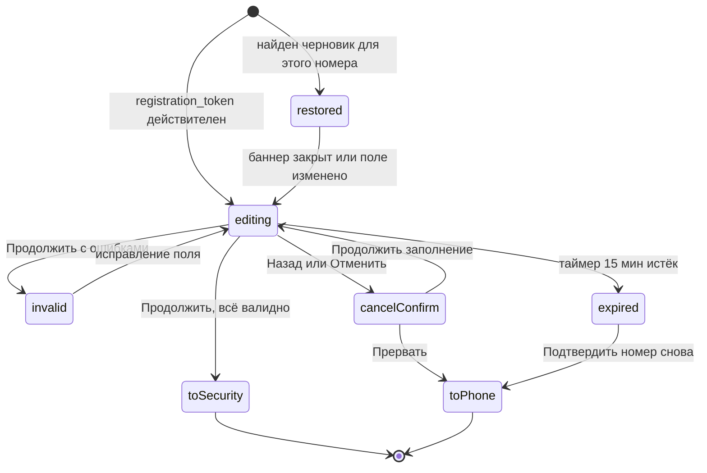
#### 8. Валидация и сообщения
| Поле / условие | Когда | Ключ ARB | Текст |
|---|---|---|---|
| ФИО пусто | blur / submit | `reg_error_name_required` | «Введите фамилию и имя» |
| ФИО < 2 символов после trim или > 120 | submit | `reg_error_name_length` | «ФИО должно содержать от 2 до 120 символов» |
| ФИО содержит недопустимые символы (вставка) | ввод | `reg_error_name_invalid` | «Используйте только буквы, пробел и дефис» |
| ФИО из одного слова | blur | `reg_warning_name_one_word` | «Укажите фамилию и имя полностью — так администратору проще вас найти» (предупреждение) |
| Год пуст | submit | `reg_error_birth_year_required` | «Укажите год рождения» |
| Год вне диапазона `{minYear}…{maxYear}` (`maxYear` = текущий год − 14) | blur / submit | `reg_error_birth_year_range` | «Введите год от {minYear} до {maxYear}» |
| Согласие ПДн не отмечено | submit | `reg_error_consent_required` | «Чтобы продолжить, подтвердите, что ознакомлены с условиями обработки данных» |
| Сфера выбрана без согласия | при выборе | `reg_hint_activity_consent` | «Без согласия сфера деятельности не будет сохранена» |
| Таймер | постоянно | `reg_timer` | «Время на регистрацию: ещё {mmss}» |
| Истёк токен | диалог | `reg_error_token_expired`, `reg_expired_action` | «Время регистрации истекло. Подтвердите номер ещё раз — введённые данные сохранятся» / «Подтвердить номер снова» |
| Отмена | диалог | `reg_cancel_title`, `reg_cancel_body`, `reg_cancel_confirm`, `reg_cancel_continue` | «Прервать регистрацию?» / «Введённые данные сохранятся на этом устройстве 15 минут» / «Прервать» / «Продолжить заполнение» |
| Восстановление | баннер | `reg_restored_banner` | «Мы восстановили введённые ранее данные» |

`{minYear}`: 1900 по 09 §7.1 (в 08 §4.2.1 — 1920; расхождение — «Замечания к ядру» №5, Q-161). Сервер повторно валидирует все поля (`400 VALIDATION_FAILED` с `errors[{field}]` подсвечивает поля при возврате с SCR-04).

#### 9. Источники данных, API, бизнес-правила
| Что | Источник | Правило |
|---|---|---|
| Номер, срок регистрации | ответ `/auth/otp/verify` (`registrationToken`, `registrationExpiresIn`, `phoneMasked`); номер E.164 — память потока | 08 §4.1.2; 09 §7.1 |
| Черновик | `flutter_secure_storage` (ФИО, год, сфера, номер) + drift `registration_draft` (шаг, `expiresAt`, отметки согласий, без ПДн) | ядро §18.2 п.1; 09 §7.4 |
| Отправка | на SCR-04: `POST /registration/complete` (профиль: `fullName`, `birthYear`, сфера — поле `activityKind` (08) / `occupation` (09), расхождение — «Замечания» №4) | 08 §4.2.1 |
| Роль после регистрации | сервер, D-07 | Q-001 |
| Разделение профиля приложения и карточки 1С | поля формы хранятся в `user_profiles`, в 1С не передаются | 09 §7.7; SRC-B-140, 141 |

#### 10. Действия по ролям и безопасность
Доступ — только с действующим `registration_token` (guard G-2: без токена → SCR-01 с баннером). Токен не попадает в URL и логи. ПДн черновика — только в зашифрованном хранилище ОС, не в drift (ядро §18.2 п.1). Год рождения не участвует в PIN (запрет PIN по году — SCR-04). Экран не показывает назначаемую роль (D-07).

#### 11. Повторное нажатие, двойной запрос, «Назад», перезапуск
- «Продолжить» без сетевого запроса; повторное нажатие не создаёт второй экран SCR-04.
- «Назад» — диалог подтверждения; данные не теряются 15 мин.
- Ошибка сети на SCR-04 возвращать на SCR-03 не требуется — данные сохранены (SRC-B-137).
- Перезапуск: `registration_token` в памяти теряется; при старте приложение видит черновик моложе 15 мин → SCR-01 с предзаполненным номером и баннером «Продолжите регистрацию: подтвердите номер» (UI-01-017, причина `registration_resume`) → после нового OTP (`registration_required`) форма заполнена из черновика (UI-03-017). Если новый OTP вернул `authenticated` (аккаунт создан ранее, например с другого устройства) — черновик удаляется.
- Черновик удаляется: после `201`; через 15 мин с последнего изменения; при выходе/входе другого номера.

#### 12. Требования к платформам
| Платформа | Требование |
|---|---|
| Android/iOS телефон | клавиатуры: ФИО — текстовая с заглавными, год — цифровая, сфера — без клавиатуры (лист); кнопка над клавиатурой; прокрутка к полю с фокусом |
| Планшет | карточка 560; год и сфера в одной строке |
| Windows-POS | `Tab`: ФИО → год → сфера → «Другое» → чекбокс ПДн → чекбокс сферы → «Продолжить»; `Enter` в последнем поле = «Продолжить»; стрелки в меню сферы; `Esc` = отмена регистрации (диалог) |
| Все | масштаб шрифта 1,3× — поля переносят подписи, кнопка не перекрывает поля |

#### 13. Критерии приёмки
| ID | Критерий |
|---|---|
| AC-UI-03-001 | Форма содержит ровно поля: ФИО *, Телефон (только чтение, «подтверждён»), Год рождения *, Сфера деятельности (необязательно); дополнительного обязательного поля нет (SRC-B-129). |
| AC-UI-03-002 | Индикатор «Шаг 1 из 3 · Данные» и прогресс 33 %; при включённом `CUSTOMER_SELF_SERVICE` — «Шаг 1 из 4». |
| AC-UI-03-003 | Кнопка «Продолжить» неактивна, пока не заполнены ФИО и 4 цифры года и не отмечено ознакомление с условиями обработки ПДн. |
| AC-UI-03-004 | Год 2020 (при текущем 2026) → «Введите год от 1900 до 2012»; фокус и прокрутка к полю года. |
| AC-UI-03-005 | В поле ФИО невозможно ввести цифры; ввод «Каримов Абдулла» без ошибок; «Каримов» — предупреждение, переход разрешён. |
| AC-UI-03-006 | Клавиатуры: ФИО — текстовая с автозаглавными; год — цифровая; телефон — не фокусируется. |
| AC-UI-03-007 | Телефон отображается «+996 555 123 456» с чипом «подтверждён» и не редактируется; номер берётся из подтверждённого потока, не из ввода. |
| AC-UI-03-008 | При выборе сферы появляется необязательный чекбокс согласия; без отметки сфера в запросе `/registration/complete` равна `null`. |
| AC-UI-03-009 | «Другое» показывает поле уточнения ≤ 60 символов (ANIM-020). |
| AC-UI-03-010 | Таймер показывает остаток 15 мин от verify; в последнюю минуту — цвет `warning`; по нулю — диалог «Время регистрации истекло» → SCR-01 с номером. |
| AC-UI-03-011 | Перезапуск приложения через 5 мин после ввода ФИО → SCR-01 с номером и баннером; после нового кода форма заполнена прежними значениями и показан баннер «Мы восстановили…». |
| AC-UI-03-012 | ФИО и год рождения черновика отсутствуют в файлах drift/SQLite и `shared_preferences` (поиск по хранилищу); присутствуют только в secure storage. |
| AC-UI-03-013 | Через 15 мин после последнего изменения черновик удалён из secure storage. |
| AC-UI-03-014 | Персонаж смотрит на активное поле без кивков; при ошибке валидации — `error` → через 1,5 с `retry`; `verifying`/`success` на этом экране не возникают. |
| AC-UI-03-015 | Windows: порядок `Tab` по §12, `Enter` в последнем поле переходит на SCR-04 при валидной форме. |

#### 14. Трассировка
| Требование | SRC / правила |
|---|---|
| Современный экран регистрации, поля и обязательность | SRC-B-123, 124, 125, 127, 128, 129; SRC-E-121, 122, 124, 125 |
| Форматирование номера, проверка обязательных полей, понятные сообщения, клавиатуры, индикатор прогресса | SRC-B-130, 131, 132, 133, 134; SRC-E-126, 126a |
| Сохранение данных при ошибке сети | SRC-B-137 |
| OTP и завершение регистрации только после серверной проверки | SRC-B-147 (порядок — 09 §5.5, Q-162), SRC-B-148, SRC-B-149 |
| Разделение профиля приложения и карточки 1С | SRC-B-140, SRC-B-141 |
| Информирование/согласие ПДн | 11 §10.3; Q-027 |

## 5. SCR-04 — Регистрация: защита входа (биометрия/PIN) + согласие (маршрут `/register/security`, роль: гость с `registration_token`, R1: да)
### SCR-04 — Регистрация, шаг 2 «Защита входа» и шаг 3 «Готово» (`/register/security`; гость с `registration_token`; R1)
#### 1. Назначение и роль пользователя
Обязательный этап регистрации «сканирование лица или настройка биометрии» по утверждённому безопасному сценарию (SRC-B-126, SRC-E-123, D-14): в R1 это **настройка защиты входа на устройстве** — PIN приложения (обязателен для всех `staff` на всех платформах, D-48; для `customer` — по желанию) и, по выбору пользователя, системная биометрия устройства с отдельным, информированным и отзываемым согласием (D-13; 11 §10.3 Шаблон 3). Биометрические данные приложение не получает и не хранит (SRC-B-089, SRC-E-136c). Кнопка «Завершить регистрацию» отправляет единственный запрос `POST /registration/complete`; при успехе пользователь входит автоматически, без отдельной кнопки «Войти» (SRC-B-148, SRC-E-130), и видит шаг 3 «Готово» с анимацией подтверждения (SRC-B-135). Сканирование лица с поворотами — условный модуль R2 (SCR-05, Q-003); в R1 шаг не показывается.

#### 2. Структура экрана
| Класс окна | Сверху вниз, слева направо |
|---|---|
| compact | шапка 56 «←» + «Регистрация» → `RegistrationStepper` «Шаг 2 из 3 · Защита входа» + прогресс 67 % → заголовок «Защита входа» `h2` + `Mascot.mini` 56 справа → подзаголовок → `ds.space.6` → плитка «PIN-код приложения» (64; для `staff` закреплена) → «Придумайте PIN-код» `PinField.setup` (точки 16, зазор 16) → «Повторите PIN-код» → подсказка правил PIN `caption` → `ds.space.6` → плитка «Биометрия устройства» (64) с `AppSwitch` и чипом доступности → (при включённом переключателе) чекбокс согласия на биометрию + «Подробнее» → `ds.space.6` → «Завершить регистрацию» L 52 (закреплена внизу) → «Настроить биометрию позже» text M. PIN вводится системной цифровой клавиатурой (скрытое поле) |
| medium | карточка 560 (`ds.radius.xl` 20): шапка «← Назад к данным» / «Техническая поддержка»; степпер horizontal «✓ Данные — ② Защита входа — ③ Готово»; заголовок + `Mascot.mini` 72; плитки PIN и биометрии в две колонки (PIN слева с полями, биометрия справа с согласием); кнопки справа внизу: «Настроить биометрию позже» (text) + «Завершить регистрацию» (primary, 260) |
| expanded (Windows-POS) | как medium, карточка 560 по центру; плитка «Биометрия» показывает «Windows Hello» (если настроен) с пояснением «Только для быстрого входа перед PIN; не заменяет PIN»; под полями PIN — экранный нампад `QuantityNumpadSheet.pin` (03 §9.6, §9.21) для сенсорных мониторов (клавиши 72×56), физическая клавиатура активна |
| Шаг 3 «Готово» (все классы) | содержимое карточки/экрана заменяется: `RegistrationStepper` «Шаг 3 из 3 · Готово» (100 %) → `Mascot` 160/200 в `success` + `SuccessCheck` → заголовок «Добро пожаловать, {имя}!» `h2` → строка «Вход настроен: PIN-код · Биометрия» (или «PIN-код») → строка статуса аккаунта (`pending_activation`: «Администратор активирует аккаунт…») |

#### 3. Таблица элементов
| № | UI-ID | Элемент | Компонент | Расположение/размер | Токены | Состояния | Поведение | Источник данных | Роли | Правило |
|---|---|---|---|---|---|---|---|---|---|---|
| 1 | UI-04-001 | Назад к данным | `AppIconButton` «←» / `AppButton.text` S | слева в шапке | как SCR-03 | default, disabled (во время запроса) | `pop` на SCR-03 с данными; введённый PIN **сбрасывается** (не хранится между шагами) | — | гость | 09 §7.4 |
| 2 | UI-04-002 | Индикатор прогресса | `RegistrationStepper` | как SCR-03 | шаг 1 `success` + галочка (кликабелен = назад), шаг 2 `primary`, шаг 3 — обводка | 2 из 3 (67 %); при SCR-06 — 2 из 4 (50 %); на шаге «Готово» — 3 из 3 (100 %) | шаг 1 кликабелен (= UI-04-001) | конфигурация потока | гость | SRC-B-134 |
| 3 | UI-04-003 | Заголовок «Защита входа» | текст | слева | `h2`/`h1` | default | — | `reg_security_title` | гость | — |
| 4 | UI-04-004 | Персонаж | `Mascot.mini` (56/72; размеры и состояния `typing`/`retry` — расширение варианта 03 §9.52, «Замечания к ядру» №14) на шаге 2; `Mascot.auth` 160/200 на шаге 3 | справа от заголовка; на шаге 3 — по центру | 03 §13.2 | `idle`, `typing` (взгляд на точки PIN, без кивков), `verifying` (запрос), `success` (шаг 3), `error`, `retry` | §0.3 | `MascotController` | гость | D-40 |
| 5 | UI-04-005 | Подзаголовок | `body` | под заголовком | `textSecondary` | default | «Чтобы не вводить код из SMS при каждом входе» | `reg_security_subtitle` | гость | — |
| 6 | UI-04-006 | Плитка «Биометрия устройства» | `OptionTile` + `AppSwitch` + `StatusChip` | на всю ширину (compact) / правая колонка (medium+); высота 64 (72 medium+); иконка 24 (`fingerprint` / `face` по `getAvailableBiometrics()`; Windows — `passkey`) | фон `surface`, обводка `border`; выбрана — `primaryContainer` + обводка `primary`; чип `success` «доступно» / `warning` «не настроена в системе» / нейтральный «недоступно на этом устройстве» | available-off, available-on, notEnrolled (disabled + подсказка), unsupported (disabled), loading (проверка ОС ≤ 300 мс) | переключатель независим от PIN (не взаимоисключающий выбор); вкл → показывается UI-04-010; фактическое включение — после `201` (UI-04-014) | `local_auth`: `canCheckBiometrics`, `getAvailableBiometrics()`; Android — `BiometricManager.canAuthenticate(BIOMETRIC_STRONG)` и API ≥ 30; признак root/jailbreak (Q-037) | гость | D-13; 09 §9.2, §9.4; SRC-B-081, 085 |
| 7 | UI-04-007 | Плитка «PIN-код приложения» | `OptionTile` в состоянии locked + `StatusChip` «обязательно» (`staff`); для `customer` — `OptionTile` + `AppSwitch` (вкл. по умолчанию) | над полями PIN | как 6; locked — без переключателя, иконка `lock` 20 | locked (`staff`), on/off (`customer`) | подпись: `staff` — «Обязателен для сотрудников: нужен для разблокировки и подтверждения операций»; `customer` — выключение скрывает поля 8–9 | роль неизвестна до ответа сервера → по умолчанию политика `staff` (PIN обязателен), вариант `customer` — только при `CUSTOMER_SELF_SERVICE=true` и отсутствии приглашения (подсказка сервера в ответе verify отсутствует → R1: всегда `staff`-политика) | гость | D-48; 09 §7.1, §9.6 |
| 8 | UI-04-008 | «Придумайте PIN-код» | `PinField` вариант `setup`, первый проход | под плиткой 7 через 16; точки 16, зазор 16; длина N = 6 (`staff`) / 4 (`customer`) | заполненная `primary`, пустая — обводка `borderStrong` 2 px; ошибка `error`; совпадение — `success` 300 мс | empty, filling, filled, error | скрытый ввод `TextInputType.number`, `obscureText`, без автозаполнения; по достижении N цифр — локальная проверка правил и автопереход к 9 | ввод (только память) | гость | 09 §9.6; 03 §9.6 |
| 9 | UI-04-009 | «Повторите PIN-код» | `PinField.setup`, второй проход | под 8 через 16 | как 8 | empty, filling, match (`success` 300 мс), mismatch (`error` + shake) | по N цифрам — сравнение с 8; несовпадение — очистка обоих, фокус в 8 | память | гость | 09 §7.4 |
| 10 | UI-04-010 | Согласие на вход по биометрии | `AppCheckbox` `withDescription` + `AppButton.text` «Подробнее» | под плиткой 6; виден только при включённом переключателе 6 | 03 §9.65 | unchecked, checked, error | без отметки биометрия не включается (регистрация завершится только с PIN — снекбар); «Подробнее» → лист с Шаблоном 3 | ARB `register_security_consent_text`; `consents[{kind: "biometrics_device", version, granted: true}]` | гость | 11 §10.3 Шаблон 3; ст. 79; SRC-E-136b |
| 11 | UI-04-011 | *(не используется в R1)* | — | — | — | — | согласие/информирование ПДн перенесено на SCR-03 (UI-03-014) по 09 §7.1 и 11 §10.3; номер сохраняется зарезервированным (перенумерация запрещена) | — | — | замечание к ядру №2 |
| 12 | UI-04-012 | «Завершить регистрацию» | `AppButton.primary` L 52 (compact `expand`, medium+ 260) | закреплена внизу / справа внизу | `primary`/`onPrimary` | disabled (PIN не введён дважды / не совпадает — для `staff`), enabled, loading, disabled-offline | §4; одиночный `POST /registration/complete` | черновик + PIN (память) | гость | 09 §7.2–7.3; 08 §4.2.1 |
| 13 | UI-04-013 | «Настроить биометрию позже» | `AppButton.text` M | под кнопкой 12 (compact) / слева от неё (medium+) | `primary` | visible (при доступной биометрии), hidden (биометрия недоступна) | выключает переключатель 6, скрывает 10; на Windows текст «Без Windows Hello» | — | гость | 09 §9.5 |
| 14 | UI-04-014 | Системный диалог биометрии | системный UI ОС (BiometricPrompt / Face ID / Touch ID / Windows Hello) | поверх экрана | — (рисует ОС) | показан / скрыт | вызывается после `201` и после получения `biometricRefreshToken` (step-up по PIN — §4), только если переключатель 6 включён, отмечено согласие 10 и устройство — Android class3 или iOS (правило `biometricRefreshOffered`, 08 §4.1.2); результат — §4 | ОС | гость → пользователь | D-13 |
| 15 | UI-04-015 | Шаг 3 «Готово» | `Mascot.auth` (`success`) + `SuccessCheck` 48 + `h2` + `body` + `RegistrationStepper` 3/3 | по центру карточки/экрана | `success`, `textPrimary`, `textSecondary` | показан ≤ 900 мс | автопереход через 600 мс после появления галочки (не позднее 900 мс от ответа); тап по экрану — немедленный переход | ответ `201` (`user.status`, `customerMatch`) | пользователь | SRC-B-135, 148; 09 §7.4 |
| 16 | UI-04-016 `[НОВЫЙ UI-ID]` | Баннер ошибки отправки | `ErrorState.banner` (`errorContainer`) + «Повторить» | над кнопкой 12 (compact) / над плитками (medium+) | `error` | скрыт; network; server (с `requestId`); readOnly (`APP_READ_ONLY`) | «Повторить» — тот же запрос с тем же `Idempotency-Key`; данные и PIN (пока экран открыт) сохраняются | коды 08 | гость | SRC-B-137; D-37 |

#### 4. Поведение каждого контрола
**PIN (UI-04-008/009).**
1. При открытии экрана фокус в UI-04-008 (compact — цифровая клавиатура; Windows — физическая клавиатура + экранный нампад).
2. Ввод цифр заполняет точки; символ не показывается ни на мгновение; `Backspace` удаляет последнюю цифру; вставка из буфера **запрещена** (PIN не должен проходить через буфер).
3. По достижении длины N — локальная проверка правил 09 §9.6: не все цифры одинаковые (`000000`, `111111`), не монотонная последовательность (`123456`, `654321`, `012345`), не содержит год рождения из черновика (например, `199012` при годе 1990) `[НЕ ПОДТВЕРЖДЕНО — детали правил, Q-163]`. Нарушение → точки `error` + ANIM-012, текст `reg_error_pin_weak`, очистка, фокус в 8; персонаж `error` → `retry`.
4. Валидный PIN → фокус в UI-04-009. Ввод N цифр в 9 → сравнение: совпало — точки обоих полей `success` 300 мс, кнопка 12 активна; не совпало — оба поля `error` + shake, текст `reg_error_pin_mismatch`, очистка обоих, фокус в 8.
5. Изменение PIN после совпадения: тап по полю 8 очищает оба поля (повторный ввод с начала).
6. PIN хранится только в памяти виджета; уход с экрана (назад, сворачивание > 5 мин, перезапуск) обнуляет его.

**Переключатель биометрии (UI-04-006).**
1. Доступность определяется при открытии экрана (≤ 300 мс, чип `loading`); переоценивается при возврате приложения из фона (пользователь мог настроить отпечаток в системе).
2. «Доступно» → переключатель активен, по умолчанию **выключен** (биометрия — выбор пользователя); тап/`Space` переключает; включение показывает UI-04-010 (ANIM-020).
3. «Не настроена в системе» (`notEnrolled`) → плитка disabled, подсказка «Настройте отпечаток или распознавание лица в настройках устройства, затем вернитесь в приложение», кнопка «Открыть настройки» (Android — `Settings.ACTION_BIOMETRIC_ENROLL`, iOS — настройки приложения) `[ТИПОВО]`.
4. «Недоступно на этом устройстве» (нет датчика; Android API < 30 или только Class 2; root/jailbreak — Q-037) → плитка disabled с причиной, UI-04-013 скрыта.
5. Windows: если Windows Hello настроен — переключатель «Windows Hello перед вводом PIN» (локальная настройка, сервер не выдаёт `biometric_refresh`; 08 §4.3.6), с тем же согласием; если не настроен — плитка скрыта.

**Чекбокс согласия (UI-04-010).** По умолчанию не отмечен; без отметки при включённом переключателе кнопка 12 активна, но биометрия не включится — после `201` снекбар «Биометрия не включена: нет согласия. Включить можно в настройках». «Подробнее» не переключает чекбокс.

**«Завершить регистрацию» (UI-04-012).**
1. Активна, когда PIN введён дважды и совпал (для `staff`), не идёт запрос и есть сеть.
2. Нажатие → `loading`, персонаж `verifying`, назад/степпер disabled → `POST /registration/complete` c телом: `registrationToken`; профиль из черновика (`fullName`, `birthYear`, сфера при согласии); `consents[]` (`personal_data` с версией из UI-03-014; `biometrics_device` — если отмечено; `activity_sphere` — если отмечено); `security` (PIN; признак выбранной биометрии); `device {name, platform, osVersion, appVersion, biometricClass}` (состав 08 §4.1.2; поле `model` из 09 не передаётся — `additionalProperties:false`, 08 §2.11; «Замечания к ядру» №24); заголовки `Idempotency-Key` (UUID v4, создаётся при первом нажатии и хранится в drift `registration_draft` до ответа; меняется **только** при изменении любого поля запроса), `X-Device-Id`, `X-App-Version`, `X-Platform`. Точные имена полей тела — 08 §4.2.1 (расхождения с 09 §7.3 — «Замечания к ядру» №4).
3. Повторное нажатие, `Enter`, двойной тап во время запроса — игнорируются.
4. `201` → токены: refresh в secure storage, access в памяти; черновик удаляется; если включена биометрия, отмечено согласие и устройство — Android class3 или iOS (правило `biometricRefreshOffered` 08 §4.1.2; поле ответа `biometricEnrollment` из 09 в 08 отсутствует и не используется — «Замечания к ядру» №24) — UI-04-014; затем шаг 3 «Готово» (UI-04-015) и переход (§6).
5. Ошибки → §7; при `REGISTRATION_TOKEN_INVALID` — диалог UI-03-012 → SCR-01 (черновик сохраняется); `PHONE_ALREADY_REGISTERED` → SCR-01 с причиной `phone_registered` (черновик удаляется); `VALIDATION_FAILED` по полям профиля → `pop` на SCR-03 с подсветкой; по PIN (`pin_weak`) → ошибка у поля 8; `CONSENT_REQUIRED` → `pop` на SCR-03, подсветка UI-03-014; `IDEMPOTENCY_IN_PROGRESS` → автоматический повтор через `retryAfter` (2 с) с тем же ключом, кнопка остаётся `loading`.

**Системный диалог и включение биометрии (UI-04-014).** Регистрация к этому моменту уже завершена (`201`). Step-up: по 08 §4.3.6 и ядру §17.2 `POST /me/biometrics` требует `X-Step-Up-Token`; засчитывание `/registration/complete` как step-up (09 §9.5, `stepUpUntil`) в 08 отсутствует — Q-201 (расширен), «Замечания к ядру» №22. До решения — явный шаг, без молчаливого пропуска:
1. `POST /me/biometrics {enabled: true, biometricClass, consent}`.
2. `403 STEP_UP_REQUIRED {stepUp: {allowedMethods, operation}}` → `StepUpDialog` (SCR-90 B), метод PIN, подсказка `auth_bio_enable_stepup_hint`; пользователь вводит PIN, **только что заданный** на этом экране → `POST /auth/step-up {method: "pin", pin, operation}` (`operation` — из ответа 403) → повтор `POST /me/biometrics` с `X-Step-Up-Token`.
3. `200 {biometricRefreshToken}` → создание ключа Keystore/Keychain с криптопривязкой → `BiometricPrompt.authenticate(CryptoObject)` / Keychain с `kSecUseAuthenticationContext` → шифрование `biometric_refresh` → шаг 3.
4. Отмена `StepUpDialog`, `PIN_LOCKED` или ошибка step-up → снекбар `reg_bio_not_enabled` → шаг 3 (вход по PIN; включить — SCR-42). Отмена системного промпта после выдачи токена → `POST /me/biometrics {enabled: false}` с тем же `X-Step-Up-Token` (отзыв неиспользованной семьи) → снекбар `reg_bio_not_enabled` → шаг 3. `notEnrolled`/`lockout` → снекбар с причиной → шаг 3.
5. После принятия Q-201 шаг 2 не возникает; остальной поток не меняется. Повторные нажатия во время запросов игнорируются; регистрация в любом случае уже завершена.

**«Настроить биометрию позже» (UI-04-013).** Выключает переключатель, скрывает согласие, фокус возвращается на кнопку 12.

**«Назад к данным» (UI-04-001).** `pop` на SCR-03; PIN очищается; во время запроса — disabled.

#### 5. Анимации
| ID | Элемент | Описание | Длительность | Ошибка | Reduce-motion |
|---|---|---|---|---|---|
| ANIM-018 | вход с SCR-03 | fade-through; узел «Данные» → галочка; прогресс 33 → 67 % | 250 мс | — | fade 80 мс |
| ANIM-003 (взгляд) | персонаж | взгляд на точки PIN | 200 мс | — | статичный кадр |
| ANIM-012 | точки PIN | shake ±4 lp + `error` | 300 мс | — | только цвет и текст |
| Специфичная: совпадение PIN | точки 8 и 9 | `primary` → `success` crossfade 150 мс, держится 300 мс | 450 мс | — | мгновенная смена цвета |
| ANIM-020 | согласие на биометрию | `AnimatedSize` + fade | 200 мс | — | мгновенно |
| ANIM-004 | отправка | персонаж `verifying`, кнопка `loading` | до ответа, таймаут 15 с | таймаут → ANIM-011, баннер UI-04-016 | статичный кадр + «Проверяем…» |
| ANIM-018 + ANIM-005 | шаг 3 «Готово» | fade-through контента карточки; узел 2 → галочка, прогресс → 100 %; персонаж улыбка 200 мс → `SuccessCheck` 250 + 200 мс → пауза → автопереход | ≤ 900 мс от `201` (без учёта системного диалога биометрии) | — | crossfade ≤ 80 мс, переход через 300 мс |
| ANIM-024 / ANIM-028 | уход на рабочий экран / SCR-07 / SCR-06 | crossfade 200 мс | 200 мс | — | fade 80 мс |

#### 6. Переходы
| Событие | Куда | Данные | Навигация |
|---|---|---|---|
| `201`, `status: authenticated`, роль из приглашения | главный экран роли: SCR-10 (`seller`, `senior_seller`, `admin`), SCR-30 (`cashier`), SCR-48 (`owner`) | токены; `GET /me` → кэш профиля | `go` (стек регистрации очищен) |
| `201`, `status: pending_activation` | SCR-07 | — | `go` |
| `201`, `customer` (Q-001) и `customerMatch.status ∈ {proposed, conflict}` | SCR-06 (шаг 3 из 4) | `customerMatch` | `go` |
| `201`, `customer`, `customerMatch.status = none` | SCR-50 | — | `go` |
| `REGISTRATION_SECOND_OTP=true` (Q-162) | перед отправкой — SCR-02 в режиме `register` (второй код), затем отправка | номер | `push` |
| «Назад к данным» | SCR-03 | — | `pop` |
| `REGISTRATION_TOKEN_INVALID` | SCR-01 через диалог UI-03-012 | номер, черновик | `go` |
| `PHONE_ALREADY_REGISTERED` | SCR-01 (`phone_registered`) | номер | `go` |
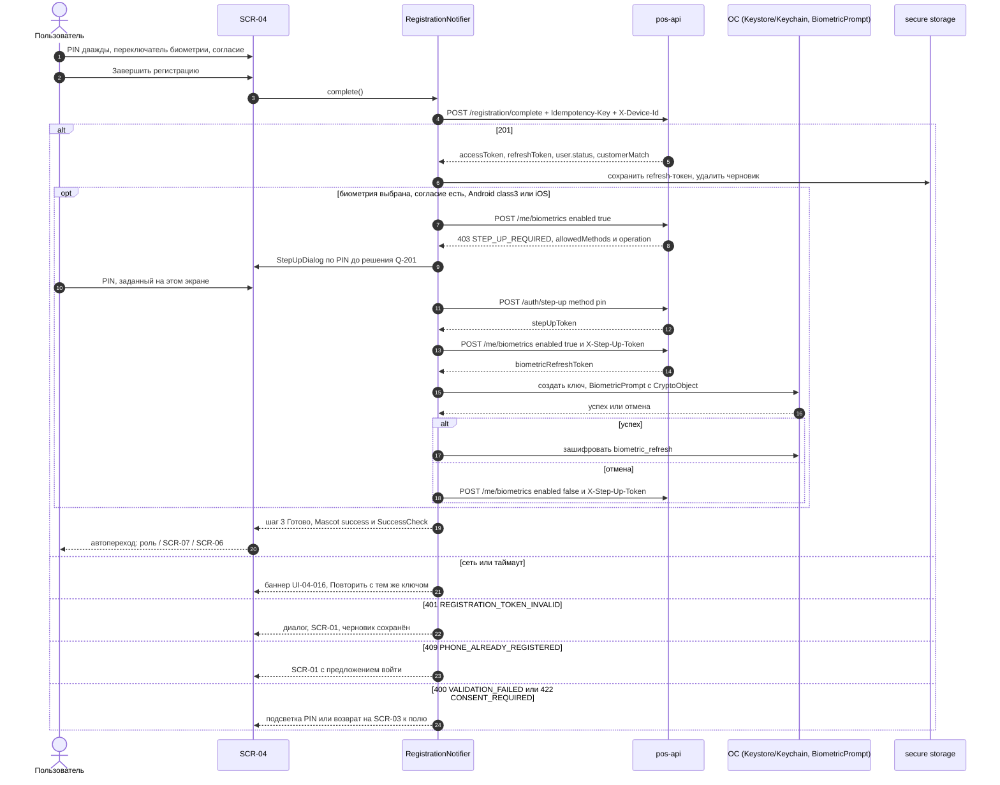
#### 7. Состояния экрана
| Состояние | Описание | Персонаж |
|---|---|---|
| Загрузка | проверка доступности биометрии ≤ 300 мс: чип плитки 6 `loading`; остальное интерактивно | `idle` |
| Ввод PIN | точки заполняются | `typing` (взгляд) |
| Ошибка PIN (локальная) | `error` + текст | `error` → `retry` |
| Отправка | кнопка `loading`, ввод заблокирован | `verifying` |
| Успех (шаг 3) | «Готово» | `success` |
| Ошибка сервера / сети | баннер UI-04-016, данные и PIN сохранены, «Повторить» | `error` (без авто-`retry`) |
| Нет сети до отправки | `OfflineBanner`, кнопка 12 disabled с подсказкой «Нужна сеть, чтобы завершить регистрацию» | `idle` |
| Нет разрешения/биометрии | плитка 6 в `notEnrolled`/`unsupported`; продолжение только с PIN | — |
| Пустой результат | неприменимо | — |
| Повторная попытка | «Повторить» с тем же `Idempotency-Key` | `retry` → `verifying` |
| Step-up (после `201`) | `StepUpDialog` по PIN для `POST /me/biometrics` (§4); отмена — регистрация завершена без биометрии | `verifying` (в диалоге) |
| Устаревшие данные | неприменимо | — |
| Step-up | только при `POST /me/biometrics` → `STEP_UP_REQUIRED` (не ожидается) | — |
| Только чтение (`APP_READ_ONLY`) | баннер «Регистрация временно недоступна»; кнопка disabled | `error` |
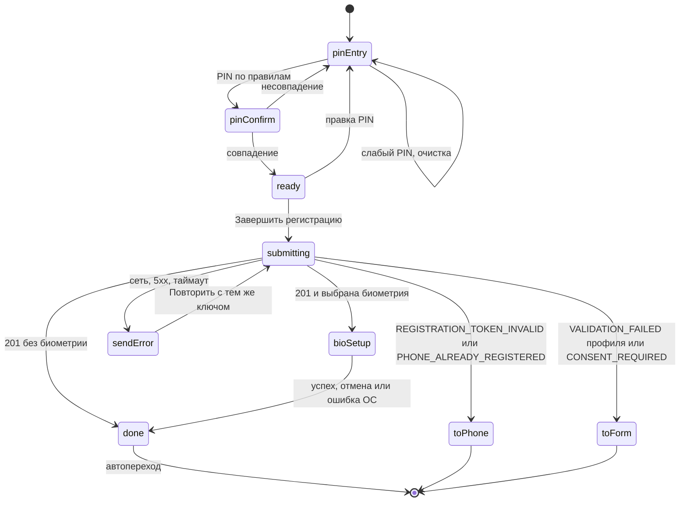
#### 8. Валидация и сообщения
| Условие | Ключ ARB | Текст |
|---|---|---|
| Заголовок / подзаголовок | `reg_security_title`, `reg_security_subtitle` | «Защита входа» / «Чтобы не вводить код из SMS при каждом входе» |
| Плитка PIN (`staff`) | `reg_pin_tile_title`, `reg_pin_tile_required` | «PIN-код приложения» / «Обязателен для сотрудников: нужен для разблокировки и подтверждения операций» |
| Поля PIN | `reg_pin_create`, `reg_pin_repeat`, `reg_pin_rules_hint` | «Придумайте PIN-код» / «Повторите PIN-код» / «{length} цифр, без повторов и простых последовательностей» |
| Слабый PIN | `reg_error_pin_weak` | «Выберите PIN без повторяющихся или последовательных цифр» |
| Несовпадение | `reg_error_pin_mismatch` | «PIN-коды не совпадают» |
| Плитка биометрии | `reg_bio_tile_title`, `reg_bio_available`, `reg_bio_not_enrolled`, `reg_bio_unsupported`, `reg_bio_windows_hello` | «Биометрия устройства» / «доступно» / «Настройте отпечаток или распознавание лица в настройках устройства» / «Недоступно на этом устройстве» / «Windows Hello — только для быстрого входа перед PIN, не заменяет PIN» |
| Согласие | `register_security_consent_text`, `reg_bio_consent_label` | Шаблон 3 (11 §10.3) / «Разрешаю вход по биометрии устройства (можно отключить в настройках)» |
| Биометрия позже | `reg_bio_later`, `reg_bio_later_windows` | «Настроить биометрию позже» / «Без Windows Hello» |
| Кнопка | `reg_complete` | «Завершить регистрацию» |
| Биометрия не включена | `reg_bio_not_enabled` | «Биометрия не включена. Вход — по PIN-коду. Включить можно в настройках» |
| Ошибка сети | `reg_error_network` | «Не удалось завершить регистрацию. Данные сохранены — повторите» |
| Шаг 3 | `reg_success_title`, `reg_success_security_pin`, `reg_success_security_pin_bio`, `reg_success_pending` | «Добро пожаловать, {name}!» / «Вход настроен: PIN-код» / «Вход настроен: PIN-код · биометрия» / «Аккаунт создан. Администратор магазина активирует его и назначит роль» |
| Только чтение | `error_app_read_only` | «Сервер работает в режиме только чтения — регистрация временно недоступна» |

#### 9. Источники данных, API, бизнес-правила
| Что | Источник | Правило |
|---|---|---|
| Завершение регистрации | `POST /registration/complete` (публичный, по `registrationToken`; `Idempotency-Key` обязателен) | 08 §4.2.1; 09 §7.3; D-07 |
| Включение биометрии | `POST /me/biometrics` | 08 §4.3.6; 09 §9.5; D-13 |
| Политика PIN | длина 6 (`staff`, `PIN_MIN_LENGTH_STAFF`) / 4 (`customer`); запреты; проверка и хэширование только на сервере (Argon2id + `PIN_PEPPER_FILE`) | 09 §9.6; D-48; Q-163 |
| Согласия | `consents` (`personal_data`, `biometrics_device`, `activity_sphere` `[НОВОЕ ИМЯ]`); версия текста — Q-027 | 07 §6 `consent_kind`; 11 §10.3 |
| Доступность биометрии | `local_auth`, platform channel (Keystore/Keychain) | 09 §9.2, §9.4 |
| Роль и статус | ответ `201` | D-07; Q-001 |
| Аудит (сервер) | `user.created`, `consent.granted`, `auth.pin.set`, `auth.biometrics.enabled` | 11 §7.2 |

#### 10. Действия по ролям и безопасность
| Действие | `staff` (по приглашению или `pending_activation`) | `customer` (Q-001) |
|---|---|---|
| Установка PIN | обязательна | по желанию |
| Включение биометрии | по выбору, с согласием; Android Class 3 (API ≥ 30) / iOS; Windows — Hello как UX-гейт | то же |
| Пропуск шага | нельзя (PIN обязателен) | можно выключить PIN, если включена биометрия; без PIN и без биометрии — допускается (09 §7.1 «Пропустить») |

Безопасность: PIN передаётся по TLS один раз, не логируется, не сохраняется на устройстве; биометрические данные не покидают ОС; `biometric_refresh` создаётся только после реального подтверждения ОС; согласие на биометрию отдельное и отзываемое (ст. 79); на рутованных устройствах биометрия не предлагается (Q-037).

#### 11. Повторное нажатие, двойной запрос, «Назад», перезапуск
- Двойное нажатие «Завершить» → один запрос; повтор после сетевой ошибки — тот же `Idempotency-Key` → сервер возвращает тот же `201` (`Idempotent-Replayed: true`) — повторной регистрации нет (SRC-B-136).
- Если `201` получен, но ответ потерян, повтор с тем же ключом выдаёт тот же результат; если пользователь изменил PIN после ошибки — новый ключ, но сервер ответит `409 PHONE_ALREADY_REGISTERED` (если первая попытка успела создать аккаунт) → SCR-01 «Номер уже зарегистрирован — войдите» (вход по OTP).
- «Назад» — на SCR-03, PIN сброшен.
- Перезапуск: PIN и `registration_token` теряются; черновик (без PIN) восстанавливается после нового OTP (§4.11); `Idempotency-Key` из `registration_draft` переиспользуется, если тело не изменилось.
- Сворачивание во время системного диалога биометрии — диалог закрывается ОС; при возврате регистрация уже завершена, показывается шаг 3.

#### 12. Требования к платформам
| Платформа | Требование |
|---|---|
| Android | `BiometricPrompt` с `BIOMETRIC_STRONG` и `CryptoObject`; ключ `setUserAuthenticationRequired(true)`, `setInvalidatedByBiometricEnrollment(true)`; API 30+ (API 28–29 — только после проверки Foundation); `MainActivity extends FlutterFragmentActivity`, разрешение `USE_BIOMETRIC` |
| iOS | Keychain `kSecAccessControlBiometryCurrentSet` + `WhenPasscodeSetThisDeviceOnly`; `NSFaceIDUsageDescription`; сборка не проверяется на текущей машине (Q-008) |
| Windows-POS | Hello — только UX-гейт; PIN — физическая клавиатура (цифры, `Backspace`, `Enter` = «Завершить» при готовности) и экранный нампад 72×56 для сенсорных мониторов |
| Планшет | две колонки (PIN / биометрия) |
| Все | точки PIN 16 при шрифте 1,3× → ячейки 56×64 |

#### 13. Критерии приёмки
| ID | Критерий |
|---|---|
| AC-UI-04-001 | Шаг нельзя завершить без PIN для `staff`: кнопка disabled до двукратного совпадающего ввода 6 цифр. |
| AC-UI-04-002 | PIN `111111`, `123456`, `654321`, PIN, содержащий год рождения из формы, отклоняются локально с текстом «Выберите PIN без повторяющихся…»; сервер на те же значения отвечает `VALIDATION_FAILED` (`pin_weak`). |
| AC-UI-04-003 | Несовпадение повторного PIN → оба поля `error`, shake, очистка, фокус в первое поле, текст «PIN-коды не совпадают». |
| AC-UI-04-004 | Вставка из буфера в поля PIN невозможна; цифры PIN не отображаются ни на одном кадре. |
| AC-UI-04-005 | Переключатель биометрии по умолчанию выключен; при включении появляется чекбокс согласия с текстом Шаблона 3; без отметки биометрия после регистрации не включена, показан снекбар. |
| AC-UI-04-006 | Устройство без настроенной биометрии → плитка «не настроена в системе», переключатель disabled, регистрация завершается с PIN. |
| AC-UI-04-007 | Windows: плитка показывает «Windows Hello — только для быстрого входа перед PIN»; запрос `POST /me/biometrics` не выдаёт `biometric_refresh`; PIN обязателен. |
| AC-UI-04-008 | Двойной тап «Завершить регистрацию» → один запрос с заголовком `Idempotency-Key`; повтор после обрыва сети использует тот же ключ и не создаёт второго пользователя (`users` — одна строка на номер). |
| AC-UI-04-009 | Успех: шаг 3 «Готово» с персонажем `success` и зелёной галочкой, текст «Добро пожаловать, {имя}!»; автопереход не позднее 900 мс от ответа (без учёта системного диалога); кнопки «Войти» нет. |
| AC-UI-04-010 | Статус `pending_activation` → SCR-07; `authenticated` с ролью `cashier` → SCR-30 без SCR-08. |
| AC-UI-04-011 | `REGISTRATION_TOKEN_INVALID` → диалог «Время регистрации истекло» → SCR-01 с номером; после нового OTP форма SCR-03 заполнена черновиком. |
| AC-UI-04-012 | `PHONE_ALREADY_REGISTERED` → SCR-01 с баннером «Этот номер уже зарегистрирован. Войдите». |
| AC-UI-04-013 | Отмена системного диалога биометрии → регистрация завершена, снекбар «Биометрия не включена…», вход по PIN работает. |
| AC-UI-04-014 | PIN отсутствует в secure storage, drift, логах и снекбарах (поиск по хранилищу и `adb logcat`). |
| AC-UI-04-015 | При reduce-motion шаг 3: галочка crossfade ≤ 80 мс без scale, переход через 300 мс. |
| AC-UI-04-016 | Без сети кнопка «Завершить регистрацию» disabled с подсказкой; при обрыве во время запроса — баннер «Не удалось завершить регистрацию. Данные сохранены — повторите», PIN не очищен. |
| AC-UI-04-017 | Индикатор «Шаг 2 из 3 · Защита входа» (67 %), на шаге «Готово» — «Шаг 3 из 3» (100 %). |
| AC-UI-04-018 | Регистрация с включённой биометрией и согласием (Android class3): после `201` и `403 STEP_UP_REQUIRED` на `POST /me/biometrics` открывается `StepUpDialog` по PIN; ввод PIN, заданного на этом экране, → повтор с `X-Step-Up-Token` → `200` → системный промпт → шаг 3 «Вход настроен: PIN-код · Биометрия»; отмена диалога → снекбар `reg_bio_not_enabled`, шаг 3 «Вход настроен: PIN-код», включение не пропускается без уведомления. |
| AC-UI-04-019 | Тело `POST /registration/complete` не содержит полей вне схемы 08 §4.2.1 (нет `device.model`); ответ без `biometricEnrollment` не блокирует показ системного промпта на Android class3/iOS. |

#### 14. Трассировка
| Требование | SRC / правила |
|---|---|
| Обязательный этап «сканирование лица или настройка биометрии» по безопасному сценарию | SRC-B-126, SRC-E-123; D-14; Q-003 |
| Различение системной биометрии и распознавания лица; ограничения платформ; согласие; защита данных | SRC-B-079, SRC-B-085, SRC-B-086, SRC-B-089; SRC-E-135, SRC-E-136, 136a, 136b, 136c |
| Предложение включить биометрию ОС после привязки номера; безопасный токен | SRC-B-080, 080a, 081, 082a |
| Анимация подтверждения, защита от повторной регистрации, сохранение данных при сбое сети | SRC-B-135, SRC-B-136, SRC-B-137 |
| Автоматический вход после завершения, только после серверной проверки номера | SRC-B-148, SRC-B-149; SRC-E-130 |
| Индикатор прогресса | SRC-B-134 |
| Персонаж: проверка, успех, ошибка | SRC-B-073…076; SRC-F-021 |

## 6. SCR-05 — Сканирование лица (guided capture) (маршрут `/register/face-scan`, условно, R2)
### SCR-05 — Сканирование лица при регистрации (`/register/face-scan`; гость с `registration_token`; **R2, условно — Q-003**)
> **Статус:** вне Release 1 `[РЕШЕНИЕ: D-14]`. Спецификация полная, как требует промт (строки 855–857, SRC-F-024…027). Экран включается только при `FACE_SCAN_MODE ≠ off` (переключатель 09 §10.2; перечень env 16 §4.3) после (а) решения заказчика Q-003, (б) юридического заключения по ст. 80 (гл. 11) Цифрового кодекса КР, (в) DPIA, (г) выбора liveness-SDK для режима `sdk_liveness`. В R1 маршрут не регистрируется (navigation G-8), `POST /registration/face-scan/verify` отвечает `404` (08 §4.2.3). Платформы — только Android/iOS (ML Kit); на Windows шаг недоступен.

#### 1. Назначение и роль пользователя
Необязательный (по умолчанию) шаг регистрации после SCR-04: пользователь проходит **guided-захват** лица в четырёх направлениях — прямо → влево → вправо → вверх — с подсказками, индикатором выполнения, условиями успешного захвата, повтором, отменой и обработкой неподдерживаемых устройств (SRC-F-024, 025). Режим `guided_only` подтверждает лишь, что в кадре было одно живое на вид лицо с поворотами и открытыми глазами; это **не** аутентификация, **не** идентификация личности и **не** защита от подделки (SRC-F-027, SRC-B-088). Режим `sdk_liveness` добавляет проверку живого присутствия коммерческим SDK с вердиктом сервера. Визуальная реакция (кольцо, стрелки, персонаж) и результат проверки — независимые слои (SRC-F-022, 023; 09 §10.2). Роль — гость с `registration_token`.

##### 1.1. Что подтверждено технологией и что требует SDK (SRC-F-026)
| Функция | Google ML Kit Face Detection (`google_mlkit_face_detection` 0.15.x) | Требует коммерческого SDK | Используется на экране |
|---|---|---|---|
| Детекция лица, `boundingBox`, число лиц | да `[ПОДТВЕРЖДЕНО: developers.google.com/ml-kit/vision/face-detection; R3 §6.3]` | — | условия «одно лицо», размер, центр |
| Углы головы `headEulerAngleX/Y/Z` | да | — | направления шагов |
| Вероятность открытых глаз (`enableClassification`) | да | — | условие «глаза открыты» |
| Трекинг одного лица (`trackingId`) | да | — | стабильность 600 мс одного лица |
| Оценка освещённости | нет в ML Kit — эвристика яркости кадра (luma) на устройстве `[НЕ ПОДТВЕРЖДЕНО]` | — | подсказки «темно / ярко» |
| Распознавание личности | нет | да (Regula, iProov, Onfido, Sumsub — Flutter-плагины `[ПОДТВЕРЖДЕНО: pub.dev, R3 §6.4]`; FaceTec — без Flutter-плагина) | только `sdk_liveness` (R2) |
| Liveness / anti-spoofing (фото, видео, маска) | нет — серия поворотов обходится видео | да (PAD по ISO/IEC 30107-3 `[ТИПОВО]`) | только `sdk_liveness`; в `guided_only` экран **не** заявляет защиту от подделки |
| Windows | нет | нет у перечисленных | шаг недоступен |

#### 2. Структура экрана
| Класс окна | Сверху вниз |
|---|---|
| compact (Android/iOS, портрет) | шапка 56: «×» (отмена) слева, «Регистрация» по центру, «Пропустить» (text) справа → `RegistrationStepper` «Шаг 3 из 4 · Лицо (необязательно)» (75 %) → заголовок «Сканирование лица» `h2` → видоискатель: превью фронтальной камеры с овалом-маской 220×260 (280×330 при высоте ≥ 800) по центру, вокруг — кольцо из 4 сегментов (верх = прямо, лево = влево, право = вправо, низ = вверх), стрелка направления у края овала → инструкция шага `title` 18/26/600 по центру → чипы шагов «Прямо · Влево · Вправо · Вверх» → подпись «Шаг n из 4» + совет `caption` → пояснение о данных `caption` → кнопка «Начать» / «Повторить шаг» / «Начать заново» L 52 → «Настроить позже» text |
| compact ландшафт | предупреждение «Поверните устройство вертикально» `[ТИПОВО]`, сканирование приостановлено |
| medium (планшет Android/iOS) | карточка 560: видоискатель 280×360 по центру, подсказки под ним; кнопки внизу карточки |
| expanded (Windows-POS) | вместо видоискателя — состояние «Недоступно» (UI-05-012) с одной кнопкой продолжения; Android/iOS-планшет в ландшафте ≥ 1024 — как medium |

#### 3. Таблица элементов
| № | UI-ID | Элемент | Компонент | Расположение/размер | Токены | Состояния | Поведение | Источник данных | Роли | Правило |
|---|---|---|---|---|---|---|---|---|---|---|
| 1 | UI-05-001 | «Пропустить» | `AppButton.text` S | шапка справа | `primary` | visible (`FACE_SCAN_REQUIRED=false`), hidden (обязателен) | продолжить регистрацию без флага; без диалога | конфиг | гость | 09 §10.3 |
| 2 | UI-05-002 | Индикатор прогресса | `RegistrationStepper` (шаг «Лицо» с пунктирной обводкой — условный модуль) | под шапкой | как SCR-03 | 3 из 4 (75 %) | — | — | гость | SRC-B-134 |
| 3 | UI-05-003 | Заголовок | текст | под степпером | `h2` | default | — | `face_title` | гость | — |
| 4 | UI-05-004 | Видоискатель + овал + кольцо 4 сегмента | `FaceCaptureView` `[НОВОЕ ИМЯ]` (превью `camera`, овал-маска, `AppProgress` вариант `stepped` из 4 сегментов) | по центру; овал 220×260 / 280×330 / 280×360; кольцо толщиной 6 на расстоянии 8 от овала | маска вне овала — `overlay`; сегменты: пусто `surfaceVariant`, активный `primary` (заполняется 0→100 % за 600 мс удержания), выполнен `success`, ошибка `error` 300 мс | idle, active(step), holding(progress), stepDone, stepError, allDone, paused | ничего не сохраняет (кадры не сохраняются при `FACE_SCAN_STORE_FRAMES=false`); превью зеркальное | поток кадров `startImageStream` → `FaceDetector` → `FaceScanController` | гость | 09 §10.2–10.3; ANIM-R2-001 |
| 5 | UI-05-005 | Стрелка направления | иконка 28 (`arrow_back`, `arrow_forward`, `arrow_upward`; для «прямо» — точка 12 в центре овала) | у соответствующего края овала | `primary` | pulse / static | пульс scale 1→1.15→1, 600 мс (не в рабочей зоне — допустимо по DS-063 только здесь) | шаг автомата | гость | 09 §10.3 |
| 6 | UI-05-006 | Инструкция шага | текст | под видоискателем через 16, по центру, ≤ 2 строк | `title` 18/26/600 `textPrimary`; подсказка-ошибка — `warning` | step text / hint text | озвучивается TalkBack/VoiceOver при смене (A11Y) | события `FaceScanHint` | гость | 09 §10.3 |
| 7 | UI-05-007 | Чипы шагов | `StatusChip` ×4 | под инструкцией через 12, в ряд | done `success`, active `primary`, upcoming нейтральный, error `error` | 4 состояния | не кликабельны; дублируют кольцо текстом (A11Y-004) | автомат | гость | — |
| 8 | UI-05-008 | «Шаг n из 4» + совет | `caption` | под чипами | `textSecondary` | default | советы: «Держите телефон на уровне глаз», «Найдите место посветлее», «Держите телефон неподвижно» | автомат, эвристики | гость | 09 §10.4 |
| 9 | UI-05-009 | Пояснение о данных | `caption` | над кнопкой | `textSecondary` | default | «Снимки обрабатываются на устройстве и не сохраняются» — формулировка подлежит юридической проверке (Q-003, Q-027); в `sdk_liveness` — текст о передаче вендору | конфиг | гость | 09 §10.5 |
| 10 | UI-05-010 | Основная кнопка | `AppButton.primary` L («Начать») / `outlined` L («Повторить шаг», «Начать заново») | низ | `primary` | start, retryStep, restart, disabled (пауза после 3 попыток, с таймером) | старт камеры и шага 1; повтор текущего шага; сброс всех сегментов | автомат | гость | 09 §10.3 |
| 11 | UI-05-011 | «Настроить позже» | `AppButton.text` M | под кнопкой 10 | `primary` | visible / hidden (если обязателен) | = UI-05-001 | — | гость | — |
| 12 | UI-05-012 | Состояние «недоступно» | `EmptyState` вариант `noCamera` + `AppButton.primary` «Продолжить без сканирования» | вместо видоискателя | иллюстрация `brandAccent` | Windows / нет фронтальной камеры / нет ML Kit (Android без GMS) | продолжение регистрации без флага | `Platform.isWindows`, `availableCameras()`, ошибка инициализации детектора | гость | 09 §10.4 |
| 13 | UI-05-013 | Нет разрешения камеры | `ErrorState` (SCR-90 «нет разрешения», §10.D) + «Открыть настройки» + «Пропустить шаг» | вместо видоискателя | `error` | denied / permanentlyDenied | `denied` — повторный системный запрос по кнопке «Разрешить»; `permanentlyDenied` — только «Открыть настройки» | `permission_handler`/`camera` | гость | 09 §10.4 |
| 14 | UI-05-014 | Успех | `SuccessCheck` 72 в овале + `Mascot.mini` `success` + текст «Готово» | по центру видоискателя | `success` | shown | через 900 мс — отправка регистрации (SCR-04 логика) и шаг «Готово» | автомат | гость | ANIM-005 |
| 15 | UI-05-015 `[НОВЫЙ UI-ID]` | «×» отмена и диалог «Прервать сканирование?» | `AppIconButton` + `ConfirmDialog` | шапка слева | — | — | подтверждение: кадры/метаданные в памяти уничтожаются, возврат на SCR-04 | — | гость | 09 §10.3 |
| 16 | UI-05-016 `[НОВЫЙ UI-ID]` | Диалог таймаута шага | `ConfirmDialog` с тремя действиями | по центру | — | — | через 20 с без успеха шага: «Повторить» / «Пропустить» (если разрешено) / «Отмена» | автомат | гость | 09 §10.3 |
| 17 | UI-05-017 `[НОВЫЙ UI-ID]` | Экран «Не удалось завершить сканирование» | `ErrorState.fullScreen` | вместо видоискателя | `error` | shown | через 90 с общего таймаута: «Повторить», «Настроить вход по-другому» (→ SCR-04), «Отмена» | автомат | гость | 09 §10.3 |
| 18 | UI-05-018 `[НОВЫЙ UI-ID]` | Согласие на обработку изображения лица | `AppCheckbox` + «Подробнее» | над кнопкой «Начать»; только при `FACE_SCAN_STORE_FRAMES=true` или `sdk_liveness` | 03 §9.65 | unchecked / checked | без отметки «Начать» disabled; `consents[{kind: "face_scan"}]` | 07 `consent_kind.face_scan` | гость | 09 §10.5; Q-027 |

#### 4. Поведение контролов, последовательность шагов и условия захвата
##### 4.1. Последовательность шагов и условия захвата (SRC-F-024, SRC-F-025)
Общие условия для каждого шага (пороги `[НЕ ПОДТВЕРЖДЕНО — в документации ML Kit не заданы; настраиваются на пилоте]`): ровно **одно** лицо не менее 10 кадров подряд; ширина лица 25–70 % ширины кадра; центр лица в овале ±15 %; `leftEyeOpenProbability` и `rightEyeOpenProbability` ≥ 0.5; средняя яркость (luma) 60–200 из 255; удержание целевого угла ≥ 600 мс с одним `trackingId`; параметры детектора `performanceMode: fast`, `minFaceSize: 0.15`, `enableTracking: true`, `enableClassification: true`, `enableLandmarks: false`, `enableContours: false`.

| Шаг | Подсказка (ARB) | Целевой диапазон углов | Индикатор выполнения | Успешный захват | Повторная попытка | Отмена | Таймаут |
|---|---|---|---|---|---|---|---|
| 1. Прямо | «Посмотрите прямо в камеру» (`face_step_front`) | `abs(Y) ≤ 10°`, `abs(X) ≤ 10°`, `abs(Z) ≤ 15°` | верхний сегмент заполняется 0→100 % за 600 мс удержания; точка в центре овала | сегмент 1 → `success`, haptic light; сохраняются только метаданные (углы, время), не изображение | потеря лица/условий > 1,5 с → сегмент `error` 300 мс → сброс, текст `face_retry` «Попробуйте ещё раз» | «×» → диалог UI-05-015 | 20 с → UI-05-016 |
| 2. Влево | «Медленно поверните голову влево» (`face_step_left`) + стрелка ← | `Y ≤ −20°` (знак — с учётом зеркалирования фронтальной камеры `[ТИПОВО: проверить на устройствах]`), `abs(X) ≤ 15°` | левый сегмент | удержание 600 мс | поворот в обратную сторону или `abs(Y) > 60°` → «Слишком сильно — поверните немного назад» (`face_hint_too_far`); потеря лица → сброс сегмента 2 (сегмент 1 сохраняется) | то же | 20 с |
| 3. Вправо | «Теперь поверните голову вправо» (`face_step_right`) + стрелка → | `Y ≥ +20°`, `abs(X) ≤ 15°` | правый сегмент | то же | то же | то же | 20 с |
| 4. Вверх | «Поднимите подбородок немного вверх» (`face_step_up`) + стрелка ↑ | `X ≥ +15°` (знак `[ТИПОВО: проверить]`), `abs(Y) ≤ 15°` | нижний сегмент | то же; затем всё кольцо `success`, UI-05-014 | то же | то же | 20 с |

Подсказки нарушения общих условий (показываются вместо инструкции, цвет `warning`, не чаще 1 смены в 1,5 с): «Лицо не найдено» (`face_hint_no_face`), «В кадре должно быть одно лицо» (`face_hint_many_faces`), «Подойдите ближе» (`face_hint_closer`), «Отодвиньтесь немного» (`face_hint_farther`), «Расположите лицо в овале» (`face_hint_center`), «Откройте глаза» (`face_hint_eyes`), «Слишком темно» (`face_hint_dark`), «Слишком ярко — уберите источник света из кадра» (`face_hint_bright`), «Держите телефон неподвижно» (`face_hint_steady`).

Между шагами — пауза 400 мс с текстом «Отлично» (`face_step_ok`) и сменой стрелки (250 мс `mascotTransition`). Общий таймаут сценария 90 с → UI-05-017. Повтор всего сценария — не более 3 раз подряд, далее пауза 5 мин (кнопка 10 disabled с таймером) `[НЕ ПОДТВЕРЖДЕНО — предложение 09 §10.3]`.

##### 4.2. Поведение контролов
- **«Начать» (UI-05-010).** Запрашивает разрешение камеры (если не выдано) → инициализирует камеру (фронтальная, 640×480 для слабых устройств) и детектор → шаг 1. Повторное нажатие во время инициализации игнорируется.
- **«Повторить шаг».** Сбрасывает только текущий сегмент; выполненные сохраняются.
- **«Начать заново».** Сбрасывает все сегменты, увеличивает счётчик попыток (≤ 3).
- **«Пропустить» / «Настроить позже».** Останавливают камеру, уничтожают метаданные в памяти, продолжают регистрацию (отправка `POST /registration/complete` как на SCR-04) без флага прохождения.
- **«×» и системная «Назад».** Диалог «Прервать сканирование?» (фокус на «Продолжить сканирование»); подтверждение — возврат на SCR-04, камера остановлена.
- **Сворачивание приложения.** Камера освобождается немедленно; при возврате — состояние «пауза», текущий шаг перезапускается по кнопке «Продолжить».
- **Долгое нажатие, тап по видоискателю.** Без действия.
- **Клавиатура/сканер.** Не используются.

#### 5. Анимации
| ID | Описание | Длительность | Ошибка | Reduce-motion |
|---|---|---|---|---|
| ANIM-R2-001 | кольцо 4 сегмента: активный сегмент заполняется по удержанию (0→100 % за 600 мс, линейно по прогрессу); выполненный — `success` 300 мс; ошибка — `error` 300 мс, затем сброс | 300 мс на сегмент | сброс сегмента | статичные сегменты (без заполнения — только смена цвета), статичные подсказки |
| Специфичная: стрелка | пульс scale 1→1.15→1 | 600 мс loop | — | статичная стрелка |
| Специфичная: смена шага | текст «Отлично» 400 мс, стрелка crossfade 250 мс | 650 мс | — | мгновенно |
| ANIM-005 (вариант) | успех: `SuccessCheck` 72 в овале, персонаж `success` | ≤ 900 мс | — | crossfade 80 мс |
| ANIM-023 | диалоги UI-05-015, UI-05-016 | 250 / 200 мс | — | fade 80 мс |

#### 6. Переходы
| Событие | Куда | Данные |
|---|---|---|
| SCR-04 «Далее» при `FACE_SCAN_MODE ≠ off` (в R2 кнопка SCR-04 называется «Далее», а не «Завершить») | SCR-05 | черновик, PIN (память), согласия |
| Успех (`guided_only`) | отправка `POST /registration/complete` (с отметкой прохождения в согласии `face_scan`, без изображений) → шаг «Готово» (UI-04-015) | `FaceScanResult {completed, stepsDone, elapsed}` — только в памяти |
| Успех (`sdk_liveness`) | `POST /registration/face-scan/verify {registrationToken, vendorSessionId}` → `200 {verified}` → `POST /registration/complete` → «Готово» | `vendorSessionId` |
| «Пропустить» / «Настроить позже» / «Продолжить без сканирования» | `POST /registration/complete` → «Готово» | — |
| Отмена / «Настроить вход по-другому» | SCR-04 | — |
| `REGISTRATION_TOKEN_INVALID` | SCR-01 (как SCR-04) | номер, черновик |

#### 7. Состояния экрана
| Состояние | Описание |
|---|---|
| Ожидание | превью камеры не запущено, кольцо пустое, «Начать» |
| Загрузка | инициализация камеры/детектора ≤ 2 с: `AppProgress.circular` 24 в овале |
| Шаг активен / удержание / шаг выполнен / ошибка шага | §5 |
| Успех | UI-05-014 |
| Ошибка (общий таймаут, ошибка `sdk_liveness`) | UI-05-017; при `verified=false` — «Проверка не пройдена. Повторите или настройте вход по-другому» |
| Пустой результат | неприменимо |
| Нет сети | `guided_only` — сканирование работает, отправка регистрации ждёт сети (баннер SCR-04); `sdk_liveness` — «Нужна сеть для проверки» |
| Нет разрешения камеры | UI-05-013 |
| Неподдерживаемое устройство | UI-05-012 |
| Повторная попытка | «Повторить шаг» / «Начать заново»; после 3 попыток — пауза 5 мин |
| Устаревшие данные / step-up | неприменимо |
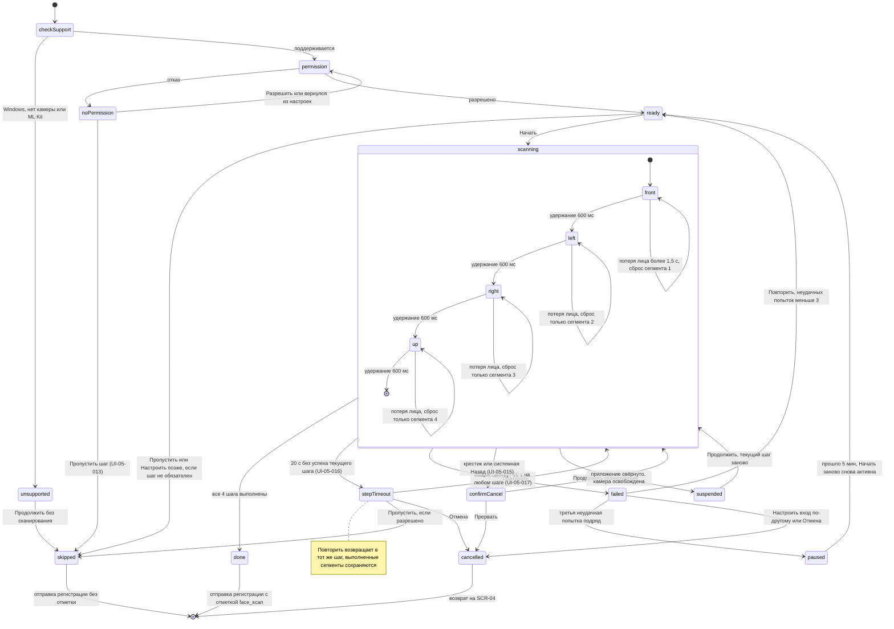
#### 8. Валидация и сообщения
Ввода нет; тексты — в §5 и словаре (§11): `face_title` «Сканирование лица», `face_step_counter` «Шаг {n} из 4», `face_data_notice` «Снимки обрабатываются на устройстве и не сохраняются», `face_start` «Начать», `face_retry_step` «Повторить шаг», `face_restart` «Начать заново», `face_skip` «Пропустить», `face_later` «Настроить позже», `face_cancel_title` «Прервать сканирование?», `face_cancel_body` «Регистрация продолжится без сканирования лица», `face_step_timeout_title` «Не получается?», `face_failed_title` «Не удалось завершить сканирование», `face_other_method` «Настроить вход по-другому», `face_unsupported_title` «Сканирование лица недоступно на этом устройстве», `face_unsupported_no_camera` «Нет фронтальной камеры. Вход защищён PIN-кодом», `face_continue_without` «Продолжить без сканирования», `face_rotate_device` «Поверните устройство вертикально», `face_paused_attempts` «Слишком много попыток. Повторите через {mmss}», `face_done` «Готово».

#### 9. Источники данных, API, бизнес-правила
| Что | Источник | Правило |
|---|---|---|
| Детекция и углы | ML Kit на устройстве | 09 §10.1, §10.3 |
| Автомат шагов | `FaceScanController` (domain-интерфейс 09 §10.6: `FaceScanStep {front, left, right, up}`, `FaceScanEvent`, `FaceScanResult`) | 09 §10.6 |
| Режим | `FACE_SCAN_MODE` (`off` в R1), `FACE_SCAN_REQUIRED`, `FACE_SCAN_STORE_FRAMES` `[НОВЫЕ ИМЕНА 09 §10]` | Q-003 |
| Серверная проверка (только `sdk_liveness`) | `POST /registration/face-scan/verify` | 08 §4.2.3 (R2) |
| Хранение | R1 — ничего; R2 `guided_only` — только факт прохождения в `consents`; фото профиля — отдельное согласие, шифрование, срок — решение заказчика | 09 §10.5; 11 §9.2 |

#### 10. Действия по ролям и безопасность
Только гость в процессе регистрации. Кадры не покидают устройство в `guided_only`; не пишутся на диск; метаданные уничтожаются при отмене/пропуске/завершении. Экран и тексты не утверждают, что сканирование защищает от подделки или подтверждает личность (SRC-F-027). Обработка изображений лица для идентификации — специальная категория (ст. 80 ЦК КР): без юридического заключения и DPIA модуль не включается (D-14). Если заказчик сделает шаг обязательным, небиометрическая альтернатива (через администратора) обязательна (09 §10.3).

#### 11. Повторное нажатие, двойной запрос, «Назад», перезапуск
- Повторные нажатия «Начать»/«Повторить» во время инициализации игнорируются; запросы `face-scan/verify` и `registration/complete` — один в полёте, `complete` с тем же `Idempotency-Key`.
- «Назад» — диалог отмены.
- Перезапуск: прогресс сканирования не сохраняется (только память); регистрация продолжается по правилам §4.11 (новый OTP, черновик).
- Пауза 5 мин после 3 попыток хранится в памяти процесса; перезапуск её сбрасывает `[ТИПОВО]`.

#### 12. Требования к платформам
| Платформа | Требование |
|---|---|
| Android | ML Kit (требует Google Play Services для bundled-модели или bundled-вариант `[ТИПОВО]`); фронтальная камера; < 10 fps → 640×480 и подсказка «Держите телефон неподвижно» |
| iOS | ML Kit iOS; `NSCameraUsageDescription`; проверка только при наличии macOS (Q-008) |
| Windows | не поддерживается — UI-05-012 |
| Планшет | овал 280×360, подсказки под овалом |

#### 13. Критерии приёмки (для R2; в R1 — только AC-UI-05-001)
| ID | Критерий |
|---|---|
| AC-UI-05-001 | R1-сборка: маршрут `/register/face-scan` не зарегистрирован, после SCR-04 регистрация завершается без SCR-05, `POST /registration/face-scan/verify` → 404. |
| AC-UI-05-002 | Шаги выполняются строго в порядке прямо → влево → вправо → вверх; переход к следующему — только после удержания угла 600 мс с одним `trackingId`. |
| AC-UI-05-003 | При двух лицах в кадре — подсказка «В кадре должно быть одно лицо», прогресс сегмента не растёт. |
| AC-UI-05-004 | Потеря лица > 1,5 с на шаге 3 сбрасывает только сегмент 3 (сегменты 1–2 остаются `success`). |
| AC-UI-05-005 | Поворот > 60° → подсказка «Слишком сильно — поверните немного назад». |
| AC-UI-05-006 | 20 с без успеха шага → диалог «Не получается?» с «Повторить / Пропустить / Отмена». |
| AC-UI-05-007 | 90 с общего таймаута → экран «Не удалось завершить сканирование» с «Повторить», «Настроить вход по-другому», «Отмена». |
| AC-UI-05-008 | После 3 неудачных сценариев подряд кнопка «Начать заново» disabled 5 мин с таймером. |
| AC-UI-05-009 | Отказ в разрешении камеры → состояние «Нет доступа к камере» с «Открыть настройки» и «Пропустить шаг»; регистрация может быть завершена. |
| AC-UI-05-010 | Windows / устройство без фронтальной камеры / без ML Kit → «Сканирование лица недоступно на этом устройстве» и «Продолжить без сканирования». |
| AC-UI-05-011 | В режиме `guided_only` с `FACE_SCAN_STORE_FRAMES=false` ни одно изображение не записывается на диск и не передаётся в сеть (мониторинг файловой системы и трафика). |
| AC-UI-05-012 | Тексты экрана не содержат утверждений о защите от подделки или распознавании личности (ревью ARB). |
| AC-UI-05-013 | Кольцо и чипы показывают одинаковое состояние шагов; при reduce-motion сегменты меняют цвет без анимации заполнения, стрелка не пульсирует. |
| AC-UI-05-014 | Отмена «×» → диалог; подтверждение возвращает на SCR-04, камера освобождена (индикатор камеры ОС погас). |
| AC-UI-05-015 | Персонаж/кольцо не показывают `success` до завершения автомата (`guided_only`) или до ответа `verified=true` сервера (`sdk_liveness`). |

#### 14. Трассировка
| Требование | SRC / правила |
|---|---|
| Последовательность прямо/влево/вправо/вверх | SRC-F-024 |
| Подсказки, индикатор, условия захвата, повтор, отмена, неподдерживаемое устройство | SRC-F-025 |
| Подтверждено технологией vs требует SDK | SRC-F-026 |
| Нет заявлений о защите от подделки; серия фото — не защита | SRC-F-027, SRC-B-088 |
| Оценка отдельного решения для распознавания и liveness | SRC-B-087; D-14; Q-003 |
| Запрет хранения сырых биометрических данных без основания | SRC-B-089 |
| Независимость визуального слоя от результата | SRC-F-022, SRC-F-023 |

## 7. SCR-06 — Привязка к клиенту 1С (маршрут `/register/customer-link`, роль: `customer`, условно — Q-001)
### SCR-06 — Привязка аккаунта к карточке клиента 1С (`/register/customer-link`; `customer`; условно, флаг `CUSTOMER_SELF_SERVICE`)
> **Статус:** в R1 флаг `CUSTOMER_SELF_SERVICE` выключен — экран не показывается, маршрут перенаправляется (navigation G-8) `[ТРЕБУЕТ РЕШЕНИЯ ЗАКАЗЧИКА: Q-001]`. Для сотрудников экран не используется никогда (`GET /registration/customer-match` для `staff` всегда `none`).

#### 1. Назначение и роль пользователя
После регистрации клиента-покупателя backend ищет существующую карточку клиента 1С по **подтверждённому** телефону (D-08, SRC-B-138) и создаёт `customer_link` со статусом `proposed` (одно совпадение) или `conflict` (несколько). Экран безопасно предлагает привязку: показывает только маскированное наименование и маску телефона — **без** долгов, истории, скидок, ИНН, адреса до подтверждения (SRC-B-145); подтверждение пользователем → `confirmed` (история покупок и взаиморасчёты остаются в 1С и становятся видны — SRC-B-143); отказ → `rejected` (новая карточка автоматически не создаётся — SRC-B-144; создаётся при первом заказе по правилам CUST-/Q-025); неоднозначность → разрешение администратором (SRC-B-146). Дубликаты не создаются (SRC-B-139, SRC-E-134a). Шаг 3 из 4 индикатора регистрации.

#### 2. Структура экрана
| Класс окна | Сверху вниз |
|---|---|
| compact | шапка 56 «Карточка клиента» (без «Назад» — шаг после завершения регистрации) → `RegistrationStepper` «Шаг 3 из 4 · Клиент 1С» → иллюстрация 120 → заголовок (по состоянию) `h2` → пояснение `body` → карточка совпадения (маскированная) → плашка «Финансовые данные не показываются до подтверждения» → «Да, это я» primary L → «Нет, это не я» outlined L → «Связаться с магазином» text |
| medium / expanded | карточка 560, радиус `ds.radius.lg` 16 (ядро §18.2 п.15); иллюстрация 160 слева от заголовка; кнопки в ряд: «Нет, это не я» слева, «Да, это я» справа |

#### 3. Таблица элементов
| № | UI-ID | Элемент | Компонент | Расположение/размер | Токены | Состояния | Поведение | Источник данных | Роли | Правило |
|---|---|---|---|---|---|---|---|---|---|---|
| 1 | UI-06-001 | Иллюстрация (переопределено: вместо персонажа wireframe — иллюстрация, т.к. 03 §9.52 не включает SCR-06 в экраны `Mascot`) | `EmptyState`-иллюстрация `customer_link` | над заголовком (compact) / слева (medium+); 120 / 160 | линии `textSecondary`, заливка `brandAccent` 10–20 % | default | декоративна, `excludeSemantics` | assets | `customer` | 03 §14 |
| 2 | UI-06-002 | Заголовок | текст | под иллюстрацией | `h2`/`h1` | `proposed`: «Мы нашли вашу карточку клиента»; `none`: «Карточка клиента будет создана при первом заказе»; `conflict`: «Нужна помощь администратора»; `confirmed`: «Карточка привязана» | — | `GET /registration/customer-match` | `customer` | 09 §7.8 |
| 3 | UI-06-003 | Пояснение | `body` | под заголовком | `textSecondary` | по состоянию | не упоминает долг и скидки | ARB | `customer` | SRC-B-145 |
| 4 | UI-06-004 | Карточка совпадения (маскированная) | `CustomerCard` вариант `masked` `[НОВОЕ ИМЯ — вариант]` | на всю ширину; строки 48: «Клиент» — `customer.displayName` (маска сервера, напр. «ОсОО «Стр***»»), «Телефон» — `phoneMasked` + чип `success` «совпадает» | `surface`, обводка `border`, радиус `ds.radius.md` | proposed (видна); conflict, none (скрыта) | запрещено показывать: долг, историю, скидку, адрес, ИНН, код 1С (D-08) | `customer-match.customer` | `customer` | SRC-B-142, 145 |
| 5 | UI-06-005 | «Да, это я» | `AppButton.primary` L; `loading` | низ | `primary` | enabled, loading, disabled (офлайн) | подтверждение привязки (§4) | `customer-match` | `customer` | 09 §7.9 |
| 6 | UI-06-006 | «Нет, это не я» | `AppButton.outlined` L + `ConfirmDialog` | под 5 (compact) / слева от 5 | `primary` | enabled, loading | отклонение привязки (§4) | — | `customer` | SRC-B-144 |
| 7 | UI-06-007 | «Связаться с магазином» | `AppButton.text` → лист поддержки | низ | `primary` | default | контакты `support_contacts` | кэш | `customer` | — |
| 8 | UI-06-008 | Состояние «совпадений нет» | `EmptyState` + `AppButton.primary` «Продолжить» | вместо 4–6 | — | shown | → SCR-50; карточка 1С создаётся при первом заказе (CUST-, Q-025) | `status=none` | `customer` | SRC-B-144 |
| 9 | UI-06-009 | Состояние «конфликт» | `ErrorState.inline` вариант `warning` + «Понятно» + поддержка | вместо 4–6 | `warningContainer`/`warning` | shown | «Найдено несколько карточек с вашим номером. Администратор магазина проверит данные и свяжется с вами»; → SCR-50 в ограниченном режиме (каталог без условий 1С) | `status=conflict` | `customer` | SRC-B-146; `CUSTOMER_LINK_CONFLICT` |
| 10 | UI-06-010 | Состояние «успех привязки» | `SuccessCheck` 72 + текст | по центру | `success` | shown ≤ 900 мс | → SCR-50 | ответ confirm | `customer` | SRC-B-143 |
| 11 | UI-06-011 `[НОВЫЙ UI-ID]` | Скелетон поиска | `SkeletonBox` (карточка 4 строки) + подпись «Ищем вашу карточку…» | вместо 4 | `skeletonBase` | > 300 мс загрузки | кнопки disabled | — | `customer` | 03 §9.42 |
| 12 | UI-06-012 `[НОВЫЙ UI-ID]` | Состояние «ожидает подтверждения администратором» | `ErrorState.inline` `info` + «Продолжить» | вместо 4–6 | `infoContainer`/`info` | shown | после «Да, это я», если номер найден только как второй контакт ЮЛ (подтверждает админ) или `nextStep=wait_admin` | `customer-match.nextStep` | `customer` | 09 §7.9 |

#### 4. Поведение контролов
- **«Да, это я».** `loading` → подтверждение привязки `POST /customers/{id}/links/{linkId}/confirm` (путь ядра §7; `linkId` должен прийти в ответе `customer-match` — в 08 §4.2.2 поле отсутствует, Q-202) → `confirmed` → UI-06-010 → SCR-50; если сервер оставил `proposed` с `nextStep=wait_admin` → UI-06-012. `409 CUSTOMER_LINK_CONFLICT` → UI-06-009. Сеть — снекбар + повтор того же запроса (операция идемпотентна по `linkId`). Двойное нажатие — один запрос.
- **«Нет, это не я».** `ConfirmDialog`: «Это не ваша карточка?» / «Мы не будем связывать аккаунт с этой карточкой. Если карточка всё же ваша, объединить их сможет администратор магазина» / «Да, не моя» (danger не требуется — обратимо администратором) / «Отмена» → `POST /customers/{id}/links/{linkId}/reject` → `rejected` → SCR-50.
- **Системная «Назад».** Не возвращает в регистрацию (регистрация завершена); на Android — сворачивание. Решение можно отложить: «Связаться с магазином» не меняет статус; при следующем запуске экран показывается снова, пока статус `proposed` (переход из SCR-00/SCR-50 по `customer-match`).
- **Клавиатура (Windows/планшет).** `Tab` по кнопкам; фокус по умолчанию — на «Да, это я»; `Enter` активирует фокусную кнопку.

#### 5. Анимации
| ID | Элемент | Начальное состояние | Триггер | Последовательность | Конечное состояние | Длительность | Реакция на ошибку | Reduce-motion |
|---|---|---|---|---|---|---|---|---|
| ANIM-018 | `RegistrationStepper` (UI-06-002 над заголовком) | узел 2 `primary`, узел 3 — обводка, прогресс 50 % | открытие экрана после `201` (SCR-04 → SCR-06) | галочка узла 2 scale-in 200 мс `emphasized`; узел 3 → `primary`; `AppProgress.linear` 50 → 75 % за 200 мс | «Шаг 3 из 4 · Клиент 1С» | 250 мс | — | fade 80 мс |
| ANIM-013 | скелетон UI-06-011 | скрыт | `GET /registration/customer-match` дольше 300 мс | шиммер `skeletonBase → skeletonHighlight` слева направо (блик 40 %), loop; по ответу — контент fade-in 150 мс без сдвига | карточка совпадения или состояние 8/9/12 | loop 1,2 с; fade-in 150 мс | > 10 с → `AppProgress` + «Долгая загрузка… · Повторить»; ошибка → `ErrorState` (ANIM-022) | статичные блоки без градиента |
| ANIM-022 | состояния UI-06-008, UI-06-009, UI-06-012 | скелетон или предыдущее состояние | ответ `none` / `conflict` / `nextStep=wait_admin` | иллюстрация/блок + текст + кнопка fade-in 200 мс `standardDecelerate`, без сдвига | состояние видно, фокус на основной кнопке | 200 мс | — | мгновенно |
| ANIM-023 | `ConfirmDialog` «Это не ваша карточка?» | скрыт | «Нет, это не я» | `overlay` 0 → .48 за 200 мс + диалог scale .96 → 1 + fade 250 мс; закрытие — fade + scale 1 → .98 за 200 мс | диалог виден, фокус на «Отмена»; после закрытия фокус возвращён на кнопку 6 | 250 / 200 мс | ошибка `reject` → диалог закрыт, снекбар (ANIM-027) | fade 80 мс |
| Специфичная: `loading` кнопок | UI-06-005, UI-06-006 | enabled | нажатие | текст → спиннер 20 crossfade 150 мс, ширина кнопки неизменна; вторая кнопка → disabled | loading | 150 мс | ответ с ошибкой → обратно enabled за 150 мс | мгновенная смена |
| ANIM-005 (вариант без персонажа) | UI-06-010 `SuccessCheck` 72 | скрыт | `200` со статусом `confirmed` | круг `success` scale 0 → 1 за 250 мс `emphasized` + галочка stroke 0 → 100 % за 200 мс → пауза 400 мс | переход на SCR-50 | ≤ 900 мс | — | crossfade ≤ 80 мс, переход через 300 мс |
| ANIM-027 | снекбар ошибки сети / 5xx | скрыт | ошибка `confirm`/`reject` | slide-up 8 lp + fade 150 мс; виден 4 с с действием «Повторить» | скрыт | 150 мс | — | fade 80 мс |
| ANIM-024 | уход на SCR-50 | SCR-06 | `confirmed` / `rejected` / `none` / «Понятно» / «Продолжить» | смена ветки (`go`, стек регистрации очищен) — fade-through 200 мс на всех классах окна | SCR-50 | 200 мс | — | fade 80 мс |

#### 6. Переходы
| Откуда / куда | Условие | Данные |
|---|---|---|
| SCR-04 → SCR-06 | `201`, `customer`, `customerMatch.status ∈ {proposed, conflict}` | — (статус перечитывается `GET /registration/customer-match`) |
| SCR-06 → SCR-50 | confirmed / rejected / none / conflict («Понятно») / wait_admin («Продолжить») | — |
| SCR-50 → SCR-06 | при запуске, если статус `proposed` и решение не принято | — |

#### 7. Состояния экрана
| Состояние | Описание |
|---|---|
| Загрузка | скелетон UI-06-011 > 300 мс; > 10 с — «Долгая загрузка… · Повторить» |
| Успех | UI-06-010 |
| Ошибка (5xx, сеть) | `ErrorState.inline` «Не удалось проверить карточку · Повторить»; «Продолжить» без привязки доступно (решение отложится) |
| 1С недоступна (поиск выполнен по реплике) | пояснение «Данные учётной системы могли измениться — проверим ещё раз позже» (`STALE_DATA` в `warnings[]`) |
| Пустой результат | UI-06-008 |
| Нет сети | `OfflineBanner`, кнопки disabled, «Продолжить» без решения доступна |
| Нет разрешений | неприменимо |
| Конфликт | UI-06-009 |
| Повторная попытка | «Повторить» |
| Step-up | неприменимо (подтверждение клиентом своего номера — владение доказано OTP) |
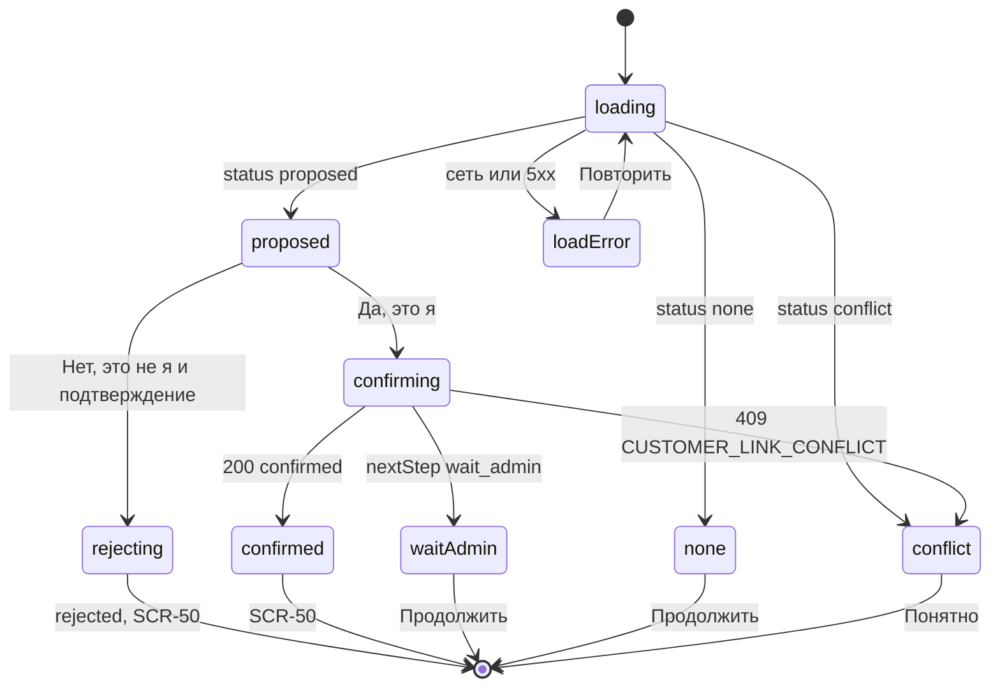
#### 8. Валидация и сообщения
Ввода нет. Ключи: `link_title_found` «Мы нашли вашу карточку клиента»; `link_body_found` «В учётной системе магазина есть клиент с вашим номером. Подтвердите, что это вы — заказы и условия станут доступны в приложении»; `link_finance_hidden` «Финансовые данные не показываются до подтверждения»; `link_confirm` «Да, это я»; `link_reject` «Нет, это не я»; `link_reject_title` «Это не ваша карточка?»; `link_reject_body` «Мы не будем связывать аккаунт с этой карточкой. Если карточка всё же ваша, объединить их сможет администратор магазина»; `link_title_none` «Карточка клиента будет создана при первом заказе»; `link_body_none` «Условия обслуживания уточнит менеджер магазина»; `link_title_conflict` «Нужна помощь администратора»; `link_body_conflict` «Найдено несколько карточек с вашим номером. Администратор магазина проверит данные и свяжется с вами»; `link_wait_admin` «Ожидает подтверждения администратором»; `link_success` «Карточка привязана»; `link_searching` «Ищем вашу карточку…»; `link_contact_shop` «Связаться с магазином».

#### 9. Источники данных, API, бизнес-правила
`GET /registration/customer-match` → `{status, customer{id, displayName, phoneMasked}, nextStep}` (08 §4.2.2, без финансов); `POST /customers/{id}/links/{linkId}/confirm|reject` (ядро §7); алгоритм поиска и признаки — 09 §7.8 (D-08, Q-025); статусы `customer_link_status` — `proposed | confirmed | rejected | conflict` (ядро §6); финансы клиента (SCR-33/34) — только после `confirmed` (11 §4.4 `conf`).

#### 10. Действия по ролям и безопасность
| Действие | `customer` | `staff` |
|---|---|---|
| Просмотр маскированного совпадения | ✓ (только своё) | — (экран не показывается) |
| Подтвердить / отклонить привязку | ✓ (своя привязка; право на эндпоинт — Q-202) | — |
| Разрешение конфликта | — | `admin` на SCR-45/SCR-32 (`customer.link.resolve`) |

Маскирование выполняет сервер; клиент не получает немаскированных данных карточки до `confirmed`. Отказ не раскрывает, чья это карточка.

#### 11. Повторное нажатие, двойной запрос, «Назад», перезапуск
| Ситуация | Поведение |
|---|---|
| Повторное нажатие «Да, это я» / «Нет, это не я» во время запроса | игнорируется флагом `inFlight`; обе кнопки disabled на время запроса (нельзя одновременно подтвердить и отклонить) |
| Двойной тап по «Да, это я» | один `POST /customers/{id}/links/{linkId}/confirm` |
| Сбой сети / таймаут 15 с | снекбар «Нет связи с сервером. Проверьте сеть и повторите» + «Повторить» — тот же запрос (идемпотентен по `linkId`); если ответ потерян, при следующем открытии статус перечитывается `GET /registration/customer-match` и экран показывает фактическое состояние |
| `409 CUSTOMER_LINK_CONFLICT` | UI-06-009; повтор подтверждения невозможен |
| Системная «Назад» (Android) | при открытом диалоге/листе — закрывает его; иначе сворачивание приложения (регистрация завершена, вернуться на SCR-04 нельзя) |
| `Esc` (Windows/клавиатура) | закрывает диалог/лист; на самом экране — ничего |
| Сворачивание во время запроса | ответ обрабатывается при возврате; при потере ответа — перечитывание статуса |
| Перезапуск приложения | сессия сохранена (refresh-токен); SCR-00 → `GET /registration/customer-match`: `proposed` → SCR-06 снова; `confirmed`/`rejected`/`none` → SCR-50; `conflict` → SCR-50 в ограниченном режиме; «Связаться с магазином» статус не меняет |
| Что хранится локально | ничего из карточки 1С: маскированные данные — только в памяти экрана (D-08, ядро §18.2 п.1) |
| `401 SESSION_REVOKED` / `UNLOCK_REQUIRED` | SCR-90 C / overlay SCR-08; после разблокировки статус перечитывается |

#### 12. Требования к платформам
| Платформа / класс окна | Требование |
|---|---|
| Телефон compact (Android; iOS — условно, Q-008) | основной сценарий: кнопки L 52 на всю ширину столбцом «Да, это я» → «Нет, это не я» → «Связаться с магазином»; иллюстрация 120; карточка совпадения на всю ширину − 2×16; масштаб шрифта 1,3× — строки карточки переносятся, кнопки не обрезаются; системная «Назад» — сворачивание |
| Планшет medium | карточка 560 по центру, иллюстрация 160 слева от заголовка, кнопки в ряд («Нет, это не я» слева, «Да, это я» справа); ландшафт с высотой < 600 — карточка прокручивается целиком, кнопки не закрепляются |
| expanded (планшет в ландшафте) | как medium, карточка 560 по центру на `background` |
| Windows-POS | экран не возникает: клиентский режим на терминале не используется, для `staff` `customer-match` всегда `none`; прямой переход по маршруту — guard на главный экран роли (navigation G-8) |
| Клавиатура (планшет с клавиатурой) | `Tab`/`Shift+Tab`: «Да, это я» → «Нет, это не я» → «Связаться с магазином»; фокус по умолчанию — «Да, это я»; `Enter`/`Space` — фокусная кнопка; `Esc` — закрыть диалог/лист |
| Мышь | hover-состояния кнопок (03 §9.1) |
| HID-сканер | ввод игнорируется (§0.1) |

#### 13. Критерии приёмки
| ID | Критерий |
|---|---|
| AC-UI-06-001 | При `CUSTOMER_SELF_SERVICE=false` маршрут недоступен, после регистрации экран не показывается. |
| AC-UI-06-002 | При `proposed` видны только маскированное наименование и маска телефона; в ответе API и на экране нет долга, истории, скидки, ИНН, адреса, кода 1С. |
| AC-UI-06-003 | «Да, это я» → `confirmed`, галочка, переход на SCR-50; после этого раздел долга клиента доступен (SCR-34), до — нет. |
| AC-UI-06-004 | «Нет, это не я» → диалог → `rejected`; новая карточка 1С при этом не создаётся (нет записи в `onec_outbox` типа «новый клиент»). |
| AC-UI-06-005 | `conflict` → состояние «Нужна помощь администратора» без выбора карточек пользователем; администратору создано уведомление. |
| AC-UI-06-006 | `none` → «Карточка клиента будет создана при первом заказе», переход на SCR-50. |
| AC-UI-06-007 | Двойное нажатие «Да, это я» → один запрос подтверждения. |
| AC-UI-06-008 | Без сети кнопки решения disabled; «Продолжить» без решения ведёт на SCR-50, при следующем запуске экран показывается снова. |
| AC-UI-06-009 | Номер найден только как второй контакт ЮЛ → после «Да, это я» статус «Ожидает подтверждения администратором», финансы скрыты. |
| AC-UI-06-010 | Радиус карточки экрана на medium+ — `ds.radius.lg` 16. |
| AC-UI-06-011 | Двойной тап по «Да, это я» создаёт ровно один запрос confirm; во время запроса «Нет, это не я» disabled; после потери ответа и перезапуска экран показывает фактический статус из `GET /registration/customer-match`. |
| AC-UI-06-012 | Переход SCR-04 → SCR-06: узел степпера 2 получает галочку, прогресс 50 → 75 % за 200 мс; при reduce-motion — fade 80 мс без scale. |

#### 14. Трассировка
| Требование | SRC / правила |
|---|---|
| Поиск по подтверждённому телефону, без дубликатов | SRC-B-138, SRC-B-139; SRC-E-134, 134a |
| Безопасная привязка, сохранение истории и долгов, без автоматического создания | SRC-B-142, SRC-B-143, SRC-B-144; SRC-E-134b |
| Финансы — после подтверждения владения | SRC-B-145 |
| Конфликт — на контролируемое разрешение | SRC-B-146 |
| Разделение профиля и карточки 1С | SRC-B-140, SRC-B-141 |

## 8. SCR-07 — Ожидает активации (маршрут `/pending-activation`, статус `pending_activation`, R1: да)
### SCR-07 — Аккаунт ожидает активации (`/pending-activation`; `user_status = pending_activation`; R1)
#### 1. Назначение и роль пользователя
Пользователь зарегистрировался, но его номера нет в приглашениях сотрудников, а самообслуживание клиентов выключено (D-07, Q-001). Аккаунт существует, сессия выдана, роль не назначена; все эндпоинты, кроме `/me*`, `/auth/*`, отвечают `403 FORBIDDEN` (09 §2.2). Экран понятно объясняет ситуацию, показывает данные, которые нужно назвать администратору, сам проверяет статус и переводит в рабочий режим после активации на SCR-45; позволяет выйти (важно на общем Windows-терминале — Q-034). Персонаж — только `idle` (03 §9.52).

#### 2. Структура экрана
| Класс окна | Сверху вниз |
|---|---|
| compact | `Mascot` 160 `idle` по центру → заголовок `h2` «Аккаунт ожидает активации» → пояснение `body` → карточка аккаунта (ФИО, телефон, дата регистрации; строки 48) → чип статуса + «проверено 09:45» → «Проверить статус» outlined L → «Связаться с магазином» text → «Выйти из аккаунта» text `textSecondary` |
| medium | шапка: логотип слева, «Выйти» справа; карточка 560 (`ds.radius.lg` 16) по центру с тем же составом; персонаж 160 |
| expanded (Windows-POS) | как medium; «Выйти из аккаунта» — кнопка `secondary` M в карточке (крупно), чтобы освободить общий терминал |

#### 3. Таблица элементов
| № | UI-ID | Элемент | Компонент | Расположение/размер | Токены | Состояния | Поведение | Источник данных | Роли | Правило |
|---|---|---|---|---|---|---|---|---|---|---|
| 1 | UI-07-001 | Персонаж (переопределено: в wireframe — иллюстрация с допуском персонажа; по 03 §9.52 — `Mascot` только `idle`) | `Mascot.auth` | по центру сверху; 160 (compact) / 200 (medium+) | 03 §13.2 | `idle` (всегда); при `blocked` — статичный кадр `error.png` без анимации | декоративен | — | `pending_activation` | 03 §9.52; D-40 |
| 2 | UI-07-002 | Заголовок | текст | под персонажем через 24 | `h2`/`h1` | «Аккаунт ожидает активации» / «Аккаунт заблокирован» | — | `/me.status` | — | 09 §7.5 |
| 3 | UI-07-003 | Пояснение | `body` | под заголовком | `textSecondary` | default / blocked | срок «обычно до 1 рабочего дня» — `[НЕ ПОДТВЕРЖДЕНО — Q-203]` | ARB | — | — |
| 4 | UI-07-004 | Карточка аккаунта | таблица ключ-значение (`AppListTile` ×3) | на всю ширину; 48 на строку | ключ `label` `textSecondary`, значение `body` 500 `textPrimary`, телефон `tnum` | default, skeleton (первая загрузка) | показывает ФИО, телефон `+996 XXX XXX XXX` (свой — полностью), дату регистрации; без копирования в буфер | `GET /me` (`profile.fullName`, `phone`, `createdAt`) | — | 09 §2.4 |
| 5 | UI-07-005 | Чип статуса + время проверки | `StatusChip` + `caption` | под карточкой | `warning` «ожидает активации» / `success` «активирован · {роль}» / `error` «заблокирован» / нейтральный «проверяем…» | 4 состояния | обновляется при каждом `GET /me` | `/me.status`, время ответа | — | A11Y-004 |
| 6 | UI-07-006 | «Проверить статус» | `AppButton.outlined` L; `loading` | под чипом | `primary` | enabled, loading, disabled (офлайн; кулдаун 5 с после проверки) | немедленный `GET /me` | — | — | 09 §7.5 |
| 7 | UI-07-007 | «Связаться с магазином» | `AppButton.text` → лист поддержки | под 6 | `primary` | default | контакты (офлайн из кэша) | `support_contacts` | — | — |
| 8 | UI-07-008 | «Выйти из аккаунта» | `AppButton.text` `textSecondary` (compact) / `secondary` M (expanded) / «Выйти» в шапке (medium) → `ConfirmDialog` | низ | — | default, loading | `POST /auth/logout` → очистка secure storage (кроме `deviceId`), кэша профиля → SCR-01; офлайн — локальная очистка немедленно, запрос — в очередь (09 §8.6) | — | — | 09 §8.6 |
| 9 | UI-07-009 | Состояние «активирован» | `AppSnackbar` success + переход | — | `success` | ≤ 2 с | переход на главный экран роли | `/me` | — | 09 §7.5 |
| 10 | UI-07-010 | Состояние «заблокирован» | `ErrorState.inline` `error` | вместо пояснения | `errorContainer` | shown | доступны только 7 и 8 | `403 FORBIDDEN` / `/me.status=blocked` / `SESSION_REVOKED` | — | 09 §7.5 |
| 11 | UI-07-011 | Логотип (medium+) | `SplashLogo.header` | шапка слева | asset | default | статичен | — | — | Q-006 |

#### 4. Поведение контролов
- **Автопроверка.** `GET /me` при открытии, раз в 60 с (не чаще 1 раза в 30 с — 09 §2.2), при возврате приложения в foreground, при восстановлении сети. Во время проверки чип «проверяем…». Опрос приостанавливается в фоне.
- **«Проверить статус».** Немедленный `GET /me`; повтор во время запроса игнорируется; после ответа кнопка недоступна 5 с (защита от частых запросов); Windows: `F5` = «Проверить статус» `[ТИПОВО]`.
- **Активация.** `/me.status = active` (или ответ `401 TOKEN_STALE` из-за смены `permissionsVersion`) → `POST /auth/refresh` (single-flight; на Windows возможен `UNLOCK_REQUIRED` → overlay SCR-08) → новый токен с ролями → снекбар «Аккаунт активирован» → `go` на главный экран роли (SCR-10 / SCR-30 / SCR-48). Персонаж при этом не играет `success` (только `idle` на этом экране).
- **Блокировка.** `/me.status = blocked` или `403 FORBIDDEN` → UI-07-010; `401 SESSION_REVOKED` → SCR-90 C.
- **«Выйти из аккаунта».** `ConfirmDialog` «Выйти из аккаунта?» / «Чтобы войти снова, понадобится код из SMS» / «Выйти» / «Отмена» → logout → SCR-01.
- **«Назад» (Android).** Сворачивание; `Esc` (Windows) — ничего.

#### 5. Анимации
| ID | Элемент | Начальное состояние | Триггер | Последовательность | Конечное состояние | Длительность | Реакция на ошибку | Reduce-motion |
|---|---|---|---|---|---|---|---|---|
| ANIM-002 | персонаж UI-07-001 | нейтральное лицо | экран открыт | дыхание scale 1 → 1.015 → 1 (sine), моргание 120 мс каждые 3–5 с, взгляд в сторону ±4 lp каждые 8–12 с (400 мс) | тот же (loop) | loop 2 с | сбой Rive → `Mascot.static`; при `blocked` — статичный кадр `error.png` без анимации | кадр `idle.png` |
| ANIM-013 | карточка аккаунта UI-07-004 | скелетон | первый `GET /me` дольше 300 мс | шиммер loop; по ответу — значения fade-in 150 мс без сдвига | карточка заполнена | loop 1,2 с; 150 мс | > 10 с → «Долгая загрузка… · Повторить» | статичные блоки |
| Специфичная: смена чипа | UI-07-005 | «проверяем…» (нейтральный) | ответ `GET /me` | crossfade 150 мс к `warning`/`success`/`error`; время «проверено HH:MM» меняется без анимации (`tnum`) | чип статуса | 150 мс | ошибка сети → чип возвращается к прежнему статусу, подпись времени не обновляется | мгновенно |
| Специфичная: `loading` «Проверить статус» | UI-07-006 | enabled | нажатие / `F5` | текст → спиннер 20 crossfade 150 мс; после ответа кнопка 5 с disabled без анимации отсчёта | enabled | 150 мс | ошибка → снекбар (ANIM-027), кнопка enabled после кулдауна | мгновенно |
| ANIM-022 | состояние «заблокирован» UI-07-010 | пояснение UI-07-003 | `/me.status=blocked` или `403 FORBIDDEN` | блок `ErrorState.inline` fade-in 200 мс вместо пояснения; кнопка 6 скрывается fade 150 мс | доступны только 7 и 8 | 200 мс | — | мгновенно |
| ANIM-027 | снекбар «Аккаунт активирован» UI-07-009 | скрыт | `/me.status=active` и успешный `POST /auth/refresh` | slide-up 8 lp + fade 150 мс; виден до перехода (≤ 2 с) | переход | 150 мс | ошибка refresh → снекбар не показывается, экран остаётся (повтор при следующей проверке) | fade 80 мс |
| ANIM-024 | уход на главный экран роли / SCR-01 | SCR-07 | активация (после снекбара) / «Выйти» | смена ветки (`go`, стек очищен) — crossfade 200 мс | новый экран | 200 мс | — | fade 80 мс |
| ANIM-023 | `ConfirmDialog` «Выйти из аккаунта?» | скрыт | «Выйти из аккаунта» | `overlay` 200 мс + диалог scale .96 → 1 + fade 250 мс; закрытие 200 мс; фокус на «Отмена» | диалог виден / фокус возвращён на кнопку 8 | 250 / 200 мс | — | fade 80 мс |

#### 6. Переходы
| Откуда / куда | Условие |
|---|---|
| SCR-00 / SCR-02 / SCR-04 → SCR-07 | статус `pending_activation` |
| SCR-07 → главный экран роли | активирован администратором |
| SCR-07 → SCR-01 | «Выйти»; `SESSION_REVOKED` (через SCR-90 C) |
| SCR-07 → SCR-08 (overlay) | `401 UNLOCK_REQUIRED` (Windows) / idle-блокировка |

#### 7. Состояния экрана
| Состояние | Описание |
|---|---|
| Загрузка | первая загрузка `/me` > 300 мс — скелетон карточки (3 строки) |
| Ожидание | чип `warning`, автопроверка |
| Успех (активирован) | UI-07-009 → переход |
| Ошибка сервера | чип прежний, `ErrorState.inline` «Не удалось проверить статус · Повторить» |
| Пустой результат | неприменимо |
| Нет сети | `OfflineBanner`, кнопка 6 disabled, показано время последней проверки; автопроверка возобновится с сетью |
| Нет разрешений | неприменимо |
| Заблокирован | UI-07-010 |
| Устаревшие данные | «проверено {time}» показывает возраст статуса |
| Step-up | неприменимо |
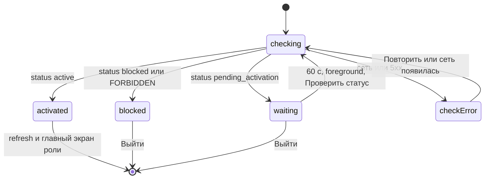
#### 8. Валидация и сообщения
Ввода нет. Ключи: `pending_title` «Аккаунт ожидает активации»; `pending_body` «Администратор магазина должен подтвердить ваш аккаунт и назначить роль. Обычно это занимает до 1 рабочего дня»; `pending_field_name` «ФИО»; `pending_field_phone` «Телефон»; `pending_field_registered` «Зарегистрирован»; `pending_status_waiting` «ожидает активации»; `pending_status_active` «активирован · {role}»; `pending_status_blocked` «заблокирован»; `pending_status_checking` «проверяем…»; `pending_checked_at` «проверено {time}»; `pending_check` «Проверить статус»; `pending_contact_shop` «Связаться с магазином»; `pending_logout` «Выйти из аккаунта»; `pending_logout_title` «Выйти из аккаунта?»; `pending_logout_body` «Чтобы войти снова, понадобится код из SMS»; `pending_activated_snackbar` «Аккаунт активирован»; `pending_blocked_title` «Аккаунт заблокирован»; `pending_blocked_body` «Аккаунт заблокирован администратором. Обратитесь в магазин»; `pending_check_error` «Не удалось проверить статус».

#### 9. Источники данных, API, бизнес-правила
`GET /me` (08 §4.3.1; усечённый DTO для `pending_activation`); `POST /auth/refresh` при смене `permissionsVersion` (09 §8.7); `POST /auth/logout` (08 §4.1.4); правило D-07; активация — SCR-45 (`admin`), инкремент `permissions_version`; напоминание администратору об аккаунтах старше 3 дней — серверная задача `[НЕ ПОДТВЕРЖДЕНО]`.

#### 10. Действия по ролям и безопасность
| Действие | `pending_activation` |
|---|---|
| Просмотр своих данных, проверка статуса, выход, поддержка | ✓ |
| Любые рабочие разделы (каталог, корзина, клиенты) | — (`403 FORBIDDEN`; навигация G-3 возвращает на SCR-07) |

Телефон показывается полностью только владельцу аккаунта; на общем терминале рекомендуется выйти (кнопка выделена на expanded).

#### 11. Повторное нажатие, двойной запрос, «Назад», перезапуск
| Ситуация | Поведение |
|---|---|
| Повторное нажатие «Проверить статус» / `F5` | во время запроса игнорируется; после ответа кулдаун 5 с (кнопка disabled); ручная проверка во время автопроверки присоединяется к ней (один `GET /me` в полёте) |
| Активация, обнаруженная одновременно автопроверкой и ручной проверкой | один `POST /auth/refresh` (single-flight) и одна навигация |
| «Выйти из аккаунта» | `ConfirmDialog`; повторное нажатие «Выйти» во время logout игнорируется; офлайн — локальная очистка немедленно, `POST /auth/logout` — в очередь (09 §8.6) |
| Системная «Назад» (Android) | при открытом диалоге/листе — закрывает его; иначе сворачивание (экран — корень стека) |
| `Esc` (Windows) | закрывает диалог/лист; на экране — ничего |
| Сворачивание | опрос приостанавливается; при возврате в foreground — немедленный `GET /me` |
| Перезапуск приложения | SCR-00 → по кэшу профиля (`profile_status = pending_activation`, §0.4) → SCR-07 и сразу `GET /me`; если аккаунт уже активирован — refresh и переход; повторный вход не требуется до истечения сессии (7 дней, D-12) |
| `401 SESSION_REVOKED` | SCR-90 C → SCR-01; локальные данные очищены |
| `401 UNLOCK_REQUIRED` (Windows) | overlay SCR-08; после разблокировки опрос продолжается |
| Что хранится | только кэш профиля (§0.4; ФИО — в secure storage); телефон с экрана не кэшируется |

#### 12. Требования к платформам
| Платформа / класс окна | Требование |
|---|---|
| Телефон compact (Android; iOS — условно, Q-008) | персонаж 160; «Проверить статус» `AppButton.outlined` L 52 на всю ширину; «Связаться с магазином», «Выйти из аккаунта» — `AppButton.text` M 44 (тач-цель 48); строки карточки 48; масштаб шрифта 1,3× — значения переносятся; «Назад» — сворачивание |
| Планшет medium | шапка: логотип слева, «Выйти» справа; карточка 560 (`ds.radius.lg` 16) по центру; персонаж 160 |
| expanded / Windows-POS | как medium, персонаж 200; «Выйти из аккаунта» — `AppButton.secondary` M 44 внутри карточки (освобождение общего терминала, Q-034); кнопки по ширине содержимого, по правому краю карточки |
| Клавиатура Windows | `Tab`/`Shift+Tab`: «Проверить статус» → «Связаться с магазином» → «Выйти из аккаунта»; фокус по умолчанию — «Проверить статус»; `Enter`/`Space` — фокусная кнопка; `F5` — «Проверить статус» `[ТИПОВО]` с тем же кулдауном 5 с; `Esc` — закрыть диалог/лист |
| Мышь | hover-состояния кнопок (03 §9.1); значения карточки не выделяются для копирования |
| HID-сканер | ввод игнорируется (§0.1) |

#### 13. Критерии приёмки
| ID | Критерий |
|---|---|
| AC-UI-07-001 | Пользователь без приглашения при выключенном `CUSTOMER_SELF_SERVICE` после регистрации видит SCR-07; переход по прямой ссылке на `/catalog` возвращает на SCR-07. |
| AC-UI-07-002 | Экран показывает ФИО, телефон «+996 XXX XXX XXX», дату регистрации из `GET /me`. |
| AC-UI-07-003 | Автопроверка выполняется не чаще 1 раза в 30 с (по умолчанию 60 с) и при возврате из фона (журнал запросов). |
| AC-UI-07-004 | После назначения роли администратором приложение в течение ≤ 60 с (+ время до следующей проверки) переходит на главный экран роли со снекбаром «Аккаунт активирован». |
| AC-UI-07-005 | «Проверить статус» выполняет один запрос даже при трёх быстрых нажатиях; затем кнопка недоступна 5 с. |
| AC-UI-07-006 | Блокировка администратором → «Аккаунт заблокирован…», доступны только «Связаться с магазином» и «Выйти». |
| AC-UI-07-007 | «Выйти» → диалог → `POST /auth/logout`, refresh удалён из secure storage, открыт SCR-01. |
| AC-UI-07-008 | Без сети: `OfflineBanner`, кнопка проверки disabled, показано время последней проверки; при появлении сети проверка выполняется автоматически. |
| AC-UI-07-009 | Персонаж на экране только в `idle` (без `typing`/`verifying`/`success`). |
| AC-UI-07-010 | Windows: `F5` запускает проверку статуса; повторный `F5` в течение 5 с после ответа не создаёт запроса; `Tab` проходит «Проверить статус» → «Связаться с магазином» → «Выйти из аккаунта». |
| AC-UI-07-011 | Перезапуск приложения с сессией `pending_activation` открывает SCR-07 без повторного ввода кода; если за время простоя аккаунт активирован — выполнен один `POST /auth/refresh` и переход на главный экран роли. |

#### 14. Трассировка
| Требование | SRC / правила |
|---|---|
| Пользователь без роли до активации (производный экран D-07) | SRC-B-101 (косвенно), SRC-C-131; D-07; Q-001 |
| Состояния экрана, переходы | SRC-F-012, SRC-F-011 |
| Безопасное завершение сессии на общем терминале | SRC-D-033; Q-034 |

## 9. SCR-08 — Быстрый вход (биометрия/PIN) (маршрут `/auth/unlock`, роль: авторизованные, R1: да)
### SCR-08 — Быстрый вход и разблокировка (`/auth/unlock?mode=cold|idle&from=`; авторизованные пользователи с сохранённой сессией; R1)
#### 1. Назначение и роль пользователя
Разблокировка сохранённой сессии без SMS (SRC-B-082, 083) системной биометрией с криптопривязкой (Android Keystore + `BiometricPrompt.CryptoObject`, iOS Keychain) или PIN приложения, который проверяется **только на сервере** (`POST /auth/unlock`, D-48). Два режима (ядро §17.2): **`cold`** — полноэкранный при холодном старте с сохранённой сессией (`staff` — всегда; `customer` — если включены PIN/биометрия); **`idle`** — overlay поверх рабочего экрана при idle-блокировке 30 мин (`SESSION_IDLE_LOCK_MINUTES`), возврате из фона > 5 мин (`AUTH_BACKGROUND_LOCK_MINUTES`, 09 §8.8 `[НЕ ПОДТВЕРЖДЕНО]`), ручной блокировке или ответе `401 UNLOCK_REQUIRED` — с сохранением состояния экрана (корзина, формы, прокрутка). При отказе/ошибке биометрии — PIN или вход по номеру телефона (SRC-B-084). На Windows Windows Hello — только UX-гейт перед обязательным PIN (D-13). Офлайн-разблокировки в R1 нет (Q-241). Экран также содержит подэкран «Задайте PIN» (UI-08-014) для сброса PIN и для `staff` без PIN после OTP-входа.

#### 2. Структура экрана
| Класс окна / режим | Сверху вниз |
|---|---|
| compact, `cold` | фон `surface`; шапка 56: `SplashLogo.auth` слева → `Mascot` 96 по центру (скрыт при высоте < 640) → `AppAvatar` 64 (инициалы) → ФИО `title` 18/600 → `RoleBadge` → `ds.space.6` → кнопка «Войти по биометрии» `AppButton.tonal` M 44 (тач-цель 48) на всю ширину (если включена) → разделитель «или PIN-код» → точки `PinField` (6) → подсказка/ошибка → встроенный нампад 3×4 (клавиши 72×56, `h2` `tnum`; нижний ряд: «Биометрия»/пусто · 0 · ⌫) → «Забыли PIN?» text → «Войти по номеру телефона» text → «Сменить аккаунт» text `textSecondary` |
| medium, `cold` | фон `background`; карточка 480 (`ds.radius.xl` 20): логотип, персонаж 160, аватар 80, ФИО, роль, кнопка биометрии 300, точки, нампад 260 по центру, ссылки |
| expanded (Windows-POS), `cold` | бренд-панель 560 (логотип, «Рабочее место продавца», персонаж 200) + карточка 480: аватар, ФИО, роль, «Терминал {deviceName}»; кнопка «Windows Hello» (если пользователь включил гейт и Hello настроен) — UX-гейт перед PIN; поле PIN в фокусе, ввод с физической клавиатуры; экранный нампад для сенсорных мониторов; ссылки |
| все классы, `idle` | рабочий экран под слоем: размытие `blur 12` + `overlay` rgba(27,31,42,0.48) (при reduce-motion — статичная заливка `overlay` без blur); compact — полноэкранный лист; medium/expanded — диалог 480 (`ds.radius.xl` 20, `ds.elevation.3`) по центру; состав — как `cold`, без бренд-панели; заголовок «Экран заблокирован» и подпись «Через 30 мин бездействия» |
| подэкран UI-08-014 | заголовок «Задайте новый PIN» → `PinField.setup` ×2 → подсказка правил → «Сохранить PIN» primary L |

#### 3. Таблица элементов
| № | UI-ID | Элемент | Компонент | Расположение/размер | Токены | Состояния | Поведение | Источник данных | Роли | Правило |
|---|---|---|---|---|---|---|---|---|---|---|
| 1 | UI-08-001 | Логотип | `SplashLogo.auth` | шапка (compact), карточка (medium), бренд-панель (expanded); в `idle` — скрыт | asset | default | статичен | assets | все | Q-006 |
| 2 | UI-08-002 | Персонаж | `Mascot.auth` (96 compact / 160 medium / 200 expanded; `idle`-режим: `mini` 96) | над аватаром / в бренд-панели | 03 §13.2 | `idle`, `typing` (взгляд на точки PIN, кивок на цифру), `verifying` (`/auth/unlock`, авто-промпт биометрии), `success`, `error`, `retry` | §0.3; при системном диалоге биометрии — `verifying` | `MascotController` | все | D-40; 09 §11.1 |
| 3 | UI-08-003 | Аватар, ФИО, роль | `AppAvatar` 64/80 + `title` + `RoleBadge` | по центру | `textPrimary`; бейдж — 03 §9.61 | default; skeleton (кэша нет) | только имя и роль, **без телефона** (09 §9.3; общий терминал Q-034) | кэш профиля: ФИО — `profile_display_name` (secure storage), роль — `app_meta.profile_roles` (§0.4) | все | 09 §9.3 |
| 4 | UI-08-004 | «Войти по биометрии» / «Windows Hello» | `AppButton.tonal` M 44 (тач-цель 48; compact, `expand`) / L 300 (medium+); иконка `fingerprint`/`face`/`passkey` | над разделителем | `primaryContainer`/`primary` | visible-enabled, loading (системный диалог), hidden (биометрия не включена / не поддерживается / Windows без гейта), disabled (офлайн) | Android/iOS: авто-вызов один раз через 300 мс после показа экрана (`AUTH_BIO_AUTO_PROMPT=true`), повторно — по тапу; Windows: Hello-гейт → затем PIN | `security.biometricEnabled` (кэш) + наличие ключа; `local_auth` | все | D-13; 09 §9.2–9.3 |
| 5 | UI-08-005 | Разделитель «или PIN-код» | `AppDivider` с подписью `caption` | между 4 и 6 | `border`, `textSecondary` | visible / hidden (если нет биометрии) | — | — | все | — |
| 6 | UI-08-006 | Точки PIN | `PinField` вариант `enter` | по центру; N точек = длина PIN пользователя (6 `staff`, 4–6 `customer`) | 03 §9.6 | empty, filling, loading (пульс), error (shake), success (200 мс), disabled (`PIN_LOCKED` / офлайн) | автопроверка при N цифрах → `POST /auth/unlock` | длина PIN — кэш профиля (`security.pinLength` `[НОВОЕ ИМЯ — поле DTO; при отсутствии — 6 для staff]`) | все | D-48; 09 §9.6 |
| 7 | UI-08-007 | Подсказка / ошибка | `caption` | под точками | `textSecondary` / `error` | hint, error(attemptsLeft), locked, offline | тексты §8 | ответы 08 | все | — |
| 8 | UI-08-008 | Встроенный нампад | `QuantityNumpadSheet.pin` (03 §9.6, §9.21; встроен в экран, клавиши 72×56; compact — на всю ширину ≤ 300; medium+ — 260) | под подсказкой | клавиша `surface`, pressed `surfacePressed`, цифры `h2` 24/500 `tnum`; ⌫ иконка 24 | default, pressed, disabled | цифры 0–9, ⌫ (долгое нажатие — очистить всё), левая нижняя клавиша — «Биометрия» (если включена) | — | все | 03 §9.6 |
| 9 | UI-08-009 | «Забыли PIN?» | `AppButton.text` S → `ConfirmDialog` | под нампадом | `primary` | default, hidden (`customer` без PIN) | сброс PIN через вход по SMS (§4) | — | все с PIN | 09 §9.6; Q-201 |
| 10 | UI-08-010 | «Сменить аккаунт» | `AppButton.text` `textSecondary` → `ConfirmDialog` | низ | `textSecondary` | default | `POST /auth/logout` (или локальная очистка офлайн) → SCR-01 | — | все | 09 §4.5, §8.6; Q-034 |
| 11 | UI-08-011 | Состояние «PIN заблокирован» | `ErrorState.inline` `error` + `AppButton.primary` «Войти по SMS» | вместо нампада | `errorContainer`/`error` | shown | нампад disabled; «Войти по SMS» → SCR-01 (`AuthEntryReason=pin_locked`) | `423 PIN_LOCKED {until}` | все | 09 §9.6 |
| 12 | UI-08-012 | Состояние «сессия отозвана» | SCR-90 C (диалог) | поверх | — | — | → SCR-01 | `401 SESSION_REVOKED` | все | 09 §8.3 |
| 13 | UI-08-013 | Состояние «нет сети» | `OfflineBanner.offline` + текст под точками + «Повторить» | баннер сверху | `warning` | shown | точки и кнопка биометрии disabled; «Повторить» проверяет сеть и возвращает ввод | `connectivity_plus` | все | D-48; Q-241 |
| 14 | UI-08-014 | Подэкран «Задайте новый PIN» | `PinField.setup` ×2 + `AppButton.primary` L «Сохранить PIN» | вместо блока 4–10 | 03 §9.6 | режимы `reset` (после «Забыли PIN?» + OTP) и `firstSetup` (`staff` без PIN после OTP-входа) | правила PIN как SCR-04; `POST /me/pin {newPin}` (08 §4.3.5); при `403 STEP_UP_REQUIRED` — `StepUpDialog` методом «Код из SMS» (§10.B) | — | все | 09 §9.6; D-48 |
| 15 | UI-08-015 | Overlay-режим | контейнер-лист (compact) / диалог 480 (medium+) + scrim | поверх текущего экрана | `overlay`, blur 12 | shown | «Назад»/`Esc`/тап по scrim не закрывают; HID-скан игнорируется и не буферизуется; под слоем данные не читаются и не интерактивны | триггеры §1 | все | ядро §17.2 |
| 16 | UI-08-016 `[НОВЫЙ UI-ID]` | «Войти по номеру телефона» | `AppButton.text` S | под «Забыли PIN?» | `primary` | default | → SCR-01; текущие токены сохраняются до успешного входа; вход того же пользователя продолжает работу, другого — logout старой сессии (09 §4.5) | — | все | SRC-B-084; 09 §9.3 |
| 17 | UI-08-017 `[НОВЫЙ UI-ID]` | Заголовок overlay «Экран заблокирован» | `title` + `caption` | верх листа/диалога (только `idle`) | `textPrimary`, `textSecondary` | shown | «Через {minutes} мин бездействия» / «Заблокировано вручную» | причина блокировки | все | 09 §8.8 |

#### 4. Поведение каждого контрола
**Биометрия (UI-08-004), Android/iOS.**
1. Показана, если `security.biometricEnabled=true` для этого устройства и `biometric_refresh` с ключом присутствует.
2. Через 300 мс после отрисовки — автоматический системный диалог (один раз за показ экрана); персонаж `verifying`.
3. Успех ОС → расшифровка `biometric_refresh` → `POST /auth/unlock {method: "biometric", refreshToken: <biometric_refresh>}` + `X-Device-Id` (ядро §18.2 п.5, 08 §4.1.8; вариант 09 §9.2 через `/auth/refresh {kind: biometric}` — «Замечания к ядру» №9) → новый `biometric_refresh` шифруется тем же ключом → `success` → переход.
4. Отмена пользователем (`Cancel`) → остаёмся, фокус на PIN, персонаж `idle`, подсказка «Введите PIN-код».
5. `temporaryLockout`/`biometricLockout` → текст `auth_bio_lockout`, кнопка disabled до конца блокировки ОС, PIN доступен.
6. `notEnrolled`/`noBiometricHardware` → кнопка скрывается; после разблокировки PIN — `POST /me/biometrics {enabled: false}` (синхронизация, 09 §9.3).
7. Ключ инвалидирован ОС (`KeyPermanentlyInvalidatedException` / `errSecItemNotFound`) → удаление `biometric_refresh`, `biometric_enabled=false`, сообщение `auth_bio_invalidated` → SCR-01 (`AuthEntryReason=bio_invalidated`); сервер отзывает биометрическую сессию с `revoke_reason=biometric_invalidated` (09 §9.3; ядро §18.2 п.8).
8. Повторный тап во время диалога ОС игнорируется.

**Windows Hello (UI-08-004), Windows.** Показан, только если пользователь включил «Windows Hello перед PIN» (SCR-04/SCR-42) и Hello настроен. Тап (или авто при показе) → `UserConsentVerifier.RequestVerificationForWindowAsync` → `Verified` → фокус в PIN с подписью «Подтверждено Windows Hello · введите PIN»; сам по себе `Verified` сессию **не** открывает (D-13). Отказ → фокус в PIN.

**PIN (UI-08-006/008).**
1. Ввод — нампад (тап), физическая клавиатура (цифры, `Backspace`, `Enter` не нужен — автопроверка), долгое нажатие ⌫ — очистить. Вставка запрещена.
2. На N-й цифре → `POST /auth/unlock {method: "pin", refreshToken, pin}` + `X-Device-Id`; точки пульсируют, нампад disabled, персонаж `verifying`.
3. `200` → точки `success` 200 мс → `SuccessCheck` → переход (§6); access — в память, новый refresh — в secure storage; `sessions.unlocked_until` продлевается сервером.
4. `401 PIN_INVALID {attemptsLeft}` → точки `error` + shake, очистка через 300 мс, «Неверный PIN. Осталось попыток: {n}»; персонаж `error` → 1,5 с → `retry`; `/auth/refresh` **не** вызывается (ядро §18.2 п.5).
5. `423 PIN_LOCKED {until}` (5 неверных подряд на `user_id` + `device_id`) → UI-08-011; персонаж `error` без авто-`retry`.
6. `401 SESSION_REVOKED` → SCR-90 C (UI-08-012).
7. `403 FORBIDDEN {reason: pin_not_set}` → подэкран UI-08-014 `firstSetup` недоступен без сессии → SCR-01 (вход по SMS, затем установка PIN).
8. Обрыв/таймаут 15 с → «Сервер не ответил. Повторить»; введённый PIN очищается (не хранится), повтор — вводом заново.
9. Двойная отправка невозможна: после N-й цифры ввод заблокирован до ответа.

**«Забыли PIN?» (UI-08-009).** `ConfirmDialog`: «Сбросить PIN?» / «Войдите по коду из SMS, затем задайте новый PIN. Несохранённые данные на экране будут потеряны; корзина сохранится» / «Войти по SMS» / «Отмена» → SCR-01 (`AuthEntryReason=pin_reset`) → OTP-вход (SCR-02) того же пользователя → подэкран UI-08-014 `reset` → `POST /me/pin {newPin}`; если сервер требует step-up (`403 STEP_UP_REQUIRED`), а свежий OTP-вход не засчитан — `StepUpDialog` с методом «Код из SMS» (`POST /auth/step-up {method: "otp", operation}`) → повтор `POST /me/pin` с `X-Step-Up-Token` (Q-201) → снекбар «PIN изменён» → главный экран роли / `from`. Прямой step-up OTP с экрана SCR-08 невозможен: `POST /auth/step-up` требует access-токена, которого до разблокировки нет (на Windows — `UNLOCK_REQUIRED`) — «Замечания к ядру» №10.

**«Войти по номеру телефона» (UI-08-016).** Переход на SCR-01 без выхода; при входе того же пользователя состояние (`from`, корзина) сохраняется; другого — §6.

**«Сменить аккаунт» (UI-08-010).** `ConfirmDialog` «Сменить аккаунт?» / «Текущий пользователь выйдет на этом устройстве. Корзина сохранится на сервере» → `POST /auth/logout` (офлайн — локальная очистка, запрос в очередь) → очистка secure storage (кроме `deviceId`), `biometric_refresh`, кэша профиля → SCR-01.

**Overlay (UI-08-015).** «Назад» (Android) не закрывает слой (двойное нажатие — свернуть приложение, без выхода из сессии); `Esc` — ничего; тап по scrim — ничего; поворот экрана не снимает блокировку; HID-сканер игнорируется без буферизации; long-polling/опросы рабочего экрана под слоем приостанавливаются.

**UI-08-014 «Задайте новый PIN».** Поведение полей — как SCR-04 UI-04-008/009 (правила, совпадение); «Сохранить PIN» — один запрос в полёте; ошибки: `VALIDATION_FAILED (pin_weak)` — у поля; сеть — «Повторить».

#### 5. Анимации
| ID | Описание | Длительность | Ошибка | Reduce-motion |
|---|---|---|---|---|
| ANIM-028 | `cold`: crossfade с SCR-00 | 200 мс | — | 80 мс |
| Специфичная: появление overlay | scrim fade 0→0.48 + blur 0→12 (200 мс), лист slide-up (compact, 250 мс) / диалог scale .96→1 (medium+, 250 мс) | 250 мс | — | статичный scrim без blur, fade 80 мс |
| ANIM-002/003/004/005/011/026 | персонаж | §0.3 | — | статичные кадры |
| ANIM-012 | точки PIN shake | 300 мс | — | только цвет |
| ANIM-015 | клавиши нампада pressed scale .96 | 150 мс | — | без scale |
| ANIM-005 | успех: точки `success` 200 мс → `SuccessCheck` → `cold`: crossfade на рабочий экран (ANIM-024); `idle`: scrim и слой fade-out 200 мс, экран под ним без перезагрузки | ≤ 900 мс | — | crossfade 80 мс |
| ANIM-023 | диалоги «Забыли PIN?», «Сменить аккаунт» | 250 / 200 мс | — | fade 80 мс |

#### 6. Переходы
| Откуда / куда | Условие | Данные | Навигация |
|---|---|---|---|
| SCR-00 → SCR-08 `cold` | холодный старт с сессией (SCR-00 §6, строка 5) | `from` = последний маршрут | `go('/auth/unlock?mode=cold&from=…')` |
| любой экран → SCR-08 `idle` | idle 30 мин / фон > 5 мин / ручная блокировка (`Ctrl+L`, меню профиля) / `401 UNLOCK_REQUIRED` | состояние экрана остаётся в стеке | `push` на корневом навигаторе |
| SCR-08 `cold` → `from` или главный экран роли | `200` на `/auth/unlock` | — | `go(from)`; если `from` недоступен роли — главный экран |
| SCR-08 `idle` → прежний экран | `200` | — | `pop()`; отложенный исходный запрос (при `UNLOCK_REQUIRED`) повторяется |
| SCR-08 → SCR-01 | «Войти по номеру телефона», «Сменить аккаунт», «Войти по SMS» (`PIN_LOCKED`), «Забыли PIN?», биометрия инвалидирована | `AuthEntryReason`; номер не предзаполняется (телефон на устройстве не хранится — 09 §8.5) | `go` (стек сбрасывается; корзина-черновик остаётся в drift `cart_draft`) |
| SCR-02 → SCR-08 (UI-08-014) | OTP-вход с причиной `pin_reset` или `staff` с `pinSet=false` | — | `go` |
| SCR-08 → SCR-90 C | `SESSION_REVOKED` | — | диалог |
| SCR-08 → SCR-90 C3 | 426 | — | диалог |
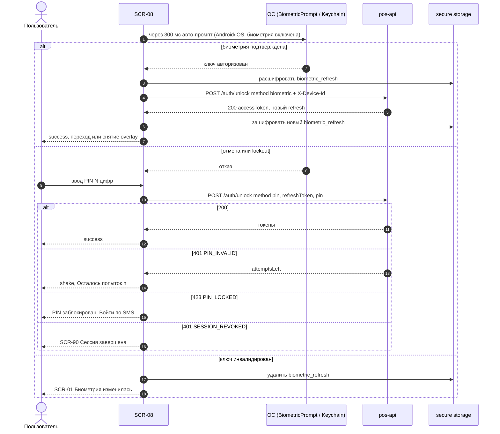
#### 7. Состояния экрана
| Состояние | Описание | Персонаж |
|---|---|---|
| Загрузка | кэш профиля читается синхронно; при отсутствии — скелетон аватара/имени | `idle` |
| Системный диалог биометрии | кнопка 4 `loading` | `verifying` |
| Ввод PIN | точки | `typing` |
| Проверка | пульс, нампад disabled | `verifying` |
| Успех | `success`, переход | `success` |
| Неверный PIN | §4 п.4 | `error` → `retry` |
| PIN заблокирован | UI-08-011 | `error` |
| Сессия отозвана / истёк срок 7 дней | SCR-90 C → SCR-01 | `error` |
| Нет сети | UI-08-013: «Нет подключения. Для входа нужна сеть» + «Повторить»; просмотр кэша без разблокировки не разрешается | `idle` |
| Нет разрешения биометрии | кнопка 4 скрыта (iOS: доступ к Face ID запрещён в настройках → подсказка «Разрешите Face ID в настройках» + PIN) | `idle` |
| Пустой результат | неприменимо | — |
| Повторная попытка | после сетевой ошибки — ввод PIN заново; «Повторить» в баннере | `retry` |
| Устаревшие данные | неприменимо | — |
| Step-up | только в UI-08-014 (`STEP_UP_REQUIRED` на `POST /me/pin`) | — |
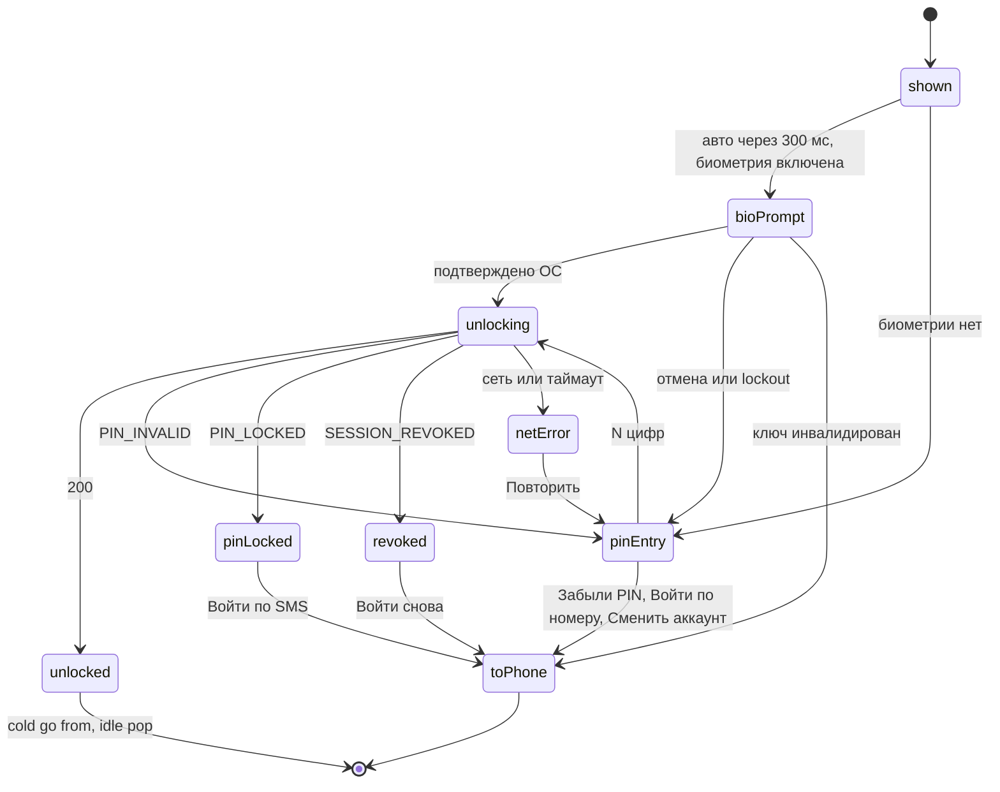
#### 8. Валидация и сообщения
| Условие | Ключ ARB | Текст |
|---|---|---|
| Подсказка | `unlock_pin_hint` | «Введите PIN-код приложения» |
| Кнопка биометрии | `unlock_bio_button`, `unlock_hello_button` | «Войти по биометрии» / «Windows Hello» |
| Подтверждено Hello | `unlock_hello_verified` | «Подтверждено Windows Hello · введите PIN» |
| Разделитель | `unlock_or_pin` | «или PIN-код» |
| `PIN_INVALID` | `auth_pin_error_invalid` | «Неверный PIN. Осталось попыток: {n}» |
| `PIN_LOCKED` | `auth_pin_locked` | «PIN заблокирован после 5 неверных попыток. Войдите по SMS и задайте новый PIN» |
| «Войти по SMS» | `unlock_sms_login` | «Войти по SMS» |
| Lockout ОС | `auth_bio_lockout` | «Биометрия временно заблокирована. Введите PIN или войдите по номеру» |
| Ключ инвалидирован | `auth_bio_invalidated` | «Биометрия на устройстве изменилась. Войдите по номеру телефона и включите вход заново» |
| Нет сети | `unlock_offline` | «Нет подключения. Для входа нужна сеть» |
| Таймаут | `auth_error_timeout` | «Сервер не ответил. Повторить» |
| Ссылки | `unlock_forgot_pin`, `unlock_phone_login`, `unlock_switch_account` | «Забыли PIN?» / «Войти по номеру телефона» / «Сменить аккаунт» |
| Диалог сброса | `unlock_reset_title`, `unlock_reset_body`, `unlock_reset_confirm` | «Сбросить PIN?» / «Войдите по коду из SMS, затем задайте новый PIN. Несохранённые данные на экране будут потеряны; корзина сохранится» / «Войти по SMS» |
| Диалог смены аккаунта | `unlock_switch_title`, `unlock_switch_body`, `unlock_switch_confirm` | «Сменить аккаунт?» / «Текущий пользователь выйдет на этом устройстве. Корзина сохранится на сервере» / «Сменить» |
| Overlay | `unlock_locked_title`, `unlock_locked_idle`, `unlock_locked_manual` | «Экран заблокирован» / «Через {minutes} мин бездействия» / «Заблокировано вручную» |
| Новый PIN | `unlock_new_pin_title`, `unlock_new_pin_save`, `unlock_pin_changed`, `reg_error_pin_weak`, `reg_error_pin_mismatch` | «Задайте новый PIN» / «Сохранить PIN» / «PIN изменён» / как SCR-04 |

#### 9. Источники данных, API, бизнес-правила
| Что | API / источник | Правило |
|---|---|---|
| Разблокировка | `POST /auth/unlock {method: pin или biometric, refreshToken, pin?}` (публичный, без Bearer) | 08 §4.1.8; ядро §18.2 п.5; D-48 |
| Сохранённые токены | refresh, `biometric_refresh` (Keystore/Keychain) | D-13; 11 §8.1 |
| Блокировка по idle | `SESSION_IDLE_LOCK_MINUTES` = 30; на Windows сервер требует PIN после `unlocked_until` | 09 §8.8; SESS-031/032 |
| Попытки PIN | 5 → `PIN_LOCKED` до OTP-входа (`PIN_MAX_ATTEMPTS`) | 09 §9.6; Q-004 |
| Установка PIN | `POST /me/pin {newPin}` + `X-Step-Up-Token` (08 §4.3.5; расхождение метода с 09 §9.6 — «Замечания» №8) | D-48 |
| Кэш профиля | ФИО — `profile_display_name` (secure storage); роль, `pinSet`, `biometricEnabled` — `app_meta` (§0.4, ключи `[НОВОЕ ИМЯ]`) | 09 §9.3; 11 §8.1 |
| Корзина при выходе | черновик `cart_draft` сохраняется (D-32, 10 CART-) | 11 SEC-092 |

#### 10. Действия по ролям и безопасность
| Действие | `staff` | `customer` |
|---|---|---|
| Разблокировка PIN | ✓ (обязательно на всех платформах) | ✓ если PIN задан |
| Разблокировка биометрией | ✓ Android Class 3 (API ≥ 30) / iOS; на Windows — нет | ✓ |
| Idle-блокировка | ✓ 30 мин | не применяется в R1 (09 §8.8) |
| Сброс PIN | через OTP-вход | через OTP-вход |

Безопасность: PIN не хранится и не логируется; проверка только на сервере; телефон не показывается; данные под overlay скрыты (размытие/заглушка — `[ТИПОВО]`, Q-034); при `PIN_LOCKED` вход только по OTP; при отзыве сессии — очистка токенов и `biometric_refresh`; `FLAG_SECURE` — Q-181.

#### 11. Повторное нажатие, двойной запрос, «Назад», перезапуск
- Один `/auth/unlock` в полёте; ввод заблокирован до ответа; потеря ответа покрывается окном грации refresh 30 с (09 §8.3).
- Повторный авто-промпт биометрии не выполняется при возврате на экран в рамках одного показа; при новом показе — снова через 300 мс.
- «Назад»: `cold` — сворачивание приложения; `idle` — слой не закрывается.
- Перезапуск в `idle` → холодный старт → SCR-00 → SCR-08 `cold` (`from` = последний маршрут); несохранённые поля формы теряются, корзина — на сервере и в `cart_draft`.

#### 12. Требования к платформам
| Платформа | Требование |
|---|---|
| Android | `BiometricPrompt` + `CryptoObject`, `BIOMETRIC_STRONG`; API ≥ 30 для `biometric_refresh`; API 24–29 — только PIN (09 §9.4) |
| iOS | Face ID / Touch ID через Keychain ACL; `NSFaceIDUsageDescription` |
| Windows-POS | PIN обязателен; Hello — UX-гейт; физическая клавиатура (цифры, `Backspace`); экранный нампад для сенсорных мониторов; `Ctrl+L` — ручная блокировка из рабочих экранов; HID игнорируется на слое |
| Планшет | карточка 480; нампад 260 |
| Все | масштаб шрифта 1,3× — клавиши нампада 72×64 |

#### 13. Критерии приёмки
| ID | Критерий |
|---|---|
| AC-UI-08-001 | Холодный старт `staff` на Android с включённой биометрией: системный диалог появляется через 300 ± 100 мс; после подтверждения — главный экран роли без ввода PIN и без SMS. |
| AC-UI-08-002 | Отмена системного диалога → фокус на PIN, повторный авто-диалог не появляется до нового показа экрана. |
| AC-UI-08-003 | Windows: кнопка Windows Hello (если включена) только подтверждает присутствие; без ввода PIN рабочий экран не открывается; `POST /auth/unlock` содержит `method: "pin"`. |
| AC-UI-08-004 | Неверный PIN → `401 PIN_INVALID`, текст «Неверный PIN. Осталось попыток: {n}» с числом из ответа; `/auth/refresh` не вызывается (журнал запросов). |
| AC-UI-08-005 | 5 неверных PIN подряд → «PIN заблокирован…», нампад disabled, «Войти по SMS» ведёт на SCR-01. |
| AC-UI-08-006 | Idle 30 мин в корзине → overlay; после разблокировки PIN корзина, введённые поля и прокрутка те же (без перезагрузки экрана). |
| AC-UI-08-007 | В overlay «Назад», `Esc`, тап по scrim не снимают блокировку; HID-скан штрихкода не добавляет товар и не попадает в поле после разблокировки. |
| AC-UI-08-008 | Содержимое рабочего экрана под overlay не читается (размытие/заглушка) на скриншоте. |
| AC-UI-08-009 | Без сети: «Нет подключения. Для входа нужна сеть», PIN и биометрия недоступны; при появлении сети ввод разблокируется без перезапуска. |
| AC-UI-08-010 | Смена биометрии в ОС → при следующем входе «Биометрия на устройстве изменилась…», переход на SCR-01, `biometric_refresh` удалён. |
| AC-UI-08-011 | «Забыли PIN?» → OTP-вход того же пользователя → «Задайте новый PIN» → после сохранения — главный экран; старый PIN больше не принимается сервером. |
| AC-UI-08-012 | «Сменить аккаунт» → диалог → `POST /auth/logout`, токены и `biometric_refresh` удалены, `deviceId` сохранён, SCR-01. |
| AC-UI-08-013 | Экран показывает имя и роль без номера телефона. |
| AC-UI-08-014 | `SESSION_REVOKED` на unlock → диалог «Сессия завершена» → SCR-01; черновик корзины сохранён. |
| AC-UI-08-015 | Персонаж: авто-промпт → `verifying`; ввод PIN → `typing`; `PIN_INVALID` → `error` → через 1,5 с `retry`; `PIN_LOCKED` → `error` без авто-`retry`; успех → `success` с галочкой ≤ 900 мс. |
| AC-UI-08-016 | `staff` без PIN после OTP-входа (сброс администратором) попадает на «Задайте новый PIN» и не может открыть рабочий экран без установки PIN. |
| AC-UI-08-017 | При reduce-motion overlay — статичная заливка без blur, переходы fade 80 мс, без shake. |

#### 14. Трассировка
| Требование | SRC / правила |
|---|---|
| Последующий вход системной биометрией с безопасно хранимым токеном; открывается аккаунт этого пользователя | SRC-B-082, SRC-B-082a, SRC-B-083 |
| При отказе/ошибке — вход по номеру телефона | SRC-B-084 |
| Нет универсального Face ID на Android; ограничения платформ | SRC-B-085, SRC-B-086; SRC-E-136a |
| Безопасное хранение сессии, корректное завершение, потеря сети | SRC-D-032, SRC-D-033, SRC-D-034 |
| Персонаж на экране разблокировки | SRC-B-069b…077; SRC-F-021 |
| PIN на сервере, офлайн-разблокировка вне R1 | D-48; Q-241 |

## 10. SCR-90 — Глобальные состояния (overlay/dialog, все роли, R1: да)
### SCR-90 — Глобальные состояния (без собственного маршрута; поверх любого экрана; все роли; R1)
#### 1. Назначение и роль пользователя
Единые для всего приложения оверлеи, баннеры и диалоги, которые появляются поверх текущего экрана по событиям сети, сервера, версии, разрешений и безопасности. Состав: **A** — нет сети (баннер `OfflineBanner` на всех экранах и полноэкранный `ErrorState` для действий, невозможных офлайн); **B** — step-up (`StepUpDialog`) перед критической операцией (ядро §3.3, §17.2); **B2** — «нужно подтверждение старшего» (действие вне прав роли, R1 — информирование); **C** — сессия завершена (`SESSION_REVOKED`, `DEVICE_MISMATCH`); **C3** — требуется обновление (426 `APP_UPDATE_REQUIRED`, блокирующее) и доступна новая версия (мягкий баннер); **D** — нет разрешения (камера, биометрия); **E** — ошибка сервера (5xx/`INTERNAL`); **F** — режим «только чтение» (`APP_READ_ONLY`); **G** — idle-блокировка (запуск SCR-08 `idle`); **H** — изменение прав (`TOKEN_STALE`). Роль — любая; отдельные состояния зависят от прав (B/B2).

#### 2. Структура (по состояниям)
| Состояние | compact | medium | expanded |
|---|---|---|---|
| A-баннер | полоса 48 (2 строки `caption`) под строкой состояния / под шапкой, на всю ширину, сдвигает контент | полоса 40 под шапкой/`NavigationRailApp` | полоса 40 под `TopAppBarPos` на всю ширину окна; сдвигает все три колонки |
| A-экран | `ErrorState.fullScreen` в области контента: иллюстрация 120, `h3`, `body`, «Повторить» primary L, «Продолжить работу из кэша» text | то же, иллюстрация 160 | то же в центральной колонке (сайдбар и корзина остаются) |
| B `StepUpDialog` | `AppBottomSheet` с ручкой 32×4 (по 03 §9.46 compact — диалог по центру; на compact с нампадом используется лист — «Замечания» №11) | диалог 400–440 по центру, `ds.elevation.3`, scrim | то же; scrim покрывает колонки ниже шапки, шапка и баннер видимы |
| B2 | лист | диалог 440 | диалог 440 |
| C / C3 | модальный `ConfirmDialog` с одной кнопкой, ширина экран − 32 | 440–480 по центру | 480 по центру |
| C3 мягкий | `ErrorState.banner` `info` под шапкой с «Обновить» и «Позже» | то же | то же |
| D | `ErrorState.inline` / `EmptyState.noCamera` в месте функции | то же | то же |
| E | `ErrorState.inline` (в форме) / `fullScreen` (экран без данных) с `requestId` | то же | то же |
| F | постоянный `OfflineBanner` вариант `warning` без «Повторить» + `ErrorState.inline` у кнопок записи | то же | то же |
| H | `AppSnackbar` 8 с | то же | то же |

#### 3. Таблица элементов
| № | UI-ID | Элемент | Компонент | Расположение/размер | Токены | Состояния | Поведение | Источник данных | Роли | Правило |
|---|---|---|---|---|---|---|---|---|---|---|
| 1 | UI-90-001 | Баннер сети | `OfflineBanner` (`offline` / `reconnecting` / `backOnline` / `serverDown` / `onecDown`) | §2 | `warningContainer`/`warning`, `infoContainer`/`info`, `successContainer`/`success`, `errorContainer`/`error` | скрыт, offline («Нет сети. Показаны данные от {time}. Заказы недоступны»), reconnecting, backOnline (3 с), serverDown, onecDown (staff) | «Повторить» — проверка `/health` и повтор последнего неуспешного GET; не закрывается пользователем (кроме backOnline); `liveRegion(assertive)` | `connectivity_plus` + результат последнего запроса; возраст данных — метка кэша | все | 03 §9.41; D-32 |
| 2 | UI-90-002 | Иллюстрация «нет сети» | `ErrorState.fullScreen` | центр контента; 120/160 | `brandAccent` ≤ 20 % | — | декоративна | — | все | 03 §14 |
| 3 | UI-90-003 | Заголовок | `h3` | под иллюстрацией | `textPrimary` | «Нет подключения к сети» / «Сервер недоступен» / «Ошибка сервера» | — | код ошибки | все | — |
| 4 | UI-90-004 | Текст: что недоступно и что доступно из кэша | `body` | под заголовком, ≤ 2 строк | `textSecondary` | по контексту | называет действие и доступный кэш (D-32) | контекст экрана | все | D-32 |
| 5 | UI-90-005 | «Повторить» | `AppButton.primary` L; `loading` | под текстом | `primary` | enabled, loading (≤ 10 с `[ТИПОВО]`) | повтор исходного запроса (финансовые POST — с тем же `Idempotency-Key`) | — | все | D-37 |
| 6 | UI-90-006 | «Продолжить работу из кэша» | `AppButton.text` | под 5 | `primary` | visible (есть кэш) / hidden (SCR-01/02 — кэша нет) | возврат на предыдущий экран в офлайн-режиме | — | все | NFR-OFFLINE-001 |
| 7 | UI-90-007 | Заголовок step-up | `StepUpDialog`, иконка `lock` 32 в круге `primaryContainer` + `h3` | верх диалога | `primary`, `textPrimary` | default | «Подтвердите действие» | — | все | 03 §9.46 |
| 8 | UI-90-008 | Причина: операция и параметры | `body` + `caption` | под заголовком | `textSecondary` | default | текст операции по коду `operation` (11 §4.3), например «Ручное подтверждение QR-оплаты по заказу № 1042 · 16 007,50 сом»; «повторно в течение 15 мин не потребуется» | ответ `403 STEP_UP_REQUIRED {stepUp: {allowedMethods, operation}}` + контекст экрана | все | 08 §2.12 |
| 9 | UI-90-009 | «Подтвердить биометрией» (R2) | `AppButton.tonal` M | над PIN | — | **hidden в R1** | в R1 сервер принимает биометрию только вместе с PIN/OTP (`bio+pin`), поэтому отдельная кнопка не сокращает ввод и не показывается; в R2 — криптопривязанный `biometricAssertion` | — | — | 08 §2.12; 09 §8.8; «Замечания» №13 |
| 10 | UI-90-010 | PIN | `PinField.enter` (+ `QuantityNumpadSheet.pin` на compact и сенсорных POS — 03 §9.6) | центр диалога | 03 §9.6 | empty, filling, loading, error, disabled (`PIN_LOCKED`, офлайн) | автопроверка → `POST /auth/step-up {method: "pin", pin, operation}`; `PIN_INVALID` — `attemptsLeft`; `PIN_LOCKED` — метод PIN недоступен, предлагается «Код из SMS» | — | все с PIN | D-48 |
| 11 | UI-90-011 | «Подтвердить кодом из SMS» | `AppButton.text` → мини-OTP в том же диалоге (`OtpField` 6, таймеры как SCR-02) | под PIN | `primary` | visible (если `otp` в `allowedMethods`), disabled (`OTP_RATE_LIMITED`, таймер) | подтверждение «Отправить код на {phoneMasked}?» → `POST /auth/step-up {method: "otp", operation}` → `202 {challengeId, resendAfterSec, otpTtlSec}` → ввод → `POST /auth/step-up {method: "otp", challengeId, code, operation}` | — | все | 08 §4.1.7 |
| 12 | UI-90-012 | «Отмена» | `AppButton.text` M | низ слева | `primary` | default | закрыть; исходная операция не выполняется, экран в прежнем состоянии | — | все | — |
| 13 | UI-90-013 | «Подтвердить» | `AppButton.primary` M; `loading` | низ справа | `primary` | disabled до полного ввода, loading | ручная отправка (для PIN — дублирует автопроверку; для OTP — основная); успех → диалог закрывается, исходный запрос повторяется с `X-Step-Up-Token` и тем же `Idempotency-Key` | — | все | 08 §2.12 |
| 14 | UI-90-014 | Заголовок «Сессия завершена» | `ConfirmDialog` (один CTA), `h3` | диалог | `textPrimary` | — | не закрывается тапом вне, «Назад», `Esc` | — | все | 09 §8.3 |
| 15 | UI-90-015 | Причина | `body` | под заголовком | `textSecondary` | `reuse_detected` / `logout_all` / `admin` / `blocked` / `expired` / `device_revoked` / `device_mismatch` / `phone_changed` / `role_changed` / иное | текст без технических деталей | `SESSION_REVOKED.reason` / `DEVICE_MISMATCH` | все | 09 §8.2 |
| 16 | UI-90-016 | Подпись о черновике | `caption` | под причиной | `textSecondary` | visible (есть `cart_draft`/`outbox_actions`) / hidden | черновик привязан к пользователю и восстановится только для него | drift | все | D-32; 11 SEC-092 |
| 17 | UI-90-017 | «Войти снова» | `AppButton.primary` M | низ | `primary` | default | очистка токенов, `biometric_refresh`, кэша профиля (кроме `deviceId`) → SCR-01 | — | все | 09 §8.5 |
| 18 | UI-90-018 | Ошибка сервера | `ErrorState` (inline / fullScreen) + «Повторить» + «Код: {requestId}» (копируется по тапу) | в месте ошибки | `error` | default, loading | повтор идемпотентен; неизвестный `code` → как `INTERNAL` | `problem+json` | все | 08 §2.4 |
| 19 | UI-90-019 | Требуется обновление / доступна новая версия | блокирующий `ConfirmDialog` без отмены (426) / `ErrorState.banner` `info` (мягкий) | диалог по центру / баннер под шапкой | `info`, `primary` | blocking / soft | blocking: «Обновить» (ссылка `storeUrl` или дистрибутив), «Техническая поддержка»; навигация заморожена; черновики сохраняются; soft: «Обновить», «Позже» (повтор не чаще 1 раза в сутки `[ТИПОВО]`) | 426 + `X-Min-App-Version`; `X-Recommended-App-Version` | все | D-46; ядро §16 п.4, §18.2 п.12 |
| 20 | UI-90-020 | Нет разрешения | `ErrorState.inline` / `EmptyState.noCamera` + «Открыть настройки» + «Пропустить/Ввести вручную» | в месте функции | `warning` | camera / biometrics / iOS Face ID | текст называет, что недоступно и как включить; повторный системный запрос — по правилам ОС | `permission_handler`, `local_auth` | все | 11 SEC-100 |
| 21 | UI-90-021 | «Нужно подтверждение старшего» | `AppBottomSheet` / диалог 440: иконка `supervisor_account`, текст, «Понятно», «Изменить» | §2 | `info` | shown | в R1 подтверждение сверх лимита выполняет `senior_seller`/`admin` **в своей сессии** (08 §2.12; режима «от имени другого на этом устройстве» нет — R2, Q-002); «Изменить» возвращает к полю (например, скидка до лимита) | `403 FORBIDDEN` / `DISCOUNT_LIMIT_EXCEEDED {limitPercent, requiresRole}` | `seller`, `cashier` | D-23; 10 DISC-; Q-005, Q-015 |
| 22 | UI-90-022 | Режим «только чтение» | `OfflineBanner` вариант `warning`, постоянный + `ErrorState.inline` у действий записи | под шапкой | `warningContainer`/`warning` | shown | «Сервер работает в режиме только чтения — изменения временно недоступны»; кнопки записи disabled с подсказкой; навигация G-13 | `503 APP_READ_ONLY` | все | ядро §17.4 |
| 23 | UI-90-023 `[НОВЫЙ UI-ID]` | Снекбар «Права изменены» | `AppSnackbar` 8 с | низ | `inverseSurface`/`onInverseSurface` | shown | после `TOKEN_STALE` → тихий refresh → пересчёт меню; если текущий раздел недоступен — главный экран роли + текст | `/auth/refresh` (`permissionsVersion`) | все | 09 §8.7; navigation §4.2 |

#### 4. Поведение контролов
**A — нет сети.** Баннер появляется при `connectivity_plus = none` **или** таймауте/ошибке соединения последнего запроса; переходит в `reconnecting` при восстановлении интерфейса до успешного пинга `/health`; `backOnline` — 3 с, затем скрывается, outbox (избранное, корзина) отправляется. Полноэкранный A-экран показывается только для действий, невозможных офлайн (запрос OTP, оформление заказа, оплата, разблокировка), в остальных случаях — только баннер. «Повторить» — один запрос в полёте; повторное нажатие игнорируется.

**B — step-up.**
1. Триггер: ответ `403 STEP_UP_REQUIRED` на критическую операцию (перечень — ядро §3.3, §17.2; 08 §2.12) при наличии права на операцию. Диалог открывается поверх экрана; фокус — на способе по умолчанию (последний использованный; иначе PIN).
2. PIN: ввод N цифр → `POST /auth/step-up {method: "pin", pin, operation}` → `200 {stepUpToken, expiresAt, scope}` → токен в памяти (15 мин, многоразовый для `scope`) → повтор исходного запроса с `X-Step-Up-Token` и тем же `Idempotency-Key` → диалог закрывается fade 200 мс. `401 PIN_INVALID` — «Неверный PIN. Осталось попыток: {n}», очистка; `423 PIN_LOCKED` — PIN недоступен, акцент на «Код из SMS»; `403 FORBIDDEN {reason: pin_not_set}` — «Задайте PIN в настройках» + OTP.
3. OTP: подтверждение отправки → мини-OTP (6 ячеек, таймеры, лимиты, ошибки — как SCR-02) → токен.
4. Отмена (`Esc`, «Отмена», свайп вниз на листе, «Назад») → операция не выполняется; если исходная операция — просмотр детализации долга, экран остаётся на сводке.
5. Повторный step-up в пределах 15 мин для того же `scope` не требуется; операция другой области → новый диалог.
6. Без сети — PIN и OTP недоступны (проверка на сервере, D-48): «Нужна сеть для подтверждения».
7. Двойной запрос: один `/auth/step-up` в полёте; исходный запрос повторяется ровно один раз.
8. Клавиатура: `Enter` = «Подтвердить», `Esc` = «Отмена», цифры — в PIN/OTP; HID-сканер во время диалога игнорируется.

**B2 — подтверждение старшего.** Информационный лист; «Понятно» закрывает; «Изменить» — фокус на поле, вызвавшем ограничение (например, `DiscountInput` с подсказкой лимита). Сценарий подтверждения старшим — 04/10 (DISC-), в 02a не дублируется.

**C — сессия завершена.** Модальный диалог без закрытия; «Войти снова» — очистка и SCR-01 с `AuthEntryReason`. `DEVICE_MISMATCH` — тот же диалог с причиной «Сессия привязана к другому устройству». Одновременно несколько `401 SESSION_REVOKED` от параллельных запросов показывают **один** диалог.

**C3 — обновление.** Блокирующий диалог (426) поверх любого маршрута, `Esc`/«Назад» не закрывают; «Обновить» открывает `storeUrl` (Android — магазин/ссылка дистрибутива; Windows — ссылка на установщик; Q-008); доступна «Техническая поддержка» и строка версии. Мягкий баннер закрывается «Позже».

**D — нет разрешения.** «Открыть настройки» → системные настройки приложения; при возврате разрешение перепроверяется автоматически. Альтернативы: камера → «Ввести код вручную» (SCR-17) / «Пропустить» (SCR-05); биометрия → PIN.

**E — ошибка сервера.** «Повторить» — тот же запрос; «Код: {requestId}» — копирование с снекбаром «Код скопирован».

**F — только чтение.** Баннер не закрывается; попытка записи показывает inline-текст; просмотровые действия работают.

**G — idle-блокировка.** Оболочка отслеживает ввод (указатель, клавиатура, сканер); через `SESSION_IDLE_LOCK_MINUTES` (30) без ввода — `push` SCR-08 `idle`; при возврате из фона > 5 мин (Android/iOS) — то же; ручная блокировка `Ctrl+L` (Windows) / «Заблокировать» в профиле. Для `customer` не применяется в R1 (09 §8.8).

**H — права изменены.** Снекбар после успешного тихого refresh; если раздел больше недоступен — переход на главный экран роли.

#### 5. Анимации
| ID | Состояние | Описание | Длительность | Reduce-motion |
|---|---|---|---|---|
| ANIM-019 | A, F, C3 мягкий | баннер slide-down 40 lp + fade, контент сдвигается (`AnimatedSize`); скрытие 150 мс | 200 / 150 мс | fade 80 мс |
| ANIM-022 | A-экран, E | fade-in 200 мс | 200 мс | мгновенно |
| ANIM-023 | B, B2, C, C3 | scrim 0→0.48 (200 мс) + диалог scale .96→1 + fade (250 мс); закрытие 200 мс | 250 / 200 мс | fade 80 мс |
| ANIM-025 | B, B2 на compact (лист) | slide-up 250 мс; закрытие свайпом | 250 / 200 мс | fade 80 мс |
| ANIM-012 | B: PIN/OTP ошибка | shake 300 мс | 300 мс | только цвет |
| ANIM-005 (вариант `mini`) | B успех | точки `success` 200 мс → закрытие | ≤ 400 мс | crossfade 80 мс |
| ANIM-027 | H, копирование `requestId` | снекбар | 150 мс | fade 80 мс |

#### 6. Переходы
| Состояние | Откуда | Куда | Данные |
|---|---|---|---|
| A-экран | любой экран при офлайн-действии | прежний экран («Продолжить из кэша») / повтор | — |
| B | критическая операция на SCR-02, 04 (включение биометрии), SCR-20 (подтверждение скидки), 21, 22 (ручное подтверждение QR), 24, 34, 37 (ручное подтверждение, аннулирование), 38, 39, 41, 42, 43, 45, 46, 48 (и `POST /me/*`; перечень дополнен при сборке 02) | возврат на тот же экран с выполненной операцией | `operation`, `stepUpToken` (память) |
| B2 | SCR-20/21 (скидка), SCR-21/38 (долг) | тот же экран | `limitPercent`, `requiresRole` |
| C | любой | SCR-01 | `AuthEntryReason` |
| C3 | любой (включая SCR-00) | внешний магазин/дистрибутив | `storeUrl`, `minVersion` |
| D | SCR-05, SCR-17, SCR-04/08 (биометрия) | настройки ОС / альтернатива | — |
| G | любой рабочий экран | SCR-08 `idle` | состояние стека |
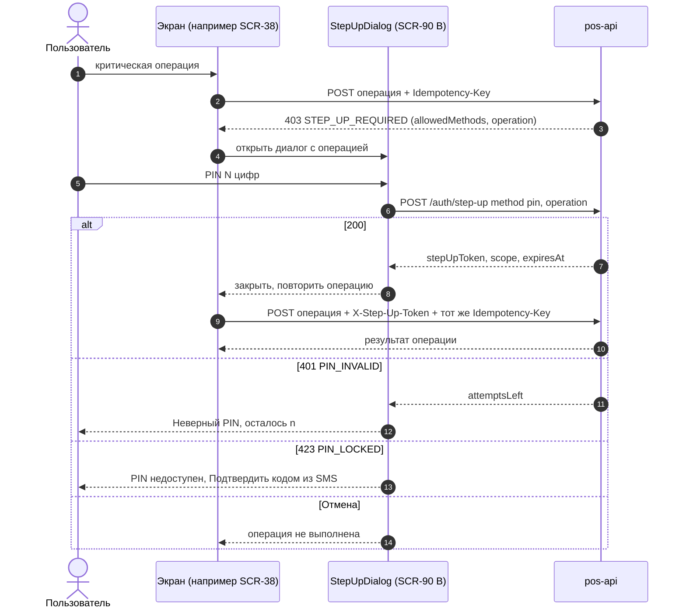
#### 7. Состояния (сводная диаграмма слоя глобальных состояний)
| Состояние | Загрузка | Успех | Ошибка | Пусто | Нет сети | Нет разрешений | Повтор | Устаревшие данные | Step-up |
|---|---|---|---|---|---|---|---|---|---|
| A | reconnecting | backOnline | serverDown | — | offline | — | «Повторить» | «данные от {time}» | — |
| B | «Проверяем…» | токен | PIN/OTP ошибки | — | способы недоступны | биометрия скрыта | повтор ввода | — | (сам) |
| C | — | — | (сам) | — | очистка локально | — | — | — | — |
| C3 | — | — | (сам) | — | баннер по кэшу версии | — | — | — | — |
| D | — | разрешено → функция | отказ | — | — | (сам) | перепроверка при возврате | — | — |
| E | «Повторить» loading | данные | (сам) | — | → A | — | «Повторить» | — | — |
| F | — | — | запись запрещена | — | — | — | — | — | — |
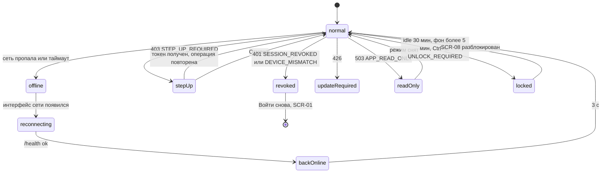
#### 8. Валидация и сообщения
| Ключ ARB | Текст | Состояние |
|---|---|---|
| `ds_offline_banner` | «Нет сети. Показаны данные от {time}. Заказы недоступны» | A |
| `ds_reconnecting` | «Подключаемся…» | A |
| `ds_back_online` | «Сеть восстановлена. Отправляем изменения…» | A |
| `ds_server_down` | «Сервер недоступен» | A |
| `ds_onec_down` | «1С недоступна: заказы будут отправлены позже; продажа в долг недоступна» | A (staff) |
| `global_offline_title`, `global_offline_body`, `global_offline_continue` | «Нет подключения к сети» / «Это действие требует связи с сервером. Каталог и корзина доступны из кэша (обновлено {time})» / «Продолжить работу из кэша» | A-экран |
| `ds_step_up_title` | «Подтвердите действие» | B |
| `stepup_reuse_hint` | «Повторно в течение 15 минут подтверждать не потребуется» | B |
| `stepup_by_sms`, `stepup_sms_confirm` | «Подтвердить кодом из SMS» / «Отправить код на {phoneMasked}?» | B |
| `auth_pin_error_invalid`, `stepup_pin_locked`, `stepup_offline` | «Неверный PIN. Осталось попыток: {n}» / «PIN заблокирован. Подтвердите кодом из SMS» / «Нужна сеть для подтверждения» | B |
| `stepup_pin_not_set` | «PIN не задан. Подтвердите кодом из SMS и задайте PIN в настройках» | B |
| `global_senior_title`, `global_senior_body` | «Нужно подтверждение старшего» / «{action} превышает ваш лимит ({limit}). Его может выполнить старший продавец или администратор в своей сессии» | B2 |
| `global_session_ended_title` | «Сессия завершена» | C |
| `global_session_reason_reuse` | «Для безопасности мы завершили все сессии. Войдите снова» | C |
| `global_session_reason_admin` | «Сессию завершил администратор. Войдите снова по номеру телефона» | C |
| `global_session_reason_expired` | «Срок входа истёк. Войдите снова по номеру телефона» | C |
| `global_session_reason_other_device` | «Вход выполнен на другом устройстве или устройство удалено из списка. Войдите снова» | C |
| `global_session_reason_device_mismatch` | «Сессия привязана к другому устройству. Войдите снова» | C |
| `global_session_reason_phone_changed` | «Номер входа изменён. Войдите снова» | C |
| `global_session_draft_saved` | «Черновик корзины ({count}) сохранён на этом устройстве и будет восстановлен после входа» | C |
| `global_session_login_again` | «Войти снова» | C |
| `ds_update_required`, `global_update_body`, `global_update_action` | «Требуется обновление приложения» / «Установите версию {minVersion} или новее, чтобы продолжить работу» / «Обновить» | C3 |
| `global_update_soft`, `global_update_later` | «Доступна новая версия приложения» / «Позже» | C3 мягкий |
| `global_permission_camera`, `global_permission_biometrics`, `global_permission_open_settings` | «Нет доступа к камере. Разрешите доступ в настройках устройства» / «Нет доступа к биометрии. Разрешите Face ID в настройках или используйте PIN» / «Открыть настройки» | D |
| `error_internal`, `ds_request_id`, `global_request_id_copied` | «Не удалось выполнить. Повторите» / «Код: {requestId}» / «Код скопирован» | E |
| `error_app_read_only` | «Сервер работает в режиме только чтения — изменения временно недоступны» | F |
| `global_permissions_changed` | «Ваши права изменены администратором» | H |

#### 9. Источники данных, API, бизнес-правила
| Состояние | API / источник | Правило |
|---|---|---|
| A | `connectivity_plus`; `GET /health` (08); метки кэша | D-32; NFR-OFFLINE-001 |
| B | `POST /auth/step-up` (08 §4.1.7); перечень операций — ядро §3.3, §17.2; коды `operation` — 11 §4.3 | D-13, D-48; ядро §18.2 п.6 |
| B2 | `DISCOUNT_LIMIT_EXCEEDED`, `CREDIT_BLOCKED` (08 §2.4); правила 10 DISC-/DEBT- | D-23, D-24 |
| C | `SESSION_REVOKED`, `DEVICE_MISMATCH` (08 §2.4); очистка — 09 §8.5 | D-12 |
| C3 | 426, `X-Min-App-Version`, `X-Recommended-App-Version` | D-46; ядро §18.2 п.12 |
| D | разрешения ОС (11 SEC-100) | — |
| E | `problem+json` (`code`, `requestId`) | D-37 |
| F | `503 APP_READ_ONLY` | ядро §17.4 |
| G | `SESSION_IDLE_LOCK_MINUTES`, `AUTH_BACKGROUND_LOCK_MINUTES` `[НЕ ПОДТВЕРЖДЕНО]`; `UNLOCK_REQUIRED` | 09 §8.8 |
| H | `TOKEN_STALE`, `permissionsVersion` | 09 §8.7 |

#### 10. Действия по ролям и безопасность
| Действие | `seller` | `cashier` | `senior_seller` | `admin` | `owner` | `customer` |
|---|---|---|---|---|---|---|
| Step-up для своих критических операций | ✓ (смена номера, PIN, биометрия, logout всех) | ✓ (+ ручное подтверждение QR, заявка на возврат, детализация долга) | ✓ (+ скидка сверх лимита, разрешение долга, отмена согласованного заказа) | ✓ (+ роли, лимиты, настройки, приглашения) | ✓ (детализация долга, отчёты по 11 §4.4) | ✓ (свои операции) |
| B2 (информирование) | ✓ | ✓ | — | — | — | — |
| Idle-блокировка | ✓ | ✓ | ✓ | ✓ | ✓ | — |

Скрытие кнопок по `permissions` — не защита; права проверяет сервер (D-15). `StepUpDialog` не показывается для операций без права (тогда — B2 или «Недостаточно прав»). Токен step-up не сохраняется на диск. Диалог «Сессия завершена» не раскрывает технических причин сверх перечисленных.

#### 11. Повторное нажатие, двойной запрос, «Назад», перезапуск
- Один диалог на тип состояния (повторные события объединяются); один `/auth/step-up` в полёте; исходная операция повторяется один раз с тем же `Idempotency-Key`.
- «Назад»: B/B2 — закрыть (= «Отмена»); C/C3 — не закрываются; A-экран — «Продолжить из кэша».
- Перезапуск: `stepUpToken` теряется (память) — повторный step-up при следующей операции; черновики сохраняются (D-32); 426 запоминается в `app_meta.min_app_version_seen` (07 §11.2) и показывается на SCR-00 до обновления.

#### 12. Требования к платформам
| Платформа | Требование |
|---|---|
| Android/iOS | лист для B на compact; разрешения — системные диалоги; «Открыть настройки» — `openAppSettings` |
| Windows-POS | диалоги с клавиатурой (`Enter`/`Esc`), экранный нампад PIN для сенсорных мониторов; `Ctrl+L` — блокировка; баннер под `TopAppBarPos` сдвигает три колонки |
| Все | `liveRegion(assertive)` для баннеров; фокус-ловушка в диалогах; возврат фокуса инициатору |

#### 13. Критерии приёмки
| ID | Критерий |
|---|---|
| AC-UI-90-001 | Отключение сети → баннер `offline` ≤ 2 с на любом экране; контент сдвигается, не перекрывается; при восстановлении — `backOnline` 3 с и скрытие. |
| AC-UI-90-002 | Попытка оформления заказа без сети → A-экран с «Повторить» и «Продолжить работу из кэша»; на SCR-01/02 ссылки «Продолжить из кэша» нет. |
| AC-UI-90-003 | `403 STEP_UP_REQUIRED` на ручное подтверждение QR → `StepUpDialog` с текстом операции; верный PIN → операция выполнена повтором с тем же `Idempotency-Key` (одна запись платежа). |
| AC-UI-90-004 | Повторная критическая операция той же области в течение 15 мин выполняется без диалога; через 16 мин — диалог снова. |
| AC-UI-90-005 | `PIN_INVALID` в диалоге показывает `attemptsLeft` с сервера; `PIN_LOCKED` делает PIN недоступным и выделяет «Подтвердить кодом из SMS». |
| AC-UI-90-006 | Step-up по SMS: подтверждение отправки → мини-OTP с таймерами SCR-02 → токен → операция выполнена. |
| AC-UI-90-007 | «Отмена» в диалоге не выполняет операцию; экран в исходном состоянии. |
| AC-UI-90-008 | В R1 кнопка «Подтвердить биометрией» не отображается. |
| AC-UI-90-009 | `401 SESSION_REVOKED` на трёх параллельных запросах → один диалог «Сессия завершена»; после «Войти снова» токены и `biometric_refresh` удалены, `deviceId` сохранён, открыт SCR-01. |
| AC-UI-90-010 | Диалог «Сессия завершена» не закрывается тапом вне, «Назад», `Esc`. |
| AC-UI-90-011 | При наличии черновика корзины в диалоге C виден текст о сохранённом черновике; после входа того же пользователя черновик восстановлен. |
| AC-UI-90-012 | 426 → блокирующий диалог «Требуется обновление» с версией из `X-Min-App-Version`; работа невозможна; черновики сохранены. |
| AC-UI-90-013 | `X-Recommended-App-Version` выше текущей → мягкий баннер «Доступна новая версия» с «Позже»; после «Позже» не показывается до следующих суток. |
| AC-UI-90-014 | Отказ в разрешении камеры → текст с «Открыть настройки» и альтернативой; после выдачи разрешения в настройках функция доступна без перезапуска. |
| AC-UI-90-015 | 5xx → `ErrorState` с «Код: {requestId}»; тап копирует код и показывает снекбар. |
| AC-UI-90-016 | `503 APP_READ_ONLY` → постоянный баннер; кнопки оформления/оплаты/регистрации disabled с пояснением; каталог доступен. |
| AC-UI-90-017 | Idle 30 мин → overlay SCR-08; ввод сканера во время блокировки не буферизуется. |
| AC-UI-90-018 | `TOKEN_STALE` → тихий refresh, снекбар «Ваши права изменены администратором»; недоступный раздел заменён главным экраном роли. |
| AC-UI-90-019 | `DISCOUNT_LIMIT_EXCEEDED` у продавца → лист «Нужно подтверждение старшего», `StepUpDialog` не открывается. |

#### 14. Трассировка
| Требование | SRC / правила |
|---|---|
| Состояния загрузки, ошибки, отсутствия интернета, разрешений, повтора | SRC-F-012; SRC-B-051, SRC-B-053 |
| Обработка потери сети | SRC-D-034, SRC-D-099 |
| Корректное завершение сессии | SRC-D-033 |
| Повторное подтверждение критических операций | ядро §3.3, §17.2; D-13, D-48 |
| Тексты централизованы | SRC-B-057; D-38 |
| Анимации не мешают работе | SRC-B-055 |

## 11. Сводный словарь строк UI части 02a
Правила ключей — 03 §16.2 (`snake_case`, префикс области); общие строки `ds_*` и `error_<code>` — владелец 03 §16.5 (здесь приведены только используемые). Плейсхолдеры: `{phone}`, `{phoneMasked}` — уже отформатированные строки; `{mmss}` — «м:сс»; `{n}`, `{count}`, `{seconds}`, `{minutes}` — int; `{name}`, `{role}`, `{time}`, `{version}`, `{build}`, `{deviceName}`, `{minVersion}`, `{requestId}`, `{action}`, `{limit}` — String. Тексты — `ru`; `ky`/`en` — каркас (D-38, Q-007).

| Ключ ARB | Русский текст | Экран | Примечание |
|---|---|---|---|
| `splash_logo_a11y` | Логотип Оптомстрой | SCR-00, все auth | Semantics |
| `splash_status_checking` | Проверяем сессию… | SCR-00 | после 2 с индикатора |
| `splash_status_refreshing` / `splash_version` | Обновляем данные… / Версия {version} ({build}) | SCR-00 | — |
| `splash_version_terminal` | Версия {version} ({build}) · {deviceName} | SCR-00 | Windows |
| `splash_init_error_title` | Не удалось запустить приложение | SCR-00 | UI-00-005 |
| `splash_init_error_body` | Повторите попытку. Если ошибка повторяется, обратитесь в поддержку | SCR-00 | — |
| `auth_phone_title` | Вход по номеру телефона | SCR-01 | ≤ 40 симв. |
| `auth_phone_subtitle` | Отправим SMS с кодом подтверждения | SCR-01 | не упоминает регистрацию |
| `auth_phone_label` | Номер телефона | SCR-01 | подпись поля |
| `auth_phone_hint` | Введите 9 цифр после +996 | SCR-01 | подсказка |
| `auth_phone_hint_remaining` | {count, plural, one{Ещё {count} цифра} few{Ещё {count} цифры} many{Ещё {count} цифр} other{Ещё {count} цифры}} | SCR-01 | ICU |
| `auth_phone_a11y` | Номер телефона, 9 цифр после +996 | SCR-01 | Semantics |
| `auth_phone_clear_a11y` | Очистить номер | SCR-01 | кнопка × |
| `auth_phone_submit` | Получить код | SCR-01 | кнопка L |
| `auth_phone_submit_wait` | Получить код через {mmss} | SCR-01 | лимит |
| `auth_phone_sending` | Отправляем код… | SCR-01 | после 1 с |
| `auth_phone_offline_hint` | Нужна сеть для входа | SCR-01 | — |
| `auth_phone_error_empty` | Введите номер телефона | SCR-01 | 09 §3.3 |
| `auth_phone_error_short` | Номер должен содержать 9 цифр после +996 | SCR-01 | 09 §3.3 |
| `auth_phone_error_long` | Слишком много цифр. Проверьте номер | SCR-01 | 09 §3.3 |
| `auth_phone_error_invalid` | Похоже, номер указан неверно. Проверьте и попробуйте снова | SCR-01 | 09 §3.3 |
| `auth_phone_error_format` | Введите номер в формате +996 XXX XXX XXX | SCR-01 | новый (вставка «8 (…)») |
| `auth_phone_error_server_invalid` | Сервер не принял номер. Проверьте формат +996 XXX XXX XXX | SCR-01 | 09 §3.3 |
| `auth_phone_sms_notice` | Для входа мы отправим SMS с одноразовым кодом. Служебные SMS не требуют отдельного согласия; рекламные SMS не отправляются | SCR-01 | 11 Шаблон 2 (кратко) |
| `auth_phone_sms_notice_more` | Подробнее | SCR-01 | полный текст — Шаблон 2 |
| `auth_brand_subtitle` | Рабочее место продавца | SCR-01, 02, 08 (expanded) | текст макета |
| `auth_brand_feature_1_title` / `_body` | Быстрый поиск товаров / Найдите товар за секунды | SCR-01 | текст макета |
| `auth_brand_feature_2_title` / `_body` | Актуальные остатки / По всем складам | SCR-01 | «в реальном времени» макета не используется (остатки — снимок, D-29) |
| `auth_brand_feature_3_title` / `_body` | Заказы и документы / Чеки, накладные, счета на оплату | SCR-01 | текст макета |
| `auth_brand_feature_4_title` / `_body` | Удобно и просто / Интерфейс создан для продавцов | SCR-01 | текст макета |
| `auth_brand_secure` | Ваши данные защищены | SCR-01 | макет; Q-200 |
| `auth_support_title` | Техническая поддержка | SCR-01…08 | лист контактов |
| `auth_support_call` / `auth_support_copy` | Позвонить / Скопировать номер | SCR-01…08 | — |
| `auth_support_fallback` | Обратитесь к администратору магазина | SCR-01…08 | нет контактов в кэше |
| `auth_footer_copyright` | © {year} Оптомстрой. Все права защищены. | SCR-01, 02 | макет: «© 2024 OptomStroy. Все права защищены.»; год — текущий, бренд — Q-200 |
| `auth_entry_session_revoked` | Сессия завершена. Войдите снова | SCR-01 | UI-01-017; 09 `auth_session_revoked` |
| `auth_entry_reuse_detected` | Для безопасности мы завершили все сессии. Войдите снова | SCR-01 | UI-01-017 |
| `auth_entry_registration_expired` | Время регистрации истекло. Подтвердите номер ещё раз — введённые данные сохранятся | SCR-01 | UI-01-017 |
| `auth_entry_registration_resume` | Продолжите регистрацию: подтвердите номер кодом из SMS | SCR-01 | UI-01-017 |
| `auth_entry_registration_cancelled` | Регистрация прервана. Данные сохранятся на этом устройстве 15 минут | SCR-01 | UI-01-017 |
| `auth_entry_phone_registered` | Этот номер уже зарегистрирован. Войдите по коду из SMS | SCR-01 | UI-01-017 |
| `auth_entry_pin_locked` | PIN заблокирован. Войдите по коду из SMS | SCR-01 | UI-01-017 |
| `auth_entry_pin_reset` | Войдите по коду из SMS, чтобы задать новый PIN | SCR-01 | UI-01-017 |
| `auth_entry_bio_invalidated` | Биометрия на устройстве изменилась. Войдите по номеру телефона и включите вход заново | SCR-01 | = `auth_bio_invalidated` |
| `auth_entry_device_mismatch` | Код запрошен с другого устройства. Запросите новый код | SCR-01 | UI-01-017 |
| `auth_error_rate_limited` | Слишком много запросов. Подождите {seconds} с | SCR-01, 02 | 03 §13.3 |
| `auth_error_rate_limited_min` | Слишком много запросов кода на этот номер. Попробуйте через {minutes} мин | SCR-01, 02 | при ≥ 60 с; 09 `auth_phone_error_rate_limited` |
| `auth_error_sms_provider` | Не удалось отправить SMS. Попробуйте позже | SCR-01, 02 | 03 §13.3 |
| `auth_error_network` | Нет связи с сервером. Проверьте сеть и повторите | SCR-01…08 | 03 §13.3 |
| `auth_error_timeout` | Сервер не ответил. Повторить | SCR-01…08 | 03 §13.3 |
| `auth_error_otp_invalid` | Неверный код. Осталось попыток: {n} | SCR-02 | 03 §13.3 (09: `auth_otp_error_invalid`) |
| `auth_error_otp_expired` | Код устарел. Запросите новый | SCR-02 | 03 §13.3 |
| `auth_error_otp_locked` | Попытки исчерпаны. Запросите новый код через {seconds} с | SCR-02 | 03 §13.3 |
| `auth_error_device_mismatch` | Код запрошен с другого устройства. Запросите новый код | SCR-02 | новый |
| `auth_blocked_message` | Доступ закрыт. Обратитесь к администратору магазина | SCR-02 | 09 §4.3 |
| `auth_otp_title` | Введите код из SMS | SCR-02 | 09 §4.4 |
| `auth_otp_sent_to` | Отправили на {phone} | SCR-02 | — |
| `auth_otp_change_phone` | Изменить номер | SCR-02 | 09 §3.2 |
| `auth_otp_code_a11y` | Код из SMS, 6 цифр | SCR-02 | Semantics |
| `auth_otp_ttl_timer` | Код действует ещё {mmss} | SCR-02 | 09 §4.4 |
| `auth_otp_resend_in` | Отправить повторно через {mmss} | SCR-02 | 09 §4.4 |
| `auth_otp_resend` | Отправить код повторно | SCR-02 | — |
| `auth_otp_resent` | Код отправлен повторно | SCR-02 | снекбар |
| `auth_otp_submit` | Подтвердить | SCR-02 | кнопка L |
| `auth_otp_checking` / `auth_otp_verified` | Проверяем код… / Код подтверждён | SCR-02 | — |
| `auth_otp_fallback_previous` | Не удалось отправить новый код. Введите код из предыдущего SMS | SCR-02 | новый |
| `auth_otp_offline` | Нет подключения. Код будет проверен, когда появится сеть | SCR-02 | — |
| `auth_otp_delivery_queued` | Отправляем SMS… | SCR-02 | условно (эндпоинт статуса) |
| `auth_otp_delivery_sent` | SMS отправлено | SCR-02 | условно |
| `auth_otp_delivery_failed` | Не удалось отправить SMS | SCR-02 | условно |
| `auth_otp_no_sms` | Не приходит SMS? | SCR-02 | — |
| `auth_otp_no_sms_body` | Проверьте номер. SMS может прийти в течение 1–2 минут. Если SMS не приходит, отправьте код повторно или обратитесь в поддержку | SCR-02 | — |
| `auth_otp_dev_code` | dev: код {code} | SCR-02 | только dev/staging |
| `auth_bio_offer_title` | Входить по биометрии? | SCR-02 | UI-02-018 |
| `auth_bio_offer_enable` / `auth_bio_offer_later` | Включить / Не сейчас | SCR-02 | — |
| `auth_bio_enable_stepup_hint` | Подтвердите PIN-кодом, чтобы включить вход по биометрии | SCR-02, SCR-04 | подсказка `StepUpDialog` (до решения Q-201) |
| `auth_bio_enable_later` | Включить биометрию можно позже в настройках | SCR-02 | снекбар: step-up отменён или PIN не задан |
| `mascot_state_a11y` | Персонаж: {state} | SCR-01…08 | `state` ∈ ожидание / ввод / проверка / успех / ошибка |
| `reg_header` | Регистрация | SCR-03…05 | шапка |
| `reg_step_data` | Данные | SCR-03…06 | степпер |
| `reg_step_security` | Защита входа | SCR-03…06 | степпер |
| `reg_step_face` | Лицо | SCR-05 | R2 |
| `reg_step_customer_link` | Клиент 1С | SCR-06 | условно |
| `reg_step_done` | Готово | SCR-04, 06 | степпер |
| `reg_stepper_compact` | Шаг {n} из {total} · {name} | SCR-03…06 | — |
| `reg_form_title` / `reg_form_subtitle` / `reg_field_name` | Расскажите о себе / Эти данные увидит администратор магазина / ФИО * | SCR-03 | — |
| `reg_field_name_hint` / `reg_field_phone` | Фамилия, имя и отчество (если есть) / Телефон | SCR-03 | — |
| `reg_phone_verified` | подтверждён | SCR-03 | чип |
| `reg_phone_change` / `reg_field_birth_year` / `reg_birth_year_placeholder` | Изменить / Год рождения * / ГГГГ | SCR-03 | — |
| `reg_field_activity` / `reg_activity_placeholder` | Сфера деятельности (необязательно) / Выберите из списка | SCR-03 | — |
| `reg_activity_plumber` / `_foreman` / `_reseller` / `_installer` / `_private` / `_other` | Сантехник / Прораб, строитель / Магазин, перепродажа / Монтажная организация / Частное лицо / Другое | SCR-03 | список — Q-203 |
| `reg_activity_none` / `reg_activity_other_hint` | Не указывать / Уточните сферу (до 60 символов) | SCR-03 | — |
| `reg_pd_ack_label` | Я ознакомлен(а) с условиями обработки персональных данных * | SCR-03 | UI-03-014 |
| `reg_pd_more` | Подробнее | SCR-03 | — |
| `register_consent_pd_text` | Шаблон 1 (11 §10.3) | SCR-03 | полный текст, версия — Q-027 |
| `reg_activity_consent_label` | Согласен(на) на обработку сведений о сфере деятельности (необязательно; можно отозвать в настройках) | SCR-03 | 11 Шаблон 1 |
| `reg_hint_activity_consent` / `reg_timer` | Без согласия сфера деятельности не будет сохранена / Время на регистрацию: ещё {mmss} | SCR-03 | — |
| `reg_continue` | Продолжить | SCR-03 | 11 Шаблон 1 («Нажимая «Продолжить»…») |
| `reg_error_name_required` | Введите фамилию и имя | SCR-03 | 09 §7.4 |
| `reg_error_name_length` | ФИО должно содержать от 2 до 120 символов | SCR-03 | новый |
| `reg_error_name_invalid` | Используйте только буквы, пробел и дефис | SCR-03 | 09 §7.4 |
| `reg_warning_name_one_word` | Укажите фамилию и имя полностью — так администратору проще вас найти | SCR-03 | предупреждение |
| `reg_error_birth_year_required` | Укажите год рождения | SCR-03 | 09 §7.4 |
| `reg_error_birth_year_range` | Введите год от {minYear} до {maxYear} | SCR-03 | 09 §7.4; Q-161 |
| `reg_error_consent_required` | Чтобы продолжить, подтвердите, что ознакомлены с условиями обработки данных | SCR-03 | 09 §7.4 (уточнён) |
| `reg_error_token_expired` | Время регистрации истекло. Подтвердите номер ещё раз — введённые данные сохранятся | SCR-03, 04 | 09 §7.3 |
| `reg_expired_action` | Подтвердить номер снова | SCR-03, 04 | — |
| `reg_cancel_title` / `reg_cancel_body` / `reg_cancel_confirm` | Прервать регистрацию? / Введённые данные сохранятся на этом устройстве 15 минут / Прервать | SCR-03 | — |
| `reg_cancel_continue` / `reg_restored_banner` | Продолжить заполнение / Мы восстановили введённые ранее данные | SCR-03 | — |
| `reg_security_title` / `reg_security_subtitle` / `reg_pin_tile_title` | Защита входа / Чтобы не вводить код из SMS при каждом входе / PIN-код приложения | SCR-04 | — |
| `reg_pin_tile_required` | Обязателен для сотрудников: нужен для разблокировки и подтверждения операций | SCR-04 | D-48 |
| `reg_pin_create` / `reg_pin_repeat` / `reg_pin_rules_hint` | Придумайте PIN-код / Повторите PIN-код / {length} цифр, без повторов и простых последовательностей | SCR-04, 08 | — |
| `reg_pin_a11y` | PIN, введено {n} из {length} | SCR-04, 08, 90 | 03 §9.6 |
| `reg_error_pin_weak` | Выберите PIN без повторяющихся или последовательных цифр | SCR-04, 08 | 09 §7.4 |
| `reg_error_pin_mismatch` | PIN-коды не совпадают | SCR-04, 08 | 09 §7.4 |
| `reg_bio_tile_title` | Биометрия устройства | SCR-04 | — |
| `reg_bio_available` | доступно | SCR-04 | чип |
| `reg_bio_not_enrolled` / `reg_bio_unsupported` | Настройте отпечаток или распознавание лица в настройках устройства / Недоступно на этом устройстве | SCR-04 | — |
| `reg_bio_windows_hello` | Windows Hello — только для быстрого входа перед PIN, не заменяет PIN | SCR-04 | D-13 |
| `reg_bio_open_settings` | Открыть настройки | SCR-04 | — |
| `reg_bio_consent_label` | Разрешаю вход по биометрии устройства (можно отключить в настройках) | SCR-04 | отдельное согласие |
| `register_security_consent_text` | Шаблон 3 (11 §10.3) | SCR-04, 02 | версия — Q-027 |
| `reg_bio_later` / `reg_bio_later_windows` | Настроить биометрию позже / Без Windows Hello | SCR-04 | — |
| `reg_complete` | Завершить регистрацию | SCR-04 | ≤ 20 симв. — допускается 22 (проверить golden) |
| `reg_next` | Далее | SCR-04 | R2 при FACE-SCAN |
| `reg_complete_offline` | Нужна сеть, чтобы завершить регистрацию | SCR-04 | — |
| `reg_bio_not_enabled` | Биометрия не включена. Вход — по PIN-коду. Включить можно в настройках | SCR-04 | снекбар |
| `reg_error_network` | Не удалось завершить регистрацию. Данные сохранены — повторите | SCR-04 | — |
| `reg_success_title` | Добро пожаловать, {name}! | SCR-04 | 09 §7.4 |
| `reg_success_security_pin` / `reg_success_security_pin_bio` / `reg_success_pending` | Вход настроен: PIN-код / Вход настроен: PIN-код · биометрия / Аккаунт создан. Администратор магазина активирует его и назначит роль | SCR-04 | — |
| `face_title` | Сканирование лица | SCR-05 | R2 |
| `face_step_front` | Посмотрите прямо в камеру | SCR-05 | 09 §10.3 |
| `face_step_left` | Медленно поверните голову влево | SCR-05 | 09 §10.3 |
| `face_step_right` | Теперь поверните голову вправо | SCR-05 | 09 §10.3 |
| `face_step_up` | Поднимите подбородок немного вверх | SCR-05 | 09 §10.3 |
| `face_step_ok` / `face_step_counter` / `face_retry` | Отлично / Шаг {n} из 4 / Попробуйте ещё раз | SCR-05 | — |
| `face_hint_no_face` / `face_hint_many_faces` / `face_hint_closer` | Лицо не найдено / В кадре должно быть одно лицо / Подойдите ближе | SCR-05 | — |
| `face_hint_farther` / `face_hint_center` / `face_hint_eyes` | Отодвиньтесь немного / Расположите лицо в овале / Откройте глаза | SCR-05 | — |
| `face_hint_dark` / `face_hint_bright` / `face_hint_steady` | Слишком темно / Слишком ярко — уберите источник света из кадра / Держите телефон неподвижно | SCR-05 | — |
| `face_hint_too_far` | Слишком сильно — поверните немного назад | SCR-05 | — |
| `face_data_notice` | Снимки обрабатываются на устройстве и не сохраняются | SCR-05 | юр. проверка Q-003, Q-027 |
| `face_start` / `face_retry_step` / `face_restart` | Начать / Повторить шаг / Начать заново | SCR-05 | — |
| `face_skip` / `face_later` | Пропустить / Настроить позже | SCR-05 | — |
| `face_cancel_title` / `face_cancel_body` | Прервать сканирование? / Регистрация продолжится без сканирования лица | SCR-05 | — |
| `face_step_timeout_title` | Не получается? | SCR-05 | — |
| `face_failed_title` / `face_other_method` | Не удалось завершить сканирование / Настроить вход по-другому | SCR-05 | — |
| `face_unsupported_title` / `face_unsupported_no_camera` / `face_continue_without` | Сканирование лица недоступно на этом устройстве / Нет фронтальной камеры. Вход защищён PIN-кодом / Продолжить без сканирования | SCR-05 | — |
| `face_rotate_device` / `face_paused_attempts` / `face_done` | Поверните устройство вертикально / Слишком много попыток. Повторите через {mmss} / Готово | SCR-05 | — |
| `face_consent_label` | Согласен(на) на обработку изображения лица для этой проверки | SCR-05 | R2, Q-027 |
| `link_title_found` | Мы нашли вашу карточку клиента | SCR-06 | — |
| `link_body_found` | В учётной системе магазина есть клиент с вашим номером. Подтвердите, что это вы — заказы и условия станут доступны в приложении | SCR-06 | — |
| `link_finance_hidden` | Финансовые данные не показываются до подтверждения | SCR-06 | SRC-B-145 |
| `link_confirm` / `link_reject` | Да, это я / Нет, это не я | SCR-06 | — |
| `link_reject_title` / `link_reject_body` | Это не ваша карточка? / Мы не будем связывать аккаунт с этой карточкой. Если карточка всё же ваша, объединить их сможет администратор магазина | SCR-06 | — |
| `link_title_none` / `link_body_none` | Карточка клиента будет создана при первом заказе / Условия обслуживания уточнит менеджер магазина | SCR-06 | — |
| `link_title_conflict` / `link_body_conflict` | Нужна помощь администратора / Найдено несколько карточек с вашим номером. Администратор магазина проверит данные и свяжется с вами | SCR-06 | — |
| `link_wait_admin` / `link_success` / `link_searching` | Ожидает подтверждения администратором / Карточка привязана / Ищем вашу карточку… | SCR-06 | — |
| `link_contact_shop` / `pending_contact_shop` | Связаться с магазином | SCR-06, 07 | — |
| `pending_title` | Аккаунт ожидает активации | SCR-07 | — |
| `pending_body` | Администратор магазина должен подтвердить ваш аккаунт и назначить роль. Обычно это занимает до 1 рабочего дня | SCR-07 | срок — Q-203 |
| `pending_field_name` / `pending_field_phone` / `pending_field_registered` | ФИО / Телефон / Зарегистрирован | SCR-07 | — |
| `pending_status_waiting` / `_active` / `_blocked` / `_checking` | ожидает активации / активирован · {role} / заблокирован / проверяем… | SCR-07 | чип |
| `pending_checked_at` / `pending_check` / `pending_check_error` | проверено {time} / Проверить статус / Не удалось проверить статус | SCR-07 | — |
| `pending_logout` / `pending_logout_title` / `pending_logout_body` | Выйти из аккаунта / Выйти из аккаунта? / Чтобы войти снова, понадобится код из SMS | SCR-07 | — |
| `pending_activated_snackbar` | Аккаунт активирован | SCR-07 | — |
| `pending_blocked_title` / `pending_blocked_body` | Аккаунт заблокирован / Аккаунт заблокирован администратором. Обратитесь в магазин | SCR-07 | — |
| `unlock_pin_hint` | Введите PIN-код приложения | SCR-08 | — |
| `unlock_bio_button` / `unlock_hello_button` | Войти по биометрии / Windows Hello | SCR-08 | — |
| `unlock_hello_verified` / `unlock_or_pin` | Подтверждено Windows Hello · введите PIN / или PIN-код | SCR-08 | — |
| `auth_pin_error_invalid` | Неверный PIN. Осталось попыток: {n} | SCR-08, 90 | 09 §9.6 |
| `auth_pin_locked` | PIN заблокирован после 5 неверных попыток. Войдите по SMS и задайте новый PIN | SCR-08 | — |
| `unlock_sms_login` | Войти по SMS | SCR-08 | — |
| `auth_bio_lockout` | Биометрия временно заблокирована. Введите PIN или войдите по номеру | SCR-08 | 09 §9.3 |
| `auth_bio_invalidated` | Биометрия на устройстве изменилась. Войдите по номеру телефона и включите вход заново | SCR-08 | 09 §9.3 |
| `unlock_offline` | Нет подключения. Для входа нужна сеть | SCR-08 | Q-241 |
| `unlock_forgot_pin` / `unlock_phone_login` / `unlock_switch_account` | Забыли PIN? / Войти по номеру телефона / Сменить аккаунт | SCR-08 | — |
| `unlock_reset_title` / `unlock_reset_body` / `unlock_reset_confirm` | Сбросить PIN? / Войдите по коду из SMS, затем задайте новый PIN. Несохранённые данные на экране будут потеряны; корзина сохранится / Войти по SMS | SCR-08 | — |
| `unlock_switch_title` / `unlock_switch_body` / `unlock_switch_confirm` | Сменить аккаунт? / Текущий пользователь выйдет на этом устройстве. Корзина сохранится на сервере / Сменить | SCR-08 | — |
| `unlock_locked_title` / `unlock_locked_idle` / `unlock_locked_manual` | Экран заблокирован / Через {minutes} мин бездействия / Заблокировано вручную | SCR-08 | overlay |
| `unlock_new_pin_title` / `unlock_new_pin_save` / `unlock_pin_changed` | Задайте новый PIN / Сохранить PIN / PIN изменён | SCR-08 | UI-08-014 |
| `ds_offline_banner` / `ds_reconnecting` / `ds_back_online` / `ds_server_down` / `ds_onec_down` | см. 03 §16.5 | SCR-90 A | владелец 03 |
| `global_offline_title` / `global_offline_body` / `global_offline_continue` | Нет подключения к сети / Это действие требует связи с сервером. Каталог и корзина доступны из кэша (обновлено {time}) / Продолжить работу из кэша | SCR-90 A | — |
| `ds_step_up_title` | Подтвердите действие | SCR-90 B | 03 §16.5 |
| `stepup_reuse_hint` | Повторно в течение 15 минут подтверждать не потребуется | SCR-90 B | — |
| `stepup_by_sms` / `stepup_sms_confirm` | Подтвердить кодом из SMS / Отправить код на {phoneMasked}? | SCR-90 B | — |
| `stepup_pin_locked` / `stepup_offline` / `stepup_pin_not_set` | PIN заблокирован. Подтвердите кодом из SMS / Нужна сеть для подтверждения / PIN не задан. Подтвердите кодом из SMS и задайте PIN в настройках | SCR-90 B | — |
| `global_senior_title` / `global_senior_body` | Нужно подтверждение старшего / {action} превышает ваш лимит ({limit}). Его может выполнить старший продавец или администратор в своей сессии | SCR-90 B2 | — |
| `global_session_ended_title` / `global_session_login_again` | Сессия завершена / Войти снова | SCR-90 C | — |
| `global_session_reason_reuse` / `_admin` / `_expired` / `_other_device` / `_device_mismatch` / `_phone_changed` | тексты §10.8 | SCR-90 C | — |
| `global_session_draft_saved` | Черновик корзины ({count}) сохранён на этом устройстве и будет восстановлен после входа | SCR-90 C | — |
| `ds_update_required` / `global_update_body` / `global_update_action` | Требуется обновление приложения / Установите версию {minVersion} или новее, чтобы продолжить работу / Обновить | SCR-90 C3 | — |
| `global_update_soft` / `global_update_later` | Доступна новая версия приложения / Позже | SCR-90 C3 | — |
| `global_permission_camera` / `global_permission_biometrics` / `global_permission_open_settings` | тексты §10.8 | SCR-90 D | — |
| `error_internal` / `ds_request_id` / `global_request_id_copied` | Не удалось выполнить. Повторите / Код: {requestId} / Код скопирован | SCR-90 E | 03 §16.5 |
| `error_app_read_only` | Сервер работает в режиме только чтения — изменения временно недоступны | SCR-04, 90 F | 03 §16.5 |
| `global_permissions_changed` | Ваши права изменены администратором | SCR-90 H | — |
| `ds_button_retry` / `ds_button_cancel` / `ds_button_close` | Повторить / Отмена / Закрыть | все | 03 §16.5 |

## 12. Открытые вопросы
### 12.1. Вопросы ядра и других документов, влияющие на экраны части
| Q | Где влияет | Допущение в этой части |
|---|---|---|
| Q-001 | SCR-04 (политика PIN `customer`), SCR-06, переходы SCR-00/04 | `CUSTOMER_SELF_SERVICE` выключен; SCR-06 — условный |
| Q-002 | SCR-01 (логин/пароль, выбор сотрудника, карта), UI-01-015 | не в R1; место не резервируется |
| Q-003 | SCR-05 | R2, `FACE_SCAN_MODE=off` |
| Q-004 | все таймеры и лимиты SCR-01/02/08/90 | значения D-10/D-12; числа — из ответов сервера |
| Q-006 | логотип на SCR-00/01/02/08 | плейсхолдер, цвет из asset |
| Q-007 | словарь §11 | только `ru` |
| Q-008 | Windows/iOS, экранный нампад, магазин обновлений | Android + Windows |
| Q-027 | тексты согласий SCR-01/03/04/05 | шаблоны 11 §10.3 |
| Q-029 | автозаполнение OTP (хэш приложения в SMS) | SMS User Consent; Retriever не используется |
| Q-034 | SCR-07/08 (общий терминал, маскирование, «Сменить аккаунт») | выход + вход по SMS |
| Q-035 | персонаж | нейтральный плоский Rive |
| Q-037 | биометрия на rooted-устройствах (SCR-04/08) | не предлагается, OTP/PIN работают |
| Q-038 | уведомление о входе с нового устройства | in-app |
| Q-112 | формат телефона | `+996 XXX XXX XXX`, E.164 в API |
| Q-161 | границы года рождения (SCR-03) | 1900 (09) vs 1920 (08) — нужно единое значение |
| Q-162 | второй OTP после формы (SCR-03/04) | выключен |
| Q-163 | правила PIN (SCR-04/08) | 09 §9.6 |
| Q-181 | `FLAG_SECURE` на экранах PIN/OTP | решение заказчика |
| Q-241 | офлайн-разблокировка SCR-08 | вне R1 |

### 12.2. Новые вопросы (диапазон Q-200…Q-203)
| ID | Вопрос | Влияние | Рекомендуемое допущение |
|---|---|---|---|
| Q-200 | [НОВЫЙ ВОПРОС] Сохранять ли на экране входа элементы макета `photo_2026-10-18_16-03-36.jpg`, совместимые с промтом: бренд-панель «Рабочее место продавца» с четырьмя преимуществами и плашкой «Ваши данные защищены» (expanded), подпись «Техническая поддержка» с контактами; какие контакты поддержки (телефон, мессенджер) показывать и где их хранить (`app_settings.support_contacts` `[НОВОЕ ИМЯ]`)? Подтверждает ли заказчик замену тёмного фото-фона макета белым минималистичным экраном с персонажем (промт)? Как писать бренд: латиницей «OptomStroy» (макет: wordmark и футер «© 2024 OptomStroy. Все права защищены.») или кириллицей «Оптомстрой» (ТЗ, ARB)? Переносить ли иконку-замок над карточкой входа? | SCR-01, SCR-02, SCR-08 (expanded), листы поддержки | бренд-панель — только на expanded; фон белый; контакты задаёт администратор; в текстах ARB — «Оптомстрой», wordmark — из asset логотипа заказчика (Q-006); замок не переносится (якорь — персонаж) |
| Q-201 | [НОВЫЙ ВОПРОС] Засчитывание свежего OTP-входа как step-up. (а) Сброс PIN «Забыли PIN?»: допустимо ли засчитывать свежий OTP-вход (≤ 15 мин) как step-up для установки нового PIN (`POST /me/pin`) без второй SMS? (б) Включение биометрии сразу после OTP-входа (SCR-02 UI-02-018) и сразу после `/registration/complete` (SCR-04 UI-04-014): 09 §9.5 считает step-up выполненным, а 08 §4.3.6 и ядро §17.2 требуют `X-Step-Up-Token`, механизма засчитывания (`stepUpUntil` `[НОВОЕ ИМЯ]`) в 08 нет. Без решения предпочтительный сценарий промта SRC-B-081 («после привязки номера предложить биометрию») требует дополнительного ввода PIN, а для пользователя без PIN — второй SMS. | SCR-08 (UI-08-014), SCR-02 (UI-02-018), SCR-04 (UI-04-014), стоимость SMS, 08 §4.1.2, §4.2.1, §4.3.5, §4.3.6; SRC-B-081 | засчитывать: сервер выставляет `stepUpUntil` (≤ 15 мин, область — `POST /me/pin`, `POST /me/biometrics`) при OTP-входе и `/registration/complete`; до решения — явный `StepUpDialog` по PIN (SCR-04 — только что заданный PIN; SCR-02 — PIN пользователя; без PIN предложение переносится в SCR-42); при отказе заказчика — то же поведение остаётся постоянным |
| Q-202 | [НОВЫЙ ВОПРОС] Привязка клиента-покупателя к карточке 1С (режим самообслуживания): может ли сам клиент подтвердить привязку «Да, это я» при совпадении телефона входа с телефоном карточки (09 §7.9) — каким правом (`customer.link.resolve` в 11 §4.3 есть только у `admin`) и через какой эндпоинт (в ответе `GET /registration/customer-match` нет `linkId` для `POST /customers/{id}/links/{linkId}/confirm`)? Допустимо ли показывать до подтверждения что-либо кроме маскированного наименования и маски телефона (wireframe предлагает «клиент с … г.» и маскированный код 1С)? | SCR-06, 08 §4.2.2, 11 §4.4 | клиент подтверждает свою привязку (право `profile.manage.own`), `linkId` добавляется в ответ `customer-match`; показываются только наименование и маска телефона |
| Q-203 | [НОВЫЙ ВОПРОС] Справочник «Сфера деятельности» (SCR-03): окончательный список значений (09 §7.1 и wireframe расходятся), нужен ли «Другое» со свободным текстом, редактирует ли список администратор; и какой срок активации обещать пользователю на SCR-07 («до 1 рабочего дня» — не подтверждено)? | SCR-03, SCR-07, отчёты по клиентской базе | список 09 §7.1 + «Другое» (≤ 60 симв.), статичный в R1; на SCR-07 — текст без срока, если заказчик не подтвердит срок |

## 13. Трассировка на исходные требования (зона части: SRC-B-060…149, SRC-E-121…136c, SRC-F-001…027)
| SRC-ID | Краткая формулировка | Где закрыто в 02a | Связанные правила |
|---|---|---|---|
| SRC-B-060…063 | Анимированный splash, логотип из материалов, плавное появление, качество анимации | SCR-00 §1–§5, ANIM-001, AC-UI-00-001/002 | 03 §12 |
| SRC-B-064 | Индикатор только при реальной загрузке | SCR-00 UI-00-002, AC-UI-00-001/003 | 03 §9.63 |
| SRC-B-065, 065a | Проверка состояния приложения и сессии | SCR-00 §6, §9 | 09 §8 |
| SRC-B-066 | Корректный переход после splash | SCR-00 §6 (9 правил), AC-UI-00-005…009 | navigation G-0…G-5 |
| SRC-B-067 | Без искусственной задержки | SCR-00 §5 (переход ≤ 1,2 с, без пауз сверх 600 мс) | DS-067…070 |
| SRC-B-068 | Авторизованный — сразу к рабочему экрану | SCR-00 §6 (`staff` — через одношаговую разблокировку SCR-08, D-48) | ядро §17.2 |
| SRC-B-069, 069a | Белый минималистичный экран авторизации | §0.1; SCR-01 §1–§2, AC-UI-01-001 | 03 §13.2 |
| SRC-B-069b, 070 | Анимированный персонаж, реагирует на этапы | §0.3; SCR-01…04, 08 | D-40 |
| SRC-B-071…076 | Состояния: ожидание, ввод, проверка, успех с галочкой, ошибка + сообщение, повтор | §0.3 таблица 8 состояний; SCR-01 AC-011; SCR-02 AC-005/009; SCR-08 AC-015 | 09 §11; 03 §13 |
| SRC-B-075a | Понятное текстовое сообщение об ошибке | §0.2; §8 каждого экрана; словарь §11 | 03 §13.3 |
| SRC-B-077, 078 | Плавные переходы, без миганий и чрезмерной анимации | §0.3 инварианты И3, И5 | 03 §13.4 |
| SRC-B-079 | Системная биометрия ≠ распознавание лица | SCR-04 §1; SCR-05 §1.1 | 09 §9.1 |
| SRC-B-080, 080a, 081 | Предпочтительный сценарий: номер → предложение биометрии ОС | SCR-02 UI-02-018; SCR-04 UI-04-006/010/014. **Условно**: включение сразу после OTP-входа/регистрации требует step-up по 08 §4.3.6 — до решения Q-201 (расширен) выполняется через явный `StepUpDialog` по PIN (AC-UI-02-021, AC-UI-04-018); без PIN (`pinSet=false`) предложение переносится в SCR-42 (AC-UI-02-022) | 09 §9.2, §9.5; 08 §4.3.6; «Замечания к ядру» №22 |
| SRC-B-082, 082a, 083 | Следующий вход системной биометрией с безопасным токеном; аккаунт этого пользователя | SCR-08 §4, AC-UI-08-001 | D-13 |
| SRC-B-084 | При отказе — вход по номеру телефона | SCR-08 UI-08-016, §4 п.7 | 09 §9.7 |
| SRC-B-085, 086 | Без универсального Face ID на Android; ограничения local_auth | SCR-04 UI-04-006 (Class 3, API ≥ 30); SCR-08 §12 | 09 §9.4 |
| SRC-B-087, 088 | Оценка отдельного решения liveness; серия фото — не защита | SCR-05 §1, §1.1, AC-UI-05-012 | D-14; Q-003 |
| SRC-B-089 | Не хранить сырые биометрические данные | SCR-04 §10; SCR-05 §9–§10, AC-UI-05-011 | 09 §10.5; 11 §9.2 |
| SRC-B-090…097 | Поле телефона: удобство, форматирование, код +996, отображение КР, валидация, изменение, редактирование, ошибки | SCR-01 UI-01-006/007, §4, §8, AC-UI-01-002…005, 013 | 09 §3; 03 §9.4 |
| SRC-B-098 | Шаг 1: ввод номера | SCR-01 | — |
| SRC-B-099, 103 | Проверка существования аккаунта на сервере | SCR-01 §9 (нейтральный ответ), SCR-02 §6 | 09 §4.1 |
| SRC-B-100, 100a | OTP через SMSPro и экран подтверждения | SCR-01 → SCR-02 | 09 §4 |
| SRC-B-101 | Нет аккаунта → регистрация | SCR-02 §6 (`registration_required` → SCR-03) | D-10 |
| SRC-B-102 | Автоматический вход после верного OTP | SCR-02 AC-UI-02-009 | — |
| SRC-B-104, 105, 106 | Защита от перебора и злоупотребления SMS; нераскрытие данных | SCR-01 AC-007/008/018; SCR-02 §10; §0.3 И4 | 09 §5.4–5.5 |
| SRC-B-107…110, 109a…109f | Изучение API SMSPro, без выдуманных параметров | вне UI-части: экраны не содержат параметров SMSPro | 09 §6 |
| SRC-B-111, 112 | SMS только с сервера; без секретов в приложении | SCR-01 §10 | 09 §6.8; 11 SEC-093 |
| SRC-B-113, 114, 115 | Конфигурация env, пример без секретов, тестовый режим | SCR-02 UI-02-017 (только отображение `devCode` в dev) | 09 §5.8, §6.11 |
| SRC-B-116 | Логи без OTP | SCR-02 §4 п.10, AC-UI-02-019 | 09 §5.7 |
| SRC-B-117…120 | Частота, время действия, лимит попыток, одноразовость | SCR-01 UI-01-012; SCR-02 UI-02-007/010/015, AC-006…008 | D-10 |
| SRC-B-121, 121a, 121b, 122 | Порядок подключения SMSPro и передача параметров | вне UI-части | 09 §6.12 |
| SRC-B-123 | Современный экран регистрации | SCR-03, SCR-04 | — |
| SRC-B-124, 125, 127, 128 | Поля: ФИО*, телефон*, год*, сфера (необязательно) | SCR-03 UI-03-006…009, AC-UI-03-001 | 09 §7.1 |
| SRC-B-126 | Обязательный этап биометрии/лица по безопасному сценарию | SCR-04 (PIN обязателен, биометрия по выбору), SCR-05 (R2) | D-14 |
| SRC-B-129 | Пропущенный п.3 не создаёт поле | SCR-03 §1, AC-UI-03-001 | — |
| SRC-B-130…134 | Форматирование, обязательные поля, сообщения, клавиатуры, индикатор прогресса | SCR-03 §4, §8, §12; `RegistrationStepper` 3 шага | 09 §7.4 |
| SRC-B-135 | Анимация подтверждения | SCR-04 UI-04-015, AC-UI-04-009 | ANIM-005 |
| SRC-B-136 | Защита от повторной регистрации | SCR-04 §11 (`Idempotency-Key`, `PHONE_ALREADY_REGISTERED`), AC-UI-04-008 | 09 §7.3 |
| SRC-B-137 | Сохранение данных при ошибке сети | SCR-03 §11, UI-03-017; SCR-04 UI-04-016; §0.4 | ядро §18.2 п.1 |
| SRC-B-138, 139 | Поиск карточки 1С по подтверждённому номеру; без дубликатов | SCR-06 §1, §9 | D-08 |
| SRC-B-140, 141 | Профиль приложения отдельно от карточки 1С | SCR-03 §9 | 09 §7.7 |
| SRC-B-142…146 | Безопасная привязка, сохранение истории, без автосоздания, без финансов до подтверждения, конфликт → разрешение | SCR-06 UI-06-004…012, AC-UI-06-002…009 | 09 §7.9 |
| SRC-B-147 | OTP после формы | **Частично — отклонение по D-10, Q-162**: в R1 OTP подтверждает номер до формы (SCR-01/02 → SCR-03), ветвление «вход / регистрация» — только после верного кода; буквальный порядок промта «форма → OTP» доступен лишь конфигурацией `REGISTRATION_SECOND_OTP=true` (SCR-04 §6, в R1 выключено). Требуется подтверждение заказчика (Q-162) | 09 §5.5; 08 §4.2.1 (примечание о втором OTP) |
| SRC-B-148 | Автоматическое завершение и вход без «Войти» | SCR-04 AC-UI-04-009 | — |
| SRC-B-149 | Регистрация только после серверной проверки номера | SCR-03 UI-03-007; SCR-04 §9 | 09 §7.4 |
| SRC-E-121, 122, 124, 125 | Поля регистрации | SCR-03 | 09 §7.1 |
| SRC-E-123 | Настройка биометрии или согласованный сценарий лица | SCR-04, SCR-05 | D-14 |
| SRC-E-126, 126a | Форматирование телефона, проверка обязательных полей | SCR-01 §4; SCR-03 §8 | — |
| SRC-E-127, 128, 129, 130 | Отправка OTP, лимиты попыток, время действия, автопереход | SCR-01, SCR-02 | D-10 |
| SRC-E-131…133 | Документация SMSPro | вне UI-части | 09 §6 |
| SRC-E-134, 134a, 134b | Привязка записей 1С без дубликатов и потерь | SCR-06 | D-08 |
| SRC-E-135, 136, 136a…136c | Биометрия ≠ лицо; ограничения платформ, согласие, защита данных | SCR-04 §1, §10, §12, UI-04-010; SCR-08 §12 | 09 §9.4, §9.8 |
| SRC-F-001…003 | Требования к экранам не сокращаются, детали не исключаются | структура 14 пунктов для каждого экрана; таблицы элементов с UI-ID wireframes | ядро §11 п.6 |
| SRC-F-004…019 | Ультрадетальная спецификация каждого экрана по 14 пунктам, не одним абзацем | §1–§10 части (каждый экран — пп. 1–14) | — |
| SRC-F-020 | Для сложных экранов — отдельные подразделы, таблицы элементов, диаграммы переходов и последовательности действий | Отдельные подразделы: SCR-05 §4.1 (шаги захвата) и §4.2 (контролы), SCR-90 — зоны A–H и таблицы по состояниям; таблицы элементов — п.3 каждого экрана; диаграммы последовательности — SCR-01, SCR-02, SCR-04, SCR-08, SCR-90 (п.6); stateDiagram-v2 — п.7 каждого экрана и §0.3 (персонаж); flowchart навигации — SCR-00 §6 | ядро §11 п.6, п.8 |
| SRC-F-021 | 8 состояний персонажа | §0.3 | D-40 |
| SRC-F-022, 023 | Анимация не подменяет проверку; независимые слои | §0.3 И1, И4; SCR-05 §1, AC-UI-05-015 | 09 §10.2, §11 |
| SRC-F-024, 025 | Сканирование лица: 4 направления, подсказки, индикатор, захват, повтор, отмена, неподдерживаемое устройство | SCR-05 §4.1–4.2, UI-05-004…017 | 09 §10.3–10.4 |
| SRC-F-026 | Что подтверждено технологией vs SDK | SCR-05 §1.1 | 09 §10.1 |
| SRC-F-027 | Не заявлять защиту от подделки | SCR-05 §1, AC-UI-05-012 | — |

## 14. Замечания к ядру
Часть следует ядру; ниже — расхождения документов волны 1, обнаруженные при сведении экранов, и принятое в 02a решение (для оркестратора и владельцев словарей).

| № | Тема | Расхождение | Решение в 02a | Кому |
|---|---|---|---|---|
| 1 | Число шагов `RegistrationStepper` | 09 §7.1: «1 Данные · 2 Защита входа · 3 Готово» (с SCR-06 — 4); 03 §9.66, wireframes-auth, responsive-spec: 2 шага («Шаг 1 из 2») | 3 шага по 09 и заданию (1/3, 2/3, 3/3); с SCR-06 — 4; с SCR-05 (R2) — «Данные · Защита · Лицо · Готово» | 03, visual |
| 2 | Место согласия/информирования ПДн | 09 §7.1/§7.4 — чекбокс на SCR-03; wireframe UI-04-011 — на SCR-04; 11 §10.3 — для обязательных полей нужно информирование, не согласие | Информирование + отметка «Я ознакомлен(а)» на SCR-03 (UI-03-014, новый UI-ID); UI-04-011 зарезервирован и не используется; отдельное необязательное согласие на сферу деятельности (UI-03-015) | 09, 11, visual |
| 3 | Ключи ARB ошибок OTP | 03 §13.3: `auth_error_otp_invalid/expired/locked`; 09 §4.4: `auth_otp_error_*`; wireframe: `auth_otp_invalid/expired/locked`; тексты «Код устарел» (03) / «Код истёк» (09) | Ключи и тексты 03 (владелец ARB, ядро §18.1); синонимы 09 и wireframe не используются | 09, visual |
| 4 | Тело `POST /registration/complete` | 08 §4.2.1: `profile.activityKind`, `security{pin, biometricsEnabled, biometricClass}`, `consents.kind=biometric_unlock`; 09 §7.3: `occupation`, `security{method, pin}`, `biometrics_device`; 07 §6 `consent_kind`: `personal_data, sms, biometrics_device, face_scan`; 11 §10.3: + `activity_sphere` `[НОВОЕ ИМЯ]` | Значения enum — 07 (`biometrics_device`); имена полей DTO — по 08 до сверки; требуется единый DTO и решение по `activity_sphere` в 07 | 07, 08, 09, 11 |
| 5 | Нижняя граница года рождения | 09 §7.1: 1900; 08 §4.2.1: 1920 | ARB с плейсхолдером `{minYear}`; значение — Q-161 | 08, 09 |
| 6 | Хранение `registration_token` | 09 §7.4: в secure storage вместе с черновиком (восстановление после перезапуска); 11 §8.1: только память | Только память (11, ядро §18.2 п.2); после перезапуска — новый OTP и подстановка черновика | 09 |
| 7 | Блокировка при возврате из фона | 09 §8.8: > 5 мин (`AUTH_BACKGROUND_LOCK_MINUTES`); navigation §4.2, responsive-spec: > 30 мин | 5 мин по 09 (владелец SESS); `AUTH_BACKGROUND_LOCK_MINUTES` уже есть в 16 §4.3 (значение 5) — часть замечания про 16 снята при проверке | visual |
| 8 | Установка PIN | 09 §9.6: `PUT /me/pin {pin, pinConfirm}`; 08 §4.3.5: `POST /me/pin {newPin}` | По 08 (`POST`, `newPin`) | 09 |
| 9 | Разблокировка биометрией | ядро §18.2 п.5 и 08 §4.1.8: `POST /auth/unlock {method: biometric}`; 09 §9.2–§9.3: `/auth/refresh {kind: biometric}` | `/auth/unlock {method: biometric}` (ядро) | 09 |
| 10 | «Забыли PIN?» на SCR-08 | 09 §9.6: OTP step-up (`purpose=step_up`) → `PUT /me/pin`; но `POST /auth/step-up` требует access-токен, которого на SCR-08 нет (на Windows — `UNLOCK_REQUIRED`) | Сброс через полноценный OTP-вход (SCR-01/02) → «Задайте новый PIN»; step-up — по Q-201 | 09 |
| 11 | `StepUpDialog` на compact и число попыток PIN | 03 §9.46: диалог по центру на compact; «после 3 неверных PIN → fallback OTP»; 08/09: 5 → `PIN_LOCKED`; wireframe: лист на compact | Лист `AppBottomSheet` на compact (нампад); число попыток — только из ответа сервера (5 → `PIN_LOCKED`) | 03 |
| 12 | Контакты поддержки | макет и wireframe требуют «Техническая поддержка» с контактами; ключа `app_settings` нет (есть `privacy_contact`) | `app_settings.support_contacts` `[НОВОЕ ИМЯ]` с fallback на `privacy_contact` | ядро §17.7, 07, 16 |
| 13 | Биометрия в step-up | ядро §1 (глоссарий: «биометрия с криптопривязкой» как метод step-up); 08 §2.12: в R1 `bio` только вместе с PIN/OTP; wireframe UI-90-009 — самостоятельная кнопка | В R1 кнопка биометрии в `StepUpDialog` скрыта (не сокращает ввод); R2 — `biometricAssertion` | ядро §1 |
| 14 | Персонаж на SCR-06 и размеры | wireframe: персонаж на SCR-06; 03 §9.52: SCR-06 не в списке; размеры wireframe 150/180/240 и 56/72 vs 03: 160/200, `mini` 96 | SCR-06 — иллюстрация; размеры 03. На SCR-03/04 (шаг 2) используется `Mascot.mini` 56/72 с состояниями `idle`, `typing` (только взгляд), `verifying` (SCR-04), `error`, `retry`; по 03 §9.52 `mini` — 96, только `idle/verifying/success/error` и предназначен для `StepUpDialog`. Просьба к 03: расширить вариант `mini` — размеры 56/72 и состояния `typing`/`retry` для строки заголовка форм регистрации; также внести уменьшенные размеры `auth` при открытой клавиатуре (96 — SCR-01/SCR-08 compact, 72 — SCR-02). При отказе — `Mascot.auth` 160/200 над формой по 03 (поля SCR-03/04 сдвигаются вниз на высоту персонажа) | 03, visual |
| 15 | Телефон на SCR-08 и предзаполнение номера | wireframe/navigation: маска телефона на SCR-08 и «номер предзаполнен» после PIN_LOCKED/«Сменить аккаунт»; 09 §8.5, §9.3: телефон на устройстве не хранится, только имя | Телефон не показывается и не предзаполняется (кроме номера незавершённой регистрации в secure storage) | visual |
| 16 | Статус доставки SMS | 09 §4.3 вводит `GET /auth/otp/challenges/{challengeId}` `[НОВОЕ ИМЯ]`; в ядре §7 и 08 §4.1 отсутствует | UI-02-016 показывается только при наличии эндпоинта; просьба внести в ядро §7 и 08 | ядро §7, 08 |
| 17 | Политика PIN для `customer` при регистрации | клиент не знает до `/registration/complete`, станет ли аккаунт `staff` (приглашение) или `customer` | В R1 всегда политика `staff` (6 цифр, обязателен); при включении Q-001 нужен признак в ответе `/auth/otp/verify` (`registration_required`) — например `expectedKind` `[НОВОЕ ИМЯ]` | 08, 09 |
| 18 | Новые имена компонентов/вариантов | `FaceCaptureView` (R2), `CustomerCard` вариант `masked`; поле `security.pinLength` в `Me` (экранный нампад PIN — каноническое `QuantityNumpadSheet.pin` 03 §9.6/§9.21, новое имя не вводится) | Использованы с пометкой `[НОВОЕ ИМЯ]`; внести в 03 §9 / 08 §3.14 | 03, 08 |
| 19 | Переключатели FACE-SCAN — **снято при проверке** | `FACE_SCAN_MODE`, `FACE_SCAN_REQUIRED`, `FACE_SCAN_STORE_FRAMES` присутствуют в 16 §4.3 и `.env.example` | Используются как имена 16 §4.3 / 09 §10; номер сохранён (перенумерация запрещена) | — |
| 20 | Текст преимущества макета | «Актуальные остатки · по всем складам в реальном времени» противоречит D-29 (остатки — снимок 5–10 мин) | Текст «По всем складам» без «в реальном времени» | — |
| 21 | Сетевой повтор `POST /auth/otp/verify` | 08 §4.1.2: «повторный verify того же кода → `OTP_EXPIRED`» (API-036); 09 §5.6: повтор того же `challengeId`+кода в пределах 60 с выполняет новую ротацию той же сессии (09 сам называет это изменением относительно 08) | UI описывает обе ветки; до согласования действует 08: повтор принятого кода → «Код устарел. Запросите новый» и запрос нового кода (SCR-02 §4, §9, §11, AC-UI-02-011). Просьба к 08: принять или отклонить идемпотентный повтор verify (окно 60 с, та же сессия) | 08, 09 |
| 22 | Step-up для включения биометрии сразу после OTP-входа и регистрации | 09 §9.5: step-up считается выполненным; 08 §4.3.6 и ядро §17.2: `POST /me/biometrics` требует `X-Step-Up-Token`; механизма засчитывания в 08 нет — по действующему контракту включение всегда получает `403 STEP_UP_REQUIRED` | Требование к 08 §4.3.6, §4.1.2, §4.2.1: поле/механизм `stepUpUntil` `[НОВОЕ ИМЯ]` (серверное засчитывание свежего OTP-входа и `/registration/complete` как step-up ≤ 15 мин для `POST /me/biometrics`, `POST /me/pin`) — Q-201. До решения — явный `StepUpDialog` по PIN (SCR-02 UI-02-018 §4, SCR-04 UI-04-014 §4), без молчаливого пропуска; без PIN — перенос в SCR-42 | 08, 09, ядро §17.2 |
| 23 | Ключи `app_meta` и хранение ФИО | 07 §11.2 определяет только `schema_version`, `catalog_full_loaded_at`, `min_app_version_seen`, `recommended_app_version_seen`, `user_id`; 02a требуются кэш профиля и служебные отметки; 11 §8.1 не предусматривает ФИО в drift | Новые ключи `app_meta` `[НОВОЕ ИМЯ]`: `profile_kind`, `profile_status`, `profile_roles`, `security_pin_set`, `security_biometric_enabled`, `last_location`, `device_name`, `bio_offer_dismissed_at`; флаг 426 — существующий `min_app_version_seen`; ФИО (`displayName`) — в `flutter_secure_storage`, ключ `profile_display_name` `[НОВОЕ ИМЯ]` (§0.4). Просьба внести в 07 §11.2 и 11 §8.1 | 07, 11 |
| 24 | Поля `device.model` и `biometricEnrollment` | есть только в 09 (тело verify/регистрации, ответ `/registration/complete`); в 08 §4.1.2/§4.2.1 отсутствуют; при `additionalProperties:false` (08 §2.11) лишнее поле в теле → `VALIDATION_FAILED` | 02a их не использует: тело — по 08; условие показа системного промпта — правило `biometricRefreshOffered` (Android class3 / iOS), итог — ответ `POST /me/biometrics`. Если модель устройства нужна (09, список устройств) — внести `device.model` в 08 `[НОВОЕ ИМЯ]` | 08, 09 |
| 25 | Видимость «Подтвердить» на SCR-02 | 09 §4.4: кнопка показывается только после ошибки (`retry`) или на Windows; wireframe-auth (элемент 8) и первая редакция 02a — всегда видна, disabled до 6 цифр | По 09 §4.4 (владелец AUTH-правил); UI-02-008, AC-UI-02-020 | visual |

## 15. Журнал проверки
Доработка версии 1.1 по замечаниям независимого проверяющего. Все замечания признаны обоснованными; отклонённых нет. Идентификаторы `SCR-`, `UI-`, `AC-UI-` прежних версий сохранены, новые добавлены в конец своих таблиц.

| № | Важность | Место | Что сделано | Итог |
|---|---|---|---|---|
| 1 | major | SCR-04 п.6, sequenceDiagram | `;` в сообщении Mermaid заменена: «сохранить refresh-токен, удалить черновик»; диаграмма дополнена шагами step-up (замечание 4) | исправлено |
| 2 | major | SCR-08 UI-08-008; SCR-04 §2 expanded; SCR-90 UI-90-010; замечание к ядру №18 | Имя `PinField.numpad` заменено каноническим `QuantityNumpadSheet.pin` (03 §9.6, определение варианта — 03 §9.21); пометка `[НОВОЕ ИМЯ]` снята; нампад убран из замечания №18 | исправлено |
| 3 | major | SCR-02 UI-02-008 §4, §9, §11, AC-UI-02-011 | Расхождение 08 §4.1.2 ↔ 09 §5.6 отмечено (замечание к ядру №21, адресат 08); поведение «Повторить» описано для обеих веток; AC-UI-02-011 проверяет обе | исправлено |
| 4 | major | SCR-02 UI-02-018 §4; SCR-04 UI-04-014 §4 | Вместо пропуска при `STEP_UP_REQUIRED` — явный `StepUpDialog` по PIN (SCR-04 — только что заданный PIN; SCR-02 — PIN пользователя; без PIN — перенос в SCR-42); Q-201 расширен на включение биометрии; замечание к ядру №22 (требование `stepUpUntil` к 08 §4.3.6); новые AC-UI-02-021/022, AC-UI-04-018; новые ключи ARB `auth_bio_enable_stepup_hint`, `auth_bio_enable_later` | исправлено |
| 5 | minor | SCR-02 §9; SCR-04 §4 п.2, п.4, UI-04-014, sequenceDiagram | `device.model` и `biometricEnrollment` удалены; условие промпта — правило `biometricRefreshOffered` (08 §4.1.2); замечание к ядру №24 (адресат 08, 09); AC-UI-04-019 | исправлено |
| 6 | minor | §0.4; SCR-00 §6; SCR-02 UI-02-018; SCR-08 §3, §9; SCR-90 §11 | Новые ключи `app_meta` помечены `[НОВОЕ ИМЯ]`; флаг 426 переведён на существующий `min_app_version_seen`; ФИО вынесено из drift в `flutter_secure_storage` (`profile_display_name` `[НОВОЕ ИМЯ]`); замечание к ядру №23 (07 §11.2, 11 §8.1) | исправлено |
| 7 | minor | SCR-03 UI-03-004; SCR-04 UI-04-004; §0.1; замечание №14 | Вариант `Mascot.mini` сохранён (компактная строка заголовка формы); размеры 56/72 и состояния `typing`/`retry` помечены как расширение 03 §9.52; замечание №14 расширено (размеры, состояния, уменьшение `auth` при клавиатуре, вариант отказа — `Mascot.auth`); строка §0.1 приведена к 03 (`mini` 96 — `StepUpDialog`) | исправлено |
| 8 | minor | замечания к ядру №7, №19; SCR-05 статус | Проверено: `AUTH_BACKGROUND_LOCK_MINUTES`, `FACE_SCAN_MODE`, `FACE_SCAN_REQUIRED`, `FACE_SCAN_STORE_FRAMES` есть в 16 §4.3 и `.env.example`. Часть №7 про 16 снята, №19 помечено «снято» (номер сохранён), пометка в строке статуса SCR-05 удалена | исправлено |
| 9 | minor | SCR-02 §2, UI-02-008 | Видимость «Подтвердить» приведена к 09 §4.4 (сенсорные устройства — только после ошибки, Windows — всегда); расхождение с wireframe — замечание к ядру №25; AC-UI-02-020 | исправлено |
| 10 | minor | AC-UI-02-007 | Формат таймера: «стартует с 1:00 (`resendAfterSec`=60), первая отображаемая секунда — „через 0:59“» | исправлено |
| 11 | minor | SCR-05 п.7 | stateDiagram переписан: составное состояние `scanning` с шагами; переходы «20 с → stepTimeout → Повторить (тот же шаг) / Пропустить / Отмена», «90 с с любого шага → failed», «failed → paused (3 попытки, 5 мин)», «noPermission → Пропустить шаг», «×/Назад → confirmCancel», сворачивание | исправлено |
| 12 | minor | SCR-08 §10; SCR-90 §4 G | Единая формулировка по 09 §8.8: «для `customer` не применяется в R1» | исправлено |
| 13 | minor | SCR-01 §1, UI-01-014, `auth_footer_copyright` | Отличия от макета дополнены (замок над карточкой, иконки, футер, латиница бренда); иконки приведены к макету (`shopping_cart`, `inventory_2`, `description`, `group`); текст футера дополнен «Все права защищены»; написание бренда и перенос замка — в Q-200 | исправлено |
| 14 | minor | SCR-08 §2, UI-08-004 | «M 48» заменено на `AppButton.tonal` M 44 (тач-цель 48) по шкале ядра §8.3 | исправлено |
| 15 | minor | §13 трассировка | Добавлена строка SRC-F-020; SRC-B-147 — «частично, отклонение по D-10, Q-162»; SRC-B-080/081 — «условно» со ссылкой на Q-201 и замечание №22 | исправлено |
| 16 | minor | SCR-06 п.5, п.11, п.12; SCR-07 п.5, п.11, п.12 | п.5 оформлены таблицами (начальное состояние, триггер, последовательность, конечное состояние, длительность по ANIM-002/005/013/018/022/023/024/027, реакция на ошибку, reduce-motion); п.11 — таблицы ситуаций (повтор, двойной запрос, «Назад», `Esc`, сворачивание, перезапуск); п.12 — таблицы по платформам и классам окна (телефон, планшет, expanded, Windows: `Tab`/`Enter`/`F5`/`Esc`); новые AC-UI-06-011/012, AC-UI-07-010/011 | исправлено |

Проверка целостности после правок: сбалансированность ограждений блоков кода (34, 17 пар) и блоков `alt`/`opt`/`end` в Mermaid, отсутствие `;` в сообщениях sequenceDiagram, число `AC-UI` — 160, уникальность идентификаторов `AC-UI-`/`UI-` — выполнена скриптом при сохранении части.

Конец части 02a.
