# 02b — Спецификация экранов: рабочее пространство продавца, каталог, поиск, карточка товара (SCR-10 … SCR-17)

Версия 1.1 · Дата 2026-10-19 · Статус: черновик для утверждения заказчиком (доработан по замечаниям независимой проверки — раздел 15 «Журнал проверки»)

**Часть** сводного документа `02_SCREEN_SPECIFICATION.md` (часть B из шести). Автор — UI-писатель зоны «продавец: каталог и товар».

**Входные материалы:** ядро решений `docs/research/R0_DECISION_KERNEL.md` v1.3 (§1–§18, приоритет §18 → §17 → текст волны 1); исследования R3 (Flutter), R4 (UX/UI), R5 (backend, поиск), R7 (POS-правила) — через документы волны 1; реестр исходных требований `source/REQ_REGISTER_C.md` (SRC-C-001…SRC-C-057), `REQ_REGISTER_E.md` (SRC-E-137…SRC-E-154), `REQ_REGISTER_F.md` (SRC-F-001…SRC-F-012, SRC-F-028…SRC-F-030), `REQ_REGISTER_D.md` (SRC-D-102…SRC-D-116); мастер-промт `source/MASTER_PROMPT_extracted.md` строки 253–306, 688–707, 834–861; макеты `resursi/image_2026-06-25_23-36-31.png` (каталог), `resursi/IMG_7090.PNG` (оформление заказа поверх каталога), `resursi/photo_2026-10-18_16-03-36.jpg` (вход).

**Связанные документы:** `03_UX_UI_DESIGN_SYSTEM.md` (токены §5–§7, раскладки §8, компоненты §9, анимации ANIM §11.2, заглушки §14, доступность A11Y §15, ARB §16), `08_API_SPECIFICATION.md` (§2.4 коды ошибок, §2.5 пагинация, §2.7 идемпотентность, §2.8 ETag, §3.6 DTO каталога, §4.4 catalog, §4.5 search, §4.6 inventory, §4.7 cart, §4.13 favorites), `10_POS_BUSINESS_RULES.md` (INV §4, CAT §5, FAV §6, CART §7), `11_SECURITY_PRIVACY.md` (§4.3–§4.4 права и матрица), `07_DATA_MODEL.md` (§11 локальная схема drift), `visual/responsive-spec.md` (§4 зона S), `visual/navigation.md` (§3, §5, §9), `visual/screen-map.md`, `visual/components-states.md`, `visual/wireframes-catalog.html` (UI-ID переиспользованы), соседние части 02: SCR-20 «Корзина» (часть о корзине и оформлении), SCR-40 «Избранное», SCR-42 «Настройки», SCR-43, SCR-44, SCR-90.

---

## 1. Краткое содержание

- Часть описывает 8 экранов зоны продавца: главный экран-каталог SCR-10, результаты поиска SCR-11, категорию/подкатегории SCR-12, фильтры SCR-13, карточку товара SCR-14, лист выбора варианта SCR-15, нампад количества SCR-16 и камеру-сканер SCR-17.
- Каждый экран описан по 14 пунктам ядра §11 п.6; сложные экраны SCR-10 и SCR-14 разбиты на зоны с отдельными таблицами элементов и диаграммами последовательности.
- Раскладки — по D-18 и 03 §8: compact (телефон, нижняя навигация, `CartFab`), medium (планшет, `NavigationRailApp`, корзина overlay 320), expanded/large (POS: сайдбар 240–292 · контент · постоянная `CartPanel` 320–340, как на макете).
- Требования заказчика к экрану сохранены полностью (SRC-F-001…003): логотип слева, большой поиск по центру, справа профиль/имя/синхронизация/уведомления; вертикальное меню категорий-карточек под логотипом; горизонтальная полоса подборок; сетка/список/компакт, сортировка, фильтры; карточка товара с фото, названием, артикулом, ценой с условиями, остатком, статусом наличия и контролом количества; повторное нажатие «Добавить» увеличивает количество без окон; быстрый ввод количества; подробная карточка с вариантами и остатками по складам; заглушка фото.
- Карточка в каталоге дополнена по сравнению с макетом артикулом, бейджем остатка, единицей и степпером (ядро §14); суммы корзины — по корректной арифметике ядра §17.2 (16 850,00 − 842,50 = 16 007,50 сом).
- Все данные — только из эндпоинтов 08 (`/catalog/*`, `/search/*`, `/inventory/*`, `/cart/*`, `/favorites/*`) и локального кэша drift (07 §11.2); клиент не вычисляет цены и доступный остаток (D-22, D-23).
- Офлайн: каталог, поиск, сканер и корзина работают по кэшу с меткой возраста данных; оформление заказа — только онлайн (D-32).
- UI-ID переиспользованы из `wireframes-catalog.html` (UI-10-001…031, UI-10-101…112, UI-11-001…008, UI-12-001…006, UI-13-001…011, UI-14-001…016, UI-15-001…005, UI-16-001…007, UI-17-001…007) и дополнены новыми номерами (таблица соответствия — п. 2.4; в версии 1.1 добавлены UI-10-119, UI-13-016, UI-14-031, UI-14-032).
- Новые вопросы части — Q-204…Q-207.

## Оглавление экранов части

| Экран | Название | Маршрут | Роли | R1 | Сложность |
|---|---|---|---|---|---|
| SCR-10 | Рабочее пространство продавца / Каталог (главный) | `/catalog` | staff (seller, senior_seller, admin — главный; cashier — вкладка; owner — просмотр) | да | сложный (зоны A–F) |
| SCR-11 | Результаты поиска | `/catalog/search?q=` | staff, customer | да | средний |
| SCR-12 | Категория / подкатегории | `/catalog/c/{categoryId}` | staff, customer | да | средний |
| SCR-13 | Фильтры (панель/лист) | `/catalog/filters` (sheet) | staff, customer | да | средний |
| SCR-14 | Карточка товара (панель на expanded / экран на compact) | `/catalog/p/{productId}` | staff, customer | да | сложный (зоны A–E) |
| SCR-15 | Выбор варианта (лист) | sheet | staff, customer | да | средний |
| SCR-16 | Ввод количества (нампад) | sheet / popover | staff, customer | да | средний |
| SCR-17 | Сканер штрихкода (камера) + HID-сканер | `/scan` | staff (камера — Android/iOS) | да | средний |

---

## 2. Общие соглашения части

### 2.1. Обозначения

| Обозначение | Значение |
|---|---|
| SB | сайдбар категорий (expanded/large, 240 lp при 1024–1279, 292 lp при ≥ 1280) |
| CP | `CartPanel` — постоянная панель корзины (expanded 320/340); поведение — SCR-20 |
| TAB | `TopAppBarPos` (шапка) |
| BNB | `BottomNavBar` (compact) |
| Rail | `NavigationRailApp` 72 lp (medium) |
| HK | горячие клавиши Windows (`visual/navigation.md` §9, A11Y-009) |
| HID | аппаратный сканер штрихкодов в режиме клавиатуры (D-42): буфер символов с интервалом < 50 мс + суффикс Enter/Tab, перехват в `AdaptiveScaffold` до обработки горячих клавиш |
| staff | `seller`, `cashier`, `senior_seller`, `admin`, `owner` (ядро §3.1) |
| `customer` | клиент-покупатель — условно, флаг `CUSTOMER_SELF_SERVICE` (Q-001); в R1 выключен, требования к нему пишутся для готовности модели |
| Токены | имена из ядра §8 и 03 §5–§7: цвета без префикса (`primary`, `textSecondary` …), типографика `ds.text.*`, отступы `ds.space.1…10`, радиусы `ds.radius.*`, тени `ds.elevation.*`, движение `ds.motion.*` |
| lp | логические пиксели Flutter |

### 2.2. Общие правила для всех экранов части

1. **Источник истины.** Товары, варианты, категории, цены, остатки, единицы, упаковки, штрихкоды, фото — реплика 1С на backend (D-28); приложение отображает значения сервера. Клиент не вычисляет `available` (D-22, INV-020) и цену (D-23, INV-034); отображаемая сумма «В корзину · 2 850 сом» — произведение цены сервера на количество, выполненное `MNY`-функцией 10 §18 только для подписи кнопки, без отправки на сервер.
2. **Кэш.** Первая страница каталога, дерево категорий, карточки открытых товаров, цены, остатки, штрихкоды и метаданные фото хранятся в drift (07 §11.2: `categories`, `products`, `product_variants`, `units`, `packagings`, `barcodes`, `warehouses`, `price_lists`, `prices`, `stock_balances`, `product_images_meta`, `favorites_products`, `recent_products`, `sync_meta`, `app_meta`). Каждый ответ каталога несёт `X-Data-As-Of`; возраст показывается, если снимок старше порога (INV-027: 30 мин [НЕ ПОДТВЕРЖДЕНО, Q-020/Q-176]).
3. **Сессия и версия клиента** (общие для всех запросов, 08 §2.4): `UNAUTHENTICATED` → тихий `/auth/refresh` и повтор; `TOKEN_STALE` → `/auth/refresh`, повтор один раз, перечитать `/me` (права могли измениться); `SESSION_REVOKED` → SCR-01 «Сессия завершена»; `UNLOCK_REQUIRED` → SCR-08 в режиме overlay с сохранением состояния экрана (ядро §17.2); `APP_UPDATE_REQUIRED` (426) → SCR-90 «Требуется обновление»; `APP_READ_ONLY` (503) → SCR-90 «Режим только чтения» (чтение каталога продолжает работать, изменения корзины и избранного отклоняются); `RATE_LIMITED` → повтор после `retryAfter`; `INTERNAL`/сеть → `ErrorState` с `requestId`.
4. **Step-up.** На экранах SCR-10…SCR-17 критических операций ядра §3.3 нет; `STEP_UP_REQUIRED` не ожидается. Если сервер всё же вернёт его (изменение политики), показывается `StepUpDialog` (SCR-90) и исходный запрос повторяется с тем же `Idempotency-Key`.
5. **Права** (11 §4.3–§4.4): `catalog.read`, `catalog.prices.read` — все роли R1; `catalog.prices.read.all` (все виды цен, `priceListId`) — `cashier`, `senior_seller`, `admin`, `owner`; `inventory.read` — все staff (у `customer` — только «в наличии/нет»); `search.read` — все; `cart.manage.own` — `seller`, `cashier`, `senior_seller`, `admin`, `customer` (Q-001), у `owner` — нет; `favorites.products.manage` — все; `sync.status.read` — staff; `notifications.read.own` — все. Скрытие кнопок — удобство, не защита; сервер проверяет каждое действие (D-15).
6. **Аудит.** Действия экранов части в `audit_logs` не пишутся (чтение каталога, корзина, избранное — 08 §4.4–§4.13); исключение — попытка передать цену в `PUT /cart/items/{variantId}` → событие `price.override_attempt` (11 §7.2), которое клиент не порождает (поле цены в теле отсутствует).
7. **Деньги и количества** (D-19): цены — `int` тыйыны, форматирование `PriceText` (03 §9.16, §16.4): разряды U+202F, запятая, тыйыны при ненулевой дробной части в каталоге (Q-108); количества — `int` milli-units с `qty_precision`.
8. **Тексты** — только ARB (D-38); ключи `<экран>_<элемент>_<состояние>`; префиксы части: `catalog_` (SCR-10), `search_` (SCR-11), `category_` (SCR-12), `filters_` (SCR-13), `product_` (SCR-14), `variant_` (SCR-15), `qty_` (SCR-16), `scan_` (SCR-17); общие — `ds_*`, ошибки — `error_<code>` (03 §16.2). Сводный словарь — раздел 11.
9. **Reduce-motion** (A11Y-006): все анимации ниже при включённом флаге — 0 мс или crossfade ≤ 80 мс (`DsMotion.reducedCrossfade`), шиммер статичен.
10. **Горячие клавиши Windows** — 03 A11Y-009 (владелец, ядро §18.1; единый набор сводного документа 02, раздел 2.8): `F2`/`Ctrl+F` — поиск, `F4` — корзина, `F9` — «Создать заказ», `F8` — «Отложить заказ» [ТИПОВО], `Esc` — закрыть, `Ctrl+1…5` — ветки; набор согласуется по Q-111 (`visual/navigation.md` §9 с обратным назначением `F8`/`F9` подлежит выравниванию — раздел 14 «Замечания к ядру» п. 1; исправлено при сборке 02).
11. **Единое правило перехвата HID-скана** (D-42; на него ссылаются SCR-10, SCR-11, SCR-13, SCR-14, SCR-15, SCR-16, SCR-17). Оболочка `AdaptiveScaffold` распознаёт скан (символы с интервалом < 50 мс, ≥ 3 символов, суффикс Enter/Tab) до обработки горячих клавиш и:
    - **перехватывает** скан, когда фокус не находится в поле ввода, а также когда фокус в `SearchBar` (значение `q` заменяется целиком, посимвольно в поле не вставляется) — далее `GET /search/barcode/{value}` и действие по настройке сканера (п. SCR-10.4.A);
    - **не перехватывает** (символы получает сфокусированное поле как обычный ввод, действие сканера не выполняется), когда фокус находится в любом `AppTextField`, кроме `SearchBar` (в том числе поля цены «от/до» `FilterPanel`/`FilterSheet` SCR-13, поиск значений фасета, поиск по артикулу SCR-15 UI-15-006), в `DiscountInput` (CP);
    - **игнорирует** скан (символы никуда не попадают, буфер очищается), когда открыт `QuantityNumpadSheet` (SCR-16), активен прямой ввод количества в поле степпера UI-16-010 (штрихкод не должен стать количеством) или открыт модальный диалог (`ConfirmDialog`, `StepUpDialog`);
    - при открытом листе SCR-15 или панели/листе SCR-13 без фокуса в поле — закрывает лист/панель без применения черновика (SCR-13: на expanded фильтры уже применены и остаются) и обрабатывает скан как новый.
    Правило — [РЕШЕНИЕ части] на основе `visual/responsive-spec.md` и D-42; приоритет — защита ввода в формы (раздел 14, замечание 22).
12. **Сериализация запросов корзины.** `rowVersion` — версия корзины целиком (CART-017, INV-043), поэтому все изменяющие запросы корзины с экранов части (`PUT`/`DELETE /cart/items/{variantId}`) проходят через одну очередь `cartProvider`: в сети одновременно не более одного запроса; следующий запрос ждёт ответа на предыдущий и берёт `rowVersion` из этого ответа; изменения одной строки, накопленные за время ожидания, сливаются в одно итоговое значение `mode=set`. Очередь работает и онлайн (тот же порядок, что у outbox `cart.sync` в офлайне), поэтому серия «+» сразу после первого добавления не порождает собственного `VERSION_CONFLICT`; диалог CART-017 «Корзина изменена на другом устройстве» показывается только при реальном изменении корзины другим устройством/сессией.

### 2.3. Единая модель «карточки товара в каталоге» (используется SCR-10/11/12/40)

Три представления (`ViewModeSegmented`, CAT-010) показывают один и тот же набор данных (`ProductSummary`, 08 §3.6) и одинаковые действия. Набор полей обязателен во всех трёх видах (SRC-C-026…SRC-C-032):

| Поле | Источник (`ProductSummary`) | `ProductCardGrid` | `ProductCardList` | `ProductCardCompact` |
|---|---|---|---|---|
| Фото / заглушка | `primaryImage.cardUrl` / `thumbUrl`; `images: []` → заглушка | 1:1 на всю ширину (`card` 400) | 48×48 (expanded) / 56×56 (compact) (`thumb` 160) | миниатюра `ProductImage.thumb` 40×40 в первой колонке 48 (радиус `ds.radius.sm`); заглушка — иконка `image` 20 `textSecondary` на `surfaceVariant` без подписи (CAT-010; отступление от 03 §9.13 — раздел 14, замечание 20) |
| Название | `name` | 2 строки, многоточие | 1–2 строки | 1 строка |
| Артикул | `sku` (вариант по умолчанию) | «Арт. F4252-CR» | «Арт. F4252-CR · шт» | колонка 96 |
| Число вариантов | `hasVariants`, счётчик из `Product.variants` в кэше | «· 3 варианта» | «· 3 варианта» | колонка 80 «3 вар.» |
| Цена с условиями | `price` (`Price.price`, `priceListName`, `packagingId`), `priceRange` при `hasVariants` | `PriceText.grid` + «/ шт» | `PriceText.list` + «/ шт» | колонка 112 + единица 56 |
| Доступный остаток и статус | `stock.available`, `stock.stockLevel`, `stock.asOf` | `StockBadge` («В наличии · 24 шт») | `StockBadge.inline` | колонка 96 |
| Избранное | `isFavorite` | `FavoriteToggle.onImage` | `FavoriteToggle.inline` | колонка 40 (последняя, 03 §9.13) |
| Контрол количества | корзина (`cartProvider`): количество строки (`variantId`, `packagingId`); у товара с вариантами — строка последнего добавленного варианта (шаг 7) | `AppButton` «+ Добавить» → `QuantityStepper.md` | «+» S → `QuantityStepper` | «+» S → `QuantityStepper.sm` |

Поведение контрола количества (единое, SRC-C-032…SRC-C-034, INV-040…INV-043, CART-002):

1. Начальное состояние — `AppButton.primary M` «+ Добавить» (сетка) / «+» (список, компакт).
2. Первое нажатие → локально в корзине появляется строка с количеством = `step` (шаг: `factor` упаковки по умолчанию, либо кратность, либо 1 базовая единица; если задана минимальная партия — `min_qty`, INV-005) → кнопка заменяется на `QuantityStepper` «− N +» (ANIM-006) → запрос `PUT /cart/items/{variantId}` с `mode=increment`, `packagingId`, `priceSnapshot`, `rowVersion` и обязательным `Idempotency-Key` (08 §2.7).
3. Каждое следующее нажатие «+» в степпере карточки — +1 шаг **без открытия окон** (SRC-C-033); серия нажатий сливается в один `PUT /cart/items/{variantId}` с `mode=set` (debounce 500 мс, INV-043 [НЕ ПОДТВЕРЖДЕНО, Q-176]); счётчик корзины обновляется локально ≤ 100 мс (INV-040). Порядок запросов — по п. 2.2.12: если ответ на первый `mode=increment` ещё не пришёл, итоговый `mode=set` ждёт его и уходит с `rowVersion` из этого ответа (собственного `VERSION_CONFLICT` не возникает).
4. Нажатие на число или долгое нажатие «+» (> 500 мс) → SCR-16 «Ввод количества» (INV-041); на Windows с фокусом на карточке цифры клавиатуры открывают тот же ввод с введённой цифрой.
5. «−» уменьшает на шаг; «−» на минимальном шаге → запрос удаления строки с подтверждением (CART-003, CART-012) — `ConfirmDialog` «Удалить позицию из корзины?» (10 §4.1, строка «Ноль / пусто»).
6. «+» недоступна, когда следующий шаг превысит последнее значение сервера `remainingAvailable` [НОВОЕ ИМЯ: 10 INV-042; в 08 §3.8 пока отсутствует — раздел 14, замечание 27]: подпись «Доступно {n} {unit}».
7. **Товар с вариантами** (`hasVariants=true`, INV-014, INV-015):
   - пока в корзине нет ни одной строки этого товара — вместо «+ Добавить» кнопка `AppButton.tonal M` «Выбрать вариант» → SCR-15; добавить товар без выбора варианта нельзя (первая часть INV-014);
   - после того как вариант выбран и добавлен, карточка каталога показывает **степпер последнего добавленного варианта** этого товара (строка корзины с этим `productId` и наибольшим `addedAt`, 08 §3.8; до ответа сервера и офлайн — наибольший `cart_items_draft.line_no`, 07 §11.2; выбор строки — производное состояние `cartProvider`): над степпером подпись варианта и упаковки `ds.text.caption` «Хром · шт» (UI-10-119), справа от подписи — `AppButton.text S` «Другой вариант» → SCR-15. «+» увеличивает количество **этой же строки** на шаг без открытия окон (вторая часть INV-014, SRC-C-033), «−» уменьшает её (на минимуме — подтверждение удаления, шаг 5);
   - каждый выбранный вариант остаётся отдельной строкой корзины (INV-015); число на степпере — количество только показанного варианта; при нескольких вариантах в корзине подпись дополняется «· в корзине 2 вар.»;
   - если строка показанного варианта удалена (в карточке, в CP или на другом устройстве), карточка переключается на предыдущую по `addedAt` строку того же товара, а при её отсутствии — снова на «Выбрать вариант».
8. Нет в наличии (`stockLevel=out` на складе корзины) / нет цены (`price: null`) / `stockLevel=unknown` («Остаток неизвестен») — кнопка disabled с причиной (INV-013, INV-023, INV-052).
9. Размер шага «+ Добавить» — по 10 INV-005 (`min_qty`) и шагу упаковки/кратности (INV-004), а не всегда «1 базовая единица», как в 03 §9.11 (раздел 14, замечание 21).

### 2.4. Соответствие UI-ID wireframes ↔ настоящий документ

| Диапазон в `wireframes-catalog.html` | Использование здесь | Новые ID этой части |
|---|---|---|
| UI-10-001 … UI-10-031 (шапка, сайдбар, контент, корзина) | без изменения смысла; UI-10-020…031 описаны кратко, полная спецификация — SCR-20 | UI-10-032 … UI-10-045 (часы/дата раздельно, меню профиля, полоса подборок «Недавние/Избранное», баннеры, пустые/ошибочные состояния, `CartFab`) |
| UI-10-101 … UI-10-112 (части карточки товара) | без изменения смысла | UI-10-113 … UI-10-119 (бейдж «Цена изменилась», метка устаревания, «Есть на другом складе», тултип полного названия, скелетон карточки, `ProductCardCompact` заголовок колонок, подпись последнего варианта и «Другой вариант» — v1.1) |
| UI-11-001 … UI-11-008 | без изменения | UI-11-009 … UI-11-014 (подсказки `/search/suggest`, недавние запросы, сообщения «введите ещё», штрихкод не найден, офлайн-метка, подсветка совпадения) |
| UI-12-001 … UI-12-006 | без изменения | UI-12-007 … UI-12-010 (полоса чипов для категории без детей скрыта, пустая категория, категория удалена, кнопка «Все категории» compact) |
| UI-13-001 … UI-13-011 | UI-13-003 из wireframes («Наличие по складам») разделён на два элемента: UI-13-003 — переключатель «Только в наличии»; UI-13-016 — выбор склада одиночным `AppRadio` (08 §4.4.2 допускает один `warehouseId`, Q-205) | UI-13-012 … UI-13-016 (прочие характеристики, «только с фото», ошибка фасетов, офлайн-метка, выбор склада — v1.1) |
| UI-14-001 … UI-14-016 | UI-14-012 из wireframes («Правила количества и наличие») разделён: UI-14-012 — правила количества; UI-14-031 — статус наличия `StockBadge`; «Есть на складе «…»» на SCR-14 — собственный UI-14-032 (вместо UI-10-115 карточки каталога) | UI-14-031, UI-14-032 (v1.1); UI-14-017 … UI-14-030 (хлебные крошки, бейдж вида цены, штрихкоды, «Добавить ещё», цена за упаковку, полноэкранная галерея, «Читать полностью», пометка «артикул товара», остаток всего, баннер «снят с продажи», нижняя панель действия, sheet остатков, «В корзине: N», «Все виды цен») |
| UI-15-001 … UI-15-005 | без изменения | UI-15-006 … UI-15-009 (поиск по артикулу при > 8 вариантах, режим смены варианта строки корзины, ошибка «Выберите вариант», «Отмена») |
| UI-16-001 … UI-16-007 | без изменения | UI-16-008 … UI-16-010 (быстрые «+10 +50 +100», «Округлить до N», режим popover прямого ввода) |
| UI-17-001 … UI-17-007 | без изменения | UI-17-008 … UI-17-012 (запрос разрешения, «Открыть настройки», HID-подсказка Windows, результат «несколько вариантов», звук/вибро) |

---

## 3. Экраны

### SCR-10 — Рабочее пространство продавца / Каталог (маршрут `/catalog`, роли staff, R1: да)

#### SCR-10.1. Назначение и роль пользователя

Главный рабочий экран режима продавца (ядро §3.2): найти товар (поиск, категории, подборки, фильтры, сканер), сразу добавить его в корзину без перехода, видеть корзину и итог постоянно (expanded) и перейти к оформлению заказа (SRC-C-001). Главный экран для `seller`, `senior_seller`, `admin`; для `cashier` — вкладка «Каталог» ветки кассы (главный — SCR-30); `owner` открывает каталог только для просмотра (нет `cart.manage.own`: контролы количества и CP скрыты). Режим `customer` использует SCR-50 (условно, Q-001) с теми же компонентами каталога.

Отличия от макета `image_2026-06-25_23-36-31.png` (ядро §14) и их причины:

| № | Макет | ТЗ | Причина |
|---|---|---|---|
| 1 | Карточка: фото, звезда, название, цена, «+ Добавить» | + артикул, бейдж остатка с числом, единица «/ шт», степпер после первого добавления | SRC-C-028, SRC-C-030, SRC-C-031, SRC-C-033; ядро §14 |
| 2 | Иконки избранного на карточках смешаны: звезда и сердце | только `star` (outlined/filled) с контуром `warning` | 03 §7.7, §9.23 — один глиф на одно значение (A11Y-019) |
| 3 | Выбранная категория — сплошная синяя заливка `primary` с белым текстом | `primaryContainer` + полоса 3 lp `primary` + текст `primary` 600 | 03 §9.8 (утомляемость при 8–10-часовой смене, 03 §4.1) |
| 4 | Переключатель «Сетка / Список» | «Сетка / Список / Компакт» | SRC-C-018 «компактный список» |
| 5 | Кнопка «+ Добавить» высотой ≈ 36 | M 44 (на expanded визуально 40, тач-цель 48) | 03 §7.4, A11Y-003 |
| 6 | Нет статуса синхронизации | `SyncIndicator` в шапке | SRC-C-005 |
| 7 | Корзина: «Скидка 820 сом», «Итого 16 030 сом» | «−842,50 сом», «16 007,50 сом» (значения сервера) | ядро §17.2 «Пример арифметики» |
| 8 | Логотип — синий «дом с краном» | слот логотипа; актуальный логотип — по ответу Q-006 | ядро §14, Q-006 |
| 9 | Часы «09:42», дата «Пн, 29 июня 2026» | `HH:mm` + «пн, 29 июн» (`caption`) | 03 §16.4 (формат дат), экономия ширины шапки |
| 10 | Нет клиента и склада в корзине | строка «Клиент: не выбран · Склад: Основной · цены «Розничная»» в CP | INV-025, INV-030 (подробно — SCR-20) |
| 11 | Макет входа обещает «Актуальные остатки по всем складам в реальном времени» | остатки — снимок с меткой «обновлено HH:MM» (свежесть ≤ 10 мин, D-29) | D-29, NFR-SYNC-001; формулировка «в реальном времени» в UI не используется |
| 12 | В сайдбаре только «Категории товаров», «Избранное», «Недавние товары» | над категориями добавлены плитки разделов роли 48 («Каталог», «Отложенные (2)», «Заказы», «Клиенты») | на expanded нет `NavigationRailApp`/`BottomNavBar`, а ветки роли (ядро §9, `StatefulShellRoute`) должны быть доступны одним нажатием: `visual/responsive-spec.md` SCR-10 (строка «Навигация»: «SB: разделы роли над категориями») и 03 §8.4; плитки компактные и не сдвигают меню категорий из-под логотипа больше чем на 4 строки |
| 13 | Шапка: … профиль «Абдулла · Продавец ▾» → колокольчик крайним справа | порядок макета сохранён: … `SyncIndicator` → блок пользователя → `NotificationBell` крайним справа | [ПОДТВЕРЖДЕНО: макет]; `SyncIndicator` (нет на макете) — между часами и блоком пользователя (SRC-C-005, п. 6 таблицы) |
| 14 | Полоса подборок/подкатегорий отсутствует; под строкой поиска на expanded — только заголовок категории | полоса `CategoryChip` (подкатегории + подборки «Недавние», «Избранное») — в контент-колонке под строкой заголовка и инструментов | SRC-C-012 «под строкой поиска и профилем»: на expanded строка поиска и профиль находятся в шапке на всю ширину окна, а под ней по вертикали — три колонки; полоса ставится в верх контент-колонки — ближайшее к шапке место, относящееся к списку товаров, который она фильтрует (на compact/medium полоса — сразу под `SearchBar`, буквально по промту); 03 §9.9 ограничивает `CategoryChip` compact/medium — раздел 14, замечание 18 |
| 15 | Категории — строки с контурными пиктограммами в общей карточке | `CategorySidebarItem` — строки-карточки в общем контейнере с **изображением категории из 1С** 32×32 (`imageUrl`), при его отсутствии — иконка по `iconKey` (03 §14.4), иначе `category` | SRC-C-011b/c («компактные карточки с изображениями и названиями»), CAT-009, Q-022; размер изображения больше иконки 24 из 03 §9.8 — раздел 14, замечание 24 |
| 16 | Красный бейдж «5» у «Корзина» | бейдж `primary`/`onPrimary` | 03 §9.27, A11Y-004: красный зарезервирован для ошибок/долга (так же в SCR-20, часть 02c) |
| 17 | Кнопка «Отложить заказ» по высоте близка к «Создать заказ» | `AppButton.outlined M` 44 над `AppButton.primary L` 52 | 03 §9.27 (иерархия: главное действие — «Создать заказ») |
| 18 | Вид «Сетка / Список» | на compact — `two` (Сетка/Список), на medium-ландшафте ≥ 840 lp и expanded/large — `three` (+ Компакт) | плотная таблица из 9 колонок (≈ 680 lp минимум) не помещается при ширине < 840; раздел 14, замечание 23 |

#### SCR-10.2. Структура экрана

Экран делится на зоны: **A** — шапка; **B** — сайдбар (разделы роли, категории, «Избранное», «Недавние товары»); **C** — заголовок и панель инструментов (вид, сортировка, фильтры, полоса подборок, активные фильтры); **D** — список товаров (сетка/список/компакт, подгрузка) и **D′** — карточка товара; **E** — корзина (CP / `CartFab` / overlay); **F** — глобальные слои (баннеры, снекбары, диалоги, sheet-ы).

**expanded (1024–1599 lp) — как на макете, слева направо:**

```
┌──────────────────────────────────────────────────────────────────────────────────────────┐
│ A: TAB 72 │ логотип · ☰ · SearchBar (flex 320…720) · 09:42 пн, 29 июн · sync · Абдулла▾ · 🔔3 │
├───────────────┬──────────────────────────────────────────────────────────┬───────────────┤
│ B: SB 240/292 │ C: h2 «Смесители» · caption «Найдено: 124 товара»        │ E: CP 320/340 │
│ разделы роли  │    ViewModeSegmented · SortMenu · «Фильтры 2»            │ «Корзина 5»   │
│ «Категории    │    чипы подкатегорий/подборок · активные фильтры         │ клиент/склад  │
│  товаров»     ├──────────────────────────────────────────────────────────┤ CartLine ×N   │
│ CategorySide- │ D: сетка 2–5 колонок (03 §7.3) / список / компакт        │ DiscountInput │
│ barItem ×N    │    карточки ProductCard* (п. 2.3)                        │ CartSummary   │
│ «★ Избранное  │    …                                                     │ «Отложить»    │
│  27»          │    «Загружаем ещё товары…»                               │ «Создать      │
│ «Недавние     │                                                          │  заказ →»     │
│  товары ·     │                                                          │               │
│  Очистить»    │                                                          │               │
└───────────────┴──────────────────────────────────────────────────────────┴───────────────┘
F: OfflineBanner — полоса 40 под TAB на всю ширину; AppSnackbar — низ контент-колонки; диалоги — по центру окна
```

- Шапка `TopAppBarPos.full`: высота 72, паддинги 24, зазоры `ds.space.4` (16), фон `surface`, нижняя граница `border` 1 px, `ds.elevation.1`. Слева направо (порядок макета): логотип (знак 32 + wordmark `ds.text.title` 600) → «бургер» 40 → `SearchBar.header` (flex, min 320, max 720, высота 48, центрируется в свободном промежутке) → часы `ds.text.bodyLg` 600 tnum над датой `ds.text.caption` `textSecondary` → `SyncIndicator` (иконка 20 + «обновлено 09:41») → блок пользователя (`AppAvatar.sm` 32 + имя `ds.text.body` 500 + роль `RoleBadge` вариант `text` — `ds.text.caption` `textSecondary`, шеврон `expand_more`) → `NotificationBell.header` крайним справа. Выравнивание всех элементов шапки — по вертикальному центру.
- SB: фон `surface`, правая граница `border`, `ds.elevation.1`; паддинги 16; сверху вниз: разделы роли (плитки 48: «Каталог», «Отложенные (2)», «Заказы», «Клиенты» — `visual/responsive-spec.md` SCR-10; отличие от макета — п. SCR-10.1, строка 12) → заголовок «Категории товаров» `ds.text.label` 600 `textSecondary` (`AppSectionHeader`) → меню категорий-карточек: контейнер `surface` с обводкой `border` 1 и радиусом `ds.radius.md`, внутри — `CategorySidebarItem` (строки-карточки 52 / 48 при compact-плотности, разделитель `border`, изображение категории 32×32 из 1С или иконка 24 в поле 32, название, счётчик-пилюля справа; B3) → карточка «★ Избранное 27» (отступ сверху 16, радиус `ds.radius.md`, обводка `border`) → блок «Недавние товары · Очистить» (`AppSectionHeader` + до 5 мини-строк 40 с миниатюрой 32 и названием в 1 строку). SB прокручивается целиком; при высоте окна < 760 lp блок «Недавние» сворачивается до заголовка с шевроном.
- Контент: поля 24; зона C — строка заголовка (h2 слева; справа `ViewModeSegmented`, `SortMenu`, «Фильтры» с зазором 12, выравнивание по правому краю), под ней «Найдено: N товаров» `ds.text.caption` `textSecondary`, ниже — полоса чипов 48 (подкатегории C5 — только при наличии дочерних категорий; подборки C6 «Недавние», «Избранное» — всегда, в том числе в листовой категории; полоса скрыта целиком только если нет ни C5, ни C6, т. е. никогда в R1) и строка активных фильтров 40 (при наличии фильтров); зона D — сетка с зазором 12 (`DsDensity.compact`), колонки по формуле 03 §7.3 (1536 lp → 5, 1366 → 4, 1280 → 3, 1024 → 2 или 3 при свёрнутом SB).
- CP справа 320 (1024–1279) / 340 (≥ 1280), полная спецификация — SCR-20; на SCR-10 CP всегда видна и не перекрывается панелью SCR-14 или `FilterPanel`.

**large (≥ 1600 lp):** как expanded; SB 292, CP 340, поля 32; контент ≤ 1200 по центру (5–6 карточек), настройка `catalog_large_mode` (03 §8.5).

**medium (600–1023 lp):** Rail 72 слева (Каталог · Избранное · Корзина · Клиенты · Профиль); шапка `TopAppBarPos.full` 64 (часы и дата скрыты); категории — в портрете drawer по «бургеру», в ландшафте ≥ 840 lp — сворачиваемая колонка 240; полоса `CategoryChip` под поиском; `ViewModeSegmented` — `two` в портрете и при ширине < 840 lp, `three` (с «Компакт») в ландшафте ≥ 840 lp; сетка 2–3 (портрет) / 3–5 (ландшафт); корзина — overlay 320 справа по кнопке-итогу в шапке или `F4` (`ds.elevation.2`, радиус `ds.radius.lg` слева).

**compact (< 600 lp), сверху вниз:** `TopAppBarPos.compact` 56 (знак логотипа 28 · заголовок «Каталог» · `SyncIndicator` иконкой · `NotificationBell.dot`) → `SearchBar.compact` 44 (03 §9.7; тач-цель 48 за счёт паддинга строки 4+4) во всю ширину с кнопкой сканера (скрывается при прокрутке вниз, появляется при прокрутке вверх) → полоса `CategoryChip` 48 («Все категории ›», категории или подкатегории, «Недавние», «Избранное») → строка инструментов 40 («Найдено: 124» слева; справа `ViewModeSegmented.two` иконками — «Компакт» на телефоне недоступен: таблица из 9 колонок шириной ≥ 680 lp не помещается в < 600 lp, а её «сжатие» дублировало бы вид «Список» (раздел 14, замечание 23), `SortMenu` иконкой, «Фильтры» с бейджем) → список (`ProductCardList` по умолчанию) или сетка 2 колонки, поля 16, зазор 16 → `CartFab` 56 над BNB (отступ 8) → BNB 80.

#### SCR-10.3. Таблица элементов

**Зона A — шапка**

| № | UI-ID | Элемент | Компонент (03/ядро §8.5) | Расположение/размер/отступы/выравнивание | Токены | Состояния | Поведение | Источник данных | Роли | Правило |
|---|---|---|---|---|---|---|---|---|---|---|
| A1 | UI-10-002 | «Бургер» | `AppIconButton` | справа от логотипа, зазор 24 (как на макете), 40 видимо / цель 48 | иконка `menu` 24 `textSecondary`; hover `surfaceHover` | default, hover, pressed, focused | expanded: свернуть/развернуть SB 292↔72 (ANIM-016); medium: открыть drawer категорий; compact: не показывается | локальная настройка (drift `settings`) `sidebar_collapsed` | все staff | 03 §8.4 |
| A2 | UI-10-001 | Логотип | `TopAppBarPos` (слот) | левый край TAB, отступ слева 24 (16 на compact/medium); знак 32 + wordmark (compact — знак 28); ширина слота = ширине SB минус «бургер», чтобы логотип стоял над меню категорий | wordmark `ds.text.title` 600 `textPrimary`; знак — ассет логотипа (Q-006) | default, focused | тап — к корню ветки «Каталог» (сброс категории, поиска, фильтров; прокрутка вверх) | ассет приложения | все | SRC-C-002 |
| A3 | UI-10-003 | Строка поиска | `SearchBar.header` / `.compact` | центр TAB, flex 320…720, высота 48 (`header`); compact — во всю ширину под шапкой, высота 44 (`compact`, 03 §9.7), тач-цель строки 48 | фон `surfaceVariant`, радиус `ds.radius.sm`; текст `ds.text.bodyLg`; плейсхолдер `textSecondary`; иконки `search` 20, `barcode_scanner` 24 | default, hover, focused, loading, error, empty | ввод → SCR-11 (п. SCR-10.4.A); подсказки `/search/suggest`; кнопка сканера → SCR-17 (Android/iOS) или подсказка HID (Windows) | `GET /search/suggest`, `GET /search/products` | все | SRC-C-003, SRC-C-007…010, D-31, CAT-002 |
| A4 | UI-10-005 | Часы | `TopAppBarPos` (слот времени) | справа от поиска, зазор 24; ширина 56 | `ds.text.bodyLg` 600 tnum `textPrimary` | default | обновление раз в минуту; не интерактивно | часы устройства, пояс Asia/Bishkek | все | ядро §0, 03 §9.57 |
| A5 | UI-10-032 | Дата | `TopAppBarPos` (слот времени) | под часами, выравнивание по левому краю | `ds.text.caption` `textSecondary` | default | «пн, 29 июн» | часы устройства | все | 03 §16.4 |
| A6 | UI-10-004 | Статус синхронизации | `SyncIndicator` | справа от часов, зазор 16; иконка 20 + текст `caption` (compact — только иконка) | варианты `ok`/`syncing`/`stale`/`error`/`offline` (03 §9.40) | ok, syncing, stale, error, offline | тап → SCR-43 (staff — краткий вид) | `GET /sync/status`; drift `sync_meta` | staff (`sync.status.read`) | SRC-C-005, CAT-013, D-29 |
| A7 | UI-10-007 | Уведомления | `NotificationBell.header` / `.dot` | крайний правый элемент TAB (после блока профиля, как на макете), отступ справа 24, цель 48 | иконка `notifications` 24 `textSecondary`; бейдж `error`/`onError` `ds.text.micro` | без бейджа, с бейджем, «99+», `notifications_active` при `sync_error` | тап → SCR-44 | `GET /notifications` (`unreadCount`), `notifications_cache` | все | SRC-C-006, D-41 |
| A8 | UI-10-006 | Профиль (имя, роль) | `AppAvatar.sm` + `RoleBadge` (вариант `text`, 03 §9.61) | справа от `SyncIndicator`, зазор 16, перед колокольчиком (зазор 16); имя `body` 500, роль `caption` | `textPrimary` / `textSecondary`; шеврон `expand_more` 20 | default, hover, pressed, focused | тап → меню UI-10-033 | `GET /me` (имя, роли) | все | SRC-C-004, SRC-C-004a |
| A9 | UI-10-033 | Меню профиля | `AppDropdown` (меню, `ds.elevation.2`, ширина 240) | под блоком профиля, выравнивание по правому краю | пункты 44, иконки 20 `textSecondary` | открыто, закрыто, focused | «Профиль» → SCR-41; «Настройки» → SCR-42; «Синхронизация» → SCR-43; «Выйти» → `ConfirmDialog` «Выйти из аккаунта?» → `POST /auth/logout` | `GET /me` | все | 09 SESS, ядро §9 |

**Зона B — сайдбар (expanded/large; medium — колонка/drawer; compact — sheet «Все категории», SCR-12)**

| № | UI-ID | Элемент | Компонент | Расположение/размер/отступы/выравнивание | Токены | Состояния | Поведение | Источник данных | Роли | Правило |
|---|---|---|---|---|---|---|---|---|---|---|
| B1 | UI-10-008 | Разделы роли | `AdaptiveScaffold` → плитки SB / `NavigationRailApp` / `BottomNavBar` | expanded — над категориями, строки 48, паддинг 16; medium — Rail 72; compact — BNB 80 | активный — иконка filled `primary` на `primaryContainer`; подписи `ds.text.caption` 500 | default, selected, hover, focused, бейдж | переключение веток `StatefulShellRoute` (ядро §9); повторный тап по активному — прокрутка вверх | `GET /me` (роль), `GET /cart/parked` (счётчик «Отложенные») | по роли (ядро §9) | ядро §9, 03 §9.54–§9.56 |
| B2 | UI-10-035 | Заголовок «Категории товаров» | `AppSectionHeader` | отступ сверху 16, слева 16 | `ds.text.label` 600 `textSecondary` | default | — | ARB | все | макет |
| B3 | UI-10-009 | Пункт категории — компактная карточка с изображением и названием | `CategorySidebarItem` (`root`/`child`) в общем контейнере-карточке меню | строка-карточка 52 (48 при compact-плотности), паддинг 8/12; слева **изображение категории** 32×32 (радиус `ds.radius.sm`, `BoxFit.cover`, фон `surfaceVariant`), зазор 12 → название (1 строка, многоточие) → счётчик-пилюля справа (паддинг 2×8) → [шеврон 20]; дочерний уровень — отступ +24, изображение 24×24; свёрнутый SB 72 — только изображение 32 + точка-счётчик | контейнер меню: фон `surface`, обводка `border` 1, радиус `ds.radius.md`, разделители строк `border`; пункт default `surface`; hover `surfaceHover`; selected `primaryContainer` + полоса 3 lp `primary` + текст `primary` 600 (изображение не перекрашивается); название `ds.text.body` 500; счётчик `ds.text.label` tnum в пилюле `surfaceVariant` | default, hover, pressed, focused, selected, loading (`SkeletonBox` 32×32 + строка 60 % + пилюля 32), disabled-вид (0 товаров — «0» `textTertiary`, тап разрешён), раскрыт/свёрнут; изображение: loading (`SkeletonBox` 32 с шиммером ANIM-013), success (fade-in ANIM-014), error/отсутствует → fallback | **изображение**: (1) `imageUrl` категории из 1С (Q-022) → `GET /images/{sha}/{size}` размера `thumb`, файловый кэш; (2) нет `imageUrl` или ошибка загрузки → иконка по `iconKey` из карты 03 §14.4, 24 `textSecondary` по центру поля 32 на `surfaceVariant`; (3) нет `iconKey` → общая иконка `category`; фото товара вместо изображения категории **никогда** не подставляется (CAT-009); тап → SCR-12 (`go`); шеврон → раскрыть 1 уровень подкатегорий (ANIM-016) — только если `hasChildren=true` | `GET /catalog/categories` (`name`, `productCount`, `iconKey`, `imageUrl`, `hasChildren`), drift `categories` | все | SRC-C-011, SRC-C-011a…c, SRC-C-013, CAT-009 |
| B4 | UI-10-010 | «★ Избранное 27» | `CategorySidebarItem` (`favorites`) | карточка 52 под деревом, отступ 16, радиус `ds.radius.md`, обводка `border` | иконка `star` filled `favorite` + контур `warning`; счётчик tnum | default, hover, focused, selected (открыт SCR-40) | тап → SCR-40 (вкладка «Товары», `go`) | `GET /favorites/products` (`count`), drift `favorites_products` | все | SRC-C-025, FAV-004, CAT-014 |
| B5 | UI-10-011 | Недавние товары | `AppListTile` (мини-строка: `ProductImage.thumb` 32 + название 1 строка) | под «Избранным», строки 40, до 5 элементов; compact — чип «Недавние» (UI-10-036) | название `ds.text.label` 500 `textPrimary`, многоточие | default, hover, focused, loading (3 скелетон-строки), empty (блок скрыт) | тап → SCR-14 (`push`) | `GET /catalog/products/recent?limit=5`, drift `recent_products` | все | FAV-005, SRC-C-012 |
| B6 | UI-10-034 | «Очистить» | `AppButton.text S` | справа в заголовке блока «Недавние товары» | `primary` (B: `primaryText`) `ds.text.label` 600 | default, hover, disabled (офлайн или пусто), loading | `ConfirmDialog` «Очистить недавние товары?» → `DELETE /catalog/products/recent` | `DELETE /catalog/products/recent` | все | FAV-005, ядро §17.4 |

**Зона C — заголовок и панель инструментов**

| № | UI-ID | Элемент | Компонент | Расположение/размер/отступы/выравнивание | Токены | Состояния | Поведение | Источник данных | Роли | Правило |
|---|---|---|---|---|---|---|---|---|---|---|
| C1 | UI-10-012 | Заголовок и счётчик | текст `ds.text.h2` + `ds.text.caption` | верх контента, слева; отступ сверху 24, между строками 4 | `textPrimary` / `textSecondary` tnum | default, loading (скелетон 200×32 + 120×16) | заголовок — «Все товары» (корень) или имя категории; «Найдено: 124 товара» (`catalog_found_count`); смена числа — ANIM-010 | `totalEstimate` из `GET /catalog/products` | все | макет, CAT-010 |
| C2 | UI-10-013 | Вид отображения | `ViewModeSegmented` (`three` на expanded/large и medium-ландшафте ≥ 840 lp; `two` на compact и medium < 840 lp — обоснование: п. SCR-10.1 строка 18, раздел 14 замечание 23) | справа в строке заголовка, высота 36, сегмент ≥ 44 | трек `surfaceVariant`, выбранный `surface` + `ds.elevation.1` + иконка `primary`; иконки `grid_view`/`view_list`/`view_headline` | default, hover, pressed, focused, selected | переключение без перезапроса (CAT-010); значение в query `view` и в настройке пользователя | drift `settings` (`catalog_view_mode` по классу окна) | все | SRC-C-015…018 |
| C3 | UI-10-014 | Сортировка | `SortMenu` (`catalog`) | справа от вида, зазор 12; S с текстом на expanded, иконка на compact | кнопка `outlined`, иконка `swap_vert` 20; активный пункт `primaryContainer` + `check` | default, hover, pressed, focused, открыто | выбор → новый запрос с `sort` (курсор сбрасывается) | `GET /catalog/products?sort=` | все | SRC-C-019, CAT-006, Q-204 |
| C4 | UI-10-015 | «Фильтры» | `AppButton.outlined` S/M + `AppBadge` | справа от сортировки; бейдж — круг 18 справа-сверху | иконка `filter_list` 20; бейдж `primary`/`onPrimary` `ds.text.micro` | default, hover, pressed, focused, с бейджем | expanded: показать/скрыть `FilterPanel` 320 в контент-колонке; compact/medium: `push` `/catalog/filters` (SCR-13) | состояние фильтров `f` (query) | все | SRC-C-020, CAT-007 |
| C5 | UI-10-016 | Полоса подкатегорий | `CategoryChip` (`choice`) в горизонтальной прокрутке | под строкой заголовка, чип 36, полоса 48, зазор 8, поля как у контента | default `surface` + `border`; selected `primaryContainer` + обводка `primary` 1,5 + `check` 16 | default, hover, pressed, focused, selected, loading (5 скелетон-чипов 80×36), скрыта (только часть подкатегорий; подборки C6 остаются) | «Все 124 · Для кухни 48 · …» — только если у текущей категории есть дочерние (SRC-C-013); у листовой категории скрываются **только чипы подкатегорий**, полоса остаётся с подборками C6; тап → SCR-12 подкатегории; на expanded полоса — в контент-колонке под строкой заголовка (п. SCR-10.1, строка 14) | `GET /catalog/categories?parentId=` | все | SRC-C-012, SRC-C-013 |
| C6 | UI-10-036 | Подборки «Недавние», «Избранное» | `CategoryChip` (`choice`, иконки `history`/`star`) | в конце полосы C5 (expanded) / в начале (compact), отделены разделителем 1 lp; на корне каталога и в листовой категории (нет C5) — единственное содержимое полосы; видимы всегда (SRC-C-012) | как C5 | default, selected | «Недавние» — контент показывает недавние товары (query `preset=recent`, без смены маршрута); «Избранное» — фильтр `favorite=true` (CAT-014) | `GET /catalog/products/recent`; `GET /catalog/products?favorite=true` | все | CAT-012, CAT-014, SRC-C-012, SRC-C-025 |
| C7 | UI-10-017 | Активные фильтры | `CategoryChip` (`input`) + `AppButton.text S` «Сбросить все» | строка 40 под полосой; горизонтальная прокрутка без переноса | чип `surface` + `border`, крестик `close` 16 | default, hover, focused | крестик снимает один фильтр; «Сбросить все» — все фильтры без подтверждения; список перезапрашивается | состояние фильтров `f` | все | CAT-008 |

**Зона D — список товаров**

| № | UI-ID | Элемент | Компонент | Расположение/размер/отступы/выравнивание | Токены | Состояния | Поведение | Источник данных | Роли | Правило |
|---|---|---|---|---|---|---|---|---|---|---|
| D1 | UI-10-018 | Список товаров | `ProductCardGrid` / `ProductCardList` / `ProductCardCompact` в виртуализированном списке | контент-колонка; сетка — колонки 03 §7.3, зазор 12 (expanded) / 16 (compact/medium); список — строки 64/72; компакт — строки 48 + закреплённый заголовок 40 | карточки `surface`, `border`, `ds.elevation.0`; hover `ds.elevation.1` | loading, success, empty, error, offline, stale | прокрутка; клавиатура ↑↓←→ по карточкам; Enter — SCR-14; `+` — добавить | `GET /catalog/products` (`limit=40`, курсор), drift `products` + `prices` + `stock_balances` | все | SRC-C-015…018, CAT-010, CAT-011, SRC-F-030 |
| D2 | UI-10-019 | «Загружаем ещё товары…» | `AppProgress.circular` 16 + текст `ds.text.caption` | строка 48 по центру под последним рядом | `textSecondary` | loading, error («Не удалось загрузить · Повторить»), скрыт (`hasMore=false`) | подгрузка за 2 ряда до конца; ошибка — `AppButton.text S` «Повторить» | `GET /catalog/products?cursor=` | все | макет, CAT-011, D-37 |
| D3 | UI-10-037 | Пустой результат | `EmptyState.category` / `.search` | по центру контент-колонки, ширина текста ≤ 360 | иллюстрация `category.svg` (fallback `inventory_2`), заголовок `ds.text.h3`, описание `body` `textSecondary` | default | «Сбросить фильтры» (если активны), «Все категории» | — | все | CAT-004, SRC-C-009 |
| D4 | UI-10-038 | Ошибка загрузки | `ErrorState.fullScreen` / `.inline` | по центру контент-колонки; inline — над списком при наличии кэша | `error`, `errorContainer`; «Код: {requestId}» `caption` | default | «Повторить» — тот же запрос; корзина и выбор сохраняются | `problem+json.code` | все | 03 §9.44 |
| D5 | UI-10-039 | Скелетон первой загрузки | `SkeletonList.card` / `.row64` / `.row48` | повторяет раскладку текущего вида; элементов = видимая область + 2 | `skeletonBase` / `skeletonHighlight` | loading > 300 мс; > 10 с → «Долгая загрузка… · Повторить» | — | — | все | ANIM-013, 03 §9.42 |
| D6 | UI-10-101…119 | Карточка товара | см. зону D′ | — | — | — | — | — | — | п. 2.3 |

**Зона D′ — карточка товара в каталоге (переиспользуется SCR-11, SCR-12, SCR-40)**

| № | UI-ID | Элемент | Компонент | Расположение/размер/отступы/выравнивание | Токены | Состояния | Поведение | Источник данных | Роли | Правило |
|---|---|---|---|---|---|---|---|---|---|---|
| D′1 | UI-10-101 | Карточка (зона нажатия) | `ProductCardGrid` / `ProductCardList` / `ProductCardCompact` | сетка: ширина ≥ 160, высота ≈ 300–340, паддинг тела 12 (compact-плотность) / 16; радиус `ds.radius.md` | фон `surface`, обводка `border` 1, `ds.elevation.0`; в корзине — обводка `primary` 1 lp (сетка) / полоса 3 lp (список, компакт) | default, hover (`ds.elevation.1`), pressed (scale 0.99), focused (кольцо `focus` 2+2), selected (в корзине), disabled (нет в наличии — открывается), loading | тап по фото/названию → SCR-14; долгое нажатие на название → UI-10-116 | `ProductSummary` | все | SRC-C-026…032, CAT-010 |
| D′2 | UI-10-102 | Фото | `ProductImage.card` / `.thumb` | сетка — 1:1 на всю ширину, верхние углы `ds.radius.md`; список — 48 (expanded) / 56 (compact), радиус `ds.radius.sm`; компакт — 40×40 в первой колонке 48, радиус `ds.radius.sm` | фон `surfaceVariant`; заглушка — иконка `image` 32 `textSecondary` + «Нет фото» `caption` (высота ≥ 120); в списке и компакте — иконка `image` 20 без подписи (подпись «Нет фото» — в `Semantics`) | loading (скелетон), success (ANIM-014), error/empty (заглушка), disabled (opacity 0.6) | тап — как D′1 | `primaryImage.cardUrl`/`thumbUrl` → `GET /images/{sha}/{size}`; файловый кэш `cached_network_image` | все | SRC-C-026, SRC-C-053…057, INV-050, INV-051, D-30 |
| D′3 | UI-10-103 | Избранное | `FavoriteToggle.onImage` / `.inline` | сетка — правый верхний угол фото, отступ 8, круг 32 `surface` 80 %, цель 48; список — справа 40/48 | выкл. `star` outlined `warning`; вкл. `favorite` + контур `warning` | default, hover, pressed, focused, selected, error (откат) | optimistic toggle (ANIM-009) → `PUT`/`DELETE /favorites/products/{id}`; снекбар с «Отменить» | `isFavorite`; drift `favorites_products` (`pending_op`) | все (`favorites.products.manage`) | FAV-002, FAV-003, SRC-C-025 |
| D′4 | UI-10-104 | Название | текст `ds.text.body` 500 | сетка — 2 строки, многоточие; список — 1–2 строки; компакт — 1 строка | `textPrimary` | default, disabled (`textSecondary`) | полное название — UI-10-116 и SCR-14 | `name` | все | SRC-C-027, INV-053, SRC-F-030 |
| D′5 | UI-10-105 | Артикул | текст `ds.text.caption` tnum | под названием, отступ 4; не обрезается (перенос на 2-ю строку) | `textSecondary` | default, «Артикул не указан» | товар с вариантами: «Арт. {sku} · 3 варианта» (`variants_count`) | `sku`, `hasVariants` | все | SRC-C-028, INV-011, INV-052 |
| D′6 | UI-10-106 | Остаток и статус наличия | `StockBadge` (`inStock`/`low`/`out`/`stale`; на фото в сетке compact — `compact`) | сетка — над ценой, отступ 8; список — под артикулом; компакт — колонка 96 | `success`/`successContainer`, `warning`/`warningContainer`, `error`/`errorContainer`; иконки `check_circle`/`warning`/`cancel`/`help` | «В наличии · 24 шт», «Мало · 3 шт», «Нет · 0 шт», «Остаток неизвестен», + «на 09:41» | тап (expanded) — тултип по складам; на compact — `WarehouseStockTable` в sheet (staff) | `stock.available`, `stock.stockLevel`, `stock.asOf` (склад корзины) | staff — число; `customer` — только статус | SRC-C-030, SRC-C-031, INV-022, INV-027 |
| D′7 | UI-10-107 | Цена с условиями | `PriceText.grid` / `.list` | сетка — под бейджем; список — справа, по правому краю; компакт — колонка 112 вправо | сумма `ds.text.title` 18/700 `primary` tnum (B: `primaryText`); «/ шт» `caption` `textSecondary`; бейдж вида цены `StatusChip` (`sell`) — если вид цены ≠ вида по умолчанию роли | default, loading (80×18), error («Цена не указана»), disabled | тултип (expanded): «Розничная цена, обновлено 09:41»; товар с вариантами разной цены — «от 2 350 сом» (Q-206) | `price.price`, `price.priceListName`, `price.packagingId`, `priceRange`, `baseUnit.shortName` | все (`customer` — свой вид цены) | SRC-C-029, INV-030, INV-031, INV-032 |
| D′8 | UI-10-108 | «+ Добавить» | `AppButton.primary M` (сетка, на всю ширину тела) / `AppButton.primary S` «+» (список, компакт) | низ карточки, отступ сверху 12; высота 44 (визуально 40 на expanded), цель 48 | `primary`/`onPrimary`, иконка `add` 20 | default, hover, pressed, focused, disabled | п. 2.3, шаги 1–2; ANIM-006 | `cartProvider`; `PUT /cart/items/{variantId}` (`mode=increment`) | `cart.manage.own` (owner — скрыто) | SRC-C-032, SRC-C-033, INV-040, CART-002 |
| D′9 | UI-10-109 | Степпер в карточке | `QuantityStepper.md` (сетка, compact, сенсорный POS) / `.sm` (компакт с мышью) | на месте кнопки «+ Добавить», та же ширина | кнопки `tonal`, поле `borderStrong`, число `ds.text.bodyLg` 600 tnum | default, hover, pressed, focused, disabled («+» при максимуме), error, loading (подчёркивание 2 px) | «+»/«−» на шаг; тап по числу / долгое «+» → SCR-16; «−» на минимуме → `ConfirmDialog` удаления | строка корзины (`variantId`, `packagingId`; у товара с вариантами — строка последнего добавленного варианта, п. 2.3 шаг 7), `remainingAvailable` [НОВОЕ ИМЯ: 10 INV-042] | `cart.manage.own` | SRC-C-033, SRC-C-034, INV-014, INV-041…043, CART-003 |
| D′10 | UI-10-110 | Максимум достигнут | подпись `ds.text.caption` | под степпером, отступ 4 | `error` + иконка `warning` 16 | показан / скрыт | «Доступно {n} {unit}» (`catalog_card_max_available`); «+» disabled; локальная проверка INV-042, не ошибка сервера | `remainingAvailable` [НОВОЕ ИМЯ: 10 INV-042] | staff | INV-042 |
| D′11 | UI-10-111 | «Выбрать вариант» | `AppButton.tonal M` | на месте «+ Добавить», пока в корзине нет ни одной строки этого товара | `primaryContainer`/`primary`, иконка `chevron_right` | default, hover, pressed, focused, disabled (все варианты без остатка) | → SCR-15; после добавления варианта заменяется степпером последнего варианта + UI-10-119 (п. 2.3 шаг 7) | `hasVariants=true`, строки корзины по `productId` | `cart.manage.own` | INV-014, INV-015 |
| D′12 | UI-10-112 | Нет на складе корзины | `StockBadge.out` + `AppButton` disabled | на месте кнопки | `disabledBg`/`disabledText` «Нет в наличии»; фото opacity 0.6 | disabled | товар остаётся в выдаче; добавление запрещено | `stock.available ≤ 0` | все | INV-023, Q-024 |
| D′13 | UI-10-113 | «Цена изменилась» | `StatusChip` (`warning`, иконка `warning` 16) | над ценой, отступ 4 | `warningContainer`/`warning` | показан / скрыт | показывается, если вариант в корзине и сервер вернул для строки предупреждение изменения цены | `GET /cart` (`warnings`), `price_snapshot` строки | staff | CART-013, A11Y-004 |
| D′14 | UI-10-114 | Метка устаревания | `StockBadge.stale` | рядом с бейджем остатка | иконка `schedule` 14 + «на 08:12» `caption` | показан / скрыт | возраст `stock.asOf` > 30 мин или офлайн | `stock.asOf`, `X-Data-As-Of` | все | INV-027, NFR-OFFLINE-001 |
| D′15 | UI-10-115 | «Есть на другом складе» | `StatusChip` (`info`, иконка `warehouse` 16) | под бейджем «Нет · 0 шт» | `infoContainer`/`info` | показан / скрыт | «Склад №2: 12 шт»; без возможности добавить (INV-026) | `GET /inventory/balances?variantIds=` (пакетно для видимых карточек с `stockLevel=out`, без `warehouseId`) | staff (`inventory.read`) | INV-022, INV-026 |
| D′16 | UI-10-116 | Полное название | `AppTooltip` | над карточкой, ширина ≤ 320 | `inverseSurface`/`onInverseSurface` | показан через 700 мс hover / по долгому нажатию | закрывается при уходе указателя / отпускании | `name` | все | INV-053, A11Y-017 |
| D′17 | UI-10-117 | Скелетон карточки | `SkeletonList.card` / `.row64` / `.row48` | размеры карточки текущего вида | `skeletonBase`/`skeletonHighlight` | loading | — | — | все | ANIM-013 |
| D′18 | UI-10-118 | Заголовок колонок (компакт) | строка-заголовок `ProductCardCompact` | высота 40, закреплена при прокрутке; колонки (порядок 03 §9.13 + фото): Фото 48 · Артикул 96 · Наименование flex · Вар. 80 · Доступно 96 · Ед. 56 · Цена 112 · Кол-во 120 · ☆ 40 (минимальная ширина таблицы ≈ 680 lp при «Наименование» ≥ 32) | фон `surfaceVariant`, `ds.text.label` 500; у колонки «Фото» заголовок пустой (в `Semantics` — «Фото») | default, hover, focused, отсортировано (`arrow_upward`/`arrow_downward`) | тап по «Наименование»/«Цена» → сортировка (как `SortMenu`); остальные колонки не сортируются | — | все | 03 §9.13, CAT-010 |
| D′19 | UI-10-119 | Подпись последнего варианта и «Другой вариант» | текст `ds.text.caption` + `AppButton.text S` | над степпером товара с вариантами (сетка — строка 20 над степпером; список/компакт — под названием/в колонке «Вар.»), «Другой вариант» — справа, цель 48 | подпись `textSecondary` («Хром · шт · в корзине 2 вар.»); ссылка `primary` (B: `primaryText`) `ds.text.label` 600 | показан (в корзине есть строка этого товара) / скрыт; hover, pressed, focused у ссылки | подпись — значения осей и упаковка показанной строки; «Другой вариант» → SCR-15 (выбранные в листе варианты добавляются отдельными строками; показанной становится последняя добавленная) | строки корзины по `productId`, `addedAt` (08 §3.8), `variants[].attributes` из кэша | `cart.manage.own` | INV-014, INV-015, SRC-C-033 |

**Зона E — корзина (полная спецификация — SCR-20)**

| № | UI-ID | Элемент | Компонент | Расположение/размер/отступы/выравнивание | Токены | Состояния | Поведение | Источник данных | Роли | Правило |
|---|---|---|---|---|---|---|---|---|---|---|
| E1 | UI-10-020 | Заголовок корзины | `CartPanel` (заголовок) + `AppBadge` | верх CP, высота 56, паддинг 16 | `ds.text.title` 600; бейдж `primary`/`onPrimary` `ds.text.micro` (03 §9.27; на макете красный — п. SCR-10.1, строка 16) | пусто (без бейджа), с позициями | — | `GET /cart` (число позиций) | `cart.manage.own` | SRC-C-059, CART-001 |
| E2 | UI-10-021 | Отложенные | `AppIconButton` + счётчик | справа в заголовке CP | иконка `bookmark` 24 | default, с бейджем | → SCR-23 | `GET /cart/parked` | staff | CART-030 |
| E3 | UI-10-022 | Очистить корзину | `AppIconButton` → `ConfirmDialog` | правый край заголовка | иконка `delete_sweep` 24 | default, disabled (пусто) | «Очистить корзину? Будет удалено {n} позиций» → `DELETE /cart` | `DELETE /cart` | `cart.manage.own` | CART-011 |
| E4 | UI-10-023 | Клиент корзины | `CustomerPicker` (compact) | под заголовком, строка 48 | `textSecondary`; выбранный — `textPrimary` | не выбран, выбран | → поиск клиента (SCR-20) | `POST /cart/customer` | staff | CART-020, INV-030 |
| E5 | UI-10-024 | Склад и вид цены | строка CP | под клиентом, 32 | `ds.text.caption` `textSecondary`, иконка `warehouse` 16 | default | смена склада — меню корзины (SCR-20) | `Cart` (склад, вид цены) | staff | INV-025 |
| E6 | UI-10-025…027 | Строки, количество, удаление | `CartLine`, `QuantityStepper`, `AppIconButton` | список CP | см. SCR-20 | см. SCR-20 | новая строка — slide-in 300 мс (ANIM-006); количество синхронно со степпером карточки | `GET /cart` | `cart.manage.own` | CART-002…006 |
| E7 | UI-10-028, UI-10-029 | Скидка, итоги | `DiscountInput`, `CartSummary` | низ CP | см. SCR-20 | см. SCR-20 | только значения сервера; пример 16 850,00 / −842,50 / 16 007,50 сом | `GET /cart` | см. SCR-20 | DISC, ядро §17.2 |
| E8 | UI-10-030, UI-10-031 | «Отложить заказ», «Создать заказ →» | `AppButton.outlined M` 44, `AppButton.primary L` 52 (03 §9.27) | низ CP, на всю ширину, зазор 8 | `primary`/`onPrimary` | default, disabled (пусто; офлайн — «Создать заказ»), loading | `POST /cart/park`; → SCR-21; HK `F8`/`F9` (по 03 A11Y-009, исправлено при сборке 02) | `/cart/park`, `/cart/checkout-preview` | см. SCR-20 | CART-018, CART-021, CART-030 |
| E9 | UI-10-040 | Панель-итог (compact) | `CartFab` (`expanded-total`) | над BNB, отступ 8, поля 16, высота 56 | `primary`/`onPrimary`; итог `ds.text.bodyLg` 700 tnum | скрыт (пусто), виден, пульс | тап/свайп вверх → SCR-20 (sheet 92 %) | `cartProvider` | `cart.manage.own` | SRC-C-058, CART-001 |
| E10 | UI-10-041 | Кнопка-итог (medium) | `AppButton.tonal M` в TAB | справа в шапке | `primaryContainer`/`primary`, иконка `shopping_cart` | default, с бейджем | открыть/закрыть overlay CP 320 (`F4`) | `cartProvider` | `cart.manage.own` | 03 §8.3 |

**Зона F — глобальные слои**

| № | UI-ID | Элемент | Компонент | Расположение/размер/отступы/выравнивание | Токены | Состояния | Поведение | Источник данных | Роли | Правило |
|---|---|---|---|---|---|---|---|---|---|---|
| F1 | UI-10-042 | Баннер сети / сервера / 1С | `OfflineBanner` (`offline`, `reconnecting`, `backOnline`, `serverDown`, `onecDown`, `updateRequired`) | полоса 40 (compact 48) под TAB на всю ширину; сдвигает контент | по вариантам 03 §9.41 | скрыт, виден | «Повторить» — health-пинг и перезапрос текущей страницы | `connectivity_plus` + `GET /health`; `GET /sync/status` (1С) | все | D-32, NFR-OFFLINE-001 |
| F2 | UI-10-043 | Снекбар | `AppSnackbar` | низ контент-колонки (expanded, не перекрывает CP) / над `CartFab` (compact), ширина ≤ 560 | `inverseSurface`/`onInverseSurface`; действие `primaryContainer` | 4 с (информационный) / 8 с (с действием) | «Отменить» (`Ctrl+Z`) / «Открыть» | события экрана | все | ANIM-027 |
| F3 | UI-10-044 | Подсказка HID (Windows) | `AppTooltip` у кнопки сканера | под кнопкой сканера в TAB | `inverseSurface` | по наведению / нажатию кнопки на Windows | «Используйте сканер: наведите на штрихкод и нажмите курок» | — | staff | D-42 |
| F4 | UI-10-045 | Диалоги | `ConfirmDialog` | по центру окна, ширина 400, `ds.elevation.3` + `overlay` | 03 §9.45 | открыт / закрыт | фокус на безопасной кнопке; `Esc` — отмена | — | все | ANIM-023 |

#### SCR-10.4. Поведение каждого контрола

**A. Шапка**

- **Строка поиска (UI-10-003).** Фокус: тап, `F2`, `Ctrl+F` (текст выделяется). Ввод: после 2-го символа (для строки только из цифр — после 1-го) и паузы 300 мс выполняется переход на SCR-11 (`go /catalog/search?q=…` — замена записи истории, «Назад» не листает буквы, `visual/navigation.md` §3). До перехода при фокусе открывается выпадающий список подсказок `GET /search/suggest?q=&limit=8` (≤ 8 строк, `ds.elevation.2`): строки «товар», «категория», «артикул»; ↑/↓ — выбор, Enter — применить (товар → SCR-14, категория → SCR-12, артикул/текст → SCR-11). При пустом поле и фокусе — последние 5 запросов (локально, drift `settings` ключ `search_history` `[НОВОЕ ИМЯ]`, 03 §9.7). **Политика истории запросов** (11 PRIV-002 — минимизация и учёт полей с ПДн, SEC-098 — ПДн на устройстве; `visual/navigation.md` §14.5): хранится только на этом устройстве и только для текущего пользователя (scope `user`), на сервер не отправляется и не синхронизируется; очищается при выходе (`POST /auth/logout`), при смене пользователя на устройстве и при `SESSION_REVOKED` (SEC-092); **не сохраняются** строки, похожие на телефон: любая строка, содержащая `+996`, и строка, которая после удаления пробелов, `+`, `-`, `(`, `)` состоит только из цифр и содержит 9 и более цифр (артикулы с буквами, например «F4252-CR», сохраняются); строки поиска клиентов (SCR-31, вне части) в эту историю не попадают; значения HID/камеры, обработанные через `/search/barcode`, в историю не пишутся — найденный товар попадает в «Недавние товары»; пользователь удаляет запрос крестиком/свайпом (UI-11-011). `Enter` — немедленный поиск без ожидания debounce. `Esc` — очистить и закрыть подсказки; повторный `Esc` — снять фокус. Кнопка очистки `close` появляется при непустом поле. Кнопка сканера: Android/iOS → `push /scan?mode=search` (SCR-17); Windows → тултип UI-10-044 и фокус в поле (HID-сканер работает и без фокуса).
- **HID-скан на SCR-10** (перехват — по единому правилу п. 2.2.11: перехватывается при фокусе вне полей ввода и в `SearchBar`; не перехватывается при фокусе в `DiscountInput` CP и полях цены `FilterPanel`; игнорируется при открытом SCR-16 или диалоге): оболочка распознаёт буфер (интервал символов < 50 мс + суффикс Enter/Tab) и выполняет `GET /search/barcode/{value}` (без debounce). Результат: 1 вариант/упаковка → по настройке «Сканер» (SCR-42, по умолчанию: `cashier` — «сразу в корзину», `seller`/`senior_seller`/`admin` — «открыть карточку» [НЕ ПОДТВЕРЖДЕНО, Q-179]) либо +1 шаг в корзину со снекбаром «+1 шт · {название} · Отменить», либо `push /catalog/p/{productId}?variantId=`; штрихкод товара с вариантами без определённого варианта → SCR-15; `404 NOT_FOUND` → `go /catalog/search?q={value}` с `EmptyState` «Штрихкод не найден» (SCR-11). Офлайн — поиск по drift `barcodes`.
- **Синхронизация (UI-10-004).** Тап → `push /sync` (SCR-43). Состояния обновляются по `GET /sync/status` раз в 60 с [ТИПОВО] и по событиям уведомлений; `stale`, если последний успешный обмен остатков/цен старше порога NFR-SYNC-001.
- **Уведомления (UI-10-007).** Тап → SCR-44 (expanded — popover, compact — экран). Бейдж — `unreadCount`; повторный тап при открытом popover закрывает его.
- **Профиль (UI-10-006/033).** Тап/Enter/Space открывает меню; повторный тап закрывает; `Esc` закрывает. «Выйти» — `ConfirmDialog` («Выйти» / «Отмена», фокус на «Отмена»); при непустой корзине — дополнительная строка «Корзина сохранится на сервере».
- **«Бургер» (UI-10-002).** Повторное нажатие возвращает исходное состояние; во время анимации сворачивания повторные нажатия игнорируются (250 мс).

**B. Сайдбар**

- **Категория (UI-10-009).** Тап → `go /catalog/c/{categoryId}` (SCR-12); на expanded SCR-12 открывается в той же контент-колонке (SB не перерисовывается). Повторный тап по выбранной категории — ничего не делает (03 §9.8). Шеврон (только при `hasChildren=true`) раскрывает 1 уровень подкатегорий (ANIM-016), повторный — сворачивает. Клавиатура: ↑/↓ — перемещение, Enter — открыть, → — раскрыть, ← — свернуть/к родителю. Категория с `productCount=0` показывает «0» `textTertiary`, открывается с `EmptyState.category`. Свёрнутый SB (72 lp): только иконки + точка-счётчик; наведение — тултип «Смесители, 124 товара».
- **«Избранное 27» (UI-10-010).** Тап → `go /favorites` (SCR-40, вкладка «Товары»). Счётчик обновляется после каждого `PUT`/`DELETE /favorites/products/{id}` (optimistic).
- **Недавние товары (UI-10-011).** Тап → `push /catalog/p/{productId}`. Список обновляется после открытия любой карточки (сервер пишет `recent_products` как побочный эффект `GET /catalog/products/{id}`; локально — drift `recent_products` + outbox `recent.touch`).
- **«Очистить» (UI-10-034).** `ConfirmDialog` «Очистить недавние товары?» («Очистить» / «Отмена») → `DELETE /catalog/products/recent` → блок скрывается; ошибка → снекбар «Не удалось очистить · Повторить», список возвращается. Офлайн — кнопка disabled с тултипом «Нужна сеть». Повторное нажатие во время запроса игнорируется (loading).

**C. Панель инструментов**

- **Вид (UI-10-013).** Тап/←/→ переключает вид; данные не перезапрашиваются (CAT-010); позиция прокрутки сохраняется по первому видимому товару. Значение запоминается на пользователя и класс окна (по умолчанию compact — список, medium/expanded — сетка).
- **Сортировка (UI-10-014).** Открывает меню (compact — `AppBottomSheet`). Пункты R1 (CAT-006 в пределах `sort` 08 §4.4.2): «По названию А–Я» (`name:asc`), «По названию Я–А» (`name:desc`), «По возрастанию цены» (`price:asc`, макет), «По убыванию цены» (`price:desc`), «Сначала новые» (`updatedAt:desc`); «Сначала в наличии» и «По артикулу» показываются после добавления значений сортировки в 08 (Q-204, раздел 14). Выбор → курсор сбрасывается, список перезапрашивается, прокрутка — к началу. Повторный выбор того же пункта — закрыть меню без запроса. Значение по умолчанию — «По названию А–Я» [ТИПОВО]; выбор запоминается на устройстве для пользователя.
- **Фильтры (UI-10-015).** expanded — тумблер `FilterPanel` (повторное нажатие скрывает панель, фильтры остаются применёнными); compact/medium — `push /catalog/filters` (SCR-13).
- **Полоса подкатегорий (UI-10-016).** Видна только при наличии дочерних категорий у текущей. Тап по чипу → SCR-12 выбранной подкатегории; «Все» — товары всей ветки (`includeSubcategories=true`). Активный чип подводится в видимую область (ANIM-017).
- **Подборки (UI-10-036).** «Недавние» — повторное нажатие снимает выбор и возвращает текущий список; «Избранное» — переключатель фильтра `favorite=true` (виден также в UI-10-017 как активный фильтр).
- **Активные фильтры (UI-10-017).** Крестик на чипе — снять один фильтр; «Сбросить все» — все; каждый раз — новый запрос и сброс курсора.

**D. Список и карточка**

- **Прокрутка и подгрузка.** Список виртуализирован (отрисовываются только видимые карточки + запас 1 экран); первая страница — из drift ≤ 100 мс, затем обновление с сервера (`GET /catalog/products?categoryId=&limit=40&sort=`), различия применяются без «прыжка» (позиция сохраняется по ключу товара). Подгрузка следующей страницы — когда до конца остаётся ≤ 2 ряда; одновременно выполняется не более одного запроса страницы; ошибка — строка UI-10-019 с «Повторить». `hasMore=false` — строка скрыта.
- **Карточка (UI-10-101).** Тап/Enter по фото или названию → SCR-14 (`push /catalog/p/{productId}`; при единственном варианте — `?variantId=`). Двойной тап воспринимается как один (переход блокируется на 300 мс). Долгое нажатие на название — полное название (UI-10-116).
- **«+ Добавить» / степпер (UI-10-108/109).** По п. 2.3. Быстрые повторные нажатия «+» (до 10 в секунду) учитываются все, на экране число растёт сразу, сервер получает одно итоговое значение `mode=set` после паузы 500 мс и не раньше ответа на предыдущий запрос корзины (п. 2.2.12). Удержание «+» > 500 мс — открывает SCR-16 (10 INV-041); автоповтор ANIM-007 (03) применяется только к удержанию «−» — расхождение 03 ANIM-007 и 10 INV-041 по «+» — раздел 14, замечание 19. Клавиатура при фокусе карточки: `+`/`-` — шаг, цифры — SCR-16 с первой цифрой, Enter — SCR-14.
- **Избранное (UI-10-103).** Тап — мгновенная смена (ANIM-009), снекбар «Добавлено в избранное · Отменить» (`catalog_favorite_added`) или «Удалено из избранного · Отменить» (`catalog_favorite_removed`) на 8 с; «Отменить» — обратная операция; ошибка сервера (5xx, `FORBIDDEN`) — откат звезды и снекбар `error` «Не удалось сохранить избранное · Повторить» (`catalog_favorite_error`); повторный тап до ответа сервера — вторая операция ставится в очередь outbox после первой (порядок сохраняется, «последняя операция побеждает», FAV-002).
- **«Выбрать вариант» (UI-10-111).** → SCR-15 (compact — sheet, expanded — popover у карточки). Повторное нажатие во время открытия листа игнорируется (лист уже открывается).
- **Товар с вариантами после добавления (UI-10-109 + UI-10-119).** Карточка показывает степпер последнего добавленного варианта (п. 2.3 шаг 7): «+» — +1 шаг этой строки без окон, серия «+» — один `mode=set` по п. 2.2.12; «−» — шаг вниз, на минимуме — подтверждение удаления; тап по числу / долгое «+» — SCR-16 для этой строки; «Другой вариант» — SCR-15 (повторный тап по ссылке во время открытия листа игнорируется). Клавиатура (Windows) при фокусе на карточке: `+`/`-` — шаг показанного варианта, `V` [ТИПОВО] — «Другой вариант».
- **Снекбар добавления (compact/medium).** После первого добавления с карточки на compact и medium (CP не видна) — `AppSnackbar` «Добавлено · Открыть» (`catalog_added_snackbar`, ANIM-006/ANIM-027, 4 с), «Открыть» → SCR-20 (compact) / overlay CP (medium); последующие «+» той же строки снекбар не повторяют; на expanded/large снекбара нет — строка видна в CP.

**E. Корзина** — поведение CP, `CartFab`, кнопок «Отложить заказ»/«Создать заказ» — SCR-20; на SCR-10 добавление с карточки отражается в CP мгновенно (одна модель `cartProvider`, CART-010).

#### SCR-10.5. Анимации

| ID | Где на SCR-10 | Начальное состояние → триггер | Последовательность и конечное состояние | Длительность / кривая | Ошибка / прерывание | Reduce-motion |
|---|---|---|---|---|---|---|
| ANIM-006 | «+ Добавить» → степпер; бейдж CP; новая `CartLine`; `CartFab` | кнопка «+ Добавить» → тап | кнопка → `QuantityStepper` crossfade; бейдж CP scale 1→1,25→1; строка CP slide-in 16 lp + fade; compact — пульс `CartFab` + перекат итога (ANIM-010) | 200 / 300 мс `ds.motion.curve.standard` | `VARIANT_UNAVAILABLE`/предупреждение `stock_insufficient` → откат степпера, shake ±4 lp (ANIM-012), подпись «Доступно {n}»; нет сети → строка остаётся с иконкой `schedule` (outbox) | смена без crossfade, строка — fade 80 мс, без пульса |
| ANIM-009 | звезда избранного | outlined → тап | заливка `favorite`, scale 1→1,3→1, снекбар | 200 мс `emphasized` | откат 150 мс + снекбар ошибки | мгновенная смена |
| ANIM-010 | «Найдено: N», итог `CartFab`/CP | старое число → новое значение | перекат числа (tnum) | 200 мс `standard` | — | мгновенная замена |
| ANIM-012 | кнопка/степпер карточки | покой → ошибка добавления | сдвиг 0→−4→4→−2→0, цвет `error` | 300 мс | — | только цвет и текст |
| ANIM-013 | скелетоны D5, D′17, чипы C5, SB | загрузка > 300 мс | шиммер слева направо; данные → fade-in 150 мс без сдвига раскладки | loop 1,2 с linear | > 10 с → «Долгая загрузка… · Повторить» | статичные блоки |
| ANIM-014 | фото карточек | скелетон → фото загружено | fade-in поверх скелетона | 200 мс `standardDecelerate` | ошибка → заглушка без анимации | мгновенно |
| ANIM-015 | все кнопки, карточки, чипы, пункты SB | default → hover/pressed | фон/обводка 150 мс; pressed scale 0,98 (кнопки) / 0,97 (чипы) / 0,99 (карточка) | 150 мс `fast` | — | цвет мгновенно, без scale |
| ANIM-016 | шеврон категории; «бургер» | дети скрыты / SB 292 → тап | `AnimatedSize` 0→n + fade детей, шеврон 0→180°; SB 292→72 с fade подписей 100 мс | 200 / 250 мс `standard` | — | мгновенно |
| ANIM-017 | `ViewModeSegmented`, чипы C5/C6 | индикатор на старом → выбор | индикатор скользит; активный чип в видимую область | 200 мс `standard` | — | мгновенно |
| ANIM-019 | `OfflineBanner`, `CartFab` | скрыт → смена сети / корзина стала непустой | slide-down 40 lp + fade (баннер, контент сдвигается); `CartFab` slide-up 16 lp + fade | 200 / 150 мс | — | fade 80 мс |
| ANIM-021 | `SyncIndicator` | `sync` → `sync_run_status=running` | вращение 360° loop; завершение — `check_circle` 300 мс → «обновлено 09:41» | loop 1 с | `failed` → `sync_problem` `error` без вращения | статичная иконка + «обновляем…» |
| ANIM-022 | `EmptyState` D3 | скрыт → 0 результатов после загрузки | иллюстрация + текст fade-in | 200 мс | — | мгновенно |
| ANIM-023 | `ConfirmDialog` (выход, очистка недавних) | скрыт → открытие | overlay 0→0,48 + scale 0,96→1 | 250 / 200 мс | — | fade 80 мс |
| ANIM-024 | переход SCR-10 → SCR-11/12/14 | текущий экран → навигация | compact: shared-axis X 300 мс; expanded: fade-through контент-колонки 200 мс; SCR-14 — slide-in панели справа 250 мс | 300 / 200 / 250 мс | — | fade 80 мс |
| ANIM-027 | снекбары | скрыт → событие | slide-up 8 lp + fade; замена — crossfade | 150 мс | — | fade 80 мс |

#### SCR-10.6. Переходы

| Откуда (элемент) | Куда | Передаваемые данные | Тип навигации | «Назад» |
|---|---|---|---|---|
| SCR-00/SCR-08 (вход `seller`/`senior_seller`/`admin`) | SCR-10 | — | `go /catalog` (корень ветки) | Android: на корне — «Нажмите ещё раз для выхода» (2 с); Windows — нет действия |
| SearchBar (UI-10-003) | SCR-11 | `q` | `go /catalog/search?q=` (замена) | SCR-10 с прежней категорией и фильтрами |
| Подсказка-категория | SCR-12 | `categoryId` | `go` | SCR-10 |
| Подсказка-товар, карточка (UI-10-101), недавние (UI-10-011) | SCR-14 | `productId` (path), `variantId` (query, если однозначен) | `push` внутри ветки `catalog` | SCR-10 с сохранённой прокруткой |
| HID-скан / SCR-17 | SCR-14 или корзина | `barcode` → `variantId`, `packagingId`, `qty` (query, предзаполнение) | `push` / без перехода (снекбар) | SCR-10 |
| Категория SB / чип (UI-10-009/016) | SCR-12 | `categoryId` | `go` (compact — `push`) | SCR-10 |
| «Фильтры» (UI-10-015), compact/medium | SCR-13 | `f` (сериализованные фильтры), `categoryId` | `push /catalog/filters` | SCR-10 без применения изменений |
| «Выбрать вариант» (UI-10-111) | SCR-15 | `productId`, список `variantId` из кэша | sheet / popover | лист закрывается, список без изменений |
| Число степпера / долгое «+» (UI-10-109) | SCR-16 | `variantId`, `packagingId`, `qty`, `qtyPrecision`, `packFactor`, `remainingAvailable` | sheet / popover | закрытие без изменения количества |
| Кнопка сканера (Android/iOS) | SCR-17 | `mode=search` | `push /scan` (root) | `pop(result)` → SCR-10/11/14 |
| «Избранное 27» (UI-10-010) | SCR-40 | — | `go /favorites` | пункт навигации «Каталог» |
| `SyncIndicator` | SCR-43 | — | `go /sync` с переключением на ветку `profile` (`visual/navigation.md` §2.2 «Правило веток», §12 п. 10; исправлено при сборке 02) | по стеку ветки `profile`; вкладка «Каталог» возвращает SCR-10 |
| `NotificationBell` | SCR-44 | — | popover (expanded) / `go /notifications` с переключением на ветку `profile` (compact, medium; `visual/navigation.md` §2.2 «Правило веток», §12 п. 10; исправлено при сборке 02) | popover — закрытие; иначе по стеку ветки `profile` |
| Меню профиля | SCR-41 / SCR-42 / SCR-43 | — | `push` | SCR-10 |
| «Создать заказ →» (UI-10-031) | SCR-21 | `cartId` | модальное окно (expanded) / `push /checkout` | SCR-10, корзина без изменений |
| «Отложенные» (UI-10-021) | SCR-23 | — | side sheet 400 поверх CP / `push /cart/parked` | SCR-10 |
| Deep link `/catalog?view=list&sort=price:asc` | SCR-10 | `view`, `sort` | `go` | — |

**Последовательность «Добавить из каталога» (ключевое действие):**

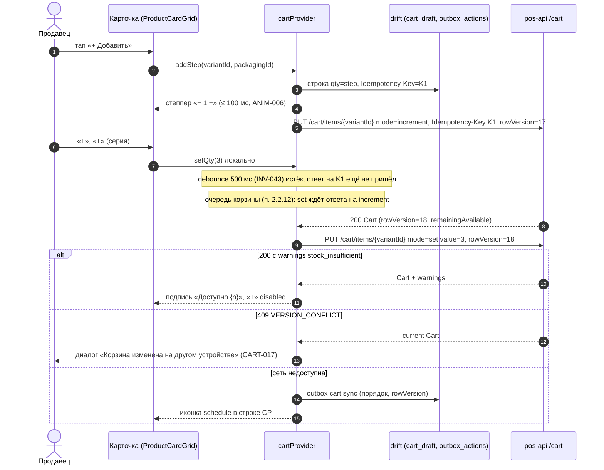

**Последовательность «HID-скан на каталоге»:**

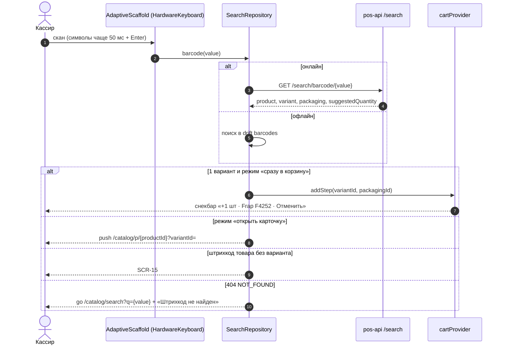

**Последовательность «Товар с вариантами: выбор и повторное +» (INV-014, SRC-C-033):**

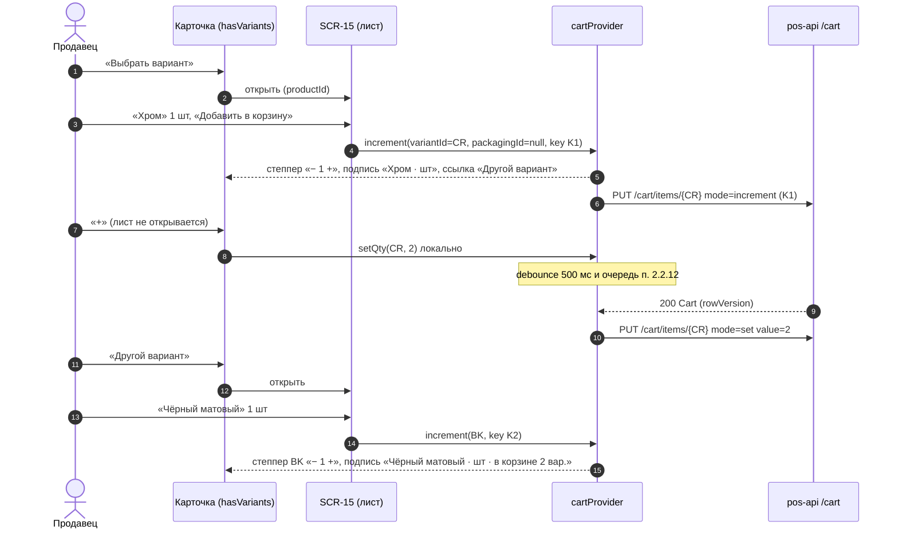

#### SCR-10.7. Состояния экрана

| Состояние | Условие | Что видно | Доступные действия |
|---|---|---|---|
| Загрузка (холодная, кэша нет) | первый вход на устройстве; drift `products` пуст | скелетоны SB, чипов, сетки; CP из drift (если есть); индикатор первичной загрузки «Загружаем каталог… {n} %» при полной выгрузке (NFR-PERF-006) | поиск недоступен до загрузки категорий; навигация работает |
| Загрузка (тёплая) | кэш есть | данные из кэша ≤ 100 мс, тонкий `AppProgress.linear` 2 px под TAB во время обновления | всё |
| Успех | 200 | список, счётчик, подгрузка | всё |
| Пустой результат | `items=[]` | `EmptyState.category` «В этой категории пока нет товаров» / с фильтрами — «Ничего не найдено. Измените фильтры» | «Сбросить фильтры», «Все категории» |
| Ошибка | 5xx, `INTERNAL`, таймаут 15 с (08 §2.10) | при кэше — `ErrorState.inline` над списком + данные кэша; без кэша — `ErrorState.fullScreen` с `requestId` | «Повторить»; корзина работает |
| Нет сети / офлайн | `connectivity_plus` = none или неудача health-пинга | `OfflineBanner` «Нет сети. Показаны данные от 08:12. Заказы недоступны»; метки «на 08:12» на бейджах; поиск по кэшу | просмотр, поиск, сканер (drift `barcodes`), корзина (outbox), избранное (outbox); «Создать заказ» disabled; «Очистить» недавних disabled |
| Нет данных офлайн | офлайн и кэш пуст | `EmptyState.offlineNoCache` «Нет данных для работы без сети» | «Повторить» |
| Устаревшие данные | `X-Data-As-Of` старше 30 мин или `sync_run` по `stock`/`prices` `failed` | `SyncIndicator.stale`/`error`, метки на бейджах, уведомление `sync_error` (D-41) | всё; оформление проверит данные на сервере |
| 1С недоступна (backend жив) | `GET /sync/status` сообщает недоступность 1С | `OfflineBanner.onecDown` (staff) | всё; заказы уйдут через outbox, продажа в долг недоступна (D-32) |
| Нет разрешений | роль без `cart.manage.own` (owner) | контролы количества и CP скрыты; карточки только для просмотра | просмотр, поиск, избранное |
| Нет разрешения камеры | кнопка сканера при отказе | обрабатывается SCR-17 (`EmptyState.noCamera`) | «Ввести вручную» |
| Повторная попытка | после ошибки «Повторить» | скелетон / линейный прогресс | — |
| Step-up | не применяется (п. 2.2.4) | — | — |
| Сессия / версия | `SESSION_REVOKED`, `UNLOCK_REQUIRED`, `APP_UPDATE_REQUIRED`, `APP_READ_ONLY` | п. 2.2.3 | — |

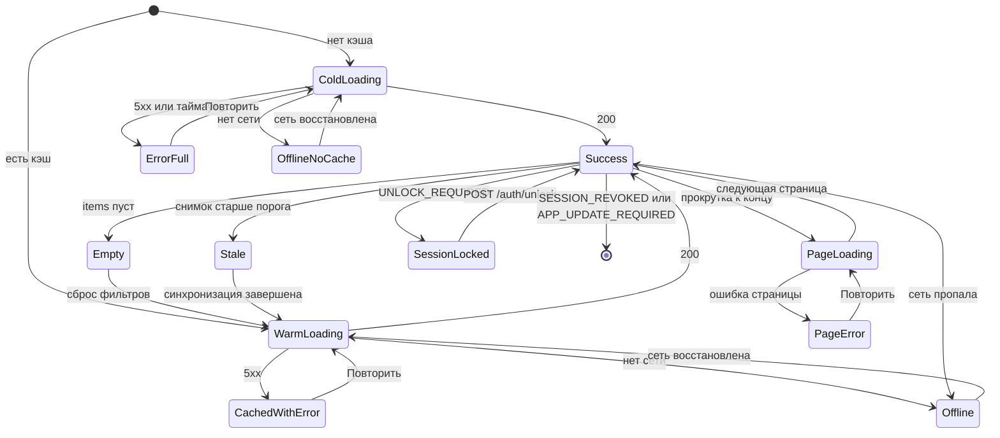

#### SCR-10.8. Валидация и сообщения

| Ситуация | Ключ ARB | Текст (ru) | Где |
|---|---|---|---|
| Счётчик результатов | `catalog_found_count` | «Найдено: {count} товар/товара/товаров» (ICU) | UI-10-012 |
| Заголовок корня | `catalog_title_all` | «Все товары» | UI-10-012 |
| Заголовок блока категорий | `catalog_sidebar_categories_title` | «Категории товаров» | UI-10-035 |
| Избранное в SB | `catalog_sidebar_favorites` | «Избранное» | UI-10-010 |
| Недавние | `catalog_recent_title` | «Недавние товары» | UI-10-011 |
| Очистить недавние | `catalog_recent_clear` | «Очистить» | UI-10-034 |
| Подтверждение очистки | `catalog_recent_clear_confirm_title` / `_body` | «Очистить недавние товары?» / «Список недавно просмотренных товаров будет удалён на всех устройствах» | UI-10-045 |
| Очистка офлайн | `catalog_recent_clear_offline_tooltip` | «Нужна сеть» | UI-10-034 |
| Ошибка очистки | `catalog_recent_clear_error` | «Не удалось очистить · Повторить» | UI-10-043 |
| Подгрузка | `catalog_loading_more` | «Загружаем ещё товары…» | UI-10-019 |
| Ошибка подгрузки | `catalog_loading_more_error` | «Не удалось загрузить · Повторить» | UI-10-019 |
| Пустая категория | `catalog_empty_category_title` / `_body` | «В этой категории пока нет товаров» / «Товары появятся после синхронизации с 1С» | UI-10-037 |
| Пусто с фильтрами | `catalog_empty_filtered_title` / `_body` | «Ничего не найдено» / «Измените или сбросьте фильтры» | UI-10-037 |
| Ошибка каталога | `catalog_error_title` | «Не удалось загрузить каталог» | UI-10-038 |
| Первичная загрузка | `catalog_initial_loading` | «Загружаем каталог… {percent} %» | D5 |
| Добавлено (сканер) | `catalog_scan_added` | «+{qty} · {name}» | UI-10-043 |
| Нет в наличии | `catalog_card_out_of_stock` | «Нет в наличии» | UI-10-112 |
| Выбрать вариант | `catalog_card_choose_variant` | «Выбрать вариант» | UI-10-111 |
| Добавить | `ds_button_add` | «+ Добавить» | UI-10-108 |
| Максимум (локальная проверка INV-042 на карточке) | `catalog_card_max_available` | «Доступно {qty} {unit}» | UI-10-110 |
| Подпись последнего варианта | `catalog_card_variant_label` | «{variant} · {unit}» / с несколькими вариантами — «{variant} · {unit} · в корзине {count} вар.» (ICU) | UI-10-119 |
| Другой вариант | `catalog_card_other_variant` | «Другой вариант» | UI-10-119 |
| Добавлено (compact/medium) | `catalog_added_snackbar` | «Добавлено · Открыть» | UI-10-043 (ANIM-006) |
| Избранное: добавлено | `catalog_favorite_added` | «Добавлено в избранное · Отменить» | UI-10-043 (ANIM-009, 03 §9.23) |
| Избранное: удалено | `catalog_favorite_removed` | «Удалено из избранного · Отменить» | UI-10-043 |
| Избранное: ошибка | `catalog_favorite_error` | «Не удалось сохранить избранное · Повторить» | UI-10-043 (снекбар `error`) |
| Другой склад | `catalog_card_other_warehouse` | «{warehouse}: {qty} {unit}» | UI-10-115 |
| Цена изменилась | `catalog_card_price_changed` | «Цена изменилась» | UI-10-113 |
| Цена «от» | `catalog_card_price_from` | «от {price}» | UI-10-107 |
| Единица цены | `catalog_card_price_unit` | «/ {unit}» | UI-10-107 |
| Нет артикула | `catalog_card_sku_missing` | «Артикул не указан» | UI-10-105 |
| Артикул | `catalog_card_sku` | «Арт. {sku}» | UI-10-105 |
| Удаление строки нулём | `catalog_card_remove_confirm` | «Удалить позицию из корзины?» | UI-10-109 |
| Подсказка HID | `catalog_scanner_hid_hint` | «Используйте сканер: наведите на штрихкод и нажмите курок» | UI-10-044 |
| Выход | `catalog_profile_logout_confirm` | «Выйти из аккаунта?» | UI-10-033 |
| Ошибки API | `error_<code>` | по 03 §16.2 (`error_variant_unavailable` «Товар больше не продаётся», `error_stock_insufficient` «Недостаточно остатка: доступно {available} {unit}», `error_internal` «Не удалось выполнить. Повторите») | снекбар / inline |

Валидация на экране: количество — по правилам SCR-16 (INV-001…010); клиентская проверка `remainingAvailable` (INV-042) не заменяет серверную (INV-008).

**Тексты о недостаточном остатке — три контекста одной ситуации** (свести к одному ключу нельзя: различаются место, полнота и источник):

| Ключ | Контекст | Источник сигнала | Почему отдельный текст |
|---|---|---|---|
| `catalog_card_max_available` «Доступно {qty} {unit}» | подпись под степпером карточки каталога (UI-10-110), ширина карточки ≥ 160 | локальная проверка INV-042 по `remainingAvailable` | короткая подпись, помещается в карточку; склад очевиден из CP |
| `qty_error_stock` «Доступно только {available} {unit} на складе «{warehouse}»» | ошибка ввода в нампаде SCR-16 | локальная проверка INV-042 при вводе числа | полный текст с названием склада: пользователь ввёл конкретное число |
| `error_stock_insufficient` «Недостаточно остатка: доступно {available} {unit}» | снекбар/строка CP после ответа сервера | `warnings: ["stock_insufficient"]` в ответе `PUT /cart/items` (не ошибка HTTP, 08 §4.7.2) или `422 STOCK_INSUFFICIENT` при оформлении (SCR-21) | ARB-ключ кода 08 §2.4 (03 §16.2): сообщение по серверному сигналу |

#### SCR-10.9. Источники данных, API, состояние приложения, бизнес-правила

| Данные | Эндпоинт (08) | Кэш drift (07 §11.2) | Провайдер / состояние | Правила |
|---|---|---|---|---|
| Дерево категорий, счётчики | `GET /catalog/categories` (ETag, `max-age=300`) | `categories` | `categoryTreeProvider` | CAT-009, SRC-C-011…013 |
| Товары (страница) | `GET /catalog/products?categoryId=&warehouseId=&sort=&limit=40&cursor=&inStock=&priceMin=&priceMax=&brand=&attr[..]=&favorite=&hasImage=` (ETag, `max-age=60`, `X-Data-As-Of`) | `products`, `product_variants`, `prices`, `stock_balances`, `product_images_meta` | `catalogPageProvider(query)` | CAT-010, CAT-011, INV-022 |
| Остатки на других складах | `GET /inventory/balances?variantIds=` (≤ 200, `no-store`) | `stock_balances` | `otherWarehousesProvider` | INV-026 |
| Недавние | `GET /catalog/products/recent`, `DELETE /catalog/products/recent` | `recent_products` | `recentProductsProvider` | FAV-005 |
| Избранное | `GET /favorites/products`, `PUT`/`DELETE /favorites/products/{id}` | `favorites_products` + `outbox_actions` (`favorite.add`/`favorite.remove`) | `favoritesProvider` | FAV-001…004 |
| Подсказки, поиск, штрихкод | `GET /search/suggest`, `GET /search/products`, `GET /search/barcode/{value}` | `barcodes`, `products` (FTS5 по `name_norm`) | `searchProvider` | D-31, CAT-001…005 |
| Корзина | `GET /cart`, `PUT /cart/items/{variantId}` (`packagingId` в `quantity`), `DELETE /cart/items/{variantId}?packagingId=` [НОВОЕ ИМЯ: query `packagingId` — 10 CART-025; в 08 §4.7.3 пока только `rowVersion`]; поле ответа `remainingAvailable` [НОВОЕ ИМЯ: 10 INV-042; в `CartItem` 08 §3.8 пока только `available`] — зависимость от доработки 08, раздел 14, замечание 27 | `cart_draft`, `cart_items_draft`, `outbox_actions` (`cart.sync`) | `cartProvider` (уровень приложения; очередь запросов п. 2.2.12; «последний вариант товара» — производное `lastLineByProduct`) | CART-001…025, INV-014, INV-040…043 |
| Пользователь, права | `GET /me` | `app_meta` (`user_id`) | `sessionProvider` | D-15, 11 §4.4 |
| Синхронизация | `GET /sync/status` | `sync_meta` | `syncStatusProvider` | D-29, CAT-013 |
| Уведомления | `GET /notifications` | `notifications_cache` | `notificationsProvider` | D-41 |
| Фото | `GET /images/{sha}/{size}` (immutable) | файловый кэш `cached_network_image` | — | D-30, INV-050, INV-051 |

Склад запроса (`warehouseId`) — склад корзины (INV-025); вид цены — сервер по правилу 08 §3.6 (клиент корзины → вид по умолчанию роли → розничный); `priceListId` клиент не передаёт.

#### SCR-10.10. Действия по ролям и ограничения безопасности

| Действие | seller | cashier | senior_seller | admin | owner | customer (Q-001) | Право (11 §4.3) |
|---|---|---|---|---|---|---|---|
| Просмотр каталога, поиск, сканер | ✓ | ✓ | ✓ | ✓ | ✓ | ✓ (SCR-50) | `catalog.read`, `search.read` |
| Цена по виду цены роли | ✓ | ✓ | ✓ | ✓ | ✓ | свой вид | `catalog.prices.read` |
| Тултип «все виды цен» в карточке | — | ✓ | ✓ | ✓ | ✓ | — | `catalog.prices.read.all` |
| Число остатка, «Есть на другом складе» | ✓ | ✓ | ✓ | ✓ | ✓ | только статус | `inventory.read` |
| «+ Добавить», степпер, CP | ✓ | ✓ | ✓ | ✓ | — (скрыто) | ✓ | `cart.manage.own` |
| Избранное товаров | ✓ | ✓ | ✓ | ✓ | ✓ | ✓ | `favorites.products.manage` |
| `SyncIndicator` (краткий) | ✓ | ✓ | ✓ | ✓ | ✓ | — | `sync.status.read` |
| Уведомления | ✓ | ✓ | ✓ | ✓ | ✓ | ✓ | `notifications.read.own` |

Ограничения: права определяются `GET /me.permissions`, при `TOKEN_STALE` перечитываются; скрытый контрол не является защитой — сервер отвечает `FORBIDDEN` на запрещённые операции (D-15); закупочные цены в DTO каталога отсутствуют (INV-033); клиент никогда не передаёт цену (поле `price` в теле → `VALIDATION_FAILED`, аудит `price.override_attempt`).

#### SCR-10.11. Повторное нажатие, двойной запрос, «Назад», перезапуск

| Ситуация | Поведение |
|---|---|
| Двойной тап по карточке | один переход (блокировка 300 мс) |
| Серия «+» | все нажатия учитываются локально; один `PUT … mode=set` после паузы 500 мс; первое добавление — `mode=increment` с уникальным `Idempotency-Key` (повтор при таймауте — с тем же ключом, количество увеличится один раз — 08 §2.7) |
| Двойной тап «+ Добавить» до появления степпера | второй тап — уже по «+» степпера (замена происходит синхронно с первым тапом), т. е. +1 шаг; итог 2 шага |
| Серия «+» до ответа на первый `mode=increment` | `mode=set` ждёт ответа и уходит с новым `rowVersion` (п. 2.2.12); собственный `VERSION_CONFLICT` не возникает |
| Повторное «+» на карточке товара с вариантами | увеличивает строку последнего добавленного варианта без открытия SCR-15 (п. 2.3 шаг 7) |
| Двойной тап «Выбрать вариант» / «Другой вариант» | один лист SCR-15 (второй тап во время открытия игнорируется) |
| Повторный выбор той же сортировки / вида | без запроса |
| Повторный тап по выбранной категории | без действия |
| Конкурирующие запросы страниц | при смене категории/сортировки/фильтров предыдущий запрос отменяется (CancelToken), ответ устаревшего запроса игнорируется |
| «Назад» (compact Android) | на корне ветки — «Нажмите ещё раз для выхода» (2 с); открытый sheet/диалог закрывается первым |
| `Esc` (Windows) | закрывает меню, подсказки, popover, панель SCR-14, затем снимает фокус с поиска |
| Перезапуск приложения | восстанавливаются: последняя категория, вид, сортировка, фильтры (`lastLocation` и drift `settings`), позиция прокрутки — к началу [ТИПОВО]; строка поиска — пустая (`q` из `lastLocation` удаляется, `visual/navigation.md` §14.5); на карточках товаров с вариантами — степпер последнего варианта по строкам корзины из drift (наибольший `cart_items_draft.line_no` товара; после `GET /cart` — по `addedAt`); корзина — из drift мгновенно с пометкой «предварительно», затем `GET /cart` (CART-009); неотправленные действия outbox отправляются по порядку |
| Смена класса окна / поворот | состояние сохраняется (03 §8.7): категория, поиск, корзина, открытая карточка |
| Idle-блокировка | SCR-08 overlay поверх SCR-10, состояние экрана сохраняется (ядро §17.2) |

#### SCR-10.12. Требования к платформам

| Платформа | Требования |
|---|---|
| Телефон Android (compact) | BNB 80 + `CartFab`; `SearchBar.compact` скрывается при прокрутке вниз; тач-цели ≥ 48; сканер — камера (SCR-17) и Bluetooth-HID; системная «Назад» по п. SCR-10.11; ориентация не блокируется (ландшафт < 600 по высоте — поиск и чипы в одну строку) |
| Планшет Android (medium) | Rail 72; категории drawer/колонка 240; overlay корзины 320; камера и HID |
| Windows-POS (expanded/large) | мышь: hover-состояния, тултипы 700 мс, курсор `click` на карточке; клавиатура: `F2`/`Ctrl+F`, `F4`, `F8`, `F9`, `Esc`, Tab-порядок «шапка → SB → контент → CP» (`FocusTraversalGroup`), стрелки по сетке, Enter — SCR-14, `+`/`-` — количество; HID-сканер USB/Bluetooth перехватывается оболочкой по единому правилу п. 2.2.11 (кроме полей `DiscountInput`, цен фильтра и открытого SCR-16); камеры нет (D-42); сенсорный монитор (Q-008) — степпер md 44/48, «+ Добавить» M; минимальное окно 800×600 (при ширине < 1024 — medium-раскладка) |
| iOS (архитектурно, D-39) | как Android; тач-цели 44 pt; свайп «назад» от края = «Назад»; камера — `mobile_scanner` |
| Все | масштаб текста до 1,3× без горизонтальной прокрутки (A11Y-005); reduce-motion (A11Y-006); TalkBack/Narrator — порядок и метки карточки «Смеситель для кухни Frap F4252, 2 350 сом за штуку, в наличии 24 штуки, артикул F4252» (03 §9.11) |

#### SCR-10.13. Критерии приёмки

| ID | Критерий (проверяемо) |
|---|---|
| AC-UI-10-001 | На expanded 1536×960 шапка содержит слева логотип, в центре `SearchBar` шириной ≥ 320 и ≤ 720, справа часы/дату, `SyncIndicator`, `NotificationBell`, имя и роль пользователя (golden-тест). |
| AC-UI-10-002 | Под логотипом отображается вертикальное меню категорий-карточек `CategorySidebarItem` (общий контейнер с обводкой и радиусом `ds.radius.md`) с изображением 32×32, названием и счётчиком `productCount`; для категории с `imageUrl` показывается изображение 1С (фикстура с изображением группы), без `imageUrl` — иконка по `iconKey`, без `iconKey` — `category`; при ошибке загрузки изображения — та же иконка, фото товара не подставляется; выбранная категория имеет `primaryContainer` и полосу 3 lp (не сплошную заливку). |
| AC-UI-10-003 | Чипы подкатегорий (UI-10-016) отображаются только у категорий с `hasChildren=true`; для категории без детей чипы подкатегорий скрыты, а подборки «Недавние» и «Избранное» (UI-10-036) остаются видимыми в полосе (тест на фикстуре 1С с обоими типами групп). |
| AC-UI-10-004 | Переключение «Сетка/Список/Компакт» не порождает сетевых запросов (проверка сетевого лога) и сохраняет выбор после перезапуска. |
| AC-UI-10-005 | Каждая карточка во всех трёх видах (включая «Компакт» — миниатюра 40×40 в первой колонке) содержит фото или заглушку (сетка — «Нет фото» с иконкой; список и компакт — иконка `image`, подпись «Нет фото» в `Semantics`), название, артикул (или «Артикул не указан»), цену с единицей «/ шт», бейдж наличия с числом (для staff) и контрол количества или причину его недоступности. |
| AC-UI-10-006 | Первое нажатие «+ Добавить» превращает кнопку в степпер «− 1 +» за ≤ 100 мс без сетевого ответа; последующие 5 нажатий «+» дают «6» без открытия каких-либо окон, а сервер получает ровно один `PUT … mode=increment` и один `PUT … mode=set value=6`. |
| AC-UI-10-007 | Повтор `PUT … mode=increment` с тем же `Idempotency-Key` после имитации таймаута увеличивает количество строки ровно один раз (ответ с `Idempotent-Replayed: true`). |
| AC-UI-10-008 | Для товара с `hasVariants=true`, которого нет в корзине, вместо «+ Добавить» показывается «Выбрать вариант», открывающее SCR-15; добавить товар без выбора варианта невозможно. После добавления варианта «Хром» карточка показывает степпер «− 1 +» с подписью «Хром · шт» и ссылкой «Другой вариант». |
| AC-UI-10-009 | Товар с `available ≤ 0` на складе корзины виден в выдаче с бейджем «Нет · 0 шт» и недоступной кнопкой «Нет в наличии»; если на другом складе есть остаток — показывается «{склад}: {n} шт» без кнопки добавления. |
| AC-UI-10-010 | При достижении `remainingAvailable` кнопка «+» недоступна и показана подпись «Доступно {n} {unit}»; число остатка на карточке совпадает с `stock.available` ответа API (клиент не вычисляет). |
| AC-UI-10-011 | Каталог из 50 000 SKU прокручивается без пропуска кадров (≥ 55 fps на целевом POS) за счёт виртуализации; новая страница (40 товаров) подгружается при приближении к концу со строкой «Загружаем ещё товары…»; ошибка страницы показывает «Повторить» и не сбрасывает уже загруженные товары. |
| AC-UI-10-012 | Первая страница категории при наличии кэша отображается ≤ 100 мс после открытия (NFR-PERF-002), затем обновляется данными сервера без смены позиции прокрутки. |
| AC-UI-10-013 | Ввод «см» в поиске выполняет переход на SCR-11 не ранее чем через 300 мс после последнего символа; ввод «4» (цифра) запускает поиск с 1 символа; `Enter` выполняет поиск немедленно. |
| AC-UI-10-014 | HID-скан существующего штрихкода на Windows по правилу п. 2.2.11: при фокусе вне полей ввода или в `SearchBar` выполняется `GET /search/barcode/{value}` и действие по настройке сканера, символы не вставляются посимвольно; при фокусе в `DiscountInput` или в поле цены `FilterPanel` скан не перехватывается (символы получает поле, запроса `/search/barcode` нет); при открытом SCR-16 или диалоге скан игнорируется и никуда не попадает. |
| AC-UI-10-015 | Звезда избранного меняет состояние мгновенно; при ответе 5xx состояние откатывается и показывается снекбар ошибки; в офлайне действие сохраняется в outbox и применяется после восстановления сети; счётчик «Избранное N» обновляется. |
| AC-UI-10-016 | «Очистить» недавние товары открывает `ConfirmDialog`; после подтверждения выполняется `DELETE /catalog/products/recent` и блок скрывается; в офлайне кнопка недоступна. |
| AC-UI-10-017 | В офлайне показывается `OfflineBanner` с временем данных, каталог и поиск работают по кэшу, бейджи имеют метку «на HH:MM», «Создать заказ» недоступна, «+ Добавить» работает (outbox). |
| AC-UI-10-018 | Пустая категория показывает `EmptyState` с действием; при активных фильтрах — кнопку «Сбросить фильтры», которая возвращает непустой результат. |
| AC-UI-10-019 | `owner` не видит «+ Добавить», степпер и CP; прямой вызов `PUT /cart/items/{variantId}` от `owner` получает `403 FORBIDDEN`. |
| AC-UI-10-020 | Длинное название (> 120 символов) в сетке обрезается до 2 строк с многоточием, полное название доступно в тултипе (hover 700 мс / долгое нажатие) и в SCR-14; артикул не обрезается. |
| AC-UI-10-021 | Фото другого товара никогда не показывается: при `images: []` или ошибке загрузки выводится заглушка; ключ кэша — `sha256` URL (тест с подменой ответа 404). |
| AC-UI-10-022 | На 1024 lp сетка имеет 2 колонки, при свёрнутом SB — 3; на 1280 — 3; на 1366 — 4; на 1536 — 5 (контрольные значения 03 §7.3). |
| AC-UI-10-023 | Сценарий без мыши на Windows: `F2` → ввод артикула → ↓ → Enter (SCR-14) → `+` ×2 → Enter («В корзину») → `F9` открывает оформление (A11Y-009). |
| AC-UI-10-024 | Корзина на SCR-10 показывает итог по данным сервера (пример: 16 850,00 − 842,50 = 16 007,50 сом), а не суммы макета. |
| AC-UI-10-025 | При reduce-motion ни одна анимация экрана не длится более 80 мс; шиммер статичен. |
| AC-UI-10-026 | Серия из 5 нажатий «+» сразу после первого «+ Добавить» при искусственной задержке ответа на `mode=increment` 1,5 с не вызывает `409 VERSION_CONFLICT` и диалога CART-017: `PUT … mode=set` отправляется только после ответа на `increment` с `rowVersion` из этого ответа (проверка сетевого лога: в сети никогда нет двух одновременных запросов корзины). |
| AC-UI-10-027 | Повторное «+» на карточке товара с вариантами после выбора варианта «Хром» увеличивает количество строки «Хром» на шаг **без открытия листа SCR-15**; «Другой вариант» открывает SCR-15; после добавления «Чёрный матовый» степпер карточки показывает строку «Чёрный матовый», а «Хром» остаётся отдельной строкой корзины с прежним количеством. |
| AC-UI-10-028 | При удалении строки показанного варианта (в CP) карточка переключается на предыдущую строку того же товара; при удалении последней строки товара карточка снова показывает «Выбрать вариант». |
| AC-UI-10-029 | На medium-ландшафте 1180×820 и на expanded `ViewModeSegmented` содержит три сегмента, вид «Компакт» показывает таблицу с колонками Фото · Артикул · Наименование · Вар. · Доступно · Ед. · Цена · Кол-во · ☆; на compact и medium-портрете — два сегмента. |
| AC-UI-10-030 | Шапка expanded расположена в порядке макета: логотип → «бургер» → поиск → часы/дата → `SyncIndicator` → профиль → колокольчик крайним справа; бейдж корзины в CP — `primary`, не красный; «Отложить заказ» — кнопка M 44. |

#### SCR-10.14. Трассировка

| Требование экрана | SRC-ID | Правила 10/09/03/08 |
|---|---|---|
| Рабочее пространство продавца | SRC-C-001, SRC-F-028 | ядро §3.2, §9 |
| Логотип слева, поиск в центре, профиль/имя/синхронизация/уведомления справа | SRC-C-002, SRC-C-003, SRC-C-004, SRC-C-004a, SRC-C-005, SRC-C-006 | CAT-013, 03 §9.57 |
| Поиск по названию, артикулу, штрихкоду; задержка; пустой результат; сканер | SRC-C-007, SRC-C-008, SRC-C-009, SRC-C-010, SRC-E-138, SRC-D-103 | D-31, D-42, CAT-001…004 |
| Вертикальное меню категорий-карточек с изображениями и названиями под логотипом | SRC-C-011, SRC-C-011a, SRC-C-011b, SRC-C-011c, SRC-E-141, SRC-D-104 | CAT-009, 03 §9.8, §14.4, Q-022; UI-10-009 (изображение 1С 32×32 + fallback), AC-UI-10-002 |
| Горизонтальная полоса категорий/подборок под поиском и профилем | SRC-C-012 | CAT-012; UI-10-016, UI-10-036 (подборки видимы и в листовой категории); размещение на expanded — п. SCR-10.1 строка 14; AC-UI-10-003 |
| Компактный список (третий вид) | SRC-C-018 | CAT-010; expanded/large и medium ≥ 840 — `three`; compact — отступление с обоснованием (п. SCR-10.1 строка 18, раздел 14 замечание 23); AC-UI-10-029 |
| Подкатегории только при наличии | SRC-C-013, SRC-E-142, SRC-D-104a | CAT-009 |
| Использование макетов | SRC-C-014 | ядро §14 (п. SCR-10.1 — таблица отличий) |
| Сетка / список / компакт, сортировка, фильтры | SRC-C-015…SRC-C-017, SRC-C-019, SRC-C-020, SRC-E-137, SRC-E-139, SRC-E-140 | CAT-006, CAT-007, CAT-010 |
| Избранное | SRC-C-025, SRC-E-152 | CAT-014, FAV-001…004 |
| Карточка в каталоге: фото, название, артикул, цена с условиями, остаток, статус, контрол количества | SRC-C-026…SRC-C-032, SRC-E-143, SRC-E-145, SRC-E-147, SRC-E-149 | INV-022, INV-030…032, CAT-010 |
| Повторное нажатие увеличивает количество без окон; быстрый ввод | SRC-C-033, SRC-C-034, SRC-E-151, SRC-D-110, SRC-D-111 | INV-040, INV-041, CART-002 |
| Единицы и упаковки; некорректные количества | SRC-C-035, SRC-C-036, SRC-E-150 | INV-001…010 |
| Заглушка, запрет чужого фото, кэш и загрузка по требованию | SRC-C-053…SRC-C-057, SRC-E-153, SRC-D-107 | INV-050…053, D-30 |
| Большое количество товаров, длинные названия, нет фото | SRC-F-030, SRC-D-102 | CAT-011, INV-053 |
| Корзина снизу (mobile) и постоянная панель (большие экраны) | SRC-C-058, SRC-C-059 | CART-001 |
| Повторное нажатие у товара с вариантами (степпер последнего варианта) | SRC-C-033, SRC-E-154 | INV-014, INV-015; AC-UI-10-008, AC-UI-10-027, AC-UI-10-028 |
| Удаление товара из корзины с карточки («−» на минимуме → подтверждение) | SRC-D-110a | CART-003, CART-012; AC-UI-16-006 |
| Требования к экранам обязательны, без сокращений | SRC-F-001, SRC-F-002, SRC-F-003 | ядро §11 п.6; отличия от макета — п. SCR-10.1 |
| Структура описания экрана (14 пунктов): назначение (.1), структура (.2), элементы и токены (.3), поведение (.4), анимации (.5), переходы (.6), состояния (.7), валидация и сообщения (.8), данные/API/правила (.9), роли и безопасность (.10), повтор/«Назад»/перезапуск (.11), платформы (.12), критерии приёмки (.13) | SRC-F-004…SRC-F-018 (SRC-F-005 → .1; SRC-F-006 → .2; SRC-F-007, SRC-F-008 → .3; SRC-F-009 → .4; SRC-F-010 → .5; SRC-F-011 → .6; SRC-F-012 → .7; SRC-F-013 → .8; SRC-F-014 → .9; SRC-F-015 → .10; SRC-F-016 → .11; SRC-F-017 → .12; SRC-F-018 → .13) | ядро §11 п.6 |
| Не один абзац; сложный экран — подразделы, таблицы элементов по зонам, диаграммы переходов и последовательностей | SRC-F-019, SRC-F-020 | SCR-10.3 зоны A–F; SCR-10.6 — 3 sequence-диаграммы; SCR-10.7 — stateDiagram; раздел 4 — flowchart |

---

### SCR-11 — Результаты поиска (маршрут `/catalog/search?q=`, роли staff, customer, R1: да)

#### SCR-11.1. Назначение и роль пользователя

Показать результаты единого поиска «название / артикул / штрихкод / код 1С / бренд» (SRC-C-007, CAT-001) с типом совпадения `matchType` (D-31: штрихкод точно → артикул по началу → полнотекстовый по названию → триграммы), обработать пустой результат (SRC-C-009) и сканирование (SRC-C-010). Пользователи — все staff (основной сценарий продавца и кассира: «найти по артикулу из записки клиента», «найти по названию с опечаткой») и `customer` (условно Q-001, без остатков по складам). На expanded результаты занимают контент-колонку SCR-10 (SB и CP остаются); на compact — экран ветки «Каталог».

#### SCR-11.2. Структура экрана

- **expanded/large:** TAB с `SearchBar` (значение `q`, фокус сохраняется) → SB как SCR-10 (ни одна категория не выделена; если поиск ограничен категорией — она выделена) → контент: строка заголовка «Результаты поиска» `ds.text.h2` + «Найдено: 4 по «F4252»» `caption` → строка чипов `matchType` («Все 4 · Штрихкод 0 · Артикул 2 · Название 2») + чип «Во всех категориях ▾» → справа `ViewModeSegmented`, `SortMenu` («По релевантности»), «Фильтры» → список карточек (п. 2.3) с бейджем типа совпадения над названием и подсветкой совпавшей части → подвал-подсказка «Не нашли? Проверьте раскладку клавиатуры или отсканируйте штрихкод» → CP справа.
- **medium:** Rail; поле поиска в шапке; чипы `matchType`; сетка 3 (портрет) / 4–5 (ландшафт); overlay корзины.
- **compact (сверху вниз):** шапка 56: стрелка «Назад» 48 + `SearchBar.compact` во всю ширину (с крестиком очистки и кнопкой сканера) → строка «Найдено: 4» + чипы `matchType` (горизонтальная прокрутка) → строка инструментов (вид, сортировка, фильтры) → список `ProductCardList` (по умолчанию) с бейджем типа совпадения → `CartFab` → BNB.
- Состояние ввода < 2 символов (compact и expanded): вместо результатов — подсказка «Введите ещё {n} символ», блок «Недавние запросы» (до 5, локально) и «Недавние товары» (до 5).

#### SCR-11.3. Таблица элементов

| № | UI-ID | Элемент | Компонент | Расположение/размер/отступы/выравнивание | Токены | Состояния | Поведение | Источник данных | Роли | Правило |
|---|---|---|---|---|---|---|---|---|---|---|
| 1 | UI-11-001 | Поле запроса | `SearchBar.header` / `.compact` | TAB (expanded) / шапка compact во всю ширину, высота 48 (`header`) / 44 (`compact`, 03 §9.7) | фон `surfaceVariant` → `surface` + обводка 2 `primary` в фокусе; `ds.text.bodyLg` | default, focused, loading (`AppProgress.linear` 2 px под полем), error, empty | debounce 300 мс, min 2 символа (цифры — 1); Enter — сразу; HID-скан заменяет `q` целиком; ↓ — фокус в результаты | `q` в URL | все | D-31, CAT-002 |
| 2 | UI-11-002 | Очистить / «Назад» | `AppIconButton` | крестик в поле справа (перед сканером); compact — стрелка `arrow_back` слева | иконки 20/24 `textSecondary` | default, hover, pressed, focused | крестик — очистить поле, остаться в SCR-11 в состоянии «ввод < 2»; второй крестик / `Esc` / «Назад» — `pop` в SCR-10 | — | все | `visual/navigation.md` §3 |
| 3 | UI-11-003 | Заголовок и итог | текст `ds.text.h2` + `ds.text.caption` | верх контента, слева | `textPrimary` / `textSecondary` tnum | default, loading | «Найдено: {count} по «{q}»» (`search_found_count`); при `isEstimate` — «Найдено: около {count}» | `totalEstimate`, `isEstimate` | все | CAT-005 |
| 4 | UI-11-004 | Типы совпадений | `CategoryChip` (`filter`) | под заголовком, высота 36, зазор 8 | selected `primaryContainer` + `check` | default, selected, disabled (0 — `disabledText`) | «Все» / «Штрихкод N» / «Артикул N» / «Название N» (fts + trgm); выбор — локальная фильтрация загруженных страниц с догрузкой следующих страниц, пока видимых < 20 и `hasMore=true` [ТИПОВО] | `matchTypes` ответа `/search/products` | все | D-31, CAT-005 |
| 5 | UI-11-009 | Область поиска | `CategoryChip` (`choice`) + меню | справа от чипов `matchType` | как п. 4 | «В категории «Смесители»» / «Во всех категориях» | переключение параметра `categoryId` (если поиск начат внутри SCR-12) | `categoryId` | все | CAT-008 |
| 6 | UI-11-005 | Результаты | `ProductCardGrid` / `ProductCardList` / `ProductCardCompact` (п. 2.3) | контент-колонка, как SCR-10 | как SCR-10 D′ | как SCR-10 D′ | все действия карточки UI-10-101…118 | `GET /search/products` (`Page<ProductSummary>`) | все | CAT-010 |
| 7 | UI-11-014 | Бейдж типа совпадения и подсветка | `StatusChip` (`neutral`, иконки `barcode_scanner`/`tag`/`search`) + выделение текста | над названием, высота 20; подсветка — фон `primaryContainer` под совпавшими символами названия/артикула | `ds.text.caption` 500; подсветка без изменения цвета текста | default | «штрихкод (точно)», «артикул», «артикул (начало)», «название» | `matchType` | все | D-31 |
| 8 | UI-11-007 | Вид | `ViewModeSegmented` | как SCR-10 | как SCR-10 | как SCR-10 | общая настройка с SCR-10 | drift `settings` | все | CAT-010 |
| 9 | UI-11-008 | Сортировка | `SortMenu` (`custom`) | как SCR-10 | как SCR-10 | как SCR-10 | «По релевантности» (`relevance:desc`, по умолчанию), «По возрастанию цены» (`price:asc`), «По убыванию цены» (`price:desc`), «По названию А–Я» (`name:asc`) | `GET /search/products?sort=` | все | CAT-005, CAT-006 |
| 10 | UI-11-010 | Подсказки | выпадающий список `SearchBar` (`ds.elevation.2`) | под полем, ширина поля, ≤ 8 строк по 44 | иконки `search`/`category`/`tag` 20; совпадение — 600 | открыт / закрыт, focused строка | ↑/↓, Enter; тап — переход по типу подсказки | `GET /search/suggest?q=&limit=8` | все | 03 §9.7 |
| 11 | UI-11-011 | Недавние запросы | `AppListTile` (иконка `history`) | при вводе < 2 символов, до 5 строк 48 | `body` `textPrimary` | default, empty (блок скрыт) | тап — подставить запрос и искать; свайп/крестик — удалить из истории; политика хранения — п. SCR-10.4.A (только устройство и пользователь, очистка при выходе, строки, похожие на телефон, не сохраняются) | drift `settings` (`search_history` `[НОВОЕ ИМЯ]`) | все | 03 §9.7, 11 PRIV-002, SEC-098 |
| 12 | UI-11-012 | «Введите ещё N символ» | текст `ds.text.body` `textSecondary` | над недавними, отступ 16 | `textSecondary` | default | — | — | все | D-31 |
| 13 | UI-11-006 | Подсказка «Не нашли?» | текст `caption` + `AppButton.text S` «Отсканировать штрихкод» | подвал списка | `textSecondary`, ссылка `primary` | default | Android/iOS → SCR-17; Windows → тултип HID | — | staff | CAT-004 |
| 14 | UI-11-013 | Пусто / штрихкод не найден | `EmptyState.search` | центр контента | `search.svg` (fallback `search_off`) | default | «Сбросить фильтры» (если активны), «Искать во всех категориях» (если ограничено), «Сканировать снова» / «Ввести вручную» (для штрихкода) | `items=[]` / `404 NOT_FOUND` `/search/barcode/{value}` | все | CAT-004, CAT-003 |
| 15 | — | Офлайн-метка | `OfflineBanner` + строка `caption` «Поиск по сохранённому каталогу от 08:12» | под заголовком | `warning` | показана/скрыта | поиск по drift (FTS5 по `name_norm`, `sku_norm`, `barcodes`) | drift | все | CAT-004, D-32 |

#### SCR-11.4. Поведение каждого контрола

- **Поле запроса.** Каждое изменение текста перезапускает таймер 300 мс; при срабатывании выполняется `GET /search/products?q=&categoryId=&warehouseId=&limit=40&sort=relevance:desc`; предыдущий запрос отменяется, его ответ игнорируется (по номеру запроса). URL обновляется заменой записи (`go`). Предыдущие результаты не очищаются до прихода новых (CAT-002), поверх — тонкий прогресс. Нормализация на клиенте только для локального поиска (lower, ё→е, схлопывание пробелов — 07 §11.3); на сервер уходит исходная строка без пробелов по краям. Строка длиннее 100 символов обрезается [ТИПОВО].
- **HID-скан** (по правилу п. 2.2.11: при фокусе в `SearchBar` или вне полей ввода; при фокусе в полях цены `FilterPanel` не перехватывается): буфер распознаётся оболочкой; значение не вставляется в поле посимвольно — `q` заменяется целиком, затем `GET /search/barcode/{value}` (без debounce). Найден 1 вариант — действие по настройке сканера (п. SCR-10.4.A); найдено и `warnings: ["ambiguous_barcode"]` — открывается SCR-14 с баннером «Штрихкод привязан к нескольким товарам, проверьте выбор» [ТИПОВО]; не найдено — `EmptyState` «Штрихкод {value} не найден» с «Сканировать снова» и «Ввести вручную».
- **Ввод вручную штрихкода** (13 цифр) без суффикса: обычный поиск `/search/products` — сервер вернёт `matchType=barcode` первым (D-31).
- **Чипы `matchType`.** Тап — выбор одного; повторный тап по выбранному — возврат к «Все». Счётчики не меняются при локальной фильтрации.
- **Подсказки.** Появляются только при фокусе и ≥ 2 символах; закрываются по `Esc`, потере фокуса, выбору; не мешают Enter (Enter без выбранной подсказки — обычный поиск).
- **Карточки** — как SCR-10 (п. 2.3); после добавления из результатов поле поиска сохраняет `q` (продавец ищет следующий товар); на Windows после Enter в SCR-14 и добавления фокус возвращается в поле поиска с выделенным текстом [ТИПОВО] — ускоряет ввод серии артикулов.
- **«Назад» / `Esc` / крестик.** См. п. 2 таблицы; повторное нажатие крестика при пустом поле — `pop`.

#### SCR-11.5. Анимации

| ID | Применение | Начальное → триггер | Последовательность / конечное | Длительность | Ошибка | Reduce-motion |
|---|---|---|---|---|---|---|
| ANIM-013 | скелетон результатов (первый запрос без кэша) | пусто → ожидание > 300 мс | шиммер `SkeletonList` текущего вида → fade-in результатов 150 мс | loop 1,2 с | > 10 с → «Долгая загрузка… · Повторить» | статично |
| — (линейный прогресс) | повторный запрос при наличии результатов | результаты → новый запрос | `AppProgress.linear` 2 px под полем, результаты остаются | до ответа | ошибка — прогресс скрыт, inline-ошибка | без анимации полосы (статичная) |
| ANIM-010 | «Найдено: N» | старое → новое число | перекат | 200 мс | — | мгновенно |
| ANIM-017 | чипы `matchType` | выбор | индикатор скользит | 200 мс | — | мгновенно |
| ANIM-022 | `EmptyState.search` | 0 результатов | fade-in | 200 мс | — | мгновенно |
| ANIM-006, ANIM-009, ANIM-014 | карточки | как SCR-10 | как SCR-10 | как SCR-10 | как SCR-10 | как SCR-10 |
| ANIM-024 | вход в SCR-11 | SCR-10 → ввод | compact — shared-axis X; expanded — fade-through контент-колонки | 300 / 200 мс | — | fade 80 мс |

#### SCR-11.6. Переходы

| Откуда | Куда | Данные | Тип | «Назад» |
|---|---|---|---|---|
| SCR-10 / SCR-12 / любое место ветки (SearchBar, HID) | SCR-11 | `q`, `categoryId?`, `view`, `sort` | `go /catalog/search?q=` (замена) | SCR-10 (или SCR-12, откуда начат поиск) |
| SCR-11 (карточка) | SCR-14 | `productId`, `variantId` (если совпадение по артикулу/штрихкоду варианта), `qty` (от сканера) | `push` | SCR-11 с тем же `q` и прокруткой |
| SCR-11 («Выбрать вариант») | SCR-15 | `productId`, `variantId` подсвечен, если совпал | sheet | SCR-11 |
| SCR-11 (степпер) | SCR-16 | как SCR-10 | sheet/popover | SCR-11 |
| SCR-11 («Фильтры») | SCR-13 | `f`, `q` | `push` (compact/medium) / панель (expanded) | SCR-11 |
| SCR-11 («Отсканировать») | SCR-17 | `mode=search` | `push /scan` | SCR-11 с новым `q` |
| Deep link `/catalog/search?q=F4252` | SCR-11 | `q` | `go` | SCR-10 |

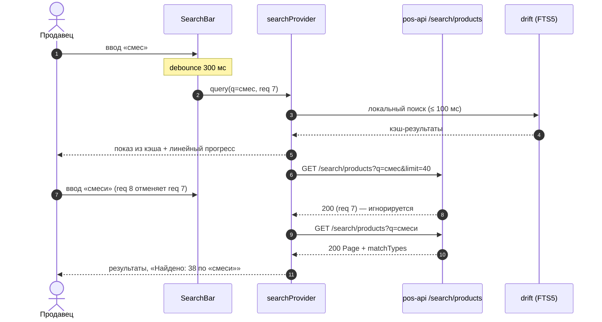

#### SCR-11.7. Состояния экрана

| Состояние | Условие | Что видно |
|---|---|---|
| Ввод < 2 символов | `q.length < 2` и не только цифры | «Введите ещё {n} символ», недавние запросы и товары |
| Загрузка | запрос > 300 мс | скелетон (нет результатов) / линейный прогресс (есть результаты) |
| Успех | 200, `items` ≥ 1 | список, чипы `matchType`, итог |
| Пустой результат | 200, `items=[]` | `EmptyState.search`: «Ничего не найдено по «{q}»», «Проверьте запрос или отсканируйте штрихкод»; при `suggestedQuery` — ссылка «Возможно, вы искали «{suggestedQuery}»» |
| Штрихкод не найден | `404 NOT_FOUND` на `/search/barcode/{value}` | `EmptyState` «Штрихкод {value} не найден» + «Возможно, товар не выгружен из 1С» |
| Ошибка валидации | `400 VALIDATION_FAILED` (`q_too_short`) | состояние «Ввод < 2 символов» (клиентская проверка предотвращает) |
| Ошибка сервера | 5xx / таймаут / `RATE_LIMITED` | при кэше — результаты кэша + `ErrorState.inline` «Не удалось выполнить поиск · Повторить»; `RATE_LIMITED` — «Слишком много запросов, подождите {seconds} с» |
| Офлайн | нет сети | поиск по drift: название (FTS5), артикул (prefix по `sku_norm`), штрихкод (`barcodes`); пометка «Поиск по сохранённому каталогу от {time}»; триграммы недоступны — опечатки могут не находиться |
| Устаревшие данные | `X-Data-As-Of` > 30 мин | метки на бейджах |
| Нет разрешений | — (поиск доступен всем ролям R1) | — |
| Step-up | не применяется | — |

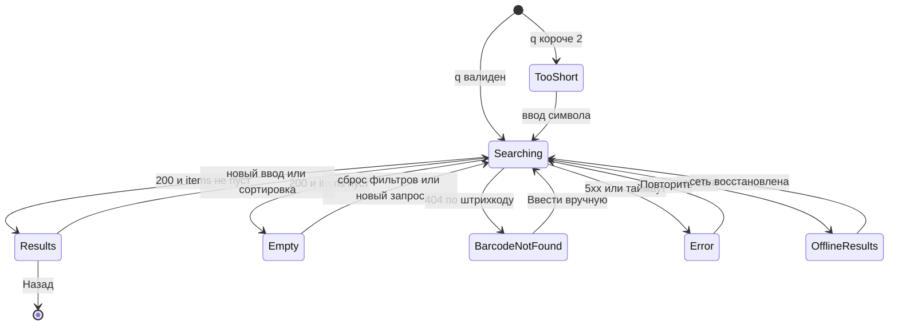

#### SCR-11.8. Валидация и сообщения

| Ситуация | Ключ ARB | Текст |
|---|---|---|
| Итог | `search_found_count` | «Найдено: {count} по «{query}»» (ICU-плюрал не требуется) |
| Итог-оценка | `search_found_estimate` | «Найдено: около {count} по «{query}»» |
| Заголовок | `search_title` | «Результаты поиска» |
| Мало символов | `search_hint_more_chars` | «Введите ещё {count} символ/символа» (ICU) — «для артикула и штрихкода — любой длины» |
| Недавние запросы | `search_recent_queries_title` | «Недавние запросы» |
| Пусто | `ds_empty_search_title` / `search_empty_body` | «Ничего не найдено по «{query}»» / «Проверьте запрос или отсканируйте штрихкод» |
| Предложение | `search_suggested_query` | «Возможно, вы искали «{query}»» |
| Штрихкод не найден | `search_barcode_not_found_title` / `_body` | «Штрихкод {value} не найден» / «Возможно, товар не выгружен из 1С» |
| Сканировать снова / вручную | `search_scan_again`, `search_enter_manually` | «Сканировать снова», «Ввести вручную» |
| Ошибка | `search_error_inline` | «Не удалось выполнить поиск · Повторить» |
| Офлайн | `search_offline_note` | «Поиск по сохранённому каталогу от {time}» |
| Не нашли | `search_not_found_hint` | «Не нашли? Проверьте раскладку клавиатуры или отсканируйте штрихкод» |
| Типы совпадений | `search_match_all`, `search_match_barcode`, `search_match_sku`, `search_match_name` | «Все», «Штрихкод», «Артикул», «Название» |
| Бейджи совпадения | `search_badge_barcode_exact`, `search_badge_sku`, `search_badge_sku_prefix`, `search_badge_name` | «штрихкод (точно)», «артикул», «артикул (начало)», «название» |
| Область | `search_scope_category`, `search_scope_all` | «В категории «{name}»», «Во всех категориях» |
| Неоднозначный штрихкод | `search_barcode_ambiguous` | «Штрихкод привязан к нескольким товарам, проверьте выбор» |
| Плейсхолдер | `search_placeholder` | «Поиск товара по названию, коду или штрих-коду…» (макет) |
| Сканер (тултип) | `search_scanner_tooltip` | «Сканировать штрихкод» (03 §16.2) |

#### SCR-11.9. Источники данных, API, бизнес-правила

`GET /search/products` (`q`, `categoryId`, `warehouseId`, `inStock`, `limit=40`, `cursor`, `sort`; ответ `Page<ProductSummary>` + `query`, `matchTypes`, `suggestedQuery`; `Cache-Control: private, max-age=30`; RL-SEARCH); `GET /search/suggest` (`q`, `limit ≤ 10`); `GET /search/barcode/{value}` (3…64 символа, `[0-9A-Za-z-]`); фильтры SCR-13 передаются теми же параметрами, что поддерживает `/search/products` (`categoryId`, `warehouseId`, `inStock`); остальные фильтры SCR-13 при активном поиске применяются локально к загруженным страницам с пометкой «фильтр применён к найденному» [ТИПОВО] (08 §4.5.1 не принимает `brand`/`attr`/`priceMin` — раздел 14). Состояние: `searchProvider(q, scope, sort)`, история запросов — drift `settings`. Правила: D-31, CAT-001…005, CAT-003, INV-017 (штрихкод упаковки подставляет упаковку), NFR-PERF-001/002.

#### SCR-11.10. Действия по ролям

| Действие | seller | cashier | senior_seller | admin | owner | customer |
|---|---|---|---|---|---|---|
| Поиск, подсказки, штрихкод (`search.read`) | ✓ | ✓ | ✓ | ✓ | ✓ | ✓ (Q-001) |
| Добавление из результатов (`cart.manage.own`) | ✓ | ✓ | ✓ | ✓ | — | ✓ |
| Число остатка | ✓ | ✓ | ✓ | ✓ | ✓ | только статус |
| Поиск по коду 1С | ✓ | ✓ | ✓ | ✓ | ✓ | — [ТИПОВО: код 1С клиенту не показывается] |

#### SCR-11.11. Повтор, двойной запрос, «Назад», перезапуск

- Быстрый ввод — один запрос на паузу 300 мс; ответы устаревших запросов отбрасываются; Enter во время debounce — немедленный запрос, таймер сбрасывается.
- Двойной HID-скан одного кода в течение 1,5 с — второй скан учитывается (добавляет ещё шаг) только в режиме «сразу в корзину»; в режиме «открыть карточку» — игнорируется [ТИПОВО, Q-207].
- «Назад» — один `pop` в экран-источник (ввод не листается, `visual/navigation.md` §3).
- Перезапуск — по `visual/navigation.md` §14.5: при записи `lastLocation` параметр `q` удаляется, поэтому восстанавливается маршрут `/catalog/search` **без `q`**: экран открывается в состоянии «Ввод < 2 символов» с пустой строкой поиска, блоками «Недавние запросы» и «Недавние товары»; повторного запроса нет (защита ПДн: в запрос могли ввести телефон или имя). История запросов сохраняется локально (5 последних) по политике п. SCR-10.4.A и очищается при выходе.
- Смена класса окна / поворот — `q`, результаты, выбранный чип `matchType` и прокрутка сохраняются (03 §8.7); idle-блокировка — SCR-08 overlay, `q` и результаты в памяти сохраняются (ядро §17.2).

#### SCR-11.12. Платформы

Windows: `F2`/`Ctrl+F` — фокус и выделение; `Esc` — очистить и вернуться; `↓` — в результаты; Enter на карточке — SCR-14; HID-скан — по правилу п. 2.2.11. Android: клавиатура с `textInputAction.search`, скрытие клавиатуры по прокрутке результатов; Bluetooth-HID; камера через кнопку сканера. compact: стрелка «Назад» в поле; medium/expanded: результаты в контент-колонке; iOS — как Android, кнопка «Найти» на клавиатуре.

#### SCR-11.13. Критерии приёмки

| ID | Критерий |
|---|---|
| AC-UI-11-001 | Запрос уходит не раньше 300 мс после последнего символа; при вводе 6 символов подряд с интервалом 100 мс выполняется ровно 1 сетевой запрос. |
| AC-UI-11-002 | Строка из 1 цифры запускает поиск; строка из 1 буквы показывает «Введите ещё 1 символ» без запроса. |
| AC-UI-11-003 | Поиск по артикулу варианта «L74103-BK» показывает товар первым с бейджем «артикул» и открывает SCR-14 с выбранным вариантом L74103-BK. |
| AC-UI-11-004 | Поиск по штрихкоду упаковки подставляет упаковку «кор (12 шт)» при добавлении (INV-017). |
| AC-UI-11-005 | Пустой результат показывает `EmptyState` с текстом запроса и действиями; при активных фильтрах — «Сбросить фильтры». |
| AC-UI-11-006 | Несуществующий штрихкод показывает «Штрихкод {value} не найден» с «Сканировать снова» и «Ввести вручную». |
| AC-UI-11-007 | Ответ устаревшего запроса не заменяет результаты более нового (тест с искусственной задержкой первого ответа). |
| AC-UI-11-008 | В офлайне поиск по названию и артикулу находит товары из кэша и показывает пометку «Поиск по сохранённому каталогу от {time}». |
| AC-UI-11-009 | «Назад» из SCR-11 возвращает в SCR-10 одним действием с прежней категорией и прокруткой. |
| AC-UI-11-010 | Чипы `matchType` показывают счётчики из ответа; выбор «Артикул» оставляет только карточки с `matchType=sku`. |
| AC-UI-11-011 | Результат поиска p95 отображается ≤ 1 с при 50 000 SKU (NFR-PERF-002), сервер p95 ≤ 300 мс (NFR-PERF-001). |
| AC-UI-11-012 | На Windows сценарий «F2 → ввод → ↓ → Enter → + → Enter → фокус в поле поиска с выделенным текстом» выполняется без мыши. |
| AC-UI-11-013 | После поиска «смеситель» и перезапуска приложения открывается `/catalog/search` с пустой строкой поиска, без сетевого запроса `/search/products`; в drift `app_meta.last_location` нет параметра `q`. |
| AC-UI-11-014 | Запросы «+996 555 123 456» и «0555123456» выполняются, но не попадают в «Недавние запросы»; запрос «F4252-CR» попадает; после выхода из аккаунта список «Недавние запросы» пуст. |

#### SCR-11.14. Трассировка

| Требование | SRC-ID | Правила |
|---|---|---|
| Поиск по названию, артикулу, штрихкоду, другим полям | SRC-C-007, SRC-E-138, SRC-D-103, SRC-F-028 | D-31, CAT-001, INV-017 |
| Задержка перед запросом | SRC-C-008 | CAT-002, NFR-PERF-002 |
| Пустой результат | SRC-C-009, SRC-D-108 | CAT-004 |
| Сканирование штрихкода | SRC-C-010 | CAT-003, D-42 |
| Результаты поиска описаны отдельно | SRC-F-028 | — |
| Сортировка результатов | SRC-C-019, SRC-E-139 | CAT-005, CAT-006 |
| Карточка в результатах | SRC-C-026…SRC-C-034 | п. 2.3 |

---

### SCR-12 — Категория / подкатегории (маршрут `/catalog/c/{categoryId}`, роли staff, customer, R1: да)

#### SCR-12.1. Назначение и роль пользователя

Просмотр товаров выбранной категории 1С и переход по подкатегориям; подкатегории показываются **только если существуют** (SRC-C-013, CAT-009): у группы есть дочерние группы с товарами без `deletionMark`. Если дочерних нет — экран совпадает с SCR-10 при выбранной категории (без полосы подкатегорий и без раскрытия в SB). Пользователи — staff и `customer` (Q-001). На compact экран дополнительно содержит лист «Все категории» из плиток `CategoryTile` (вертикальное меню категорий-карточек с изображениями на телефоне, SRC-C-011b/c).

#### SCR-12.2. Структура экрана

- **expanded/large:** SB: выбранная категория — `selected`; под ней раскрыт 1 уровень подкатегорий (`CategorySidebarItem.child`, отступ +24); выбранная подкатегория — `selected`. Контент: «хлебные крошки» «Каталог › Смесители › Для кухни» (при глубине ≥ 2) → заголовок h2 «Для кухни» + «Найдено: 48 товаров» → полоса `CategoryChip` подкатегорий текущего уровня («Все 124 · Для кухни 48 · …») → инструменты (вид, сортировка, фильтры) → список (п. 2.3) → CP.
- **medium:** Rail; колонка категорий 240 (ландшафт) с раскрытием, либо drawer; чипы подкатегорий над сеткой.
- **compact (сверху вниз):** шапка 56: «Назад» + название категории `ds.text.title` + кнопка поиска (иконка, открывает SCR-11) → полоса `CategoryChip` подкатегорий 48 → строка инструментов 40 → список/сетка 2 → `CartFab` → BNB. Лист «Все категории» (`AppBottomSheet` 92 %): сетка `CategoryTile` 3 колонки (96×96…160×120, зазор 12), заголовок «Все категории», поиск по названию категории [ТИПОВО].

#### SCR-12.3. Таблица элементов

| № | UI-ID | Элемент | Компонент | Расположение/размер/отступы/выравнивание | Токены | Состояния | Поведение | Источник данных | Роли | Правило |
|---|---|---|---|---|---|---|---|---|---|---|
| 1 | UI-12-001 | «Хлебные крошки» | текст + `AppButton.text S` | над заголовком, высота 32, разделитель `chevron_right` 16 | `ds.text.label` `textSecondary`; текущий — `textPrimary` 600 | default, hover, focused; скрыты при глубине 1 | тап по уровню → `go` к нему; длинная цепочка — сворачивание средних уровней в «…» с меню | `Category.parentId` (путь из drift `categories.path`) | все | CAT-009 |
| 2 | UI-12-002 | Заголовок категории | `ds.text.h2` + `caption` | слева, отступ сверху 16 | `textPrimary` / `textSecondary` | default, loading | «Найдено: N товаров» с учётом фильтров | `name`, `totalEstimate` | все | CAT-009 |
| 3 | UI-12-003 | Подкатегории (полоса) | `CategoryChip` (`choice`, при наличии изображения — иконка/миниатюра 18) | под заголовком, высота 36, полоса 48, горизонтальная прокрутка | selected `primaryContainer` + `check` | default, hover, pressed, focused, selected, loading, скрыта | «Все» — вся ветка (`includeSubcategories=true`); подкатегория → `push /catalog/c/{childId}` | `GET /catalog/categories?parentId=&depth=1` | все | SRC-C-013, CAT-009 |
| 4 | UI-12-004 | Подкатегории (сайдбар) | `CategorySidebarItem` (`child`) | под выбранной категорией SB, отступ +24, строки 48 | как SCR-10 B3 | как SCR-10 B3 | тап → SCR-12 подкатегории; глубже 2-го уровня — через полосу и крошки | `categories` | все | 03 §9.8 |
| 5 | UI-12-005 | Товары | `ProductCard*` (п. 2.3) | как SCR-10 | как SCR-10 | как SCR-10 | сортировка и фильтры сохраняются при переходе между подкатегориями одной ветки | `GET /catalog/products?categoryId=&includeSubcategories=true` | все | CAT-010 |
| 6 | UI-12-006 | «Все категории» (compact) | `AppBottomSheet` + `CategoryTile` | sheet 92 %, сетка 3 колонки, плитка ≥ 96, зазор 12 | плитка `surface` + `border`, радиус `ds.radius.md`; иконка 32 `primary` в круге 56 `primaryContainer` или изображение 1С | default, pressed (scale 0.98), focused, selected (обводка `primary` 2), loading (скелетон-плитки) | тап → SCR-12 выбранной категории, sheet закрывается | `GET /catalog/categories` (`imageUrl`, `iconKey`) | все | SRC-C-011, SRC-C-011a…c, CAT-009, Q-022 |
| 7 | UI-12-010 | Кнопка «Все категории ›» | `CategoryChip` (первый в полосе, иконка `category`) | первый чип полосы compact | `surface` + `border` | default, pressed | открыть лист UI-12-006 | — | все | 03 §8.2 |
| 8 | UI-12-007 | Полоса при отсутствии подкатегорий | `CategoryChip` (только подборки C6 SCR-10) | чипы подкатегорий скрыты, место не резервируется; полоса 48 остаётся с подборками «Недавние», «Избранное» (UI-10-036) и, на compact, первым чипом «Все категории ›» (UI-12-010) | как SCR-10 C6 | default, selected | подборки работают как на SCR-10 (C6) в пределах текущей категории | `hasChildren=false` | все | SRC-C-012, SRC-C-013 |
| 9 | UI-12-008 | Пустая категория | `EmptyState.category` | центр контента | `category.svg` / `inventory_2` | default | «Обновить» (повтор), «Сбросить фильтры» | `items=[]` | все | CAT-009 |
| 10 | UI-12-009 | Категория удалена | `EmptyState` | центр контента | `inventory_2` | default | «Категория больше не существует» + «К каталогу» (`go /catalog`) | `404 NOT_FOUND` / `deletionMark` | все | INV-054 |

#### SCR-12.4. Поведение каждого контрола

- Выбор подкатегории (чип или SB) — `push` нового экземпляра SCR-12 (история: родитель → дочерняя), сортировка, вид и фильтры, кроме категории, переносятся; фильтры по характеристикам, отсутствующим в новой выборке, снимаются с уведомлением «Фильтр «Цвет: белый» снят — нет товаров» [ТИПОВО].
- «Все» в полосе — список всей ветки текущей категории; повторный тап по выбранному чипу — без действия.
- Крошки: тап по «Каталог» → `go /catalog`; по промежуточному уровню → `go` к нему (история обрезается); на Windows `Backspace`/`Alt+←` — к родителю.
- Лист «Все категории»: прокрутка, тап — переход; свайп вниз/«Назад» — закрыть без перехода; иконка категории — изображение 1С (если `imageUrl`) или `iconKey` по карте 03 §14.4, иначе `category`; фото товара как изображение категории не подставляется (CAT-009).
- Категория с `productCount=0` открывается и показывает `EmptyState.category`.

#### SCR-12.5. Анимации

| ID | Применение | Начальное состояние → триггер | Последовательность и конечное состояние | Длительность / кривая | Ошибка / прерывание | Reduce-motion |
|---|---|---|---|---|---|---|
| ANIM-016 | раскрытие подкатегорий в SB (UI-12-004) | дети скрыты, шеврон 0° → тап по шеврону или →/Enter | `AnimatedSize` высоты 0→n, дети fade-in, шеврон 0→180°; конечное — дети видимы, шеврон 180° | 200 мс `ds.motion.curve.standard` | загрузка детей из сети не требуется (дерево в кэше); если узел пуст после обновления дерева — обратное сворачивание 200 мс, шеврон скрывается | мгновенная смена |
| ANIM-017 | полоса подкатегорий (UI-12-003) | индикатор на «Все» → выбор чипа / вход в SCR-12 по deep link | выбранный чип получает `primaryContainer` + `check`, полоса прокручивается так, чтобы чип был полностью видим (`ensureVisible`); конечное — чип в видимой области | 200 мс `standard` | при отмене перехода (ошибка загрузки товаров) выбор чипа сохраняется, список показывает `ErrorState` | мгновенно, без прокрутки-анимации |
| ANIM-024 | переход между уровнями категорий | экран родителя → `push` подкатегории / «Назад» | compact: shared-axis X — новый экран slide-in 24 lp + fade, старый slide-out −24 lp; expanded: fade-through контент-колонки (SB и CP не анимируются); конечное — экран подкатегории | 300 мс (compact) / 200 мс (expanded) `standard` | ошибка загрузки после перехода — содержимое заменяется `ErrorState` без отката анимации | fade 80 мс |
| ANIM-025 | лист «Все категории» (UI-12-006, compact) | лист скрыт → тап «Все категории ›» | overlay fade 0→0,48 200 мс + лист slide-up от нижнего края; закрытие — следование за пальцем, затем slide-down; конечное — лист открыт / закрыт | 250 мс открытие `standardDecelerate` / 200 мс закрытие `standardAccelerate` | отпускание ниже порога 25 % — возврат 150 мс; ошибка загрузки дерева — лист открыт с `ErrorState.inline` | fade 80 мс |
| ANIM-015 | плитки `CategoryTile`, чипы, пункты SB | default → hover/pressed | фон/обводка 150 мс; pressed scale 0,98 (плитка) / 0,97 (чип); конечное — исходный вид после отпускания | 150 мс `fast` | — | цвет мгновенно, без scale |
| ANIM-013 | скелетоны крошек, заголовка, 5 чипов 80×36, карточек, плиток | загрузка > 300 мс без кэша | шиммер слева направо; данные → fade-in 150 мс без сдвига раскладки | loop 1,2 с linear | > 10 с → «Долгая загрузка… · Повторить» (`ds_loading_long`) | статичные блоки |
| ANIM-014 | изображения категорий в плитках и SB | `SkeletonBox` → изображение загружено | fade-in поверх скелетона | 200 мс `standardDecelerate` | ошибка загрузки → иконка-fallback (`iconKey` / `category`) без анимации, чужое изображение не подставляется | мгновенно |
| ANIM-022 | `EmptyState.category` (UI-12-008), «Категория больше не существует» (UI-12-009) | скрыт → 0 товаров / 404 после загрузки | иллюстрация + текст + кнопка fade-in без сдвига | 200 мс | — | мгновенно |

#### SCR-12.6. Переходы

| Откуда | Куда | Данные | Тип | «Назад» |
|---|---|---|---|---|
| SCR-10 (SB, чип, подсказка поиска), лист «Все категории» | SCR-12 | `categoryId`, `view`, `sort`, `f` | `go` (compact — `push`) | SCR-10 |
| SCR-12 (подкатегория) | SCR-12 | дочерний `categoryId` | `push` | родительская категория с её прокруткой |
| SCR-12 (крошка) | SCR-10 / SCR-12 предка | `categoryId` | `go` | — |
| SCR-12 (карточка) | SCR-14 | `productId`, `variantId?` | `push` | SCR-12 |
| SCR-12 («Фильтры») | SCR-13 | `f`, `categoryId` | `push` / панель | SCR-12 |
| SCR-12 (поиск) | SCR-11 | `q`, `categoryId` (область «в категории») | `go` | SCR-12 |
| Deep link `/catalog/c/{categoryId}` | SCR-12 | `categoryId` | `go` | SCR-10 |

#### SCR-12.7. Состояния экрана

| Состояние | Что видно |
|---|---|
| Загрузка | скелетоны крошек, заголовка, чипов, карточек; SB из кэша |
| Успех | товары ветки; полоса — при наличии детей |
| Пусто | `EmptyState.category` «В этой категории пока нет товаров» |
| Ошибка | `ErrorState` («Не удалось загрузить категорию · Повторить»), при кэше — inline |
| Категория удалена / не найдена | `EmptyState` «Категория больше не существует» → «К каталогу» |
| Офлайн | дерево и товары из drift; `OfflineBanner`; счётчики — по кэшу с меткой |
| Устаревшие данные | метки на бейджах, `SyncIndicator.stale` |
| Нет разрешений / step-up | не применяется (`catalog.read` у всех ролей R1) |

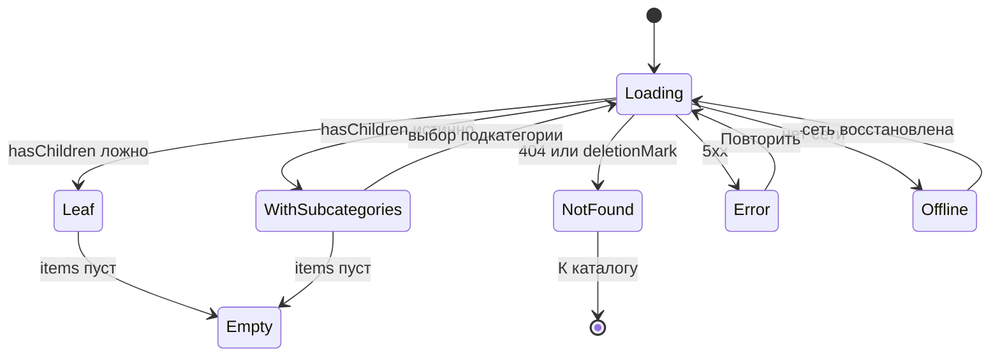

#### SCR-12.8. Валидация и сообщения

| Ключ ARB | Текст |
|---|---|
| `category_breadcrumb_root` | «Каталог» |
| `category_all_chip` | «Все» |
| `category_all_categories` | «Все категории» |
| `category_found_count` | «Найдено: {count} товар/товара/товаров» (ICU, как `catalog_found_count`) |
| `ds_empty_category_title` / `category_empty_body` | «В этой категории пока нет товаров» / «Товары появятся после синхронизации с 1С или снимите фильтры» |
| `category_not_found_title` / `category_not_found_action` | «Категория больше не существует» / «К каталогу» |
| `category_error_title` | «Не удалось загрузить категорию» |
| `category_filter_removed` | «Фильтр «{name}» снят — нет товаров в категории» |
| `category_tile_a11y` | «{name}, {count} товаров» |
| `category_uncategorized` | «Без категории» (INV-052) |

#### SCR-12.9. Источники данных, API, состояние приложения и правила

| Данные | Эндпоинт (08) | Кэш drift (07 §11.2) | Провайдер / состояние | Инвалидация | Правила |
|---|---|---|---|---|---|
| Дерево, путь, счётчики, `iconKey`, `imageUrl` | `GET /catalog/categories?parentId=&depth=1&includeEmpty=false` (ETag, `max-age=300`) | `categories` (`path`, `depth`, `product_count`, `icon_key`, `image_sha`) | `categoryTreeProvider`, `categoryPathProvider(categoryId)` | при входе в каталог — условный запрос (If-None-Match); после `sync_run` по каталогу (уведомление/`GET /sync/status`); ручное «Обновить» | CAT-009, INV-052, INV-054 |
| Товары категории | `GET /catalog/products?categoryId=&includeSubcategories=true&sort=&limit=40&cursor=` (+ фильтры SCR-13) | `products`, `product_variants`, `prices`, `stock_balances`, `product_images_meta` | `catalogPageProvider(query)` (общий с SCR-10) | смена категории/сортировки/фильтров — новый ключ провайдера, курсор сбрасывается; `X-Data-As-Of` → метка возраста | CAT-010, CAT-011, INV-022 |
| Изображения категорий | `GET /images/{sha}/{size}` (immutable, ключ — `sha256`) | файловый кэш `cached_network_image` (размер `thumb` 160) | — | неизменяемы по ключу; смена изображения в 1С = новый `sha` | CAT-009, D-30, Q-022 |
| Выбранный чип, прокрутка | — | — (память; `lastLocation` для маршрута) | `categoryScreenState(categoryId)` | сбрасывается при уходе из ветки | — |

Изображение категории никогда не берётся из фото товаров (CAT-009); при отсутствии `imageUrl` — иконка по `iconKey` (03 §14.4), иначе `category`.

`GET /catalog/categories` (`parentId`, `depth`, `includeEmpty=false`; ETag) → drift `categories` (`path`, `depth`, `product_count`, `icon_key`, `image_sha`); `GET /catalog/products?categoryId=&includeSubcategories=true&…`; изображения категорий — `imageUrl` (Q-022) через `GET /images/{sha}/{size}`. Правила: CAT-009 (дерево, подкатегории только при наличии, счётчик без `deletion_mark`, «0» серым, изображение из 1С или иконка), INV-052 («Без категории»), INV-054 (удалённые в 1С скрыты).

#### SCR-12.10. Действия по ролям

| Действие | seller | cashier | senior_seller | admin | owner | customer (Q-001) | Право (11 §4.3) / ограничение |
|---|---|---|---|---|---|---|---|
| Дерево категорий, крошки, подкатегории, лист «Все категории» | ✓ | ✓ | ✓ | ✓ | ✓ | ✓ (SCR-50) | `catalog.read` |
| Товары категории, вид, сортировка, фильтры | ✓ | ✓ | ✓ | ✓ | ✓ | ✓ | `catalog.read`, `catalog.prices.read` (свой вид цены) |
| Число остатка на карточках, «Есть на другом складе» | ✓ | ✓ | ✓ | ✓ | ✓ | — (только статус) | `inventory.read` |
| «+ Добавить», степпер, «Выбрать вариант» | ✓ | ✓ | ✓ | ✓ | — (скрыто) | ✓ | `cart.manage.own`; сервер отвечает `403 FORBIDDEN` на попытку `owner` |
| Подборки «Недавние», «Избранное» | ✓ | ✓ | ✓ | ✓ | ✓ | ✓ | `favorites.products.manage` |
| Видимость скрытых администратором категорий (`is_visible=0` в drift) | — | — | — | — | — | — | не показываются никому в каталоге [ТИПОВО]; управление — вне части |

Ограничения безопасности: категория по прямой ссылке открывается только если она есть в дереве `GET /catalog/categories` для роли; удалённая/скрытая категория → UI-12-009 без раскрытия причины; права перечитываются при `TOKEN_STALE` (п. 2.2.3); скрытие кнопок — удобство, проверка — на сервере (D-15).

#### SCR-12.11. Повтор, двойной запрос, «Назад», перезапуск

| Ситуация | Поведение |
|---|---|
| Двойной тап по чипу подкатегории / плитке `CategoryTile` | один `push` (переход блокируется на 300 мс) |
| Повторный тап по выбранному чипу / выбранной категории SB | без действия (03 §9.8) |
| Быстрые переходы между подкатегориями | предыдущий запрос `GET /catalog/products` отменяется (CancelToken), ответ устаревшего запроса игнорируется |
| Двойной HID-скан на SCR-12 | обрабатывается по п. 2.2.11 и SCR-10.4.A; повтор того же кода — по Q-207 (HID — каждый скан = +1 шаг в режиме «сразу в корзину») |
| «Назад» (Android / жест iOS / `Alt+←`, `Backspace` вне поля на Windows) | к родительской категории с восстановлением прокрутки и выбранного чипа; открытый лист «Все категории» или sheet закрывается первым |
| `Esc` (Windows) | закрывает лист/меню/панель SCR-14, затем снимает фокус с поиска; категорию не покидает |
| Перезапуск приложения | восстанавливается маршрут `/catalog/c/{categoryId}` и параметры `view`, `sort`, `f` (`lastLocation`); если категория удалена — UI-12-009; лист «Все категории» не восстанавливается (sheet без маршрута) |
| Смена класса окна / поворот | категория, чип, фильтры и прокрутка сохраняются (03 §8.7); compact → expanded: лист «Все категории» закрывается, выбранная категория выделяется в SB; expanded → compact: SB заменяется полосой чипов |
| Idle-блокировка | SCR-08 overlay, состояние экрана сохраняется (ядро §17.2) |

#### SCR-12.12. Платформы

| Платформа | Требования |
|---|---|
| Телефон Android (compact) | шапка 56 с «Назад»; полоса чипов прокручивается жестом; лист «Все категории» 92 % — плитки `CategoryTile` 3 колонки, тач-цель ≥ 96; свайп вниз закрывает лист; системная «Назад» — к родителю |
| Планшет Android (medium) | Rail 72; колонка категорий 240 с раскрытием (ландшафт ≥ 840) или drawer (портрет); плитки `CategoryTile` 4–5 колонок в листе; тач-цели ≥ 48 |
| Windows-POS (expanded/large) | SB с раскрытием подкатегорий (ANIM-016); клавиатура: ↑/↓ — пункты SB, → — раскрыть, ← — свернуть/к родителю, Enter — открыть, `Backspace`/`Alt+←` — к родителю, Tab — по чипам и карточкам; мышь — hover-состояния, тултип полного названия категории в свёрнутом SB; HID — п. 2.2.11; сенсорный POS-монитор (Q-008) — строки SB 52, чипы 36 с тач-целью 48 |
| iOS (архитектурно, D-39) | как compact/medium; тач-цели 44 pt; свайп от левого края = «Назад»; лист — `AppBottomSheet` с той же механикой |
| Все | масштаб текста до 1,3× — названия плиток переносятся на 2 строки без обрезки счётчика; TalkBack/Narrator — «Смесители, 124 товара» (`category_tile_a11y`) |

#### SCR-12.13. Критерии приёмки

| ID | Критерий |
|---|---|
| AC-UI-12-001 | Для категории с дочерними группами показываются чипы «Все + подкатегории» и раскрытие в SB; для категории без дочерних — ни чипов подкатегорий, ни раскрытия, а полоса содержит только подборки «Недавние», «Избранное» (и «Все категории ›» на compact). |
| AC-UI-12-002 | Подкатегория без товаров (все помечены на удаление) не показывается в полосе (`includeEmpty=false`). |
| AC-UI-12-003 | Чип «Все» показывает товары всей ветки; счётчик совпадает с `productCount` категории. |
| AC-UI-12-004 | На compact лист «Все категории» показывает плитки с изображением 1С или иконкой по умолчанию, названием и счётчиком; фото товара в качестве изображения категории не используется. |
| AC-UI-12-005 | «Назад» из подкатегории возвращает к родителю с сохранённой прокруткой. |
| AC-UI-12-006 | Крошки отображаются при глубине ≥ 2 и ведут к соответствующему уровню. |
| AC-UI-12-007 | Открытие удалённой в 1С категории по прямой ссылке показывает «Категория больше не существует» и кнопку «К каталогу». |
| AC-UI-12-008 | Сортировка и вид сохраняются при переходе между подкатегориями одной ветки. |
| AC-UI-12-009 | В офлайне дерево категорий и товары берутся из кэша, показывается `OfflineBanner`. |
| AC-UI-12-010 | Двойной тап по чипу подкатегории выполняет один переход; быстрая смена трёх подкатегорий подряд оставляет на экране товары последней (ответы предыдущих запросов игнорируются). |
| AC-UI-12-011 | После перезапуска приложения открывается последняя категория с прежними `view`, `sort`, `f`; при повороте планшета выбранный чип и прокрутка сохраняются. |
| AC-UI-12-012 | Изображение категории из 1С в плитке и в SB появляется с fade-in; при ошибке загрузки показывается иконка по `iconKey`, при её отсутствии — `category`. |
| AC-UI-12-013 | Для `owner` на SCR-12 нет «+ Добавить» и степпера; для `customer` бейджи показывают только статус наличия без числа. |

#### SCR-12.14. Трассировка

| Требование | SRC-ID | Правила |
|---|---|---|
| Категории, подкатегории только при наличии | SRC-C-011, SRC-C-013, SRC-E-141, SRC-E-142, SRC-D-104, SRC-D-104a | CAT-009 |
| Компактные карточки категорий с изображениями | SRC-C-011a, SRC-C-011b, SRC-C-011c | CAT-009, 03 §9.10, Q-022 |
| Описать категории/подкатегории отдельно | SRC-F-028 | — |
| Повторная синхронизация без дубликатов | SRC-D-109 | INV-054 |
| Полоса подборок сохраняется в листовой категории | SRC-C-012 | CAT-012; UI-12-007; AC-UI-12-001 |
| 14 пунктов описания экрана, не один абзац | SRC-F-004…SRC-F-019 | подразделы SCR-12.1…12.13 (п. .5, .9–.12 — таблицами) |

---

### SCR-13 — Фильтры (маршрут `/catalog/filters` (sheet), роли staff, customer, R1: да)

#### SCR-13.1. Назначение и роль пользователя

Сузить выдачу каталога (SCR-10), категории (SCR-12) или поиска (SCR-11) по: диапазону цены (если цены доступны), наличию по складам, категории, бренду, модели, цвету, размеру и другим реальным характеристикам из данных 1С, избранному, наличию фото (SRC-C-020…SRC-C-025, CAT-007, CAT-008). Фасеты по характеристикам показываются только при наличии значений в текущей выдаче. Пользователи — staff и `customer` (без фильтра по складам — у клиента нет остатков по складам).

#### SCR-13.2. Структура экрана

- **expanded/large:** `FilterPanel` 320 — боковая панель **внутри** контент-колонки (между сеткой и CP), без затемнения; сетка пересчитывается по ширине `W − 320` (1536 lp → 3 колонки). Сверху вниз: заголовок «Фильтры» `ds.text.h3` + бейдж числа активных + «Сбросить» `AppButton.text S` + крестик → секции (раскрываемые, строки 40/48): «Цена, сом» · «Наличие» · «Склад» · «Категория» · «Бренд» · «Модель / серия» · «Цвет» · «Размер» · прочие характеристики · «Только избранное» · «Только с фото» → применение — мгновенное с debounce 300 мс (без кнопки «Показать»; счётчик «Найдено» обновляется в заголовке контента) [РЕШЕНИЕ части: на expanded — мгновенно, wireframes оставляли выбор открытым].
- **medium:** side sheet 320 справа (overlay, `ds.elevation.2`); футер 72 с «Сбросить» и «Показать N товаров».
- **compact:** `FilterSheet` — `AppBottomSheet` modal 85–92 %: ручка 32×4, заголовок + «Сбросить», прокручиваемые секции, закреплённый футер 72 с `AppButton.primary L` «Показать N товаров».

#### SCR-13.3. Таблица элементов

| № | UI-ID | Элемент | Компонент | Расположение/размер/отступы/выравнивание | Токены | Состояния | Поведение | Источник данных | Роли | Правило |
|---|---|---|---|---|---|---|---|---|---|---|
| 1 | UI-13-001 | Заголовок, счётчик, закрыть | `FilterPanel` / `FilterSheet` (шапка) | высота 56, паддинг 16; крестик справа, цель 48 | `ds.text.h3`; бейдж `primary`/`onPrimary` | default | крестик/`Esc`/свайп вниз: compact/medium — закрыть **без применения** несохранённого выбора; expanded — скрыть панель (фильтры уже применены) | состояние `f` | все | `visual/navigation.md` N-6 |
| 2 | UI-13-002 | Цена «от / до» | `AppTextField.number` ×2 + `RangeSlider` | секция «Цена, сом»; поля по 50 % ширины минус зазор 8, высота 44; слайдер 48 | поле — обводка `borderStrong`, ошибка `error`; подсказка «В выдаче: 1 450 — 4 200 сом · вид цены «Розничная»» `caption` | default, focused, error, disabled (нет цен в выдаче — секция скрыта) | ввод целых сом (цифровая клавиатура); слайдер синхронизирован с полями; значения → `priceMin`/`priceMax` Money-строки | `facets.priceRange` | все | SRC-C-021, CAT-007 |
| 3 | UI-13-003 | Наличие | `AppSwitch` «Только в наличии» | секция «Наличие», строка 48 | `primary` вкл. | вкл/выкл, disabled | `inStock=true` по выбранному складу | — | все | SRC-C-022 |
| 4 | UI-13-016 (выделен из UI-13-003 wireframes, п. 2.4) | Склад | `AppRadio` (одиночный выбор) | секция «Склад», строки 48: «Склад корзины: Основной» (по умолчанию) и остальные активные склады | метка «склад корзины» `caption` | default, selected, disabled | `warehouseId` — остатки и «Только в наличии» по выбранному складу; продажа остаётся со склада корзины (INV-026, INV-028); метка «данные остатков от 09:41» | `GET /catalog/warehouses` | staff (`inventory.read`) | SRC-C-022, INV-025, Q-205 |
| 5 | UI-13-004 | Категория | `AppCheckbox` (дерево 1 уровня) | секция «Категория»; в SCR-12 — подкатегории текущей ветки | счётчики `caption` tnum | default, selected, disabled «(0)» | в SCR-12 заменяет `categoryId` на выбранную подкатегорию; в SCR-11/SCR-10 — ограничивает выдачу (одна категория за раз: `categoryId` в 08 — одиночный) | `GET /catalog/categories` | все | SRC-C-023 |
| 6 | UI-13-005 | Бренд | `AppCheckbox` + поле поиска значений | секция «Бренд»; первые 5 по частоте + «Показать все (N)» | счётчик `caption` | default, selected, disabled «(0)» | множественный выбор (OR внутри, AND между фасетами) → `brand=a,b` | `facets.brands` | все | SRC-C-024, CAT-008 |
| 7 | UI-13-006 | Модель / серия | `CategoryChip` (`filter`) | секция «Модель / серия», flow-раскладка | selected `primaryContainer` | default, selected, disabled | → `attr[model]=` | `facets.attrs.model` | все | SRC-C-024, Q-021 |
| 8 | UI-13-007 | Цвет | `VariantSelector` (`swatches`, множественный выбор) | секция «Цвет», свотчи 40 с подписью | обводка `borderStrong`; selected — галочка в круге `primary` | default, selected, disabled (нет в наличии — зачёркнут, выбираем) | → `attr[color]=` | `facets.attrs.color` | все | SRC-C-024, A11Y-004 |
| 9 | UI-13-008 | Размер | `VariantSelector` (`chips`, множественный) | секция «Размер» | как п. 7 | как п. 7 | → `attr[size]=` | `facets.attrs.size` | все | SRC-C-024 |
| 10 | UI-13-012 | Прочие характеристики | `AppCheckbox`-списки по ключам `facets.attrs` | секции по одной на ключ (порядок 1С), свёрнуты при > 4 секций | как п. 6 | как п. 6 | `attr[<ключ>]=` (≤ 10 пар, 08 §4.4.2); при превышении — «Выбрано максимум 10 характеристик» | `facets.attrs` | все | SRC-C-024, CAT-008 |
| 11 | UI-13-009 | Только избранное | `AppSwitch` | строка 48 | `primary` | вкл/выкл | `favorite=true` | — | все | SRC-C-025, CAT-014 |
| 12 | UI-13-013 | Только с фото | `AppSwitch` | строка 48 | `primary` | вкл/выкл | `hasImage=true` | — | все | 03 §9.25 |
| 13 | UI-13-010 | Сбросить | `AppButton.text S` | шапка справа и футер слева | `primary` | default, disabled (нет активных) | сбрасывает все фильтры панели без подтверждения | — | все | CAT-008 |
| 14 | UI-13-011 | «Показать N товаров» | `AppButton.primary L expand` | футер 72 (compact/medium) | `primary`/`onPrimary`; число tnum | default, loading (спиннер, ширина фиксирована), disabled «Нет товаров» (0) | применяет фильтры и закрывает лист; число — серверный подсчёт с debounce 300 мс | `GET /catalog/products?…&limit=1` (`totalEstimate`) | все | CAT-008 |
| 15 | UI-13-014 | Ошибка фасетов | `ErrorState.inline` | вместо списка значений секции | `error` | default | «Не удалось загрузить фильтры · Повторить» | — | все | 03 §9.25 |
| 16 | UI-13-015 | Офлайн-пометка | текст `caption` `warning` | под заголовком | `warning` | показана/скрыта | «Фильтры по сохранённым данным от {time}»; счётчики — локальные | drift | все | D-32 |
| 17 | UI-10-017 (элемент SCR-10/11/12; здесь — ссылка, не элемент листа) | Активные фильтры над списком | `CategoryChip` (`input`) | над списком SCR-10/11/12 | см. SCR-10 | см. SCR-10 | крестик — снять | `f` | все | CAT-008 |

#### SCR-13.4. Поведение каждого контрола

- **Применение.** compact/medium: изменения накапливаются в черновике листа; «Показать N товаров» применяет (URL `f` обновляется, список перезапрашивается, курсор сброшен) и закрывает лист; «Назад»/крестик/свайп — закрыть без применения (черновик отбрасывается). expanded: каждое изменение применяется с debounce 300 мс; панель остаётся открытой.
- **Подсчёт N.** После изменения любого фильтра через 300 мс — `GET /catalog/products?<фильтры>&limit=1` (только `totalEstimate`); предыдущий подсчёт отменяется; на время — спиннер в кнопке. 0 → кнопка disabled «Нет товаров» + подсказка «Ослабьте условия».
- **Цена.** Ввод только цифр (до 9 знаков), пустое поле = граница не задана; при «от > до» — ошибка под полями, применение блокируется; слайдер ограничен `facets.priceRange`; значения в сомах, на сервер — Money-строки «1500.00»; цены — по текущему виду цены (INV-030).
- **Склад.** По умолчанию — склад корзины; выбор другого склада меняет бейджи остатков в выдаче на остатки этого склада (только просмотр, подпись «Остатки склада «{name}»» над списком); добавление в корзину всегда проверяется по складу корзины (INV-025/026).
- **Характеристики.** Значения без товаров в текущей выдаче — «(0)» и disabled; при выборе значения других фасетов пересчитываются по ответу `facets` [ТИПОВО: точность фасетов зависит от сервера]; значения цвета — свотч + подпись (не только цвет).
- **«Показать все (N)»** раскрывает полный список значений с полем поиска; повторное нажатие — свернуть.
- **Сброс.** «Сбросить» — все фильтры; крестик на чипе над списком — один фильтр.
- **Категория в поиске.** Если фильтр открыт из SCR-11, выбор категории меняет область поиска (`categoryId`); фильтры, не поддерживаемые `/search/products` (бренд, характеристики, цена, избранное, фото), применяются к загруженным результатам локально с пометкой «Фильтр применён к найденному» (раздел 14, замечание 3).

#### SCR-13.5. Анимации

| ID | Применение | Начальное состояние → триггер | Последовательность и конечное состояние | Длительность / кривая | Ошибка / прерывание | Reduce-motion |
|---|---|---|---|---|---|---|
| ANIM-025 | `FilterSheet` (compact), side sheet 320 (medium) | лист скрыт → «Фильтры» | compact: overlay fade 0→0,48 200 мс + лист slide-up от нижнего края; medium: вариант `side` — slide-in справа 320 lp; закрытие — slide-down / slide-out; конечное — лист открыт / закрыт | 250 мс открытие `standardDecelerate`, 200 мс закрытие `standardAccelerate` | отпускание ниже порога 25 % — возврат 150 мс; ошибка фасетов — лист открыт с `ErrorState.inline` в секциях | fade 80 мс |
| SCR-13-ANIM-A «Появление `FilterPanel`» (специфичная для экрана; в реестре 03 §11.2 аналога нет — раздел 14, замечание 25) | expanded: панель внутри контент-колонки | панель скрыта, сетка во всю ширину → «Фильтры» / `Esc` | открытие: панель slide-in справа 320 lp + fade 0→1; сетка мгновенно перестраивается под ширину `W − 320` (колонки без анимации, чтобы не «прыгали» карточки), позиция прокрутки — по первому видимому товару; закрытие — обратная последовательность; конечное — панель видима / скрыта, фильтры применены | 200 мс `ds.motion.curve.standard` | повторное нажатие «Фильтры» во время анимации разворачивает её из текущей позиции; ошибка фасетов не прерывает анимацию | панель появляется/исчезает мгновенно, сетка без изменений |
| ANIM-016 | секции фильтров, «Показать все (N)» | секция свёрнута, шеврон 0° → тап по заголовку | `AnimatedSize` высоты 0→n + fade значений, шеврон 0→180°; конечное — секция раскрыта | 200 мс `standard` | — | мгновенно |
| ANIM-010 | число в «Показать N товаров», бейдж числа активных фильтров | старое число → ответ подсчёта `totalEstimate` | перекат цифр (tnum), ширина кнопки фиксирована | 200 мс `standard` | ошибка подсчёта — число заменяется на «…», кнопка остаётся доступной | мгновенная замена |
| ANIM-017 | свотчи цвета, чипы модели/размера | индикатор на старом значении → выбор | галочка в круге `primary` появляется, обводка скользит к выбранному; конечное — значение выбрано | 200 мс `standard` | — | мгновенно |
| ANIM-012 | поля цены «от/до» | поля в покое → «от > до» | сдвиг 0→−4→4→−2→0 обоих полей + рамка `error`; конечное — поля в состоянии error с текстом под ними | 300 мс | — | только цвет и текст |
| ANIM-015 | чекбоксы, переключатели, свотчи, кнопки | default → hover/pressed | смена фона/обводки 150 мс; pressed scale 0,98 (кнопки) / 0,97 (чипы) | 150 мс `fast` | — | цвет мгновенно, без scale |
| ANIM-013 | скелетон-строки секций при загрузке фасетов | загрузка > 300 мс | шиммер; данные → fade-in 150 мс | loop 1,2 с linear | > 10 с → «Долгая загрузка… · Повторить» | статичные блоки |

#### SCR-13.6. Переходы

| Откуда | Куда | Данные | Тип | «Назад» |
|---|---|---|---|---|
| SCR-10/11/12 «Фильтры» (compact/medium) | SCR-13 | `f`, `categoryId`, `q?` | `push /catalog/filters` (маршрут-лист с записью в истории) | экран-источник без применения |
| SCR-13 «Показать N» | экран-источник | новый `f` | `pop(result)` | — |
| SCR-10/11/12 (expanded) | `FilterPanel` | `f` | состояние панели без смены URL | `Esc` — скрыть панель |
| Deep link `/catalog?f=…` | SCR-10 с фильтрами | `f` | `go` | — |

#### SCR-13.7. Состояния экрана

| Состояние | Что видно |
|---|---|
| Загрузка фасетов | скелетон-строки секций; счётчик «…» |
| Успех | секции с значениями и счётчиками |
| Подсчёт идёт | спиннер в «Показать …» |
| 0 результатов | «Нет товаров» disabled + «Ослабьте условия» |
| Фасет без значений | секция скрыта (Q-021) |
| Ошибка фасетов | `ErrorState.inline` в секции; остальные фильтры доступны |
| Ошибка валидации цены | текст под полями, применение заблокировано |
| Офлайн | фильтрация по drift, локальные счётчики, пометка «по сохранённым данным» |
| Нет разрешений | секция «Склад» скрыта для `customer` |
| Step-up | не применяется |

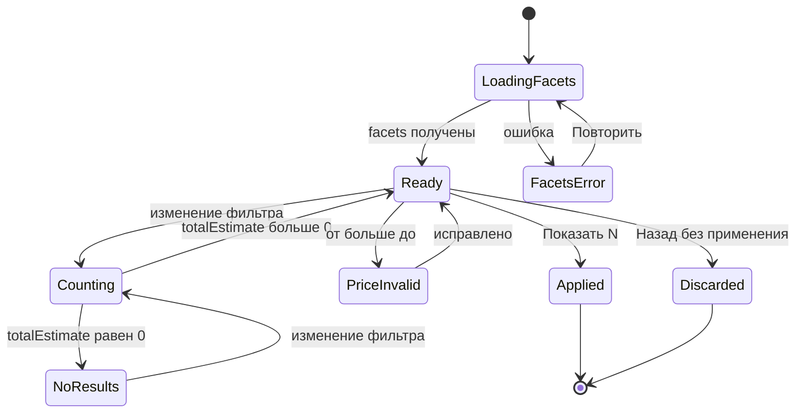

#### SCR-13.8. Валидация и сообщения

| Ключ ARB | Текст |
|---|---|
| `filters_title` | «Фильтры» |
| `filters_price_title` | «Цена, сом» |
| `filters_price_from` / `filters_price_to` | «от» / «до» |
| `filters_price_range_hint` | «В выдаче: {min} — {max} · вид цены «{priceList}»» |
| `filters_price_error_range` | «Минимальная цена больше максимальной» |
| `filters_in_stock` | «Только в наличии» |
| `filters_warehouse_title` | «Склад» |
| `filters_warehouse_cart_hint` | «склад корзины» |
| `filters_warehouse_view_note` | «Остатки склада «{name}». Продажа — со склада корзины» |
| `filters_stock_as_of` | «данные остатков от {time}» |
| `filters_category_title`, `filters_brand_title`, `filters_model_title`, `filters_color_title`, `filters_size_title` | «Категория», «Бренд», «Модель / серия», «Цвет», «Размер» |
| `filters_show_all` | «Показать все ({count})» |
| `filters_favorites_only` | «Только избранное» |
| `filters_with_photo_only` | «Только с фото» |
| `ds_button_reset` | «Сбросить» |
| `filters_show_n` | «Показать {count} товар/товара/товаров» (ICU) |
| `filters_no_results` / `filters_no_results_hint` | «Нет товаров» / «Ослабьте условия» |
| `filters_attr_limit` | «Выбрано максимум 10 характеристик» |
| `filters_error_load` | «Не удалось загрузить фильтры · Повторить» |
| `filters_offline_note` | «Фильтры по сохранённым данным от {time}» |
| `filters_applied_locally` | «Фильтр применён к найденному» |
| `filters_reset_all` | «Сбросить все» |

#### SCR-13.9. Источники данных и правила

`GET /catalog/products` с параметрами `categoryId`, `warehouseId`, `inStock`, `priceMin`, `priceMax`, `brand`, `attr[<ключ>]`, `favorite`, `hasImage`, `limit`, `cursor`, `sort` и ответом `facets` (`brands`, `attrs`, `priceRange`) и `totalEstimate`; `GET /catalog/warehouses`; `GET /catalog/categories`. Офлайн — drift `products` (`brand`, атрибуты из `product_variants.attributes_json`), `prices`, `stock_balances`, `favorites_products`. Правила: CAT-007, CAT-008, CAT-014, INV-025, INV-026, INV-028, INV-030.

#### SCR-13.10. Действия по ролям

| Действие | seller | cashier | senior_seller | admin | owner | customer (Q-001) | Право (11 §4.3) / ограничение |
|---|---|---|---|---|---|---|---|
| Открыть фильтры, сбросить, применить | ✓ | ✓ | ✓ | ✓ | ✓ | ✓ | `catalog.read` |
| Цена «от/до» (по своему виду цены) | ✓ | ✓ | ✓ | ✓ | ✓ | ✓ (свой вид цены) | `catalog.prices.read`; `priceListId` клиент не передаёт — вид цены определяет сервер (D-23) |
| Категория, бренд, модель, цвет, размер, прочие характеристики | ✓ | ✓ | ✓ | ✓ | ✓ | ✓ | `catalog.read` |
| «Только в наличии» | ✓ (склад корзины / выбранный) | ✓ | ✓ | ✓ | ✓ | ✓ (склад по умолчанию, без числа) | `inventory.read` у staff; у `customer` — только статус |
| Выбор склада UI-13-016 | ✓ | ✓ | ✓ | ✓ | ✓ | — (секция скрыта) | `inventory.read` |
| «Только избранное» | ✓ | ✓ | ✓ | ✓ | ✓ | ✓ | `favorites.products.manage` (чтение своего избранного) |
| «Только с фото» | ✓ | ✓ | ✓ | ✓ | ✓ | ✓ | `catalog.read` |

Ограничения безопасности: фильтр не расширяет доступ — сервер возвращает только товары и поля, разрешённые роли (закупочные цены в фасетах `priceRange` отсутствуют, INV-033); выбор другого склада меняет только просмотр остатков, продажа остаётся со склада корзины (INV-025, INV-026); параметры фильтра в URL (`f`) не содержат ПДн (`visual/navigation.md` N-3).

#### SCR-13.11. Повтор, двойной запрос, «Назад», перезапуск

Двойной тап «Показать N» — одно применение (кнопка блокируется до закрытия листа); частые изменения — один подсчёт на паузу 300 мс; «Назад» на compact/medium — отмена черновика; перезапуск — фильтры восстанавливаются из `f` маршрута (`lastLocation`); сохранённый между сеансами набор фильтров — нет (каждый вход в каталог без фильтров, кроме восстановления последнего маршрута) [ТИПОВО].

#### SCR-13.12. Платформы

Windows: `Tab` по группам, `Space` — флажок/переключатель, `Enter` — применить (medium/compact-окно) , `Esc` — закрыть; поля цены принимают цифры с клавиатуры; HID-скан — по единому правилу п. 2.2.11: при фокусе в поле цены или в поле поиска значений фасета скан **не перехватывается** (символы попадают в поле, поиска нет); при фокусе вне полей лист/панель закрывается (compact/medium — без применения черновика; expanded — фильтры уже применены) и скан обрабатывается как поиск по штрихкоду (`visual/responsive-spec.md`, D-42). Android/iOS: цифровая клавиатура для цены; лист поднимается над клавиатурой; свайп вниз — закрыть без применения. Тач-цели чекбоксов и свотчей ≥ 48.

#### SCR-13.13. Критерии приёмки

| ID | Критерий |
|---|---|
| AC-UI-13-001 | Секции бренд/модель/цвет/размер отображаются только если у ≥ 1 товара текущей выдачи есть значение; при отсутствии — скрыты. |
| AC-UI-13-002 | Ввод «от 3000 до 1500» показывает «Минимальная цена больше максимальной» и блокирует применение. |
| AC-UI-13-003 | Выбор двух брендов даёт объединение (OR), бренд + цвет — пересечение (AND) — проверка на фикстуре. |
| AC-UI-13-004 | «Показать N» показывает число, совпадающее с `totalEstimate` сервера после применения; при 0 кнопка недоступна. |
| AC-UI-13-005 | На compact «Назад» закрывает лист без применения изменений; «Показать N» применяет и закрывает. |
| AC-UI-13-006 | На expanded изменение фильтра применяется через 300 мс без кнопки; CP остаётся видимой, сетка пересчитывается под ширину `W − 320`. |
| AC-UI-13-007 | Выбор склада «Склад №2» меняет бейджи остатков в выдаче, но «+ Добавить» проверяет остаток склада корзины. |
| AC-UI-13-008 | Фильтр «Только избранное» показывает только товары из `favorites_products`. |
| AC-UI-13-009 | Для `customer` секция «Склад» отсутствует. |
| AC-UI-13-010 | Активные фильтры отображаются чипами над списком; крестик на чипе снимает фильтр и перезапрашивает список. |
| AC-UI-13-011 | HID-скан при фокусе в поле «от» цены вводит символы в поле и не выполняет `GET /search/barcode`; тот же скан при фокусе вне полей закрывает лист без применения черновика и выполняет поиск по штрихкоду. |
| AC-UI-13-012 | При reduce-motion `FilterPanel` появляется и исчезает без анимации, лист открывается fade ≤ 80 мс. |

#### SCR-13.14. Трассировка

| Требование | SRC-ID | Правила |
|---|---|---|
| Фильтры | SRC-C-020, SRC-E-140 | CAT-007 |
| Диапазон цены, если доступен | SRC-C-021 | CAT-007 |
| Наличие по складам | SRC-C-022, SRC-E-148 | CAT-007, INV-025, Q-205 |
| Категория | SRC-C-023 | CAT-007 |
| Бренд, модель, цвет, размер и другие реальные характеристики | SRC-C-024, SRC-E-146 | CAT-007, CAT-008, Q-021 |
| Избранное | SRC-C-025, SRC-E-152 | CAT-014 |
| Описать фильтры отдельно | SRC-F-028 | — |
| 14 пунктов описания экрана, не один абзац | SRC-F-004…SRC-F-019 | подразделы SCR-13.1…13.13 (п. .5 и .10 — таблицами) |

---

### SCR-14 — Карточка товара (маршрут `/catalog/p/{productId}`, роли staff, customer, R1: да)

#### SCR-14.1. Назначение и роль пользователя

Подробная карточка товара (SRC-C-037…SRC-C-057, INV-018): крупное фото и миниатюры других изображений и вариантов; название; артикул выбранного варианта; описание; характеристики; варианты (цвет/размер/модель) с обновлением фото, артикула, характеристик, цены и остатков при выборе; цена с условиями (вид цены, единица, цена за упаковку); доступность и остатки выбранного варианта по каждому складу; единицы/упаковки; выбор количества; добавление в корзину. На expanded — панель поверх контент-колонки (SB и CP видимы, корзина обновляется сразу), на medium — side sheet 480 (ландшафт) или экран в 2 колонки (портрет), на compact — отдельный экран с закреплённой нижней панелью «количество + В корзину» (SRC-C-037 «удобная панель или отдельный экран»). Пользователи — staff (продавец показывает товар клиенту, проверяет остатки по складам) и `customer` (Q-001: без таблицы складов и без других видов цен).

#### SCR-14.2. Структура экрана

Зоны: **A** — шапка панели/экрана; **B** — галерея; **C** — основные данные и действие; **D** — остатки по складам; **E** — описание и характеристики.

**expanded/large — панель поверх контент-колонки (ширина контент-колонки, ≤ 1200 на large), `ds.elevation.3`, без затемнения SB и CP:**

```
┌─ A: крошки «Каталог › Смесители › Для кухни»                         ☆   ✕ ─┐
│ ┌─ B ───────────────────────┐  ┌─ C ─────────────────────────────────────┐ │
│ │ миниатюры │  главное фото │  │ h3 «Смеситель для кухни Ledeme L74103»  │ │
│ │ 64 (верт.)│  1:1, 320–400 │  │ Арт. варианта: L74103-BK · Код 1С · ШК  │ │
│ │  ▢        │               │  │ 2 850 сом / шт   [Розничная]            │ │
│ │  ▢        │      2 / 5    │  │ За кор (6 шт): 17 100 сом               │ │
│ │  ▢        │               │  │ Цвет: Чёрный матовый  ◯ ◉ ◯             │ │
│ └───────────────────────────┘  │ Единица: [шт | кор (6 шт)]              │ │
│ ┌─ E ───────────────────────┐  │ Количество: − [1] +  В корзину · 2 850  │ │
│ │ Характеристики (8 + «Пока-│  │ Кратность 1 шт · мин. 1 · в корзине: 0  │ │
│ │ зать все (12)»)           │  │ ● Мало · 3 шт на складе корзины         │ │
│ │ Описание (3 строки + «Чи- │  ├─ D ─────────────────────────────────────┤ │
│ │ тать полностью»)          │  │ Остатки по складам · обновлено 09:41    │ │
│ └───────────────────────────┘  │ Склад | Остаток | Резерв | Доступно     │ │
│                                │ Доступно всего: 12 шт (если есть        │ │
│                                │ availableTotal сервера, D2)             │ │
│                                └─────────────────────────────────────────┘ │
└────────────────────────────────────────────────────────────────────────────┘
```

- Внутри панели — 2 колонки: левая 40 % (B над E), правая 60 % (C над D), паддинги 24, зазор колонок 24; прокрутка панели — общая; контент каталога под панелью не прокручивается. Закрытие — по `visual/navigation.md` §5 (строка «Панель на expanded»): крестик, `Esc` или клик вне панели (по SB, по пустой области шапки) = `pop` того же маршрута. Уточнение части (раздел 14, замечание 29): работа с контролами CP (степпер строки, скидка, «Создать заказ») панель **не** закрывает — CP является постоянной соседней областью, а не «фоном» панели, и результат добавления из панели должен быть виден и редактируем в CP (AC-UI-14-001); ввод в `SearchBar` шапки закрывает панель переходом на SCR-11.

**medium:** портрет — экран в 2 колонки (фото ≈ 40 % / данные ≈ 60 %), `AppTabs` «Описание · Характеристики · Склады» под данными; ландшафт — side sheet 480 справа поверх контента с одной колонкой.

**compact (сверху вниз):** шапка 56 («Назад», название категории `ds.text.title`, `FavoriteToggle`, кнопка поиска) → `ImageGallery` на всю ширину (1:1) с индикатором «2 / 5» и лентой миниатюр 56 под фото (горизонтальная прокрутка) → название `ds.text.title` 18/600 → «Арт. варианта: L74103-BK» `caption` → `PriceText.card` 24/700 + бейдж вида цены → цена за упаковку `caption` → `StockBadge` + «по складам ▾» (sheet с `WarehouseStockTable`) → `VariantSelector` → `UnitSelector` → `AppTabs` «Описание · Характеристики · Склады» → отступ 96 → **закреплённая нижняя панель** 72 (`surface`, верхняя граница `border`, `ds.elevation.2`): `QuantityStepper.md` слева + `AppButton.primary L` «В корзину · 2 850 сом» (flex) → `CartFab` скрыт на этом экране, BNB виден [ТИПОВО: `visual/responsive-spec.md` — панель-итог под CTA].

#### SCR-14.3. Таблица элементов

**Зона A — шапка**

| № | UI-ID | Элемент | Компонент | Расположение/размер/отступы/выравнивание | Токены | Состояния | Поведение | Источник данных | Роли | Правило |
|---|---|---|---|---|---|---|---|---|---|---|
| A1 | UI-14-001 | Закрыть / «Назад» | `AppIconButton` | expanded — крестик справа вверху панели, цель 48; compact/medium — стрелка слева в шапке | `close` / `arrow_back` 24 `textSecondary` | default, hover, pressed, focused | expanded — закрыть панель (`pop` того же маршрута); compact — `pop` к списку с сохранённой прокруткой | — | все | `visual/navigation.md` §5 |
| A2 | UI-14-017 | «Хлебные крошки» | текст + `AppButton.text S` | expanded — слева в шапке панели; compact — название категории в шапке | `ds.text.label` `textSecondary` | default, hover, focused | тап по уровню → закрыть панель и `go /catalog/c/{categoryId}` | `categoryId`, drift `categories.path` | все | CAT-009 |
| A3 | UI-14-002 | Избранное | `FavoriteToggle.inline` | слева от крестика (expanded) / в шапке (compact), цель 48 | как UI-10-103 | default, selected, error | как UI-10-103; относится к товару (не к варианту) [ТИПОВО] | `isFavorite`, `PUT`/`DELETE /favorites/products/{id}` | все | FAV-002 |

**Зона B — галерея**

| № | UI-ID | Элемент | Компонент | Расположение/размер/отступы/выравнивание | Токены | Состояния | Поведение | Источник данных | Роли | Правило |
|---|---|---|---|---|---|---|---|---|---|---|
| B1 | UI-14-003 | Главное фото | `ImageGallery` (`ProductImage.full`, 1200) | expanded — квадрат 320–400 справа от ленты; compact — ширина экрана, 1:1 | фон `surfaceVariant`; индикатор «2 / 5» `caption` в пилюле `overlay` | loading (скелетон), success (ANIM-014), empty (заглушка «Нет фото» 48), error (заглушка на позиции) | свайп/←→ — следующее фото; тап — полноэкранный просмотр UI-14-022; двойной тап — zoom 2× | `images[]` выбранного варианта, иначе товара (INV-011) | все | SRC-C-038, SRC-C-053…057, D-30 |
| B2 | UI-14-004 | Миниатюры | `ImageGallery` (лента, `ProductImage.thumb` 56) | expanded — вертикальная лента 64 слева от фото, зазор 8; compact — горизонтальная под фото | выбранная — рамка `primary` 2; фото варианта — бейдж-точка цвета варианта 8 | default, hover, focused, selected | тап по фото товара — показать; тап по фото варианта — **выбрать этот вариант** (обновление зоны C/D) | `images[]` товара + `variants[].images[]` | все | SRC-C-039, SRC-C-041 |
| B3 | UI-14-022 | Полноэкранный просмотр | `ImageGallery` (fullscreen) | на весь экран, фон `textPrimary`, кнопки `onPrimary` | pinch-zoom до 3×; кнопки «+/−» на Windows (A11Y-017) | открыт / закрыт | свайп, ←→, `Esc`/«Назад» — закрыть; индекс сохраняется | `fullUrl` | все | A11Y-017 |

**Зона C — основные данные и действие**

| № | UI-ID | Элемент | Компонент | Расположение/размер/отступы/выравнивание | Токены | Состояния | Поведение | Источник данных | Роли | Правило |
|---|---|---|---|---|---|---|---|---|---|---|
| C1 | UI-14-005 | Название | текст `ds.text.h3` (expanded) / `ds.text.title` (compact) | верх колонки C; перенос без обрезки | `textPrimary` | default, loading (2 строки скелетона) | долгое нажатие — копировать [ТИПОВО] | `name` | все | SRC-C-044, INV-053 |
| C2 | UI-14-006 | Артикул варианта и коды | текст `ds.text.caption` tnum + `AppIconButton` `content_copy` 20 | под названием, отступ 4; строка: «Арт. варианта: L74103-BK · Код 1С: 00-00012345» | `textSecondary` | default, «Артикул не указан» | тап по копированию — артикул в буфер + снекбар «Артикул скопирован» | `variants[].sku`, `onecCode` | staff; `customer` — без кода 1С | SRC-C-042, SRC-C-045, INV-011 |
| C3 | UI-14-024 | Пометка «артикул товара» | `StatusChip` (`neutral`) | после артикула | `surfaceVariant`/`textSecondary` | показана, если у варианта нет `sku` | — | `variants[].sku = null` → `Product.sku` | все | INV-011 |
| C4 | UI-14-019 | Штрихкоды | текст `caption` tnum | строка под артикулом, до 2 значений + «ещё N» | `textSecondary` | default, скрыт (нет штрихкодов) | тап «ещё N» — список в тултипе/sheet | `variants[].barcodes`, `packagings[].barcode` | staff | INV-011, INV-017 |
| C5 | UI-14-007 | Цена с условиями | `PriceText.card` | под кодами, отступ 12 | сумма `ds.text.h2` 24/700 tnum `primary` (B: `primaryText`); «/ шт» `ds.text.body` `textSecondary` | default, loading, error («Цена не указана» + «Нет цены — обратитесь к администратору»), oldNew (скидка клиента 1С: «Ваша цена» + зачёркнутая базовая) | обновляется при выборе варианта/упаковки и при смене клиента корзины без перезагрузки экрана | `variants[].price`, `prices[]` | все | SRC-C-029, SRC-C-049, INV-013, INV-030, INV-031 |
| C6 | UI-14-018 | Бейдж вида цены | `StatusChip` (иконка `sell`) | справа от цены, выравнивание по базовой линии | `surfaceVariant`/`textSecondary` | default | тултип «Вид цены по клиенту корзины / по умолчанию для роли» | `price.priceListName` | все | INV-030, INV-031 |
| C7 | UI-14-021 | Цена за упаковку | текст `caption` | под ценой | `textSecondary` tnum | показан при наличии упаковок | «За кор (6 шт): 17 100 сом» — цена упаковки из `prices[]` с `packagingId`, если 1С ведёт; иначе не показывается (клиент не умножает для показа цены упаковки) | `prices[].packagingId` | все | INV-031, Q-021 |
| C8 | UI-14-030 | Другие виды цен | раскрываемый список (`AppListTile` ×N) | под ценой за упаковку, свёрнут по умолчанию «Все виды цен ▾» | `ds.text.body` tnum | свёрнут / раскрыт | только просмотр; выбор вида цены — не здесь (вид цены определяет сервер, D-23) | `prices[]` | `catalog.prices.read.all` (cashier, senior_seller, admin, owner) | 08 §3.6, 11 §4.4 |
| C9 | UI-14-008 | Варианты | `VariantSelector` (`swatches` для цвета, `chips` для размера/модели, `dropdown` при > 12 значений) | под ценой, отступ 16; заголовок оси `ds.text.label` «Цвет: Чёрный матовый»; ряд свотчей/чипов 40 (цель 48), зазор 8 | selected — обводка `primary` 2 + `check`; без остатка на складе корзины — пунктир/зачёркивание, `disabledText`, но выбираемый | default, hover, focused, selected, disabled-вид, loading, error («Выберите {ось}») | выбор значения каждой оси определяет `product_variant`; обновляются фото (B), артикул (C2), характеристики (E), цена (C5), остатки (D), `?variantId=` в URL (замена) | `variants[]`, `attributeKeys` (`GET /catalog/products/{id}/variants`) | все | SRC-C-040…043, SRC-C-048, INV-012 |
| C10 | UI-14-009 | Единица / упаковка | `UnitSelector` (`segmented` ≤ 3, `dropdown` > 3, `readonly`) | под вариантами, высота 36, сегмент ≥ 64 | выбранный `surface` + `ds.elevation.1` + `primary` | default, selected, disabled (упаковка недоступна), readonly «шт» | смена пересчитывает количество с сохранением базового (INV-003): «5 кор = 30 шт»; при нецелом результате — ближайшее большее целое число упаковок + подсказка | `packagings[]`, `baseUnit` | все | SRC-C-035, INV-002, INV-003 |
| C11 | UI-14-010 | Количество | `QuantityStepper.md` (на всех классах окна, включая expanded с мышью) | слева от CTA (expanded — в одной строке; compact — нижняя панель) | как 03 §9.20 | default, focused, disabled («+» на максимуме), error | начальное значение = `step` или `min_qty`; «+»/«−» — шаг; тап по числу/долгое «+» → SCR-16; автоповтор при удержании «−» (ANIM-007); цифры с клавиатуры (Windows) — прямой ввод в поле | `minQuantity`, `packagings[].factor`, `qtyPrecision`, `remainingAvailable` (если вариант в корзине) | `cart.manage.own` | SRC-C-051, INV-001…010, INV-041 |
| C12 | UI-14-011 | «В корзину · {сумма}» | `AppButton.primary L` (compact, expanded) | справа от степпера, flex; высота 52 | `primary`/`onPrimary`; сумма tnum | default, hover, pressed, focused, disabled (нет остатка / нет цены / вариант не выбран / снят с продажи), loading (≤ 300 мс, защита от двойного клика) | добавляет выбранное количество: `PUT /cart/items/{variantId}` `mode=increment`, `packagingId`, `priceSnapshot`, `Idempotency-Key`; панель/экран остаются открытыми | `cartProvider` | `cart.manage.own` | SRC-C-052, INV-018, CART-002, CART-025 |
| C13 | UI-14-020 | «Добавить ещё» | состояние UI-14-011 | на месте CTA | как C12 | показан, если пара (`variantId`, `packagingId`) уже есть в корзине | повторное нажатие увеличивает строку на выбранное количество **без окон** | строка корзины | `cart.manage.own` | SRC-C-033, CART-002 |
| C14 | UI-14-012 | Правила количества | текст `caption` | под строкой «количество + CTA», отступ 8 | `textSecondary`; нарушение — `error` | default, error | «Кратность {m} {unit} · мин. партия {min} · в корзине: {n}» | `multiplicity`, `minQuantity`, строка корзины | staff | INV-004, INV-005 |
| C15 | UI-14-029 | «В корзине: N» | `StatusChip` (`info`, иконка `shopping_cart` 16) | рядом с правилами | `infoContainer`/`info` | показан/скрыт | тап — открыть корзину (compact — SCR-20; expanded — фокус в строку CP) | `cartProvider` | `cart.manage.own` | CART-002 |
| C16 | UI-14-031 (выделен из UI-14-012 wireframes, п. 2.4) | Статус наличия | `StockBadge` (по складу корзины) + `stale` | под правилами | 03 §9.17 | inStock, low, out, unknown, stale | тап (compact) — sheet со складами UI-14-028 | `variants[].stock` | staff — число; `customer` — статус | SRC-C-050, INV-022 |
| C17 | UI-14-027 | Нижняя панель действия (compact) | контейнер 72, `surface`, `ds.elevation.2` | закреплена над BNB, паддинги 16, зазор 12 | граница `border` сверху | видна всегда на compact | содержит C11 и C12 | — | `cart.manage.own` (owner — скрыта) | 03 §8.2, A11Y-022 |
| C18 | UI-14-026 | Баннер «Товар снят с продажи» | `ErrorState.banner` (`warning`) | над зоной C | `warningContainer`/`warning` | показан при `deletionMark=true` (staff) | CTA disabled; «Товар больше не продаётся» | `deletionMark` | staff | INV-054, CART-015 |

**Зона D — остатки по складам**

| № | UI-ID | Элемент | Компонент | Расположение/размер/отступы/выравнивание | Токены | Состояния | Поведение | Источник данных | Роли | Правило |
|---|---|---|---|---|---|---|---|---|---|---|
| D1 | UI-14-013 | Таблица остатков | `WarehouseStockTable` (`seller`: Склад · Доступно; `cashier`+: + Резерв, Остаток) | expanded — под зоной C, ширина колонки; compact — вкладка «Склады» и sheet UI-14-028 | заголовок `surfaceVariant` `ds.text.label`; строки 40 `body` tnum, числа вправо; «0» — `error`; склад корзины — полоса `primary` + подпись «склад корзины» | default, loading (3 скелетон-строки), error («Не удалось получить остатки · Повторить»), empty («Нет данных по складам») | сортировка по «Доступно» убыв.; склад корзины первым; количество в базовой единице + «(2 кор)» при упаковках (INV-009) | `variants[].stockByWarehouse` (`quantity`, `reserved`, `available`, `asOf`) | staff (`inventory.read`); `customer` — нет | SRC-C-043, SRC-E-148, SRC-E-149, INV-021 |
| D2 | UI-14-025 | «Доступно всего» | строка итога таблицы | последняя строка, `body` 600 | `textPrimary` tnum | показан (есть значение сервера) / скрыт | показывается **только значение сервера** `availableTotal` `[НОВОЕ ИМЯ]` (предложение для 08 §3.6, раздел 14, замечание 5); клиент итог не вычисляет (D-22, INV-020); пока поля нет в ответе `Product`, строка итога не показывается, а таблица содержит только построчные `available` | `availableTotal` (после доработки 08) | staff | INV-021, INV-020, D-22 |
| D3 | — | Метка времени | `SyncIndicator.inline` | под таблицей, `caption` | `textSecondary`; `warning` при > 30 мин | ok, stale | «обновлено 09:41» | `asOf` | staff | INV-027 |
| D4 | UI-14-028 | Остатки в sheet (compact) | `AppBottomSheet` + `WarehouseStockTable` | 60 % высоты | как D1 | открыт/закрыт | открывается по «по складам ▾» / тапу `StockBadge` | как D1 | staff | 03 §9.18 |
| D5 | UI-14-032 (на SCR-10 аналог — UI-10-115) | «Есть на складе «…»» | `StatusChip` (`info`) | под `StockBadge` при «Нет на складе корзины» | `infoContainer`/`info` | показан/скрыт | «Склад №2: 2 шт. Продажа с другого склада одним заказом — вне R1» | `stockByWarehouse` | staff | INV-026 |

**Зона E — описание и характеристики**

| № | UI-ID | Элемент | Компонент | Расположение/размер/отступы/выравнивание | Токены | Состояния | Поведение | Источник данных | Роли | Правило |
|---|---|---|---|---|---|---|---|---|---|---|
| E1 | UI-14-015 | Вкладки | `AppTabs` («Описание · Характеристики · Склады») | compact/medium — под `UnitSelector`, высота 48; expanded — не используются (секции видимы одновременно) | индикатор `primary` 2 px | default, selected | переключение без запросов; «Склады» — только staff | — | все | 03 §9.49 |
| E2 | UI-14-016 | Характеристики | список «название: значение» (`AppListTile` 40, 2 колонки текста) | expanded — левая колонка под галереей | название `textSecondary`, значение `textPrimary` `ds.text.body` | default, свёрнут (> 8 — «Показать все (N)»), empty (блок скрыт) | порядок — как в 1С; характеристики, различающиеся между вариантами, помечены иконкой `tune` 16 («ось выбора») | `attributes` товара + `variants[].attributes` | все | SRC-C-047, SRC-E-146, INV-016 |
| E3 | UI-14-014 | Описание | текст `ds.text.body` | под характеристиками (expanded) / вкладка | `textPrimary`; ширина строки ≤ 72 символов | default, свёрнут (3 строки), empty (скрыт) | «Читать полностью» (UI-14-023) раскрывает; повторно — «Свернуть» | `description` | все | SRC-C-046, INV-052 |
| E4 | UI-14-023 | «Читать полностью» | `AppButton.text S` | под описанием | `primary` | default | раскрыть/свернуть (ANIM-016) | — | все | — |

#### SCR-14.4. Поведение каждого контрола

- **Открытие.** Маршрут `/catalog/p/{productId}?variantId=&qty=`; данные показываются из drift ≤ 200 мс (NFR-PERF-003), затем `GET /catalog/products/{id}?warehouseId=&include=variants,prices,stockByWarehouse,images` (ETag → `304` без перерисовки); при отсутствии `variantId` выбирается вариант с `isDefault=true`, иначе первый по `sortOrder` с остатком на складе корзины; сервер асинхронно пишет `recent_products`.
- **Галерея.** Тап по миниатюре — crossfade 200 мс; свайп — следующее фото; при смене варианта индекс сбрасывается на первое фото варианта (если у варианта нет своих фото — фото товара, затем заглушка; INV-011); «никогда фото другого товара».
- **Варианты.** Тап по свотчу/чипу выбирает значение оси; если комбинация осей не существует — недоступные значения других осей становятся disabled-видом с тултипом «Нет такого сочетания»; вариант без остатка на складе корзины выбирается (для просмотра остатков по складам), CTA становится disabled «Нет в наличии» (INV-012, INV-023). ←/→ на Windows — по значениям оси, ↑/↓ — между осями.
- **Единица.** Переключение пересчитывает количество (INV-003); если упаковки недоступны для варианта — сегмент disabled с тултипом.
- **Количество.** Как в 03 §9.20, с ограничением INV-042: если вариант уже в корзине, максимум = `remainingAvailable`; иначе — `available` склада корзины; превышение через нампад — значение ограничивается и показывается «Доступно {n} {unit}».
- **«В корзину».** Нажатие: кнопка 300 мс в состоянии loading (повторный клик в этот интервал игнорируется — защита от случайного двойного клика), строка корзины создаётся/увеличивается локально, запрос `PUT /cart/items/{variantId}` `mode=increment` с новым `Idempotency-Key`; expanded — строка появляется в CP (ANIM-006), панель товара остаётся открытой; compact — снекбар «Добавлено {qty} · Открыть корзину». После добавления подпись меняется на «Добавить ещё», количество в степпере возвращается к шагу. Каждое следующее нажатие «Добавить ещё» — новое увеличение без окон (SRC-C-033).
- **Ошибки добавления.** `VARIANT_UNAVAILABLE` — откат строки, баннер C18, снекбар «Товар больше не продаётся»; `QTY_NOT_MULTIPLE` / `QTY_BELOW_MIN` — откат, текст правила в C14 `error`; предупреждение `stock_insufficient` в ответе — строка остаётся, показывается «Доступно {n}» и подсказка «Уменьшите количество в корзине» (CART-014); `VERSION_CONFLICT` — CART-017; сеть — outbox, иконка `schedule` у строки CP.
- **Избранное, копирование, крошки** — п. таблицы.
- **HID-скан на SCR-14.** Скан другого товара закрывает текущую карточку и открывает новую (или добавляет по настройке сканера); скан того же варианта — +1 шаг (режим «сразу в корзину») или подсветка CTA (режим «открыть карточку») [ТИПОВО].

#### SCR-14.5. Анимации

| ID | Применение | Начальное → триггер | Последовательность / конечное | Длительность | Ошибка | Reduce-motion |
|---|---|---|---|---|---|---|
| ANIM-024 | открытие панели (expanded) / экрана (compact) | список → тап по карточке | expanded: slide-in справа 400 lp + fade 250 мс; compact: shared-axis X 300 мс | 250 / 300 мс `standard` | ошибка загрузки — содержимое панели заменяется `ErrorState` без отмены анимации | fade 80 мс |
| ANIM-014 | главное фото | скелетон → загружено | fade-in; compact — `Hero` из сетки (300 мс) | 200 мс | заглушка без анимации | мгновенно, `Hero` → fade |
| ANIM-017 | выбор варианта, единицы, вкладки | индикатор на старом → тап | обводка/индикатор скользит; фото — crossfade 200 мс; цена и артикул — ANIM-010 | 200 мс | — | мгновенно |
| ANIM-010 | цена, сумма на CTA, «Доступно всего» | старое → новое значение | перекат числа | 200 мс | — | мгновенно |
| ANIM-006 | «В корзину» | кнопка → тап | строка CP slide-in (expanded) / снекбар + пульс бейджа BNB «Корзина» (compact) | 200–300 мс | shake кнопки (ANIM-012) + текст ошибки | без пульса |
| ANIM-007 | удержание «−» в степпере (03 ANIM-007 — автоповтор) | n → удержание «−» > 500 мс | каждые 150 мс значение −шаг, число crossfade, haptic каждые 5 шагов; конечное — значение при отпускании, один `PUT … mode=set` (п. 2.2.12) | 500 мс задержка, шаг 150 мс | остановка на минимальном шаге (ниже — только через подтверждение удаления) | автоповтор сохраняется, без анимации числа |
| — (не ANIM-007) | удержание «+» > 500 мс | n → удержание «+» | открывается SCR-16 (10 INV-041) с ANIM-025 / popover; автоповтора «+» нет — расхождение с 03 ANIM-007, раздел 14, замечание 19 | 500 мс | — | лист fade 80 мс |
| ANIM-013 | скелетон зон B–E | загрузка > 300 мс без кэша | шиммер | loop 1,2 с | > 10 с → «Долгая загрузка…» | статично |
| ANIM-016 | «Показать все», «Читать полностью» | свёрнуто → тап | `AnimatedSize` | 200 мс | — | мгновенно |
| ANIM-025 | sheet складов (compact), SCR-15/16 | скрыт → тап | slide-up | 250 мс | — | fade 80 мс |
| ANIM-009 | избранное | как SCR-10 | как SCR-10 | 200 мс | откат | мгновенно |

#### SCR-14.6. Переходы

| Откуда | Куда | Данные | Тип | «Назад» |
|---|---|---|---|---|
| SCR-10/11/12 (карточка), «Недавние» | SCR-14 | `productId` (path), `variantId` (query), `qty` (query, от сканера) | `push` в ветке `catalog`; expanded — панель с тем же URL | исходный список с прокруткой и фильтрами |
| SCR-40 (избранное), SCR-44 (уведомление о товаре), SCR-20 (тап по строке корзины) | SCR-14 | `productId`, `variantId` | `go` с переключением на ветку `catalog` | SCR-10 |
| HID / SCR-17 | SCR-14 | `productId`, `variantId`, `packagingId`, `qty` | `push` | экран-источник |
| SCR-14 (число / удержание «+») | SCR-16 | `variantId`, `packagingId`, `qty`, `qtyPrecision`, `packFactor`, `maxAvailable` | sheet / popover | SCR-14 без изменений |
| SCR-14 (смена варианта на compact при > 12 значений) | SCR-15 | `productId`, `variantId` | sheet | SCR-14 |
| SCR-14 («В корзине: N», «Открыть корзину» в снекбаре) | SCR-20 | `cartId` | compact — sheet/экран; expanded — фокус в CP | SCR-14 |
| SCR-14 (крошка) | SCR-10/12 | `categoryId` | `go` | — |
| Deep link `/catalog/p/{productId}?variantId=` | SCR-14 | — | `go` | SCR-10 |

**Последовательность «Открыть карточку и выбрать вариант»:**

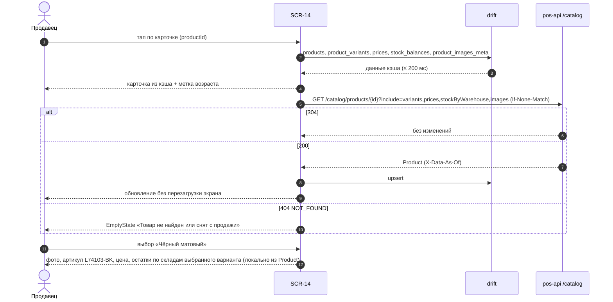

**Последовательность «В корзину / Добавить ещё»:**

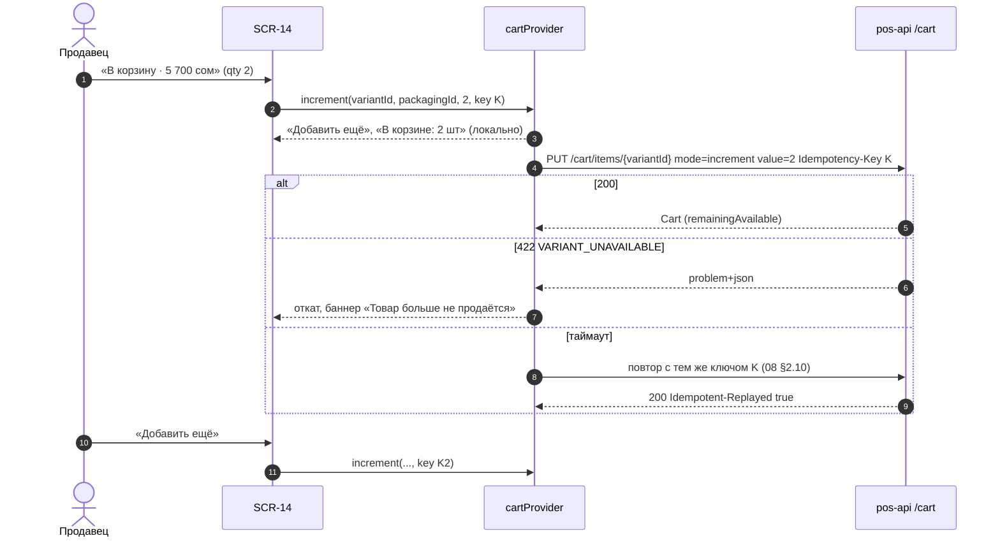

#### SCR-14.7. Состояния экрана

| Состояние | Условие | Что видно |
|---|---|---|
| Загрузка | нет кэша | скелетоны галереи, названия, цены, вариантов, таблицы |
| Успех из кэша / с сервера | данные есть | полная карточка; метка возраста при > 30 мин |
| Нет фото | `images: []` | заглушка «Нет фото» 1:1, лента скрыта |
| Нет данных | нет артикула / описания / характеристик | «Артикул не указан»; блоки описания и характеристик скрыты (INV-052) |
| Нет цены | `price: null` | «Цена не указана» + «Нет цены — обратитесь к администратору», CTA disabled (INV-013) |
| Нет остатка на складе корзины | `available ≤ 0` | CTA disabled «Нет в наличии», «Есть на складе «…»: n» (если есть) |
| Остаток неизвестен | `stockLevel=unknown` (склад не синхронизирован) | «Остаток неизвестен», CTA disabled «Добавление недоступно» (INV-052); онлайн — фоновая проверка `POST /inventory/check`: при получении остатка состояние обновляется |
| Снят с продажи | `deletionMark=true` (staff) / `404` (customer) | баннер, CTA disabled / `EmptyState` «Товар не найден или снят с продажи» |
| Ошибка | 5xx / таймаут | с кэшем — `ErrorState.inline` над данными; без кэша — `ErrorState.fullScreen` + «Повторить» |
| Офлайн | нет сети | данные из кэша с меткой; «В корзину» работает (outbox, CART-018); таблица складов — снимок с меткой |
| Нет разрешений | `owner` | нижняя панель/CTA скрыты; `customer` — нет таблицы складов и кодов 1С |
| Step-up | не применяется | — |

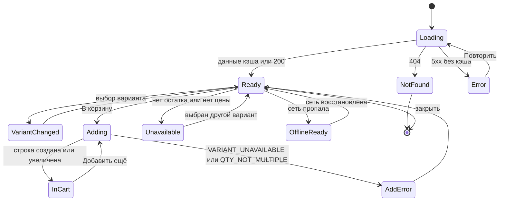

#### SCR-14.8. Валидация и сообщения

| Ключ ARB | Текст |
|---|---|
| `product_sku_variant` | «Арт. варианта: {sku}» |
| `product_sku_product_note` | «артикул товара» |
| `product_sku_missing` | «Артикул не указан» |
| `product_onec_code` | «Код 1С: {code}» |
| `product_barcodes` | «Штрихкод: {values}» / «ещё {count}» |
| `product_sku_copied` | «Артикул скопирован» |
| `product_price_unit` | «/ {unit}» |
| `product_price_per_pack` | «За {pack}: {price}» |
| `product_price_missing_hint` | «Нет цены — обратитесь к администратору» |
| `product_price_your` | «Ваша цена» |
| `product_price_lists_all` | «Все виды цен» |
| `product_price_list_tooltip` | «Вид цены по клиенту корзины или по умолчанию для роли» |
| `product_variant_axis` | «{axis}: {value}» |
| `product_variant_select_error` | «Выберите {axis}» |
| `product_variant_combination_missing` | «Нет такого сочетания» |
| `product_unit_title` | «Единица» |
| `product_qty_title` | «Количество» |
| `product_qty_rules` | «Кратность {multiple} {unit} · мин. партия {min} {unit}» |
| `product_in_cart` | «В корзине: {qty} {unit}» |
| `product_cta_add` | «В корзину · {sum}» |
| `product_cta_add_more` | «Добавить ещё» |
| `product_cta_out_of_stock` | «Нет в наличии» |
| `product_cta_unavailable` | «Добавление недоступно» |
| `product_added_snackbar` | «Добавлено {qty} {unit} · Открыть корзину» |
| `product_other_warehouse` | «Есть на складе «{warehouse}»: {qty} {unit}. Продажа с другого склада одним заказом — вне R1» |
| `product_stock_title` | «Остатки по складам» |
| `product_stock_columns` | «Склад · Остаток · Резерв · Доступно» |
| `product_stock_total` | «Доступно всего: {qty} {unit}» |
| `product_stock_cart_warehouse` | «склад корзины» |
| `product_stock_error` | «Не удалось получить остатки · Повторить» |
| `product_stock_empty` | «Нет данных по складам» |
| `product_description_title`, `product_specs_title`, `product_warehouses_tab` | «Описание», «Характеристики», «Склады» |
| `product_specs_show_all` | «Показать все ({count})» |
| `product_description_expand` / `product_description_collapse` | «Читать полностью» / «Свернуть» |
| `product_discontinued_banner` | «Товар больше не продаётся» |
| `product_not_found_title` | «Товар не найден или снят с продажи» |
| `product_gallery_counter_a11y` | «Фото {index} из {count}» |
| `product_qty_reduce_hint` | «Уменьшите количество в корзине» |
| ошибки | `error_variant_unavailable`, `error_qty_not_multiple` «Количество должно быть кратно {m} {unit}», `error_qty_below_min` «Минимальная партия — {min} {unit}», `error_stock_insufficient`, `error_version_conflict` «Корзина изменена на другом устройстве» |

#### SCR-14.9. Источники данных, API, бизнес-правила

| Данные | Эндпоинт | Кэш | Правила |
|---|---|---|---|
| Товар, варианты, упаковки, штрихкоды, цены, остатки по складам, фото, мин. партия, код 1С | `GET /catalog/products/{id}?warehouseId=&include=variants,prices,stockByWarehouse,images` (ETag, `X-Data-As-Of`) | `products`, `product_variants`, `packagings`, `barcodes`, `prices`, `stock_balances`, `product_images_meta` | INV-011…018, INV-021, INV-030…034 |
| Варианты с осями (при открытии SCR-15) | `GET /catalog/products/{id}/variants` | `product_variants` | INV-012, INV-014 |
| Единицы | `GET /catalog/units` | `units` | INV-001 |
| Склады | `GET /catalog/warehouses` | `warehouses` | INV-021, INV-025 |
| Проверка неизвестного остатка | `POST /inventory/check` (без побочных эффектов) | — | INV-052 |
| Корзина | `GET /cart`, `PUT /cart/items/{variantId}` | `cart_draft`, `cart_items_draft`, `outbox_actions` | CART-002, CART-025, INV-040…043 |
| Избранное | `PUT`/`DELETE /favorites/products/{id}` | `favorites_products` | FAV-002 |
| Недавние | побочный эффект `GET /catalog/products/{id}`; локально `recent.touch` | `recent_products` | FAV-005 |
| Фото | `GET /images/{sha}/{size}` | файловый кэш | D-30, INV-050, INV-051 |

Кратность (`multiplicity`) в DTO `Product` 08 §3.6 отсутствует (есть `minQuantity`, `packagings[].factor`, `allowFraction`), в drift — `multiplicity_milli`; до выравнивания 08 кратность берётся из `factor` упаковки по умолчанию (раздел 14, замечание 4).

#### SCR-14.10. Действия по ролям

| Действие | seller | cashier | senior_seller | admin | owner | customer |
|---|---|---|---|---|---|---|
| Просмотр карточки, фото, вариантов, характеристик | ✓ | ✓ | ✓ | ✓ | ✓ | ✓ (Q-001) |
| Цена по своему виду цены | ✓ | ✓ | ✓ | ✓ | ✓ | ✓ |
| «Все виды цен» (`catalog.prices.read.all`) | — | ✓ | ✓ | ✓ | ✓ | — |
| Таблица складов: Склад · Доступно | ✓ | ✓ | ✓ | ✓ | ✓ | — (только статус) |
| Колонки «Резерв», «Остаток» | — | ✓ | ✓ | ✓ | ✓ | — |
| Код 1С, штрихкоды | ✓ | ✓ | ✓ | ✓ | ✓ | — |
| «В корзину» (`cart.manage.own`) | ✓ | ✓ | ✓ | ✓ | — | ✓ |
| Избранное | ✓ | ✓ | ✓ | ✓ | ✓ | ✓ |

Закупочные цены/себестоимость в карточке не отображаются никому (INV-033); клиент не передаёт цену в корзину (D-23).

#### SCR-14.11. Повтор, двойной запрос, «Назад», перезапуск

- Двойной клик «В корзину» < 300 мс — одно добавление; осознанное повторное нажатие после — новое добавление (новый `Idempotency-Key`); повтор при таймауте — тот же ключ (количество увеличится один раз).
- Быстрая смена вариантов — запросов нет (данные вариантов в ответе `Product`); `GET /catalog/products/{id}/variants` — только для SCR-15.
- «Назад»/`Esc`: закрывает полноэкранную галерею → SCR-16/SCR-15 sheet → карточку; возврат к списку с позицией.
- Перезапуск: маршрут `/catalog/p/{productId}?variantId=` восстанавливается; выбранная единица и количество в степпере — нет (сбрасываются к шагу) [ТИПОВО]; корзина — по CART-009.
- Смена класса окна (поворот планшета): панель ↔ экран, выбранный вариант и количество сохраняются (03 §8.7).

#### SCR-14.12. Платформы

| Платформа | Требования |
|---|---|
| compact (телефон) | закреплённая нижняя панель с CTA L 52 в нижней трети экрана (A11Y-022); свайп галереи; pinch-zoom; системная «Назад» закрывает экран |
| medium (планшет) | экран 2 колонки (портрет) / side sheet 480 (ландшафт) |
| Windows-POS | панель поверх контента; `Esc` — закрыть; `+`/`−` — количество; цифры — прямой ввод; Enter — «В корзину»; ←/→ — варианты; кнопки «+/−» зума в галерее; hover-тултипы цены; HID-скан — открыть другой товар (правило п. 2.2.11); `Esc`/клик вне панели (кроме CP) — закрыть; Tab-порядок: крестик → избранное → галерея → варианты → единица → количество → CTA → таблица → описание |
| iOS | как compact/medium; свайп от края — «Назад» |
| Все | масштаб 1,3× — CTA остаётся видимым без прокрутки нижней панели; TalkBack: «Фото 1 из 5», цена «2 850 сом за штуку», остаток «Мало, 3 штуки» |

#### SCR-14.13. Критерии приёмки

| ID | Критерий |
|---|---|
| AC-UI-14-001 | На expanded карточка открывается панелью поверх контент-колонки, SB и CP остаются видимыми; добавление в корзину сразу отражается строкой в CP без закрытия панели. |
| AC-UI-14-002 | На compact карточка — отдельный экран с закреплённой нижней панелью «количество + В корзину». |
| AC-UI-14-003 | Крупное фото расположено слева (expanded) или сверху (compact); миниатюры — рядом/под ним; тап по миниатюре варианта выбирает этот вариант. |
| AC-UI-14-004 | Выбор варианта обновляет фото, артикул варианта, характеристики, цену и таблицу остатков по складам без сетевого запроса (данные из ответа `Product`). |
| AC-UI-14-005 | Для варианта без собственного артикула показывается артикул товара с пометкой «артикул товара». |
| AC-UI-14-006 | Таблица остатков показывает каждый склад со значением `available` из API, метку «обновлено HH:MM»; итог «Доступно всего» показывается только при наличии в ответе значения сервера `availableTotal` и равен ему (клиентская сумма не выводится — проверка на ответе без поля: строки итога нет); склад корзины отмечен; для `seller` нет колонок «Резерв» и «Остаток». |
| AC-UI-14-007 | Товар без фото показывает заглушку «Нет фото»; ни на одном размере не отображается фото другого товара. |
| AC-UI-14-008 | Товар без цены показывает «Цена не указана» и недоступную кнопку добавления с подсказкой. |
| AC-UI-14-009 | При выборе упаковки «кор (6 шт)» количество 12 шт превращается в «2 кор»; 10 шт → «2 кор» с подсказкой «2 кор = 12 шт» (INV-003). |
| AC-UI-14-010 | Цена отображается с видом цены и единицей («2 850 сом / шт», «Розничная»), при упаковке — «За кор (6 шт): 17 100 сом» (если 1С ведёт цену упаковки). |
| AC-UI-14-011 | Нажатие «В корзину» добавляет выбранное количество; кнопка становится «Добавить ещё»; повторное нажатие увеличивает строку ещё раз без открытия окон. |
| AC-UI-14-012 | Двойной клик по «В корзину» в пределах 300 мс добавляет количество один раз. |
| AC-UI-14-013 | Количество больше `remainingAvailable` ввести нельзя: «+» недоступна, нампад ограничивает значение и показывает «Доступно {n}». |
| AC-UI-14-014 | Характеристик больше 8 — показываются 8 и «Показать все (N)»; характеристики-оси вариантов помечены. |
| AC-UI-14-015 | Описание длиннее 3 строк свёрнуто с «Читать полностью»; пустое описание — блок отсутствует. |
| AC-UI-14-016 | Открытие карточки из кэша ≤ 200 мс (NFR-PERF-003); последующий ответ сервера обновляет данные без перезагрузки экрана. |
| AC-UI-14-017 | В офлайне карточка открывается из кэша с меткой времени; «В корзину» добавляет строку в outbox; при восстановлении сети строка отправляется. |
| AC-UI-14-018 | Для `customer` таблица складов, код 1С, штрихкоды и «Все виды цен» не отображаются, а запрос не содержит `priceListId`. |
| AC-UI-14-019 | Для `cashier` блок «Все виды цен» показывает все `prices[]`; для `seller` блок отсутствует. |
| AC-UI-14-020 | Товар с `deletionMark=true` (staff) показывает баннер «Товар больше не продаётся», добавление недоступно. |
| AC-UI-14-021 | На Windows сценарий «←/→ выбор варианта → `+` ×2 → Enter → `Esc`» выполняется без мыши; фокус возвращается на карточку в списке. |
| AC-UI-14-022 | На expanded клик по SB или пустой области шапки закрывает панель SCR-14 (`pop`); нажатие «+» в строке CP при открытой панели меняет количество строки и панель не закрывает. |
| AC-UI-14-023 | Удержание «−» в степпере SCR-14 уменьшает количество каждые 150 мс после 500 мс и останавливается на минимальном шаге; удержание «+» > 500 мс открывает SCR-16. |
| AC-UI-14-024 | UI-ID таблицы элементов SCR-14 уникальны: статус наличия — UI-14-031, «Есть на складе «…»» — UI-14-032 (автопроверка словаря UI-ID части). |

#### SCR-14.14. Трассировка

| Требование | SRC-ID | Правила |
|---|---|---|
| Панель или отдельный экран | SRC-C-037 | INV-018, 03 §8 |
| Крупное фото слева/сверху, миниатюры изображений и вариантов | SRC-C-038, SRC-C-039, SRC-E-143 | INV-018, 03 §9.15 |
| Варианты: показать, обновлять фото и характеристики, артикул варианта, остаток по каждому складу | SRC-C-040…SRC-C-043, SRC-E-144, SRC-E-145, SRC-D-105, SRC-D-106 | INV-011, INV-012, INV-021 |
| Название, артикул, описание, характеристики, варианты, цена, доступность, количество, добавление | SRC-C-044…SRC-C-052, SRC-E-146, SRC-E-147, SRC-E-149, SRC-E-151 | INV-013, INV-016, INV-018, INV-031, INV-040…043 |
| Заглушка, не чужое фото, связь с 1С, кэш и загрузка по требованию | SRC-C-053…SRC-C-057, SRC-E-153, SRC-D-105a, SRC-D-107 | INV-050…052, D-30 |
| Связь варианта с артикулом, изображениями, ценой, единицей, остатками по складам | SRC-F-029 | INV-011 |
| Склады, доступные остатки, единицы | SRC-E-148, SRC-E-149, SRC-E-150 | INV-001…010, INV-020…028 |
| Много характеристик, нет фото, несколько расцветок | SRC-F-030 | INV-016, INV-050, VariantSelector |
| Избранное | SRC-E-152 | FAV-002 |
| Отсутствующий товар | SRC-D-108 | INV-054 |
| 14 пунктов описания; сложный экран — зоны A–E, таблицы по зонам, 2 sequence-диаграммы, stateDiagram | SRC-F-004…SRC-F-020 | подразделы SCR-14.1…14.13; SCR-14.3 зоны A–E; SCR-14.6 |

---

### SCR-15 — Выбор варианта (лист) (sheet, роли staff, customer, R1: да)

#### SCR-15.1. Назначение и роль пользователя

Быстро выбрать вариант(ы) товара с характеристиками прямо из списка, не открывая карточку: кнопка «Выбрать вариант» на карточке каталога (SCR-10/11/12/40), скан штрихкода товара без определённого варианта, кнопка «Вариант» в строке корзины (смена варианта, CART-005). Поддерживается **выбор нескольких вариантов одного товара** с количеством по каждому — каждый станет отдельной строкой корзины (SRC-E-154, INV-015). Пользователи — staff и `customer` (Q-001).

#### SCR-15.2. Структура экрана

- **compact:** `AppBottomSheet` modal ≤ 60 % высоты (до 92 % при прокрутке): ручка 32×4 → заголовок: миниатюра 48 + название `ds.text.title` 1–2 строки + «3 варианта · ось: цвет» `caption` → переключатель режима «По оси (Цвет) / Все варианты списком» (`CategoryChip.choice`) → тело: (а) режим «по оси» — ряд свотчей/чипов + строка выбранного варианта; (б) режим «список» — строки 56: свотч/значение, «Арт. L74103-CR · 2 850 сом / шт», `StockBadge`, `QuantityStepper` (0…доступно) → поле поиска по артикулу (при > 8 вариантах) → футер 72: «Выбрано: 2 варианта · 3 шт» `caption` + `AppButton.primary L` «Добавить в корзину · 8 550 сом».
- **medium:** sheet по центру шириной 560.
- **expanded/large:** popover 380 у карточки (`ds.elevation.2`, радиус `ds.radius.lg`), не перекрывает CP; при недостатке места — по центру контент-колонки.
- Режим «смена варианта строки корзины»: одиночный выбор (`AppRadio`), без степперов (количество и упаковка сохраняются), CTA «Заменить вариант».

#### SCR-15.3. Таблица элементов

| № | UI-ID | Элемент | Компонент | Расположение/размер/отступы/выравнивание | Токены | Состояния | Поведение | Источник данных | Роли | Правило |
|---|---|---|---|---|---|---|---|---|---|---|
| 1 | UI-15-001 | Заголовок товара | `ProductImage.thumb` 48 + текст | верх листа, паддинг 16, высота 64 | `ds.text.title` 600; `caption` `textSecondary` | default | тап по названию → SCR-14 (лист закрывается) | `Product` из кэша | все | INV-014 |
| 2 | UI-15-002 | Режим отображения | `CategoryChip` (`choice`) | под заголовком, высота 36 | selected `primaryContainer` | default, selected | «по оси» (по умолчанию при ≤ 8 вариантах и 1 оси) / «списком» (по умолчанию при > 8 вариантах или > 1 оси) [ТИПОВО] | `attributeKeys` | все | INV-015 |
| 3 | UI-15-003 | Строка варианта | `VariantSelector` (`multi`, строка 56) + `StockBadge` + `QuantityStepper.md` | список, разделители `border` | свотч 40 / значение `body` 500; артикул и цена `caption` tnum; без остатка — `disabledText`, «Нет» | default, selected (количество > 0 — полоса 3 lp `primary`), disabled (нет остатка на складе корзины), focused | степпер 0…`available`; первый «+» — `step`/`min_qty`; в режиме смены — `AppRadio` | `GET /catalog/products/{id}/variants?warehouseId=` (`items[]`, `attributeKeys`) | все (число — staff) | INV-012, INV-015, CART-005 |
| 4 | UI-15-006 | Поиск по артикулу | `AppTextField` (иконка `search`) | над списком при > 8 вариантах, высота 44 | `surfaceVariant` | default, focused, empty («Вариант не найден») | фильтр списка по `sku`/значениям без запроса | локально | все | SRC-F-030 |
| 5 | UI-15-004 | Итог выбора | текст `caption` | футер слева | `textSecondary` tnum | скрыт (0), виден | «Выбрано: {n} вариантов · {qty} {unit}» | локально | все | INV-015 |
| 6 | UI-15-005 | «Добавить в корзину · {сумма}» | `AppButton.primary L` | футер справа, flex | `primary`/`onPrimary` | default, disabled (0 выбрано), loading | последовательно `PUT /cart/items/{variantId}` (`mode=increment`, свой `Idempotency-Key` на строку) для каждого выбранного варианта; лист закрывается после локального применения; снекбар «Добавлено {n} позиции» | `cartProvider` | `cart.manage.own` | INV-015, CART-002 |
| 7 | UI-15-007 | «Заменить вариант» (режим смены) | `AppButton.primary L` | футер | как п. 6 | default, disabled (выбран текущий) | `DELETE /cart/items/{old}?packagingId=` + `PUT /cart/items/{new}` с тем же количеством и упаковкой; если новый вариант уже в корзине — `ConfirmDialog` «Вариант уже в корзине. Объединить количества?» (CART-005) | `cartProvider` | `cart.manage.own` | CART-005 |
| 8 | UI-15-008 | Ошибка «Выберите вариант» | текст `caption` `error` | над футером | `error` | показана при попытке добавить без выбора (режим «по оси») | — | — | все | 03 §9.22 |
| 9 | UI-15-009 | «Отмена» / закрыть | `AppIconButton` `close` / жест | правый верх листа | `textSecondary` | default | закрыть без изменений корзины | — | все | — |

#### SCR-15.4. Поведение каждого контрола

- Открытие: данные вариантов из кэша мгновенно, затем `GET /catalog/products/{id}/variants?warehouseId=` (ETag); при открытии со скана с известным `variantId` строка этого варианта предвыбрана с количеством = `suggestedQuantity`.
- В режиме «по оси»: выбор значения → строка выбранного варианта с `QuantityStepper` (по умолчанию шаг); кнопка «Добавить» добавляет только этот вариант; переключение на «списком» сохраняет выбранные количества.
- В режиме «списком»: каждый «+» увеличивает количество варианта на шаг (ограничение `available` склада корзины, INV-042); «−» до 0 снимает выбор (без подтверждения — в корзину ещё ничего не отправлено).
- Добавление нескольких вариантов: каждая строка — отдельный запрос с собственным ключом идемпотентности; при ошибке одной строки (`VARIANT_UNAVAILABLE`) — остальные добавляются, снекбар «Добавлено 2 из 3. «Белый» больше не продаётся» [ТИПОВО].
- Варианты без остатка видны и не выбираемы для добавления («Нет»), но тап по названию открывает SCR-14 для просмотра остатков на других складах.
- `Esc`/свайп вниз/«Назад» — закрыть без изменений; клик вне popover (expanded) — закрыть.

#### SCR-15.5. Анимации

| ID | Применение | Начальное состояние → триггер | Последовательность и конечное состояние | Длительность / кривая | Ошибка / прерывание | Reduce-motion |
|---|---|---|---|---|---|---|
| ANIM-025 | `AppBottomSheet` — только compact и medium (sheet по центру 560) | лист скрыт → «Выбрать вариант» / «Другой вариант» / скан товара без варианта / «Вариант» в строке корзины | overlay fade 0→0,48 200 мс + лист slide-up от нижнего края; закрытие — следование за пальцем, затем slide-down; конечное — лист открыт ≤ 60 % высоты (до 92 % при прокрутке) / закрыт | 250 мс открытие `standardDecelerate`, 200 мс закрытие `standardAccelerate` | отпускание ниже порога 25 % — возврат 150 мс; ошибка загрузки вариантов — лист открыт с `ErrorState.inline` | fade 80 мс |
| SCR-15-ANIM-A «Popover варианта» (специфичная; ANIM-025 к popover не применяется, в реестре 03 §11.2 popover-анимации нет — раздел 14, замечание 25) | expanded/large: popover 380 у карточки | popover скрыт → «Выбрать вариант» на карточке | popover fade 0→1 + scale 0,96→1 от точки привязки к кнопке, без затемнения фона (SB и CP доступны); закрытие — fade + scale 1→0,98; конечное — popover виден / скрыт, фокус в первой строке варианта | 200 мс открытие `standardDecelerate`, 150 мс закрытие | при нехватке места popover позиционируется по центру контент-колонки с той же анимацией; повторный тап во время анимации игнорируется | fade 80 мс без scale |
| ANIM-017 | свотчи/чипы оси, переключатель режима «по оси / списком», `AppRadio` в режиме смены | индикатор на старом значении → выбор | обводка `primary` 2 + `check` переходят к выбранному; при смене режима — crossfade тела листа 150 мс с сохранением количеств; конечное — выбранное значение/режим | 200 мс `standard` | — | мгновенно |
| ANIM-010 | «Выбрано: N вариантов · Q шт», сумма на «Добавить в корзину · {сумма}» | старое значение → изменение количества строки | перекат цифр tnum, ширина кнопки фиксирована | 200 мс `standard` | — | мгновенная замена |
| ANIM-012 | строка варианта (степпер) | количество = `available` → попытка «+» сверх доступного | сдвиг ±4 lp строки + подпись «Доступно {n}» `error`; конечное — количество не изменилось | 300 мс | — | только цвет и текст |
| ANIM-006 | после «Добавить в корзину» | лист открыт → тап CTA | лист закрывается (ANIM-025 / popover), в CP — новые строки slide-in 16 lp + fade, бейдж корзины scale 1→1,25→1; на карточке каталога — степпер последнего добавленного варианта (п. 2.3 шаг 7); compact — снекбар «Добавлено {n} позиции» | 200 / 300 мс `standard` | ошибка одной строки (`VARIANT_UNAVAILABLE`) — откат этой строки, снекбар `variant_partial_added` | без пульса, строки fade 80 мс |
| ANIM-013 | скелетон-строки (3) / скелетон-свотчи | загрузка без кэша > 300 мс | шиммер; данные → fade-in 150 мс | loop 1,2 с linear | > 10 с → «Долгая загрузка… · Повторить» | статичные блоки |

#### SCR-15.6. Переходы

| Откуда | Куда | Данные | Тип | «Назад» |
|---|---|---|---|---|
| SCR-10/11/12/40 «Выбрать вариант» | SCR-15 | `productId`, список `variantId` из кэша | sheet / popover (без записи в истории, `PopScope`) | закрыть |
| HID / SCR-17 (штрихкод товара без варианта) | SCR-15 | `productId`, `barcode` | sheet | закрыть |
| SCR-20 «Вариант» в строке | SCR-15 (режим смены) | `productId`, текущий `variantId`, `packagingId`, `qty` | sheet | SCR-20 без изменений |
| SCR-15 «Добавить» / «Заменить» | экран-источник | `variantId[]`, `qty`, `packagingId` → `PUT /cart/items/{variantId}` | `pop` + обновление `cartProvider` | — |
| SCR-15 (название товара) | SCR-14 | `productId`, выделенный `variantId` | `pop` + `push` | список |

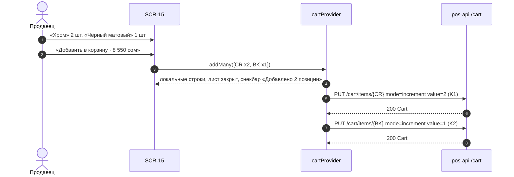

#### SCR-15.7. Состояния экрана

| Состояние | Что видно |
|---|---|
| Загрузка | скелетон-строки (3) / скелетон-свотчи |
| Успех | список/оси |
| Все варианты без остатка | все строки «Нет», CTA disabled, подсказка «Нет в наличии на складе корзины» + «Склады» (→ SCR-14) |
| Вариант не найден (поиск) | «Вариант не найден» |
| Ошибка | `ErrorState.inline` «Не удалось загрузить варианты · Повторить» (кэш остаётся) |
| Офлайн | варианты и остатки из кэша с меткой; добавление — в outbox |
| Нет разрешений | `owner` — лист не открывается (кнопка скрыта) |
| Step-up | не применяется |

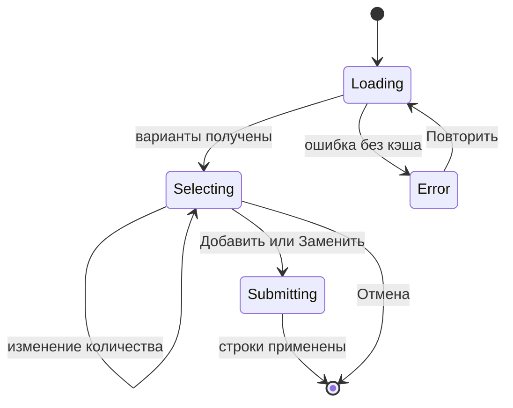

#### SCR-15.8. Валидация и сообщения

| Ключ ARB | Текст |
|---|---|
| `variant_sheet_count` | «{count} вариант/варианта/вариантов · ось: {axis}» (ICU, `variants_count`) |
| `variant_mode_axis` / `variant_mode_list` | «{axis}» / «Все варианты списком» |
| `variant_search_placeholder` | «Найти по артикулу» |
| `variant_search_empty` | «Вариант не найден» |
| `variant_selected_summary` | «Выбрано: {count} вариантов · {qty} {unit}» (ICU) |
| `variant_add_cta` | «Добавить в корзину · {sum}» |
| `variant_replace_cta` | «Заменить вариант» |
| `variant_merge_confirm` | «Вариант уже в корзине. Объединить количества?» |
| `variant_added_snackbar` | «Добавлено {count} позиции/позиций» (ICU) |
| `variant_partial_added` | «Добавлено {added} из {total}. «{name}» больше не продаётся» |
| `variant_select_error` | «Выберите вариант» |
| `variant_out_of_stock` | «Нет» |
| `variant_all_out_hint` | «Нет в наличии на складе корзины» |
| `variant_load_error` | «Не удалось загрузить варианты · Повторить» |

#### SCR-15.9. Источники данных и правила

`GET /catalog/products/{id}/variants` (`warehouseId`, `inStockOnly=false`; ответ `items[]` с `price`, `stock`, `stockByWarehouse`, `barcodes`, `images`; `attributeKeys`); `PUT /cart/items/{variantId}`, `DELETE /cart/items/{variantId}?packagingId=`; drift `product_variants`, `prices`, `stock_balances`. Правила: INV-012, INV-014, INV-015, INV-042, CART-002, CART-005, CART-025.

#### SCR-15.10. Действия по ролям

| Действие | seller | cashier | senior_seller | admin | owner | customer (Q-001) | Право (11 §4.3) / ограничение |
|---|---|---|---|---|---|---|---|
| Открыть лист, смотреть варианты, артикулы, цены своего вида цены | ✓ | ✓ | ✓ | ✓ | — (кнопка «Выбрать вариант» скрыта; варианты — в SCR-14) | ✓ | `catalog.read`, `catalog.prices.read` |
| Число доступного остатка по строке | ✓ | ✓ | ✓ | ✓ | — | — (только «в наличии / нет») | `inventory.read` |
| Добавить выбранные варианты в корзину | ✓ | ✓ | ✓ | ✓ | — | ✓ | `cart.manage.own`; сервер — `403 FORBIDDEN` для `owner` |
| Режим «Заменить вариант» строки корзины (из SCR-20) | ✓ | ✓ | ✓ | ✓ | — | ✓ | `cart.manage.own` (только своя корзина, CART-005) |
| Поиск по артикулу варианта (UI-15-006) | ✓ | ✓ | ✓ | ✓ | — | ✓ | `catalog.read` |

Ограничения безопасности: цена в запрос `PUT /cart/items/{variantId}` не передаётся (D-23; поле `price` → `VALIDATION_FAILED`, аудит `price.override_attempt`); лист работает только с корзиной текущего пользователя; закупочные цены в ответе `/variants` отсутствуют (INV-033).

#### SCR-15.11. Повтор, двойной запрос, «Назад», перезапуск

| Ситуация | Поведение |
|---|---|
| Двойной тап «Добавить в корзину» / «Заменить вариант» | одно действие: кнопка в loading до закрытия листа, повторные тапы игнорируются |
| Повторное нажатие «+» строки варианта | +1 шаг этой строки без запросов (в корзину ничего не уходит до CTA); ограничение `available` склада корзины (INV-042) |
| Таймаут запроса строки | повтор с тем же `Idempotency-Key` этой строки (08 §2.10); строки отправляются последовательно через очередь корзины (п. 2.2.12) |
| Двойной тап «Выбрать вариант» на карточке | один лист (повторный тап во время открытия игнорируется) |
| HID-скан при открытом листе | по п. 2.2.11: при фокусе в поле поиска по артикулу — символы в поле; иначе лист закрывается без изменений корзины и скан обрабатывается как новый |
| «Назад» / `Esc` / свайп вниз / клик вне popover | закрыть без изменений корзины (несохранённые количества в листе теряются, CTA не нажат) |
| Перезапуск приложения | лист не восстанавливается (sheet без маршрута, `visual/navigation.md` §14.6); строки, уже применённые локально, восстанавливаются из `cart_items_draft` (CART-009); неотправленные — уходят из outbox по порядку |
| Смена класса окна / поворот при открытом листе | лист закрывается и открывается заново в форме нового класса (compact sheet ↔ medium sheet 560 ↔ expanded popover) с сохранением выбранных количеств и режима (состояние листа — в провайдере `variantSheetState(productId)` до закрытия, 03 §8.7) |
| Idle-блокировка при открытом листе | SCR-08 overlay поверх листа; после `POST /auth/unlock` лист и выбранные количества сохраняются (ядро §17.2); при `SESSION_REVOKED` лист закрывается без изменений корзины |

#### SCR-15.12. Платформы

Windows: popover; ↑/↓ по строкам, ←/→ по значениям оси, `+`/`−` количество строки, Enter — добавить, `Esc` — закрыть. Android/iOS: bottom sheet, свайп вниз — закрыть, тач-цели свотчей и степперов 48. HID-скан при открытом листе — по правилу п. 2.2.11 (при фокусе в поиске по артикулу — ввод в поле; иначе лист закрывается и скан обрабатывается как новый).

#### SCR-15.13. Критерии приёмки

| ID | Критерий |
|---|---|
| AC-UI-15-001 | «Выбрать вариант» открывает лист со всеми вариантами товара, их артикулами, ценами и остатком по складу корзины. |
| AC-UI-15-002 | Выбор 2 вариантов с количествами 2 и 1 создаёт 2 отдельные строки корзины с этими количествами одним нажатием. |
| AC-UI-15-003 | Вариант без остатка отображается с пометкой «Нет» и не может быть добавлен. |
| AC-UI-15-004 | При 0 выбранных кнопка добавления недоступна. |
| AC-UI-15-005 | В режиме смены варианта строки корзины количество и упаковка сохраняются; при наличии нового варианта в корзине показывается подтверждение объединения. |
| AC-UI-15-006 | При > 8 вариантах доступен поиск по артикулу, фильтрующий список без сетевого запроса. |
| AC-UI-15-007 | Количество по строке не превышает `available`; попытка превышения — shake и подпись «Доступно {n}». |
| AC-UI-15-008 | Ошибка одной строки при множественном добавлении не отменяет добавление остальных; пользователь видит, какая строка не добавлена. |
| AC-UI-15-009 | Закрытие листа без нажатия CTA не изменяет корзину. |
| AC-UI-15-010 | Поворот планшета при открытом листе с выбранными количествами 2 и 1 сохраняет эти количества и режим листа. |
| AC-UI-15-011 | Для `owner` кнопка «Выбрать вариант» отсутствует; прямой `PUT /cart/items/{variantId}` от `owner` → `403 FORBIDDEN`. |
| AC-UI-15-012 | На expanded лист открывается popover без затемнения фона (CP доступна), на compact — bottom sheet с затемнением. |

#### SCR-15.14. Трассировка

| Требование | SRC-ID | Правила |
|---|---|---|
| Выбор нескольких вариантов одного товара | SRC-E-154 | INV-015 |
| Варианты, их артикулы, цены, остатки | SRC-C-040, SRC-C-042, SRC-C-043, SRC-F-029 | INV-011, INV-012 |
| Несколько расцветок | SRC-F-030 | INV-015 |
| Смена варианта в корзине | SRC-C-064, SRC-D-112 | CART-005 |
| Товар с вариантами не добавляется без выбора; после выбора повторное «+» на карточке — без листа | SRC-C-033 | INV-014; п. 2.3 шаг 7; AC-UI-10-027 |
| 14 пунктов описания экрана | SRC-F-004…SRC-F-019 | подразделы SCR-15.1…15.13 (п. .5, .10, .11 — таблицами) |

---

### SCR-16 — Ввод количества (нампад) (sheet / popover, роли staff, customer, R1: да)

#### SCR-16.1. Назначение и роль пользователя

Быстрый ввод количества (SRC-C-034 «отдельно предусмотрите быстрый ввод количества», INV-041): большие числа («120 шт»), дробные значения для метражных/весовых единиц («12,5 м»), выбор упаковки, подсказки «кратность · минимальная партия · доступно». Значение проверяется сразу в приложении и затем сервером (INV-008); некорректные количества не допускаются (SRC-C-036). Ввод 0 = запрос на удаление строки (CART-012). Открывается тапом по числу `QuantityStepper` или долгим нажатием «+» на карточке каталога (SCR-10/11/12), в SCR-14 и в строке корзины (SCR-20). Пользователи — staff с `cart.manage.own` и `customer` (Q-001).

#### SCR-16.2. Структура экрана

`QuantityNumpadSheet` (вариант `quantity`, 03 §9.21):

```
┌──────────────────────────────────────┐
│ Количество · Смеситель Gappo G1007   │  заголовок ds.text.title + «Арт. G1007 · 1 650 сом / шт» caption
│ [ шт | кор (12 шт) ]                 │  UnitSelector (скрыт без упаковок)
│                36 шт                 │  дисплей ds.text.display 32/700 tnum + единица
│ Кратность: 12 шт · Доступно: 240 шт  │  подсказка caption / ошибка error
│ [+10] [+50] [+100]                   │  быстрые AppButton.tonal S
│  1   2   3                           │
│  4   5   6                           │  клавиши 64×56, зазор 8, radius sm, surfaceVariant
│  7   8   9                           │
│  ,   0   ⌫                           │  «,» — только при qtyPrecision > 0
│ [ Отмена ]        [ Готово ]         │  AppButton.outlined L / AppButton.primary L
└──────────────────────────────────────┘
```

- **compact:** `AppBottomSheet` modal, ширина экрана, высота по содержимому (≈ 520), паддинги 16; в ландшафте клавиши 56×44.
- **medium:** sheet/диалог 400 по центру.
- **expanded/large:** popover 300 у поля степпера (`ds.elevation.2`, радиус `ds.radius.lg`, клавиши 56×48) **или** прямой ввод с клавиатуры в поле степпера без popover (режим UI-16-010): фокус на числе → набор цифр → Enter.

#### SCR-16.3. Таблица элементов

| № | UI-ID | Элемент | Компонент | Расположение/размер/отступы/выравнивание | Токены | Состояния | Поведение | Источник данных | Роли | Правило |
|---|---|---|---|---|---|---|---|---|---|---|
| 1 | UI-16-001 | Товар | заголовок `QuantityNumpadSheet` | верх, паддинг 16, 2 строки | `ds.text.title` 600; `caption` `textSecondary` tnum | default | — | аргументы листа (`variantId`, название, артикул, цена) | все | INV-011 |
| 2 | UI-16-002 | Единица / упаковка | `UnitSelector` | под заголовком, высота 36 | выбранный `surface` + `ds.elevation.1` + `primary` | default, selected, disabled, readonly | переключение пересчитывает дисплей с сохранением базового количества (INV-003); результат нецелый — ближайшее большее целое число упаковок + подсказка «3 кор = 36 шт» | `packagings[]`, `factor`, `allowFraction` | все | INV-002, INV-003, INV-006 |
| 3 | UI-16-003 | Дисплей | `QuantityNumpadSheet` (дисплей) | по центру, высота 56 | `ds.text.display` 32/700 tnum `textPrimary`; ошибка — `error` + рамка `error` 2 | default (текущее значение выделено для замены), editing, error, empty («0») | первая цифра заменяет значение, далее — дописывает; `liveRegion` | локальное состояние | все | INV-010 |
| 4 | UI-16-004 | Подсказка / ошибка | текст `caption` | под дисплеем, 2 строки максимум | `textSecondary`; ошибка `error` + иконка `error` 16 | hint, error | «Кратность: 12 шт · Мин. партия: 12 шт · Доступно: 240 шт»; ошибки — п. SCR-16.8 | `multiplicity`, `minQuantity`, `remainingAvailable`/`available` | staff — «Доступно»; `customer` — без числа | INV-004, INV-005, INV-042 |
| 5 | UI-16-009 | «Округлить до N» | `AppButton.text S` | в строке ошибки кратности справа | `primary` | показан при `QTY_NOT_MULTIPLE` | одно нажатие подставляет ближайшее большее кратное | локально | все | INV-004 |
| 6 | UI-16-008 | Быстрые приращения | `AppButton.tonal S` ×3 «+10», «+50», «+100» | строка над клавишами, зазор 8 | `primaryContainer`/`primary` | default, disabled (результат > доступного) | прибавляют N шагов текущей единицы [ТИПОВО: в упаковках — +10 кор] | локально | все | 03 §9.21 |
| 7 | UI-16-005 | Клавиши | сетка 3×4 | клавиши 64×56 (compact), 56×48 (popover), зазор 8 | `surfaceVariant`/`textPrimary` `ds.text.h3` 20/500 tnum; pressed scale 0,96 | default, hover, pressed, focused, disabled («,» при `qtyPrecision=0` или в упаковках) | 0–9; «,» — один раз, не больше `qtyPrecision` знаков после; «⌫» — удалить символ, удержание — очистить | — | все | INV-006 |
| 8 | UI-16-006 | «Отмена» | `AppButton.outlined L` | футер слева, 50 % − 4 | `primary` текст | default | закрыть без изменений; то же — `Esc`, «Назад», свайп вниз | — | все | — |
| 9 | UI-16-007 | «Готово» / «Удалить» | `AppButton.primary L` / `AppButton.danger L` | футер справа | `primary`/`onPrimary`; при 0 — `error`/`onError` «Удалить» | default, disabled (ошибка, пусто), loading (≤ 300 мс) | применить значение (п. SCR-16.4); при 0 в контексте строки корзины — `ConfirmDialog` «Удалить позицию из корзины?» (CART-012); Enter — то же | — | `cart.manage.own` | INV-007, CART-003, CART-012 |
| 10 | UI-16-010 | Прямой ввод (Windows) | поле числа `QuantityStepper` в режиме редактирования | на месте числа степпера | обводка 2 `primary` | editing, error | цифры, `,`, Backspace, Enter — применить, `Esc` — отмена; ошибки — тултип `error` под полем | — | `cart.manage.own` | INV-041 |

#### SCR-16.4. Поведение каждого контрола

- **Открытие.** Аргументы: `variantId`, `packagingId`, текущее `qty` (milli-units), `qtyPrecision`, `packFactor`, `multiplicity`, `minQuantity`, `maxAvailable` (= `remainingAvailable` [НОВОЕ ИМЯ: 10 INV-042] + текущее количество строки для строки корзины, либо `available` склада корзины для новой позиции), контекст (`cartLine` / `productCard` / `catalogCard`). Дисплей показывает текущее значение, выделенное для замены.
- **Ввод.** Ограничение длины: 6 цифр целой части + `qtyPrecision` знаков (INV-010: максимум 999 999,999 [НЕ ПОДТВЕРЖДЕНО, Q-176]); ведущие нули отбрасываются; «,» и «.» с аппаратной клавиатуры принимаются, нормализуются в «,» для показа (D-19: на сервер — строка с «.»). Для единиц с `qtyPrecision=0` и для упаковок клавиша «,» disabled (количество упаковок всегда целое, INV-006).
- **Мгновенная проверка** (после каждого символа, без блокировки ввода): превышение доступного → дисплей `error`, подпись «Доступно {n} {unit}», «Готово» disabled (ввод > доступного ограничивается при нажатии «Готово» не автоматически, а запретом — пользователь видит, что ввёл); некратное → подпись «Количество должно быть кратно {m} {unit}» + «Округлить до {next}»; меньше минимальной партии → «Минимальная партия — {min} {unit}»; лишние знаки → «Для единицы „{unit}“ допустимо не более {n} знаков после запятой».
- **«Готово».** Контекст `cartLine` / `catalogCard` (строка существует): `PUT /cart/items/{variantId}` `mode=set` с `packagingId` и `rowVersion` (без debounce — явное действие), локальное значение применяется сразу; ошибки сервера `QTY_NOT_MULTIPLE` (кратность упаковки; точность — с rule `qty_precision`, 08 §2.4)/`QTY_BELOW_MIN`/`VALIDATION_FAILED` (целое число упаковок — по 10 INV-006, раздел 14 замечание 28) → лист открывается снова с текстом ошибки сервера и прежним значением; `VARIANT_UNAVAILABLE` → снекбар, строка помечена (CART-015). Контекст `productCard` (SCR-14 до добавления): значение только подставляется в степпер карточки, запроса нет. Контекст `catalogCard` без строки (долгое «+» на «+ Добавить»): «Готово» создаёт строку — `PUT … mode=increment` с введённым значением и ключом идемпотентности.
- **0.** В контексте строки — «Готово» превращается в «Удалить» (`danger`) → `ConfirmDialog` → `DELETE /cart/items/{variantId}?packagingId=` + снекбар «Позиция удалена · Отменить» (CART-004). В контексте `productCard` — «Готово» disabled (минимум — шаг).
- **Быстрые «+10/+50/+100»** — прибавляют к текущему значению; при превышении доступного кнопка disabled.
- **HID-скан** при открытом листе игнорируется (не попадает в дисплей), после закрытия — обрабатывается обычным образом (буфер не копится).

#### SCR-16.5. Анимации

| ID | Применение | Начальное → триггер | Последовательность / конечное | Длительность | Ошибка | Reduce-motion |
|---|---|---|---|---|---|---|
| ANIM-025 | открытие/закрытие листа | скрыт → тап по числу / долгое «+» | slide-up 250 мс; popover — fade + scale 0,96→1 200 мс | 250 / 200 мс | — | fade 80 мс |
| ANIM-015 | клавиши | default → нажатие | pressed scale 0,96, фон `surfacePressed`; haptic `selectionClick` на тач | 150 мс | — | без scale |
| ANIM-012 | дисплей | норма → ошибка | shake ±4 lp + рамка `error` | 300 мс | — | только цвет и текст |
| ANIM-010 | дисплей при «+10/+50/+100», пересчёте упаковки | старое → новое | перекат числа | 200 мс | — | мгновенно |
| ANIM-017 | `UnitSelector` | индикатор на старой единице → выбор | скольжение | 200 мс | — | мгновенно |

#### SCR-16.6. Переходы

| Откуда | Куда | Данные | Тип | «Назад» |
|---|---|---|---|---|
| SCR-10/11/12 (число степпера, долгое «+») | SCR-16 | `variantId`, `packagingId`, `qty`, `qtyPrecision`, `packFactor`, `maxAvailable`, контекст | sheet / popover, без маршрута (`PopScope`) | закрыть без изменений |
| SCR-14 (число степпера) | SCR-16 | то же, контекст `productCard` | sheet / popover | SCR-14 |
| SCR-20 (число в `CartLine`) | SCR-16 | то же, контекст `cartLine` | sheet / popover | SCR-20 |
| SCR-16 «Готово» | экран-источник | `qty`, `packagingId` | `pop(result)` | — |

#### SCR-16.7. Состояния экрана

| Состояние | Что видно |
|---|---|
| Исходное | текущее значение выделено, подсказка правил |
| Ввод | новое значение, подсказка |
| Ошибка кратности | текст + «Округлить до N», «Готово» disabled |
| Ошибка минимума / точности / превышения | текст `error`, «Готово» disabled |
| Ноль | «Удалить» (строка корзины) / «Готово» disabled (карточка) |
| Применение | «Готово» loading ≤ 300 мс, лист закрывается |
| Ошибка сервера | лист снова открыт с текстом ошибки `error_<code>` |
| Офлайн | ввод работает; применение — локально + outbox (CART-018); проверка доступного — по кэшу с пометкой «по данным от {time}» |
| Нет разрешений | `owner` — степпер и лист недоступны |
| Step-up | не применяется |

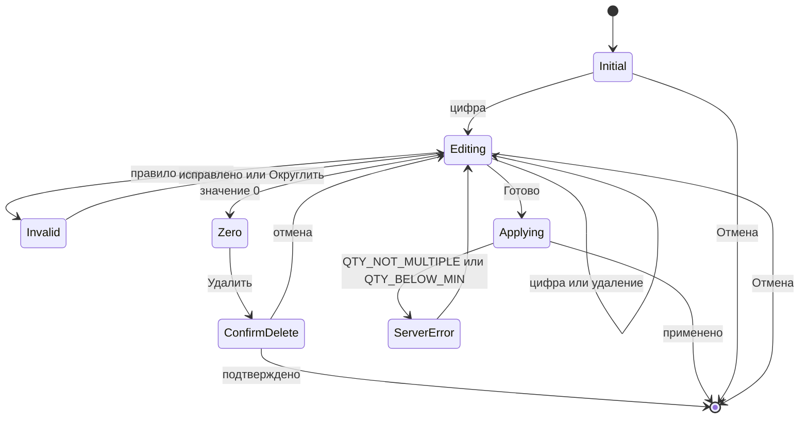

#### SCR-16.8. Валидация и сообщения

| Правило | Код | Ключ ARB | Текст |
|---|---|---|---|
| Заголовок | — | `qty_sheet_title` | «Количество · {name}» |
| Подсказка | — | `qty_hint_rules` | «Кратность: {multiple} {unit} · Мин. партия: {min} {unit} · Доступно: {available} {unit}» |
| Точность (локально и ответ сервера) | `QTY_NOT_MULTIPLE` с rule `qty_precision` (08 §2.4, §2.14 «Quantity») | `qty_error_precision` | «Для единицы „{unit}“ допустимо не более {n} знаков после запятой» |
| Кратность | `QTY_NOT_MULTIPLE` | `qty_error_not_multiple` / `qty_round_up` | «Количество должно быть кратно {m} {unit}» / «Округлить до {next}» |
| Минимум | `QTY_BELOW_MIN` | `qty_error_below_min` | «Минимальная партия — {min} {unit}» |
| Превышение доступного | локальная проверка INV-042 (не ошибка сервера: на `PUT /cart/items` превышение приходит предупреждением `warnings: ["stock_insufficient"]`, 08 §4.7.2; код `STOCK_INSUFFICIENT` возникает только при оформлении) | `qty_error_stock` | «Доступно только {available} {unit} на складе «{warehouse}»» (контексты текстов — SCR-10.8) |
| Упаковки целые | 10 INV-006: `VALIDATION_FAILED`; 08 §2.4: точность упаковки — `QTY_NOT_MULTIPLE` (`qty_precision`) — расхождение 08/10 (AC-INV-006), раздел 14, замечание 28; клиент обрабатывает оба кода одним текстом | `qty_error_pack_integer` | «Количество упаковок должно быть целым» |
| Слишком много | `VALIDATION_FAILED` (схема Quantity 08 §2.14, §3.2: не более 11 цифр целой части; лимит UI — INV-010) | `qty_error_too_large` | «Слишком большое количество» |
| Пересчёт упаковки | — | `qty_pack_conversion` | «{packs} {pack} = {base} {unit}» |
| Ноль | — | `qty_zero_delete_hint` / `cart_line_delete_confirm` | «0 — удалить позицию из корзины» / «Удалить позицию из корзины?» |
| Кнопки | — | `ds_button_cancel`, `ds_button_ok`, `qty_delete` | «Отмена», «Готово», «Удалить» |
| Быстрые | — | `qty_quick_add` | «+{count}» |
| Офлайн | — | `qty_offline_note` | «Доступно по данным от {time}» |
| Клавиши (a11y) | — | `qty_key_digit_a11y`, `qty_key_backspace_a11y`, `qty_key_decimal_a11y` | «цифра {d}», «стереть», «запятая» |

#### SCR-16.9. Источники данных и правила

Параметры из `Product`/`Variant`/`Packaging` (08 §3.6: `qtyPrecision`, `factor`, `allowFraction`, `minQuantity`), `remainingAvailable` из ответа корзины (INV-042); запись — `PUT /cart/items/{variantId}` (`mode=set`/`increment`, `packagingId`, `rowVersion`, `Idempotency-Key` для `increment`), `DELETE /cart/items/{variantId}?packagingId=`. Хранение — `int` milli-units (D-19, 07 §11.3). Правила: INV-001…010, INV-041, INV-042, CART-003, CART-004, CART-012, CART-025.

#### SCR-16.10. Действия по ролям

| Действие | seller | cashier | senior_seller | admin | owner | customer (Q-001) | Право (11 §4.3) / ограничение |
|---|---|---|---|---|---|---|---|
| Открыть нампад из степпера карточки, SCR-14, строки корзины | ✓ | ✓ | ✓ | ✓ | — (степпер скрыт) | ✓ | `cart.manage.own` |
| «Готово» — изменить количество строки (`mode=set`) / создать строку (`mode=increment`) | ✓ | ✓ | ✓ | ✓ | — | ✓ | `cart.manage.own`; сервер — `403 FORBIDDEN` для `owner` |
| «Удалить» (0) с подтверждением | ✓ | ✓ | ✓ | ✓ | — | ✓ | `cart.manage.own` (CART-003, CART-012) |
| Выбор упаковки `UnitSelector` | ✓ | ✓ | ✓ | ✓ | — | ✓ | `catalog.read` (упаковки варианта) |
| Подсказка «Доступно {n}» с числом | ✓ | ✓ | ✓ | ✓ | — | — (только «Недостаточно товара» без числа) | `inventory.read` [ТИПОВО: 11 §4.4 — клиенту только «в наличии/нет»] |
| Подсказка кратности и минимальной партии | ✓ | ✓ | ✓ | ✓ | — | ✓ | `catalog.read` |

Ограничения безопасности: нампад не передаёт цену и сумму — только количество, `packagingId` и `rowVersion` (D-23); значение проверяется сервером повторно (INV-008), локальная проверка — удобство; количество передаётся строкой без `double` (D-19).

#### SCR-16.11. Повтор, двойной запрос, «Назад», перезапуск

- **Повторное нажатие «Готово».** Первое нажатие переводит кнопку в `loading` (≤ 300 мс) и отправляет один запрос; повторные нажатия, `Enter` и двойной тап до ответа игнорируются; после ответа лист закрывается.
- **Двойной запрос при применении к корзине.** Контекст `cartLine` / `catalogCard` со строкой: `PUT /cart/items/{variantId}` `mode=set` с `rowVersion` идемпотентен по семантике — повтор даёт то же количество; `409 VERSION_CONFLICT` → лист открывается заново со значением с сервера и текстом `cart_version_conflict_title`. Контекст `catalogCard` без строки: `mode=increment` с `Idempotency-Key`, созданным при открытии листа и неизменным до его закрытия, — повтор по таймауту или двойное нажатие не удваивает количество (08 §2.7).
- **Долгое нажатие.** «⌫» с удержанием очищает дисплей (UI-16-005), при пустом дисплее удержание ничего не делает; удержание цифры и «+10/+50/+100» не повторяет ввод — одно нажатие = одно действие (автоповтор выключен) [ТИПОВО]; долгое «+» в каталоге или корзине — способ открыть этот лист (ANIM-025), внутри листа отдельного действия не имеет.
- **«Назад» / `Esc` / тап вне popover** — отмена без изменений, запрос не отправляется; если запрос уже отправлен, лист закрывается после ответа, результат применяется (откат — через снекбар «Отменить» строки корзины, CART-004).
- **Перезапуск.** Лист не восстанавливается; применённое значение — из `cart_items_draft` / ответа `GET /cart`; неприменённый ввод теряется.

#### SCR-16.12. Платформы

Windows: прямой ввод цифр в поле степпера (UI-16-010) или popover; Enter — «Готово», `Esc` — «Отмена», Backspace — стереть; клавиатура цифрового блока поддерживается; HID игнорируется. Android/iOS: собственный нампад (системная клавиатура не вызывается), haptic на клавишах, тач-цели 56. Сенсорный POS: popover с клавишами ≥ 48.

#### SCR-16.13. Критерии приёмки

| ID | Критерий |
|---|---|
| AC-UI-16-001 | Тап по числу степпера открывает нампад с текущим значением; первая цифра заменяет значение. |
| AC-UI-16-002 | Для `qtyPrecision=0` клавиша «,» недоступна; для «м» с `qtyPrecision=1` ввод «12,55» блокирует «Готово» с сообщением о точности. |
| AC-UI-16-003 | Ввод 30 при кратности 12 показывает ошибку и «Округлить до 36»; нажатие подставляет 36. |
| AC-UI-16-004 | Ввод больше доступного показывает «Доступно только {n} {unit} …» и блокирует «Готово». |
| AC-UI-16-005 | Смена единицы с «шт» на «кор (12 шт)» при 36 шт показывает «3»; при 30 шт — «3» с подсказкой «3 кор = 36 шт». |
| AC-UI-16-006 | Ввод 0 для строки корзины превращает «Готово» в «Удалить» и требует подтверждения. |
| AC-UI-16-007 | «Готово» для строки корзины отправляет один `PUT … mode=set` с `packagingId`; ошибка сервера возвращает лист с текстом ошибки. |
| AC-UI-16-008 | На Windows ввод «24» + Enter в поле степпера без открытия нампада применяет количество 24. |
| AC-UI-16-009 | HID-скан при открытом нампаде не изменяет значение дисплея. |
| AC-UI-16-010 | Количество хранится и передаётся без `double` (строка «12.500» для 12,5 м). |
| AC-UI-16-011 | Ответ сервера `422 QTY_NOT_MULTIPLE` с rule `qty_precision` показывает текст точности `qty_error_precision`, а не текст кратности; ответ `200` с `warnings: ["stock_insufficient"]` не считается ошибкой: строка сохраняется, показывается `error_stock_insufficient`. |
| AC-UI-16-012 | Для `owner` нампад недоступен (степпера нет); для `customer` при превышении доступного показывается «Недостаточно товара» без числа. |

#### SCR-16.14. Трассировка

| Требование | SRC-ID | Правила |
|---|---|---|
| Быстрый ввод количества | SRC-C-034, SRC-E-151 | INV-041 |
| Единицы и упаковки | SRC-C-035, SRC-E-150 | INV-001…003, INV-006 |
| Некорректные количества недопустимы | SRC-C-036 | INV-004…010 |
| Изменение количества | SRC-D-111 | CART-003 |
| Недостаточный остаток | SRC-D-115 | INV-042 |
| Удаление товара из корзины (0 → «Удалить» с подтверждением) | SRC-D-110a | CART-003, CART-012; AC-UI-16-006 |
| 14 пунктов описания экрана | SRC-F-004…SRC-F-019 | подразделы SCR-16.1…16.13 (п. .10 — таблицей) |

---

### SCR-17 — Сканер штрихкода (маршрут `/scan`, роли staff, Android/iOS, R1: да)

#### SCR-17.1. Назначение и роль пользователя

Поиск товара сканированием штрихкода, «если оборудование поддерживается» (SRC-C-010): камерой устройства (`mobile_scanner`) на Android/iOS — экран SCR-17; аппаратным HID-сканером (USB/Bluetooth, режим клавиатуры) — на всех платформах **без экрана**: оболочка перехватывает скан в любом месте каталога (D-42). Результат скана — тот же, что в SCR-11: штрихкод → вариант/упаковка → добавить в корзину или открыть карточку (по настройке, Q-179). Пользователи — staff (продавец в зале с телефоном, кассир с HID-сканером); `customer` — камера-сканер в R1 не предусмотрена: ядро §9 относит SCR-17 к staff, поэтому на SCR-50 и в SCR-42 у клиента кнопки камеры нет (сборка 1.1, раздел 12). Режимы маршрута `mode` (дополнено при сборке 02 по ЖС-1): `search` — найти товар и открыть карточку; `add` — сразу добавить в корзину; `order` `[НОВОЕ ИМЯ]` — распознать номер заказа для поиска в SCR-25 (товар не ищется, корзина не меняется); `test` `[НОВОЕ ИМЯ]` — проверка камеры из секции «Сканер» SCR-42 (значение и формат возвращаются в SCR-42, корзина не меняется).

#### SCR-17.2. Структура экрана

- **compact (полноэкранно, root-маршрут, без BNB):** фон — превью камеры на весь экран → затемнение `overlay` вокруг рамки → рамка-видоискатель ≈ 70 % ширины, соотношение 3:2, углы 4 lp `onPrimary`, анимированная линия-подсказка → сверху: шапка 56 на `overlay` (крестик слева, «Сканирование» `ds.text.title` `onPrimary`, фонарик справа) → под рамкой: подсказка «Наведите камеру на штрихкод товара или упаковки» `ds.text.body` `onPrimary` → низ: карточка последнего результата (`ProductCardList` мини 64 на `surface`, радиус `ds.radius.md`) с действием и «Отменить» → ряд кнопок 48: «Ввести вручную» (`AppButton.outlined` на `surface`) и переключатель «Серия» (`AppSwitch`).
- **medium (Android-планшет с камерой):** диалог 480×360 по центру с превью и теми же элементами в компактной компоновке.
- **expanded (Windows):** экран не применяется; кнопка сканера в `SearchBar` показывает тултип HID (UI-17-010); результат HID-скана — снекбар «Отсканировано {код} · {товар} +1 шт · Отменить».

#### SCR-17.3. Таблица элементов

| № | UI-ID | Элемент | Компонент | Расположение/размер/отступы/выравнивание | Токены | Состояния | Поведение | Источник данных | Роли | Правило |
|---|---|---|---|---|---|---|---|---|---|---|
| 1 | UI-17-001 | Закрыть | `AppIconButton` | шапка слева, цель 48 | `close` 24 `onPrimary` на `overlay` | default, pressed | `pop(result)` в экран-источник; применённые добавления остаются | — | staff | `visual/navigation.md` §3 |
| 2 | UI-17-002 | Фонарик | `AppIconButton` (toggle) | шапка справа | `flashlight_on`/`flashlight_off` [ТИПОВО: глиф проверяется на этапе 2, 03 §7.7] `onPrimary` | вкл/выкл, скрыт (нет вспышки) | переключение подсветки камеры | возможности камеры | staff | — |
| 3 | UI-17-003 | Видоискатель | превью `mobile_scanner` + рамка | рамка ≈ 70 % ширины, по центру по вертикали со смещением −10 % | рамка `onPrimary` 3 lp; затемнение `overlay`; линия-подсказка `primary` 2 lp | scanning, detected (рамка `success` 300 мс), error | распознавание EAN-13, EAN-8, Code128, UPC-A [ТИПОВО: форматы — Q-009]; при обнаружении — вибрация `HapticFeedback.mediumImpact` и звук по настройке (Q-110) | камера | staff | D-42 |
| 4 | UI-17-004 | Подсказка | текст `ds.text.body` | под рамкой, отступ 16, по центру | `onPrimary` | default, «Сканирование приостановлено» | — | ARB | staff | — |
| 5 | UI-17-005 | Последний результат | `ProductCardList` (мини, 64) + `AppSnackbar` | низ экрана над кнопками, поля 16 | `surface`, радиус `ds.radius.md`, `ds.elevation.2` | скрыт, добавлено, открыть, не найдено, несколько вариантов | «Frap F4252 · 4607012345678 · +1 шт в корзину · Отменить» (5 с) / «Открыть карточку» | `GET /search/barcode/{value}` | staff | CAT-003 |
| 6 | UI-17-006 | «Ввести вручную» | `AppButton.outlined M` на `surface` | низ слева, высота 48 | `primary` | default, pressed | закрыть камеру; `go /catalog/search` с фокусом в `SearchBar` и цифровой клавиатурой | — | staff | CAT-003 |
| 7 | UI-17-007 | «Серия» | `AppSwitch` + подпись | низ справа | `primary` вкл. | вкл/выкл | вкл — камера не закрывается после скана; выкл — закрытие после первого результата (`pop(result)`) | настройка `settings` (`scan_series_mode`) | staff | Q-207 |
| 8 | UI-17-008 | Запрос разрешения | системный диалог ОС | поверх экрана | системный | — | первый вход — системный запрос камеры | ОС | staff | — |
| 9 | UI-17-009 | Нет доступа к камере | `EmptyState.noCamera` | на весь экран (фон `surface`) | `no_camera.svg` / `no_photography` | default | «Открыть настройки» (системные настройки приложения), «Ввести вручную» | статус разрешения | staff | 03 §9.43 |
| 10 | UI-17-010 | Подсказка HID (Windows/без камеры) | `AppTooltip` / `AppSnackbar` | у кнопки сканера в `SearchBar` | `inverseSurface` | показан | «Сканер: ожидание. USB/Bluetooth-сканер в режиме клавиатуры, суффикс Enter» | — | staff | D-42 |
| 11 | UI-17-011 | Результат «несколько вариантов» | карточка результата + `AppButton.tonal` «Выбрать вариант» | как п. 5 | `info` | показан | → SCR-15 (камера ставится на паузу) | `product`, `variant=null` | staff | INV-014 |
| 12 | UI-17-012 | Не найдено | карточка результата `error` | как п. 5 | `errorContainer`/`error` | показан 3 с | «Штрихкод {value} не найден» + «Ввести вручную»; сканирование продолжается | `404 NOT_FOUND` | staff | CAT-003 |
| 13 | UI-17-013 `[НОВЫЙ UI-ID]` | Результат «номер заказа» (`mode=order`) | карточка результата (`AppListTile` на `surface`) | как п. 5 | `surface`, радиус `ds.radius.md`, `ds.elevation.2`; номер `ds.text.title` tnum | скрыт, распознано | шапка «Сканирование номера заказа», подсказка `scan_hint_order`; распознанное значение показывается 600 мс («Номер: {value}»), затем `pop(result)` с `value`; товар не ищется; «Серия» скрыта | камера (значение); поиск заказа выполняет SCR-25 (`GET /orders?q=`) | staff (видимость заказов — по SCR-25 п.10) | ORD-070, ЖС-1 |
| 14 | UI-17-014 `[НОВЫЙ UI-ID]` | Результат теста (`mode=test`) | карточка результата + `StatusChip` | как п. 5 | `info` | скрыт, распознано | шапка «Проверка камеры-сканера»; «Распознано: {value} · {format}» 600 мс, затем `pop(result)` с `value`, `format` в SCR-42 (UI-42-012); проверку по каталогу выполняет SCR-42; «Серия» и «Ввести вручную» скрыты | камера (значение, формат) | staff | D-42, ЖС-1 |

#### SCR-17.4. Поведение каждого контрола

- **Открытие** (`push /scan?mode=search|add|order|test`; без параметра — `search`): проверка разрешения камеры; не запрошено → системный запрос; разрешено → запуск превью; отказ/«больше не спрашивать» → UI-17-009. Устройство без камеры → кнопка сканера в `SearchBar` скрыта (на Android/iOS) [ТИПОВО].
- **Распознавание.** Код, стабильно распознанный в 2 последовательных кадрах [ТИПОВО], отправляется в `GET /search/barcode/{value}` (офлайн — drift `barcodes`). На время запроса превью продолжает работать, повторные распознавания того же кода в течение 1,5 с игнорируются (Q-207); другой код — ставится в очередь (обрабатывается после текущего).
- **Действие по результату** (настройка «Сканер» SCR-42, `mode=add` принудительно — добавление): 1 вариант → `mode=add`: +1 шаг (или `suggestedQuantity` упаковки) в корзину, карточка результата с «Отменить» (5 с, отмена — уменьшение строки `mode=set` на прежнее значение); `mode=search` (по умолчанию для `seller`, Q-179): «Открыть карточку» → `pop(result)` → SCR-14 с `variantId`, `packagingId`, `qty`; товар с вариантами без определённого варианта → SCR-15; `warnings: ["ambiguous_barcode"]` → открыть SCR-14 с баннером проверки; не найдено → UI-17-012.
- **Режим `order`** (вход из SCR-25, ЖС-1). Распознанный код (3…64 символа, правило п. 8) не отправляется в `GET /search/barcode`: карточка UI-17-013 показывает номер 600 мс, затем `pop(result: {value})`. SCR-25 выполняет `GET /orders?q={value}`: один заказ → SCR-24 (`orderId`); ни одного → снекбар `orders_scan_not_found`; несколько → список SCR-25 с запросом в поле поиска. Повторные распознавания во время закрытия игнорируются. «Ввести вручную» закрывает камеру и возвращает фокус в поле поиска SCR-25 (`pop` без результата). «Серия» скрыта.
- **Режим `test`** (вход из SCR-42 «Проверить камерой», ЖС-1). Значение и формат (`EAN-13`, `EAN-8`, `Code128`, `UPC-A`, иное) показываются в UI-17-014 600 мс, затем `pop(result: {value, format})`; проверку по каталогу (`GET /search/barcode/{value}`) выполняет SCR-42 (UI-42-012). `PUT /cart/items/…` не вызывается, корзина не меняется. «Серия» и «Ввести вручную» скрыты. Отказ в разрешении камеры → UI-17-009; «Назад» — в SCR-42 с результатом «Камера недоступна».
- **«Серия» вкл.** — после результата камера продолжает сканирование; итоговый снекбар при закрытии «Добавлено {n} позиций».
- **Фонарик** — сохраняет состояние до закрытия экрана.
- **Жизненный цикл.** Приложение уходит в фон → камера останавливается; возвращение → возобновление; idle-блокировка → экран SCR-08 поверх, камера остановлена.
- **HID без экрана** (все платформы): буфер символов с интервалом < 50 мс и суффиксом Enter/Tab распознаётся `AdaptiveScaffold` до обработки горячих клавиш; минимальная длина кода 3 символа (08 §4.5.2); перехват, отказ от перехвата и игнорирование — по единому правилу п. 2.2.11 (при фокусе в `AppTextField`, кроме `SearchBar`, в том числе в адресе на SCR-21, и в `DiscountInput` — не перехватывается; при открытом SCR-16 или диалоге — игнорируется) [РЕШЕНИЕ части: защита от ввода в формы].

#### SCR-17.5. Анимации

| ID / имя | Применение | Начальное → триггер | Последовательность / конечное | Длительность | Ошибка | Reduce-motion |
|---|---|---|---|---|---|---|
| ANIM-024 | вход/выход | экран-источник → кнопка сканера | compact — slide-up полноэкранного маршрута 300 мс; medium — диалог ANIM-023 | 300 мс | — | fade 80 мс |
| SCR-17-ANIM-A (специфичная анимация экрана; номер `ANIM-NNN` присваивает 03 — замечание части №14) — линия-подсказка видоискателя | рамка | сканирование активно | линия `primary` движется сверху вниз внутри рамки, loop | 1,5 с linear (≤ 1 цикла/с, A11Y-018) | при ошибке камеры — остановка | статичная линия по центру |
| SCR-17-ANIM-B (специфичная анимация экрана; номер `ANIM-NNN` присваивает 03 — замечание части №14) — подтверждение распознавания | рамка | код распознан | рамка `onPrimary` → `success` 150 мс → обратно 150 мс | 300 мс | не найдено — рамка `error` 300 мс | смена цвета без анимации |
| ANIM-027 | карточка результата / снекбар | скрыт → результат | slide-up 8 lp + fade | 150 мс | — | fade 80 мс |
| ANIM-006 | бейдж корзины в источнике | +1 шт | пульс бейджа при возврате | 200 мс | — | без пульса |

#### SCR-17.6. Переходы

| Откуда | Куда | Данные | Тип | «Назад» |
|---|---|---|---|---|
| SCR-10/11 (кнопка сканера, Android/iOS) | SCR-17 | `mode=search` | `push /scan` (root) | экран-источник |
| SCR-20 / SCR-30 (кнопка сканера корзины/кассы) | SCR-17 | `mode=add` | `push /scan` | экран-источник |
| SCR-25 (кнопка сканера в поиске заказов, Android/iOS, staff) | SCR-17 | `mode=order` | `push /scan?mode=order` (root) | SCR-25 |
| SCR-42 «Проверить камерой» (секция «Сканер», staff) | SCR-17 | `mode=test` | `push /scan?mode=test` (root) | SCR-42, секция «Сканер» |
| SCR-17 (`mode=order`, номер распознан) | SCR-25 → SCR-24 | `pop(result: {value})`; SCR-25 находит `orderId` | `pop`; SCR-25 выполняет `GET /orders?q=` и при одном совпадении открывает SCR-24 (`push`) | SCR-25 с запросом в поле |
| SCR-17 (`mode=test`, значение распознано) | SCR-42 | `pop(result: {value, format})` | `pop` | — |
| SCR-17 (результат «Открыть») | SCR-14 | `productId`, `variantId`, `packagingId`, `qty` | `pop(result)` → `push` | источник |
| SCR-17 (несколько вариантов) | SCR-15 | `productId`, `barcode` | sheet поверх камеры (превью на паузе) | SCR-17 |
| SCR-17 «Ввести вручную» | SCR-11 | фокус в поле, цифровая клавиатура | `pop` + `go /catalog/search` | SCR-10 |
| SCR-17 (нет доступа) «Открыть настройки» | настройки ОС | — | внешний переход | при возврате — повторная проверка разрешения |

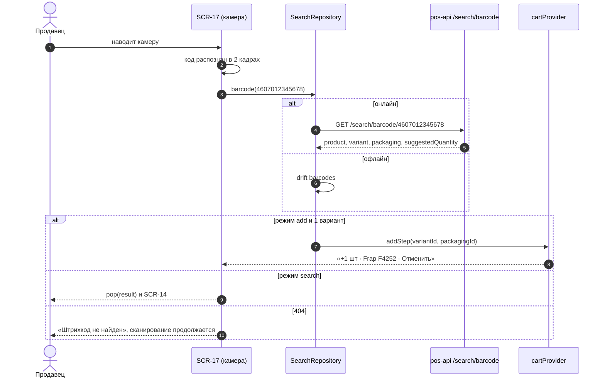

#### SCR-17.7. Состояния экрана

| Состояние | Что видно |
|---|---|
| Запрос разрешения | системный диалог |
| Сканирование | превью, рамка, линия, подсказка |
| Распознано / запрос | рамка `success`, превью продолжается |
| Добавлено | карточка результата «+1 шт · Отменить» |
| Не найдено | карточка `error` 3 с, сканирование продолжается |
| Несколько вариантов | карточка + «Выбрать вариант» |
| Нет разрешения | `EmptyState.noCamera` + «Открыть настройки», «Ввести вручную» |
| Камера занята / ошибка камеры | `ErrorState.fullScreen` «Камера недоступна» + «Повторить», «Ввести вручную» |
| Офлайн | сканирование по drift `barcodes` с пометкой «по сохранённому каталогу»; добавление — в outbox |
| Ошибка сервера | «Не удалось проверить штрихкод · Повторить»; код сохраняется для повтора |
| Номер заказа распознан (`order`) | UI-17-013 «Номер: {value}» 600 мс → закрытие с результатом |
| Тест (`test`) | UI-17-014 «Распознано: {value} · {format}» 600 мс → закрытие с результатом |
| Нет прав | `owner`: `mode=add` недоступен, только поиск, открытие, `order` и `test`; `customer` — кнопки камеры нет, прямой переход по `/scan` отклоняется guard ролей (`visual/navigation.md`) с возвратом на главный экран роли |
| Step-up | не применяется |

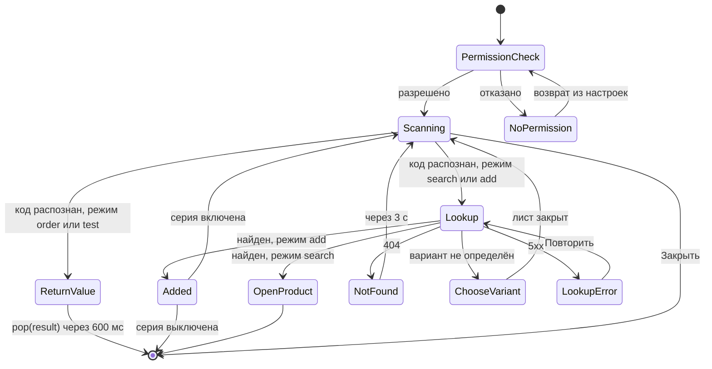

#### SCR-17.8. Валидация и сообщения

| Ключ ARB | Текст |
|---|---|
| `scan_title` | «Сканирование» |
| `scan_hint` | «Наведите камеру на штрихкод товара или упаковки» |
| `scan_added` | «+{qty} {unit} · {name}» |
| `scan_open_product` | «Открыть карточку» |
| `scan_not_found` | «Штрихкод {value} не найден» |
| `scan_choose_variant` | «Найдено {count} вариантов. Выберите вариант» |
| `scan_manual_entry` | «Ввести вручную» |
| `scan_series` | «Серия» |
| `scan_torch_on_a11y` / `scan_torch_off_a11y` | «Включить фонарик» / «Выключить фонарик» |
| `ds_empty_no_camera_title` / `scan_no_camera_body` / `scan_open_settings` | «Камера недоступна» / «Разрешите доступ к камере в настройках устройства» / «Открыть настройки» |
| `scan_camera_error` | «Камера недоступна. Закройте другие приложения, использующие камеру» |
| `scan_lookup_error` | «Не удалось проверить штрихкод · Повторить» |
| `scan_offline_note` | «Поиск по сохранённому каталогу от {time}» |
| `scan_series_summary` | «Добавлено {count} позиций» (ICU) |
| `scan_hid_waiting` | «Сканер: ожидание. USB/Bluetooth-сканер в режиме клавиатуры, суффикс Enter» |
| `scan_hid_result` | «Отсканировано {value} · {name} +{qty} {unit}» |
| `scan_ambiguous` | «Штрихкод привязан к нескольким товарам, проверьте выбор» |
| `scan_title_order` | «Сканирование номера заказа» |
| `scan_hint_order` | «Наведите камеру на штрихкод или QR-код с распечатки заказа» |
| `scan_order_value` | «Номер: {value}» |
| `scan_title_test` | «Проверка камеры-сканера» |
| `scan_test_result` | «Распознано: {value} · {format}» |

Валидация кода: 3…64 символа `[0-9A-Za-z-]` (08 §4.5.2); код другой длины/символов → «Штрихкод не распознан, попробуйте ещё раз» (`scan_invalid_code`) без запроса.

#### SCR-17.9. Источники данных и правила

`GET /search/barcode/{value}?warehouseId=` (ответ: `product`, `variant`, `packaging`, `barcodeType`, `suggestedQuantity`; `NOT_FOUND`; `warnings: ["ambiguous_barcode"]`); офлайн — drift `barcodes` (`value` → `product_id`, `variant_id`, `packaging_id`); добавление — `PUT /cart/items/{variantId}` (`mode=increment`, `Idempotency-Key`). Настройки сканера — SCR-42 (`scan_adds_to_cart` по 03 §9.7, режим «Серия»). Правила: D-42, CAT-003, INV-017, CART-002, Q-009, Q-179.

#### SCR-17.10. Действия по ролям

| Действие | seller | cashier | senior_seller | admin | owner | customer |
|---|---|---|---|---|---|---|
| Камера-сканер (Android/iOS), `mode=search` | ✓ | ✓ | ✓ | ✓ | ✓ (поиск) | — (ядро §9; кнопки камеры у клиента нет — SCR-50, SCR-42) |
| HID-скан | ✓ | ✓ | ✓ | ✓ | ✓ (поиск) | — |
| Режим «сразу в корзину» | ✓ | ✓ | ✓ | ✓ | — | — |
| `mode=order` — номер заказа для SCR-25 | ✓ (найдутся только свои заказы, `order.read.own`) | ✓ | ✓ | ✓ | ✓ | — |
| `mode=test` — проверка камеры из SCR-42 | ✓ | ✓ | ✓ | ✓ | ✓ | — |

В режимах `order` и `test` экран сам не обращается к серверу: права на заказы проверяет `GET /orders?q=` в SCR-25, проверку по каталогу — `GET /search/barcode/{value}` в SCR-42 (08); камера — по разрешению ОС.

#### SCR-17.11. Повтор, двойной запрос, «Назад», перезапуск

Повтор того же кода в течение 1,5 с — игнорируется (камера); в серии — следующий другой код обрабатывается после завершения предыдущего запроса; ключ идемпотентности добавления — на каждый скан; «Отменить» в течение 5 с возвращает прежнее количество; «Назад»/крестик — закрыть экран, добавленные позиции остаются; перезапуск — экран не восстанавливается (root-маршрут сканера исключён из `lastLocation`) [ТИПОВО]. В `mode=order` и `mode=test` экран закрывается после первого распознанного кода (`pop(result)`), повторные распознавания во время закрытия игнорируются; после перезапуска SCR-25 и SCR-42 открываются без результата сканирования.

#### SCR-17.12. Платформы

| Платформа | Поведение |
|---|---|
| Android 7+ | `mobile_scanner`, разрешение `CAMERA`, фонарик; Bluetooth-HID параллельно |
| iOS 15.5+ (без проверки сборки) | `NSCameraUsageDescription` с текстом «Камера используется для сканирования штрихкодов товаров» |
| Windows 10/11 | SCR-17 не открывается (D-42); HID USB/Bluetooth; кнопка сканера — подсказка |
| Android-планшет / POS на Android | диалог 480×360 или HID |

#### SCR-17.13. Критерии приёмки

| ID | Критерий |
|---|---|
| AC-UI-17-001 | На Android при первом открытии запрашивается разрешение камеры; при отказе показывается «Камера недоступна» с «Открыть настройки» и «Ввести вручную». |
| AC-UI-17-002 | Распознанный существующий штрихкод в режиме «сразу в корзину» добавляет 1 шаг варианта и показывает результат с «Отменить»; «Отменить» возвращает прежнее количество. |
| AC-UI-17-003 | Штрихкод упаковки добавляет строку с упаковкой (INV-017). |
| AC-UI-17-004 | Несуществующий штрихкод показывает «Штрихкод {value} не найден» в течение 3 с, сканирование не прерывается. |
| AC-UI-17-005 | Один и тот же код, удерживаемый в рамке 5 с, добавляется один раз. |
| AC-UI-17-006 | Режим «Серия» выключен — экран закрывается после первого результата; включён — остаётся открытым. |
| AC-UI-17-007 | На Windows кнопка сканера не открывает камеру; HID-скан в каталоге выполняет `GET /search/barcode/{value}` и действие по настройке. |
| AC-UI-17-008 | В офлайне скан находит товар по drift `barcodes` и добавляет строку в outbox. |
| AC-UI-17-009 | При сворачивании приложения камера останавливается и возобновляется при возврате. |
| AC-UI-17-010 | Штрихкод товара с несколькими вариантами без определённого варианта открывает SCR-15. |
| AC-UI-17-011 | `mode=order` (из SCR-25, Android/iOS): распознанный номер возвращается в SCR-25 без запроса `GET /search/barcode`; при одном найденном заказе открывается SCR-24 этого заказа, при отсутствии — снекбар «Заказ с номером {number} не найден». |
| AC-UI-17-012 | `mode=test` (из SCR-42): распознанное значение и формат показываются в секции «Сканер» SCR-42; запросы `PUT /cart/items/…` не отправляются, корзина не меняется. |
| AC-UI-17-013 | В `mode=order` и `mode=test` переключатель «Серия» не показывается; экран закрывается после первого распознанного кода. |
| AC-UI-17-014 | У роли `customer` на SCR-50 и в SCR-42 нет кнопки камеры-сканера; прямой переход по `/scan` не открывает камеру и возвращает на главный экран роли. |

#### SCR-17.14. Трассировка

| Требование | SRC-ID | Правила |
|---|---|---|
| Сканирование штрихкода при поддержке оборудования | SRC-C-010 | D-42, CAT-003, Q-009 |
| Поиск по штрихкоду | SRC-C-007 | D-31, INV-017 |
| Состояние отсутствия разрешений | SRC-F-012 | 03 §9.43 |
| Добавление товара | SRC-D-110 | CART-002 |
| Поиск заказа по номеру сканом с распечатки (`mode=order`, UI-17-013, AC-UI-17-011/013) | SRC-C-099 (через SCR-25) | ORD-070, D-42 |
| Проверка сканера в настройках (`mode=test`, UI-17-014, AC-UI-17-012/013) | SRC-C-010 | D-42, Q-009 |
| Сканер только для staff (AC-UI-17-014) | SRC-C-010 | ядро §9; 11 §4.4 |

---

## 4. Навигационная схема части

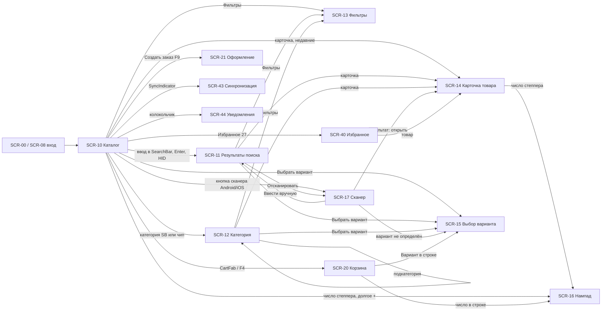

Правила «Назад» и веток — `visual/navigation.md` §2–§5: SCR-11 заменяет запись истории; SCR-14 открывается `push` внутри ветки `catalog` (из SCR-40/SCR-44 — `go` с переключением на ветку `catalog`); SCR-13 на compact/medium — маршрут-лист с записью в истории, на expanded — состояние панели; SCR-15/SCR-16 — sheet без маршрута; SCR-17 — root-маршрут.

## 5. Поведение при больших объёмах и «трудных» данных (SRC-F-030, сводно)

| Ситуация | Поведение интерфейса | Где | Правило |
|---|---|---|---|
| Большой каталог (ориентир 50 000 SKU, Q-023) | курсорная пагинация по 40; виртуализированные списки; первая страница из drift ≤ 100 мс; «Загружаем ещё товары…»; первичная загрузка каталога на устройство ≤ 3 мин с индикатором процента; поиск на сервере p95 ≤ 300 мс, локальный — FTS5 | SCR-10/11/12 | CAT-011, NFR-PERF-001/002/006 |
| Длинные названия | сетка — 2 строки с многоточием, список — 1–2, компакт — 1; полное — тултип 700 мс / долгое нажатие и SCR-14; артикул не обрезается | все карточки | INV-053 |
| Нет фото | заглушка «Нет фото» (иконка `image` + подпись при высоте ≥ 120); фильтр «Только с фото»; в виде «Компакт» — миниатюра 40×40 или иконка-заглушка в колонке «Фото» (CAT-010); никогда фото другого товара | SCR-10…17 | INV-050, D-30 |
| Много вариантов / несколько расцветок | карточка: «Арт. … · N вариантов», цена «от …» (Q-206), «Выбрать вариант»; SCR-15: режим «списком», поиск по артикулу при > 8; множественный выбор с количеством по каждому; свотчи с подписью | SCR-10, SCR-14, SCR-15 | INV-012, INV-015 |
| Много характеристик | SCR-14: 8 + «Показать все (N)»; оси вариантов помечены; SCR-13: фасеты только с значениями, «Показать все (N)» с поиском, максимум 10 пар `attr` | SCR-13, SCR-14 | INV-016, CAT-008 |
| Много категорий | SB прокручивается; свёрнутый SB 72 с тултипами; compact — лист «Все категории» с плитками | SCR-10, SCR-12 | CAT-009 |
| Много складов | таблица без прокрутки до 10 складов, далее прокрутка внутри секции; склад корзины первым | SCR-14 | 03 §9.18 |
| Нет цены / артикула / описания / остатков | «Цена не указана» (добавление недоступно), «Артикул не указан», блоки скрыты, «Остаток неизвестен» (добавление недоступно) | SCR-10, SCR-14 | INV-013, INV-052 |
| Товар удалён в 1С | скрыт из каталога; по прямой ссылке — «Товар не найден или снят с продажи»; в корзине — CART-015 | SCR-14 | INV-054 |

## 6. Офлайн-поведение экранов части (сводно)

| Экран | Доступно офлайн | Недоступно офлайн | Метка данных |
|---|---|---|---|
| SCR-10 | дерево категорий, страницы из кэша, избранное (outbox), добавление в корзину (outbox), HID-скан по `barcodes` | «Очистить» недавние, «Создать заказ», «Есть на другом складе» (если нет снимка) | `OfflineBanner` + «на HH:MM» на бейджах |
| SCR-11 | поиск по названию (FTS5), артикулу (prefix), штрихкоду | подсказки `/search/suggest`, триграммы (опечатки) | «Поиск по сохранённому каталогу от {time}» |
| SCR-12 | дерево и товары из кэша | — | как SCR-10 |
| SCR-13 | фильтрация по кэшу, локальные счётчики | серверные фасеты | «Фильтры по сохранённым данным от {time}» |
| SCR-14 | карточка из кэша (если открывалась или загружена страницей), добавление в корзину | обновление остатков по складам | «обновлено HH:MM» |
| SCR-15 | варианты из кэша, добавление | — | метки остатков |
| SCR-16 | ввод, применение локально | серверная проверка (выполнится при отправке outbox) | «Доступно по данным от {time}» |
| SCR-17 | распознавание и поиск по `barcodes` | — | «Поиск по сохранённому каталогу от {time}» |

## 7. Используемые эндпоинты и коды ошибок (контроль полноты против 08)

| Эндпоинт (08) | Экраны | Обрабатываемые коды / предупреждения |
|---|---|---|
| `GET /catalog/categories` | SCR-10, SCR-12, SCR-13 | `NOT_FOUND`, `304` |
| `GET /catalog/products` | SCR-10, SCR-12, SCR-13 | `VALIDATION_FAILED` (`sort_field`, `cursor`, `cursor_sort_mismatch`) → сброс курсора и повтор; `304` |
| `GET /catalog/products/{id}` | SCR-14 | `NOT_FOUND`, `304` |
| `GET /catalog/products/{id}/variants` | SCR-15 | `NOT_FOUND` |
| `GET /catalog/products/recent`, `DELETE /catalog/products/recent` | SCR-10 | общие |
| `GET /catalog/units`, `GET /catalog/warehouses` | SCR-13, SCR-14 | `304` |
| `GET /images/{sha}/{size}` | все | `404` → заглушка |
| `GET /search/products`, `GET /search/suggest` | SCR-10, SCR-11 | `VALIDATION_FAILED` (`q_too_short`), `RATE_LIMITED` |
| `GET /search/barcode/{value}` | SCR-10, SCR-11, SCR-17 | `NOT_FOUND`, `warnings: ambiguous_barcode` |
| `GET /inventory/balances` | SCR-10 (другие склады) | `VALIDATION_FAILED` (`variantIds`) |
| `POST /inventory/check` | SCR-14 (неизвестный остаток) | общие |
| `GET /cart`, `PUT /cart/items/{variantId}`, `DELETE /cart/items/{variantId}` | SCR-10, SCR-14, SCR-15, SCR-16, SCR-17 | `VERSION_CONFLICT`, `VARIANT_UNAVAILABLE`, `QTY_NOT_MULTIPLE`, `QTY_BELOW_MIN`, `VALIDATION_FAILED` (`idempotency_key_required`, `forbidden_field`, `max_items`), `IDEMPOTENCY_KEY_REUSED`, `IDEMPOTENCY_IN_PROGRESS`, `FORBIDDEN`, `APP_READ_ONLY`; предупреждения `stock_insufficient`, `STALE_DATA` |
| `GET /favorites/products`, `PUT`/`DELETE /favorites/products/{id}` | SCR-10, SCR-14 | `NOT_FOUND`, `FORBIDDEN` |
| `GET /sync/status`, `GET /notifications`, `GET /me` | шапка SCR-10 | общие |
| Общие (все запросы) | все | `UNAUTHENTICATED`, `TOKEN_STALE`, `SESSION_REVOKED`, `UNLOCK_REQUIRED`, `APP_UPDATE_REQUIRED`, `RATE_LIMITED`, `INTERNAL` |

## 8. Сводка критериев приёмки части

| Экран | Диапазон AC | Количество |
|---|---|---|
| SCR-10 | AC-UI-10-001 … AC-UI-10-030 | 30 |
| SCR-11 | AC-UI-11-001 … AC-UI-11-014 | 14 |
| SCR-12 | AC-UI-12-001 … AC-UI-12-013 | 13 |
| SCR-13 | AC-UI-13-001 … AC-UI-13-012 | 12 |
| SCR-14 | AC-UI-14-001 … AC-UI-14-024 | 24 |
| SCR-15 | AC-UI-15-001 … AC-UI-15-012 | 12 |
| SCR-16 | AC-UI-16-001 … AC-UI-16-012 | 12 |
| SCR-17 | AC-UI-17-001 … AC-UI-17-010 | 10 |
| **Итого** | | **127** |

## 9. Соответствие макетам заказчика (сводно, ядро §14)

| Макет | Что взято без изменений [ПОДТВЕРЖДЕНО: макет] | Что изменено и почему | Экран |
|---|---|---|---|
| `image_2026-06-25_23-36-31.png` (каталог) | трёхколоночная композиция; шапка: логотип, «бургер», большой поиск с иконкой сканера и плейсхолдером «Поиск товара по названию, коду или штрих-коду…», часы и дата, пользователь «Абдулла · Продавец» с шевроном, колокольчик с бейджем; сайдбар «Категории товаров» с иконками и счётчиками, «Избранное 27», «Недавние товары · Очистить»; заголовок категории и «Найдено: 124 товара»; переключатель вида; «По возрастанию цены»; сетка 5 карточек при 1536; «+ Добавить»; «Загружаем ещё товары…»; постоянная корзина справа | артикул, бейдж остатка, единица, степпер на карточке; «Компакт» в переключателе; только звезда избранного; `primaryContainer` + полоса вместо сплошной заливки выбранной категории; `SyncIndicator`; кнопка M 44; корректные суммы корзины | SCR-10, SCR-12 |
| `IMG_7090.PNG` (оформление поверх каталога) | каталог и корзина остаются видимыми под модальным окном оформления; строки корзины «2 шт × 2 350 сом» с единицей «шт» | оформление — вне этой части (SCR-21); на SCR-10 кнопка «Создать заказ →» открывает модальное окно поверх каталога; часы без секунд | SCR-10 |
| `photo_2026-10-18_16-03-36.jpg` (вход) | — (вход — вне части) | обещания «Быстрый поиск товаров» и «Актуальные остатки» реализуются SCR-10/11/14; формулировка «в реальном времени» в UI не используется (D-29) | SCR-10, SCR-14 |

Ручных чертежей заказчика нет (ядро §0, §14) — требование SRC-C-014 «использовать чертежи» выполнено по трём цифровым макетам.

## 10. Компоненты, используемые в части (контроль имён 03 §9 / ядро §8.5, §17.5)

`AdaptiveScaffold`, `TopAppBarPos`, `SearchBar`, `SyncIndicator`, `NotificationBell`, `AppAvatar`, `RoleBadge`, `AppDropdown`, `AppSectionHeader`, `AppListTile`, `CategorySidebarItem`, `CategoryChip`, `CategoryTile`, `ViewModeSegmented`, `SortMenu`, `FilterPanel`/`FilterSheet`, `ProductCardGrid`, `ProductCardList`, `ProductCardCompact`, `ProductImage`, `ImageGallery`, `PriceText`, `StockBadge`, `WarehouseStockTable`, `StatusChip`, `UnitSelector`, `QuantityStepper`, `QuantityNumpadSheet`, `VariantSelector`, `FavoriteToggle`, `AppButton`, `AppIconButton`, `AppTextField`, `AppCheckbox`/`AppRadio`/`AppSwitch`, `AppTabs`, `AppBadge`, `AppTooltip`, `AppProgress`, `SkeletonBox`/`SkeletonList`, `EmptyState`, `ErrorState`, `OfflineBanner`, `AppSnackbar`, `ConfirmDialog`, `AppBottomSheet`, `CartPanel`, `CartLine`, `CartSummary`, `DiscountInput`, `CustomerPicker`, `CartFab`, `BottomNavBar`, `NavigationRailApp`, `AppDivider`. Новых компонентов часть не вводит; «мини-строка недавних товаров» — вариант `AppListTile`.


---

## 11. Сводный словарь строк UI части

Строки — `ru` (основной язык, D-38). Ключи `ds_*` и `error_*` определены в 03 §16.2/§16.5 и повторены здесь для полноты экранов; остальные ключи вводятся этой частью и передаются в 03 (владелец словаря ключей ARB по ядру §18.1) для включения в `app_ru.arb`.

| Ключ ARB | Русский текст | Экран | Примечание |
|---|---|---|---|
| `catalog_title_all` | Все товары | SCR-10 | заголовок корня |
| `catalog_found_count` | Найдено: {count} товар / товара / товаров | SCR-10 | ICU plural (03 §16.3) |
| `catalog_sidebar_categories_title` | Категории товаров | SCR-10 | макет |
| `catalog_sidebar_favorites` | Избранное | SCR-10 | макет, со счётчиком |
| `catalog_recent_title` | Недавние товары | SCR-10 | макет |
| `catalog_recent_clear` | Очистить | SCR-10 | макет |
| `catalog_recent_clear_confirm_title` | Очистить недавние товары? | SCR-10 | `ConfirmDialog` |
| `catalog_recent_clear_confirm_body` | Список недавно просмотренных товаров будет удалён на всех устройствах | SCR-10 | |
| `catalog_recent_clear_offline_tooltip` | Нужна сеть | SCR-10 | |
| `catalog_recent_clear_error` | Не удалось очистить · Повторить | SCR-10 | снекбар |
| `catalog_loading_more` | Загружаем ещё товары… | SCR-10/11/12 | макет |
| `catalog_loading_more_error` | Не удалось загрузить · Повторить | SCR-10/11/12 | |
| `catalog_empty_category_title` | В этой категории пока нет товаров | SCR-10 | = `ds_empty_category_title` |
| `catalog_empty_category_body` | Товары появятся после синхронизации с 1С | SCR-10 | |
| `catalog_empty_filtered_title` | Ничего не найдено | SCR-10 | |
| `catalog_empty_filtered_body` | Измените или сбросьте фильтры | SCR-10 | |
| `catalog_error_title` | Не удалось загрузить каталог | SCR-10 | |
| `catalog_initial_loading` | Загружаем каталог… {percent} % | SCR-10 | первичная загрузка |
| `catalog_scan_added` | +{qty} · {name} | SCR-10 | снекбар HID |
| `catalog_scanner_hid_hint` | Используйте сканер: наведите на штрихкод и нажмите курок | SCR-10 | Windows |
| `catalog_profile_logout_confirm` | Выйти из аккаунта? | SCR-10 | |
| `catalog_card_variant_label` | {variant} · {unit} / {variant} · {unit} · в корзине {count} вар. | SCR-10/11/12/40 | v1.1; ICU по `count`; UI-10-119 |
| `catalog_card_other_variant` | Другой вариант | SCR-10/11/12/40 | v1.1; UI-10-119 |
| `catalog_added_snackbar` | Добавлено · Открыть | SCR-10/11/12 (compact, medium) | v1.1; ANIM-006 (03 §11.2) |
| `catalog_favorite_added` | Добавлено в избранное · Отменить | SCR-10/11/12/14 | v1.1; ANIM-009, 03 §9.23 |
| `catalog_favorite_removed` | Удалено из избранного · Отменить | SCR-10/11/12/14 | v1.1 |
| `catalog_favorite_error` | Не удалось сохранить избранное · Повторить | SCR-10/11/12/14 | v1.1; снекбар `error` |
| `catalog_preset_recent` | Недавние | SCR-10 | чип подборки |
| `catalog_preset_favorites` | Избранное | SCR-10 | чип подборки |
| `catalog_filters_button` | Фильтры | SCR-10/11/12 | |
| `catalog_view_grid` / `catalog_view_list` / `catalog_view_compact` | Сетка / Список / Компакт | SCR-10 | `ViewModeSegmented` |
| `catalog_sort_name_asc` | По названию А–Я | SCR-10/12 | |
| `catalog_sort_name_desc` | По названию Я–А | SCR-10/12 | |
| `catalog_sort_price_asc` | По возрастанию цены | SCR-10/11/12 | макет |
| `catalog_sort_price_desc` | По убыванию цены | SCR-10/11/12 | |
| `catalog_sort_newest` | Сначала новые | SCR-10/12 | `updatedAt:desc` |
| `catalog_sort_in_stock_first` | Сначала в наличии | SCR-10/12 | после расширения 08 (Q-204) |
| `catalog_sort_sku` | По артикулу | SCR-10/12 | после расширения 08 (Q-204) |
| `catalog_sort_relevance` | По релевантности | SCR-11 | |
| `catalog_card_sku` | Арт. {sku} | карточки | |
| `catalog_card_sku_missing` | Артикул не указан | карточки | INV-052 |
| `catalog_card_price_unit` | / {unit} | карточки | |
| `catalog_card_price_from` | от {price} | карточки | Q-206 |
| `catalog_card_out_of_stock` | Нет в наличии | карточки | |
| `catalog_card_choose_variant` | Выбрать вариант | карточки | |
| `catalog_card_max_available` | Доступно {qty} {unit} | карточки | INV-042 |
| `catalog_card_other_warehouse` | {warehouse}: {qty} {unit} | карточки | INV-026 |
| `catalog_card_price_changed` | Цена изменилась | карточки | CART-013 |
| `catalog_card_remove_confirm` | Удалить позицию из корзины? | карточки | CART-012 |
| `catalog_card_a11y` | {name}, {price} за {unitFull}, {stock}, артикул {sku} | карточки | Semantics |
| `search_title` | Результаты поиска | SCR-11 | |
| `search_placeholder` | Поиск товара по названию, коду или штрих-коду… | SCR-10/11 | макет |
| `search_found_count` | Найдено: {count} по «{query}» | SCR-11 | |
| `search_found_estimate` | Найдено: около {count} по «{query}» | SCR-11 | `isEstimate` |
| `search_hint_more_chars` | Введите ещё {count} символ / символа — для артикула и штрихкода любой длины | SCR-11 | ICU |
| `search_recent_queries_title` | Недавние запросы | SCR-11 | |
| `search_empty_body` | Проверьте запрос или отсканируйте штрихкод | SCR-11 | |
| `search_suggested_query` | Возможно, вы искали «{query}» | SCR-11 | |
| `search_barcode_not_found_title` | Штрихкод {value} не найден | SCR-11 | |
| `search_barcode_not_found_body` | Возможно, товар не выгружен из 1С | SCR-11 | |
| `search_scan_again` | Сканировать снова | SCR-11 | |
| `search_enter_manually` | Ввести вручную | SCR-11 | |
| `search_error_inline` | Не удалось выполнить поиск · Повторить | SCR-11 | |
| `search_offline_note` | Поиск по сохранённому каталогу от {time} | SCR-11 | |
| `search_not_found_hint` | Не нашли? Проверьте раскладку клавиатуры или отсканируйте штрихкод | SCR-11 | |
| `search_match_all` / `search_match_barcode` / `search_match_sku` / `search_match_name` | Все / Штрихкод / Артикул / Название | SCR-11 | чипы `matchType` |
| `search_badge_barcode_exact` / `search_badge_sku` / `search_badge_sku_prefix` / `search_badge_name` | штрихкод (точно) / артикул / артикул (начало) / название | SCR-11 | бейджи |
| `search_scope_category` / `search_scope_all` | В категории «{name}» / Во всех категориях | SCR-11 | |
| `search_barcode_ambiguous` | Штрихкод привязан к нескольким товарам, проверьте выбор | SCR-11/14 | |
| `search_scanner_tooltip` | Сканировать штрихкод | SCR-10/11 | 03 §16.2 |
| `category_breadcrumb_root` | Каталог | SCR-12/14 | |
| `category_all_chip` | Все | SCR-12 | |
| `category_all_categories` | Все категории | SCR-12 | compact |
| `category_found_count` | Найдено: {count} товар / товара / товаров | SCR-12 | ICU |
| `category_empty_body` | Товары появятся после синхронизации с 1С или снимите фильтры | SCR-12 | |
| `category_not_found_title` | Категория больше не существует | SCR-12 | |
| `category_not_found_action` | К каталогу | SCR-12 | |
| `category_error_title` | Не удалось загрузить категорию | SCR-12 | |
| `category_filter_removed` | Фильтр «{name}» снят — нет товаров в категории | SCR-12 | |
| `category_tile_a11y` | {name}, {count} товаров | SCR-12 | Semantics |
| `category_uncategorized` | Без категории | SCR-12 | INV-052 |
| `filters_title` | Фильтры | SCR-13 | |
| `filters_price_title` | Цена, сом | SCR-13 | |
| `filters_price_from` / `filters_price_to` | от / до | SCR-13 | |
| `filters_price_range_hint` | В выдаче: {min} — {max} · вид цены «{priceList}» | SCR-13 | |
| `filters_price_error_range` | Минимальная цена больше максимальной | SCR-13 | |
| `filters_in_stock` | Только в наличии | SCR-13 | |
| `filters_warehouse_title` | Склад | SCR-13 | |
| `filters_warehouse_cart_hint` | склад корзины | SCR-13 | |
| `filters_warehouse_view_note` | Остатки склада «{name}». Продажа — со склада корзины | SCR-13 | INV-026 |
| `filters_stock_as_of` | данные остатков от {time} | SCR-13 | |
| `filters_category_title` / `filters_brand_title` / `filters_model_title` / `filters_color_title` / `filters_size_title` | Категория / Бренд / Модель / серия / Цвет / Размер | SCR-13 | |
| `filters_show_all` | Показать все ({count}) | SCR-13 | |
| `filters_favorites_only` | Только избранное | SCR-13 | |
| `filters_with_photo_only` | Только с фото | SCR-13 | |
| `filters_show_n` | Показать {count} товар / товара / товаров | SCR-13 | ICU |
| `filters_no_results` | Нет товаров | SCR-13 | |
| `filters_no_results_hint` | Ослабьте условия | SCR-13 | |
| `filters_attr_limit` | Выбрано максимум 10 характеристик | SCR-13 | 08 §4.4.2 |
| `filters_error_load` | Не удалось загрузить фильтры · Повторить | SCR-13 | |
| `filters_offline_note` | Фильтры по сохранённым данным от {time} | SCR-13 | |
| `filters_applied_locally` | Фильтр применён к найденному | SCR-13 | поиск |
| `filters_reset_all` | Сбросить все | SCR-10/13 | |
| `product_sku_variant` | Арт. варианта: {sku} | SCR-14 | |
| `product_sku_product_note` | артикул товара | SCR-14 | INV-011 |
| `product_sku_missing` | Артикул не указан | SCR-14 | |
| `product_onec_code` | Код 1С: {code} | SCR-14 | staff |
| `product_barcodes` | Штрихкод: {values} | SCR-14 | |
| `product_barcodes_more` | ещё {count} | SCR-14 | |
| `product_sku_copied` | Артикул скопирован | SCR-14 | |
| `product_price_unit` | / {unit} | SCR-14 | |
| `product_price_per_pack` | За {pack}: {price} | SCR-14 | INV-031 |
| `product_price_missing_hint` | Нет цены — обратитесь к администратору | SCR-14 | INV-013 |
| `product_price_your` | Ваша цена | SCR-14 | скидка клиента 1С |
| `product_price_lists_all` | Все виды цен | SCR-14 | cashier+ |
| `product_price_list_tooltip` | Вид цены по клиенту корзины или по умолчанию для роли | SCR-14 | |
| `product_variant_axis` | {axis}: {value} | SCR-14 | |
| `product_variant_select_error` | Выберите {axis} | SCR-14 | |
| `product_variant_combination_missing` | Нет такого сочетания | SCR-14 | |
| `product_unit_title` | Единица | SCR-14 | |
| `product_qty_title` | Количество | SCR-14 | |
| `product_qty_rules` | Кратность {multiple} {unit} · мин. партия {min} {unit} | SCR-14 | |
| `product_in_cart` | В корзине: {qty} {unit} | SCR-14 | |
| `product_cta_add` | В корзину · {sum} | SCR-14 | |
| `product_cta_add_more` | Добавить ещё | SCR-14 | CART-002 |
| `product_cta_out_of_stock` | Нет в наличии | SCR-14 | |
| `product_cta_unavailable` | Добавление недоступно | SCR-14 | |
| `product_added_snackbar` | Добавлено {qty} {unit} · Открыть корзину | SCR-14 | compact |
| `product_other_warehouse` | Есть на складе «{warehouse}»: {qty} {unit}. Продажа с другого склада одним заказом — вне R1 | SCR-14 | INV-026 |
| `product_stock_title` | Остатки по складам | SCR-14 | |
| `product_stock_columns` | Склад · Остаток · Резерв · Доступно | SCR-14 | заголовки колонок |
| `product_stock_total` | Доступно всего: {qty} {unit} | SCR-14 | |
| `product_stock_cart_warehouse` | склад корзины | SCR-14 | |
| `product_stock_error` | Не удалось получить остатки · Повторить | SCR-14 | |
| `product_stock_empty` | Нет данных по складам | SCR-14 | |
| `product_description_title` / `product_specs_title` / `product_warehouses_tab` | Описание / Характеристики / Склады | SCR-14 | вкладки |
| `product_specs_show_all` | Показать все ({count}) | SCR-14 | INV-016 |
| `product_description_expand` / `product_description_collapse` | Читать полностью / Свернуть | SCR-14 | |
| `product_discontinued_banner` | Товар больше не продаётся | SCR-14 | |
| `product_not_found_title` | Товар не найден или снят с продажи | SCR-14 | |
| `product_gallery_counter_a11y` | Фото {index} из {count} | SCR-14 | Semantics |
| `product_qty_reduce_hint` | Уменьшите количество в корзине | SCR-14 | CART-014 |
| `variant_sheet_count` | {count} вариант / варианта / вариантов · ось: {axis} | SCR-15 | ICU |
| `variant_mode_axis` / `variant_mode_list` | {axis} / Все варианты списком | SCR-15 | |
| `variant_search_placeholder` | Найти по артикулу | SCR-15 | |
| `variant_search_empty` | Вариант не найден | SCR-15 | |
| `variant_selected_summary` | Выбрано: {count} вариантов · {qty} {unit} | SCR-15 | ICU |
| `variant_add_cta` | Добавить в корзину · {sum} | SCR-15 | |
| `variant_replace_cta` | Заменить вариант | SCR-15 | CART-005 |
| `variant_merge_confirm` | Вариант уже в корзине. Объединить количества? | SCR-15 | CART-005 |
| `variant_added_snackbar` | Добавлено {count} позиции / позиций | SCR-15 | ICU |
| `variant_partial_added` | Добавлено {added} из {total}. «{name}» больше не продаётся | SCR-15 | |
| `variant_select_error` | Выберите вариант | SCR-15 | |
| `variant_out_of_stock` | Нет | SCR-15 | |
| `variant_all_out_hint` | Нет в наличии на складе корзины | SCR-15 | |
| `variant_load_error` | Не удалось загрузить варианты · Повторить | SCR-15 | |
| `qty_sheet_title` | Количество · {name} | SCR-16 | |
| `qty_hint_rules` | Кратность: {multiple} {unit} · Мин. партия: {min} {unit} · Доступно: {available} {unit} | SCR-16 | |
| `qty_error_precision` | Для единицы „{unit}“ допустимо не более {n} знаков после запятой | SCR-16 | INV-001 |
| `qty_error_not_multiple` | Количество должно быть кратно {m} {unit} | SCR-16 | INV-004 |
| `qty_round_up` | Округлить до {next} | SCR-16 | INV-004 |
| `qty_error_below_min` | Минимальная партия — {min} {unit} | SCR-16 | INV-005 |
| `qty_error_stock` | Доступно только {available} {unit} на складе «{warehouse}» | SCR-16 | 10 §4.1 |
| `qty_error_pack_integer` | Количество упаковок должно быть целым | SCR-16 | INV-006 |
| `qty_error_too_large` | Слишком большое количество | SCR-16 | INV-010 |
| `qty_pack_conversion` | {packs} {pack} = {base} {unit} | SCR-16, SCR-14 | INV-003 |
| `qty_zero_delete_hint` | 0 — удалить позицию из корзины | SCR-16 | CART-012 |
| `qty_delete` | Удалить | SCR-16 | |
| `qty_quick_add` | +{count} | SCR-16 | |
| `qty_offline_note` | Доступно по данным от {time} | SCR-16 | |
| `qty_key_digit_a11y` / `qty_key_backspace_a11y` / `qty_key_decimal_a11y` | цифра {d} / стереть / запятая | SCR-16 | Semantics |
| `cart_line_delete_confirm` | Удалить позицию из корзины? | SCR-16 | общий с SCR-20 |
| `scan_title` | Сканирование | SCR-17 | |
| `scan_hint` | Наведите камеру на штрихкод товара или упаковки | SCR-17 | |
| `scan_added` | +{qty} {unit} · {name} | SCR-17 | |
| `scan_open_product` | Открыть карточку | SCR-17 | |
| `scan_not_found` | Штрихкод {value} не найден | SCR-17 | |
| `scan_choose_variant` | Найдено {count} вариантов. Выберите вариант | SCR-17 | ICU |
| `scan_manual_entry` | Ввести вручную | SCR-17 | |
| `scan_series` | Серия | SCR-17 | Q-207 |
| `scan_torch_on_a11y` / `scan_torch_off_a11y` | Включить фонарик / Выключить фонарик | SCR-17 | |
| `scan_no_camera_body` | Разрешите доступ к камере в настройках устройства | SCR-17 | |
| `scan_open_settings` | Открыть настройки | SCR-17 | |
| `scan_camera_error` | Камера недоступна. Закройте другие приложения, использующие камеру | SCR-17 | |
| `scan_lookup_error` | Не удалось проверить штрихкод · Повторить | SCR-17 | |
| `scan_offline_note` | Поиск по сохранённому каталогу от {time} | SCR-17 | |
| `scan_series_summary` | Добавлено {count} позиций | SCR-17 | ICU |
| `scan_hid_waiting` | Сканер: ожидание. USB/Bluetooth-сканер в режиме клавиатуры, суффикс Enter | SCR-10/17 | Windows |
| `scan_hid_result` | Отсканировано {value} · {name} +{qty} {unit} | SCR-10/17 | Windows |
| `scan_ambiguous` | Штрихкод привязан к нескольким товарам, проверьте выбор | SCR-17 | |
| `scan_title_order` | Сканирование номера заказа | SCR-17 | `mode=order`, добавлено при сборке 02 v1.1 |
| `scan_hint_order` | Наведите камеру на штрихкод или QR-код с распечатки заказа | SCR-17 | `mode=order` |
| `scan_order_value` | Номер: {value} | SCR-17 | `mode=order` |
| `scan_title_test` | Проверка камеры-сканера | SCR-17 | `mode=test` |
| `scan_test_result` | Распознано: {value} · {format} | SCR-17 | `mode=test` |
| `scan_invalid_code` | Штрихкод не распознан, попробуйте ещё раз | SCR-17 | |
| `ds_button_add` | + Добавить | карточки | 03 §16.5 |
| `ds_button_ok` / `ds_button_cancel` / `ds_button_retry` / `ds_button_reset` / `ds_button_undo` / `ds_button_open` | Готово / Отмена / Повторить / Сбросить / Отменить / Открыть | все | 03 §16.5 |
| `ds_no_photo` / `ds_price_missing` / `ds_stock_unknown` | Нет фото / Цена не указана / Остаток неизвестен | все | 03 §16.5 |
| `ds_offline_banner` | Нет сети. Показаны данные от {time}. Заказы недоступны | все | 03 §16.5 |
| `ds_onec_down` | 1С недоступна: заказы будут отправлены позже; продажа в долг недоступна | SCR-10 | 03 §16.5 |
| `ds_updated_at` / `ds_data_as_of` | обновлено {time} / данные от {time} | все | 03 §16.5 |
| `ds_loading_long` | Долгая загрузка… | все | 03 §16.5 |
| `ds_empty_search_title` | Ничего не найдено по «{query}» | SCR-11 | 03 §9.43 |
| `ds_empty_category_title` | В этой категории пока нет товаров | SCR-10/12 | 03 §9.43 |
| `ds_empty_no_camera_title` | Камера недоступна | SCR-17 | 03 §9.43 |
| `error_variant_unavailable` | Товар больше не продаётся | SCR-10/14/15/16 | 08 §2.4 |
| `error_stock_insufficient` | Недостаточно остатка: доступно {available} {unit} | SCR-10/14/16 | 03 §16.2 |
| `error_qty_not_multiple` | Количество должно быть кратно {m} {unit} | SCR-14/16 | |
| `error_qty_below_min` | Минимальная партия — {min} {unit} | SCR-14/16 | |
| `cart_version_conflict_title` | Корзина изменена на другом устройстве | SCR-10/14 | CART-017; ключ переименован при сборке 02 (был `error_version_conflict`, конфликт текста с 02c; общий `error_version_conflict` — «Данные изменились на другом устройстве») |
| `error_rate_limited` | Слишком много запросов, подождите {seconds} с | SCR-11 | 03 §9.44 |
| `error_forbidden` | Недостаточно прав | все | 08 §2.4 |
| `error_not_found` | Не найдено | SCR-12/14 | |
| `error_internal` | Не удалось выполнить. Повторите | все | 03 §16.2 |

## 12. Открытые вопросы

Канонические вопросы, влияющие на часть: Q-001 (режим `customer`), Q-006 (логотип в шапке), Q-008 (сенсорные POS-мониторы → размеры степпера), Q-009 (модели сканеров, суффикс, камера), Q-020 (порог устаревания остатков/цен), Q-021 (единицы, упаковки, кратность, минимальная партия, характеристики-варианты, артикул характеристики), Q-022 (фото товаров и категорий), Q-023 (объёмы каталога), Q-024 (под заказ при нулевом остатке), Q-108 (тыйыны в каталоге), Q-110 (звук/вибрация сканера), Q-111 (горячие клавиши), Q-175 (порог «Мало»), Q-176 (числовые параметры: debounce 500 мс, страница 40, 8 характеристик, 50 недавних, максимум количества), Q-179 (поведение сканера по умолчанию).

| ID | Вопрос | Влияние | Допущение в ТЗ |
|---|---|---|---|
| Q-204 | [НОВЫЙ ВОПРОС] Какие сортировки каталога реально нужны продавцам: CAT-006 требует «Сначала в наличии» и «По артикулу», а контракт 08 §4.4.2 поддерживает только `price`, `name`, `popularity`, `updatedAt`. Добавлять ли в API значения `available:desc` и `sku:asc` (или отказаться от этих сортировок в R1)? Нужна ли сортировка «по популярности» (требует истории продаж, Q-023)? | `SortMenu` SCR-10/12, 08 §4.4.2, CAT-006 | R1: по названию А–Я/Я–А, по цене ↑/↓, «Сначала новые»; «Сначала в наличии» и «По артикулу» — после расширения 08; «по популярности» — скрыта до ответа |
| Q-205 | [НОВЫЙ ВОПРОС] Фильтр «Наличие по складам»: нужен ли выбор нескольких складов одновременно и вариант «на любом складе» (CAT-007), или достаточно одного склада? Сейчас `GET /catalog/products` принимает один `warehouseId`. | SCR-13, 08 §4.4.2 | R1: один склад (по умолчанию — склад корзины) + «Только в наличии»; мультивыбор — после расширения API |
| Q-206 | [НОВЫЙ ВОПРОС] Какую цену показывать на карточке каталога у товара с вариантами разной цены: «от {минимальной}», диапазон «2 350 – 2 850 сом» или цену варианта по умолчанию? Как показывать остаток такого товара — суммой по вариантам или «3 вар. в наличии»? | `PriceText`/`StockBadge` в карточках SCR-10/11/12/40 | «от {priceRange.min}» при различии цен; остаток — «В наличии · 3 вар.» (число вариантов с остатком) |
| Q-207 | [НОВЫЙ ВОПРОС] Сканирование камерой: нужен ли режим «Серия» (камера не закрывается после скана), интервал подавления повторного чтения того же кода (предложено 1,5 с), какие форматы кодов используются на товарах магазина (EAN-13/EAN-8/Code128/UPC-A; нужны ли QR/DataMatrix)? Для HID: два одинаковых скана подряд — это +2 шага или защита от дребезга? | SCR-17, HID-обработка SCR-10/11 | «Серия» — есть, по умолчанию выключена; подавление 1,5 с только для камеры; HID — каждый скан = +1 шаг; форматы EAN-13/EAN-8/Code128/UPC-A |

Версия 1.1: новых вопросов не открыто. Замечания проверки решены в тексте ТЗ (степпер последнего варианта, фото в «Компакт», изображения категорий, политика истории поиска, единое правило HID, очередь запросов корзины) или вынесены как расхождения с документами-владельцами в раздел 14 (замечания 18–31). Диапазон Q-200…Q-219, отведённый 02 ядром §16 п.9, полностью занят частями 02a–02e; если оркестратор сочтёт нужным вынести решения замечаний 23 (вид «Компакт» на телефоне) и 31 (степпер последнего варианта) на согласование заказчика, номер выдаёт 14_OPEN_QUESTIONS.

## 13. Трассировка на исходные требования (сводно по зоне)

| SRC-ID | Формулировка (кратко) | Где выполнено (экран / UI-ID / AC) |
|---|---|---|
| SRC-C-001 | Рабочее пространство продавца | SCR-10; AC-UI-10-001 |
| SRC-C-002 | Логотип слева в верхней панели | UI-10-001; AC-UI-10-001 |
| SRC-C-003 | Большая строка поиска в центре | UI-10-003; AC-UI-10-001 |
| SRC-C-004, SRC-C-004a | Профиль и имя пользователя справа | UI-10-006, UI-10-033; AC-UI-10-001 |
| SRC-C-005 | Статус синхронизации | UI-10-004; AC-UI-10-001 |
| SRC-C-006 | Необходимые уведомления | UI-10-007; AC-UI-10-001 |
| SRC-C-007 | Поиск по названию, артикулу, штрихкоду и другим полям | SCR-11; UI-10-003, UI-11-001; AC-UI-11-003, AC-UI-11-004 |
| SRC-C-008 | Задержка перед поисковым запросом | UI-11-001; AC-UI-10-013, AC-UI-11-001 |
| SRC-C-009 | Обработка пустого результата | UI-11-013, UI-10-037; AC-UI-11-005 |
| SRC-C-010 | Сканирование штрихкода, если оборудование поддерживает | SCR-17, HID в SCR-10/11; AC-UI-10-014, AC-UI-17-001…010 |
| SRC-C-011, SRC-C-011a, SRC-C-011b, SRC-C-011c | Вертикальное меню категорий-карточек с изображениями и названиями под логотипом | expanded/medium: UI-10-009 — строки-карточки в общем контейнере с изображением 1С 32×32 (`imageUrl`) и fallback `iconKey` → `category`, состояния загрузки/ошибки изображения; compact: UI-12-006 (`CategoryTile`); п. SCR-10.1 строка 15; AC-UI-10-002, AC-UI-12-004, AC-UI-12-012 |
| SRC-C-012 | Горизонтальная полоса категорий/подборок под поиском и профилем | UI-10-016, UI-10-036 (подборки видимы всегда, в том числе в листовой категории — UI-12-007); compact/medium — под `SearchBar`; expanded — верх контент-колонки (обоснование — п. SCR-10.1 строка 14, раздел 14 замечание 18); AC-UI-10-003, AC-UI-12-001 |
| SRC-C-013 | Подкатегории только при наличии | UI-10-016, UI-12-003, UI-12-007; AC-UI-10-003, AC-UI-12-001, AC-UI-12-002 |
| SRC-C-014 | Использование чертежей/макетов | SCR-10.1 (таблица отличий от макета), раздел 9 ниже |
| SRC-C-015…SRC-C-017 | Переключение вида: сетка, список | UI-10-013; AC-UI-10-004 |
| SRC-C-018 | Компактный список | UI-10-013 (`three` на expanded/large и medium ≥ 840 lp), UI-10-118; на compact < 600 lp — отступление с обоснованием (п. SCR-10.1 строка 18, раздел 14 замечание 23); AC-UI-10-029 |
| SRC-C-019 | Сортировка | UI-10-014, UI-11-008; Q-204 |
| SRC-C-020 | Фильтры | SCR-13; AC-UI-13-001…010 |
| SRC-C-021 | Диапазон цены, если доступен | UI-13-002; AC-UI-13-002 |
| SRC-C-022 | Наличие по складам | UI-13-003; AC-UI-13-007; Q-205 |
| SRC-C-023 | Категория | UI-13-004 |
| SRC-C-024 | Бренд, модель, цвет, размер, другие реальные характеристики | UI-13-005…008, UI-13-012; AC-UI-13-001, AC-UI-13-003 |
| SRC-C-025 | Избранное | UI-10-010, UI-10-036, UI-10-103, UI-13-009; AC-UI-10-015, AC-UI-13-008 |
| SRC-C-026…SRC-C-032 | Карточка в каталоге: фото, название, артикул, цена с условиями, доступный остаток, статус наличия, контрол количества | п. 2.3 (фото или заглушка во всех трёх видах, включая «Компакт»), UI-10-101…112, UI-10-118; AC-UI-10-005, AC-UI-10-009, AC-UI-10-010 |
| SRC-C-033 | Повторное нажатие увеличивает количество без окон | п. 2.3 шаги 3 и 7 (в том числе у товара с вариантами — степпер последнего варианта, UI-10-119), UI-10-109, UI-14-020; AC-UI-10-006, AC-UI-10-026, AC-UI-10-027, AC-UI-14-011 |
| SRC-C-034 | Быстрый ввод количества | SCR-16; AC-UI-16-001…010 |
| SRC-C-035 | Единицы измерения и упаковки | UI-14-009, UI-16-002; AC-UI-14-009, AC-UI-16-005 |
| SRC-C-036 | Не допускать некорректных количеств | SCR-16; AC-UI-16-002…004 |
| SRC-C-037 | Панель или отдельный экран товара | SCR-14; AC-UI-14-001, AC-UI-14-002 |
| SRC-C-038, SRC-C-039 | Крупное фото слева/сверху, миниатюры изображений и вариантов | UI-14-003, UI-14-004; AC-UI-14-003 |
| SRC-C-040…SRC-C-043 | Варианты: показать, обновлять фото и характеристики, артикул варианта, остаток по каждому складу | UI-14-008, UI-14-006, UI-14-013; AC-UI-14-004…006 |
| SRC-C-044…SRC-C-052 | Название, артикул, описание, характеристики, варианты, цена, доступность, количество, добавление | зоны C–E SCR-14; AC-UI-14-008, AC-UI-14-010…015 |
| SRC-C-053, SRC-C-054 | Качественная заглушка; не подставлять фото другого товара | UI-10-102, UI-14-003; AC-UI-10-021, AC-UI-14-007 |
| SRC-C-055 | Фото связаны с товарами 1С | D-30, `images[]` по `productId`/`variantId` |
| SRC-C-056, SRC-C-057 | Кэширование и загрузка по требованию | UI-10-102 (`cached_network_image`, размеры 160/400/1200); AC-UI-10-021 |
| SRC-C-058, SRC-C-059 | Корзина снизу на мобильных, постоянная панель на больших экранах (в части SCR-10) | UI-10-020…031, UI-10-040; полная спецификация — SCR-20 |
| SRC-E-137 | Сетка и список | UI-10-013 |
| SRC-E-138 | Поиск | SCR-11 |
| SRC-E-139 | Сортировка | UI-10-014 |
| SRC-E-140 | Фильтры | SCR-13 |
| SRC-E-141, SRC-E-142 | Категории, подкатегории | SCR-12 |
| SRC-E-143 | Фотографии | UI-10-102, UI-14-003/004/022 |
| SRC-E-144 | Варианты | UI-14-008, SCR-15 |
| SRC-E-145 | Артикулы | UI-10-105, UI-14-006, UI-14-024 |
| SRC-E-146 | Характеристики | UI-14-016, UI-13-012 |
| SRC-E-147 | Цены | UI-10-107, UI-14-007, UI-14-021, UI-14-030 |
| SRC-E-148 | Склады | UI-14-013, UI-13-003 |
| SRC-E-149 | Доступные остатки | UI-10-106, UI-14-013, UI-14-025 |
| SRC-E-150 | Единицы измерения | UI-14-009, UI-16-002 |
| SRC-E-151 | Управление количеством | п. 2.3, UI-14-010, SCR-16 |
| SRC-E-152 | Избранное | UI-10-010, UI-10-103, UI-14-002 |
| SRC-E-153 | Обработка отсутствующих фото и данных | раздел 5; AC-UI-14-007, AC-UI-14-008 |
| SRC-E-154 | Выбор нескольких вариантов одного товара | SCR-15; AC-UI-15-002 |
| SRC-F-001, SRC-F-002, SRC-F-003 | Требования к экранам обязательны, без сокращений и общих формулировок | все требования зоны трассированы в этой таблице; отличия от макета — п. SCR-10.1 |
| SRC-F-004 | Ультрадетальная спецификация всех экранов до разработки | вся часть: 8 экранов зоны SCR-10…SCR-17 |
| SRC-F-005 | Назначение и роль пользователя | подраздел `.1` каждого экрана |
| SRC-F-006 | Структура сверху вниз, слева направо | подраздел `.2` (compact / medium / expanded) |
| SRC-F-007, SRC-F-008 | Каждый UI-элемент: расположение, размер, отступы, выравнивание; цвета, типографика, иконки, радиусы, тени, состояния | подраздел `.3` (таблицы элементов с UI-ID; SCR-10 и SCR-14 — по зонам) |
| SRC-F-009 | Поведение каждого контрола | подраздел `.4` |
| SRC-F-010 | Анимации: начальное состояние, триггер, последовательность, конечное, длительность, ошибка | подраздел `.5` (таблицы у всех экранов, включая SCR-12, SCR-13, SCR-15 — v1.1) |
| SRC-F-011 | Переходы с передаваемыми данными | подраздел `.6`; раздел 4 (flowchart) |
| SRC-F-012 | Состояния загрузки, успеха, ошибки, пустого результата, нет сети, нет разрешений, повтор | подраздел `.7` (stateDiagram-v2) |
| SRC-F-013 | Валидация, сообщения, ограничения ввода | подраздел `.8`; раздел 11 |
| SRC-F-014 | Источники данных, API, состояния приложения, бизнес-правила | подраздел `.9`; раздел 7 |
| SRC-F-015 | Действия по ролям и ограничения безопасности | подраздел `.10` (матрицы роль × действие у всех экранов — v1.1) |
| SRC-F-016 | Повторное нажатие, двойной запрос, «Назад», перезапуск | подраздел `.11`; п. 2.2.12 (очередь корзины) |
| SRC-F-017 | Требования к телефонам, планшетам, другим платформам | подраздел `.12` |
| SRC-F-018 | Критерии приёмки | подраздел `.13`; раздел 8 (127 AC) |
| SRC-F-019 | Описание экрана не в один абзац | все подразделы `.1…14` развёрнуты; пункты, бывшие абзацем (SCR-12 .5/.9–.12, SCR-13 .5/.10, SCR-15 .5/.10/.11, SCR-16 .10), переведены в таблицы — v1.1 |
| SRC-F-020 | Сложные экраны — подразделы, таблицы элементов, диаграммы переходов и последовательностей | SCR-10: зоны A–F, 3 sequence-диаграммы, stateDiagram; SCR-14: зоны A–E, 2 sequence-диаграммы, stateDiagram; раздел 4 — flowchart навигации |
| SRC-F-028 | Отдельно главный каталог, поиск, результаты поиска, категории, подкатегории, фильтры, сетку, список, карточку товара | SCR-10 … SCR-14, п. 2.3 |
| SRC-F-029 | Связь каждого варианта с артикулом, изображениями, ценой, единицей, остатками по складам | SCR-14 зоны B–D, UI-14-006/007/009/013; AC-UI-14-004 |
| SRC-F-030 | Большое количество товаров, длинные названия, нет фото, несколько расцветок, много характеристик | раздел 5; AC-UI-10-011, AC-UI-10-020, AC-UI-14-014, AC-UI-15-006 |
| SRC-D-102…SRC-D-109 | Автотесты каталога (получение, поиск по артикулу, категории/подкатегории, варианты и фото, остатки по складам, нет изображения, нет товара, повторная синхронизация) | AC-UI-10-011, AC-UI-11-003, AC-UI-12-001, AC-UI-14-004, AC-UI-14-006, AC-UI-14-007, AC-UI-14-020, AC-UI-12-007 |
| SRC-D-110, SRC-D-111, SRC-D-112, SRC-D-115, SRC-D-116 | Добавление, изменение количества, выбор другого варианта, недостаточный остаток, повторный запрос | AC-UI-10-006, AC-UI-10-007, AC-UI-16-007, AC-UI-15-005, AC-UI-14-013, AC-UI-14-012 |
| SRC-D-110a | Удаление товара из корзины | SCR-16 (0 → «Удалить» → `ConfirmDialog` → `DELETE /cart/items/{variantId}?packagingId=`), п. 2.3 шаг 5 («−» на минимуме); AC-UI-16-006, AC-UI-10-028 |

## 14. Замечания к ядру

Часть следует ядру и документам-владельцам словарей (ядро §18.1). Ниже — расхождения, найденные при сверке, и предлагаемые новые имена (`[НОВОЕ ИМЯ]`) для включения оркестратором.

1. **Горячие клавиши.** 03 A11Y-009 назначает `F9` на «Создать заказ», а `visual/navigation.md` §9 и `visual/responsive-spec.md` — `F8` «Создать заказ» и `F9` «Отложить заказ». **Решено при сборке 02:** часть приведена к 03 A11Y-009 (владелец, ядро §18.1) и к части 02c — `F9` «Создать заказ», `F8` «Отложить заказ» [ТИПОВО]; `navigation.md` и `responsive-spec.md` нужно выровнять до ответа Q-111.
2. **Сортировки.** CAT-006 (10) требует «Сначала в наличии» и «По артикулу», которых нет в перечне `sort` 08 §4.4.2. Предложение: добавить в 08 значения `available:desc` и `sku:asc` `[НОВОЕ ИМЯ]` (оба поля есть в `ProductSummary`/реплике) либо понизить CAT-006 до текущего набора (Q-204).
3. **Фильтры в поиске.** `GET /search/products` (08 §4.5.1) не принимает `brand`, `attr[...]`, `priceMin`, `priceMax`, `favorite`, `hasImage`, которые SCR-13 предлагает на SCR-11. До выравнивания эти фильтры применяются к загруженным результатам локально; предложение — расширить `/search/products` теми же параметрами, что `/catalog/products`.
4. **Кратность в DTO.** Правила INV-004 и drift (`products.multiplicity_milli`, 07 §11.2) используют кратность, но DTO `Product`/`Variant` 08 §3.6 не содержит поля кратности (есть `minQuantity`, `packagings[].factor`). Предложение: поле `multiplicity` `[НОВОЕ ИМЯ]` в `Product` (и `Variant`, если 1С ведёт по характеристике).
5. **Итог «Доступно всего».** INV-021 требует «Доступно всего N», а `Product.stockByWarehouse` не содержит итога; чтобы клиент не суммировал остатки (D-22, INV-020), предлагается поле `availableTotal` `[НОВОЕ ИМЯ]` в `Product`/`Variant` (08 §3.6).
6. **Мультивыбор складов в фильтре.** CAT-007 описывает мультивыбор складов и «на любом складе», 08 §4.4.2 — один `warehouseId` (Q-205).
7. **«−» на минимальном количестве.** 03 §9.20 — удаление строки без `ConfirmDialog` со снекбаром «Отменить»; 10 CART-003/CART-012 — подтверждение удаления. Часть следует 10 (владелец бизнес-правил); 03 требует выравнивания.
8. **Debounce количества.** 03 §9.20 — 400 мс; 10 INV-043/CART-008 — 500 мс (Q-176). Часть использует 500 мс.
9. **Остаток неизвестен.** 03 §9.17 разрешает добавление «онлайн с проверкой `/inventory/check`», 10 INV-052 — «добавление запрещено». Часть следует INV-052.
10. **Сканер по умолчанию.** 03 §9.7 — настройка `scan_adds_to_cart` «по умолчанию вкл. для staff»; 10 Q-179 — «сразу в корзину» для кассира и «открыть карточку» для продавца. Часть следует 10; ключ настройки пользователя `scan_adds_to_cart` и новые ключи `scan_series_mode`, `catalog_view_mode`, `sidebar_collapsed`, `search_history` (drift `settings`, scope `user`/`device`) `[НОВОЕ ИМЯ]` нужно зафиксировать в 07 §11.2 / 03.
11. **Очистка недавних офлайн.** `visual/navigation.md` предлагает очистку через outbox, но 07 §11.2 не содержит типа действия outbox для очистки (есть только `recent.touch`). Часть делает «Очистить» недоступной офлайн; для офлайн-очистки нужен тип `recent.clear` `[НОВОЕ ИМЯ]`.
12. **Метод избранного.** `wireframes-catalog.html` (UI-10-103) указывает `POST/DELETE /favorites/products/{id}`, канон 08 §4.13.2 — `PUT/DELETE`. Часть использует `PUT/DELETE`; wireframes требуют исправления.
13. **Иконки вне карты 03 §7.7:** `tag` (бейдж совпадения по артикулу), `tune` (характеристика-ось), `flashlight_on`/`flashlight_off` (фонарик), `arrow_upward`/`arrow_downward` (направление сортировки колонки) `[НОВОЕ ИМЯ]`; глиф `history` в карте закреплён за аудитом, а часть использует его для подборки «Недавние» — требуется отдельный глиф или пересмотр (A11Y-019: значение иконки не меняется между экранами).
14. **Анимации сканера.** В реестре ANIM 03 §11.2 нет анимаций видоискателя камеры; часть описывает «линию-подсказку» (loop 1,5 с) и «подтверждение распознавания» (300 мс) — они описаны как специфичные SCR-17-ANIM-A и SCR-17-ANIM-B и предлагаются к включению в 03 §11.2; номера `ANIM-NNN` присваивает 03 (владелец, ядро §18.1; в 03 занят диапазон ANIM-001…ANIM-028), часть номера не присваивает.
15. **Параметр маршрута подборки.** Подборка «Недавние» на SCR-10 использует query `preset=recent` маршрута `/catalog` `[НОВОЕ ИМЯ]` — добавить в `visual/navigation.md` §3.
16. **Факты о макетах (ядро §14).** Дополнить: на карточках макета каталога иконки избранного смешаны (звезда и сердце) — ТЗ использует только `star`; макет входа обещает «остатки … в реальном времени», что расходится с D-29 (снимок 5–10 мин) — формулировка в UI не используется.
17. **Ключи ARB.** Ядро §11 п.7 поручает 02 вести сводный словарь, ядро §18.1 называет 03 владельцем ключей ARB. Ключи раздела 11 этой части предлагаются 03 для включения; при конфликте имён приоритет за 03.

**Дополнения версии 1.1 (по замечаниям независимой проверки).** Владелец компонентов, токенов и ANIM — 03 (ядро §18.1); где часть отступает от 03, она следует правилу 10 (владелец бизнес-правил) или обязательному требованию промта и указывает это ниже.

18. **`CategoryChip` на expanded.** 03 §9.9 ограничивает `CategoryChip` классами compact/medium («на expanded — сайдбар»), а часть ставит на expanded полосу подкатегорий C5 и подборок C6 в верх контент-колонки. Основание: SRC-C-012 (must) требует горизонтальную полосу категорий/подборок без оговорки о классе окна; на expanded SB показывает дерево, а полоса — подкатегории текущего уровня и подборки «Недавние»/«Избранное», которых в SB нет. Предложение для 03 §9.9: «Адаптивность: все классы; на expanded — подкатегории текущей категории и подборки над списком».
19. **ANIM-007 и долгое нажатие «+».** 03 ANIM-007 и §9.20 — автоповтор при удержании «+» и «−»; 10 INV-041 (must) — долгое нажатие «+» открывает `QuantityNumpadSheet` (SCR-16). Часть следует 10: удержание «+» > 500 мс открывает SCR-16 (без ANIM-007), удержание «−» — автоповтор ANIM-007 (SCR-14.5, SCR-10.4.D). 03 нужно выровнять ANIM-007 до «удержание «−»».
20. **`ProductCardCompact`: фото и порядок колонок.** 03 §9.13 не содержит фото в табличной строке; 10 CAT-010 (must) требует фото или заглушку во всех трёх видах (SRC-C-026). Часть добавляет первую колонку «Фото» 48 с `ProductImage.thumb` 40×40 (заглушка — иконка `image` 20) и сохраняет порядок остальных колонок 03 §9.13 (избранное — последняя колонка 40). Предложение для 03 §9.13: добавить колонку «Фото 48» в анатомию.
21. **Шаг «+ Добавить».** 03 §9.11 — «добавляет 1 базовую единицу»; 10 INV-005 — начальное количество = `min_qty`, INV-004 — шаг кратности/упаковки. Часть следует 10 (п. 2.3, шаги 2 и 9).
22. **Единое правило перехвата HID-скана** (п. 2.2.11). В документах волны 1 правило не сформулировано целиком (03 §9.7 — перехват в `SearchBar`; `visual/responsive-spec.md` — закрытие фильтров сканом). Часть вводит одно правило: перехват вне полей ввода и в `SearchBar`; без перехвата в остальных `AppTextField` и `DiscountInput`; игнорирование при открытом SCR-16, прямом вводе количества UI-16-010 и модальном диалоге. Предложение: перенести правило в `visual/navigation.md` §9 (горячие клавиши и HID) и 03 §9.7, чтобы части 02c–02e (SCR-20/21/30/31) ссылались на него же.
23. **Вид «Компакт» по классам окна.** 03 §9.26 (`two` на compact/medium) и §9.13 («только expanded/large») ограничивают компактный список; SRC-C-018 и CAT-010 требуют три вида без оговорки. Часть разрешает `three` на medium-ландшафте ≥ 840 lp (таблица 680 lp помещается) и оставляет `two` на compact (< 600 lp: 9 колонок минимум 680 lp не помещаются, а одноколоночная «компактная» строка повторяла бы вид «Список» 64). Это отступление от буквы SRC-C-018 на телефоне; если заказчик потребует третий вид на телефоне — вариант «Компакт» для compact: строка 48 (фото 40 · название 1 строка + «Арт.» · цена · «+»), выдаёт 14_OPEN_QUESTIONS (раздел 12).
24. **Изображение в `CategorySidebarItem`.** 03 §9.8 задаёт иконку 24; CAT-009 и SRC-C-011b/c — «компактные карточки с изображениями». Часть задаёт поле изображения 32×32 (`imageUrl` из 1С, радиус `ds.radius.sm`), fallback — иконка `iconKey` 24 по карте 03 §14.4 в том же поле, затем `category`; строки-карточки 52/48 в общем контейнере `surface` + `border` + `ds.radius.md`. Предложение для 03 §9.8: вариант `image` (32) по аналогии с `CategoryTile.image` §9.10.
25. **Анимации popover и встроенной панели.** В реестре 03 §11.2 нет анимации popover (SCR-15 на expanded, SCR-16 popover) и появления боковой панели внутри контент-колонки (`FilterPanel`, SCR-13); ANIM-025 описывает только `AppBottomSheet`. Часть описывает их как специфичные (SCR-15-ANIM-A, SCR-13-ANIM-A) и предлагает включить в 03 §11.2 анимации «Popover» (fade + scale 0,96→1, 200 / 150 мс, без затемнения) и «Встроенная боковая панель» (slide-in 320 lp + fade 200 мс, колонки без анимации); номера `ANIM-NNN` присваивает 03 (владелец, ядро §18.1).
26. **Выравнивание с 03 (без отступлений).** В версии 1.1 приведены к 03: высота `SearchBar.compact` — 44 (03 §9.7; `visual/responsive-spec.md` SCR-10 указывает 48 — responsive-spec нужно выровнять с 03); бейдж числа позиций корзины — `primary`/`onPrimary` (03 §9.27, A11Y-004; так же в 02c UI-20-001); «Отложить заказ» — `AppButton.outlined M` (03 §9.27); колонка избранного в `ProductCardCompact` — последняя (03 §9.13). Вариант `RoleBadge` `text` в шапке существует в 03 §9.61 («или вариант `text` — только текст `caption textSecondary`»), изменений не требуется.
27. **Поля корзины, зависящие от доработки 08.** Часть использует поле ответа корзины `remainingAvailable` (10 INV-042 `[НОВОЕ ИМЯ]`) и query-параметр `packagingId` у `DELETE /cart/items/{variantId}` (10 CART-025). В 08 их пока нет: `CartItem` (08 §3.8) содержит `available`, `DELETE /cart/items/{variantId}` (08 §4.7.3) — только `rowVersion`; в `PUT` (08 §4.7.2) `packagingId` передаётся внутри `quantity` и не помечен обязательным. Требуется: 08 §3.8 — добавить `CartItem.remainingAvailable`; 08 §4.7.3 — query `packagingId` (обязательный, `null` = базовая единица); 08 §4.7.2 — обязательность `quantity.packagingId` (ключ строки). До доработки 08 клиент остаток сам не вычисляет (D-22): «+» блокируется только при наличии `remainingAvailable` в ответе; без него превышение выявляет сервер предупреждением `stock_insufficient` (подпись в строке CP, `error_stock_insufficient`).
28. **Коды ошибок количества.** По 08 §2.4 (владелец кодов) превышение точности единицы — `QTY_NOT_MULTIPLE` с rule `qty_precision` (часть исправлена: SCR-16.8, SCR-16.4); превышение остатка на `PUT /cart/items` — не ошибка, а `warnings: ["stock_insufficient"]` (08 §4.7.2), код `STOCK_INSUFFICIENT` — только при оформлении; текст «сообщением `STOCK_INSUFFICIENT`» в 10 INV-042 означает ARB-сообщение, а не ответ сервера. Расхождение 08/10 по целому числу упаковок: 10 INV-006 — `400 VALIDATION_FAILED` «Количество упаковок должно быть целым», 08 §2.4/§2.14 — `QTY_NOT_MULTIPLE` (`qty_precision`, точность упаковки 0); AC-INV-006 нужно согласовать с 08. Клиент части обрабатывает оба кода одним текстом `qty_error_pack_integer`.
29. **Закрытие панели SCR-14 кликом вне.** Часть следует `visual/navigation.md` §5 (крестик, `Esc`, клик вне панели = `pop`) и уточняет: взаимодействие с CP не закрывает панель (CP — постоянная соседняя область; добавление из панели должно быть видно и редактируемо в CP). Предложение для `navigation.md` §5: «клик вне панели, кроме `CartPanel`».
30. **История поиска и `lastLocation`.** Восстановление после перезапуска приведено к `visual/navigation.md` §14.5 (путь без `q`, пустая строка). Для ключа drift `settings` `search_history` `[НОВОЕ ИМЯ]` часть задаёт политику: только устройство и пользователь, очистка при выходе/смене пользователя/`SESSION_REVOKED`, отказ от сохранения строк, похожих на телефон (`+996` или ≥ 9 цифр без букв). Требуется: 07 §11.2 — ключ `search_history` (scope `user`, очистка при logout); 11 §10.2 (реестр ПДн, PRIV-002) — запись «история поисковых запросов каталога на устройстве: ПДн не сохраняются по фильтру; срок — до выхода».
31. **Степпер последнего варианта на карточке каталога.** Для выполнения SRC-C-033 и второй части 10 INV-014 («после выбора повторное нажатие «Добавить» в карточке увеличивает количество того же варианта») карточка товара с вариантами после первого добавления показывает степпер строки последнего добавленного варианта (по `CartItem.addedAt`, офлайн — `cart_items_draft.line_no`) с подписью варианта и ссылкой «Другой вариант» (UI-10-119). 03 §9.11 описывает для товара с ≥ 2 вариантами только переход в SCR-15 — предлагается добавить состояние «в корзине (последний вариант)» с подписью и ссылкой. Новых полей API не требуется.

---

## 15. Журнал проверки (версия 1.1)

Замечания независимого проверяющего и решения по ним. «Принято» — исправлено в тексте; «Принято частично» — исправлено с оговоркой; «Отклонено» — замечание ошибочно, текст не менялся (обоснование приведено).

| № | Замечание (кратко) | Решение | Где изменено |
|---|---|---|---|
| 1 | major: у товара с вариантами повторное нажатие снова открывает SCR-15 (SRC-C-033, INV-014) | Принято (основной путь, без нового Q): после выбора варианта карточка показывает степпер последнего добавленного варианта с подписью и «Другой вариант» | п. 2.3 шаг 7; UI-10-119 (D′19), D′9, D′11; SCR-10.4.D; sequence-диаграмма «Товар с вариантами» (SCR-10.6); SCR-10.8; SCR-10.11; AC-UI-10-008, AC-UI-10-027, AC-UI-10-028; раздел 14 замечание 31 |
| 2 | major: в «Компакт» нет фото (CAT-010, SRC-C-026), противоречие с AC-UI-10-005 | Принято: колонка «Фото» 48 с `ProductImage.thumb` 40×40 / заглушкой | п. 2.3 (таблица); D′2; D′18; раздел 5; AC-UI-10-005, AC-UI-10-029; раздел 14 замечание 20 |
| 3 | major: SB — строка с иконкой 24, изображение 1С не задано (SRC-C-011b/c, CAT-009) | Принято: строки-карточки в общем контейнере, изображение 32×32 из `imageUrl`, fallback `iconKey` → `category`, состояния загрузки/ошибки изображения | SCR-10.1 (строка 15); SCR-10.2 (SB); B3; AC-UI-10-002; раздел 13; раздел 14 замечание 24 |
| 4 | major: восстановление `q` после перезапуска и история запросов без оценки PRIV | Принято: путь без `q`, строка пустая (navigation §14.5); политика `search_history` (устройство, очистка при выходе, без строк-телефонов) | SCR-10.4.A; SCR-10.11; UI-11-011; SCR-11.11; AC-UI-11-013, AC-UI-11-014; раздел 14 замечание 30 |
| 5 | minor: повтор UI-ID (UI-13-003 ×2, UI-14-012 ×2, UI-10-115 на SCR-14) | Принято: UI-13-016 «Склад», UI-14-031 «Статус наличия», UI-14-032 «Есть на складе «…»» | SCR-13.3 п. 4; SCR-14.3 C16, D5; п. 2.4; AC-UI-14-024 |
| 6.1 | `CategoryChip` на expanded — вне 03 §9.9 | Принято как отмеченное отступление (SRC-C-012 must) | раздел 14 замечание 18; SCR-10.1 строка 14 |
| 6.2 | бейдж корзины `error` вместо `primary` (03 §9.27) | Принято: `primary`; отличие от макета внесено в таблицу | E1; SCR-10.1 строка 16; AC-UI-10-030; раздел 14 замечание 26 |
| 6.3 | «Отложить заказ» L вместо M | Принято: `AppButton.outlined M` | E8; SCR-10.1 строка 17; раздел 14 замечание 26 |
| 6.4 | ANIM-007 переопределена для «+» | Принято как отмеченное расхождение 03 ↔ 10 INV-041; ANIM-007 оставлена только для «−» | SCR-10.4.D; SCR-14.5; AC-UI-14-023; раздел 14 замечание 19 |
| 6.5 | колонка избранного первая, в 03 — последняя | Принято: последняя | п. 2.3; D′18 |
| 6.6 | `SearchBar.compact` 48 вместо 44 | Принято: 44 (03 §9.7); расхождение responsive-spec отмечено | SCR-10.2; A3; SCR-11.3 п. 1; раздел 14 замечание 26 |
| 6.7 | варианта `RoleBadge.text` в 03 §9.61 нет | **Отклонено**: 03 §9.61, «Анатомия»: «…или вариант `text` — только текст `caption textSecondary` («· Продавец»)», и «Адаптивность: compact — вариант `text`». Вариант существует; в тексте уточнена ссылка «`RoleBadge` (вариант `text`, 03 §9.61)» | A8; SCR-10.2; раздел 14 замечание 26 |
| 6.8 | «+ Добавить» — шаг упаковки/min_qty, в 03 §9.11 — 1 базовая единица | Принято как отмеченное расхождение: часть следует 10 INV-004/INV-005 | п. 2.3 шаг 9; раздел 14 замечание 21 |
| 7 | `remainingAvailable` и `packagingId` в DELETE отсутствуют в 08 | Принято: пометки `[НОВОЕ ИМЯ: 10 INV-042]` / CART-025 в местах использования, замечание о доработке 08 | п. 2.3 шаг 6; D′9, D′10; SCR-10.9; SCR-16.4; раздел 14 замечание 27 |
| 8 | коды точности и превышения не по 08 §2.4; три текста одной ситуации | Принято: точность — `QTY_NOT_MULTIPLE` (`qty_precision`); превышение — локальная проверка INV-042 / предупреждение `stock_insufficient`; три текста оставлены с описанием контекстов | SCR-16.4, SCR-16.8; SCR-10.8 (таблица контекстов); AC-UI-16-011; раздел 14 замечание 28 |
| 9 | `mode=set` может уйти до ответа на `increment` → ложный `VERSION_CONFLICT` | Принято: единая очередь запросов корзины (онлайн и офлайн), `set` ждёт ответа и берёт новый `rowVersion` | п. 2.2.12; п. 2.3 шаг 3; диаграмма «Добавить из каталога»; SCR-10.11; AC-UI-10-026 |
| 10 | противоречивые правила перехвата HID (SCR-10/11/13/17) | Принято: единое правило п. 2.2.11 и ссылки на него | п. 2.2.11; SCR-10.4.A, SCR-10.12; SCR-11.4, SCR-11.12; SCR-13.12; SCR-15.11, SCR-15.12; SCR-17.4; AC-UI-10-014, AC-UI-13-011; раздел 14 замечание 22 |
| 11 | SCR-14 не закрывается кликом вне панели (navigation §5) | Принято: клик вне панели = `pop`; уточнение — работа с CP панель не закрывает (отмечено) | SCR-14.2; SCR-14.12; AC-UI-14-022; раздел 14 замечание 29 |
| 12 | не задокументированы плитки разделов роли в SB и порядок шапки | Принято: плитки — строка 12 таблицы отличий с обоснованием; порядок шапки возвращён к макету (колокольчик крайним справа) | SCR-10.1 строки 12–13; SCR-10.2 (ASCII и TAB); A1, A2, A7, A8; AC-UI-10-030 |
| 13 | подборки C6 пропадают в листовой категории; размещение полосы на expanded не обосновано | Принято: скрываются только чипы подкатегорий C5, подборки остаются; размещение обосновано | SCR-10.2; C5, C6; UI-12-007; SCR-10.1 строка 14; AC-UI-10-003, AC-UI-12-001 |
| 14 | «Компакт» недоступен на compact/medium без обоснования | Принято частично: `three` на medium-ландшафте ≥ 840 lp; на compact — `two` с обоснованием (ширина таблицы ≥ 680 lp) и отмеченным отступлением | SCR-10.1 строка 18; SCR-10.2; C2; AC-UI-10-029; раздел 13 (SRC-C-018); раздел 14 замечание 23 |
| 15 | нет ARB-ключей снекбаров избранного и «Добавлено · Открыть» | Принято: `catalog_favorite_added`, `catalog_favorite_removed`, `catalog_favorite_error`, `catalog_added_snackbar` | SCR-10.4.D; SCR-10.8; раздел 11 |
| 16 | «Доступно всего» — суммирование на клиенте (D-22, INV-020) | Принято: только значение сервера `availableTotal` (после доработки 08); без него строка итога не показывается | D2 (SCR-14.3); ASCII SCR-14.2; AC-UI-14-006; раздел 14 замечание 5 |
| 17 | трассировка обрывается на SRC-F-012; нет SRC-D-110a | Принято: SRC-F-004…SRC-F-020 по отдельности; SRC-D-110a → AC-UI-16-006 | SCR-10.14; SCR-12.14…SCR-16.14; раздел 13 |
| П-1 | SCR-12 п. 5, 9, 10, 11, 12 — абзацы | Принято: таблицы анимаций (начальное/конечное состояние, триггер, ошибка), данных с провайдерами, инвалидацией и кэшем изображений, матрица ролей, таблица повторов (Esc, двойной HID, idle, смена класса окна), таблица платформ (iOS, сенсорный POS) | SCR-12.5, SCR-12.9…SCR-12.12; AC-UI-12-010…013 |
| П-2 | SCR-13 п. 5, 10 — абзацы; «ANIM-019-подобное» | Принято: таблица анимаций с собственным описанием SCR-13-ANIM-A; матрица ролей | SCR-13.5, SCR-13.10; AC-UI-13-012; раздел 14 замечание 25 |
| П-3 | SCR-15 п. 5, 10, 11 — абзацы; ANIM-025 применена к popover | Принято: таблица анимаций (ANIM-025 — только sheet; popover — SCR-15-ANIM-A), матрица ролей, таблица повторов со сменой класса окна и idle-блокировкой | SCR-15.5, SCR-15.10, SCR-15.11; AC-UI-15-010…012 |
| П-4 | SCR-16 п. 10 — абзац | Принято: матрица ролей | SCR-16.10; AC-UI-16-012 |
| С-1 | непокрытые SRC-C-011b/c, SRC-C-026, SRC-C-033, SRC-C-018, SRC-C-012, SRC-F-013…020, SRC-D-110a | Покрыты (см. строки 1–3, 13, 14, 17); SRC-C-018 на compact — отмеченное отступление (замечание 23) | раздел 13 |

Целостность: структура подразделов `.1…14` всех восьми экранов сохранена, нумерация разделов 1–15 последовательна, UI-ID уникальны в таблицах элементов, AC пересчитаны (раздел 8: 127).
