# 02c — Спецификация экранов: корзина, оформление заказа, заказы (SCR-20 … SCR-26)

Версия 1.1 · Дата 2026-10-19 · Статус: черновик для утверждения заказчиком (доработка по замечаниям независимой проверки — «Журнал проверки» в конце части)

**Часть 3 из 6** сводного документа `02_SCREEN_SPECIFICATION.md` (UI-писатель «корзина, оформление заказа, заказы»).

**Входные материалы:** ядро решений `docs/research/R0_DECISION_KERNEL.md` (v1.0 + §16 v1.1 + §17 v1.2 + §18 v1.3; §18 и §17 имеют приоритет); исследования R4 (дизайн), R5 (backend), R7 (POS-процессы) — через документы волны 1; мастер-промт `source/MASTER_PROMPT_extracted.md` (строки 307–328, 708–723, 862–864); реестр `source/REQ_REGISTER_C.md` (SRC-C-058 … SRC-C-082), `source/REQ_REGISTER_E.md` (SRC-E-155 … SRC-E-169), `source/REQ_REGISTER_F.md` (SRC-F-031 … SRC-F-033); макеты `resursi/image_2026-06-25_23-36-31.png` (каталог с корзиной), `resursi/IMG_7090.PNG` (подтверждение заказа), `resursi/photo_2026-10-18_16-03-36.jpg` (вход — к этой части не относится, просмотрен для сверки стиля).

**Связанные документы:** 03_UX_UI_DESIGN_SYSTEM.md (токены, компоненты §9, анимации ANIM-NNN §11.2, доступность A11Y §15, правила ARB §16 — владелец словаря компонентов/токенов/ANIM/ARB по ядру §18.1); 08_API_SPECIFICATION.md (§2.4 коды ошибок — владелец, §2.7 идемпотентность, §4.7 `cart`, §4.8 `orders`, §4.9 `payments`, §4.11.2 `POST /customers`, §4.5.4 `GET /search/customers`); 09_AUTH_SMS_BIOMETRICS.md (§8.8 step-up и idle-блокировка, SESS-024…SESS-027); 10_POS_BUSINESS_RULES.md (CART-*, ORD-*, PAY-*, DEBT-*, DISC-*, CUST-010…020, PRINT-*, MNY-*, CASH-007); 11_SECURITY_PRIVACY.md (§4.3–§4.4 права — владелец, §7.2 события аудита — владелец); 07_DATA_MODEL.md (§6 enum-ы, §11.2 локальная схема drift — владелец); visual/screen-map.md, visual/navigation.md, visual/responsive-spec.md, visual/components-states.md, visual/wireframes-catalog.html (SCR-20 … SCR-26, Приложения A и B).

---

## 1. Краткое содержание

- Часть описывает 7 экранов денежного контура продажи: **SCR-20 Корзина**, **SCR-21 Оформление заказа**, **SCR-22 Заказ создан / QR для оплаты**, **SCR-23 Отложенные заказы**, **SCR-24 Заказ: детали и статус**, **SCR-25 Список заказов**, **SCR-26 Новый клиент**.
- Для каждого экрана — 14 обязательных подразделов ядра §11 п.6 одинаковой структуры; для сложных SCR-20 и SCR-21 — дополнительно подразделы по зонам и диаграммы последовательности ключевых действий.
- Все суммы — только с сервера (`GET /cart`, `POST /cart/checkout-preview`, `GET /orders/{id}`); клиент считает лишь для мгновенного отклика с пометкой «предварительно» (MNY-001, D-19, D-23). Канонический пример: товары 16 850,00 сом, скидка 5 % = 842,50 сом, итого **16 007,50 сом**; суммы макетов (−820 / 16 030; 18 050 по строкам IMG_7090) **не сходятся** и в ТЗ не используются (ядро §11 п.8, §17.2; MV-08, MV-09, MV-14).
- Защита от двойных операций: кнопки финансовых действий переходят в `loading` и игнорируют повторное нажатие; `Idempotency-Key` для `POST /orders`, `POST /orders/{id}/cancel`, `POST /payments/{id}/confirm-manual`, `POST /cart/park`, `POST /customers` создаётся при первом нажатии и переиспользуется при повторе того же тела (08 §2.7, ORD-021, ORD-028, CART-022).
- Недоступность 1С при живом backend не блокирует продажу за наличные/QR (заказ уходит в `submitting` через outbox, ответ `202`), но **блокирует продажу в долг** (fail-closed, PAY-033); ошибки `PRICE_CHANGED`/`STOCK_INSUFFICIENT` возвращают пользователя в корзину с подсветкой строк; `CREDIT_BLOCKED` — fail-closed с эскалацией к `senior_seller`/`admin` **только в его собственной сессии** со step-up (CASH-007, PAY-032).
- Офлайн: корзина редактируется локально (drift `cart_draft`, `cart_items_draft`, очередь `outbox_actions`), создание заказа, откладывание, оплата и создание клиента — только онлайн (D-32, CART-018).
- Новые вопросы части: Q-208 … Q-211 (раздел 12). Замечания к ядру — раздел 14.

---

## 2. Оглавление части

| № | Экран | Маршрут | Роли (ядро §9, §18.2 п.11; права — 11 §4.3–§4.4) | R1 | Раздел |
|---|---|---|---|---|---|
| 1 | SCR-20 Корзина | `/cart` | `seller`, `cashier`, `senior_seller`, `admin`; `customer` — условно (Q-001) | да | §4 |
| 2 | SCR-21 Оформление заказа | `/checkout?cartId=&step=` | `seller`, `cashier`, `senior_seller`, `admin`; `customer` — условно | да | §5 |
| 3 | SCR-22 Заказ создан / QR для оплаты | `/orders/{id}/created?paymentId=` | те же, что SCR-21 | да | §6 |
| 4 | SCR-23 Отложенные заказы | `/cart/parked` | `seller`, `cashier`, `senior_seller`, `admin`; `owner` — только просмотр всех | да | §7 |
| 5 | SCR-24 Заказ: детали и статус | `/orders/{id}` | автор заказа, `cashier`, `senior_seller`, `admin`, `owner`; `customer` — свой (условно) | да | §8 |
| 6 | SCR-25 Список заказов | `/orders` | `seller` — свои; `cashier`, `senior_seller`, `admin`, `owner` — все; `customer` — свои (условно) | да | §9 |
| 7 | SCR-26 Новый клиент | `/customers/new?returnTo=` | `seller`, `cashier`, `senior_seller`, `admin`; «Всё равно создать» — `cashier`, `senior_seller`, `admin` | да | §10 |

Разделы 11–15: сводный словарь строк UI части, открытые вопросы, трассировка, замечания к ядру, журнал проверки; навигация части — §3.6.

---

## 3. Общие положения части

### 3.1. Обозначения и соглашения

| Обозначение | Значение |
|---|---|
| UI-ID | `UI-<xx>-NNN`, где `xx` — номер экрана. Номера `001…0NN`, совпадающие по смыслу с таблицами `visual/wireframes-catalog.html`, сохранены **1:1**; новые элементы получают следующие номера и помечены «новый». Если смысл элемента вайрфрейма уточнён этой частью — указано «уточнён» со ссылкой на причину |
| Ключи ARB | `<экран>_<элемент>_<состояние>`; префиксы части: `cart_` (SCR-20), `checkout_` (SCR-21), `order_created_` (SCR-22), `parked_` (SCR-23), `order_` (SCR-24), `orders_` (SCR-25), `customer_new_` (SCR-26); ошибки — `error_<code>` (03 §16.2); статусы — `status_order_<code>`, `status_payment_<code>` (03 §9.39); общие — `ds_*` (03 §16.5) |
| Размеры | логические пиксели (lp); тач-цель ≥ 48 lp (A11Y-003); кнопки `S 36 (цель 44)`, `M 44`, `L 52` (ядро §8.3) |
| Классы окна | compact < 600, medium 600–1023, expanded 1024–1599, large ≥ 1600 (ядро §8.3, §17.5) |
| Step-up | `StepUpDialog` (SCR-90) → `POST /auth/step-up` → `X-Step-Up-Token` 15 мин, привязан к `sid` текущей сессии (09 §8.8, SESS-026); при `403 STEP_UP_REQUIRED` запрос повторяется **с тем же** `Idempotency-Key` (08 §2.4) |
| Подтверждение старшим | только в **собственной сессии** подтверждающего (`senior_seller`/`admin`): вход на этом терминале после выхода инициатора или возобновление отложенной корзины на своём устройстве; ввод PIN/OTP/биометрии старшего в сессии продавца запрещён (CASH-007, DISC-010, PAY-032) |
| Метки статуса | `[ПОДТВЕРЖДЕНО: …]`, `[ТИПОВО: …]`, `[НЕ ПОДТВЕРЖДЕНО]`, `[РЕШЕНИЕ: D-xx]`, `[ТРЕБУЕТ РЕШЕНИЯ ЗАКАЗЧИКА: Q-xxx]` (ядро §0) |

### 3.2. Каноническая денежная арифметика (обязательна во всех примерах части)

| Позиция (макет каталога `image_2026-06-25_23-36-31.png`) | Кол-во | Цена | Сумма строки | Доля скидки (MV-10) | Строка после скидки |
|---|---|---|---|---|---|
| Смеситель для кухни Frap F4252 | 2 шт | 2 350,00 | 4 700,00 | 235,00 | 4 465,00 |
| Смеситель для ванны Frap F2283 | 1 шт | 3 450,00 | 3 450,00 | 172,50 | 3 277,50 |
| Смеситель для раковины Gappo G1007 | 1 шт | 1 650,00 | 1 650,00 | 82,50 | 1 567,50 |
| Смеситель для кухни Ledeme L74103 | 1 шт | 2 850,00 | 2 850,00 | 142,50 | 2 707,50 |
| Смеситель для кухни Mixxus SUS-011 | 1 шт | 4 200,00 | 4 200,00 | 210,00 | 3 990,00 |
| **Итого** | **5 позиций · 6 шт** | — | **16 850,00** | **842,50** | **16 007,50** |

- `documentDiscount(16 850,00; 5 %) = 842,50` (MV-08); итог `16 850,00 − 842,50 = 16 007,50` (MV-09); распределение по строкам Σ = 842,50, коррекция 0,00 (MV-10, MNY-003).
- **Расхождения макетов (не использовать):** правая панель обоих макетов — «Скидка 5 % 820 сом», «Итого 16 030 сом» (неверно: 5 % от 16 850 = 842,50, а 16 850 − 820 = 16 030 ≠ 16 007,50); в IMG_7090 строки **обоих** блоков — «Состав заказа» в окне и панель корзины рядом — одинаковы (4 700 + 2 700 + 6 800 + 1 200 + 2 650 = 18 050), но итоги макета «Товаров (5) 16 850» и «Сумма без скидки 16 850» с этими строками не сходятся (18 050 ≠ 16 850), а скидка 820 не равна 5 % ни от 16 850 (842,50), ни от 18 050 (902,50) (MV-14, MNY-008) [ПОДТВЕРЖДЕНО: расчёт по цифрам макетов]. Канонический пример ТЗ — состав макета каталога (таблица выше).
- Формат отображения — 03 §16.4: «16 007,50 сом», «2 350 сом» в строках каталога, в финансовых итогах всегда 2 знака; минус — U+2212 («−842,50 сом»).

### 3.3. Обязательные требования макетов и принятые отличия (ядро §14)

| Элемент макета | Требование заказчика по макету | Как в ТЗ | Основание |
|---|---|---|---|
| Правая панель «Корзина 5» на expanded | постоянная панель, строки с миниатюрой, степпером, суммой и крестиком; «Скидка [5] %»; «Товаров (5)», «Скидка», «Итого»; «Отложить заказ», «Создать заказ →» | сохранено полностью (SCR-20, вариант `panel`) | [ПОДТВЕРЖДЕНО: макет] |
| Красный бейдж «5» у «Корзина» | — | бейдж `primary` (красный зарезервирован для ошибок/долга) | 03 §9.27, A11Y-004 |
| Строка корзины без артикула и единицы | — | добавлены артикул варианта, единица/упаковка, вариант, предупреждения | CART-006, SRC-F-029 |
| «Подтверждение заказа» — модальное окно со степпером «✓ Клиент · ✓ Получение · ✓ Оплата · 4 Завершение» | обязательная компоновка | expanded — модальное окно одноэкранной формы из 4 секций; compact — 4 шага | [ПОДТВЕРЖДЕНО: макет IMG_7090], 03 §9.32 |
| «Розничный клиент +996 (700) 123-45-67» | — | системный клиент «Розничный покупатель»; телефон — формат `+996 XXX XXX XXX` | Q-026, Q-112, ядро §17.2 |
| «Выбрать на карте» | кнопка у адреса | в R1 — показана неактивной с подписью «Карта — в следующей версии» `[НЕ ПОДТВЕРЖДЕНО]`, адрес вводится текстом | ORD-005, Q-178 |
| Зелёный блок «…После оплаты заказ будет автоматически отмечен как оплаченный» | — | текст показывается **только** при `QR_WEBHOOK_ENABLED`; иначе — «Оплату подтвердит кассир по выписке банка» | PAY-027, Q-014 |
| «Печатать накладную» | чекбокс | «Накладная (предварительная, не документ отгрузки)»; настоящая накладная — из 1С | PRINT-004, D-27 |
| «Печатать товарный чек» | чекбокс | «Товарный чек (не является фискальным документом)» | PRINT-005, D-26 |
| Зелёная кнопка «✓ Создать заказ и показать QR» `#0D9E48` | — | цвет `success #15803D` (AA); текст зависит от способа оплаты | ядро §14, 03 §5.4 |
| «Состав заказа (5 товаров)» | — | «Состав заказа (5 позиций)» — считаются строки, не единицы | CART-001, 03 §16.3 |
| «🔒 Заказ будет создан в 1С и отправлен на согласование» | подпись | сохранена; при недоступной 1С — «Заказ будет отправлен в 1С автоматически, как только она станет доступна» | ORD-024, ORD-026 |

### 3.4. Горячие клавиши части (Windows-POS, внешняя клавиатура)

| Клавиша | Действие | Экран | Статус |
|---|---|---|---|
| `F9` | «Создать заказ →» (из корзины) | SCR-10/SCR-20 | [ТИПОВО: 03 A11Y-009, Q-111]; `visual/navigation.md` §9 и Приложение B вайрфреймов назначают `F8` — расхождение, раздел 14 п.1 |
| `F8` | «Отложить заказ» | SCR-20 | [ТИПОВО: Q-111] |
| `F4` | открыть/закрыть корзину (medium overlay) / перейти в `/cart` (compact с клавиатурой) | SCR-10, SCR-20 | 03 A11Y-009 |
| `↑` / `↓` | выбор строки корзины / строки списка | SCR-20, SCR-23, SCR-25 | — |
| `+` / `−` | количество выбранной строки на шаг | SCR-20 | 03 A11Y-009 |
| `Delete` | удалить выбранную строку (с «Отменить» 5 с) | SCR-20 | 03 A11Y-009 |
| `Ctrl+Z` | «Отменить» из снекбара | SCR-20 | 03 A11Y-009 |
| `Ctrl+Enter` | «Создать заказ…» | SCR-21 | `visual/responsive-spec.md` |
| `Ctrl+P` | повторить печать документов | SCR-22, SCR-24 | — |
| `Enter` | «Новый заказ» (SCR-22), «Продолжить» (SCR-23), открыть заказ (SCR-25), «Создать клиента» (SCR-26, если форма валидна) | — | — |
| `Esc` | закрыть панель/лист/диалог; в SCR-21/SCR-26 при введённых данных — `ConfirmDialog` | все | 03 A11Y-009 |

HID-сканер (D-42): ввод символов с интервалом < 50 мс и суффиксом Enter/Tab распознаётся как скан. В SCR-20 скан товара добавляет вариант (+1 шаг) и оставляет пользователя в корзине; в SCR-21/22/26 скан игнорируется со снекбаром `checkout_scan_ignored` «Закройте оформление, чтобы сканировать товары»; в SCR-25 скан QR/штрихкода номера заказа с печатного документа открывает SCR-24.

### 3.5. Общие состояния и правила (действуют на всех экранах части, если раздел экрана не уточняет)

| Ситуация | Поведение | Основание |
|---|---|---|
| `401 UNAUTHENTICATED` / `TOKEN_STALE` | тихий `POST /auth/refresh` и однократный повтор запроса **с тем же** `Idempotency-Key` | 08 §2.4, navigation G-1 |
| `401 UNLOCK_REQUIRED`, idle 30 мин | overlay SCR-08 поверх экрана; состояние формы и корзины сохраняется; long-polling оплаты приостанавливается и возобновляется после разблокировки | 09 §8.8, SESS-024, navigation §14.1 |
| `401 SESSION_REVOKED` | SCR-90 «Сессия завершена» → SCR-01; корзина остаётся на сервере и в drift; черновик оформления удаляется при смене пользователя | 07 §11.2 |
| `426 APP_UPDATE_REQUIRED`, `503 APP_READ_ONLY` | SCR-90; изменяющие действия недоступны | 08 §2.4 |
| `403 FORBIDDEN` | «Недостаточно прав» (`error_forbidden`); кнопка скрывается по `/me.permissions`; повтор не выполняется | CASH-001 |
| `429 RATE_LIMITED` | снекбар «Слишком много запросов, повторите через {seconds} с»; кнопка disabled до `retryAfter` | 08 §2.9 |
| `500 INTERNAL` | `ErrorState` с кодом обращения `requestId`; повтор — только для идемпотентных запросов | 08 §2.4 |
| Неизвестный `code` | обрабатывается как `INTERNAL` того же HTTP-класса | 08 §2.4 |
| Reduce motion | все анимации → 0 мс или crossfade ≤ 80 мс; шиммер статичен | A11Y-006 |
| Масштаб шрифта 1,3× | CTA видны без прокрутки (compact 360×640) | A11Y-005 |

### 3.6. Навигация части (SCR-20 … SCR-26)

Схема показывает переходы между экранами части и соседними экранами с передаваемыми идентификаторами; подробности и поведение «Назад» — в подразделах 6 каждого экрана.

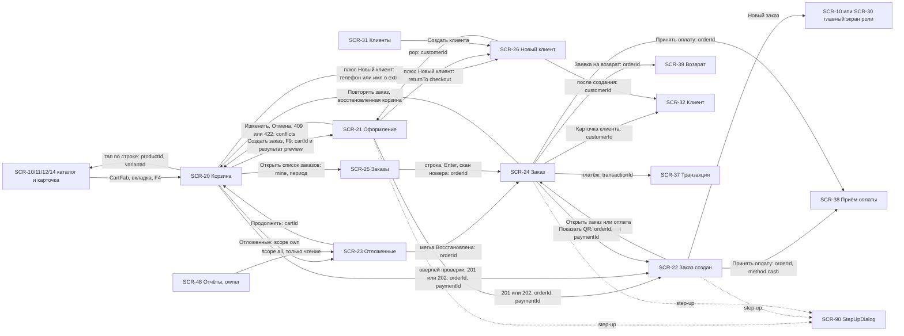

---

## 4. Экран корзины

### SCR-20 — Корзина (`/cart`, query `cartId` — необязателен, по умолчанию активная; роли `seller`, `cashier`, `senior_seller`, `admin`, `customer` — условно; R1: да)

#### 4.1. Назначение и роль пользователя

Черновик будущего заказа сотрудника: состав (вариант, упаковка, количество), клиент и склад корзины, ручная скидка в лимите роли, итоги **с сервера**, действия «Отложить заказ» и «Создать заказ →» [ПОДТВЕРЖДЕНО: макет `image_2026-06-25_23-36-31.png`]. Сервер — источник истины, локальная копия drift (`cart_draft`, `cart_items_draft`) — для офлайна и восстановления после перезапуска (CART-008, CART-009, D-32). Корзина **ничего не резервирует** и не является продажей (D-22, CART-019, SRC-C-076, SRC-C-078). У пользователя ровно одна `active` корзина и любое число `parked` (10 §7.1).

| Роль | Что делает на экране |
|---|---|
| `seller`, `cashier`, `senior_seller`, `admin` | все операции со своей корзиной (`cart.manage.own`); скидка — в лимите своей роли (`discount.apply.within_limit`); `senior_seller`/`admin` — в своей сессии подтверждают скидку сверх лимита **инициатора** возобновлённой чужой корзины, но не больше своего лимита (10 / 15 %, Q-015), со step-up (`discount.approve.over_limit`, 11 §4.3 №24) |
| `owner` | экран недоступен (нет `cart.manage.own`; CASH-003) — пункт «Корзина» в навигации не показывается |
| `customer` (флаг `CUSTOMER_SELF_SERVICE`, Q-001) | вариант `CartPanel.customer`: без скидки, без «Отложить заказ», CTA «Отправить заявку» |

#### 4.2. Структура экрана

Зоны (сверху вниз): **A** — шапка (заголовок, счётчики, «Отложенные», «Очистить»); **B** — клиент и склад корзины; **C** — баннеры (офлайн, устаревшие данные, изменения цен/остатков); **D** — список строк `CartLine`; **E** — скидка `DiscountInput`; **F** — итоги `CartSummary`; **G** — действия (подпись причины недоступности, «Отложить заказ», «Создать заказ →»); **H** — оверлеи (блокировка «Проверяем результат…», диалоги).

| Класс | Раскладка |
|---|---|
| compact (< 600) | полноэкранный маршрут `/cart` (вкладка `BottomNavBar` «Корзина»); `TopAppBarPos.compact` «Корзина · 5» + иконки «Отложенные (n)» и «Очистить»; под ним зоны B → C → D (прокрутка) → E; зоны F и G закреплены снизу над `SafeArea` (итог `h2 24/700`, две кнопки L на всю ширину столбиком в порядке макета: «Отложить заказ» сверху, «Создать заказ →» снизу — главное действие ниже, ближе к большому пальцу, A11Y-022); вход — `CartFab` (UI-20-019) или вкладка; ландшафт: список 60 % слева, итоги и кнопки 40 % справа |
| medium (600–1023) | side sheet `CartPanel.overlay` 320 lp справа (`ds.elevation.2`, радиус `ds.radius.lg` слева, затемнение `overlay`), тот же состав; открытие — кнопка-итог в шапке или `F4`; закрытие — крестик, `Esc`, тап по затемнению |
| expanded (1024–1599) | постоянная `CartPanel.panel` 340 lp справа (третья колонка как на макете), `ds.elevation.1`, граница слева `border`; пункт «Корзина» в навигации скрыт; список строк прокручивается внутри панели, F и G закреплены снизу панели; итог `display 32/700 primary` |
| large (≥ 1600) | как expanded, ширина панели 340 |

Порядок фокуса (A11Y-011): шапка → B → баннеры C → строки D (внутри строки: название → вариант → степпер → удалить) → E → «Отложить заказ» → «Создать заказ →».

#### 4.3. Таблица элементов

| № | UI-ID | Элемент | Компонент (03 §9 / ядро §8.5) | Расположение / размер / отступы / выравнивание | Токены | Состояния | Поведение | Источник данных | Роли | Правило |
|---|---|---|---|---|---|---|---|---|---|---|
| 1 | UI-20-001 | Заголовок «Корзина» + бейдж числа позиций | `CartPanel` (шапка) + `AppBadge` | шапка 56, паддинг 20; заголовок слева, бейдж 20 справа от текста с отступом 8; compact — в `TopAppBarPos` «Корзина · 5» | `ds.text.title 18/600 textPrimary`; бейдж `primary`/`onPrimary`, `micro 11/600` | default; бейдж скрыт при 0 | бейдж = `itemsCount` (строки); перекат числа ANIM-010 | `Cart.itemsCount` (`GET /cart`) | все с доступом | CART-001 |
| 2 | UI-20-021 (новый) | Счётчик позиций и единиц | текст `caption` | строка под заголовком, слева, отступ сверху 4 | `ds.text.caption 12/400 textSecondary`, `tnum` | default; «предварительно» при офлайне | «5 поз. · 6 шт»; при разных единицах — через запятую по каждой единице («· 6 шт, 12,5 м») | `Cart.itemsCount`, `Cart.unitsCount` + единицы строк | все | CART-001, SRC-C-060, SRC-C-061 |
| 3 | UI-20-002 | «Отложенные (n)» | `AppIconButton` `bookmarks` + `AppBadge` | шапка справа, перед «Очистить»; цель 48 | иконка 24 `textSecondary`; бейдж `surfaceVariant`/`textPrimary` | default; бейдж скрыт при 0 | → SCR-23 (expanded — side sheet 400 поверх панели; compact — экран) | `GET /cart/parked?scope=own` (число элементов страницы, `totalEstimate`) | все, кроме `customer` | CART-031 |
| 4 | UI-20-003 | «Очистить корзину» | `AppIconButton` `delete_sweep` → `ConfirmDialog.destructive` | шапка, крайняя справа; цель 48 | иконка `textSecondary`; hover `iconButtonPressed` | disabled при пустой корзине и офлайне | диалог UI-20-029 вариант «очистка» → `DELETE /cart?rowVersion=` | `Cart.rowVersion` | все | CART-011, SRC-C-071 |
| 5 | UI-20-004 | Клиент корзины | `CustomerPicker` (inline) / `CustomerCard.compact` | зона B, высота 56 (не выбран) / 72 (выбран), паддинг 12/20 | `body 14/500`; ссылка `primary`; мета `caption textSecondary` | пусто «Клиент: не выбран ›»; выбран; loading; error | тап → поиск клиента (expanded — popover 360; compact — `AppBottomSheet` 92 %) с «+ Новый клиент» (SCR-26) и чипом «Розничный покупатель»; выбор → `POST /cart/customer`; крестик → `DELETE /cart/customer`; сервер пересчитывает вид цены и скидку, изменённые строки помечаются (CART-020) | `Cart.customer` (DTO по роли); `GET /search/customers` | все (кроме `customer`) | CART-020, DISC-014 |
| 6 | UI-20-005 | Склад и вид цены | строка `CartPanel` (`AppListTile` dense) | под клиентом, высота 32, паддинг 20 | `caption textSecondary`; чип вида цены `StatusChip.priceList` | default (только чтение) | «Склад: Основной · цены «Розничная»»; **в R1 только для чтения**: склад корзины задаёт сервер (`settings.defaultWarehouseId` / склад пользователя), операции смены склада корзины в ядре §7 и 08 §4.7 нет; смена склада — **вне R1** (предложение `PATCH /cart` с `warehouseId` [НОВОЕ ИМЯ] — §14 п.19, Q-211 п. б); тултип (expanded) — «Склад корзины назначается автоматически»; строка не реагирует на тап и не отправляет запросов | `Cart.warehouseId`, `Cart.priceListId` (`GET /cart`) | все | INV-022, INV-030 |
| 7 | UI-20-012 | Баннер корзины | `OfflineBanner` / `ErrorState.banner` (warning, error, info) | зона C, на всю ширину панели, паддинг 12/16, отступ снизу 8 | warning: `warningContainer`/`warning` + иконка `warning`; error: `errorContainer`/`error`; info: `infoContainer`/`info` | скрыт; офлайн; устарело; цены изменились; остаток; сохраняем локально | сводка: «Цены изменились · {count} позиций» + UI-20-024; «Недостаточно остатка · {count}»; «Данные от {time} — обновляем…»; «Нет сети. Изменения сохранены и будут отправлены» | `Cart.warnings[]`, уведомления `cart_price_changed`/`cart_stock_changed`, `sync_meta.as_of` | все | CART-013, CART-014, CART-016, CART-018, SRC-C-072 |
| 8 | UI-20-024 (новый) | «Принять новые цены» | `AppButton.tonal S` | внутри баннера цен, справа; цель 44 | `primaryContainer`/`primary` | default; loading | обновляет `priceSnapshot` всех строк (повторная отправка `PUT /cart/items/{variantId}` с текущей ценой в `priceSnapshot`, `mode=set`) → снимает блокировку CTA | `Cart.items[].unitPrice` | все | CART-013 |
| 9 | UI-20-006 | Строка корзины | `CartLine` (`standard`, expanded — `compact`) | зона D; высота 72 (compact-плотность 64); паддинг 12; миниатюра 48 слева, колонка текста, степпер, сумма вправо (ширина ≥ 88), крестик | фон `surface`; разделитель `border`; hover `surfaceHover`; выбранная клавиатурой — кольцо `focus` inset | default, hover, focused, pending, warning, error, unavailable, readonly | тап по фото/названию → SCR-14 (`productId`, `variantId`), корзина не закрывается (expanded); `↑/↓` — выбор строки | `Cart.items[]` | все | CART-006, SRC-C-065 |
| 10 | UI-20-007 | Вариант строки | `AppButton.text S` → `VariantSelector` (SCR-15) | подстрока под названием «Хром · 1/2" ›» | `caption primary` | скрыт для товара без вариантов; disabled офлайн | → SCR-15 режим одиночного выбора; смена = удаление строки + добавление нового варианта с тем же количеством и упаковкой; при наличии нового варианта в корзине — подтверждение суммирования | `CartItem.variantName`, `GET /catalog/products/{id}/variants` | все | CART-005, SRC-C-064 |
| 11 | UI-20-008 | Количество | `QuantityStepper.cart` + `QuantityNumpadSheet` (SCR-16) | в строке справа от текста; высота 36 (цель 48); «−» 36 · поле 48 · «+» 36 | `body 14/600 tnum`; кнопки `surfaceVariant`; disabled `disabledBg` | default, pressed, autorepeat, pending, disabled («+» при достижении `available`) | «−»/«+» на шаг кратности; тап по числу → SCR-16 (popover 280 на expanded); долгое удержание > 500 мс — автоповтор (ANIM-007); `+`/`−` на клавиатуре для выбранной строки; минимум (шаг) и «−» → UI-20-029 «Удалить позицию?»; ввод 0 — то же (CART-012); запрос `PUT /cart/items/{variantId}` `{quantity, priceSnapshot, rowVersion, mode:"set"}` с `packagingId` (CART-025), debounce 500 мс серии | `CartItem.quantity`, `packaging`, `available` | все | CART-003, CART-008, CART-012, CART-023, INV-001…010, INV-042 |
| 12 | UI-20-009 | Сумма строки | `PriceText.cart` | справа в строке, выравнивание вправо, ширина ≥ 88 | `bodyLg 16/700 textPrimary tnum` | default; «предварительно» (`textSecondary` курсив-метка «≈») до ответа сервера | перекат числа 200 мс (ANIM-010) | `CartItem.lineTotal` | все | CART-006, MNY-001 |
| 13 | UI-20-010 | Удалить строку | `AppIconButton` `close` 20 | крайний справа в строке; цель 44×44 | `textSecondary`; hover `error` | default; disabled при блокировке UI-20-020 | удаление без диалога → строка схлопывается (ANIM-008) → UI-20-028 «Позиция удалена · Отменить» 5 с; `DELETE /cart/items/{variantId}?packagingId=` отправляется после закрытия снекбара без отмены; `Delete` на выбранной строке — то же | `CartItem.variantId`, `packaging.id` | все | CART-004, CART-025, SRC-C-063 |
| 14 | UI-20-011 | Предупреждение строки | `CartLine` (warning/error/unavailable) + текст `caption` с иконкой | под строкой метаданных; полоса слева 3 lp для `error` | цена: фон `warningContainer`, текст `warning` «Цена изменилась: было 2 350 → стало 2 410 сом»; остаток: полоса `error`, «Доступно {available} {unit}»; недоступен: текст `textSecondary`, «Товар больше не продаётся» | warning, error, unavailable | всегда иконка + текст (A11Y-004); для недоступного — степпер disabled, кнопка «Удалить позицию» | `Cart.warnings[]` (`CartConflict`) | все | CART-013, CART-014, CART-015 |
| 15 | UI-20-025 (новый) | «Уменьшить до {available}» | `AppButton.text S` | под предупреждением остатка, слева | `primary` | default; loading | `PUT /cart/items/{variantId}` с `quantity = available` (сервер проверяет кратность; если `available` не кратен упаковке — до ближайшего кратного меньшего) | `CartConflict.available` | все | CART-014 |
| 16 | UI-20-018 | Свайп удаления | `CartLine` (swipe) | только compact/medium (тач) | область `error` с иконкой `delete` `onError` | idle, dragging, threshold (40 %) | отпускание за порогом → как UI-20-010 | — | все | CART-004, A11Y-017 |
| 17 | UI-20-013 | Скидка | `DiscountInput.percent` / `readonly` / `customerDiscount` | зона E, строка 44, паддинг 20: «Скидка» слева, поле 72×36 (цель 44) с суффиксом «%», сумма «−842,50 сом» справа, иконка `info` с тултипом «Ваш лимит: 5 %» | поле `AppTextField.number S`; превышение — обводка `warning`; отказ — `error` | default, focused, loading («…» + спиннер 16), over_limit (обводка `error`, текст ошибки под полем), readonly, hidden | ввод 0–100, 2 знака; применение по Enter или debounce 500 мс → `POST /cart/discount {percent, rowVersion}`; `200` — поле и итоги показывают `appliedDiscountPercent`, `discountTotal`; `422 DISCOUNT_LIMIT_EXCEEDED` (тело — `limitPercent`, `requiresRole`; **корзина не меняется**, 08 §4.7.5) → в итогах остаётся прежняя применённая скидка, поле сохраняет введённое значение в состоянии `over_limit` с текстом «Больше {limit} % без подтверждения нельзя. Действует прежняя скидка {applied} %», под полем — кнопки «Применить {limit} %» (UI-20-032) и эскалация (UI-20-031 или UI-20-033 — по условиям §4.4 «Зона E»); автоматического урезания до лимита нет (CART-007, DISC-004, DISC-010); у роли без права — `readonly` «Скидка клиента 5 % (из 1С)» | `Cart.requestedDiscountPercent`, `appliedDiscountPercent`, `discountLimitPercent`, `customerDiscountPercent`; problem `limitPercent`, `requiresRole` | `seller`, `cashier`, `senior_seller`, `admin` (в лимите); `customer` — скрыто | CART-007, DISC-002…005, DISC-010, SRC-C-067 |
| 17a | UI-20-032 (новый) | «Применить {limit} %» | `AppButton.tonal S` | под полем скидки слева, рядом с UI-20-031/UI-20-033 (зазор 8); цель 44 | `primaryContainer`/`primary` | скрыт; default; loading | виден только после `422 DISCOUNT_LIMIT_EXCEEDED`; нажатие → **отдельный** `POST /cart/discount {percent: limitPercent, rowVersion}` → `200`: поле показывает лимит, ошибка снимается; повторное нажатие во время `loading` игнорируется; при новом вводе в поле кнопка скрывается | `limitPercent` из problem | `seller`, `cashier`, `senior_seller`, `admin` | DISC-003, DISC-004 |
| 18 | UI-20-031 (новый) | «Как получить подтверждение» (скидка сверх лимита) | `AppButton.text S` → `ConfirmDialog` (информационный) | под полем скидки | `primary` | скрыт; default | диалог `cart_discount_approval_dialog_*`: «Подтвердить скидку больше {limit} % может старший продавец или администратор в своей учётной записи. Отложите заказ — старший откроет его на своём устройстве, либо выйдите, чтобы он вошёл на этом терминале.» Кнопки «Отложить заказ» (→ UI-20-015) и «Понятно»; виден после `422`, если запрошенная скидка не больше потолка подтверждающей роли (`admin` — 15 % [НЕ ПОДТВЕРЖДЕНО, Q-015]); при большей скидке вместо кнопки — текст «Скидка больше {max} % не допускается» | `discountLimitPercent`, `limitPercent`, `requiresRole` из problem | `seller`, `cashier`; `senior_seller` — при скидке больше своего лимита (10 %) и не больше 15 % (`requiresRole=admin`) | DISC-010, CASH-007 |
| 18a | UI-20-033 (новый) | «Подтвердить скидку {p} %» (override старшего) | `AppButton.tonal S` → поле «Причина» (`AppTextField`, обязательно, ≤ 200) → `StepUpDialog` | под полем скидки, на месте UI-20-031 | `primaryContainer`/`primary`; после успеха — `StatusChip.info` «Подтвердил: {name}» у строки «Скидка» итогов | скрыт; default; loading; error | показывается **только** `senior_seller`/`admin` в собственной сессии и **только** если одновременно: (1) корзина возобновлена из чужой отложенной (`Cart.audit.createdBy ≠` текущий пользователь, `cart.parked.resume.any`); (2) запрошенная скидка больше лимита инициатора (автора корзины); (3) запрошенная скидка не больше лимита подтверждающего: `senior_seller` — до 10 %, `admin` — до 15 % [НЕ ПОДТВЕРЖДЕНО, Q-015] (11 §4.3 №24, §4.4). Лимит инициатора в `Cart` не передаётся — до появления поля (§14 п.20) порогом считается минимальный лимит продавца/кассира 5 % [НЕ ПОДТВЕРЖДЕНО, Q-015]. Нажатие → причина → `StepUpDialog` → `POST /cart/discount {percent, override:{reason}, rowVersion}` + `X-Step-Up-Token` (`sid` текущей сессии). В собственной (не возобновлённой) корзине скидка до своего лимита — обычное применение `discount.apply.within_limit` без override; сверх своего лимита — отказ `422`, override не предлагается | `Cart.audit.createdBy`, `discountLimitPercent`, `appliedDiscountPercent` | `senior_seller`, `admin` (`discount.approve.over_limit`, S!) | DISC-010, CASH-007, 11 §4.3 №24 |
| 19 | UI-20-014 | Итоги | `CartSummary.cart` | зона F; фон `background` внутри панели; паддинг 16; строки 28, итог 48 | подписи `body textSecondary`; значения `bodyLg 16/500 tnum`; «Итого» `title 18/600`, сумма `display 32/700 primary` (expanded) / `h2 24/700` (compact) | default; loading (`SkeletonBox` 120×32); error («Не удалось рассчитать итог · Повторить»); предварительно | «Товаров (5) 16 850,00 сом» · «Скидка (5 %) −842,50 сом» · [«Скидка клиента (из 1С) −…»] · «Итого 16 007,50 сом»; офлайн и до ответа — «Итого (предварительно)»; тултип «Суммы рассчитаны сервером, {time}» | `Cart.subtotal`, `discountTotal`, `total` | все | CART-006, MNY-001, DISC-008, SRC-C-066, SRC-C-068 |
| 20 | UI-20-030 (новый) | Метка «предварительно» | текст `caption` + иконка `schedule` | рядом с «Итого» | `textSecondary` | скрыта / видна | видна, пока есть неподтверждённые сервером изменения или офлайн | локальное состояние провайдера `cartProvider` | все | MNY-001, CART-018 |
| 21 | UI-20-023 (новый) | Индикатор сохранения | `SyncIndicator` (inline, 16) | под шапкой справа | `caption textSecondary`; ошибка `error` | «Сохранено», «Сохраняем…», «В очереди: {count}», «Ошибка сохранения · Повторить» | показывает состояние локального outbox корзины | `outbox_actions` (`type=cart.sync`) | все | CART-008, CART-018, SRC-F-032 |
| 22 | UI-20-022 (новый) | Подпись причины недоступности CTA | текст `caption` + иконка | над кнопками зоны G, по центру | `textSecondary`; блокирующая — `warning` | скрыта / видна | одна причина по приоритету: «Корзина пуста» → «Нужна сеть, чтобы создать заказ» → «Проверяем результат создания заказа…» → «Примите новые цены» → «Уменьшите количество до доступного» → «Удалите недоступные позиции» → «Обновляем данные…» | вычисляется из состояния | все | CART-013…018, CART-021, CART-022 |
| 23 | UI-20-015 | «Отложить заказ» | `AppButton.outlined M` (иконка `bookmark`; 03 §9.27, согласовано с 02b E8 — исправлено при сборке 02), во всю ширину | зона G, верхняя кнопка на всех классах окна — над «Создать заказ →» (как макет, A11Y-022) | `primary` текст/обводка | default, hover, pressed, loading, disabled | → диалог UI-20-026 → `POST /cart/park {name, rowVersion}` с `Idempotency-Key`; ответ 201 — `parked` и новая пустая `active`; снекбар «Заказ отложен · Открыть отложенные»; `F8`; disabled — пустая корзина, офлайн, блокировка UI-20-020 | `Cart.rowVersion` | все, кроме `customer` | CART-030, SRC-C-069 |
| 24 | UI-20-016 | «Создать заказ →» | `AppButton.primary L` (иконка `arrow_forward`), во всю ширину | зона G, нижняя кнопка; цель 52 | `primary`/`onPrimary`; disabled `disabledBg`/`disabledText` | default, hover, pressed, loading, disabled | → `POST /cart/checkout-preview` с текущими значениями черновика оформления → открывает SCR-21 с результатом; повторное нажатие во время loading игнорируется; `F9`; disabled — см. UI-20-022 | `Cart`, `checkout_draft` | `seller`, `cashier`, `senior_seller`, `admin` (`order.create`) | CART-021, CART-023, ORD-007, SRC-C-075 |
| 25 | UI-20-017 | Пустая корзина | `EmptyState.cart` | вместо зон D–F, по центру; иллюстрация 120 | иллюстрация — `brandAccent` (D-16); заголовок `title`; текст `body textSecondary` | видна при `items = []` | «Корзина пуста» · «Добавьте товары из каталога или отсканируйте штрихкод» · кнопка «К каталогу» (compact) / «Отложенные заказы ({count})», если есть | `Cart.items` | все | CART-021 |
| 26 | UI-20-019 | Панель-итог | `CartFab` | compact (и medium при закрытой overlay): 56 lp на всю ширину минус поля 16, отступ 8 над `BottomNavBar`; скрыта на SCR-20/21 | `primary`/`onPrimary`; бейдж `onPrimary`/`primary micro` | default, pressed, warning (иконка `warning` при изменениях цен/остатков), hidden | тап или свайп вверх → SCR-20; пульс при добавлении (ANIM-006); появление/скрытие ANIM-019 | `Cart.itemsCount`, `total` | все | CART-001, SRC-C-058 |
| 27 | UI-20-020 | Блокировка «Проверяем результат…» | оверлей `CartPanel` (фон `surface` 0,9) + `AppProgress.circular` + текст | поверх зон D–G; текст по центру | `body textPrimary`; индикатор `primary` | скрыт / виден | показывается, когда результат `POST /orders` неизвестен (сеть, таймаут, 5xx): редактирование заблокировано, приложение повторяет **сохранённый** запрос с тем же `Idempotency-Key` и телом (`checkout_draft.order_idempotency_key`); ответ 201/202 → SCR-22; 422 → снятие блокировки с подсветкой; кнопка «Повторить сейчас» после 3 неудачных автоповторов; график фоновых повторов, предел ожидания и итоговое состояние — §4.11.1 [НЕ ПОДТВЕРЖДЕНО, Q-176] | `checkout_draft.submitted_at`, `order_idempotency_key` | все | CART-022 (а), ORD-028, SRC-F-033 |
| 28 | UI-20-026 (новый) | Диалог «Отложить заказ» | `ConfirmDialog` с полем `AppTextField` | диалог 400 (compact — `AppBottomSheet`) | заголовок `title`; поле `body` | default; loading; error | поле «Название (необязательно)», плейсхолдер «{Клиент или Без клиента} · {HH:MM}», ≤ 60 символов [ТИПОВО]; «Отложить» / «Отмена»; `Enter` — «Отложить» | — | все | CART-030 |
| 29 | UI-20-027 (новый) | Диалог «Корзина изменена на другом устройстве» | `ConfirmDialog` | диалог 480 | `title`; список изменений `body` | — | показывает серверную версию и список локальных изменений, которые не применены; «Применить мои изменения» (повторная отправка с новым `rowVersion`) / «Оставить как на сервере» | `409 VERSION_CONFLICT` `current: Cart` | все | CART-009, CART-017, SRC-F-033 |
| 30 | UI-20-028 (новый) | Снекбар «Позиция удалена · Отменить» | `AppSnackbar` | низ экрана (compact — над `CartFab`/кнопками); expanded — внизу контент-зоны | `inverseSurface`/`onInverseSurface` | виден 5 с [НЕ ПОДТВЕРЖДЕНО, Q-176] | «Отменить» / `Ctrl+Z` — строка возвращается в прежнюю позицию с прежним количеством; запрос `DELETE` не отправляется | локальное состояние | все | CART-004 |
| 31 | UI-20-029 (новый) | `ConfirmDialog` удаления / очистки | `ConfirmDialog.destructive` | диалог 400; кнопки справа: «Отмена» (фокус по умолчанию) и «Удалить»/«Очистить» `danger` | `error` для destructive | — | удаление строки при уменьшении до 0: «Удалить «{name}» из корзины?»; очистка: «Очистить корзину? Будет удалено {count} позиций. Отложенные заказы не затрагиваются» | `Cart.itemsCount` | все | CART-003, CART-011, CART-012 |

Соответствие вайрфреймам: UI-20-001 … UI-20-020 совпадают по смыслу с `visual/wireframes-catalog.html` (таблица SCR-20); уточнены: UI-20-001 — бейдж `primary`, а не красный (03 §9.27); UI-20-015/016 — клавиши `F8`/`F9` (§3.4); UI-20-013 — подтверждение сверх лимита только в собственной сессии старшего (CASH-007). Новые: UI-20-021 … UI-20-033 (UI-20-032 «Применить {limit} %» и UI-20-033 override старшего добавлены по замечаниям проверки, см. «Журнал проверки»); уточнён UI-20-005 — склад только для чтения в R1.

##### 4.3.1. Подразделы по зонам (сложный экран)

| Зона | Элементы | Раскладка зоны | Правила зоны |
|---|---|---|---|
| A — шапка | UI-20-001, UI-20-021, UI-20-002, UI-20-003, UI-20-023 | высота 56 + строка счётчиков 20; паддинг 20; на compact — `TopAppBarPos.compact` | счётчики — только серверные `itemsCount`/`unitsCount`; при офлайне — локальные с меткой «предварительно»; «Очистить» не ставится в очередь офлайн |
| B — клиент и склад | UI-20-004, UI-20-005 | 56–72 + 32; разделитель снизу `border` | выбор клиента пересчитывает цены и скидку на сервере (CART-020); клиент «ожидает 1С» допустим для `cash`/`qr_bakai` (CUST-014); склад корзины в R1 только отображается (смена — вне R1, §14 п.19) |
| C — баннеры | UI-20-012, UI-20-024 | один баннер за раз, отступ снизу 8 | приоритет: офлайн → цены → остаток → устаревание; каждый баннер — иконка + текст + действие (A11Y-004) |
| D — строки | UI-20-006 … UI-20-011, UI-20-018, UI-20-025, UI-20-028 | прокрутка внутри панели (expanded) / экрана (compact); виртуализированный список (до 200 строк, CART-024) | сортировка — по порядку добавления (`addedAt`), новая строка — сверху [ТИПОВО]; строка с предупреждением не перемещается |
| E — скидка | UI-20-013, UI-20-032, UI-20-031, UI-20-033 | строка 44 + строка кнопок 36 (после отказа) | видна только ролям с правом (CART-007); сумма скидки — только с сервера (DISC-004); при `422` корзина не меняется, применение лимита — только явной кнопкой UI-20-032 |
| F — итоги | UI-20-014, UI-20-030 | фон `background`, паддинг 16, закреплена над G | «Итого» — `liveRegion` polite с debounce 1 с (A11Y-012) |
| G — действия | UI-20-022, UI-20-015, UI-20-016 | закреплена снизу (`SafeArea`); две кнопки L | одна причина недоступности под кнопками; «Создать заказ →» — главная (primary), «Отложить заказ» — outlined |
| H — оверлеи | UI-20-020, UI-20-026, UI-20-027, UI-20-029, UI-20-019 (вне панели) | поверх D–G / модальные диалоги | во время UI-20-020 недоступны все изменяющие действия; диалоги — фокус-ловушка, возврат фокуса инициатору (A11Y-011) |

#### 4.4. Поведение каждого контрола

**Зона A — шапка.**
- «Отложенные (n)» (UI-20-002): одиночное нажатие открывает SCR-23; повторное нажатие при открытом SCR-23 закрывает его (expanded, side sheet); число обновляется после `POST /cart/park` и при каждом `GET /cart/parked`.
- «Очистить» (UI-20-003): открывает диалог UI-20-029 (фокус на «Отмена»); подтверждение → `DELETE /cart?rowVersion=` → ответ — новая пустая `active`; повторное нажатие во время запроса игнорируется; при `409 VERSION_CONFLICT` диалог закрывается, показывается UI-20-027; офлайн — кнопка disabled с тултипом «Нужна сеть» (очистка не ставится в локальную очередь, чтобы не потерять корзину по ошибке) [РЕШЕНИЕ части].

**Зона B — клиент и склад.**
- «Клиент: не выбран ›» (UI-20-004): тап открывает `CustomerPicker`; поиск `GET /search/customers?q=` с debounce 300 мс; минимум 2 символа для имени/кода; телефон — от 4 цифр для `cashier`/`senior_seller`/`admin` и только полный номер (9 цифр) для `seller` (08 §4.5.4, 10 §8.1); `Enter` — выбор первой строки; `↑/↓` — по результатам. Выбор → `POST /cart/customer {customerId, receiver:{kind:"customer"}, rowVersion}`; до ответа карточка в `loading`, корзина не блокируется. После ответа строки с изменённой ценой получают предупреждение «Цены пересчитаны по условиям клиента» (CART-020). Крестик на карточке → `DELETE /cart/customer` с тем же пересчётом. Офлайн — поиск по `customers_cache` с пометкой «данные от {time}», выбор ставится в очередь `cart.sync`.
- Склад (UI-20-005): в R1 только для чтения — строка не кликабельна, меню нет, запросов не отправляет; склад корзины назначает сервер. Смена склада корзины — вне R1: в ядре §7 и 08 §4.7 нет операции, задающей `warehouseId` корзины (`GET /cart` склад не меняет); предложение `PATCH /cart {warehouseId, rowVersion}` [НОВОЕ ИМЯ] `[УСЛОВНО: нет в 08]` — §14 п.19, вопрос Q-211 п. б; элемент UI-20-005 до появления операции в 08 остаётся только для чтения.

**Зона C — баннеры.** Баннеры показываются по одному в порядке приоритета: офлайн → «Проверяем результат» (оверлей, не баннер) → изменения цен → недостаточный остаток → устаревшие данные. Кнопка «Принять новые цены» (UI-20-024) переводит все строки с `PRICE_CHANGED` в актуальную цену одним пакетом запросов; при ошибке одного из запросов баннер остаётся, неподтверждённые строки сохраняют подсветку.

**Зона D — строки.**
- Степпер (UI-20-008): каждое нажатие меняет число мгновенно (optimistic), отправка — один `PUT` по завершении серии нажатий (debounce 500 мс по INV-043 [НЕ ПОДТВЕРЖДЕНО, Q-176]; 03 ANIM-007 и §9.20 указывают 400 мс — расхождение вынесено в §14 п.21); в теле — **абсолютное** целевое количество (`mode=set`), поэтому повтор того же запроса не меняет результат (CART-023). «+» становится disabled, когда `quantity` достиг `available` (INV-042); попытка превысить через нампад — значение ограничивается `available` с подсказкой «Доступно {available} {unit}» и встряской поля (ANIM-012). Долгое нажатие «+»/«−» — автоповтор каждые 150 мс после 500 мс (ANIM-007) с одним запросом по отпусканию. Двойной тап по «+» — два шага (ожидаемо, каждый тап — шаг).
- Нампад (SCR-16): открывается тапом по числу; «OK» применяет абсолютное значение; «Отмена»/`Esc` — без изменения; ввод с лишними знаками (`qty_precision`) отклоняется (MV-24).
- Удаление (UI-20-010, UI-20-018, `Delete`): без диалога, со снекбаром «Отменить» 5 с; запрос отправляется после истечения снекбара; если за это время пользователь ушёл с экрана — запрос отправляется сразу при уходе (корзина — провайдер уровня приложения, CART-010). Повторное нажатие крестика у той же строки во время анимации игнорируется.
- Тап по строке: открывает SCR-14 с `productId`, `variantId`; корзина остаётся видимой на expanded; на compact — push SCR-14, «Назад» возвращает в корзину с сохранённой прокруткой.

**Зона E — скидка.** Поле принимает цифры, «,» и «.»; при фокусе на compact открывается `QuantityNumpadSheet.discount`. Пустое поле = 0 %. Значение > 100 или > 2 знаков — ошибка поля «Введите число от 0 до 100» (локально, без запроса, MV-26). Отправка — по `Enter` или после паузы ввода 500 мс; повторное нажатие `Enter` с тем же значением во время запроса игнорируется; новое значение во время запроса ставится в очередь и отправляется после ответа (учитывается только последнее).
- **`200`** — поле и итоги показывают `appliedDiscountPercent` и `discountTotal` сервера; ошибка и кнопки UI-20-031/032/033 скрываются.
- **`422 DISCOUNT_LIMIT_EXCEEDED`** (тело `limitPercent`, `requiresRole`; 08 §4.7.5) — **корзина на сервере не изменилась**: итоги продолжают показывать прежнюю применённую скидку (`appliedDiscountPercent` до запроса), поле остаётся с введённым значением в состоянии `over_limit` (обводка `error`, ANIM-012) и текстом `cart_discount_over_limit` «Больше {limit} % без подтверждения нельзя. Действует прежняя скидка {applied} %». Автоматического урезания до лимита нет (CART-007, DISC-004, DISC-010). Под полем — явная кнопка «Применить {limit} %» (UI-20-032, отдельный `POST /cart/discount` со значением `limitPercent`) и рядом — эскалация по таблице ниже.
- **Эскалация после `422`:**

| Кто и где | Запрошено `p` | Что показывается |
|---|---|---|
| `seller`, `cashier` (лимит 5 % [НЕ ПОДТВЕРЖДЕНО, Q-015]) | 5 % < `p` ≤ 15 % | UI-20-032 + UI-20-031 «Как получить подтверждение» (откладывание или вход старшего на терминале, CASH-007) |
| `seller`, `cashier` | `p` > 15 % (больше потолка любой подтверждающей роли) | UI-20-032 + текст `cart_discount_over_max` «Скидка больше {max} % не допускается»; эскалации нет |
| `senior_seller` в своей корзине (лимит 10 %) | `p` ≤ 10 % | `422` не возникает — обычное применение `discount.apply.within_limit`, без override и step-up |
| `senior_seller` в своей корзине | 10 % < `p` ≤ 15 % | UI-20-032 «Применить 10 %» + UI-20-031 (подтвердить может `admin` в своей сессии, `requiresRole=admin`); override **не** предлагается — подтверждение действует только в пределах лимита подтверждающего (11 §4.3 №24, §4.4) |
| `senior_seller` в своей корзине | `p` > 15 % | UI-20-032 + `cart_discount_over_max`; эскалации нет |
| `admin` в своей корзине (лимит 15 %) | `p` ≤ 15 % | обычное применение без override |
| `admin` в своей корзине | `p` > 15 % | UI-20-032 «Применить 15 %» + `cart_discount_over_max`; override не предлагается |
| `senior_seller` / `admin`, корзина возобновлена из чужой отложенной (`audit.createdBy` ≠ текущий) | лимит инициатора < `p` ≤ лимит подтверждающего (10 / 15 %) | UI-20-033 «Подтвердить скидку {p} %»: поле «Причина» (обязательно, ≤ 200) → `StepUpDialog` → `POST /cart/discount {percent, override:{reason}, rowVersion}` + `X-Step-Up-Token`; успех — бейдж «Подтвердил: {name}» у строки «Скидка» итогов (DISC-010, аудит `discount.over_limit_approved` — 11 §7.2) |
| `senior_seller` / `admin`, возобновлённая чужая корзина | `p` > лимита подтверждающего | отказ без override: UI-20-032 + (для `senior_seller`, `p` ≤ 15 %) UI-20-031, иначе `cart_discount_over_max` |

Лимит инициатора в `Cart` (08 §3.8) не передаётся (`discountLimitPercent` — лимит текущего пользователя); до появления поля (§14 п.20) порогом инициатора считается 5 % [НЕ ПОДТВЕРЖДЕНО, Q-015]. Ответ `403 STEP_UP_REQUIRED` на override — повтор step-up и того же запроса; `403 FORBIDDEN` — «Недостаточно прав», override скрывается.

**Зона G — действия.**
- «Отложить заказ» (UI-20-015): диалог UI-20-026 → `POST /cart/park`; `Idempotency-Key` создаётся при нажатии «Отложить» в диалоге и переиспользуется при сетевом повторе; кнопка в `loading`, повторное нажатие игнорируется. Успех: корзина становится пустой (ANIM-022), снекбар «Заказ отложен · Открыть отложенные» (8 с). Офлайн — disabled «Нужна сеть».
- «Создать заказ →» (UI-20-016): нажатие → кнопка `loading` → `POST /cart/checkout-preview` (тело — из корзины и `checkout_draft`: `paymentMethod`, `delivery`, `receiver`, `manualDiscountPercent`, `syncCheckWithOnec:true`) → при `200` открывается SCR-21 с результатом (даже при `ok=false` — конфликты показываются в SCR-21 и строки подсвечиваются в корзине). Двойное нажатие — второе игнорируется (кнопка в `loading`). Ошибки: `CART_EMPTY` → пустое состояние; `VERSION_CONFLICT` → UI-20-027; сеть/таймаут → снекбар «Не удалось проверить заказ · Повторить», SCR-21 не открывается.

**Клавиатура и сканер (Windows).** `F4` — фокус в панель корзины; `↑/↓` — выбор строки (кольцо `focus`); `+`/`−` — количество выбранной строки; `Delete` — удалить; `Tab` — в поле скидки; `F8` — «Отложить заказ»; `F9` — «Создать заказ →». HID-скан при открытой корзине: `GET /search/barcode/{value}` → один вариант — `PUT /cart/items/{variantId}` с `mode=increment` и `Idempotency-Key` (08 §2.7) → строка подсвечивается на 1 с (`primaryContainer` fade 200 мс); несколько вариантов — SCR-15; не найден — снекбар «Товар со штрихкодом {code} не найден».

##### 4.4.1. Диаграммы последовательности ключевых действий (сложный экран)

Диаграмма 1. Изменение количества: оптимистичное отображение, серия нажатий, офлайн-очередь и конфликт версий.

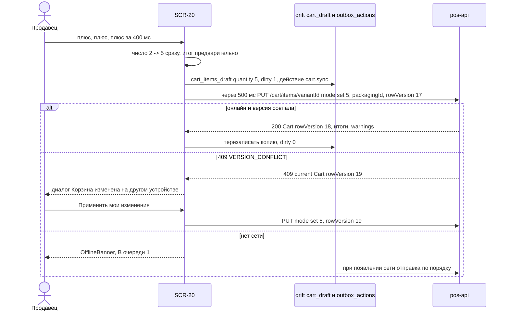

Диаграмма 2. Восстановление корзины после перезапуска приложения (CART-009).

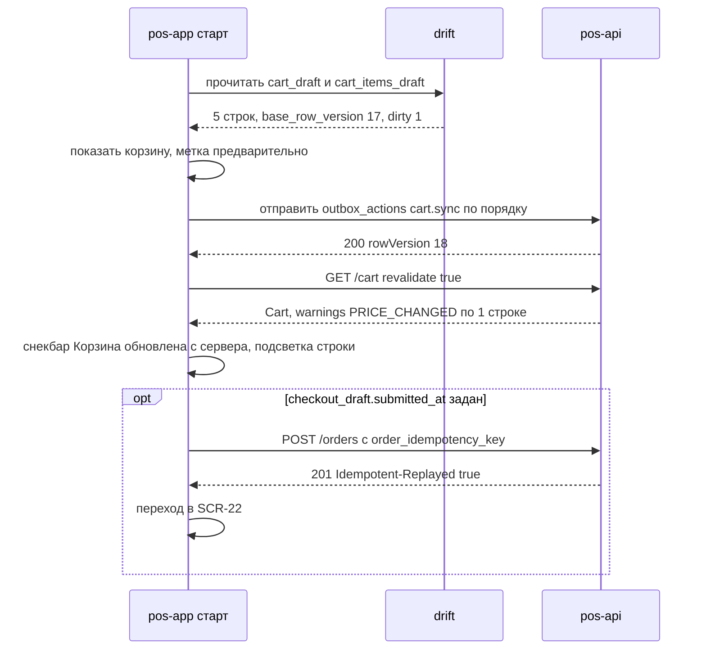

#### 4.5. Анимации

| Анимация | Начальное состояние | Триггер | Последовательность | Конечное состояние | Длительность / кривая | Ошибка | Reduce motion |
|---|---|---|---|---|---|---|---|
| ANIM-006 (новая строка) | строки нет | добавление товара (каталог, SCR-14, скан) | строка slide-in 16 lp + fade; бейдж UI-20-001 scale 1→1,25→1; compact — пульс `CartFab` | строка в списке | 300 мс / 200 мс, `standardDecelerate` | откат: строка fade-out 200 мс + снекбар `error` | мгновенное появление |
| ANIM-007 (автоповтор) | значение n | удержание «+»/«−» > 500 мс | шаг каждые 150 мс, crossfade числа | значение при отпускании | 500 мс + 150 мс/шаг | значение возвращается к последнему подтверждённому | шаги без crossfade |
| ANIM-008 (удаление) | строка 64–72 | крестик / свайп / `Delete` | высота → 0 + fade | строки нет, снекбар | 250 мс `standardAccelerate` | при ошибке `DELETE` строка возвращается fade-in 200 мс | мгновенно |
| ANIM-010 (перекат чисел) | старое число | изменение суммы строки, итога, счётчиков | значение «едет» к новому по тыйынам | новое число | 200 мс `standard` | — | мгновенная смена |
| ANIM-012 (shake) | поле в покое | ошибка ввода количества/скидки | ±4 lp, 1 цикл; обводка `error` | поле с ошибкой | 300 мс | — | только обводка |
| ANIM-013 (скелетон) | — | загрузка > 300 мс | шиммер `skeletonBase → skeletonHighlight` | данные fade-in 150 мс | loop 1,2 с | > 10 с — `AppProgress` + «Долгая загрузка…» | статичный скелетон |
| ANIM-019 (баннер / `CartFab`) | скрыт | смена сети, появление предупреждений; корзина стала (не)пустой | slide-down 40 lp + fade; `CartFab` slide-up 16 lp + fade | виден | 200 мс (скрытие 150 мс) | — | crossfade 80 мс |
| ANIM-022 (пустое состояние) | список | корзина опустела | иллюстрация и текст fade-in | `EmptyState` | 200 мс | — | мгновенно |
| ANIM-023 (диалог) | скрыт | открытие UI-20-026/027/029 | `overlay` 0→0,48 + scale 0,96→1 | диалог, фокус на безопасной кнопке | 200/250 мс | — | crossfade 80 мс |
| ANIM-025 (лист) | скрыт | `CustomerPicker` compact, SCR-16, medium-overlay корзины | slide-up (compact) / slide-in справа 320 (medium) | лист открыт | 250 мс `standardDecelerate` | — | crossfade 80 мс |
| ANIM-027 (снекбар) | скрыт | удаление, откладывание, ошибки | slide-up 8 lp + fade | виден 5/8 с | 150 мс | — | fade 80 мс |
| Специфичная: подсветка изменённой строки | фон `surface` | `warnings[]` содержит строку | фон → `warningContainer` (или полоса `error`), иконка fade-in | подсвеченная строка | 200 мс `standard` | — | мгновенно |
| Специфичная: оверлей «Проверяем результат…» | панель активна | неизвестный результат `POST /orders` | фон `surface` 0→0,9 fade + `AppProgress` indeterminate | заблокированная панель | 200 мс; индикатор 1 цикл/с (A11Y-018) | после 3 автоповторов — кнопка «Повторить сейчас» fade-in | статичный индикатор |

#### 4.6. Переходы

| Откуда → куда | Триггер | Передаваемые данные | Тип перехода | «Назад» |
|---|---|---|---|---|
| SCR-10/11/12 (compact) → SCR-20 | `CartFab`, вкладка «Корзина», `F4` | — (активная корзина из провайдера) | переключение ветки `shell:cart` | корень ветки |
| SCR-20 → SCR-14 | тап по строке | `productId`, `variantId` | expanded — панель карточки, корзина остаётся; compact — push | SCR-20, прокрутка сохранена |
| SCR-20 → SCR-15 | «Вариант ›» | `productId`, текущий `variantId`, `packagingId`, `quantity` | sheet/popover | закрытие без изменений |
| SCR-20 → SCR-16 | тап по числу степпера | `variantId`, `packagingId`, `quantity`, `qtyPrecision`, `factor`, `available` | sheet/popover | закрытие без изменений |
| SCR-20 → SCR-23 | «Отложенные (n)» / снекбар «Открыть отложенные» | — | push (compact) / side sheet 400 (expanded) | SCR-20 |
| SCR-20 → SCR-26 | «+ Новый клиент» в `CustomerPicker` | номер/имя из строки поиска — невосстанавливаемый `extra` (не URL) | root push (диалог на expanded) | результат `customerId` → `POST /cart/customer` |
| SCR-20 → SCR-21 | «Создать заказ →» / `F9` | `cartId` (query), результат `checkout-preview` (в провайдере, не в URL) | root push; expanded — модальное окно | SCR-20 (черновик оформления сохранён) |
| SCR-20 → SCR-22 | ответ 201/202 после блокировки UI-20-020 | `orderId` (path), `paymentId` (query, опц.) | `pushReplacement` | главный экран роли |
| уведомление `cart_price_changed`/`cart_stock_changed` (SCR-44) → SCR-20 | тап | — | `go` в ветку корзины (expanded — `catalog` с постоянной панелью) | предыдущая ветка |

Deep link на `/cart` разрешён только внутри приложения (не входит в перечень разрешённых внешних ссылок navigation §5.3); после перезапуска последний маршрут `/cart` восстанавливается из `app_meta` (`last_location`).

#### 4.7. Состояния экрана

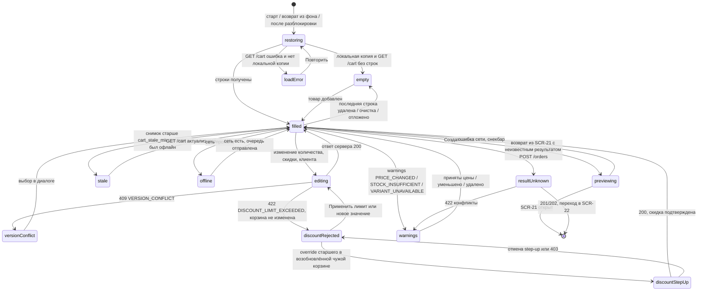

| Состояние | Что видно | Что доступно | Коды 08 / источник |
|---|---|---|---|
| Загрузка / восстановление | сначала локальная копия drift с меткой «предварительно», затем `GET /cart`; при отсутствии копии — `SkeletonList.row64` ×3 + скелетон итога | прокрутка | CART-009 |
| Пусто | `EmptyState.cart`; «Отложить», «Создать», «Очистить» скрыты/disabled | «Отложенные (n)», «К каталогу» | CART-021; `422 CART_EMPTY` |
| С товарами | строки, скидка, итоги, обе CTA активны | всё | — |
| Изменение количества | строка в `pending` (индикатор 16 у суммы), итог «предварительно» | продолжение редактирования | `PUT /cart/items/{variantId}` |
| Цена изменилась | строки `warningContainer` «было → стало», баннер с «Принять новые цены», CTA disabled | принять цены, удалить строку | `warnings` `PRICE_CHANGED`; смена клиента (CART-020) |
| Недостаточный остаток | полоса `error`, «Доступно {n}», «Уменьшить до {n}», CTA disabled | уменьшить, удалить | `STOCK_INSUFFICIENT` (не ошибка `PUT`, а `warnings`) |
| Товар больше не продаётся | строка приглушена, степпер disabled, «Удалить позицию» | удалить, «Вариант ›» (если есть другие варианты) | `VARIANT_UNAVAILABLE` |
| Количество не кратно / ниже минимума | ошибка поля, значение возвращено | исправить | `422 QTY_NOT_MULTIPLE`, `422 QTY_BELOW_MIN` |
| Устаревшие данные | баннер «Данные от {time} — обновляем…», CTA disabled до окончания `GET /cart` | редактирование | CART-016 (`cart_stale_minutes`, 15 мин, Q-020) |
| Конфликт версий | диалог UI-20-027 | выбор версии | `409 VERSION_CONFLICT` |
| Нет сети | `OfflineBanner` «Нет сети. Изменения сохранены и будут отправлены»; итог «предварительно»; «Создать», «Отложить», «Очистить» disabled с подписью «Нужна сеть» | изменение количества, удаление, выбор клиента из кэша | D-32, CART-018 |
| Ошибка сохранения в очереди | индикатор UI-20-023 `error` «Ошибка сохранения · Повторить» | повтор | `outbox_actions.status = dead` |
| Результат создания заказа неизвестен | оверлей UI-20-020 | только ожидание / «Повторить сейчас» | CART-022 (а), ORD-028 |
| Ошибка оформления (возврат из SCR-21) | подсветка строк, баннер с причиной, `ErrorState.banner` «Заказ не создан: {причина}» | исправить корзину | `422 PRICE_CHANGED` / `STOCK_INSUFFICIENT` / `DISCOUNT_LIMIT_EXCEEDED` / `CREDIT_*` (CART-022 б) |
| Восстановлена после отклонения 1С | баннер `info` «Корзина восстановлена из заказа № {number}: {причина 1С}» | редактирование, новый заказ | ORD-027 (`submit_failed`) |
| Лимит строк | снекбар «Слишком много позиций (максимум 200). Оформите часть заказа отдельно» | — | CART-024 (Q-176); `VALIDATION_FAILED` rule `max_items` |
| Нет разрешений | камера/биометрия на экране не используются; `403 FORBIDDEN` → «Недостаточно прав» | — | CASH-001 |
| Скидка отклонена | поле `over_limit` с текстом лимита; итоги — прежняя применённая скидка; кнопки UI-20-032 и UI-20-031 / UI-20-033 / текст `cart_discount_over_max` | «Применить {limit} %», новое значение, эскалация | `422 DISCOUNT_LIMIT_EXCEEDED` (`limitPercent`, `requiresRole`) |
| Step-up | `StepUpDialog` только при override скидки (UI-20-033) ролью `senior_seller`/`admin` в своей сессии для возобновлённой чужой корзины, в пределах лимита подтверждающего | — | `403 STEP_UP_REQUIRED` |

#### 4.8. Валидация и сообщения

| Ключ ARB | Текст (ru) | Когда |
|---|---|---|
| `cart_title` | Корзина | заголовок |
| `cart_counter_units` | {positions} · {units} | UI-20-021: `{positions}` — строка `cart_a11y_positions`, `{units}` — количества по единицам из 1С через запятую |
| `cart_a11y_positions` | {count, plural, one{{count} позиция} few{{count} позиции} many{{count} позиций} other{{count} позиции}} | ICU plural (03 §16.3); в шапке compact сокращение «{count} поз.» — `cart_positions_short` |
| `cart_positions_short` | {count} поз. | UI-20-021 |
| `cart_parked_tooltip` | Отложенные заказы | UI-20-002 |
| `cart_clear_tooltip` | Очистить корзину | UI-20-003 |
| `cart_clear_dialog_title` | Очистить корзину? | UI-20-029 |
| `cart_clear_dialog_body` | Будет удалено {count} позиций. Отложенные заказы не затрагиваются | UI-20-029 (ICU plural) |
| `cart_clear_dialog_confirm` | Очистить | UI-20-029 |
| `cart_line_delete_dialog_title` | Удалить «{name}» из корзины? | количество → 0 |
| `cart_line_deleted_snackbar` | Позиция удалена | UI-20-028 |
| `cart_customer_empty` | Клиент: не выбран | UI-20-004 |
| `cart_customer_prices_recalculated` | Цены пересчитаны по условиям клиента | после `POST /cart/customer` |
| `cart_warehouse_label` | Склад: {warehouse} · цены «{priceList}» | UI-20-005 |
| `cart_warehouse_readonly_tooltip` | Склад корзины назначается автоматически | UI-20-005 (expanded, тултип) |
| `cart_banner_prices_changed` | Цены изменились · {count} позиций | UI-20-012 |
| `cart_banner_accept_prices` | Принять новые цены | UI-20-024 |
| `cart_banner_stock` | Недостаточно остатка · {count} позиций | UI-20-012 |
| `cart_banner_stale` | Данные от {time} — обновляем… | CART-016 |
| `cart_banner_offline` | Нет сети. Изменения сохранены и будут отправлены | CART-018 |
| `cart_banner_restored_from_order` | Корзина восстановлена из заказа № {number}: {reason} | ORD-027 |
| `cart_line_price_changed` | Цена изменилась: было {old} → стало {new} | UI-20-011 |
| `cart_line_stock_available` | Доступно {available} {unit} | UI-20-011 |
| `cart_line_reduce_to` | Уменьшить до {available} | UI-20-025 |
| `cart_line_unavailable` | Товар больше не продаётся | UI-20-011 |
| `cart_line_remove_unavailable` | Удалить позицию | UI-20-011 |
| `cart_qty_invalid` | Введите количество кратно {step} {unit} | `QTY_NOT_MULTIPLE` |
| `cart_qty_below_min` | Минимальная партия — {min} {unit} | `QTY_BELOW_MIN` |
| `cart_discount_label` | Скидка | UI-20-013 |
| `cart_discount_limit_tooltip` | Ваш лимит: {limit} % | UI-20-013 |
| `cart_discount_invalid` | Введите число от 0 до 100 | локальная валидация |
| `cart_discount_over_limit` | Больше {limit} % без подтверждения нельзя. Действует прежняя скидка {applied} % | `422 DISCOUNT_LIMIT_EXCEEDED`, корзина не изменена |
| `cart_discount_apply_limit` | Применить {limit} % | UI-20-032 |
| `cart_discount_over_max` | Скидка больше {max} % не допускается | `p` больше потолка подтверждающих ролей (Q-015) |
| `cart_discount_approval_how` | Как получить подтверждение | UI-20-031 |
| `cart_discount_approval_dialog_body` | Подтвердить скидку больше {limit} % может старший продавец или администратор в своей учётной записи. Отложите заказ — старший откроет его на своём устройстве, либо выйдите, чтобы он вошёл на этом терминале | UI-20-031 |
| `cart_discount_approval_ok` | Понятно | UI-20-031, кнопка диалога |
| `cart_discount_approval_park` | Отложить заказ | UI-20-031, кнопка диалога (= `cart_cta_park`) |
| `cart_discount_approve_button` | Подтвердить скидку {percent} % | UI-20-033 (`senior_seller`/`admin`, возобновлённая чужая корзина) |
| `cart_discount_override_reason_label` | Причина скидки | UI-20-033 |
| `cart_discount_override_reason_required` | Укажите причину скидки | UI-20-033, пустая причина |
| `cart_discount_approved_by` | Подтвердил: {name} | после override |
| `cart_discount_customer_included` | Скидка клиента {percent} % уже учтена | DISC-005 |
| `cart_summary_items` | Товаров ({count}) | `CartSummary` (форма макета без склонения, 03 §16.3) |
| `cart_summary_discount` | Скидка ({percent} %) | `CartSummary` |
| `cart_summary_total` | Итого | `CartSummary` |
| `cart_summary_preliminary` | предварительно | UI-20-030 |
| `cart_save_state_saved` | Сохранено | UI-20-023 |
| `cart_save_state_saving` | Сохраняем… | UI-20-023 |
| `cart_save_state_queued` | В очереди: {count} | UI-20-023 |
| `cart_save_state_failed` | Ошибка сохранения · Повторить | UI-20-023 |
| `cart_cta_park` | Отложить заказ | UI-20-015 |
| `cart_park_dialog_title` | Отложить заказ | UI-20-026 |
| `cart_park_dialog_name_hint` | Название (необязательно) | UI-20-026 |
| `cart_parked_snackbar` | Заказ отложен | после `POST /cart/park` |
| `cart_parked_snackbar_open` | Открыть отложенные | действие снекбара |
| `cart_cta_create_order` | Создать заказ | UI-20-016 |
| `cart_cta_reason_empty` | Корзина пуста | UI-20-022 |
| `cart_cta_reason_offline` | Нужна сеть, чтобы создать заказ | UI-20-022 |
| `cart_cta_reason_checking` | Проверяем результат создания заказа… | UI-20-022 / UI-20-020 |
| `cart_cta_reason_accept_prices` | Примите новые цены | UI-20-022 |
| `cart_cta_reason_reduce_qty` | Уменьшите количество до доступного | UI-20-022 |
| `cart_cta_reason_remove_unavailable` | Удалите недоступные позиции | UI-20-022 |
| `cart_cta_reason_refreshing` | Обновляем данные… | UI-20-022 |
| `cart_empty_title` | Корзина пуста | UI-20-017 |
| `cart_empty_body` | Добавьте товары из каталога или отсканируйте штрихкод | UI-20-017 |
| `cart_empty_to_catalog` | К каталогу | UI-20-017 |
| `cart_empty_parked` | Отложенные заказы ({count}) | UI-20-017 |
| `cart_result_unknown_title` | Проверяем результат создания заказа… | UI-20-020 |
| `cart_result_unknown_retry` | Повторить сейчас | UI-20-020 |
| `cart_result_unknown_long` | Проверка занимает больше обычного. Продолжаем проверять | UI-20-020, после 30 с фоновых повторов |
| `cart_result_unknown_check_list` | Проверьте заказ в списке заказов | UI-20-020, итоговое состояние (§4.11) |
| `cart_result_unknown_open_orders` | Открыть список заказов | UI-20-020, кнопка → SCR-25 |
| `cart_result_unknown_unlock` | Разблокировать корзину | UI-20-020, этап 4 §4.11.1 (ключ старше 24 ч) |
| `cart_version_conflict_title` | Корзина изменена на другом устройстве | UI-20-027 |
| `cart_version_conflict_apply_mine` | Применить мои изменения | UI-20-027 |
| `cart_version_conflict_keep_server` | Оставить как на сервере | UI-20-027 |
| `cart_updated_from_server` | Корзина обновлена с сервера: изменено {count} позиций | CART-009 п.4 |
| `cart_max_items` | Слишком много позиций (максимум {max}). Оформите часть заказа отдельно | CART-024 |
| `cart_scan_not_found` | Товар со штрихкодом {code} не найден | HID-скан |
| `cart_preview_failed` | Не удалось проверить заказ · Повторить | ошибка `checkout-preview` |
| `cart_fab_a11y` | Открыть корзину, {count} позиций, {total} | `CartFab` (03 §16.2) |

#### 4.9. Источники данных, API, состояние приложения, бизнес-правила

| Данные / действие | Источник | Правило |
|---|---|---|
| Активная корзина, итоги, предупреждения | `GET /cart?revalidate=true` (08 §4.7.1); `Cart`, `CartItem`, `CartConflict` (08 §3.8) | CART-006, CART-013, CART-014, CART-019 |
| Изменение строки | `PUT /cart/items/{variantId}` `{quantity:{value, unitId, packagingId}, priceSnapshot, rowVersion, mode}` (08 §4.7.2) | CART-003, CART-008, CART-023, CART-025 |
| Удаление строки / очистка | `DELETE /cart/items/{variantId}?packagingId=`; `DELETE /cart?rowVersion=` (08 §4.7.3) | CART-004, CART-011 |
| Клиент корзины | `POST /cart/customer`, `DELETE /cart/customer` (08 §4.7.4); поиск — `GET /search/customers` (08 §4.5.4) | CART-020, DISC-014 |
| Ручная скидка | `POST /cart/discount {percent, ruleId, rowVersion, override}` (08 §4.7.5) | DISC-001…005, DISC-010 |
| Отложить | `POST /cart/park {name, rowVersion}` + `Idempotency-Key` (08 §4.7.6) | CART-030 |
| Предпроверка перед оформлением | `POST /cart/checkout-preview` (08 §4.7.7) | ORD-007, ORD-008 |
| Локальная копия | drift `cart_draft`, `cart_items_draft`; очередь `outbox_actions` (`type=cart.sync`) — 07 §11.2 | CART-008, CART-009, CART-018 |
| Состояние экрана | провайдер уровня приложения `cartProvider` (Riverpod, D-04): строки, `rowVersion`, локальные «предварительные» суммы, флаг блокировки | CART-010 |
| Уведомления | `notification_kind = cart_price_changed`, `cart_stock_changed` (D-41) | CART-013, CART-014 |
| Арифметика | только сервер; локальный предрасчёт — функциями MNY (`lineTotal`, `documentDiscount`) с меткой «предварительно» | MNY-001, MNY-002, D-19 |

#### 4.10. Действия по ролям и ограничения безопасности

| Действие | `seller` | `cashier` | `senior_seller` | `admin` | `owner` | `customer` (усл.) | Право (11 §4.3) | Серверная проверка / аудит |
|---|---|---|---|---|---|---|---|---|
| Просмотр/изменение своей корзины | ✔ | ✔ | ✔ | ✔ | — | ✔ | `cart.manage.own` | только своя корзина; чужая → `NOT_FOUND` |
| Выбор клиента | ✔ (поиск по полному телефону) | ✔ | ✔ | ✔ | — | — | `cart.manage.own`, `search.customers` | DTO клиента по роли (без сумм долга для `seller`, Q-017) |
| Скидка в лимите | ✔ lim | ✔ lim | ✔ lim | ✔ lim | — | — | `discount.apply.within_limit` | лимит `role_discount_limits` (Q-015); аудит `discount.applied` |
| Подтвердить скидку сверх лимита инициатора (override, UI-20-033) | — | — | ✔ S! (своя сессия, до 10 %) | ✔ S! (своя сессия, до 15 %) | — | — | `discount.approve.over_limit` (11 §4.3 №24: «в пределах своего лимита») | только для корзины, возобновлённой из чужой отложенной; `X-Step-Up-Token` с `sid` текущей сессии; скидка больше лимита подтверждающего — `422`, override не предлагается; аудит `discount.over_limit_approved`; потолки 10/15 % [НЕ ПОДТВЕРЖДЕНО, Q-015] |
| Скидка в своей корзине больше собственного лимита | — | — | — (отказ `422`; эскалация к `admin`) | — (отказ `422`) | — | — | — | override в собственной корзине не применяется: скидка до своего лимита — `discount.apply.within_limit` |
| Отложить заказ | ✔ | ✔ | ✔ | ✔ | — | — | `cart.manage.own` | аудит `cart.parked` |
| Очистить | ✔ | ✔ | ✔ | ✔ | — | ✔ | `cart.manage.own` | аудит `cart.cleared` |
| «Создать заказ →» | ✔ | ✔ | ✔ | ✔ | — | ✔ (заявка) | `order.create` | `checkout-preview` проверяет права, цены, остатки, скидки |

Ограничения: клиент никогда не передаёт цены и суммы (`price`, `unitPrice`, `lineTotal`, `total`, `discountAmount`) — запрос с такими полями отклоняется `400 VALIDATION_FAILED` и пишется событие `price.override_attempt` (DISC-011); `priceSnapshot` — только для предупреждения. Скрытие кнопок не является защитой (CASH-001).

#### 4.11. Повторное нажатие, двойной запрос, «Назад», перезапуск

| Ситуация | Поведение |
|---|---|
| Двойной тап «+» степпера | два шага; один `PUT` с абсолютным значением после debounce |
| Повтор `PUT` (сетевой) | `mode=set` — идемпотентен по семантике; результат не меняется |
| HID-скан дважды одного товара | два `PUT mode=increment` с **разными** `Idempotency-Key` (два намеренных добавления); сетевой повтор одного скана — тот же ключ (08 §2.7) |
| Двойное нажатие «Отложить» / «Очистить» / «Создать заказ →» | кнопка в `loading`, второе нажатие игнорируется; «Отложить» дополнительно защищено `Idempotency-Key` |
| «Назад» (compact) | корень ветки: первое нажатие — переход на первую ветку роли (navigation §8); корзина не теряется (провайдер + drift) |
| «Назад» на medium/expanded | закрывает overlay / ничего (панель постоянна) |
| Перезапуск с непустой корзиной | 1) локальная копия мгновенно с «предварительно»; 2) отправка `outbox_actions` по порядку с их `rowVersion`; 3) при `409` — UI-20-027 со списком локальных изменений; 4) `GET /cart`, при отличиях — снекбар `cart_updated_from_server` (CART-009) |
| Перезапуск во время `POST /orders` | `checkout_draft.submitted_at` задан → оверлей UI-20-020 → повторы по графику §4.11.1 с `order_idempotency_key` (счётчик начинается заново); 201/202 → SCR-22; ключ старше 24 ч — повтор не выполняется, показывается «Проверьте заказ в списке заказов» со ссылкой на SCR-25 (08 §2.7) |
| Смена пользователя на терминале | `cart_draft` предыдущего пользователя закрывается вместе с его БД; если корзина не синхронизирована — предупреждение перед выходом «Корзина не отправлена на сервер» (07 §11.2) |

##### 4.11.1. График фоновых повторов при неизвестном результате `POST /orders` [НЕ ПОДТВЕРЖДЕНО, Q-176]

Повторяется **сохранённый** запрос: то же тело и тот же `Idempotency-Key` (`checkout_draft.order_idempotency_key`), ключ живёт 24 ч (08 §2.7).

| Этап | Когда | Что видит пользователь | Переход |
|---|---|---|---|
| 0. Автоповторы в SCR-21 | через 1 с и 2 с после сбоя (§5.4) | окно оформления, «Создаём заказ…» | после 2-го сбоя окно закрывается → этап 1 |
| 1. Быстрые повторы в SCR-20 | через 2, 4, 8, 16 с (экспонента ×2, джиттер ±20 %) | оверлей UI-20-020 «Проверяем результат создания заказа…»; после 3-го неудачного повтора — кнопка «Повторить сейчас» | 201/202/`Idempotent-Replayed` → SCR-22; 422 → снятие блокировки и подсветка; иначе → этап 2 |
| 2. Медленные повторы | раз в 30 с; при `409 IDEMPOTENCY_IN_PROGRESS` — через `Retry-After`; при появлении сети — немедленно | тот же оверлей + после 30 с суммарного ожидания текст `cart_result_unknown_long` | предел — **10 мин** суммарного ожидания с первого сбоя → этап 3 |
| 3. Итоговое состояние | после 10 мин без ответа | оверлей остаётся (редактирование корзины по-прежнему заблокировано — заказ мог быть создан), текст `cart_result_unknown_check_list` «Проверьте заказ в списке заказов», кнопки «Открыть список заказов» (→ SCR-25, фильтр «Мои», период «Сегодня») и «Повторить сейчас» | автоматические повторы прекращаются; возобновляются по «Повторить сейчас», при восстановлении сети и при перезапуске приложения (этап 1 заново), пока ключ моложе 24 ч |
| 4. Ключ истёк | ключ старше 24 ч | `cart_result_unknown_check_list` и «Открыть список заказов»; кнопка «Разблокировать корзину» снимает оверлей и очищает `submitted_at` и ключ (повторная отправка — только новым оформлением с новой предпроверкой; мягкая защита ORD-022 предупредит о похожем заказе) | — |

Повторное нажатие «Повторить сейчас» во время выполняющегося запроса игнорируется; одновременно выполняется не более одного запроса `POST /orders` с этим ключом.

#### 4.12. Требования к платформам

| Платформа | Требования |
|---|---|
| Телефон Android/iOS (compact) | экран `/cart`; свайп-удаление + крестик (A11Y-017); числовая экранная клавиатура для скидки; CTA в нижней трети; поворот не теряет состояние (A11Y-014) |
| Планшет (medium) | side sheet 320; в ландшафте ≥ 900 lp допускается постоянная панель 300 (responsive-spec) |
| Windows-POS (expanded) | постоянная панель 340; клавиатура — §3.4; мышь: hover показывает крестик строки и тултипы; HID-сканер добавляет товар без фокуса в поле; сенсорный монитор — тач-цели ≥ 48 |
| iOS | тач-цели 44 pt; свайп «назад» от края не закрывает корзину-корень ветки (navigation §8) [ТИПОВО, Q-008] |

#### 4.13. Критерии приёмки

| ID | Критерий (проверяемый) |
|---|---|
| AC-UI-20-001 | На expanded (1280×800) корзина видна постоянной панелью 340 lp справа одновременно с каталогом; на compact (360×760) доступна из `CartFab` над нижней навигацией и вкладки «Корзина» (SRC-C-058, SRC-C-059) |
| AC-UI-20-002 | Для корзины макета каталога шапка показывает бейдж «5» и строку «5 поз. · 6 шт» (SRC-C-060, SRC-C-061) |
| AC-UI-20-003 | Корзина макета (16 850,00; скидка 5 %) показывает «Скидка (5 %) −842,50 сом» и «Итого 16 007,50 сом»; значения 820 и 16 030 нигде не появляются (MV-08, MV-09) |
| AC-UI-20-004 | Изменение количества степпером меняет число мгновенно и отправляет не более одного `PUT /cart/items/{variantId}` с `mode=set` и `packagingId` на серию нажатий в течение 500 мс |
| AC-UI-20-005 | Уменьшение количества до 0 степпером или нампадом открывает диалог «Удалить … из корзины?»; «Отмена» сохраняет прежнее количество |
| AC-UI-20-006 | Удаление крестиком показывает снекбар «Позиция удалена · Отменить» 5 с; «Отменить» возвращает строку без отправки `DELETE` |
| AC-UI-20-007 | Смена варианта через «Вариант ›» заменяет строку новым вариантом с тем же количеством и упаковкой; при уже имеющемся варианте показывается подтверждение суммирования |
| AC-UI-20-008 | Каждая строка содержит миниатюру (или заглушку), название, артикул варианта, единицу/упаковку, цену за единицу и сумму строки с сервера |
| AC-UI-20-009 | При `warnings` `PRICE_CHANGED` строка подсвечена `warningContainer` с текстом «было → стало», баннер содержит «Принять новые цены», «Создать заказ» disabled до принятия |
| AC-UI-20-010 | При `STOCK_INSUFFICIENT` строка имеет полосу `error`, текст «Доступно N» и кнопку «Уменьшить до N»; после уменьшения CTA становится активной |
| AC-UI-20-011 | Поле скидки видно только ролям с `discount.apply.within_limit`. Продавец с лимитом 5 % и применённой скидкой 3 % вводит 7 %: сервер отвечает `422 DISCOUNT_LIMIT_EXCEEDED` с `limitPercent=5.00`; итоги продолжают показывать скидку 3 % (повторный `GET /cart` возвращает `appliedDiscountPercent=3.00`), поле показывает «Больше 5 % без подтверждения нельзя. Действует прежняя скидка 3 %», видны кнопки «Применить 5 %» и «Как получить подтверждение»; `StepUpDialog` продавцу не показывается. Нажатие «Применить 5 %» отправляет ровно один `POST /cart/discount` с `percent="5.00"`, после ответа итоги — «Скидка (5 %) −842,50 сом», «Итого 16 007,50 сом» (корзина макета) |
| AC-UI-20-012 | «Очистить» открывает диалог с числом позиций; после подтверждения выполняется `DELETE /cart`, отложенные корзины не меняются |
| AC-UI-20-013 | После принудительного завершения приложения с 3 строками корзина при запуске показывается из локальной копии ≤ 1 с с меткой «предварительно», затем сверяется с `GET /cart` |
| AC-UI-20-014 | В режиме без сети изменения количества сохраняются и отображаются, «Создать заказ» и «Отложить заказ» disabled с подписью «Нужна сеть…»; после восстановления сети очередь отправляется по порядку |
| AC-UI-20-015 | `409 VERSION_CONFLICT` открывает диалог «Корзина изменена на другом устройстве» со списком неприменённых локальных изменений; изменения не теряются молча |
| AC-UI-20-016 | Двойной клик «Создать заказ →» приводит ровно к одному `POST /cart/checkout-preview` |
| AC-UI-20-017 | Переход каталог → карточка → поиск → корзина сохраняет состав, варианты, количества, клиента и скидку (SRC-C-073, SRC-C-074) |
| AC-UI-20-018 | Снимок старше `cart_stale_minutes` при открытии показывает баннер «Данные от HH:MM — обновляем…» и блокирует CTA до ответа `GET /cart` |
| AC-UI-20-019 | Неизвестный результат `POST /orders` блокирует редактирование корзины оверлеем «Проверяем результат…» и повторяет запрос с тем же `Idempotency-Key`; дубль заказа не создаётся |
| AC-UI-20-020 | На Windows сценарий «выбрать строку ↑/↓ → `+` → `Delete` → `Ctrl+Z` → `F9`» выполняется без мыши |
| AC-UI-20-021 | Роль `owner` не видит пункт «Корзина» и при прямом переходе на `/cart` получает «Недостаточно прав» |
| AC-UI-20-022 | `senior_seller` (лимит 10 %, Q-015) в своей сессии и своей корзине вводит 8 %: отправляется `POST /cart/discount` **без** `override` и без `X-Step-Up-Token`, `StepUpDialog` не открывается, кнопка «Подтвердить скидку» не показывается; итог пересчитан сервером |
| AC-UI-20-023 | `senior_seller` в своей корзине вводит 12 %: ответ `422`, итоги без изменений, видны «Применить 10 %» и «Как получить подтверждение» (подтверждает `admin`); кнопки «Подтвердить скидку 12 %» нет; ввод 16 % показывает «Скидка больше 15 % не допускается» без эскалации |
| AC-UI-20-024 | `senior_seller` возобновляет отложенную корзину продавца (`cart.parked.resume.any`) и вводит 8 %: показывается «Подтвердить скидку 8 %»; без причины запрос не отправляется; после причины и step-up уходит `POST /cart/discount` с `override.reason` и `X-Step-Up-Token`, у строки «Скидка» — «Подтвердил: {имя}», в `audit_logs` — `discount.over_limit_approved`. Для той же корзины ввод 12 % даёт отказ без кнопки override (больше лимита подтверждающего 10 %) |
| AC-UI-20-025 | `admin` возобновляет чужую корзину и подтверждает 15 % (успех со step-up); ввод 16 % — отказ `422` без override и с текстом «Скидка больше 15 % не допускается» |
| AC-UI-20-026 | Добавление товара в корзину и изменение количества не меняют остатки: до и после `PUT /cart/items/{variantId}` ответ `GET /catalog/products/{id}?include=stockByWarehouse` для этого варианта содержит те же `reserved` и `available`; в корзине при `quantity` > `available` строка получает предупреждение, а не ошибку (SRC-C-076, CART-019, D-22) |
| AC-UI-20-027 | Строка «Склад: … · цены …» не реагирует на тап, клик и клавиатуру и не отправляет запросов (проверка перехватом); меню смены склада отсутствует |
| AC-UI-20-028 | При неизвестном результате `POST /orders` фоновые повторы идут с тем же `Idempotency-Key` по графику 2/4/8/16 с, затем раз в 30 с; через 10 мин без ответа повторы прекращаются, оверлей показывает «Проверьте заказ в списке заказов» и «Открыть список заказов»; корзина остаётся заблокированной |
| AC-UI-20-029 | На compact кнопки зоны G расположены столбиком: «Отложить заказ» сверху, «Создать заказ →» снизу (ближе к нижнему краю) |

#### 4.14. Трассировка

| Требование | Где отражено на экране |
|---|---|
| SRC-C-058, SRC-C-059, SRC-E-155 | UI-20-019, варианты раскладки §4.2; CART-001 |
| SRC-C-060, SRC-C-061 | UI-20-001, UI-20-021; CART-001 |
| SRC-C-062, SRC-E-156 | UI-20-008; CART-003 |
| SRC-C-063, SRC-E-157 | UI-20-010, UI-20-018, UI-20-028; CART-004, CART-012 |
| SRC-C-064 | UI-20-007; CART-005 |
| SRC-C-065, SRC-C-066, SRC-C-068 | UI-20-006, UI-20-009, UI-20-014; CART-006 |
| SRC-C-067, SRC-E-161 | UI-20-013, UI-20-031, UI-20-032, UI-20-033; CART-007, DISC-002…010; AC-UI-20-011, AC-UI-20-022…025 |
| SRC-C-069, SRC-E-158, SRC-F-032 | UI-20-023, §4.11; CART-008, CART-030 |
| SRC-C-070 | §4.11; CART-009 |
| SRC-C-071 | UI-20-003, UI-20-029; CART-011 |
| SRC-C-072, SRC-E-159, SRC-E-160 | UI-20-011, UI-20-012, UI-20-024, UI-20-025; CART-013…016 |
| SRC-C-073, SRC-C-074 | §4.6; CART-010 |
| SRC-C-076, SRC-C-078 | §4.1 (корзина не резерв и не продажа); CART-019, D-22; AC-UI-20-026 |
| SRC-F-031 | §4.7 (все состояния) |
| SRC-F-033, SRC-E-166, SRC-E-167 | §4.11, UI-20-020; CART-022, CART-023 |
| 03 | `CartPanel`, `CartLine`, `CartSummary`, `CartFab`, `DiscountInput`, ANIM-006/007/008/010/019/022/023/025/027, A11Y-004/009/017/022 |

---
## 5. Экран оформления заказа

### SCR-21 — Оформление заказа «Клиент · Получение · Оплата · Завершение» (`/checkout?cartId=&step=`, роли `seller`, `cashier`, `senior_seller`, `admin`; `customer` — условно; R1: да)

#### 5.1. Назначение и роль пользователя

Подтвердить заказ из корзины по макету IMG_7090 «Подтверждение заказа» [ПОДТВЕРЖДЕНО: макет]: выбрать клиента и получателя, способ получения (самовывоз / доставка курьером), способ оплаты (наличные в кассу / QR · карта Бакай Банк / без оплаты · долг), проверить состав и итог, рассчитанные **сервером** (`POST /cart/checkout-preview`), выбрать документы для печати и создать заказ (`POST /orders` с `Idempotency-Key`). Заказ создаётся в 1С как «Заказ клиента» со статусом «Не согласован» и отправляется на согласование [ТИПОВО: УТ 11.5, ORD-024]; экран **не** проводит продажу и не принимает деньги (ORD-001, ORD-032, SRC-C-078, SRC-C-079).

| Роль | Особенности |
|---|---|
| `seller` | все шаги; видит у клиента только «Долг: есть / нет / просрочка» без сумм (DEBT-004, Q-017); способ `credit` — только если проверка пройдена (`credit.sale.create`); разблокировать долг и скидку сверх лимита не может — эскалация к старшему (CASH-007) |
| `cashier` | все шаги; суммы долга и прогноз видны; после создания с `cash` открывается SCR-22, где главное действие — «Принять оплату» (UI-22-012, фокус по умолчанию) → SCR-38; автоматического перехода в SCR-38 нет (кассир видит номер и результат заказа и сам начинает приём денег) |
| `senior_seller` | как `cashier` по видимости; дополнительно «Разрешить продажу в долг» со step-up и причиной (`credit.sale.approve`) — **в своей сессии** (PAY-032) |
| `admin` | создаёт заказ (`order.create`), но кассовых прав не имеет (D-15, CASH-003): способ `credit` недоступен (нет `credit.sale.create`), QR не показывается (нет `payment.qr.show`) — оплату принимает кассир на SCR-38 [ТРЕБУЕТ РЕШЕНИЯ ЗАКАЗЧИКА: Q-208] |
| `customer` (флаг `CUSTOMER_SELF_SERVICE`, Q-001) | шаги «Получение · Завершение», клиент = сам пользователь (`customer_links.confirmed`), без скидки и step-up; способ оплаты — только `cash`/`qr_bakai` (08 §4.8.1); в R1 флаг выключен |
| `owner` | экран недоступен (`order.create` нет, CASH-003) |

#### 5.2. Структура экрана

Зоны: **A** — шапка и степпер; **B** — «Клиент»; **C** — «Получение товара»; **D** — «Оплата»; **E** — «Состав заказа» и итоги (шаг «Завершение»); **F** — «Печать после создания заказа»; **G** — футер (Отмена · подпись о 1С · «Создать заказ…»).

| Класс | Раскладка |
|---|---|
| expanded (1024–1599) | **модальное окно** поверх трёхколоночной раскладки (≈ 60 % ширины окна, высота ≤ 90 %, не шире 1000 lp [ТИПОВО]), `ds.elevation.3`, радиус `ds.radius.lg`, затемнение `overlay`; под ним сайдбар и `CartPanel` видны, но не интерактивны. Внутри: A — заголовок «Подтверждение заказа» `h3` + крестик, под ним `CheckoutStepper.horizontal` 56; тело — 3 колонки (паддинг 24, промежуток 24, разделители `border`): колонка 1 — B «Клиент»; колонка 2 — C «Получение товара»; колонка 3 — E «Состав заказа (5 позиций) · Изменить», итоги, F «Печать после создания заказа» (фон `surfaceVariant`, радиус `ds.radius.md`); D «Оплата» — под колонками 1–2 на всю их ширину (3 плитки в ряд + баннер-пояснение) — **как на макете**; G — футер 72 с разделителем сверху: «Отмена» (outlined L, слева) · подпись с замком (по центру) · «Создать заказ…» (success L, справа). Степпер отражает заполненность секций и служит якорной навигацией (тап → прокрутка/фокус к секции) |
| medium (600–1023) | диалог ≈ 90 % ширины (или полноэкранный маршрут при высоте < 700): 2 колонки — (Клиент + Получение) / (Оплата + Состав и итоги + Печать); футер как expanded |
| compact (< 600) | **4 последовательных шага** в полноэкранном маршруте без нижней навигации: `TopAppBarPos.compact` со стрелкой «Назад» и `CheckoutStepper.compact` «Шаг 2 из 4 · Получение» + `AppProgress.linear` 4 lp; шаг 1 — B; шаг 2 — C; шаг 3 — D; шаг 4 — E + F + подпись о 1С; внизу закреплены итог (`CartSummary` строка «Итого к оплате 16 007,50 сом») и кнопка L «Далее» (шаги 1–3) / «Создать заказ…» (шаг 4); на шаге 4 доступна «Отмена» (text) в шапке; ландшафт — плитки в ряд, форма в 2 колонки |
| large (≥ 1600) | как expanded, ширина окна ≤ 1000 lp, контент не растягивается |

Порядок фокуса (A11Y-011): A → B (поиск → «+ Новый клиент» → карточка → получатель) → C → D → E → F → G («Отмена» → «Создать заказ…»); фокус-ловушка внутри окна; при закрытии фокус возвращается на «Создать заказ →» корзины.

#### 5.3. Таблица элементов (по зонам)

##### 5.3.A. Зона A — шапка, степпер, служебные блоки

| № | UI-ID | Элемент | Компонент | Расположение / размер / отступы / выравнивание | Токены | Состояния | Поведение | Источник данных | Роли | Правило |
|---|---|---|---|---|---|---|---|---|---|---|
| 1 | UI-21-001 | Заголовок «Подтверждение заказа» и закрыть | текст + `AppIconButton` `close` | шапка 64, паддинг 24; заголовок слева, крестик справа (цель 48) | `h3 20/600 textPrimary`; иконка `textSecondary` | default; disabled во время создания | крестик / `Esc` = «Отмена» (UI-21-017) | — | все с доступом | ORD-010 |
| 2 | UI-21-002 | Степпер | `CheckoutStepper.horizontal` / `.compact` | под заголовком, высота 56 (expanded) / 40 (compact), выравнивание влево | выполнен — `success` + `check` `onSuccess`; текущий — `primaryContainer` + `label 600 primary`; предстоящий — обводка `borderStrong`; ошибка — `error` | default, selected, error, disabled (предстоящие на compact) | expanded: все узлы кликабельны (прокрутка к секции); compact: выполненные узлы кликабельны (возврат без потери), предстоящие — нет; галочка scale-in (ANIM-018) | валидность секций (локально) | все | ORD-001, 03 §9.32 |
| 3 | UI-21-020 | Навигация шагов (compact) | `AppButton.primary L` «Далее» + стрелка «Назад» в шапке | низ экрана, во всю ширину минус 16, над `SafeArea`; итог-строка над кнопкой | `primary`/`onPrimary` | default, loading (переход на шаг 4 ждёт `checkout-preview`), disabled | «Далее» валидирует шаг: ошибки — shake поля (ANIM-012) и фокус на первое ошибочное; переход — ANIM-018; «Назад» — предыдущий шаг с сохранением; на шаге 1 — диалог UI-21-030 | локальное состояние, `checkout_draft.step` | все | ORD-010, §8.1 10 |
| 4 | UI-21-031 (новый) | Баннер «1С недоступна» | `ErrorState.banner` warning | под степпером, во всю ширину тела, паддинг 12/16 | `warningContainer`/`warning`, иконка `cloud_off` | скрыт / виден | «1С сейчас недоступна. Заказ за наличные или по QR будет отправлен в 1С автоматически. Продажа в долг невозможна» | `CheckoutPreview.onecCheck.result = unavailable`, `warnings` `STALE_DATA` | все | ORD-008, ORD-026, PAY-033 |
| 5 | UI-21-032 (новый) | Сводка ошибок формы | `ErrorState.inline` error | над футером (expanded) / над кнопкой (compact) | `errorContainer`/`error` | скрыта; видна при ≥ 2 ошибках | «Исправьте {count} поля: …» со ссылками-якорями на поля | локальная валидация, `errors[]` из `400 VALIDATION_FAILED` | все | A11Y-013 |

##### 5.3.B. Зона B — «Клиент»

| № | UI-ID | Элемент | Компонент | Расположение / размер / отступы / выравнивание | Токены | Состояния | Поведение | Источник данных | Роли | Правило |
|---|---|---|---|---|---|---|---|---|---|---|
| 6 | UI-21-003 | Поиск клиента | `CustomerPicker.inline` (expanded) / `.sheet` (compact) + `SearchBar.customers` | колонка 1 сверху; поле высотой 48, во всю ширину колонки; список результатов ≤ 6 строк по 56 | поле `AppTextField`; строки hover `surfaceHover`; телефон `caption tnum` | default, focused, loading (3 скелетон-строки), empty, error, offline (кэш с меткой) | плейсхолдер «Введите имя, телефон или часть имени…» [ПОДТВЕРЖДЕНО: макет]; `GET /search/customers?q=` debounce 300 мс; имя/код ≥ 2 символов; телефон ≥ 4 цифр (`cashier`+) / только 9 цифр (`seller`, результат с маской); `↑/↓` + `Enter`; выбор → `POST /cart/customer` → повторный `checkout-preview` | `Page<Customer(role-DTO)>` | все (кроме `customer`) | ORD-003, CART-020, 08 §4.5.4 |
| 7 | UI-21-023 (новый) | Чип «Розничный покупатель» | `CategoryChip.choice` (одиночный выбор; применение вне полосы категорий — §14 п.22) | над списком результатов / над полем, слева | выбран — `primaryContainer`/`primary` + `check` | default, selected | выбирает системного клиента (`is_system_retail`); при пустом клиенте корзины предвыбран [ТИПОВО, Q-026]; при выборе `credit` становится недоступным | системный клиент (CUST-018) | все | ORD-004, CUST-018 |
| 8 | UI-21-004 | «+ Новый клиент» | `AppButton.outlined M` (иконка `person_add`) | под полем поиска, слева, отступ 12 | `primary` | default; disabled офлайн | → SCR-26 (`returnTo=checkout`, введённый телефон/имя — невосстанавливаемый `extra`); результат — выбранный клиент | — | все (кроме `customer`) | ORD-003, CUST-010 |
| 9 | UI-21-005 | Карточка выбранного клиента | `CustomerCard.compact` + `ReceivableBadge` (`hidden` для `seller`) | колонка 1, высота 72, паддинг 12/16, крестик справа | имя `body 600`; телефон `caption tnum` «+996 700 123 456»; мета `caption textSecondary` «История: 12 заказов · Долг: 0,00 сом · Скидка: 5 %» | default, loading, error («Данные клиента устарели · Обновить»), disabled (помечен на удаление) | крестик — снять клиента (`DELETE /cart/customer`) → возврат к поиску; тап — SCR-32 в новом окне не открывается (модальность), только тултип с кодом 1С; клиент «ожидает 1С» (нет `onec_ref`) — чип `info` «Ожидает 1С» | `Cart.customer` | все | ORD-003, DEBT-004, CUST-014 |
| 10 | UI-21-006 | Получатель | `AppRadio` ×2 (группа) в `OptionTile.radio` | под карточкой; две строки 56 | выбранная — радио `primary` | «Клиент» (по умолчанию) / «Другой человек» | «Клиент — получает сам клиент» / «Другой человек — товар получает другой человек» [ПОДТВЕРЖДЕНО: макет]; выбор «Другой человек» раскрывает UI-21-024/025 (ANIM-020) | `receiver.kind` → `receiver_kind` | все | ORD-003 |
| 11 | UI-21-024 (новый) | ФИО получателя | `AppTextField` | под радио, во всю ширину, высота 48 | `body` | default, focused, error | обязательно при «Другой человек», 2–150 символов; ПДн не сохраняются в drift (только память формы, 07 §11.2) | `receiver.name` | все | ORD-003, 08 §3.9 |
| 12 | UI-21-025 (новый) | Телефон получателя (другой человек) | `PhoneField` | под ФИО | маска «+996 ___ ___ ___» | default, focused, error | обязательно при «Другой человек»; 9 цифр; хранение E.164 | `receiver.phone` | все | ORD-003, ядро §17.2 |

##### 5.3.C. Зона C — «Получение товара»

| № | UI-ID | Элемент | Компонент | Расположение / размер / отступы / выравнивание | Токены | Состояния | Поведение | Источник данных | Роли | Правило |
|---|---|---|---|---|---|---|---|---|---|---|
| 13 | UI-21-007 | Способ получения | `OptionTile.radio` ×2 (`withBody` для доставки) | колонка 2 сверху, 2 плитки в ряд (compact — столбиком), высота ≥ 72, паддинг 16 | выбранная — обводка `primary` 2 lp + `primaryContainer` + радио `primary` | default, hover, focused, selected, disabled, error («Выберите способ получения») | «Самовывоз — клиент заберёт сам» (`pickup`) / «Доставка — доставка курьером» (`delivery`) [ПОДТВЕРЖДЕНО: макет]; по умолчанию — последний выбранный на устройстве (`settings` `checkout.last_delivery_method` [НОВОЕ ИМЯ]); `←/→` и `Space` | `delivery.method` | все | ORD-005 |
| 14 | UI-21-008 | Адрес доставки + «Выбрать на карте» | `AppTextField` (multiline 2 строки) + `AppButton.outlined S` (disabled) | под плитками; поле на всю ширину минус кнопка 140 справа (compact — кнопка под полем) | поле `body`; кнопка disabled `disabledText` + `AppTooltip` | default, focused, error; кнопка всегда disabled в R1 | обязательно при `delivery`, ≤ 300 символов (по схеме 08 §3.9; 10 ORD-005 указывает 500 — раздел 14 п.2); «Выбрать на карте» — R2, подпись тултипа «Карта — в следующей версии» [ТРЕБУЕТ РЕШЕНИЯ ЗАКАЗЧИКА: Q-178]; при выборе клиента с адресом из `customer_contacts` — предзаполнение | `delivery.address` | все | ORD-005 |
| 15 | UI-21-009 | Телефон для курьера | `PhoneField` | под адресом, ширина 100 % | маска «+996 ___ ___ ___» | default, focused, error «Введите 9 цифр» | подпись «Телефон для курьера» (не «Телефон получателя» — чтобы не дублировать UI-21-025); обязателен при `delivery`; предзаполнение и редактирование — правило §5.4 «Зона C»; E.164 в API | `delivery.recipientPhone` | все | ORD-005 |
| 16 | UI-21-010 | Комментарий курьеру | `AppTextField` (multiline, 3 строки) + счётчик | под телефоном; счётчик «0/200» справа снизу внутри поля | `body`; счётчик `caption textSecondary`, при 200 — `warning` | default, focused, limit | необязателен; ввод сверх 200 символов блокируется [ПОДТВЕРЖДЕНО: макет «0/200»] | `delivery.courierComment` | все | ORD-005 |
| 17 | UI-21-011 | Желаемое время доставки | `AppDropdown` ×2 (дата · интервал) | под комментарием, 2 поля в ряд по 50 % | `body`; disabled прошедшие интервалы `disabledText` | default, focused, error | дата: «Сегодня», «Завтра», «Выбрать дату…» (`DateRangePicker` одиночный режим); интервал — из настройки `delivery_slots` (пример «с 14:00 до 18:00» — макет) [НЕ ПОДТВЕРЖДЕНО, Q-176]; прошедшие интервалы сегодняшнего дня недоступны; обязательны при `delivery` | `delivery.desiredDate`, `timeFrom`, `timeTo` | все | ORD-005 |

##### 5.3.D. Зона D — «Оплата»

| № | UI-ID | Элемент | Компонент | Расположение / размер / отступы / выравнивание | Токены | Состояния | Поведение | Источник данных | Роли | Правило |
|---|---|---|---|---|---|---|---|---|---|---|
| 18 | UI-21-012 | Способ оплаты | `PaymentMethodCard` ×3 (`OptionTile.radio`) | под колонками 1–2, 3 плитки в ряд по ≥ 200 (compact — столбиком), высота ≥ 72 | иконки `payments`, `qr_code_2`, `receipt_long`; выбранная — как `OptionTile`; `credit` при блокировке — обводка `error`, не выбирается | default, selected, loading («Проверяем долг…» для `credit`), disabled (с причиной), error | «Наличными в кассу — оплата в нашем магазине» (`cash`) · «QR / карта Бакай Банк — оплата картой по QR» (`qr_bakai`) · «Без оплаты / долг — оплата позже (по согласованию)» (`credit`) [ПОДТВЕРЖДЕНО: макет]; по умолчанию — последний способ пользователя, кроме `credit` (никогда не предвыбирается) [РЕШЕНИЕ части]; выбор → `checkout-preview` с новым `paymentMethod` | `CheckoutPreview.paymentChecks`, `permissions` | все (см. §5.10) | ORD-002, ORD-006, D-21, SRC-C-081 |
| 19 | UI-21-013 | Пояснение к оплате | `ErrorState.banner` info / success | под плитками на всю ширину зоны D, паддинг 12/16 | QR c вебхуком — `successContainer`/`success` (зелёный блок макета); иначе `infoContainer`/`info` | по способу | `qr_bakai` + `QR_WEBHOOK_ENABLED`: «После создания заказа будет сформирован QR-код для оплаты через Бакай Банк. После оплаты заказ будет автоматически отмечен как оплаченный»; без вебхука: «После создания заказа будет показан QR-код Бакай Банка. Оплату подтвердит кассир по выписке банка»; `cash`: продавцу — «После создания заказа передайте клиента в кассу», кассиру — «После создания заказа нажмите «Принять оплату»»; `credit`: «Срок оплаты — по соглашению с клиентом в 1С: до {date}» | `QrInfo.autoConfirm` (из `checkout-preview` недоступен — флаг сервера), роль | все | PAY-011, PAY-022, PAY-027, PAY-034 |
| 20 | UI-21-026 (новый) | Прогноз долга после заказа | текст `caption` + `ReceivableBadge` | под плиткой `credit` при её выборе | `textSecondary`; метка «прогноз» `warning` | скрыт / виден | «Долг после заказа (прогноз): {balance + total} сом · лимит доступен: {limitRemaining} сом · данные 1С от {time}» | `paymentChecks.limitRemaining`, `receivablesAsOf`, `Cart.customer` (суммы — по `customer.receivables.read.summary`) | `cashier`, `senior_seller`; `admin` право на суммы имеет (11 §4.4), суммы долга видит в карточке UI-21-005, но прогноз ему не показывается: прогноз привязан к выбранной плитке `credit`, а `credit` для `admin` недоступен (нет `credit.sale.create`, D-15, Q-208); `seller` — нет права | PAY-035, DEBT-011 |
| 21 | UI-21-022 | Долг недоступен (причина) | `PaymentMethodCard` (disabled) + `ErrorState.inline` error | под плиткой `credit` | `errorContainer`/`error`, иконка `block` | скрыт / виден | причины (по `creditReason`): «Выберите клиента 1С» (розничный/новый без `onec_ref`), «Отсрочка не разрешена соглашением», «Есть просроченная задолженность {amount} сом», «Превышен лимит: доступно {remaining} сом», «Данные о долге устарели», «Нет данных из 1С о просрочке/лимите», «1С недоступна: продажа в долг невозможна, выберите наличные или QR», «Нет права продажи в долг» (`admin`); для `seller` — без сумм: «Продажа в долг недоступна: обратитесь к старшему продавцу» | `paymentChecks.creditAllowed/creditReason`; problem `CREDIT_BLOCKED.reason`, `CREDIT_LIMIT_EXCEEDED.limitRemaining`, `RECEIVABLES_STALE`, `ONEC_UNAVAILABLE` | все | PAY-030…033, PAY-036, DEBT-009, DEBT-012 |
| 22 | UI-21-027 (новый) | «Как получить разрешение старшего» | `AppButton.text S` → `ConfirmDialog` (информационный) | под причиной | `primary` | виден у `seller`/`cashier` при блокировке, кроме `ONEC_UNAVAILABLE`/`RECEIVABLES_STALE` | диалог: «Разрешить продажу в долг может старший продавец или администратор в своей учётной записи. Отложите заказ — старший откроет его на своём устройстве и оформит сам, либо выйдите, чтобы он вошёл на этом терминале.» → «Отложить заказ» (закрыть окно → `POST /cart/park` с именем «Долг: {клиент} · {HH:MM}») / «Понятно» | — | `seller`, `cashier` | CASH-007, DEBT-010 |
| 23 | UI-21-028 (новый) | «Разрешить продажу в долг» | `AppButton.tonal S` → диалог причины + `StepUpDialog` | под причиной | `primaryContainer`/`primary` | виден только `senior_seller` (и `admin` — см. Q-208) при `CREDIT_BLOCKED`/`CREDIT_LIMIT_EXCEEDED`; скрыт при `RECEIVABLES_STALE`/`ONEC_UNAVAILABLE` | диалог «Причина разрешения» (обязательно, ≤ 200) → `StepUpDialog` → `POST /cart/checkout-preview` с `creditOverride{reason}` и `X-Step-Up-Token` → плитка `credit` становится доступной с пометкой «Разрешено: {name}» (действует на один заказ) | `permissions.needsOverride` | `senior_seller` | PAY-032, DEBT-010 |

##### 5.3.E. Зона E — «Состав заказа» и итоги (шаг «Завершение»)

| № | UI-ID | Элемент | Компонент | Расположение / размер / отступы / выравнивание | Токены | Состояния | Поведение | Источник данных | Роли | Правило |
|---|---|---|---|---|---|---|---|---|---|---|
| 24 | UI-21-014 | «Состав заказа (5 позиций) · Изменить» | `AppSectionHeader` + `CartLine.readonly` ×N + `AppButton.text S` | колонка 3 сверху; строки 64 (миниатюра 40, «2 шт × 2 350 сом», сумма справа); прокрутка внутри при > 6 строк | заголовок `title 18/600`, счётчик `body textSecondary`; «Изменить» `primary` | default, loading (скелетон 3 строки), conflict (строки с конфликтом — фон `warningContainer`/полоса `error`) | «Изменить» закрывает окно (данные сохраняются в `checkout_draft`) и ставит фокус в корзину (expanded) / возвращает на SCR-20 (compact) | `CheckoutPreview.items[]` (только из preview) | все | ORD-007, ORD-010 |
| 25 | UI-21-015 | Итоги | `CartSummary.checkout` | под составом; строки 28; итог 48 | «Сумма без скидки» → «16 850,00 сом»; «Скидка (5 %)» → «−842,50 сом»; [«Скидка клиента (из 1С)» → …]; «Итого к оплате» `title` → `PriceText.total` `display 32/700 primary` (compact `h2`) | default, loading (`SkeletonBox` 120×32), error («Не удалось рассчитать итог · Повторить») | под итогом метка проверки: «Проверено в 1С · {time}» (`onecCheck.performed`) или «Проверено по данным от {time}» (`STALE_DATA`) с иконкой `schedule`; при наличии скидки клиента — «Скидка клиента {p} % уже учтена» | `CheckoutPreview.subtotal`, `discountPercent`, `discountTotal`, `customerDiscountTotal`, `totalToPay`, `onecCheck` | все | ORD-007, ORD-008, DISC-005, DISC-008, MNY-001 |
| 26 | UI-21-021 | Конфликты предварительной проверки | `ErrorState.banner` error + список + `AppButton.outlined M` | над составом (expanded — в колонке 3; compact — шаг 4 сверху) | `errorContainer`/`error` | скрыт / виден при `ok=false` | список: «Цена изменилась: {name} — было {old}, стало {new}», «Недостаточно остатка: {name} — доступно {available}», «Товар больше не продаётся: {name}», «Скидка больше лимита роли ({limit} %)», «Продажа в долг недоступна: {причина}»; кнопка «Вернуться в корзину» (кроме долга — для него исправление в зоне D); CTA disabled | `CheckoutPreview.conflicts[]`, `paymentChecks`, `permissions.needsOverride` | все | ORD-007, CART-022 (б) |

##### 5.3.F. Зона F — «Печать после создания заказа»

| № | UI-ID | Элемент | Компонент | Расположение / размер / отступы / выравнивание | Токены | Состояния | Поведение | Источник данных | Роли | Правило |
|---|---|---|---|---|---|---|---|---|---|---|
| 27 | UI-21-016 | Печать после создания заказа | `PrintOptions.checkout` (3 `AppCheckbox`, строки 48) + `AppIconButton` `settings` | колонка 3 под итогами; блок фон `surfaceVariant`, радиус `ds.radius.md`, паддинг 16 | заголовок `label 600`; пояснения `caption textSecondary` | default, selected, disabled (принтер не настроен — «Настройте принтер в Настройках»), empty (роль без печати — скрыт) | «Счёт на оплату» («PDF, A4; печать после получения номера 1С»), «Накладная (предварительная)» («не является документом отгрузки; накладная — из 1С»), «Товарный чек» («не является фискальным документом, 80 мм»); состояние запоминается на устройстве (`settings` `checkout.print_options` [НОВОЕ ИМЯ]); шестерёнка → SCR-42 (настройки принтера, закрывает окно с сохранением черновика) | `settings` (scope `device`) | все с `order.documents.print` | ORD-009, PRINT-001…005, PRINT-009, SRC-C-079a |

##### 5.3.G. Зона G — футер и диалоги

| № | UI-ID | Элемент | Компонент | Расположение / размер / отступы / выравнивание | Токены | Состояния | Поведение | Источник данных | Роли | Правило |
|---|---|---|---|---|---|---|---|---|---|---|
| 28 | UI-21-017 | «Отмена» | `AppButton.outlined L` | футер слева (expanded); compact — `text` в шапке шага 4 | `textPrimary`/`border` | default; disabled во время создания | возврат в корзину без потери данных; при введённых данных доставки/получателя — диалог UI-21-030 | `checkout_draft` | все | ORD-010 |
| 29 | UI-21-018 | Подпись о создании в 1С | текст `caption` + иконка `lock` 16 | футер по центру (compact — над кнопкой) | `textSecondary` | норма / 1С недоступна | «Заказ будет создан в 1С и отправлен на согласование» [ПОДТВЕРЖДЕНО: макет]; при `onecCheck.result = unavailable` — «Заказ будет отправлен в 1С автоматически, как только она станет доступна» | `onecCheck` | все | ORD-024, ORD-026 |
| 30 | UI-21-019 | «Создать заказ…» | `AppButton` вариант success L (иконка `check`) | футер справа (expanded, ширина ≥ 280); compact — во всю ширину | фон `success #15803D`, текст `onSuccess`; disabled `disabledBg`/`disabledText` | default, hover, pressed, loading «Создаём заказ…», disabled | текст по способу: `qr_bakai` — «Создать заказ и показать QR» (у `admin` — «Создать заказ»), `cash` — «Создать заказ», `credit` — «Создать заказ в долг»; `POST /orders` с `Idempotency-Key` (§5.4); `Ctrl+Enter`; повторное нажатие во время `loading` игнорируется | `CheckoutPreview.previewToken`, `checkout_draft.order_idempotency_key` | все | ORD-020…029, CART-023, SRC-E-166, SRC-E-167 |
| 31 | UI-21-033 (новый) | Состояние «Создаём заказ…» | оверлей тела окна (фон `surface` 0,7) + `AppProgress.linear` под степпером | поверх зон B–F | `primary` | скрыт / виден | блокирует ввод; через 8 с добавляется текст «1С отвечает дольше обычного — заказ будет отправлен автоматически» | — | все | NFR-PERF-004 |
| 32 | UI-21-029 (новый) | Диалог «Похожий заказ» | `ConfirmDialog` | диалог 440 | `title`; номер заказа `tnum` | — | «Похожий заказ № {number} создан {minutes} мин назад. Создать ещё один?» → «Открыть заказ» (SCR-24) / «Создать ещё один» (повтор с `confirmDuplicate=true` и **новым** ключом) / «Отмена» | `409 ORDER_STATE_INVALID` `reason=possible_duplicate`, `possibleDuplicateOrderId` | все | ORD-022 |
| 33 | UI-21-030 (новый) | Диалог «Прервать оформление?» | `ConfirmDialog` | диалог 400 | `title` | — | «Прервать оформление? Корзина и выбранные параметры сохранятся. Адрес и телефоны получателя придётся ввести заново» → «Прервать» / «Продолжить оформление» (фокус) | — | все | ORD-010, 07 §11.2 |

Соответствие вайрфреймам: UI-21-001 … UI-21-022 совпадают по смыслу с таблицей SCR-21 `visual/wireframes-catalog.html`; уточнены: UI-21-008 — лимит 300 символов (схема 08), UI-21-019 — клавиша `Ctrl+Enter` и текст для `admin`, UI-21-022 — разблокировка только в собственной сессии старшего и без ввода его PIN в сессии продавца (CASH-007). Новые: UI-21-023 … UI-21-033.

#### 5.4. Поведение каждого контрола

**Открытие экрана.** SCR-21 открывается из SCR-20 только с результатом успешного `POST /cart/checkout-preview` (UI-20-016). Значения по умолчанию: клиент — из корзины (иначе чип «Розничный покупатель»), получатель — «Клиент», способ получения — последний на устройстве, способ оплаты — последний (кроме `credit`), печать — из `settings`. Если `checkout_draft` для этой корзины существует — восстанавливаются шаг (compact) и выбранные значения (`customer_id`, `delivery_method`, `receiver_kind`, `payment_method`); имя/телефон получателя и адрес **не** восстанавливаются (не хранятся на устройстве, 07 §11.2) — поля пустые с подсказкой `checkout_pii_not_saved_hint`.

**Повторная предпроверка.** `POST /cart/checkout-preview` выполняется: (1) при открытии (результат передан из SCR-20); (2) после смены клиента, способа оплаты, способа получения, получателя — с debounce 500 мс; (3) перед `POST /orders`, если `validUntil` уже прошёл (5 мин, 08 §3.8); (4) по «Повторить» в ошибке итогов. Во время предпроверки итог показывает скелетон, CTA — `loading`; ответы, пришедшие не по последнему запросу, отбрасываются (по номеру запроса).

**Зона B.** Поиск — как UI-20-004. Выбор клиента → `POST /cart/customer` → `checkout-preview`. Крестик карточки → `DELETE /cart/customer` → чип «Розничный покупатель» становится выбранным. «+ Новый клиент» → SCR-26; при возврате с `customerId` клиент выбирается автоматически. Переключение «Другой человек» раскрывает поля (ANIM-020) и переводит фокус в ФИО; обратное переключение скрывает поля и очищает их.

**Зона C.** Тап по плитке выбирает её (`Space` на клавиатуре); «Доставка» раскрывает поля (ANIM-020), «Самовывоз» скрывает и не очищает их до создания заказа (в запрос не попадают). «Выбрать на карте» неактивна; тап по ней показывает тултип. **Телефон для курьера (UI-21-009)**: при получателе «Клиент» предзаполняется телефоном клиента (если он есть в карточке); при «Другой человек» предзаполняется значением «Телефон получателя» (UI-21-025) и следует за его изменениями, пока пользователь не изменит UI-21-009 вручную — после ручной правки связь разрывается (подсказка под полем `checkout_courier_phone_hint` «По умолчанию — телефон получателя»). На экране никогда нет двух полей с одинаковой подписью: UI-21-025 — «Телефон получателя», UI-21-009 — «Телефон для курьера». Интервал доставки «Сегодня» исключает прошедшие слоты по времени Бишкека.

**Зона D.** Тап по плитке выбирает способ и запускает предпроверку; для `credit` плитка показывает «Проверяем долг…» (сервер синхронно обновляет снимок долга из 1С, D-24, ядро §17.2) — до ответа другие плитки активны, CTA — `loading`. Недоступная плитка не выбирается; тап по ней фокусирует причину (UI-21-022) и объявляет её screen reader-у. «Как получить разрешение старшего» — только информационный диалог (никакого ввода данных старшего). «Разрешить продажу в долг» (`senior_seller`): диалог причины → `StepUpDialog` (PIN / биометрия+PIN / OTP — 09 §8.8) → предпроверка с `creditOverride` и `X-Step-Up-Token`; при `403 STEP_UP_REQUIRED` (просрочен токен) — повтор step-up; разрешение помечается «Разрешено: {name}» и действует только на этот заказ.

**Зона E.** «Изменить» — закрыть окно с сохранением; фокус в корзину. Конфликты — список; «Вернуться в корзину» закрывает окно, корзина подсвечивает строки по `conflicts[]`.

**Зона F.** Чекбоксы переключаются тапом/`Space`; состояние сохраняется сразу в `settings`. Шестерёнка → SCR-42 (окно закрывается, черновик сохраняется).

**Зона G — «Создать заказ…» (UI-21-019).**
1. Нажатие: локальная валидация всех секций (обязательные поля); ошибки — фокус на первую, сводка UI-21-032, shake (ANIM-012), запрос не отправляется.
2. Если `validUntil` истёк — сначала `checkout-preview`; при `ok=false` — показать конфликты, запрос не отправляется.
3. Если в `checkout_draft.order_idempotency_key` ключа нет — генерируется UUID v4 и **сохраняется до отправки** вместе с `submitted_at`; кнопка → `loading`, окно → UI-21-033.
4. `POST /orders` (таймаут клиента 30 с, 08 §2.10) с телом ORD-020: `cartId`, `cartRowVersion`, `previewToken`, `customerId`, `receiver`, `delivery` (только при `delivery`), `paymentMethod`, `manualDiscountPercent`, `discountOverride`/`creditOverride` (только при override, с `X-Step-Up-Token`), `printOptions`, `items[]` (`variantId`, `quantity{value, unitId, packagingId}`), `confirmDuplicate:false`. **Цены и суммы не передаются** (в том числе `clientTotalSnapshot`, запрещённый ORD-020).
5. Повторное нажатие во время `loading` игнорируется; `Esc`/крестик/«Назад» игнорируются (navigation §8).
6. Обработка ответа — таблица ниже.

| Ответ | Действие экрана | Ключ идемпотентности |
|---|---|---|
| `201 Created` (`pending_approval`/`awaiting_payment`) | удалить `checkout_draft`, пометить локальную корзину `converted` (строка `cart_draft` удаляется), `pushReplacement` → SCR-22 (`orderId`, `paymentId` из `payments[0]`); запуск печати по `printOptions` (PRINT-001) | очищается |
| `202 Accepted` (`submitting`) | то же → SCR-22 со статусом «Ожидает отправки в 1С» | очищается |
| ответ с `Idempotent-Replayed: true` | считается успехом (POS-090) | очищается |
| сеть / таймаут / `502`/`503`/`504` | до 2 автоповторов с тем же ключом и телом (1 с, 2 с); далее окно закрывается, SCR-20 показывает оверлей UI-20-020 и продолжает повторы в фоне по графику §4.11.1 (2/4/8/16 с, затем раз в 30 с, предел 10 мин, затем «Проверьте заказ в списке заказов») [НЕ ПОДТВЕРЖДЕНО, Q-176] | **сохраняется** |
| `409 IDEMPOTENCY_IN_PROGRESS` | ждать `Retry-After` (2 с) и повторить с тем же ключом; текст «Заказ создаётся…» | сохраняется |
| `409 ORDER_STATE_INVALID` `possible_duplicate` | диалог UI-21-029 | при «Создать ещё один» — новый ключ (тело меняется: `confirmDuplicate=true`) |
| `409 VERSION_CONFLICT` | закрыть окно → SCR-20, диалог UI-20-027 (корзина изменилась) | очищается |
| `422 PRICE_CHANGED` / `STOCK_INSUFFICIENT` / `VARIANT_UNAVAILABLE` / `QTY_NOT_MULTIPLE` / `QTY_BELOW_MIN` | закрыть окно → SCR-20 с подсветкой строк по `conflicts[]` и баннером «Заказ не создан: {title}»; корзина не конвертирована (CART-022 б) | очищается (следующая попытка — новый ключ) |
| `422 DISCOUNT_LIMIT_EXCEEDED` | баннер UI-21-021 «Скидка больше лимита роли ({limit} %)» + «Вернуться в корзину» | очищается |
| `422 CREDIT_BLOCKED` / `CREDIT_LIMIT_EXCEEDED` / `RECEIVABLES_STALE` / `CUSTOMER_NOT_IDENTIFIED` | остаться в окне; зона D показывает причину (UI-21-022), плитка `credit` disabled, фокус на зону D; предложение выбрать наличные/QR или эскалация (UI-21-027/028); fail-closed | очищается |
| `503 ONEC_UNAVAILABLE` (только `credit`) | баннер UI-21-031 + причина «1С недоступна: продажа в долг невозможна, выберите наличные или QR» | очищается |
| `422 ONEC_REJECTED` | диалог «1С отклонила заказ: {detail}» → «Открыть восстановленную корзину» (SCR-20; ORD-027) | очищается |
| `403 STEP_UP_REQUIRED` | `StepUpDialog`, затем повтор **с тем же** ключом | сохраняется |
| `403 FORBIDDEN` | «Недостаточно прав для этого способа оплаты»; повтор не выполняется | очищается |
| `400 VALIDATION_FAILED` | ошибки у полей по `errors[]` (`delivery.address`, `recipientPhone`, `timeFrom/timeTo`, `receiver.name`) | очищается |
| `422 CART_EMPTY` | закрыть окно → SCR-20 пустое | очищается |
| `422 IDEMPOTENCY_KEY_REUSED` | `ErrorState` «Не удалось создать заказ. Код обращения: {requestId}»; повтор — только после новой предпроверки (серверная мягкая защита ORD-022 исключает незаметный дубль) | очищается |

**Клавиатура (Windows).** `Tab`/`Shift+Tab` — по полям в порядке §5.2; `Enter` в поиске клиента — выбрать первую строку; `←/→` — между плитками; `Space` — выбор плитки/чекбокса; `Ctrl+Enter` — «Создать заказ…»; `Esc` — «Отмена» (с UI-21-030 при введённых данных); `Alt+1…4` — переход к секции (якорь степпера) [ТИПОВО, Q-111]. HID-скан игнорируется со снекбаром `checkout_scan_ignored`.

##### 5.4.1. Диаграммы последовательности ключевых действий (сложный экран, п. 8 задания)

**Диаграмма 1. Создание заказа: успех (1С доступна) и недоступность 1С (202).**

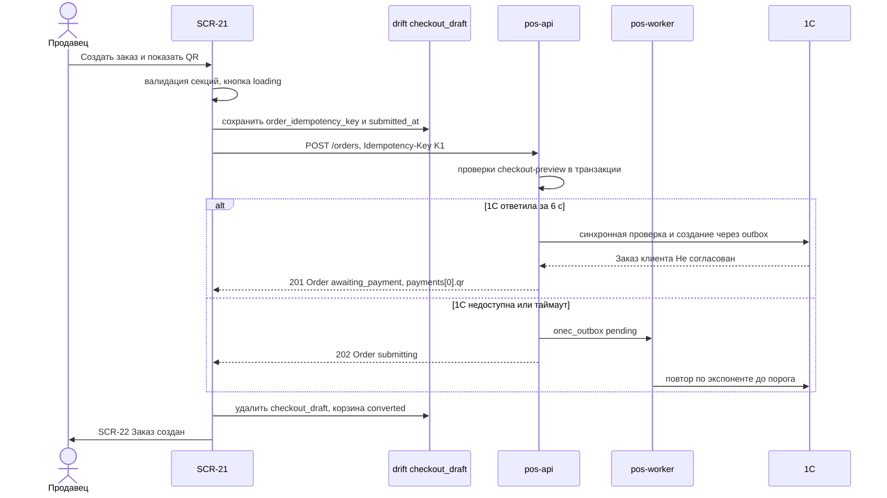

**Диаграмма 2. Неизвестный результат и двойное нажатие.**

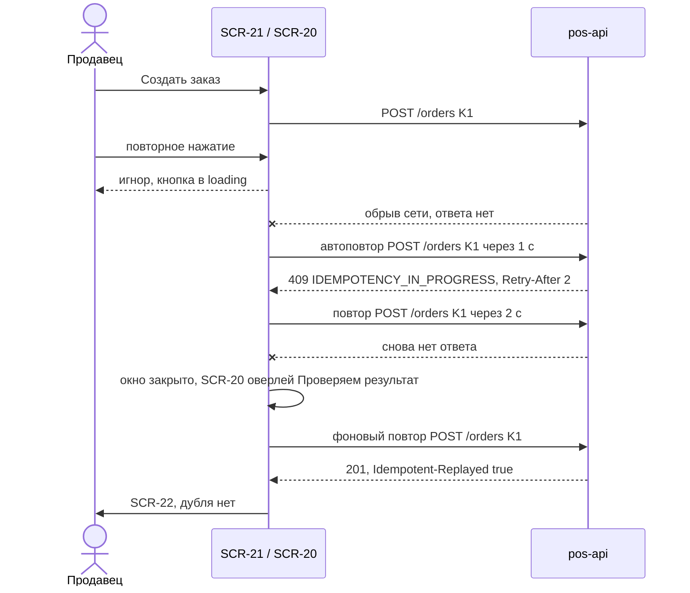

**Диаграмма 3. Цены или остатки изменились при создании.**

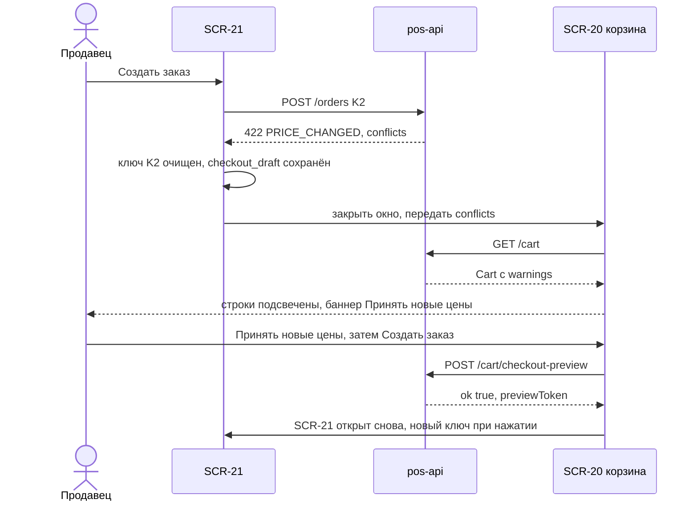

**Диаграмма 4. Продажа в долг заблокирована (fail-closed) и разрешение старшего в его собственной сессии.**

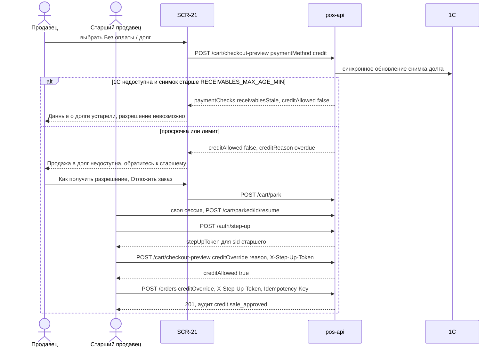

#### 5.5. Анимации

| Анимация | Начальное состояние | Триггер | Последовательность | Конечное состояние | Длительность / кривая | Ошибка | Reduce motion |
|---|---|---|---|---|---|---|---|
| ANIM-023 (открытие окна, expanded/medium) | окно скрыто | «Создать заказ →» с успешной предпроверкой | `overlay` 0→0,48 + окно scale 0,96→1 + fade | окно открыто, фокус в первое незаполненное поле | 200/250 мс `standardDecelerate`; закрытие 200 мс `standardAccelerate` | — | crossfade 80 мс |
| ANIM-024 (compact, маршрут) | SCR-20 | открытие | shared-axis X: slide-in 24 lp + fade | шаг 1 | 300 мс | — | crossfade 80 мс |
| ANIM-018 (переход шага) | контент шага N | «Далее»/«Назад»/узел степпера | fade-out 90 мс → fade-in + scale 0,98→1 160 мс; галочка узла scale-in 200 мс `emphasized`; `AppProgress.linear` к новому проценту 200 мс | шаг N±1 | 250 мс | при ошибке валидации переход не выполняется, ANIM-012 | мгновенная смена |
| ANIM-020 (раскрытие полей) | поля скрыты | «Доставка», «Другой человек» | высота 0→n + fade полей | поля видны, фокус в первое | 200 мс `standard` | — | мгновенно |
| ANIM-012 (shake) | поле в покое | ошибка валидации | ±4 lp, 1 цикл; обводка `error` 150 мс | поле с ошибкой | 300 мс | — | только обводка |
| ANIM-010 (перекат итога) | старый итог | новый `checkout-preview` | число едет к новому | новый итог | 200 мс | — | мгновенно |
| ANIM-013 (скелетон итогов/состава) | — | предпроверка > 300 мс | шиммер | данные fade-in 150 мс | loop 1,2 с | > 10 с — «Долгая загрузка…» + «Повторить» | статично |
| ANIM-015 (hover/pressed плиток и кнопок) | default | указатель/тап | фон/обводка за 150 мс; кнопки scale 0,98 | hover/pressed | 150 мс | — | 0 мс |
| Специфичная: «Создаём заказ…» | форма активна | `POST /orders` | оверлей тела fade 0→0,7 (200 мс), `AppProgress.linear` indeterminate под степпером, кнопка — спиннер 20 + текст | ожидание ответа | 200 мс; индикатор ≤ 1 цикла/с | при ошибке — оверлей fade-out 150 мс, баннер ошибки slide-down (ANIM-019) | статичный индикатор |
| Специфичная: подсветка причины долга | причина скрыта | блокировка `credit` | `ErrorState.inline` fade-in + обводка плитки → `error` | причина видна | 200 мс | — | мгновенно |

#### 5.6. Переходы

| Откуда → куда | Триггер | Передаваемые данные | Тип | «Назад» |
|---|---|---|---|---|
| SCR-20 → SCR-21 | «Создать заказ →» / `F9` | `cartId` (query), результат `checkout-preview` (провайдер) | root push; expanded — модальное окно | — |
| SCR-21 → SCR-26 | «+ Новый клиент» | `returnTo=checkout`; телефон/имя из поиска — `extra` | root push (диалог поверх окна на expanded) | SCR-21 с выбранным клиентом |
| SCR-21 → SCR-20 | «Изменить», «Отмена», «Вернуться в корзину», 409/422 конфликты корзины | `checkout_draft` сохранён; `conflicts[]` (для подсветки) | pop | — |
| SCR-21 → SCR-22 | 201/202 | `orderId` (path), `paymentId` (query, опц.) | `pushReplacement` (вернуться в SCR-21 нельзя) | главный экран роли |
| SCR-21 → SCR-90 | step-up | операция, причина | диалог | возврат в SCR-21 |
| SCR-21 → SCR-42 | шестерёнка печати | — | pop SCR-21 + go SCR-42 | — |
| SCR-21 → SCR-23 | «Отложить заказ» из диалога долга/скидки | `POST /cart/park` | pop + снекбар «Открыть отложенные» | — |

«Назад» (Android/compact): на шагах 2–4 — предыдущий шаг; на шаге 1 — диалог UI-21-030; во время создания — игнор. Deep link на `/checkout` запрещён (navigation §5.3): внешняя ссылка открывает главный экран роли.

#### 5.7. Состояния экрана

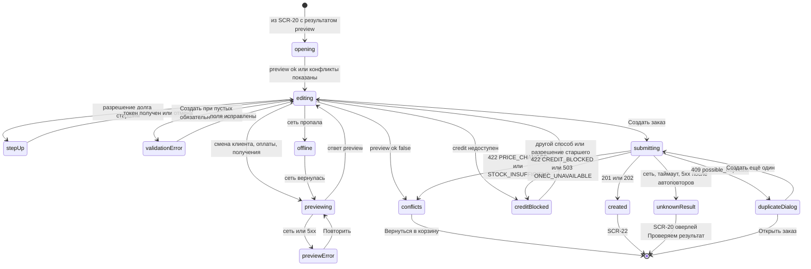

| Состояние | Что видно | Что доступно | Коды 08 |
|---|---|---|---|
| Загрузка | скелетон состава и итогов; поля из черновика | ввод клиента, получения, оплаты | — |
| Готово к созданию | все узлы степпера ✓, CTA активна | всё | `CheckoutPreview.ok = true` |
| Ошибка поля | поле `error` + текст; узел степпера «!»; сводка при ≥ 2 | исправление | локально / `400 VALIDATION_FAILED` |
| Конфликты | баннер UI-21-021, CTA disabled | «Вернуться в корзину» | `ok=false`, `PRICE_CHANGED`, `STOCK_INSUFFICIENT`, `VARIANT_UNAVAILABLE`, `DISCOUNT_LIMIT_EXCEEDED` |
| Долг недоступен | плитка `credit` disabled + причина | другой способ; эскалация | `CREDIT_BLOCKED`, `CREDIT_LIMIT_EXCEEDED`, `RECEIVABLES_STALE`, `CUSTOMER_NOT_IDENTIFIED`, `ONEC_UNAVAILABLE` |
| 1С недоступна | баннер UI-21-031, подпись UI-21-018 изменена, метка «Проверено по данным от {time}» | создание за `cash`/`qr_bakai` (→ `202 submitting`) | `onecCheck.result=unavailable`, `STALE_DATA` |
| Создание | оверлей «Создаём заказ…», кнопка `loading` | ожидание | ≤ 2 с без 1С / ≤ 8 с с 1С (NFR-PERF-004) |
| Результат неизвестен | переход в SCR-20 с оверлеем UI-20-020 | ожидание | сеть/таймаут/5xx (ORD-028) |
| Похожий заказ | диалог UI-21-029 | выбор | `409 ORDER_STATE_INVALID` |
| Нет сети | `OfflineBanner`; CTA disabled «Нужна сеть»; поиск клиентов — из `customers_cache` | ввод полей | D-32 |
| Нет разрешений | SCR-21 не использует камеру/биометрию напрямую; биометрия — только внутри `StepUpDialog` (при отказе ОС — PIN) | — | — |
| Устаревшие данные | `validUntil` истёк → автоматическая предпроверка перед созданием; «Проверено по данным от {time}» | — | `STALE_DATA` |
| Step-up | `StepUpDialog` (SCR-90) | PIN / биометрия+PIN / OTP | `403 STEP_UP_REQUIRED` |
| Повторная попытка | после ошибки предпроверки — «Не удалось рассчитать итог · Повторить» | «Повторить» | сеть/5xx |

#### 5.8. Валидация и сообщения

| Поле / ситуация | Правило | Ключ ARB | Текст |
|---|---|---|---|
| Клиент для `credit` | клиент 1С с `onec_ref` | `checkout_credit_needs_customer` | Для продажи в долг выберите клиента из 1С |
| ФИО другого получателя | обязательно, 2–150 | `checkout_receiver_name_required` | Введите ФИО получателя |
| Телефон получателя (UI-21-025) / телефон для курьера (UI-21-009) | 9 цифр после +996 | `checkout_phone_invalid` | Введите 9 цифр номера |
| Способ получения | обязателен | `checkout_delivery_method_required` | Выберите способ получения |
| Адрес | обязателен при доставке, ≤ 300 | `checkout_address_required` / `checkout_address_too_long` | Введите адрес доставки / Адрес не длиннее 300 символов |
| Комментарий | ≤ 200 | `checkout_comment_counter` | {count}/200 |
| Дата и интервал | обязательны при доставке; не в прошлом | `checkout_slot_required` / `checkout_slot_past` | Выберите дату и время доставки / Этот интервал уже прошёл |
| Способ оплаты | обязателен | `checkout_payment_required` | Выберите способ оплаты |
| Сводка ошибок | ≥ 2 | `checkout_form_errors_summary` | Исправьте поля: {count} |

Остальные строки экрана — раздел 11 (ключи `checkout_*`); ошибки API — `error_<code>` (03 §16.2).

#### 5.9. Источники данных, API, состояние приложения, бизнес-правила

| Данные / действие | Источник | Правило |
|---|---|---|
| Предпроверка: состав, итоги, проверки оплаты, права | `POST /cart/checkout-preview` (08 §4.7.7), `CheckoutPreview` (08 §3.8) | ORD-007, ORD-008, SRC-C-075…075c |
| Клиент корзины и получатель | `POST /cart/customer` / `DELETE /cart/customer` (08 §4.7.4); `GET /search/customers` (08 §4.5.4) | ORD-003, ORD-004, CART-020 |
| Создание заказа | `POST /orders` (08 §4.8.1) | ORD-020…029 |
| Step-up | `POST /auth/step-up` (08 §4.1.7) | PAY-032, CASH-007 |
| Отложить (эскалация) | `POST /cart/park` (08 §4.7.6) | CART-030, CASH-007 |
| Черновик оформления | drift `checkout_draft` (`step`, `customer_id`, `delivery_method`, `receiver_kind`, `payment_method`, `order_idempotency_key`, `submitted_at`) — 07 §11.2; соответствие шагов маршрута и таблицы: `customer`→`customer`, `delivery`→`delivery`, `payment`→`payment`, `done`→`review` | ORD-010, ORD-021 |
| Предпочтения устройства | drift `settings` (scope `device`): `checkout.print_options`, `checkout.last_delivery_method`, `checkout.last_payment_method` [НОВОЕ ИМЯ] | ORD-009, PRINT-009 |
| Слоты доставки | настройка `delivery_slots` (`app_settings`, ядро §17.7) [НЕ ПОДТВЕРЖДЕНО: канал доставки настройки клиенту — раздел 14 п.9] | ORD-005 |
| Состояние экрана | провайдер `checkoutProvider` (Riverpod): поля формы (включая ПДн получателя — только в памяти), результат предпроверки, номер последнего запроса, флаг `submitting` | — |
| Бизнес-правила | ORD-001…010, ORD-020…031, PAY-011, PAY-020…036, DEBT-004, DEBT-009…012, DISC-005, DISC-008, PRINT-001…009, CUST-014, CUST-018, MNY-001 | — |

#### 5.10. Действия по ролям и ограничения безопасности

| Действие | `seller` | `cashier` | `senior_seller` | `admin` | `owner` | `customer` (усл.) | Право (11 §4.3) |
|---|---|---|---|---|---|---|---|
| Открыть оформление, создать заказ | ✔ | ✔ | ✔ | ✔ | — | ✔ (заявка) | `order.create` |
| Выбрать клиента / «+ Новый клиент» | ✔ | ✔ | ✔ | ✔ | — | — | `search.customers`, `customer.create` |
| Видеть суммы долга клиента (UI-21-005) | — (есть/нет) | ✔ | ✔ | ✔ | — | свой | `customer.receivables.read.summary` |
| Прогноз долга после заказа (UI-21-026, только при выбранном `credit`) | — | ✔ | ✔ | — (плитка `credit` недоступна, Q-208) | — | — | `customer.receivables.read.summary` + `credit.sale.create` |
| Способ `cash` | ✔ (оплата у кассира) | ✔ | ✔ | ✔ (оплата у кассира, Q-208) | — | ✔ | `order.create` |
| Способ `qr_bakai`, показ QR | ✔ | ✔ | ✔ | заказ — да, QR — нет (Q-208) | — | заявка с `qr_bakai` — да (08 §4.8.1); показ QR — нет (11 §4.4: `payment.qr.show` у `customer` — «—»; расхождение — §14 п.23, Q-001) | `payment.qr.show` |
| Способ `credit` | ✔ при пройденной проверке | ✔ | ✔ | — | — | — | `credit.sale.create` |
| Разрешить долг при блокировке | — | — | ✔ S! (своя сессия) | ✔ S! (Q-208) | — | — | `credit.sale.approve` |
| Печать после создания | ✔ (свои) | ✔ | ✔ | ✔ | — | счёт (Q-001) | `order.documents.print` |

Ограничения: все проверки повторяются сервером внутри транзакции `POST /orders` (SRC-C-075…075c); `stepUpToken` принимается только с `sid` текущей сессии — токен другой сессии → `403 STEP_UP_REQUIRED` (CASH-007); попытка передать цену/итог → `400 VALIDATION_FAILED` + аудит `price.override_attempt`; при `credit` любая ошибка, таймаут или устаревшие данные — запрет (fail-closed, D-24); аудит `order.created`, `credit.sale_approved`, `credit.sale_blocked`, `discount.over_limit_approved` (11 §7.2). ПДн получателя не пишутся в drift и в логи (CUST-020, 07 §11.2).

#### 5.11. Повторное нажатие, двойной запрос, «Назад», перезапуск

| Ситуация | Поведение |
|---|---|
| Двойное нажатие «Создать заказ…» | кнопка `loading`, второе нажатие игнорируется; сервер дополнительно защищён `Idempotency-Key` — второй заказ невозможен (ORD-021) |
| Повтор после сбоя сети | тот же ключ и то же тело; ответ `Idempotent-Replayed: true` = успех |
| Двойное нажатие «Разрешить продажу в долг» | диалог причины открывается один раз; step-up — один `POST /auth/step-up` |
| Быстрая смена способов оплаты | учитывается только ответ последней предпроверки |
| «Назад» / `Esc` во время создания | игнорируются |
| Перезапуск во время заполнения | восстанавливаются шаг и выборы из `checkout_draft`; ПДн получателя и адрес — ввести заново (подсказка) |
| Перезапуск во время `POST /orders` | `submitted_at` задан → SCR-20 с оверлеем UI-20-020 и повтором с `order_idempotency_key` (≤ 24 ч); при успехе → SCR-22 |
| Idle-блокировка (30 мин) | overlay SCR-08; форма сохраняется в памяти; после разблокировки предпроверка повторяется (данные могли устареть) |
| Смена пользователя | `checkout_draft` удаляется; если `submitted_at` задан и ответа нет — предупреждение «Проверьте заказ на сервере» перед выходом (07 §11.2) |

#### 5.12. Требования к платформам

| Платформа | Требования |
|---|---|
| Телефон (compact) | 4 шага; CTA и итог закреплены над клавиатурой (`resizeToAvoidBottomInset`); `PhoneField` — цифровая клавиатура; поле адреса — текстовая; плитки во всю ширину; тач-цели ≥ 48 |
| Планшет (medium) | диалог 2 колонки; поворот не теряет введённые данные (A11Y-014) |
| Windows-POS (expanded) | модальное окно по макету; полная клавиатурная навигация (§5.4); мышь — hover плиток и тултипы («Карта — в следующей версии», лимит скидки); HID-скан игнорируется со снекбаром |
| iOS | тач-цели 44 pt; свайп «назад» на шагах 2–4 = предыдущий шаг; на шаге 1 — диалог UI-21-030 [ТИПОВО, Q-008] |

#### 5.13. Критерии приёмки

| ID | Критерий (проверяемый) |
|---|---|
| AC-UI-21-001 | На expanded 1280×800 окно «Подтверждение заказа» показывает степпер «Клиент · Получение · Оплата · Завершение» и 4 секции одновременно; на compact 360×760 — 4 последовательных шага с «Шаг N из 4» |
| AC-UI-21-002 | Для корзины макета итоги окна: «Сумма без скидки 16 850,00 сом», «Скидка (5 %) −842,50 сом», «Итого к оплате 16 007,50 сом»; значения берутся из ответа `checkout-preview` (подмена ответа меняет отображение) |
| AC-UI-21-003 | Поиск клиента отправляет не более одного `GET /search/customers` на паузу ввода 300 мс; «+ Новый клиент» открывает SCR-26 и после создания клиент выбран автоматически |
| AC-UI-21-004 | «Другой человек» раскрывает обязательные ФИО и телефон; попытка создать заказ без них показывает ошибки у полей и не отправляет `POST /orders` |
| AC-UI-21-005 | «Доставка» делает обязательными адрес (≤ 300), телефон получателя, дату и интервал; комментарий ограничен 200 символами со счётчиком «N/200» |
| AC-UI-21-006 | «Выбрать на карте» отображается неактивной с подсказкой «Карта — в следующей версии» и не вызывает запросов |
| AC-UI-21-007 | При `QR_WEBHOOK_ENABLED=false` текст про автоматическую отметку оплаты не показывается; показывается «Оплату подтвердит кассир по выписке банка» |
| AC-UI-21-008 | Двойной клик «Создать заказ…» приводит ровно к одному `POST /orders`; повтор после обрыва сети использует тот же `Idempotency-Key`, в 1С и в списке заказов — один заказ |
| AC-UI-21-009 | При недоступной 1С заказ за наличные создаётся (ответ 202), SCR-22 показывает «Ожидает отправки в 1С»; выбор долга в этом состоянии невозможен с текстом «1С недоступна: продажа в долг невозможна, выберите наличные или QR» |
| AC-UI-21-010 | Ответ `422 PRICE_CHANGED` закрывает окно, корзина подсвечивает изменённые строки «было → стало» и блокирует CTA до «Принять новые цены»; следующая попытка использует новый ключ |
| AC-UI-21-011 | Ответ `422 STOCK_INSUFFICIENT` возвращает в корзину со строкой «Доступно N» и кнопкой «Уменьшить до N» |
| AC-UI-21-012 | При `CREDIT_BLOCKED` продавцу показывается «Продажа в долг недоступна: обратитесь к старшему продавцу» без сумм; ни одно поле для ввода PIN/OTP старшего в сессии продавца не отображается |
| AC-UI-21-013 | `senior_seller` в своей сессии после причины и step-up получает доступную плитку «Без оплаты / долг» с пометкой «Разрешено: {имя}»; в `audit_logs` есть `credit.sale_approved` |
| AC-UI-21-014 | При снимке долга старше 60 мин и недоступной 1С кнопка «Разрешить продажу в долг» не показывается, долг недоступен (fail-closed) |
| AC-UI-21-015 | `409 possible_duplicate` открывает диалог «Похожий заказ № … создан … мин назад»; «Создать ещё один» отправляет запрос с `confirmDuplicate=true` и новым ключом |
| AC-UI-21-016 | Состояние чекбоксов печати сохраняется между заказами на устройстве; создание заказа не ждёт печати |
| AC-UI-21-017 | После принудительного закрытия на шаге 3 повторное открытие восстанавливает шаг и выборы; адрес и телефоны получателя пустые с подсказкой |
| AC-UI-21-018 | Роль `admin` видит плитку долга недоступной («Нет права продажи в долг»), при `qr_bakai` кнопка называется «Создать заказ», QR в SCR-22 не показывается |
| AC-UI-21-019 | На Windows оформление проходит без мыши: `Tab` по секциям, `Enter` в поиске клиента, `Space` по плиткам, `Ctrl+Enter` — создание |
| AC-UI-21-020 | Запрос `POST /orders` не содержит полей `price`, `unitPrice`, `total`, `subtotal`, `amount`, `clientTotalSnapshot` (проверка перехватом запроса) |
| AC-UI-21-021 | Зона «Оплата» содержит ровно три плитки — «Наличными в кассу» (`cash`), «QR / карта Бакай Банк» (`qr_bakai`), «Без оплаты / долг» (`credit`), других способов нет ни в одной роли; блок «Печать после создания заказа» содержит ровно три документа — «Счёт на оплату», «Накладная (предварительная)», «Товарный чек»; значение `paymentMethod` в `POST /orders` всегда одно из трёх (SRC-C-081, ORD-002, PRINT-004, PRINT-005) |
| AC-UI-21-022 | При «Другой человек» + «Доставка» на экране два поля телефона с разными подписями «Телефон получателя» и «Телефон для курьера»; ввод в первое копируется во второе, пока второе не изменено вручную; после ручной правки второе не меняется |
| AC-UI-21-023 | `cashier` после создания заказа с `cash` попадает в SCR-22 (не в SCR-38) с фокусом на «Принять оплату»; подсказка оплаты в SCR-21 у кассира — «После создания заказа нажмите «Принять оплату»» |

#### 5.14. Трассировка

| Требование | Где на экране |
|---|---|
| SRC-C-075, SRC-C-075a, SRC-C-075b, SRC-C-075c, SRC-E-159, SRC-E-160 | предпроверка §5.4, UI-21-015, UI-21-021; ORD-007, ORD-008 |
| SRC-C-077, SRC-C-078 | §5.1 (заказ ≠ продажа, резерв — в 1С); ORD-032, ORD-042 |
| SRC-C-079, SRC-C-079a, SRC-C-079b, SRC-C-080, SRC-E-162, SRC-E-163 | весь экран; UI-21-016 (счёт), UI-21-013 (касса); ORD-001 |
| SRC-C-081, SRC-C-082 | UI-21-012/013 — только `cash`, `qr_bakai`, `credit`; UI-21-016 — только три документа; UI-21-018; ORD-002, ORD-024; AC-UI-21-021 |
| SRC-C-084 (вне зоны, клиент на макете) | UI-21-003…005, UI-21-023 |
| SRC-E-161 | UI-21-015 (скидка только отображается, правка — в корзине) |
| SRC-E-166, SRC-E-167, SRC-F-033 | §5.4, §5.11, UI-21-019; ORD-021, ORD-028 |
| SRC-E-168, SRC-E-169 | §5.1, UI-21-018 (заказ «Не согласован», оплата отдельно) |
| SRC-F-031 | §5.7 (ошибка оформления, устаревшие данные) |
| 03 | `CheckoutStepper`, `CustomerPicker`, `CustomerCard`, `OptionTile`, `PaymentMethodCard`, `PrintOptions`, `CartSummary`, `StepUpDialog`, ANIM-010/012/013/015/018/020/023/024 |

---

## 6. Экран результата создания заказа

### SCR-22 — Заказ создан / QR для оплаты (`/orders/{id}/created?paymentId=`, роли `seller`, `cashier`, `senior_seller`, `admin` (без `QrPanel` и ручного подтверждения); `customer` — условно; R1: да)

#### 6.1. Назначение и роль пользователя

Показать результат `POST /orders`: номера заказа (POS `publicNumber` и 1С после подтверждения), статус (проекция D-20), способ оплаты и **следующий шаг**: для `qr_bakai` — QR Бакай Банка с суммой, назначением и сроком действия, ожидание оплаты (вебхук — условно, Q-014) или ручное подтверждение кассиром со step-up; для `cash` — передача клиента в кассу (продавец) или приём оплаты (кассир, SCR-38); для `credit` — срок оплаты по соглашению; статус печати выбранных документов. Корзина к этому моменту уже `converted`, активной стала новая пустая корзина (ORD-023). Экран соответствует действию макета «Создать заказ и показать QR» [ПОДТВЕРЖДЕНО: макет IMG_7090]; сам экран на макете не изображён — компоновка по 03 §9.58 и вайрфреймам.

| Роль | Что видит / делает |
|---|---|
| `seller` | номер, статус, QR (для своего заказа, `payment.qr.show`), перевыпуск QR; при `cash` — «Передайте клиента в кассу, заказ № …»; кнопки ручного подтверждения и приёма оплаты скрыты (PAY-011) |
| `cashier`, `senior_seller` | всё; «Подтвердить оплату вручную» (step-up), «Принять оплату» (`cash`) → SCR-38, «Другой способ оплаты» → SCR-38 |
| `admin` | номер, статус, документы; QR не показывается (D-15), текст «Оплату по QR примет кассир, заказ № …» (Q-208) |
| `customer` (усл.) | номер и статус своей заявки; QR в R1 не показывается — в матрице 11 §4.4 `payment.qr.show` у `customer` «—» (владелец матрицы — 11), хотя 08 §4.8.1 допускает заявку с `qr_bakai`; расхождение — §14 п.23, Q-001; вместо QR — текст `order_created_customer_pay_hint` «Оплатите заказ в кассе магазина» |

#### 6.2. Структура экрана

Сверху вниз: **A** — шапка «Заказ создан» + крестик; **B** — результат (`SuccessCheck` 48, «Заказ № POS-2026-000123», № 1С или «Ожидает отправки в 1С», `StatusChip`, время и автор); **C** — блок оплаты (по способу: `QrPanel` / сообщение «Передайте в кассу» / «Продажа в долг до …»); **D** — сводка заказа (клиент, получение, способ оплаты, итог); **E** — документы (статус печати по каждому выбранному); **F** — действия («Подтвердить оплату вручную», «Принять оплату», «Открыть заказ», «Новый заказ»).

| Класс | Раскладка |
|---|---|
| expanded / large | модальное окно ≈ 640×720 [ТИПОВО], **замещает** окно SCR-21 (pushReplacement); две колонки: слева B + C (QR 240 по центру, при «Показать покупателю» — 320), справа D + E; футер F: «Открыть заказ» (text) слева, «Подтвердить оплату вручную» (outlined), «Новый заказ» (primary L) справа; `CartPanel` под окном пустая |
| medium | диалог ≈ 560, одна колонка, QR 240 |
| compact | полноэкранный маршрут без нижней навигации: B, C (QR min(ширина − 64, 280)), D, E — прокрутка; F закреплён снизу («Новый заказ» L во всю ширину, над ней вторичные кнопки); ландшафт — QR слева, статус и кнопки справа |

#### 6.3. Таблица элементов

| № | UI-ID | Элемент | Компонент | Расположение / размер / отступы / выравнивание | Токены | Состояния | Поведение | Источник данных | Роли | Правило |
|---|---|---|---|---|---|---|---|---|---|---|
| 1 | UI-22-001 | Заголовок «Заказ создан» и закрыть | текст + `AppIconButton` `close` | шапка 64, паддинг 24 | `h3`; иконка `textSecondary` | default | крестик / `Esc` / «Назад» = «Новый заказ» (UI-22-011) | — | все | navigation §8 |
| 2 | UI-22-002 | Результат | `SuccessCheck` 48 + текст + `StatusChip` | зона B, по центру (compact) / слева (expanded); отступы 16 | номер `h2 24/600 tnum`; № 1С `body tnum textSecondary`; время/автор `caption` | `pending_approval` «На согласовании», `awaiting_payment` «Ожидает оплаты», `submitting` «Ожидает отправки в 1С», `submit_failed` «Отклонён 1С» | `SuccessCheck` — только при 201/202; при `submit_failed` вместо галочки иконка `error` | `Order.publicNumber`, `onec.number`, `status`, `audit` | все | ORD-025, ORD-029, D-20 |
| 3 | UI-22-014 (новый) | Баннер статуса 1С | `ErrorState.banner` info / error | под результатом | `submitting` — `infoContainer`/`info`; `submit_failed` — `errorContainer`/`error` | скрыт; «ожидает»; «отклонён»; «требуется вмешательство администратора» | `submitting`: «Заказ сохранён и будет отправлен в 1С автоматически. Счёт можно напечатать после получения номера 1С»; `submit_failed`: «1С отклонила заказ: {причина}» + «Открыть восстановленную корзину» (→ SCR-20 или SCR-23, ORD-027); outbox `dead`: «Заказ не удалось отправить в 1С — администратор получил уведомление» | `Order.status`, `submitError` | все | ORD-025…027, ORD-031 |
| 4 | UI-22-003 | QR-код | `QrPanel.inline` / `.fullscreen` | зона C, по центру; QR 240×240 (compact — min(ширина − 64, 280)); карточка 360–420, паддинг 24, радиус `ds.radius.lg` | фон QR всегда #FFFFFF, модули #000000, тихая зона ≥ 4 модуля (не токенизируется); заголовок `h3` «Оплата по QR · Бакай Банк» | loading (`SkeletonBox.image` 240 + «Формируем QR…»), shown, expired (приглушён 40 %), received (заменён галочкой), error, none (нет QR) | только для `qr_bakai` и ролей с `payment.qr.show`; динамический QR (`provider=bakai`, PAY-021) или статический (`elqr_static`, PAY-022) — Q-014; при `provider=none` — текст «QR не сформирован банком. Покажите клиенту QR-табличку кассы; оплату подтвердит кассир» [ТИПОВО, Q-014] | `payments[0].qr` (`QrInfo`) | `seller`, `cashier`, `senior_seller` (`payment.qr.show`); `customer` — нет (11 §4.4, §14 п.23) | PAY-020…022, A11Y-016 |
| 5 | UI-22-004 | Сумма и назначение | `PriceText.total` + текст | над QR | сумма `display 32/700 primary tnum`; назначение `caption textSecondary` | default | «16 007,50 сом»; «Оплата заказа POS-2026-000123 · Бакай Банк»; сумма — только с сервера | `QrInfo.amount`, `Order.publicNumber` | как UI-22-003 | PAY-002 |
| 6 | UI-22-005 | Срок действия QR и «Перевыпустить QR» | таймер `label tnum` + `AppButton.outlined M` | под QR | таймер `textSecondary`, последние 60 с — `warning` | идёт; истёк; без срока (статический QR) | «Действует до 10:11 · осталось 14:32»; по истечении QR гаснет (40 %), кнопка «Перевыпустить QR» → `POST /orders/{id}/payments {method:"qr_bakai", reissueQr:true}` с `Idempotency-Key` — **тот же** `payment_id`, новый референс (PAY-025); `QR_UNAVAILABLE` → «Банк недоступен. Покажите QR-табличку или выберите другой способ» | `QrInfo.expiresAt`, `issuedAt` | `seller` (свой), `cashier`, `senior_seller` | PAY-025, A11Y-015 |
| 7 | UI-22-006 | Статус оплаты | `StatusChip` + `AppProgress.circular` 16 | под таймером | `qr_shown` — info «Ожидаем оплату»; `received` — success «Оплата получена»; `qr_expired` — warning «Срок QR истёк»; `voided` — error «Платёж аннулирован» | по `payment.status` | long-polling `GET /payments/{id}?wait=25` пока `qr_shown`; при `received` — `SuccessCheck` 96 вместо QR, «Оплачено 16 007,50 сом», через 2 с переход на SCR-24 (03 §9.58); отметка «Получено автоматически» только при `confirmationKind=webhook` | `Payment.status`, `confirmationKind` | все | PAY-020, PAY-023, Q-167 |
| 8 | UI-22-019 (новый) | «Требует разбора» | `StatusChip.warning` + текст | рядом со статусом оплаты | `warningContainer`/`warning` | скрыт / виден | `review_reason=amount_mismatch` — «Сумма оплаты не совпадает с заказом — требуется разбор кассиром»; `unknown_reference` — «Платёж с неизвестным референсом — требуется разбор»; таймер TTL остановлен | `Payment.reviewReason`, `needsReview` | все | PAY-024 |
| 9 | UI-22-013 (новый) | «Показать покупателю» | `AppButton.text S` (иконка `fullscreen`) | под QR справа | `primary` | default; скрыт при `received` | `QrPanel.fullscreen`: QR 320+, крупная сумма, «Готово»; на телефоне яркость экрана — максимум на время показа [ТИПОВО] | — | как UI-22-003 | 03 §9.58 |
| 10 | UI-22-018 (новый) | Сообщение о следующем шаге | `AppListTile` с иконкой | зона C вместо QR (для `cash` и для `admin`) | `bodyLg 16/500`; иконка `point_of_sale` `primary` | по роли и способу | `seller` + `cash`: «Передайте клиента в кассу. Заказ № {number}, к оплате {total}»; `admin` + `qr_bakai`/`cash`: «Оплату примет кассир. Заказ № {number}» | `Order.paymentMethod`, роль | `seller`, `admin` | PAY-011, CASH-003 |
| 11 | UI-22-016 (новый) | Срок оплаты (долг) | `AppListTile` + `StatusChip.warning` «Долг» | зона C для `credit` | `body`; дата `tnum` | — | «Продажа в долг · оплатить до {date}» (если 1С отдала отсрочку), иначе «Срок оплаты — по соглашению в 1С» | `Order.paymentDueDate` | все | PAY-034, PAY-037 |
| 12 | UI-22-007 | Сводка заказа | `AppListTile` ×4 + `CartSummary.receipt` | зона D | подписи `caption textSecondary`; значения `body` | default | клиент (имя, телефон по роли), получение (самовывоз / доставка: адрес, интервал), способ оплаты со статусом, «Итого 16 007,50 сом», «Оплачено 0,00 из 16 007,50 сом» | `Order.customer`, `delivery`, `receiver`, `total`, `paidAmount` | все | PAY-005 |
| 13 | UI-22-008 | Документы | `PrintOptions.reprint` (статусы) + `DocumentPreview` | зона E; строки 48 | статус `caption`: «напечатан» `success`, «в очереди» `info`, «ожидает номер 1С» `textSecondary`, «ошибка» `error` | по документу | счёт — после номера 1С (иначе «Ожидает номер 1С»), печать автоматически по `printOptions`; товарный чек — после получения оплаты (08 §4.8.5: без платежа `ORDER_STATE_INVALID`); накладная — по ответу `documents/waybill.pdf`: PDF — печать, `available:false` — «Накладная печатается из 1С при отгрузке»; «Повторить» / `Ctrl+P`; «Просмотр» → `DocumentPreview` | `Order.documents`, `GET /orders/{id}/documents/invoice.pdf`, `receipt.pdf`, `waybill.pdf` | все с `order.documents.print` | ORD-009, PRINT-001…005, PRINT-009 |
| 14 | UI-22-009 | «Подтвердить оплату вручную» | `AppButton.outlined M` → UI-22-017 → `StepUpDialog` | зона F | `primary` | виден только `cashier`/`senior_seller` при `qr_shown`/`qr_expired`/`manual_confirm` и `autoConfirm=false` (или по истечении ожидания вебхука); loading | → диалог UI-22-017 → step-up → `POST /payments/{id}/confirm-manual` с `Idempotency-Key` и `X-Step-Up-Token`; повторное нажатие во время запроса игнорируется | `Payment.allowedActions` (`confirm_manual`) | `cashier`, `senior_seller` | PAY-026, CASH-003 |
| 15 | UI-22-017 (новый) | Диалог ручного подтверждения | `ConfirmDialog` с полями | диалог 440 / sheet на compact | поля `AppTextField`; сумма `tnum` | default, error, loading | поля: «Референс банка / номер из выписки» (обязательно, 4–64 символа [НЕ ПОДТВЕРЖДЕНО, Q-176]), «Сумма поступления» (предзаполнена суммой платежа), «Время поступления» (сейчас, редактируемо), «Комментарий» (≤ 200); «Подтвердить» → step-up; при несовпадении суммы — предупреждение «Сумма отличается от заказа: платёж уйдёт на разбор» до отправки | `Payment.amount` | `cashier`, `senior_seller` | PAY-024, PAY-026 |
| 16 | UI-22-012 (новый) | «Принять оплату» | `AppButton.primary M` | зона F (для `cash`) | `primary` | виден `cashier`/`senior_seller` при `cash` и `paidAmount < total`; при входе на экран получает фокус по умолчанию (`Enter` = «Принять оплату» вместо «Новый заказ») | → SCR-38 (`orderId`, `method=cash`); автоматического перехода в SCR-38 нет — единое поведение с §5.1 и UI-21-013 | `allowedActions` (`pay`) | `cashier`, `senior_seller` | PAY-010 |
| 17 | UI-22-015 (новый) | «Другой способ оплаты» | `AppButton.text M` | под QR | `primary` | виден `cashier`/`senior_seller`; у `seller` вместо кнопки подпись «Сменить способ оплаты может кассир» | → SCR-38 (`orderId`, без предвыбора способа) | — | `cashier`, `senior_seller` | PAY-010, PAY-050 |
| 18 | UI-22-010 | «Открыть заказ» | `AppButton.text M` | зона F слева | `primary` | default | → SCR-24 (`go` в ветку `orders`) | `Order.id` | все | ORD-070 |
| 19 | UI-22-011 | «Новый заказ» | `AppButton.primary L` | зона F справа / снизу во всю ширину | `primary`/`onPrimary` | default | закрыть экран → главный экран роли (SCR-10 для продавцов, SCR-30 для `cashier`), фокус в поиске товара, корзина пуста; `Enter` (если фокус не на «Принять оплату», UI-22-012); ожидание оплаты QR **не прерывается** — статус виден в SCR-24 и на дашборде кассира | — | все | navigation §8, Q-210 |

Соответствие вайрфреймам: UI-22-001 … UI-22-011 совпадают по смыслу; уточнены: UI-22-009 — без `admin` (D-15, CASH-003; вайрфрейм включал `admin`), UI-22-005 — перевыпуск на том же `payment_id` (PAY-025), UI-22-008 — товарный чек после оплаты (08 §4.8.5). Новые: UI-22-012 … UI-22-019.

#### 6.4. Поведение каждого контрола

- **Вход на экран.** Данные — из ответа `POST /orders` (без повторного запроса); затем `GET /orders/{id}` для актуализации. Если ответ был `202` (`submitting`) — опрос `GET /orders/{id}` каждые 3 с до 60 с (08 §4.8.1) или до уведомления `order_status`; при получении номера 1С баннер UI-22-014 скрывается, № 1С появляется, отложенная печать счёта стартует автоматически (PRINT-009).
- **Ожидание оплаты QR.** Пока `payment.status = qr_shown` и экран видим — цепочка `GET /payments/{id}?wait=25` (не более одного ожидающего запроса на платёж, 08 §4.9.2); при обрыве сети — повтор с backoff 1/2/4/8 с; при idle-блокировке — пауза (navigation §14.1); при уходе с экрана — опрос прекращается, платёж продолжает жить на сервере.
- **Перевыпуск QR.** Доступен при `qr_expired` (и при ошибке формирования). Нажатие → `loading` → `POST /orders/{id}/payments {method:"qr_bakai", reissueQr:true}`; ответ — тот же платёж с новым QR и сроком; повторное нажатие игнорируется; при `QR_UNAVAILABLE` — текст и «Другой способ оплаты» (кассир).
- **Подтвердить оплату вручную.** Нажатие → диалог UI-22-017 (фокус в поле референса) → «Подтвердить» → `StepUpDialog` (если нет действующего токена для операции) → запрос; ответ `200 received` — галочка «Оплата подтверждена вручную»; ответ `200 manual_confirm` с `warnings` `PAYMENT_AMOUNT_MISMATCH` — чип UI-22-019 «Требует разбора»; `409 PAYMENT_STATE_INVALID` — «Статус платежа изменился» + обновление `GET /payments/{id}`; `403 STEP_UP_REQUIRED` — повтор step-up и запроса с тем же ключом.
- **Принять оплату / Другой способ оплаты** → SCR-38 (push); по возврату экран обновляет заказ.
- **Документы.** Строка документа: «Просмотр» (PDF в `DocumentPreview`), «Печать» (`Ctrl+P` — все выбранные), «Повторить» при ошибке. Ошибка принтера не влияет на заказ (PRINT-001).
- **Новый заказ / крестик / `Esc` / «Назад»** — закрыть экран; вернуться в SCR-21 нельзя (заказ создан).
- **Клавиатура:** `Enter` — «Новый заказ» (у `cashier`/`senior_seller` при `cash` и неоплаченном заказе — «Принять оплату», которая в фокусе); `Ctrl+P` — печать; `Tab` — по кнопкам; `F11` [ТИПОВО] — «Показать покупателю». HID-скан игнорируется.

#### 6.5. Анимации

| Анимация | Начальное состояние | Триггер | Последовательность | Конечное состояние | Длительность | Ошибка | Reduce motion |
|---|---|---|---|---|---|---|---|
| Замена окна SCR-21 → SCR-22 (ANIM-024, вариант fade-through) | окно SCR-21 | 201/202 | содержимое fade-out 90 мс → новое fade-in 160 мс без закрытия overlay | SCR-22 | 250 мс | — | crossfade 80 мс |
| `SuccessCheck` (как ANIM-005, без персонажа) | пусто | вход на экран; `received` | круг `success` scale 0→1 (250 мс) → галочка рисуется (200 мс) | галочка | 450 мс `emphasized` | при `submit_failed` — иконка `error` fade-in 150 мс | crossfade 80 мс |
| ANIM-013 (QR loading) | `SkeletonBox.image` | формирование QR | шиммер | QR fade-in 200 мс | loop 1,2 с | > 10 с — «Повторить» | статично |
| Таймер QR | идёт | последние 60 с | цвет текста → `warning` за 150 мс; объявление screen reader на 60 с и 0 | истёк: QR opacity 1→0,4 за 200 мс | 150/200 мс | — | мгновенно |
| ANIM-010 («Оплачено X из Y») | старое | изменение `paidAmount` | перекат | новое | 200 мс | — | мгновенно |
| ANIM-023 (диалог ручного подтверждения) | скрыт | кнопка | overlay + scale 0,96→1 | диалог | 250 мс | — | 80 мс |

#### 6.6. Переходы

| Откуда → куда | Триггер | Данные | Тип | «Назад» |
|---|---|---|---|---|
| SCR-21 → SCR-22 | 201/202 | `orderId` (path), `paymentId` (query) | `pushReplacement` | главный экран роли |
| SCR-20 (оверлей UI-20-020) → SCR-22 | успешный повтор | `orderId`, `paymentId` | `pushReplacement` | главный экран роли |
| SCR-24 → SCR-22 | «Показать QR» | `orderId`, `paymentId` | push | SCR-24 |
| SCR-22 → SCR-24 | «Открыть заказ»; авто через 2 с после `received` | `orderId` | `go` в ветку `orders` | SCR-25 |
| SCR-22 → SCR-38 | «Принять оплату», «Другой способ оплаты» | `orderId`, `method?` | push | SCR-22 (обновлённый) |
| SCR-22 → SCR-20 / SCR-23 | «Открыть восстановленную корзину» (`submit_failed`) | `cartId` восстановленной | `go` | — |
| SCR-22 → SCR-10 / SCR-30 | «Новый заказ», крестик, `Esc`, «Назад» | — | `go` к корню ветки | — |
| SCR-22 → SCR-90 | step-up | операция `payment.qr.confirm_manual` | диалог | SCR-22 |

Deep link `/orders/{id}/created` не входит в разрешённые цели (navigation §5.3); после перезапуска приложения экран не восстанавливается — открывается главный экран роли; заказ доступен в SCR-24/25.

#### 6.7. Состояния экрана

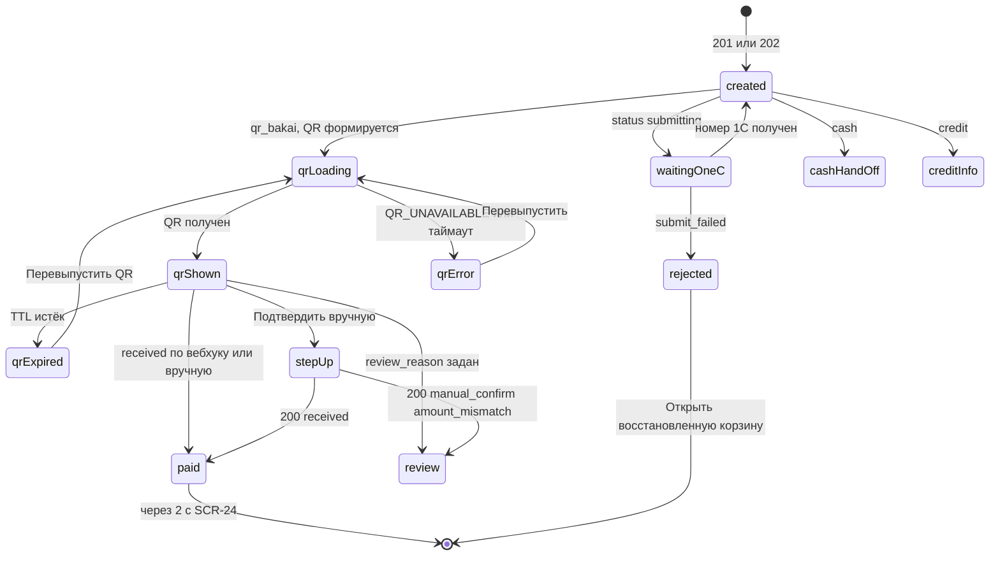

| Состояние | Что видно | Коды / источник |
|---|---|---|
| Загрузка | данные ответа `POST /orders` сразу; актуализация без скелетона | — |
| Успех (на согласовании) | галочка, «На согласовании», № 1С | `pending_approval` |
| Ожидает отправки в 1С | баннер `info`, № 1С нет, счёт «Ожидает номер 1С» | `submitting` (ORD-025) |
| Отклонён 1С | иконка `error`, причина, «Открыть восстановленную корзину» | `submit_failed`, `ONEC_REJECTED` (ORD-027) |
| QR: формирование / ошибка | скелетон QR; «Не удалось сформировать QR · Повторить» | `QR_UNAVAILABLE` (503) |
| QR: ожидание | QR, таймер, «Ожидаем оплату» | `qr_shown` |
| QR: истёк | QR приглушён, «Перевыпустить QR» | `qr_expired` (PAY-025) |
| QR: оплачено | галочка «Оплата получена» | `received` |
| QR: требует разбора | чип «Требует разбора» | `review_reason` (PAY-024) |
| Наличные | продавцу — «Передайте клиента в кассу»; кассиру — «Принять оплату» | PAY-010, PAY-011 |
| Долг | «Продажа в долг · оплатить до …» | PAY-034 |
| Ошибка печати | строка документа `error` + «Повторить» | PRINT-001 |
| Нет сети | `OfflineBanner`; long-polling приостановлен; кнопки, требующие сервера, disabled | D-32 |
| Нет разрешений | камера/биометрия не используются; биометрия — только внутри `StepUpDialog` | — |
| Step-up | `StepUpDialog` | `403 STEP_UP_REQUIRED` |
| Повторная попытка | «Повторить» у QR, у документа, при ошибке подтверждения | сеть / 5xx |

#### 6.8. Валидация и сообщения

| Ситуация | Ключ ARB | Текст |
|---|---|---|
| Референс пуст / короче 4 | `order_created_manual_ref_required` | Введите референс из выписки банка (не короче 4 символов) |
| Сумма поступления не совпадает | `order_created_manual_amount_mismatch` | Сумма отличается от заказа: платёж уйдёт на разбор |
| Статус платежа изменился | `order_created_payment_state_changed` | Статус платежа изменился. Данные обновлены |
| QR недоступен | `order_created_qr_unavailable` | Банк недоступен. Покажите QR-табличку или выберите другой способ |
| Остальные | раздел 11 (`order_created_*`), ошибки — `error_<code>` | — |

#### 6.9. Источники данных, API, состояние приложения, бизнес-правила

| Данные / действие | Источник | Правило |
|---|---|---|
| Заказ | ответ `POST /orders`; `GET /orders/{id}` (08 §4.8.3) | ORD-025, ORD-029 |
| Статус платежа | `GET /payments/{id}?wait=25` (08 §4.9.2, Q-167) | PAY-020, PAY-023 |
| Перевыпуск QR | `POST /orders/{id}/payments {method:"qr_bakai", reissueQr:true}` (08 §4.8.6) | PAY-025 |
| Ручное подтверждение | `POST /payments/{id}/confirm-manual` (08 §4.9.3) | PAY-026 |
| Документы | `GET /orders/{id}/documents/invoice.pdf`, `receipt.pdf`, `waybill.pdf` (08 §4.8.5) | PRINT-001…005 |
| Уведомления | `notification_kind = order_status`, `payment_status` | ORD-040, PAY-023 |
| Состояние | провайдер `orderCreatedProvider` (заказ, платёж, статусы печати, таймер); не сохраняется в drift | — |

#### 6.10. Действия по ролям и ограничения безопасности

| Действие | `seller` | `cashier` | `senior_seller` | `admin` | `customer` (усл.) | Право (11 §4.3) |
|---|---|---|---|---|---|---|
| Видеть QR, перевыпустить | ✔ (свой заказ) | ✔ | ✔ | — | — (11 §4.4; расхождение с 08 §4.8.1 — §14 п.23, Q-001) | `payment.qr.show` |
| Подтвердить оплату вручную | — | ✔ S! | ✔ S! | — | — | `payment.qr.confirm_manual` |
| Принять оплату (наличные) | — | ✔ | ✔ | — | — | `payment.cash.receive` |
| Печать / просмотр документов | ✔ (свой) | ✔ | ✔ | ✔ | счёт (Q-001) | `order.documents.print` |
| Видеть `externalRef` платежа | — | ✔ | ✔ | — | — | `payment.read.all` (у `seller` — `payment.read.own` без `externalRef`) |

Ограничения: сумма платежа формируется сервером (PAY-002); подтверждение вручную — только со step-up в своей сессии и аудитом `payment.manual_qr_confirmed`, `transactions.kind = manual_qr_confirm` (11 §7.2); ручное подтверждение и приём денег `admin` не выполняет (CASH-003).

#### 6.11. Повторное нажатие, двойной запрос, «Назад», перезапуск

| Ситуация | Поведение |
|---|---|
| Двойное нажатие «Подтвердить вручную» / «Перевыпустить QR» | кнопка `loading`, повтор игнорируется; `Idempotency-Key` исключает двойную операцию (PAY-003) |
| Сетевой сбой при подтверждении | повтор с тем же ключом; при `Idempotent-Replayed: true` — показать результат |
| «Назад» | = «Новый заказ» (главный экран роли) |
| Перезапуск | экран не восстанавливается; заказ — в SCR-25/24; платёж продолжается на сервере |
| Повторное открытие из SCR-24 | заказ и платёж загружаются заново; таймер — от `expiresAt` сервера |

#### 6.12. Требования к платформам

| Платформа | Требования |
|---|---|
| Телефон | QR — режим «Показать покупателю» с поворотом и максимальной яркостью [ТИПОВО]; кнопки L 52 |
| Планшет | диалог 560; QR 240/320 |
| Windows-POS | окно 640×720; QR 320 при показе покупателю (экран можно развернуть к покупателю); второй монитор покупателя — Q-211; `Enter`, `Ctrl+P`, `Esc` |
| iOS | как телефон [ТИПОВО, Q-008] |

#### 6.13. Критерии приёмки

| ID | Критерий |
|---|---|
| AC-UI-22-001 | После `201` по `qr_bakai` экран показывает № POS, статус, QR 240×240 на белом фоне с тихой зоной, сумму «16 007,50 сом» и назначение с номером заказа |
| AC-UI-22-002 | После `202` экран показывает «Ожидает отправки в 1С», № 1С отсутствует, печать счёта в статусе «Ожидает номер 1С»; после появления номера счёт печатается автоматически, если выбран |
| AC-UI-22-003 | По истечении срока QR гаснет и появляется «Перевыпустить QR»; перевыпуск сохраняет тот же `payment_id` (проверка ответа) |
| AC-UI-22-004 | `seller` не видит «Подтвердить оплату вручную»; `cashier` видит и не может подтвердить без step-up; в аудите — `payment.manual_qr_confirmed` |
| AC-UI-22-005 | Ручное подтверждение с суммой, отличной от заказа, показывает предупреждение до отправки и чип «Требует разбора» после ответа; заказ не отмечается оплаченным |
| AC-UI-22-006 | При `QR_WEBHOOK_ENABLED=false` экран не показывает «Получено автоматически» и не обещает автоматическую отметку |
| AC-UI-22-007 | Для `cash` у продавца — «Передайте клиента в кассу. Заказ № …»; у кассира экран SCR-22 открывается без автоперехода, кнопка «Принять оплату» в фокусе, `Enter` или нажатие открывает SCR-38 с `orderId` и `method=cash` |
| AC-UI-22-012 | Роль `customer` (флаг включён) не видит QR, таймер и «Перевыпустить QR»; видит номер, статус и «Оплатите заказ в кассе магазина» |
| AC-UI-22-008 | `admin` не видит QR и кнопок оплаты; видит «Оплату примет кассир. Заказ № …» |
| AC-UI-22-009 | «Новый заказ» возвращает на главный экран роли с пустой корзиной и фокусом в поиске; «Назад» ведёт туда же; вернуться в SCR-21 нельзя |
| AC-UI-22-010 | Ошибка принтера показывается в строке документа с «Повторить» и не влияет на статус заказа |
| AC-UI-22-011 | Long-polling статуса платежа приостанавливается при блокировке экрана и возобновляется после разблокировки; одновременно не более одного ожидающего запроса |

#### 6.14. Трассировка

| Требование | Где |
|---|---|
| SRC-C-079b, SRC-E-163 | UI-22-012, UI-22-018 (кассовая продажа = заказ + приём оплаты), UI-22-003 |
| SRC-C-079a | UI-22-008 (счёт по заказу) |
| SRC-C-081, SRC-C-082 | UI-22-003/005/009 — только подтверждённые способы и документы; Q-014 |
| SRC-E-166, SRC-E-167 | §6.11; PAY-003, PAY-025 |
| SRC-E-168, SRC-E-169 | UI-22-002 (статус заказа) отдельно от UI-22-006 (статус платежа); UI-22-008 (товарный чек нефискальный) |
| 03 | `QrPanel`, `StatusChip`, `SuccessCheck`, `PrintOptions`, `DocumentPreview`, `StepUpDialog`, A11Y-015, A11Y-016 |

---

## 7. Экран отложенных заказов

### SCR-23 — Отложенные заказы (`/cart/parked`, роли `seller`, `cashier`, `senior_seller`, `admin`; `owner` — только просмотр всех; R1: да)

#### 7.1. Назначение и роль пользователя

Список корзин, сохранённых кнопкой «Отложить заказ» [ПОДТВЕРЖДЕНО: макет] (`cart.status = parked`): название, клиент, число позиций, предварительная сумма, автор, время, срок хранения; «Продолжить» делает корзину активной с повторной проверкой цен и остатков (CART-032). Здесь же — корзины, восстановленные из заказа, отклонённого 1С, если активная корзина не была пуста (ORD-027), и корзины, отложенные для подтверждения старшим (CASH-007). Продавец видит только свои; `senior_seller`/`admin` — все, возобновление чужой — с аудитом (CART-034); `owner` — только просмотр всех (`cart.parked.read.all`).

**Точка входа для `owner`.** У `owner` нет ветки `shell:cart` и SCR-20 (CASH-003; `visual/navigation.md`, таблица веток — ветка `cart` без `owner`), поэтому вход через «Отложенные (n)» корзины ему недоступен. Предлагаемая точка входа [ТИПОВО]: ссылка «Отложенные заказы ({count})» в SCR-48 «Отчёты руководителя» → `/cart/parked?scope=all` открывается push поверх ветки `reports` в режиме чтения (UI-23-012); экран SCR-48 описывает другая часть, а guard navigation (G-7) и таблица маршрутов этот вход пока не содержат — расхождение вынесено в §14 п.18. При сборке 02 ссылка добавлена в SCR-48 как элемент UI-48-016 (ЖС-2). До выравнивания navigation `owner` попадает на SCR-23 только по этой ссылке; прямой ввод маршрута — по guard navigation.

#### 7.2. Структура экрана

Сверху вниз: шапка «Отложенные заказы» + число + закрыть; переключатель «Мои / Все» (по праву); список карточек (прокрутка, подгрузка курсором); пустое состояние.

| Класс | Раскладка |
|---|---|
| expanded / large | side sheet 400 lp в правой зоне поверх `CartPanel` (`ds.elevation.2`), высота окна; карточки 72 (compact-плотность) |
| medium | side sheet 400 справа поверх контента |
| compact | экран в ветке `cart`; стрелка «Назад» → SCR-20; карточки 88 |

#### 7.3. Таблица элементов

| № | UI-ID | Элемент | Компонент | Расположение / размер / отступы / выравнивание | Токены | Состояния | Поведение | Источник данных | Роли | Правило |
|---|---|---|---|---|---|---|---|---|---|---|
| 1 | UI-23-001 | Заголовок и закрыть | `AppBottomSheet` (side) шапка + `AppBadge` | 56, паддинг 16/20 | `title 18/600`; бейдж `surfaceVariant` | default | крестик / `Esc` / тап вне — закрыть; compact — «Назад» | `Page.totalEstimate` | все с доступом | CART-031 |
| 2 | UI-23-002 | «Мои / Все» | `AppTabs` (`fixed`, 2 вкладки) | под шапкой, во всю ширину, высота 48 | активная вкладка `textPrimary 600` + подчёркивание `primary` 2 px (ANIM-017) | default, selected | `scope=own` / `scope=all`; для `seller`/`cashier` скрыт; для `owner` — только «Все» | `GET /cart/parked?scope=` | `senior_seller`, `admin`, `owner` | CART-031 |
| 3 | UI-23-003 | Карточка отложенного заказа | `AppListTile` (карточка) + `StatusChip.neutral` «Отложен» | высота 72/88, паддинг 12/16, разделитель `border` | название `body 600`; мета `caption textSecondary`; сумма `bodyLg 16/700 tnum` | default, hover, focused, loading (скелетон), selected | строки: название («{Клиент или Без клиента} · {HH:MM}»), клиент, «{count} позиций · 16 850,00 сом (предварительно)», автор (для «Все»), время откладывания; тап по карточке = фокус/выделение | `Cart` (без `items`): `name`, `customer`, `itemsCount`, `total`, `owner`, `parkedAt`, `expiresAt` | все с доступом | CART-031 |
| 4 | UI-23-004 | Состав (раскрытие) | `CartLine.readonly` | — | — | **не показывается в R1** | список `GET /cart/parked` возвращает корзины без строк, отдельного чтения состава отложенной корзины в 08 нет — состав виден после «Продолжить» [НЕ ПОДТВЕРЖДЕНО: раздел 14 п.5] | — | — | — |
| 5 | UI-23-005 | Срок хранения | текст `caption` + иконка `schedule` | в карточке справа снизу | `textSecondary`; за сутки до истечения — `warning` | default, warning | «Удалится через {days} дн.» (7 дней [НЕ ПОДТВЕРЖДЕНО, Q-172]); за сутки — «Удалится завтра» + уведомление автору (CART-033) | `Cart.expiresAt` | все | CART-033 |
| 6 | UI-23-006 | «Продолжить» | `AppButton.primary M` | в карточке справа; цель 48 | `primary` | default, loading, disabled (офлайн, `owner`) | `POST /cart/parked/{id}/resume {replaceActive:false}`; при `409 ORDER_STATE_INVALID` (`reason=active_not_empty`) — диалог UI-23-010; успех → SCR-20 с актуализацией (CART-013/014) | `Cart.id` | `seller` (свои), `cashier` (свои), `senior_seller`, `admin` (любые) | CART-032, CART-034 |
| 7 | UI-23-007 `[УСЛОВНО: нет в 08]` | Удалить отложенный (условный элемент) | `AppIconButton` `delete` 20 (цель 48) → `ConfirmDialog.destructive` (UI-23-013) | в карточке справа, слева от «Продолжить», зазор 8; на expanded/medium с мышью — видна всегда (не только при hover), чтобы быть доступной с клавиатуры | иконка `textSecondary`; hover/focus — `error` + `iconButtonPressed`; кольцо `focus` | hidden (R1 до появления API), default, hover, focused, loading (спиннер 20 вместо иконки), disabled (офлайн; идёт «Продолжить» этой карточки) | **включается только при появлении `DELETE /cart/parked/{id}` [НОВОЕ ИМЯ]** в 08 и ядре §7 (§14 п.4, Q-211); до этого скрыт, отложенные удаляются автоматически по сроку (CART-033). После включения: нажатие → диалог UI-23-013 (фокус на «Отмена») → «Удалить» → `DELETE /cart/parked/{id}?rowVersion=` → `200/204`: карточка схлопывается (ANIM-008), снекбар `parked_deleted_snackbar` без «Отменить» (удаление необратимо), счётчик UI-23-001 и бейдж UI-20-002 уменьшаются; `404 NOT_FOUND` → `parked_not_available`, список обновляется; `409 VERSION_CONFLICT` → `parked_delete_conflict`, список обновляется; повторное нажатие во время запроса игнорируется; `Delete` на выделенной карточке — то же, что кнопка | `Cart.id`, `rowVersion`, `ownerId`, `audit.createdBy` | автор — свою (`cart.manage.own`); `senior_seller`, `admin` — любую (до появления отдельного кода в 11 §4.3 — по `cart.parked.resume.any`, §14 п.4); `owner` — нет | CART-035 (should), Q-211 |
| 8 | UI-23-008 | Метка «Восстановлена» | `StatusChip.warning` | под названием | `warningContainer`/`warning` | скрыта / видна | корзина, восстановленная из отклонённого заказа (название «Восстановлена из заказа № {number}», ORD-027); тап → SCR-24 исходного заказа | `Cart.name` (до появления поля `restoredFromOrderId` в DTO — раздел 14 п.6) | все | ORD-027 |
| 9 | UI-23-009 | Пусто | `EmptyState.parked` | по центру | иллюстрация `brandAccent` | — | заголовок по 03 §9.43 — «Отложенных заказов нет»; описание «Отложенный заказ сохраняется кнопкой «Отложить заказ» в корзине» и действие «Вернуться в корзину» (кроме `owner`) — дополнение к варианту 03, предложено в §14 п.22 | — | все | CART-031 |
| 10 | UI-23-010 (новый) | Диалог «Активная корзина не пуста» | `ConfirmDialog` | диалог 440 | `title` | — | «В корзине уже есть {count} позиций. Отложить текущую корзину и продолжить выбранный заказ?» → «Отложить текущую и продолжить» (`resume` с `replaceActive:true`: текущая паркуется как «Автосохранение {HH:MM}») / «Отмена»; вариант «Объединить» (CART-032) в R1 не предлагается — нет параметра в 08 (раздел 14 п.3) | `409 ORDER_STATE_INVALID` | все с resume | CART-032 |
| 11 | UI-23-011 (новый) | Подгрузка | `SkeletonList` + текст | низ списка | `caption textSecondary` | loading, error («Не удалось загрузить · Повторить») | курсорная пагинация (`limit=50`, `cursor`) | `Page.nextCursor` | все | D-37 |
| 12 | UI-23-012 (новый) | Пометка «только просмотр» | `AppListTile` info | над списком | `infoContainer`/`info` | для `owner` | «Просмотр отложенных заказов. Продолжить заказ может продавец или старший продавец» | роль | `owner` | 11 §4.4 |
| 13 | UI-23-013 (новый, условный) `[УСЛОВНО: нет в 08]` | Диалог «Удалить отложенный заказ?» | `ConfirmDialog.destructive` | диалог 400 (compact — `AppBottomSheet`); кнопки справа: `AppButton.text M` «Отмена» (фокус по умолчанию) и `AppButton.danger M` «Удалить» | иконка `delete` в круге `errorContainer`; заголовок `h3`; текст `body textSecondary` | default, loading (кнопка «Удалить» — спиннер, «Отмена» disabled), error (снекбар, диалог закрывается) | заголовок «Удалить отложенный заказ?»; текст «Заказ «{name}» ({count} позиций) будет удалён без возможности восстановления»; для чужого — дополнительно «Автор: {owner}»; `Esc`/тап вне — «Отмена»; `Enter` — активирует кнопку в фокусе (по умолчанию «Отмена») | `Cart.name`, `itemsCount`, `audit.createdBy` | как UI-23-007 | CART-035, 03 §9.1 (`danger` требует `ConfirmDialog`) |

Соответствие вайрфреймам: UI-23-001 … UI-23-009 совпадают; уточнены: UI-23-002 (компонент `AppTabs` вместо `ViewModeSegmented`, 03 §9.26 — только вид каталога), UI-23-004 (не в R1), UI-23-007 (полностью описан как условный элемент; скрыт до операции в 08), UI-23-006 (без «Объединить»), UI-23-009 (заголовок по 03 `EmptyState.parked`). Новые: UI-23-010 … UI-23-013.

#### 7.4. Поведение каждого контрола

- «Продолжить»: одиночное нажатие → `loading` на кнопке и блокировка остальных «Продолжить»; повторное нажатие игнорируется; при успехе — лист закрывается, корзина показывает возобновлённые строки с предупреждениями цен/остатков; чужая корзина — снекбар «Заказ {name} автора {owner} продолжен вами» (аудит `cart.resumed_foreign` на сервере). При `NOT_FOUND` (чужая без права или удалена по сроку) — «Заказ уже недоступен», список обновляется.
- Диалог UI-23-010: «Отложить текущую и продолжить» → `resume {replaceActive:true}`; «Отмена» — без изменений.
- «Мои / Все» — перезапрос списка с новым `scope`; позиция прокрутки сбрасывается.
- «Удалить» (UI-23-007, только после появления `DELETE /cart/parked/{id}` [НОВОЕ ИМЯ]): одиночное нажатие открывает UI-23-013; подтверждение → кнопка «Удалить» в `loading`, повторные нажатия и `Enter` игнорируются; во время удаления «Продолжить» этой карточки disabled; во время «Продолжить» этой карточки удаление disabled; удаление необратимо, «Отменить» в снекбаре нет; офлайн — disabled с тултипом «Нужна сеть». Долгое нажатие на карточку (тач) действий не открывает.
- Клавиатура: `↑/↓` — по карточкам, `Enter` — «Продолжить» выделенной, `Delete` — «Удалить» выделенной (если элемент включён), `Esc` — закрыть.

#### 7.5. Анимации

| Анимация | Начальное состояние | Триггер | Последовательность | Конечное состояние | Длительность / кривая | Ошибка | Reduce motion |
|---|---|---|---|---|---|---|---|
| ANIM-025 (side sheet, expanded/medium) | лист скрыт за правым краем, `overlay` 0 | «Отложенные (n)», снекбар «Открыть отложенные» | `overlay` 0→0,32 + лист slide-in справа 400 lp; закрытие — обратная последовательность | лист открыт, фокус на первой карточке / закрыт, фокус на UI-20-002 | 250 мс `standardDecelerate` / 200 мс `standardAccelerate` | при ошибке загрузки лист остаётся открытым, внутри — `ErrorState` | crossfade 80 мс |
| ANIM-024 (экран, compact) | SCR-20 | переход в `/cart/parked` | shared-axis X: новый экран slide-in 24 lp + fade, старый fade-out | SCR-23 | 300 мс `emphasized` | — | crossfade 80 мс |
| ANIM-013 (скелетон) | пустая область списка | загрузка > 300 мс | 3 скелетон-карточки, шиммер `skeletonBase → skeletonHighlight` | карточки fade-in 150 мс | loop 1,2 с | > 10 с — «Долгая загрузка…» (`ds_loading_long`) + «Повторить»; ошибка — `ErrorState` fade-in 150 мс | статичный скелетон |
| ANIM-017 (вкладки «Мои / Все») | подчёркивание под активной вкладкой | выбор вкладки | подчёркивание скользит к новой вкладке; список заменяется скелетоном | подчёркивание под новой вкладкой | 200 мс `standard` | при ошибке запроса вкладка остаётся выбранной, список — `ErrorState` | мгновенная смена |
| ANIM-008 (удаление карточки, условно) | карточка 72/88 | `200/204` на `DELETE /cart/parked/{id}` | высота → 0 + fade; соседние карточки сдвигаются | карточки нет, снекбар | 250 мс `standardAccelerate` | при ошибке карточка остаётся, иконка возвращается из `loading`, снекбар ошибки (ANIM-027) | мгновенно |
| ANIM-022 (пустое состояние) | список | список пуст после загрузки или удаления последней карточки | иллюстрация и текст fade-in | `EmptyState.parked` | 200 мс | — | мгновенно |
| ANIM-023 (диалоги UI-23-010, UI-23-013) | диалог скрыт | `409 active_not_empty`; «Удалить» | `overlay` 0→0,48 + диалог scale 0,96→1 + fade | диалог, фокус на безопасной кнопке | 250 мс открытие / 200 мс закрытие | ошибка запроса — диалог закрывается, снекбар | crossfade 80 мс |
| Специфичная: «Продолжить» | карточка в покое | нажатие «Продолжить» | кнопка → спиннер 20; остальные «Продолжить» и «Удалить» fade к 0,38 (disabled) | лист закрывается (ANIM-025 обратно), строки в корзине появляются (ANIM-006) | 150 мс + закрытие 200 мс | `NOT_FOUND` — карточка схлопывается (ANIM-008), снекбар `parked_not_available` | без fade, мгновенно |

#### 7.6. Переходы

| Откуда → куда | Триггер | Данные | «Назад» |
|---|---|---|---|
| SCR-20 → SCR-23 | «Отложенные (n)», снекбар «Открыть отложенные», `EmptyState` «Отложенные заказы (n)» | — | SCR-20 |
| SCR-23 → SCR-20 | «Продолжить» (успех) | `cartId` возобновлённой (становится активной) | — |
| SCR-23 → SCR-24 | метка «Восстановлена» | `orderId` исходного заказа | SCR-23 |
| SCR-44 (уведомление «Отложенный заказ удалится завтра») → SCR-23 | тап | — | SCR-44 |
| SCR-48 → SCR-23 (только `owner`, режим чтения) [ТИПОВО, §14 п.18] | ссылка «Отложенные заказы ({count})» (UI-48-016) | `scope=all` (query) | SCR-48 |

#### 7.7. Состояния экрана

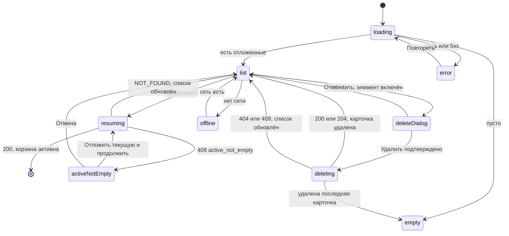

| Состояние | Что видно |
|---|---|
| Загрузка | 3 скелетон-карточки |
| Список | карточки с суммой «(предварительно)» |
| Пусто | `EmptyState` |
| Ошибка | `ErrorState` «Не удалось загрузить отложенные заказы · Повторить» |
| Нет сети | `OfflineBanner`; список из последнего ответа (кэш в памяти); «Продолжить» disabled «Нужна сеть» |
| Нет прав | `owner` — пометка UI-23-012, кнопки скрыты; прямой вызов чужого `resume` без права → `NOT_FOUND` |
| Устаревшие данные | суммы помечены «предварительно»; актуальные — после «Продолжить» |
| Удаление (условно) | диалог UI-23-013; кнопка «Удалить» в `loading`; после ответа карточка исчезает |

#### 7.8. Валидация и сообщения

| Ключ ARB | Текст |
|---|---|
| `parked_title` | Отложенные заказы |
| `parked_scope_mine` / `parked_scope_all` | Мои / Все |
| `parked_card_items_total` | {count} позиций · {total} (предварительно) |
| `parked_card_expires` | Удалится через {days} дн. |
| `parked_card_expires_tomorrow` | Удалится завтра |
| `parked_resume` | Продолжить |
| `parked_active_not_empty_body` | В корзине уже есть {count} позиций. Отложить текущую корзину и продолжить выбранный заказ? |
| `parked_active_not_empty_confirm` | Отложить текущую и продолжить |
| `parked_resumed_foreign_snackbar` | Заказ «{name}» автора {owner} продолжен вами |
| `parked_not_available` | Заказ уже недоступен |
| `parked_restored_chip` | Восстановлен из заказа № {number} |
| `parked_empty_title` | Отложенных заказов нет |
| `parked_empty_body` | Отложенный заказ сохраняется кнопкой «Отложить заказ» в корзине |
| `parked_owner_readonly` | Просмотр отложенных заказов. Продолжить заказ может продавец или старший продавец |
| `parked_empty_back_to_cart` | Вернуться в корзину |
| `parked_delete_tooltip` | Удалить отложенный заказ |
| `parked_delete_dialog_title` | Удалить отложенный заказ? |
| `parked_delete_dialog_body` | Заказ «{name}» ({count} позиций) будет удалён без возможности восстановления |
| `parked_delete_dialog_author` | Автор: {owner} |
| `parked_delete_dialog_confirm` | Удалить |
| `parked_deleted_snackbar` | Отложенный заказ удалён |
| `parked_delete_conflict` | Заказ изменился. Список обновлён |
| `parked_offline_tooltip` | Нужна сеть |

#### 7.9. Источники данных, API, состояние приложения, бизнес-правила

`GET /cart/parked?scope=own|all&limit&cursor` (08 §4.7.6) — `Page<Cart>` без `items`; `POST /cart/parked/{id}/resume {replaceActive}`; уведомление `notification_kind = system` (истечение срока, CART-033); провайдер `parkedCartsProvider` (без сохранения в drift — отложенные хранятся на сервере, 07 §11.2). Правила: CART-030…035, ORD-027, CASH-007.

#### 7.10. Действия по ролям и ограничения безопасности

| Действие | `seller` | `cashier` | `senior_seller` | `admin` | `owner` | Право |
|---|---|---|---|---|---|---|
| Видеть свои | ✔ | ✔ | ✔ | ✔ | — | `cart.manage.own` |
| Видеть все | — | — | ✔ | ✔ | ✔ (чтение) | `cart.parked.read.all` |
| Продолжить свою | ✔ | ✔ | ✔ | ✔ | — | `cart.manage.own` |
| Продолжить чужую | — | — | ✔ (аудит) | ✔ (аудит) | — | `cart.parked.resume.any` |
| Удалить свою (условно, после `DELETE /cart/parked/{id}` [НОВОЕ ИМЯ]) | ✔ | ✔ | ✔ | ✔ | — | `cart.manage.own` |
| Удалить чужую (условно) | — | — | ✔ (аудит) | ✔ (аудит) | — | `cart.parked.resume.any` до отдельного кода в 11 §4.3 (§14 п.4); событие аудита — предложение `cart.parked_deleted` [НОВОЕ ИМЯ] (владелец словаря — 11 §7.2) |

Возобновивший становится владельцем, исходный автор сохраняется (CART-034); чужая корзина без права → `404 NOT_FOUND` (без раскрытия существования, 08 §2.4).

#### 7.11. Повторное нажатие, двойной запрос, «Назад», перезапуск

Двойное «Продолжить» — второе игнорируется; повтор `resume` уже активной корзины → `200` с текущей корзиной (идемпотентно, 08 §4.7.6). «Назад»/`Esc` — закрыть лист без изменений (при открытом диалоге UI-23-010/013 — сначала закрыть диалог). Двойное «Удалить» (условно) — один запрос; сетевой повтор `DELETE` идемпотентен (повтор удаления уже удалённой → `404`, показывается `parked_not_available` без ошибки). После перезапуска список загружается с сервера заново (локально не хранится).

#### 7.12. Требования к платформам

| Платформа | Требования |
|---|---|
| Телефон Android (compact) | отдельный экран в ветке `cart`; карточки 88 lp; «Продолжить» — `AppButton.primary M` 44 (тач-цель 48); «Удалить» (условно) — иконка 20 с целью 48×48; системная кнопка «Назад» → SCR-20; pull-to-refresh перезагружает список; поворот экрана сохраняет прокрутку и выбранную вкладку (A11Y-014) |
| Планшет (medium) | side sheet 400 lp справа поверх контента; карточки 72; тап вне листа — закрыть; внешняя клавиатура — как Windows |
| Windows-POS (expanded) | side sheet 400 lp поверх `CartPanel`; клавиатура: `↑/↓` — по карточкам (кольцо `focus`), `Enter` — «Продолжить», `Delete` — «Удалить» (условно), `Tab` — по кнопкам карточки, `Esc` — закрыть; мышь: hover карточки `surfaceHover`, курсор-указатель на кнопках, тултипы «Продолжить» и «Удалить отложенный заказ»; сенсорный монитор — цели ≥ 48; HID-скан в открытом листе игнорируется (лист закрывается только явным действием) |
| iOS | как телефон; цели 44 pt; свайп «назад» от края → SCR-20 [ТИПОВО, Q-008] |

#### 7.13. Критерии приёмки

| ID | Критерий |
|---|---|
| AC-UI-23-001 | Продавец видит только свои отложенные заказы; переключатель «Мои / Все» у него отсутствует |
| AC-UI-23-002 | `senior_seller` в режиме «Все» видит автора; «Продолжить» чужой корзины делает её активной у него и создаёт запись аудита `cart.resumed_foreign` |
| AC-UI-23-003 | «Продолжить» при непустой активной корзине открывает диалог; «Отложить текущую и продолжить» паркует текущую как «Автосохранение HH:MM» |
| AC-UI-23-004 | Возобновлённая корзина в SCR-20 показывает предупреждения о ценах/остатках, изменившихся за время хранения |
| AC-UI-23-005 | Карточка показывает срок хранения; за сутки до истечения текст «Удалится завтра» окрашен `warning` |
| AC-UI-23-006 | `owner` видит все отложенные в режиме чтения без кнопок «Продолжить» |
| AC-UI-23-007 | Двойное нажатие «Продолжить» приводит к одному запросу `resume` |
| AC-UI-23-008 | Пустой список показывает заголовок «Отложенных заказов нет» (03 `EmptyState.parked`) и «Вернуться в корзину» |
| AC-UI-23-009 | `[УСЛОВНО: нет в 08]` Пока в 08 нет `DELETE /cart/parked/{id}`, кнопка «Удалить» в карточке не отображается ни у одной роли |
| AC-UI-23-010 | При включённой операции удаления: продавец видит «Удалить» только у своих карточек; нажатие открывает диалог «Удалить отложенный заказ?» с фокусом на «Отмена»; «Удалить» отправляет ровно один запрос даже при двойном нажатии; после ответа карточка исчезает, снекбар «Отложенный заказ удалён» без «Отменить» |
| AC-UI-23-011 | `[УСЛОВНО: нет в 08]` (проверяется после появления `DELETE /cart/parked/{id}` в 08, Q-211 п. а) При включённой операции удаления `senior_seller` удаляет чужую карточку из вкладки «Все», в диалоге показан автор; `owner` кнопки «Удалить» не видит |
| AC-UI-23-012 | `owner` открывает SCR-23 из SCR-48 по ссылке «Отложенные заказы ({count})» в режиме чтения: вкладка «Все», пометка UI-23-012, без «Продолжить» и «Удалить» |
| AC-UI-23-013 | Переключатель «Мои / Все» — вкладки (`AppTabs`) высотой 48; смена вкладки отправляет `GET /cart/parked?scope=` с первой страницы и сбрасывает прокрутку |

#### 7.14. Трассировка

| Требование | Где |
|---|---|
| SRC-C-069 (черновик), SRC-E-158 | весь экран; CART-030…033, CART-035 (условно UI-23-007/013) |
| SRC-C-070 | отложенные хранятся на сервере и доступны после перезапуска |
| SRC-C-072 | возобновление с актуализацией (CART-032) |
| SRC-F-032 | способы сохранения корзины: активная (drift + сервер) и отложенные (сервер) |
| макет | кнопка «Отложить заказ» корзины |

---

## 8. Экран деталей заказа

### SCR-24 — Заказ: детали и статус (`/orders/{id}`, роли: автор заказа (`order.read.own`), `cashier`, `senior_seller`, `admin`, `owner` (`order.read.all`); `customer` — свой (условно); R1: да)

#### 8.1. Назначение и роль пользователя

Карточка заказа: номера POS и 1С, текущий статус — **проекция статусов 1С** (D-20: «Не согласован» → «К выполнению» → «Закрыт»), история статусов с источником, клиент и получение, состав (снимок наименований и артикулов, PRINT-007), итоги и «Оплачено X из Y» (PAY-005), платежи со статусами D-21, документы для печати, действия по роли: принять оплату, показать QR, повторить заказ, заявка на возврат (условно Q-018), отмена / запрос отмены (step-up для согласованных и оплаченных). Изменить состав созданного заказа нельзя (ORD-071). Экран различает заказ, отгрузку (реализацию 1С), оплату и фискальный документ (ORD-032, SRC-E-168, SRC-E-169).

#### 8.2. Структура экрана

Сверху вниз: **A** — шапка (назад, «Заказ № POS-2026-000123», № 1С, дата, автор, `StatusChip`, свежесть данных 1С); **B** — баннеры (итог уточнён 1С, отклонён, ожидает 1С, запрос отмены отправлен); **C** — история статусов (вертикальная лента); **D** — клиент и получение; **E** — состав; **F** — итоги и оплата; **G** — платежи; **H** — документы; **I** — действия.

| Класс | Раскладка |
|---|---|
| expanded / large | экран в контент-колонке (≤ 1200 lp); слева 2/3 — A, B, E, F, G; правая колонка 320 «Действия и документы» (I + H + C) вместо `CartPanel` [ТИПОВО] |
| medium | 2 колонки: состав/итоги слева, статус/клиент/платежи/документы справа; действия — внизу |
| compact | одна колонка: A → B → I (основное действие) → C (свёрнута до последних 3 событий, «Показать всю историю») → D → E → F → G → H; кнопки M во всю ширину |

#### 8.3. Таблица элементов

| № | UI-ID | Элемент | Компонент | Расположение / размер / отступы / выравнивание | Токены | Состояния | Поведение | Источник данных | Роли | Правило |
|---|---|---|---|---|---|---|---|---|---|---|
| 1 | UI-24-001 | Назад и номер заказа | `AppIconButton` `arrow_back` + текст | шапка 64, паддинг 16/24 | номер `h3 20/600 tnum`; № 1С и дата `caption textSecondary` | default | «Назад» — к источнику (SCR-25 с сохранёнными фильтрами); номер POS копируется по долгому нажатию/правому клику («Скопировано») | `Order.publicNumber`, `onec.number`, `onec.date`, `audit.createdBy` | все с доступом | ORD-070 |
| 2 | UI-24-002 | Статус | `StatusChip` | в шапке справа от номера (compact — под номером) | вариант по 03 §9.39: `submitting` info, `pending_approval` info, `awaiting_payment` warning, `approved` success, `awaiting_shipment` warning, `shipped` success, `partially_returned` warning, `closed` success, `cancelled` neutral, `submit_failed` error | по `order.status` | тултип с описанием статуса (expanded); подписи — `status_order_<code>` | `Order.status` | все | D-20, ORD-033 |
| 3 | UI-24-014 | Свежесть данных 1С | `SyncIndicator` (inline) + `AppButton.text S` | под шапкой справа | `caption textSecondary`; устарело — `warning` | default, loading, stale | «Статус из 1С: {time} · Обновить» → `GET /orders/{id}?refreshFromOnec=true` (staff, таймаут 3 с); при недоступности — последний снимок с меткой | `onec.lastSyncAt` | staff | D-29, ORD-040 |
| 4 | UI-24-015 (новый) | Баннеры заказа | `ErrorState.banner` (info / warning / error) | зона B, во всю ширину | по типу | скрыт / виден | `submitting` — «Ожидает отправки в 1С»; outbox `dead` — «Требуется вмешательство администратора» (ORD-031); `submit_failed` — «1С отклонила заказ: {причина}» + «Открыть восстановленную корзину»; итог уточнён — «Итог уточнён 1С: было {total}, стало {onecTotal}» (DISC-006); запрос отмены — «Запрос отмены отправлен в 1С {time}» | `Order.status`, `submitError`, `cancelRequested`, итог 1С | все | ORD-025…027, ORD-031, ORD-051, DISC-006 |
| 5 | UI-24-003 | История статусов | лента (`AppListTile` + `StatusChip`) | зона C; пункты 48; линия слева 2 lp `border` | прошедшие — иконка статуса; будущие ожидаемые — контур `borderStrong` | default, collapsed (compact) | время, статус, источник («Приложение» / «1С»), пользователь (для `pos_user`); будущие шаги (согласование, отгрузка, закрытие) — контуром как ориентир | `Order.history[]` (`order_status_history`) | все | ORD-040, ORD-041 |
| 6 | UI-24-004 | Клиент | `CustomerCard.compact` | зона D | как 03 §9.36; долг — по роли | default | «Карточка ›» → SCR-32 (`customerId`) | `Order.customer` (role-DTO) | staff | DEBT-004 |
| 7 | UI-24-005 | Получение | `AppListTile` | зона D под клиентом | `body`; адрес `caption` | — | «Самовывоз» или «Доставка: {адрес} · {дата}, {интервал} · получатель {name}, {phone} · «{комментарий}»» | `Order.delivery`, `receiver` | staff (ПДн получателя — по роли, 11) | ORD-005 |
| 8 | UI-24-006 | Состав | `CartLine.readonly` ×N (expanded — таблица: товар, артикул, кол-во, цена, скидка, сумма) | зона E | `body`, суммы `tnum` | default; частичная отгрузка — подстрока «Отгружено {x} из {y}» | снимок наименования и артикула на момент заказа; изменить нельзя (ORD-071); тап по строке → SCR-14 (текущая карточка товара) | `Order.items[]` (`OrderItem`: `productName`, `sku`, `quantity`, `unitPrice`, `discountAmount`, `lineTotal`, `shippedQuantity`) | все | PRINT-007, ORD-061, ORD-071 |
| 9 | UI-24-007 | Итоги и оплачено | `CartSummary.receipt` + `StatusChip` | зона F | «Итого» `title`; «Оплачено» `success`; «К оплате» `error` при > 0 | default | «Сумма без скидки 16 850,00 · Скидка (5 %) −842,50 · Итого 16 007,50 сом · Оплачено 0,00 из 16 007,50»; для `credit` — «Долг по заказу: оплачено X из Y (по данным 1С от {time})» или только сальдо клиента (PAY-037) | `Order.subtotal`, `discountTotal`, `total`, `paidAmount`, `isPaid`, `paymentDueDate` | все | PAY-005, PAY-037 |
| 10 | UI-24-008 | Платежи | `TransactionRow` (вариант по `transaction_kind` платежа: `payment_received`, `payment_voided`, `refund`, `manual_qr_confirm` — 03 §9.38) + `StatusChip` | зона G; строки 56 | статусы D-21 по 03 §9.39; `review_reason` — доп. чип `warning` | default, empty («Платежей нет») | способ, сумма, статус, время, кто принял/подтвердил (`confirmationKind`: вебхук / вручную / наличные); тап → SCR-37 (транзакция платежа) | `Order.payments[]` | все (`externalRef` — только `payment.read.all`) | PAY-005, PAY-006 |
| 11 | UI-24-009 | Документы | `PrintOptions.reprint` + `DocumentPreview` | зона H (expanded — правая колонка) | статусы `caption` | default, disabled («Ожидает номер 1С» для счёта; «После оплаты» для товарного чека) | «Счёт на оплату (A4)», «Товарный чек (80 мм, не является фискальным документом)», «Накладная» (PDF или «Печатается из 1С при отгрузке»); «Просмотр», «Печать», «Скачать PDF»; `Ctrl+P` | `Order.documents`, `GET /orders/{id}/documents/invoice.pdf`, `receipt.pdf`, `waybill.pdf` | `order.documents.print` | PRINT-001…005 |
| 12 | UI-24-010 | «Принять оплату» | `AppButton.primary L` | зона I первой | `primary` | виден, если `allowedActions` содержит `pay` | → SCR-38 (`orderId`) | `allowedActions` | `cashier`, `senior_seller` | PAY-010, CASH-003 |
| 13 | UI-24-019 (новый) | «Показать QR» | `AppButton.outlined M` | зона I | `primary` | виден для `qr_bakai` при неоплаченном платеже и праве `payment.qr.show` | → SCR-22 (`orderId`, `paymentId`) | `payments[]`, `allowedActions` | `seller` (свой), `cashier`, `senior_seller` | PAY-020 |
| 14 | UI-24-011 | «Повторить заказ» | `AppButton.outlined M` | зона I | `primary` | default; disabled офлайн | позиции (вариант, упаковка, количество) добавляются в активную корзину по **текущим** ценам: `PUT /cart/items/{variantId}` `mode=increment` с `Idempotency-Key` на каждую строку; при непустой корзине — диалог UI-24-020; недоступные варианты пропускаются с отчётом «Не добавлено: {count} (снято с продажи)» | `Order.items[]` | `seller`, `cashier`, `senior_seller`, `admin` | CART-002, CART-032 (аналогия) |
| 15 | UI-24-012 | «Заявка на возврат» | `AppButton.outlined M` | зона I | `primary` | виден при `allowedActions` `return_request` (только `shipped`/`partially_returned`) и включённых возвратах (`returns_enabled`, Q-018) | → SCR-39 (`orderId`) | `allowedActions` | `cashier`, `senior_seller`, `admin` | RET-*, D-25 |
| 16 | UI-24-013 | «Отменить заказ» / «Запросить отмену» | `AppButton.danger M` → UI-24-017 (`ConfirmDialog.destructive`, + `StepUpDialog`) — вариант `danger` 03 §9.1 требует подтверждения диалогом | зона I последней, отделена от остальных действий разделителем `border` и отступом 16 | `error`/`onError`; disabled `disabledBg`/`disabledText` | виден при `allowedActions` `cancel`; disabled при запросе в обработке | до согласования без платежей (автор) — «Отменить заказ»; согласованный, оплаченный или чужой — «Запросить отмену» со step-up (`order.cancel.request.any`); `shipped`/`closed` — недоступна (ORD-052) | `allowedActions`, `status`, `paidAmount` | автор (`order.cancel.own_draft`); `cashier`, `senior_seller`, `admin` (`order.cancel.request.any`) | ORD-050…053 |
| 17 | UI-24-017 (новый) | Диалог отмены | `ConfirmDialog.destructive` с полями | диалог 480 | `title`; поля `body` | default, error, loading | причина: чипы «Клиент отказался», «Дубль», «Ошибка оформления», «Другое» (`reasonCode` `customer_refused`/`duplicate`/`error`/`other`) + текст (обязательно, ≤ 500); при полученных платежах — выбор «Деньги: вернуть клиенту / оставить авансом» (`refundIntent` `refund`/`advance`, Q-012); «Отменить заказ» / «Не отменять» (фокус) | — | как UI-24-013 | ORD-050, ORD-051 |
| 18 | UI-24-018 (новый) | Метка «Запрос отмены отправлен» | `StatusChip.info` | рядом со статусом | `infoContainer`/`info` | при `cancelRequested=true` | статус `cancelled` появится после подтверждения 1С | `Order.cancelRequested` | все | ORD-051 |
| 19 | UI-24-020 (новый) | Диалог «Корзина не пуста» (повтор заказа) | `ConfirmDialog` | диалог 440 | — | — | «В корзине {count} позиций. Добавить позиции заказа к текущей корзине или отложить текущую?» → «Добавить к текущей» / «Отложить текущую и начать новую» (`POST /cart/park` → добавление) / «Отмена» | `Cart.itemsCount` | как UI-24-011 | CART-030 |
| 20 | UI-24-016 (новый) | Срок оплаты / долг по заказу | `AppListTile` + `ReceivableBadge` | зона F для `credit` | `warning` при наступлении срока | — | «Оплатить до {date}»; при просрочке — «Срок оплаты истёк {days} дн. назад» (по данным 1С) | `paymentDueDate`, снимок 1С | `cashier`+, `owner`; `seller` — без сумм | PAY-034, PAY-037, DEBT-004 |

Соответствие вайрфреймам: UI-24-001 … UI-24-014 совпадают; уточнены: UI-24-010 — без `admin` (D-15), UI-24-013 — запрос отмены согласованного доступен также `cashier` (ORD-051, 11 §4.4). Новые: UI-24-015 … UI-24-020.

#### 8.4. Поведение каждого контрола

- **Загрузка.** `GET /orders/{id}?include=items,payments,history,documents`; кнопки строятся по `allowedActions` (сервер всё равно проверяет). При возврате на экран (из SCR-38/39/22) — повторная загрузка. Уведомление `order_status`/`payment_status` по этому заказу при открытом экране — тихое обновление с подсветкой изменившегося блока (200 мс `primaryContainer`).
- **«Обновить» статус из 1С** — повторное нажатие во время запроса игнорируется; ответ при недоступной 1С — последний снимок и снекбар «1С недоступна, показаны данные от {time}».
- **«Отменить заказ / Запросить отмену»** → UI-24-017 → «Отменить заказ» → если нужен step-up (чужой заказ, согласованный, оплаченный — заранее по статусу, иначе по ответу `403 STEP_UP_REQUIRED`) — `StepUpDialog` → `POST /orders/{id}/cancel {reason, reasonCode, refundIntent}` с `Idempotency-Key` (создаётся при подтверждении в диалоге). Ответ `200`: `cancelled` — статус обновлён, снекбар «Заказ отменён»; `cancelRequested` — метка UI-24-018, снекбар «Запрос отмены отправлен в 1С». `409 ORDER_STATE_INVALID` — «Отмена недоступна в статусе «{status}»» + обновление экрана. Повторное нажатие — тот же результат (ORD-053).
- **«Повторить заказ»** — построчные запросы последовательно; прогресс «Добавляем {n} из {count}…»; по завершении — переход в корзину (expanded — фокус в `CartPanel`; compact — SCR-20).
- **Документы** — как SCR-22 UI-22-008; «Скачать PDF» сохраняет файл в системную папку загрузок (Windows) / открывает системный лист «Поделиться» (Android/iOS).
- **Клавиатура:** `Esc`/`Backspace` — назад; `Ctrl+P` — печать; `Tab` — по действиям.

#### 8.5. Анимации

| Анимация | Начальное состояние | Триггер | Последовательность | Конечное состояние | Длительность / кривая | Ошибка | Reduce motion |
|---|---|---|---|---|---|---|---|
| ANIM-024 (вход на экран) | SCR-25 / SCR-22 / уведомление | открытие заказа | compact — shared-axis X (slide-in 24 lp + fade); expanded — fade-through контентной колонки | SCR-24, фокус на заголовке | 300 мс (compact) / 200 мс (expanded) `emphasized` | при ошибке загрузки — тот же переход к `ErrorState` | crossfade 80 мс |
| ANIM-013 (скелетон) | пустые блоки | загрузка > 300 мс | скелетоны шапки, состава, итогов; шиммер | данные fade-in 150 мс | loop 1,2 с | > 10 с — `ds_loading_long` + «Повторить»; ошибка — `ErrorState` fade-in 150 мс | статичный скелетон |
| Специфичная: подсветка обновлённого блока | блок в покое (фон `surface`) | уведомление `order_status`/`payment_status`, ответ «Обновить» с изменениями | фон блока → `primaryContainer` (200 мс) → удержание 600 мс → `surface` (200 мс) | блок с новыми данными | 200 + 600 + 200 мс `standard` | при ответе без изменений подсветки нет | без подсветки, только смена данных |
| Специфичная: раскрытие истории статусов (compact) — по образцу ANIM-020 (`AnimatedSize`); ANIM-016 не используется (в 03 это сайдбар и категории) | видны последние 3 события и кнопка «Показать всю историю» | нажатие кнопки | высота 3 строки → n + fade новых строк; подпись кнопки → «Свернуть историю»; фокус остаётся на кнопке | вся история видна | 200 мс `standard` | — (данные уже загружены) | мгновенно |
| ANIM-023 (диалоги UI-24-017, UI-24-020) | диалог скрыт | «Отменить заказ / Запросить отмену», «Повторить заказ» при непустой корзине | `overlay` 0→0,48 + диалог scale 0,96→1 + fade | диалог, фокус на безопасной кнопке («Не отменять» / «Отмена») | 250 мс открытие / 200 мс закрытие | ошибка запроса — диалог остаётся, текст ошибки под кнопками, кнопка выходит из `loading` | crossfade 80 мс |
| ANIM-010 (перекат «Оплачено») | старое значение `paidAmount` | новый платёж | число едет к новому значению | новое значение | 200 мс `standard` | — | мгновенная смена |
| Специфичная: «Повторить заказ» | кнопка в покое | нажатие (после диалога) | кнопка → спиннер + текст «Добавляем {n} из {count}…», `AppProgress.linear` под кнопкой | переход в корзину (expanded — фокус в `CartPanel`, новые строки ANIM-006) | по числу строк; переход 200 мс | строка с ошибкой пропускается, итог — снекбар `order_repeat_skipped` (ANIM-027) | без анимации прогресса, только текст |

#### 8.6. Переходы

| Откуда → куда | Данные | Тип | «Назад» |
|---|---|---|---|
| SCR-25 → SCR-24 | `orderId` | push в ветке `orders` | SCR-25 (фильтры сохранены) |
| SCR-22 / SCR-33 / SCR-37 / SCR-44 → SCR-24 | `orderId` | `go` в ветку `orders` | по стеку ветки `orders` |
| deep link `/orders/{id}` (разрешён, navigation §5.3) | `orderId` | после входа/разблокировки | SCR-25 |
| SCR-24 → SCR-38 | `orderId` | push | SCR-24 (обновлён) |
| SCR-24 → SCR-22 | `orderId`, `paymentId` | push | SCR-24 |
| SCR-24 → SCR-39 | `orderId` | push | SCR-24 |
| SCR-24 → SCR-32 | `customerId` | `go` в ветку клиентов | — |
| SCR-24 → SCR-37 | `transactionId` платежа | push / side sheet | SCR-24 |
| SCR-24 → SCR-20 | «Повторить заказ», «Открыть восстановленную корзину» | `go` в ветку корзины | — |

#### 8.7. Состояния экрана

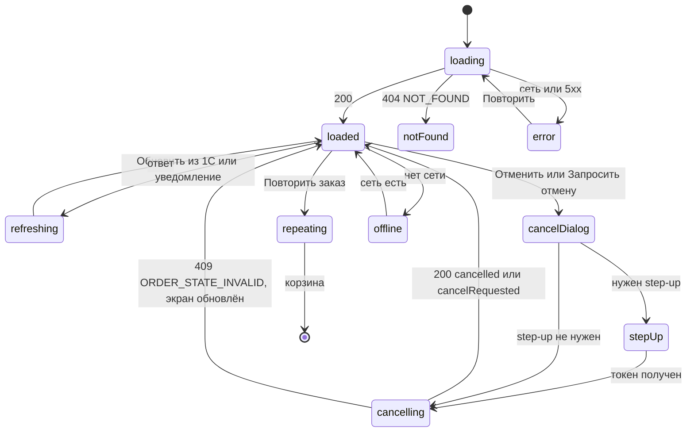

| Состояние | Что видно | Коды |
|---|---|---|
| Загрузка | скелетоны | — |
| Не найден / нет доступа | `EmptyState` «Заказ не найден или недоступен» | `404 NOT_FOUND` (для чужого заказа без права) |
| Ошибка | `ErrorState` «Не удалось загрузить заказ · Повторить» | сеть / 5xx |
| Нет сети | `OfflineBanner`; данные последнего ответа в памяти (локально заказы не хранятся, 07 §11.2); действия disabled | D-32 |
| Устаревшие данные | `SyncIndicator` `stale` «Статус из 1С: {time}» | D-29 |
| Step-up | `StepUpDialog` | `403 STEP_UP_REQUIRED` |
| Отменён / закрыт | действия скрыты, кроме печати и «Повторить заказ» | `cancelled`, `closed` |

#### 8.8. Валидация и сообщения

| Ключ ARB | Текст |
|---|---|
| `order_title` | Заказ № {number} |
| `order_onec_number` | № 1С {number} от {date} |
| `order_onec_freshness` | Статус из 1С: {time} · Обновить |
| `order_onec_unavailable_snackbar` | 1С недоступна, показаны данные от {time} |
| `order_banner_submitting` | Ожидает отправки в 1С |
| `order_banner_dead` | Требуется вмешательство администратора: заказ не отправлен в 1С |
| `order_banner_rejected` | 1С отклонила заказ: {reason} |
| `order_banner_total_adjusted` | Итог уточнён 1С: было {old}, стало {new} |
| `order_banner_cancel_requested` | Запрос отмены отправлен в 1С {time} |
| `order_history_source_app` / `order_history_source_onec` | Приложение / 1С |
| `order_paid_of` | Оплачено {paid} из {total} |
| `order_credit_paid_of` | Долг по заказу: оплачено {paid} из {total} (по данным 1С от {time}) |
| `order_due_date` | Оплатить до {date} |
| `order_payments_empty` | Платежей нет |
| `order_action_pay` | Принять оплату |
| `order_action_show_qr` | Показать QR |
| `order_action_repeat` | Повторить заказ |
| `order_action_return` | Заявка на возврат |
| `order_action_cancel` / `order_action_cancel_request` | Отменить заказ / Запросить отмену |
| `order_cancel_dialog_title` | Отменить заказ № {number}? |
| `order_cancel_reason_required` | Укажите причину отмены |
| `order_cancel_reason_customer_refused` / `order_cancel_reason_duplicate` / `order_cancel_reason_error` / `order_cancel_reason_other` | Клиент отказался / Дубль / Ошибка оформления / Другое |
| `order_cancel_money_refund` / `order_cancel_money_advance` | Вернуть деньги клиенту / Оставить авансом |
| `order_cancelled_snackbar` | Заказ отменён |
| `order_cancel_requested_snackbar` | Запрос отмены отправлен в 1С |
| `order_cancel_unavailable` | Отмена недоступна в статусе «{status}» |
| `order_repeat_dialog_body` | В корзине {count} позиций. Добавить позиции заказа к текущей корзине или отложить текущую? |
| `order_repeat_add` / `order_repeat_park_and_new` | Добавить к текущей / Отложить текущую и начать новую |
| `order_repeat_progress` | Добавляем {n} из {count}… |
| `order_repeat_skipped` | Не добавлено: {count} (снято с продажи) |
| `order_not_found` | Заказ не найден или недоступен |
| `order_doc_waiting_number` | Ожидает номер 1С |
| `order_doc_after_payment` | После оплаты |
| `order_doc_waybill_from_onec` | Печатается из 1С при отгрузке |
| `order_doc_preview` | Просмотр |
| `order_doc_print` | Печать |
| `order_doc_download` | Скачать PDF |
| `order_customer_card_link` | Карточка › |
| `order_history_show_all` | Показать всю историю |
| `order_history_collapse` | Свернуть историю |
| `order_onec_refresh` | Обновить |
| `order_scan_hint` | Сканирование номера заказа доступно в списке заказов |

#### 8.9. Источники данных, API, состояние приложения, бизнес-правила

`GET /orders/{id}` (`include`, `refreshFromOnec`, `allowedActions`) — 08 §4.8.3; `POST /orders/{id}/cancel` — 08 §4.8.4; документы — 08 §4.8.5; `GET /orders/{id}/payments` — 08 §4.8.6; повтор заказа — `PUT /cart/items/{variantId}` (`mode=increment`), `POST /cart/park` — 08 §4.7; уведомления `order_status`, `payment_status`. Состояние — провайдер `orderDetailsProvider(orderId)`; заказы и платежи в drift не хранятся (07 §11.2). Правила: ORD-025…033, ORD-040…061, ORD-070, ORD-071, PAY-005, PAY-034, PAY-037, PRINT-001…007, DISC-006, D-20, D-21, D-25.

#### 8.10. Действия по ролям и ограничения безопасности

| Действие | автор `seller` | `cashier` | `senior_seller` | `admin` | `owner` | `customer` (усл.) | Право |
|---|---|---|---|---|---|---|---|
| Просмотр | свой | ✔ | ✔ | ✔ | ✔ | свой | `order.read.own` / `order.read.all` |
| Принять оплату | — | ✔ | ✔ | — | — | — | `payment.cash.receive` / `payment.qr.show` |
| Показать QR | ✔ (свой) | ✔ | ✔ | — | — | — (11 §4.4; расхождение с 08 §4.8.1 — §14 п.23, Q-001) | `payment.qr.show` |
| Отменить до согласования (свой, без платежей) | ✔ | ✔ | ✔ | ✔ | — | ✔ | `order.cancel.own_draft` |
| Отменить чужой / запросить отмену согласованного или оплаченного | — | ✔ S! | ✔ S! | ✔ S! | — | — | `order.cancel.request.any` |
| Заявка на возврат | — | ✔ | ✔ | ✔ | только просмотр заявок | — | `return.create` (отправка — `return.submit` S!) |
| Печать документов | ✔ (свой) | ✔ | ✔ | ✔ | ✔ | счёт | `order.documents.print` |
| Повторить заказ | ✔ | ✔ | ✔ | ✔ | — | ✔ | `cart.manage.own` |

Чужой заказ без права → `404 NOT_FOUND` (не раскрывается существование); аудит `order.cancelled` / `order.cancel_requested` (11 §7.2), `transactions.kind = order_cancelled`.

#### 8.11. Повторное нажатие, двойной запрос, «Назад», перезапуск

Двойная отмена — одна операция (тот же ключ; ORD-053); «Повторить заказ» — построчные ключи сохраняются до ответа, сетевой повтор строки не дублирует её; «Назад» — к источнику со стеком ветки `orders`; после перезапуска маршрут `/orders/{id}` восстанавливается из `app_meta.last_location` с повторной загрузкой.

#### 8.12. Требования к платформам

| Платформа | Раскладка и размеры | Ввод: клавиатура, мышь, сканер, жесты |
|---|---|---|
| Телефон Android (compact < 600) | одна колонка: шапка (UI-24-001/002) → баннеры UI-24-015 → история статусов → клиент → получение → состав → итоги → платежи → документы → блок действий (основное действие — первым); кнопки высотой 48, тач-цели ≥ 48 lp; таблица состава — строками `CartLine.readonly` без горизонтальной прокрутки | тач; системное «Назад» — `pop` в SCR-25 (или экран-источник) с восстановленными фильтрами; «Скачать PDF» — системный лист «Поделиться / Сохранить»; Bluetooth-HID-сканер — как на Windows |
| Планшет Android (medium 600–1023) | 2 колонки: слева статус, история, клиент, получение; справа состав, итоги, платежи, документы, действия | тач; внешняя клавиатура — как на Windows |
| Windows-POS (expanded / large ≥ 1024) | контент + правая колонка действий 320 lp (UI-24-009…UI-24-013, UI-24-019); large — контент ≤ 1200 lp по центру | **Клавиатура:** `Esc` / `Backspace` (вне полей) — назад; `Ctrl+P` — печать выбранного документа UI-24-009 (документ недоступен — тултип причины, печать не запускается); `F5` — «Обновить» статус из 1С (UI-24-014); `Tab` / `Shift+Tab` — шапка → баннеры → история → клиент → состав → платежи → документы → действия; `Enter` на строке платежа — SCR-37, на клиенте — SCR-32; в диалогах UI-24-017 / UI-24-020 фокус по умолчанию — на безопасной кнопке, `Esc` — закрыть без действия. **Мышь:** hover строк платежей и документов, тултипы статусов и причин disabled. **HID-сканер:** скан вне полей ввода действий не выполняет и показывает снекбар «Сканирование номера заказа доступно в списке заказов» (`order_scan_hint`); в полях диалога отмены UI-24-017 скан не перехватывается (единое правило части B п. 2.2.11) |
| iOS (iPhone / iPad, без проверки сборки) | раскладки compact / medium как у Android | свайп от левого края — «Назад»; «Скачать PDF» — системный лист `UIActivityViewController`; тач-цели ≥ 44 pt; Dynamic Type до 1,3× — блоки растут по высоте без горизонтальной прокрутки |

#### 8.13. Критерии приёмки

| ID | Критерий |
|---|---|
| AC-UI-24-001 | Экран показывает № POS, № 1С (после подтверждения), статус с иконкой и текстом и историю статусов с источником «Приложение»/«1С» |
| AC-UI-24-002 | Для оплаченного наполовину заказа отображается «Оплачено X из Y»; статус заказа не заменяется на «Оплачен» |
| AC-UI-24-003 | Состав показывает наименования и артикулы на момент заказа даже после переименования товара в 1С |
| AC-UI-24-004 | Продавец-автор может отменить свой заказ в `pending_approval` без платежей без step-up; запрос содержит `Idempotency-Key` и причину |
| AC-UI-24-005 | Отмена заказа в `awaiting_shipment` доступна `cashier`/`senior_seller`/`admin` только после step-up; результат — метка «Запрос отмены отправлен», статус меняется после ответа 1С |
| AC-UI-24-006 | Для `shipped`/`closed` кнопка отмены не показывается; прямой запрос даёт «Отмена недоступна в статусе …» |
| AC-UI-24-007 | «Принять оплату» не отображается у `seller`, `admin`, `owner` |
| AC-UI-24-008 | Счёт недоступен для печати в `submitting` с подписью «Ожидает номер 1С» |
| AC-UI-24-009 | «Повторить заказ» при непустой корзине открывает диалог выбора; позиции добавляются по текущим ценам, снятые с продажи — пропускаются с сообщением |
| AC-UI-24-010 | Заказ другого продавца, открытый продавцом по прямой ссылке, показывает «Заказ не найден или недоступен» |
| AC-UI-24-011 | «Обновить» статус из 1С при недоступной 1С показывает снекбар с временем последних данных |
| AC-UI-24-012 | Кнопка «Заявка на возврат» видна только если `allowedActions` ответа `GET /orders/{id}` содержит `return_request` (подмена ответа без этого значения скрывает кнопку при любой роли и статусе); нажатие открывает SCR-39 с `orderId` этого заказа; для `pending_approval` и `awaiting_payment` кнопки нет (SRC-E-165, D-25) |
| AC-UI-24-013 | Кнопка отмены — `AppButton.danger`; любое её нажатие сначала открывает диалог с обязательной причиной; без причины «Отменить заказ» неактивна |
| AC-UI-24-014 | Роль `customer` (флаг включён) не видит «Показать QR» на своём заказе |

#### 8.14. Трассировка

| Требование | Где |
|---|---|
| SRC-C-077, SRC-C-078 | UI-24-002/003 (заказ ≠ отгрузка; резерв и отгрузка — по данным 1С) |
| SRC-C-079a | UI-24-009 (счёт) |
| SRC-C-082 | UI-24-003, UI-24-014 (статусы с синхронизацией) |
| SRC-E-164 | UI-24-013, UI-24-017 (отмена) |
| SRC-E-165 | UI-24-012 (возврат — заявка); AC-UI-24-012 |
| SRC-E-168, SRC-E-169 | UI-24-002 (статус заказа), UI-24-007 (оплачено — агрегат), UI-24-008 (статусы платежей), UI-24-009 (товарный чек нефискальный) |
| SRC-C-099 (вне зоны) | экран деталей заказа |

---

## 9. Экран списка заказов

### SCR-25 — Список заказов (`/orders?status=&from=&to=&customerId=&mine=`, роли: `seller` — свои; `cashier`, `senior_seller`, `admin`, `owner` — все; `customer` — свои (условно); R1: да)

#### 9.1. Назначение и роль пользователя

Найти заказ по номеру POS/1С, клиенту, статусу и периоду, увидеть сумму, оплату и статус, открыть детали (SCR-24). Продавец видит только свои заказы (заголовок «Мои заказы»); роли с `order.read.all` — все, с переключателем «Мои / Все». HID-скан QR/штрихкода номера с печатного документа открывает заказ.

#### 9.2. Структура экрана

Сверху вниз: заголовок и счётчик; поиск по номеру (`SearchBar` со сканером); чипы групп статусов; период (`DateRangePicker`) и «Мои / Все»; кнопка «Фильтры» (клиент, способ оплаты, оплачен) и сортировка; список/таблица; подгрузка.

| Класс | Раскладка |
|---|---|
| expanded / large | таблица в контент-колонке (колонки: № POS / № 1С, дата, клиент, сумма, оплачено, статус, документы); `FilterPanel` 280 справа в контент-зоне по кнопке «Фильтры»; `CartPanel` остаётся справа |
| medium | список строк 56 + фильтры в side sheet 320 |
| compact | список строк заказа 72 (`AppListTile`, анатомия по образцу `TransactionRow` 03 §9.38 — см. UI-25-006); чипы горизонтальной прокруткой; фильтры — `FilterSheet`; pull-to-refresh |

#### 9.3. Таблица элементов

| № | UI-ID | Элемент | Компонент | Расположение / размер / отступы / выравнивание | Токены | Состояния | Поведение | Источник данных | Роли | Правило |
|---|---|---|---|---|---|---|---|---|---|---|
| 1 | UI-25-001 | Заголовок и счётчик | текст `h2` + `caption` | шапка контента, паддинг 24 (compact 16) | `h2 24/600`; счётчик `caption textSecondary` | default | «Заказы» / «Мои заказы» (`seller`); «Найдено: {count} за период» — если сервер вернул `totalEstimate` | `Page.totalEstimate` | все | ORD-070 |
| 2 | UI-25-002 | Поиск по номеру | `SearchBar` (с кнопкой сканера на Android/iOS; у `customer` кнопки нет — SCR-17 п.10) | под заголовком, ширина 100 % (expanded ≤ 480) | как 03 §9.7 | default, focused, loading | номер POS или 1С (`q`); debounce 300 мс; HID-скан или камера (SCR-17) QR/штрихкода с документа → сразу SCR-24 при однозначном совпадении | `GET /orders?q=` | все | ORD-070, D-42 |
| 3 | UI-25-003 | Чипы групп статусов | `CategoryChip.choice` (полоса с одним активным чипом, как пресеты `DateRangePicker` 03 §9.60; применение вне категорий — §14 п.22) | под поиском, горизонтально, промежуток 8 | выбран — `primaryContainer`/`primary` + `check` | один активный | «Все» · «В работе» (`submitting`, `pending_approval`, `approved`, `awaiting_shipment`) · «Ждут оплаты» (`awaiting_payment`) · «Отгружены» (`shipped`, `partially_returned`) · «Закрыты» (`closed`) · «Отменены и отклонены» (`cancelled`, `submit_failed`); счётчики по группам не показываются (в 08 нет агрегатов, раздел 14 п.7) | `status` (список значений) | все | D-20 |
| 4 | UI-25-004 | Период | `DateRangePicker` (кнопка) | справа от чипов (compact — отдельная строка) | `body`; `tnum` | default | по умолчанию — последние 3 дня [ТИПОВО]; пресеты «Сегодня / Вчера / 7 дней / Месяц» (ключи `orders_period_today`, `_yesterday`, `_7_days`, `_month`; «Период…» — `orders_period_custom`); время Бишкека → ISO UTC | `from`, `to` | все | ORD-070 |
| 5 | UI-25-005 | «Мои / Все» | `AppTabs` (`fixed`, 2 вкладки; внутри строки фильтров — вариант `segmented` 03 §9.49) | рядом с периодом, высота 48 | активная — `textPrimary 600` + индикатор (ANIM-017) | только для `order.read.all` | «Мои» = `createdBy` текущего пользователя; «Все» — без фильтра | `createdBy` | `cashier`, `senior_seller`, `admin`, `owner` | ORD-070 |
| 6 | UI-25-012 (новый) | Фильтры | `AppButton.outlined S` + `FilterPanel`/`FilterSheet` | справа от периода | бейдж числа активных | default, active | клиент (`CustomerPicker` → `customerId`), способ оплаты (`paymentMethod`), «Оплачен / не оплачен» (`isPaid`); «Сбросить» | — | все | ORD-070 |
| 7 | UI-25-013 (новый) | Сортировка | `SortMenu` | справа в строке фильтров | — | default | «Сначала новые» (`createdAt:desc`, по умолчанию), «По сумме» (`total:desc`), «По статусу» (`status:asc`) | `sort` | все | 08 §4.8.2 |
| 8 | UI-25-006 | Строка заказа | compact/medium — `AppListTile` (анатомия по образцу `TransactionRow` 03 §9.38: иконка `receipt` в круге 40, номер и клиент, дата, сумма и `StatusChip`; у `TransactionRow` нет варианта для строки списка заказов — его варианты задаются `transaction_kind`, а тап ведёт в SCR-37; предложен вариант `TransactionRow.order` [НОВОЕ ИМЯ], §14 п.22); expanded — строка таблицы | 72 (compact) / 56 (medium) / 48 (expanded) | номер `body 600 tnum`; клиент `body`; сумма `PriceText` `tnum` | default, hover, focused, pressed | № POS (+ № 1С), дата и время, клиент, сумма, оплачено, статус; тап / `Enter` → SCR-24 | `Page<OrderSummary>` | все | ORD-070 |
| 9 | UI-25-007 | Статус | `StatusChip` | в строке | по 03 §9.39 | — | иконка + текст (A11Y-004) | `OrderSummary.status` | все | D-20 |
| 10 | UI-25-008 | Оплачено | `PriceText` / `StatusChip.warning` «Долг» | в строке | `tnum`; полностью — `success` | — | «0,00», «8 000,00 из 16 007,50», «Оплачен» или «Долг» (`credit`) | `paidAmount`, `isPaid`, `paymentMethod` | все | PAY-005, PAY-037 |
| 11 | UI-25-009 | Документы | `AppIconButton` `print` | в строке справа (expanded) | `textSecondary` | disabled для `submitting`/`submit_failed` | меню «Счёт (A4)» / «Товарный чек (80 мм)» — печать/скачивание | `GET /orders/{id}/documents/invoice.pdf`, `receipt.pdf` | `order.documents.print` | PRINT-001 |
| 12 | UI-25-010 | Подгрузка | `SkeletonList` + индикатор | низ списка | — | loading, error | курсорная пагинация (`limit=50`, `nextCursor`); ошибка — «Не удалось загрузить · Повторить» | `Page.nextCursor` | все | D-37 |
| 13 | UI-25-011 | Пусто | `EmptyState.orders` / `EmptyState.search` | по центру | иллюстрация `brandAccent` | без поиска и с фильтрами по умолчанию; с поиском или изменёнными фильтрами | нет ни одного заказа (фильтры по умолчанию, без `q`) — `EmptyState.orders` по 03 §9.43: «Заказов пока нет» · «Создать заказ» (только ролям с `order.create`; → корзина/каталог); с поиском `q` — `EmptyState.search`: «Ничего не найдено по „{q}“» · «Проверьте запрос или отсканируйте штрихкод» · «Сбросить фильтры»; без `q`, но с изменёнными фильтрами — тот же вариант с заголовком «Ничего не найдено по выбранным фильтрам» (дополнение к 03 — §14 п.22) | — | все | 03 §9.43 |

Соответствие вайрфреймам: UI-25-001 … UI-25-011 совпадают; уточнены: UI-25-002 — поиск только по номеру (параметр `q` 08 §4.8.2; клиент — через фильтр), UI-25-003 — без счётчиков. Новые: UI-25-012, UI-25-013. Компоненты UI-25-005 и UI-25-006 приведены к 03 (`AppTabs` вместо `ViewModeSegmented`, `AppListTile` вместо несуществующего варианта `TransactionRow`).

#### 9.4. Поведение каждого контрола

Смена любого фильтра, чипа, периода, сортировки — новый запрос с первой страницы (курсор сбрасывается, 08 §2.5), предыдущий запрос отменяется; фильтры отражаются в query маршрута (`status`, `from`, `to`, `customerId`, `mine`) для восстановления и «Назад» из SCR-24. Поиск: при вводе номера целиком (формат `POS-YYYY-NNNNNN` или номер 1С) и единственном результате — открыть SCR-24 сразу; HID-скан — то же. Pull-to-refresh (compact) / `F5` (Windows) — перезагрузка. Двойной тап по строке — один переход. Клавиатура: `↑/↓` — по строкам, `Enter` — открыть, `F2`/`Ctrl+F` — фокус в поиск.

#### 9.5. Анимации

| Анимация | Начальное состояние | Триггер | Последовательность | Конечное состояние | Длительность / кривая | Ошибка | Reduce motion |
|---|---|---|---|---|---|---|---|
| ANIM-013 (скелетон) | пустой список | первая загрузка или новая выборка > 300 мс; подгрузка страницы | 6 скелетон-строк (первая загрузка) / 2 строки внизу (подгрузка), шиммер | строки fade-in 150 мс | loop 1,2 с | ошибка первой загрузки — `ErrorState`; ошибка подгрузки — строка «Не удалось загрузить · Повторить» внизу, загруженные строки не исчезают | статичный скелетон |
| ANIM-017 (чипы статусов и вкладки «Мои / Все») | индикатор на прежнем чипе/вкладке | выбор чипа или вкладки | обводка/подчёркивание скользит к новому элементу; чип подводится в видимую область (`ensureVisible`) | индикатор на новом элементе, список — скелетон | 200 мс `standard` | при ошибке выборки чип остаётся выбранным | мгновенная смена |
| ANIM-015 (hover / pressed строк) | строка `surface` | наведение мыши / нажатие | фон → `surfaceHover` / `surfacePressed` | hover / pressed | 150 мс | — | 0 мс |
| ANIM-025 (`FilterSheet` / `FilterPanel`) | панель скрыта | «Фильтры» | compact — лист slide-up; expanded — панель 280 slide-in справа | панель открыта, фокус на первом фильтре | 250 мс `standardDecelerate` / закрытие 200 мс | — | crossfade 80 мс |
| ANIM-024 (переход в SCR-24) | SCR-25 | тап по строке / `Enter` | shared-axis X (compact) / fade-through (expanded) | SCR-24 | 300 / 200 мс | ошибка загрузки заказа показывается уже в SCR-24 | crossfade 80 мс |
| ANIM-022 (пустое состояние) | список | пустой результат | иллюстрация и текст fade-in | `EmptyState` | 200 мс | — | мгновенно |
| Специфичная: новые строки подгрузки | конец списка со скелетоном | ответ следующей страницы | скелетон заменяется строками fade-in без сдвига уже видимых строк | список длиннее | 150 мс | см. ANIM-013 | мгновенно |
| Специфичная: pull-to-refresh (compact) | список в покое | оттягивание вниз > 64 lp | индикатор `AppProgress.circular` появляется под шапкой, вращается до ответа | обновлённый список, индикатор fade-out 150 мс | ≤ 1 цикла/с (A11Y-018) | ошибка — снекбар `orders_load_failed`, прежние строки остаются | статичный индикатор |

#### 9.6. Переходы

| Откуда → куда | Триггер | Передаваемые данные | Тип перехода | «Назад» |
|---|---|---|---|---|
| ветка `orders` (navigation, таблица веток: staff — через профиль SCR-41 и дашборд SCR-30; пункт `nav_orders`) → SCR-25 | выбор пункта | фильтры по умолчанию (`mine=1` для `seller`; формат значения — `visual/navigation.md` §3, исправлено при сборке 02) | корень ветки `orders` (`go`) | по правилу корня ветки (navigation §8): переход на первую ветку роли |
| SCR-25 → SCR-24 | тап по строке, `Enter`, однозначный результат поиска, HID-скан / камера (SCR-17) номера | `orderId` (path) | push в ветке `orders` | SCR-25 с восстановленными фильтрами (query `status`, `from`, `to`, `customerId`, `mine`) и позицией прокрутки |
| SCR-25 → SCR-17 (Android/iOS, staff) | кнопка сканера в `SearchBar` | `mode=order` (SCR-17 п.4, UI-17-013) | sheet / полноэкранная камера | SCR-25; результат — `orderId` → SCR-24 или снекбар `orders_scan_not_found` |
| SCR-25 → `CustomerPicker` (в `FilterPanel`) | фильтр «Клиент» | — | popover / sheet | SCR-25; результат — `customerId` в query |
| SCR-25 → печать документа | меню UI-25-009 | `orderId`, тип документа (`invoice`/`receipt`) | системный диалог печати / `DocumentPreview` | SCR-25 |
| уведомление `order_status` (SCR-44) → SCR-24 | тап | `orderId` | `go` в ветку `orders` (SCR-25 становится корнем стека) | SCR-25 |
| SCR-25 → корзина / каталог | «Создать заказ» в `EmptyState.orders` | — | `go` в ветку корзины (expanded — `catalog` с постоянной `CartPanel`) | — |
| deep link `/orders?…` (внутренний) | ссылка из приложения | query-фильтры | `go` | корень ветки |

После перезапуска приложения маршрут `/orders?…` с фильтрами восстанавливается из `app_meta.last_location`; данные загружаются заново.

#### 9.7. Состояния экрана

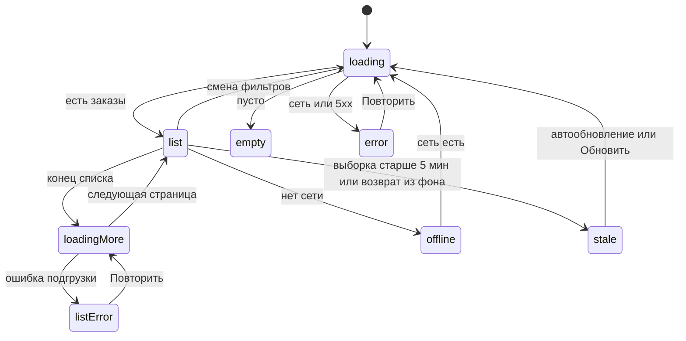

| Состояние | Что видно |
|---|---|
| Загрузка | `SkeletonList` 6 строк |
| Список | строки, счётчик |
| Пусто | `EmptyState` + «Сбросить фильтры» |
| Ошибка | `ErrorState` «Не удалось загрузить заказы · Повторить» |
| Нет сети | `OfflineBanner`; последний результат в памяти с меткой «данные от {time}»; новые запросы недоступны |
| Нет прав | `customer` — только свои; `createdBy` без права → `403 FORBIDDEN` (переключатель скрыт) |
| Неверный курсор | `VALIDATION_FAILED` (`cursor_sort_mismatch`) → перезагрузка с первой страницы без сообщения |
| Устаревшие данные | выборка старше 5 мин [НЕ ПОДТВЕРЖДЕНО, Q-176] или возврат приложения из фона: над списком `SyncIndicator` `stale` «Данные от {time} · Обновить» (`orders_stale` / `orders_refresh`), список остаётся видимым; при возврате на экран (из SCR-24, из фона) — тихое обновление первой страницы с сохранением прокрутки; статусы в строках — проекция статусов 1С на момент ответа (D-29), уточняются в SCR-24 «Обновить» |
| Повторная попытка | «Повторить» в `ErrorState` и в строке ошибки подгрузки — тот же запрос (тот же курсор) |

#### 9.8. Валидация и сообщения

| Ключ ARB | Текст |
|---|---|
| `orders_title` / `orders_title_mine` | Заказы / Мои заказы |
| `orders_found_count` | Найдено: {count} за период |
| `orders_search_hint` | Номер заказа POS или 1С |
| `orders_chip_all` / `orders_chip_in_progress` / `orders_chip_awaiting_payment` / `orders_chip_shipped` / `orders_chip_closed` / `orders_chip_cancelled` | Все / В работе / Ждут оплаты / Отгружены / Закрыты / Отменены и отклонены |
| `orders_scope_mine` / `orders_scope_all` | Мои / Все |
| `orders_filters` | Фильтры |
| `orders_sort_newest` / `orders_sort_total` / `orders_sort_status` | Сначала новые / По сумме / По статусу |
| `orders_paid_full` / `orders_paid_partial` / `orders_paid_credit` | Оплачен / {paid} из {total} / Долг |
| `orders_empty_search_title` / `orders_empty_search_body` / `orders_reset_filters` | Ничего не найдено по „{q}“ / Проверьте запрос или отсканируйте штрихкод / Сбросить фильтры (03 `EmptyState.search`) |
| `orders_load_failed` | Не удалось загрузить заказы · Повторить |
| `orders_scan_not_found` | Заказ с номером {number} не найден |
| `orders_period_today` / `orders_period_yesterday` / `orders_period_7_days` / `orders_period_month` / `orders_period_custom` | Сегодня / Вчера / 7 дней / Месяц / Период… |
| `orders_stale` | Данные от {time} |
| `orders_refresh` | Обновить |
| `orders_empty_no_orders_title` / `orders_empty_create` | Заказов пока нет / Создать заказ (03 `EmptyState.orders`) |
| `orders_empty_filtered_title` | Ничего не найдено по выбранным фильтрам |

#### 9.9. Источники данных, API, состояние приложения, бизнес-правила

`GET /orders` (08 §4.8.2): `status`, `customerId`, `createdBy`, `from`, `to`, `paymentMethod`, `isPaid`, `q`, `limit`, `cursor`, `sort`; ответ `Page<OrderSummary>`; печать — 08 §4.8.5. Провайдер `ordersListProvider(filters)`; фильтры — в query маршрута; данные в drift не кэшируются. Правила: ORD-070, PAY-005, D-20, D-37.

#### 9.10. Действия по ролям и ограничения безопасности

| Действие | `seller` | `cashier` | `senior_seller` | `admin` | `owner` | `customer` (усл.) | Право |
|---|---|---|---|---|---|---|---|
| Список своих | ✔ | ✔ | ✔ | ✔ | ✔ | ✔ | `order.read.own` |
| Список всех, фильтр по автору | — | ✔ | ✔ | ✔ | ✔ | — | `order.read.all` |
| Печать из строки | ✔ (свои) | ✔ | ✔ | ✔ | ✔ | счёт | `order.documents.print` |

Сервер применяет фильтр владения независимо от параметров клиента; телефоны клиентов в строке — по DTO роли.

#### 9.11. Повторное нажатие, двойной запрос, «Назад», перезапуск

Быстрая смена фильтров — учитывается последний запрос; повтор подгрузки — тот же курсор; «Назад» из SCR-24 — фильтры и позиция прокрутки восстановлены; после перезапуска фильтры восстанавливаются из `last_location` (query), данные загружаются заново.

#### 9.12. Требования к платформам

Телефон — список 72, pull-to-refresh, сканер камерой (Android/iOS); планшет — список 56 и side sheet фильтров; Windows — таблица 48, `↑/↓`, `Enter`, `F5`, HID-скан номера; мышь — сортировка кликом по заголовку колонки (дублирует `SortMenu`); iOS — как телефон.

#### 9.13. Критерии приёмки

| ID | Критерий |
|---|---|
| AC-UI-25-001 | Продавец видит заголовок «Мои заказы» и только свои заказы; переключатель «Мои / Все» отсутствует |
| AC-UI-25-002 | Кассир видит заказы всех продавцов и может переключить «Мои / Все» |
| AC-UI-25-003 | Чип «Ждут оплаты» запрашивает `status=awaiting_payment`; «В работе» — четыре статуса группы |
| AC-UI-25-004 | Скан штрихкода/QR номера с печатного счёта открывает SCR-24 этого заказа |
| AC-UI-25-005 | Колонка «Оплачено» показывает «X из Y» для частично оплаченных и «Долг» для `credit` |
| AC-UI-25-006 | Прокрутка до конца подгружает следующую страницу по курсору; ошибка подгрузки не стирает загруженные строки |
| AC-UI-25-007 | Возврат из SCR-24 восстанавливает фильтры и позицию прокрутки |
| AC-UI-25-008 | Пустой результат с изменёнными фильтрами показывает «Ничего не найдено по выбранным фильтрам» и «Сбросить фильтры»; при поиске по номеру — «Ничего не найдено по „{q}“»; без единого заказа у пользователя — «Заказов пока нет» (03 `EmptyState.orders`) |
| AC-UI-25-009 | Возврат на экран через 5 мин и более после загрузки показывает «Данные от HH:MM · Обновить» и обновляет первую страницу без потери прокрутки |
| AC-UI-25-010 | Переходы SCR-25 → SCR-24 передают только `orderId` в пути; «Назад» из SCR-24 возвращает те же значения query (`status`, `from`, `to`, `customerId`, `mine`) |
| AC-UI-25-011 | Пресеты периода «Сегодня / Вчера / 7 дней / Месяц» задают `from`/`to` в UTC по границам суток Бишкека (UTC+6) |

#### 9.14. Трассировка

| Требование | Где |
|---|---|
| SRC-E-162, SRC-E-164 | доступ к заказам и отмене через SCR-24 |
| SRC-E-168, SRC-E-169 | раздельные колонки «Статус» и «Оплачено» |
| SRC-C-099 (вне зоны) | список заказов с фильтрами |

---

## 10. Экран создания клиента

### SCR-26 — Новый клиент (`/customers/new?returnTo=checkout`, роли `seller`, `cashier`, `senior_seller`, `admin` (`customer.create`); «Всё равно создать» — `cashier`, `senior_seller`, `admin` (`customer.create.force`); R1: да)

#### 10.1. Назначение и роль пользователя

Создать карточку клиента по кнопке «+ Новый клиент» [ПОДТВЕРЖДЕНО: макет IMG_7090] (из SCR-21, SCR-20, SCR-31) с **обязательной проверкой дублей по телефону** до создания (D-08, CUST-011): существующий клиент 1С или POS предлагается к выбору («Найден существующий — выбрать»). Созданный клиент сохраняется в backend без `onec_ref` (статус «ожидает 1С», `source = pos_pending`) и уходит в 1С через outbox; до подтверждения доступен для заказов за наличные/QR, недоступен для долга (CUST-014). Продавец создаёт клиента сам (`customer.create`), но при подозрении на дубль создать «всё равно» не может — выбирает существующего или передаёт кассиру/старшему (CUST-016).

#### 10.2. Структура экрана

Сверху вниз: шапка «Новый клиент» + закрыть; **телефон (первое поле)** с индикатором проверки; блок результата проверки дублей; ФИО/наименование; тип клиента; ИНН (для юр. лица); адрес; комментарий; пояснение о 1С; футер «Отмена» / «Создать клиента».

| Класс | Раскладка |
|---|---|
| expanded / large | диалог ≈ 560–640 lp [ТИПОВО] поверх SCR-21/SCR-31 (`ds.elevation.3`, радиус `ds.radius.lg`); 2 колонки для коротких полей (телефон + тип; ФИО на всю ширину) |
| medium | диалог ≈ 560, одна колонка |
| compact | полноэкранный маршрут без нижней навигации; одна колонка; футер закреплён над клавиатурой |

#### 10.3. Таблица элементов

| № | UI-ID | Элемент | Компонент | Расположение / размер / отступы / выравнивание | Токены | Состояния | Поведение | Источник данных | Роли | Правило |
|---|---|---|---|---|---|---|---|---|---|---|
| 1 | UI-26-001 | Заголовок и закрыть | текст + `AppIconButton` `close` | шапка 64, паддинг 24 | `h3`; иконка `textSecondary` | default; disabled во время создания | крестик / `Esc` — при введённых данных диалог UI-26-017 | — | все с доступом | — |
| 2 | UI-26-002 | Телефон | `PhoneField` | первое поле, ширина 100 % (expanded — 50 %), высота 48 | маска «+996 ___ ___ ___» | default, focused, checking («Проверяем…» спиннер 16 справа), error | обязательно; при вводе 9-й цифры — проверка дублей `GET /search/customers?q=+996XXXXXXXXX` (локальная реплика 1С + клиенты POS); E.164 в API; предзаполнение из поиска SCR-21 | `Page<Customer(role-DTO)>` | все | CUST-010, CUST-011, ядро §17.2 |
| 3 | UI-26-003 | Найденный клиент | `CustomerCard.compact` + `AppButton.primary M` «Выбрать этого клиента» + `AppButton.text M` «Всё равно создать» | под телефоном, во всю ширину; фон `warningContainer`, паддинг 12 | заголовок `warning` «Найден клиент с этим номером» | скрыт; 1 или несколько кандидатов (до 3, «Показать ещё») | «Выбрать этого клиента» → закрыть экран с результатом `customerId` (SCR-21: `POST /cart/customer`); «Всё равно создать» — **видна в R1** ролям с `customer.create.force` (`cashier`, `senior_seller`, `admin`; 11 §4.3 №66), открывает обязательное поле причины UI-26-015 [РЕШЕНИЕ части: вариант А, Q-025]; у `seller` вместо кнопки подпись «Если это другой клиент — обратитесь к кассиру или старшему продавцу»; при > 3 кандидатах — `AppButton.text S` «Показать ещё ({count})» раскрывает остальных (ANIM-020) | кандидаты: `id`, `displayName`, `phoneMasked`, `source`, `matchType` (`phone`/`inn`) | все; «Всё равно создать» — `cashier`, `senior_seller`, `admin` | CUST-011, CUST-016, D-08 |
| 4 | UI-26-004 | ФИО / наименование | `AppTextField` | ширина 100 % | `body` | default, focused, error | обязательно, 2–150 символов; для юр. лица — наименование организации | `name` | все | CUST-010 |
| 5 | UI-26-005 | Тип клиента | `AppRadio` ×2 в горизонтальной группе (03 §9.65: радио — элементы выбора в формах) | ширина 100 % (expanded — 50 %), строка 48, зазор между вариантами 24 | выбранный — кольцо и точка `primary`; подпись `body 14` | default | «Физ. лицо» (`individual`) / «Юр. лицо» (`legal`); третий вариант «ИП» с вайрфрейма — не в R1 (в схеме 08 два значения; Q-025); переключает обязательность ИНН | `customerType` | все | CUST-010, Q-025 |
| 6 | UI-26-006 | ИНН | `AppTextField` (цифровой) | виден при «Юр. лицо» | `body tnum` | default, error | обязателен для юр. лица, 14 цифр [ТИПОВО: ИНН КР, Q-025]; не логируется (CUST-020); **предпроверка дублей по ИНН**: у ролей с `customer.receivables.read.summary` (`cashier`, `senior_seller`, `admin`) при вводе 14-й цифры — `GET /search/customers?q={inn}` (08 §4.5.4 ищет по ИНН для этих ролей, `matchType=inn`), найденные — в UI-26-003 с заголовком «Найден клиент с этим ИНН»; у `seller` поиск по ИНН в 08 не разрешён — проверку по ИНН выполняет сервер при `POST /customers` (`409 CUSTOMER_DUPLICATE_SUSPECTED`, 08 §4.11.2) | `inn` | все | CUST-010, CUST-011, CUST-020 |
| 7 | UI-26-009 | Адрес | `AppTextField` (2 строки) | ширина 100 % | `body` | default | необязательно; в SCR-21 предзаполняет адрес доставки | `address` | все | CUST-010 |
| 8 | UI-26-010 | Комментарий | `AppTextField` (multiline) + счётчик | ширина 100 % | счётчик `caption` | default, limit | необязательно, ≤ 500 [ТИПОВО] | `comment` | все | CUST-010 |
| 9 | UI-26-007 | Год рождения | `AppTextField` (цифровой) | — | — | **скрыт в R1** до появления поля в 08 §4.11.2 (раздел 14 п.8) | 4 цифры, необязательно | — | — | CUST-010 |
| 10 | UI-26-008 | Сфера деятельности | `AppDropdown` | — | — | **скрыт в R1** (как UI-26-007) | необязательно | — | — | CUST-010 |
| 11 | UI-26-011 | «Подтвердить номер по SMS» | `AppSwitch` | — | — | **скрыт в R1**: операции отправки кода клиенту в 08 нет (CUST-013 — could) | — | — | — | CUST-013 |
| 12 | UI-26-012 | Пояснение о 1С | `ErrorState.banner` info | над футером | `infoContainer`/`info` | — | «Клиент сначала сохраняется в приложении и автоматически создаётся в 1С. До подтверждения 1С ему можно продавать за наличные и по QR, но не в долг» | — | все | CUST-014 |
| 13 | UI-26-016 (новый) | Предупреждение «Проверка в 1С недоступна» | `ErrorState.banner` warning | под телефоном | `warningContainer`/`warning` | скрыт / виден | «Проверка в 1С сейчас недоступна — возможен дубль. Проверено по данным приложения от {time}» | ответ `POST /customers` с `warnings` `STALE_DATA` | все | CUST-012 |
| 14 | UI-26-015 (новый) | Причина создания при дубле | `AppTextField` | под карточкой кандидата после «Всё равно создать» | `body` | default, error | обязательно, 5–200 символов; в R1 передаётся в существующем поле `comment` тела `POST /customers` (08 §4.11.2) в виде «Причина создания при совпадении: {причина}» перед текстом комментария UI-26-010 (общая длина ≤ 500, счётчик UI-26-010 уменьшается на длину причины); отдельное поле `forceReason` [НОВОЕ ИМЯ] предложено в §14 п.8 — после его появления причина передаётся в нём, UI не меняется | `comment` | `cashier`, `senior_seller`, `admin` | CUST-011, Q-025 |
| 15 | UI-26-013 | «Отмена» | `AppButton.outlined L` | футер слева | — | default | закрыть без создания (с UI-26-017 при введённых данных) | — | все | — |
| 16 | UI-26-014 | «Создать клиента» | `AppButton.primary L` | футер справа | `primary` | default, loading, disabled (обязательные поля, проверка дублей не завершена, офлайн) | `POST /customers` с `Idempotency-Key`; успех → результат `customerId` родителю + снекбар «Клиент создан · ожидает 1С»; `Enter` при валидной форме | — | все с `customer.create` | CUST-010, CUST-014 |
| 17 | UI-26-017 (новый) | Диалог «Отменить создание клиента?» | `ConfirmDialog` | диалог 400 | — | — | «Введённые данные не сохранятся» → «Отменить создание» / «Продолжить» (фокус) | — | все | — |
| 18 | UI-26-018 (новый) | Ошибка проверки и «Повторить проверку» | `ErrorState.inline` error + `AppButton.text S` «Повторить проверку» | под полем телефона (или ИНН), во всю ширину; кнопка справа в строке ошибки, цель 44 | `errorContainer`/`error`, иконка `error_outline` 20; кнопка `primary` | скрыт; error; loading (спиннер в поле) | виден в состоянии `checkError` (сеть, таймаут, 5xx на `GET /search/customers`): текст «Не удалось проверить номер на дубли»; «Повторить проверку» повторяет тот же запрос; пока проверка не выполнена, «Создать клиента» disabled (проверка обязательна, D-08); повторное нажатие во время запроса игнорируется; изменение номера сбрасывает ошибку и запускает новую проверку | состояние провайдера `newCustomerFormProvider` | все | CUST-011, D-08 |

Соответствие вайрфреймам: UI-26-001 … UI-26-014 совпадают по номерам; уточнены: UI-26-005 (без «ИП»), UI-26-007/008/011 (скрыты до поддержки API), UI-26-003 и роли (продавец создаёт сам, «всё равно создать» — `cashier`+, CUST-016; вайрфрейм указывал «продавец — черновик»). Новые: UI-26-015 … UI-26-018 (UI-26-018 — по замечанию проверки). UI-26-005 переведён с `ViewModeSegmented` на `AppRadio` (03 §9.26 — только вид каталога).

#### 10.4. Поведение каждого контрола

1. Фокус при открытии — в поле телефона (предзаполненное значение — курсор в конец).
2. На 9-й цифре — проверка дублей (`GET /search/customers`), поле в `checking`; ответ с совпадениями — UI-26-003 и блокировка «Создать клиента», пока пользователь не выберет действие; без совпадений — галочка `success` 16 «Совпадений не найдено» и разблокировка; ошибка запроса — UI-26-018 «Не удалось проверить номер на дубли · Повторить проверку», создание заблокировано до успешной проверки. Изменение номера сбрасывает результат проверки. Для «Юр. лицо» у `cashier`, `senior_seller`, `admin` аналогичная проверка выполняется на 14-й цифре ИНН (`GET /search/customers?q={inn}`); у `seller` проверку по ИНН делает сервер при создании (`409`).
3. «Выбрать этого клиента» — закрыть экран с `customerId` (в SCR-21 сразу `POST /cart/customer`).
4. «Создать клиента» — валидация → `loading` → `POST /customers {name, customerType, phones:[E.164], inn, address, comment, forceCreate:false}` с `Idempotency-Key` (создаётся при нажатии). Ответы: `201` — успех (клиент `source=pos_pending`, `syncStatus=pending`); `409 CUSTOMER_DUPLICATE_SUSPECTED` — UI-26-003 с `candidates[]` (сервер нашёл дубль, которого не было в предпроверке); `400 VALIDATION_FAILED` — ошибки у полей; сеть — повтор с тем же ключом (2 автоповтора), затем «Не удалось создать клиента · Повторить» (тот же ключ).
5. «Всё равно создать» (`cashier`, `senior_seller`, `admin`; кнопка видна в R1): открывает поле причины UI-26-015 (фокус в поле) → «Создать клиента» активна только при причине ≥ 5 символов → `POST /customers` с `forceCreate:true`, причина — в поле `comment` («Причина создания при совпадении: …», до появления `forceReason`, §14 п.8) — **новый** `Idempotency-Key` (тело изменилось); аудит `customer.created` с `forceCreate` (11 §7.2). Повторное нажатие «Всё равно создать» при открытом поле причины ничего не делает; `403 FORBIDDEN` (права отозваны) — «Недостаточно прав», кнопка скрывается.
6. Повторное нажатие «Создать клиента» во время запроса игнорируется.
7. Клавиатура: `Tab` по полям, `Enter` — «Создать клиента» (если форма валидна), `Esc` — UI-26-017.

#### 10.5. Анимации

| Анимация | Начальное состояние | Триггер | Последовательность | Конечное состояние | Длительность / кривая | Ошибка | Reduce motion |
|---|---|---|---|---|---|---|---|
| ANIM-023 (диалог, expanded/medium) | диалог скрыт | «+ Новый клиент» | `overlay` 0→0,48 + диалог scale 0,96→1 + fade | диалог открыт, фокус в поле телефона | 250 мс открытие / 200 мс закрытие | — | crossfade 80 мс |
| ANIM-024 (экран, compact) | SCR-21 / SCR-20 / SCR-31 | «+ Новый клиент» | shared-axis X: slide-in 24 lp + fade | SCR-26 | 300 мс `emphasized` | — | crossfade 80 мс |
| Специфичная: индикатор проверки дублей | поле телефона/ИНН без индикатора | ввод 9-й цифры телефона / 14-й цифры ИНН | спиннер 16 справа в поле, вращение не быстрее 1 цикла/с (A11Y-018) | спиннер заменён иконкой `check_circle` `success` (fade-in 150 мс) или блоком кандидатов | до ответа; смена 150 мс | ошибка — спиннер fade-out 150 мс, UI-26-018 slide-down (ANIM-019, 200 мс) | статичная иконка `schedule`, без вращения |
| ANIM-019 (блоки UI-26-003, UI-26-018, UI-26-016) | блок скрыт | ответ проверки с кандидатами / ошибка / `STALE_DATA` | slide-down 40 lp + fade; поля ниже сдвигаются плавно | блок виден; при кандидатах фокус на «Выбрать этого клиента», screen reader объявляет заголовок | 200 мс (скрытие 150 мс) `standard` | — | crossfade 80 мс |
| ANIM-020 (раскрытие ИНН, поля причины, «Показать ещё») | поле скрыто | «Юр. лицо» / «Всё равно создать» / «Показать ещё» | `AnimatedSize` 0→n + fade поля | поле видно, фокус в нём | 200 мс `standard` | — | мгновенно |
| ANIM-012 (shake ошибочного поля) | поле в покое | «Создать клиента» при ошибке валидации / `400 VALIDATION_FAILED` | ±4 lp, 1 цикл; обводка `error` | поле с ошибкой и текстом | 300 мс | — | только обводка |
| Специфичная: создание | форма активна | «Создать клиента» | кнопка → спиннер 20 + текст «Создаём…»; поля fade к 0,6 и блокируются | закрытие окна (ANIM-023 / ANIM-024 в обратную сторону) и снекбар «Клиент создан · ожидает 1С» (ANIM-027) | 150 мс + закрытие 200 мс | ошибка — поля разблокируются (150 мс), сообщения у полей или «Не удалось создать клиента · Повторить» | без fade |

#### 10.6. Переходы

| Откуда → куда | Данные | Результат / «Назад» |
|---|---|---|
| SCR-21 «+ Новый клиент» → SCR-26 | `returnTo=checkout`; телефон/имя из поиска — невосстанавливаемый `extra` | `pop(customerId)` → клиент выбран в SCR-21 |
| SCR-20 (`CustomerPicker`) → SCR-26 | то же | `pop(customerId)` → `POST /cart/customer` |
| SCR-31 «Создать клиента» → SCR-26 | — | после создания → SCR-32 (`customerId`) |
| «Отмена» / `Esc` / «Назад» | — | `pop` без результата (с UI-26-017) |

Deep link на `/customers/new` не поддерживается извне; после перезапуска форма не восстанавливается (ПДн не сохраняются на устройстве, 07 §11.2).

#### 10.7. Состояния экрана

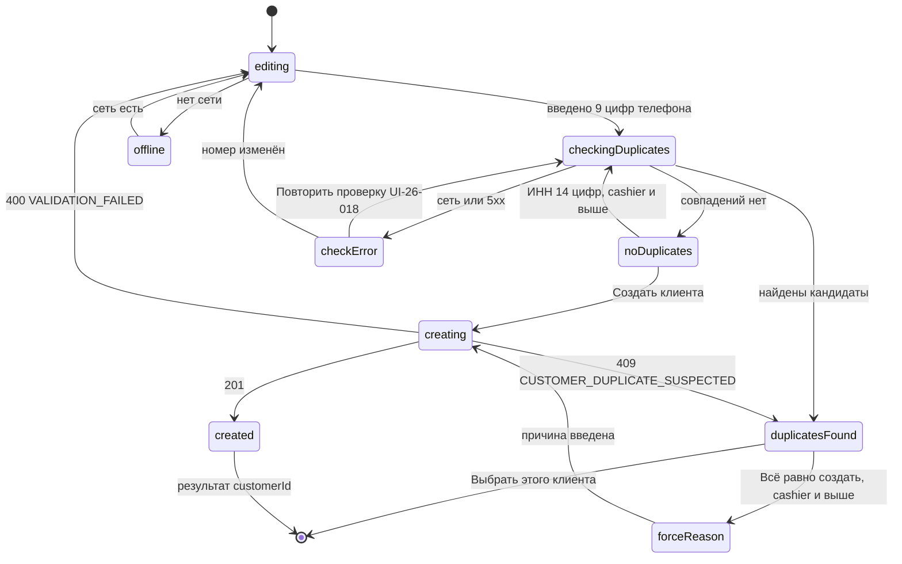

| Состояние | Что видно |
|---|---|
| Ввод | пустая форма, фокус в телефоне |
| Проверка дублей | спиннер в поле телефона (или ИНН), кнопка создания disabled |
| Ошибка проверки | UI-26-018 «Не удалось проверить номер на дубли · Повторить проверку»; создание disabled (сеть / таймаут / 5xx на `GET /search/customers`) |
| Дубли найдены | UI-26-003; создание — только через выбор или «Всё равно создать» (`cashier`+) |
| Совпадений нет | галочка «Совпадений не найдено» |
| 1С недоступна для проверки | баннер UI-26-016 после ответа с `STALE_DATA` |
| Создание | кнопка `loading`, поля заблокированы |
| Ошибка | ошибки у полей / «Не удалось создать клиента · Повторить» |
| Нет сети | `OfflineBanner`; проверка дублей и создание недоступны («Нужна сеть, чтобы создать клиента») |
| Нет прав | роль без `customer.create` (`owner`) — экран недоступен; `403 FORBIDDEN` при `forceCreate` без права |

#### 10.8. Валидация и сообщения

| Поле | Правило | Ключ ARB | Текст |
|---|---|---|---|
| Телефон | 9 цифр после +996 | `customer_new_phone_invalid` | Введите 9 цифр номера |
| ФИО | обязательно, 2–150 | `customer_new_name_required` | Введите ФИО или наименование |
| ИНН | 14 цифр для юр. лица | `customer_new_inn_invalid` | ИНН — 14 цифр |
| Причина при дубле | обязательно, 5–200 | `customer_new_force_reason_required` | Укажите, почему создаётся новый клиент при совпадении номера |
| Проверка дублей не выполнена | ошибка сети/5xx | `customer_new_check_failed` / `customer_new_check_retry` | Не удалось проверить номер на дубли / Повторить проверку |
| Дубль по ИНН | кандидат с `matchType=inn` | `customer_new_duplicate_inn_title` | Найден клиент с этим ИНН |
| Кандидатов больше 3 | — | `customer_new_show_more` | Показать ещё ({count}) |
| Комментарий | ≤ 500 | `customer_new_comment_counter` | {count}/500 |
| Прочие строки | раздел 11 | `customer_new_*` | — |

#### 10.9. Источники данных, API, состояние приложения, бизнес-правила

`GET /search/customers` (08 §4.5.4) — предпроверка; `POST /customers` (08 §4.11.2) — создание с `Idempotency-Key`, ошибки `CUSTOMER_DUPLICATE_SUSPECTED` (409, `candidates[]`), `VALIDATION_FAILED`; созданный клиент — `source=pos_pending`, `onecRef=null`, `syncStatus=pending`, далее outbox в 1С (CUST-014, CUST-015); провайдер `newCustomerFormProvider` (только память, ПДн не пишутся в drift). Правила: CUST-010…016, CUST-018, CUST-020, D-08, Q-025.

#### 10.10. Действия по ролям и ограничения безопасности

| Действие | `seller` | `cashier` | `senior_seller` | `admin` | `owner` | Право |
|---|---|---|---|---|---|---|
| Создать клиента без дублей | ✔ | ✔ | ✔ | ✔ | — | `customer.create` |
| Создать при подозрении на дубль | — | ✔ (причина, аудит) | ✔ | ✔ | — | `customer.create.force` |
| Видеть телефон кандидата | маска | ✔ | ✔ | ✔ | — | DTO по роли |

Поиск по телефону продавцом — только полным номером; частые запросы фиксируются `customer.phone_lookup` (сигнал скрейпинга, 08 §4.5.4); ПДн (телефон, ИНН) не логируются (CUST-020).

#### 10.11. Повторное нажатие, двойной запрос, «Назад», перезапуск

Двойное «Создать клиента» — один запрос (`loading` + `Idempotency-Key`); сетевой повтор — тот же ключ (сервер вернёт того же клиента, `Idempotent-Replayed`); «Всё равно создать» — новый ключ; «Назад» — UI-26-017 при введённых данных; перезапуск — форма пуста.

#### 10.12. Требования к платформам

| Платформа | Требования |
|---|---|
| Телефон Android (compact) | полноэкранный маршрут без нижней навигации; одна колонка; поля 48 lp; цифровая клавиатура для телефона и ИНН, текстовая с автокапитализацией слов — для ФИО, обычная — для адреса и комментария; футер («Отмена», «Создать клиента» L 52) закреплён над клавиатурой (`resizeToAvoidBottomInset`); «Назад» — UI-26-017 при введённых данных; поворот не теряет введённое (A11Y-014) |
| Планшет (medium) | диалог около 560 lp, одна колонка; внешняя клавиатура — как Windows |
| Windows-POS (expanded) | диалог 560–640 lp поверх SCR-21/SCR-31; 2 колонки для коротких полей (телефон + тип); клавиатура: `Tab`/`Shift+Tab` — по полям в порядке §10.2, стрелки и `Space` — тип клиента, `Enter` — «Создать клиента» при валидной форме (в многострочных полях — перевод строки), `Esc` — UI-26-017; мышь: курсор-указатель на кнопках и радио, hover `surfaceHover` у карточек кандидатов, тултип у «Всё равно создать» («Создать новую карточку, несмотря на совпадение»); вставка номера из буфера (`Ctrl+V`) нормализуется к маске; HID-скан игнорируется (символы скана не попадают в поле в фокусе) |
| iOS | как телефон; цели 44 pt; цифровая клавиатура `numberPad` с кнопкой «Готово» над ней; свайп «назад» — как «Назад» с UI-26-017 [ТИПОВО, Q-008] |

#### 10.13. Критерии приёмки

| ID | Критерий |
|---|---|
| AC-UI-26-001 | Первое поле — телефон с маской «+996 ___ ___ ___»; при 9 цифрах выполняется проверка дублей до нажатия «Создать клиента» |
| AC-UI-26-002 | Для номера существующего клиента показывается «Найден клиент с этим номером» с карточкой и «Выбрать этого клиента»; выбор возвращает клиента в оформление без создания нового |
| AC-UI-26-003 | Продавец не видит «Всё равно создать» (вместо неё подпись «Если это другой клиент — обратитесь к кассиру или старшему продавцу»); кассир видит кнопку, без причины (менее 5 символов) «Создать клиента» неактивна; с причиной уходит `POST /customers` с `forceCreate=true`, новым `Idempotency-Key` и `comment`, начинающимся с «Причина создания при совпадении:» |
| AC-UI-26-004 | Ответ `409 CUSTOMER_DUPLICATE_SUSPECTED` на создание показывает кандидатов, клиент не создаётся |
| AC-UI-26-005 | Созданный клиент возвращается в SCR-21 выбранным; плитка «Без оплаты / долг» для него недоступна с причиной «Выберите клиента из 1С» до подтверждения 1С |
| AC-UI-26-006 | Для «Юр. лицо» ИНН обязателен (14 цифр); для «Физ. лицо» поле скрыто |
| AC-UI-26-007 | Двойное нажатие «Создать клиента» создаёт одного клиента |
| AC-UI-26-008 | При ответе с `STALE_DATA` показывается «Проверка в 1С сейчас недоступна — возможен дубль» |
| AC-UI-26-009 | Без сети кнопка создания недоступна с подписью «Нужна сеть, чтобы создать клиента» |
| AC-UI-26-010 | Ошибка `GET /search/customers` при проверке номера показывает «Не удалось проверить номер на дубли» и «Повторить проверку»; до успешной проверки «Создать клиента» неактивна; «Повторить проверку» отправляет один запрос даже при двойном нажатии |
| AC-UI-26-011 | Кассир, выбравший «Юр. лицо», на 14-й цифре ИНН существующего клиента видит «Найден клиент с этим ИНН»; продавец в той же ситуации получает кандидатов после нажатия «Создать клиента» (ответ `409`) |
| AC-UI-26-012 | Тип клиента выбирается двумя радиокнопками «Физ. лицо» / «Юр. лицо» (клавиатура стрелками и `Space`); поле ИНН появляется только при «Юр. лицо» |

#### 10.14. Трассировка

| Требование | Где |
|---|---|
| SRC-C-084 (вне зоны; «+ Новый клиент» макета) | весь экран |
| SRC-C-081, SRC-C-082 | UI-26-012 (клиент создаётся в 1С через outbox после подтверждения) |
| SRC-E-166, SRC-E-167 | §10.11 (идемпотентность создания) |
| SRC-E-134, SRC-E-134a (вне зоны) | UI-26-002/003 — дедупликация |

---

## 11. Сводный словарь строк UI части

Ключи `snake_case` по правилам 03 §16.2; плейсхолдеры `{count}`, `{total}` (уже отформатированная сумма), `{time}`, `{date}`, `{name}`, `{number}` — по 03 §16.2; плюрализация `{count} позиций` — ICU `one/few/many/other` (03 §16.3); суммы в текстах — через `formatMoney` (MNY, 03 §16.4). Владелец словаря ARB — 03 (ядро §18.1); ниже — строки экранов SCR-20 … SCR-26 для включения в `app_ru.arb`.

### 11.1. Строки экранов части

| Ключ ARB | Русский текст | Экран | Примечание |
|---|---|---|---|
| `cart_banner_accept_prices` | Принять новые цены | SCR-20 | UI-20-024 |
| `cart_banner_offline` | Нет сети. Изменения сохранены и будут отправлены | SCR-20 | CART-018 |
| `cart_banner_prices_changed` | Цены изменились · {count} позиций | SCR-20 | UI-20-012 |
| `cart_banner_restored_from_order` | Корзина восстановлена из заказа № {number}: {reason} | SCR-20 | ORD-027 |
| `cart_banner_stale` | Данные от {time} — обновляем… | SCR-20 | CART-016 |
| `cart_banner_stock` | Недостаточно остатка · {count} позиций | SCR-20 | UI-20-012 |
| `cart_clear_dialog_body` | Будет удалено {count} позиций. Отложенные заказы не затрагиваются | SCR-20 | UI-20-029 (ICU plural) |
| `cart_clear_dialog_confirm` | Очистить | SCR-20 | UI-20-029 |
| `cart_clear_dialog_title` | Очистить корзину? | SCR-20 | UI-20-029 |
| `cart_clear_tooltip` | Очистить корзину | SCR-20 | UI-20-003 |
| `cart_counter_units` | {positions} · {units} | SCR-20 | UI-20-021: `{positions}` — `cart_a11y_positions` / `cart_positions_short`, `{units}` — по единицам из 1С |
| `cart_cta_create_order` | Создать заказ | SCR-20 | UI-20-016 |
| `cart_cta_park` | Отложить заказ | SCR-20 | UI-20-015 |
| `cart_cta_reason_accept_prices` | Примите новые цены | SCR-20 | UI-20-022 |
| `cart_cta_reason_checking` | Проверяем результат создания заказа… | SCR-20 | UI-20-022 / UI-20-020 |
| `cart_cta_reason_empty` | Корзина пуста | SCR-20 | UI-20-022 |
| `cart_cta_reason_offline` | Нужна сеть, чтобы создать заказ | SCR-20 | UI-20-022 |
| `cart_cta_reason_reduce_qty` | Уменьшите количество до доступного | SCR-20 | UI-20-022 |
| `cart_cta_reason_refreshing` | Обновляем данные… | SCR-20 | UI-20-022 |
| `cart_cta_reason_remove_unavailable` | Удалите недоступные позиции | SCR-20 | UI-20-022 |
| `cart_customer_empty` | Клиент: не выбран | SCR-20 | UI-20-004 |
| `cart_customer_prices_recalculated` | Цены пересчитаны по условиям клиента | SCR-20 | после `POST /cart/customer` |
| `cart_discount_approval_dialog_body` | Подтвердить скидку больше {limit} % может старший продавец или администратор в своей учётной записи. Отложите заказ — старший откроет его на своём устройстве, либо выйдите, чтобы он вошёл на этом терминале | SCR-20 | UI-20-031 |
| `cart_discount_approval_how` | Как получить подтверждение | SCR-20 | UI-20-031 |
| `cart_discount_approve_button` | Подтвердить скидку {percent} % | SCR-20 | UI-20-033: `senior_seller`/`admin`, возобновлённая чужая корзина, в пределах своего лимита |
| `cart_discount_approved_by` | Подтвердил: {name} | SCR-20 | после override |
| `cart_discount_customer_included` | Скидка клиента {percent} % уже учтена | SCR-20 | DISC-005 |
| `cart_discount_invalid` | Введите число от 0 до 100 | SCR-20 | локальная валидация |
| `cart_discount_label` | Скидка | SCR-20 | UI-20-013 |
| `cart_discount_limit_tooltip` | Ваш лимит: {limit} % | SCR-20 | UI-20-013 |
| `cart_discount_over_limit` | Больше {limit} % без подтверждения нельзя. Действует прежняя скидка {applied} % | SCR-20 | `422 DISCOUNT_LIMIT_EXCEEDED`, корзина не изменена |
| `cart_empty_body` | Добавьте товары из каталога или отсканируйте штрихкод | SCR-20 | UI-20-017 |
| `cart_empty_parked` | Отложенные заказы ({count}) | SCR-20 | UI-20-017 |
| `cart_empty_title` | Корзина пуста | SCR-20 | UI-20-017 |
| `cart_empty_to_catalog` | К каталогу | SCR-20 | UI-20-017 |
| `cart_fab_a11y` | Открыть корзину, {count} позиций, {total} | SCR-20 | `CartFab` (03 §16.2) |
| `cart_line_delete_dialog_title` | Удалить «{name}» из корзины? | SCR-20 | количество → 0 |
| `cart_line_deleted_snackbar` | Позиция удалена | SCR-20 | UI-20-028 |
| `cart_line_price_changed` | Цена изменилась: было {old} → стало {new} | SCR-20 | UI-20-011 |
| `cart_line_reduce_to` | Уменьшить до {available} | SCR-20 | UI-20-025 |
| `cart_line_remove_unavailable` | Удалить позицию | SCR-20 | UI-20-011 |
| `cart_line_stock_available` | Доступно {available} {unit} | SCR-20 | UI-20-011 |
| `cart_line_unavailable` | Товар больше не продаётся | SCR-20 | UI-20-011 |
| `cart_max_items` | Слишком много позиций (максимум {max}). Оформите часть заказа отдельно | SCR-20 | CART-024 |
| `cart_park_dialog_name_hint` | Название (необязательно) | SCR-20 | UI-20-026 |
| `cart_park_dialog_title` | Отложить заказ | SCR-20 | UI-20-026 |
| `cart_parked_snackbar` | Заказ отложен | SCR-20 | после `POST /cart/park` |
| `cart_parked_snackbar_open` | Открыть отложенные | SCR-20 | действие снекбара |
| `cart_parked_tooltip` | Отложенные заказы | SCR-20 | UI-20-002 |
| `cart_preview_failed` | Не удалось проверить заказ · Повторить | SCR-20 | ошибка `checkout-preview` |
| `cart_qty_below_min` | Минимальная партия — {min} {unit} | SCR-20 | `QTY_BELOW_MIN` |
| `cart_qty_invalid` | Введите количество кратно {step} {unit} | SCR-20 | `QTY_NOT_MULTIPLE` |
| `cart_result_unknown_retry` | Повторить сейчас | SCR-20 | UI-20-020 |
| `cart_result_unknown_title` | Проверяем результат создания заказа… | SCR-20 | UI-20-020 |
| `cart_save_state_failed` | Ошибка сохранения · Повторить | SCR-20 | UI-20-023 |
| `cart_save_state_queued` | В очереди: {count} | SCR-20 | UI-20-023 |
| `cart_save_state_saved` | Сохранено | SCR-20 | UI-20-023 |
| `cart_save_state_saving` | Сохраняем… | SCR-20 | UI-20-023 |
| `cart_scan_not_found` | Товар со штрихкодом {code} не найден | SCR-20 | HID-скан |
| `cart_summary_discount` | Скидка ({percent} %) | SCR-20 | `CartSummary` |
| `cart_summary_items` | Товаров ({count}) | SCR-20 | `CartSummary` (форма макета без склонения, 03 §16.3) |
| `cart_summary_preliminary` | предварительно | SCR-20 | UI-20-030 |
| `cart_summary_total` | Итого | SCR-20 | `CartSummary` |
| `cart_title` | Корзина | SCR-20 | заголовок |
| `cart_updated_from_server` | Корзина обновлена с сервера: изменено {count} позиций | SCR-20 | CART-009 п.4 |
| `cart_version_conflict_apply_mine` | Применить мои изменения | SCR-20 | UI-20-027 |
| `cart_version_conflict_keep_server` | Оставить как на сервере | SCR-20 | UI-20-027 |
| `cart_version_conflict_title` | Корзина изменена на другом устройстве | SCR-20 | UI-20-027 |
| `cart_warehouse_label` | Склад: {warehouse} · цены «{priceList}» | SCR-20 | UI-20-005 |
| `checkout_abort_body` | Корзина и выбранные параметры сохранятся. Адрес и телефоны получателя придётся ввести заново | SCR-21 | 07 §11.2 |
| `checkout_abort_confirm` | Прервать | SCR-21 | — |
| `checkout_abort_continue` | Продолжить оформление | SCR-21 | фокус по умолчанию |
| `checkout_abort_title` | Прервать оформление? | SCR-21 | UI-21-030 |
| `checkout_address_hint` | Введите адрес доставки | SCR-21 | макет |
| `checkout_address_label` | Адрес доставки | SCR-21 | макет |
| `checkout_address_required` | Введите адрес доставки | SCR-21 | Адрес |
| `checkout_address_too_long` | Адрес не длиннее 300 символов | SCR-21 | Адрес |
| `checkout_back_to_cart` | Вернуться в корзину | SCR-21 | — |
| `checkout_cancel` | Отмена | SCR-21 | макет |
| `checkout_checked_onec` | Проверено в 1С · {time} | SCR-21 | ORD-008 |
| `checkout_checked_snapshot` | Проверено по данным от {time} | SCR-21 | STALE_DATA |
| `checkout_comment_counter` | {count}/200 | SCR-21 | Комментарий |
| `checkout_comment_hint` | Комментарий для курьера… | SCR-21 | макет |
| `checkout_comment_label` | Комментарий курьеру (необязательно) | SCR-21 | макет |
| `checkout_conflict_credit` | Продажа в долг недоступна: {reason} | SCR-21 | CREDIT_* |
| `checkout_conflict_discount` | Скидка больше лимита роли ({limit} %) | SCR-21 | DISCOUNT_LIMIT_EXCEEDED |
| `checkout_conflict_price` | Цена изменилась: {name} — было {old}, стало {new} | SCR-21 | PRICE_CHANGED |
| `checkout_conflict_stock` | Недостаточно остатка: {name} — доступно {available} | SCR-21 | STOCK_INSUFFICIENT |
| `checkout_conflict_unavailable` | Товар больше не продаётся: {name} | SCR-21 | VARIANT_UNAVAILABLE |
| `checkout_conflicts_title` | Заказ нельзя создать: данные изменились | SCR-21 | UI-21-021 |
| `checkout_create_failed` | Не удалось создать заказ. Код обращения: {requestId} | SCR-21 | IDEMPOTENCY_KEY_REUSED / INTERNAL |
| `checkout_creating_slow` | 1С отвечает дольше обычного — заказ будет отправлен автоматически | SCR-21 | через 8 с |
| `checkout_credit_allow` | Разрешить продажу в долг | SCR-21 | UI-21-028 |
| `checkout_credit_allow_reason_label` | Причина разрешения | SCR-21 | обязательно, ≤ 200 |
| `checkout_credit_allowed_by` | Разрешено: {name} | SCR-21 | PAY-032 |
| `checkout_credit_approval_dialog_body` | Разрешить продажу в долг может старший продавец или администратор в своей учётной записи. Отложите заказ — старший откроет его на своём устройстве и оформит сам, либо выйдите, чтобы он вошёл на этом терминале | SCR-21 | CASH-007 |
| `checkout_credit_approval_park` | Отложить заказ | SCR-21 | UI-21-027 |
| `checkout_credit_how_to_approve` | Как получить разрешение старшего | SCR-21 | UI-21-027 |
| `checkout_credit_needs_customer` | Для продажи в долг выберите клиента из 1С | SCR-21 | Клиент для `credit` |
| `checkout_credit_parked_name` | Долг: {customer} · {time} | SCR-21 | имя отложенной корзины |
| `checkout_credit_reason_limit` | Превышен лимит: доступно {remaining} | SCR-21 | CREDIT_LIMIT_EXCEEDED |
| `checkout_credit_reason_no_data` | Нет данных из 1С о просрочке или лимите | SCR-21 | DEBT-012 |
| `checkout_credit_reason_no_permission` | Нет права продажи в долг | SCR-21 | admin (Q-208) |
| `checkout_credit_reason_not_allowed` | Отсрочка не разрешена соглашением | SCR-21 | CREDIT_BLOCKED not_allowed |
| `checkout_credit_reason_not_identified` | Выберите клиента из 1С | SCR-21 | CREDIT_BLOCKED not_identified |
| `checkout_credit_reason_onec_unavailable` | 1С недоступна: продажа в долг невозможна, выберите наличные или QR | SCR-21 | PAY-033 |
| `checkout_credit_reason_overdue` | Есть просроченная задолженность {amount} | SCR-21 | CREDIT_BLOCKED overdue |
| `checkout_credit_reason_seller` | Продажа в долг недоступна: обратитесь к старшему продавцу | SCR-21 | PAY-036 |
| `checkout_credit_reason_stale` | Данные о долге устарели | SCR-21 | RECEIVABLES_STALE |
| `checkout_cta_create` | Создать заказ | SCR-21 | cash; admin |
| `checkout_cta_create_credit` | Создать заказ в долг | SCR-21 | credit |
| `checkout_cta_create_qr` | Создать заказ и показать QR | SCR-21 | макет |
| `checkout_cta_creating` | Создаём заказ… | SCR-21 | loading |
| `checkout_cta_offline` | Нужна сеть | SCR-21 | D-32 |
| `checkout_customer_debt_flag_no` | нет | SCR-21 | seller |
| `checkout_customer_debt_flag_overdue` | просрочка | SCR-21 | seller |
| `checkout_customer_debt_flag_yes` | есть | SCR-21 | seller (Q-017) |
| `checkout_customer_meta` | История: {orders} · Долг: {debt} · Скидка: {discount} | SCR-21 | UI-21-005; для seller долг — «есть / нет / просрочка» |
| `checkout_customer_new` | + Новый клиент | SCR-21 | макет; UI-21-004 |
| `checkout_customer_not_found` | Клиенты не найдены по «{query}» | SCR-21 | CustomerPicker empty |
| `checkout_customer_pending_onec` | Ожидает 1С | SCR-21 | CUST-014 |
| `checkout_customer_retail_chip` | Розничный покупатель | SCR-21 | UI-21-023; Q-026 |
| `checkout_customer_search_hint` | Введите имя, телефон или часть имени… | SCR-21 | макет; UI-21-003 |
| `checkout_date_pick` | Выбрать дату… | SCR-21 | — |
| `checkout_date_today` | Сегодня | SCR-21 | макет |
| `checkout_date_tomorrow` | Завтра | SCR-21 | — |
| `checkout_debt_forecast` | Долг после заказа (прогноз): {amount} · лимит доступен: {limit} · данные 1С от {time} | SCR-21 | PAY-035 |
| `checkout_delivery_hint` | Доставка курьером | SCR-21 | макет |
| `checkout_delivery_method_required` | Выберите способ получения | SCR-21 | Способ получения |
| `checkout_delivery_title` | Доставка | SCR-21 | макет |
| `checkout_duplicate_body` | Похожий заказ № {number} создан {minutes} мин назад. Создать ещё один? | SCR-21 | ORD-022 |
| `checkout_duplicate_create` | Создать ещё один | SCR-21 | — |
| `checkout_duplicate_open` | Открыть заказ | SCR-21 | — |
| `checkout_duplicate_title` | Похожий заказ уже создан | SCR-21 | ORD-022 |
| `checkout_forbidden_payment` | Недостаточно прав для этого способа оплаты | SCR-21 | FORBIDDEN |
| `checkout_form_errors_summary` | Исправьте поля: {count} | SCR-21 | Сводка ошибок |
| `checkout_items_count` | ({count} позиций) | SCR-21 | ICU plural; макет «5 товаров» заменено |
| `checkout_items_edit` | Изменить | SCR-21 | макет |
| `checkout_map_button` | Выбрать на карте | SCR-21 | disabled в R1 |
| `checkout_map_tooltip` | Карта — в следующей версии | SCR-21 | Q-178 |
| `checkout_next` | Далее | SCR-21 | UI-21-020 |
| `checkout_onec_note` | Заказ будет создан в 1С и отправлен на согласование | SCR-21 | макет |
| `checkout_onec_note_offline` | Заказ будет отправлен в 1С автоматически, как только она станет доступна | SCR-21 | ORD-026 |
| `checkout_onec_unavailable_banner` | 1С сейчас недоступна. Заказ за наличные или по QR будет отправлен в 1С автоматически. Продажа в долг невозможна | SCR-21 | UI-21-031 |
| `checkout_open_restored_cart` | Открыть восстановленную корзину | SCR-21 | ORD-027 |
| `checkout_pay_cash_hint` | Оплата в нашем магазине | SCR-21 | макет |
| `checkout_pay_cash_title` | Наличными в кассу | SCR-21 | макет |
| `checkout_pay_checking_debt` | Проверяем долг… | SCR-21 | PaymentMethodCard loading |
| `checkout_pay_credit_hint` | Оплата позже (по согласованию) | SCR-21 | макет |
| `checkout_pay_credit_title` | Без оплаты / долг | SCR-21 | макет |
| `checkout_pay_info_cash_cashier` | После создания заказа нажмите «Принять оплату» | SCR-21 | PAY-010; переход в SCR-38 — кнопкой UI-22-012 |
| `checkout_pay_info_cash_seller` | После создания заказа передайте клиента в кассу | SCR-21 | PAY-011 |
| `checkout_pay_info_credit` | Срок оплаты — по соглашению с клиентом в 1С: до {date} | SCR-21 | PAY-034 |
| `checkout_pay_info_qr_manual` | После создания заказа будет показан QR-код Бакай Банка. Оплату подтвердит кассир по выписке банка | SCR-21 | PAY-022 |
| `checkout_pay_info_qr_webhook` | После создания заказа будет сформирован QR-код для оплаты через Бакай Банк. После оплаты заказ будет автоматически отмечен как оплаченный | SCR-21 | только при QR_WEBHOOK_ENABLED (PAY-027) |
| `checkout_pay_qr_hint` | Оплата картой по QR | SCR-21 | макет |
| `checkout_pay_qr_title` | QR / карта Бакай Банк | SCR-21 | макет |
| `checkout_payment_required` | Выберите способ оплаты | SCR-21 | Способ оплаты |
| `checkout_phone_invalid` | Введите 9 цифр номера | SCR-21 | Телефон другого получателя / телефон получателя доставки |
| `checkout_pickup_hint` | Клиент заберёт сам | SCR-21 | макет |
| `checkout_pickup_title` | Самовывоз | SCR-21 | макет |
| `checkout_pii_not_saved_hint` | Адрес и телефоны получателя не сохраняются на устройстве — введите их заново | SCR-21 | после перезапуска |
| `checkout_print_invoice` | Счёт на оплату | SCR-21 | макет «Печатать счёт на оплату» |
| `checkout_print_invoice_hint` | PDF, A4; печать после получения номера 1С | SCR-21 | PRINT-002, PRINT-003 |
| `checkout_print_printer_missing` | Настройте принтер в Настройках | SCR-21 | PrintOptions disabled |
| `checkout_print_receipt` | Товарный чек | SCR-21 | PRINT-005 |
| `checkout_print_receipt_hint` | Не является фискальным документом, 80 мм | SCR-21 | D-26 |
| `checkout_print_title` | Печать после создания заказа | SCR-21 | макет |
| `checkout_print_waybill` | Накладная (предварительная) | SCR-21 | PRINT-004 |
| `checkout_print_waybill_hint` | Не является документом отгрузки; накладная — из 1С | SCR-21 | PRINT-004 |
| `checkout_receiver_customer` | Клиент | SCR-21 | макет |
| `checkout_receiver_customer_hint` | Получает сам клиент | SCR-21 | макет |
| `checkout_receiver_name_label` | ФИО получателя | SCR-21 | UI-21-024 |
| `checkout_receiver_name_required` | Введите ФИО получателя | SCR-21 | ФИО другого получателя |
| `checkout_receiver_other` | Другой человек | SCR-21 | макет |
| `checkout_receiver_other_hint` | Товар получает другой человек | SCR-21 | макет |
| `checkout_receiver_phone_label` | Телефон получателя | SCR-21 | UI-21-025 |
| `checkout_receiver_title` | Получатель | SCR-21 | макет |
| `checkout_recipient_phone_label` | Телефон для курьера | SCR-21 | UI-21-009 (доставка; отличается от `checkout_receiver_phone_label`) |
| `checkout_courier_phone_hint` | По умолчанию — телефон получателя | SCR-21 | UI-21-009 |
| `checkout_rejected_onec` | 1С отклонила заказ: {reason} | SCR-21 | ONEC_REJECTED |
| `checkout_section_customer` | Клиент | SCR-21 | заголовок секции |
| `checkout_section_delivery` | Получение товара | SCR-21 | макет |
| `checkout_section_items` | Состав заказа | SCR-21 | макет |
| `checkout_section_payment` | Оплата | SCR-21 | макет |
| `checkout_slot_past` | Этот интервал уже прошёл | SCR-21 | Дата и интервал |
| `checkout_slot_required` | Выберите дату и время доставки | SCR-21 | Дата и интервал |
| `checkout_slot_value` | с {from} до {to} | SCR-21 | макет «с 14:00 до 18:00» |
| `checkout_step_counter` | Шаг {step} из 4 · {title} | SCR-21 | compact |
| `checkout_step_customer` | Клиент | SCR-21 | CheckoutStepper |
| `checkout_step_delivery` | Получение | SCR-21 | CheckoutStepper |
| `checkout_step_done` | Завершение | SCR-21 | CheckoutStepper |
| `checkout_step_payment` | Оплата | SCR-21 | CheckoutStepper |
| `checkout_summary_customer_discount` | Скидка клиента (из 1С) | SCR-21 | DISC-005 |
| `checkout_summary_discount` | Скидка ({percent} %) | SCR-21 | макет |
| `checkout_summary_subtotal` | Сумма без скидки | SCR-21 | макет |
| `checkout_summary_total` | Итого к оплате | SCR-21 | макет |
| `checkout_time_label` | Желаемое время доставки | SCR-21 | макет |
| `checkout_title` | Подтверждение заказа | SCR-21 | UI-21-001; макет |
| `checkout_scan_ignored` | Закройте оформление, чтобы сканировать товары | SCR-21, SCR-22, SCR-26 | HID-скан |
| `order_created_accept_payment` | Принять оплату | SCR-22 | UI-22-012 |
| `order_created_admin_handoff` | Оплату примет кассир. Заказ № {number} | SCR-22 | Q-208 |
| `order_created_banner_dead` | Заказ не удалось отправить в 1С — администратор получил уведомление | SCR-22 | ORD-031 |
| `order_created_banner_submitting` | Заказ сохранён и будет отправлен в 1С автоматически. Счёт можно напечатать после получения номера 1С | SCR-22 | ORD-025 |
| `order_created_customer_pay_hint` | Оплатите заказ в кассе магазина | SCR-22 | `customer` (усл.), QR не показывается (§14 п.23) |
| `order_created_cash_handoff` | Передайте клиента в кассу. Заказ № {number}, к оплате {total} | SCR-22 | PAY-011 |
| `order_created_credit_due` | Продажа в долг · оплатить до {date} | SCR-22 | PAY-034 |
| `order_created_credit_due_agreement` | Срок оплаты — по соглашению в 1С | SCR-22 | PAY-034 |
| `order_created_manual_amount_label` | Сумма поступления | SCR-22 | UI-22-017 |
| `order_created_manual_amount_mismatch` | Сумма отличается от заказа: платёж уйдёт на разбор | SCR-22 | Сумма поступления не совпадает |
| `order_created_manual_confirm` | Подтвердить оплату вручную | SCR-22 | UI-22-009 |
| `order_created_manual_ref_label` | Референс банка / номер из выписки | SCR-22 | UI-22-017 |
| `order_created_manual_ref_required` | Введите референс из выписки банка (не короче 4 символов) | SCR-22 | Референс пуст / короче 4 |
| `order_created_manual_time_label` | Время поступления | SCR-22 | UI-22-017 |
| `order_created_new_order` | Новый заказ | SCR-22 | UI-22-011 |
| `order_created_number` | Заказ № {number} | SCR-22 | UI-22-002 |
| `order_created_onec_pending` | Ожидает отправки в 1С | SCR-22 | submitting |
| `order_created_open_order` | Открыть заказ | SCR-22 | UI-22-010 |
| `order_created_other_method` | Другой способ оплаты | SCR-22 | UI-22-015 |
| `order_created_other_method_seller` | Сменить способ оплаты может кассир | SCR-22 | seller |
| `order_created_paid` | Оплата получена | SCR-22 | received |
| `order_created_paid_auto` | Получено автоматически | SCR-22 | только confirmationKind=webhook |
| `order_created_paid_manual` | Оплата подтверждена вручную | SCR-22 | manual |
| `order_created_payment_state_changed` | Статус платежа изменился. Данные обновлены | SCR-22 | Статус платежа изменился |
| `order_created_qr_expired` | Срок QR истёк | SCR-22 | qr_expired |
| `order_created_qr_forming` | Формируем QR… | SCR-22 | QrPanel loading |
| `order_created_qr_none` | QR не сформирован банком. Покажите клиенту QR-табличку кассы; оплату подтвердит кассир | SCR-22 | provider none (Q-014) |
| `order_created_qr_purpose` | Оплата заказа {number} · Бакай Банк | SCR-22 | UI-22-004 |
| `order_created_qr_reissue` | Перевыпустить QR | SCR-22 | PAY-025 |
| `order_created_qr_show_customer` | Показать покупателю | SCR-22 | UI-22-013 |
| `order_created_qr_static` | QR торговой точки, без срока действия | SCR-22 | elqr_static |
| `order_created_qr_title` | Оплата по QR · Бакай Банк | SCR-22 | QrPanel |
| `order_created_qr_unavailable` | Банк недоступен. Покажите QR-табличку или выберите другой способ | SCR-22 | QR недоступен |
| `order_created_qr_valid_until` | Действует до {time} · осталось {left} | SCR-22 | UI-22-005 |
| `order_created_review_amount` | Сумма оплаты не совпадает с заказом — требуется разбор кассиром | SCR-22 | PAY-024 |
| `order_created_review_reference` | Платёж с неизвестным референсом — требуется разбор | SCR-22 | unknown_reference |
| `order_created_title` | Заказ создан | SCR-22 | UI-22-001 |
| `order_created_waiting_payment` | Ожидаем оплату | SCR-22 | qr_shown |
| `order_created_doc_failed` | Не удалось напечатать · Повторить | SCR-22, SCR-24 | PRINT-001 |
| `order_created_doc_printed` | Напечатан | SCR-22, SCR-24 | PrintOptions |
| `order_created_doc_queued` | В очереди на печать | SCR-22, SCR-24 | PRINT-001 |
| `parked_active_not_empty_body` | В корзине уже есть {count} позиций. Отложить текущую корзину и продолжить выбранный заказ? | SCR-23 |  |
| `parked_active_not_empty_confirm` | Отложить текущую и продолжить | SCR-23 |  |
| `parked_card_expires` | Удалится через {days} дн. | SCR-23 |  |
| `parked_card_expires_tomorrow` | Удалится завтра | SCR-23 |  |
| `parked_card_items_total` | {count} позиций · {total} (предварительно) | SCR-23 |  |
| `parked_empty_body` | Отложенный заказ сохраняется кнопкой «Отложить заказ» в корзине | SCR-23 |  |
| `parked_empty_title` | Отложенных заказов нет | SCR-23 |  |
| `parked_not_available` | Заказ уже недоступен | SCR-23 |  |
| `parked_owner_readonly` | Просмотр отложенных заказов. Продолжить заказ может продавец или старший продавец | SCR-23 |  |
| `parked_restored_chip` | Восстановлен из заказа № {number} | SCR-23 |  |
| `parked_resume` | Продолжить | SCR-23 |  |
| `parked_resumed_foreign_snackbar` | Заказ «{name}» автора {owner} продолжен вами | SCR-23 |  |
| `parked_scope_all` | Все | SCR-23 |  |
| `parked_scope_mine` | Мои | SCR-23 |  |
| `parked_title` | Отложенные заказы | SCR-23 |  |
| `order_action_cancel` | Отменить заказ | SCR-24 |  |
| `order_action_cancel_request` | Запросить отмену | SCR-24 |  |
| `order_action_pay` | Принять оплату | SCR-24 |  |
| `order_action_repeat` | Повторить заказ | SCR-24 |  |
| `order_action_return` | Заявка на возврат | SCR-24 |  |
| `order_action_show_qr` | Показать QR | SCR-24 |  |
| `order_banner_cancel_requested` | Запрос отмены отправлен в 1С {time} | SCR-24 |  |
| `order_banner_dead` | Требуется вмешательство администратора: заказ не отправлен в 1С | SCR-24 |  |
| `order_banner_rejected` | 1С отклонила заказ: {reason} | SCR-24 |  |
| `order_banner_submitting` | Ожидает отправки в 1С | SCR-24 |  |
| `order_banner_total_adjusted` | Итог уточнён 1С: было {old}, стало {new} | SCR-24 |  |
| `order_cancel_dialog_title` | Отменить заказ № {number}? | SCR-24 |  |
| `order_cancel_money_advance` | Оставить авансом | SCR-24 |  |
| `order_cancel_money_refund` | Вернуть деньги клиенту | SCR-24 |  |
| `order_cancel_reason_customer_refused` | Клиент отказался | SCR-24 |  |
| `order_cancel_reason_duplicate` | Дубль | SCR-24 |  |
| `order_cancel_reason_error` | Ошибка оформления | SCR-24 |  |
| `order_cancel_reason_other` | Другое | SCR-24 |  |
| `order_cancel_reason_required` | Укажите причину отмены | SCR-24 |  |
| `order_cancel_requested_snackbar` | Запрос отмены отправлен в 1С | SCR-24 |  |
| `order_cancel_unavailable` | Отмена недоступна в статусе «{status}» | SCR-24 |  |
| `order_cancelled_snackbar` | Заказ отменён | SCR-24 |  |
| `order_credit_paid_of` | Долг по заказу: оплачено {paid} из {total} (по данным 1С от {time}) | SCR-24 |  |
| `order_doc_after_payment` | После оплаты | SCR-24 |  |
| `order_doc_waiting_number` | Ожидает номер 1С | SCR-24 |  |
| `order_doc_waybill_from_onec` | Печатается из 1С при отгрузке | SCR-24 |  |
| `order_due_date` | Оплатить до {date} | SCR-24 |  |
| `order_history_source_app` | Приложение | SCR-24 |  |
| `order_history_source_onec` | 1С | SCR-24 |  |
| `order_not_found` | Заказ не найден или недоступен | SCR-24 |  |
| `order_onec_freshness` | Статус из 1С: {time} · Обновить | SCR-24 |  |
| `order_onec_number` | № 1С {number} от {date} | SCR-24 |  |
| `order_onec_unavailable_snackbar` | 1С недоступна, показаны данные от {time} | SCR-24 |  |
| `order_paid_of` | Оплачено {paid} из {total} | SCR-24 |  |
| `order_payments_empty` | Платежей нет | SCR-24 |  |
| `order_repeat_add` | Добавить к текущей | SCR-24 |  |
| `order_repeat_dialog_body` | В корзине {count} позиций. Добавить позиции заказа к текущей корзине или отложить текущую? | SCR-24 |  |
| `order_repeat_park_and_new` | Отложить текущую и начать новую | SCR-24 |  |
| `order_repeat_progress` | Добавляем {n} из {count}… | SCR-24 |  |
| `order_repeat_skipped` | Не добавлено: {count} (снято с продажи) | SCR-24 |  |
| `order_title` | Заказ № {number} | SCR-24 |  |
| `orders_chip_all` | Все | SCR-25 |  |
| `orders_chip_awaiting_payment` | Ждут оплаты | SCR-25 |  |
| `orders_chip_cancelled` | Отменены и отклонены | SCR-25 |  |
| `orders_chip_closed` | Закрыты | SCR-25 |  |
| `orders_chip_in_progress` | В работе | SCR-25 |  |
| `orders_chip_shipped` | Отгружены | SCR-25 |  |
| `orders_empty_create` | Создать заказ | SCR-25 | 03 `EmptyState.orders`, роли с `order.create` |
| `orders_empty_filtered_title` | Ничего не найдено по выбранным фильтрам | SCR-25 | дополнение к 03 (§14 п.22) |
| `orders_empty_no_orders_title` | Заказов пока нет | SCR-25 | 03 `EmptyState.orders` |
| `orders_empty_search_body` | Проверьте запрос или отсканируйте штрихкод | SCR-25 | 03 `EmptyState.search` |
| `orders_empty_search_title` | Ничего не найдено по „{q}“ | SCR-25 | 03 `EmptyState.search` |
| `orders_filters` | Фильтры | SCR-25 |  |
| `orders_found_count` | Найдено: {count} за период | SCR-25 |  |
| `orders_load_failed` | Не удалось загрузить заказы · Повторить | SCR-25 |  |
| `orders_paid_credit` | Долг | SCR-25 |  |
| `orders_paid_full` | Оплачен | SCR-25 |  |
| `orders_paid_partial` | {paid} из {total} | SCR-25 |  |
| `orders_reset_filters` | Сбросить фильтры | SCR-25 |  |
| `orders_scan_not_found` | Заказ с номером {number} не найден | SCR-25 |  |
| `orders_period_today` | Сегодня | SCR-25 | UI-25-004 |
| `orders_period_yesterday` | Вчера | SCR-25 | UI-25-004 |
| `orders_period_7_days` | 7 дней | SCR-25 | UI-25-004 |
| `orders_period_month` | Месяц | SCR-25 | UI-25-004 |
| `orders_period_custom` | Период… | SCR-25 | UI-25-004 |
| `orders_stale` | Данные от {time} | SCR-25 | устаревшие данные |
| `orders_refresh` | Обновить | SCR-25 | устаревшие данные |
| `orders_scope_all` | Все | SCR-25 |  |
| `orders_scope_mine` | Мои | SCR-25 |  |
| `orders_search_hint` | Номер заказа POS или 1С | SCR-25 |  |
| `orders_sort_newest` | Сначала новые | SCR-25 |  |
| `orders_sort_status` | По статусу | SCR-25 |  |
| `orders_sort_total` | По сумме | SCR-25 |  |
| `orders_title` | Заказы | SCR-25 |  |
| `orders_title_mine` | Мои заказы | SCR-25 |  |
| `customer_new_abort_body` | Введённые данные не сохранятся | SCR-26 | — |
| `customer_new_abort_confirm` | Отменить создание | SCR-26 | — |
| `customer_new_abort_title` | Отменить создание клиента? | SCR-26 | UI-26-017 |
| `customer_new_address_label` | Адрес | SCR-26 | UI-26-009 |
| `customer_new_checking` | Проверяем… | SCR-26 | проверка дублей |
| `customer_new_comment_counter` | {count}/500 | SCR-26 | Комментарий |
| `customer_new_comment_label` | Комментарий | SCR-26 | UI-26-010 |
| `customer_new_create` | Создать клиента | SCR-26 | UI-26-014 |
| `customer_new_create_failed` | Не удалось создать клиента · Повторить | SCR-26 | сеть |
| `customer_new_created_snackbar` | Клиент создан · ожидает 1С | SCR-26 | CUST-014 |
| `customer_new_duplicate_title` | Найден клиент с этим номером | SCR-26 | CUSTOMER_DUPLICATE_SUSPECTED |
| `customer_new_force_create` | Всё равно создать | SCR-26 | cashier+ |
| `customer_new_force_reason_label` | Причина создания при совпадении номера | SCR-26 | UI-26-015 |
| `customer_new_force_reason_required` | Укажите, почему создаётся новый клиент при совпадении номера | SCR-26 | Причина при дубле |
| `customer_new_inn_invalid` | ИНН — 14 цифр | SCR-26 | ИНН |
| `customer_new_inn_label` | ИНН | SCR-26 | UI-26-006 |
| `customer_new_name_label` | ФИО или наименование | SCR-26 | UI-26-004 |
| `customer_new_name_required` | Введите ФИО или наименование | SCR-26 | ФИО |
| `customer_new_no_duplicates` | Совпадений не найдено | SCR-26 | — |
| `customer_new_offline` | Нужна сеть, чтобы создать клиента | SCR-26 | D-32 |
| `customer_new_onec_note` | Клиент сначала сохраняется в приложении и автоматически создаётся в 1С. До подтверждения 1С ему можно продавать за наличные и по QR, но не в долг | SCR-26 | CUST-014 |
| `customer_new_phone_invalid` | Введите 9 цифр номера | SCR-26 | Телефон |
| `customer_new_phone_label` | Телефон | SCR-26 | UI-26-002 |
| `customer_new_seller_duplicate_hint` | Если это другой клиент — обратитесь к кассиру или старшему продавцу | SCR-26 | CUST-016 |
| `customer_new_stale_check` | Проверка в 1С сейчас недоступна — возможен дубль. Проверено по данным приложения от {time} | SCR-26 | CUST-012 |
| `customer_new_title` | Новый клиент | SCR-26 | UI-26-001 |
| `customer_new_type_individual` | Физ. лицо | SCR-26 | individual |
| `customer_new_type_legal` | Юр. лицо | SCR-26 | legal |
| `customer_new_use_existing` | Выбрать этого клиента | SCR-26 | UI-26-003 |
| `cart_a11y_positions` | {count, plural, one{{count} позиция} few{{count} позиции} many{{count} позиций} other{{count} позиции}} | SCR-20 | ICU plural (03 §16.3); счётчик и `Semantics` |
| `cart_positions_short` | {count} поз. | SCR-20 | UI-20-021, шапка |
| `cart_warehouse_readonly_tooltip` | Склад корзины назначается автоматически | SCR-20 | UI-20-005 (R1 — только чтение) |
| `cart_discount_apply_limit` | Применить {limit} % | SCR-20 | UI-20-032 |
| `cart_discount_over_max` | Скидка больше {max} % не допускается | SCR-20 | потолок подтверждающих ролей, Q-015 |
| `cart_discount_approval_ok` | Понятно | SCR-20 | UI-20-031 |
| `cart_discount_approval_park` | Отложить заказ | SCR-20 | UI-20-031 |
| `cart_discount_override_reason_label` | Причина скидки | SCR-20 | UI-20-033 |
| `cart_discount_override_reason_required` | Укажите причину скидки | SCR-20 | UI-20-033 |
| `cart_result_unknown_long` | Проверка занимает больше обычного. Продолжаем проверять | SCR-20 | §4.11.1, этап 2 |
| `cart_result_unknown_check_list` | Проверьте заказ в списке заказов | SCR-20 | §4.11.1, этапы 3–4 |
| `cart_result_unknown_open_orders` | Открыть список заказов | SCR-20 | §4.11.1 → SCR-25 |
| `cart_result_unknown_unlock` | Разблокировать корзину | SCR-20 | §4.11.1, этап 4 |
| `checkout_courier_phone_hint` | По умолчанию — телефон получателя | SCR-21 | UI-21-009 |
| `checkout_credit_help_ok` | Понятно | SCR-21 | UI-21-027, кнопка диалога |
| `order_created_customer_pay_hint` | Оплатите заказ в кассе магазина | SCR-22 | `customer` (усл.), §14 п.23 |
| `order_created_manual_comment_label` | Комментарий | SCR-22 | UI-22-017 |
| `parked_delete_conflict` | Заказ изменился. Список обновлён | SCR-23 | UI-23-007, `409` |
| `parked_delete_dialog_author` | Автор: {owner} | SCR-23 | UI-23-013 |
| `parked_delete_dialog_body` | Заказ «{name}» ({count} позиций) будет удалён без возможности восстановления | SCR-23 | UI-23-013 (ICU plural) |
| `parked_delete_dialog_confirm` | Удалить | SCR-23 | UI-23-013 |
| `parked_delete_dialog_title` | Удалить отложенный заказ? | SCR-23 | UI-23-013 |
| `parked_delete_tooltip` | Удалить отложенный заказ | SCR-23 | UI-23-007 (условно) |
| `parked_deleted_snackbar` | Отложенный заказ удалён | SCR-23 | UI-23-007 |
| `parked_empty_back_to_cart` | Вернуться в корзину | SCR-23 | UI-23-009 |
| `parked_offline_tooltip` | Нужна сеть | SCR-23 | офлайн |
| `order_customer_card_link` | Карточка › | SCR-24 | UI-24-004 |
| `order_doc_download` | Скачать PDF | SCR-24 | UI-24-009 |
| `order_doc_preview` | Просмотр | SCR-22, SCR-24 | UI-22-008, UI-24-009 |
| `order_doc_print` | Печать | SCR-22, SCR-24 | UI-22-008, UI-24-009 |
| `order_history_collapse` | Свернуть историю | SCR-24 | UI-24-003, compact |
| `order_history_show_all` | Показать всю историю | SCR-24 | UI-24-003, compact |
| `order_onec_refresh` | Обновить | SCR-24 | UI-24-014 |
| `order_scan_hint` | Сканирование номера заказа доступно в списке заказов | SCR-24 | HID-скан, добавлено при сборке 02 v1.1 |
| `customer_new_check_failed` | Не удалось проверить номер на дубли | SCR-26 | UI-26-018 |
| `customer_new_check_retry` | Повторить проверку | SCR-26 | UI-26-018 |
| `customer_new_duplicate_inn_title` | Найден клиент с этим ИНН | SCR-26 | UI-26-003, `matchType=inn` |
| `customer_new_force_tooltip` | Создать новую карточку, несмотря на совпадение | SCR-26 | UI-26-003, Windows |
| `customer_new_show_more` | Показать ещё ({count}) | SCR-26 | UI-26-003, > 3 кандидатов |
| `customer_new_force_reason_prefix` | Причина создания при совпадении: {reason} | SCR-26 | префикс в `comment` (UI-26-015), не отображается как отдельная строка UI |

Общие строки компонентов, используемые частью без собственных ключей (владелец — 03 §16.5): «Повторить» — `ds_button_retry` (ошибки загрузки списков, QR, документов); «Отмена» — `ds_button_cancel` (диалоги); «Готово» — `ds_button_ok` (`QrPanel.fullscreen`, нампады); «Закрыть» — `ds_button_close`; «Отменить» в снекбаре удаления строки — `ds_button_undo`; «Сбросить» — `ds_button_reset`; «Долгая загрузка…» — `ds_loading_long`; «данные от {time}» — `ds_data_as_of`; «Код: {requestId}» — `ds_request_id`; плейсхолдер поиска клиента — `ds_search_placeholder_customers`.

### 11.2. Используемые общие ключи (владелец — 03; тексты — предложение 02c)

| Ключ ARB | Русский текст | Экран | Примечание |
|---|---|---|---|
| `status_order_draft` | Черновик (технический) | журналы | в рабочих экранах не встречается (ядро §17.2) |
| `status_order_submitting` | Ожидает отправки в 1С | SCR-22, SCR-24, SCR-25 | D-20 |
| `status_order_submit_failed` | Отклонён 1С | SCR-22, SCR-24, SCR-25 | ORD-027 |
| `status_order_pending_approval` | На согласовании | SCR-22, SCR-24, SCR-25 | 03 §16.2 (пример) |
| `status_order_awaiting_payment` | Ожидает оплаты | SCR-22, SCR-24, SCR-25 | ядро §17.2 |
| `status_order_approved` | Согласован | SCR-24, SCR-25 | событие ORD-040 |
| `status_order_awaiting_shipment` | Ожидает отгрузки | SCR-24, SCR-25 | — |
| `status_order_shipped` | Отгружен | SCR-24, SCR-25 | реализация 1С |
| `status_order_partially_returned` | Частично возвращён | SCR-24, SCR-25 | — |
| `status_order_closed` | Закрыт | SCR-24, SCR-25 | — |
| `status_order_cancelled` | Отменён | SCR-24, SCR-25 | — |
| `status_payment_initiated` | Создан | SCR-24 | — |
| `status_payment_cash_pending` | Ожидает оплаты наличными | SCR-22, SCR-24 | — |
| `status_payment_qr_pending` | Формируется QR | SCR-22, SCR-24 | — |
| `status_payment_qr_shown` | Ожидаем оплату | SCR-22, SCR-24 | 03 §16.2 (пример) |
| `status_payment_qr_expired` | Срок QR истёк | SCR-22, SCR-24 | PAY-025 |
| `status_payment_manual_confirm` | Подтверждён вручную, на проверке | SCR-22, SCR-24 | PAY-024 |
| `status_payment_credit` | В долг | SCR-22, SCR-24 | PAY-037 |
| `status_payment_received` | Получен | SCR-22, SCR-24 | — |
| `status_payment_voided` | Аннулирован | SCR-24 | PAY-050 |
| `status_payment_refunded` | Возвращён | SCR-24 | PAY-051 |
| `payment_review_amount_mismatch` | Требует проверки: сумма не совпадает | SCR-22, SCR-24 | 03 §16.5 |
| `payment_review_unknown_reference` | Требует проверки: неизвестная ссылка платежа | SCR-22, SCR-24 | 03 §16.5 |
| `status_cart_parked` | Отложен | SCR-23 | 03 §9.39 |
| `error_price_changed` | Цены изменились. Подтвердите новые цены | SCR-20, SCR-21 | 08 §2.4 |
| `error_stock_insufficient` | Недостаточно остатка: доступно {available} {unit} | SCR-20, SCR-21 | 03 §16.2 (пример) |
| `error_variant_unavailable` | Товар больше не продаётся | SCR-20, SCR-21 | — |
| `error_qty_not_multiple` | Количество должно быть кратно {m} {unit} | SCR-20 | текст выровнен при сборке 02 с 02b (было «… кратно {factor}») |
| `error_qty_below_min` | Минимальная партия — {min} {unit} | SCR-20 | текст выровнен при сборке 02 с 02b (было «Количество меньше минимальной партии») |
| `error_discount_limit_exceeded` | Скидка больше вашего лимита ({limit} %) | SCR-20, SCR-21 | — |
| `error_credit_blocked` | Продажа в долг недоступна | SCR-21 | — |
| `error_credit_limit_exceeded` | Превышен лимит долга клиента | SCR-21 | — |
| `error_receivables_stale` | Данные о долге устарели | SCR-21 | — |
| `error_onec_unavailable` | 1С временно недоступна. Заказ будет отправлен позже | SCR-21, SCR-22, SCR-24 | 03 §16.2 (пример) |
| `error_onec_rejected` | 1С отклонила документ | SCR-21, SCR-22 | — |
| `error_cart_empty` | Корзина пуста | SCR-20, SCR-21 | — |
| `error_version_conflict` | Данные изменились на другом устройстве | SCR-20 | — |
| `error_idempotency_in_progress` | Операция уже выполняется | SCR-21, SCR-22 | — |
| `error_order_state_invalid` | Действие недоступно в текущем статусе | SCR-24 | — |
| `error_payment_state_invalid` | Статус платежа изменился | SCR-22 | — |
| `error_customer_duplicate_suspected` | Найден клиент с этим номером | SCR-26 | — |
| `error_customer_not_identified` | Выберите клиента | SCR-21 | — |
| `error_step_up_required` | Подтвердите действие | SCR-20, SCR-21, SCR-22, SCR-24 | `StepUpDialog` |
| `error_forbidden` | Недостаточно прав | все | — |
| `error_qr_unavailable` | Банк недоступен | SCR-22 | код `[НОВОЕ ИМЯ]` в 08 §2.4 |
| `error_internal` | Не удалось выполнить. Повторите | все | текст выровнен при сборке 02 с 02a/02b; код обращения показывается отдельной строкой `ds_request_id` «Код: {requestId}» (03 §16.5) |

---

## 12. Открытые вопросы

### 12.1. Новые вопросы части (диапазон Q-208 … Q-211)

| ID | Вопрос | Влияние | Допущение в ТЗ до ответа |
|---|---|---|---|
| Q-208 | [НОВЫЙ ВОПРОС] Как администратор (`admin`) оформляет заказы с учётом разделения обязанностей D-15: может ли он выбирать «QR / карта Бакай Банк» (QR покажет кассир) и «Наличными в кассу», должен ли он видеть способ «Без оплаты / долг» и может ли разрешать продажу в долг (у роли есть `credit.sale.approve`, но нет `credit.sale.create`, а подтверждение выполняется в собственной сессии подтверждающего — CASH-007)? | SCR-21, SCR-22, SCR-24; матрица 11 §4.4 | `admin` создаёт заказы за наличные и по QR без показа QR (оплату принимает кассир на SCR-38); долг у `admin` недоступен; разрешение долга в R1 фактически выполняет `senior_seller` |
| Q-209 | [НОВЫЙ ВОПРОС] Доставка курьером платная? Как отражается стоимость доставки в заказе и итоге (строка «Доставка» в итогах), есть ли зоны или минимальная сумма доставки и кто назначает курьера (в 1С или вне системы)? | SCR-21 (итоги, получение), реквизиты заказа 1С (Q-178) | стоимость доставки в приложении не считается и не показывается; доставка фиксируется реквизитами заказа, стоимость — по согласованию вне приложения |
| Q-210 | [НОВЫЙ ВОПРОС] После создания заказа с QR должен ли продавец ждать оплату на экране или может сразу начать следующий заказ (ожидание продолжится в фоне, статус — в деталях заказа и у кассира)? Где покупатель смотрит QR: на экране продавца, на отдельном дисплее покупателя, на распечатке 80 мм? | SCR-22, PRINT, Windows-POS | ожидание не блокирует «Новый заказ»; QR — на экране (режим «Показать покупателю») и печатается по запросу; второй монитор покупателя — не в R1 |
| Q-211 | [НОВЫЙ ВОПРОС] Операции с корзинами, которых нет в ядре §7 и 08: (а) нужно ли продавцу вручную удалять и переименовывать отложенные заказы и смотреть их состав до возобновления, или достаточно автоматического удаления через 7 дней (Q-172) и просмотра состава после «Продолжить»; кто вправе удалять чужие отложенные (CART-035: автор, `senior_seller`, `admin`); (б) нужно ли сотруднику менять склад корзины (например, продажа со второго склада), и если да — кто и с какой проверкой остатков (предложение `PATCH /cart {warehouseId, rowVersion}` [НОВОЕ ИМЯ]). Пункт (б) добавлен при доработке: диапазон новых вопросов части Q-208 … Q-211 исчерпан | SCR-23 (UI-23-004, UI-23-007, UI-23-013), SCR-20 (UI-20-005); API `/cart/parked`, `/cart` | (а) в R1 — автоудаление по сроку; «Удалить» описан как условный элемент и скрыт до появления `DELETE /cart/parked/{id}` [НОВОЕ ИМЯ]; «Переименовать» и раскрытие состава скрыты; (б) склад корзины в R1 только отображается, его назначает сервер |

### 12.2. Вопросы ядра и документов волны 1, влияющие на часть

| ID | Где влияет | Применённое допущение |
|---|---|---|
| Q-001 | `customer`-режим SCR-20/21/22/24/25 | флаг `CUSTOMER_SELF_SERVICE` выключен |
| Q-005 | роли отмены, создание клиента продавцом, void | матрица 10 §3 / 11 §4.4 |
| Q-012 | оплата до согласования, деньги при отмене (`refundIntent`), ПКО | как на макете: оплата допускается до согласования |
| Q-014 | QR динамический или статический, вебхук, тексты автоотметки | ручное подтверждение кассиром; текст макета — только при вебхуке |
| Q-015 | лимиты ручной скидки | seller 5 %, cashier 5 %, senior 10 %, admin 15 % [НЕ ПОДТВЕРЖДЕНО] |
| Q-016 | округление наличных | без округления |
| Q-017 | видимость сумм долга продавцом | только «есть / нет / просрочка» |
| Q-019 | состав и формы печатных документов | счёт и чек — PDF backend; накладная — 1С |
| Q-020 | `cart_stale_minutes` | 15 мин |
| Q-024 | печать счёта с временным номером | запрещена |
| Q-025 | правила создания клиента, ИНН, типы | физ./юр. лицо; ИНН 14 цифр для юр. лица |
| Q-026 | «Розничный клиент» макета | системный «Розничный покупатель» без долга |
| Q-111 | горячие клавиши | §3.4 |
| Q-112 | формат телефона | `+996 XXX XXX XXX`, E.164 в API |
| Q-167 | long-polling статуса платежа | `?wait=25` |
| Q-171 | TTL QR | 15 мин или из ответа банка |
| Q-172 | срок хранения отложенных | 7 дней |
| Q-176 | debounce, undo 5 с, 200 строк, 60 с дубль, длины полей | значения 10 с пометкой [НЕ ПОДТВЕРЖДЕНО] |
| Q-178 | карта и реквизиты доставки в 1С | «Выбрать на карте» — R2 |

---

## 13. Трассировка на исходные требования

| SRC-ID | Формулировка (кратко) | Экран / элементы | Правила 10/09/03 | Критерии приёмки |
|---|---|---|---|---|
| SRC-C-058 | корзина из нижней части интерфейса на мобильных | SCR-20: UI-20-019, вкладка `BottomNavBar` | CART-001, D-18 | AC-UI-20-001 |
| SRC-C-059 | постоянная панель на больших экранах | SCR-20 вариант `panel` 340 | CART-001, 03 §9.27 | AC-UI-20-001 |
| SRC-C-060 | счётчик товаров | UI-20-001, UI-20-021 | CART-001 | AC-UI-20-002 |
| SRC-C-061 | количество единиц | UI-20-021 | CART-001 | AC-UI-20-002 |
| SRC-C-062 | изменение количества | UI-20-008, SCR-16 | CART-003, INV-001…010 | AC-UI-20-004, AC-UI-20-005 |
| SRC-C-063 | удаление позиции | UI-20-010, UI-20-018, UI-20-028, UI-20-029 | CART-004, CART-012 | AC-UI-20-005, AC-UI-20-006 |
| SRC-C-064 | выбор варианта | UI-20-007, SCR-15 | CART-005 | AC-UI-20-007 |
| SRC-C-065 | цена и сумма позиции | UI-20-006, UI-20-009 | CART-006 | AC-UI-20-008 |
| SRC-C-066 | промежуточный итог | UI-20-014, UI-21-015 | CART-006 | AC-UI-20-003, AC-UI-21-002 |
| SRC-C-067 | скидка, если разрешена | UI-20-013, UI-20-031, UI-20-032, UI-20-033 | CART-007, DISC-002…010 | AC-UI-20-011, AC-UI-20-022 … AC-UI-20-025 |
| SRC-C-068 | итоговая сумма | UI-20-014, UI-21-015, UI-22-007, UI-24-007 | CART-006, MNY-001 | AC-UI-20-003, AC-UI-21-002 |
| SRC-C-069 | сохранение черновика | UI-20-023, SCR-23, `checkout_draft` | CART-008, CART-030, ORD-010 | AC-UI-20-013, AC-UI-23-001 |
| SRC-C-070 | восстановление после перезапуска | SCR-20 §4.11, SCR-21 §5.11 | CART-009, ORD-010 | AC-UI-20-013, AC-UI-21-017 |
| SRC-C-071 | очистка с подтверждением | UI-20-003, UI-20-029 | CART-011 | AC-UI-20-012 |
| SRC-C-072 | предупреждения об изменившихся ценах и остатках | UI-20-011, UI-20-012, UI-20-024, UI-20-025, UI-21-021 | CART-013…016 | AC-UI-20-009, AC-UI-20-010, AC-UI-20-018 |
| SRC-C-073 | сохранять товары, варианты, количества между экранами | SCR-20 §4.6 | CART-010 | AC-UI-20-017 |
| SRC-C-074 | не терять корзину при переходах | SCR-20 §4.6 | CART-010 | AC-UI-20-017 |
| SRC-C-075 | сервер повторно проверяет цены | UI-20-016, предпроверка SCR-21, UI-21-015 | ORD-007, ORD-008, ORD-020 | AC-UI-21-002, AC-UI-21-010 |
| SRC-C-075a | … остатки | UI-21-021, возврат в корзину | ORD-008, CART-014 | AC-UI-21-011 |
| SRC-C-075b | … права пользователя | `CheckoutPreview.permissions`, SCR-21 §5.10 | ORD-008, CASH-001 | AC-UI-21-018 |
| SRC-C-075c | … правила скидок | UI-21-021 (скидка сверх лимита), UI-20-013, UI-20-033 | ORD-008, DISC-010 | AC-UI-20-011, AC-UI-20-023, AC-UI-20-024 |
| SRC-C-076 | не списывать остаток при добавлении в корзину | SCR-20 §4.1, UI-20-011 (превышение остатка — предупреждение, не резерв) | CART-019, D-22 | AC-UI-20-026 |
| SRC-C-077 | резерв и списание по согласованному процессу | SCR-21 §5.1, SCR-24 UI-24-003 | ORD-042, ORD-060 | AC-UI-24-001 |
| SRC-C-078 | различать заказ и продажу | SCR-21 §5.1, SCR-24 §8.1 | ORD-032 | AC-UI-24-002 |
| SRC-C-079 | отдельный сценарий оформления заказа | SCR-21 | ORD-001 | AC-UI-21-001 |
| SRC-C-079a | выставление счёта | UI-21-016, UI-22-008, UI-24-009 | PRINT-002, PRINT-003 | AC-UI-22-002, AC-UI-24-008 |
| SRC-C-079b | кассовая продажа | UI-22-012, UI-22-018, UI-24-010 → SCR-38 | ORD-001, PAY-010, PAY-011 | AC-UI-22-007 |
| SRC-C-080 | по реальным процессам магазина и 1С | UI-21-018, Q-012 | ORD-024 | AC-UI-21-009 |
| SRC-C-081 | не придумывать способы оплаты и документы | UI-21-012 (только `cash`, `qr_bakai`, `credit`), UI-21-016 (только счёт, предварительная накладная, товарный чек) | ORD-002, PRINT-004, PRINT-005 | AC-UI-21-021, AC-UI-21-007 |
| SRC-C-082 | сначала операции, затем синхронизация | UI-21-018, UI-22-014, UI-24-014 | ORD-024…026, D-28 | AC-UI-21-009, AC-UI-22-002 |
| SRC-E-155 | структура корзины | SCR-20 §4.2–§4.3 | 10 §7.1 | AC-UI-20-008 |
| SRC-E-156 | изменение количества | UI-20-008 | CART-003 | AC-UI-20-004 |
| SRC-E-157 | удаление позиции | UI-20-010 | CART-004 | AC-UI-20-006 |
| SRC-E-158 | сохранение черновика | UI-20-023, SCR-23 (включая условное удаление UI-23-007) | CART-008, CART-030, CART-035 | AC-UI-20-013, AC-UI-23-009, AC-UI-23-010 |
| SRC-E-159 | проверка актуальной цены | UI-20-011, UI-21-021 | CART-013, ORD-007 | AC-UI-20-009, AC-UI-21-010 |
| SRC-E-160 | проверка остатков | UI-20-011, UI-20-025 | CART-014, CART-015 | AC-UI-20-010, AC-UI-21-011 |
| SRC-E-161 | применение скидок | UI-20-013, UI-20-032, UI-20-033, UI-21-015 | DISC-001…010 | AC-UI-20-011, AC-UI-20-022 … AC-UI-20-025 |
| SRC-E-162 | оформление заказа | SCR-21, SCR-22 | ORD-001…029 | AC-UI-21-001 … AC-UI-21-020 |
| SRC-E-163 | кассовая продажа | SCR-22 → SCR-38 | PAY-010…014, PAY-020 | AC-UI-22-007 |
| SRC-E-164 | отмена | UI-24-013, UI-24-017 | ORD-050…053 | AC-UI-24-004 … AC-UI-24-006 |
| SRC-E-165 | возврат | UI-24-012 → SCR-39 | RET-*, D-25 | AC-UI-24-012 |
| SRC-E-166 | повторные запросы | SCR-20 §4.11, SCR-21 §5.4 и §5.11, SCR-22 §6.11 | CART-023, ORD-021, ORD-028, PAY-003 | AC-UI-20-019, AC-UI-21-008 |
| SRC-E-167 | защита от двойных финансовых операций | UI-21-019, UI-22-009, UI-24-013 | ORD-021, PAY-003, ORD-053 | AC-UI-21-008, AC-UI-22-004 |
| SRC-E-168 | различать корзину, заказ, продажу, оплату, фискальный документ | SCR-20 §4.1, SCR-21 §5.1, UI-22-002/006, UI-24-002/007/008 | ORD-032, PRINT-010 | AC-UI-24-002 |
| SRC-E-169 | не объединять в один статус | UI-24-002 и UI-24-007 раздельно; UI-25-007/008 | ORD-032, ORD-033 | AC-UI-24-002, AC-UI-25-005 |
| SRC-F-031 | состояния корзины: пустая, с товарами, изменение количества, удаление, изменение цены, недостаточный остаток, устаревшие данные, ошибка оформления | SCR-20 §4.7, SCR-21 §5.7 | CART-013…022 | AC-UI-20-009, AC-UI-20-010, AC-UI-20-018, AC-UI-21-010 |
| SRC-F-032 | как сохраняется корзина | SCR-20 §4.9, §4.11; SCR-23 | CART-008, CART-009, CART-018 | AC-UI-20-013, AC-UI-20-014 |
| SRC-F-033 | как предотвращаются повторные операции | UI-20-020 и график повторов §4.11.1, UI-21-019, §5.4.1 диаграмма 2 | CART-022, CART-023, ORD-021 | AC-UI-20-016, AC-UI-20-028, AC-UI-21-008 |

Вне зоны, но использованы: SRC-C-084 (клиент в оформлении, «+ Новый клиент» макета), SRC-C-099 (список и детали заказов), SRC-E-134, SRC-E-134a (дедупликация клиента), SRC-F-029 (связь варианта с артикулом и ценой в строке корзины), SRC-F-036 (step-up критических операций).

---

## 14. Замечания к ядру

| № | Замечание | Как поступает 02c до решения |
|---|---|---|
| 1 | Горячие клавиши: 03 A11Y-009 — `F9` «Создать заказ»; `visual/navigation.md` §9 и Приложение B `wireframes-catalog.html` — `F8` «Создать заказ», `F9` «Отложить заказ». Нужен один набор (Q-111) | следует 03 (приоритет 03 над visual): `F9` — создать, `F8` — отложить; visual требует выравнивания |
| 2 | Длина адреса доставки: 10 ORD-005 и §8.1 — ≤ 500 символов; 08 §3.9 `Delivery.address` — ≤ 300 | UI ограничивает 300 (схема API строже); 10 или 08 выравнивается |
| 3 | CART-032 предлагает «объединить» активную и возобновляемую корзины, но `POST /cart/parked/{id}/resume` (08 §4.7.6) поддерживает только `replaceActive` | «Объединить» не показывается; нужен параметр `merge` в 08 или исключение из CART-032 |
| 4 | CART-035 (удаление отложенной корзины, should) и переименование отложенной (вайрфрейм UI-23-007) не имеют эндпоинта в ядре §7 и 08; в 11 §4.3 нет кода права на удаление чужой отложенной, в 11 §7.2 — события аудита | UI-23-007 и диалог UI-23-013 полностью описаны как условные элементы и скрыты до появления операции; предложения: `DELETE /cart/parked/{id}?rowVersion=` [НОВОЕ ИМЯ] (08 §4.7), право на чужие — по `cart.parked.resume.any` или новый код (11 §4.3), событие `cart.parked_deleted` [НОВОЕ ИМЯ] (11 §7.2); автоудаление по сроку (CART-033); Q-211 (а) |
| 5 | Нет чтения состава отложенной корзины: `GET /cart/parked` отдаёт корзины без `items`, `GET /cart` не принимает `cartId` (хотя navigation допускает query `cartId` маршрута `/cart`) | состав виден после «Продолжить»; UI-23-004 не в R1 |
| 6 | ORD-027 вводит `restored_from_order_id` `[НОВОЕ ИМЯ]`, но в DTO `Cart` (08 §3.8) поля нет | метка «Восстановлена» — по имени корзины; предлагается поле `restoredFromOrderId` в `Cart` |
| 7 | `GET /orders` не возвращает агрегаты по статусам, а вайрфрейм SCR-25 показывает счётчики на чипах | чипы без счётчиков |
| 8 | `POST /customers` (08 §4.11.2): нет отдельного поля причины при `forceCreate` (CUST-011; 08 §3.15 и 11 §4.3 №66 — «причина обязательна»), нет полей «год рождения» и «сфера деятельности» (CUST-010), `customerType` без «ИП» (вайрфрейм), нет операции подтверждения номера клиента по SMS (CUST-013) | поля «год рождения», «сфера», SMS скрыты; «Всё равно создать» **видна в R1** у `cashier`, `senior_seller`, `admin` (`customer.create.force`, 11 §4.3 №66), причина обязательна и передаётся в существующем поле `comment` с префиксом «Причина создания при совпадении:» [РЕШЕНИЕ части, вариант А; Q-025]; предлагается отдельное поле `forceReason` [НОВОЕ ИМЯ] в 08 §4.11.2 — UI от его появления не меняется |
| 9 | Настройка `delivery_slots` (ядро §17.7) хранится в `app_settings`, но канала её получения продавцом нет (`/admin/settings` — только `admin`) | слоты помечены [НЕ ПОДТВЕРЖДЕНО]; предлагается выдавать публичные бизнес-настройки в `GET /me` или отдельным справочником |
| 10 | 03 §9.31 `DiscountInput` и §9.34 `PaymentMethodCard` описывают `StepUpDialog` старшего «на этом же устройстве», что противоречит CASH-007 (ввод PIN/OTP старшего в сессии продавца запрещён) | следует CASH-007: информационный диалог и откладывание; step-up — в сессии самого старшего |
| 11 | 03 §9.58 `QrPanel`: «Обновить QR создаёт новый `payment`» — противоречит PAY-025 и 08 §4.8.6 (перевыпуск на том же `payment_id`); перечень статусов показа QR не включает `awaiting_payment` (есть в 10 §2.2 правило 4) | следует PAY-025 и 10 |
| 12 | Вайрфреймы расходятся с 10/11 по ролям: UI-22-009 и UI-24-010 включают `admin` (ручное подтверждение и приём оплаты запрещены D-15); UI-24-013 исключает `cashier` из запроса отмены согласованного (ORD-051 включает); SCR-26 «продавец — черновик» (CUST-016: продавец создаёт сам) | следует 10/11 |
| 13 | Пример тела `POST /orders` в 08 §4.8.1 содержит `clientTotalSnapshot`, который ORD-020 перечисляет среди запрещённых полей | клиент поле не передаёт (AC-UI-21-020); 08 исправляет пример |
| 14 | Печать: таблица 10 §16 — товарный чек «после создания заказа», а 08 §4.8.5 — `receipt` без полученного платежа → `ORDER_STATE_INVALID`; PRINT-004 — предварительная накладная `waybill.pdf` «после `pending_approval`», а 08 §4.8.5 — по умолчанию в R1 `available:false` | следует 08 (чек — после оплаты; накладная — по ответу API); 10 и 08 выравниваются |
| 15 | 07 §11.2 `checkout_draft` не хранит ПДн получателя и адрес — ORD-010 («восстанавливается после перезапуска») выполняется частично; значения шага: маршрут `step=done` (navigation) и `checkout_draft.step=review` (07); 07 упоминает `PATCH /cart` для `cart.sync`, которого нет в 08 | восстановление шага и выборов, ПДн — повторный ввод; соответствие `done` → `review`; отправка изменений — `PUT /cart/items/{variantId}` |
| 16 | `admin` имеет `credit.sale.approve`, но не `credit.sale.create`; по CASH-007 подтверждающий выполняет операцию сам в своей сессии — для `admin` это невозможно | Q-208; в R1 разрешение долга — `senior_seller` |
| 17 | Минимальная длина поиска клиента по телефону: 03 §9.35 — 3 цифры, 10 §8.1 — 4 цифры, 08 §4.5.4 — для `seller` только полный номер | `cashier` и выше — от 4 цифр, `seller` — 9 цифр |
| 18 | `owner` имеет `cart.parked.read.all` (11 §4.4, только чтение), но не имеет ветки `shell:cart` и SCR-20 (CASH-003), а таблица маршрутов `visual/navigation.md` не даёт ему другого входа на `/cart/parked` | предложение: ссылка «Отложенные заказы ({count})» в SCR-48 → `/cart/parked?scope=all` push поверх ветки `reports` в режиме чтения [ТИПОВО]; navigation (маршрут и guard G-7) и часть, описывающая SCR-48, выравниваются |
| 19 | Нет операции смены склада корзины: `Cart.warehouseId` есть в DTO (08 §3.8), но ни ядро §7, ни 08 §4.7 не задают его изменение (`GET /cart` склад не меняет); вайрфрейм и прежняя редакция части предполагали меню «Сменить склад» | склад корзины в R1 только отображается (UI-20-005); предложение `PATCH /cart {warehouseId, rowVersion}` [НОВОЕ ИМЯ] с пересчётом `warnings` по остаткам нового склада — после ответа на Q-211 (б) |
| 20 | Для правила 11 §4.3 №24 («подтверждение сверх лимита инициатора в пределах своего лимита») UI нужен лимит инициатора корзины, а `Cart.discountLimitPercent` (08 §3.8) — лимит текущего пользователя; после возобновления чужой корзины лимит автора неизвестен | до появления поля `initiatorDiscountLimitPercent` [НОВОЕ ИМЯ] в `Cart` порогом инициатора считается 5 % [НЕ ПОДТВЕРЖДЕНО, Q-015]; окончательная проверка — на сервере (`POST /cart/discount` с `override`) |
| 21 | Debounce отправки количества: 03 ANIM-007 и §9.20 `QuantityStepper` — 400 мс; 10 INV-043 и эта часть — 500 мс | часть следует INV-043 (500 мс) как владельцу бизнес-правила; значение фиксируется ответом на Q-176, после чего 03 или 10 выравнивается |
| 22 | Компоненты 03 и части: (а) `ViewModeSegmented` (03 §9.26) — только вид каталога, поэтому «Мои / Все» (UI-23-002, UI-25-005) переведены на `AppTabs`, «Физ. / Юр. лицо» (UI-26-005) — на `AppRadio`; (б) у `TransactionRow` (03 §9.38) варианты задаются `transaction_kind`, строки списка заказов нет — предлагается вариант `TransactionRow.order` [НОВОЕ ИМЯ] (тап → SCR-24), до решения UI-25-006 — `AppListTile`; (в) назначение `CategoryChip` (03 §9.9) — полоса категорий, но 03 сам использует `CategoryChip.choice/filter` для пресетов `DateRangePicker` и в `FilterPanel`; часть применяет `CategoryChip.choice` для групп статусов (UI-25-003) и чипа «Розничный покупатель» (UI-21-023) — предлагается расширить назначение в 03; (г) `EmptyState.parked` в 03 — только заголовок; часть добавляет описание и действие «Вернуться в корзину»; для пустого результата с фильтрами без `q` предлагается заголовок «Ничего не найдено по выбранным фильтрам» | (а) применено; (б)–(г) — предложения владельцу словаря компонентов 03 (ядро §18.1) |
| 23 | Роль `customer` и QR: 08 §4.8.1 допускает заявку `customer` со способом `qr_bakai`, а матрица 11 §4.4 (владелец прав) даёт `customer` «—» для `payment.qr.show` | часть следует 11: `customer` QR не видит и не перевыпускает (SCR-22, SCR-24), видит «Оплатите заказ в кассе магазина»; 08 и 11 выравниваются вместе с ответом на Q-001 |

## 15. Журнал проверки

Доработка версии 1.1 по замечаниям независимого проверяющего. Все правки точечные; структура разделов и UI-ID сохранены, новые элементы получили следующие свободные номера.

| № | Замечание (кратко) | Решение | Где отражено |
|---|---|---|---|
| 1 | SCR-20: при `DISCOUNT_LIMIT_EXCEEDED` сервер не урезает скидку | принято: корзина при `422` не меняется, показывается прежняя скидка и ошибка с лимитом; добавлена явная кнопка «Применить {limit} %» (UI-20-032, отдельный `POST /cart/discount`); AC-UI-20-011 переписан | UI-20-013, UI-20-032, §4.3.1, §4.4 «Зона E», §4.7, §4.8, AC-UI-20-011 |
| 2 | SCR-20: override старшего сверх собственного лимита противоречит 11 §4.3 №24 | принято: override (UI-20-033) только для корзины, возобновлённой из чужой отложенной, при скидке больше лимита инициатора и не больше лимита подтверждающего (10 / 15 %, Q-015); в своей корзине до своего лимита — обычное применение; сверх лимита подтверждающего — отказ без override | UI-20-031, UI-20-033, §4.1, §4.4 (таблица эскалации), §4.10, AC-UI-20-022 … AC-UI-20-025, §14 п.20 |
| 3 | SCR-20: смена склада через несуществующий API | принято: склад только для чтения в R1, смена — вне R1; предложение `PATCH /cart` [НОВОЕ ИМЯ] — §14 п.19; вопрос объединён с Q-211 п. (б), так как диапазон Q-208 … Q-211 исчерпан | UI-20-005, §4.3.1, §4.4 «Зона B», AC-UI-20-027, §12.1 Q-211 |
| 4 | SCR-26: противоречие о видимости «Всё равно создать» | принято, выбран вариант А: кнопка видна `cashier`+ (`customer.create.force`), причина обязательна и уходит в `comment`; предложение `forceReason` — §14 п.8; все места приведены к варианту А | UI-26-003, UI-26-015, §10.4 п.5, AC-UI-26-003, §14 п.8 |
| 5 | SCR-23: UI-23-007 — заглушка | принято: UI-23-007 и диалог UI-23-013 описаны полностью как условные элементы (включаются при `DELETE /cart/parked/{id}` [НОВОЕ ИМЯ]), тексты `parked_delete_*`, роли, повторное нажатие, AC | §7.3, §7.4, §7.7, §7.8, §7.10, §7.11, AC-UI-23-009 … 011, §14 п.4 |
| 6 | SCR-20 §4.2: перевёрнуто обоснование порядка кнопок | принято: «Отложить заказ» сверху, «Создать заказ →» снизу | §4.2, UI-20-015, AC-UI-20-029 |
| 7 | §3.2: неверное утверждение о несовпадении состава IMG_7090 с корзиной | принято: строки обоих блоков одинаковы (18 050), не сходятся итоги макета | §3.2 |
| 8 | §11.1: мусорная строка `checkout_draft`, неопределённый `cart_a11y_positions`, видимые строки без ключей | принято: строка удалена; `cart_a11y_positions` определён (ICU plural); добавлены ключи для «Понятно», «Показать ещё», «Показать всю историю», «Карточка ›», «Просмотр», «Печать», «Скачать PDF», «Обновить», «Комментарий», пресетов периода, «Повторить проверку»; «Готово», «Повторить» и др. — ссылками на `ds_*` 03 §16.5 | §4.8, §11.1 |
| 9 | Компоненты не по назначению | принято частично: `ViewModeSegmented` заменён на `AppTabs`/`AppRadio`; строка заказов — `AppListTile` с предложением `TransactionRow.order` [НОВОЕ ИМЯ]; `AppButton.text` danger → `AppButton.danger`; тексты `EmptyState.parked`/`.orders` выровнены с 03. Не принято в части `CategoryChip`: 03 сам применяет `CategoryChip.choice/filter` вне полосы категорий (пресеты `DateRangePicker` §9.60, `FilterPanel` §9.25), поэтому для групп статусов и чипа «Розничный покупатель» оставлен `CategoryChip.choice` (исправлен вариант `filter` → `choice`), а расширение назначения предложено владельцу 03 | UI-23-002, UI-25-003, UI-25-005, UI-25-006, UI-21-023, UI-26-005, UI-24-013, UI-23-009, UI-25-011, §14 п.22 |
| 10 | ANIM-016 для истории; 400 / 500 мс | принято: история — специфичная анимация по образцу ANIM-020; расхождение debounce вынесено в §14 п.21 (Q-176) | §8.5, §4.4 «Зона D», §14 п.21 |
| 11 | `customer` и показ QR | принято: следуем владельцу матрицы 11 — у `customer` QR нет; расхождение с 08 §4.8.1 — §14 п.23 (Q-001) | §5.10, §6.1, UI-22-003, §6.10, §8.10, AC-UI-22-012, AC-UI-24-014 |
| 12 | Кассир и `cash`: автопереход или кнопка | принято: без автоперехода, кнопка «Принять оплату» в фокусе на SCR-22; тексты выровнены | §5.1, UI-21-013, `checkout_pay_info_cash_cashier`, UI-22-012, §6.4, AC-UI-21-023, AC-UI-22-007 |
| 13 | Два поля «Телефон получателя» | принято: UI-21-009 — «Телефон для курьера», правило предзаполнения и синхронизации описано | UI-21-009, §5.4 «Зона C», §5.8, AC-UI-21-022 |
| 14 | Прогноз долга и `admin` | принято с обоснованием: право на суммы у `admin` есть (суммы видны в карточке клиента), прогноз привязан к плитке `credit`, недоступной `admin`; матрица разделена на две строки | UI-21-026, §5.10 |
| 15 | Анимации SCR-23 … SCR-26 без полного формата | принято: таблицы в формате §4.5 | §7.5, §8.5, §9.5, §10.5 |
| 16 | SCR-25: переходы абзацем, нет «устаревших данных», нет flowchart | принято: таблица переходов, состояние «устаревшие данные», общая диаграмма навигации части | §9.6, §9.7, §3.6 |
| 17 | Слабая трассировка SRC-E-165, SRC-C-076, SRC-C-081 | принято: добавлены AC-UI-24-012, AC-UI-20-026, AC-UI-21-021, трассировка обновлена | §4.13, §5.13, §8.13, §13 |
| 18 | Опечатка UI-20-006 → UI-20-005 | принято | §4.4 «Зона B» |
| 19 | Запрещённое ядром §11 п.5 слово в заголовке колонки §4.14 | принято: «Где отражено на экране» | §4.14 |
| 20 | §14 п.18 — служебная коллизия файлов | принято: пункт удалён из ТЗ (сведения переданы оркестратору в финальном ответе), номер 18 занят замечанием о точке входа `owner` | §14 п.18 |
| 21 | Нет графика фоновых повторов `POST /orders` | принято: 2/4/8/16 с, затем раз в 30 с, предел 10 мин, итоговое состояние «Проверьте заказ в списке заказов» [НЕ ПОДТВЕРЖДЕНО, Q-176] | §4.11.1, UI-20-020, §5.4, AC-UI-20-028 |
| 22 | Точка входа `owner` в SCR-23 | принято: предложена ссылка из SCR-48 (режим чтения), расхождение с navigation — §14 п.18 | §7.1, §7.6, AC-UI-23-012, §14 п.18 |
| 23 | `checkError` без UI-ID; предпроверка только по телефону | принято: UI-26-018 «Повторить проверку»; предпроверка по ИНН для ролей, которым 08 §4.5.4 разрешает поиск по ИНН; для `seller` — серверная проверка при `POST /customers` | UI-26-006, UI-26-018, §10.4, §10.7, §10.8, AC-UI-26-010, AC-UI-26-011 |
| 24 | Пропущенные пункты: требования к платформам SCR-23 и SCR-26 одной строкой | принято: таблицы по платформам с размерами, клавиатурой и мышью | §7.12, §10.12 |

Конец части 02c.
