# 02d — Спецификация экранов: рабочее место кассира, клиенты, долги, транзакции, оплата, возврат (SCR-30 … SCR-39)

Версия 1.0 · Дата 2026-10-18 · Статус: черновик для утверждения заказчиком

**Часть** сводного документа `02_SCREEN_SPECIFICATION.md` (части `02a…02f`). Автор части — UI-писатель зоны «кассир / клиенты / транзакции». Сверено с ядром `R0_DECISION_KERNEL.md` v1.3 (§16–§18 имеют приоритет над текстом документов волны 1).

**Входные материалы:** `docs/research/R0_DECISION_KERNEL.md` (§3, §6, §7, §8, §9, §11 п.6, §14, §16–§18); исследования R7 (POS-процессы), R6 (RBAC, step-up), R4 (дизайн); мастер-промт `source/MASTER_PROMPT_extracted.md` (разд. 12 «Экран кассира», стр. 329–367; разд. 4.8, стр. 724–726; «Особые требования к кассиру», стр. 865–867); реестр `source/REQ_REGISTER_C.md` (SRC-C-083…SRC-C-119), `REQ_REGISTER_E.md` (SRC-E-163…SRC-E-171), `REQ_REGISTER_F.md` (SRC-F-001…003, SRC-F-034…036); макеты `resursi/IMG_7090.PNG`, `resursi/image_2026-06-25_23-36-31.png`, `resursi/photo_2026-10-18_16-03-36.jpg`.

**Связанные документы:** `03_UX_UI_DESIGN_SYSTEM.md` (компоненты §9, анимации §11.2 `ANIM-0NN`, ARB §16 — владелец по ядру §18.1); `08_API_SPECIFICATION.md` (§2.4 коды ошибок — владелец; §2.7 идемпотентность; §2.12 step-up; §4.8.6, §4.9–§4.15); `09_AUTH_SMS_BIOMETRICS.md` (SESS-024…027, BIO-015); `10_POS_BUSINESS_RULES.md` (§3, §9 PAY, §10 DEBT, §11 DISC, §12 RET, §13 TXN, §14 CASH, §15 CUST); `11_SECURITY_PRIVACY.md` (§4.3–§4.4 права — владелец; §7.2 события аудита — владелец; §8 клиент); `07_DATA_MODEL.md` (§6 enum-ы, §11 drift — владелец); `visual/screen-map.md`, `visual/navigation.md`, `visual/responsive-spec.md`, `visual/components-states.md`, `visual/wireframes-cashier.html`; соседние части `02a…02f` (SCR-20/21/22/24/26 — корзина и оформление, SCR-40…48 — профиль и админ, SCR-90 — глобальные состояния).

---

## Краткое содержание

1. Часть описывает 10 экранов зоны «Касса и клиенты»: дашборд кассира SCR-30, поиск клиентов SCR-31, карточку клиента SCR-32, историю покупок SCR-33, долги и взаиморасчёты SCR-34, скидки и условия SCR-35, журнал транзакций SCR-36, детали транзакции SCR-37, приём оплаты SCR-38 (по заказу и по долгу) и заявку на возврат SCR-39 (условно, Q-018).
2. Каждый экран описан по 14 пунктам ядра §11 п.6 с единой структурой подразделов; сложные экраны (SCR-30, SCR-32, SCR-34, SCR-36, SCR-38) разбиты на зоны и снабжены диаграммами последовательности ключевых действий.
3. Все финансовые данные клиентов (сальдо, просрочка, лимит, детализация) берутся **только из снимка 1С** с датой снимка и правилом устаревания `RECEIVABLES_MAX_AGE_MIN` (60 мин) [РЕШЕНИЕ: D-24]; на устройстве они **не кэшируются** (ядро §18.2 п.1) — офлайн экраны с финансами показывают явное состояние «недоступно без сети».
4. Видимость полей по ролям задаёт сервер (allow-list DTO, 11 §4.4, SEC-031); UI лишь отражает присланные поля и `GET /me.permissions`. Матрица видимости полей SCR-31/32/34 — §0.4.
5. Критические действия: `ConfirmDialog` — приём наличных и оплаты долга, фиксация долга; `StepUpDialog` — детализация долга (первый просмотр в сессии и далее через 15 мин), ручное подтверждение QR, аннулирование платежа, отправка заявки на возврат, разрешение продажи в долг (только `senior_seller` в своей сессии на SCR-38). Сервер проверяет право и `X-Step-Up-Token` независимо от UI (CASH-001, CASH-002, CASH-014).
6. Защита от двойного проведения: кнопка в `loading`, один `Idempotency-Key` на операцию (генерируется при нажатии, хранится в drift `outbox_actions` записью типа `fin.pending_check` [НОВОЕ ИМЯ, З-23] без автоповтора — только для баннера ручной проверки — до окончательного ответа), обработка `IDEMPOTENCY_IN_PROGRESS`, ответ `Idempotent-Replayed: true` не создаёт второго документа (PAY-003, TXN-005, SRC-C-117/118).
7. Роли: `admin` и `owner` — без кассовых операций (ядро §17.2, §18.2 п.11): SCR-38 им недоступен, на SCR-30/32/34 кассовые кнопки скрыты; `owner` на SCR-39 — только просмотр.
8. Новые вопросы части — Q-212…Q-215; замечания к ядру и к документам волны 1 — в конце файла.

## Оглавление экранов части

| SCR | Экран | Маршрут | Роли (ядро §9 с исправлениями §18.2 п.11, 11 §4.4) | R1 | Сложность |
|---|---|---|---|---|---|
| SCR-30 | Дашборд кассира | `/cashier` | `cashier`, `senior_seller`; `admin`, `owner` — просмотр | да | сложный |
| SCR-31 | Поиск клиентов | `/customers?q=` | staff | да | средний |
| SCR-32 | Карточка клиента | `/customers/{id}` | staff (поля по роли), `customer` (свой, условно) | да | сложный |
| SCR-33 | История покупок | `/customers/{id}/history` | `cashier`, `senior_seller`, `admin`, `owner`; `customer` (свой) | да | средний |
| SCR-34 | Долги и взаиморасчёты | `/customers/{id}/receivables` | `cashier`, `senior_seller`, `admin`, `owner`; `customer` (свой, `confirmed`) | да | сложный |
| SCR-35 | Скидки и условия | `/customers/{id}/discounts` | `seller`, `cashier`, `senior_seller`, `admin`, `owner` | да | простой |
| SCR-36 | Транзакции | `/transactions` | `cashier`, `senior_seller`, `admin`, `owner`; `seller` (свои) | да | сложный |
| SCR-37 | Транзакция: детали | `/transactions/{id}` | те же | да | средний |
| SCR-38 | Приём оплаты | `/payments/new?orderId=` или `?customerId=` | `cashier`, `senior_seller` | да | сложный |
| SCR-39 | Заявка на возврат | `/returns/new?orderId=`, `/returns/{id}` | `cashier`, `senior_seller`, `admin`; `owner` — просмотр | да (условно Q-018) | средний |

---

## 0. Общие положения части

### 0.1. Обозначения

- Роли — коды ядра §3.1: `seller`, `cashier`, `senior_seller`, `admin`, `owner`, `customer` (условно, флаг `CUSTOMER_SELF_SERVICE`, Q-001). «cashier+» в этой части = `cashier`, `senior_seller`, `admin` (толкование `visual/screen-map.md` §5); `owner` указывается явно.
- Компоненты — имена 03 §9 / ядра §8.5 и §17.5; токены — `ds.color.*`, `ds.text.*`, `ds.space.1…10`, `ds.radius.{xs,sm,md,lg,xl,full}`, `ds.elevation.{0,1,2,3}`, `ds.motion.*` (ядро §18.2 п.15).
- Размеры — в логических пикселях (lp). Брейкпоинты: compact < 600, medium 600–1023, expanded 1024–1599, large ≥ 1600 (D-18).
- Деньги — `PriceText` с `tabularFigures`, формат 03 §16.4: «16 007,50 сом» (в финансовых контекстах всегда 2 знака). Каноническая арифметика (ядро §17.2): товары 16 850,00 сом, скидка 5 % = 842,50, итого **16 007,50**; суммы макета (−820 / 16 030) не используются.
- Телефон — отображение `+996 XXX XXX XXX`, API — E.164 (ядро §17.2, Q-112); маска для `seller` — поле `phoneMasked`, присылаемое сервером, отображается как есть.
- Ключи ARB — `snake_case` с префиксом экрана (`cashier_`, `customers_search_`, `customer_card_`, `customer_history_`, `receivables_`, `customer_discounts_`, `transactions_`, `transaction_details_`, `payment_`, `return_`); общие строки — `ds_*`, ошибки — `error_<code>`, статусы — `status_<entity>_<code>` (владелец правил — 03 §16.2).
- Метки достоверности — по ядру §0.

### 0.2. Соответствие UI-ID wireframes и этой части

Идентификаторы `visual/wireframes-cashier.html` (UI-30-001…013, UI-31-001…007, UI-32-001…006/011/012/021/031, UI-33-001…006, UI-34-001…008, UI-35-001…005, UI-36-001…010, UI-37-001…007, UI-38-001…016, UI-39-001…009) **сохранены с тем же смыслом**; новые элементы получают следующие свободные номера (например, UI-30-014 и далее). Отличия от wireframes:

| UI-ID | В wireframes | В этой части | Причина |
|---|---|---|---|
| UI-30-005 | до 12 избранных клиентов | до 10 (размер `favoriteCustomers` в `GET /pos/dashboard` — 08 §4.10.1) + «Все» | приоритет контракта 08; 10 §14.1 «до 12» — [НЕ ПОДТВЕРЖДЕНО, Q-176] |
| UI-31-003 | звезда офлайн через outbox | звезда офлайн — через `outbox_actions` (D-32), но список клиентов офлайн недоступен (нет кэша клиентов, §0.6) | ядро §18.2 п.1 |
| UI-32-004 | вкладки История · Долги · Скидки · Заказы | вкладки История · Долги · Скидки · Заказы и операции | SRC-C-099/099a требуют заказов **и** транзакций |
| UI-34-001…008 | step-up блокирует весь экран | сводка (`customer.receivables.read.summary`) видна без step-up; step-up требуется для детализации (`customer.receivables.read.detail`) | 08 §4.11.5, 11 §4.3 №30–31 |
| UI-36-010 | экспорт CSV для owner/admin | в R1 скрыт для всех: право `reports.export` никому не выдаётся (TXN-010, 11 §4.3) | 10 TXN-010 |
| UI-37-007 (таблица подтверждений wireframes) | аннулирование без step-up | аннулирование — `ConfirmDialog` с причиной **и** `StepUpDialog` | PAY-050 в редакции ядра §18.1, 11 §4.3 №19 |
| UI-30-003 | «Принять оплату» → SCR-38 без контекста | «Принять оплату» открывает лист поиска заказа/клиента UI-30-016 (часть SCR-30), затем SCR-38 с `orderId` или `customerId` | `visual/navigation.md` §3: у SCR-38 ровно один параметр |
| UI-39-004 | `CategoryChip` (choice), 6 значений | `AppRadio` ×6 (compact) / `AppDropdown` (medium+) | 6 причин с подписями на compact не помещаются в ленту чипов без горизонтальной прокрутки (часть значений скрыта); радиогруппа явно показывает обязательный выбор и читается диктором как группа (03 `AppRadio`); на medium+ — выпадающий список экономит высоту диалога |
| UI-38-008 | `AppButton` outlined → `StepUpDialog` | `AppButton.tonal M` → UI-38-015 | рядом с QR уже есть outlined-кнопка «Обновить QR» (UI-38-022); ручное подтверждение — вторичное, но более значимое действие, вариант `tonal` отделяет его визуально и не конкурирует с основной CTA |
| UI-34-004 | 5 типов документов + «Просроченные» | + условный чип «Скидки и корректировки» при строках `kind` = `discount` / `adjustment` | SRC-C-110; поле в 08 отсутствует — З-04 |
| UI-31-005 | «+ Новый клиент» → SCR-26 с номером | номер для предзаполнения — только невосстанавливаемый `extra` go_router, без `?phone=` | `visual/navigation.md` N-3, §5.2 (ПДн не в URL) |

### 0.3. Общие паттерны (используются всеми экранами части; в разделах экранов даются ссылками)

| ID паттерна | Паттерн | Правило |
|---|---|---|
| P-STEPUP | Step-up | Операция отправляется без заранее запрошенного токена, если в памяти нет действующего `stepUpToken` нужной области; ответ `403 STEP_UP_REQUIRED` (`stepUp.allowedMethods`, `operation`) → `StepUpDialog` (вариант `self`; вариант `supervisor` в R1 не используется — CASH-007) → `POST /auth/step-up {method, operation}` → повтор исходного запроса с `X-Step-Up-Token` и **тем же** `Idempotency-Key` (08 §2.12). Если токен области уже есть (15 мин, многоразовый — ядро §18.2 п.6) — запрос сразу с заголовком. Токен хранится только в памяти (ядро §18.2 п.2), после перезапуска — заново. Отмена диалога — операция не выполняется, экран возвращается в исходное состояние без ошибки. Методы: «PIN» (`pin`), «Биометрия + PIN» (`bio+pin`, Android/iOS), «Код из SMS» (`otp`); на Windows — PIN (Windows Hello — только UX-гейт, D-13). Ошибки: `PIN_INVALID` (остаток попыток), `PIN_LOCKED` (предложить OTP), `OTP_*` — тексты 09/03. Без сети способ недоступен (BIO-015). **Исключение P-STEPUP-PRE** — ручное подтверждение QR (`payment.qr.confirm_manual`; SCR-37 UI-37-010, SCR-38 UI-38-015): поля референса и способ подтверждения собраны в одном диалоге, а 08 §4.9.3 делает `X-Step-Up-Token` обязательным заголовком; поэтому при отсутствии действующего токена области `POST /auth/step-up {method, operation: payment.qr.confirm_manual}` выполняется **до** `POST /payments/{id}/confirm-manual`, без пробного запроса без токена; если сервер всё же вернул `403 STEP_UP_REQUIRED` (токен истёк между шагами) — далее обычный цикл P-STEPUP с тем же `Idempotency-Key` |
| P-IDEMP | Финансовый POST | При первом нажатии CTA создаётся `Idempotency-Key` (UUID v4) и запись drift `outbox_actions` с типом `fin.pending_check` [НОВОЕ ИМЯ: перечень типов 07 §11.2 его не содержит — замечание З-23]; поля записи: вид операции (`payment.order`, `payment.debt`, `payment.confirm_manual`, `payment.void`, `return.create`, `return.submit`), id объекта (`orderId` / `customerId` / `paymentId` / `returnId`), ключ, время, описание для баннера; тела запроса, ПДн и сумм долга нет (08 §2.7, DATA-254). **Автоповтора нет:** обработчик outbox записи `fin.pending_check` не отправляет (статусы `pending/sending/dead` и до 10 автоповторов 07 §11.2 к ним не применяются); запись служит только для баннера «Незавершённая операция» и ручного «Проверить» кассиром (З-09). В пределах сессии «Проверить» повторяет запрос с тем же ключом (тело — в памяти экрана); после перезапуска тела нет, поэтому «Проверить» выполняет **проверку чтением** объекта из записи (`GET /orders/{id}?include=payments`, `GET /payments/{id}`, `GET /transactions?customerId=…&kind=payment_received&from=<сегодня>`, `GET /returns/{id}`) и показывает найденный результат (запись удаляется); если операция не найдена — кассир вводит данные заново, а запрос уходит с ключом из записи: сервер вернёт сохранённый результат, `IDEMPOTENCY_IN_PROGRESS` или `IDEMPOTENCY_KEY_REUSED` (первый запрос прошёл с другим телом) — последние два показываются как «Статус операции уточняется · Проверить». Описание баннера: по заказу — «приём {сумма заказа} по заказу № {номер}» (`totalToPay` заказа — не сумма долга), ручное подтверждение QR — «подтверждение QR по заказу № {номер}», аннулирование — «аннулирование платежа № {номер}», возврат — «заявка на возврат по заказу № {номер}», оплата долга — «оплата долга клиента» без суммы и имени клиента (ключи `cashier_unfinished_desc_*`); CTA → `loading`, повторные нажатия игнорируются; `409 IDEMPOTENCY_IN_PROGRESS` → автоматический повтор через `retryAfter` (2 с) тем же ключом, не более 3 раз, затем «Статус операции уточняется · Проверить» (`ds_idempotency_pending`, `payment_check`); сетевая ошибка или таймаут 15 с → состояние «Результат неизвестен» с кнопкой «Проверить» (повтор тем же ключом); `Idempotent-Replayed: true` — показывается тот же результат, без второго документа; запись `fin.pending_check` удаляется после окончательного ответа (2xx или 4xx бизнес-уровня) или по действию кассира «Отменить операцию» (`payment_unknown_discard`, с подтверждением) |
| P-STALE | Снимок 1С | Любая сумма из 1С выводится с подписью «данные 1С от HH:MM» (`ds_data_as_of`); если `isStale=true` или `now − asOf > RECEIVABLES_MAX_AGE_MIN` (60 мин, ключ `app_settings.receivables.max_age_minutes`) — `StatusChip.warning` (иконка `schedule`) «данные могут быть неактуальны (от HH:MM)» + «Обновить» (DEBT-006, CASH-018) |
| P-OFFLINE | Нет сети | Глобальный `OfflineBanner` (SCR-90, ANIM-019); экраны части **не** показывают финансовые данные из локального кэша (их нет — ядро §18.2 п.1, SEC-098); данные, загруженные в текущей сессии, остаются в памяти экрана с пометкой «данные от HH:MM, нет сети» до ухода с экрана; все кассовые кнопки `disabled` с подсказкой «Нет сети» (PAY-008, CASH-015) |
| P-403 | Нет прав | `403 FORBIDDEN` → `ErrorState.inline` «Недостаточно прав» (`error_forbidden`), действие скрывается по `GET /me.permissions` (SEC-044); переход по ссылке на недоступный экран → `EmptyState.noPermission`; для `own`-ресурсов чужой объект → `404 NOT_FOUND` → `ErrorState.fullScreen` «Не найдено» |
| P-SKEL | Загрузка | Скелетоны `SkeletonBox`/`SkeletonList` появляются, если ответ дольше 300 мс (ANIM-013); > 10 с — «Долгая загрузка… · Повторить» (`ds_loading_long`); контент — fade-in 150 мс без сдвига раскладки |
| P-ERR | Ошибка загрузки | По `problem+json.code` (08 §2.4) → текст `error_<code>`; `INTERNAL` и сетевые → `ErrorState` с «Повторить» и «Код: {requestId}» (`ds_request_id`); `RATE_LIMITED` → таймер `retryAfter`; `APP_UPDATE_REQUIRED`, `APP_READ_ONLY`, `SESSION_REVOKED`, `UNLOCK_REQUIRED` — глобально (SCR-90, SCR-08) |
| P-SECURE | Защита экрана | SCR-30, SCR-34, SCR-36, SCR-37, SCR-38 — кандидаты на `FLAG_SECURE` / размытие превью / запрет захвата окна на Windows (SEC-097, Q-181) — включается флагом `Me.features.secureScreens` (P-FLAGS); на сервере источник — `app_settings.secure_screens`, клиент его не читает; при отсутствии поля в ответе `GET /me` защита **включена** (безопасное значение по умолчанию) |
| P-FLAGS | Серверные флаги функций | Клиент не читает env сервера и `app_settings`. Видимость функций определяется: (1) правами `GET /me.permissions`; (2) объектом `Me.features { returnsEnabled, debtPaymentsEnabled, secureScreens, overpayAllowed }` [НОВОЕ ИМЯ — предложение к 08 §3.14, З-27], значения которого сервер берёт из `app_settings.returns_enabled` / `RETURNS_FROM_POS_ENABLED`, `DEBT_PAYMENTS_FROM_POS`, `app_settings.secure_screens`, `app_settings.overpay_allowed`; (3) данными объекта: `Payment.qr.autoConfirm` (08 §3.10, API-091) — текст автоотметки QR; `allowedActions` платежа/заказа — действия SCR-37. Пока `Me.features` в 08 нет: точки входа показываются по правам, отказ сервера (`403` для `POST /payments` при выключенном `DEBT_PAYMENTS_FROM_POS` — 08 §11; отказ модуля возвратов) переводит экран в состояние «Недоступно» с текстом части; `secureScreens` считается `true`, `overpayAllowed` — `false` (Q-173). Порог согласования возврата клиент заранее не знает — см. З-28 |

### 0.4. Матрица видимости полей клиента по ролям (SCR-31, SCR-32, SCR-34) — специальное требование SRC-F-035

Источник прав — 11 §4.4 (владелец), DTO — 08 §3.7; поле, не разрешённое роли, **отсутствует** в ответе сервера (не `null`) и не рисуется в UI (CUST-001, SEC-031). Значения для `seller` по долгу — [ТРЕБУЕТ РЕШЕНИЯ ЗАКАЗЧИКА: Q-017].

| Поле / блок UI | Поле DTO (08) | seller | cashier | senior_seller | admin | owner | customer (свой, `confirmed`, Q-001) |
|---|---|---|---|---|---|---|---|
| Имя, отображаемое имя, тип (физ./юр.) | `name`, `displayName`, `customerType` | да | да | да | да | да | да |
| Идентификатор: код 1С / POS-код «ожидает 1С» | `onecCode`, `source`, `onecRef` | да | да | да | да | да | код — да |
| Телефон | `phoneMasked` / `phones[]` | маска | полный | полный | полный | полный | свои |
| Отметка «подтверждён» у телефона | **источника нет**: `Customer.phones[]` (08 §3.7) — массив строк без признака; предложено `phones: [{ value, verified }]` / `phoneVerified` для маски [НОВОЕ ИМЯ, З-25]; до доработки 08 отметка не рисуется — частичное покрытие SRC-C-094, CUST-003 | да (признак без номера) | да | да | да | да | да |
| ИНН | `inn` | — | да | да | да | да | свой |
| Вид цены, скидка 1С | `priceList`, `discountPercent` | да | да | да | да | да | да |
| Флаги «есть долг», «просрочка», «отсрочка разрешена» | `hasDebt`, `isOverdue`, `creditAllowed` | да (только флаги) | да | да | да | да | да |
| Сальдо, просрочка, лимит, доступно, дата снимка | `receivable{balance, overdueAmount, creditLimit, limitRemaining, asOf}` | — | да | да | да | да | да |
| Детализация долга по документам (SCR-34) | `GET /customers/{id}/receivables?include=documents` | — | да, step-up | да, step-up | да, step-up | да, step-up | да, без step-up |
| Число заказов, дата последнего | `ordersCount`, `lastOrderAt` | да | да | да | да | да | да |
| История покупок (SCR-33) | `GET /customers/{id}/orders` | — (только счётчик) | да | да | да | да | свои |
| Адреса, контакты | `addresses[]`, `contacts[]` | — (08 §3.7) | да | да | да | да | свои |
| Избранный статус | `isFavorite` (у `owner` не рисуется — FAV-006, З-31) | — | да, изменение | да, изменение | да, изменение | — | — |
| Связанные заказы | `GET /orders?customerId=` | свои | все | все | все | все | свои |
| Связанные транзакции | `GET /transactions?customerId=` | свои | все | все | все | все | — |
| Привязанные пользователи приложения | `GET /customers/{id}/links` (08 §4.11.7, 11 §4.4; в 08 §3.7 `links[]` для `cashier`/`senior_seller` — «—», расхождение З-26) | — | просмотр | просмотр | просмотр, разрешение | просмотр | свой статус |
| Кнопка «Принять оплату по долгу» | право `payment.debt.receive` | — | да | да | — | — | — |

Расхождение: 10 §15.1 разрешает `seller` видеть адреса и контакты, 08 §3.7 — нет; UI следует серверному DTO (поле отсутствует → не рисуется); замечание — в конце файла.

### 0.5. Операции зоны, подтверждаемые сервером — специальное требование SRC-F-036

| Операция | Экран, UI-ID | Подтверждение в UI | Step-up | Эндпоинт | Что проверяет сервер | Аудит (11 §7.2) | Транзакция |
|---|---|---|---|---|---|---|---|
| Приём наличных по заказу | SCR-38, UI-38-009/014 | `ConfirmDialog` (сумма, получено, сдача, клиент) | нет | `POST /orders/{id}/payments {method: cash}` | право `payment.cash.receive`, статус заказа, `receivedAmount ≥ amount`, `Idempotency-Key`, PAY-004 | `payment.received` | `payment_received` |
| Показ / перевыпуск QR | SCR-38, UI-38-007 | нет | нет | `POST /orders/{id}/payments {method: qr_bakai[, reissueQr]}` | `payment.qr.show`, статус заказа и платежа | `payment.qr_reissued` | — |
| Ручное подтверждение QR | SCR-38 UI-38-015; SCR-37 UI-37-007 | `StepUpDialog` + референс банка | да, заранее (P-STEPUP-PRE) | `POST /payments/{id}/confirm-manual` | `payment.qr.confirm_manual`, `X-Step-Up-Token` текущей сессии, статус `qr_shown`/`qr_expired`/`manual_confirm` | `payment.manual_qr_confirmed` | `manual_qr_confirm` |
| Оплата долга | SCR-38, UI-38-009 | `ConfirmDialog` | нет | `POST /payments` (условно Q-152) | `payment.debt.receive`, сумма > 0 и ≤ сальдо (+ `overpay_allowed`), снимок не устарел | `payment.received` | `payment_received` |
| Фиксация продажи в долг по заказу | SCR-38, UI-38-003 | `ConfirmDialog` | нет; при блокировке — только `senior_seller` со step-up | `POST /orders/{id}/payments {method: credit[, creditOverride]}` | `credit.sale.create` / `credit.sale.approve`, DEBT-проверка fail-closed (PAY-031) | `credit.sale_approved` / `credit.sale_blocked` | `credit_sale_approved` (при override) |
| Аннулирование платежа | SCR-37, UI-37-007 | `ConfirmDialog.withReason` | да | `POST /payments/{id}/void` | `payment.void` (только `cashier`), статус платежа | `payment.voided` | `payment_voided` |
| Просмотр детализации долга | SCR-34, UI-34-008 | `StepUpDialog` | да (первый раз за сессию, далее через 15 мин) | `GET /customers/{id}/receivables?include=documents` | `customer.receivables.read.detail` | `customer.debt_viewed` (detail) + `customer.finance.view` | — |
| Отправка заявки на возврат | SCR-39, UI-39-009 | `StepUpDialog` | да | `POST /returns/{id}/submit` | `return.submit`, статус `draft`, количества, порог `return_approval_threshold` | `return.submitted` | `return_requested` (could) |
| Избранный клиент | SCR-30/31/32, UI-32-003 | нет | нет | `PUT`/`DELETE /favorites/customers/{id}` | `favorites.customers.manage` | не пишется | — |

### 0.6. Локальные данные части (что есть на устройстве)

По ядру §18.2 п.1 и 11 §8.1: клиенты, долги, детализация, транзакции, история покупок **локально не кэшируются**; в drift хранятся только `outbox_actions` (ключи незавершённых финансовых операций, действия избранного) и `app_meta` (последний маршрут). В памяти процесса — ответы экранов текущей сессии и `stepUpToken`. Следствие: при холодном старте без сети экраны части показывают `EmptyState.offlineNoCache` (03 §9.43) с текстами части (см. словарь строк).

### 0.7. Факты макетов, применённые в части (ядро §14)

| Факт макета | Где применён | Расхождение и решение |
|---|---|---|
| Шапка: логотип, поиск, часы «09:42 / Пн, 29 июня 2026», пользователь «Абдулла · Продавец», колокольчик с бейджем «3» (`image_2026-06-25_23-36-31.png`) | `TopAppBarPos` SCR-30 (UI-30-013): та же структура, поиск — по клиентам, роль «Кассир»; формат часов — `HH:mm` без секунд, как на макете («09:42»), дата — «Пн, 29 июня 2026» (`EEE, d MMMM y`, локаль ru) | на макете нет экрана кассира — структура SCR-30 выводится из промта (разд. 12) и 10 §14.1 [ПОДТВЕРЖДЕНО: промт; макета нет] |
| Карточка клиента в оформлении: «Розничный клиент · +996 (700) 123-45-67 · История: 12 заказов · Долг: 0 сом · Скидка: 5 %» (`IMG_7090.PNG`) | метрики UI-32-002, строка `CustomerCard` UI-31-003 | формат телефона макета не используется (Q-112); «Розничный клиент» — Q-026 |
| Плитки оплаты: «Наличными в кассу · Оплата в нашем магазине», «QR / карта Бакай Банк · Оплата картой по QR», «Без оплаты / долг · Оплата позже (по согласованию)» (`IMG_7090.PNG`) | `PaymentMethodCard` UI-38-003 — те же подписи | текст «После оплаты заказ будет автоматически отмечен как оплаченный» — только при `Payment.qr.autoConfirm=true` (PAY-027, 08 API-091) |
| Итоги «16 850 · −820 · 16 030» | пример сумм UI-38-001 | заменено каноническим 16 850,00 − 842,50 = 16 007,50 (ядро §17.2) |
| Зелёная CTA «Создать заказ и показать QR» #0D9E48 | CTA «Принять …» UI-38-009 — вариант `success` с токеном `ds.color.success` #15803D | цвет макета не проходит AA (ядро §14) |
| Вход «Логин/пароль», выбор сотрудника, «Вход по карте сотрудника» (`photo_2026-10-18_16-03-36.jpg`) | не используется в части; подтверждение старшего — только в его сессии (CASH-007) | R2-кандидат Q-002 |

---

### SCR-30 — Дашборд кассира (маршрут `/cashier`; роли `cashier`, `senior_seller` — полный; `admin`, `owner` — просмотр без кассовых действий; R1 — да)

#### 1. Назначение и роль пользователя

Главный экран роли `cashier` (ядро §3.2) — «отдельный интерфейс кассира с быстрым доступом к повседневным операциям» (SRC-C-083). Собирает на одном экране: поиск клиентов, избранных клиентов, недавние операции, долги и просроченные задолженности (если данные доступны), скидки и условия продаж, список транзакций, быстрый доступ к каталогу и кассе, уведомления об ошибках синхронизации (SRC-C-084…091, CASH-010). Для `senior_seller` — тот же экран, открываемый из меню (главный экран `senior_seller` — SCR-10). Для `admin` и `owner` — режим просмотра: блоки видны, кнопки «Принять оплату», «Касса», действия по платежам скрыты (ядро §17.2, CASH-003). `seller` и `customer` доступа не имеют (`403 FORBIDDEN` на `GET /pos/dashboard`). Источник каждого блока указан явно (CASH-011, SRC-E-171): данные 1С (снимки с датой) — клиенты, долги, скидки 1С; данные backend — заказы, платежи, избранное, транзакции POS.

#### 2. Структура экрана

**Зоны (общие для всех классов окна):** Z1 — шапка и баннер ошибок синхронизации; Z2 — поиск клиента и быстрые действия; Z3 — избранные клиенты; Z4 — «Ожидают оплаты» и «Требуют разбора»; Z5 — сводка смены, недавние операции, переход к транзакциям; Z6 — долги и просрочки; Z7 — скидки и условия продаж; Z8 — синхронизация.

- **compact (< 600):** `TopAppBarPos` compact (логотип-знак 32, заголовок «Касса», `SyncIndicator` иконкой, `NotificationBell`, аватар) → баннер Z1 (если ошибка) → Z2: `SearchBar` на всю ширину, под ним 2 кнопки L в ряд («Принять оплату», «Каталог») и горизонтальная лента чипов быстрых действий → Z4 (если не пусто) → Z3 горизонтальная лента карточек 160×96 → Z5 (сводка смены 3 плитки в ряд + 5 строк операций + «Все транзакции») → Z6 (сводка + 3 строки) → Z7 (2 строки) → Z8 (строка). Вертикальная прокрутка, pull-to-refresh. Нижняя навигация `BottomNavBar`: Касса · Каталог · Клиенты · Транзакции · Профиль. Корзина — панель-итог 56 над навигацией, если активная корзина не пуста.
- **medium (600–1023):** `NavigationRailApp` слева; контент 2 колонки (поля 24, промежуток 16): левая — Z2, Z3, Z4; правая — Z5, Z6, Z7, Z8. Баннер Z1 — на всю ширину над колонками.
- **expanded (1024–1599):** сайдбар кассира 240–292 (Касса, Каталог, Клиенты, Транзакции, Заказы, Избранное, Отложенные, Профиль); контент — 3 колонки (поля 24, промежуток 24, ширины 1 : 1 : 1): колонка 1 — Z2 + Z3 (сетка 2×N) + Z4; колонка 2 — Z5; колонка 3 — Z6 + Z7 + Z8. Панель корзины на дашборде скрыта (responsive-spec §5). Баннер Z1 — над колонками.
- **large (≥ 1600):** как expanded, контент ограничен 1200 lp по центру.

**Зоны экрана (сложный экран, ядро §11 п.6):**

| Зона | Назначение | Элементы | Источник | Пусто / нет данных |
|---|---|---|---|---|
| Z1 Шапка и баннер | идентификация, уведомления, статус обмена | UI-30-013, UI-30-001 | `/me`, `GET /pos/dashboard.sync.overall`, `GET /sync/status` (08 §4.17.1) | баннер скрыт при `ok` |
| Z2 Поиск и быстрые действия | старт любой операции за 1–2 действия | UI-30-002, UI-30-003, UI-30-011, UI-30-016, UI-30-019 | backend | — |
| Z3 Избранные клиенты | быстрый доступ к постоянным клиентам | UI-30-005 | `favorites_customers` (backend) + флаги долга (снимок 1С) | `EmptyState` компактный; для `owner` зона не рендерится (FAV-006) |
| Z4 Очередь оплаты | заказы, ждущие денег, и платежи на разбор | UI-30-004, UI-30-012 | backend (`orders`, `payments`) | блоки скрыты |
| Z5 Операции | сводка смены, последние операции, вход в журнал | UI-30-014, UI-30-006, UI-30-015, UI-30-018 | backend (`transactions`) | «Операций за сегодня нет» |
| Z6 Долги | просрочки по снимку 1С | UI-30-007, UI-30-008, UI-30-017 | **1С** (`receivables`) | «Нет данных из 1С» / «Просроченных долгов нет» |
| Z7 Скидки и условия | лимит роли и правила | UI-30-009 | backend (`role_discount_limits`) + **1С** (`discount_rules.source=onec`) | «Правил нет» |
| Z8 Синхронизация | время обмена по сущностям | UI-30-010 | backend (`sync_state`) через `GET /sync/status` | — |

#### 3. Таблица элементов

| № | UI-ID | Элемент | Компонент | Расположение/размер/отступы/выравнивание | Токены | Состояния | Поведение | Источник данных | Роли | Правило |
|---|---|---|---|---|---|---|---|---|---|---|
| 1 | UI-30-013 | Шапка: логотип, заголовок «Касса», часы `HH:mm` (без секунд, как на макете «09:42»; обновление по смене минуты) и дата «Пн, 29 июня 2026», пользователь «Имя · Кассир», `NotificationBell`, `SyncIndicator` | `TopAppBarPos`, `NotificationBell`, `SyncIndicator`, `AppAvatar`, `RoleBadge` | высота 64 (compact 56); поля `ds.space.6`; логотип слева, справа часы → пользователь → колокольчик | фон `surface`, нижняя граница `border` 1; заголовок `title 18/600`; часы `label tnum`; бейдж `error`/`onError` `micro` | default, hover на элементах, бейдж > 99 → «99+» | колокольчик → SCR-44; аватар → меню (Профиль, Настройки, Заблокировать, Выйти); `SyncIndicator` → SCR-43 | `GET /pos/dashboard.notificationsUnread`, `sync.overall`; `/me` | все роли экрана | D-41, ядро §14 |
| 2 | UI-30-001 | Баннер ошибок синхронизации | `ErrorState.banner` (`error`/`warning`), `SyncIndicator` | на всю ширину контента, высота 48, отступ снизу `ds.space.4`; иконка 20 слева, текст, справа `AppButton.text S` «Открыть» | `errorContainer`/`error` (сбой), `warningContainer`/`warning` (деградация); `body 500` | скрыт (`overall=ok`), `degraded`, `failed` | не закрывается, пока ошибка активна; текст: сущность (`entities[].entity` с `isStale=true`, при нескольких — самая старая), время последнего успешного обмена (`lastSuccessAt`), число ошибок (`consecutiveErrors` — приходит только при `sync.runs.read`: `senior_seller`, `admin`, `owner`; у `cashier` поля нет — текст без числа `cashier_sync_banner_no_count`, З-24); «Открыть» → SCR-43 `?entity=` | показ/скрытие — `GET /pos/dashboard.sync.overall`; содержание — `GET /sync/status` (08 §4.17.1), загружается вместе с дашбордом | все роли экрана | CASH-017, SRC-C-091 (частично до З-24) |
| 3 | UI-30-002 | Поиск клиента | `SearchBar` (вариант клиентов) | ширина колонки; высота 48; иконка `search` слева, кнопка очистки справа; без кнопки камеры на Windows | `surface`, обводка `border` → `focus` 2 | default, focused, typing, loading (спиннер 16 справа), error | ввод ≥ 2 символов (телефон — ≥ 4 цифр, Q-176) + Enter/тап «Искать» → SCR-31 `?q=`; подсказки не показываются на дашборде (поиск — на SCR-31); F2 — фокус | — (переход) | все роли экрана | CUST-008, SRC-C-084 |
| 4 | UI-30-003 | «Принять оплату» и «Каталог» | `AppButton` L `primary` / `outlined` | 2 кнопки в ряд, высота 52, промежуток `ds.space.3`; иконки `point_of_sale`, `grid_view` | `primary`/`onPrimary`; `outlined` — `border`, текст `primary` | default, hover, pressed, focused, disabled (офлайн) | «Принять оплату» → лист UI-30-016; «Каталог» → SCR-10 (`go`, ветка Каталог); `F7` — «Принять оплату» (`F6` — переключение зон по 03 A11Y-009; переназначено при сборке 02) | — | «Принять оплату» — `cashier`, `senior_seller`; «Каталог» — все | CASH-012, SRC-C-090/090a |
| 5 | UI-30-011 | Быстрые чипы | `CategoryChip` (action) | горизонтальная лента, высота 36, промежуток `ds.space.2`, прокрутка по горизонтали на compact | `surfaceVariant`, текст `textPrimary` `label`; иконки 20 | default, hover, pressed, focused, скрыт | «Новый клиент» → SCR-26; «Заявка на возврат» → лист UI-30-016 в режиме «возврат» (скрыт при `Me.features.returnsEnabled=false`, P-FLAGS); «Отложенные N» → SCR-23 | `GET /cart/parked` (счётчик) | `cashier`, `senior_seller`; «Новый клиент» также `admin`; `owner` — скрыты | CUST-016, RET-012 |
| 6 | UI-30-016 | Лист «Найти заказ или клиента» | `AppBottomSheet` (compact) / диалог 560 (medium+), `SearchBar`, `AppTabs`, `TransactionRow`, `CustomerCard` row | лист 92 % высоты; вкладки «Заказ» · «Клиент (долг)»; список результатов | `surface`, `ds.elevation.3`, `overlay` | default, loading, empty, error | вкладка «Заказ»: ввод номера (POS/1С) или скан штрихкода/QR с распечатки → `GET /orders?q=` → выбор → SCR-38 `?orderId=`; вкладка «Клиент»: поиск → выбор → SCR-38 `?customerId=` (вкладка скрыта при `Me.features.debtPaymentsEnabled=false`, P-FLAGS); режим «возврат» — фильтр `status=shipped,partially_returned` → SCR-39 `?orderId=` | `GET /orders`, `GET /search/customers` | `cashier`, `senior_seller` | CASH-012, CASH-013, RET-002 |
| 7 | UI-30-005 | Избранные клиенты | `CustomerCard` (compact), `ReceivableBadge` (compact), `FavoriteToggle` | заголовок `AppSectionHeader` «Избранные клиенты» + «Все»; compact — лента карточек 160×96; expanded — сетка 2×N, до 10 карточек | карточка `surface`, `ds.radius.md`, `border`; имя `body 600`; бейдж по варианту | loading (3 скелетона), empty, default | тап → SCR-32; «Все» → SCR-40 вкладка «Клиенты»; долгое нажатие / правый клик → меню «Убрать из избранного» | `GET /pos/dashboard.favoriteCustomers` (≤ 10) | `cashier`, `senior_seller`, `admin` — просмотр и изменение; `owner` — блок не рендерится (нет `favorites.customers.manage`, FAV-006, 11 §4.4) | FAV-006, CUST-006, SRC-C-085/102 |
| 8 | UI-30-004 | «Ожидают оплаты» | `AppSectionHeader`, `TransactionRow`, `StatusChip` | список до 20 строк по 64 (compact 72); счётчик в заголовке | `StatusChip` `status_order_*`/`status_payment_*`; сумма `bodyLg 700 tnum` | скрыт (пусто), default, loading | тап → SCR-38 `?orderId=`; для `qr_shown` — строка показывает таймер TTL | `GET /pos/dashboard.awaitingPayment`, `.qrPending` | список — все роли экрана; переход — `cashier`, `senior_seller` | CASH-012, PAY-011 |
| 9 | UI-30-012 | «Требуют разбора» | `TransactionRow`, `StatusChip` (warning) | под UI-30-004, до 10 строк; заголовок с иконкой `warning` | `warningContainer` фон заголовка; чип `payment_review_*` | скрыт (пусто), default | тап → SCR-37 платежа (действия по правам) | `GET /pos/dashboard.needsReview` | все роли экрана; действия — `cashier`, `senior_seller` | PAY-024, PAY-025 |
| 10 | UI-30-014 | Сводка смены «Сегодня» | `PriceText` (kpi) ×3, `AppListTile` | 3 плитки в ряд: «Наличные», «QR», «В долг»; под ними «Заказов: N · Платежей: M» | сумма `h3 700 tnum`; подпись `caption textSecondary`; плитка `surfaceVariant`, `ds.radius.md` | loading, default | информационно; тап по плитке → SCR-36 с фильтром `kind=payment_received` и способом | `GET /pos/dashboard.totals` | все роли экрана | TXN-002, SRC-C-089 |
| 11 | UI-30-006 | Недавние операции | `TransactionRow`, `StatusChip` | 5 строк (compact), 10 (medium+); группировки по дням нет (только сегодня) | знак суммы: «+» `success`, «−» `textPrimary` | loading, empty («Операций за сегодня нет»), default | тап → SCR-37 (`go` в ветку Транзакции) | `GET /pos/dashboard.recentTransactions` (≤ 10) | все роли экрана | TXN-009, SRC-C-086 |
| 12 | UI-30-015 | «Все транзакции» | `AppButton.text M` с шевроном | под списком операций, выравнивание вправо | текст `primary` | default, hover, focused | → SCR-36 `?from=сегодня&to=сегодня` | — | все роли экрана | SRC-C-089 |
| 13 | UI-30-007 | Сводка долгов и просрочек | `ReceivableBadge` (overdue), `PriceText` | карточка Z6: «Просрочено: N клиентов на X сом», «данные 1С от HH:MM» | сумма `h3 700 tnum error`; подпись `caption` | loading, default, stale (P-STALE), noData («Нет данных из 1С»), hidden | тап → лист UI-30-017 | `GET /pos/dashboard.overdue`, `.sync.receivablesAsOf` | все роли экрана | DEBT-007, CASH-018, SRC-C-087 |
| 14 | UI-30-008 | Топ просрочек | `CustomerCard` (row), `ReceivableBadge` | 3 строки (compact) / 10 (expanded) по 64 | имя `body 500`; бейдж `overdue` «Просрочка 12 дн. · 4 200,00 сом» | loading, empty («Просроченных долгов нет» с `ReceivableBadge.zero`), default | тап → SCR-34 клиента (step-up — при открытии детализации, не для сводки) | `GET /pos/dashboard.overdue` (≤ 10) | все роли экрана | DEBT-007 |
| 15 | UI-30-017 | Лист «Все просрочки» | `AppBottomSheet` / диалог 640, `SortMenu`, `SkeletonList` | список с курсорной подгрузкой; сортировка «по сумме / по дням / по имени» | как UI-30-008 | loading, default, empty, error | бесконечная прокрутка; тап → SCR-34 | `GET /receivables/overdue?sort=` (аудит `receivables.overdue_viewed`) | все роли экрана | DEBT-007 |
| 16 | UI-30-009 | Скидки и условия продаж | `AppSectionHeader`, `AppListTile` ×3 | Z7: «Ваш лимит ручной скидки: 5 %», «Сверх лимита подтверждает: старший продавец, администратор», «Правил скидок 1С: N» | значения `body 600 tnum`; подпись источника `StatusChip.info` «из 1С» | loading, default, error | «Подробнее» → SCR-35 избранного/последнего клиента или список правил (лист) | `GET /discounts/rules` | все роли экрана | DISC-003, DISC-013, SRC-C-088 |
| 17 | UI-30-010 | Карточка синхронизации | `SyncIndicator`, `AppListTile` ×3, `AppButton` S | Z8: «Остатки — 09:41», «Цены — 09:35», «Долги — 09:00» (`entities[]` для `stock`, `prices`, `receivables`) + число ошибок (если пришло `consecutiveErrors`, см. UI-30-001); «Открыть статус» | статус-иконки (`check_circle`/`warning`/`sync_problem`) + текст | ok, degraded, failed, running (ANIM-021) | «Открыть статус» → SCR-43; запуск синхронизации на дашборде не предлагается | `GET /sync/status` (`entities[].lastSuccessAt`, `isStale`, `running`); общий статус — `GET /pos/dashboard.sync.overall` | все роли экрана | CASH-017, SRC-C-091 |
| 18 | UI-30-018 | Метка обновления и ручное обновление | `caption` + `AppIconButton` `refresh` (expanded) / pull-to-refresh (compact) | справа в заголовке колонки 1 / жест сверху списка | `caption textSecondary tnum` «обновлено 09:42» | default, refreshing | ручное обновление → `GET /pos/dashboard`; при уже идущем запросе — игнор | `GET /pos/dashboard` | все роли экрана | CASH-015 |
| 19 | UI-30-019 | Приём скана HID | невидимый обработчик `HardwareKeyboard` с буфером | — | — | активен, когда фокус не в текстовом поле | скан кода заказа (номер POS/1С или QR со ссылкой на заказ) → `GET /orders?q=` → 1 результат → SCR-38 `?orderId=`; несколько/ноль → лист UI-30-016 с введённым значением | `GET /orders` | `cashier`, `senior_seller` | D-42, CASH-012 |

#### 4. Поведение контролов

- **UI-30-002 Поиск.** Ввод не выполняет запрос на дашборде; Enter или тап по кнопке «Искать» (появляется справа при ≥ 2 символах) → `go('/customers?q=<текст>')`. Текст < 2 символов → подсказка под полем «Введите не менее 2 символов». Повторный Enter во время перехода — игнор. Клавиатура Windows: F2 — фокус в поле, Esc — очистить, повторный Esc — снять фокус. HID-скан при фокусе в поле: значение с суффиксом Enter трактуется как текст поиска (телефон/код клиента); скан карты клиента — Q-212.
- **UI-30-003 «Принять оплату».** Тап → лист UI-30-016 (вкладка «Заказ» по умолчанию). Повторный тап при открытом листе — игнор. Долгое нажатие — без действия. Офлайн — `disabled`, тултип «Нет сети: операции оплаты недоступны». `F7` (expanded) — то же, что тап. Для `admin`/`owner` кнопка не рендерится.
- **UI-30-016 Лист «Найти заказ или клиента».** Поле ввода с debounce 300 мс; на вкладке «Заказ» запрос `GET /orders?q=<номер>&status=submitting,pending_approval,awaiting_payment,approved` (режим оплаты) или `status=shipped,partially_returned` (режим возврата); результат — строки `TransactionRow` (номер, клиент, сумма, `StatusChip`, «Оплачено X из Y»); тап → переход. Строка заказа, оплаченного полностью (`isPaid=true`), — `disabled` с подписью «Оплачен». Esc/«Назад» закрывает лист. Скан HID в поле — тот же поиск.
- **UI-30-005 Избранные.** Тап по карточке → `go('/customers/{customerId}')`. Долгое нажатие (compact) / правый клик (expanded) → контекстное меню «Открыть», «Принять оплату по долгу» (только `cashier`/`senior_seller`, клиент с `onecRef`), «Убрать из избранного». Удаление: оптимистично скрыть карточку (ANIM-008-подобное схлопывание 250 мс), `AppSnackbar` «Клиент убран из избранного · Отменить» 8 с (снекбар с действием — 03 `AppSnackbar`, ANIM-027); `DELETE /favorites/customers/{id}`; при ошибке — карточка возвращается, снекбар `error`. Офлайн — действие ставится в `outbox_actions` (D-32).
- **UI-30-004 / UI-30-012 Строки.** Тап → переход; Enter на строке в фокусе — то же; ↑/↓ — перемещение по строкам колонки. Повторный тап до завершения перехода — игнор.
- **UI-30-007 / UI-30-008 / UI-30-017 Долги.** Тап по сводке — лист «Все просрочки». В листе сортировка через `SortMenu`; смена сортировки сбрасывает курсор. Тап по строке → `go('/customers/{id}/receivables')`.
- **UI-30-009.** «Подробнее» → SCR-35 клиента, если выбран контекст клиента (последний открытый в сессии), иначе лист со списком правил из `GET /discounts/rules`.
- **UI-30-018 Обновление.** Вместе с `GET /pos/dashboard` параллельно запрашивается `GET /sync/status` (кэш `private, max-age=15`); ошибка `GET /sync/status` не мешает дашборду — баннер показывается по `sync.overall` без деталей сущности. Автоматически: при открытии экрана, при возврате на экран (смена ветки), каждые 60 с при активном экране (polling приостанавливается в фоне и при idle-блокировке — SESS-024) [НЕ ПОДТВЕРЖДЕНО: 60 с, Q-176]. Ручное: pull-to-refresh / кнопка / F5. Одновременно выполняется не более одного запроса; ответ, пришедший после ухода с экрана, отбрасывается.
- **UI-30-019 HID.** Буфер символов, интервал между символами ≤ 50 мс, суффикс Enter/Tab (D-42, Q-009); при открытом диалоге или листе скан передаётся активному полю.

#### 5. Анимации

| Ссылка | Элемент | Начальное → конечное | Триггер | Длительность | Ошибка | Reduce-motion |
|---|---|---|---|---|---|---|
| ANIM-013 | все блоки | скелетоны → контент fade-in 150 мс | первая загрузка > 300 мс | шиммер loop 1,2 с | > 10 с → «Долгая загрузка… · Повторить» | статичные блоки |
| ANIM-010 | суммы UI-30-014, UI-30-007, счётчики | старое → новое число | новые данные polling | 200 мс `standard` | — | мгновенная замена |
| ANIM-019 | баннер UI-30-001, `OfflineBanner` | скрыт → виден (slide-down 40 + fade) | смена `sync.overall` / сети | 200 / 150 мс | — | fade 80 мс |
| ANIM-021 | `SyncIndicator` | статичный → вращение → `check_circle` | `running` → `success` | loop 1 с; 300 мс | `failed` → красная иконка без вращения | статичная иконка + текст |
| ANIM-022 | пустые блоки | скрыт → `EmptyState` | пустой ответ | 200 мс | — | мгновенно |
| ANIM-025 | листы UI-30-016/017 | скрыт → открыт | тап | 250 / 200 мс | — | fade 80 мс |
| ANIM-009 | звезда в меню избранного | filled → контур | удаление | 200 мс | откат 150 мс + снекбар `error` | мгновенно |
| ANIM-024 | переходы в SCR-31/32/36/37/38 | текущий → новый экран | тап | 300 мс (compact), fade-through 200 мс (смена ветки) | — | fade 80 мс |

Специфичная анимация «новая строка в “Ожидают оплаты”»: начальное — строки нет; триггер — polling вернул новый заказ; последовательность — вставка сверху: высота 0 → 64 (`AnimatedSize` 200 мс) + фон строки `primaryContainer` 1,5 с → `surface` (300 мс); конечное — обычная строка; ошибка — не применяется; reduce-motion — мгновенная вставка без подсветки. Мигания и пульсаций нет (DS-061…066).

#### 6. Переходы

| Откуда → куда | Триггер | Передаваемые данные | Способ | «Назад» |
|---|---|---|---|---|
| SCR-30 → SCR-31 | Enter в поиске | `q` | `go` в ветку Клиенты | Клиенты остаются в своей ветке; дашборд — пунктом «Касса» |
| SCR-30 → SCR-32 | избранный клиент | `customerId` | `go` (смена ветки) | SCR-31 (корень ветки) |
| SCR-30 → SCR-34 | строка просрочки | `customerId` | `go` (ветка Клиенты) | SCR-32 |
| SCR-30 → SCR-38 | лист UI-30-016, скан UI-30-019, строка UI-30-004 | `orderId` или `customerId`, `method` (опц.) | `push` (root-маршрут) | SCR-30 |
| SCR-30 → SCR-39 | лист UI-30-016 в режиме возврата | `orderId` | `push` | SCR-30 |
| SCR-30 → SCR-36 | «Все транзакции», плитка UI-30-014 | `from`, `to`, `kind` | `go` (ветка Транзакции) | корень ветки |
| SCR-30 → SCR-37 | строка операций / разбора | `transactionId` | `go` | SCR-36 |
| SCR-30 → SCR-43 / SCR-44 | баннер, `SyncIndicator` / колокольчик | `entity` | `go` с переключением на ветку `profile` (`visual/navigation.md` §2.2 «Правило веток», §12 п. 10; исправлено при сборке 02, согласовано с 02e SCR-43 п. 6) | по стеку ветки `profile`; вкладка «Касса» возвращает SCR-30 |
| SCR-30 → SCR-10 / SCR-26 / SCR-23 / SCR-40 | «Каталог» / «Новый клиент» / «Отложенные» / «Все» | для SCR-26 — `/customers/new` без query (`returnTo` по navigation.md §3 допускает только `checkout`); после создания — SCR-32 нового клиента, как при входе из SCR-31 (З-30) | `go` / `push` (SCR-26 — root-маршрут) | по ветке; из SCR-26 «Назад» без сохранения — SCR-30 |

Ключевое действие «Принять оплату по номеру заказа» (последовательность):

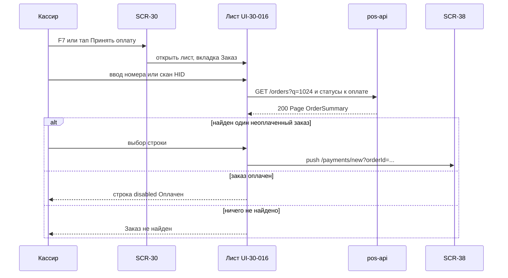

Ключевое действие «Обновление дашборда»:

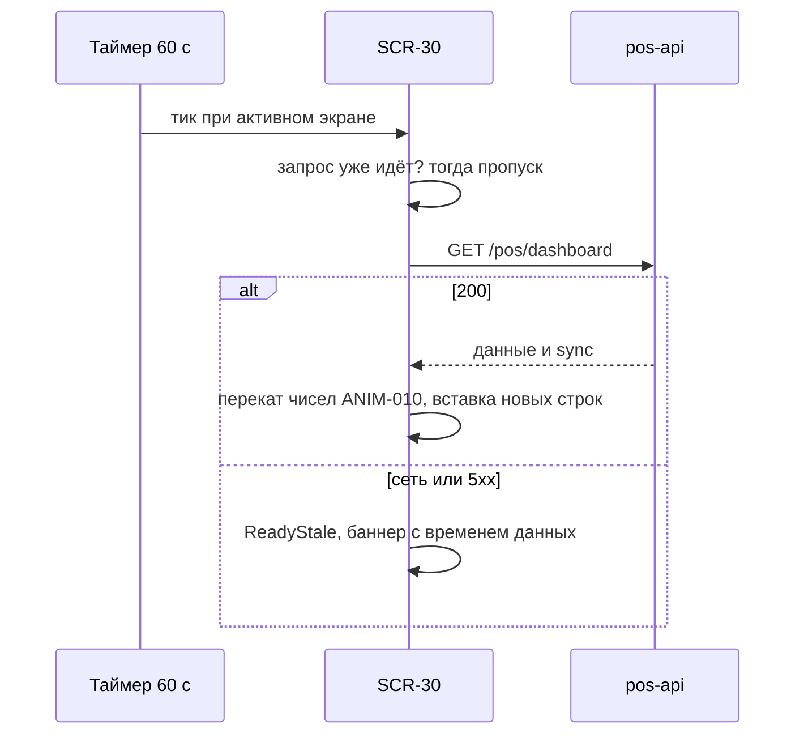

Deep link `/cashier` — открывает дашборд после guard-ов (G-1…G-12 navigation.md). «Назад» на корне ветки: Android — двойное нажатие сворачивает приложение (не выходит из сессии); Windows Esc — закрывает верхний лист/диалог, иначе без действия.

#### 7. Состояния экрана

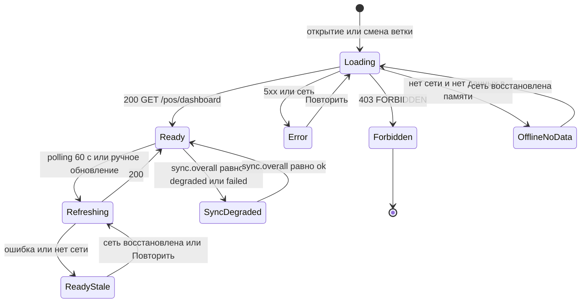

| Состояние | Что видно | Что доступно |
|---|---|---|
| Loading | скелетоны всех блоков (P-SKEL); шапка и навигация активны | навигация, поиск (переход) |
| Ready | все блоки; пустые блоки «Ожидают оплаты»/«Требуют разбора» скрыты; остальные пустые — `EmptyState` компактный | всё по роли |
| ReadyStale | данные из памяти + `OfflineBanner` или `ErrorState.banner` «Не удалось обновить, данные от HH:MM»; кассовые кнопки `disabled` (P-OFFLINE) | просмотр, переходы к экранам с собственной загрузкой |
| SyncDegraded | баннер UI-30-001; суммы 1С с P-STALE | всё; продажа в долг на SCR-38 сервер блокирует сам (fail-closed) |
| Error | `ErrorState.fullScreen` в контенте «Не удалось загрузить данные кассы» + «Повторить» + код обращения | навигация |
| OfflineNoData | `EmptyState.offlineNoCache` «Нет сети. Данные кассы недоступны без подключения» + «Повторить»; «Каталог» доступен (кэш каталога) | Каталог, Профиль |
| Forbidden | `EmptyState.noPermission` (роль сменилась — `TOKEN_STALE` обработан глобально, затем перенаправление на главный экран новой роли) | — |

Нет разрешений (камера/биометрия) на экране не требуются; скан HID разрешений не требует. Step-up на дашборде не запрашивается.

#### 8. Валидация и сообщения

| Ключ ARB | Текст | Когда |
|---|---|---|
| `cashier_title` | Касса | заголовок |
| `cashier_search_placeholder` | Клиент: имя, телефон или код 1С | поле UI-30-002 |
| `cashier_search_too_short` | Введите не менее 2 символов | < 2 символов + Enter |
| `cashier_action_accept_payment` | Принять оплату | UI-30-003 |
| `cashier_action_catalog` | Каталог | UI-30-003 |
| `cashier_action_offline_hint` | Нет сети: операции оплаты недоступны | тултип disabled |
| `cashier_lookup_title` | Найти заказ или клиента | лист UI-30-016 |
| `cashier_lookup_tab_order` | Заказ | вкладка |
| `cashier_lookup_tab_customer` | Клиент (долг) | вкладка |
| `cashier_lookup_order_placeholder` | Номер заказа или скан с распечатки | поле |
| `cashier_lookup_order_paid` | Оплачен | строка `isPaid` |
| `cashier_lookup_not_found` | Заказ «{q}» не найден | пусто |
| `cashier_favorites_title` | Избранные клиенты | UI-30-005 |
| `cashier_favorites_empty` | Отмечайте клиентов звездой, чтобы они появились здесь | пусто |
| `cashier_favorite_removed` | Клиент убран из избранного | снекбар |
| `cashier_awaiting_title` | Ожидают оплаты · {count} | UI-30-004 |
| `cashier_review_title` | Требуют разбора · {count} | UI-30-012 |
| `cashier_totals_title` | Сегодня | UI-30-014 |
| `cashier_totals_cash` / `cashier_totals_qr` / `cashier_totals_credit` | Наличные / QR / В долг | плитки |
| `cashier_totals_counts` | Заказов: {orders} · Платежей: {payments} | строка |
| `cashier_recent_title` | Недавние операции | UI-30-006 |
| `cashier_recent_empty` | Операций за сегодня нет | пусто |
| `cashier_recent_all` | Все транзакции | UI-30-015 |
| `cashier_debts_title` | Долги и просрочки | Z6 |
| `cashier_debts_summary` | Просрочено: {count, plural, one{{count} клиент} few{{count} клиента} many{{count} клиентов} other{{count} клиента}} на {amount} | UI-30-007 |
| `cashier_debts_none` | Просроченных долгов нет | пусто |
| `cashier_debts_no_data` | Нет данных из 1С о долгах | нет снимка |
| `cashier_debts_all` | Все просрочки | лист UI-30-017 |
| `cashier_discounts_title` | Скидки и условия продаж | Z7 |
| `cashier_discounts_limit` | Ваш лимит ручной скидки: {percent} | UI-30-009 |
| `cashier_discounts_override` | Сверх лимита подтверждает: {roles} | UI-30-009 |
| `cashier_discounts_rules_count` | Правил скидок 1С: {count} | UI-30-009 |
| `cashier_sync_title` | Синхронизация с 1С | Z8 |
| `cashier_sync_banner` | Ошибка обмена с 1С: {entity}. Последний успешный обмен — {time}. Ошибок: {count} | UI-30-001 |
| `cashier_sync_banner_no_count` | Ошибка обмена с 1С: {entity}. Последний успешный обмен — {time} | UI-30-001, если `consecutiveErrors` не пришло (роль без `sync.runs.read`, З-24) |
| `cashier_unfinished_operation` | Незавершённая операция: {description} | баннер п.11 |
| `cashier_unfinished_check` | Проверить | баннер п.11 |
| `cashier_unfinished_desc_order` / `cashier_unfinished_desc_debt` / `cashier_unfinished_desc_confirm` / `cashier_unfinished_desc_void` / `cashier_unfinished_desc_return` | приём {amount} по заказу № {number} / оплата долга клиента / подтверждение QR по заказу № {number} / аннулирование платежа № {number} / заявка на возврат по заказу № {number} | описание баннера (P-IDEMP); `{amount}` — сумма заказа |
| `cashier_sync_open` | Открыть статус | UI-30-001/010 |
| `cashier_load_error` | Не удалось загрузить данные кассы | Error |
| `cashier_offline_no_data` | Нет сети. Данные кассы недоступны без подключения | OfflineNoData |
| `cashier_refresh_failed` | Не удалось обновить, данные от {time} | ReadyStale |
| `cashier_updated_at` | обновлено {time} | UI-30-018 |

Ошибки API на экране: `FORBIDDEN` (P-403), `RATE_LIMITED`, `INTERNAL` (P-ERR), `VALIDATION_FAILED` (`q_too_short` в листе). Ввода данных, кроме поиска, нет.

#### 9. Источники данных, API, состояние, бизнес-правила

- `GET /pos/dashboard?date=<сегодня Asia/Bishkek>&warehouseId=<склад пользователя>` (08 §4.10.1): `totals`, `awaitingPayment` (≤ 20), `qrPending`, `needsReview`, `overdue` (≤ 10), `favoriteCustomers` (≤ 10), `recentTransactions` (≤ 10), `sync`, `notificationsUnread`; `no-store`; аудит не пишется.
- `GET /sync/status` (08 §4.17.1, `sync.status.read`; краткие поля — все роли экрана, `consecutiveErrors` — только `sync.runs.read`): сущность, `lastSuccessAt`, `isStale`, `running` — источник UI-30-001/010 (CASH-017); поля `sync` дашборда (`receivablesAsOf`, `stockAsOf`, `overall`) для CASH-017 недостаточны — З-24.
- `GET /receivables/overdue` (лист UI-30-017, аудит `receivables.overdue_viewed`); `GET /discounts/rules` (Z7); `GET /orders?q=` (лист UI-30-016, скан); `GET /search/customers` (вкладка «Клиент»); `GET /cart/parked` (счётчик чипа); `DELETE /favorites/customers/{id}`.
- Состояние приложения: провайдер дашборда в памяти (последний ответ + `fetchedAt`); `/me.permissions` определяет видимость кнопок; ничего из ответа не пишется в drift (ядро §18.2 п.1).
- Бизнес-правила: CASH-010…018, TXN-009, DEBT-007, DISC-003, DISC-013, FAV-006, PAY-011, PAY-024; источник блоков — 10 §14.1.

#### 10. Действия по ролям и ограничения безопасности

| Действие | cashier | senior_seller | admin | owner | Серверная проверка |
|---|---|---|---|---|---|
| Открыть дашборд | да | да | просмотр | просмотр | `dashboard.cashier.read` |
| Блок «Избранные клиенты» (Z3) | да | да | да | — (не рендерится) | `favorites.customers.manage` |
| Число ошибок синхронизации в баннере | — (до З-24) | да | да | да | `sync.runs.read` |
| Принять оплату (лист, скан, строка «Ожидают оплаты») | да | да | — | — | на SCR-38: `payment.*` |
| Заявка на возврат (чип) | да | да | да (через SCR-24/37) | — | `return.create` |
| Новый клиент (чип) | да | да | да | — | `customer.create` |
| Избранное: убрать | да | да | да | — | `favorites.customers.manage` |
| Все просрочки | да | да | да | да | `customer.receivables.read.summary` |
| Открыть SCR-43 | да | да | да | да | `sync.status.read` |

Скрытие кнопки не является защитой (CASH-001); любой запрос без права → `403 FORBIDDEN`.

#### 11. Повторное нажатие, двойной запрос, «Назад», перезапуск

- Повторный тап по кнопкам перехода игнорируется до завершения навигации; параллельный polling и ручное обновление объединяются в один запрос.
- Двойной финансовый запрос с дашборда невозможен: дашборд не выполняет финансовых POST (они — на SCR-38).
- «Назад» закрывает листы UI-30-016/017; на корне ветки — по правилам навигации (§6).
- Перезапуск: `lastLocation=/cashier` восстанавливается после SCR-08; данные дашборда загружаются заново (в drift их нет). Если в `outbox_actions` есть запись `fin.pending_check` (P-IDEMP; обработчик outbox её не отправляет), над Z2 показывается баннер `warning` «Незавершённая операция: {описание} · Проверить» (описание — по P-IDEMP: для заказа номер и сумма заказа, для долга — «оплата долга клиента» без суммы и имени) → SCR-38 того же заказа/клиента с тем же `Idempotency-Key` (повтор только по решению кассира; см. SCR-38 п.11).

#### 12. Требования к платформам

| Платформа | Требования |
|---|---|
| Windows-POS (expanded, мышь + клавиатура + HID) | F2 — поиск клиента; F7 — «Принять оплату» (переназначено при сборке 02: `F6` — переключение зон, 03 A11Y-009); F5 — обновить; Ctrl+K — лист «Найти заказ»; ↑/↓/Enter — навигация по строкам; Tab — порядок: шапка → Z1 → Z2 → Z3 → Z4 → Z5 → Z6 → Z7 → Z8; hover-состояния; HID-скан заказа без фокуса в поле (UI-30-019); тачскрин POS — цели ≥ 48 |
| Android-планшет (medium) | 2 колонки; pull-to-refresh; HID Bluetooth; камера для скана кода заказа — кнопка в листе UI-30-016 (SCR-17) |
| Android-телефон (compact) | 1 колонка; ленты с горизонтальной прокруткой; нижняя навигация; цели ≥ 48 |
| iOS (без проверки сборки, D-39) | как Android; цели ≥ 44 pt |

#### 13. Критерии приёмки

| ID | Критерий |
|---|---|
| AC-UI-30-001 | Для `cashier` дашборд содержит все 8 блоков промта: поиск клиентов, избранные клиенты, недавние операции, долги и просрочки, скидки и условия продаж, транзакции (сводка + переход), быстрый доступ к каталогу и кассе, уведомления об ошибках синхронизации |
| AC-UI-30-002 | Каждый блок с данными 1С показывает подпись «данные 1С от HH:MM»; при возрасте снимка долгов > 60 мин показывается предупреждение и «Обновить» |
| AC-UI-30-003 | Для `admin` и `owner` кнопки «Принять оплату», F6, пункт «Принять оплату по долгу» в контекстном меню и вкладки листа UI-30-016 не отображаются; прямой вызов `POST /orders/{id}/payments` с их токеном → 403 |
| AC-UI-30-004 | Для `seller` маршрут `/cashier` недоступен (пункт навигации скрыт, прямой переход → `EmptyState.noPermission`) |
| AC-UI-30-005 | Ввод «Аза» + Enter в поиске открывает SCR-31 с `q=Аза`; ввод «А» + Enter показывает «Введите не менее 2 символов» и не выполняет переход |
| AC-UI-30-006 | Тап по избранному клиенту открывает SCR-32 этого `customerId`; удаление из избранного скрывает карточку, показывает «Отменить» 8 с и после подтверждения сервером не возвращается при обновлении |
| AC-UI-30-007 | Блок «Ожидают оплаты» скрыт, если `awaitingPayment` и `qrPending` пусты; при наличии строки тап открывает SCR-38 с `orderId` строки |
| AC-UI-30-008 | Блок «Требуют разбора» показывает платежи с `reviewReason` и чипом «Требует проверки»; тап открывает SCR-37 |
| AC-UI-30-009 | Скан HID кода заказа (без фокуса в поле) с одним найденным заказом открывает SCR-38 этого заказа за ≤ 1 с после ответа `GET /orders` |
| AC-UI-30-010 | Дашборд обновляется при открытии и каждые 60 с, polling останавливается в фоне и при idle-блокировке; одновременно выполняется не более одного запроса |
| AC-UI-30-011 | При потере сети показываются последние данные из памяти с пометкой времени, кнопки оплаты `disabled`; после перезапуска без сети — `EmptyState.offlineNoCache`, финансовые данные не берутся из drift |
| AC-UI-30-012 | При `sync.overall=failed` баннер UI-30-001 виден и не закрывается вручную; текст содержит сущность и время последнего успешного обмена из `GET /sync/status`; число ошибок показывается ролям с `sync.runs.read` (`senior_seller`, `admin`, `owner`), у `cashier` — после доработки 08 (З-24), до неё текст `cashier_sync_banner_no_count`; «Открыть» ведёт на SCR-43 |
| AC-UI-30-013 | Сводка смены показывает суммы наличных, QR и в долг за сегодня в формате «16 007,50 сом» с `tabularFigures` |
| AC-UI-30-014 | Лист «Все просрочки» загружает `GET /receivables/overdue` с курсором и сортировкой; каждая загрузка фиксирует `receivables.overdue_viewed` (проверка по аудиту) |
| AC-UI-30-015 | Блок «Скидки и условия продаж» показывает лимит ручной скидки текущей роли из `GET /discounts/rules` и роли, подтверждающие сверх лимита |
| AC-UI-30-016 | На expanded раскладка — 3 колонки, панель корзины скрыта; на compact — 1 колонка с нижней навигацией «Касса · Каталог · Клиенты · Транзакции · Профиль» |
| AC-UI-30-017 | При незавершённой финансовой операции (запись `outbox_actions` типа `fin.pending_check`) после перезапуска на дашборде виден баннер «Незавершённая операция …» с переходом на SCR-38 |
| AC-UI-30-018 | Все суммы и статусы читаются экранным диктором с полным текстом (иконка + текст, без опоры только на цвет — A11Y-004) |
| AC-UI-30-019 | Для `owner` блок «Избранные клиенты» (Z3) не отображается, запрос изменения избранного не выполняется; для `cashier`, `senior_seller`, `admin` блок виден |
| AC-UI-30-020 | Часы в шапке показывают время в формате `HH:mm` (без секунд) и дату «Пн, 29 июня 2026» по Asia/Bishkek |
| AC-UI-30-021 | Запись `fin.pending_check` после восстановления сети и после перезапуска **не** отправляется автоматически; проверка выполняется только по «Проверить» (чтением объекта, повторный ввод — с ключом из записи) |

#### 14. Трассировка

| Элемент / требование | SRC | Правила 10/09/11/03 |
|---|---|---|
| Отдельный интерфейс кассира | SRC-C-083, SRC-E-170, SRC-E-170a, SRC-F-034 | CASH-010, ядро §3.2 |
| Поиск клиентов (UI-30-002) | SRC-C-084, SRC-E-170c | CUST-008 |
| Избранные клиенты (UI-30-005) | SRC-C-085, SRC-C-102, SRC-E-170b | FAV-006, CUST-006 |
| Недавние операции (UI-30-006) | SRC-C-086, SRC-E-170d | TXN-009 |
| Долги и просрочки (UI-30-007/008/017) | SRC-C-087, SRC-E-170e, SRC-C-112 | DEBT-007, CASH-018 |
| Скидки и условия (UI-30-009) | SRC-C-088, SRC-E-170f | DISC-003, DISC-013 |
| Список транзакций (UI-30-014/015) | SRC-C-089, SRC-E-170g | TXN-002 |
| Быстрый доступ к каталогу и кассе (UI-30-003/016) | SRC-C-090, SRC-C-090a, SRC-E-170h | CASH-012, CASH-013 |
| Уведомления об ошибках синхронизации (UI-30-001/010; `GET /sync/status`) | SRC-C-091 (частично: число ошибок у `cashier` — после З-24) | CASH-017, D-41 |
| Источники данных 1С/backend | SRC-E-171 | CASH-011 |
| Роли и права | SRC-F-035, SRC-F-036 | CASH-001, CASH-003, 11 §4.4 |
| Требования не сокращены | SRC-F-001, SRC-F-002, SRC-F-003 | ядро §11 п.6 |

---

### SCR-31 — Поиск клиентов (маршрут `/customers?q=&favorites=1&withDebt=1`; роли — все `staff`, поля по роли; R1 — да)

#### 1. Назначение и роль пользователя

Корень ветки «Клиенты»: найти клиента по имени, телефону, коду 1С или ИНН и перейти в карточку SCR-32, добавить/убрать клиента из избранного, создать нового клиента (SCR-26) с обязательной дедупликацией (D-08). Кассир использует экран для поиска клиента перед оплатой долга; продавец — для выбора клиента заказа (видит имя, код, маскированный телефон и только флаги долга — CUST-009, Q-017). `customer` доступа не имеет (`FORBIDDEN`).

#### 2. Структура экрана

- **compact:** `TopAppBarPos` «Клиенты» → закреплённый `SearchBar` (высота 48) → лента чипов-фильтров (36) → подпись `matchType` → список `CustomerCard.row` по 72 → нижняя закреплённая кнопка L «+ Новый клиент» над `BottomNavBar`.
- **medium:** портрет — как compact в контент-колонке; ландшафт — мастер-деталь: список 360 слева, SCR-32 справа.
- **expanded / large:** мастер-деталь в контент-зоне: список 360–400 (large 400) слева, справа SCR-32 выбранного клиента (URL `/customers/{id}`); строки 48 (плотность compact); «+ Новый клиент» — `AppButton.outlined M` в заголовке списка.

#### 3. Таблица элементов

| № | UI-ID | Элемент | Компонент | Расположение/размер/отступы/выравнивание | Токены | Состояния | Поведение | Источник данных | Роли | Правило |
|---|---|---|---|---|---|---|---|---|---|---|
| 1 | UI-31-001 | Поле поиска | `SearchBar` | верх списка, высота 48, поля `ds.space.4`; кнопка очистки справа | `surface`, обводка `border`/`focus`; плейсхолдер `body textSecondary` | default, focused, typing, loading, error | debounce 300 мс, ≥ 2 символа; цифры или «+» → телефон (нормализация к E.164); иначе имя/код/ИНН; Enter — немедленный запрос | `GET /search/customers?q=` | staff | CUST-008, D-31 |
| 2 | UI-31-002 | Фильтры-чипы | `CategoryChip` (filter) | под полем, высота 36, промежуток `ds.space.2` | выбранный — `primaryContainer`/`primary` + галочка | default, selected, disabled | «Все» · «Избранные» · «С долгом» · «С просрочкой»; один активный; без текста — `GET /customers?favorite=/hasDebt=/isOverdue=` | `GET /customers` | «Избранные» — cashier+; «С долгом»/«С просрочкой» — cashier+, owner | 08 §4.11.1 |
| 3 | UI-31-008 | Подпись типа совпадения | `caption` | под чипами, выравнивание влево | `caption textSecondary` | скрыта без запроса | «Найдено по телефону: 3» (по `matchType`) | ответ поиска | staff | 08 §4.5.4 |
| 4 | UI-31-003 | Строка клиента | `CustomerCard` (row), `AppAvatar` 40, `ReceivableBadge`, `FavoriteToggle` | 72 (compact) / 56 (medium) / 48 (expanded); аватар слева, справа бейдж и звезда, шеврон | имя `body 500`, совпадение — `body 700`; телефон и код `caption tnum textSecondary`; вид цены `StatusChip.priceList` | default, hover, pressed, focused, selected (полоса `primary` 3 + `primaryContainer`), disabled (`deletion_mark` — «Помечен на удаление») | тап → SCR-32; звезда — избранное; в режиме выбора (`returnTo`) — возврат `customerId` | DTO по роли (§0.4) | staff | CUST-008 |
| 5 | UI-31-004 | Клиент, созданный в POS | `StatusChip` (warning) | в строке после имени | `warningContainer`/`warning` | — | показывает код `POS-NNNNNN` и чип «ожидает 1С» | `source=pos_pending` | staff | CUST-014 |
| 6 | UI-31-006 | Строка для продавца | `CustomerCard` (row), `ReceivableBadge.hidden` | как UI-31-003 | — | — | телефон — `phoneMasked`; бейдж «Есть долг»/«Просрочка» без сумм; звезды нет | DTO `seller` | `seller` | CUST-009, Q-017 |
| 7 | UI-31-005 | «+ Новый клиент» | `AppButton` L outlined (compact), M (expanded) | compact — закреплён снизу, поля `ds.space.4`; expanded — в заголовке списка справа | `outlined`, иконка `person_add` | default, hover, pressed, disabled (офлайн) | → SCR-26 (`/customers/new`, без query); номер из строки поиска (если запрос — телефон) передаётся невосстанавливаемым `extra` go_router (navigation.md N-3, §5.2), не в path/query | — | `seller`, `cashier`, `senior_seller`, `admin` | CUST-010…016, D-08 |
| 8 | UI-31-009 | Пустой результат | `EmptyState.customers` | центр списка | иллюстрация 120/160 | — | «Клиенты не найдены по „{q}“» + основная кнопка «+ Новый клиент» | — | staff | CUST-008 |
| 9 | UI-31-007 | Деталь (expanded/medium ландшафт) | `AdaptiveScaffold` (мастер-деталь) | справа от списка, ширина остатка (large ≤ 800) | — | пусто («Выберите клиента»), выбран | ↑/↓ меняют выбор, Enter — фокус в деталь, URL синхронизирован | SCR-32 | staff | — |
| 10 | UI-31-010 | Подгрузка | `SkeletonList` (3 строки) | внизу списка | `skeletonBase` | loading, error inline | курсорная подгрузка при прокрутке за 80 % | `cursor` | staff | D-37 |

#### 4. Поведение контролов

- **Поле поиска.** Каждый ввод перезапускает debounce 300 мс; предыдущий запрос отменяется (ответ устаревшего запроса отбрасывается). < 2 символов — список возвращается к режиму фильтра (без запроса поиска). Для `seller` поиск по телефону работает только по полному номеру (≥ 9 цифр) — подсказка «Для поиска по телефону введите номер полностью» при 4–8 цифрах (08 §4.5.4). Esc — очистить; повторный Esc — снять фокус. HID-скан при фокусе — вставка значения и немедленный запрос.
- **Чипы.** Выбор чипа меняет запрос без сброса текста; повторный тап по активному чипу возвращает «Все». Чипы недоступных ролей не рендерятся.
- **Строка.** Тап — переход (compact) или выбор (мастер-деталь); повторный тап по выбранной — без действия. Долгое нажатие (compact) / правый клик — меню «Открыть», «Скопировать телефон» (роли с полным телефоном, SEC-098), «В избранное/Убрать».
- **Звезда (`FavoriteToggle`).** Оптимистичное переключение (ANIM-009), `PUT`/`DELETE /favorites/customers/{id}`; повторное нажатие во время запроса меняет целевое состояние, отправляется последнее (debounce 400 мс); офлайн — через `outbox_actions`; ошибка — откат + снекбар.
- **«+ Новый клиент».** Переход на SCR-26 (`push` на root-навигаторе); номер для предзаполнения — только в `extra` (подсказка: при потере, например после перезапуска, поле просто пустое); в URL, логи роутера и `lastLocation` номер не попадает; Ctrl+N на Windows. Повторное нажатие во время перехода — игнор.
- **Копирование телефона** (меню строки): «Скопировать телефон» (`ds_copy_phone`) → буфер обмена, снекбар «Скопировано» (`ds_copied`, 4 с); пункт есть только у ролей с полным номером.

#### 5. Анимации

| Ссылка | Элемент | Начальное → конечное | Триггер | Длительность / кривая | Реакция на ошибку | Reduce-motion |
|---|---|---|---|---|---|---|
| ANIM-013 | список UI-31-003 (3 строки скелетона), подгрузка UI-31-010 | скелетон → строки fade-in 150 мс без сдвига раскладки | запрос дольше 300 мс | шиммер loop 1,2 с linear | > 10 с — «Долгая загрузка… · Повторить» (`ds_loading_long`); ошибка поиска — скелетон заменяется `ErrorState.inline` «Не удалось найти клиентов · Повторить» (fade 150 мс); ошибка подгрузки — строка-ошибка внизу списка, загруженные строки остаются | статичные блоки без градиента |
| ANIM-009 | `FavoriteToggle` в строке | контур `star` `warning` → заливка `favorite` (scale 1 → 1,3 → 1) и обратно | тап по звезде | 200 мс `emphasized` | ответ сервера не 2xx — обратный переход 150 мс + снекбар `error` (ANIM-027, 4 с) | мгновенная смена иконки |
| ANIM-015 | строки, чипы, «+ Новый клиент» | default → hover/pressed (фон `surfaceVariant`; scale .98 у кнопки, .97 у чипов) | указатель / нажатие | 150 мс `standard` | — | только смена цвета без масштаба |
| ANIM-017 | индикатор активного чипа UI-31-002 | подсветка на старом чипе → на новом | выбор чипа | 200 мс `standard` | при ошибке запроса индикатор остаётся на новом чипе, список показывает `ErrorState.inline` | мгновенно |
| ANIM-022 | `EmptyState.customers` UI-31-009 | скрыт → иллюстрация + текст + кнопка | пустой ответ | 200 мс `standardDecelerate` | — | мгновенно |
| ANIM-024 | переход в SCR-32 | compact: shared-axis X (новый экран slide-in 24 lp + fade, список slide-out −24 lp); medium-ландшафт и expanded: fade-through содержимого детали, список не движется | тап / Enter по строке | 300 мс (compact) / 200 мс `standard` | ошибка загрузки карточки показывается внутри SCR-32, переход не откатывается | fade 80 мс |

Специфично — «замена результатов поиска»: начальное — прежний список; триггер — ответ нового запроса; последовательность — crossfade 150 мс; позиция прокрутки сохраняется, если новый запрос уточняет прежний (то же начало текста), иначе — прокрутка к началу без анимации; конечное — новый список с подписью `matchType`; ошибка — прежний список не очищается, над ним `ErrorState.inline` с «Повторить»; reduce-motion — мгновенная замена. Подсветка совпадения в имени появляется вместе со строкой, без отдельной анимации.

#### 6. Переходы

| Откуда → куда | Данные | Способ | «Назад» |
|---|---|---|---|
| SCR-30 → SCR-31 | `q` | `go` (ветка Клиенты) | корень ветки |
| SCR-31 → SCR-32 | `customerId` | `push` (compact), `go` с заменой детали (expanded) | SCR-31 с сохранённым `q`, фильтром и прокруткой |
| SCR-31 → SCR-26 | query нет; номер (если запрос — номер) — только `extra` (подсказка предзаполнения, N-3: не попадает в историю навигации, логи роутера и `lastLocation`); `returnTo` не передаётся (по navigation.md §3 допустим только `checkout`) | `push` (root) | SCR-31; после создания — SCR-32 нового клиента |
| SCR-21 (`CustomerPicker`) | встроенный компонент, не маршрут | — | — |

Deep link `/customers?q=…` — восстанавливает поиск; `q` не сохраняется в `lastLocation` (навигация §7.1, ПДн).

#### 7. Состояния экрана

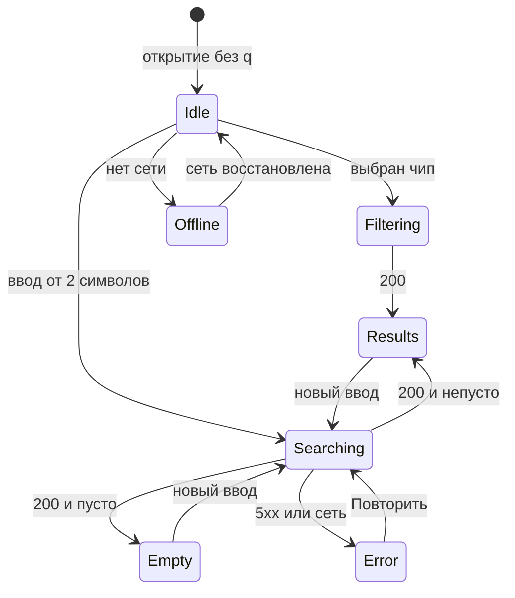

| Состояние | Видно |
|---|---|
| Idle | для cashier+ — список «Избранные» по умолчанию (`GET /customers?favorite=true`), для `seller` — подсказка «Введите имя, телефон или код клиента» |
| Searching | `SkeletonList` 3 строки (P-SKEL) |
| Results | список, подпись `matchType` |
| Empty | `EmptyState.customers` с «+ Новый клиент» |
| Error | `ErrorState.inline` «Не удалось найти клиентов · Повторить» |
| Offline | `EmptyState.offlineNoCache` «Поиск клиентов недоступен без сети» (кэша клиентов нет — §0.6); «+ Новый клиент» `disabled` |
| Нет прав | `customer` → `EmptyState.noPermission` |

#### 8. Валидация и сообщения

| Ключ ARB | Текст |
|---|---|
| `customers_search_title` | Клиенты |
| `customers_search_placeholder` | Введите имя, телефон или часть имени… (общий `ds_search_placeholder_customers`) |
| `customers_search_hint_idle` | Введите имя, телефон или код клиента |
| `customers_search_phone_full_hint` | Для поиска по телефону введите номер полностью |
| `customers_search_match_name` / `customers_search_match_phone` / `customers_search_match_code` / `customers_search_match_inn` | Найдено по имени / по телефону / по коду / по ИНН: {count} |
| `customers_search_filter_all` / `customers_search_filter_favorites` / `customers_search_filter_debt` / `customers_search_filter_overdue` | Все / Избранные / С долгом / С просрочкой |
| `customers_search_pending_onec` | ожидает 1С |
| `customers_search_marked_deleted` | Помечен на удаление |
| `customers_search_has_debt` / `customers_search_overdue_flag` | Есть долг / Просрочка |
| `customers_search_empty` | Клиенты не найдены по «{q}» |
| `customers_search_error` | Не удалось найти клиентов |
| `customers_search_offline` | Поиск клиентов недоступен без сети |
| `customers_search_new` | + Новый клиент |
| `customers_search_detail_empty` | Выберите клиента |
| `ds_copy_phone` | Скопировать телефон (общий ключ, предложение к 03) |
| `ds_copied` | Скопировано (общий ключ, предложение к 03) |

Ошибки: `VALIDATION_FAILED` (`q_too_short`) не показывается — клиент не отправляет запрос < 2 символов; `RATE_LIMITED` (RL-SEARCH) — «Слишком много запросов, подождите {seconds} с».

#### 9. Источники данных, API, бизнес-правила

`GET /search/customers?q=&favorite=&limit=50&cursor=` (08 §4.5.4, `matchType`); `GET /customers?favorite=&hasDebt=&isOverdue=&sort=` (08 §4.11.1); `PUT/DELETE /favorites/customers/{id}` (08 §4.13.2). Правила: CUST-001, CUST-008, CUST-009, CUST-014, CUST-018 (системный «Розничный покупатель» в поиске не показывается), FAV-006, DEBT-004. Аудит: поиск не аудируется, кроме сигнала `customer.phone_lookup` (> 50 поисков по телефону в час у `seller`, 11 §7.2.1). Состояние: результаты — в памяти провайдера; в drift не сохраняются.

#### 10. Действия по ролям

| Действие | seller | cashier | senior_seller | admin | owner |
|---|---|---|---|---|---|
| Поиск по имени/коду | да | да | да | да | да |
| Поиск по телефону | только полный номер | любая часть ≥ 4 цифр | да | да | да |
| Поиск по ИНН | — | да | да | да | да |
| Чипы «С долгом»/«С просрочкой» | — | да | да | да | да |
| Звезда избранного | — | да | да | да | — |
| «+ Новый клиент» | да | да | да | да | — |

#### 11. Повторное нажатие, двойной запрос, «Назад», перезапуск

Двойной запрос поиска исключён отменой предыдущего; двойное создание клиента — на SCR-26 (`Idempotency-Key`). «Назад» с SCR-32 возвращает к сохранённым `q`/фильтру/прокрутке (`PageStorageKey`). После перезапуска `q` не восстанавливается (ПДн), открывается корень ветки.

#### 12. Требования к платформам

Windows: ↓ из поля — в список, ↑/↓ — по строкам, Enter — открыть, Ctrl+N — новый клиент, Ctrl+F — фокус в поле, Esc — очистить; мышь — hover строк, правый клик — контекстное меню. Android/iOS: цифровая клавиатура не навязывается (автодетект по первому символу), список с инерционной прокруткой; цели ≥ 48 lp (44 pt). HID — во всех платформах в поле.

#### 13. Критерии приёмки

| ID | Критерий |
|---|---|
| AC-UI-31-001 | Запрос отправляется не раньше 300 мс после последнего ввода и только при ≥ 2 символах; устаревшие ответы не отображаются |
| AC-UI-31-002 | Ввод «0700 123» находит клиента с телефоном `+996700123456` у `cashier` и показывает «Найдено по телефону» |
| AC-UI-31-003 | У `seller` строка не содержит сумм долга и полного телефона; JSON ответа не содержит `phones`, `receivable` |
| AC-UI-31-004 | Чипы «С долгом»/«С просрочкой» и звезда избранного не отображаются для `seller` |
| AC-UI-31-005 | Пустой результат показывает «Клиенты не найдены по „…“» и кнопку «+ Новый клиент», которая открывает SCR-26 с предзаполненным телефоном, если запрос — номер; номер передаётся только через `extra`: URL — `/customers/new` без телефона, в логах роутера и `lastLocation` номера нет, после перезапуска поле телефона пустое |
| AC-UI-31-006 | Клиент `source=pos_pending` показывает код POS и чип «ожидает 1С» |
| AC-UI-31-007 | Переключение звезды отражается сразу, сохраняется на сервере и видно на SCR-30 после обновления; при ошибке — откат и снекбар |
| AC-UI-31-008 | На expanded выбор строки открывает SCR-32 справа без смены списка, URL `/customers/{id}`; ↑/↓ меняют выбранного клиента |
| AC-UI-31-009 | Без сети показывается «Поиск клиентов недоступен без сети», данные клиентов не читаются из локального хранилища |
| AC-UI-31-010 | «Назад» из SCR-32 возвращает к тому же запросу, фильтру и позиции прокрутки |

#### 14. Трассировка

| Элемент | SRC | Правила |
|---|---|---|
| Поиск клиентов | SRC-C-084, SRC-E-170c, SRC-D-119 | CUST-008, D-31 |
| Поля по роли | SRC-C-092, SRC-F-035 | CUST-001, CUST-009, DEBT-004, SEC-031, SEC-042 |
| Избранное в поиске | SRC-C-100, SRC-C-101, SRC-C-102, SRC-C-103 | FAV-006, CUST-006 |
| Новый клиент с дедупликацией | SRC-E-134, SRC-E-134a | CUST-010…016, D-08 |

---

### SCR-32 — Карточка клиента (маршрут `/customers/{id}?tab=history|receivables|discounts|orders`; роли — все `staff` с полями по роли, `customer` — свой при `confirmed` (условно Q-001); R1 — да)

#### 1. Назначение и роль пользователя

Профиль клиента «только с данными, разрешёнными роли» (SRC-C-092): имя и идентификатор, подтверждённый номер, история покупок, разрешённые сведения о взаиморасчётах, доступные скидки, избранный статус, связанные заказы и транзакции (SRC-C-093…099a); добавление и удаление из избранного (SRC-C-100/101). «Роль» трактуется как роль текущего пользователя (10 §15.1). Кассир — принимает оплату по долгу, смотрит долг и историю; продавец — назначает клиента в заказ («В заказ»), видит только флаги долга; администратор — дополнительно разрешает привязки пользователей; руководитель — просмотр без кассовых действий.

#### 2. Структура экрана

**Зоны:** Z1 — шапка клиента; Z2 — метрики («История · Долг · Скидка», как в карточке клиента макета `IMG_7090.PNG`); Z3 — действия; Z4 — вкладки с содержимым (История = SCR-33, Долги = SCR-34, Скидки = SCR-35, Заказы и операции); Z5 — сводка долга; Z6 — контакты и адреса; Z7 — привязки пользователей приложения.

- **compact:** `TopAppBarPos` со стрелкой «Назад», заголовок — `displayName`, справа `FavoriteToggle` → Z1 (аватар 48, имя `h2`, код, тип, телефон, ИНН) → Z2 строка метрик (чипы) → Z5 карточка сводки долга (cashier+) → `AppTabs` scrollable (48) → вкладки открывают SCR-33/34/35 как отдельные экраны (`push`), «Заказы и операции» — в пределах экрана → Z6 → Z7 (admin/owner) → нижняя закреплённая панель действий (UI-32-021): «В заказ» (outlined) + «Принять оплату» (primary, только `cashier`/`senior_seller`).
- **medium:** портрет — как compact; ландшафт — деталь мастер-детали SCR-31.
- **expanded:** деталь мастер-детали: центральная колонка — Z1 + Z2 + `AppTabs` fixed (содержимое вкладок внутри экрана, URL `?tab=`); правая колонка 300 — Z3 (кнопки столбиком), Z5, Z6, Z7.
- **large:** деталь ≤ 800 + правая колонка 320.

**Зоны экрана (подробно):**

| Зона | Содержимое | Источник | Отличия по ролям |
|---|---|---|---|
| Z1 Шапка | аватар-инициалы, имя, код 1С / POS «ожидает 1С», тип, телефон(ы) с отметкой «подтверждён», ИНН | `GET /customers/{id}` (1С + POS) | `seller` — `phoneMasked`, без ИНН |
| Z2 Метрики | «История: N заказов», «Долг: …», «Скидка: p %», вид цены | `ordersCount`, `receivable`/флаги, `discountPercent`, `priceList` | `seller` — «Долг: есть / нет», «Просрочка» без сумм |
| Z3 Действия | «В заказ», «Принять оплату по долгу», избранное | — | см. п.10 |
| Z4 Вкладки | История · Долги · Скидки · Заказы и операции | SCR-33/34/35, `GET /orders?customerId=`, `GET /transactions?customerId=` | `seller` — Скидки и «Заказы и операции» (свои); `owner` — все без кассовых действий |
| Z5 Сводка долга | сальдо, просрочка, лимит, доступно (прогноз), дата снимка | `receivable` (снимок 1С) | только cashier+, owner |
| Z6 Контакты | адреса доставки, дополнительные телефоны | `addresses[]`, `contacts[]` | не `seller` (08 §3.7) |
| Z7 Привязки | пользователи приложения, статусы `customer_link_status` | `GET /customers/{id}/links` (08 §4.11.7; расхождение с 08 §3.7 — З-26) | cashier+, owner — просмотр; `admin` — разрешение конфликта (SCR-45) |

#### 3. Таблица элементов

| № | UI-ID | Элемент | Компонент | Расположение/размер/отступы/выравнивание | Токены | Состояния | Поведение | Источник данных | Роли | Правило |
|---|---|---|---|---|---|---|---|---|---|---|
| 1 | UI-32-001 | Шапка клиента | `CustomerCard` (full), `AppAvatar` 64 (compact 48) | верх контента, поля `ds.space.6`; аватар слева, текст справа, выравнивание по верху | имя `h2 24/600`; код/тип `caption textSecondary`; телефон `body tnum`; отметка «подтверждён» — `StatusChip.success` (иконка `verified`) / «не подтверждён» — `StatusChip.neutral`; отметка рисуется только при наличии признака подтверждения в ответе (`phones[].verified` [НОВОЕ ИМЯ], З-25), до доработки 08 — не рисуется | loading, default, error, disabled (`deletion_mark`) | долгое нажатие / правый клик на телефоне — «Скопировать телефон» (`ds_copy_phone`, снекбар `ds_copied`; роли с полным номером); тап по телефону на мобильных — без звонка (не требуется) | `GET /customers/{id}?include=receivable,discounts,contacts` | staff | CUST-002, CUST-003, SRC-C-093/093a/094 |
| 2 | UI-32-016 | Пометки источника | `StatusChip` warning / neutral | справа от имени | `warningContainer` «ожидает 1С»; `surfaceVariant` «Помечен на удаление» | скрыты / видимы | информационно; при `pos_pending` — подсказка «Продажа в долг станет доступна после создания клиента в 1С» | `source`, `deletion_mark` | staff | CUST-014 |
| 3 | UI-32-002 | Метрики | `StatusChip` ×3, `ReceivableBadge` | строка под шапкой, промежуток `ds.space.2`, перенос на compact | «История: 12 заказов» `label`; долг — вариант бейджа; «Скидка: 5 %» `priceList` | loading, default | тап «История» → вкладка История; тап «Долг» → вкладка Долги; тап «Скидка» → вкладка Скидки | `ordersCount`, `receivable`, `hasDebt`, `isOverdue`, `discountPercent` | staff | SRC-C-095…097, ядро §14 (макет) |
| 4 | UI-32-003 | Избранное | `FavoriteToggle` (customer) | compact — в шапке справа; expanded — кнопка-строка в Z3 «В избранном» | контур `star` `warning` / заливка `favorite` | off, on, loading, disabled (офлайн без outbox) | `PUT`/`DELETE /favorites/customers/{id}`; офлайн — `outbox_actions` | `isFavorite` | `cashier`, `senior_seller`, `admin` — изменение; `owner`, `seller` — скрыт (нет `favorites.customers.manage`, FAV-006; поле `isFavorite` у `owner` в 08 §3.7 — З-31) | FAV-006, SRC-C-098/100/101/103 |
| 5 | UI-32-004 | Вкладки | `AppTabs` (scrollable compact / fixed expanded) | под метриками; высота 48; индикатор `primary` 3 | `label 13/600`; иконка `lock` 16 у «Долги», пока нет `stepUpToken` | default, selected, disabled (нет права — вкладка не рендерится) | compact — `push` SCR-33/34/35; expanded — смена `?tab=` без новой записи истории (`go`); Alt+1…4 | — | по п.10 | CUST-004…007 |
| 6 | UI-32-007 | Вкладка «Заказы и операции» | `ViewModeSegmented` («Заказы» · «Операции»), `TransactionRow`, `StatusChip` | внутри Z4; список строк 64/72 | как `TransactionRow` | loading, default, empty, error | «Заказы» — тап → SCR-24; «Операции» — тап → SCR-37; подгрузка по курсору | `GET /orders?customerId=`, `GET /transactions?customerId=` | staff (`seller` — свои, сервер фильтрует) | TXN-011, CUST-007, SRC-C-099/099a |
| 7 | UI-32-006 | Сводка долга | `ReceivableBadge` (due/overdue/zero/stale), `PriceText`, `AppProgress` (linear) | Z5: compact — карточка под метриками; expanded — правая колонка; полоса лимита 4 lp | сальдо `h3 700 tnum` (`error` при просрочке, `warning` при долге, `success` при 0/авансе); подпись даты `caption` | loading, default, stale (P-STALE), noData («Нет данных из 1С»), hidden (`seller`) | тап → вкладка «Долги» (step-up — только при детализации); полоса лимита — «Доступно (прогноз) X из Y» (`limitRemaining` из `creditLimit`, оба значения с сервера; `limitRemaining` уже учитывает открытые заказы в долг) | `receivable` из `GET /customers/{id}?include=receivable` (аудит `customer.debt_viewed`, summary) | cashier+, owner | DEBT-002, DEBT-009, DEBT-011, SRC-C-096/106/111/112 |
| 8 | UI-32-005 | «Принять оплату по долгу» | `AppButton` L primary | Z3; expanded — первая в колонке; compact — в нижней панели UI-32-021 | `primary`/`onPrimary`, иконка `payments` | default, hover, pressed, disabled (офлайн; клиент без `onecRef`; `balance ≤ 0`), скрыт | → SCR-38 `?customerId=`; скрыта при `Me.features.debtPaymentsEnabled=false` (P-FLAGS, Q-152) | `payment.debt.receive` в `/me.permissions` | `cashier`, `senior_seller` | CASH-013, PAY-040 |
| 9 | UI-32-011 | «В заказ» | `AppButton` L outlined (cashier) / primary (seller) | Z3 / нижняя панель | `outlined`/`primary`, иконка `add_shopping_cart` | default, loading, disabled (офлайн, `deletion_mark`) | `POST /cart/customer {customerId}` → переход в корзину; при наличии другого клиента в корзине — `ConfirmDialog` «Заменить клиента в корзине?» | `/cart` | `seller`, `cashier`, `senior_seller`, `admin` | DISC-014, CART-020 |
| 10 | UI-32-021 | Нижняя панель действий (compact) | контейнер 72, `AppButton` L ×2 | закреплена над `BottomNavBar`, поля `ds.space.4`, `ds.elevation.2` | `surface` | видима, скрыта (нет действий у роли) | «В заказ» + «Принять оплату» | — | по ролям | — |
| 11 | UI-32-012 | Пояснение для продавца | `AppListTile` info | вместо Z5 у `seller` | `infoContainer`/`info`, `body` | — | «Суммы долга и история покупок доступны кассиру» — без «замков» на каждом поле; ссылки на SCR-33/34 не рендерятся | — | `seller` | DEBT-004, CUST-009, Q-017 |
| 12 | UI-32-013 | Контакты и адреса | `AppSectionHeader`, `AppListTile` ×N | Z6; строка 56 | `body`; иконки `location_on`, `call` | default, empty («Контакты не указаны») | только просмотр; редактирование контактов POS — R1 вне этого экрана (CUST-019, не описано в 08 — замечание) | `addresses[]`, `contacts[]` | cashier+, owner | CUST-019 |
| 13 | UI-32-014 | Привязки пользователей | `AppListTile`, `StatusChip` (`status_link_*`) | Z7; строка 56 | статусы по 03 §9.39 | скрыт (нет привязок), default | `admin` — «Разрешить» → SCR-45 (разрешение конфликтов — экран администратора) | `GET /customers/{id}/links` | `cashier`, `senior_seller`, `admin`, `owner` — просмотр | CUST-017, D-08 |
| 14 | UI-32-031 | Режим руководителя | — | — | — | — | кассовые кнопки не рендерятся; доступна Z7 и переход в SCR-47 «Аудит просмотров клиента» | `audit.read` | `owner` | CASH-003 |
| 15 | UI-32-010 | Обновить карточку | `AppIconButton` `refresh` (expanded) / pull-to-refresh | шапка справа | `iconButtonPressed` | default, loading | повторный `GET /customers/{id}`; во время запроса — игнор | — | staff | DEBT-006 |

#### 4. Поведение контролов

- **Загрузка.** Открытие → `GET /customers/{id}?include=receivable,discounts,contacts` (для `seller` `include=discounts`; сервер всё равно отфильтрует) и параллельно `GET /customers/{id}/links` (только при праве `customer.link.read`). Включение `receivable` с суммами фиксируется сервером в аудите `customer.debt_viewed` (объём `summary`) — повторные открытия той же карточки в течение экрана не перезапрашивают сводку (кэш провайдера в памяти до ухода с экрана или ручного обновления).
- **`FavoriteToggle`.** Оптимистично (ANIM-009), снекбар «Клиент добавлен в избранное · Отменить» / «Клиент убран из избранного · Отменить» 8 с (снекбар с действием — 03 `AppSnackbar`, ANIM-027); повторные нажатия — debounce 400 мс, уходит последнее состояние; ошибка — откат.
- **«В заказ».** Если корзина пуста или без клиента — сразу `POST /cart/customer`, затем переход: compact — SCR-20; expanded — `/catalog` с постоянной панелью корзины. Если в корзине другой клиент — `ConfirmDialog` «Заменить клиента в корзине? Скидка клиента и цены будут пересчитаны»; ответ сервера с предупреждениями (DISC-014) показывается баннером в корзине. Двойное нажатие — кнопка `loading`.
- **«Принять оплату по долгу».** `push('/payments/new?customerId=…')`; `disabled` с подсказкой: «Клиент ещё не создан в 1С», «Нет долга», «Нет сети».
- **Вкладки.** compact — тап открывает экран вкладки; «Назад» возвращает на SCR-32. expanded — смена содержимого без перезагрузки шапки; ←/→ при фокусе на вкладках; Alt+1…4. Вкладка «Долги» при отсутствии `stepUpToken` показывает сводку и заглушку детализации (см. SCR-34).
- **Сегмент «Заказы / Операции».** Переключение сохраняет позицию каждого списка; повторный тап — без действия.
- **Обновить.** Перезапрашивает карточку (новое событие аудита `customer.debt_viewed`); F5 на Windows.

#### 5. Анимации

ANIM-013 (скелетон шапки: аватар 64 + 3 строки; сводки 96), ANIM-009 (избранное), ANIM-017 (индикатор вкладок), ANIM-024 (переходы, fade-through содержимого вкладки 200 мс на expanded), ANIM-010 (перекат сумм после «Обновить»), ANIM-023 (`ConfirmDialog` замены клиента), ANIM-027 (снекбары). Специфично — «полоса лимита»: начальное — ширина 0; триггер — получена сводка; последовательность — заполнение до доли `limitRemaining / creditLimit` за 300 мс `standardDecelerate` (только визуальная пропорция двух серверных значений: денежных вычислений по долгу на клиенте нет, единственное допустимое локальное вычисление — прогноз PAY-035 на шаге оплаты); конечное — полоса «Доступно (прогноз)» с текстом «Доступно (прогноз) X из Y» рядом, X = `limitRemaining`, Y = `creditLimit`; подпись «Использовано» не применяется, так как `limitRemaining` включает и долг, и открытые заказы в долг (цвет не единственный носитель информации); ошибка — полоса не рисуется, текст «Лимит: нет данных»; reduce-motion — сразу конечное состояние.

#### 6. Переходы

| Откуда → куда | Данные | Способ | «Назад» |
|---|---|---|---|
| SCR-31 / SCR-30 / SCR-40 / SCR-21 / SCR-24 / SCR-37 → SCR-32 | `customerId` | `push` в ветке Клиенты или `go` из других веток | SCR-31 (корень ветки) или стек ветки |
| SCR-32 → SCR-33 / SCR-34 / SCR-35 | `customerId` (+ `from`, `to`) | compact `push`, expanded `go` `?tab=` | SCR-32 |
| SCR-32 → SCR-24 / SCR-37 | `orderId` / `transactionId` | `go` (смена ветки) | стек целевой ветки |
| SCR-32 → SCR-38 | `customerId` | `push` (root) | SCR-32 (с обновлённой сводкой) |
| SCR-32 → SCR-20 / SCR-10 | `customerId` назначен в корзину | `go` | по ветке |
| SCR-32 → SCR-45 | `customerId`, `linkId` | `go` (ветка Админ) | — |

Ключевое действие «Открыть карточку и добавить в избранное»:

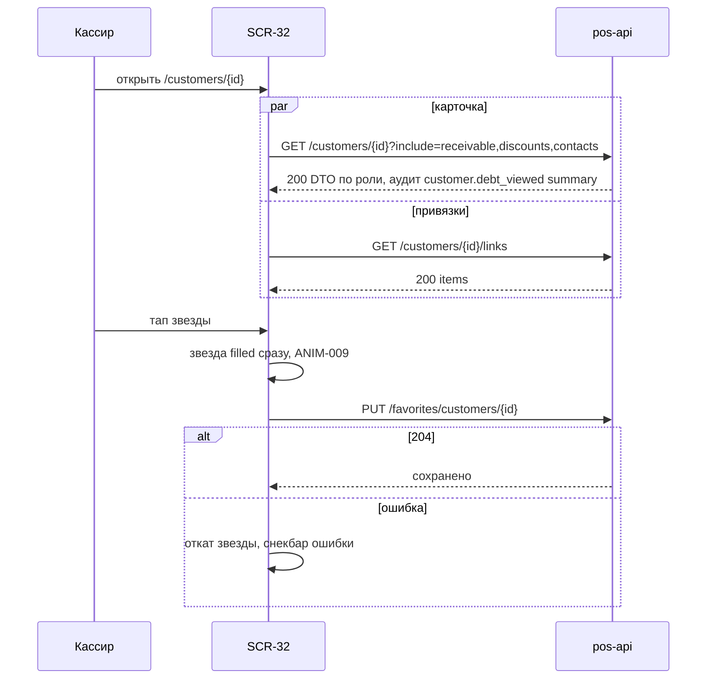

Ключевое действие «В заказ» при занятой корзине:

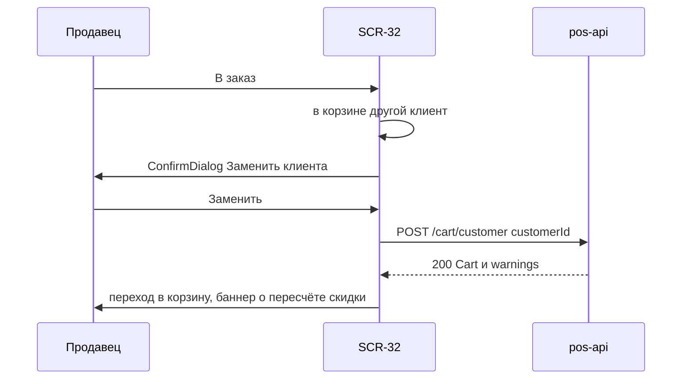

#### 7. Состояния экрана

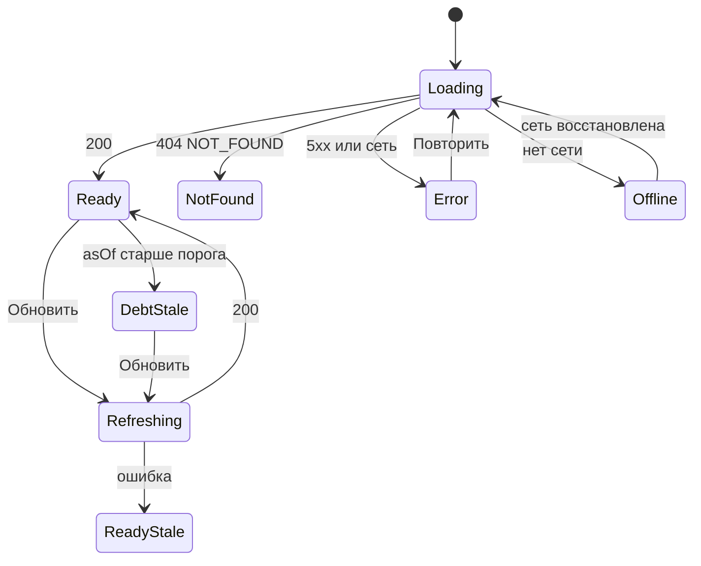

| Состояние | Видно |
|---|---|
| Loading | скелетон шапки, метрик, сводки, вкладок |
| Ready | все разрешённые зоны |
| DebtStale | Z5 с `StatusChip.warning` «данные могут быть неактуальны (от HH:MM)» + «Обновить» |
| ReadyStale | данные в памяти + баннер «Не удалось обновить» |
| NotFound | `ErrorState.fullScreen` «Клиент не найден» (`customer_card_not_found`) + «К списку клиентов» (`customer_card_back_to_list`) |
| Error | `ErrorState.fullScreen` + «Повторить» + код обращения |
| Offline | `EmptyState.offlineNoCache` «Карточка клиента недоступна без сети» |
| Нет данных долга | Z5 «Нет данных из 1С» (`ReceivableBadge` error-состояние), не «0 сом» (DEBT-009) |
| Клиент «Розничный покупатель» | Z5, Z6, вкладки История/Долги скрыты, пояснение «Системный клиент для розничных продаж без карточки» (CUST-018) |

#### 8. Валидация и сообщения

| Ключ ARB | Текст |
|---|---|
| `customer_card_code` | Код 1С: {code} |
| `customer_card_code_pos` | Код POS: {code} |
| `customer_card_pending_onec` | ожидает 1С |
| `customer_card_pending_onec_hint` | Продажа в долг станет доступна после создания клиента в 1С |
| `customer_card_marked_deleted` | Помечен на удаление в 1С |
| `customer_card_phone_verified` / `customer_card_phone_not_verified` | подтверждён / не подтверждён |
| `customer_card_inn` | ИНН: {inn} |
| `customer_card_type_individual` / `customer_card_type_legal` | Физическое лицо / Юридическое лицо |
| `customer_card_metric_history` | История: {count, plural, one{{count} заказ} few{{count} заказа} many{{count} заказов} other{{count} заказа}} |
| `customer_card_metric_debt` | Долг: {amount} |
| `customer_card_metric_debt_flag_yes` / `customer_card_metric_debt_flag_no` | Долг: есть / Долг: нет |
| `customer_card_metric_overdue_flag` | Просрочка |
| `customer_card_metric_discount` | Скидка: {percent} |
| `customer_card_tab_history` / `customer_card_tab_receivables` / `customer_card_tab_discounts` / `customer_card_tab_orders` | История / Долги / Скидки / Заказы и операции |
| `customer_card_segment_orders` / `customer_card_segment_operations` | Заказы / Операции |
| `customer_card_debt_balance` / `customer_card_debt_overdue` / `customer_card_debt_limit` / `customer_card_debt_available` | Сальдо / Просрочено / Лимит / Доступно (прогноз) |
| `customer_card_debt_limit_available` | Доступно (прогноз) {available} из {limit} |
| `customer_card_debt_no_data` | Нет данных из 1С |
| `customer_card_seller_info` | Суммы долга и история покупок доступны кассиру |
| `customer_card_action_to_cart` | В заказ |
| `customer_card_action_accept_debt` | Принять оплату по долгу |
| `customer_card_accept_disabled_no_onec` / `customer_card_accept_disabled_no_debt` | Клиент ещё не создан в 1С / Нет долга |
| `customer_card_replace_title` | Заменить клиента в корзине? |
| `customer_card_replace_body` | В корзине выбран {current}. Скидка клиента и цены будут пересчитаны |
| `customer_card_replace_cta` | Заменить |
| `customer_card_favorite_added` / `customer_card_favorite_removed` | Клиент добавлен в избранное / Клиент убран из избранного |
| `customer_card_contacts_title` / `customer_card_contacts_empty` | Контакты и адреса / Контакты не указаны |
| `customer_card_links_title` | Пользователи приложения |
| `customer_card_retail_system` | Системный клиент для розничных продаж без карточки |
| `customer_card_not_found` | Клиент не найден |
| `customer_card_offline` | Карточка клиента недоступна без сети |
| `customer_card_back_to_list` | К списку клиентов |
| `customer_card_scan_hint` | Сканирование доступно в поиске |
| `ds_copy_phone` / `ds_copied` | Скопировать телефон / Скопировано (общие ключи, предложение к 03) |

#### 9. Источники данных, API, бизнес-правила

`GET /customers/{id}?include=receivable,discounts,contacts` (08 §4.11.3; аудит `customer.debt_viewed` при суммах); `GET /customers/{id}/links` (§4.11.7); `GET /orders?customerId=` (§4.8.2); `GET /transactions?customerId=` (§4.14.1); `PUT/DELETE /favorites/customers/{id}` (§4.13.2); `POST /cart/customer` (§4.7.4). Правила: CUST-001…007, CUST-014, CUST-017…020, DEBT-002, DEBT-004, DEBT-009, DEBT-011, FAV-006, TXN-011, DISC-014. Состояние: DTO в памяти провайдера экрана; drift не используется (кроме `outbox_actions` для избранного).

#### 10. Действия по ролям и ограничения безопасности

| Действие / зона | seller | cashier | senior_seller | admin | owner |
|---|---|---|---|---|---|
| Z1 полный телефон, ИНН | — (маска) | да | да | да | да |
| Z5 сводка долга | — (флаги) | да | да | да | да |
| Вкладка История (SCR-33) | — | да | да | да | да |
| Вкладка Долги (SCR-34) | — | да | да | да | да |
| Вкладка Скидки (SCR-35) | да | да | да | да | да |
| Вкладка «Заказы и операции» | свои | все | все | все | все |
| Избранное | — | изменение | изменение | изменение | — (не рендерится, FAV-006) |
| «В заказ» | да | да | да | да | — |
| «Принять оплату по долгу» | — | да | да | — | — |
| Z7 привязки | — | просмотр | просмотр | просмотр + разрешение (SCR-45) | просмотр |

Сервер формирует DTO по allow-list (SEC-031); попытка `seller` открыть `/customers/{id}/history` или `/receivables` по ссылке → `403 FORBIDDEN` → `EmptyState.noPermission`.

#### 11. Повторное нажатие, двойной запрос, «Назад», перезапуск

Повтор «Обновить» во время запроса игнорируется; «В заказ» — `loading`; звезда — debounce. «Назад» на compact — SCR-31/стек ветки; на expanded `?tab=` не создаёт записей истории, «Назад» уходит со всей карточки. Перезапуск: `lastLocation=/customers/{id}` восстанавливается (navigation §7.1), данные загружаются заново; step-up детализации — заново.

#### 12. Требования к платформам

Windows: Tab-порядок — шапка → действия → вкладки → содержимое; Alt+1…4 — вкладки; F5 — обновить; Esc — назад к списку (на expanded — снимает выделение в мастере); правый клик по телефону — «Скопировать». Android/iOS: нижняя панель действий над навигацией, учёт безопасной зоны; вкладки прокручиваются. HID на экране не используется (скан игнорируется с подсказкой «Сканирование доступно в поиске» — `customer_card_scan_hint`, снекбар 4 с).

#### 13. Критерии приёмки

| ID | Критерий |
|---|---|
| AC-UI-32-001 | Для `cashier` карточка показывает имя, код 1С (или POS-код с «ожидает 1С»), полный телефон (отметка «подтверждён/не подтверждён» — при наличии признака `phones[].verified` в ответе, З-25; без признака отметка не рисуется), ИНН (юр. лицо), метрики «История · Долг · Скидка», избранный статус, вкладки История, Долги, Скидки, Заказы и операции |
| AC-UI-32-002 | Для `seller` ответ `GET /customers/{id}` не содержит `phones`, `inn`, `receivable`, `addresses`, `isFavorite`; UI показывает маску телефона, «Долг: есть/нет» и пояснение «Суммы долга … доступны кассиру»; вкладок История и Долги нет |
| AC-UI-32-003 | Сводка долга показывает сальдо, просрочку, лимит, «Доступно (прогноз)» и дату снимка 1С; при возрасте > 60 мин — предупреждение и «Обновить» |
| AC-UI-32-004 | Клиент без снимка долга показывает «Нет данных из 1С», а не «0 сом» |
| AC-UI-32-005 | Каждое открытие карточки с суммами создаёт запись аудита `customer.debt_viewed` (summary) с актором и `customerId` |
| AC-UI-32-006 | Звезда избранного добавляет/убирает клиента на сервере; после перезапуска приложения состояние сохраняется; для `owner` звезда не отображается (FAV-006) |
| AC-UI-32-007 | «Принять оплату по долгу» видна только `cashier`/`senior_seller`, `disabled` для клиента без `onecRef`, без долга или без сети, и открывает SCR-38 с `customerId` |
| AC-UI-32-008 | «В заказ» назначает клиента корзине; при другом клиенте в корзине показывается `ConfirmDialog` замены; двойное нажатие не создаёт двух запросов |
| AC-UI-32-009 | Вкладка «Заказы и операции» показывает связанные заказы и транзакции клиента; у `seller` — только свои (проверка ответом сервера) |
| AC-UI-32-010 | На expanded вкладки переключаются без перезагрузки шапки, URL меняется на `?tab=`; Alt+1…4 переключают вкладки (`Ctrl+1…5` закреплены за ветками навигации; изменено при сборке 02) |
| AC-UI-32-011 | Системный клиент «Розничный покупатель» открывается без зон долга, истории и контактов |
| AC-UI-32-012 | Клиент `deletion_mark` показывает «Помечен на удаление в 1С», «В заказ» `disabled` |
| AC-UI-32-013 | Без сети показывается «Карточка клиента недоступна без сети»; данные не берутся из drift |
| AC-UI-32-014 | Для `owner` кассовые кнопки не отображаются, Z7 привязок видна в режиме просмотра |
| AC-UI-32-015 | Полоса лимита сопровождается текстом «Доступно (прогноз) X из Y», где X и Y — серверные `limitRemaining` и `creditLimit`; клиент не вычисляет денежные значения лимита; информация не передаётся только цветом |
| AC-UI-32-016 | Прямой переход `seller` на `/customers/{id}/receivables` показывает «Нет доступа к разделу» и не выполняет запрос детализации |

#### 14. Трассировка

| Элемент | SRC | Правила |
|---|---|---|
| Только данные, разрешённые роли | SRC-C-092, SRC-F-035 | CUST-001, DEBT-004, SEC-031, §0.4 |
| Имя и идентификатор | SRC-C-093, SRC-C-093a | CUST-002 |
| Подтверждённый номер (частично: признак подтверждения в DTO 08 отсутствует — З-25) | SRC-C-094 | CUST-003 |
| История покупок | SRC-C-095 | CUST-005 (SCR-33) |
| Сведения о взаиморасчётах | SRC-C-096, SRC-C-104…112 | CUST-004, DEBT-002 |
| Доступные скидки | SRC-C-097 | DISC-013 (SCR-35) |
| Избранный статус, добавить/удалить, хранение на сервере | SRC-C-098, SRC-C-100, SRC-C-101, SRC-C-103 | FAV-006, CUST-006 |
| Связанные заказы и транзакции | SRC-C-099, SRC-C-099a | CUST-007, TXN-011 |
| Профиль клиента в описании кассира | SRC-F-034, SRC-E-170 | CASH-010 |
| Привязка пользователей | SRC-E-134, SRC-E-134b | CUST-017, D-08 |

---

### SCR-33 — История покупок клиента (маршрут `/customers/{id}/history?from=&to=&source=`; роли `cashier`, `senior_seller`, `admin`, `owner` (`customer.history.read`, 11 §4.4), `customer` — свои (условно); R1 — да)

#### 1. Назначение и роль пользователя

Показать «историю покупок» клиента (SRC-C-095): заказы, созданные в приложении, и документы продаж 1С (реализации из проекции `shipments`/`shipment_items`) за период, с номером, датой, суммой, статусом и раскрытием строк (CUST-005). Кассир использует экран, чтобы найти исходную продажу для оплаты или возврата, и чтобы ответить клиенту, что и когда он покупал. Долг по истории **не вычисляется** — экран прямо указывает, что сальдо берётся только из снимка 1С (DEBT-001, SRC-C-105). `seller` доступа не имеет (видит только счётчик «История: N заказов» в SCR-32).

#### 2. Структура экрана

- **compact:** `TopAppBarPos` «История покупок» + имя клиента подзаголовком → строка фильтров: `DateRangePicker` (кнопка-поле) + сегмент источника → сводка периода (2 плитки) → метка глубины истории → список `TransactionRow.compact` 72 с группировкой по месяцам (`label` sticky-заголовки «Октябрь 2026») → подгрузка.
- **medium:** ландшафт — вкладка внутри SCR-32; портрет — экран как compact.
- **expanded / large:** вкладка «История» внутри SCR-32: строка фильтров сверху; таблица колонок «Документ (тип, №)», «Дата», «Источник», «Позиций», «Сумма», «Оплата», «Статус», шеврон; строки 48; раскрытие строки — вложенная таблица позиций.

#### 3. Таблица элементов

| № | UI-ID | Элемент | Компонент | Расположение/размер/отступы/выравнивание | Токены | Состояния | Поведение | Источник данных | Роли | Правило |
|---|---|---|---|---|---|---|---|---|---|---|
| 1 | UI-33-001 | Период | `DateRangePicker` (range), `CategoryChip` (пресеты) | слева в строке фильтров; кнопка-поле 44 | `outlined`, иконка `calendar_month`, `label tnum` | default, open, error (неверный диапазон) | пресеты «30 дней» · «90 дней» (по умолчанию) · «Год» · «Период…»; смена → новый запрос с курсором | `from`, `to` | все роли экрана | CUST-005 (90 дней — Q-176), Q-215 |
| 2 | UI-33-002 | Источник | `ViewModeSegmented` | справа в строке фильтров; 3 сегмента по 36 | выбранный `primaryContainer` | default, selected | «Все» · «Заказы POS» · «Продажи 1С» → `source=all|pos|onec` | `source` | все роли экрана | 08 §4.11.4 |
| 3 | UI-33-006 | Сводка периода | `PriceText` (kpi) ×2 | под фильтрами, 2 плитки в ряд, промежуток `ds.space.3` | сумма `h3 700 tnum`; подпись `caption` | loading, default | «Покупок на сумму: X», «Документов: N»; подпись «Долг — только по данным 1С, см. вкладку „Долги“» | клиент итог не считает (страница неполная); плитки рендерятся, только если ответ содержит `summary {count, total}` — в 08 §4.11.4 поля нет, до его добавления видна только подпись о долге (замечание З-05) | все роли экрана | DEBT-001 |
| 4 | UI-33-005 | Метка глубины истории | `AppTooltip` + `caption` | под сводкой, иконка `info` 16 | `caption textSecondary` | default | «История из 1С загружена с ДД.ММ.ГГГГ» — граница `SALES_HISTORY_MONTHS` | поле `historyFrom` в ответе — отсутствует в 08 (замечание З-05); до добавления — общая подпись «Ранние покупки могут отсутствовать» | все роли экрана | CUST-005, Q-023 |
| 5 | UI-33-003 | Строка документа | `TransactionRow` (compact), `StatusChip` | 72 / 56 / 48; иконка типа слева (`receipt` заказ POS, `local_shipping` реализация 1С, `undo` возврат) | номер `body 500`; дата `caption tnum`; сумма `bodyLg 700 tnum`; статус — `status_order_*` или подпись 1С | default, hover, pressed, focused, expanded | тап по строке — раскрыть позиции; шеврон/«Открыть заказ» → SCR-24 (для `kind=order`) | `GET /customers/{id}/orders` | все роли экрана | CUST-005, SRC-C-116…116c |
| 6 | UI-33-004 | Раскрытые позиции | `AppListTile` (expandable), `CartLine` (read-only) | под строкой, отступ слева 56; строки 48 | название `body`, количество и цена `caption tnum` | collapsed, expanded, loading | «Открыть заказ» → SCR-24; «Повторить в корзину» — R1 не включено (нет эндпоинта массового добавления; замечание) | позиции из `GET /orders/{id}` (POS) / строки реализации — если сервер их вернёт | все роли экрана | CUST-005 |
| 7 | UI-33-007 | Заголовки месяцев | `label` sticky | на всю ширину, высота 32 | `surfaceVariant`, `label 13/600` | — | прилипают при прокрутке | — | — | 03 §9.38 |
| 8 | UI-33-008 | Подгрузка / конец списка | `SkeletonList`, `caption` | внизу | — | loading, end («Показаны все документы за период») | курсор | `cursor` | — | D-37 |

#### 4. Поведение контролов

- **Период.** Открывает меню (expanded) или лист (compact); «Применить» закрывает и выполняет запрос; «Отмена»/Esc — без изменений. «по» раньше «с» — ошибка под полями, «Применить» `disabled`. Будущие даты недоступны. Смена периода сбрасывает раскрытые строки и прокрутку к началу.
- **Источник.** Мгновенный запрос; предыдущий отменяется.
- **Строка.** Тап — раскрыть/свернуть (повторный тап сворачивает); Enter — раскрыть, Ctrl+Enter — «Открыть заказ». Для реализаций 1С без связанного заказа POS «Открыть заказ» не показывается; если документ присутствует в журнале транзакций, строка ведёт в SCR-37 (по `url` из ответа).
- **Долгое нажатие** — «Скопировать номер документа».

#### 5. Анимации

ANIM-013 (скелетоны строк 72), ANIM-016-подобное раскрытие: `AnimatedSize` 0 → высота позиций 200 мс `standard` + шеврон 0 → 180° (ANIM-016); ANIM-017 (сегмент), ANIM-025 (лист периода на compact), ANIM-022 (пусто). Ошибка загрузки позиций — строка раскрывается с `ErrorState.inline` «Не удалось загрузить позиции · Повторить». Reduce-motion — мгновенное раскрытие.

#### 6. Переходы

| Откуда → куда | Данные | Способ | «Назад» |
|---|---|---|---|
| SCR-32 → SCR-33 | `customerId`, `from`, `to` | compact `push`; expanded `?tab=history` | SCR-32 |
| SCR-33 → SCR-24 | `orderId` | `go` (ветка Заказы) | стек ветки Заказы |
| SCR-33 → SCR-37 | `transactionId` | `go` (ветка Транзакции) | SCR-36 |

Период хранится в query (`from`, `to`) — «Назад» и deep link восстанавливают его.

#### 7. Состояния экрана

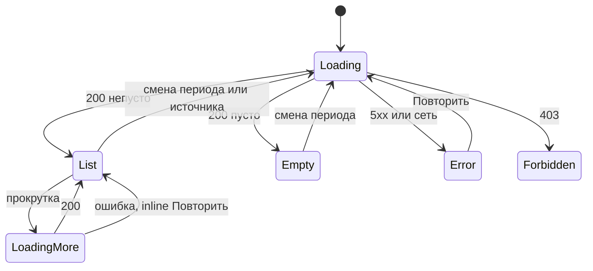

Пустое: `EmptyState` «Покупок за период нет» + «Изменить период». Офлайн: `EmptyState.offlineNoCache` «История покупок недоступна без сети». Нет прав: `EmptyState.noPermission`. Устаревшие данные: реализации 1С обновляются синхронизацией (30 мин, D-29) — под фильтрами подпись «Документы 1С на HH:MM» (P-STALE без блокировки).

#### 8. Валидация и сообщения

| Ключ ARB | Текст |
|---|---|
| `customer_history_title` | История покупок |
| `customer_history_preset_30` / `customer_history_preset_90` / `customer_history_preset_year` / `customer_history_preset_custom` | 30 дней / 90 дней / Год / Период… |
| `customer_history_source_all` / `customer_history_source_pos` / `customer_history_source_onec` | Все / Заказы POS / Продажи 1С |
| `customer_history_total` | Покупок на сумму: {amount} |
| `customer_history_count` | Документов: {count} |
| `customer_history_debt_note` | Долг — только по данным 1С, см. вкладку «Долги» |
| `customer_history_depth` | История из 1С загружена с {date} |
| `customer_history_onec_as_of` | Документы 1С на {time} |
| `customer_history_open_order` | Открыть заказ |
| `customer_history_items_error` | Не удалось загрузить позиции |
| `customer_history_empty` | Покупок за период нет |
| `customer_history_change_period` | Изменить период |
| `customer_history_end` | Показаны все документы за период |
| `customer_history_offline` | История покупок недоступна без сети |
| `customer_history_range_invalid` | Дата «по» раньше даты «с» |

#### 9. Источники данных, API, бизнес-правила

`GET /customers/{id}/orders?from=&to=&source=&limit=&cursor=` (08 §4.11.4: `kind` `order|shipment|return`, `number`, `date`, `total`, `status`, `source`, `url`); `GET /orders/{id}?include=items` для позиций заказов POS. Правила: CUST-005, DEBT-001, TXN-007, D-29. Аудит не пишется (08). Данные в памяти, без drift.

#### 10. Действия по ролям

| Действие | seller | cashier | senior_seller | admin | owner | customer (свой) |
|---|---|---|---|---|---|---|
| Просмотр истории | — | да | да | да | да | да (Q-001) |
| Открыть заказ SCR-24 | — | да | да | да | да | свой |
| Раскрыть позиции | — | да | да | да | да | да |

#### 11. Повторное нажатие, двойной запрос, «Назад», перезапуск

Смена фильтра отменяет предыдущий запрос; повторное раскрытие во время загрузки позиций — игнор. «Назад» — SCR-32. Перезапуск: маршрут восстанавливается из `lastLocation` (ветка Клиенты), данные загружаются заново.

#### 12. Требования к платформам

Windows: ↑/↓ — строки, Enter — раскрыть, Ctrl+Enter — открыть заказ, Ctrl+F — фокус на период; таблица с горизонтальной прокруткой при ширине < 900. Android/iOS: список карточек, лист периода на 92 % высоты, один месяц календаря.

#### 13. Критерии приёмки

| ID | Критерий |
|---|---|
| AC-UI-33-001 | По умолчанию загружаются документы за 90 дней; смена пресета перезапрашивает список с новым `from`/`to` |
| AC-UI-33-002 | Список содержит заказы POS и реализации 1С с номером, датой, суммой и статусом; сегмент «Продажи 1С» оставляет только `source=onec` |
| AC-UI-33-003 | Раскрытие строки заказа показывает позиции с количеством и ценой; «Открыть заказ» ведёт в SCR-24 |
| AC-UI-33-004 | Экран содержит пояснение, что долг берётся только из данных 1С; на экране нет вычисленного «долга» по истории |
| AC-UI-33-005 | Для `seller` маршрут недоступен (403 → «Нет доступа к разделу») |
| AC-UI-33-006 | Дата «по» раньше даты «с» блокирует «Применить» и показывает сообщение |
| AC-UI-33-007 | Пустой период показывает «Покупок за период нет» с кнопкой «Изменить период» |
| AC-UI-33-008 | Подгрузка следующей страницы идёт по курсору без дублей строк |
| AC-UI-33-009 | Без сети — «История покупок недоступна без сети», без чтения локального хранилища |

#### 14. Трассировка

| Элемент | SRC | Правила |
|---|---|---|
| История покупок | SRC-C-095, SRC-D-121, SRC-E-134b, SRC-F-034 | CUST-005 |
| Номер, дата, сумма, статус | SRC-C-116, SRC-C-116a, SRC-C-116b, SRC-C-116c | TXN-003 |
| Запрет вычисления долга по истории | SRC-C-104, SRC-C-105 | DEBT-001 |
| Видимость по ролям | SRC-C-092, SRC-F-035 | 11 §4.4 `customer.history.read` |

---

### SCR-34 — Долги и взаиморасчёты клиента (маршрут `/customers/{id}/receivables`; роли `cashier`, `senior_seller`, `admin`, `owner`; `customer` — свой при `confirmed` (условно Q-001); R1 — да)

#### 1. Назначение и роль пользователя

Показать задолженность клиента **на основании данных 1С** (SRC-C-104) без вычисления по истории (SRC-C-105), раздельно: сумму долга, дату и статус документа, платежи, возвраты, скидки, доступный лимит (если существует), дату последней синхронизации (SRC-C-106…112, DEBT-002/003). Кассир использует экран перед приёмом оплаты долга и для ответа клиенту; руководитель и администратор — для контроля. Просмотр детализации — финансовые данные: **step-up при первом просмотре в сессии и повторно, если с последнего step-up прошло > 15 мин** (ядро §3.3, §17.2), каждый просмотр фиксируется в аудите (`customer.debt_viewed`, `customer.finance.view` — 11 §7.2). `seller` доступа не имеет (Q-017).

#### 2. Структура экрана

**Зоны:** Z1 — сводка (сальдо, бейдж состояния); Z2 — лимит и доступный остаток; Z3 — дата снимка и «Обновить»; Z4 — статус продажи в долг; Z5 — детализация по документам (за step-up): фильтр типов + таблица/список; Z6 — действия.

- **compact:** `TopAppBarPos` «Долги» + имя клиента → Z1 карточка (бейдж + сумма `display 32/700`) → Z2 (полоса лимита + 3 строки) → Z3 строка подписи → Z4 (если блокировка) → заголовок «Документы» → Z5: до step-up — заглушка с кнопкой «Показать детализацию»; после — чипы типов (горизонтальная лента) и список строк 72 → нижняя закреплённая CTA L «Принять оплату по долгу» (Z6).
- **medium:** ландшафт — вкладка «Долги» в SCR-32; портрет — экран как compact.
- **expanded / large:** вкладка «Долги» в SCR-32: Z1–Z4 — в правой колонке действий 300 (сводка), центр — Z5 таблица 8 колонок (горизонтальная прокрутка при ширине < 900); Z6 — кнопка в колонке действий.

**Зоны экрана (подробно):**

| Зона | Содержимое | Источник | Требует step-up | Аудит |
|---|---|---|---|---|
| Z1 Сводка | `balance` (+ долг / − аванс), бейдж `zero`/`due`/`overdue`, `overdueAmount`, `overdueDays` | `GET /customers/{id}/receivables` | нет | `customer.debt_viewed` (summary) |
| Z2 Лимит | `creditLimit`, `openOrdersAmount`, `limitRemaining` (прогноз), `paymentTermDays`, `creditAllowed` | то же | нет | — |
| Z3 Снимок | `asOf`, `isStale`, `staleAfterMinutes`; «Обновить» = `refresh=true` | то же | нет | — |
| Z4 Продажа в долг | причина блокировки по снимку (просрочка / лимит / нет данных / устарело) | вычисляется по полям ответа без расчёта долга | нет | — |
| Z5 Детализация | `documents[]`: тип, номер, дата, сумма, оплачено, остаток, срок, дни просрочки | `?include=documents` | **да** | `customer.debt_viewed` (detail) + `customer.finance.view` |
| Z6 Действия | «Принять оплату по долгу» | — | нет (на SCR-38 — `ConfirmDialog`) | — |

#### 3. Таблица элементов

| № | UI-ID | Элемент | Компонент | Расположение/размер/отступы/выравнивание | Токены | Состояния | Поведение | Источник данных | Роли | Правило |
|---|---|---|---|---|---|---|---|---|---|---|
| 1 | UI-34-001 | Сводка долга | `ReceivableBadge` (full: zero/due/overdue), `PriceText` display | Z1, карточка `ds.radius.lg`, паддинг `ds.space.6`; сумма слева, бейдж справа сверху | сумма `display 32/700 tnum` (expanded `h2 24/700`): `error` при просрочке, `warning` при долге без просрочки, `success` при 0/авансе; аванс — со знаком «−» и подписью «Аванс» | loading, default, noData («Нет данных из 1С», клиент `pos_pending` — `reason: not_in_onec`), stale | тап по бейджу просрочки — фильтр Z5 «Просроченные» (после step-up) | `balance`, `overdueAmount`, `overdueDays` | все роли экрана | DEBT-001, DEBT-002, DEBT-009, SRC-C-106 |
| 2 | UI-34-002 | Лимит и доступный остаток | `AppProgress` (linear), `PriceText`, `AppListTile` ×3 | Z2, под сводкой; полоса 4 lp; строки 40 | `info`/`infoContainer`; «прогноз» — `StatusChip.neutral` | default, noLimit («Лимит: нет данных» + блокировка долга), hidden (`creditAllowed=false` — «Отсрочка по соглашению не разрешена», ключ `receivables_credit_not_allowed`) | информационно | `creditLimit`, `openOrdersAmount`, `limitRemaining`, `paymentTermDays` | все роли экрана | DEBT-002, DEBT-011, DEBT-012, SRC-C-111 |
| 3 | UI-34-003 | Дата снимка и «Обновить» | `SyncIndicator` (inline), `AppButton.text S` | Z3, строка 40 под Z2 | `caption tnum`; при устаревании — `StatusChip.warning` (`schedule`) | fresh, stale, refreshing (спиннер 16), refreshFailed | «Обновить» → `GET …?refresh=true` (синхронный запрос в 1С, таймаут 6 с); повтор во время запроса игнорируется | `asOf`, `isStale` | все роли экрана | DEBT-006, SRC-C-112 |
| 4 | UI-34-007 | Статус продажи в долг | `ErrorState.inline` / `StatusChip` | Z4, под Z3; высота 40–56 | `errorContainer`/`error` (блок), `successContainer`/`success` («Продажа в долг возможна») | allowed, blocked_overdue, blocked_limit, blocked_no_data, blocked_stale, not_allowed | только информирует; действий для кассира нет; разблокировка — `senior_seller`/`admin` на SCR-21/SCR-38 в своей сессии (PAY-032) | поля сводки | все роли экрана | DEBT-010, DEBT-012, PAY-031 |
| 5 | UI-34-009 | Заглушка детализации | `EmptyState`-подобный блок, иконка `lock` 32, `AppButton` M primary | Z5 до step-up; центр области, высота ≥ 200 | `surfaceVariant` фон, текст `body textSecondary` | locked, stepUpInProgress, stepUpCancelled | «Показать детализацию» → запрос с `include=documents` (P-STEPUP); содержимое таблицы до подтверждения **не запрашивается и не рендерится** | — | `cashier`, `senior_seller`, `admin`, `owner` | DEBT-005, SEC-032 |
| 6 | UI-34-004 | Фильтр типов документов | `CategoryChip` (filter, multi) со счётчиками | Z5 сверху, лента 36 | выбранный `primaryContainer` | default, selected | «Все» · «Реализации» · «Заказы» · «Платежи» · «Возвраты» · «Просроченные»; условный чип «Скидки и корректировки» (`receivables_filter_discounts`) — только если в снимке есть строки `kind` = `discount` / `adjustment` [НОВОЕ ИМЯ, З-04]; до доработки 08 чип не рендерится, скидки клиента показываются на SCR-35 (частичное покрытие SRC-C-110); фильтрация на клиенте по загруженному снимку | `documents[].kind`, `overdueDays` | все роли экрана | DEBT-003, SRC-C-107…110 |
| 7 | UI-34-005 | Строка / таблица документов | `TransactionRow` (compact) / таблица `AppListTile`, `StatusChip` | compact — строка 72: тип+№ и дата слева, сумма и остаток справа, статус под датой; expanded — колонки: Дата · Документ · Статус · Сумма · Оплачено · Остаток · Срок оплаты · Просрочка | суммы `tnum`; платежи и возвраты — со знаком «−» и иконкой `payments`/`undo`; просрочка — `StatusChip.error` «Просрочен N дн.» | default, hover, focused | тап → SCR-37, если документ есть в журнале транзакций (по `onecRef`), иначе лист «Документ 1С» (read-only поля строки) | `documents[]` | все роли экрана | DEBT-003, SRC-C-107/108/109; SRC-C-107a/110 — частично (статус выводится из `remaining`, `dueDate`, `overdueDays`; поля `documents[].status` и типов скидок в 08 нет — З-04) |
| 8 | UI-34-008 | Метка step-up и аудита | `AppTooltip` + `caption` | над таблицей справа, иконка `lock_open` 16 | `caption textSecondary` | видна после step-up | «Детализация открыта до HH:MM · просмотр записан в аудит» (HH:MM = `expiresAt` токена) | `stepUpToken.expiresAt` | все роли экрана | DEBT-005 |
| 9 | UI-34-006 | «Принять оплату по долгу» | `AppButton` L primary | Z6: compact — закреплена снизу; expanded — колонка действий | `primary` | default, disabled (офлайн, `balance ≤ 0`, `not_in_onec`), скрыта | → SCR-38 `?customerId=`; скрыта при `Me.features.debtPaymentsEnabled=false` (P-FLAGS) | `payment.debt.receive` | `cashier`, `senior_seller` | CASH-013, PAY-040 |
| 10 | UI-34-010 | Пустая детализация | `EmptyState` компактный | Z5 | — | — | «Документов с остатком нет» (снимок без строк) / «Детализация в 1С не ведётся» (поле `documents` отсутствует) | `documents[]` | все роли экрана | DEBT-003 (ТИПОВО) |

#### 4. Поведение контролов

- **Открытие экрана.** Запрос `GET /customers/{id}/receivables` (без `include`) — сводка; сервер пишет `customer.debt_viewed` (summary). Если в памяти есть действующий `stepUpToken` со `scope`, включающим `customer.receivables.read.detail`, сразу выполняется второй запрос `?include=documents` с `X-Step-Up-Token` — заглушка не показывается.
- **«Показать детализацию».** Запрос `?include=documents` → `403 STEP_UP_REQUIRED` → `StepUpDialog` с описанием операции «Просмотр детализации долга: {клиент}» → после токена — повтор запроса → таблица. Отмена диалога — заглушка остаётся, текст «Детализация не открыта». Повторное нажатие во время диалога/запроса — игнор. `PIN_LOCKED` — предложение «Код из SMS».
- **Истечение 15 мин.** При открытии экрана/вкладки или «Обновить» после истечения токена детализация скрывается до нового step-up; уже показанная таблица **не** скрывается в момент истечения (без «мигания» данных), но любое действие обновления требует нового step-up.
- **«Обновить».** `GET …?refresh=true` (+ `include=documents` при действующем токене). Успех — перекат сумм (ANIM-010), новая дата снимка; `isStale=true` в ответе при недоступной 1С — снекбар «1С недоступна, показаны данные от HH:MM»; ошибка сети — данные остаются, снекбар `error`. F5 на Windows.
- **Чипы типов.** Множественный выбор; «Все» сбрасывает остальные; фильтрация на клиенте без запроса; «Просроченные» — `overdueDays > 0`.
- **Строка.** Тап/Enter — переход/лист; долгое нажатие — «Скопировать номер документа».
- **«Принять оплату по долгу».** `push('/payments/new?customerId=…')`; при возврате — сводка перезапрашивается.

#### 5. Анимации

ANIM-013 (скелетон: сводка 96, полоса, 5 строк), ANIM-023 (`StepUpDialog`), ANIM-010 (перекат сумм при обновлении), ANIM-021 (иконка обновления), ANIM-017 (чипы), ANIM-022 (пустая детализация). Специфично — «раскрытие детализации»: начальное — заглушка с замком; триггер — получен 200 на `include=documents`; последовательность — замок `lock` → `lock_open` crossfade 150 мс, заглушка fade-out 150 мс, таблица fade-in 200 мс `standardDecelerate`, строки без каскада; конечное — таблица и метка UI-34-008; ошибка — заглушка остаётся, под кнопкой `ErrorState.inline` (ANIM-012 не применяется к кнопке); reduce-motion — мгновенная замена.

#### 6. Переходы

| Откуда → куда | Данные | Способ | «Назад» |
|---|---|---|---|
| SCR-32 (вкладка «Долги») / SCR-30 (просрочки) / SCR-48 (отчёт долгов) → SCR-34 | `customerId` | compact `push` / expanded `?tab=receivables`; из других веток — `go` | SCR-32 |
| SCR-34 → SCR-38 | `customerId` | `push` (root) | SCR-34 с обновлённой сводкой |
| SCR-34 → SCR-37 | `transactionId` (по `onecRef` документа) | `go` (ветка Транзакции) | SCR-36 |

Ключевое действие «Просмотр детализации со step-up»:

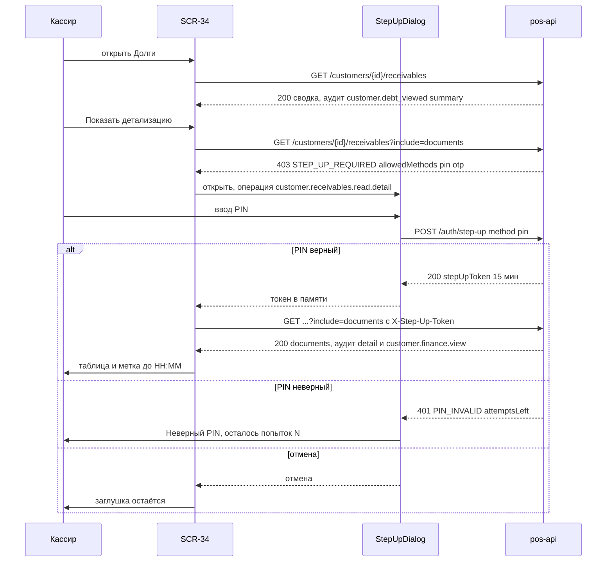

Ключевое действие «Обновить снимок»:

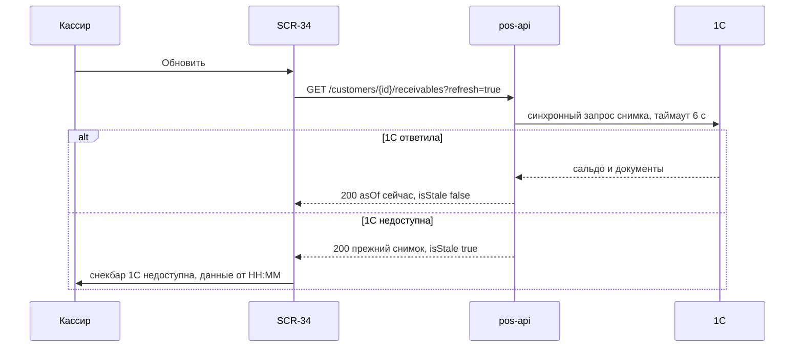

#### 7. Состояния экрана

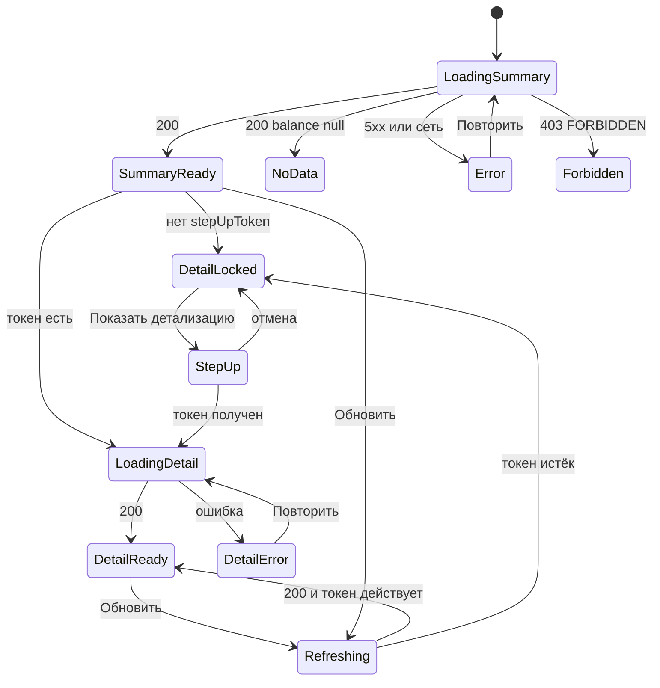

| Состояние | Видно |
|---|---|
| LoadingSummary | скелетон сводки и полосы; Z5 — пусто |
| SummaryReady + DetailLocked | Z1–Z4, Z6; Z5 — заглушка UI-34-009 |
| StepUp | `StepUpDialog` поверх; под ним — сводка |
| DetailReady | таблица + метка UI-34-008 |
| Stale (наложение) | P-STALE: `warning` «данные могут быть неактуальны (от HH:MM)» + «Обновить»; Z4 — «Продажа в долг недоступна: данные о долге устарели» |
| NoData | «Нет данных из 1С» (не «0 сом»); Z2, Z5 скрыты; Z4 — «Продажа в долг недоступна» |
| Error | `ErrorState.fullScreen` «Не удалось загрузить долг клиента» + «Повторить» + код |
| Offline | `EmptyState.offlineNoCache` «Данные о долге недоступны без сети» (локального кэша нет — ядро §18.2 п.1) |
| Forbidden | `seller` → `EmptyState.noPermission` |
| Нет биометрии | способ «Биометрия» в `StepUpDialog` скрыт, доступны PIN/OTP |

#### 8. Валидация и сообщения

| Ключ ARB | Текст |
|---|---|
| `receivables_title` | Долги и взаиморасчёты |
| `receivables_balance_debt` / `receivables_balance_advance` / `receivables_balance_zero` | Долг / Аванс / Долга нет |
| `receivables_overdue` | Просрочено {amount} · {days, plural, one{{days} день} few{{days} дня} many{{days} дней} other{{days} дня}} |
| `receivables_limit` / `receivables_open_orders` / `receivables_available` | Лимит / Открытые заказы в долг / Доступно (прогноз) |
| `receivables_limit_none` | Лимит: нет данных |
| `receivables_credit_not_allowed` | Отсрочка по соглашению не разрешена |
| `receivables_filter_discounts` | Скидки и корректировки |
| `receivables_term` | Отсрочка: {days} дн. |
| `receivables_as_of` | Данные 1С на {time} |
| `receivables_stale` | Данные могут быть неактуальны (от {time}) |
| `receivables_refresh` | Обновить |
| `receivables_refresh_onec_down` | 1С недоступна, показаны данные от {time} |
| `receivables_credit_allowed` | Продажа в долг возможна |
| `receivables_credit_blocked_overdue` | Продажа в долг недоступна: есть просроченная задолженность |
| `receivables_credit_blocked_limit` | Продажа в долг недоступна: лимит исчерпан |
| `receivables_credit_blocked_no_data` | Продажа в долг недоступна: нет данных из 1С о просрочке или лимите |
| `receivables_credit_blocked_stale` | Продажа в долг недоступна: данные о долге устарели |
| `receivables_detail_locked_title` | Детализация по документам |
| `receivables_detail_locked_body` | Для просмотра документов подтвердите личность. Просмотр записывается в журнал |
| `receivables_detail_show` | Показать детализацию |
| `receivables_detail_cancelled` | Детализация не открыта |
| `receivables_detail_step_up_reason` | Просмотр детализации долга: {customer} |
| `receivables_detail_open_until` | Детализация открыта до {time} · просмотр записан в аудит |
| `receivables_filter_all` / `receivables_filter_shipments` / `receivables_filter_orders` / `receivables_filter_payments` / `receivables_filter_returns` / `receivables_filter_overdue` | Все / Реализации / Заказы / Платежи / Возвраты / Просроченные |
| `receivables_col_date` / `receivables_col_document` / `receivables_col_status` / `receivables_col_amount` / `receivables_col_paid` / `receivables_col_remaining` / `receivables_col_due` / `receivables_col_overdue_days` | Дата / Документ / Статус / Сумма / Оплачено / Остаток / Срок оплаты / Просрочка |
| `receivables_doc_paid` / `receivables_doc_due_until` / `receivables_doc_overdue_n` | Оплачен / Ожидает оплаты до {date} / Просрочен {days} дн. |
| `receivables_detail_empty` | Документов с остатком нет |
| `receivables_detail_not_kept` | Детализация расчётов в 1С не ведётся |
| `receivables_no_data` | Нет данных из 1С |
| `receivables_load_error` | Не удалось загрузить долг клиента |
| `receivables_offline` | Данные о долге недоступны без сети |
| `receivables_accept_payment` | Принять оплату по долгу |

Статус документа выводится только из полей 1С (`remaining`, `dueDate`, `overdueDays`); собственного вычисления долга нет (DEBT-001). Поле «проведён/не проведён» (DEBT-003) в `documents[]` 08 отсутствует — замечание З-04.

#### 9. Источники данных, API, бизнес-правила

`GET /customers/{id}/receivables[?include=documents][&refresh=true]` (08 §4.11.5; `Receivable`: `balance`, `overdueAmount`, `overdueDays`, `creditLimit`, `openOrdersAmount`, `limitRemaining`, `creditAllowed`, `paymentTermDays`, `asOf`, `isStale`, `staleAfterMinutes`, `documents[]`); `POST /auth/step-up` (§4.1.7). Правила: DEBT-001…012, PAY-031 (порядок проверок — только отображение), PAY-035 (прогноз — единственное локальное вычисление; на этом экране не выполняется — `limitRemaining` присылает сервер), SEC-032, CUST-020. Ничего не сохраняется в drift; `stepUpToken` — в памяти.

#### 10. Действия по ролям и ограничения безопасности

| Действие | cashier | senior_seller | admin | owner | customer (свой) | seller |
|---|---|---|---|---|---|---|
| Сводка Z1–Z4 | да | да | да | да | да | — |
| Детализация Z5 | step-up | step-up | step-up | step-up | без step-up | — |
| Обновить снимок | да | да | да | да | да | — |
| Принять оплату по долгу | да | да | — | — | — | — |
| Разблокировать продажу в долг | — | на SCR-38/21 в своей сессии | на SCR-21 в своей сессии | — | — | — |

Сервер: `customer.receivables.read.summary` / `.detail` (S!), `customer.self.receivables.read`; токен чужой сессии → `403 STEP_UP_REQUIRED` (CASH-007).

#### 11. Повторное нажатие, двойной запрос, «Назад», перезапуск

«Показать детализацию» и «Обновить» блокируются на время запроса; второй step-up при действующем токене не запрашивается. «Назад» во время `StepUpDialog` = «Отмена» диалога; повторное «Назад» — SCR-32. Перезапуск: маршрут восстанавливается, сводка загружается заново, детализация требует нового step-up (токен не переживает перезапуск). Idle-блокировка (SCR-08 overlay) не сбрасывает токен, если он не истёк; данные на экране под overlay не видны.

#### 12. Требования к платформам

Windows: F5 — обновить, F7 — «Принять оплату по долгу» (переназначено при сборке 02), Tab в таблице — по колонкам, ↑/↓ — по строкам; `StepUpDialog` — PIN с цифровой клавиатуры, Enter — подтвердить; Windows Hello — только UX-гейт перед PIN (D-13). Android: `bio+pin` при доступной биометрии Class 3, иначе PIN; OTP — автозаполнение не требуется. P-SECURE: экран — кандидат на защиту от снимков экрана (Q-181). Таблица на expanded с фиксированной первой колонкой «Дата» при горизонтальной прокрутке.

#### 13. Критерии приёмки

| ID | Критерий |
|---|---|
| AC-UI-34-001 | Сводка показывает сальдо, просрочку (сумма и дни), лимит, «Доступно (прогноз)» и дату снимка 1С; все суммы — из ответа сервера, без клиентских вычислений |
| AC-UI-34-002 | Первое открытие детализации в сессии вызывает `StepUpDialog`; без токена таблица не запрашивается и не отображается |
| AC-UI-34-003 | Повторное открытие детализации в течение 15 мин после step-up не вызывает диалог; через > 15 мин — вызывает снова |
| AC-UI-34-004 | Каждый просмотр сводки создаёт `customer.debt_viewed` (summary), каждый просмотр детализации — `customer.debt_viewed` (detail) и `customer.finance.view` с `step_up_method` |
| AC-UI-34-005 | Детализация разделяет документы по типам: реализации, заказы, платежи, возвраты; у каждой строки — дата, номер, статус, сумма, оплачено, остаток, срок оплаты |
| AC-UI-34-006 | При `asOf` старше 60 мин показывается «Данные могут быть неактуальны (от HH:MM)» и «Обновить»; Z4 показывает блокировку продажи в долг |
| AC-UI-34-007 | «Обновить» вызывает `refresh=true`; при недоступной 1С показывается снекбар «1С недоступна, показаны данные от HH:MM», данные не исчезают |
| AC-UI-34-008 | Клиент без данных 1С показывает «Нет данных из 1С», а не «0 сом» |
| AC-UI-34-009 | Аванс (отрицательное сальдо) показывается с подписью «Аванс» и цветом `success` |
| AC-UI-34-010 | «Принять оплату по долгу» видна только `cashier`/`senior_seller`; у `admin`/`owner` отсутствует |
| AC-UI-34-011 | Отмена `StepUpDialog` оставляет заглушку и не показывает ошибку |
| AC-UI-34-012 | `PIN_INVALID` показывает остаток попыток; `PIN_LOCKED` предлагает «Код из SMS» |
| AC-UI-34-013 | Для `seller` маршрут недоступен; запрос `GET /customers/{id}/receivables` с его токеном → 403 |
| AC-UI-34-014 | Без сети экран показывает «Данные о долге недоступны без сети»; в drift нет таблиц с суммами долга (проверка схемы) |
| AC-UI-34-015 | После перезапуска приложения детализация снова требует step-up |
| AC-UI-34-016 | Фильтр «Просроченные» оставляет только строки с `overdueDays > 0`, счётчики чипов соответствуют числу строк |
| AC-UI-34-017 | Статус блокировки продажи в долг показывается без кнопок действий для кассира и с причиной (просрочка / лимит / нет данных / устарело) |

#### 14. Трассировка

| Элемент | SRC | Правила |
|---|---|---|
| Долг из 1С, запрет вычисления по истории | SRC-C-104, SRC-C-105 | DEBT-001, D-24 |
| Сумма долга | SRC-C-106 | DEBT-002 |
| Дата и статус документа | SRC-C-107, SRC-C-107a | DEBT-003 |
| Платежи, возвраты, скидки | SRC-C-108, SRC-C-109, SRC-C-110 | DEBT-003 |
| Доступный лимит | SRC-C-111 | DEBT-002, DEBT-011, DEBT-012 |
| Дата последней синхронизации | SRC-C-112 | DEBT-006, CASH-018 |
| Задолженности в описании кассира | SRC-F-034, SRC-E-170e | DEBT-007 |
| Видимость по ролям, подтверждение сервером | SRC-F-035, SRC-F-036, SRC-C-140 | DEBT-004, DEBT-005, SEC-032, SEC-033 |

---

### SCR-35 — Скидки и условия клиента (маршрут `/customers/{id}/discounts`; роли `seller`, `cashier`, `senior_seller`, `admin`, `owner` (`discount.rules.read`, 11 §4.4); `customer` — свои (условно); R1 — да)

#### 1. Назначение и роль пользователя

Показать «доступные скидки» клиента (SRC-C-097) и «скидки и условия продаж» (SRC-C-088): вид цены клиента, скидку клиента из 1С, условия оплаты (отсрочка, лимит), действующие правила `discount_rules` и потолок ручной скидки текущей роли (DISC-013). Экран только для чтения: скидки рассчитываются сервером по утверждённым правилам (SRC-C-113), клиент не может изменить цену или итог (SRC-C-114, DISC-001, DISC-011). Продавцу экран нужен, чтобы понимать, какую ручную скидку он может дать и когда нужен старший.

#### 2. Структура экрана

- **compact:** `TopAppBarPos` «Скидки и условия» + имя клиента → карточка «Вид цены» → карточка «Скидка клиента из 1С» с примером расчёта → «Условия оплаты» (3 строки) → «Правила скидок» (список) → «Ваш лимит ручной скидки» → подпись «Автоматические скидки 1С применяются при проведении заказа».
- **medium / expanded / large:** вкладка «Скидки» внутри SCR-32: две колонки (expanded) — слева вид цены, скидка клиента, условия оплаты, лимит роли; справа таблица правил (Название · Источник · Тип · Значение · Срок · Предрасчёт в POS · Статус); строки 48.

#### 3. Таблица элементов

| № | UI-ID | Элемент | Компонент | Расположение/размер/отступы/выравнивание | Токены | Состояния | Поведение | Источник данных | Роли | Правило |
|---|---|---|---|---|---|---|---|---|---|---|
| 1 | UI-35-001 | Вид цены | `AppListTile`, `StatusChip` (priceList, info «из 1С») | первая карточка, высота 56, поля `ds.space.4` | название `body 600`; чип `primaryContainer` | default, noData («Вид цены не задан — используется розничный») | только чтение | `priceList` (`GET /customers/{id}/discounts`) | все роли экрана | INV-030, DISC-013 |
| 2 | UI-35-002 | Скидка клиента 1С | `PriceText`, `StatusChip` («предварительно») | карточка; процент `h3 700 tnum`; под ним пример | пример `caption tnum textSecondary` | default, none («Скидка клиента не задана») | пример: «Заказ 16 850,00 сом → скидка 5 % = 842,50 → итог 16 007,50 (предварительно, итог определяет 1С)» | `customerDiscountPercent` | все роли экрана | DISC-005, DISC-006, DISC-008 |
| 3 | UI-35-003 | Условия оплаты | `AppListTile` ×3, `StatusChip` | карточка; строки 48 | значения `body tnum` | default, hidden (`seller` — без сумм лимита) | «Отсрочка: 14 дн.», «Лимит долга: 50 000,00 сом» (по праву), «Продажа в долг: разрешена / не разрешена» | `creditTerms{creditAllowed, paymentTermDays, creditLimit}` | все роли экрана; сумма лимита — cashier+, owner | DEBT-008, PAY-030 |
| 4 | UI-35-004 | Правила скидок | `AppListTile` (compact) / таблица (expanded), `StatusChip` | список строк 56 / таблица 48 | источник: `StatusChip.info` «1С» / `neutral` «POS»; статус: `success` «Действует», `neutral` «Итог в 1С», `neutral` «Не действует» | default, empty («Правил для клиента нет»), loading | тап по строке (compact) — раскрыть условия (`minTotal`, категории) | `rules[]` (`DiscountRule`) + `GET /discounts/rules?customerId=` | все роли экрана | DISC-013, DISC-015, D-23 |
| 5 | UI-35-005 | Лимит ручной скидки роли | `AppListTile`, `AppTooltip` | нижняя карточка; иконка `percent` | значение `h3 700 tnum`; подпись `caption` | default | «Ваш лимит: 5 %»; «Сверх лимита подтверждает: старший продавец (до 10 %), администратор (до 15 %)» — значения из ответа | `manualDiscountLimitPercent`, `limitsByRole`, `overrideRoles` | все роли экрана | DISC-003, DISC-010, Q-015 |
| 6 | UI-35-006 | Подпись об автоматических скидках | `caption` + иконка `info` | под всеми блоками | `caption textSecondary` | — | «Автоматические скидки и акции 1С применяются при проведении заказа и здесь не показываются» | — | все роли экрана | DISC-015, D-23 |
| 7 | UI-35-007 | Дата данных | `caption` | в заголовке экрана справа | `caption tnum` | fresh, stale (P-STALE) | «Данные 1С на HH:MM» | `asOf` | все роли экрана | SRC-C-112 |

#### 4. Поведение контролов

Экран не содержит изменяющих контролов. Строки правил раскрываются тапом/Enter (повторный — свернуть). Pull-to-refresh / F5 — повторная загрузка обоих запросов. Долгое нажатие — без действия. Нет полей ввода, поэтому нет валидации ввода; ручная скидка вводится только в корзине (SCR-20, `DiscountInput`).

#### 5. Анимации

| Ссылка | Элемент | Начальное → конечное | Триггер | Длительность / кривая | Реакция на ошибку | Reduce-motion |
|---|---|---|---|---|---|---|
| ANIM-013 | карточки UI-35-001…005, список/таблица правил | статичные блоки `skeletonBase` (4 карточки 56–96 + 3 строки правил) → контент fade-in 150 мс без сдвига раскладки | ответ дольше 300 мс | шиммер loop 1,2 с linear; fade-in 150 мс | > 10 с — «Долгая загрузка… · Повторить» (`ds_loading_long`); ошибка одного запроса — скелетон его блоков заменяется `ErrorState.inline` «Не удалось загрузить · Повторить» (fade 150 мс), остальные блоки показываются | статичные блоки без градиента |
| ANIM-020 (образец `AnimatedSize`) | раскрытие строки правила UI-35-004 | тело скрыто (высота 0), шеврон 0° → условия видны (`minTotal`, категории, срок действия), шеврон 180° | тап / Enter / Space по строке | 200 мс `standard`; поворот шеврона 200 мс | — (данные уже загружены) | мгновенно |
| ANIM-022 | пустой список правил | скрыт → `EmptyState` «Правил для клиента нет» | `rules[]` пуст | 200 мс `standardDecelerate` | — | мгновенно |
| ANIM-024 | вход на экран: compact — `push` из SCR-32; expanded — смена вкладки | SCR-32 → SCR-35 | тап вкладки «Скидки» / «Подробнее» на SCR-30 | compact — shared-axis X 300 мс `standard`; expanded — fade-through 200 мс | при ошибке загрузки переход завершается, ошибка показывается внутри экрана | fade 80 мс |
| ANIM-010 | процент скидки, лимит роли, лимит долга | старое → новое число | обновление вернуло изменённые значения | 200 мс `standard` | при ошибке обновления значения не меняются, снекбар `error` (ANIM-027, 4 с) | мгновенная замена |

Специфично — переход подписи даты в предупреждение (P-STALE): начальное — `caption textSecondary` «Данные 1С на HH:MM»; триггер — `asOf` старше порога; последовательность — crossfade 150 мс в `StatusChip.warning` с иконкой `schedule`; конечное — чип «данные могут быть неактуальны (от HH:MM)»; ошибка — не применяется; reduce-motion — мгновенная замена. Мигания и пульсаций нет.

#### 6. Переходы

| Откуда → куда | Триггер | Данные | Способ | «Назад» |
|---|---|---|---|---|
| SCR-32 → SCR-35 | вкладка «Скидки» (UI-32-004), `Alt+3` (Windows) | `customerId` (path) | compact — `push /customers/{id}/discounts`; expanded — `go /customers/{id}?tab=discounts` без новой записи истории | compact — SCR-32 (вкладки сохраняют прокрутку); expanded — уход со всей карточки: SCR-31 или предыдущий экран ветки |
| SCR-30 → SCR-35 | UI-30-009 «Подробнее» (выбран контекст клиента) | `customerId` последнего открытого клиента | `go` в ветку `customers` (стек ветки: SCR-31 → SCR-32 → SCR-35) | SCR-32 → SCR-31 |
| Deep link | `/customers/{id}/discounts` (compact) или `/customers/{id}?tab=discounts` (expanded) | `customerId` (path), `tab` | guard авторизации и права `discount.rules.read`; при смене класса окна маршрут переписывается между двумя формами без потери `customerId`; `customer` (условно, Q-001) открывает только свой `customerId`, чужой → `404 NOT_FOUND` | стек ветки восстанавливается: SCR-31 → SCR-32 → SCR-35 |
| Перезапуск приложения | восстановление `lastLocation` после SCR-08 | `customerId`, `tab` | данные загружаются заново (`GET /customers/{id}/discounts` и `GET /discounts/rules?customerId=` параллельно); раскрытые строки правил не восстанавливаются (п. 11) | как у deep link |
| Нет прав / клиент не найден | `403 FORBIDDEN` / `404 NOT_FOUND` | — | `EmptyState.noPermission` / «Клиент не найден» на месте экрана | SCR-31 |

Исходящих переходов нет: экран только для чтения, ссылок на заказы и правила не содержит.

#### 7. Состояния экрана

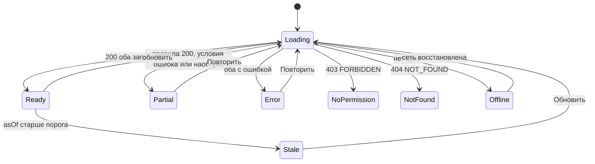

Partial — успешные блоки показываются, неуспешный — `ErrorState.inline` «Не удалось загрузить · Повторить». Пусто — «Правил для клиента нет». Офлайн — `EmptyState.offlineNoCache` «Условия клиента недоступны без сети». Устаревшие — P-STALE. Нет прав: `customer` с чужим клиентом — `403 FORBIDDEN` (08 §4.11.6) → `EmptyState.noPermission`; роль без `discount.rules.read` (например, `customer` при выключенном `CUSTOMER_SELF_SERVICE`) — маршрут закрыт guard-ом → `EmptyState.noPermission`. Несуществующий клиент — `404 NOT_FOUND` → `ErrorState.fullScreen` «Клиент не найден» (`customer_card_not_found`). Камера и биометрия на экране не используются.

#### 8. Валидация и сообщения

| Ключ ARB | Текст |
|---|---|
| `customer_discounts_title` | Скидки и условия |
| `customer_discounts_price_list` | Вид цены |
| `customer_discounts_price_list_default` | Вид цены не задан — используется розничный |
| `customer_discounts_client_discount` | Скидка клиента из 1С: {percent} |
| `customer_discounts_client_none` | Скидка клиента не задана |
| `customer_discounts_example` | Заказ {subtotal} → скидка {percent} = {discount} → итог {total} (предварительно, итог определяет 1С) |
| `customer_discounts_terms_title` | Условия оплаты |
| `customer_discounts_term_days` | Отсрочка: {days} дн. |
| `customer_discounts_credit_limit` | Лимит долга: {amount} |
| `customer_discounts_credit_allowed` / `customer_discounts_credit_not_allowed` | Продажа в долг: разрешена / не разрешена |
| `customer_discounts_rules_title` | Правила скидок |
| `customer_discounts_rule_source_onec` / `customer_discounts_rule_source_pos` | 1С / POS |
| `customer_discounts_rule_active` / `customer_discounts_rule_onec_total` / `customer_discounts_rule_inactive` | Действует / Итог в 1С / Не действует |
| `customer_discounts_rules_empty` | Правил для клиента нет |
| `customer_discounts_role_limit` | Ваш лимит ручной скидки: {percent} |
| `customer_discounts_override_roles` | Сверх лимита подтверждает: {roles} |
| `customer_discounts_auto_note` | Автоматические скидки и акции 1С применяются при проведении заказа и здесь не показываются |
| `customer_discounts_offline` | Условия клиента недоступны без сети |
| `customer_discounts_block_error` | Не удалось загрузить (кнопка — общий «Повторить») |

Пример расчёта формируется из значений ответа и канонической арифметики MNY (HALF_UP до 0,01) только как иллюстрация, без отправки на сервер.

#### 9. Источники данных, API, бизнес-правила

`GET /customers/{id}/discounts` (08 §4.11.6: `priceList`, `customerDiscountPercent`, `rules[]`, `creditTerms`, `manualDiscountLimitPercent`, `asOf`); `GET /discounts/rules?customerId=` (§4.12.2: `limitsByRole`, `overrideRoles`). Правила: DISC-001…015, DEBT-008, INV-030. Аудит не пишется.

#### 10. Действия по ролям

| Действие / данные | seller | cashier | senior_seller | admin | owner | customer (свой, Q-001) | Серверная проверка |
|---|---|---|---|---|---|---|---|
| Открыть экран | да | да | да | да | да | да (условно) | `discount.rules.read` |
| Вид цены, скидка клиента 1С, правила скидок | да | да | да | да | да | да | — |
| Признак «Продажа в долг разрешена», отсрочка в днях | да | да | да | да | да | да | — |
| Сумма лимита долга `creditTerms.creditLimit` | — (поля нет в ответе, Q-017) | да | да | да | да | да | `customer.receivables.read.summary` |
| Свой лимит ручной скидки | да | да | да | да | 0 % (DISC-003) | — (блок не рендерится) | `manualDiscountLimitPercent` |
| Роли, подтверждающие сверх лимита | да | да | да | да | да | — | `GET /discounts/rules` |
| Изменить скидку, цену или правило | — | — | — | — (управление правилами — экран администратора вне части) | — | — | экран без изменяющих запросов |

Ограничения безопасности: поля, не разрешённые роли, отсутствуют в ответе (SEC-031) и не рисуются; экран не содержит изменяющих запросов, поэтому step-up и `Idempotency-Key` не применяются; ручная скидка вводится только в корзине (SCR-20, `DiscountInput`) и проверяется сервером (DISC-011, событие `price.override_attempt`).

#### 11. Повторное нажатие, двойной запрос, «Назад», перезапуск

- **Повторное нажатие.** Pull-to-refresh / F5 во время загрузки игнорируется (один набор запросов: `GET /customers/{id}/discounts` и `GET /discounts/rules?customerId=` параллельно); повторный тап по раскрытой строке правила сворачивает её; быстрый двойной тап не раскрывает строку дважды (переключатель состояния).
- **Двойной запрос.** При смене клиента (expanded — выбор другой строки в SCR-31) незавершённые запросы прежнего клиента отменяются, их ответы отбрасываются; ответ, пришедший после ухода с экрана, не применяется.
- **«Назад».** compact — `pop` на SCR-32 (вкладки карточки сохраняют прокрутку). expanded — вкладка «Скидки» меняет `?tab=discounts` через `go` без новой записи истории, поэтому «Назад» (и Esc на Windows при фокусе вне таблицы) уходит со всей карточки: на SCR-31 или на предыдущий экран ветки; вход из SCR-30 («Подробнее») — «Назад» ведёт на SCR-32 (стек ветки Клиенты), дашборд открывается пунктом «Касса».
- **Раскрытые строки правил** хранятся в памяти экрана (`PageStorageKey` по `rule.id`) и восстанавливаются при возврате с другой вкладки той же карточки; при уходе с карточки сбрасываются.
- **Перезапуск.** `lastLocation=/customers/{id}/discounts` (compact) или `/customers/{id}?tab=discounts` (expanded) восстанавливается после SCR-08; данные загружаются заново; локально ничего не хранится (§0.6); раскрытые строки не восстанавливаются.

#### 12. Требования к платформам

| Платформа | Размеры и раскладка | Ввод |
|---|---|---|
| Windows-POS (expanded, мышь + клавиатура) | вкладка внутри SCR-32: левая колонка 360–400 (карточки 56–96, поля `ds.space.4`), правая — таблица правил: строки 48, колонки Название · Источник · Тип · Значение · Срок · Предрасчёт в POS · Статус; минимальная ширина таблицы 560, при нехватке — горизонтальная прокрутка внутри таблицы, не страницы | Tab — по строкам правил; Enter / Space — раскрыть; ↑/↓ — по строкам; F5 — обновить; Ctrl+3 — вкладка «Скидки» на SCR-32; hover строки — фон `surfaceVariant` (ANIM-015), курсор-указатель на раскрываемых строках; `AppTooltip` на «Предрасчёт в POS» и на лимите роли (показ через 500 мс наведения); правый клик — без меню |
| Android-планшет (medium) | портрет — карточки столбиком на всю ширину, поля 24; ландшафт — 2 колонки как expanded | тап — раскрыть; pull-to-refresh |
| Android-телефон (compact) | карточки столбиком, поля 16, строки правил 56, раскрытое тело до 3 строк | тап; pull-to-refresh; цели ≥ 48 lp |
| iOS (без проверки сборки, D-39) | как Android; цели ≥ 44 pt; безопасные зоны | тап; pull-to-refresh |
| Все | HID-скан на экране игнорируется (полей ввода нет); масштаб текста до 200 % — карточки переносят строки, таблица правил на expanded переключается в список строк | — |

#### 13. Критерии приёмки

| ID | Критерий |
|---|---|
| AC-UI-35-001 | Экран показывает вид цены, скидку клиента 1С, условия оплаты, правила скидок и лимит ручной скидки текущей роли |
| AC-UI-35-002 | Пример расчёта для 5 % от 16 850,00 показывает скидку 842,50 и итог 16 007,50 с пометкой «предварительно» |
| AC-UI-35-003 | Экран не содержит полей изменения скидки или цены |
| AC-UI-35-004 | Для `seller` сумма лимита долга отсутствует (нет в ответе), показан только признак разрешения долга |
| AC-UI-35-005 | Правила с источником 1С помечены «1С», правила POS — «POS»; статус показан иконкой и текстом |
| AC-UI-35-006 | Лимиты старших ролей и роли, подтверждающие сверх лимита, берутся из `GET /discounts/rules`, а не из констант приложения |
| AC-UI-35-007 | При ошибке одного из двух запросов второй блок отображается, ошибочный — с «Повторить» |
| AC-UI-35-008 | Подпись даты данных 1С показывается и становится предупреждением при устаревании |
| AC-UI-35-009 | `customer` при запросе чужого клиента получает `403 FORBIDDEN` и видит `EmptyState.noPermission`; несуществующий клиент — «Клиент не найден» |
| AC-UI-35-010 | На Windows строки правил раскрываются Enter/Space, hover подсвечивает строку, F5 обновляет оба запроса одним набором; повторный F5 во время загрузки не создаёт новых запросов |

#### 14. Трассировка

| Элемент | SRC | Правила |
|---|---|---|
| Доступные скидки клиента | SRC-C-097 | DISC-013, CUST-004 |
| Скидки и условия продаж | SRC-C-088, SRC-E-170f | DISC-013 |
| Утверждённые правила, запрет изменения цены клиентом | SRC-C-113, SRC-C-114 | DISC-001, DISC-011, D-23 |
| Скидки отдельно от долга | SRC-C-110 | DEBT-008 |
| Лимиты по ролям | SRC-D-123 | DISC-003, DISC-010 |

---

### SCR-36 — Транзакции (маршрут `/transactions?from=&to=&customerId=&status=&kind=&paymentMethod=&actorId=&q=&mine=`; роли `cashier`, `senior_seller`, `admin`, `owner` — все; `seller` — свои (`mine=1` принудительно); R1 — да)

#### 1. Назначение и роль пользователя

Журнал операций (read-model `transactions`): «список транзакций с фильтрами по периоду, клиенту, статусу и типу операции» и для каждой операции — «номер, дату, сумму, статус и связанные документы, если они доступны» (SRC-C-115…116d, TXN-001…004). Кассир сверяет смену, находит платёж для разбора или аннулирования; руководитель и администратор — контроль; продавец — только свои операции (TXN-004, SEC-042). Операции, введённые непосредственно в 1С, показываются с пометкой «источник 1С» без автора (TXN-007). Повторное проведение операции из журнала невозможно — журнал только читает; действия выполняются в SCR-37/SCR-38 по своим правилам с идемпотентностью (SRC-C-117/118).

#### 2. Структура экрана

**Зоны:** Z1 — заголовок и период; Z2 — строка поиска по номеру и активные фильтры; Z3 — панель фильтров; Z4 — итог периода; Z5 — список/таблица; Z6 — деталь (SCR-37 на expanded в боковой панели).

- **compact:** `TopAppBarPos` «Транзакции» → Z1 кнопка-поле периода «Сегодня» + `AppButton.outlined S` «Фильтры · N» → Z2 лента активных чипов с ✕ → Z4 строка итогов (2 значения) → Z5 список `TransactionRow` 72 с заголовками дней (sticky) → подгрузка. Z3 — `FilterSheet` (лист 92 %). Деталь — отдельный экран SCR-37.
- **medium:** таблица упрощённая (тип, №, дата, клиент, сумма, статус) + `FilterSheet` → боковая панель 320; деталь — панель 400 поверх списка.
- **expanded:** сайдбар навигации; контент: Z1+Z2 в шапке контента; Z5 — таблица 8 колонок (Тип · № · Дата и время · Клиент · Способ · Сумма · Статус · Документы), строки 48; Z3 — `FilterPanel` 280 справа (постоянная); Z6 — боковая панель 480 поверх таблицы (тот же URL `/transactions/{id}`), панель фильтров под ней скрывается.
- **large:** контент ≤ 1200 + панель фильтров.

**Зоны экрана (подробно):**

| Зона | Элементы | Источник | Особенности ролей |
|---|---|---|---|
| Z1 Период | UI-36-005 | query `from`, `to` | — |
| Z2 Поиск и чипы | UI-36-012, UI-36-001, UI-36-011 | query | `seller` — чип «Только мои» без ✕ |
| Z3 Фильтры | UI-36-006 (клиент), UI-36-007 (статус), UI-36-008 (тип), UI-36-015 (способ оплаты), UI-36-016 (сотрудник), UI-36-009 (применить) | `GET /transactions` параметры | UI-36-016 — только `transactions.read.all` |
| Z4 Итог | UI-36-002 | `summary` ответа (только `read.all`) | у `seller` скрыт |
| Z5 Список | UI-36-003, UI-36-004, UI-36-013, UI-36-014 | `Page<Transaction>` | — |
| Z6 Деталь | SCR-37 | `GET /transactions/{id}` | — |

#### 3. Таблица элементов

| № | UI-ID | Элемент | Компонент | Расположение/размер/отступы/выравнивание | Токены | Состояния | Поведение | Источник данных | Роли | Правило |
|---|---|---|---|---|---|---|---|---|---|---|
| 1 | UI-36-005 | Период | `DateRangePicker` (range) с пресетами `CategoryChip` | Z1 слева; кнопка-поле 44, иконка `calendar_month` | `outlined`, `label tnum` | default, open, error | пресеты «Сегодня» (по умолчанию) · «Вчера» · «7 дней» · «Месяц» · «Период…»; Asia/Bishkek; максимум периода — 366 дней по 08 (03 указывает 93 — Q-215) | `from`, `to` | все роли экрана | TXN-002, SRC-C-115a |
| 2 | UI-36-012 | Поиск по номеру | `SearchBar` (компактный, 40) | Z2 слева от чипов (expanded) / в листе фильтров (compact) | как `SearchBar` | default, typing | номер POS или 1С; debounce 300 мс; HID-скан номера документа | `q` | все роли экрана | TXN-003 |
| 3 | UI-36-001 | Активные фильтры | `CategoryChip` (input) + `AppButton.text S` «Сбросить всё» | Z2 лента 36, промежуток `ds.space.2` | чип `surfaceVariant`, ✕ 16 | скрыта (нет фильтров), default | ✕ — снять фильтр и перезапросить; «Сбросить всё» — к значениям по умолчанию (сегодня) | query | все роли экрана | TXN-002 |
| 4 | UI-36-011 | «Только мои» (продавец) | `CategoryChip` (input, без ✕) | первый чип Z2 | `primaryContainer` | всегда у `seller` | не снимается; сервер всё равно фильтрует (SEC-042) | `mine=1` | `seller` | TXN-004 |
| 5 | UI-36-006 | Клиент | `CustomerPicker` (inline) | Z3, первое поле | как `CustomerPicker` | default, selected (`CustomerCard.compact` + ✕), loading | поиск как SCR-31 (debounce 300 мс); один клиент | `customerId` | все роли экрана (у `seller` — поиск с маской) | TXN-002, SRC-C-115b |
| 6 | UI-36-007 | Статус | `CategoryChip` (filter, multi) | Z3, группа | выбранный `primaryContainer` + иконка статуса | default, selected | «Получено» · «Ожидает оплаты» · «Аннулировано / отменено» · «Возврат» · «Ошибка отправки в 1С» → значения `status` (сопоставление — п.9, [НЕ ПОДТВЕРЖДЕНО], замечание З-06) | `status` | все роли экрана | TXN-002, SRC-C-115c |
| 7 | UI-36-008 | Тип операции | `CategoryChip` (filter, multi) | Z3, группа; 8 (+1) чипов с иконками типов `TransactionRow` | как выше | default, selected | значения `transaction_kind`: Заказ создан, Заказ отменён, Платёж получен, Платёж аннулирован, Возврат, Скидка сверх лимита, Продажа в долг разрешена, Ручное подтверждение QR; «Заявка на возврат» — если сервер присылает `return_requested` (could) | `kind` | все роли экрана | TXN-001, SRC-C-115d |
| 8 | UI-36-015 | Способ оплаты | `CategoryChip` (filter, multi) | Z3 | как выше | default, selected | Наличные · QR · Долг → `paymentMethod` | `paymentMethod` | все роли экрана | 08 §4.14.1 |
| 9 | UI-36-016 | Сотрудник | `AppDropdown` | Z3 | — | default, selected | список сотрудников точки — источник списка в 08 для кассира отсутствует (`/admin/users` — только admin); в R1 поле только у `admin`/`owner`, у кассира — скрыто (замечание З-07) | `actorId` | `admin`, `owner` | TXN-002 |
| 10 | UI-36-009 | Применить | `AppButton` L primary | низ `FilterSheet` (compact) / низ `FilterPanel` (expanded) | `primary` | default, loading (подсчёт), disabled (ошибка периода) | compact — «Показать N операций» (N — из `summary.count` предварительного запроса при `read.all`, иначе «Показать»); expanded — фильтры применяются сразу при изменении, кнопка — Ctrl+Enter | `GET /transactions` | все роли экрана | TXN-002 |
| 11 | UI-36-002 | Итог периода | `PriceText` ×2 | Z4: «Приход: +X» · «Возвраты и аннулирования: −Y» · «Операций: N» | приход `success`, расход `textPrimary`; `bodyLg 700 tnum` | loading, default, hidden (`seller`) | информационно; не отчёт (отчёты — SCR-48) | `summary{count, sumIn, sumOut}` | cashier+, owner | TXN-002 |
| 12 | UI-36-003 | Строка транзакции | `TransactionRow`, `StatusChip` | 72 / 56 / 48; иконка типа 24 в круге 40; справа сумма со знаком и статус | 03 §9.38; знак «+»/«−» в тексте, цвет — дополнительно | default, hover, pressed, focused, selected (открыта в панели), error («Ошибка отправки в 1С») | тап → SCR-37 (compact — экран, expanded — панель); ↑/↓ + Enter | `items[]` | все роли экрана | TXN-003, SRC-C-116…116c |
| 13 | UI-36-004 | Операция из 1С | `TransactionRow` (source=onec) | как строка; чип `StatusChip.neutral` «1С» | — | — | автор не показывается | `source=onec` | все роли экрана | TXN-007 |
| 14 | UI-36-017 | Колонка «Документы» (expanded) | `AppBadge` + иконки | правая колонка таблицы | `caption` | — | счётчик связанных документов (`related[].length`), тап — SCR-37 сразу на блоке связанных документов | `related[]` | все роли экрана | SRC-C-116d |
| 15 | UI-36-013 | Заголовки дней | `label` sticky | высота 32 | `surfaceVariant` | — | «Сегодня», «Вчера», «18 октября» | `occurredAt` | — | 03 §9.38 |
| 16 | UI-36-014 | Подгрузка | `SkeletonList`, `caption` | внизу | — | loading, end, error inline | курсор; «Показаны все операции за период» | `cursor` | — | D-37 |
| 17 | UI-36-010 | Экспорт CSV | `AppButton` S outlined | Z1 справа | — | **скрыт в R1** | право `reports.export` никому не выдаётся (TXN-010) | — | — | TXN-010 |

#### 4. Поведение контролов

- **Период.** Как в SCR-33; применяется к query, сбрасывает курсор и прокрутку; «Сегодня» по умолчанию при каждом новом входе в ветку без query.
- **Поиск по номеру.** debounce 300 мс; совместим с остальными фильтрами; Esc — очистить.
- **Чипы фильтров.** Изменение на expanded применяется сразу (с debounce 300 мс на серию нажатий); на compact — накапливается в листе до «Показать». Закрытие листа без «Показать» — изменения отбрасываются (лист показывает «Изменения не применены» при смахивании, если что-то изменено, — без диалога, просто отбрасывает).
- **Строка.** Тап/Enter — деталь; на expanded выбранная строка подсвечена, ↑/↓ при открытой панели меняют транзакцию в панели (URL обновляется `go` без новой записи истории). Долгое нажатие — «Скопировать номер».
- **Pull-to-refresh / F5** — перезапрос первой страницы с текущими фильтрами.
- **Ctrl+F** — фокус в панель фильтров (expanded) / открыть лист (compact).

#### 5. Анимации

ANIM-013 (скелетоны 8 строк), ANIM-017 (чипы), ANIM-025 (лист фильтров), ANIM-025 вариант `side` (боковая панель SCR-37: slide-in справа, ширина 480 вместо базовых 320 lp, 250 мс `standardDecelerate`, закрытие 200 мс; ширина — З-32), ANIM-010 (перекат итогов), ANIM-022 (пусто). Специфично — «применение фильтра на expanded»: начальное — старый список; триггер — изменение фильтра; последовательность — список приглушается до opacity 0,5 и показывает тонкий `AppProgress.linear` 2 lp под шапкой; по ответу — crossfade 150 мс на новый список; конечное — новый список; ошибка — список возвращает opacity 1, `ErrorState.banner` «Не удалось применить фильтр · Повторить»; reduce-motion — без приглушения, только прогресс.

#### 6. Переходы

| Откуда → куда | Данные | Способ | «Назад» |
|---|---|---|---|
| Навигация «Транзакции» / SCR-30 «Все транзакции» / плитки сводки | `from`, `to`, `kind`, `paymentMethod` | `go` (ветка Транзакции) | корень ветки |
| SCR-36 → SCR-37 | `transactionId` | compact `push`; expanded — панель (тот же маршрут) | SCR-36 с фильтрами и прокруткой |
| SCR-32 (вкладка «Операции») → SCR-37 | `transactionId` | `go` | SCR-36 |

Имя query-параметра способа оплаты — `paymentMethod` (как в 08 §4.14.1); `actorId` и `q` — также имена 08 (в navigation.md §3 не перечислены — З-30). Фильтры хранятся в query — сохраняются при возврате из SCR-37, восстанавливаются deep link-ом; `q` (номер) не содержит ПДн и сохраняется.

Ключевое действие «Применить фильтр по клиенту и типу»:

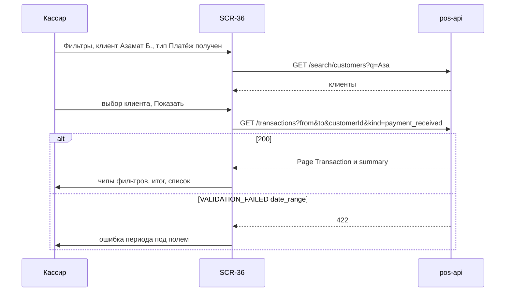

#### 7. Состояния экрана

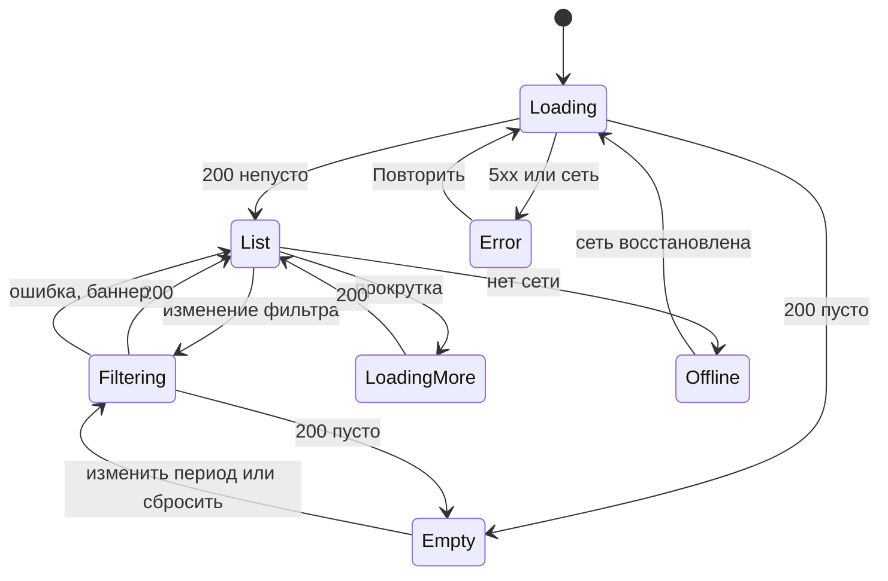

| Состояние | Видно |
|---|---|
| Loading | скелетоны строк и итогов |
| List | итог, список/таблица |
| Empty | `EmptyState.transactions` «Операций за период нет» + «Изменить период» (+ «Сбросить фильтры», если они есть) |
| Error | `ErrorState.fullScreen` + «Повторить» |
| Offline | загруженная страница остаётся в памяти с баннером «Нет сети. Показаны данные от HH:MM» (`transactions_offline_stale`); без загруженных данных — `EmptyState.offlineNoCache` «Журнал операций недоступен без сети» |
| Строка с ошибкой 1С | `StatusChip.error` «Ошибка отправки в 1С»; повтор outbox — на SCR-43 (`admin`, `senior_seller` своего магазина) |

#### 8. Валидация и сообщения

| Ключ ARB | Текст |
|---|---|
| `transactions_title` | Транзакции |
| `transactions_period_today` / `transactions_period_yesterday` / `transactions_period_7d` / `transactions_period_month` / `transactions_period_custom` | Сегодня / Вчера / 7 дней / Месяц / Период… |
| `transactions_period_too_long` | Период больше {days} дней |
| `transactions_search_number` | Номер документа |
| `transactions_filters` | Фильтры · {count} |
| `transactions_reset_all` | Сбросить всё |
| `transactions_only_mine` | Только мои |
| `transactions_filter_customer` / `transactions_filter_status` / `transactions_filter_kind` / `transactions_filter_method` / `transactions_filter_actor` | Клиент / Статус / Тип операции / Способ оплаты / Сотрудник |
| `transactions_status_received` / `transactions_status_pending` / `transactions_status_voided` / `transactions_status_returned` / `transactions_status_onec_error` | Получено / Ожидает оплаты / Аннулировано, отменено / Возврат / Ошибка отправки в 1С |
| `transactions_kind_order_created` / `transactions_kind_order_cancelled` / `transactions_kind_payment_received` / `transactions_kind_payment_voided` / `transactions_kind_refund` / `transactions_kind_discount_override` / `transactions_kind_credit_sale_approved` / `transactions_kind_manual_qr_confirm` / `transactions_kind_return_requested` | Заказ создан / Заказ отменён / Платёж получен / Платёж аннулирован / Возврат / Скидка сверх лимита / Продажа в долг разрешена / Ручное подтверждение QR / Заявка на возврат |
| `transactions_method_cash` / `transactions_method_qr` / `transactions_method_credit` | Наличные / QR / Долг |
| `transactions_apply_n` | {count, plural, one{Показать {count} операцию} few{Показать {count} операции} many{Показать {count} операций} other{Показать {count} операции}} |
| `transactions_sum_in` / `transactions_sum_out` / `transactions_sum_count` | Приход / Возвраты и аннулирования / Операций: {count} |
| `transactions_source_onec` | 1С |
| `transactions_empty` | Операций за период нет |
| `transactions_end` | Показаны все операции за период |
| `transactions_filter_failed` | Не удалось применить фильтр |
| `transactions_offline` | Журнал операций недоступен без сети |
| `transactions_offline_stale` | Нет сети. Показаны данные от {time} |

Ошибки: `VALIDATION_FAILED` (`date_range`, неизвестный `kind`) — под полем периода/в баннере; `FORBIDDEN` (`actorId` без права) — поле не рендерится, ошибка не должна возникать.

#### 9. Источники данных, API, бизнес-правила

`GET /transactions?from&to&customerId&status&kind&source&actorId&paymentMethod&q&limit&cursor&sort` (08 §4.14.1; `summary` — только `read.all`); `GET /search/customers` (фильтр клиента). Сопоставление чипов статуса значениям `status` [НЕ ПОДТВЕРЖДЕНО, замечание З-06]: «Получено» → `received`; «Ожидает оплаты» → `cash_pending, qr_pending, qr_shown, awaiting_payment`; «Аннулировано, отменено» → `voided, cancelled`; «Возврат» → `refunded, partially_returned`; «Ошибка отправки в 1С» → `submit_failed`. Правила: TXN-001…010, SEC-042. Аудит: `transaction.viewed_all` (опционально, раз в сессию — 11 §7.2) пишет сервер. Данные — только в памяти.

#### 10. Действия по ролям

| Действие | seller | cashier | senior_seller | admin | owner |
|---|---|---|---|---|---|
| Просмотр | свои | все | все | все | все |
| Фильтры период/клиент/статус/тип/способ | да (в пределах своих) | да | да | да | да |
| Фильтр «Сотрудник» | — | — (З-07) | — | да | да |
| Итог периода | — | да | да | да | да |
| Экспорт CSV | — | — | — | — (R1) | — (R1) |

#### 11. Повторное нажатие, двойной запрос, «Назад», перезапуск

Изменения фильтров объединяются debounce-ом, предыдущий запрос отменяется; повторный тап по строке во время открытия панели — игнор. «Назад» из SCR-37 — к списку с фильтрами и прокруткой; на expanded Esc закрывает панель. Перезапуск: `lastLocation` ветки Транзакции восстанавливается вместе с query (фильтры), данные загружаются заново.

#### 12. Требования к платформам

Windows: ↑/↓ — строки, Enter — открыть, Esc — закрыть панель, Ctrl+F — фильтры, Ctrl+Enter — применить, F5 — обновить; HID-скан номера документа (суффикс Enter) — в поле поиска по номеру, даже без фокуса (если открыт SCR-36); сортировка по клику на заголовок колонки «Сумма»/«Дата» (`sort=amount:desc`/`occurredAt:desc`). Android/iOS: лист фильтров, pull-to-refresh, цели ≥ 48.

#### 13. Критерии приёмки

| ID | Критерий |
|---|---|
| AC-UI-36-001 | По умолчанию показываются операции за сегодня (Asia/Bishkek), отсортированные по времени убыванию |
| AC-UI-36-002 | Фильтры по периоду, клиенту, статусу и типу операции работают по отдельности и в комбинации; активные фильтры видны чипами и снимаются ✕ |
| AC-UI-36-003 | Каждая строка показывает тип, номер, дату и время, клиента, сумму со знаком и статус (иконка + текст) |
| AC-UI-36-004 | Для каждой операции с доступными связанными документами видна колонка/переход к ним в SCR-37 |
| AC-UI-36-005 | `seller` видит только свои операции даже при фильтре по чужому клиенту; чип «Только мои» нельзя снять; итог периода не показывается |
| AC-UI-36-006 | Операции из 1С помечены «1С» и не показывают автора |
| AC-UI-36-007 | Период больше допустимого блокирует применение и показывает сообщение |
| AC-UI-36-008 | Фильтры сохраняются в URL: после открытия SCR-37 и возврата список, фильтры и прокрутка те же |
| AC-UI-36-009 | На expanded тап по строке открывает боковую панель 480 с тем же URL `/transactions/{id}`; Esc закрывает панель |
| AC-UI-36-010 | Курсорная подгрузка не дублирует строки; в конце показывается «Показаны все операции за период» |
| AC-UI-36-011 | Кнопка экспорта CSV в R1 не отображается ни одной роли |
| AC-UI-36-012 | Пустой результат показывает «Операций за период нет» с действиями «Изменить период» и «Сбросить фильтры» |
| AC-UI-36-013 | Без сети уже загруженный список остаётся видимым с пометкой времени; после перезапуска без сети — «Журнал операций недоступен без сети» |
| AC-UI-36-014 | Итог периода (приход, возвраты и аннулирования, число операций) соответствует `summary` ответа и не вычисляется клиентом |
| AC-UI-36-015 | Поиск по номеру POS или 1С (ввод или HID-скан) находит операцию и сочетается с остальными фильтрами |
| AC-UI-36-016 | Строка операции с ошибкой отправки в 1С показывает чип «Ошибка отправки в 1С» |

#### 14. Трассировка

| Элемент | SRC | Правила |
|---|---|---|
| Список транзакций | SRC-C-115, SRC-C-089, SRC-E-170g | TXN-001 |
| Фильтры период/клиент/статус/тип | SRC-C-115a, SRC-C-115b, SRC-C-115c, SRC-C-115d, SRC-D-124 | TXN-002 |
| Номер, дата, сумма, статус | SRC-C-116, SRC-C-116a, SRC-C-116b, SRC-C-116c | TXN-003 |
| Связанные документы | SRC-C-116d | TXN-003, TXN-006 |
| Защита от повторного проведения | SRC-C-117, SRC-C-118, SRC-C-118a | TXN-005 |
| Видимость по ролям | SRC-F-035 | TXN-004, SEC-042 |
| Транзакции в описании кассира | SRC-F-034 | CASH-010 |

---

### SCR-37 — Транзакция: детали (маршрут `/transactions/{id}`; роли — как SCR-36: `cashier`, `senior_seller`, `admin`, `owner` — все, `seller` — свои; R1 — да)

#### 1. Назначение и роль пользователя

«Детали операции» (SRC-F-034): все поля транзакции (TXN-001), связанные документы — заказ, платёж, заявка на возврат, документы 1С с номером, датой и статусом, печатные формы (SRC-C-116d, TXN-003), история статусов, записи аудита по объекту (только `audit.read`) и доступные действия по правам и состоянию (TXN-006): «Открыть заказ», «Принять оплату», «Подтвердить вручную» (QR), «Аннулировать платёж», «Заявка на возврат», «Печать». «Отмена транзакции» как таковой нет — отменяются заказ или платёж по своим правилам. Для кассира экран — место разбора платежей с `reviewReason` (PAY-024) и аннулирования до приёма денег (PAY-050).

#### 2. Структура экрана

- **compact:** экран: `TopAppBarPos` со стрелкой «Назад» и заголовком «Платёж № …» → заголовок с `StatusChip` → сумма `display` → блок «Требует разбора» (если есть) → атрибуты (`AppListTile`) → «Связанные документы» → «История статусов» (timeline) → «Аудит» (2–3 `AuditRow`, только `audit.read`) → нижняя панель действий (до 2 кнопок L + меню «Ещё»).
- **medium:** боковая панель 400 поверх SCR-36, те же блоки; действия — внизу панели.
- **expanded / large:** боковая панель 480 поверх таблицы SCR-36 (тот же URL), крестик и Esc закрывают; блоки — как compact; действия — закреплённая нижняя полоса панели.

#### 3. Таблица элементов

| № | UI-ID | Элемент | Компонент | Расположение/размер/отступы/выравнивание | Токены | Состояния | Поведение | Источник данных | Роли | Правило |
|---|---|---|---|---|---|---|---|---|---|---|
| 1 | UI-37-001 | Заголовок | `AppSectionHeader`, `StatusChip`, иконка типа 40 | верх, паддинг `ds.space.6`; иконка слева | название типа `h3`; № и дата-время `caption tnum` (до секунд); источник «POS»/«1С» `StatusChip.neutral` | loading, default | долгое нажатие — копировать номер | `kind`, `number`, `occurredAt`, `source`, `status` | все роли экрана | TXN-001, SRC-C-116/116a/116c |
| 2 | UI-37-002 | Сумма | `PriceText` (display) | под заголовком, выравнивание влево | `display 32/700 tnum`; «+» `success`, «−» `textPrimary`, знак в тексте | default | — | `amount`, `sign` | все роли экрана | SRC-C-116b, A11Y-004 |
| 3 | UI-37-008 | Блок «Требует разбора» | `ErrorState.banner` (warning) | под суммой, на всю ширину, высота 56–88 | `warningContainer`/`warning` | скрыт, amount_mismatch, unknown_reference | текст причины и полученной суммы; действия UI-37-007 по правам (см. п.4) | `GET /payments/{id}` (`needsReview`, `reviewReason`, `receivedAmount`) | все роли экрана; действия — `cashier`, `senior_seller` | PAY-024, PAY-029 |
| 4 | UI-37-003 | Атрибуты | `AppListTile` ×N | строки 48, подпись слева `caption`, значение справа `body` | значения `tnum` где число | default | клиент — ссылка на SCR-32; способ; для наличных — «Получено / Сдача»; автор (для `source=pos`); устройство; номер в 1С и статус outbox `StatusChip` (`status_outbox_*`) | `customer`, `actor`, `related[]`, `Payment` | все роли экрана (`externalRef` — не `seller`) | TXN-001, TXN-003 |
| 5 | UI-37-004 | Связанные документы | `AppListTile` (ссылки), `DocumentPreview` | раздел с заголовком; строки 56 с иконкой типа и шевроном | `body 500`; номер/дата `caption tnum` | default, empty («Связанных документов нет») | заказ → SCR-24; платёж → SCR-37 транзакции платежа; заявка → SCR-39 `/returns/{id}`; документ 1С — read-only строка; печатные формы — предпросмотр PDF | `related[]`, `order.documents` | все роли экрана (object-level на сервере) | SRC-C-116d, TXN-003 |
| 6 | UI-37-005 | История статусов | `AppListTile` (timeline) | вертикальная линия 2 lp `border`, точки 8 | время `caption tnum`; статус `StatusChip` | default, empty | только чтение | `order.history`, статусы платежа, outbox | все роли экрана | TXN-003 |
| 7 | UI-37-006 | Аудит | `AuditRow` ×≤3 + «Все записи» | последний раздел | `caption`; финансовые before/after для `admin` скрыты (SEC-083) | скрыт (нет `audit.read`), default | «Все записи» → SCR-47 с фильтром объекта | `audit[]` | `admin`, `owner` | TXN-012, SEC-083 |
| 8 | UI-37-007 | Действия | `AppButton` L/M (outlined/primary/danger), меню «Ещё» | нижняя закреплённая панель 72, `ds.elevation.2` | по варианту | default, loading, disabled, скрыто | по `allowedActions` платежа/заказа и правам: «Открыть заказ», «Принять оплату» (→ SCR-38), «Подтвердить вручную» (QR), «Аннулировать платёж», «Заявка на возврат» (→ SCR-39), «Печать» | `GET /payments/{id}.allowedActions`, `GET /orders/{id}.allowedActions` | по п.10 | TXN-006, CASH-014 |
| 9 | UI-37-009 | Диалог аннулирования | `ConfirmDialog` (`destructive`, `withReason`), `AppRadio` причины | диалог 400 | `errorContainer`/`error` иконка; CTA `danger` | default, disabled (нет причины), loading, error | причина: «Ошибка кассира» · «Клиент отказался» · «Дубликат» · «Иное» + комментарий (обязателен для «Иное», ≥ 5 символов); затем P-STEPUP; `POST /payments/{id}/void` | — | `cashier` | PAY-050 |
| 10 | UI-37-010 | Диалог ручного подтверждения | `StepUpDialog` + `AppTextField` ×3 | диалог 400; поля над способом подтверждения | как `StepUpDialog` | default, loading, error | «Референс банка» (обязательно, 4–64 символа), «Получено, сом» (по умолчанию сумма платежа), «Комментарий»; при отсутствии действующего токена области step-up выполняется в этом же диалоге **до** запроса (исключение P-STEPUP-PRE, §0.3: `X-Step-Up-Token` обязателен — 08 §4.9.3), затем `POST /payments/{id}/confirm-manual` | — | `cashier`, `senior_seller` | PAY-026 |
| 11 | UI-37-011 | Печать | `PrintOptions` (reprint), `DocumentPreview` | меню «Ещё» → лист | — | default, loading, error | «Счёт», «Товарный чек (нефискальный)» → `GET /orders/{id}/documents/{invoice|receipt}.pdf`; накладная — «Печатается из 1С» (`transaction_details_waybill_onec`) | `order.documents` | роли с `order.documents.print` | PRINT-*, D-27 |

#### 4. Поведение контролов

- **Загрузка.** `GET /transactions/{id}`; если в `related[]` есть платёж и роль имеет `payment.read.*` — параллельно `GET /payments/{id}` (для `allowedActions`, `needsReview`); если есть заказ — `GET /orders/{id}?include=documents,history` (для печати и истории).
- **«Подтвердить вручную».** Открывает UI-37-010; «Подтвердить» активна при референсе ≥ 4 символов; P-IDEMP + P-STEPUP-PRE (операция `payment.qr.confirm_manual`; токен запрашивается в том же диалоге до отправки — §0.3). Ответ `200` со `status=received` — снекбар «Оплата подтверждена», данные перезагружаются; ответ `200` с `warnings: PAYMENT_AMOUNT_MISMATCH` — `manual_confirm`, блок UI-37-008 «Сумма не совпадает: получено X из Y», заказ не закрыт (PAY-024). `PAYMENT_STATE_INVALID` — «Статус платежа изменился» + перезагрузка.
- **«Аннулировать платёж».** Доступно только для `cash_pending`, `qr_pending`, `qr_shown`, `qr_expired`, `manual_confirm`, `credit` (до отгрузки) и при наличии `void` в `allowedActions`; UI-37-009 → P-STEPUP (`payment.void`) → `POST /payments/{id}/void {reason, reasonCode}` с `Idempotency-Key`. Для `received` действие не показывается; подсказка «Деньги получены — оформите возврат в 1С» (PAY-050, PAY-051). Окно отмены наличных `received` по `app_settings.void_cash_window_minutes` (08 §4.9.4) — UI показывает «Аннулировать» только если сервер вернул `void` в `allowedActions` (расхождение 08 и 10 — замечание З-08).
- **Разбор `amount_mismatch` / `unknown_reference`.** Варианты решения (доплата, возврат, принять) — [ТРЕБУЕТ РЕШЕНИЯ ЗАКАЗЧИКА: Q-213]; до решения в R1 доступны: «Подтвердить вручную» с фактической суммой (если сервер разрешает из `manual_confirm`) и «Аннулировать» (до приёма денег); каждое действие — со step-up и аудитом.
- **«Принять оплату».** Для заказа с `pay` в `allowedActions` → `push('/payments/new?orderId=…')`.
- **«Заявка на возврат».** Для заказа `shipped`/`partially_returned` и `Me.features.returnsEnabled=true` (P-FLAGS) → `push('/returns/new?orderId=…')`; при выключенном модуле — подпись «Возврат оформляется в 1С».
- **Ссылки связанных документов.** Тап → переход; долгое нажатие / правый клик — «Скопировать номер» (`ds_copy_number`, снекбар «Скопировано» `ds_copied`, 4 с).
- Повторные нажатия любой CTA во время запроса игнорируются (кнопка `loading`).

#### 5. Анимации

ANIM-025 вариант `side` (боковая панель на medium/expanded: slide-in справа, ширина 400/480 вместо базовых 320 lp, 250 мс `standardDecelerate`, закрытие slide-out 200 мс `standardAccelerate`; ширина — З-32), ANIM-024 (compact — shared-axis X 300 мс), ANIM-013 (скелетон панели), ANIM-023 (диалоги), ANIM-012 (shake поля «Референс банка» при ошибке валидации), ANIM-010 (смена суммы/статуса после действия), ANIM-027 (снекбар результата). Специфично — «смена статуса после действия»: чип старого статуса crossfade 200 мс на новый, в timeline новая точка появляется fade-in 200 мс; reduce-motion — мгновенно.

#### 6. Переходы

| Откуда → куда | Данные | Способ | «Назад» |
|---|---|---|---|
| SCR-36 / SCR-30 / SCR-32 / SCR-33 / SCR-34 → SCR-37 | `transactionId` | `push` в ветке / `go` | SCR-36 |
| SCR-37 → SCR-24 | `orderId` | `go` (ветка Заказы) | стек ветки Заказы |
| SCR-37 → SCR-37 (транзакция платежа) | `transactionId` | `push` | предыдущая транзакция |
| SCR-37 → SCR-38 | `orderId` | `push` (root) | SCR-37 (обновлённая) |
| SCR-37 → SCR-39 | `orderId` (new) / `returnId` | `push` (root) | SCR-37 |
| SCR-37 → SCR-32 / SCR-47 | `customerId` / фильтр объекта | `go` | по ветке |

Ключевое действие «Аннулировать платёж до приёма денег»:

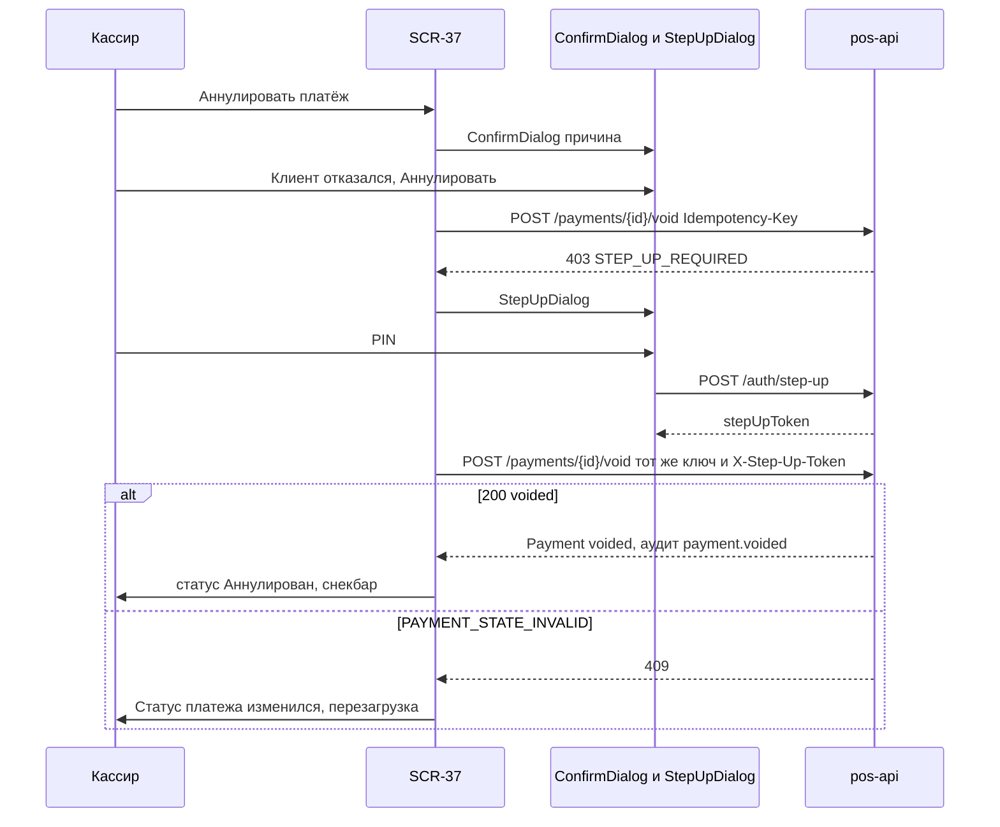

#### 7. Состояния экрана

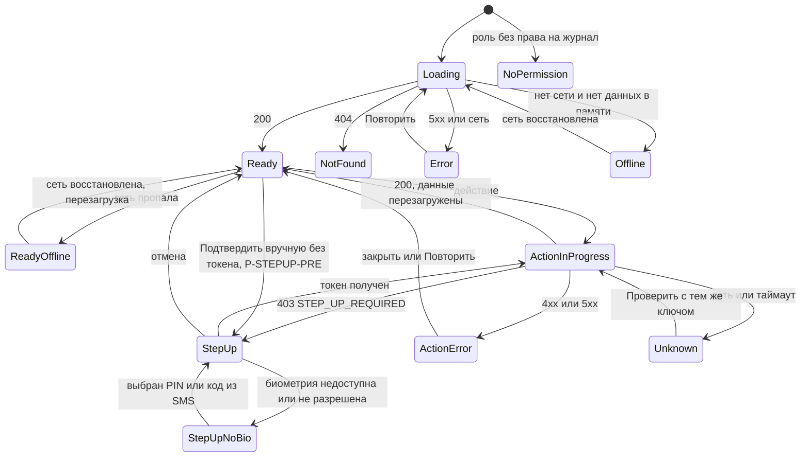

| Состояние | Видно / доступно |
|---|---|
| Loading | скелетон заголовка, суммы, 4 атрибутов и 2 связанных документов (P-SKEL) |
| Ready | все блоки; действия — по `allowedActions` и правам |
| NotFound | `ErrorState.fullScreen` «Операция не найдена» (`seller` — чужая транзакция или её нет) + «К журналу операций» (`transaction_details_back_to_list`) |
| Error | `ErrorState.fullScreen` + «Повторить» + код обращения (P-ERR) |
| Offline | данных в памяти нет — `EmptyState.offlineNoCache` «Журнал операций недоступен без сети» (`transactions_offline`) |
| ReadyOffline | данные в памяти + `OfflineBanner` (ANIM-019); все действия `disabled` с подсказкой «Нет сети: действия недоступны» (`transaction_details_offline`); печать недоступна |
| StepUp | `StepUpDialog` (03 §9.46): «Биометрия + PIN» (Android/iOS), «PIN», «Код из SMS»; на Windows — PIN (D-13) |
| StepUpNoBio | нет биометрии на устройстве, биометрия не включена пользователем, системное разрешение отозвано или биометрия заблокирована ОС — вариант «Биометрия + PIN» скрыт, доступны «PIN» и «Код из SMS» (BIO-015); при `PIN_LOCKED` — только «Код из SMS»; без сети step-up недоступен (кнопка действия уже `disabled`) |
| ActionError | `ErrorState.inline` в диалоге или панели: `PAYMENT_STATE_INVALID` — «Статус платежа изменился. Данные обновлены»; `FORBIDDEN` — P-403; `VALIDATION_FAILED` (`bankReference`) — у поля |
| Unknown | `ErrorState.banner` «Результат операции неизвестен · Проверить»; запись `fin.pending_check` (P-IDEMP) |
| NoPermission | `EmptyState.noPermission` |
| Нет связанных документов | «Связанных документов нет» |
| Устаревшие данные | статус outbox «ожидает подтверждения 1С» (`status_outbox_sent`) |

Камера на экране не используется; разрешений ОС, кроме биометрии в `StepUpDialog`, не требуется.

#### 8. Валидация и сообщения

| Ключ ARB | Текст |
|---|---|
| `transaction_details_source_pos` / `transaction_details_source_onec` | POS / 1С |
| `transaction_details_customer` / `transaction_details_method` / `transaction_details_received` / `transaction_details_change` / `transaction_details_author` / `transaction_details_device` / `transaction_details_onec_number` | Клиент / Способ / Получено / Сдача / Автор / Устройство / Номер в 1С |
| `transaction_details_related` | Связанные документы |
| `transaction_details_related_empty` | Связанных документов нет |
| `transaction_details_history` | История статусов |
| `transaction_details_audit` / `transaction_details_audit_all` | Аудит / Все записи |
| `transaction_details_review_mismatch` | Требует проверки: получено {received} из {amount} |
| `transaction_details_review_unknown` | Требует проверки: неизвестная ссылка платежа |
| `transaction_details_action_open_order` / `transaction_details_action_accept` / `transaction_details_action_confirm_manual` / `transaction_details_action_void` / `transaction_details_action_return` / `transaction_details_action_print` | Открыть заказ / Принять оплату / Подтвердить вручную / Аннулировать платёж / Заявка на возврат / Печать |
| `transaction_details_void_title` | Аннулировать платёж? |
| `transaction_details_void_body` | Платёж {amount} по заказу № {number} будет аннулирован. Деньги не должны быть получены |
| `transaction_details_void_reason_cashier_error` / `transaction_details_void_reason_customer_refused` / `transaction_details_void_reason_duplicate` / `transaction_details_void_reason_other` | Ошибка кассира / Клиент отказался / Дубликат / Иное |
| `transaction_details_void_comment_required` | Опишите причину (не менее 5 символов) |
| `transaction_details_void_done` | Платёж аннулирован |
| `transaction_details_void_received_hint` | Деньги получены — оформите возврат в 1С |
| `transaction_details_confirm_reference` | Референс банка или номер выписки |
| `transaction_details_confirm_reference_error` | Введите референс от 4 до 64 символов |
| `transaction_details_confirm_done` | Оплата подтверждена |
| `transaction_details_state_changed` | Статус платежа изменился. Данные обновлены |
| `transaction_details_return_in_onec` | Возврат оформляется в 1С |
| `transaction_details_not_found` | Операция не найдена |
| `transaction_details_unknown_result` | Результат операции неизвестен · Проверить |
| `transaction_details_waybill_onec` | Печатается из 1С |
| `transaction_details_offline` | Нет сети: действия недоступны |
| `transaction_details_back_to_list` | К журналу операций |
| `ds_copy_number` / `ds_copied` | Скопировать номер / Скопировано (общие ключи, предложение к 03) |

#### 9. Источники данных, API, бизнес-правила

`GET /transactions/{id}` (08 §4.14.2; `audit[]` — `audit.read`); `GET /payments/{id}` (§4.9.2, `allowedActions`); `GET /orders/{id}` (§4.8.3, `allowedActions`, `documents`, `history`); `POST /payments/{id}/confirm-manual` (§4.9.3); `POST /payments/{id}/void` (§4.9.4); `GET /orders/{id}/documents/{invoice|receipt}.pdf` (§4.8.5); `POST /auth/step-up`. Правила: TXN-001, TXN-003, TXN-006, TXN-012, PAY-024…026, PAY-050, PAY-051, CASH-014, SEC-030, SEC-083.

#### 10. Действия по ролям

| Действие | seller | cashier | senior_seller | admin | owner |
|---|---|---|---|---|---|
| Просмотр | свои | все | все | все | все |
| Открыть заказ / печать | свои | да | да | да | да |
| Принять оплату | — | да | да | — | — |
| Подтвердить вручную (QR) | — | да, S! | да, S! | — | — |
| Аннулировать платёж | — | да, S! | — (Q-005) | — | — |
| Заявка на возврат | — | да | да | да | только открыть существующую |
| Аудит по объекту | — | — | — | да (без финансовых before/after) | да |

#### 11. Повторное нажатие, двойной запрос, «Назад», перезапуск

Финансовые действия — P-IDEMP: один ключ на нажатие, повтор после step-up — с тем же ключом; «Проверить» после сетевой ошибки — тот же ключ. «Назад» во время диалога закрывает диалог (отмена); во время запроса — игнор. Перезапуск: маршрут `/transactions/{id}` восстанавливается (navigation §7.1), незавершённая операция (запись `outbox_actions` типа `fin.pending_check`, без автоповтора — P-IDEMP) показывается баннером «Незавершённая операция: {описание} · Проверить» с описанием «аннулирование платежа № {номер}» или «подтверждение QR по заказу № {номер}»; «Проверить» после перезапуска — проверка чтением `GET /payments/{id}` (P-IDEMP), в пределах сессии — повтор запроса с тем же ключом.

#### 12. Требования к платформам

Windows: Esc — закрыть панель/диалог, Enter на ссылке — переход, Ctrl+P — печать, Tab — по действиям; правый клик по номеру — «Скопировать номер» (`ds_copy_number`) — копировать. Android/iOS: нижняя панель действий над безопасной зоной; диалоги по центру; цифровая клавиатура для «Получено». Предпросмотр PDF — `DocumentPreview`.

#### 13. Критерии приёмки

| ID | Критерий |
|---|---|
| AC-UI-37-001 | Экран показывает тип, номер, дату-время, сумму со знаком, статус, клиента, способ, автора (для POS), источник и связанные документы с номерами и датами |
| AC-UI-37-002 | «Аннулировать платёж» показывается только `cashier` и только для статусов до приёма денег; требует причину и step-up; после успеха статус — «Аннулирован», в журнале появляется `payment_voided` |
| AC-UI-37-003 | Для платежа `received` действие аннулирования отсутствует, показана подсказка «Деньги получены — оформите возврат в 1С» (если сервер не вернул `void`) |
| AC-UI-37-004 | «Подтвердить вручную» требует референс 4–64 символа и step-up; при несовпадении суммы показывается блок «Требует проверки», заказ не закрывается |
| AC-UI-37-005 | Повтор подтверждения или аннулирования после сетевой ошибки отправляется с тем же `Idempotency-Key` и не создаёт второй записи |
| AC-UI-37-006 | Блок «Аудит» виден только `admin`/`owner`; у `admin` финансовые значения before/after не показываются |
| AC-UI-37-007 | `seller` по ссылке на чужую транзакцию получает «Операция не найдена» (404) |
| AC-UI-37-008 | На expanded экран открыт боковой панелью 480 поверх SCR-36, Esc закрывает панель с сохранением фильтров списка |
| AC-UI-37-009 | Переходы по связанным документам открывают SCR-24, SCR-37 платежа, SCR-39 заявки |
| AC-UI-37-010 | При `Me.features.returnsEnabled=false` (P-FLAGS) вместо «Заявка на возврат» показана подпись «Возврат оформляется в 1С» |
| AC-UI-37-011 | «Подтвердить вручную» без действующего токена открывает один диалог с полями референса и способом подтверждения; `POST /auth/step-up` выполняется до `POST /payments/{id}/confirm-manual`, запрос подтверждения уходит с `X-Step-Up-Token` |
| AC-UI-37-012 | На устройстве без биометрии (или с отключённой биометрией) `StepUpDialog` предлагает только «PIN» и «Код из SMS»; на Windows — PIN |
| AC-UI-37-013 | Без сети при открытой детали все действия `disabled` с подсказкой «Нет сети: действия недоступны»; данные остаются видимыми с `OfflineBanner` |

#### 14. Трассировка

| Элемент | SRC | Правила |
|---|---|---|
| Детали операции | SRC-F-034, SRC-E-170g | TXN-003 |
| Номер, дата, сумма, статус, связанные документы | SRC-C-116…116d | TXN-001, TXN-003 |
| Доступные действия | SRC-E-170h | TXN-006 |
| Отмена/аннулирование, аудит | SRC-C-138, SRC-E-164, SRC-C-118a | PAY-050, TXN-012 |
| Повторные запросы | SRC-C-117, SRC-C-118, SRC-E-166, SRC-E-167 | PAY-003, TXN-005 |
| Подтверждение критических действий | SRC-F-036 | CASH-014 |

---

### SCR-38 — Приём оплаты (маршрут `/payments/new?orderId=…[&method=]` — по заказу, `/payments/new?customerId=…` — по долгу (условно Q-152); роли `cashier`, `senior_seller` (ядро §18.2 п.11; без `admin`, `owner`); R1 — да)

#### 1. Назначение и роль пользователя

«Касса» кассира: принять оплату по заказу (наличные — подтверждение приёма; QR Бакай Банк — показ, перевыпуск, ручное подтверждение с аудитом; долг — проверка условий, лимита и просрочки с fail-closed) или оплату долга клиента без заказа (CASH-012, CASH-013, PAY-010…043). Экран исключает повторное проведение одной операции (SRC-C-117, SRC-C-118, SRC-E-167): сумма к оплате формируется **только сервером** (PAY-002), каждая операция — один `Idempotency-Key`, критические шаги — `ConfirmDialog`/`StepUpDialog`. Приложение не является ККМ: печатается нефискальный товарный чек, фискальный чек пробивает ККМ (D-26, PAY-014). `senior_seller` дополнительно может разрешить продажу в долг при блокировке — только в своей сессии со step-up и причиной (PAY-032, CASH-007).

#### 2. Структура экрана

**Режимы:** «По заказу» (`orderId`) и «По долгу» (`customerId`). Без параметров маршрут перенаправляет на SCR-30 с открытым листом UI-30-016.

**Зоны:** Z1 — контекст и сумма к оплате; Z2 — способ оплаты; Z3 — наличные (получено, быстрые суммы, сдача); Z4 — QR (`QrPanel`, перевыпуск, ручное подтверждение); Z5 — долг по заказу (проверка, блокировка, разрешение старшего); Z6 — оплата долга (сумма, распределение); Z7 — печать и CTA; Z8 — результат (успех / неизвестен / ошибка).

- **compact:** полноэкранный root-маршрут без нижней навигации: `TopAppBarPos` «Приём оплаты» + стрелка (с `ConfirmDialog`, если введены данные) → Z1 карточка → Z2 плитки столбиком (72) → блок выбранного способа (Z3 / Z4 / Z5 / Z6) → Z7 чекбокс печати → закреплённая снизу CTA L (52) с суммой. Ландшафт: QR слева, сумма и действия справа.
- **medium:** диалог ≈ 560 поверх родителя; те же блоки.
- **expanded / large:** диалог ≈ 640×720 поверх SCR-30/24/34/37 (`overlay`); Z2 — 3 плитки в ряд (≥ 200 каждая); Z4 — `QrPanel.inline` 360–420; CTA — справа внизу диалога, «Отмена» — слева.

**Зоны экрана (подробно):**

| Зона | Режим | Элементы | Источник |
|---|---|---|---|
| Z1 Контекст | оба | UI-38-001 (заказ) / UI-38-010 (долг) | `GET /orders/{id}?include=payments` / `GET /customers/{id}/receivables` |
| Z2 Способ | оба | UI-38-002, UI-38-003 | заказ: `paymentMethod`; права из `/me` |
| Z3 Наличные | оба | UI-38-004, UI-38-005, UI-38-017 | ввод кассира |
| Z4 QR | оба | UI-38-007, UI-38-008, UI-38-015, UI-38-020 | `Payment.qr`, `GET /payments/{id}?wait=` |
| Z5 Долг по заказу | по заказу | UI-38-013, UI-38-019 | `POST /orders/{id}/payments {method: credit}` |
| Z6 Оплата долга | по долгу | UI-38-011, UI-38-012 | ввод кассира, `documents[]` (после step-up) |
| Z7 Печать и CTA | оба | UI-38-006, UI-38-009, UI-38-014 | настройки принтера SCR-42 |
| Z8 Результат | оба | UI-38-016, UI-38-018, UI-38-021 | ответ сервера |

#### 3. Таблица элементов

| № | UI-ID | Элемент | Компонент | Расположение/размер/отступы/выравнивание | Токены | Состояния | Поведение | Источник данных | Роли | Правило |
|---|---|---|---|---|---|---|---|---|---|---|
| 1 | UI-38-001 | Контекст заказа и сумма | `CartSummary` (compact), `PriceText` display, `StatusChip` | Z1 карточка, паддинг `ds.space.6`; слева «Заказ № 1024 · Азамат Б.», справа статус; ниже «К оплате» | сумма `display 32/700 tnum`; строки расчёта `caption tnum`: «Товары 16 850,00 · Скидка 5 % −842,50 · Итого 16 007,50 · Оплачено 0,00» | loading, default, paid («Заказ оплачен»), invalid (статус не допускает оплату) | только чтение; клиент сумму не вводит | `order.totalToPay`, `paidAmount`, `status`, `customer` | оба | PAY-002, PAY-005, 08 §4.8.6 (допустимые статусы, З-29) |
| 2 | UI-38-002 | Заголовок способа | `AppSectionHeader` | над плитками | `title 18/600` | — | «Способ оплаты»; предвыбор: `?method=` → способ заказа → последний способ пользователя | `order.paymentMethod` | оба | — |
| 3 | UI-38-003 | Плитки способов | `PaymentMethodCard` ×3 (`OptionTile.radio`) | Z2; expanded — в ряд, compact — столбиком 72 | выбранная — обводка `primary` 2 + `primaryContainer`; `credit` при блокировке — обводка `error`, `disabled` | default, hover, selected, disabled (с причиной), loading (`credit` — «Проверяем долг…») | «Наличными в кассу» · «QR / карта Бакай Банк» · «Без оплаты / долг (оплата позже по согласованию)»; в режиме долга `credit` отсутствует | права `payment.cash.receive`, `payment.qr.show`, `credit.sale.create` | оба | PAY-010, PAY-020, PAY-030, макет IMG_7090 |
| 4 | UI-38-004 | «Получено от клиента» | `AppTextField` (numeric, `tnum`), `QuantityNumpadSheet` (compact) | Z3; ширина 100 %, высота 56; суффикс «сом» | значение `h3 700 tnum`; ошибка `error` | empty, typing, valid, error | маска «16 100,00»; ввод цифр/запятой; при фокусе на compact — нампад; Enter → CTA | ввод | оба | PAY-010 |
| 5 | UI-38-005 | Быстрые суммы | `CategoryChip` (action) | под полем, лента 36 | `surfaceVariant` | default, pressed | «Без сдачи» (= сумма к оплате), округление вверх до 100 / 500 / 1000 (16 100 · 16 500 · 17 000) | вычисление от `amount` | оба | — |
| 6 | UI-38-017 | Сдача | `PriceText` | справа от поля / под ним | `h3 700 tnum`; < 0 — скрыта | hidden, default | локальное отображение `получено − к оплате` (только для показа; сервер проверяет и возвращает `changeAmount`) | ввод | оба | PAY-010 |
| 7 | UI-38-007 | QR-панель | `QrPanel` (inline / fullscreen) | Z4; QR 240 (compact min(ширина − 64, 280)); сумма, «Заказ № … · действует до 10:11», таймер | 03 §9.58; таймер — последние 60 с `warning` | qr_pending (формирование), qr_shown, qr_expired, received, review, error, manualOnly | данные QR — `payment.qr.payload`; статус — long-polling `GET /payments/{id}?wait=25` | `Payment` | оба | PAY-020…025, PAY-027 |
| 8 | UI-38-020 | «Показать покупателю» | `AppButton.text S` | под QR | — | default | `QrPanel.fullscreen`: QR 320+, сумма крупно, «Готово»; яркость экрана — максимум на время показа (Android/iOS) | — | оба | 03 §9.58 |
| 9 | UI-38-022 | «Обновить QR» | `AppButton.outlined M` | Z4 при `qr_expired` | — | default, loading | `POST /orders/{id}/payments {method: qr_bakai, reissueQr: true}` — тот же `payment_id`, новый референс (PAY-025) | — | оба | PAY-025 |
| 10 | UI-38-008 | «Подтвердить вручную» | `AppButton.tonal M` → UI-38-015 | Z4 под QR | `primaryContainer` | default, loading, hidden (нет права) | открывает `StepUpDialog` с полями референса | `payment.qr.confirm_manual` | `cashier`, `senior_seller` | PAY-026 |
| 11 | UI-38-015 | Диалог ручного подтверждения QR | `StepUpDialog` + `AppTextField` ×3 | диалог 400 | как 03 §9.46 | default, loading, error | «Референс банка» (обязательно, 4–64), «Получено, сом» (= сумма), «Время зачисления» (по умолчанию сейчас), «Комментарий»; PIN / bio+pin / OTP; step-up — в этом же диалоге до запроса (исключение P-STEPUP-PRE, §0.3) | — | `cashier`, `senior_seller` | PAY-026, SEC-033 |
| 12 | UI-38-013 | Статус проверки долга по заказу | `ErrorState.inline`, `ReceivableBadge` | Z5 | `error`/`warning`; для `senior_seller` — кнопка «Разрешить продажу в долг» | checking, allowed, blocked (`CREDIT_BLOCKED`, `CREDIT_LIMIT_EXCEEDED`, `RECEIVABLES_STALE`, `ONEC_UNAVAILABLE`, `CUSTOMER_NOT_IDENTIFIED`) | текст причины по коду; кассиру — «Выберите наличные или QR» | ответ `POST /orders/{id}/payments {method: credit}` | оба | PAY-031, PAY-033, PAY-036 |
| 13 | UI-38-019 | Разрешение продажи в долг | `ConfirmDialog.withReason` → `StepUpDialog` | диалог 400 | `warning` | default, loading, error | только `senior_seller` в своей сессии: причина (≥ 5 символов) → step-up (`credit.sale.approve`) → повтор с `creditOverride{reason}`; недоступно при `RECEIVABLES_STALE`/`ONEC_UNAVAILABLE` (DEBT-010) | — | `senior_seller` | PAY-032, CASH-007 |
| 14 | UI-38-010 | Контекст долга | `ReceivableBadge`, `PriceText`, `CustomerCard` (compact) | Z1 в режиме долга | сальдо `h3 700 tnum`; P-STALE | loading, default, stale, noData | «Сальдо 12 500,00 сом · просрочено 0,00 · данные 1С от 09:00» | `GET /customers/{id}/receivables` | оба | PAY-040, DEBT-006 |
| 15 | UI-38-011 | Сумма оплаты долга | `AppTextField` (numeric) + чипы «Всё сальдо», «Просроченное» | Z6 | `h3 700 tnum` | empty, valid, error | > 0 и ≤ сальдо (переплата — только при `Me.features.overpayAllowed=true`, P-FLAGS; по умолчанию `false` — Q-173); частичная оплата допустима | ввод | оба | PAY-002, PAY-042 |
| 16 | UI-38-012 | Распределение | `AppRadio` ×2, `AppCheckbox` (документы) | Z6 под суммой | — | fifo (по умолчанию), explicit (после step-up), disabled | «Автоматически (FIFO, как в 1С)» или «Выбрать документы» → step-up детализации (как SCR-34) → чекбоксы документов с остатками; сумма = Σ выбранных (редактируется) | `documents[]` | оба | PAY-040, Q-177 |
| 17 | UI-38-006 | Печать чека | `AppCheckbox`, `PrintOptions` (checkout) | Z7 | — | checked (по умолчанию из SCR-42), unchecked, disabled («Настройте принтер») | после успеха печатает «Товарный чек (не является фискальным документом)»; ошибка печати не отменяет платёж | `/orders/{id}/documents/receipt.pdf` | оба | PAY-014, PRINT-005, D-27 |
| 18 | UI-38-009 | CTA «Принять …» | `AppButton` L (`success` для наличных, `primary` для долга) | Z7, закреплена снизу (compact) / справа (expanded) | `success`/`onSuccess`; текст с суммой «Принять 16 007,50 сом» | disabled (нет суммы / ошибка / офлайн), default, loading | → `ConfirmDialog` UI-38-014 → P-IDEMP запрос | — | оба | PAY-003, CASH-014 |
| 19 | UI-38-014 | Подтверждение приёма | `ConfirmDialog` (default) | диалог 400 | — | default, loading, error | повтор суммы, «Получено», «Сдача», клиента и заказа/документов; «Подтвердить приём» → POST; «Отмена» — назад к форме | — | оба | CASH-014 |
| 20 | UI-38-016 | Экран успеха | `SuccessCheck`, `PriceText`, `AppButton` ×2 | заменяет содержимое диалога/экрана | галочка `success` 96; сумма `h2` | default | «Принято 16 007,50 сом · Сдача 92,50 · Платёж № …»; «Печать чека», «Готово» → экран-источник | ответ `Payment` | оба | PAY-012 |
| 21 | UI-38-021 | Отражение в 1С | `StatusChip` (`status_outbox_*`) | под суммой успеха | — | pending, confirmed, failed | «Ожидает отражения в 1С» / «Отражено в 1С»; если ПКО из приложения не включён (Q-012) — «Оформите ПКО в 1С» | `Payment.onec.status` | оба | PAY-012, PAY-041 |
| 22 | UI-38-018 | Результат неизвестен | `ErrorState.banner` (warning) + `AppButton` «Проверить» | вместо CTA | `warningContainer` | default, checking | после сетевой ошибки/таймаута: «Связь прервалась. Проверьте результат — деньги не принимайте повторно»; «Проверить» — повтор с тем же ключом | `outbox_actions` (`fin.pending_check`, P-IDEMP) | оба | PAY-003, TXN-005 |

#### 4. Поведение контролов

- **Открытие (по заказу).** `GET /orders/{id}?include=payments`. Если `isPaid=true` — состояние «Заказ оплачен» (только «Готово» и «Открыть заказ»). Если у заказа есть платёж `qr_shown`/`qr_pending` — выбирается QR и показывается существующий QR (без нового запроса создания). Статус заказа не из `submitting`, `pending_approval`, `awaiting_payment`, `approved` — «Оплата недоступна для заказа в статусе {status}» (перечень — 08 §4.8.6; ядро §17.2 и navigation.md G-10 перечисляют только `submitting`, `pending_approval`, `approved`, служебный `awaiting_payment` добавлен 08 — замечание З-29).
- **Плитки способа.** Тап выбирает способ; повторный тап — без действия. Переход с QR при активном `qr_shown` на наличные: `ConfirmDialog` «Отменить QR-оплату и принять наличными?» → аннулирование QR (`POST /payments/{id}/void`, `reasonCode=customer_refused`, step-up — PAY-050) → наличные; у `senior_seller` (нет `payment.void`, Q-005) переход заблокирован с подсказкой «Отмена QR доступна кассиру». F7 — следующий способ.
- **Наличные.** Ввод «Получено»; CTA активна при `получено ≥ к оплате`; меньше — ошибка «Получено меньше суммы к оплате». Быстрые чипы подставляют значение. CTA → `ConfirmDialog` → `POST /orders/{id}/payments {method: cash, receivedAmount}` (P-IDEMP). Ошибка `VALIDATION_FAILED` `received_less_than_due` — у поля.
- **QR.** Выбор QR → `POST /orders/{id}/payments {method: qr_bakai}` (P-IDEMP) → `QrPanel` с payload и таймером; затем цикл `GET /payments/{id}?wait=25` (не более одного ожидающего запроса; после ответа — следующий сразу; при сетевой ошибке — повтор через 3 с). `QR_UNAVAILABLE` (503, `QR_PROVIDER=none`) → «Банк недоступен для QR. Показать статический QR / подтвердить вручную» → повтор с `manualOnly: true` (08 §4.8.6) → `qr_shown` с `autoConfirm=false` и текстом «После оплаты кассир подтвердит поступление по выписке» (PAY-022). `received` по вебхуку (возможен только при `Payment.qr.autoConfirm=true`, 08 §3.10, API-091) → Z8 успех; текст «После оплаты заказ будет автоматически отмечен как оплаченный» показывается только при `autoConfirm=true`, иначе — «После оплаты кассир подтвердит поступление по выписке». `qr_expired` → QR гаснет, «Обновить QR». Платёж с `reviewReason` — таймер остановлен, чип «Требует проверки», действия — «Подтвердить вручную» (Q-213).
- **«Подтвердить вручную».** UI-38-015 → P-STEPUP-PRE (операция `payment.qr.confirm_manual`; при отсутствии действующего токена `POST /auth/step-up` выполняется в том же диалоге до запроса, §0.3) → `POST /payments/{id}/confirm-manual` (P-IDEMP). Повтор нажатия во время запроса — игнор. `200` + `PAYMENT_AMOUNT_MISMATCH` → платёж `manual_confirm`, сообщение «Сумма не совпадает: платёж отправлен на разбор», заказ остаётся неоплаченным.
- **Долг по заказу.** Выбор `credit` → плитка `loading` «Проверяем долг…» → `POST /orders/{id}/payments {method: credit}` выполняется **только после** `ConfirmDialog` «Зафиксировать продажу в долг на 16 007,50 сом? Срок оплаты: {date}» (запрос и проверка — одно действие, сервер сначала синхронно обновляет снимок — D-24). Блокировка → UI-38-013 с причиной; у `senior_seller` — «Разрешить продажу в долг» (UI-38-019).
- **Оплата долга.** Сумма (чипы «Всё сальдо», «Просроченное»), распределение FIFO по умолчанию; «Выбрать документы» требует step-up детализации; способ `cash` (получено/сдача как Z3) или `qr_bakai` (Z4 с `POST /payments`). CTA → `ConfirmDialog` → `POST /payments {customerId, method, amountRequested | allocation[], allocationMode, receivedAmount}` (P-IDEMP). `RECEIVABLES_STALE` → «Данные о долге устарели. Обновите данные долга» + кнопка «Обновить» (`GET …?refresh=true`).
- **Печать.** После успеха при отмеченном чекбоксе — асинхронная печать PDF чека; ошибка → снекбар «Не удалось напечатать чек · Повторить», платёж не откатывается. В режиме оплаты долга эндпоинт квитанции в 08 отсутствует → чекбокс скрыт (замечание З-03).
- **«Готово».** Закрывает экран, родитель перезагружает данные (SCR-30/24/34/37).
- **Закрытие/«Назад».** До отправки с введёнными данными — `ConfirmDialog` «Закрыть без приёма оплаты?»; при показанном QR — «QR останется активным до {time}, оплата будет видна в заказе» (платёж не аннулируется); во время запроса — игнор.

#### 5. Анимации

| Ссылка | Элемент | Описание |
|---|---|---|
| ANIM-023 | `ConfirmDialog`, `StepUpDialog`, диалог expanded | открытие 250 мс, закрытие 200 мс; reduce-motion — fade 80 мс |
| ANIM-017 | плитки способа | индикатор выбора 200 мс |
| ANIM-020 | раскрытие блока способа | `AnimatedSize` 0 → n + fade 200 мс; фокус — в поле «Получено» |
| ANIM-012 | поле «Получено», «Референс» | shake ±4 lp 300 мс при ошибке; reduce-motion — только цвет и текст |
| ANIM-005 (вариант) / `SuccessCheck` | экран успеха | круг `success` scale 0→1 250 мс `emphasized` + галочка stroke 200 мс; reduce-motion — crossfade ≤ 80 мс |
| ANIM-010 | «Сдача», сумма к оплате | перекат 200 мс при изменении |
| ANIM-013 | Z1 при загрузке | скелетон |

Специфичные анимации QR: (1) «формирование QR»: начальное — `SkeletonBox` 240 с подписью «Формируем QR…»; триггер — ответ с payload; последовательность — QR fade-in 200 мс; конечное — QR + таймер; ошибка — `ErrorState.inline` «Не удалось сформировать QR · Повторить» (`payment_qr_create_error`) и «Другой способ оплаты» (`payment_other_method`); > 10 с — «Повторить». (2) «истечение»: последние 60 с таймер `warning` (без мигания); в 0 — QR приглушается до opacity 0,2 за 300 мс, поверх — «Срок истёк» и «Обновить QR». (3) «оплата получена»: QR заменяется `SuccessCheck` 96 + «Оплачено 16 007,50 сом» (03 §9.58), через 2 с — Z8. Reduce-motion — мгновенные смены, таймер без цвета-анимации.

#### 6. Переходы

| Откуда → куда | Данные | Способ | «Назад» / результат |
|---|---|---|---|
| SCR-30 (лист, скан, «Ожидают оплаты») → SCR-38 | `orderId` или `customerId`, `method` | `push` (root) | SCR-30 с обновлением |
| SCR-24 «Принять оплату» → SCR-38 | `orderId` | `push` | SCR-24 |
| SCR-22 «Принять оплату» → SCR-38 | `orderId`, `method` | `push` | SCR-22 |
| SCR-32 / SCR-34 → SCR-38 | `customerId` | `push` | SCR-32 / SCR-34 (сводка перезапрашивается) |
| SCR-37 → SCR-38 | `orderId` | `push` | SCR-37 |
| SCR-38 → SCR-24 | «Открыть заказ» из состояния «Заказ оплачен» / успеха | `go` (ветка Заказы) | — |

Ключевое действие «Приём наличных по заказу»:

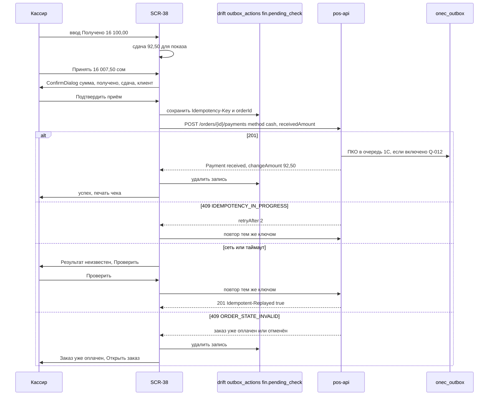

Ключевое действие «QR с ручным подтверждением»:

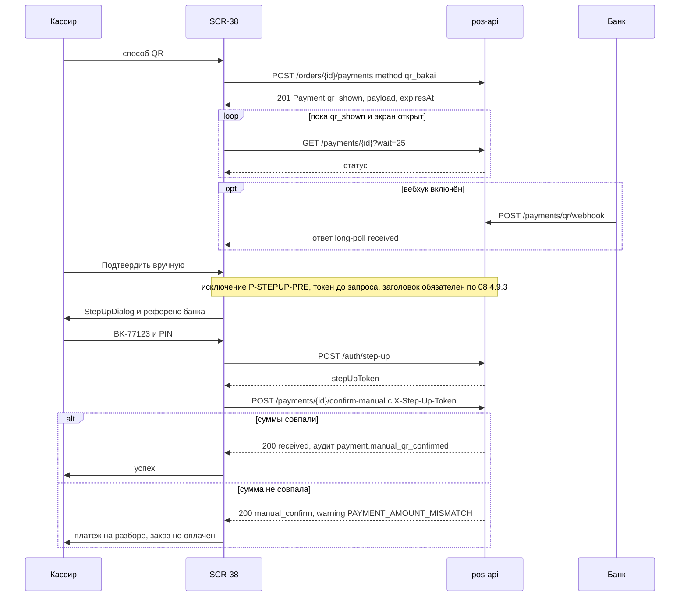

Ключевое действие «Разрешение продажи в долг старшим продавцом»:

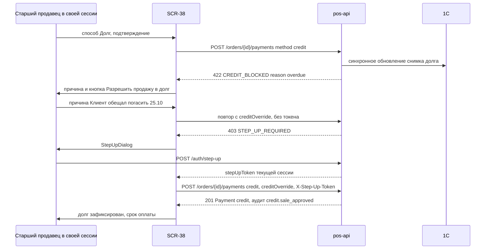

#### 7. Состояния экрана

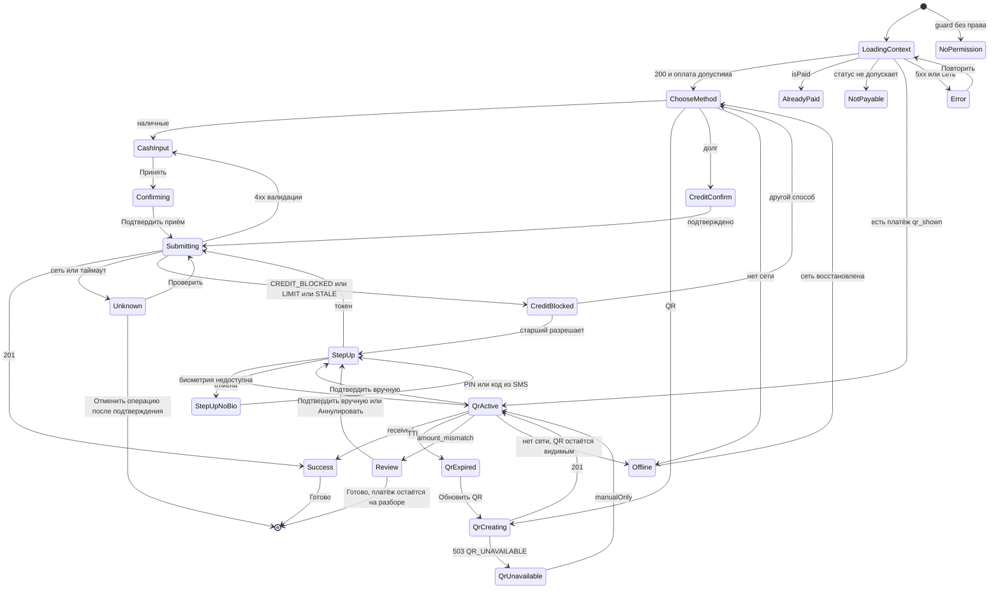

| Состояние | Видно / доступно |
|---|---|
| LoadingContext | скелетон Z1, плитки `disabled` |
| AlreadyPaid | «Заказ уже оплачен: 16 007,50 из 16 007,50» + «Открыть заказ» |
| NotPayable | «Оплата недоступна для заказа в статусе {status}» |
| Unknown | UI-38-018; CTA заменена «Проверить»; закрыть экран можно только после подтверждения «Закрыть? Результат операции неизвестен» (`payment_unknown_close_confirm`) |
| QrUnavailable | баннер `warning` и предложение статического QR / ручного подтверждения или другого способа |
| Review | чип «Требует проверки», таймер остановлен (PAY-024) |
| CreditBlocked | UI-38-013 с причиной; кассиру — «Выберите наличные или QR»; `senior_seller` — «Разрешить продажу в долг» (кроме STALE / 1С недоступна) |
| Offline | `OfflineBanner`; все CTA `disabled` («Нет сети: оплата невозможна» — PAY-008); уже показанный QR остаётся видимым, статус не обновляется |
| Нет прав | `admin`/`owner`/`seller` (наличные) — маршрут закрыт guard-ом → `EmptyState.noPermission` |
| Нет биометрии | в `StepUpDialog` доступны PIN и OTP |
| Устаревшие данные (долг) | P-STALE в Z1; при `RECEIVABLES_STALE` от сервера — «Обновить» |

#### 8. Валидация и сообщения

| Ключ ARB | Текст |
|---|---|
| `payment_title` | Приём оплаты |
| `payment_order_context` | Заказ № {number} · {customer} |
| `payment_to_pay` | К оплате |
| `payment_breakdown` | Товары {subtotal} · Скидка {percent} −{discount} · Итого {total} · Оплачено {paid} |
| `payment_method_title` | Способ оплаты |
| `payment_method_cash` / `payment_method_cash_sub` | Наличными в кассу / Оплата в нашем магазине |
| `payment_method_qr` / `payment_method_qr_sub` | QR / карта Бакай Банк / Оплата картой по QR |
| `payment_method_credit` / `payment_method_credit_sub` | Без оплаты / долг / Оплата позже (по согласованию) |
| `payment_received_label` | Получено от клиента |
| `payment_received_less` | Получено меньше суммы к оплате |
| `payment_quick_exact` | Без сдачи |
| `payment_change` | Сдача: {amount} |
| `payment_cta_accept` | Принять {amount} |
| `payment_confirm_title` | Подтвердите приём оплаты |
| `payment_confirm_body_cash` | Клиент: {customer}. К оплате {amount}, получено {received}, сдача {change} |
| `payment_confirm_cta` | Подтвердить приём |
| `payment_qr_creating` | Формируем QR… |
| `payment_qr_valid_until` | Заказ № {number} · действует до {time} |
| `payment_qr_waiting` | Ожидаем оплату |
| `payment_qr_expired` | Срок QR истёк |
| `payment_qr_reissue` | Обновить QR |
| `payment_qr_manual_note` | После оплаты кассир подтвердит поступление по выписке |
| `payment_qr_auto_note` | После оплаты заказ будет автоматически отмечен как оплаченный *(показ — только при `Payment.qr.autoConfirm=true`, 08 API-091)* |
| `payment_qr_unavailable` | Банк недоступен для QR. Покажите статический QR и подтвердите оплату вручную или выберите другой способ |
| `payment_qr_show_customer` | Показать покупателю |
| `payment_qr_switch_confirm` | Отменить QR-оплату и принять наличными? |
| `payment_qr_switch_senior_hint` | Отмена QR доступна кассиру |
| `payment_manual_title` | Подтверждение оплаты по выписке |
| `payment_manual_reference` | Референс банка или номер выписки |
| `payment_manual_reference_error` | Введите референс от 4 до 64 символов |
| `payment_manual_mismatch` | Сумма не совпадает: платёж отправлен на разбор |
| `payment_credit_checking` | Проверяем долг… |
| `payment_credit_confirm` | Зафиксировать продажу в долг на {amount}? Срок оплаты: {date} |
| `payment_credit_blocked_overdue` | Продажа в долг недоступна: есть просроченная задолженность {amount} |
| `payment_credit_blocked_limit` | Превышен лимит: доступно {remaining} |
| `payment_credit_blocked_stale` | Данные о долге устарели |
| `payment_credit_blocked_onec` | 1С недоступна: продажа в долг невозможна, выберите наличные или QR |
| `payment_credit_blocked_seller` | Продажа в долг недоступна: обратитесь к старшему продавцу |
| `payment_credit_choose_other` | Выберите наличные или QR |
| `payment_credit_override` | Разрешить продажу в долг |
| `payment_credit_override_reason` | Причина разрешения (не менее 5 символов) |
| `payment_debt_context` | Долг клиента {customer} · сальдо {balance} |
| `payment_debt_amount` | Сумма оплаты |
| `payment_debt_all` / `payment_debt_overdue` | Всё сальдо / Просроченное |
| `payment_debt_exceeds` | Сумма больше сальдо {balance} |
| `payment_debt_alloc_fifo` / `payment_debt_alloc_explicit` | Автоматически (FIFO, как в 1С) / Выбрать документы |
| `payment_debt_forecast` | Остаток после оплаты (прогноз): {amount} |
| `payment_debt_pending_onec` | Платёж принят, ожидает отражения в 1С |
| `payment_print_receipt` | Товарный чек (нефискальный, 80 мм) |
| `payment_print_failed` | Не удалось напечатать чек |
| `payment_success` | Принято {amount} |
| `payment_success_change` | Сдача {amount} |
| `payment_success_number` | Платёж № {number} |
| `payment_onec_pending` / `payment_onec_confirmed` / `payment_onec_manual` | Ожидает отражения в 1С / Отражено в 1С / Оформите ПКО в 1С |
| `payment_unknown` | Связь прервалась. Проверьте результат — деньги не принимайте повторно |
| `payment_check` | Проверить |
| `payment_already_paid` | Заказ уже оплачен: {paid} из {total} |
| `payment_not_payable` | Оплата недоступна для заказа в статусе «{status}» |
| `payment_close_confirm` | Закрыть без приёма оплаты? |
| `payment_close_qr_note` | QR останется активным до {time}, оплата будет видна в заказе |
| `payment_offline` | Нет сети: оплата невозможна |
| `payment_done` | Готово |
| `payment_scan_disabled` | Сканирование недоступно во время оплаты |
| `payment_unknown_close_confirm` | Закрыть? Результат операции неизвестен |
| `payment_unknown_discard` | Отменить операцию |
| `payment_unknown_discard_body` | Отменяйте, только если деньги не принимались: после отмены проверить результат будет нельзя |
| `payment_qr_create_error` | Не удалось сформировать QR |
| `payment_other_method` | Другой способ оплаты |
| `ds_idempotency_pending` | Статус операции уточняется (общий ключ, предложение к 03; кнопка — `payment_check`) |

Коды 08, обрабатываемые экраном: `VALIDATION_FAILED` (`received_less_than_due`, `exceeds_balance`, `bankReference`), `ORDER_STATE_INVALID`, `PAYMENT_STATE_INVALID`, `CREDIT_BLOCKED`, `CREDIT_LIMIT_EXCEEDED`, `RECEIVABLES_STALE`, `ONEC_UNAVAILABLE`, `CUSTOMER_NOT_IDENTIFIED`, `QR_UNAVAILABLE`, `STEP_UP_REQUIRED`, `PIN_INVALID`, `PIN_LOCKED`, `IDEMPOTENCY_IN_PROGRESS`, `IDEMPOTENCY_KEY_REUSED` (ошибка программы → `error_internal`), `FORBIDDEN`, `RATE_LIMITED`; предупреждения `PAYMENT_AMOUNT_MISMATCH`, `STALE_DATA`.

#### 9. Источники данных, API, состояние, бизнес-правила

- По заказу: `GET /orders/{id}?include=payments` (§4.8.3); `POST /orders/{id}/payments` (§4.8.6) — `cash` (`receivedAmount`), `qr_bakai` (`reissueQr`, `manualOnly`), `credit` (`creditOverride`); `GET /payments/{id}?wait=25` (§4.9.2, Q-167); `POST /payments/{id}/confirm-manual` (§4.9.3); `POST /payments/{id}/void` (§4.9.4, при смене способа с QR); `GET /orders/{id}/documents/receipt.pdf` (§4.8.5).
- По долгу: `GET /customers/{id}/receivables[?include=documents]` (§4.11.5); `POST /payments` (§4.9.1, условно Q-152); видимость режима — `Me.features.debtPaymentsEnabled` (P-FLAGS); при выключенном на сервере `DEBT_PAYMENTS_FROM_POS` эндпоинт отвечает `403` (08 §11) → состояние «Недоступно».
- Общие: `POST /auth/step-up`; `GET /me` (права, лимиты).
- Состояние: форма — в памяти; `Idempotency-Key`, вид операции и описание баннера — drift `outbox_actions` записью типа `fin.pending_check` (P-IDEMP; без тела запроса, сумм долга и ПДн; обработчик outbox её не отправляет — автоповтора нет, З-23) до окончательного ответа; после успеха — удаляется.
- Правила: PAY-001…008, PAY-010…014, PAY-020…029, PAY-030…037, PAY-040…043, PAY-050, CASH-012…014, DEBT-006, DEBT-010, MNY-* (сдача — только отображение), D-26, D-27.

#### 10. Действия по ролям и ограничения безопасности

| Действие | cashier | senior_seller | admin | owner | seller |
|---|---|---|---|---|---|
| Открыть SCR-38 | да | да | — | — | — (QR и долг — только при оформлении SCR-21/22) |
| Наличные | да | да | — | — | — |
| QR: показать, обновить | да | да | — | — | — |
| QR: подтвердить вручную | да, S! | да, S! | — | — | — |
| Долг по заказу без блокировки | да | да | — | — | — |
| Разрешить долг при блокировке | — | да, S!, своя сессия | — | — | — |
| Оплата долга без заказа | да (Q-152) | да (Q-152) | — | — | — |
| Аннулировать QR при смене способа | да, S! | — (Q-005) | — | — | — |

Сервер проверяет право, статус, сумму и токен независимо от UI (CASH-001, CASH-002); суммы по заказу клиент не передаёт; поля `price`, `total` в теле → `VALIDATION_FAILED` и `price.override_attempt` (DISC-011).

#### 11. Повторное нажатие, двойной запрос, «Назад», перезапуск

- Повторное нажатие CTA/«Подтвердить приём» во время запроса — игнор (`loading`); двойной тап до открытия `ConfirmDialog` открывает один диалог.
- Один `Idempotency-Key` на операцию; повтор после step-up, `IDEMPOTENCY_IN_PROGRESS`, «Проверить» — с тем же ключом; новый ключ — только при изменении операции (другой способ/сумма) после окончательного ответа.
- Повторная оплата уже оплаченного заказа отклоняется сервером (`ORDER_STATE_INVALID`/`PAYMENT_STATE_INVALID`, PAY-004) и показывается как «Заказ уже оплачен».
- «Назад» — см. п.4; во время запроса — игнор.
- Перезапуск приложения: маршрут `/payments/new` **не** восстанавливается (navigation §7.1); при наличии записи `outbox_actions` типа `fin.pending_check` на SCR-30 показывается баннер «Незавершённая операция: {описание} · Проверить» (описание по P-IDEMP: по заказу — «приём {сумма заказа} по заказу № {номер}», по долгу — «оплата долга клиента» без суммы и имени клиента; запись не отправляется автоматически) → SCR-38 того же заказа (или клиента) в состоянии Unknown; «Проверить» выполняет проверку чтением (`GET /orders/{id}?include=payments` / `GET /transactions?customerId=…&kind=payment_received&from=<сегодня>`, P-IDEMP: тела запроса в записи нет) и показывает найденный платёж; если платёж не найден — форма открывается заново, повторный ввод уходит с ключом из записи; «Отменить операцию» (`payment_unknown_discard`, подтверждение `payment_unknown_discard_body`) удаляет запись (только если кассир уверен, что деньги не принимались) — [ТИПОВО: уточнение к 08 §2.7, замечание З-09]. Показанный QR после перезапуска восстанавливается открытием заказа (платёж `qr_shown` хранится на сервере).

#### 12. Требования к платформам

| Платформа | Требования |
|---|---|
| Windows-POS | цифры с клавиатуры в «Получено» сразу при открытии способа «Наличные» (автофокус); Enter — CTA, повторный Enter в `ConfirmDialog` — «Подтвердить приём»; Esc — отмена/закрыть; F7 — сменить способ; Ctrl+P — печать чека на экране успеха; HID-скан на экране игнорируется с подсказкой «Сканирование недоступно во время оплаты» (`payment_scan_disabled`, снекбар 4 с); второй монитор покупателя — Q-214 |
| Android-планшет / телефон | нампад `QuantityNumpadSheet` для суммы; «Показать покупателю» — полноэкранный QR, поворот экрана к покупателю, максимальная яркость; `bio+pin` для step-up |
| iOS | как Android (без проверки сборки) |
| Все | CTA ≥ 52 lp; финансовый ввод не уплотняется (standard плотность); P-SECURE |

#### 13. Критерии приёмки

| ID | Критерий |
|---|---|
| AC-UI-38-001 | Сумма к оплате по заказу берётся из ответа сервера (`totalToPay − paidAmount`); на примере корзины макета показывается 16 007,50 сом, а не 16 030 |
| AC-UI-38-002 | Запрос оплаты по заказу не содержит суммы платежа (только `method` и `receivedAmount` для наличных) |
| AC-UI-38-003 | CTA «Принять» неактивна, пока «Получено» меньше суммы к оплате; при 16 100,00 показывается сдача 92,50 |
| AC-UI-38-004 | Перед приёмом наличных показывается `ConfirmDialog` с суммой, полученным, сдачей и клиентом |
| AC-UI-38-005 | Двойное нажатие «Подтвердить приём» создаёт один запрос; повтор после сетевой ошибки идёт с тем же `Idempotency-Key` и возвращает тот же платёж (`Idempotent-Replayed: true`), в журнале одна транзакция |
| AC-UI-38-006 | Выбор QR создаёт платёж `qr_shown`, показывает QR, сумму, номер заказа и таймер; статус обновляется long-polling не более одним запросом одновременно |
| AC-UI-38-007 | По истечении TTL QR гаснет, «Обновить QR» перевыпускает QR на том же `payment_id` |
| AC-UI-38-008 | «Подтвердить вручную» требует step-up и референс банка; без токена сервер отвечает 403 `STEP_UP_REQUIRED`, после подтверждения — `received` и запись аудита `payment.manual_qr_confirmed` |
| AC-UI-38-009 | Текст «будет автоматически отмечен как оплаченный» показывается только при `Payment.qr.autoConfirm=true`; при `false` показывается «После оплаты кассир подтвердит поступление по выписке» |
| AC-UI-38-010 | При `QR_UNAVAILABLE` предлагается статический QR / ручное подтверждение или другой способ |
| AC-UI-38-011 | Долг по заказу при просрочке, превышении лимита, устаревшем снимке или недоступной 1С блокируется с текстом причины; кассир не видит кнопку разрешения |
| AC-UI-38-012 | `senior_seller` разрешает долг только в своей сессии с причиной и step-up; токен другой сессии отклоняется сервером; аудит `credit.sale_approved` содержит причину |
| AC-UI-38-013 | Оплата долга: сумма > сальдо отклоняется с «Сумма больше сальдо»; частичная оплата принимается; после успеха показывается «ожидает отражения в 1С» |
| AC-UI-38-014 | «Выбрать документы» в оплате долга требует step-up детализации; FIFO — без step-up |
| AC-UI-38-015 | Для `admin` и `owner` маршрут `/payments/new` закрыт; прямой `POST /orders/{id}/payments` с их токеном → 403 |
| AC-UI-38-016 | Без сети все CTA неактивны с текстом «Нет сети: оплата невозможна», локально платёж не создаётся |
| AC-UI-38-017 | Ошибка печати чека не отменяет платёж и предлагает «Повторить» |
| AC-UI-38-018 | Повторное открытие экрана для оплаченного заказа показывает «Заказ уже оплачен» без возможности принять оплату |
| AC-UI-38-019 | После перезапуска с незавершённой операцией кассир видит баннер на SCR-30; «Проверить» находит проведённый платёж чтением (`GET /orders/{id}?include=payments`) и показывает его без второго приёма; если платёж не найден, повторный ввод уходит с ключом из записи |
| AC-UI-38-020 | Смена способа с активного QR на наличные требует подтверждения и аннулирования QR-платежа со step-up |
| AC-UI-38-021 | При ручном подтверждении QR без действующего токена `StepUpDialog` с полями референса открывается до запроса; `POST /payments/{id}/confirm-manual` уходит с `X-Step-Up-Token`; при `403 STEP_UP_REQUIRED` повтор идёт с тем же `Idempotency-Key` |
| AC-UI-38-022 | Запись `fin.pending_check` после потери сети или перезапуска не отправляется автоматически; описание баннера для оплаты долга не содержит суммы и имени клиента |
| AC-UI-38-023 | Оплата допускается для заказа в статусах `submitting`, `pending_approval`, `awaiting_payment`, `approved` (08 §4.8.6); для других статусов показывается «Оплата недоступна для заказа в статусе …» |
| AC-UI-38-024 | Из состояния «Требует проверки» доступны «Подтвердить вручную» и «Аннулировать» (оба со step-up) и «Готово»; таймер QR остановлен |

#### 14. Трассировка

| Элемент | SRC | Правила |
|---|---|---|
| Быстрый доступ к кассе, кассовая продажа | SRC-C-090a, SRC-E-163, SRC-C-128 | CASH-012, PAY-010 |
| Оплата долга | SRC-C-108, SRC-E-170e | CASH-013, PAY-040…043 |
| Защита от повторного проведения и идемпотентность | SRC-C-117, SRC-C-118, SRC-E-166, SRC-E-167 | PAY-003, PAY-004, TXN-005 |
| Аудит финансовых операций | SRC-C-118a, SRC-C-140 | PAY-006, PAY-026 |
| Не объявлять приложение фискальной кассой: «Товарный чек (не является фискальным документом)» UI-38-006, нефискальный чек 80 мм | SRC-C-120 | PAY-014, D-26 |
| Выяснить кассовое оборудование, фискализацию и платёжный терминал до реализации | SRC-C-119 → открытые вопросы Q-013, Q-009, Q-019, Q-214 | D-26 |
| Различие заказа, оплаты, продажи | SRC-E-168, SRC-E-169 | PAY-005 |
| Подтверждение критических действий, проверка сервером | SRC-F-034, SRC-F-036 | CASH-014, CASH-007 |
| Способы оплаты макета | ядро §14 (IMG_7090) | PAY-020, PAY-027, PAY-030 |

---

### SCR-39 — Заявка на возврат (маршруты `/returns/new?orderId=` — создание, `/returns/{id}` — просмотр/черновик; роли `cashier`, `senior_seller`, `admin` — создание и отправка; `owner` — только просмотр; R1 — да, **условно Q-018**)

#### 1. Назначение и роль пользователя

Оформить в приложении **заявку** на возврат по исходной продаже (D-25, RET-001…012): выбрать исходную продажу (заказ `shipped`/`partially_returned` с реализацией 1С — «возврата в никуда» нет), позиции и количество (≤ отгружено − уже возвращено), обязательную причину, подтвердить отправку (step-up) и отслеживать статусы `draft → submitted → accepted/rejected → completed`. Документ возврата, приход на склад, возврат денег и фискальный чек возврата — только в 1С/ККМ (RET-010); приложение их не выполняет и прямо об этом сообщает. Если заявка превышает порог `return_approval_threshold` (10 000 сом [НЕ ПОДТВЕРЖДЕНО, Q-174]), кассир сохраняет черновик, а отправляет `senior_seller`/`admin` в своей сессии (RET-009, CASH-007). Модуль выключается на сервере (`app_settings.returns_enabled` / env `RETURNS_FROM_POS_ENABLED`); клиент env и `app_settings` не читает и узнаёт о выключении из `Me.features.returnsEnabled` [НОВОЕ ИМЯ, P-FLAGS, З-27] — тогда экран недоступен и точки входа показывают «Возврат оформляется в 1С» (RET-012).

#### 2. Структура экрана

- **compact:** полноэкранный root-маршрут: `TopAppBarPos` «Заявка на возврат» (просмотр — «Возврат № RET-…») → Z1 исходная продажа (карточка) → Z2 список позиций (строки с чекбоксом и степпером) → Z3 причина (`AppRadio` столбиком 6 значений) + комментарий (multiline, 0/300) → Z4 сумма к возврату (предварительно) + пояснение «Документ возврата и деньги — в 1С» → Z5 закреплённые кнопки: «Сохранить черновик» (outlined) и «Отправить заявку» (primary). Режим просмотра: Z6 заголовок со статусом и статус-линия вместо кнопок.
- **medium (600–1023):** модальный диалог шириной 640 поверх родителя (поля `ds.space.6`, высота ≤ 90 % окна, `ds.radius.xl`, `ds.elevation.3`, `overlay`); шапка диалога 56 — заголовок слева, крестик справа (закрытие = «Назад» с `ConfirmDialog` при изменениях); тело — одна колонка с прокруткой: Z1 карточка исходной продажи (72) → Z2 список позиций (строки 64: чекбокс 48 слева, название и «продано N, возвращено M», справа степпер 44 и сумма) → Z3 причина — `AppDropdown` (высота 48) + комментарий (96, счётчик 0/300) → Z4 сумма (`h3`) и пожелание способа (`AppRadio` ×3 в ряд) → баннер UI-39-011; Z5 закреплён в нижней полосе диалога 72 (разделитель `border` сверху): слева «Сохранить черновик» (outlined M), справа «Отправить заявку» (primary M). Портрет планшета с экранной клавиатурой: при фокусе в комментарии тело прокручивается так, чтобы поле было над клавиатурой, полоса кнопок остаётся над ней. Режим просмотра: Z6 (заголовок со статусом и статус-линия) над позициями, в нижней полосе — только «Закрыть».
- **expanded / large:** диалог ≈ 720×680 поверх родителя: слева (60 %) — Z1 + Z2, справа (40 %) — Z3 + Z4 + Z5 (кнопки внизу справа), причина — `AppDropdown`.

#### 3. Таблица элементов

| № | UI-ID | Элемент | Компонент | Расположение/размер/отступы/выравнивание | Токены | Состояния | Поведение | Источник данных | Роли | Правило |
|---|---|---|---|---|---|---|---|---|---|---|
| 1 | UI-39-001 | Исходная продажа | `CustomerCard` (compact), `StatusChip` | Z1, карточка 72–96, паддинг `ds.space.4` | «Заказ № 1024 от 18 окт 2026 · Реализация УТ-0001234» `body 500`; клиент `caption`; статус заказа `StatusChip` | loading, default, invalid (не отгружен) | тап по номеру — SCR-24 (`go`, с подтверждением выхода, если есть изменения) | `GET /orders/{id}?include=items,documents` (`onec.number`, `status`) | все роли экрана | RET-001, RET-002 |
| 2 | UI-39-002 | Заголовок позиций | `AppSectionHeader` + «Выбрать всё» | над списком | `title 18/600` | — | «Выбрать всё» отмечает все доступные строки с максимальным количеством | — | создающие роли | — |
| 3 | UI-39-003 | Строка возврата | `CartLine` (вариант возврата), `AppCheckbox`, `QuantityStepper`, `PriceText` | строка 72 (compact) / 64; чекбокс 48 слева, название и «продано N, возвращено M», справа степпер 44/48 и сумма | цена за единицу с учётом скидки `caption tnum`; сумма `body 700 tnum`; превышение — `error` | unchecked, checked, disabled («возвращено полностью» — чип `neutral`), error | чекбокс включает строку (степпер = 1); степпер 1…`shippedQuantity − returnedQuantity`; долгое нажатие на число — `QuantityNumpadSheet`; кратность единицы — по `qty_precision` | `items[]` (`shippedQuantity`, `returnedQuantity`, `unitPrice`, `discountAmount`, `lineTotal`) | создающие роли | RET-003, RET-005, RET-008 |
| 4 | UI-39-004 | Причина и комментарий | `AppRadio` ×6 (compact) / `AppDropdown` (medium+), `AppTextField` multiline | Z3; комментарий высота 96, счётчик 0/300 справа снизу | обязательность — звёздочка + текст «обязательно» | empty (ошибка при отправке), selected, error | `defect` Брак · `wrong_item` Пересорт · `not_suitable` Не подошёл · `surplus` Излишек · `seller_error` Ошибка продавца · `other` Иное (комментарий ≥ 10 символов, Q-176) | `return_reason` (07 §6) | создающие роли | RET-004 |
| 5 | UI-39-005 | Сумма к возврату | `PriceText` + `caption` | Z4; сумма `h3 700 tnum` | пояснение `caption textSecondary` | default, zero (нет строк) | «Предварительно: 4 700,00 сом» — после сохранения черновика из `totalAmount` сервера; до сохранения — отображение суммы строк по `lineTotal / quantity × qty` с пометкой «предварительно» (RET-005, MNY-006) | `ReturnRequest.totalAmount` | все роли экрана | RET-005 |
| 6 | UI-39-010 | Пожелание способа возврата | `AppRadio` ×3 | Z4 под суммой | — | default, disabled (способ исходной оплаты единственный) | «Наличными» · «QR» · «Зачесть в долг» (только для продаж `credit`) — передаётся как пожелание `refundKind`; деньги возвращает 1С | `refundKind` | создающие роли | 08 §3.12, D-25 |
| 7 | UI-39-011 | Пояснение о 1С | `ErrorState.banner` (info) | над кнопками | `infoContainer`/`info` | — | «Документ возврата, приход на склад и возврат денег оформляются в 1С. Приложение передаёт заявку» | — | все роли экрана | RET-010, D-25 |
| 8 | UI-39-006 | Действия | `AppButton` L outlined «Сохранить черновик» / primary «Отправить заявку» | Z5; compact — закреплены снизу в ряд; expanded — справа внизу | `primary`/`outlined` | default, disabled (нет строк / нет причины), loading | черновик → `POST /returns` (первый раз) или `PATCH /returns/{id}` (`rowVersion`); отправка → сохранить черновик при изменениях → `StepUpDialog` → `POST /returns/{id}/submit` | — | `cashier`, `senior_seller`, `admin` | RET-003, RET-006, RET-009 |
| 9 | UI-39-009 | `StepUpDialog` отправки | `StepUpDialog` (self) | диалог 400 | — | default, loading, error | описание «Отправка заявки на возврат на {amount} по заказу № {number}»; отмена — заявка остаётся черновиком | — | создающие роли | RET-006, SEC-033 |
| 10 | UI-39-012 | Порог согласования | `ErrorState.banner` (warning) | над кнопками | `warningContainer` | скрыт, видим | после ответа на submit `403 FORBIDDEN` с `reason: return_threshold_exceeded` и `threshold` в теле [НОВОЕ ИМЯ — предложение к 08 §2.4 / §4.15.3, З-28]; до доработки 08 — `403 FORBIDDEN` на submit при наличии `return.submit` в `/me.permissions` (иной причины отказа у такой роли нет); прочие `403` — P-403. Текст: «Сумма заявки превышает порог. Отправить может старший продавец или администратор в своей сессии. Черновик сохранён» | ответ сервера | `cashier` | RET-009, CASH-007 |
| 11 | UI-39-007 | Заголовок заявки (просмотр) | `AppSectionHeader`, `StatusChip` (`status_return_*`) | Z6, верх | номер `h3`; автор, время `caption tnum` | draft, submitted, accepted, rejected, completed | — | `GET /returns/{id}` | все роли экрана | RET-007 |
| 12 | UI-39-008 | Статус-линия | `AppListTile` (timeline) | Z6 под заголовком | точки по статусам; текущий — `primary` | — | `draft → submitted → accepted/rejected → completed` с временем; при `rejected` — причина; при `completed` — «Возврат оформлен в 1С: {номер документа}» и способ возврата денег по данным 1С | `ReturnRequest.status`, `onec` | все роли экрана | RET-007, RET-010 |
| 13 | UI-39-013 | Режим только просмотра | — | — | — | — | для `owner` и для заявок не в `draft`: строки, причина, сумма — read-only; кнопок нет | `return.read` | `owner`; все для не-`draft` | 11 §4.4, ядро §18.2 п.11 |

#### 4. Поведение контролов

- **Открытие `/returns/new?orderId=`.** `GET /orders/{id}?include=items,documents`. Заказ не `shipped`/`partially_returned` или без реализации 1С → состояние «Возврат недоступен: заказ не отгружен» (RET-001) без формы. Строки с `shippedQuantity − returnedQuantity ≤ 0` — `disabled` «возвращено полностью»; `returnedQuantity = null` → лимит = `shippedQuantity` и предупреждение «Нет данных о прежних возвратах — количество будет проверено в 1С» (RET-003).
- **Чекбокс / степпер.** Включение строки ставит 1; степпер не выходит за пределы (кнопка «+» `disabled` на максимуме, подпись «можно вернуть: N»); ручной ввод больше максимума → `error` «Больше, чем можно вернуть ({max})» (ANIM-012). Снятие чекбокса обнуляет строку.
- **Причина.** Выбор `other` раскрывает обязательный комментарий (ANIM-020); счётчик 0/300; < 10 символов при `other` — ошибка при отправке.
- **«Сохранить черновик».** Первый раз `POST /returns {orderId, reasonCode, reasonComment, items[], refundKind}` с `Idempotency-Key` (P-IDEMP) → маршрут заменяется на `/returns/{id}` (`replace`); далее `PATCH /returns/{id}` с `rowVersion`. `VERSION_CONFLICT` → «Заявка изменена на другом устройстве. Данные обновлены» + подстановка `current`. `RETURN_QTY_EXCEEDED` → подсветка строк. 08 требует `reasonCode` и `items ≥ 1` уже в `POST /returns`, поэтому «Сохранить черновик» активна только при выбранной причине и хотя бы одной строке.
- **«Отправить заявку».** Валидация (≥ 1 строка, причина, комментарий для `other`) → при несохранённых изменениях — сначала сохранение черновика → P-STEPUP (`return.submit`) → `POST /returns/{id}/submit {rowVersion}` с `Idempotency-Key` → `submitted`: экран переходит в режим просмотра, снекбар «Заявка отправлена в 1С». `403 FORBIDDEN` с `reason: return_threshold_exceeded` (З-28; до доработки 08 — `403` при наличии `return.submit` в `/me`) → UI-39-012; иной `403` — P-403. `ORDER_STATE_INVALID` (`not_draft`) → перезагрузка, режим просмотра.
- **Повторное нажатие** любой кнопки во время запроса — игнор.
- **Удаление черновика** в R1 не предусмотрено: эндпоинта удаления в 08 нет (замечание З-10); черновик остаётся в списке заявок.

#### 5. Анимации

ANIM-023 (диалоги), ANIM-007 (автоповтор степпера при удержании; на максимуме — остановка и подпись `error`), ANIM-012 (ошибки полей), ANIM-020 (раскрытие комментария), ANIM-010 (перекат суммы к возврату), ANIM-027 (снекбары), ANIM-024 (переход). Специфично — «переход в просмотр после отправки»: кнопки fade-out 150 мс, статус-линия fade-in 200 мс, чип статуса `draft` → `submitted` crossfade 200 мс; reduce-motion — мгновенно.

#### 6. Переходы

| Откуда → куда | Данные | Способ | «Назад» |
|---|---|---|---|
| SCR-24 «Оформить возврат» | `orderId` | `push` (root) | SCR-24 |
| SCR-37 «Заявка на возврат» / связанная заявка | `orderId` / `returnId` | `push` | SCR-37 |
| SCR-30 лист UI-30-016 (режим возврата) | `orderId` | `push` | SCR-30 |
| SCR-44 уведомление `return_status` | `returnId` | `push` | SCR-44 |
| SCR-39 → SCR-24 | `orderId` | `go` | — |

«Назад» до сохранения с изменениями — `ConfirmDialog` «Выйти без сохранения? Выбранные позиции не сохранятся» (варианты «Сохранить черновик», «Выйти»); после сохранения — без диалога.

Ключевое действие «Отправка заявки со step-up»:

```mermaid
sequenceDiagram
    participant K as Кассир
    participant R as SCR-39
    participant API as pos-api
    participant O as onec_outbox
    K->>R: позиции, причина Брак, Отправить
    R->>API: POST /returns Idempotency-Key
    API-->>R: 201 ReturnRequest draft, rowVersion 1, аудит return.requested
    R->>API: POST /returns/{id}/submit rowVersion 1
    API-->>R: 403 STEP_UP_REQUIRED
    R->>K: StepUpDialog
    K->>API: POST /auth/step-up PIN
    API-->>R: stepUpToken
    R->>API: POST /returns/{id}/submit с X-Step-Up-Token, тот же ключ
    alt сумма в пределах порога
        API->>O: заявка в очередь 1С
        API-->>R: 200 submitted, аудит return.submitted
        R->>K: режим просмотра, статус Отправлена
    else сумма выше порога
        API-->>R: 403 FORBIDDEN reason return_threshold_exceeded
        R->>K: Черновик сохранён, отправит старший продавец
    end
```

#### 7. Состояния экрана

```mermaid
stateDiagram-v2
    [*] --> Loading
    [*] --> Disabled : features.returnsEnabled false
    Loading --> Editing : заказ отгружен
    Loading --> NotReturnable : заказ не отгружен
    Loading --> ViewOnly : заявка не draft или роль owner
    Loading --> Error : 5xx или сеть
    Loading --> Offline : нет сети
    Error --> Loading : Повторить
    Offline --> Loading : сеть восстановлена
    Editing --> EditingOffline : сеть пропала
    EditingOffline --> Editing : сеть восстановлена
    Editing --> SavingDraft : Сохранить черновик
    SavingDraft --> Editing : 201 или 200
    SavingDraft --> Editing : ошибка с подсветкой
    SavingDraft --> Unknown : сеть или таймаут
    Editing --> StepUp : Отправить
    StepUp --> StepUpNoBio : биометрия недоступна
    StepUpNoBio --> StepUp : PIN или код из SMS
    StepUp --> Submitting : токен
    StepUp --> Editing : отмена
    Submitting --> ViewOnly : 200 submitted
    Submitting --> ThresholdBlocked : 403 return_threshold_exceeded
    Submitting --> Editing : VERSION_CONFLICT или RETURN_QTY_EXCEEDED
    Submitting --> Unknown : сеть или таймаут
    Unknown --> Submitting : Проверить с тем же ключом
    ThresholdBlocked --> Editing : закрыть баннер
    ViewOnly --> ViewOnly : синхронизация статуса
```

| Состояние | Видно |
|---|---|
| Loading | скелетон карточки и 3 строк |
| NotReturnable | `EmptyState` «Возврат недоступен: заказ не отгружен» + «Открыть заказ» |
| Disabled | `EmptyState` «Возвраты оформляются в 1С» |
| Editing | форма; сумма пересчитывается при изменениях |
| ThresholdBlocked | баннер UI-39-012; черновик сохранён |
| ViewOnly | заголовок со статусом, статус-линия, позиции read-only |
| Offline | данных в памяти нет — `EmptyState.offlineNoCache` «Заявка недоступна без сети» (`return_offline_no_data`) |
| EditingOffline | форма в памяти доступна для просмотра и правки, «Сохранить черновик» и «Отправить заявку» `disabled` с подсказкой «Нет сети: сохранение и отправка недоступны» (`return_offline_hint`; заявка — только онлайн, D-32, DATA-254) |
| StepUpNoBio | в `StepUpDialog` нет варианта «Биометрия + PIN» (нет биометрии, не включена, разрешение отозвано или заблокирована ОС) — доступны «PIN» и «Код из SMS» (BIO-015); `PIN_LOCKED` — только «Код из SMS»; на Windows — PIN (D-13) |
| Unknown | `ErrorState.banner` «Связь прервалась. Проверьте результат — заявка могла быть сохранена» (`return_unknown`) + «Проверить» (тот же `Idempotency-Key`); запись `fin.pending_check` (P-IDEMP) |
| Error | `ErrorState.fullScreen` + «Повторить» |
| Устаревшие данные | статус обновляется синхронизацией (`return_docs`); подпись «Статус из 1С на HH:MM» |

#### 8. Валидация и сообщения

| Ключ ARB | Текст |
|---|---|
| `return_title_new` | Заявка на возврат |
| `return_title_view` | Возврат № {number} |
| `return_source` | Заказ № {order} от {date} · Реализация {shipment} |
| `return_items_title` | Позиции к возврату |
| `return_select_all` | Выбрать всё |
| `return_item_sold_returned` | Продано {sold}, возвращено {returned} |
| `return_item_max` | Можно вернуть: {max} |
| `return_item_fully_returned` | возвращено полностью |
| `return_item_exceeds` | Больше, чем можно вернуть ({max}) |
| `return_no_previous_data` | Нет данных о прежних возвратах — количество будет проверено в 1С |
| `return_reason_title` | Причина возврата (обязательно) |
| `return_reason_defect` / `return_reason_wrong_item` / `return_reason_not_suitable` / `return_reason_surplus` / `return_reason_seller_error` / `return_reason_other` | Брак / Пересорт / Не подошёл / Излишек / Ошибка продавца / Иное |
| `return_comment_label` | Комментарий |
| `return_comment_required` | Опишите причину (не менее 10 символов) |
| `return_reason_required` | Выберите причину возврата |
| `return_items_required` | Выберите хотя бы одну позицию |
| `return_amount` | Предварительно: {amount} |
| `return_refund_kind_cash` / `return_refund_kind_qr` / `return_refund_kind_offset` | Наличными / QR / Зачесть в долг |
| `return_onec_note` | Документ возврата, приход на склад и возврат денег оформляются в 1С. Приложение передаёт заявку |
| `return_save_draft` | Сохранить черновик |
| `return_submit` | Отправить заявку |
| `return_step_up_reason` | Отправка заявки на возврат на {amount} по заказу № {number} |
| `return_draft_saved` | Черновик сохранён |
| `return_submitted` | Заявка отправлена в 1С |
| `return_threshold` | Сумма заявки превышает порог. Отправить может старший продавец или администратор в своей сессии. Черновик сохранён |
| `return_version_conflict` | Заявка изменена на другом устройстве. Данные обновлены |
| `return_not_returnable` | Возврат недоступен: заказ не отгружен |
| `return_disabled` | Возвраты оформляются в 1С |
| `return_completed` | Возврат оформлен в 1С: {document} |
| `return_rejected` | Заявка отклонена: {reason} |
| `return_leave_title` | Выйти без сохранения? |
| `return_leave_body` | Выбранные позиции не сохранятся |
| `return_status_as_of` | Статус из 1С на {time} |
| `return_offline_hint` | Нет сети: сохранение и отправка недоступны |
| `return_offline_no_data` | Заявка недоступна без сети |
| `return_unknown` | Связь прервалась. Проверьте результат — заявка могла быть сохранена |

#### 9. Источники данных, API, бизнес-правила

`GET /orders/{id}?include=items,documents` (08 §4.8.3); `POST /returns` (§4.15.1); `GET /returns/{id}`, `PATCH /returns/{id}` (§4.15.2); `POST /returns/{id}/submit` (§4.15.3); `POST /auth/step-up`. Правила: RET-001…012, CASH-007, D-25, MNY-006. Аудит (11 §7.2): `return.requested` (создание черновика), `return.updated`, `return.submitted` (S!), `return.status_changed` (1С). Транзакция `return_requested` (could), `refund` — только при `completed`. Уведомление автору — `notification_kind=return_status`.

#### 10. Действия по ролям

| Действие | cashier | senior_seller | admin | owner | seller |
|---|---|---|---|---|---|
| Создать / изменить черновик | да | да | да | — | — |
| Отправить (в пределах порога) | да, S! | да, S! | да, S! | — | — |
| Отправить (сверх порога) | — (403) | да, S!, своя сессия | да, S!, своя сессия | — | — |
| Просмотр заявок | да | да | да | да | — |

#### 11. Повторное нажатие, двойной запрос, «Назад», перезапуск

Создание и отправка — P-IDEMP (ключ хранится записью `outbox_actions` типа `fin.pending_check` без автоповтора; баннер «заявка на возврат по заказу № {номер}» на SCR-30 после перезапуска; повторная заявка с тем же ключом не создаёт второй записи; RET-008 на сервере не даёт превысить остаток при разных заявках). Изменения черновика — по `rowVersion`. «Назад» — см. п.6. Перезапуск: `/returns/new` не восстанавливается; сохранённый черновик открывается по `/returns/{id}` (из SCR-37/SCR-24/уведомления); несохранённый выбор позиций теряется (в drift не хранится — нет таблицы в 07 §11.2).

#### 12. Требования к платформам

Windows: Space — чекбокс строки, +/− — количество в фокусе, Tab — поля, Ctrl+S — сохранить черновик, Ctrl+Enter — отправить, Esc — выйти (с подтверждением); HID-скан штрихкода товара отмечает соответствующую строку (+1 к количеству в пределах максимума) (responsive-spec §5). Android/iOS: строки 72, чекбокс-цель 48, степпер 44/48; нампад для количества.

#### 13. Критерии приёмки

| ID | Критерий |
|---|---|
| AC-UI-39-001 | Заявка создаётся только для заказа `shipped`/`partially_returned`; для другого статуса показывается «Возврат недоступен: заказ не отгружен» |
| AC-UI-39-002 | Количество по строке ограничено `отгружено − возвращено`; ввод больше показывает ошибку и не отправляется |
| AC-UI-39-003 | Без причины и без выбранных позиций кнопки сохранения/отправки неактивны; для «Иное» требуется комментарий ≥ 10 символов |
| AC-UI-39-004 | Отправка требует step-up; отмена `StepUpDialog` оставляет заявку черновиком |
| AC-UI-39-005 | Повторное нажатие «Отправить» или повтор после сетевой ошибки не создаёт вторую заявку (тот же `Idempotency-Key`) |
| AC-UI-39-006 | У кассира отправка заявки сверх порога завершается сообщением о пороге, черновик сохранён; `senior_seller` в своей сессии отправляет её успешно; порог распознаётся по `reason: return_threshold_exceeded` (З-28), иной `403` показывается как «Недостаточно прав» |
| AC-UI-39-007 | После отправки экран показывает статус «Отправлена» и статус-линию; дальнейшие статусы обновляются из 1С |
| AC-UI-39-008 | Экран явно сообщает, что документ возврата и деньги оформляются в 1С; в приложении нет действия «вернуть деньги» |
| AC-UI-39-009 | `owner` видит заявку только в режиме просмотра, без кнопок |
| AC-UI-39-010 | При `Me.features.returnsEnabled=false` (P-FLAGS) маршрут показывает «Возвраты оформляются в 1С», точки входа скрыты; клиент не обращается к env и `app_settings` |
| AC-UI-39-011 | `VERSION_CONFLICT` при изменении черновика подставляет актуальные данные и сообщает об этом |
| AC-UI-39-012 | Без биометрии `StepUpDialog` отправки предлагает «PIN» и «Код из SMS»; отмена диалога оставляет черновик |
| AC-UI-39-013 | При потере сети во время правки форма остаётся на экране, кнопки сохранения и отправки `disabled` с подсказкой «Нет сети: сохранение и отправка недоступны»; после восстановления сети кнопки снова активны |
| AC-UI-39-014 | На medium экран открывается диалогом 640 с одной колонкой и закреплённой нижней полосой кнопок; причина выбирается из `AppDropdown` |

#### 14. Трассировка

| Элемент | SRC | Правила |
|---|---|---|
| Возврат | SRC-E-165 | RET-001…012, D-25 |
| Отмена/возврат с аудитом | SRC-C-138, SRC-C-118a | RET-011 |
| Повторные запросы, защита от двойных операций | SRC-E-166, SRC-E-167, SRC-C-117 | RET-008, PAY-003 |
| Подтверждение сервером, step-up | SRC-F-036 | RET-006, RET-009, CASH-007 |
| Не объявлять приложение фискальной кассой: документ возврата, деньги и чек возврата — в 1С/ККМ (UI-39-011) | SRC-C-120 | RET-010, D-26 |
| Кассовое оборудование и фискализация — выяснить до реализации | SRC-C-119 → Q-013, Q-214 | D-26 |

---

## Сводный словарь строк UI части 02d

Ключи — по правилам 03 §16.2 (`<экран>_<элемент>_<состояние>`); общие `ds_*`, `error_<code>`, `status_<entity>_<code>`, `payment_review_*` — владелец 03, здесь не повторяются. В строке словаря ключи и тексты перечислены попарно в одном порядке (разделитель — перенос строки); группы вида `key_a` / `_b` раскрываются как `key_a`, `key_b`. Плейсхолдеры: `{amount}`, `{total}`, `{received}` — уже отформатированные суммы (String); `{count}`, `{days}` — int (ICU-плюрализация); `{time}`, `{date}` — отформатированные по 03 §16.4.

| Ключ ARB | Русский текст | Экран | Примечание |
|---|---|---|---|
| `cashier_title`<br>`cashier_search_placeholder`<br>`cashier_search_too_short`<br>`cashier_action_accept_payment` | Касса<br>Клиент: имя, телефон или код 1С<br>Введите не менее 2 символов<br>Принять оплату | SCR-30 | заголовок; поле UI-30-002; < 2 символов + Enter; UI-30-003 |
| `cashier_action_catalog`<br>`cashier_action_offline_hint`<br>`cashier_lookup_title`<br>`cashier_lookup_tab_order` | Каталог<br>Нет сети: операции оплаты недоступны<br>Найти заказ или клиента<br>Заказ | SCR-30 | UI-30-003; тултип disabled; лист UI-30-016; вкладка |
| `cashier_lookup_tab_customer`<br>`cashier_lookup_order_placeholder`<br>`cashier_lookup_order_paid`<br>`cashier_lookup_not_found` | Клиент (долг)<br>Номер заказа или скан с распечатки<br>Оплачен<br>Заказ «{q}» не найден | SCR-30 | вкладка; поле; строка `isPaid`; пусто |
| `cashier_favorites_title`<br>`cashier_favorites_empty`<br>`cashier_favorite_removed`<br>`cashier_awaiting_title` | Избранные клиенты<br>Отмечайте клиентов звездой, чтобы они появились здесь<br>Клиент убран из избранного<br>Ожидают оплаты · {count} | SCR-30 | UI-30-005; пусто; снекбар; UI-30-004 |
| `cashier_review_title`<br>`cashier_totals_title`<br>`cashier_totals_cash` / `_qr` / `_credit`<br>`cashier_totals_counts` | Требуют разбора · {count}<br>Сегодня<br>Наличные / QR / В долг<br>Заказов: {orders} · Платежей: {payments} | SCR-30 | UI-30-012; UI-30-014; плитки; строка |
| `cashier_recent_title`<br>`cashier_recent_empty`<br>`cashier_recent_all`<br>`cashier_debts_title` | Недавние операции<br>Операций за сегодня нет<br>Все транзакции<br>Долги и просрочки | SCR-30 | UI-30-006; пусто; UI-30-015; Z6 |
| `cashier_debts_summary`<br>`cashier_debts_none`<br>`cashier_debts_no_data`<br>`cashier_debts_all` | Просрочено: {count, plural, one{{count} клиент} few{{count} клиента} many{{count} клиентов} other{{count} клиента}} на {amount}<br>Просроченных долгов нет<br>Нет данных из 1С о долгах<br>Все просрочки | SCR-30 | UI-30-007; пусто; нет снимка; лист UI-30-017 |
| `cashier_discounts_title`<br>`cashier_discounts_limit`<br>`cashier_discounts_override`<br>`cashier_discounts_rules_count` | Скидки и условия продаж<br>Ваш лимит ручной скидки: {percent}<br>Сверх лимита подтверждает: {roles}<br>Правил скидок 1С: {count} | SCR-30 | Z7; UI-30-009; UI-30-009; UI-30-009 |
| `cashier_sync_title`<br>`cashier_sync_banner`<br>`cashier_sync_open`<br>`cashier_load_error` | Синхронизация с 1С<br>Ошибка обмена с 1С: {entity}. Последний успешный обмен — {time}. Ошибок: {count}<br>Открыть статус<br>Не удалось загрузить данные кассы | SCR-30 | Z8; UI-30-001; UI-30-001/010; Error |
| `cashier_offline_no_data`<br>`cashier_refresh_failed`<br>`cashier_updated_at` | Нет сети. Данные кассы недоступны без подключения<br>Не удалось обновить, данные от {time}<br>обновлено {time} | SCR-30 | OfflineNoData; ReadyStale; UI-30-018 |
| `customers_search_title`<br>`customers_search_placeholder`<br>`customers_search_hint_idle`<br>`customers_search_phone_full_hint` | Клиенты<br>Введите имя, телефон или часть имени… (общий `ds_search_placeholder_customers`)<br>Введите имя, телефон или код клиента<br>Для поиска по телефону введите номер полностью | SCR-31 | — |
| `customers_search_match_name` / `_phone` / `_code` / `_inn`<br>`customers_search_filter_all` / `_favorites` / `_debt` / `_overdue`<br>`customers_search_pending_onec`<br>`customers_search_marked_deleted` | Найдено по имени / по телефону / по коду / по ИНН: {count}<br>Все / Избранные / С долгом / С просрочкой<br>ожидает 1С<br>Помечен на удаление | SCR-31 | — |
| `customers_search_has_debt` / `_overdue_flag`<br>`customers_search_empty`<br>`customers_search_error`<br>`customers_search_offline` | Есть долг / Просрочка<br>Клиенты не найдены по «{q}»<br>Не удалось найти клиентов<br>Поиск клиентов недоступен без сети | SCR-31 | — |
| `customers_search_new`<br>`customers_search_detail_empty` | + Новый клиент<br>Выберите клиента | SCR-31 | — |
| `customer_card_code`<br>`customer_card_code_pos`<br>`customer_card_pending_onec`<br>`customer_card_pending_onec_hint` | Код 1С: {code}<br>Код POS: {code}<br>ожидает 1С<br>Продажа в долг станет доступна после создания клиента в 1С | SCR-32 | — |
| `customer_card_marked_deleted`<br>`customer_card_phone_verified` / `_not_verified`<br>`customer_card_inn`<br>`customer_card_type_individual` / `_legal` | Помечен на удаление в 1С<br>подтверждён / не подтверждён<br>ИНН: {inn}<br>Физическое лицо / Юридическое лицо | SCR-32 | — |
| `customer_card_metric_history`<br>`customer_card_metric_debt`<br>`customer_card_metric_debt_flag_yes` / `_no`<br>`customer_card_metric_overdue_flag` | История: {count, plural, one{{count} заказ} few{{count} заказа} many{{count} заказов} other{{count} заказа}}<br>Долг: {amount}<br>Долг: есть / Долг: нет<br>Просрочка | SCR-32 | — |
| `customer_card_metric_discount`<br>`customer_card_tab_history` / `_receivables` / `_discounts` / `_orders`<br>`customer_card_segment_orders` / `_operations`<br>`customer_card_debt_balance` / `_overdue` / `_limit` / `_available` | Скидка: {percent}<br>История / Долги / Скидки / Заказы и операции<br>Заказы / Операции<br>Сальдо / Просрочено / Лимит / Доступно (прогноз) | SCR-32 | — |
| `customer_card_debt_limit_available`<br>`customer_card_debt_no_data`<br>`customer_card_seller_info`<br>`customer_card_action_to_cart` | Доступно (прогноз) {available} из {limit}<br>Нет данных из 1С<br>Суммы долга и история покупок доступны кассиру<br>В заказ | SCR-32 | — |
| `customer_card_action_accept_debt`<br>`customer_card_accept_disabled_no_onec` / `_no_debt`<br>`customer_card_replace_title`<br>`customer_card_replace_body` | Принять оплату по долгу<br>Клиент ещё не создан в 1С / Нет долга<br>Заменить клиента в корзине?<br>В корзине выбран {current}. Скидка клиента и цены будут пересчитаны | SCR-32 | — |
| `customer_card_replace_cta`<br>`customer_card_favorite_added` / `_removed`<br>`customer_card_contacts_title` / `_empty`<br>`customer_card_links_title` | Заменить<br>Клиент добавлен в избранное / Клиент убран из избранного<br>Контакты и адреса / Контакты не указаны<br>Пользователи приложения | SCR-32 | — |
| `customer_card_retail_system`<br>`customer_card_not_found`<br>`customer_card_offline` | Системный клиент для розничных продаж без карточки<br>Клиент не найден<br>Карточка клиента недоступна без сети | SCR-32 | — |
| `customer_history_title`<br>`customer_history_preset_30` / `_90` / `_year` / `_custom`<br>`customer_history_source_all` / `_pos` / `_onec`<br>`customer_history_total` | История покупок<br>30 дней / 90 дней / Год / Период…<br>Все / Заказы POS / Продажи 1С<br>Покупок на сумму: {amount} | SCR-33 | — |
| `customer_history_count`<br>`customer_history_debt_note`<br>`customer_history_depth`<br>`customer_history_onec_as_of` | Документов: {count}<br>Долг — только по данным 1С, см. вкладку «Долги»<br>История из 1С загружена с {date}<br>Документы 1С на {time} | SCR-33 | — |
| `customer_history_open_order`<br>`customer_history_items_error`<br>`customer_history_empty`<br>`customer_history_change_period` | Открыть заказ<br>Не удалось загрузить позиции<br>Покупок за период нет<br>Изменить период | SCR-33 | — |
| `customer_history_end`<br>`customer_history_offline`<br>`customer_history_range_invalid` | Показаны все документы за период<br>История покупок недоступна без сети<br>Дата «по» раньше даты «с» | SCR-33 | — |
| `receivables_title`<br>`receivables_balance_debt` / `_advance` / `_zero`<br>`receivables_overdue`<br>`receivables_limit` / `_open_orders` / `_available` | Долги и взаиморасчёты<br>Долг / Аванс / Долга нет<br>Просрочено {amount} · {days, plural, one{{days} день} few{{days} дня} many{{days} дней} other{{days} дня}}<br>Лимит / Открытые заказы в долг / Доступно (прогноз) | SCR-34 | — |
| `receivables_limit_none`<br>`receivables_credit_not_allowed`<br>`receivables_term`<br>`receivables_as_of` | Лимит: нет данных<br>Отсрочка по соглашению не разрешена<br>Отсрочка: {days} дн.<br>Данные 1С на {time} | SCR-34 | — |
| `receivables_stale`<br>`receivables_refresh`<br>`receivables_refresh_onec_down`<br>`receivables_credit_allowed` | Данные могут быть неактуальны (от {time})<br>Обновить<br>1С недоступна, показаны данные от {time}<br>Продажа в долг возможна | SCR-34 | — |
| `receivables_credit_blocked_overdue`<br>`receivables_credit_blocked_limit`<br>`receivables_credit_blocked_no_data`<br>`receivables_credit_blocked_stale` | Продажа в долг недоступна: есть просроченная задолженность<br>Продажа в долг недоступна: лимит исчерпан<br>Продажа в долг недоступна: нет данных из 1С о просрочке или лимите<br>Продажа в долг недоступна: данные о долге устарели | SCR-34 | — |
| `receivables_detail_locked_title`<br>`receivables_detail_locked_body`<br>`receivables_detail_show`<br>`receivables_detail_cancelled` | Детализация по документам<br>Для просмотра документов подтвердите личность. Просмотр записывается в журнал<br>Показать детализацию<br>Детализация не открыта | SCR-34 | — |
| `receivables_detail_step_up_reason`<br>`receivables_detail_open_until`<br>`receivables_filter_all` / `_shipments` / `_orders` / `_payments` / `_returns` / `_overdue`<br>`receivables_col_date` / `_document` / `_status` / `_amount` / `_paid` / `_remaining` / `_due` / `_overdue_days` | Просмотр детализации долга: {customer}<br>Детализация открыта до {time} · просмотр записан в аудит<br>Все / Реализации / Заказы / Платежи / Возвраты / Просроченные<br>Дата / Документ / Статус / Сумма / Оплачено / Остаток / Срок оплаты / Просрочка | SCR-34 | — |
| `receivables_doc_paid` / `_due_until` / `_overdue_n`<br>`receivables_detail_empty`<br>`receivables_detail_not_kept`<br>`receivables_no_data` | Оплачен / Ожидает оплаты до {date} / Просрочен {days} дн.<br>Документов с остатком нет<br>Детализация расчётов в 1С не ведётся<br>Нет данных из 1С | SCR-34 | — |
| `receivables_load_error`<br>`receivables_offline`<br>`receivables_accept_payment` | Не удалось загрузить долг клиента<br>Данные о долге недоступны без сети<br>Принять оплату по долгу | SCR-34 | — |
| `customer_discounts_title`<br>`customer_discounts_price_list`<br>`customer_discounts_price_list_default`<br>`customer_discounts_client_discount` | Скидки и условия<br>Вид цены<br>Вид цены не задан — используется розничный<br>Скидка клиента из 1С: {percent} | SCR-35 | — |
| `customer_discounts_client_none`<br>`customer_discounts_example`<br>`customer_discounts_terms_title`<br>`customer_discounts_term_days` | Скидка клиента не задана<br>Заказ {subtotal} → скидка {percent} = {discount} → итог {total} (предварительно, итог определяет 1С)<br>Условия оплаты<br>Отсрочка: {days} дн. | SCR-35 | — |
| `customer_discounts_credit_limit`<br>`customer_discounts_credit_allowed` / `_not_allowed`<br>`customer_discounts_rules_title`<br>`customer_discounts_rule_source_onec` / `_pos` | Лимит долга: {amount}<br>Продажа в долг: разрешена / не разрешена<br>Правила скидок<br>1С / POS | SCR-35 | — |
| `customer_discounts_rule_active` / `_onec_total` / `_inactive`<br>`customer_discounts_rules_empty`<br>`customer_discounts_role_limit`<br>`customer_discounts_override_roles` | Действует / Итог в 1С / Не действует<br>Правил для клиента нет<br>Ваш лимит ручной скидки: {percent}<br>Сверх лимита подтверждает: {roles} | SCR-35 | — |
| `customer_discounts_auto_note`<br>`customer_discounts_offline` | Автоматические скидки и акции 1С применяются при проведении заказа и здесь не показываются<br>Условия клиента недоступны без сети | SCR-35 | — |
| `transactions_title`<br>`transactions_period_today` / `_yesterday` / `_7d` / `_month` / `_custom`<br>`transactions_period_too_long`<br>`transactions_search_number` | Транзакции<br>Сегодня / Вчера / 7 дней / Месяц / Период…<br>Период больше {days} дней<br>Номер документа | SCR-36 | — |
| `transactions_filters`<br>`transactions_reset_all`<br>`transactions_only_mine`<br>`transactions_filter_customer` / `_status` / `_kind` / `_method` / `_actor` | Фильтры · {count}<br>Сбросить всё<br>Только мои<br>Клиент / Статус / Тип операции / Способ оплаты / Сотрудник | SCR-36 | — |
| `transactions_status_received` / `_pending` / `_voided` / `_returned` / `_onec_error`<br>`transactions_kind_order_created` / `_order_cancelled` / `_payment_received` / `_payment_voided` / `_refund` / `_discount_override` / `_credit_sale_approved` / `_manual_qr_confirm` / `_return_requested`<br>`transactions_method_cash` / `_qr` / `_credit`<br>`transactions_apply_n` | Получено / Ожидает оплаты / Аннулировано, отменено / Возврат / Ошибка отправки в 1С<br>Заказ создан / Заказ отменён / Платёж получен / Платёж аннулирован / Возврат / Скидка сверх лимита / Продажа в долг разрешена / Ручное подтверждение QR / Заявка на возврат<br>Наличные / QR / Долг<br>{count, plural, one{Показать {count} операцию} few{Показать {count} операции} many{Показать {count} операций} other{Показать {count} операции}} | SCR-36 | — |
| `transactions_sum_in` / `_sum_out` / `_count`<br>`transactions_source_onec`<br>`transactions_empty`<br>`transactions_end` | Приход / Возвраты и аннулирования / Операций: {count}<br>1С<br>Операций за период нет<br>Показаны все операции за период | SCR-36 | — |
| `transactions_filter_failed`<br>`transactions_offline` | Не удалось применить фильтр<br>Журнал операций недоступен без сети | SCR-36 | — |
| `transaction_details_source_pos` / `_onec`<br>`transaction_details_customer` / `_method` / `_received` / `_change` / `_author` / `_device` / `_onec_number`<br>`transaction_details_related`<br>`transaction_details_related_empty` | POS / 1С<br>Клиент / Способ / Получено / Сдача / Автор / Устройство / Номер в 1С<br>Связанные документы<br>Связанных документов нет | SCR-37 | — |
| `transaction_details_history`<br>`transaction_details_audit` / `_audit_all`<br>`transaction_details_review_mismatch`<br>`transaction_details_review_unknown` | История статусов<br>Аудит / Все записи<br>Требует проверки: получено {received} из {amount}<br>Требует проверки: неизвестная ссылка платежа | SCR-37 | — |
| `transaction_details_action_open_order` / `_accept` / `_confirm_manual` / `_void` / `_return` / `_print`<br>`transaction_details_void_title`<br>`transaction_details_void_body`<br>`transaction_details_void_reason_cashier_error` / `_customer_refused` / `_duplicate` / `_other` | Открыть заказ / Принять оплату / Подтвердить вручную / Аннулировать платёж / Заявка на возврат / Печать<br>Аннулировать платёж?<br>Платёж {amount} по заказу № {number} будет аннулирован. Деньги не должны быть получены<br>Ошибка кассира / Клиент отказался / Дубликат / Иное | SCR-37 | — |
| `transaction_details_void_comment_required`<br>`transaction_details_void_done`<br>`transaction_details_void_received_hint`<br>`transaction_details_confirm_reference` | Опишите причину (не менее 5 символов)<br>Платёж аннулирован<br>Деньги получены — оформите возврат в 1С<br>Референс банка или номер выписки | SCR-37 | — |
| `transaction_details_confirm_reference_error`<br>`transaction_details_confirm_done`<br>`transaction_details_state_changed`<br>`transaction_details_return_in_onec` | Введите референс от 4 до 64 символов<br>Оплата подтверждена<br>Статус платежа изменился. Данные обновлены<br>Возврат оформляется в 1С | SCR-37 | — |
| `transaction_details_not_found`<br>`transaction_details_unknown_result` | Операция не найдена<br>Результат операции неизвестен · Проверить | SCR-37 | — |
| `payment_title`<br>`payment_order_context`<br>`payment_to_pay`<br>`payment_breakdown` | Приём оплаты<br>Заказ № {number} · {customer}<br>К оплате<br>Товары {subtotal} · Скидка {percent} −{discount} · Итого {total} · Оплачено {paid} | SCR-38 | — |
| `payment_method_title`<br>`payment_method_cash` / `_cash_sub`<br>`payment_method_qr` / `_qr_sub`<br>`payment_method_credit` / `_credit_sub` | Способ оплаты<br>Наличными в кассу / Оплата в нашем магазине<br>QR / карта Бакай Банк / Оплата картой по QR<br>Без оплаты / долг / Оплата позже (по согласованию) | SCR-38 | — |
| `payment_received_label`<br>`payment_received_less`<br>`payment_quick_exact`<br>`payment_change` | Получено от клиента<br>Получено меньше суммы к оплате<br>Без сдачи<br>Сдача: {amount} | SCR-38 | — |
| `payment_cta_accept`<br>`payment_confirm_title`<br>`payment_confirm_body_cash`<br>`payment_confirm_cta` | Принять {amount}<br>Подтвердите приём оплаты<br>Клиент: {customer}. К оплате {amount}, получено {received}, сдача {change}<br>Подтвердить приём | SCR-38 | — |
| `payment_qr_creating`<br>`payment_qr_valid_until`<br>`payment_qr_waiting`<br>`payment_qr_expired` | Формируем QR…<br>Заказ № {number} · действует до {time}<br>Ожидаем оплату<br>Срок QR истёк | SCR-38 | — |
| `payment_qr_reissue`<br>`payment_qr_manual_note`<br>`payment_qr_auto_note`<br>`payment_qr_unavailable` | Обновить QR<br>После оплаты кассир подтвердит поступление по выписке<br>После оплаты заказ будет автоматически отмечен как оплаченный (показ — только при `Payment.qr.autoConfirm=true`)<br>Банк недоступен для QR. Покажите статический QR и подтвердите оплату вручную или выберите другой способ | SCR-38 | — |
| `payment_qr_show_customer`<br>`payment_qr_switch_confirm`<br>`payment_qr_switch_senior_hint`<br>`payment_manual_title` | Показать покупателю<br>Отменить QR-оплату и принять наличными?<br>Отмена QR доступна кассиру<br>Подтверждение оплаты по выписке | SCR-38 | — |
| `payment_manual_reference`<br>`payment_manual_reference_error`<br>`payment_manual_mismatch`<br>`payment_credit_checking` | Референс банка или номер выписки<br>Введите референс от 4 до 64 символов<br>Сумма не совпадает: платёж отправлен на разбор<br>Проверяем долг… | SCR-38 | — |
| `payment_credit_confirm`<br>`payment_credit_blocked_overdue`<br>`payment_credit_blocked_limit`<br>`payment_credit_blocked_stale` | Зафиксировать продажу в долг на {amount}? Срок оплаты: {date}<br>Продажа в долг недоступна: есть просроченная задолженность {amount}<br>Превышен лимит: доступно {remaining}<br>Данные о долге устарели | SCR-38 | — |
| `payment_credit_blocked_onec`<br>`payment_credit_blocked_seller`<br>`payment_credit_choose_other`<br>`payment_credit_override` | 1С недоступна: продажа в долг невозможна, выберите наличные или QR<br>Продажа в долг недоступна: обратитесь к старшему продавцу<br>Выберите наличные или QR<br>Разрешить продажу в долг | SCR-38 | — |
| `payment_credit_override_reason`<br>`payment_debt_context`<br>`payment_debt_amount`<br>`payment_debt_all` / `_overdue` | Причина разрешения (не менее 5 символов)<br>Долг клиента {customer} · сальдо {balance}<br>Сумма оплаты<br>Всё сальдо / Просроченное | SCR-38 | — |
| `payment_debt_exceeds`<br>`payment_debt_alloc_fifo` / `_explicit`<br>`payment_debt_forecast`<br>`payment_debt_pending_onec` | Сумма больше сальдо {balance}<br>Автоматически (FIFO, как в 1С) / Выбрать документы<br>Остаток после оплаты (прогноз): {amount}<br>Платёж принят, ожидает отражения в 1С | SCR-38 | — |
| `payment_print_receipt`<br>`payment_print_failed`<br>`payment_success`<br>`payment_success_change` | Товарный чек (нефискальный, 80 мм)<br>Не удалось напечатать чек<br>Принято {amount}<br>Сдача {amount} | SCR-38 | — |
| `payment_success_number`<br>`payment_onec_pending` / `_confirmed` / `_manual`<br>`payment_unknown`<br>`payment_check` | Платёж № {number}<br>Ожидает отражения в 1С / Отражено в 1С / Оформите ПКО в 1С<br>Связь прервалась. Проверьте результат — деньги не принимайте повторно<br>Проверить | SCR-38 | — |
| `payment_already_paid`<br>`payment_not_payable`<br>`payment_close_confirm`<br>`payment_close_qr_note` | Заказ уже оплачен: {paid} из {total}<br>Оплата недоступна для заказа в статусе «{status}»<br>Закрыть без приёма оплаты?<br>QR останется активным до {time}, оплата будет видна в заказе | SCR-38 | — |
| `payment_offline`<br>`payment_done` | Нет сети: оплата невозможна<br>Готово | SCR-38 | — |
| `return_title_new`<br>`return_title_view`<br>`return_source`<br>`return_items_title` | Заявка на возврат<br>Возврат № {number}<br>Заказ № {order} от {date} · Реализация {shipment}<br>Позиции к возврату | SCR-39 | — |
| `return_select_all`<br>`return_item_sold_returned`<br>`return_item_max`<br>`return_item_fully_returned` | Выбрать всё<br>Продано {sold}, возвращено {returned}<br>Можно вернуть: {max}<br>возвращено полностью | SCR-39 | — |
| `return_item_exceeds`<br>`return_no_previous_data`<br>`return_reason_title`<br>`return_reason_defect` / `_wrong_item` / `_not_suitable` / `_surplus` / `_seller_error` / `_other` | Больше, чем можно вернуть ({max})<br>Нет данных о прежних возвратах — количество будет проверено в 1С<br>Причина возврата (обязательно)<br>Брак / Пересорт / Не подошёл / Излишек / Ошибка продавца / Иное | SCR-39 | — |
| `return_comment_label`<br>`return_comment_required`<br>`return_reason_required`<br>`return_items_required` | Комментарий<br>Опишите причину (не менее 10 символов)<br>Выберите причину возврата<br>Выберите хотя бы одну позицию | SCR-39 | — |
| `return_amount`<br>`return_refund_kind_cash` / `_qr` / `_offset`<br>`return_onec_note`<br>`return_save_draft` | Предварительно: {amount}<br>Наличными / QR / Зачесть в долг<br>Документ возврата, приход на склад и возврат денег оформляются в 1С. Приложение передаёт заявку<br>Сохранить черновик | SCR-39 | — |
| `return_submit`<br>`return_step_up_reason`<br>`return_draft_saved`<br>`return_submitted` | Отправить заявку<br>Отправка заявки на возврат на {amount} по заказу № {number}<br>Черновик сохранён<br>Заявка отправлена в 1С | SCR-39 | — |
| `return_threshold`<br>`return_version_conflict`<br>`return_not_returnable`<br>`return_disabled` | Сумма заявки превышает порог. Отправить может старший продавец или администратор в своей сессии. Черновик сохранён<br>Заявка изменена на другом устройстве. Данные обновлены<br>Возврат недоступен: заказ не отгружен<br>Возвраты оформляются в 1С | SCR-39 | — |
| `return_completed`<br>`return_rejected`<br>`return_leave_title`<br>`return_leave_body` | Возврат оформлен в 1С: {document}<br>Заявка отклонена: {reason}<br>Выйти без сохранения?<br>Выбранные позиции не сохранятся | SCR-39 | — |
| `return_status_as_of` | Статус из 1С на {time} | SCR-39 | — |
| `customer_history_depth_unknown` | Ранние покупки могут отсутствовать | SCR-33 | до добавления `historyFrom` в 08 (З-05) |
| `cashier_unfinished_operation`<br>`cashier_unfinished_check` | Незавершённая операция: {description}<br>Проверить | SCR-30 | баннер при записи `outbox_actions` типа `fin.pending_check` (P-IDEMP; п.11 SCR-30, SCR-37, SCR-38, SCR-39) |
| `cashier_unfinished_desc_order`<br>`cashier_unfinished_desc_debt`<br>`cashier_unfinished_desc_confirm`<br>`cashier_unfinished_desc_void` | приём {amount} по заказу № {number}<br>оплата долга клиента<br>подтверждение QR по заказу № {number}<br>аннулирование платежа № {number} | SCR-30 | описание баннера (P-IDEMP); `{amount}` — сумма заказа, не долг; для долга — без суммы и имени |
| `cashier_unfinished_desc_return`<br>`cashier_sync_banner_no_count` | заявка на возврат по заказу № {number}<br>Ошибка обмена с 1С: {entity}. Последний успешный обмен — {time} | SCR-30 | описание баннера; UI-30-001 без `consecutiveErrors` (З-24) |
| `ds_idempotency_pending`<br>`ds_copy_phone`<br>`ds_copy_number`<br>`ds_copied` | Статус операции уточняется<br>Скопировать телефон<br>Скопировать номер<br>Скопировано | общие | предложение в общий словарь 03 [НОВОЕ ИМЯ]; кнопка «Проверить» — `payment_check` |
| `customer_card_back_to_list`<br>`customer_card_scan_hint` | К списку клиентов<br>Сканирование доступно в поиске | SCR-32 | NotFound; HID на карточке |
| `receivables_filter_discounts` | Скидки и корректировки | SCR-34 | условный чип UI-34-004 (З-04) |
| `customer_discounts_block_error` | Не удалось загрузить | SCR-35 | Partial; кнопка — общий «Повторить» |
| `transactions_offline_stale` | Нет сети. Показаны данные от {time} | SCR-36 | Offline с данными в памяти |
| `transaction_details_waybill_onec`<br>`transaction_details_offline`<br>`transaction_details_back_to_list` | Печатается из 1С<br>Нет сети: действия недоступны<br>К журналу операций | SCR-37 | UI-37-011 (накладная); ReadyOffline; NotFound |
| `payment_scan_disabled`<br>`payment_unknown_close_confirm`<br>`payment_unknown_discard`<br>`payment_unknown_discard_body` | Сканирование недоступно во время оплаты<br>Закрыть? Результат операции неизвестен<br>Отменить операцию<br>Отменяйте, только если деньги не принимались: после отмены проверить результат будет нельзя | SCR-38 | HID; Unknown; п.11 |
| `payment_qr_create_error`<br>`payment_other_method` | Не удалось сформировать QR<br>Другой способ оплаты | SCR-38 | анимация «формирование QR» |
| `return_offline_hint`<br>`return_offline_no_data`<br>`return_unknown` | Нет сети: сохранение и отправка недоступны<br>Заявка недоступна без сети<br>Связь прервалась. Проверьте результат — заявка могла быть сохранена | SCR-39 | EditingOffline; Offline; Unknown |

---

## Открытые вопросы

### Вопросы ядра и документов волны 1, влияющие на часть

| ID | Влияние на экраны части | Допущение в части |
|---|---|---|
| Q-001 | вариант `customer` для SCR-32/33/34/35 | выключен (`CUSTOMER_SELF_SERVICE=false`) |
| Q-005 | `senior_seller` и аннулирование (`payment.void`), `admin` и кассовые операции | по 11 §4.4: void — только `cashier`; `admin`/`owner` — без кассы |
| Q-009 | HID-скан кода заказа и карты клиента; модель сканера, режим, суффикс — часть перечня кассового оборудования (SRC-C-119) | скан кода заказа — да; карта клиента — Q-212; суффикс Enter/Tab |
| Q-013 | фискализация: как пробиваются чеки (ККМ/ОФД/1С), нужны ли чеки при QR и безнале, планы фискализации из приложения (SRC-C-119, SRC-C-120) | приложение не ККМ (D-26): SCR-38 печатает только нефискальный товарный чек с пометкой; документ, деньги и чек возврата SCR-39 — в 1С/ККМ; фискальный чек — вне приложения |
| Q-019 | печатные формы и принтеры на кассе (A4 / 80 мм), образцы форм (SRC-C-119) | чек 80 мм — PDF backend (UI-38-006), накладная — из 1С (UI-37-011) |
| Q-012 | ПКО/поступление из приложения; оплата до согласования | статус «Оформите ПКО в 1С», если ПКО не включён |
| Q-014, Q-150 | динамический QR и вебхук | ручное подтверждение обязательно; текст автоотметки — только при `Payment.qr.autoConfirm=true` (08 API-091) |
| Q-015 | лимиты ручной скидки на SCR-30/35 | значения из `GET /discounts/rules` |
| Q-016 | округление наличных | без округления |
| Q-017 | видимость долга продавцу | только флаги |
| Q-018 | SCR-39 целиком | заявка из приложения включена; отключается на сервере, клиент узнаёт по `Me.features.returnsEnabled` (P-FLAGS, З-27) |
| Q-023 | глубина истории SCR-33 | `SALES_HISTORY_MONTHS` |
| Q-026 | «Розничный клиент» макета | системный клиент без долга и истории |
| Q-112 | формат телефона | `+996 XXX XXX XXX` |
| Q-152 | оплата долга без заказа (`POST /payments`) | режим `customerId` скрыт при `Me.features.debtPaymentsEnabled=false` (на сервере — `DEBT_PAYMENTS_FROM_POS`; P-FLAGS, З-27) |
| Q-167 | long-polling статуса QR | `?wait=25` |
| Q-171 | TTL QR | `QR_TTL_MINUTES`, ориентир 15 мин |
| Q-173 | переплата долга | запрещена (`Me.features.overpayAllowed=false`; на сервере `app_settings.overpay_allowed=0`) |
| Q-174 | порог согласования возврата | 10 000 сом |
| Q-176 | числовые UI-параметры (60 с polling, 10 строк, 90 дней, 4 цифры, 10 символов комментария) | значения 10 |
| Q-177 | распределение оплаты долга (FIFO / выбор документов) | оба варианта, FIFO по умолчанию |
| Q-181 | защита экранов с финансовыми данными | P-SECURE включается настройкой |

### Новые вопросы части (Q-212…Q-215)

| ID | Вопрос | Влияние | Рекомендуемое допущение |
|---|---|---|---|
| Q-212 | [НОВЫЙ ВОПРОС] Используются ли в магазине карты клиентов (дисконтные/клубные) со штрихкодом или QR, и что в них закодировано (код 1С, телефон, номер карты)? Нужно ли находить клиента сканером на SCR-30/31? | SCR-30 UI-30-019, SCR-31 UI-31-001, 1С (поле карты) | R1: скан ищет только заказ; поиск клиента по скану — как текст запроса (телефон/код), без отдельного типа «карта» |
| Q-213 | [НОВЫЙ ВОПРОС] Как кассир разрешает QR-платёж с несовпадающей суммой (`amount_mismatch`) или неизвестной ссылкой (`unknown_reference`): принять фактическую сумму с доплатой наличными, вернуть деньги через 1С, привязать к другому заказу? Кто вправе (кассир / старший) и нужен ли step-up? | SCR-37 UI-37-008, SCR-38 Review, отчёт QR-сверки | R1: «Подтвердить вручную» с фактической суммой или «Аннулировать» до приёма денег; оба со step-up и аудитом; привязка к другому заказу — не делается |
| Q-214 | [НОВЫЙ ВОПРОС] Какое кассовое оборудование стоит или планируется на рабочих местах кассира (SRC-C-119): второй дисплей покупателя (Windows) для показа QR и суммы или показ поворотом планшета/монитора; POS-терминал банковских карт (банк, интегрированный или автономный); денежный ящик (открытие от принтера чеков); принтер чеков 80 мм (модель, подключение USB/LAN/Bluetooth); фискальный регистратор / ККМ (связь с Q-013); сканеры (Q-009)? | SCR-38 UI-38-020 (`QrPanel.fullscreen`), UI-38-006 (печать), Windows-сборка, D-26; способа «карта через терминал» в R1 нет | R1: полноэкранный QR на основном экране; печать нефискального чека 80 мм; терминал карт и денежный ящик не интегрируются (безнал — через QR Бакай Банка); второй дисплей — R2 |
| Q-215 | [НОВЫЙ ВОПРОС] Период по умолчанию и максимальный период для журнала транзакций (SCR-36) и истории покупок (SCR-33): 03 предлагает максимум 93 дня, 08 — 366 дней, 10 — 90 дней по умолчанию для истории. Какие значения нужны бухгалтерии и кассирам? | SCR-33 UI-33-001, SCR-36 UI-36-005, нагрузка на `pos-db` | транзакции — по умолчанию «Сегодня», максимум 366 дней (08); история — 90 дней по умолчанию, максимум 366 дней |

---

## Трассировка на исходные требования

| SRC-ID | Формулировка (кратко) | Экраны и элементы части | Требования ТЗ |
|---|---|---|---|
| SRC-C-083 | отдельный интерфейс кассира | SCR-30 (все зоны) | CASH-010, ядро §3.2 |
| SRC-C-084 | поиск клиентов на главном экране | SCR-30 UI-30-002, SCR-31 | CUST-008 |
| SRC-C-085 | избранные клиенты | SCR-30 UI-30-005 | FAV-006 |
| SRC-C-086 | недавние операции | SCR-30 UI-30-006 | TXN-009 |
| SRC-C-087 | долги и просроченные задолженности | SCR-30 UI-30-007/008/017 | DEBT-007 |
| SRC-C-088 | скидки и условия продаж | SCR-30 UI-30-009, SCR-35 | DISC-013 |
| SRC-C-089 | список транзакций | SCR-30 UI-30-014/015, SCR-36 | TXN-002 |
| SRC-C-090, SRC-C-090a | быстрый доступ к каталогу и кассе | SCR-30 UI-30-003/016, SCR-38 | CASH-012 |
| SRC-C-091 | уведомления об ошибках синхронизации | SCR-30 UI-30-001/010 (`GET /sync/status`); **частично**: число ошибок у `cashier` — после доработки 08 (З-24) | CASH-017 |
| SRC-C-092 | карточка — только данные, разрешённые роли | SCR-32, §0.4 | CUST-001, DEBT-004 |
| SRC-C-093, SRC-C-093a | имя и идентификатор | SCR-32 UI-32-001/016 | CUST-002 |
| SRC-C-094 | подтверждённый номер | SCR-32 UI-32-001; **частично**: признака подтверждения телефона в DTO 08 §3.7 нет, отметка рисуется после доработки (З-25) | CUST-003 |
| SRC-C-095 | история покупок | SCR-33, SCR-32 UI-32-002 | CUST-005 |
| SRC-C-096 | разрешённые сведения о взаиморасчётах | SCR-32 UI-32-006, SCR-34 | CUST-004, DEBT-002 |
| SRC-C-097 | доступные скидки | SCR-35, SCR-32 UI-32-002 | DISC-013 |
| SRC-C-098 | избранный статус | SCR-32 UI-32-003, SCR-31 UI-31-003 | CUST-006 |
| SRC-C-099, SRC-C-099a | связанные заказы и транзакции | SCR-32 UI-32-007 | CUST-007, TXN-011 |
| SRC-C-100, SRC-C-101 | добавить / удалить из избранного | SCR-30 UI-30-005, SCR-31 UI-31-003, SCR-32 UI-32-003 | FAV-006 |
| SRC-C-102 | быстро находить избранного на главном экране | SCR-30 UI-30-005 | CUST-006 |
| SRC-C-103 | избранное хранится на сервере | SCR-32 п.4 (`PUT/DELETE /favorites/customers`), AC-UI-32-006 | FAV-006 |
| SRC-C-104, SRC-C-105 | долг из 1С, не по истории | SCR-34, SCR-33 UI-33-006 | DEBT-001 |
| SRC-C-106 | сумма долга | SCR-34 UI-34-001 | DEBT-002 |
| SRC-C-107 | дата документа | SCR-34 UI-34-005 | DEBT-003 |
| SRC-C-107a | статус документа | SCR-34 UI-34-005; **частично**: статус выводится косвенно из `remaining`, `dueDate`, `overdueDays`, поля `documents[].status` в 08 нет (З-04) | DEBT-003 |
| SRC-C-108 | платежи | SCR-34 UI-34-004/005, SCR-38 режим долга | DEBT-003, PAY-040 |
| SRC-C-109 | возвраты | SCR-34 UI-34-004/005 | DEBT-003 |
| SRC-C-110 | скидки | SCR-35 (скидки и условия клиента); SCR-34 UI-34-004 — условный чип «Скидки и корректировки»; **частично**: типов `discount` / `adjustment` в `documents[].kind` 08 нет (З-04) | DEBT-003, DEBT-008 |
| SRC-C-111 | доступный лимит | SCR-34 UI-34-002, SCR-32 UI-32-006 | DEBT-002, DEBT-011 |
| SRC-C-112 | дата последней синхронизации | SCR-34 UI-34-003, P-STALE | DEBT-006, CASH-018 |
| SRC-C-113, SRC-C-114 | скидки по правилам, клиент не меняет итог | SCR-35, SCR-38 UI-38-001 (сумма с сервера) | DISC-001, DISC-011, PAY-002 |
| SRC-C-115, SRC-C-115a…115d | список транзакций с фильтрами | SCR-36 UI-36-001/005…009 | TXN-001, TXN-002 |
| SRC-C-116, SRC-C-116a…116d | номер, дата, сумма, статус, связанные документы | SCR-36 UI-36-003/017, SCR-37 | TXN-003 |
| SRC-C-117, SRC-C-118, SRC-C-118a | нет повторного проведения, идемпотентность, аудит | P-IDEMP, SCR-38, SCR-37, SCR-39 | PAY-003, TXN-005, PAY-006 |
| SRC-C-119 | сначала выяснить, какие кассовые устройства, фискализация и платёжный терминал нужны магазину | открытые вопросы части: Q-013 (фискализация), Q-009 (сканеры), Q-019 (принтеры и формы), Q-214 (перечень кассового оборудования: второй дисплей, терминал карт, денежный ящик, принтер 80 мм, ККМ); до ответов — допущения R1 в таблицах вопросов | D-26 |
| SRC-C-120 | не объявлять приложение фискальной кассой без интеграции и проверки законодательства | SCR-38 UI-38-006 («Товарный чек (не является фискальным документом)»), UI-38-021; SCR-39 UI-39-011 (документ, деньги и чек возврата — в 1С/ККМ) | PAY-014, D-26 |
| SRC-E-163 | кассовая продажа | SCR-38 | PAY-010 |
| SRC-E-164 | отмена | SCR-37 UI-37-009 (аннулирование платежа) | PAY-050 |
| SRC-E-165 | возврат | SCR-39 | RET-001…012 |
| SRC-E-166, SRC-E-167 | повторные запросы, защита от двойных операций | P-IDEMP, SCR-38 п.11, SCR-39 п.11 | PAY-003, TXN-005 |
| SRC-E-168, SRC-E-169 | различать заказ, оплату, продажу, фискальный документ | SCR-38 (оплата отдельно от статуса заказа), SCR-39 | PAY-005 |
| SRC-E-170, SRC-E-170a…170h | рабочее место кассира: панель, избранные, поиск, история, долги, скидки, транзакции, действия | SCR-30…SCR-38 | CASH-010 |
| SRC-E-171 | что берётся из 1С, что делается в приложении | SCR-30 таблица зон, §0.5 | CASH-011 |
| SRC-F-001, SRC-F-002, SRC-F-003 | требования к экранам не сокращаются | все экраны — 14 пунктов, макетные подписи сохранены (§0.7) | ядро §11 п.6 |
| SRC-F-034 | отдельно: панель, поиск, профиль, история, задолженности, скидки, транзакции, избранное, детали операции, подтверждение критических действий | SCR-30…SCR-38, §0.5 | CASH-010, CASH-014 |
| SRC-F-035 | какие данные показывать каждой роли | §0.4, п.10 каждого экрана | CUST-001, DEBT-004, TXN-004 |
| SRC-F-036 | какие операции подтверждает сервер | §0.5, P-STEPUP | CASH-001, CASH-002, CASH-007 |

---

## Замечания к ядру и документам волны 1

Часть следует ядру v1.3; ниже — расхождения, найденные при сверке, и предложения владельцам словарей (ядро §18.1).

| № | Документ / место | Расхождение | Как поступает часть | Предложение |
|---|---|---|---|---|
| З-01 | 10 CASH-015 «при офлайне показывает последние данные» vs ядро §18.2 п.1, 11 SEC-098 | финансовые данные клиентов локально не хранятся | последние данные — только из памяти текущей сессии; после перезапуска без сети — «недоступно» | 10 уточняет формулировку CASH-015 |
| З-02 | 03 §9.46 `StepUpDialog` вариант `supervisor` (PIN старшего на устройстве продавца) vs 10 CASH-007, 08 §2.12 | ввод PIN/OTP подтверждающего в чужой сессии запрещён | вариант `supervisor` в части не используется; разрешение долга — только `senior_seller` в своей сессии | 03 помечает `supervisor` как R2 (Q-002) |
| З-03 | 08 §4.8.5 | нет эндпоинта квитанции оплаты долга без заказа (PAY-043 требует печать) | чекбокс печати в режиме долга скрыт | 08 добавляет `GET /payments/{id}/documents/receipt.pdf` [НОВОЕ ИМЯ] |
| З-04 | 08 §3.7 `Receivable.documents[]` | нет поля статуса документа (DEBT-003, SRC-C-107a) и типов «скидка/корректировка» (SRC-C-110) | статус выводится из `remaining`, `dueDate`, `overdueDays`; чипа «Скидки/корректировки» нет | 08/07 добавляют `documents[].status`, `kind` += `discount`, `adjustment` [НОВОЕ ИМЯ] |
| З-05 | 08 §4.11.4 | нет `summary {count, total}` и границы глубины истории `historyFrom` | сводка периода и точная дата глубины на SCR-33 не показываются | 08 добавляет поля [НОВОЕ ИМЯ] |
| З-06 | 08 §4.14.1 параметр `status` | значения не определены (поле — «статус связанного документа», строка) | чипы статуса сопоставлены значениям `payment_status`/`order_status` [НЕ ПОДТВЕРЖДЕНО] | 08 фиксирует перечень значений фильтра `status` |
| З-07 | 08 §4.14.1 `actorId` | для `cashier` нет источника списка сотрудников (`/admin/users` — только admin) | фильтр «Сотрудник» только у `admin`/`owner` | 08 решает, нужен ли список сотрудников точки для `transactions.read.all` |
| З-08 | 08 §4.9.4 vs 10 PAY-050 | 08 допускает `received → voided` для наличных в окне `void_cash_window_minutes`, 10 — запрещает аннулирование `received` | UI показывает «Аннулировать» только при `void` в `allowedActions` сервера | 10/08 согласуют; ключ `void_cash_window_minutes` — в перечень `app_settings` ядра §17.7 |
| З-09 | 08 §2.7 «после перезапуска незавершённая операция повторяется с тем же ключом» | автоматический повтор приёма денег через минуты может провести платёж, который кассир счёл несостоявшимся | повтор после перезапуска — только по решению кассира («Проверить») | 08/10 уточняют: для финансовых операций повтор после перезапуска — ручной |
| З-10 | ядро §6/10 §2.4 (`draft → [*]` удалена) vs 08 §4.15 | нет `DELETE /returns/{id}` | удаления черновика в UI нет | 08 добавляет `DELETE /returns/{id}` для `draft` [НОВОЕ ИМЯ] или 10 убирает переход |
| З-11 | 03 §9.58 `QrPanel` «Обновить QR создаёт новый payment» vs 10 PAY-025, 08 §4.8.6 | перевыпуск — на том же `payment_id` | часть следует PAY-025 | 03 исправляет описание |
| З-12 | 03 §9.60 максимум 93 дня vs 08 §4.14.1 ≤ 366 дней | разные пределы периода | часть следует 08 (366) | вынесено в Q-215 |
| З-13 | 08 §3.7 пример `phoneMasked` «+996 (700) ***-00-01» vs ядро §17.2 формат `+996 XXX XXX XXX` | формат маски | UI выводит строку сервера как есть | 08 приводит пример маски к `+996 7** *** 001` |
| З-14 | 10 §15.1 (продавцу видны адреса и контакты) vs 08 §3.7 (нет) | видимость контактов продавцу | следует DTO 08 | 10/11 согласуют (Q-017) |
| З-15 | 10 §14.1 «до 12 избранных» vs 08 §4.10.1 `favoriteCustomers ≤ 10` | размер блока | 10 карточек + «Все» | 10 приводит к 08 |
| З-16 | `visual/responsive-spec.md` SCR-34 «step-up блокирует содержимое» vs 08/11 (сводка — без step-up) | область step-up | step-up только для детализации | visual приводится к 08 |
| З-17 | 10 CUST-019 (редактирование контактов POS) vs 08 §3.15 (`customer.update` зарезервирован, эндпоинта нет) | редактирование контактов | в SCR-32 контакты только для чтения | 10 помечает CUST-019 как R2 или 08 добавляет `PATCH /customers/{id}/contacts` |
| З-18 | ядро §9 SCR-33 «cashier+, customer» vs 11 §4.4 (`customer.history.read` у `owner`) | `owner` на SCR-33 | `owner` допущен (11 — владелец прав) | ядро §9 уточняет список ролей SCR-33/35 |
| З-19 | 03 §9.35 `CustomerPicker` error «офлайн — поиск по кэшу» | кэша клиентов нет (ядро §18.2 п.1) | офлайн-поиск клиентов недоступен | 03 исправляет состояние |
| З-20 | 03 §9.46 «после 3 неверных PIN → fallback OTP» vs 08/09 (`PIN_LOCKED` после 5) | порог переключения | OTP предлагается всегда как способ, принудительно — при `PIN_LOCKED` | 03 выравнивает с 09 |
| З-21 | wireframes-cashier (таблица подтверждений): аннулирование без step-up | PAY-050 в редакции ядра §18.1 требует step-up | step-up требуется | visual обновляет таблицу |
| З-22 | ядро §9 маршрут SCR-38 без «режима поиска», wireframes UI-30-003 «SCR-38 без контекста» | у маршрута ровно один параметр | поиск заказа/клиента — лист UI-30-016 на SCR-30; `/payments/new` без параметров → SCR-30 | — |
| З-23 | 07: стр. «ключ … хранит в `outbox_actions`» (область идемпотентности `POST /payments`, `/confirm-manual`, `/void`, `/returns`) vs 07 §11.2 (типы `outbox_actions`: `cart.sync`, `favorite.add/remove`, `recent.touch`, `profile.settings`; статусы `pending/sending/dead`, до 10 автоповторов) и DATA-254 (заказы, платежи, возвраты — не в очередь) | ключ финансовых операций предписано хранить в очереди, куда финансовые операции ставить запрещено; обработчик с автоповтором мог бы сам повторить приём денег (конфликт с З-09) | запись типа `fin.pending_check` [НОВОЕ ИМЯ] без тела запроса; обработчик её не отправляет; только баннер и ручное «Проверить» (P-IDEMP); таблица `pending_operations` не вводится (ядро §18.2 п.1) | 07 (владелец drift, ядро §18.1) добавляет тип `fin.pending_check` в перечень §11.2 с правилом «обработчиком не отправляется, статусы и автоповторы не применяются» и уточняет DATA-254 (маркер незавершённой онлайн-операции — допустим) |
| З-24 | 08 §4.10.1 `GET /pos/dashboard.sync` (`receivablesAsOf`, `stockAsOf`, `overall`) и §4.17.1 (`consecutiveErrors` — только `sync.runs.read`) vs 10 CASH-017 (сущность, время, число ошибок) | у `cashier` нет источника числа ошибок; в дашборде нет сущности ошибки и времени цен | сущность и время — из `GET /sync/status` (краткие поля доступны всем staff), число ошибок — при наличии `consecutiveErrors`; у `cashier` — текст без числа | 08 добавляет `consecutiveErrors` в краткие поля `GET /sync/status` для `sync.status.read` либо расширяет `GET /pos/dashboard.sync` полем `entities[] { entity, lastSuccessAt, errorsCount }` [НОВОЕ ИМЯ] |
| З-25 | 08 §3.7 `phones[]` — массив строк vs 10 CUST-003 (отметка «подтверждён / не подтверждён») | нет признака подтверждения номера | отметка не рисуется до доработки; SRC-C-094 покрыт частично | 08/07 вводят `phones: [{ value, verified }]` (или `verifiedPhone`) и `phoneVerified` для `seller` [НОВОЕ ИМЯ] |
| З-26 | 08 §3.7 (`links[]` у `cashier`/`senior_seller` — «—») vs 08 §4.11.7 и 11 §4.4 (`GET /customers/{id}/links` — `customer.link.read`: `cashier`, `senior_seller`, `admin`, `owner`) | внутреннее расхождение 08 | часть следует §4.11.7 и 11 (владелец прав): Z7 SCR-32 видна `cashier`+, `owner` через отдельный эндпоинт | 08 приводит таблицу §3.7 к §4.11.7 или поясняет, что `links[]` читается только эндпоинтом |
| З-27 | 08 §3.14 `Me` / `Settings` | нет флагов функций, от которых зависит видимость UI: `RETURNS_FROM_POS_ENABLED` / `app_settings.returns_enabled`, `DEBT_PAYMENTS_FROM_POS`, `app_settings.secure_screens`, `app_settings.overpay_allowed`; клиент env сервера не читает | P-FLAGS: до доработки — точки входа по правам, отказ сервера → «Недоступно»; `secureScreens=true`, `overpayAllowed=false`; автоотметка QR — по `Payment.qr.autoConfirm` (уже есть в 08 §3.10) | 08 добавляет `Me.features { returnsEnabled, debtPaymentsEnabled, secureScreens, overpayAllowed }` [НОВОЕ ИМЯ] |
| З-28 | 08 §4.15.3 ошибки `POST /returns/{id}/submit` | нет ответа для превышения `return_approval_threshold` (RET-009); UI не отличает порог от прочих `403` | до доработки: `403 FORBIDDEN` на submit при наличии `return.submit` в `/me.permissions` трактуется как порог | 08 §2.4 (владелец кодов): `FORBIDDEN` с `reason: return_threshold_exceeded` и `threshold` (Money) в теле или отдельный код `RETURN_APPROVAL_REQUIRED` [НОВОЕ ИМЯ] |
| З-29 | ядро §17.2 и `visual/navigation.md` G-10 (оплата для `submitting`, `pending_approval`, `approved`) vs 08 §4.8.6 (также `awaiting_payment`) | перечень статусов, допускающих оплату | часть следует 08 §4.8.6 (4 статуса); лист UI-30-016 фильтрует по 4 статусам | ядро §17.2 и navigation.md G-10 добавляют `awaiting_payment` |
| З-30 | `visual/navigation.md` §3 (SCR-26: `returnTo` только `checkout`; SCR-36: query `from, to, customerId, status, kind, mine`) | вход SCR-30 → SCR-26 не описан; фильтры SCR-36 `paymentMethod`, `actorId`, `q` (08 §4.14.1) в таблице маршрутов отсутствуют | SCR-30 → SCR-26 без `returnTo` (результат — SCR-32 нового клиента, как из SCR-31); SCR-36 использует имена 08 | navigation.md добавляет вход SCR-30 → SCR-26 и параметры `paymentMethod`, `actorId`, `q` для SCR-36 |
| З-31 | 08 §3.7 (`isFavorite` для `admin`/`owner` — «да») vs 10 FAV-006, 11 §4.4 (`owner` избранных клиентов не имеет) | поле у `owner` | у `owner` звезда и блок Z3 SCR-30 не рендерятся | 08 убирает `isFavorite` из DTO `owner` |
| З-32 | 03 ANIM-025 вариант `side` (ширина 320 lp) vs боковая панель SCR-37 (400 на medium, 480 на expanded — `visual/screen-map.md`, wireframes) | ширина боковой панели | анимация ANIM-025 `side` с шириной 400/480 | 03 делает ширину `side` параметром компонента |

Новые имена, предлагаемые частью (для решения владельцев): поля `Receivable.documents[].status` и значения `kind` `discount`/`adjustment` (07/08), поля `summary` и `historyFrom` ответа `GET /customers/{id}/orders` (08), эндпоинты `GET /payments/{id}/documents/receipt.pdf` и `DELETE /returns/{id}` (08), ключ `app_settings.void_cash_window_minutes` в перечень ядра §17.7 (уже введён 08 как `[НОВОЕ ИМЯ ключа]`); тип записи `outbox_actions` `fin.pending_check` (07 §11.2, З-23); `Me.features { returnsEnabled, debtPaymentsEnabled, secureScreens, overpayAllowed }` (08 §3.14, З-27); `phones: [{ value, verified }]` / `phoneVerified` (08 §3.7, З-25); `GET /pos/dashboard.sync.entities[] { entity, lastSuccessAt, errorsCount }` — если не расширяется `GET /sync/status` (08, З-24); `reason: return_threshold_exceeded` / код `RETURN_APPROVAL_REQUIRED` (08 §2.4, З-28); общие ARB-ключи `ds_idempotency_pending`, `ds_copy_phone`, `ds_copy_number`, `ds_copied` (03 §16.2). ARB-ключи части (префиксы `cashier_`, `customers_search_`, `customer_card_`, `customer_history_`, `receivables_`, `customer_discounts_`, `transactions_`, `transaction_details_`, `payment_`, `return_`) вводятся по правилам 03 §16.2 и сводятся в словарь 02.

---

## Журнал проверки (доработка по замечаниям независимого проверяющего)

| № | Замечание (место) | Решение | Что изменено и где |
|---|---|---|---|
| 1 | major — телефон в query `/customers/new?phone=` (SCR-31 UI-31-005, п.6, AC-UI-31-005; SCR-30 п.6 `returnTo=cashier`) | принято | `?phone=` удалён; номер — только невосстанавливаемый `extra` (navigation.md N-3, §5.2); `returnTo` не передаётся (допустим только `checkout`); SCR-30 → SCR-26 без `returnTo`, результат — SCR-32; §0.2 (строка UI-31-005), SCR-31 п.3, п.4, п.6, AC-UI-31-005; SCR-30 п.6; З-30 |
| 2 | major — ключ финансовых операций в `outbox_actions` противоречит 07 §11.2 и DATA-254 (§0.3 P-IDEMP; SCR-30/37/38/39 п.11) | принято | тип записи `fin.pending_check` [НОВОЕ ИМЯ] без тела и автоповтора, только баннер и ручное «Проверить» (после перезапуска — проверка чтением объекта, повторный ввод — с ключом из записи); `pending_operations` не вводится; P-IDEMP, краткое содержание п.6, SCR-30 п.11 и AC-UI-30-017/021, SCR-37 п.11, SCR-38 п.9, п.11, диаграмма приёма наличных, AC-UI-38-022, SCR-39 п.11; замечание З-23 к 07 |
| 3 | major — источник CASH-017 (`GET /pos/dashboard.sync` без сущности и числа ошибок) | принято | добавлен источник `GET /sync/status` (08 §4.17.1); число ошибок — `consecutiveErrors` только при `sync.runs.read`, у `cashier` текст без числа; SCR-30 Z1, Z8, UI-30-001, UI-30-010, п.4, п.8, п.9, п.10, AC-UI-30-012, п.14; трассировка SRC-C-091 — частично; З-24 |
| 4 | major — отметка «подтверждён» без источника (§0.4, UI-32-001, AC-UI-32-001, SRC-C-094) | принято | источник помечен как отсутствующий; отметка рисуется только при `phones[].verified`; §0.4, SCR-32 п.3, AC-UI-32-001, п.14; трассировка SRC-C-094 — частично; З-25 |
| 5 | major — видимость по env и `app_settings` (SCR-30/32/34/37/38/39, P-SECURE) | принято | новый паттерн P-FLAGS: `Me.features {…}` [НОВОЕ ИМЯ] и `Payment.qr.autoConfirm`; заменены ссылки в UI-30-011/016, UI-32-005, UI-34-006, SCR-37 п.4, AC-UI-37-010, UI-38-011, SCR-38 п.4, п.8, п.9, AC-UI-38-009, SCR-39 п.1, stateDiagram, AC-UI-39-010, §0.7, таблица вопросов, словарь; P-SECURE — безопасное значение по умолчанию; З-27 |
| 6 | major — SRC-C-120 отсутствует, SRC-C-119 истолкован неверно | принято | строки разделены: SRC-C-120 → UI-38-006/021, UI-39-011; SRC-C-119 → Q-013, Q-009, Q-019, Q-214 (Q-214 расширен до перечня кассового оборудования); Q-013 и Q-019 добавлены в «Вопросы ядра…»; п.14 SCR-38 и SCR-39 |
| 7 | major — порог возврата через `403 FORBIDDEN` без кода в 08 (UI-39-012, п.4, диаграмма, AC-UI-39-006) | принято | `reason: return_threshold_exceeded` и `threshold` [НОВОЕ ИМЯ], временное правило распознавания до доработки 08; диаграммы последовательности и состояний, AC-UI-39-006; З-28 |
| 8 | minor — завышено покрытие SRC-C-110 и SRC-C-107a | принято | обе строки — «частично, З-04»; условный чип «Скидки и корректировки» (`receivables_filter_discounts`) в UI-34-004; §0.2; UI-34-005 (правило) |
| 9 | minor — `awaiting_payment` обоснован ссылкой на ядро §17.2 | принято | ссылка заменена на 08 §4.8.6; UI-38-001, SCR-38 п.4, AC-UI-38-023; замечание З-29 к ядру §17.2 и navigation.md G-10 |
| 10 | minor — SCR-35 «Нет прав» → `NOT_FOUND` вместо `FORBIDDEN` | принято | `403 FORBIDDEN` → `EmptyState.noPermission` (08 §4.11.6), `404` — «Клиент не найден»; stateDiagram дополнен, AC-UI-35-009 |
| 11 | minor — SCR-36 «7 колонок» при 8 перечисленных | принято | исправлено на «8 колонок» |
| 12 | minor — длительность снекбара с «Отменить» (5 с / 4 с) | принято | везде 8 с — снекбар с действием по 03 `AppSnackbar` и ANIM-027; SCR-30 п.4, AC-UI-30-006, SCR-32 п.4 |
| 13 | minor — тексты UI без ARB-ключей | принято | добавлены ключи в п.8 экранов и в словарь: `transaction_details_waybill_onec`, `customer_card_scan_hint`, `payment_scan_disabled`, `ds_idempotency_pending`, `payment_unknown_discard` (+ `_body`), `payment_unknown_close_confirm`, `payment_qr_create_error`, `payment_other_method`, `transactions_offline_stale`, `ds_copy_phone`, `ds_copy_number`, `ds_copied`, `customer_card_back_to_list`; UI-34-002 приведён к `receivables_credit_not_allowed`. Текст «Изменения не применены» в части не используется (в файле отсутствует) — ключ не вводится |
| 14 | minor — блок избранных у `owner` всегда пуст | принято | Z3 не рендерится для `owner`; SCR-30 Z3, UI-30-005, п.10, AC-UI-30-019; то же для звезды SCR-32 (UI-32-003, п.10, AC-UI-32-006); З-31 |
| 15 | minor — ручное подтверждение QR расходится с P-STEPUP | принято | описано исключение P-STEPUP-PRE (§0.3) с обоснованием (08 §4.9.3: `X-Step-Up-Token` обязателен, поля в одном диалоге); UI-37-010, SCR-37 п.4, UI-38-015, SCR-38 п.4, `Note` в диаграмме, §0.5, AC-UI-37-011, AC-UI-38-021 |
| 16 | minor — «Использовано X из Y» вычисляется на клиенте | принято | подпись «Доступно (прогноз) X из Y» из серверных `limitRemaining` и `creditLimit`, доля — только визуальная; ссылка на PAY-035; UI-32-006, п.5, п.8, AC-UI-32-015, словарь |
| 17 | minor — описание баннера требует суммы, а запись без сумм | принято | состав описания определён в P-IDEMP: по заказу — номер и сумма заказа, по долгу — «оплата долга клиента» без суммы и имени; ключи `cashier_unfinished_desc_*` |
| 18 | minor — `links[]` в 08 §3.7 vs §4.11.7 | принято | ссылка в §0.4 и Z7 SCR-32; замечание З-26 |
| 19 | minor — ANIM-024 для боковой панели 480 | принято | ANIM-025 вариант `side` с шириной 400/480 (SCR-36 п.5, SCR-37 п.5); замечание З-32 к 03 |
| 20 | minor — часы на макете с секундами («09:42:31») | **отклонено в части секунд, принято в части формата** | на макете `image_2026-06-25_23-36-31.png` часы показаны как «09:42» без секунд, под ними «Пн, 29 июня 2026»; на остальных макетах часов нет. Формат задан явно: `HH:mm` и `EEE, d MMMM y` (ru) — §0.7, UI-30-013, AC-UI-30-020; SRC-F-003 соблюдён (деталь макета сохранена как есть) |
| 21 | minor — stateDiagram SCR-38 без выходов из `Review`, без `Offline`/`NoPermission` | принято | добавлены переходы `Review → StepUp`, `Review → [*]`, `Success → [*]`, состояния `Offline`, `NoPermission`, `StepUpNoBio`, выход из `Unknown`; AC-UI-38-024 |
| 22 | minor — отличия компонентов от wireframes не отмечены в §0.2 | принято | §0.2: строки UI-39-004 (`AppRadio`/`AppDropdown` вместо `CategoryChip`) и UI-38-008 (`tonal` вместо `outlined`) с причинами; также UI-34-004 и UI-31-005 |
| 23 | minor — `method=` в маршруте SCR-36 | принято | параметр переименован в `paymentMethod` (08 §4.14.1) в маршруте и п.6; расхождение с navigation.md — З-30. Параметр `method` маршрута SCR-38 сохранён — так он назван в navigation.md §3 |
| 24 | пропуск — SCR-35 п.5, п.10, п.11, п.12 | принято | п.5 — таблица ANIM-013/020/022/024/010 с начальным и конечным состоянием, длительностями, реакцией на ошибку и reduce-motion; п.10 — матрица роль × действие; п.11 — повтор, отмена запросов, «Назад» на compact и expanded, сохранение раскрытых строк, перезапуск; п.12 — таблица платформ с размерами, мышью/hover, Windows-POS; AC-UI-35-010 |
| 25 | пропуск — SCR-31 п.5 | принято | таблица анимаций с параметрами и реакцией на ошибку |
| 26 | пропуск — SCR-37 п.7, п.8 | принято | stateDiagram дополнен `Offline`, `ReadyOffline`, `NoPermission`, `StepUpNoBio`; таблица состояний; ключи «Печатается из 1С», копирования, офлайна; AC-UI-37-012/013 |
| 27 | пропуск — SCR-39 п.2, п.7 | принято | раскладка medium описана подробно (размеры, порядок зон, клавиатура); stateDiagram дополнен `Error`, `Offline`, `EditingOffline`, `StepUpNoBio`, `Unknown`; AC-UI-39-012…014 |
