# 02e — Спецификация экранов: избранное, профиль, настройки, синхронизация, уведомления, администрирование, отчёты, режим клиента

Версия 1.1 (доработка по замечаниям независимого проверяющего, см. §15) · Дата 2026-10-19 · Статус: черновик для утверждения заказчиком

**Входные материалы:** R0_DECISION_KERNEL.md (v1.3, §3, §6–§9, §11, §14, §16–§18); 03_UX_UI_DESIGN_SYSTEM.md (§9 компоненты, §11 ANIM, §14 иллюстрации, §15 A11Y, §16 ARB); 08_API_SPECIFICATION.md (§2.4 коды ошибок, §2.12 step-up, §3.13–§3.16, §4.1.4–§4.1.8, §4.3, §4.13, §4.16–§4.18, §9); 09_AUTH_SMS_BIOMETRICS.md (§4.7, §7.6–§7.9, §8.4–§8.8, §9.2–§9.7); 10_POS_BUSINESS_RULES.md (§6 FAV, §10 DEBT, §14 CASH, §15 CUST, §16 PRINT); 11_SECURITY_PRIVACY.md (§4.3–§4.4 RBAC, §7.2 аудит, SEC-040…SEC-048); 05_ONEC_INTEGRATION.md (§7.3–§7.6, §8.1); 07_DATA_MODEL.md (§6 enum, §11.2 drift); visual/screen-map.md, visual/navigation.md, visual/responsive-spec.md (§7, §8, §15.3), visual/components-states.md, visual/wireframes-cashier.html (разделы SCR-40…SCR-48); макеты `resursi/image_2026-06-25_23-36-31.png`, `resursi/IMG_7090.PNG`, `resursi/photo_2026-10-18_16-03-36.jpg`; реестр требований SRC-B, SRC-C, SRC-E.

**Связанные документы:** 02_SCREEN_SPECIFICATION.md (сводный), 02a…02d, 02f (остальные части экранов), 03, 04_USER_FLOWS.md, 08, 09, 10, 11, 12_TEST_PLAN.md (T-/AC-), 17_TRACEABILITY_MATRIX.md.

---

## Краткое содержание

1. Часть описывает десять экранов: SCR-40 «Избранное», SCR-41 «Профиль», SCR-42 «Настройки», SCR-43 «Статус синхронизации», SCR-44 «Центр уведомлений», SCR-45 «Админ: пользователи, роли, приглашения», SCR-46 «Админ: лимиты скидок и настройки», SCR-47 «Аудит», SCR-48 «Отчёты руководителя», SCR-50 «Главный экран клиента» (условно, `CUSTOMER_SELF_SERVICE`, Q-001).
2. Каждый экран описан по 14 пунктам ядра §11 п.6 одинаковой структурой; UI-ID — `UI-<xx>-NNN`, критерии приёмки — `AC-UI-<xx>-NNN`.
3. UI-ID 001…014 экранов SCR-40…SCR-48 совпадают с таблицами `visual/wireframes-cashier.html` там, где совпадает смысл; новые элементы получают номера после последнего номера макета; соответствие указано в п. 3 каждого экрана.
4. Права — строго по словарю `permissions` 11 §4.3 и матрице 11 §4.4 (владелец по ядру §18.1); роли экрана — по ядру §9 с уточнениями §18.2 п.11; расхождения ядра §9 с 11 §4.4 (SCR-45/46 для `owner`) вынесены в «Замечания к ядру».
5. Все тексты интерфейса — ключи ARB (D-38, 03 §16); в конце части — сводный словарь строк (≈ 300 ключей) и правила ключей для этих экранов.
6. Критические операции экранов (смена номера, выход со всех устройств, PIN, биометрия, роли, блокировка, приглашения, сброс PIN, лимиты, настройки, `full`/`reconcile`) — только через `StepUpDialog` по `403 STEP_UP_REQUIRED` (08 §2.12); скрытие кнопок — не защита (SRC-C-133).
7. Арифметика примеров — по ядру §17.2: товары 16 850,00 сом, скидка 5 % = 842,50, итого **16 007,50 сом**; суммы макета (−820 / 16 030) не используются.
8. Новые вопросы части: Q-216…Q-219; новые имена — помечены `[НОВОЕ ИМЯ]` и перечислены в «Замечаниях к ядру».

## Оглавление экранов части

| ID | Экран | Маршрут | Роли (ядро §9 + 11 §4.4) | R1 | Раздел |
|---|---|---|---|---|---|
| SCR-40 | Избранное (Товары · Клиенты) | `/favorites` | staff; `customer` — только «Товары» (условно) | да | §1 |
| SCR-41 | Профиль | `/profile` | все | да | §2 |
| SCR-42 | Настройки | `/settings` | все | да | §3 |
| SCR-43 | Статус синхронизации | `/sync` | staff (кратко); `senior_seller`, `admin`, `owner` — полно | да | §4 |
| SCR-44 | Центр уведомлений | `/notifications` | все | да | §5 |
| SCR-45 | Админ: пользователи, роли, приглашения | `/admin/users` | `admin`; `owner` — ограниченно (замечание №1) | да | §6 |
| SCR-46 | Админ: лимиты скидок и настройки | `/admin/settings` | `admin`; `owner` — чтение (замечание №1) | да | §7 |
| SCR-47 | Аудит | `/admin/audit` | `admin`, `owner` | да | §8 |
| SCR-48 | Отчёты руководителя (минимум) | `/reports` | `owner`, `admin` | да | §9 |
| SCR-50 | Главный экран клиента | `/home` | `customer` | условно (Q-001) | §10 |

Разделы: §0 — общие правила части; §1–§10 — экраны; §11 — сводный словарь строк UI; §12 — открытые вопросы; §13 — трассировка на исходные требования; §14 — замечания к ядру; §15 — журнал проверки (обработка замечаний).

---

## 0. Общие правила части

### 0.1. Обозначения

| Обозначение | Смысл |
|---|---|
| C / M / E | классы окна compact (< 600 lp) / medium (600–1023) / expanded (≥ 1024, включая large ≥ 1600) — D-18, 03 §7.2 |
| BNB / Rail / SB | `BottomNavBar` / `NavigationRailApp` / сайдбар оболочки `AdaptiveScaffold` (expanded) |
| SS | side sheet (правая панель) `AppBottomSheet` в варианте `side` (03 §9.47). Отклонение от 03: §9.47 определяет `side` только для medium шириной 320 lp; часть использует `side` также на expanded шириной 400/480 lp (SCR-41, SCR-43, SCR-44, SCR-45, SCR-47) — вынесено в «Замечания к ядру» №16 `[НОВОЕ ИМЯ размера варианта side]` |
| S! | операция требует step-up (`X-Step-Up-Token`, 08 §2.12, ядро §3.3, §17.2) |
| own | только собственные объекты пользователя (11 §4.4) |
| HID | аппаратный сканер-клавиатура (D-42) |
| HK | горячие клавиши Windows-POS (A11Y-009) |
| `ds.color.*`, `ds.text.*`, `ds.space.N`, `ds.radius.*`, `ds.elevation.N`, `ds.motion.*` | токены ядра §8, §17.5, §18.2 п.15 (03 §5–§7, §11) |

### 0.2. Общая оболочка (для всех экранов части, кроме оговорённого)

- Шапка `TopAppBarPos` (E): логотип (Q-006), `SearchBar` (только на экранах каталога; на SCR-41…SCR-48 — заголовок экрана), часы/дата, `SyncIndicator` (SRC-C-005, SRC-B-054), блок пользователя «Имя · Роль ▾» (`AppAvatar` sm + `RoleBadge.text`, макет «Абдулла · Продавец ▾» `[ПОДТВЕРЖДЕНО: макет image_2026-06-25]`), `NotificationBell` с бейджем (макет «3»).
- Compact: заголовок экрана `ds.text.h3` слева, `AppIconButton` «Назад» (если не корень ветки), справа `NotificationBell` (вариант `dot`) и `SyncIndicator` (только иконка).
- Высота шапки: C 56, M 64, E 72; фон `ds.color.surface`, нижняя граница `ds.color.border` 1 px; `ds.elevation.0`.
- Отступ контента: C `ds.space.4` (16), M `ds.space.6` (24), E `ds.space.6` (24); максимальная ширина контента на large — 1200 lp (D-18).
- Корзина на expanded: на SCR-40 — постоянная `CartPanel` 320–340 lp справа; на SCR-50 — overlay по кнопке корзины в шапке (не постоянная, responsive-spec §8); на SCR-41…SCR-48 корзина скрыта (responsive-spec §7–§8).

### 0.3. Централизация текстов (ARB) — правила для экранов части (SRC-B-057, D-38, 03 §16)

| Правило | Применение в части | Пример |
|---|---|---|
| Все строки — только `AppLocalizations`; литералы в виджетах запрещены lint-правилом | все экраны | — |
| Ключ: `<screen>_<element>_<state>` в `snake_case` | префиксы: `favorites_`, `profile_`, `settings_`, `sync_`, `notifications_`, `admin_users_`, `admin_invites_`, `admin_links_` (вкладка «Привязки клиентов» SCR-45), `admin_settings_`, `audit_`, `reports_`, `home_` | `settings_pin_change_title`, `sync_run_button_busy` |
| Общие строки компонентов — `ds_*` (владелец 03) | «Повторить», «Отмена», «обновлено {time}» | `ds_button_retry`, `ds_updated_at` |
| Статусы — `status_<entity>_<code>` ровно по enum (07 §6) | `sync_run_status`, `outbox_status`, `customer_link_status`, `invitation_status`, `user_status` | `status_sync_partial`, `status_outbox_dead`, `status_invitation_expired` `[НОВОЕ ИМЯ ключа]`, `status_user_blocked` `[НОВОЕ ИМЯ ключа]` |
| Ошибки API — `error_<code>` (нижний регистр, 03 §16.2), неизвестный → `error_internal` | все экраны | `error_sync_already_running`, `error_step_up_required` |
| Коды журнала синхронизации — `sync_error_<code>` (03 §16.5) | SCR-43 | `sync_error_barcode_conflict` |
| Сущности синхронизации — `sync_entity_<code>` `[НОВОЕ ИМЯ префикса]` | SCR-43, SCR-44 | `sync_entity_stock` «Остатки» |
| Виды уведомлений — `notification_kind_<code>` `[НОВОЕ ИМЯ префикса]` | SCR-44 | `notification_kind_sync_error` «Ошибка синхронизации» |
| События аудита — `audit_action_<action с заменой точки на подчёркивание>` `[НОВОЕ ИМЯ префикса]`; неизвестное событие → показ кода `action` как есть + `audit_action_unknown` | SCR-47 | `audit_action_user_role_changed` «Изменены роли» |
| Роли — `role_<code>` (03 §16.2) | SCR-41, SCR-45, SCR-46, SCR-47 | `role_senior_seller` «Старший продавец» |
| Метки для экранного диктора — суффикс `_a11y` | все | `notifications_item_unread_a11y` |
| Плюрализация — ICU `one/few/many/other` (03 §16.3) | счётчики | `favorites_tab_products_count` |
| Длина: кнопки ≤ 20 символов, заголовки ≤ 40, снекбары ≤ 60 (ru); `ky` +30 % | все | — |
| Описание `@key.description` обязательно (экран, элемент, длина) | все | `"description": "SCR-42, кнопка S, ≤ 20 символов"` |
| Данные 1С и сервера (имена товаров, клиентов, тексты `Notification.title/body`, `Problem.detail`) — не ARB: показываются как есть | SCR-40, SCR-44, SCR-50 | — |

Тексты `Notification.title`/`body` формирует сервер по `Accept-Language` (08 §2.13); клиент добавляет только локализованную подпись вида (`notification_kind_*`) и относительное время.

### 0.4. Общий шаблон состояний данных экрана

Все экраны части используют одну машину состояний загрузки (детализируется в п. 7 каждого экрана):

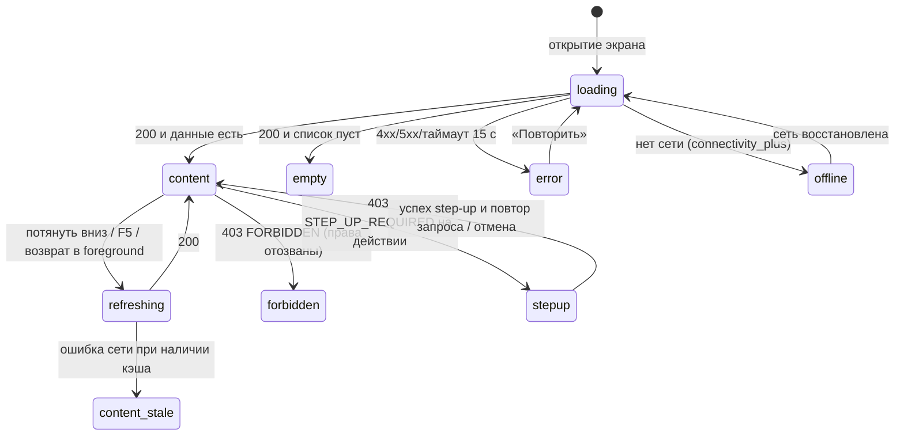

- Скелетон (`SkeletonList`/`SkeletonBox`, ANIM-013) показывается, если загрузка > 300 мс; до 300 мс — пустая область без мерцания.
- Таймаут сетевого запроса — 15 с (08 §2.10); при `> 10 с` под скелетоном — `ds_loading_long` «Долгая загрузка…» + «Повторить».
- `ErrorState.fullScreen` — при ошибке первичной загрузки без кэша; `ErrorState.banner` — при ошибке обновления с кэшем; `caption` «Код: {requestId}» (`ds_request_id`) — копируется тапом.
- Офлайн: `OfflineBanner` (ANIM-019) с `ds_offline_banner`; изменяющие действия недоступны (кроме избранного — через `outbox_actions`, D-32, 07 §11.2).
- `401 UNAUTHENTICATED`/`TOKEN_STALE` — тихий `/auth/refresh` и однократный повтор; `SESSION_REVOKED`/`DEVICE_MISMATCH` — переход на SCR-01 (navigation §4.3); `UNLOCK_REQUIRED` — overlay SCR-08; `APP_UPDATE_REQUIRED` — SCR-90; `APP_READ_ONLY` — баннер «только просмотр», изменяющие кнопки disabled.

### 0.5. Общий шаблон step-up (S!)

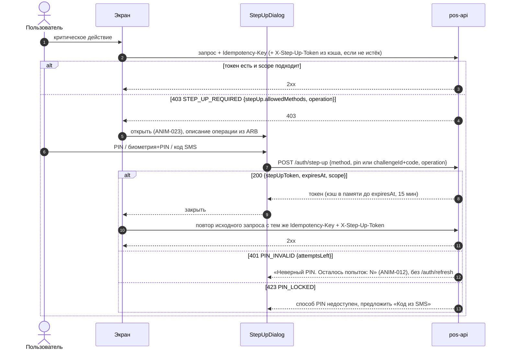

- `stepUpToken` хранится только в памяти; многоразовый 15 мин в пределах `scope` (ядро §18.2 п.6); при выходе/смене роли — сбрасывается.
- Отмена диалога возвращает экран в исходное состояние без изменений; кнопка действия снова активна.
- Без сети способ «PIN» недоступен (проверка на сервере, D-48) — диалог не открывается, показывается `ds_offline_banner`.

### 0.6. Защита от повторного нажатия (общее)

- Любая кнопка, отправляющая изменяющий запрос, переходит в `loading` сразу по нажатию; повторные нажатия игнорируются до ответа (03 §9.1).
- `Idempotency-Key` (UUID v4) генерируется при **первом** нажатии и переиспользуется при повторе того же действия («Повторить» в `ErrorState`, повтор после step-up); новое действие — новый ключ (08 §2.7).
- Двойной тап по строке списка открывает экран один раз (навигация блокируется на время перехода 300 мс, ANIM-024).

### 0.7. Платформы (общее)

| Платформа | Правило |
|---|---|
| Android (телефон/планшет) | тач-цели ≥ 48 lp; системная кнопка «Назад» = «Назад» экрана; OSK для полей; камера-сканер только на SCR-50 и тест сканера SCR-42 |
| Windows-POS | Tab/Shift+Tab, Enter, Esc, ←→↑↓ (A11Y-009); `Ctrl+F` — фокус в поиск/фильтр экрана; `F5` — обновить; мышь: hover-состояния (ANIM-015), правый клик не используется; HID-сканер в полях экранов части **не** добавляет товар в корзину, кроме SCR-40 вкладки «Товары» и SCR-50 — и только при включённой настройке «Сразу добавлять в корзину» (`scan_adds_to_cart`, SCR-42 UI-42-019); при выключенной скан открывает SCR-14 найденного товара, как в каталоге (02b) |
| iOS (без проверки сборки, Q-008) | цели 44 pt; свайп от края = «Назад»; Face ID/Touch ID — SCR-42 |
| Все | масштаб текста до 1.3× без потери функций (A11Y-005); reduce-motion (A11Y-006); контраст AA (A11Y-001) |

---

## 1. Экран SCR-40

### SCR-40 — Избранное (маршрут `/favorites?tab=products|customers`, роли: staff — «Товары»; `cashier`, `senior_seller`, `admin` — «Клиенты»; `customer` — «Товары» условно; R1: да)

#### 1. Назначение и роль пользователя
Быстрый доступ к избранным товарам и избранным клиентам, сохраняемым **на сервере** (`favorites_products`, `favorites_customers`; FAV-001, FAV-006, SRC-C-103): продавец и кассир держат «ходовые» позиции под рукой и добавляют их в корзину без поиска; кассир, старший продавец и администратор быстро находят постоянных клиентов (SRC-C-100…102). Права: `favorites.products.manage` — все роли; `favorites.customers.manage` — `cashier`, `senior_seller`, `admin` (11 §4.4; `owner` и `seller` — нет). У ролей без права на клиентов вкладки не показываются — экран сразу содержит список товаров (responsive-spec §8).

#### 2. Структура экрана
**Compact (сверху вниз):** шапка (заголовок «Избранное» `ds.text.h3`, `NotificationBell` dot, `SyncIndicator` иконка) → `AppTabs` fixed «Товары · 27» / «Клиенты · 12» (только при праве на клиентов) → строка инструментов (счётчик «27 товаров» `ds.text.label textSecondary` слева; `ViewModeSegmented` сетка/список справа; на вкладке «Клиенты» — поле фильтра `SearchBar` «Фильтр по избранным клиентам») → содержимое: сетка 2 колонки `ProductCardGrid` либо список `ProductCardList` / список `CustomerCard` row → `CartFab` (вкладка «Товары», корзина непуста) → `BottomNavBar`.

**Medium:** Rail слева; контент-колонка как SCR-10 (колонка категорий 240 lp заменена вкладками сверху); сетка 3 колонки; корзина — overlay по `CartFab`.

**Expanded (слева направо):** SB оболочки (пункт «Избранное 27» в состоянии selected — как блок макета `[ПОДТВЕРЖДЕНО: макет image_2026-06-25]`) → контент-колонка: заголовок «Избранное» `ds.text.h2`, справа `ViewModeSegmented` (Сетка · Список · Компактно), под ним `AppTabs` → сетка 5 колонок (как SCR-10, ширина по §1.3 responsive-spec) / таблица клиентов → постоянная `CartPanel` 320–340 справа (смена вкладки раскладку не меняет).

Расхождение с макетом (ядро §14): на макете каталога у части карточек вместо звезды нарисовано «сердце» — ТЗ использует только `FavoriteToggle` со звездой `star` (03 §9.23), как в блоке «Избранное 27».

#### 3. Таблица элементов
Соответствие `wireframes-cashier.html`: UI-40-001…004 совпадают по смыслу; UI-40-005…012 — новые.

| № | UI-ID | Элемент | Компонент (03) | Расположение/размер/отступы/выравнивание | Токены | Состояния | Поведение | Источник данных | Роли | Правило |
|---|---|---|---|---|---|---|---|---|---|---|
| 1 | UI-40-001 | Вкладки «Товары · N» / «Клиенты · N» | `AppTabs` fixed | под шапкой, высота 48, на всю ширину контент-колонки; счётчик в пилюле справа от текста | `surface`; текст `body 14/500 textSecondary`; активная `textPrimary 600` + индикатор `primary` 2 px; счётчик `label tnum` на `surfaceVariant` | default, hover, pressed, focused, selected, loading (счётчик «…») | тап / ←→ / свайп содержимого — переключение (ANIM-017); вкладка в `?tab=` | `count` из `GET /favorites/products`, `GET /favorites/customers` | вкладка «Клиенты» — по `favorites.customers.manage` | FAV-007 |
| 2 | UI-40-002 | Карточка избранного товара | `ProductCardGrid` / `ProductCardList` / `ProductCardCompact` + `FavoriteToggle` onImage + `StockBadge` + `PriceText` + `AppButton` «+ Добавить» | сетка: C 2 кол., M 3, E 5; зазор `ds.space.3` (12); радиус `ds.radius.md`, паддинг 12 | `surface`, обводка `border`, hover `ds.elevation.1`; цена `title 18/700 tnum textPrimary`; артикул `caption textSecondary` | default, hover, pressed, focused, loading (скелетон), disabled (товар снят — «Не продаётся»), error (нет фото — заглушка 03 §14.3) | тап → SCR-14; «+ Добавить» → `PUT /cart/items/{variantId}` (ANIM-006); товар с вариантами → SCR-15 | `GET /favorites/products?warehouseId=` (`Page<ProductSummary>`); кэш drift `favorites_products` + каталог | все роли | FAV-001, FAV-004, INV-*, CART-* |
| 3 | UI-40-003 | Строка избранного клиента | `CustomerCard` row + `ReceivableBadge` + `FavoriteToggle` customer | список, высота 72 (C) / 56 (E); `AppAvatar` md 40 слева, имя `body 500`, телефон `caption tnum` (`+996 XXX XXX XXX`), справа бейдж долга и звезда | `surface`, разделитель `border`; бейдж — варианты `ReceivableBadge` | default, hover, pressed, focused | тап → SCR-32 (`customerId`); E: кнопка S «В заказ» → `POST /cart/customer` | `GET /favorites/customers` (`Customer(role-DTO)`) | `cashier`, `senior_seller`, `admin` | FAV-006, SEC-031 |
| 4 | UI-40-004 | Снекбар «Убрано из избранного · Отменить» | `AppSnackbar` | низ экрана над BNB (C) / низ контент-колонки (E), отступ 16 | `inverseSurface`/`onInverseSurface` | виден 8 с (с действием) | «Отменить» восстанавливает позицию; Ctrl+Z на Windows | локально + `outbox_actions` | все | FAV-003, ANIM-027 |
| 5 | UI-40-005 | Счётчик и представление | `ViewModeSegmented` + `caption` «27 товаров» | строка 40 под вкладками; счётчик слева, сегменты справа | `label textSecondary`; сегменты 03 §9.26 | default, selected, focused | смена раскладки (ANIM-017); общий с каталогом `settings.catalogView` | локально `settings` + `PUT /me/settings` | все | SRC-C-015…018 |
| 6 | UI-40-006 | Фильтр избранных клиентов | `SearchBar` (без кнопки сканера) | вкладка «Клиенты», ширина 100 % (C) / 360 (E), высота 44 | `surface`, обводка `borderStrong`, плейсхолдер `textTertiary` | default, focused, filled (крестик) | локальная фильтрация по имени/телефону, debounce 300 мс | память экрана | как UI-40-003 | — |
| 7 | UI-40-007 | Пустое состояние «Товары» | `EmptyState` `favorites` | центр области; иллюстрация 120 (C) / 160 (E) | 03 §9.43 | — | «К каталогу» → SCR-10 (SCR-50 у `customer`) | — | все | ANIM-022 |
| 8 | UI-40-008 | Пустое состояние «Клиенты» | `EmptyState` `customers` (тексты части) | центр области | 03 §9.43 | — | «Найти клиента» → SCR-31 | — | как UI-40-003 | — |
| 9 | UI-40-009 | Метка «Ожидает отправки» | иконка `schedule` 16 `warning` + `caption` | на карточке рядом со звездой | `warning` | видна при `pending_op` | исчезает после подтверждения outbox | `favorites_products.pending_op` (07 §11.2) | все | FAV-002, D-32 |
| 10 | UI-40-010 | Метка «Не продаётся» | `StatusChip` neutral | на месте цены у товара с `deletion_mark` | `surfaceVariant`/`textSecondary` | статичное | «+ Добавить» скрыта; звезда активна | ответ API / кэш | все | FAV-004 |
| 11 | UI-40-011 | Плавающая кнопка корзины | `CartFab` | C/M: справа снизу над BNB, отступ 16 | `primary`/`onPrimary`, бейдж `micro` | видна при непустой корзине (ANIM-019) | → SCR-20 | `cart_draft` | staff (кроме `owner`), customer | CART-* |
| 12 | UI-40-012 | Скрытие вкладки «Клиенты» | — (не отображается) | — | — | — | у `seller`/`owner`/`customer` вкладки скрыты; `?tab=customers` → «Товары» без ошибки | `GET /me.permissions` | — | SEC-044 |

#### 4. Поведение каждого контрола
- **UI-40-001 вкладки.** Первый показ — вкладка из `?tab=`, иначе последняя использованная (локально), иначе «Товары». Повторный тап по активной вкладке прокручивает список к началу. Содержимое загружается лениво при первом открытии и сохраняет прокрутку. Клавиатура: Tab до полосы вкладок, ←/→ — переключение, Home/End — крайние.
- **UI-40-002 «+ Добавить».** Тап — добавление 1 базовой единицы (или минимальной партии, INV-*); повторный тап **во время запроса** (`inFlight`) игнорируется — это защита от двойного запроса, а не ограничение количества; после успеха кнопка превращается в `QuantityStepper` (ANIM-006). Каждое следующее нажатие «+» степпера на месте кнопки увеличивает количество на один шаг (базовая единица или кратность упаковки) **без открытия окон и листов** (SRC-C-033; так же, как степпер карточки каталога 02b UI-10-109); запросы при быстрых нажатиях объединяются debounce 400 мс (ANIM-007), итоговое количество равно числу нажатий. Долгое нажатие на «+» степпера — автоповтор (ANIM-007). `STOCK_INSUFFICIENT` → shake (ANIM-012) и подпись «Доступно {available} {unit}». Товар с несколькими вариантами — открывает SCR-15.
- **UI-40-002 звезда.** Тап — optimistic-снятие: карточка схлопывается, появляется UI-40-004; `DELETE /favorites/products/{id}` через `outbox_actions` (`favorite.remove`). Повторный тап во время анимации игнорируется. Ошибка сервера (не офлайн) — карточка возвращается, снекбар `favorites_remove_error` (FAV-003). Долгое нажатие — только тултип «Убрать из избранного» (A11Y-017).
- **UI-40-003 строка клиента.** Тап — SCR-32. Свайп влево (C) — «Убрать из избранного» (дублируется звездой). Звезда — `DELETE /favorites/customers/{id}`.
- **UI-40-004 «Отменить».** Возвращает элемент на прежнюю позицию; если `favorite.remove` ещё не отправлен — обе операции схлопываются локально без сетевых запросов, иначе ставится `favorite.add`.
- **UI-40-006 фильтр.** Фильтрует загруженный список; если загружены не все страницы — догружает (≤ 200 элементов, 08 §4.13.1) перед фильтрацией. Esc очищает поле.
- **HID-сканер (Windows, вкладка «Товары»).** Скан при фокусе вне текстового поля — `GET /search/barcode/{value}`; дальнейшее действие определяется локальной настройкой устройства `scan_adds_to_cart` (SCR-42 UI-42-019, по умолчанию включена для staff — 03 §9.65): включена — товар добавляется в корзину (повторный скан того же штрихкода — +1 шаг, как повторное нажатие «+», SRC-C-033), выключена — открывается SCR-14 найденного товара без изменения корзины (как в каталоге 02b, D-42). Товар не обязан быть избранным. Во вкладке «Клиенты» скан игнорируется со снекбаром `favorites_scan_ignored`.
- **Pull-to-refresh / F5** — перезагрузка активной вкладки.

#### 5. Анимации
| Анимация | Ссылка 03 | Начальное → конечное | Триггер | Длительность / кривая | Ошибка | Reduce-motion |
|---|---|---|---|---|---|---|
| Переключение вкладок | ANIM-017 | индикатор под старой → под новой вкладкой | тап/←→ | 200 мс `standard` | — | мгновенно |
| Добавление в корзину | ANIM-006, ANIM-010 | «+ Добавить» → `QuantityStepper`; итог корзины перекатывается | тап | 200/300 мс | shake ANIM-012 | без crossfade |
| Снятие звезды + удаление карточки (специфичная) | ANIM-009 (обратный) | звезда filled → контур; карточка: высота → 0 + fade, соседние смещаются | тап по звезде | 150 мс + 250 мс `standardAccelerate` | откат: карточка разворачивается 250 мс | мгновенное удаление |
| Снекбар | ANIM-027 | скрыт → виден 8 с → скрыт | снятие | 150 мс | — | fade 80 мс |
| Скелетон | ANIM-013 | блоки → контент fade-in 150 мс | загрузка > 300 мс | loop 1,2 с | > 10 с — «Долгая загрузка…» | статичные блоки |
| Пустое состояние | ANIM-022 | скрыт → виден | пустой ответ | 200 мс | — | мгновенно |

#### 6. Переходы
| Откуда → куда | Триггер | Данные | «Назад» |
|---|---|---|---|
| BNB/Rail/SB «Избранное», блок «Избранное 27» SCR-10 → SCR-40 | тап | `tab` | корень ветки `favorites` |
| SCR-30 → SCR-40 | «Все избранные клиенты» | `tab=customers` | SCR-30 |
| SCR-40 → SCR-14 | тап по товару | `productId` | `go` с переключением ветки на `catalog` (navigation §5.1); «Назад» → SCR-10 |
| SCR-40 → SCR-15 | «+ Добавить» у товара с вариантами | `productId` | лист закрывается, остаёмся на SCR-40 |
| SCR-40 → SCR-32 | тап по клиенту | `customerId` | `go` в ветку `customers`; «Назад» → SCR-31 |
| SCR-40 → SCR-20 | `CartFab` | — | SCR-40 |
| Deep link `/favorites?tab=customers` без права | — | — | открывается «Товары» |

#### 7. Состояния экрана
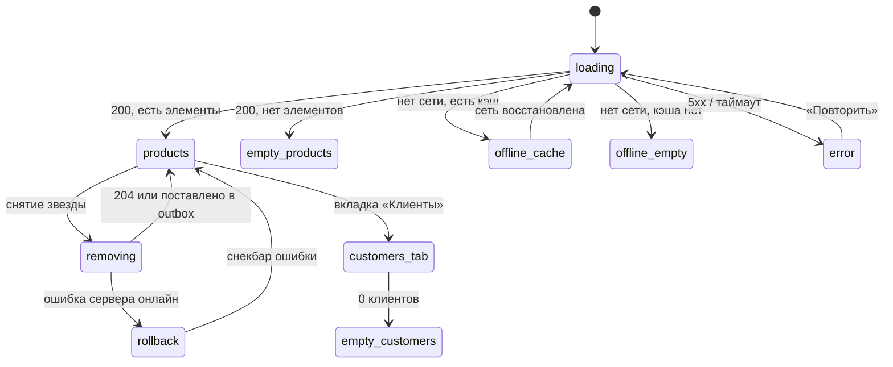

| Состояние | Отображение |
|---|---|
| Загрузка | `SkeletonList` сетки (C 4, E 10 карточек) / строк 72; счётчики «…» |
| Успех | список/сетка; счётчик |
| Пустой | UI-40-007 / UI-40-008 |
| Ошибка (`INTERNAL`, сеть, таймаут) | `ErrorState.fullScreen` `error_internal` + «Повторить» + «Код: {requestId}» |
| `FORBIDDEN` на `/favorites/customers` | вкладка скрывается, снекбар `error_forbidden`, переход на «Товары» |
| Офлайн с кэшем | `OfflineBanner`; товары из `favorites_products` + кэш каталога; цены/остатки с `ds_data_as_of`; «+ Добавить» — в корзину-черновик (D-32); клиенты — из `favorites_customers` без сумм долга (07 §11.2) |
| Офлайн без кэша | `EmptyState` `offlineNoCache` |
| Устаревшие данные | остатки старше 30 мин — баннер порога 2 (05 §7.4) |
| Нет разрешений ОС / step-up | не применимо |

#### 8. Валидация и сообщения
| Ключ ARB | Текст (ru) | Когда |
|---|---|---|
| `favorites_title` | Избранное | заголовок |
| `favorites_tab_products_count` | `{count, plural, other{Товары · {count}}}` | вкладка |
| `favorites_tab_customers_count` | `{count, plural, other{Клиенты · {count}}}` | вкладка |
| `favorites_products_found` | `{count, plural, one{{count} товар} few{{count} товара} many{{count} товаров} other{{count} товара}}` | счётчик |
| `favorites_filter_customers_hint` | Фильтр по избранным клиентам | UI-40-006 |
| `favorites_removed_snackbar` | Убрано из избранного | UI-40-004 |
| `favorites_customer_removed_snackbar` | Клиент убран из избранного | UI-40-004 |
| `favorites_remove_error` | Не удалось убрать из избранного. Повторите | ошибка |
| `favorites_pending_label` | Ожидает отправки | UI-40-009 |
| `favorites_not_sold_label` | Не продаётся | UI-40-010 |
| `favorites_empty_customers_title` | Избранных клиентов пока нет | UI-40-008 |
| `favorites_empty_customers_body` | Отмечайте клиентов звездой в карточке клиента | UI-40-008 |
| `favorites_empty_customers_action` | Найти клиента | UI-40-008 |
| `favorites_scan_ignored` | Сканирование работает во вкладке «Товары» | скан во вкладке клиентов |
| `favorites_star_remove_tooltip` | Убрать из избранного | тултип |
| `favorites_to_order_button` | В заказ | UI-40-003 (E) |
| `favorites_item_a11y` | Товар {name}, цена {price}, {stock}, в избранном | диктор |

Валидации ввода нет (фильтр — свободный текст ≤ 100 символов).

#### 9. Источники данных, API, бизнес-правила
| Данные | Источник | Правило |
|---|---|---|
| Избранные товары | `GET /favorites/products?limit=50&cursor=&warehouseId=` (`Page<ProductSummary>` + `count`) | FAV-001, FAV-004 |
| Избранные клиенты | `GET /favorites/customers?limit=50&cursor=` (`Page<Customer(role-DTO)>`) | FAV-006; поля долга — по `customer.receivables.read.summary` (SEC-031) |
| Добавить/убрать | `PUT`/`DELETE /favorites/{products,customers}/{id}` → `204` (идемпотентно); через `outbox_actions` | FAV-002, DATA-255 |
| Добавление в корзину | `PUT /cart/items/{variantId}` | CART-*, INV-* |
| Кэш | drift `favorites_products`, `favorites_customers`, каталог | 07 §11.2 |
| Конфликт устройств | «последняя операция побеждает» | FAV-002 |

#### 10. Действия по ролям и ограничения безопасности
| Действие | seller | cashier | senior_seller | admin | owner | customer (усл.) |
|---|---|---|---|---|---|---|
| Вкладка «Товары», снять звезду | ✓ | ✓ | ✓ | ✓ | ✓ | ✓ |
| «+ Добавить» в корзину | ✓ | ✓ | ✓ | ✓ | — (нет `cart.manage.own`, кнопка скрыта) | ✓ |
| Вкладка «Клиенты», снять звезду | — | ✓ | ✓ | ✓ | — | — |
| Сумма долга в строке клиента | — | ✓ | ✓ | ✓ | — | — |

Сервер проверяет право на каждом запросе (SEC-029); скрытие вкладки — только UX (SRC-C-133).

#### 11. Повторное нажатие / двойной запрос / назад / перезапуск
- Двойной тап по звезде — одна операция; двойной `PUT`/`DELETE` идемпотентен.
- «Назад» на корне ветки (C) — поведение оболочки (на главный экран роли).
- Перезапуск: вкладка и представление восстанавливаются из локальных настроек; несинхронизированные операции остаются в `outbox_actions` и отправляются при старте.

#### 12. Платформы
- Windows: HID-скан на вкладке «Товары» добавляет товар (при `scan_adds_to_cart`) или открывает SCR-14 (настройка выключена); `Ctrl+F` — фокус в фильтр клиентов; `F4` — корзина; Delete на сфокусированной карточке — убрать из избранного (с тем же снекбаром).
- Android/iOS: свайп по строке клиента; pull-to-refresh.
- Карточка сетки ≥ 156 lp по ширине на C 360 lp; тач-цель звезды 48.

#### 13. Критерии приёмки
| ID | Критерий |
|---|---|
| AC-UI-40-001 | `seller` видит только список товаров без вкладок; переход `/favorites?tab=customers` открывает товары без ошибки |
| AC-UI-40-002 | `cashier` видит вкладки «Товары · N» и «Клиенты · M», где N и M равны `count` ответов API |
| AC-UI-40-003 | Снятие звезды убирает карточку ≤ 300 мс и показывает снекбар 8 с; «Отменить» возвращает карточку на то же место, сервер в итоге содержит запись |
| AC-UI-40-004 | В офлайне снятие/добавление сохраняется в `outbox_actions` с меткой «Ожидает отправки»; после восстановления сети метка исчезает, на сервере одна запись |
| AC-UI-40-005 | Ошибка 5xx на `DELETE` (онлайн) возвращает карточку и показывает `favorites_remove_error` |
| AC-UI-40-006 | Избранное, добавленное на устройстве A, видно на устройстве B после входа тем же пользователем |
| AC-UI-40-007 | «+ Добавить» добавляет позицию в корзину; двойной тап **во время запроса** (`inFlight`) создаёт одну строку количеством 1 (защита от двойного запроса); после появления степпера три последовательных нажатия «+» дают количество 4 без открытия каких-либо окон (SRC-C-033) |
| AC-UI-40-008 | Пустой список товаров показывает `EmptyState favorites` с «К каталогу» → SCR-10 (SCR-50 у `customer`) |
| AC-UI-40-009 | HID-скан на Windows во вкладке «Товары» при включённой `scan_adds_to_cart` добавляет товар в корзину; при выключенной — открывает SCR-14 найденного товара, корзина не меняется; во вкладке «Клиенты» показывает `favorites_scan_ignored` |
| AC-UI-40-010 | Строка клиента у `cashier` показывает `ReceivableBadge`; роли без `customer.receivables.read.summary` сумма не приходит и не отображается |
| AC-UI-40-011 | Тап по товару открывает SCR-14 с переключением ветки на «Каталог»; «Назад» → SCR-10 |
| AC-UI-40-012 | Вкладка и режим представления восстанавливаются после перезапуска |
| AC-UI-40-013 | Повторный HID-скан того же штрихкода на вкладке «Товары» (настройка включена) увеличивает количество существующей строки на шаг, новая строка не создаётся, окна не открываются (SRC-C-033) |

#### 14. Трассировка
SRC-C-025, SRC-C-033 (повторное нажатие «Добавить» / «+» увеличивает количество без окон — п. 4, AC-UI-40-007, AC-UI-40-013), SRC-C-098, SRC-C-100, SRC-C-101, SRC-C-102, SRC-C-103, SRC-C-127, SRC-C-127a (продавец добавляет товар в разрешённый заказ), SRC-E-094, SRC-E-170b; FAV-001…FAV-008; D-32, D-42 (`scan_adds_to_cart`); 03 §9.23, §9.43, ANIM-006/009/017/027; 11 §4.4 (`favorites.*`); 07 §11.2.

---

## 2. Экран SCR-41

### SCR-41 — Профиль (маршрут `/profile`, роли: все аутентифицированные; R1: да)

#### 1. Назначение и роль пользователя
Личный раздел пользователя: кто я в системе (ФИО, подтверждённый телефон, роль, год рождения, сфера деятельности, привязанный клиент 1С для `customer`), правка необязательных полей профиля, смена номера телефона через OTP, выход и выход со всех устройств, вход в Настройки/Синхронизацию/Уведомления/Мои заказы (SRC-E-095). Профиль приложения хранится отдельно от карточки клиента 1С (SRC-B-140, SRC-B-141, 09 §7.7). Право — `profile.manage.own` + `session.manage.own` (все роли).

#### 2. Структура экрана
**Compact:** шапка (заголовок «Профиль», `NotificationBell`, `SyncIndicator`) → карточка пользователя: `AppAvatar` lg 64 по центру, ФИО `ds.text.h2`, телефон `body tnum textSecondary`, `RoleBadge` (несколько — в строку), строка «Вход: Samsung SM-A525F · сегодня 09:12» `caption` → кнопка `AppButton` S outlined «Изменить данные» → блок данных профиля (год рождения, сфера деятельности; для `customer` — «Клиент 1С: ОсОО «Стр***» · статус привязки») → список пунктов `AppListTile` 56: «Мои заказы», «Мои транзакции» (только с `transactions.read.own`), «Уведомления» (+бейдж), «Синхронизация» (staff), «Настройки», «Сменить номер телефона» → группа опасных действий: «Выйти», «Выйти на всех устройствах» (`textPrimary` с иконкой `logout` `error`) → `caption` версии «v1.0.0 (87) · Android» и ссылка «Доступно обновление» (если рекомендуется) → BNB.

**Medium:** карточка 560 lp по центру контент-зоны, Rail слева.

**Expanded:** SB оболочки (пункты профиля дублируются в SB), контент-зона: карточка 560 lp, выровнена по левому краю контент-зоны с отступом 24; корзина скрыта. Меню пользователя в шапке «Абдулла · Продавец ▾» (UI-41-008): «Профиль», «Настройки», «Заблокировать» (`Ctrl+L`, 09 §8.8), «Сменить пользователя» — disabled с меткой «R2» (Q-002), «Выйти».

Расхождение с макетом входа (ядро §14): выбор сотрудника из списка и «Вход по карте сотрудника» — R2 (D-09, Q-002); в R1 пункт «Сменить пользователя» показывается неактивным с подсказкой.

#### 3. Таблица элементов
Соответствие `wireframes-cashier.html`: UI-41-001…008 совпадают; UI-41-009…016 — новые.

| № | UI-ID | Элемент | Компонент (03) | Расположение/размер/отступы/выравнивание | Токены | Состояния | Поведение | Источник данных | Роли | Правило |
|---|---|---|---|---|---|---|---|---|---|---|
| 1 | UI-41-001 | Шапка профиля | `AppAvatar` lg 64 + `RoleBadge` + текст | карточка `surface`, радиус `ds.radius.lg`, паддинг 24; по центру (C) / слева (E) | ФИО `h2 24/600 textPrimary`; телефон `body tnum textSecondary`; строка входа `caption textSecondary` | default, loading (`SkeletonBox.avatar` + 2 строки) | статично; тап по аватару — ничего (фото не загружается в R1, 03 §9.50) | `GET /me` (`profile.fullName`, `profile.phone`, `roles`, `session.sid`); строка «Вход: {deviceName} · {time}» — из `GET /auth/sessions` (элемент `isCurrent=true`: `deviceName`, `createdAt` — время входа в эту сессию; 08 §4.1.6, `Session` §3.14), т. к. `Me.session` содержит только `sid`, `deviceId`, `amr`, `expiresAt`; до ответа `/auth/sessions` строка входа не показывается (без скелетона) | все | ядро §17.2 формат телефона |
| 2 | UI-41-002 | «Изменить данные» | `AppButton` S outlined + форма (SS на E / экран на C) | под шапкой, по центру | `primary` текст, обводка `borderStrong` | default, hover, pressed, focused, loading | открывает форму UI-41-009 | — | все | REG-* (поля регистрации) |
| 3 | UI-41-003 | Пункты профиля | `AppListTile` 56 (иконка 24 + заголовок + шеврон) | список во всю ширину карточки; разделители `border` | иконки `textSecondary`; заголовок `body 500`; бейдж `AppBadge` | default, hover, pressed, focused | «Мои заказы» → SCR-25; «Мои транзакции» → SCR-36 (свои); «Уведомления» → SCR-44; «Синхронизация» → SCR-43; «Настройки» → SCR-42 | `GET /me.permissions`; `unreadCount` | по правам | — |
| 4 | UI-41-004 | «Сменить номер телефона» | `AppListTile` + `StepUpDialog` + мастер UI-41-010 | в списке пунктов | как UI-41-003, иконка `phone_iphone` | default, loading | S! → ввод нового номера → OTP на новый номер | `/me/phone/change/request`, `/confirm` | все | 09 §4.7, ядро §3.3 |
| 5 | UI-41-005 | «Выйти» | `AppListTile` (danger) + `ConfirmDialog` | группа опасных действий | иконка `logout` `error`; текст `textPrimary` | default, loading | подтверждение → `POST /auth/logout` → SCR-01; офлайн — отложенный выход (п. 4): локальные данные очищаются сразу, для отзыва сессии на сервере сохраняется только запись `pending_logout` | онлайн — нет; офлайн — secure storage `pending_logout` `[НОВОЕ ИМЯ]` + `outbox_actions` тип `auth.logout` `[НОВОЕ ИМЯ типа, замечание к ядру №19]` | все | 09 §8.6 |
| 6 | UI-41-006 | «Выйти на всех устройствах» | `AppListTile` (danger) + `ConfirmDialog` destructive + `StepUpDialog` | под «Выйти» | как UI-41-005 | default, loading | подтверждение → `POST /auth/logout-all` (S!) → SCR-01 | — | все | ядро §3.3; 09 §8.6 |
| 7 | UI-41-007 | Версия и обновление | `caption` + `AppButton` text S «Доступно обновление» | низ карточки, по центру | `caption textSecondary`; ссылка `primary` | ссылка видна при версии ниже рекомендуемой | ссылка → магазин приложений / инструкция обновления Windows (Q-008) | `X-Recommended-App-Version`, `X-Min-App-Version`; `app_meta.recommended_app_version_seen` | все | D-46, ядро §18.2 п.12 |
| 8 | UI-41-008 | Меню пользователя в шапке (E) | `TopAppBarPos` (меню) + `AppAvatar` sm | шапка справа от `SyncIndicator`, «Абдулла · Продавец ▾» | имя `label 600`, роль `caption textSecondary` | default, hover, pressed, focused, expanded | меню: Профиль, Настройки, Заблокировать, Сменить пользователя (disabled, R2), Выйти | `GET /me` | все | макет (ядро §14) |
| 9 | UI-41-009 | Форма «Изменить данные» | `AppTextField` ×2 + `AppDropdown` + `AppButton` L «Сохранить» | SS 480 (E) / экран (C); поля в столбик, зазор 16 | поля 52 (C) / 44 (E) | default, focused, error, loading | ФИО (обязательно), год рождения (необязательно), сфера деятельности (необязательно); телефон — только чтение | `PATCH /me/profile {fullName, birthYear, activityKind, rowVersion}` | все | 08 §4.3.2; REG-* |
| 10 | UI-41-010 | Мастер смены номера | `PhoneField` + `OtpField` + `AppButton` | SS 480 / экран; шаг 1 — новый номер, шаг 2 — код из SMS | 03 §9.4, §9.5 | шаг 1, шаг 2, loading, error, success | см. п. 4 | `POST /me/phone/change/request` → `202 {challengeId, resendAfterSec, otpTtlSec}`; `/confirm` | все | 09 §4.7, D-10 |
| 11 | UI-41-011 | Блок «Клиент 1С» (только `customer`) | `AppListTile` + `StatusChip` (`customer_link_status`) | под данными профиля | статусы по 03 §9.39 | `none` (скрыт), `proposed`, `confirmed`, `rejected`, `conflict` | `proposed` → SCR-06; `confirmed` → SCR-32 своей карточки; `conflict` → подсказка «Ожидает подтверждения администратором» | `GET /registration/customer-match`, `Me.customerLink` | `customer` | D-08, 09 §7.9, SRC-B-145 |
| 12 | UI-41-012 | Данные профиля | `AppListTile` (только чтение) ×2 | под кнопкой «Изменить данные» | заголовок `caption textSecondary`, значение `body` | значение / «Не указано» | — | `Me.profile.birthYear`, `activityKind` | все | REG-* |
| 13 | UI-41-013 | Пункт «Заблокировать» (E-меню, C — в списке пунктов для staff) | `AppListTile` | в меню UI-41-008 / в списке | иконка `lock` | default | мгновенно показывает overlay SCR-08 (`mode=idle`) без запросов | локально | staff | 09 §8.8 (ручная блокировка), Q-034 |
| 14 | UI-41-014 | Сообщение об отложенном выходе (офлайн) | `AppSnackbar` | низ SCR-01, отступ 16 | `inverseSurface`/`onInverseSurface` | виден 8 с | «Вы вышли. Сессия на сервере будет завершена при появлении сети» (`profile_logout_offline_done`) | `pending_logout` + `outbox_actions` (`auth.logout`) | все | 09 §8.6 |
| 15 | UI-41-015 | Предупреждение о несохранённой корзине при выходе | текст внутри `ConfirmDialog` | — | `warning` иконка | показывается при `cart_draft.dirty=1` | «В корзине есть неотправленные изменения» + «Выйти всё равно» | `cart_draft` | staff | 07 §11.4 |
| 16 | UI-41-016 | Пункт «Мои заказы» для `customer` | `AppListTile` | первым в списке | — | — | → SCR-25 (свои) | — | `customer` | — |

#### 4. Поведение каждого контрола
- **UI-41-009 форма.** Открывается с текущими значениями. «Сохранить» активна только при изменениях и валидных полях. Нажатие → `PATCH /me/profile` с `rowVersion`; `200` → форма закрывается, шапка обновляется, снекбар `profile_saved`. `409 VERSION_CONFLICT` → поля перезаполняются из `current`, баннер `profile_conflict` («Профиль изменён на другом устройстве. Проверьте и сохраните ещё раз»). Закрытие с несохранёнными изменениями → `ConfirmDialog` «Отменить изменения?». Повторное «Сохранить» во время запроса игнорируется. Enter в последнем поле — сохранить.
- **UI-41-004/010 смена номера.** (1) Тап → `ConfirmDialog` с текстом последствий («После смены номера вход выполняется по новому номеру; все другие устройства будут отключены») → «Продолжить». (2) Шаг 1: `PhoneField` нового номера (маска `+996 XXX XXX XXX`), «Получить код» → `POST /me/phone/change/request {newPhone}`; при `403 STEP_UP_REQUIRED` — §0.5 (PIN / биометрия+PIN / OTP на текущий номер); `202` → шаг 2. (3) Шаг 2: `OtpField` 6 ячеек, автоотправка при 6-й цифре → `/confirm {challengeId, code}`; таймер повторной отправки `resendAfterSec` (60 с), затем «Отправить код ещё раз» (новый `request`, старый код аннулируется). (4) `200 {phone, sessionsRevoked:true}` → `SuccessCheck` (ANIM-005 без персонажа), снекбар `profile_phone_changed`, `GET /me` перечитывается, мастер закрывается; у `customer` блок UI-41-011 переходит в `proposed` (09 §4.7 п.3). Ошибки: `PHONE_ALREADY_REGISTERED` → под полем `profile_phone_error_taken`; `OTP_INVALID` → «Неверный код, осталось попыток: N» + shake; `OTP_EXPIRED` → «Код истёк» + «Отправить код ещё раз»; `OTP_LOCKED`/`OTP_RATE_LIMITED` → таймер `retryAfter`, кнопка disabled; `SMS_PROVIDER_ERROR` → `error_sms_provider_error`; `VALIDATION_FAILED` → «Введите 9 цифр номера». Тот же номер, что и текущий, — блокируется на клиенте до запроса (`profile_phone_error_same`). «Назад» на шаге 2 возвращает на шаг 1 с сохранённым номером.
- **UI-41-005 «Выйти» (онлайн).** `ConfirmDialog` default «Выйти из аккаунта?» (фокус на «Отмена»). Подтверждение → `POST /auth/logout` с действующим Bearer (кнопка `loading`, таймаут 15 с); после ответа (`204`, `401 SESSION_REVOKED` — сессия уже отозвана) клиент очищает secure storage (кроме `deviceId`), память, `notifications_cache`, `customers_cache`, `settings(scope=user)` и переходит на SCR-01 (09 §8.5–§8.6, 07 §11.4).
- **UI-41-005 «Выйти» (офлайн или сетевая ошибка/таймаут запроса).** Порядок действий (отправить Bearer-запрос после очистки токенов невозможно, поэтому для отложенного отзыва сохраняется минимальный набор учётных данных):
  1. До очистки клиент переносит в отдельную запись secure storage `pending_logout` `[НОВОЕ ИМЯ]` только `sid`, текущий `refreshToken` (kind `standard`) и `createdAt`; ФИО, телефон, роли, кэши, access-токен, `stepUpToken`, биометрический ключ и `biometric_refresh` в запись **не** попадают и удаляются.
  2. В `outbox_actions` ставится действие типа `auth.logout` `[НОВОЕ ИМЯ типа]` (перечень типов 07 §11.2 его не содержит — замечание к ядру №19; 09 §8.6 офлайн-выход через outbox допускает) с `payload_json` = `{sid}` — **без токенов** (токен берётся только из `pending_logout`).
  3. Очистка остальных данных и переход на SCR-01 со снекбаром UI-41-014. Запись `pending_logout` не считается сессией: холодный старт её не использует (SCR-08 «Быстрый вход» не предлагается, 09 §9.3).
  4. При появлении сети обработчик outbox выполняет `POST /auth/refresh` с `refreshToken` из записи и `kind=standard` (08 §4.1.3) → полученный access-токен используется **только** для `POST /auth/logout` (08 §4.1.4) → `204` → запись `pending_logout` и полученные токены удаляются, действие outbox — `done`. `401 SESSION_REVOKED` на refresh — сессия уже отозвана (по сроку, idle-отзыву или администратором) → запись удаляется, действие `done`. `401 UNLOCK_REQUIRED` (Windows, staff) или исчерпание 10 попыток (`dead`) → запись сохраняется до первого успешного входа на этом устройстве, после которого новая сессия отзывает старую запросом `DELETE /auth/sessions/{sid}` (своя нетекущая сессия, 08 §4.1.6), затем запись удаляется.
  5. Если до появления сети на устройстве выполняется вход **другого** пользователя — сначала выполняется шаг 4 (09 §4.5: при входе другого пользователя для старой сессии вызывается `POST /auth/logout`), затем вход продолжается; данные двух пользователей не смешиваются.
- **UI-41-006 «Выйти на всех устройствах».** `ConfirmDialog` destructive («Все сеансы, включая этот, будут завершены. Потребуется вход по SMS»). Подтверждение → `POST /auth/logout-all` → step-up (§0.5) → `204` → очистка как при выходе → SCR-01 со снекбаром `profile_logout_all_done`. Офлайн — пункт disabled с подсказкой `profile_offline_action_disabled`.
- **UI-41-013 «Заблокировать».** Немедленно показывает overlay SCR-08; состояние экранов сохраняется; разблокировка — PIN/биометрия (09 §8.8). Горячая клавиша `Ctrl+L` (Windows) работает из любого экрана.
- **UI-41-007 «Доступно обновление».** Android — открытие страницы приложения в магазине/корпоративной ссылке (канал распространения — Q-008); Windows — диалог с инструкцией (канал обновления — 16_DEPLOYMENT). Нет рекомендации — ссылка скрыта.
- **UI-41-011 блок клиента.** Только чтение статуса; финансовые сведения не показываются до `confirmed` (SRC-B-145).

#### 5. Анимации
| Анимация | Ссылка 03 | Начальное → конечное | Триггер | Длительность | Ошибка | Reduce-motion |
|---|---|---|---|---|---|---|
| Открытие SS формы/мастера (E) / push экрана (C) | ANIM-025 / ANIM-024 | скрыт → открыт | «Изменить данные», «Сменить номер» | 250 / 300 мс | — | fade 80 мс |
| Диалоги выхода | ANIM-023 | скрыт → виден, фокус на «Отмена» | тап | 250 мс | ошибка — inline в диалоге | fade 80 мс |
| Shake поля ввода | ANIM-012 | поле в покое → сдвиг ±4 lp → покой + `error` | `VALIDATION_FAILED`, `OTP_INVALID` | 300 мс | — | только цвет и текст |
| Успех смены номера (специфичная) | `SuccessCheck` (как ANIM-005, без персонажа) | шаг 2 → круг `success` scale 0→1 + галочка | `200 confirm` | 450 мс, затем закрытие мастера | — | crossfade ≤ 80 мс |
| Шаги мастера (специфичная, по образцу ANIM-018, без узлов `CheckoutStepper`) | — | шаг 1 → шаг 2: старый контент fade-out 90 мс → новый fade-in + scale .98→1 160 мс; подзаголовок «Шаг 2 из 2» сменяется crossfade | `202 request` | 250 мс `standard` | ошибка — переход не происходит, поле shake (ANIM-012) | fade 80 мс |
| Скелетон шапки | ANIM-013 | блоки → контент | загрузка `/me` > 300 мс | loop | — | статично |

#### 6. Переходы
| Откуда → куда | Триггер | Данные | «Назад» |
|---|---|---|---|
| BNB «Профиль» / меню шапки (E) → SCR-41 | тап | — | корень ветки `profile` |
| SCR-41 → SCR-42 / SCR-43 / SCR-44 | пункты | — (`section` для SCR-42 не передаётся) | `push` в ветке `profile`; «Назад» → SCR-41 |
| SCR-41 → SCR-25 | «Мои заказы» | `mine=1` | `go` в ветку `orders` (navigation §5.1) |
| SCR-41 → SCR-36 | «Мои транзакции» | `mine=1` | `go` в ветку транзакций |
| SCR-41 → SCR-06 | статус `proposed` (customer) | — | SCR-41 |
| SCR-41 → SCR-01 | выход / выход со всех устройств / `SESSION_REVOKED` | — | стек очищается |
| SCR-41 → SCR-08 (overlay) | «Заблокировать» | `mode=idle` | после разблокировки — SCR-41 |

#### 7. Состояния экрана
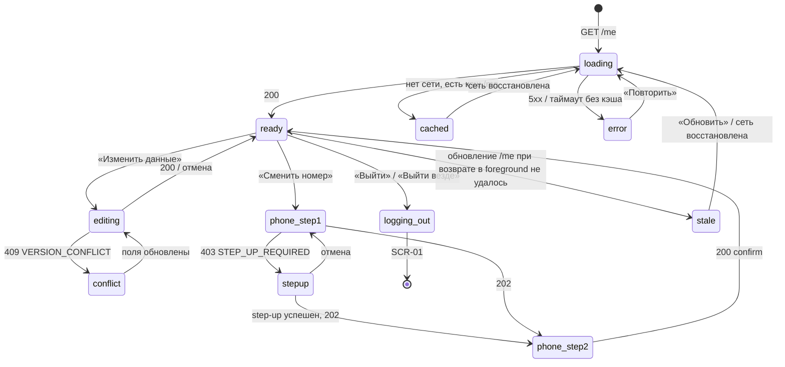

| Состояние | Отображение |
|---|---|
| Загрузка | скелетон шапки и 6 строк списка |
| Успех | данные `/me` |
| Ошибка | `ErrorState.fullScreen` (без кэша) / `ErrorState.banner` (с кэшем) |
| Офлайн | данные из памяти последнего `/me` (не из диска: ФИО/телефон в drift не хранятся — 09 §8.5); если в памяти нет — только пункты меню, шапка «Нет сети»; «Изменить данные», «Сменить номер», «Выйти на всех устройствах» — disabled с `profile_offline_action_disabled`; «Выйти» — доступен (локальная очистка + outbox) |
| Пустой | профиль не бывает пустым; незаполненные необязательные поля (год рождения, сфера деятельности) показываются как «Не указано» (`profile_value_not_set`) в `textSecondary`; у пользователя без дополнительных прав список пунктов сокращается (нет «Мои транзакции», «Синхронизация»), пустых разделов не показывается; у `customer` без привязки блок «Клиент 1С» скрыт (`none`) |
| Устаревшие данные | `/me` в памяти старше 5 мин и обновление (возврат в foreground, pull-to-refresh) не удалось — `ErrorState.banner` warning «Данные профиля от {time}» (`profile_stale_banner`) + «Обновить»; «Изменить данные» и «Сменить номер» активны только после успешного обновления (нужен актуальный `rowVersion`); строка входа UI-41-001 скрыта до ответа `/auth/sessions` |
| Нет разрешений | биометрия в step-up недоступна → способы PIN/SMS (03 §9.46) |
| Step-up | §0.5 для смены номера и выхода со всех устройств |
| `SESSION_REVOKED` | переход на SCR-01 |

#### 8. Валидация и сообщения
| Поле / событие | Правило | Ключ ARB | Текст |
|---|---|---|---|
| ФИО | обязательно, 2…150 символов, буквы/пробел/дефис/апостроф | `profile_fullname_error_required` / `profile_fullname_error_length` | «Введите ФИО» / «От 2 до 150 символов» |
| Год рождения | необязательно; 1920…(текущий − 14) | `profile_birthyear_error_range` | «Год рождения от 1920 до {maxYear}» |
| Сфера деятельности | необязательно, список + «Другое» (≤ 100 символов) | `profile_activity_hint` | «Например: сантехника, строительство» |
| Новый номер | 9 цифр после +996, отличается от текущего | `profile_phone_error_format` / `profile_phone_error_same` | «Введите 9 цифр номера» / «Это ваш текущий номер» |
| Номер занят | `PHONE_ALREADY_REGISTERED` | `profile_phone_error_taken` | «Этот номер уже используется другим пользователем» |
| Код | 6 цифр | `error_otp_invalid` (03) + `otp_attempts_left` | «Неверный код» · «Осталось попыток: {count}» |
| Сохранено | 200 | `profile_saved` | «Данные сохранены» |
| Номер изменён | 200 | `profile_phone_changed` | «Номер изменён. Другие устройства отключены» |
| Конфликт | 409 | `profile_conflict` | «Профиль изменён на другом устройстве. Проверьте и сохраните ещё раз» |

Остальные строки — §11 (словарь).

#### 9. Источники данных, API, бизнес-правила
| Данные / действие | API / состояние | Правило |
|---|---|---|
| Профиль, роли, права, сессия, версия | `GET /me` (`Me`, `appVersion {min, recommended}`) | 08 §4.3.1, §2.11 |
| Изменение профиля | `PATCH /me/profile` (`rowVersion`) | 08 §4.3.2; аудит `profile.updated` (только имена полей) |
| Смена номера | `POST /me/phone/change/request` (S!), `/confirm` | 09 §4.7; аудит `user.phone_change_requested`, `user.phone_changed` |
| Выход | `POST /auth/logout`; офлайн — `pending_logout` + `outbox_actions` `auth.logout` → при появлении сети `POST /auth/refresh` → `POST /auth/logout` (резерв — `DELETE /auth/sessions/{sid}` из новой сессии) | 09 §8.6; 08 §4.1.3, §4.1.4, §4.1.6; аудит `auth.logout` |
| Устройство и время входа | `GET /auth/sessions` (`isCurrent=true`: `deviceName`, `createdAt`) | 08 §4.1.6 |
| Выход со всех устройств | `POST /auth/logout-all` (S!) | 08 §4.1.5; аудит `auth.logout_all` |
| Статус привязки клиента | `GET /registration/customer-match` | 09 §7.9, D-08 |
| Непрочитанные | `unreadCount` из `GET /notifications` | D-41 |
| Локально | ФИО/телефон в drift не хранятся (только память); `app_meta` версии | 07 §11.2, 09 §8.5 |

#### 10. Действия по ролям и ограничения безопасности
| Действие | seller | cashier | senior_seller | admin | owner | customer |
|---|---|---|---|---|---|---|
| Просмотр/правка профиля | ✓ | ✓ | ✓ | ✓ | ✓ | ✓ |
| Смена номера (S!) | ✓ | ✓ | ✓ | ✓ | ✓ | ✓ |
| Выход / выход везде (S!) | ✓ | ✓ | ✓ | ✓ | ✓ | ✓ |
| «Мои транзакции» | ✓ (own) | ✓ | ✓ | ✓ | ✓ | — |
| «Синхронизация» | ✓ | ✓ | ✓ | ✓ | ✓ | — |
| «Заблокировать» | ✓ | ✓ | ✓ | ✓ | ✓ | — |
| Блок «Клиент 1С» | — | — | — | — | — | ✓ |

Роль, телефон и статус через `PATCH /me/profile` не меняются (`forbidden_field`, 08 §4.3.2). Телефон на экране показывается полностью только самому пользователю.

#### 11. Повторное нажатие / двойной запрос / назад / перезапуск
- «Сохранить», «Получить код», «Выйти» — `loading` до ответа; повторы игнорируются. Повторная отправка кода — только после таймера.
- «Назад» в мастере смены номера на шаге 2 → шаг 1; системное «Назад» на шаге 1 → `ConfirmDialog` «Прервать смену номера?».
- Перезапуск во время смены номера: мастер не восстанавливается (код одноразовый, `challengeId` не сохраняется на диск); номер не изменён до `confirm`.
- Перезапуск после офлайн-выхода: сессионных токенов нет → SCR-01 (запись `pending_logout` для входа не используется); действие `auth.logout` остаётся в `outbox_actions` и выполняется по п. 4 при появлении сети; повтор `POST /auth/logout` идемпотентен (`204`).

#### 12. Платформы
- Windows: `Ctrl+L` — блокировка; меню пользователя открывается Enter/Space на блоке шапки; Esc закрывает меню/SS; `OtpField` принимает цифры с клавиатуры и вставку из буфера.
- Android: SMS Retriever/автозаполнение кода — по 09 (если включено), `OtpField` поддерживает вставку; системное «Назад» — как «Назад» экрана.
- iOS: автоподстановка кода из SMS (`oneTimeCode`).
- C 360 lp при масштабе 1.3×: ФИО переносится в 2 строки, телефон не обрезается (responsive-spec §15.5).

#### 13. Критерии приёмки
| ID | Критерий |
|---|---|
| AC-UI-41-001 | Шапка показывает ФИО, телефон в формате `+996 XXX XXX XXX`, все роли пользователя `RoleBadge` и строку «Вход: {deviceName} · {время}», где значения равны `deviceName` и `createdAt` элемента `isCurrent=true` ответа `GET /auth/sessions` |
| AC-UI-41-002 | Правка ФИО сохраняет значение через `PATCH /me/profile`; при `409` поля обновляются значениями сервера и показывается `profile_conflict` |
| AC-UI-41-003 | Год рождения вне диапазона 1920…(текущий − 14) блокирует «Сохранить» с текстом ошибки |
| AC-UI-41-004 | Смена номера без действующего step-up открывает `StepUpDialog`; после PIN запрос повторяется с тем же `Idempotency-Key`, SMS уходит на **новый** номер |
| AC-UI-41-005 | Ввод занятого номера показывает `profile_phone_error_taken`; ввод текущего номера блокируется до запроса |
| AC-UI-41-006 | После `confirm` все другие сессии пользователя отозваны (проверка по `GET /auth/sessions` на втором устройстве — `SESSION_REVOKED`), текущая работает |
| AC-UI-41-007 | «Выйти» онлайн: `POST /auth/logout` → `204`, secure storage очищен (кроме `deviceId`), открыт SCR-01. Офлайн: SCR-01 открывается сразу, в secure storage остаются только `deviceId` и запись `pending_logout` (`sid`, `refreshToken`), в `outbox_actions` — `auth.logout` без токенов в `payload_json`; после появления сети выполняются `POST /auth/refresh` и `POST /auth/logout`, сессия на сервере отозвана (`revoked_at` заполнен), запись `pending_logout` удалена |
| AC-UI-41-008 | «Выйти на всех устройствах» требует подтверждения и step-up; после `204` все устройства пользователя возвращаются на SCR-01 |
| AC-UI-41-009 | При непустой несинхронизированной корзине диалог выхода содержит предупреждение UI-41-015 |
| AC-UI-41-010 | У `customer` со статусом привязки `proposed` блок «Клиент 1С» показывает маскированное наименование и не показывает долг/историю |
| AC-UI-41-011 | Пункт «Сменить пользователя» в меню шапки неактивен с меткой «R2» |
| AC-UI-41-012 | При версии ниже `X-Recommended-App-Version` видна ссылка «Доступно обновление»; при версии ниже минимальной — SCR-90 (426) |
| AC-UI-41-013 | `Ctrl+L` на Windows открывает overlay SCR-08 и после ввода PIN возвращает на тот же экран без потери данных |
| AC-UI-41-014 | Офлайн-выход, затем холодный старт без сети: открывается SCR-01 (не SCR-08); после входа на этом устройстве при недоступном refresh (`UNLOCK_REQUIRED`) старая сессия отзывается `DELETE /auth/sessions/{sid}`, запись `pending_logout` удаляется |
| AC-UI-41-015 | Неудачное обновление `/me` при возврате в foreground показывает баннер «Данные профиля от {time}»; «Изменить данные» недоступно до успешного обновления |

#### 14. Трассировка
SRC-E-095 (профиль), SRC-C-004, SRC-C-004a (профиль и имя в шапке), SRC-B-140, SRC-B-141, SRC-B-145; D-09, D-12, D-15, D-46; 09 §4.7, §7.7, §7.9, §8.5–§8.8; 08 §4.1.4–§4.1.5, §4.3.1–§4.3.3; 11 SEC-039, SEC-048; 03 §9.4, §9.5, §9.45, §9.46, §9.50, §9.61.

---

## 3. Экран SCR-42

### SCR-42 — Настройки (маршрут `/settings?section=`, роли: все аутентифицированные; R1: да)

#### 1. Назначение и роль пользователя
Пользовательские и аппаратные настройки рабочего места (SRC-E-096): язык (ru; ky/en — каркас, D-38), защита входа (PIN, биометрия, автоблокировка — D-13, D-48), устройства и сессии (09 §8.4), сканер штрихкодов (режим HID/камера, суффикс, тест — D-42, Q-009), принтер (A4/80 мм, тест печати — D-27, Q-019), отображение (плотность, размер текста, уменьшение анимаций — A11Y-005, A11Y-006), «О приложении» (версия, минимальная версия, лицензии, поддержка). Право — `profile.manage.own`, `session.manage.own`.

#### 2. Структура экрана
**Compact:** список секций `AppListTile` 56 (иконка, заголовок, текущее значение `caption textSecondary`, шеврон): «Язык», «Защита входа», «Устройства и сессии», «Сканер штрихкодов», «Принтер», «Отображение», «О приложении» → тап открывает экран секции (`?section=`).

**Medium:** 2 колонки: слева навигация секций 240 lp (`AppListTile`, выбранная — `primaryContainer`), справа содержимое секции ≤ 640 lp.

**Expanded:** SB оболочки → контент-зона: навигация секций 240 + содержимое ≤ 640; корзина скрыта. Шестерёнка в шапке открывает SCR-42.

Содержимое секций:
- **Язык:** `AppRadio` «Русский» (выбран), «Кыргызча», «English» — видны неактивными с подписью «Скоро»; язык становится доступным для выбора только при покрытии ARB ≥ 95 % (03 §16.6) — единое правило: незавершённые языки не скрываются, а показываются неактивными (AC-UI-42-001).
- **Защита входа:** строка «PIN приложения: установлен» + `AppButton` S «Сменить PIN»; `AppSwitch` «Вход по биометрии» (название по платформе: «Отпечаток или лицо» / «Face ID / Touch ID» / «Windows Hello перед PIN»); `AppSwitch` «Требовать PIN при запуске» — для `staff` всегда включён и неактивен с подписью (D-48); `AppDropdown` «Автоблокировка» (5/10/15/30 мин, для `staff` ≤ 30); ссылка «Забыли PIN?».
- **Устройства и сессии:** список сессий (≤ 3 для staff / ≤ 5 для customer, SEC-048): иконка платформы, имя устройства, версия приложения, «последняя активность», маскированный IP, метка «Это устройство», кнопки «Переименовать», «Завершить»; внизу — `AppButton.danger` M «Выйти на всех устройствах» (S!).
- **Сканер штрихкодов:** `ViewModeSegmented` «Аппаратный (HID)» / «Камера» (камера скрыта на Windows); `AppDropdown` «Окончание скана» (Enter / Tab / Без суффикса); `AppSwitch` «Сразу добавлять в корзину»; поле теста «Отсканируйте любой штрихкод…» + результат.
- **Принтер:** `AppRadio` формат «Чек 80 мм» / «A4»; `AppDropdown` «Принтер по умолчанию» (системные принтеры / сетевой ESC/POS: адрес и порт); `AppSwitch` «Печатать автоматически после создания заказа» (связан с PRINT-009); `AppButton` S «Тестовая печать».
- **Отображение:** `ViewModeSegmented` «Плотность»: Авто / Стандартная / Компактная (`DsDensity`); `ViewModeSegmented` «Размер текста»: Системный / Крупнее (1,15×) / Крупный (1,3×) `[НОВОЕ ИМЯ настройки: textScale]` (Q-218); `AppSwitch` «Уменьшить анимации».
- **О приложении:** версия и сборка, платформа, «Минимальная поддерживаемая версия», «Рекомендуемая версия», идентификатор устройства (последние 8 символов), лицензии (Inter OFL, Material Symbols Apache 2.0, список пакетов — `showLicensePage`), «Политика обработки персональных данных», «Техническая поддержка» (как ссылка макета входа `[ПОДТВЕРЖДЕНО: макет photo_2026-10-18]`).

#### 3. Таблица элементов
Соответствие `wireframes-cashier.html`: UI-42-001…014 совпадают по смыслу; UI-42-015…026 — новые.

| № | UI-ID | Элемент | Компонент (03) | Расположение/размер | Токены | Состояния | Поведение | Источник данных | Роли | Правило |
|---|---|---|---|---|---|---|---|---|---|---|
| 1 | UI-42-001 | Секция «Язык» | `AppListTile` + `AppRadio` ×3 | список секций; радио — строки 48 | подпись «Скоро» `caption textSecondary` | default, selected, disabled (ky/en) | выбор ru — `PUT /me/settings {locale}`; ky/en недоступны | `Settings.locale` | все | D-38, Q-007 |
| 2 | UI-42-002 | Секция «Защита входа» | `AppListTile` | список секций | иконка `lock` | default, selected | открывает секцию | `Me.security` | все | D-13, D-48 |
| 3 | UI-42-003 | Секция «Устройства и сессии» | `AppListTile` | список секций; значение «2 устройства» | — | default | открывает список | `GET /auth/sessions` | все | 09 §8.4 |
| 4 | UI-42-004 | Секция «Сканер штрихкодов» | `AppListTile` | список секций; значение «HID · Enter» | — | default | открывает секцию | `Settings.scanner` | staff (у `customer` секция скрыта — SCR-17 п.10) | D-42, Q-009 |
| 5 | UI-42-005 | Секция «Принтер» | `AppListTile` | значение «80 мм · Касса-1» | — | default | открывает секцию | `Settings.printer` + локальные `settings(scope=device)` | staff | D-27, Q-019 |
| 6 | UI-42-006 | Плотность | `ViewModeSegmented` (3 сегмента) | секция «Отображение», ширина 100 % / 360 | 03 §9.26 | default, selected, focused | применяется сразу без перезапуска | локально `settings(scope=device)` `density` | все | 03 §8.1, responsive-spec §1.2 |
| 7 | UI-42-007 | Уменьшить анимации | `AppSwitch` listTile | секция «Отображение» | трек `primary` / `borderStrong` | on, off, focused | сразу переключает `ds.motion.*` в режим reduce-motion | локально `settings` `reduceMotion` `[НОВОЕ ИМЯ ключа]` | все | A11Y-006 |
| 8 | UI-42-008 | О приложении | `AppListTile` ×N | секция | `caption`/`body` | default | ссылки: лицензии, политика ПДн, поддержка | `app_meta`, `GET /me.appVersion`, заголовки версий | все | D-46, ядро §18.2 п.12 |
| 9 | UI-42-009 | Сменить PIN | `AppButton` S + `StepUpDialog` + `PinField` ×2 | секция «Защита входа» | 03 §9.6 | default, loading, error | S! (текущий PIN или OTP) → новый PIN → повтор → `POST /me/pin {newPin}` | `Me.security.pinSet` | все | 09 §9.6, D-48 |
| 10 | UI-42-010 | Вход по биометрии | `AppSwitch` + согласие + `StepUpDialog` | секция «Защита входа» | 03 §9.65 | on, off, loading (спиннер в ползунке), disabled (нет оборудования) | см. п. 4 | `POST /me/biometrics`, `POST /me/consents` | все (Windows — UX-гейт) | D-13, 09 §9.5 |
| 11 | UI-42-011 | Режим сканера | `ViewModeSegmented` HID / Камера | секция «Сканер» | 03 §9.26 | default, selected, disabled (камера на Windows скрыта) | `PUT /me/settings {scanner.mode}` | `Settings.scanner.mode` | staff | D-42 |
| 12 | UI-42-012 | Тест сканера | `AppTextField` (без OSK) + `StatusChip` + строка результата | секция «Сканер», поле 52 | `info`/`success`/`error` | ожидание, получено, найдено, не найдено, ошибка | см. п. 4 | `GET /search/barcode/{value}`; офлайн — drift `barcodes` | staff | D-42, SRC-C-010 |
| 13 | UI-42-013 | Завершить сессию | `AppButton.danger` S + `ConfirmDialog` (03 §9.1: `danger` — только с подтверждением) | строка сессии справа | `error`/`onError` | default, loading, disabled (текущая — заменена на «Выйти») | `DELETE /auth/sessions/{id}` | `GET /auth/sessions` | все (own) | 08 §4.1.6 |
| 14 | UI-42-014 | Тестовая печать | `AppButton` S + результат | секция «Принтер» | — | default, loading, success, error | печать нефискального образца на выбранном принтере | локальный сервис печати | staff | PRINT-006, PRINT-010 |
| 15 | UI-42-015 | Строка сессии | `AppListTile` 72 | список сессий | иконка платформы 24; «Это устройство» `StatusChip` info | default, current, revoking | — | `Session` | все | 09 §8.4 |
| 16 | UI-42-016 | Переименовать устройство | `AppIconButton` `edit` + диалог `AppTextField` | строка сессии | — | default, loading, error | `PATCH /auth/sessions/{id} {deviceName}` | — | все (own) | 08 §4.1.6 |
| 17 | UI-42-017 | Выйти на всех устройствах | `AppButton.danger` M + `ConfirmDialog` destructive | низ секции сессий | `error`/`onError` | default, loading, disabled офлайн | как UI-41-006 (S!) | — | все | ядро §3.3 |
| 18 | UI-42-018 | Окончание скана (суффикс) | `AppDropdown` | секция «Сканер» | — | default, focused, open | `PUT /me/settings {scanner.suffix}` (`enter`/`tab`/`none`) | `Settings.scanner.suffix` | staff | D-42, Q-009 |
| 19 | UI-42-019 | Сразу добавлять в корзину | `AppSwitch` | секция «Сканер» | — | on/off | локально `scan_adds_to_cart` (03 §9.65) | `settings(scope=device)` | staff | D-42 |
| 20 | UI-42-020 | Формат печати | `AppRadio` ×2 | секция «Принтер» | — | selected | `PUT /me/settings {printer.defaultFormat}` (`80mm`/`a4`) | `Settings.printer` | staff | PRINT-006 |
| 21 | UI-42-021 | Принтер по умолчанию | `AppDropdown` + поля «Адрес» `AppTextField`, «Порт» `AppTextField` numeric (для сетевого ESC/POS) | секция «Принтер» | — | default, error | системный список (A4) / сетевой ESC/POS; хранится локально на устройстве | `settings(scope=device)` | staff | PRINT-006, Q-019 |
| 22 | UI-42-022 | Автопечать | `AppSwitch` | секция «Принтер» | — | on/off | `PUT /me/settings {printer.autoPrint}` | `Settings.printer.autoPrint` | staff | PRINT-009 |
| 23 | UI-42-023 | Автоблокировка | `AppDropdown` 5/10/15/30 мин | секция «Защита входа» | — | default, open | `PUT /me/settings {idleLockMinutes}` | `Settings.idleLockMinutes` | staff | 09 §8.8, 08 §4.3.4 |
| 24 | UI-42-024 | Требовать PIN при запуске | `AppSwitch` disabled (staff) / активный (customer) | секция «Защита входа» | disabled — `disabledText` + подпись | on (staff, неизменяемо) | для `customer` — включение = установка PIN, выключение = `DELETE /me/pin` (S!) | `Me.security.pinSet` | `customer` меняет | D-48 |
| 25 | UI-42-025 | Размер текста | `ViewModeSegmented` 3 сегмента | секция «Отображение» | — | selected | `TextScaler` = max(системный, выбранный), clamp 1.3 (E) / 1.5 (C/M) | локально `textScale` `[НОВОЕ ИМЯ ключа]` | все | A11Y-005, Q-218 |
| 26 | UI-42-026 | «Забыли PIN?» | `AppButton` text S | секция «Защита входа» | `primary` | default | step-up методом OTP → новый PIN | `POST /auth/step-up {method:otp}` → `POST /me/pin` | все | 09 §9.6 «Сброс» |

#### 4. Поведение каждого контрола
- **Общие правила сохранения.** Настройки, хранимые в `Settings` (08 §3.14), применяются локально сразу (optimistic) и отправляются `PUT /me/settings` полным объектом с `rowVersion` через `outbox_actions` (`profile.settings`); при `409 VERSION_CONFLICT` клиент берёт `current`, повторно накладывает только что изменённое поле и отправляет снова (одна попытка), иначе показывает снекбар `settings_conflict` и отображает серверное значение. Локальные настройки устройства (`density`, `reduceMotion`, `textScale`, `scan_adds_to_cart`, адрес принтера) пишутся только в drift `settings(scope=device)`.
- **UI-42-009 «Сменить PIN».** Тап → `POST /me/pin` без токена → `403 STEP_UP_REQUIRED` → `StepUpDialog` (способ по умолчанию «PIN» — ввод **текущего** PIN; альтернатива «Код из SMS») → после токена — лист «Новый PIN»: `PinField` длины 6 (staff) / 4 (customer), затем «Повторите PIN» → совпадение → `POST /me/pin {newPin}` + `X-Step-Up-Token` → `204` → снекбар `settings_pin_changed`. Несовпадение повторного ввода — shake и `settings_pin_error_mismatch`, очистка второго поля. `VALIDATION_FAILED rule=pin_weak` — `settings_pin_error_weak` («Слишком простой PIN: не используйте одинаковые цифры, последовательности и год рождения»). Повтор того же PIN, что был, — сервер возвращает `204` без смены (08 §4.3.5) — клиент показывает тот же успех.
- **UI-42-026 «Забыли PIN?».** Открывает `StepUpDialog` сразу на способе «Код из SMS» (`purpose=step_up`), далее как смена PIN. При `PIN_LOCKED` в любом месте приложения переход сюда предлагается автоматически.
- **UI-42-010 биометрия, включение.** Предусловия (09 §9.5): сессия получена по OTP на этом устройстве; платформа поддерживает Class 3 / Face ID / Touch ID. Последовательность: тап → лист согласия (текст согласия `biometrics_device`, версия — Q-027) с `AppCheckbox` «Согласен» и кнопкой «Включить» → `POST /me/consents {kind, version, granted:true}` → системный промпт биометрии (создание ключа Keystore/Keychain) → `POST /me/biometrics {enabled:true, biometricClass, consent}` → при `403 STEP_UP_REQUIRED` — §0.5 (если с OTP-входа прошло < 15 мин — step-up не нужен, 09 §9.5 п.3) → `200 {biometricRefreshToken}` → токен шифруется ключом → тумблер «вкл» + снекбар `settings_bio_enabled`. Отказ в системном промпте — тумблер возвращается «выкл», снекбар `settings_bio_cancelled`. `CONSENT_REQUIRED` — лист согласия открывается снова.
- **UI-42-010 биометрия, выключение.** Тап → `ConfirmDialog` («Вход по биометрии будет отключён на этом устройстве») → `POST /me/biometrics {enabled:false}` (S!) → удаление ключа и `biometric_refresh` локально → согласие отзывается `POST /me/consents {granted:false}`.
- **UI-42-010 Windows.** Тумблер называется «Windows Hello перед вводом PIN» и включает только UX-гейт (локально, без `biometric_refresh`; сервер отвечает `{enabled:false, reason:"no_crypto_binding_on_platform"}`, 08 §4.3.6) — подпись `settings_bio_windows_note`: «Windows Hello только подтверждает присутствие. Вход всегда завершается PIN приложения».
- **UI-42-010 недоступно.** Android API < 28 или нет Class 3, нет оборудования, `notEnrolled` — тумблер disabled с подписью `settings_bio_unavailable` и ссылкой «Настроить в системе» (открывает системные настройки, где возможно).
- **UI-42-023 автоблокировка.** Выбор значения → `PUT /me/settings {idleLockMinutes}`; сервер отклоняет > 30 для staff (`VALIDATION_FAILED`) — в списке таких значений нет.
- **UI-42-013 «Завершить».** `ConfirmDialog` «Завершить сеанс на устройстве {deviceName}?» → `DELETE /auth/sessions/{id}` → `204` → строка исчезает (специфичная анимация, п. 5) → снекбар `settings_session_revoked`. Для текущей сессии кнопка заменена на «Выйти» (= UI-41-005). Повторный `DELETE` идемпотентен. `NOT_FOUND` (сессия уже завершена) — строка удаляется без ошибки.
- **UI-42-016 переименование.** Диалог с полем (1…60 символов, без управляющих символов) → `PATCH /auth/sessions/{id}` → обновление строки.
- **UI-42-012 тест сканера.** Поле получает фокус при открытии секции на Windows; OSK не вызывается (`TextInputType.none`). HID-ввод определяется по скорости (символы с интервалом < 30 мс [ТИПОВО], D-42) и завершается выбранным суффиксом. После суффикса: показ значения, длины, распознанного типа (`EAN-13`, `EAN-8`, `Code128`, иное — по `barcode_type` 07), затем запрос `GET /search/barcode/{value}`: `200` → «Найден: {name} · арт. {sku}» (`success`), `404 NOT_FOUND` → «Штрихкод не найден в каталоге» (`warning`). Если суффикс не пришёл за 300 мс после последнего символа — подсказка `settings_scanner_no_suffix` («Сканер не отправил окончание. Выберите „Без суффикса“ или настройте сканер»). Режим «Камера» (Android/iOS) — кнопка «Проверить камерой» → SCR-17 `mode=test` (UI-17-014; результат `{value, format}` возвращается в секцию и проверяется тем же `GET /search/barcode/{value}`, товар в корзину не добавляется).
- **UI-42-014 тестовая печать.** 80 мм — ESC/POS по сети/USB: печать образца «ТЕСТОВАЯ ПЕЧАТЬ · не является фискальным документом» (PRINT-010) с датой, именем устройства и шкалой ширины 48 символов; A4 — системный диалог печати с PDF-образцом, сформированным локально из шаблона. Ошибка соединения — `settings_print_error` с причиной (нет связи / нет бумаги / таймаут 10 с); повтор доступен сразу.
- **UI-42-006/007/025 отображение.** Применяются мгновенно ко всему приложению; смена плотности не перестраивает навигацию (только размеры, тач-цели ≥ 48 сохраняются).
- **UI-42-001 язык.** При выборе ru — без перезапуска; ky/en — disabled.
- **Ссылки «О приложении».** «Политика обработки ПДн» — текст действующей версии согласия `personal_data` по `textUrl` из `GET /me/consents` (`required[].textUrl`, `currentVersion`; 08 §4.3.7); открывается в `AppBottomSheet` `fullHeight` с подписью «Версия от {date}»; при ошибке загрузки — `ErrorState.inline` + «Повторить»; офлайн — пункт неактивен с `settings_offline_disabled`. Тексты в ARB/сборку не встраиваются. «Техническая поддержка» и «Ответственный за обработку ПДн» — контакты; источник для клиентского приложения не определён (Q-218 (б)): до решения — из сборки (данные заказчика). «Лицензии» — системная страница лицензий Flutter.

```mermaid
sequenceDiagram
  autonumber
  actor U as Пользователь
  participant S as SCR-42
  participant OS as ОС (BiometricPrompt / Keychain)
  participant API as pos-api
  U->>S: включить «Вход по биометрии»
  S->>U: лист согласия biometrics_device
  U->>S: «Согласен» + «Включить»
  S->>API: POST /me/consents {kind, version, granted:true}
  API-->>S: 200
  S->>OS: создать ключ + системный промпт
  OS-->>S: подтверждено
  S->>API: POST /me/biometrics {enabled:true, biometricClass}
  alt 403 STEP_UP_REQUIRED
    API-->>S: 403
    S->>U: StepUpDialog (PIN)
    U->>S: PIN
    S->>API: POST /auth/step-up → stepUpToken
    S->>API: POST /me/biometrics + X-Step-Up-Token
  end
  API-->>S: 200 {biometricRefreshToken}
  S->>OS: зашифровать токен ключом
  S-->>U: тумблер «вкл», снекбар
```

#### 5. Анимации
| Анимация | Ссылка 03 | Начальное → конечное | Триггер | Длительность | Ошибка | Reduce-motion |
|---|---|---|---|---|---|---|
| Переход к секции (C) / смена содержимого (M/E) | ANIM-024 | список → секция; содержимое fade-through | тап | 300 / 200 мс | — | fade 80 мс |
| Переключатель | ANIM-015 + 03 §9.65 | ползунок слева → справа, цвет трека | тап | 150 мс | откат 150 мс + снекбар | мгновенно |
| Ожидание сервера в тумблере | 03 §9.65 loading | ползунок → спиннер 16 | запрос | до ответа | — | статичная иконка |
| Текст политики ПДн | ANIM-025 (`fullHeight`) | скрыт → лист 92 % | «Политика обработки ПДн» | 250 мс | `ErrorState.inline` в листе | fade 80 мс |
| Ввод PIN | ANIM-012 | `PinField` в покое → shake | несовпадение / `PIN_INVALID` | 300 мс | — | только цвет |
| Удаление строки сессии (специфичная, по образцу ANIM-008: только схлопывание, без свайпа и без «Отменить» — отзыв сессии необратим) | — | строка 72 → высота 0 + fade | `204` на `DELETE /auth/sessions/{id}` | 250 мс `standardAccelerate` | строка остаётся + снекбар `settings_session_revoke_error` | мгновенное удаление |
| Результат теста сканера (специфичная) | ANIM-022 (fade) | пусто → строка результата | суффикс | 200 мс | статус `error` | мгновенно |

#### 6. Переходы
| Откуда → куда | Триггер | Данные | «Назад» |
|---|---|---|---|
| SCR-41 / шестерёнка шапки (E) / меню пользователя → SCR-42 | тап | `section` (опц.) | SCR-41 (C) / предыдущий экран (E) |
| SCR-42 список → секция (C) | тап | `?section=security/sessions/scanner/printer/display/language/about` | список секций |
| SCR-42 → SCR-17 (тест камеры) | «Проверить камерой» | `mode=test` | SCR-42 секция «Сканер» |
| SCR-42 → SCR-01 | выход со всех устройств / завершение текущей сессии | — | стек очищен |
| SCR-08 «Забыли PIN?» → SCR-01/SCR-02 (OTP-вход) → подэкран «Задайте новый PIN» UI-08-014 (02a, режим `reset`) → главный экран роли; SCR-42 открывается только если пользователь отложил установку PIN или установка потребовала step-up без PIN (Q-201) — уточнено при сборке 02 | после OTP-входа | `section=security` | SCR-41 |
| Уведомление `system` «Вход с нового устройства» → SCR-42 | тап | `section=sessions` | SCR-44 |

#### 7. Состояния экрана
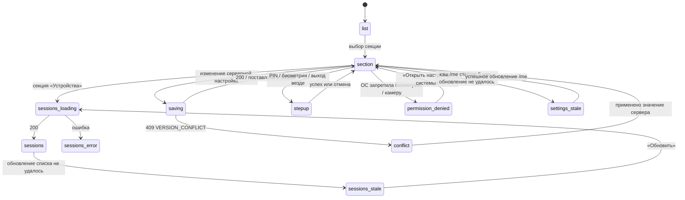

| Состояние | Отображение |
|---|---|
| Загрузка | секции локальные — без загрузки; «Устройства и сессии» — `SkeletonList` 3 строки 72 |
| Успех | значения |
| Ошибка | `ErrorState.inline` в секции сессий; ошибка сохранения — откат и снекбар `settings_save_error` |
| Пустой | сессий нет (только текущая) — список из одной строки |
| Офлайн | доступны локальные настройки (плотность, анимации, размер текста, сканер локально, принтер, тест печати, тест сканера по drift `barcodes`); серверные — меняются локально и ставятся в `outbox_actions`; PIN, биометрия, сессии, «Выйти везде» — disabled с `settings_offline_disabled` |
| Нет разрешений | биометрия запрещена ОС / не настроена — UI-42-010 disabled + «Настроить в системе»; камера запрещена — `EmptyState noCamera` в SCR-17 |
| Step-up | §0.5 |
| `PIN_LOCKED` | смена PIN по текущему PIN недоступна — только «Код из SMS» |
| Устаревшие данные | (а) серверные настройки взяты из кэша `/me`, а обновление `GET /me` не удалось — над секцией `caption` warning «Настройки от {time}» (`settings_stale_caption`); изменения разрешены и отправляются через `outbox_actions` (`profile.settings`) с `rowVersion` кэша — при `409` действует общее правило п. 4; (б) список сессий получен ранее, повторный `GET /auth/sessions` не удался — `ErrorState.banner` «Список устройств от {time}» (`settings_sessions_stale_banner`) + «Обновить»; «Завершить» и «Переименовать» доступны (сервер отвечает `NOT_FOUND` для уже завершённых — строка удаляется без ошибки); (в) «О приложении» — версии из последних заголовков `X-Min-App-Version`/`X-Recommended-App-Version` с пометкой «на {time}» |

#### 8. Валидация и сообщения
| Поле / событие | Правило | Ключ ARB | Текст |
|---|---|---|---|
| Новый PIN | 6 цифр (staff) / 4 (customer); не одинаковые, не последовательность, не год рождения | `settings_pin_error_weak` | «Слишком простой PIN: не используйте одинаковые цифры, последовательности и год рождения» |
| Повтор PIN | совпадает с первым | `settings_pin_error_mismatch` | «PIN не совпадает. Введите ещё раз» |
| PIN изменён | 204 | `settings_pin_changed` | «PIN изменён» |
| Имя устройства | 1…60 символов | `settings_device_name_error` | «От 1 до 60 символов» |
| Адрес принтера | IPv4 или имя хоста; порт 1…65535 (по умолчанию 9100 [ТИПОВО]) | `settings_printer_address_error` / `settings_printer_port_error` | «Введите адрес принтера, например 192.168.1.50» / «Порт от 1 до 65535» |
| Тест сканера — найден | 200 | `settings_scanner_test_found` | «Найден: {name} · арт. {sku}» |
| Тест сканера — не найден | 404 | `settings_scanner_test_not_found` | «Штрихкод {code} не найден в каталоге» |
| Нет суффикса | 300 мс | `settings_scanner_no_suffix` | «Сканер не отправил окончание. Выберите „Без суффикса“ или настройте сканер» |
| Тест печати — успех | — | `settings_print_test_ok` | «Тестовая страница отправлена на принтер» |
| Тест печати — ошибка | — | `settings_print_error` | «Не удалось напечатать: {reason}» |
| Биометрия включена | 200 | `settings_bio_enabled` | «Вход по биометрии включён» |
| Конфликт настроек | 409 | `settings_conflict` | «Настройки изменены на другом устройстве. Показаны актуальные значения» |
| Офлайн | — | `settings_offline_disabled` | «Недоступно без сети» |

#### 9. Источники данных, API, бизнес-правила
| Данные / действие | API / хранение | Правило |
|---|---|---|
| Серверные настройки | `PUT /me/settings` (`Settings`: `locale`, `scanner{mode,suffix}`, `printer{defaultFormat,autoPrint}`, `catalogView`, `defaultWarehouseId`, `idleLockMinutes`, `rowVersion`); чтение — `GET /me.settings` | 08 §4.3.4 |
| Локальные настройки устройства | drift `settings(scope=device)`: `density`, `reduceMotion`, `textScale`, `scan_adds_to_cart`, принтер (адрес/порт/имя) | 07 §11.2 |
| PIN | `POST /me/pin` (S!), `DELETE /me/pin` (только customer, S!) | 08 §4.3.5, D-48; аудит `auth.pin.changed`/`auth.pin.set`/`auth.pin.removed` |
| Биометрия | `POST /me/biometrics` (S!), `POST /me/consents` | 08 §4.3.6–§4.3.7, 09 §9.5; аудит `auth.biometrics.enabled/disabled`, `consent.granted/revoked` |
| Сессии | `GET /auth/sessions`, `DELETE /auth/sessions/{id}`, `PATCH /auth/sessions/{id}`, `POST /auth/logout-all` (S!) | 08 §4.1.5–§4.1.6; аудит `session.revoked`, `auth.logout_all` |
| Тест сканера | `GET /search/barcode/{value}`; офлайн — drift `barcodes` | D-42 |
| Версии | `GET /me.appVersion {min, recommended}`, заголовки `X-Min-App-Version`, `X-Recommended-App-Version` | D-46, ядро §18.2 п.12 |
| Текст политики ПДн | `GET /me/consents` → `required[]` (`kind=personal_data`, `currentVersion`, `textUrl`) | 08 §4.3.7; Q-027 (тексты и версии) |

#### 10. Действия по ролям и ограничения безопасности
| Действие | staff (все 5 ролей) | customer |
|---|---|---|
| Язык, отображение, о приложении | ✓ | ✓ |
| Сменить PIN (S!) | ✓ | ✓ |
| Удалить PIN | — (PIN обязателен, D-48; кнопки нет; сервер → `FORBIDDEN pin_required_for_staff`) | ✓ (S!, только при включённой биометрии с криптопривязкой) |
| Биометрия вкл/выкл (S!) | ✓ | ✓ |
| Автоблокировка | ✓ (5…30 мин) | — (не применяется, 09 §8.8) |
| Сессии: свои — список, переименовать, завершить | ✓ | ✓ |
| Выйти на всех устройствах (S!) | ✓ | ✓ |
| Сканер, принтер | ✓ (принтер — кроме `owner`, у которого нет печати в R1 по сценарию; секция видна, но не обязательна) | секции «Сканер» и «Принтер» скрыты (камера-сканер SCR-17 у `customer` в R1 не предусмотрен, ядро §9) |

Секреты (SMSPro, 1С) в приложении отсутствуют; адрес сетевого принтера — не секрет.

#### 11. Повторное нажатие / двойной запрос / назад / перезапуск
- Тумблеры в `loading` игнорируют повторные тапы; быстрые переключения туда-обратно до ответа — последний выбор отправляется после ответа на первый (очередь из одного элемента).
- «Завершить» сессию — повтор идемпотентен; «Тестовая печать» — повтор во время печати игнорируется.
- «Назад» внутри листа смены PIN → `ConfirmDialog` «Прервать смену PIN?»; PIN не меняется.
- Перезапуск: локальные настройки применяются до первого кадра (из drift); серверные — из кэша `/me`, затем обновляются; незавершённая смена PIN не восстанавливается.

#### 12. Платформы
- Windows: тест сканера — фокус в поле автоматически; Tab по секциям; биометрия — «Windows Hello перед вводом PIN» (без криптопривязки); принтер — системные принтеры Windows + сетевой ESC/POS; камера скрыта.
- Android: биометрия Class 3 (API 30+; API 28–29 — после проверки, 09 §9.2); камера-сканер; печать A4 — Android print service; 80 мм — сетевой/Bluetooth ESC/POS (Q-019).
- iOS: Face ID/Touch ID; `NSFaceIDUsageDescription`.
- Размеры: строки секций 56 (C) / 48 (E); тумблеры — цель 48.

#### 13. Критерии приёмки
| ID | Критерий |
|---|---|
| AC-UI-42-001 | Языки «Кыргызча» и «English» показаны неактивными с подписью «Скоро»; «Русский» выбран |
| AC-UI-42-002 | Смена PIN без step-up открывает `StepUpDialog`; после ввода текущего PIN и двукратного ввода нового — `POST /me/pin` с `X-Step-Up-Token`, снекбар «PIN изменён» |
| AC-UI-42-003 | PIN `123456` / `000000` / год рождения отклоняется с `settings_pin_error_weak` |
| AC-UI-42-004 | Для `staff` переключатель «Требовать PIN при запуске» включён и неактивен; удаление PIN недоступно |
| AC-UI-42-005 | Включение биометрии на Android запрашивает согласие, системный промпт и step-up; после успеха следующий холодный старт предлагает вход по биометрии (SCR-08) |
| AC-UI-42-006 | На Windows тумблер подписан «Windows Hello перед вводом PIN» и после включения вход всё равно требует PIN |
| AC-UI-42-007 | Список сессий показывает ≤ 3 устройств сотрудника с меткой «Это устройство»; «Завершить» на чужом устройстве приводит его к SCR-01 при следующем запросе |
| AC-UI-42-008 | HID-скан в тест-поле показывает код, тип и найденный товар; товар в корзину не добавляется |
| AC-UI-42-009 | При отсутствии суффикса через 300 мс показывается `settings_scanner_no_suffix` |
| AC-UI-42-010 | Тестовая печать 80 мм печатает образец с пометкой «не является фискальным документом»; ошибка соединения показывает причину и не блокирует экран |
| AC-UI-42-011 | Переключатель «Уменьшить анимации» сразу отключает перемещения и масштаб во всём приложении (crossfade ≤ 80 мс) |
| AC-UI-42-012 | «Размер текста: Крупный» масштабирует текст до 1,3× без горизонтальной прокрутки на SCR-10/20/21 |
| AC-UI-42-013 | Офлайн: плотность/анимации/сканер работают; PIN, биометрия, сессии недоступны с подписью «Недоступно без сети» |
| AC-UI-42-014 | Изменение `idleLockMinutes` на 10 приводит к появлению SCR-08 через 10 минут бездействия |
| AC-UI-42-015 | «О приложении» показывает текущую, минимальную и рекомендуемую версию, совпадающие с заголовками сервера |
| AC-UI-42-016 | «Политика обработки ПДн» открывает текст по `textUrl` из `GET /me/consents` для `personal_data` с версией `currentVersion`; офлайн пункт неактивен с подписью «Недоступно без сети» |
| AC-UI-42-017 | При неудачном обновлении `/me` секции с серверными настройками показывают «Настройки от {time}»; при неудачном повторном `GET /auth/sessions` — баннер «Список устройств от {time}» с «Обновить» |

#### 14. Трассировка
SRC-E-096 (настройки), SRC-B-057 (централизация текстов: язык), SRC-B-079…SRC-B-084 (биометрия), SRC-C-010 (сканер), SRC-C-119 (оборудование); D-13, D-27, D-38, D-42, D-46, D-48; 09 §8.4, §8.8, §9.2–§9.6; 08 §4.1.5–§4.1.6, §4.3.4–§4.3.7; 10 PRINT-006, PRINT-009, PRINT-010; 03 A11Y-005, A11Y-006, §9.6, §9.46, §9.65, §16.6; 11 SEC-047, SEC-048.

---

## 4. Экран SCR-43

### SCR-43 — Статус синхронизации (маршрут `/sync?entity=&runId=&tab=`, роли: все staff — кратко (`sync.status.read`); `senior_seller` — + журнал прогонов, запуск `incremental` для `stock`/`prices`/`order_status`, outbox своего магазина; `admin` — полный + любой запуск + outbox; `owner` — полный + любой запуск (без outbox); R1: да)

#### 1. Назначение и роль пользователя
Мониторинг обмена с 1С (SRC-B-013, SRC-B-014, SRC-E-176i, SRC-E-178): время последней успешной синхронизации по каждой сущности `sync_entity`, следующий плановый запуск, текущий прогон, число последовательных ошибок, счётчики; ручной запуск по роли (SRC-B-008, SRC-E-177, ядро §17.2); история прогонов и журнал ошибок (SYNC-039); очередь исходящих документов «в 1С» (`onec_outbox`) с повтором (SYNC-046, ядро §18.2 п.11). Продавец и кассир видят краткий статус, чтобы понимать актуальность остатков/цен; старший продавец обновляет остатки/цены/статусы заказов без ожидания расписания; администратор и руководитель управляют обменом.

#### 2. Структура экрана (по зонам)
**Зона A — сводка (все роли):** карточка `SyncIndicator` (вариант `full`, крупный): иконка состояния 32 + «1С доступна / недоступна» (`onecReachable`), «Последний успешный обмен: сегодня 09:41», `overall` (`ok`/`degraded`/`failed`) как `StatusChip`, «Проверено 09:42» `caption`; для `senior_seller`/`admin` — счётчики outbox «В очереди 2 · Ошибки 0 · Отказы 0».

**Зона B — сущности:** список/таблица по `sync_entity` (15 значений ядра §6 + `payment_docs`, `return_docs` — ядро §17.3) в порядке важности: Остатки, Цены, Статусы заказов, Товары, Варианты, Категории, Штрихкоды, Единицы, Склады, Клиенты, Долги, Скидки, История продаж, Платёжные документы, Документы возвратов, Атрибуты, Фото. Строка: название (+ код для `admin`/`owner`), `StatusChip` (`sync_run_status` последнего прогона или «выполняется» с `AppProgress` `fetched/sourceTotal`), «обновлено 09:41» (возраст: «12 мин назад»), «следующий 09:51» (`nextRunAt`), интервал «каждые 10 мин» (`intervalSec`), бейдж ошибок `consecutiveErrors` (если > 0), метка устаревания (`isStale` → `warning` `schedule`); для `senior_seller` у трёх разрешённых сущностей — кнопка «Обновить»; для `admin`/`owner` — меню строки «Запустить…».

**Зона C — действия (по ролям):** `senior_seller` — три кнопки «Обновить остатки», «Обновить цены», «Обновить статусы заказов» (responsive-spec §15.3); `admin`/`owner` — `AppButton` primary «Запустить…» (диалог выбора сущности и режима). Для `seller`/`cashier` — подсказка `caption` «Ручной запуск выполняет старший продавец или администратор».

**Зона D — вкладки журнала (`senior_seller`, `admin`, `owner`):** `AppTabs`: «Сущности» (зона B) · «Прогоны» (история `GET /sync/runs` с фильтрами) · «Ошибки» (ошибки выбранного прогона/сущности) · «Outbox» (только `admin` и `senior_seller`).

**Compact:** шапка «Синхронизация» + «Назад» → зона A → (вкладки D) → зона B списком 72 → зона C закреплена внизу (кнопки M в столбик у `senior_seller`, одна кнопка у `admin`/`owner`).

**Medium:** staff без журнала — SS 400; с журналом — экран в ветке профиля, Rail.

**Expanded:** для `seller`/`cashier`/`senior_seller` по тапу `SyncIndicator` — SS 480 поверх текущего экрана (зоны A, B, C) со ссылкой «Подробнее» → `/sync`; полный экран (`admin`/`owner`, а также `senior_seller` по «Подробнее»): SB → контент-зона: зона A сверху (горизонтальная карточка), под ней `AppTabs` D, таблица: «Сущность · Статус · Последний успех · Следующий · Интервал · Ошибки · Действие», справа `FilterPanel` 280 на вкладке «Прогоны»; деталь прогона — SS 480.

#### 3. Таблица элементов
Соответствие `wireframes-cashier.html`: UI-43-001…011 совпадают по смыслу; UI-43-012…020 — новые.

| № | UI-ID | Элемент | Компонент (03) | Расположение/размер | Токены | Состояния | Поведение | Источник данных | Роли | Правило |
|---|---|---|---|---|---|---|---|---|---|---|
| 1 | UI-43-001 | Сводка обмена | `SyncIndicator` full + `StatusChip` | зона A, карточка радиус `ds.radius.lg`, паддинг 16/24 | `ok` — `success`; `degraded` — `warning`; `failed` — `error`; иконка + текст | ok, syncing (ANIM-021), stale, error, offline, `never` «ещё не синхронизировано» `[НОВОЕ ИМЯ варианта SyncIndicator — в 03 §9.40 нет; замечание к ядру №14]` | тап по «1С недоступна» → тултип с пояснением | `GET /sync/status` (`onecReachable`, `checkedAt`, `overall`) | все staff | SYNC-026, SRC-B-013 |
| 2 | UI-43-002 | Строка сущности | `AppListTile` 72 (C) / строка таблицы 48 (E) + `StatusChip` (`sync_run_status`) + `AppProgress` | зона B | название `body 500`; время `caption tnum`; бейдж ошибок `AppBadge` `error` | default, running (прогресс), stale, error (`consecutiveErrors` ≥ 1), hover, focused | тап → вкладка «Прогоны» с фильтром `entity` (при `sync.runs.read`), иначе тултип с деталями | `SyncStatus.entities[]` | все staff (поля счётчиков — `sync.runs.read`) | SYNC-026, D-29 |
| 3 | UI-43-003 | Подсказка о правах | `caption` | зона C | `textSecondary` | — | статично | `GET /me.permissions` | `seller`, `cashier` | SEC-044 |
| 4 | UI-43-004 | Быстрый `incremental` | `AppButton` M outlined ×3 | зона C; C — столбик, E — ряд, зазор 8 | `primary` | default, loading (до завершения прогона), disabled (сущность выполняется), error | `POST /sync/runs {entity, mode:"incremental"}` без step-up | `SyncRun` | `senior_seller` (и `admin`, `owner` — через UI-43-005) | ядро §17.2, SYNC-025 |
| 5 | UI-43-005 | «Запустить…» | `AppButton` L primary + диалог UI-43-012 + `StepUpDialog` | зона C справа (E) / низ (C) | `primary`/`onPrimary` | default, loading, disabled (офлайн) | выбор сущности и режима; `full`/`reconcile` — предупреждение и S! | `POST /sync/runs` | `admin`, `owner` | ядро §17.2, SYNC-025 |
| 6 | UI-43-006 | Вкладки журнала | `AppTabs` fixed (3–4 вкладки) | под зоной A | 03 §9.49 | default, selected, loading, empty | ленивая загрузка вкладок; `?tab=` | — | `sync.runs.read`; «Outbox» — `sync.outbox.manage` | — |
| 7 | UI-43-007 | Ошибки | `AppListTile` + `ErrorState` inline | вкладка «Ошибки» | код `label tnum`, сообщение `body`, ссылка на объект `primary` | default, empty, error | тап по `onecCode` копирует его; ссылка на объект (товар/клиент) — при наличии маршрута | `GET /sync/runs/{id}/errors` | `senior_seller`, `admin`, `owner` | SYNC-039, NFR-LOG-001 |
| 8 | UI-43-008 | Outbox «Повторить» | `AppButton` S tonal | строка outbox справа | `primary` | default, loading, disabled (`sent`/`confirmed`) | `POST /sync/outbox/{id}/retry` + `Idempotency-Key` | `OutboxItem` | `admin` (все), `senior_seller` (свой магазин) | SYNC-046, ядро §18.2 п.11 |
| 9 | UI-43-009 | История прогонов | таблица (E) / `AppListTile` (C) + `StatusChip` | вкладка «Прогоны» | — | default, loading, empty, error | бесконечная прокрутка (курсор), новые сверху; тап → деталь UI-43-011 | `GET /sync/runs?entity=&status=&from=&to=&limit=&cursor=` | `sync.runs.read` | SYNC-037 |
| 10 | UI-43-010 | Фильтр прогонов | `CategoryChip` (dropdown) + `DateRangePicker` | над таблицей (C — `FilterSheet`; E — `FilterPanel` 280) | 03 §9.25, §9.60 | default, active (чипы активных фильтров) | период (по умолчанию «Сегодня»), сущность, статус | параметры `entity`, `status`, `from`, `to` | `sync.runs.read` | — |
| 11 | UI-43-011 | Деталь прогона | `AppListTile` ×N + `AppSectionHeader` + список ошибок | C — экран; E — SS 480 | — | loading, ready, error | способ запуска и инициатор, режим `mode`, начало/конец/длительность, счётчики, сводка ошибок. Способ запуска: поле `trigger` (`schedule`/`manual`/`retry`/`dependency`) есть в 07 (`sync_runs.trigger`, enum `sync_trigger`), но **отсутствует** в схеме `SyncRun` 08 §3.13/§4.17.2 — до дополнения 08 (замечание к ядру №17) показывается производное значение: `triggeredBy≠null` → «Вручную: {name}» (`sync_trigger_manual`), иначе «Автоматически» (`sync_trigger_auto`); ключи `sync_trigger_schedule`/`_retry`/`_dependency` используются, когда сервер начнёт отдавать `trigger` | `GET /sync/runs/{id}`, `/errors` | `sync.runs.read` | SYNC-037 |
| 12 | UI-43-012 | Диалог запуска | `ConfirmDialog` + `AppDropdown` «Сущность» + `AppRadio` «Режим» | диалог 480 (E) / лист (C) | предупреждение `warningContainer` для `full`/`reconcile` | default, loading, error | «Запустить» → `POST /sync/runs`; `full`/`reconcile` → S! | `sync_entity`, `sync_mode` | `admin`, `owner` | ядро §17.2 |
| 13 | UI-43-013 | Строка outbox | `AppListTile` 72 + `StatusChip` (`outbox_status`) | вкладка «Outbox» | — | pending, sending, sent, confirmed, failed, dead | тап → раскрытие: попытки, следующая попытка, код и текст ошибки, ответ 1С | `GET /sync/outbox?status=failed,dead&aggregateType=` | `admin`, `senior_seller` | SYNC-041…046 |
| 14 | UI-43-014 | Фильтр outbox | `CategoryChip` ×2 | над списком outbox | — | — | статус (по умолчанию `failed`, `dead`; «все»), тип (`order`/`payment`/`customer`/`return_request`) | параметры `status`, `aggregateType` | `admin`, `senior_seller` | — |
| 15 | UI-43-015 | Ссылка на документ outbox | `AppButton` text S «Открыть заказ № …» | в раскрытой строке | `primary` | — | `order` → SCR-24; `payment` → SCR-37 (по транзакции); `customer` → SCR-32; `return_request` → SCR-39 | `aggregateType`, `aggregateId`, `publicNumber` | по правам целевого экрана | — |
| 16 | UI-43-016 | Баннер «данные устарели» | `ErrorState.banner` warning | над зоной B | `warningContainer`/`warning` | виден при `isStale` у `stock`/`prices` | «Обновить» (для ролей с правом) | `SyncEntityStatus.isStale`, `ageSec` | все staff | 05 §7.4 (пороги 1–2), SYNC-038 |
| 17 | UI-43-017 | Время проверки и автообновление | `caption` «Проверено 09:42 · обновляется каждые 30 с» | под зоной A | `textSecondary` | — | polling 30 с, пока экран видим | `checkedAt` | все staff | 03 §9.40 |
| 18 | UI-43-018 | Снекбар «уже выполняется» | `AppSnackbar` | низ | — | — | при `SYNC_ALREADY_RUNNING` — действие «Показать» → деталь прогона `runId` | `Problem.runId` | роли запуска | SYNC-023 |
| 19 | UI-43-019 | SS краткого статуса (E/M) | `AppBottomSheet` side 480 (E) / 400 (M) — отклонение от 03 §9.47 (`side` 320 только на medium), замечание к ядру №16 | справа поверх текущего экрана | `ds.elevation.3` | открыт/закрыт | содержит зоны A–C; «Подробнее» → `/sync` | — | все staff | navigation §5.1 |
| 20 | UI-43-020 | Сводка счётчиков outbox | `AppBadge` ×3 в зоне A | правая часть карточки A | `info`/`error` | — | тап → вкладка «Outbox» с фильтром | `SyncStatus.outbox {pending, failed, dead}` | `admin`, `senior_seller` (owner видит числа без перехода) | SYNC-046 |

#### 4. Поведение каждого контрола
- **Автообновление.** Пока экран (или SS) виден и приложение в foreground — `GET /sync/status` каждые 30 с; при прогоне `running` — каждые 5 с до завершения [ТИПОВО]; при уходе с экрана опрос останавливается. `F5` / pull-to-refresh — немедленно.
- **UI-43-004 «Обновить остатки» (и цены, статусы).** Тап → кнопка `loading` → `POST /sync/runs {entity:"stock", mode:"incremental"}` + новый `Idempotency-Key` → `202 SyncRun(queued)` → строка сущности получает `running` + `AppProgress`; кнопка остаётся `loading` до `sync_run_status ∈ {success, partial, failed}` (responsive-spec §15.3), затем снекбар `sync_run_done` / `sync_run_partial` / `sync_run_failed` (с «Подробнее»). Повторный тап — игнорируется. `409 SYNC_ALREADY_RUNNING` → снекбар UI-43-018, кнопка переходит в ожидание указанного `runId`. `429 RATE_LIMITED` (RL-ADMIN 10/10 мин на сущность) → снекбар `sync_rate_limited` с `retryAfter`. `FORBIDDEN` → кнопки скрываются, `GET /me` перечитывается.
- **UI-43-005/012 «Запустить…».** Диалог: «Сущность» (`AppDropdown`, все `sync_entity` с локализованными названиями; пункт «Все сущности» отсутствует — один запуск = одна сущность, job singleton), «Режим» (`AppRadio`: «Изменения (incremental)» по умолчанию, «Полная загрузка (full)», «Сверка (reconcile)»). Для `full`/`reconcile` — блок `warningContainer`: «Полная загрузка увеличивает нагрузку на 1С и может занять до {minutes} мин. Рекомендуется вне рабочего времени» (оценка — по данным последнего `full` этой сущности, иначе текст без числа). «Запустить» → `POST /sync/runs {entity, mode}` → для `full`/`reconcile` — `403 STEP_UP_REQUIRED` → §0.5 → повтор с тем же `Idempotency-Key` → `202` → диалог закрывается, открывается вкладка «Прогоны» с новым прогоном сверху. Аудит `sync.manual_started` пишет сервер.
- **UI-43-002 строка сущности.** Тап (с `sync.runs.read`) → вкладка «Прогоны» с фильтром `entity`; `admin`/`owner` — меню «⋮» строки: «Запустить изменения», «Полная загрузка…» (тот же диалог с предзаполнением).
- **UI-43-009/011 прогоны.** Курсорная подгрузка по 50; тап по строке → деталь; в детали — список ошибок (первые 50, «Показать ещё»). Длительность — `finishedAt − startedAt`; для `running` — «идёт 2 мин».
- **UI-43-007 ошибки.** Строка: код журнала (`sync_error_<code>` — локализованное описание + сам код), `onecCode`, сообщение (без ПДн, SYNC-039), время; кнопка «Копировать код» (`content_copy`). Пометка «решено» в R1 из UI не выполняется (эндпоинта в 08 нет — Q-219).
- **UI-43-008 «Повторить» (outbox).** Доступна для `failed`/`dead`. Тап → `ConfirmDialog` («Повторить отправку {publicNumber} в 1С? Убедитесь, что причина ошибки устранена») → `POST /sync/outbox/{id}/retry` + `Idempotency-Key` → `202 (pending, nextAttemptAt=now)` → `StatusChip` → «В очереди», снекбар `sync_outbox_retried`. `409 ORDER_STATE_INVALID reason=already_delivered` → строка обновляется до `sent`/`confirmed`, снекбар `sync_outbox_already_sent`. `NOT_FOUND` (у `senior_seller` — чужой магазин) → строка исчезает.
- **UI-43-016 баннер устаревания.** Показывается, если `stock` или `prices` `isStale` (порог 1 единой шкалы 05 §7.4: возраст > 2× интервала); текст с возрастом; кнопка «Обновить» видна при праве запуска.
- **Клавиатура (E).** `F5` — обновить статус; `Ctrl+R` [ТИПОВО] — открыть «Запустить…» (`admin`/`owner`); ↑/↓ по строкам таблицы, Enter — деталь, Esc — закрыть SS.

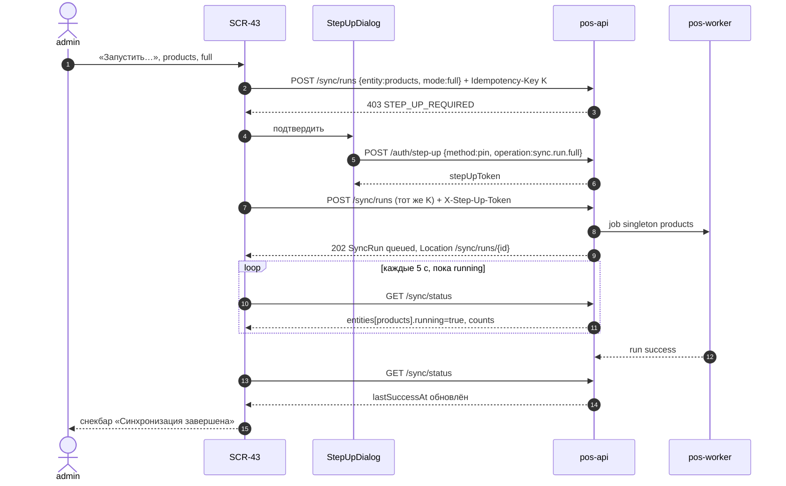

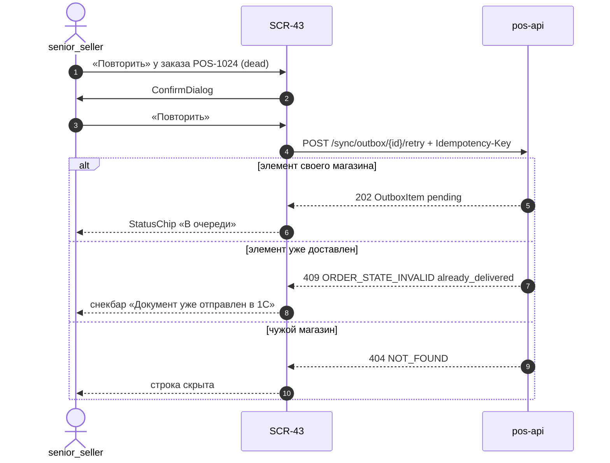

#### 5. Анимации
| Анимация | Ссылка 03 | Начальное → конечное | Триггер | Длительность | Ошибка | Reduce-motion |
|---|---|---|---|---|---|---|
| Индикатор синхронизации | ANIM-021 | `sync` статична → вращение → `check_circle` `success` 300 мс → «обновлено HH:MM» | `running` → `success` | loop 1 с | `failed` → стоп, `sync_problem` `error` | статичная иконка + «обновляем…» |
| Прогресс сущности | `AppProgress` linear определённый | 0 → `fetched/sourceTotal` | опрос | плавно 200 мс между значениями | при `failed` полоса `error` | без анимации значения |
| Вкладки | ANIM-017 | — | тап | 200 мс | — | мгновенно |
| SS краткого статуса | ANIM-025 (`side`; ширина по UI-43-019 — отклонение, замечание №16) | скрыт → открыт справа 480 (E) / 400 (M) | тап `SyncIndicator` | 250 мс | — | fade 80 мс |
| Диалог запуска / step-up | ANIM-023 | — | тап | 250 мс | — | fade 80 мс |
| Смена статуса строки (специфичная; ANIM-010 не применяется — он описывает перекат чисел) | — | старый `StatusChip` → новый crossfade 200 мс; фон строки `surface` → `primaryContainer` → `surface` за 300 мс | смена `sync_run_status` при опросе | 200 + 300 мс `standard` | — | мгновенная замена без подсветки |

#### 6. Переходы
| Откуда → куда | Триггер | Данные | «Назад» |
|---|---|---|---|
| `SyncIndicator` в шапке → SCR-43 | тап | `entity` (опц.) | C/M: `go` в ветку `profile`, «Назад» → SCR-41; E: SS поверх, Esc/крестик закрывает, URL не меняется |
| SCR-41 → SCR-43 | «Синхронизация» | — | SCR-41 |
| SCR-30 (блок ошибок синхронизации) → SCR-43 | тап | `entity` | `go` в ветку `profile` |
| SCR-44 (уведомление `sync_error`) → SCR-43 | тап | `entity`, `runId` (из `payload`) | SCR-44 |
| SCR-43 → деталь прогона | тап по прогону | `runId` → `?runId=` | список прогонов |
| SCR-43 outbox → SCR-24 / SCR-32 / SCR-37 / SCR-39 | ссылка UI-43-015 | `orderId` / `customerId` / транзакция / `returnId` | `go` с переключением ветки |
| Deep link `/sync?runId=` без `sync.runs.read` | — | — | краткий вид без журнала (navigation §3) |

#### 7. Состояния экрана
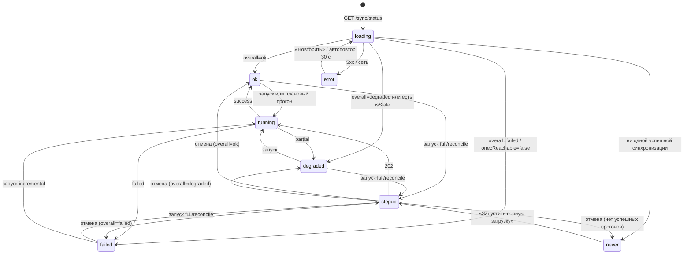

| Состояние | Отображение |
|---|---|
| Загрузка | скелетон карточки A и 8 строк B |
| Успех (`ok`) | зелёный `StatusChip` «Обмен работает», времена по сущностям |
| `degraded` | `warning` «Есть задержки»; строки с `isStale` подсвечены; баннер UI-43-016 |
| `failed` / 1С недоступна | `error` «1С недоступна» + `ds_onec_down`; запуск возможен (будет `queued`/`failed`), подсказка «Синхронизация продолжится автоматически, когда 1С станет доступна» |
| Ещё не синхронизировано | `SyncIndicator` `never` `[НОВОЕ ИМЯ варианта]` «ещё не синхронизировано» + для `admin`/`owner` CTA «Запустить полную загрузку» |
| Пустой (вкладки) | «Прогонов за период нет» / «Ошибок нет» / «Очередь пуста» — `EmptyState` `generic` `[НОВОЕ ИМЯ варианта]` с fallback-иконкой |
| Ошибка API | `ErrorState.fullScreen` (без кэша) / `banner` с последним известным статусом и «данные от HH:MM» |
| Офлайн (устройство) | `OfflineBanner`; показывается локальный `sync_meta` устройства («Каталог на устройстве обновлён 09:12»); серверный статус недоступен; запуск/повтор — disabled |
| Нет прав (`FORBIDDEN` на `/sync/runs`) | вкладки журнала скрываются; краткий вид |
| Step-up | для `full`/`reconcile` |
| Устаревшие данные | `checkedAt` старше 2 мин (опрос не удался) — `caption` `warning` «Статус от HH:MM» |

#### 8. Валидация и сообщения
| Ключ ARB | Текст (ru) |
|---|---|
| `sync_title` | Синхронизация с 1С |
| `sync_overall_ok` / `sync_overall_degraded` / `sync_overall_failed` | Обмен работает / Есть задержки / Обмен нарушен |
| `sync_onec_reachable` / `sync_onec_unreachable` | 1С доступна / 1С недоступна |
| `sync_last_success` | Последний успешный обмен: {time} |
| `sync_next_run` | Следующий: {time} |
| `sync_interval` | `{minutes, plural, one{каждую {minutes} мин} other{каждые {minutes} мин}}` |
| `sync_errors_count` | `{count, plural, one{{count} ошибка подряд} few{{count} ошибки подряд} many{{count} ошибок подряд} other{{count} ошибки подряд}}` |
| `sync_run_button_stock` / `sync_run_button_prices` / `sync_run_button_order_status` | Обновить остатки / Обновить цены / Обновить статусы |
| `sync_run_button_busy` | Обновляем… |
| `sync_run_dialog_title` | Запуск синхронизации |
| `sync_run_dialog_entity` / `sync_run_dialog_mode` | Что синхронизировать / Режим |
| `sync_mode_incremental` / `sync_mode_full` / `sync_mode_reconcile` | Только изменения / Полная загрузка / Сверка |
| `sync_run_full_warning` | Полная загрузка увеличивает нагрузку на 1С и может занять до {minutes} мин. Рекомендуется вне рабочего времени |
| `sync_run_started` / `sync_run_done` / `sync_run_partial` / `sync_run_failed` | Синхронизация запущена / Синхронизация завершена / Завершено с ошибками: {count} / Синхронизация не выполнена |
| `error_sync_already_running` (03) | Синхронизация уже выполняется |
| `sync_rate_limited` | Слишком частый запуск. Повторите через {seconds} с |
| `sync_permission_hint` | Ручной запуск выполняет старший продавец или администратор |
| `sync_stale_banner` | {entity}: данные старше {minutes} мин |
| `sync_outbox_retry_confirm` | Повторить отправку {number} в 1С? Убедитесь, что причина ошибки устранена |
| `sync_outbox_retried` / `sync_outbox_already_sent` | Поставлено в очередь / Документ уже отправлен в 1С |
| `sync_trigger_schedule` / `sync_trigger_manual` / `sync_trigger_retry` / `sync_trigger_dependency` | По расписанию / Вручную: {name} / Повтор / По зависимости |
| `sync_trigger_auto` | Автоматически |
| `sync_never` | Ещё не синхронизировано |

#### 9. Источники данных, API, бизнес-правила
| Данные / действие | API | Правило |
|---|---|---|
| Статус по сущностям | `GET /sync/status` (`SyncStatus`, `SyncEntityStatus`; `private, max-age=15`) — краткие поля по `sync.status.read`, полные по `sync.runs.read` | 08 §4.17.1, SYNC-026 |
| Ручной запуск | `POST /sync/runs {entity, mode, scope:null}` + `Idempotency-Key`; `202`; `full`/`reconcile` — S!; `SYNC_ALREADY_RUNNING` 409 | 08 §4.17.2, ядро §17.2, SYNC-025; аудит `sync.manual_started` |
| История, деталь, ошибки | `GET /sync/runs`, `/sync/runs/{id}`, `/sync/runs/{id}/errors` | 08 §4.17.2, SYNC-037, SYNC-039 |
| Outbox | `GET /sync/outbox?status=&aggregateType=`; `POST /sync/outbox/{id}/retry` | 08 §4.17.3, SYNC-046; аудит `outbox.retried` |
| Интервалы | `intervalSec` из статуса (источник — `app_settings.sync_interval.<entity>` → env `SYNC_*_CRON`) | D-29, SYNC-021 |
| Пороги устаревания | единая шкала 05 §7.4 | SYNC-026, SYNC-038 |
| Локально | `sync_meta` устройства (кэш каталога) | 07 §11.2 |

#### 10. Действия по ролям и ограничения безопасности
| Действие | seller | cashier | senior_seller | admin | owner |
|---|---|---|---|---|---|
| Краткий статус (зоны A, B без счётчиков) | ✓ | ✓ | ✓ | ✓ | ✓ |
| Счётчики, журнал прогонов, ошибки | — | — | ✓ | ✓ | ✓ |
| `incremental` для `stock`/`prices`/`order_status` | — | — | ✓ (без S!) | ✓ | ✓ |
| Любая сущность `incremental` | — | — | — | ✓ | ✓ |
| `full`/`reconcile` | — | — | — | ✓ S! | ✓ S! |
| Outbox: просмотр и «Повторить» | — | — | ✓ свой магазин | ✓ все | — |

Скрытие кнопок не является защитой: сервер возвращает `FORBIDDEN` (SEC-028). Данные ошибок не содержат ПДн (NFR-LOG-001).

#### 11. Повторное нажатие / двойной запрос / назад / перезапуск
- Двойной тап «Обновить остатки» — один запрос (кнопка `loading`); второй запуск той же сущности с другого устройства — `SYNC_ALREADY_RUNNING`, без второго прогона (singleton, SYNC-023).
- Повтор после step-up — тот же `Idempotency-Key`; «Повторить» outbox — новый ключ на каждое подтверждённое действие.
- «Назад» из детали прогона → список с сохранёнными фильтрами (в URL).
- Перезапуск во время прогона: экран открывается, видит `running` по `/sync/status` и продолжает показ прогресса; кнопки — в ожидании по `runId`.

#### 12. Платформы
- Windows: таблица с сортировкой по колонке «Последний успех» и «Ошибки» (клик по заголовку); `F5`; копирование кода ошибки `Ctrl+C` на строке.
- Android: pull-to-refresh; списки 72; кнопки запуска внизу в зоне большого пальца (A11Y-022).
- Все: опрос приостанавливается в фоне (экономия батареи), возобновляется при возврате.

#### 13. Критерии приёмки
| ID | Критерий |
|---|---|
| AC-UI-43-001 | Для каждой сущности `sync_entity` отображается время последней успешной синхронизации из `lastSuccessAt` (совпадает с `sync_state.last_success_at`) |
| AC-UI-43-002 | `seller` и `cashier` не видят кнопок запуска и вкладок журнала; видят подсказку `sync_permission_hint` |
| AC-UI-43-003 | `senior_seller` видит ровно три кнопки (`stock`, `prices`, `order_status`); запуск выполняется без step-up |
| AC-UI-43-004 | `senior_seller`, отправивший вручную `mode=full`, получает `FORBIDDEN` (проверка API); в UI такого выбора нет |
| AC-UI-43-005 | `admin` при запуске `full` получает `StepUpDialog`; после подтверждения создаётся ровно один прогон (повтор с тем же `Idempotency-Key`) |
| AC-UI-43-006 | Повторный запуск выполняющейся сущности показывает снекбар «Синхронизация уже выполняется» с переходом к текущему прогону |
| AC-UI-43-007 | Во время прогона строка сущности показывает прогресс и вращающийся индикатор; по завершении — `check_circle` и новое время |
| AC-UI-43-008 | `consecutiveErrors ≥ 1` отображается бейджем у сущности; ≥ 3 сопровождается уведомлением `sync_error` (SCR-44) у `admin`/`owner` |
| AC-UI-43-009 | Вкладка «Прогоны» фильтруется по периоду, сущности и статусу; параметры сохраняются в URL и восстанавливаются «Назад» |
| AC-UI-43-010 | Ошибки прогона показывают код журнала, `onecCode` и сообщение без телефонов/ФИО |
| AC-UI-43-011 | «Повторить» у `dead` элемента outbox переводит его в `pending`; у `senior_seller` элементы другого магазина не отображаются |
| AC-UI-43-012 | `owner` не видит вкладку «Outbox», но видит счётчики очереди в зоне A |
| AC-UI-43-013 | Возраст остатков > 2× интервала переводит `SyncIndicator` в шапке в `warning` и показывает баннер устаревания |
| AC-UI-43-014 | При недоступной 1С отображается «1С недоступна» и `ds_onec_down`; экран не блокируется |
| AC-UI-43-015 | На expanded тап по `SyncIndicator` открывает SS без смены URL; «Подробнее» открывает `/sync` |
| AC-UI-43-016 | Опрос статуса выполняется каждые 30 с только пока экран видим (проверка по сетевому журналу) |
| AC-UI-43-017 | При `overall=degraded` или `failed` запуск `full`/`reconcile` у `admin`/`owner` открывает `StepUpDialog`; отмена возвращает экран в исходное состояние (`degraded`/`failed`) без запроса |
| AC-UI-43-018 | Деталь прогона показывает «Вручную: {name}» при `triggeredBy≠null` и «Автоматически» иначе; при появлении поля `trigger` в ответе `SyncRun` — подпись по `sync_trigger_*` |

#### 14. Трассировка
SRC-B-008 (ручная синхронизация со статусом), SRC-B-013, SRC-B-014 (мониторинг последней успешной и ошибок), SRC-B-054 (индикаторы синхронизации), SRC-C-005 (статус синхронизации в шапке), SRC-E-176h, SRC-E-176i, SRC-E-177, SRC-E-178; D-28, D-29, D-32; SYNC-021…SYNC-028, SYNC-037…SYNC-039, SYNC-041…SYNC-046; 08 §4.17; 11 §4.4 (`sync.*`); ядро §17.2, §18.2 п.11; 03 §9.40, ANIM-021.

---

## 5. Экран SCR-44

### SCR-44 — Центр уведомлений (маршрут `/notifications?unread=1`, роли: все аутентифицированные; R1: да)

#### 1. Назначение и роль пользователя
Единое место in-app уведомлений (D-41; push — R2, Q-036): ошибки синхронизации, смена статусов заказов, изменение цен и остатков в корзине, блокировка продажи в долг, статусы платежей и заявок на возврат, системные события (вход с нового устройства, смена ролей, блокировка PIN, конфликт привязки клиента). Колокольчик в шапке с бейджем непрочитанных — по макету («3», `[ПОДТВЕРЖДЕНО: макет]`, SRC-C-006). Право — `notifications.read.own`.

#### 2. Структура экрана
**Compact:** шапка «Уведомления» + «Назад» + `AppButton` text «Прочитать все» справа → `ViewModeSegmented` «Все · Непрочитанные (3)» → фильтр видов (`CategoryChip` горизонтальная лента: «Синхронизация», «Заказы», «Корзина», «Оплата», «Возвраты», «Долг», «Система») → список, сгруппированный по дням («Сегодня», «Вчера», «18 окт») — строки 72 → BNB.

**Medium:** SS 400 справа с тем же содержимым (`AppBottomSheet` `side` шириной 400 — отклонение от 03 §9.47, где `side` = 320; замечание к ядру №16).

**Expanded:** popover 400×560 под `NotificationBell` (`ds.elevation.2`, радиус `ds.radius.lg`): заголовок «Уведомления» + «Прочитать все», сегменты «Все/Непрочитанные», список последних 20, внизу «Все уведомления» → полный экран в ветке профиля (как compact, ширина ≤ 720 по центру контент-зоны).

#### 3. Таблица элементов
Соответствие `wireframes-cashier.html`: UI-44-001…004 совпадают; UI-44-005…011 — новые.

| № | UI-ID | Элемент | Компонент (03) | Расположение/размер | Токены | Состояния | Поведение | Источник данных | Роли | Правило |
|---|---|---|---|---|---|---|---|---|---|---|
| 1 | UI-44-001 | Фильтр «Все/Непрочитанные» и «Прочитать все» | `ViewModeSegmented` + `AppButton` text | под шапкой (C) / заголовок popover (E) | — | default, selected, loading («Прочитать все»), disabled (нет непрочитанных) | сегмент — параметр `unread`; «Прочитать все» → `POST /notifications/read-all` | `unreadCount` | все | D-41 |
| 2 | UI-44-002 | Строка уведомления | `AppListTile` 72 (C) / 56 (popover) + иконка по виду + `StatusChip` (для статусов) | список; полоса 3 lp `primary` слева и точка 8 у непрочитанных | иконки/цвета по видам (таблица ниже); заголовок `body 600` (непрочит.) / `body 400`; текст `caption textSecondary` ≤ 2 строк; время `caption tnum` справа | unread, read, hover, pressed, focused | тап → цель (п. 6) + `POST /notifications/{id}/read` (единый механизм отложенной отметки — п. 4 «Отметки о прочтении»); свайп (C) — «Прочитано» | `GET /notifications` (`Notification`); очередь отметок в памяти `pendingReads` `[НОВОЕ ИМЯ]` | все | D-41 |
| 3 | UI-44-003 | Popover (E) | `NotificationBell` + popover | под колокольчиком, 400×560, `ds.elevation.2` | `surface`, обводка `border` | открыт/закрыт | Esc / клик вне — закрыть; фокус в список | — | все | navigation §3 |
| 4 | UI-44-004 | «Все уведомления» | `AppButton` text | низ popover | `primary` | — | `go('/notifications')` | — | все | — |
| 5 | UI-44-005 | Колокольчик с бейджем | `NotificationBell` (header/rail/dot) | шапка справа | бейдж `error`/`onError` `micro`; «99+» | default, hover, pressed, selected, error (`notifications_active` при непрочитанном `sync_error`) | тап → SCR-44 / popover | `unreadCount` (опрос 60 с, foreground, старт) | все | 03 §9.51 |
| 6 | UI-44-006 | Фильтр видов | `CategoryChip` (filter, мультивыбор) | лента под сегментами, горизонтальная прокрутка | 03 §9.9 | default, selected | параметр `kind` (список) | `notification_kind` | все | — |
| 7 | UI-44-007 | Заголовок группы дня | `AppSectionHeader` | перед первой строкой дня, высота 32 | `label 600 textSecondary` | — | — | `createdAt` (Asia/Bishkek) | все | 03 §16.4 |
| 8 | UI-44-008 | Пустое состояние | `EmptyState` `notifications` | центр | 03 §9.43 | — | при фильтре — «Сбросить фильтры» | — | все | ANIM-022 |
| 9 | UI-44-009 | Действие уведомления | `AppButton` text S в строке (если применимо) | под текстом | `primary` | — | `cart_price_changed`/`cart_stock_changed` — «Открыть корзину»; `sync_error` — «Подробнее»; `system` (вход с нового устройства) — «Это не я» → SCR-42 `section=sessions` | `payload` | все | — |
| 10 | UI-44-010 | Подгрузка | `AppProgress` circular 24 | низ списка | — | loading, end | курсорная пагинация по 30 (≤ 100) | `cursor` | все | — |
| 11 | UI-44-011 | Объявление нового уведомления | `AppSnackbar` (только для `severity=error` при открытом приложении) | низ | `inverseSurface` | — | «Открыть» → цель | опрос `since` | все | D-41, SRC-B-078 (без навязчивости) |

Сопоставление видов (`notification_kind`, 07 §6) с отображением и целью:

| `kind` | Иконка / цвет | Подпись (ARB) | Цель по тапу (данные `payload`) | Кто получает (типично) |
|---|---|---|---|---|
| `sync_error` | `sync_problem` / `error` | `notification_kind_sync_error` «Ошибка синхронизации» | SCR-43 (`entity`, `runId`) | `admin`, `owner` (SYNC-038), `senior_seller` (outbox своего магазина) |
| `order_status` | `receipt_long` / `info` + `StatusChip` статуса | `notification_kind_order_status` «Статус заказа» | SCR-24 (`orderId`) | автор заказа, кассир |
| `cart_price_changed` | `sell` / `warning` | `notification_kind_cart_price_changed` «Цена в корзине изменилась» | SCR-20 (`cartId`) | владелец корзины |
| `cart_stock_changed` | `inventory_2` / `warning` | `notification_kind_cart_stock_changed` «Остаток в корзине изменился» | SCR-20 (`cartId`) | владелец корзины |
| `credit_blocked` | `block` / `error` | `notification_kind_credit_blocked` «Продажа в долг заблокирована» | SCR-24 (`orderId`) или SCR-32 (`customerId`); у продавца — без сумм (DEBT-013) | продавец, кассир |
| `payment_status` | `payments` / `success` или `warning` по статусу | `notification_kind_payment_status` «Оплата» | SCR-24 (`orderId`) | кассир, автор заказа |
| `return_status` | `undo` / `info` | `notification_kind_return_status` «Заявка на возврат» | SCR-39 (`returnId`) | кассир |
| `system` | `info` / нейтральный (`textSecondary`) | `notification_kind_system` «Система» | по `payload.target`: `sessions` → SCR-42 `section=sessions`; `profile` → SCR-41; `customer_link` → SCR-45 (вкладка конфликтов) / SCR-32; `update` → SCR-42 «О приложении»; иначе — без перехода | все |

#### 4. Поведение каждого контрола
- **Опрос.** `GET /notifications?since=<последний createdAt>&limit=100` при старте, при возврате в foreground и каждые 60 с (08 §4.16.1); новые элементы добавляются сверху без сдвига видимой области (если пользователь прокрутил вниз — плашка «Новые уведомления: N ↑»).
- **Отметки о прочтении — единый механизм.** Отметка (тап, свайп, меню, «Прочитать все») сразу применяется локально (строка прочитана, бейдж уменьшен, `notifications_cache.read_at` заполнен) и помещается в очередь в памяти `pendingReads` `[НОВОЕ ИМЯ]` (набор `id` + флаг `readAll`). Очередь отправляется сразу при наличии сети (`POST /notifications/{id}/read`, `POST /notifications/read-all`; оба идемпотентны) и повторно — при восстановлении сети, возврате в foreground и очередном опросе (60 с). `outbox_actions` **не** используется: типа для отметки прочтения в 07 §11.2 нет (предложение `notification.read` — замечание к ядру №19, после его принятия механизм переносится в outbox без изменения UI). При перезапуске приложения очередь теряется — это допустимо: следующий `GET /notifications` вернёт серверное `readAt`, уведомление снова отобразится непрочитанным, данные не искажаются (теряется только отметка).
- **UI-44-002 тап.** Сначала навигация к цели (мгновенно), затем отметка о прочтении по механизму выше; строка становится прочитанной. Если цель недоступна по правам (`FORBIDDEN`/`NOT_FOUND` на целевом экране) — целевой экран показывает своё состояние ошибки; уведомление всё равно помечается прочитанным. Уведомление без цели — только пометка прочитанным и раскрытие полного текста.
- **Свайп влево (C)** — «Прочитано» (дублируется долгим нажатием — меню «Отметить прочитанным», A11Y-017).
- **UI-44-001 «Прочитать все».** `POST /notifications/read-all` → `200 {unreadCount:0}`; бейдж колокольчика исчезает (fade 150 мс); повтор идемпотентен. Подтверждения не требуется (действие обратимо по смыслу — уведомления не удаляются).
- **UI-44-006 фильтр видов.** Мультивыбор; применяется сразу (`kind=sync_error,order_status`); пустой выбор = все.
- **Popover (E).** Открывается кликом по колокольчику; повторный клик — закрывает; Esc — закрывает и возвращает фокус на колокольчик; ↑/↓ — по строкам, Enter — открыть.
- **UI-44-011 снекбар.** Только для новых `severity=error` (например, `sync_error`, `credit_blocked`), не чаще 1 раза в 60 с; не показывается на экранах оформления заказа и приёма оплаты, чтобы не мешать (SRC-B-078).

#### 5. Анимации
| Анимация | Ссылка 03 | Начальное → конечное | Триггер | Длительность | Ошибка | Reduce-motion |
|---|---|---|---|---|---|---|
| Бейдж колокольчика | 03 §9.51 | нет → scale 0→1; при прочтении всех — fade-out | `unreadCount` 0→N / N→0 | 200 / 150 мс | — | мгновенно |
| Popover | ANIM-023 (вариант без overlay) | скрыт → fade + scale .96→1 | клик | 200 мс | — | fade 80 мс |
| Прочтение строки (специфичная) | ANIM-015 | полоса `primary` и точка → исчезают fade, вес текста 600→400 | тап/свайп | 150 мс | откат при ошибке | мгновенно |
| Появление новых строк (специфичная, по образцу ANIM-019) | — | сверху slide-down 16 lp + fade | опрос | 200 мс `standardDecelerate` | — | fade 80 мс |
| Снекбар | ANIM-027 | — | новое error | 150 мс | — | fade 80 мс |

#### 6. Переходы
| Откуда → куда | Триггер | Данные | «Назад» |
|---|---|---|---|
| `NotificationBell` → SCR-44 | тап | `unread` (опц.) | C/M: `go` в ветку `profile`, «Назад» → SCR-41; E: popover, Esc |
| SCR-41 → SCR-44 | пункт «Уведомления» | — | SCR-41 |
| SCR-44 → цели | тап по уведомлению | `orderId`, `cartId`, `customerId`, `returnId`, `entity`, `runId`, `section` | `go` с переключением ветки (navigation §5.1); из popover — popover закрывается |

#### 7. Состояния экрана
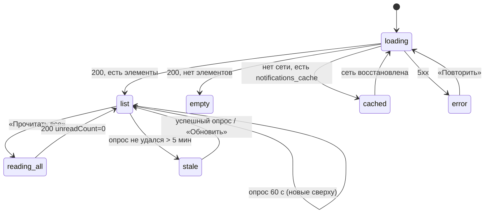

| Состояние | Отображение |
|---|---|
| Загрузка | `SkeletonList` 6 строк 72 |
| Успех | список по дням |
| Пустой | `EmptyState notifications` («Уведомлений нет»); при фильтре — «Нет уведомлений выбранного вида» + «Сбросить фильтры» |
| Ошибка | `ErrorState` (полноэкранный/в popover — inline) + «Повторить» |
| Офлайн | последние 100 из `notifications_cache` с `OfflineBanner`; «Прочитать все» и отметки применяются локально и помещаются в очередь `pendingReads` (в памяти), отправляются при восстановлении сети, пока приложение не перезапущено (п. 4); бейдж — из кэша с учётом локальных отметок |
| Устаревшие данные | список показан из `notifications_cache`, последний успешный опрос старше 5 мин (сеть есть, но запросы падают) — `ErrorState.banner` warning «Уведомления обновлены в {time}» (`notifications_stale_banner`) + «Обновить»; бейдж колокольчика сохраняет последнее известное значение и помечается точкой `warning` вместо числа только при отсутствии данных |
| Нет разрешений ОС | не применимо: R1 использует только in-app уведомления (D-41, Q-036), системное разрешение на push не запрашивается; в R2 (push) — отдельное состояние «Уведомления запрещены в системе» |
| Нет прав (`FORBIDDEN`) | `notifications.read.own` есть у всех ролей; `403` возможен только при блокировке пользователя — обрабатывается общим правилом §0.4 (`SESSION_REVOKED` → SCR-01) |
| Step-up | на SCR-44 не требуется (чтение и отметки своих уведомлений). Если целевой экран требует step-up (например, `credit_blocked` → SCR-34 детализация долга), диалог показывает целевой экран, а уведомление уже помечено прочитанным |

#### 8. Валидация и сообщения
| Ключ ARB | Текст (ru) |
|---|---|
| `notifications_title` | Уведомления |
| `notifications_filter_all` / `notifications_filter_unread` | Все / Непрочитанные ({count}) |
| `notifications_read_all` | Прочитать все |
| `notifications_view_all` | Все уведомления |
| `notifications_new_above` | `{count, plural, one{{count} новое уведомление} few{{count} новых уведомления} many{{count} новых уведомлений} other{{count} новых уведомления}}` |
| `notifications_mark_read` | Отметить прочитанным |
| `notifications_empty_filtered` | Нет уведомлений выбранного вида |
| `notifications_action_open_cart` / `notifications_action_details` / `notifications_action_not_me` | Открыть корзину / Подробнее / Это не я |
| `notifications_bell_a11y` | Уведомления, {count} непрочитанных |
| `notifications_item_unread_a11y` | Непрочитанное: {title}, {time} |
| `notification_kind_*` | см. таблицу видов выше |

#### 9. Источники данных, API, бизнес-правила
| Данные / действие | API | Правило |
|---|---|---|
| Список | `GET /notifications?unread=&kind=&since=&limit=&cursor=` → `Page<Notification>` + `unreadCount` | 08 §4.16.1 |
| Прочтение | `POST /notifications/{id}/read`, `POST /notifications/read-all` → `{unreadCount}` | 08 §4.16.2 |
| Кэш | drift `notifications_cache` (последние 100) | 07 §11.2 |
| Источники событий | сервер: `sync_error` (SYNC-038, SYNC-044), `order_status` (ORD-*), `cart_*` (CART-*), `credit_blocked` (DEBT-013), `payment_status`, `return_status`, `system` (09 §8.4 вход с нового устройства; 09 §8.7 смена ролей; 09 §9.6 блокировка PIN; 09 §7.8 конфликт привязки) | D-41 |
| Тексты | `title`/`body` — сервер (локализация по `Accept-Language`) | 08 §2.13 |

#### 10. Действия по ролям и ограничения безопасности
| Действие / вид | seller | cashier | senior_seller | admin | owner | customer (усл.) |
|---|---|---|---|---|---|---|
| Просмотр своих уведомлений, фильтры, «Прочитать все» | ✓ | ✓ | ✓ | ✓ | ✓ | ✓ |
| `sync_error` | — | — | ✓ (outbox своего магазина) | ✓ | ✓ | — |
| `order_status` | ✓ (свои заказы) | ✓ | ✓ | ✓ | — | ✓ (свои) |
| `cart_price_changed` / `cart_stock_changed` | ✓ | ✓ | ✓ | ✓ | — | ✓ |
| `credit_blocked` | ✓ (без сумм, DEBT-013) | ✓ | ✓ | — | — | — |
| `payment_status` | ✓ (свои заказы) | ✓ | ✓ | — | — | ✓ (свои) |
| `return_status` | — | ✓ | ✓ | — | ✓ (чтение) | — |
| `system` (вход с нового устройства, роли, PIN, обновление) | ✓ | ✓ | ✓ | ✓ | ✓ | ✓ |
| `system` с `payload.target=customer_link` (конфликт привязки) | — | — | — | ✓ | — | — |
| Действие «Это не я» → SCR-42 «Устройства и сессии» | ✓ | ✓ | ✓ | ✓ | ✓ | ✓ |

Ограничения: каждый видит только свои уведомления (`own`, SEC-030); чужой `id` в `POST /notifications/{id}/read` → `NOT_FOUND`. Состав видов по ролям определяет сервер (таблица — типичное распределение, клиент не фильтрует по роли). Продавцу `credit_blocked` приходит без сумм (DEBT-013, SEC-031). Переход к цели проверяет права целевого экрана (guard + сервер); уведомление не расширяет права. Тексты `title`/`body` не содержат полных телефонов и сумм долга для ролей без `customer.receivables.read.summary` (SEC-031).

#### 11. Повторное нажатие / двойной запрос / назад / перезапуск
- Двойной тап по строке — одна навигация; `read` идемпотентен.
- «Прочитать все» во время запроса — повтор игнорируется.
- «Назад» с целевого экрана возвращает в SCR-44 (C/M) с сохранённой прокруткой и фильтрами; из popover — на исходный экран.
- Перезапуск: бейдж из кэша до первого ответа; неотправленные отметки из очереди `pendingReads` теряются (очередь в памяти), после первого `GET /notifications` отображается серверное состояние прочтения (п. 4).

#### 12. Платформы
- Windows: popover, ↑/↓/Enter/Esc; `Ctrl+Shift+N` [ТИПОВО] — открыть уведомления.
- Android/iOS: экран, свайп «Прочитано», pull-to-refresh; системные push не используются в R1.
- Все: бейдж «99+» при > 99.

#### 13. Критерии приёмки
| ID | Критерий |
|---|---|
| AC-UI-44-001 | Бейдж колокольчика равен `unreadCount`; при 0 бейдж не отображается (не «0») |
| AC-UI-44-002 | Тап по `order_status` открывает SCR-24 нужного заказа и помечает уведомление прочитанным |
| AC-UI-44-003 | Тап по `sync_error` открывает SCR-43 с фильтром сущности из `payload` |
| AC-UI-44-004 | «Прочитать все» обнуляет бейдж; повторное нажатие не создаёт ошибок |
| AC-UI-44-005 | Непрочитанные выделены полосой, точкой и весом текста (не только цветом) |
| AC-UI-44-006 | Новое уведомление появляется не позже 60 с после создания на сервере при открытом приложении |
| AC-UI-44-007 | Офлайн отображаются последние уведомления из кэша; отметка о прочтении применяется локально и отправляется после восстановления сети без перезапуска приложения; после перезапуска до восстановления сети уведомление снова показывается непрочитанным согласно серверу (`outbox_actions` не используется) |
| AC-UI-44-008 | На expanded колокольчик открывает popover 400×560 без смены URL; Esc закрывает и возвращает фокус |
| AC-UI-44-009 | Фильтр видов передаёт параметр `kind` и показывает только выбранные виды |
| AC-UI-44-010 | Уведомление `credit_blocked` у продавца не содержит сумм долга |
| AC-UI-44-011 | Уведомление «вход с нового устройства» содержит действие «Это не я», открывающее SCR-42 «Устройства и сессии» |
| AC-UI-44-012 | При неудачных опросах дольше 5 мин показывается баннер «Уведомления обновлены в {time}» с «Обновить» |
| AC-UI-44-013 | Уведомление `system` о конфликте привязки (`payload.target=customer_link`) приходит только `admin`; у остальных ролей отсутствует в ответе API |

#### 14. Трассировка
| Требование | SRC-ID | Элементы | Критерии приёмки | Правила |
|---|---|---|---|---|
| Необходимые уведомления в верхней панели | SRC-C-006 | UI-44-005 (колокольчик с бейджем), UI-44-003 (popover на expanded), UI-44-004 «Все уведомления» | AC-UI-44-001, AC-UI-44-008 | 03 §9.51; D-41; `visual/navigation.md` §3 |
| Переход по уведомлению к объекту и отметка о прочтении | SRC-C-006 | UI-44-002, UI-44-009, UI-44-001 («Прочитать все») | AC-UI-44-002, AC-UI-44-004 | 08 §4.16 |
| Индикаторы синхронизации: уведомление об ошибке обмена ведёт к статусу | SRC-B-054 | UI-44-002 (вид `sync_error`), UI-44-009 → SCR-43, UI-44-006 (фильтр видов) | AC-UI-44-003, AC-UI-44-009 | SYNC-038 |
| Своевременность и устаревание ленты | SRC-C-006, SRC-B-054 | UI-44-010 (подгрузка), баннер устаревания (п. 7) | AC-UI-44-006, AC-UI-44-012 | D-41 (опрос), 08 §4.16 |
| Без резких миганий и навязчивых эффектов (общий принцип анимаций) | SRC-B-078 | UI-44-011 (объявление нового уведомления), UI-44-008 (пустое состояние) | AC-UI-44-005, AC-UI-44-006 | ANIM-022; 03 A11Y-018 |
| Финансовые данные в уведомлениях — только по роли | SRC-C-006 | UI-44-002 (текст без сумм для продавца) | AC-UI-44-010, AC-UI-44-013 | DEBT-013; 11 §4.4 |
| Безопасность сессий: «вход с нового устройства» и «Это не я» | SRC-C-006 | UI-44-009 → SCR-42 «Устройства и сессии» | AC-UI-44-011 | 09 §8.4 |
| Офлайн: кэш ленты и отложенная отметка о прочтении | SRC-C-006 | UI-44-002, UI-44-001 | AC-UI-44-007 | 08 §4.16; 07 §11.2 |

---

## 6. Экран SCR-45

### SCR-45 — Админ: пользователи, роли, приглашения (маршрут `/admin/users?tab=users|invitations|links&userId=`, роли: `admin` — полный; `owner` — просмотр, смена ролей и завершение сессий (11 §4.4; замечание к ядру №1); R1: да)

#### 1. Назначение и роль пользователя
Управление учётными записями сотрудников (SRC-C-129, D-07, D-15): список пользователей с ролями и статусами, приглашение сотрудника по телефону с ролью (единственный путь стать сотрудником без ручной активации, 09 §7.6), активация зарегистрировавшихся `pending_activation`, смена ролей (S!), блокировка/разблокировка (S!), завершение всех сессий пользователя (S!), сброс PIN (S!), переход к аудиту пользователя; разрешение конфликтов привязки аккаунтов `customer` к карточкам 1С (`customer_link` `conflict`, D-08, SRC-B-146) — при включённом режиме клиента. Роли предварительные и согласуются с заказчиком (SRC-C-131, Q-005).

#### 2. Структура экрана (по зонам)
**Зона A — вкладки:** `AppTabs` «Пользователи · 18» · «Приглашения · 3» · «Привязки клиентов · 1» (третья вкладка видна только `admin` и только при `customerSelfService=true` или наличии непрочитанных уведомлений о конфликте — Q-216).

**Зона B — панель инструментов:** `SearchBar` «Имя или телефон», фильтры `CategoryChip`: роль (`role_code` кроме `integration`), статус (`active`, `pending_activation`, `blocked`), справа `AppButton` L primary «+ Пригласить» (`admin`).

**Зона C — список:** строки 72: `AppAvatar` md 40 (заблокированный — `disabled`), ФИО `body 500`, телефон `caption tnum`, `RoleBadge` ×N (≤ 3, далее «+1»), `StatusChip` (`user_status`), «последний вход 09:12» `caption`; на вкладке приглашений — телефон (маска), роли, `StatusChip` (`invitation_status`), «создал Г. А. · 18 окт»; срок «действует до 17 ноя» показывается только если сервер вернёт `expiresAt` — в ответе `Invitation` 08 §4.18.4 этого поля нет (оно есть только в теле POST), замечание к ядру №18; до дополнения 08 строка срока не выводится.

**Зона D — карточка пользователя:** шапка (`AppAvatar` lg, ФИО, полный телефон, статус, источник «по приглашению / самостоятельная регистрация», дата создания) → «Роль» (`AppRadio` по ролям с описанием прав в `AppTooltip`; Q-005) + кнопка «Сохранить роль» → «Индивидуальный лимит скидки» (`AppTextField` % или «по роли») и «Склады» (`AppCheckbox` по `GET /catalog/warehouses`) + «Сохранить» → «Устройства и сессии»: «Устройств: 2 · последний вход сегодня 09:12» + «Завершить все сессии» → «Действия»: «Сбросить PIN», «Заблокировать»/«Разблокировать», «Аудит пользователя».

**Compact:** вкладки → инструменты → список; тап → карточка отдельным экраном; FAB «+ Пригласить» справа снизу.
**Medium:** мастер-деталь в ландшафте (список 360 + карточка), в портрете — как compact.
**Expanded:** SB (раздел «Админ»: Пользователи · Настройки · Аудит · Отчёты) → список 360 (large 400) + карточка ≤ 800 справа; корзина скрыта во всей ветке «Админ».

#### 3. Таблица элементов
Соответствие `wireframes-cashier.html`: UI-45-001…008 совпадают по смыслу (UI-45-006 изменён: список устройств другого пользователя в 08 отсутствует — показывается число устройств из `AdminUser.devicesCount`); UI-45-009…022 — новые.

| № | UI-ID | Элемент | Компонент (03) | Расположение/размер | Токены | Состояния | Поведение | Источник данных | Роли | Правило |
|---|---|---|---|---|---|---|---|---|---|---|
| 1 | UI-45-001 | Вкладки | `AppTabs` fixed | зона A, 48 | 03 §9.49 | default, selected, loading | `?tab=` | счётчики из `Page.totalEstimate`/длины загруженного списка | `admin` — все вкладки; `owner` — «Пользователи» и «Приглашения» (только чтение: `GET /admin/invitations` по `users.read`, 08 §4.18.4); «Привязки клиентов» — только `admin` | — |
| 2 | UI-45-002 | Поиск и фильтры | `SearchBar` + `CategoryChip` ×2 | зона B; поиск 100 % (C) / 360 (E) | — | default, focused, active | `q` (debounce 300 мс, ≥ 2 символа или ≥ 3 цифры телефона), `role`, `status` | `GET /admin/users?q=&role=&status=&kind=staff&limit=&cursor=` | `admin`, `owner` | 08 §4.18.1 |
| 3 | UI-45-003 | Строка пользователя | `AppListTile` 72 + `AppAvatar` + `RoleBadge` + `StatusChip` | зона C | заблокированный — `disabledText`, бейдж `disabled` | default, hover, pressed, selected (E — фон `primaryContainer`), focused | тап → карточка (`?userId=`) | `AdminUser` | `admin`, `owner` | 03 §9.61 |
| 4 | UI-45-004 | Шапка карточки | `AppAvatar` lg + `StatusChip` + текст | зона D сверху | ФИО `h3`; телефон полностью (`admin`) / маска (`owner`, `phoneMasked`) | loading, ready | — | `GET /admin/users/{id}` | `admin`, `owner` | 08 §4.18.1 |
| 5 | UI-45-005 | Роль | `AppRadio` ×5 (`seller`, `cashier`, `senior_seller`, `admin`, `owner`) + `AppTooltip` прав + `AppButton` M «Сохранить роль» | зона D | описание прав `caption textSecondary` | default, selected, disabled (недопустимые варианты), loading | изменение → `ConfirmDialog` withReason (diff «было → стало») → `PUT /admin/users/{id}/roles` (S!) | `AdminUser.roles`, `rowVersion` | `admin`, `owner` | SEC-040, Q-005, DATA-106 |
| 6 | UI-45-006 | Устройства и сессии | `AppListTile` + `AppButton.danger` S «Завершить все сессии» | зона D | — | default, loading | `ConfirmDialog` destructive withReason → `POST /admin/users/{id}/logout-all` (S!) | `AdminUser.devicesCount`, `lastLoginAt` | `admin`, `owner` | 08 §4.18.3, 09 §8.4 |
| 7 | UI-45-007 | Действия | `AppButton.outlined` S «Сбросить PIN», `AppButton.danger` S «Заблокировать» / `AppButton.outlined` S «Разблокировать», `AppButton.text` «Аудит пользователя» | низ зоны D, в ряд (E) / столбиком (C) | `error` для блокировки | default, loading, disabled (своя учётная запись; цель — `owner` для `admin`) | см. п. 4 | `DELETE /admin/users/{id}/pin`, `POST /admin/users/{id}/block` | «Сбросить PIN», «Заблокировать» — `admin`; «Аудит» — `admin`, `owner` | SEC-043, 08 §4.18.3, §4.18.9 |
| 8 | UI-45-008 | «+ Пригласить» | `AppButton` L primary (E) / FAB (C) + форма UI-45-009 | зона B справа | `primary`/`onPrimary` | default, hover, loading | открывает форму приглашения | — | `admin` | D-07, 09 §7.6 |
| 9 | UI-45-009 | Форма приглашения | `PhoneField` + `AppTextField` (ФИО, необяз.) + `AppRadio` роли + `DateRangePicker` single «Действует до» + `AppButton` L «Отправить приглашение» | диалог 480 (E) / экран (C) | — | default, error, loading | `POST /admin/invitations {phone, roles, fullName, expiresAt}` + `Idempotency-Key` (S!) | — | `admin` | 08 §4.18.4, Q-141 (срок) |
| 10 | UI-45-010 | Строка приглашения | `AppListTile` 72 + `StatusChip` (`invitation_status`) | вкладка «Приглашения» | — | pending, accepted, revoked, expired | меню: «Отозвать» (pending), «Пригласить снова» (expired/revoked) — только `admin`; у `owner` меню нет. Подпись строки: «создал {name} · {createdAt}»; срок действия — только при наличии `expiresAt` в ответе (нет в 08 §4.18.4, замечание №18) | `GET /admin/invitations` (`Invitation`: `id`, `phoneMasked`, `roles`, `status`, `createdBy`, `createdAt`, `acceptedAt`) | `admin`; `owner` — только чтение | 08 §4.18.4 |
| 11 | UI-45-011 | «Отозвать приглашение» | `AppButton.danger` S + `ConfirmDialog` | строка/меню | — | default, loading | `DELETE /admin/invitations/{id}` (S!) | — | `admin` | ядро §17.4 |
| 12 | UI-45-012 | «Активировать» (для `pending_activation`) | `AppButton` M primary в карточке | зона D вместо блока ролей | — | default, loading | форма роли → `POST /admin/users {phone, fullName, roles}` (S!) — активирует существующего пользователя | `AdminUser.status` | `admin` | 09 §7.6, D-07; аудит `user.activated` |
| 13 | UI-45-013 | Индивидуальный лимит скидки | `AppTextField` numeric % + `AppCheckbox` «По роли» | зона D | — | default, error, disabled («по роли») | `PATCH /admin/users/{id} {discountLimitPercent, rowVersion}` (S!) | `AdminUser.discountLimitPercent` | `admin` | DISC-*, Q-015 |
| 14 | UI-45-014 | Склады сотрудника | `AppCheckbox` ×N | зона D | — | default, selected | в том же `PATCH {warehouseIds}` | `GET /catalog/warehouses` | `admin` | 08 §4.18.1 |
| 15 | UI-45-015 | Причина действия | `AppTextField` multiline в `ConfirmDialog` withReason | диалоги ролей/блокировки/сброса PIN/завершения сессий | — | error (< 5 символов) | обязательна, 5…500 символов | — | `admin`, `owner` | SEC-076 (11), 08 §4.18.2, §4.18.9 |
| 16 | UI-45-016 | Пустые состояния | `EmptyState` `generic` | центр зоны C | — | — | «Пользователи не найдены» / «Приглашений нет» + «+ Пригласить» | — | — | ANIM-022 |
| 17 | UI-45-017 | Вкладка «Привязки клиентов» — строка конфликта | `AppListTile` 72 + `StatusChip` (`customer_link_status`) | вкладка «Привязки» | `conflict` — `error` | default, resolved | тап → панель UI-45-018 | уведомления `system` с `payload.target=customer_link` (`customerId`, `linkId`) → `GET /customers/{id}/links` | `admin` | D-08, 09 §7.9, Q-216 |
| 18 | UI-45-018 | Панель разрешения привязки | `CustomerCard` (кандидаты) + `AppButton` «Подтвердить» / «Отклонить» | SS 480 (E) / экран (C) | — | loading, ready, error | `POST /customers/{id}/links/{linkId}/confirm` / `reject` `{comment}` (S! по ответу сервера) | `GET /customers/{id}/links` | `admin` (конфликт); `cashier`/`senior_seller` разрешают `proposed` на SCR-32 | 08 §4.11.7, 11 §4.4 |
| 19 | UI-45-019 | Подсказка прав роли | `AppTooltip` / раскрывающийся `caption` | рядом с каждым `AppRadio` роли | `inverseSurface` (тултип) | hover/focus (E), тап по иконке `info` (C) | кратко: «Продавец — каталог, корзина, заказы в рамках правил, скидка до 5 %» (лимит из `GET /admin/discount-limits`); ссылка «Лимиты по ролям» → SCR-46 `section=discount_limits` | 11 §4.4 (тексты ARB `role_<code>_summary`) | `admin`, `owner` | SRC-C-126 |
| 20 | UI-45-020 | Баннер «изменено другим администратором» | `ErrorState.banner` warning | над карточкой | `warning` | — | при `409 VERSION_CONFLICT` — «Обновить» перечитывает карточку | `current` | `admin`, `owner` | 08 §2.4 |
| 21 | UI-45-021 | Предупреждение о немедленном эффекте | `caption` `warning` под кнопкой «Сохранить роль» / «Заблокировать» | зона D | `warning` | — | «Права изменятся в течение минуты; при понижении прав все сеансы пользователя будут завершены» | — | `admin`, `owner` | 09 §8.7, SEC-039 |
| 22 | UI-45-022 | Пункт «Самостоятельная регистрация» в фильтре источника | `CategoryChip` | зона B | — | — | показывает `pending_activation` — кандидатов на активацию | `status=pending_activation` | `admin` | D-07 |

#### 4. Поведение каждого контрола
- **UI-45-002 поиск.** Debounce 300 мс; ≥ 2 букв или ≥ 3 цифр; телефон вводится в любом формате (нормализация к E.164 на сервере); фильтры сочетаются; параметры — в URL (`?q=&role=&status=`); Esc очищает.
- **UI-45-005 смена роли.** Выбор другой роли включает «Сохранить роль». Недопустимые варианты: `admin` не может выбрать `owner` у другого и снять `owner` (SEC-040) — радио `owner` disabled с тултипом; у своей учётной записи — нельзя снять `admin` (правило `self_demotion`) — блок ролей disabled с подписью. Нажатие → `ConfirmDialog` withReason: «Роль {name}: {old} → {new}», поле «Причина» (обязательно) → «Сохранить» → `PUT /admin/users/{id}/roles {roles:[new], reason, rowVersion}` + `Idempotency-Key` → step-up (§0.5) → `200 AdminUser` → обновление строки и карточки, снекбар `admin_users_role_saved`. `409 VERSION_CONFLICT` → UI-45-020. `VALIDATION_FAILED rule=self_demotion` → `admin_users_error_self_demotion`. Повтор того же набора ролей → `200` без изменений (снекбар не показывается, только закрытие диалога).
- **Множественные роли.** 08 принимает массив `roles[]`, 07 (DATA-106) в R1 допускает одну активную роль — UI использует `AppRadio` (одна роль) до ответа Q-005; при решении «несколько ролей» — `AppCheckbox` без изменения API.
- **UI-45-007 «Заблокировать».** `ConfirmDialog` destructive withReason: «Заблокировать {name}? Все сеансы будут завершены, приглашение аннулировано» → `POST /admin/users/{id}/block {blocked:true, reason}` (S!) → `200` → статус «Заблокирован», аватар disabled. «Разблокировать» — `ConfirmDialog` default → `{blocked:false, reason}` (S!). Своя учётная запись — кнопка disabled (`self_block`); цель `owner` у `admin` — disabled (SEC-043).
- **UI-45-007 «Сбросить PIN».** `ConfirmDialog` withReason: «PIN будет сброшен. Сотрудник задаст новый PIN после входа по SMS. Текущие сеансы сохранятся, но разблокировка по PIN станет недоступна» → `DELETE /admin/users/{id}/pin {reason}` (S!) → `204` → снекбар `admin_users_pin_reset`. Своя запись и `customer` — недоступно (`self_or_customer`).
- **UI-45-006 «Завершить все сессии».** `ConfirmDialog` destructive withReason → `POST /admin/users/{id}/logout-all` (S!) → `204` → «Устройств: 0», снекбар `admin_users_sessions_revoked`.
- **UI-45-009 приглашение.** Поля: телефон (обязательно, `PhoneField`), ФИО (необязательно, ≤ 150), роль (обязательно, без `owner` для `admin`, без `integration`), «Действует до» (по умолчанию +30 дней — `INVITATION_TTL_DAYS`, Q-141; диапазон 1…90 дней [ТИПОВО]). «Отправить приглашение» → `POST /admin/invitations` + `Idempotency-Key` (S!) → `201` → строка вверху вкладки «Приглашения» со статусом «Ожидает», снекбар `admin_invites_created` («Приглашение создано. Сотрудник может войти по номеру {phone}»). Если для номера уже есть `pending` — сервер обновляет роль/срок (09 §7.6); UI показывает снекбар `admin_invites_updated`. `PHONE_ALREADY_REGISTERED` (активный сотрудник) → под полем `admin_invites_error_registered` + ссылка «Открыть пользователя» (если найден поиском). Если номер принадлежит `pending_activation`/`customer` — приглашение применяется к существующему аккаунту (09 §7.6), снекбар `admin_invites_applied_existing`. SMS приглашённому в R1 не отправляется (`INVITE_SMS=false`, Q-038) — в форме подпись `admin_invites_no_sms_hint`.
- **UI-45-011 «Отозвать».** `ConfirmDialog` → `DELETE /admin/invitations/{id}` (S!) → `204` → статус «Отозвано». Повтор → `204`.
- **UI-45-012 «Активировать».** Для `pending_activation`: выбор роли → `ConfirmDialog` → `POST /admin/users {phone, fullName, roles}` + `Idempotency-Key` (S!) → пользователь становится `active`, получает уведомление; снекбар `admin_users_activated`.
- **UI-45-013/014 лимит и склады.** Изменения сохраняются кнопкой «Сохранить» блока → `PATCH /admin/users/{id}` (S! по ответу сервера) с `rowVersion`. Лимит 0…100 % с шагом 0,5 [НЕ ПОДТВЕРЖДЕНО: Q-015]; чекбокс «По роли» → `null`.
- **UI-45-017/018 привязки.** Панель показывает: аккаунт пользователя (`displayName`, `phoneMasked`), кандидатов-карточки 1С (наименование, ИНН, телефоны — у `admin` есть право видеть, 09 §7.9), подсказки совпадения (ФИО + год рождения — только как подсказка). «Подтвердить» у выбранной карточки → `ConfirmDialog` withReason (комментарий) → `POST …/confirm {comment}`; при `403 STEP_UP_REQUIRED` — §0.5; остальные кандидаты отклоняются отдельными `reject`. «Отклонить все» → `reject` для каждой связи. `409 CUSTOMER_LINK_CONFLICT` (другая `confirmed`) → баннер `admin_links_error_conflict`.
- **UI-45-007 «Аудит пользователя».** `push` на SCR-47 с `?userId=` и периодом 30 дней.
- **Клавиатура (E).** `Ctrl+N` — «Пригласить»; ↑/↓ — по списку, Enter — карточка; Esc — закрыть диалог/SS.

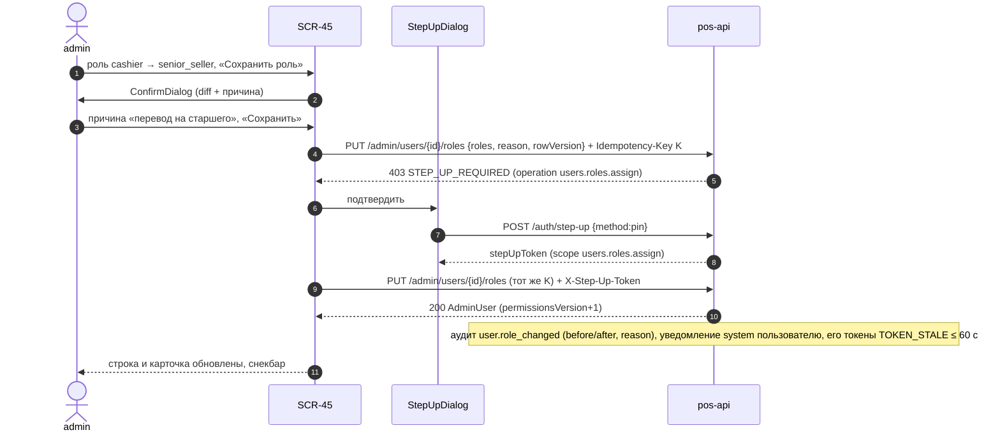

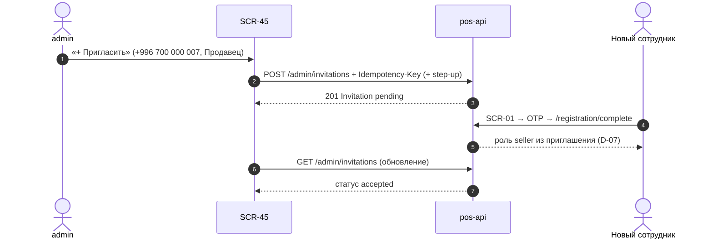

#### 5. Анимации
| Анимация | Ссылка 03 | Начальное → конечное | Триггер | Длительность | Ошибка | Reduce-motion |
|---|---|---|---|---|---|---|
| Открытие карточки (E) | ANIM-024 (fade-through панели) | пусто/прежняя → новая карточка | выбор строки | 200 мс | — | fade 80 мс |
| Открытие карточки (C) | ANIM-024 | список → экран | тап | 300 мс | — | fade 80 мс |
| Диалоги подтверждения и step-up | ANIM-023 | — | действия | 250 мс | ошибка inline в диалоге | fade 80 мс |
| Новая строка приглашения (специфичная, по образцу ANIM-019; ANIM-010 не применяется — он описывает перекат чисел) | — | строки нет → появляется сверху slide-down 16 lp + fade 200 мс, затем фон `surface` → `primaryContainer` → `surface` за 300 мс | `201` | 200 + 300 мс `standardDecelerate` | — | мгновенно, без подсветки |
| Смена статуса на «Заблокирован» | ANIM-015 | аватар обычный → `disabled`, чип меняется | `200` | 150 мс | — | мгновенно |
| Shake поля телефона | ANIM-012 | — | `VALIDATION_FAILED` | 300 мс | — | цвет |

#### 6. Переходы
| Откуда → куда | Триггер | Данные | «Назад» |
|---|---|---|---|
| Ветка «Админ» → SCR-45 | пункт «Пользователи» | `tab` | корень ветки |
| SCR-45 список → карточка | тап | `userId` (`?userId=` на E; маршрут-деталь на C) | список с фильтрами |
| SCR-45 → SCR-47 | «Аудит пользователя» | `userId`, `from`, `to` | SCR-45 карточка |
| SCR-44 (`system`, конфликт привязки) → SCR-45 | тап | `tab=links`, `customerId`, `linkId` | SCR-44 |
| SCR-45 привязки → SCR-32 | «Открыть карточку клиента» | `customerId` | `go` в ветку `customers` |
| Deep link `/admin/users` без `users.read` | — | — | главный экран роли + снекбар `error_forbidden` (guard G-7) |

#### 7. Состояния экрана
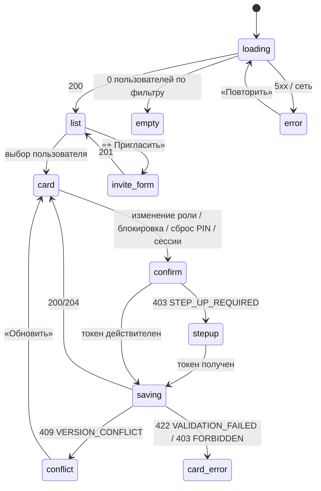

| Состояние | Отображение |
|---|---|
| Загрузка | `SkeletonList` 8 строк 72; карточка — скелетон |
| Успех | список + карточка |
| Пустой | UI-45-016 |
| Ошибка | `ErrorState.fullScreen` / inline в карточке |
| Офлайн | `EmptyState offlineNoCache` (данные пользователей не кэшируются — ПДн) |
| Нет прав (`FORBIDDEN`) | возврат на главный экран роли; при отзыве прав во время работы — карточка закрывается, снекбар |
| Step-up | §0.5 для всех изменяющих действий |
| Устаревшие данные | `VERSION_CONFLICT` → UI-45-020 |

#### 8. Валидация и сообщения
| Поле / событие | Правило | Ключ ARB | Текст |
|---|---|---|---|
| Телефон приглашения | 9 цифр после +996 | `admin_invites_error_phone` | «Введите 9 цифр номера» |
| Номер занят | `PHONE_ALREADY_REGISTERED` | `admin_invites_error_registered` | «Номер уже принадлежит активному сотруднику. Измените его роль в карточке» |
| Роль не выбрана | обязательно | `admin_invites_error_role` | «Выберите роль» |
| Срок | 1…90 дней от сегодня | `admin_invites_error_expiry` | «Срок действия — от 1 до 90 дней» |
| Причина | 5…500 символов | `admin_users_reason_error` | «Укажите причину (не менее 5 символов)» |
| Лимит скидки | 0…100, шаг 0,5 | `admin_users_limit_error` | «Лимит от 0 до 100 %» |
| Снятие своей роли администратора | `self_demotion` | `admin_users_error_self_demotion` | «Нельзя снять с себя роль администратора» |
| Блокировка себя | `self_block` | `admin_users_error_self_block` | «Нельзя заблокировать свою учётную запись» |
| Назначение `owner` администратором | SEC-040 | `admin_users_owner_hint` | «Роль «Руководитель» назначает только руководитель» |
| Сервер отклонил назначение `owner` администратором (обход UI) | `403 FORBIDDEN` (код для SEC-040 в 08 §4.18.2 не определён — замечание №21) | `error_forbidden` (03) | «Недостаточно прав для этого действия» |
| Сохранено | 200 | `admin_users_role_saved` | «Роль изменена. Права обновятся в течение минуты» |
| Создано | 201 | `admin_invites_created` | «Приглашение создано. Сотрудник может войти по номеру {phone}» |

#### 9. Источники данных, API, бизнес-правила
| Данные / действие | API | Правило / аудит |
|---|---|---|
| Пользователи | `GET /admin/users`, `GET /admin/users/{id}` (`AdminUser`) | 08 §4.18.1 |
| Активация `pending_activation` | `POST /admin/users` (S!, `Idempotency-Key`) | D-07; `user.invited`, `user.activated` |
| Лимит, склады | `PATCH /admin/users/{id}` (`rowVersion`) | `user.updated` |
| Роли | `PUT /admin/users/{id}/roles` (S!) | SEC-039, SEC-040; `user.role_changed` |
| Блокировка | `POST /admin/users/{id}/block` (S!) | SEC-043; `user.blocked`/`user.unblocked` |
| Сессии пользователя | `POST /admin/users/{id}/logout-all` (S!) | `session.revoked` |
| Сброс PIN | `DELETE /admin/users/{id}/pin` (S!) | 09 §9.6; `auth.pin.reset` |
| Приглашения | `GET/POST /admin/invitations`, `DELETE /admin/invitations/{id}` (S!) | 09 §7.6; `invitation.created`/`invitation.revoked` |
| Привязки | `GET /customers/{id}/links`, `POST …/confirm/reject` | 09 §7.9; `customer.link.confirmed`/`rejected`/`conflict_resolved` |
| Склады | `GET /catalog/warehouses` | — |
| Лимиты по ролям (подсказка) | `GET /admin/discount-limits` | DISC-* |

#### 10. Действия по ролям и ограничения безопасности
| Действие | admin | owner |
|---|---|---|
| Список, карточка | ✓ (телефон полностью) | ✓ (`phoneMasked`) |
| Вкладка «Приглашения» (просмотр списка) | ✓ | ✓ (только чтение, `users.read`) |
| Пригласить / отозвать приглашение | ✓ S! | — |
| Активировать `pending_activation` | ✓ S! | — |
| Сменить роль | ✓ S! (кроме назначения/снятия `owner`; не себе) | ✓ S! (включая `owner`/`admin`, SEC-040) |
| Блокировка / разблокировка | ✓ S! (не себя, не `owner`) | — |
| Завершить все сессии пользователя | ✓ S! | ✓ S! |
| Сброс PIN | ✓ S! (не себе, не `customer`) | — |
| Лимит/склады сотрудника | ✓ | — |
| Разрешение конфликта привязки | ✓ | — |

Остальные роли маршрут не видят (G-7). Все проверки дублируются сервером (SEC-028, SEC-043, SEC-046).

#### 11. Повторное нажатие / двойной запрос / назад / перезапуск
- Двойное «Отправить приглашение» — один `201` (`Idempotency-Key`); повтор после сетевой ошибки — тот же ключ.
- Повтор после step-up — тот же ключ (`IDEMPOTENCY_IN_PROGRESS` → ожидание 2 с и повтор).
- «Назад» с карточки (C) → список с сохранёнными фильтрами и прокруткой; несохранённые изменения роли/лимита → `ConfirmDialog` «Отменить изменения?».
- Перезапуск: открывается список (данные не кэшируются); `?userId=` в URL восстанавливает карточку на E.

#### 12. Платформы
- Windows: основной сценарий администрирования; `Ctrl+N`, ↑/↓, Enter, Esc; таблица на large с колонками «Имя · Телефон · Роль · Статус · Последний вход».
- Android: экран-деталь; FAB «Пригласить»; ввод телефона — цифровая клавиатура.
- Размеры: строки 72 (C) / 56 (E); радио ролей — цель 48.

#### 13. Критерии приёмки
| ID | Критерий |
|---|---|
| AC-UI-45-001 | Пользователь без `users.read` не может открыть `/admin/users` (переход на главный экран роли + `error_forbidden`); API отвечает 403 |
| AC-UI-45-002 | Поиск по части телефона «700 000» находит пользователя; фильтр «Заблокированы» показывает только `blocked` |
| AC-UI-45-003 | Создание приглашения требует step-up; после `201` строка «Ожидает» появляется вверху вкладки «Приглашения» |
| AC-UI-45-004 | Регистрация по приглашённому номеру даёт роль из приглашения; статус приглашения меняется на «Принято» |
| AC-UI-45-005 | Смена роли требует причину ≥ 5 символов и step-up; в аудите — `user.role_changed` с before/after и причиной |
| AC-UI-45-006 | (а) `admin` не может снять с себя роль «Администратор»: блок ролей disabled; прямой запрос `PUT /admin/users/{id}/roles` → `422 VALIDATION_FAILED` с `rule=self_demotion`. (б) `admin` не может выбрать роль «Руководитель» для другого пользователя: радио disabled с `admin_users_owner_hint`; прямой запрос → `403 FORBIDDEN` (SEC-040; код не закреплён в 08 §4.18.2 — замечание №21), состояние ролей не меняется |
| AC-UI-45-007 | Блокировка пользователя завершает все его сеансы (его устройство получает `SESSION_REVOKED`) |
| AC-UI-45-008 | «Сбросить PIN» и «Заблокировать» недоступны для собственной учётной записи |
| AC-UI-45-009 | `owner` видит список пользователей и вкладку «Приглашения» (только чтение, без меню «Отозвать»/«Пригласить снова»), может сменить роль (S!) и завершить сессии (S!), не видит «Пригласить», «Заблокировать», «Сбросить PIN» и вкладку «Привязки клиентов» |
| AC-UI-45-010 | Двойное нажатие «Отправить приглашение» создаёт одно приглашение |
| AC-UI-45-011 | При `409 VERSION_CONFLICT` показывается баннер и «Обновить» перечитывает карточку без потери списка |
| AC-UI-45-012 | `pending_activation` пользователь активируется кнопкой «Активировать» с выбором роли; пользователь получает уведомление и доступ к рабочему экрану роли |
| AC-UI-45-013 | Конфликт привязки (≥ 2 карточек 1С) отображается во вкладке «Привязки клиентов»; подтверждение одной карточки переводит её в `confirmed`, остальные — в `rejected` |
| AC-UI-45-014 | Подсказка прав роли показывает актуальный лимит скидки из `GET /admin/discount-limits` |
| AC-UI-45-015 | Данные пользователей не сохраняются в локальной БД (проверка схемы drift) |
| AC-UI-45-016 | Строка приглашения не показывает срок действия, пока ответ `GET /admin/invitations` не содержит `expiresAt`; при наличии поля — «действует до {date}» |

#### 14. Трассировка
SRC-C-121…SRC-C-126, SRC-C-129, SRC-C-131, SRC-C-131a, SRC-C-132, SRC-C-133, SRC-C-137 (аудит прав), SRC-B-146 (конфликт привязки); D-07, D-08, D-15, D-36; 08 §4.11.7, §4.18.1–§4.18.4, §4.18.9; 09 §7.6, §7.9, §8.7; 11 §4.3–§4.4, SEC-039, SEC-040, SEC-043, SEC-046; 03 §9.45, §9.46, §9.50, §9.61.

---

## 7. Экран SCR-46

### SCR-46 — Админ: лимиты скидок и настройки (маршрут `/admin/settings?section=`, роли: `admin` — изменение; `owner` — только чтение (`settings.app.read`, замечание к ядру №1); R1: да)

#### 1. Назначение и роль пользователя
Настройка бизнес-параметров POS без перезапуска сервера (SRC-C-129): лимиты ручной скидки по ролям и роли, подтверждающие превышение (D-23, Q-015), порог устаревания долгов `receivables.max_age_minutes` (D-24, ядро §16 п.2), пороги остатков «мало» (`low_stock_threshold`), склад по умолчанию, правила оплаты и возвратов, сроки хранения корзин, интервалы синхронизации (`sync_interval.<entity>`, D-29), параметры OTP/сессий (Q-004), минимальная/рекомендуемая версия приложения (D-46), тексты и контакты. Переменные окружения (`RECEIVABLES_MAX_AGE_MIN`, `SYNC_*_CRON`, `MIN_APP_VERSION` и др.) показываются только для чтения с подписью «задаётся на сервере» как значения по умолчанию. Режим клиента `customerSelfService` — изменяемая настройка `app_settings` по документам-владельцам (08 §4.18.6, 11 §4.3 №54 `settings.app.update`); env `CUSTOMER_SELF_SERVICE` — значение по умолчанию (UI-46-017). Секреты не читаются и не изменяются (08 §4.18.6, SEC-019).

#### 2. Структура экрана
**Compact:** список секций-аккордеон: «Лимиты скидок» · «Долги» · «Склад и остатки» · «Оплата и возвраты» · «Корзины» · «Печать» · «Синхронизация» · «Вход и сессии» · «Версии приложения» · «Регистрация и режим клиента» · «Тексты и контакты»; раскрытая секция — форма; внизу закреплена панель «Отменить · Сохранить» (видна при изменениях в секции).

**Medium / Expanded:** 2 колонки в контент-зоне: навигация секций 240 (`AppListTile`, точка `warning` у секции с несохранёнными изменениями) + форма ≤ 720; футер формы «Отменить · Сохранить»; корзина скрыта.

Значения параметра `?section=` `[НОВОЕ ИМЯ значений]`: `discount_limits`, `receivables`, `stock`, `payments_returns`, `carts`, `printing`, `sync`, `auth_sessions`, `app_versions`, `registration`, `texts_contacts` (в порядке секций выше); неизвестное значение → первая секция без ошибки.

Содержимое секций:

| Секция | Поля (ключ `app_settings` → поле API) | Редактирование |
|---|---|---|
| Лимиты скидок | таблица: роль (`RoleBadge`) · лимит % · «может подтверждать сверх лимита» (`AppCheckbox`, `overrideRoles`); роли `seller`, `cashier`, `senior_seller`, `admin`, `owner` | `PUT /admin/discount-limits` (S!) |
| Долги | `receivables.max_age_minutes` → `receivablesMaxAgeMinutes` (мин); env `RECEIVABLES_MAX_AGE_MIN` — только чтение («по умолчанию 60») | `PUT /admin/settings` (S!) |
| Склад и остатки | `defaultWarehouseId` (`AppDropdown` складов); `low_stock_threshold` → `lowStockThreshold` (порог «мало», в базовых единицах) | S! |
| Оплата и возвраты | `qrProvider` (`none`/`bakai`, только чтение — Q-014), `qrTtlMinutes`, `cash_rounding` → `cashRounding` (`none`/`to_som`, Q-016), `voidCashWindowMinutes`, `overpay_allowed`, `returns_enabled`, `return_approval_threshold` | S! |
| Корзины | `parked_cart_ttl_days` → `parkedCartTtlDays`, `cart_stale_minutes` | S! |
| Печать | `printer.defaultFormat` (по умолчанию для новых устройств) | S! |
| Синхронизация | `sync_interval.<entity>` (ядро §17.7, D-29) → `sync.intervals` (08 §4.18.6). **Единицы:** API — секунды, UI — минуты: показ `round(sec / 60)`, отправка `мин × 60`; диапазон 2…1440 мин = 120…86 400 с [SYNC-021]. **Состав ключей:** 08 отдаёт групповые ключи `stock`, `prices`, `orderStatus`, `master`, `images`, ядро — ключ на каждую `sync_entity`. Сопоставление в UI (одна строка на группу 08): `stock` → `stock`; `prices` → `prices`, `discounts`; `orderStatus` → `order_status`; `master` → `categories`, `products`, `variants`, `attributes`, `units`, `barcodes`, `warehouses`, `customers`; `images` → `images`. Сущности без группы в 08 (`receivables`, `sales_history`, `payment_docs`, `return_docs`) показываются только для чтения с env-значением (`SYNC_*_CRON`) до выравнивания 08 и ядра (замечание №4). Рядом с каждой группой — env-значение по умолчанию только чтение | S! |
| Вход и сессии | `otp.ttlSec` (180…600), `otp.maxAttempts`, `otp.resendCooldownSec`, `otp.maxSendsPerPhone15m`, `otp.maxSendsPerPhone24h`, `session.idleLockMinutes` (≤ 30), `session.refreshDaysStaff`, `session.refreshDaysCustomer` — значения Q-004 | S! |
| Версии приложения | `min_app_version` → `minAppVersion {android, windows, ios}`; `recommended_app_version` | S! |
| Регистрация и режим клиента | `customerSelfService` (`app_settings`, 08 §4.18.6) — `AppSwitch` «Режим клиента (самообслуживание)» UI-46-017; рядом env `CUSTOMER_SELF_SERVICE` как значение по умолчанию (только чтение); срок приглашения `INVITATION_TTL_DAYS` — только чтение. Вариант на случай решения ядра «только env» (замечание №3): переключатель заменяется строкой только для чтения, AC-UI-46-011 не применяется | `customerSelfService` — S!, diff, аудит `settings.changed` |
| Тексты и контакты | `privacy_contact` (контакт ответственного за ПДн), версии текстов согласий (`consent_texts`) — только чтение (тексты — Q-027), `smsSenderName` — только чтение | `privacy_contact` — S! |

#### 3. Таблица элементов
Соответствие `wireframes-cashier.html`: UI-46-001…006 совпадают; UI-46-007…016 — новые.

| № | UI-ID | Элемент | Компонент (03) | Расположение/размер | Токены | Состояния | Поведение | Источник данных | Роли | Правило |
|---|---|---|---|---|---|---|---|---|---|---|
| 1 | UI-46-001 | Навигация секций | `AppListTile` (accordion C / колонка 240 M/E) | слева / список | выбранная — `primaryContainer`; изменённая — точка `warning` | default, selected, dirty | `?section=` | — | `admin`, `owner` | — |
| 2 | UI-46-002 | Лимит роли | `AppTextField` numeric «%» + `RoleBadge` + `AppCheckbox` «подтверждает сверх лимита» | таблица (M/E) / карточки ролей (C) | изменённая строка — фон `primaryContainer` + «было N %» `caption` | default, focused, error, dirty, disabled (`owner`) | ввод 0…100 шаг 0,5 | `GET /admin/discount-limits` | `admin` | D-23, DISC-*, Q-015 |
| 3 | UI-46-003 | Порог долгов | `AppTextField` numeric «мин» + строка env `caption` с `lock` | секция «Долги» | — | default, error, dirty | 5…1440 мин [ТИПОВО] | `GET /admin/settings.receivablesMaxAgeMinutes` | `admin` | D-24, DEBT-006 |
| 4 | UI-46-004 | Значения окружения | `StatusChip` neutral + `AppTooltip` «Задаётся на сервере» | рядом с полями / отдельные строки | `surfaceVariant` + иконка `lock` | статично | без редактирования | ответ `GET /admin/settings` (env-эхо) | `admin`, `owner` | ядро §16 п.3 |
| 5 | UI-46-005 | Оплата и возвраты | `AppSwitch`, `AppDropdown`, `AppTextField` | секция | — | default, dirty, disabled (read-only) | — | `GET /admin/settings` | `admin` | PAY-*, RET-*, Q-014, Q-016, Q-018 |
| 6 | UI-46-006 | «Отменить» / «Сохранить» | `AppButton` L text + L primary | футер формы, закреплён; C — панель над BNB | — | disabled (нет изменений / есть ошибки), loading | «Сохранить» → `ConfirmDialog` с diff → S! → PUT | — | `admin` | 08 §4.18.5–§4.18.6 |
| 7 | UI-46-007 | Порог «мало» | `AppTextField` numeric | секция «Склад и остатки» | — | default, error | целое ≥ 0 | `lowStockThreshold` | `admin` | INV-*, `StockBadge` |
| 8 | UI-46-008 | Склад по умолчанию | `AppDropdown` | секция | — | default, open | — | `GET /catalog/warehouses` | `admin` | 08 §4.4 |
| 9 | UI-46-009 | Интервал группы сущностей | `AppTextField` numeric «мин» ×5 (группы 08: `stock`, `prices`, `orderStatus`, `master`, `images`) + `caption` со списком сущностей группы и env-значением | секция «Синхронизация», таблица групп | — | default, error, dirty | 2…1440 мин; в API — секунды (`мин × 60`) | `sync.intervals` (секунды) | `admin` | SYNC-021, D-29 |
| 10 | UI-46-010 | Параметры OTP/сессий | `AppTextField` numeric ×8 | секция «Вход и сессии» | — | default, error | диапазоны по 08 §4.18.6 | `otp.*`, `session.*` | `admin` | D-10, D-12, Q-004 |
| 11 | UI-46-011 | Версии приложения | `AppTextField` (semver) ×3 + ×3 | секция | — | default, error | формат `X.Y.Z`; рекомендуемая ≥ минимальной | `minAppVersion`, `recommended_app_version` | `admin` | D-46, ядро §18.2 п.12 |
| 12 | UI-46-012 | Диалог diff | `ConfirmDialog` (список «ключ: было → стало») | диалог 480 | изменённые значения `tnum` | default, loading, error | «Сохранить» → запрос; «Отмена» — назад к форме | локальное состояние формы | `admin` | 11 §7.2 (`settings.changed`, `discount.limits_changed`) |
| 13 | UI-46-013 | Предупреждение о рассогласовании с 1С | `ErrorState.banner` info | над таблицей лимитов | `infoContainer`/`info` | статично | «Лимиты должны совпадать с „Правилами продаж“ 1С, иначе 1С отклонит заказ» | — | `admin`, `owner` | 08 §4.18.5, R7 §4.3 |
| 14 | UI-46-014 | Баннер конфликта версий | `ErrorState.banner` warning | над формой | `warning` | при `409` | «Настройки изменены другим администратором» + «Обновить» | `current` | `admin` | 08 §2.4 |
| 15 | UI-46-015 | Режим «только чтение» | баннер info + все поля disabled | над формой | `info` | — | для `owner` | `GET /me.permissions` | `owner` | 11 §4.4 |
| 16 | UI-46-016 | Время и автор последнего изменения | `caption` | под заголовком секции | `textSecondary` | — | «Изменено 18 окт 09:42 · Г. Администратор» | `updatedAt`, `updatedBy` | `admin`, `owner` | — |
| 17 | UI-46-017 | Режим клиента (самообслуживание) | `AppSwitch` listTile + `caption` env «По умолчанию на сервере: выкл» + `ConfirmDialog` destructive | секция «Регистрация и режим клиента» | трек `primary`/`borderStrong`; подпись `caption textSecondary` | on, off, dirty, loading, disabled (`owner`) | изменение → общий «Сохранить» секции → diff → S! → `PUT /admin/settings {customerSelfService, rowVersion}`; включение — дополнительное подтверждение последствий | `GET /admin/settings.customerSelfService` | `admin` (изменение), `owner` (чтение) | Q-001, D-07, 08 §4.18.6, 11 §4.3 №54; аудит `settings.changed` |

#### 4. Поведение каждого контрола
- **Редактирование.** Изменения накапливаются в пределах секции; несохранённая секция помечается точкой; переход к другой секции с изменениями → `ConfirmDialog` «Сохранить изменения в секции {name}?» (Сохранить / Не сохранять / Отмена). Выход с экрана с изменениями — тот же диалог.
- **«Сохранить» (лимиты).** Валидация → `ConfirmDialog` diff («Продавец: 5 % → 7 %») → `PUT /admin/discount-limits {limits, overrideRoles, rowVersion}` + `X-Step-Up-Token` (§0.5, operation `settings.discount_limits.update`) → `200` → значения обновлены, «было N %» исчезает, снекбар `admin_settings_limits_saved`. Изменение лимитов увеличивает `permissionsVersion` пользователей роли (09 §8.7) — подпись UI-45-021-подобная: «Новые лимиты применятся в течение минуты».
- **«Сохранить» (остальные секции).** `PUT /admin/settings` частичным объектом изменённых ключей + `rowVersion` (S!, operation `settings.app.update`). `400/422 VALIDATION_FAILED` → `errors[].field` сопоставляются с полями, ошибки под полями, прокрутка к первой (A11Y-013). `409 VERSION_CONFLICT` → UI-46-014; «Обновить» загружает `current`, локальные изменения сохраняются поверх с пометкой «ваше значение / на сервере» для конфликтных ключей.
- **Правила согласованности (клиентская предвалидация, окончательная — сервер):** `recommended ≥ min` для каждой платформы; лимит роли, подтверждающей сверх лимита, ≥ лимитов ролей, которые она подтверждает (SEC-034) — иначе предупреждение `admin_settings_limits_override_warning`; `session.idleLockMinutes ≤ 30`; интервалы `stock` ≤ `prices` не требуются.
- **UI-46-017 «Режим клиента».** Переключение помечает секцию изменённой; «Сохранить» → `ConfirmDialog` с diff «Режим клиента: выкл → вкл»; при **включении** — дополнительный `ConfirmDialog` destructive: «Клиенты смогут регистрироваться по телефону, видеть каталог с ценами своего вида цены и оформлять заявки-заказы. Появятся экраны SCR-50 и вкладка «Привязки клиентов»» (Q-001 — решение заказчика обязательно до включения в эксплуатации) → S! (operation `settings.app.update`) → `PUT /admin/settings` → `200` → снекбар `admin_settings_saved`. Выключение — `ConfirmDialog` default «Новые клиенты не смогут регистрироваться; у существующих клиентов маршрут `/home` станет недоступен (SCR-07)». Повтор того же значения → `200` без изменений. Значение env показывается подписью как значение по умолчанию.
- **Повышение минимальной версии.** Дополнительный `ConfirmDialog` destructive: «Устройства с версией ниже {version} перестанут работать до обновления» (HTTP 426 на всех запросах).
- **«Отменить».** Возвращает значения секции к серверным без запросов.
- **Клавиатура (E).** `Ctrl+S` — «Сохранить» [ТИПОВО]; Tab по полям; Esc — «Отменить» с подтверждением.

#### 5. Анимации
| Анимация | Ссылка 03 | Начальное → конечное | Триггер | Длительность | Ошибка | Reduce-motion |
|---|---|---|---|---|---|---|
| Раскрытие секции-аккордеона (C) (специфичная, по образцу ANIM-016: `AnimatedSize` высоты + поворот шеврона) | — | свёрнута → тело секции высотой 0 → n + fade полей, шеврон 0→180° | тап по заголовку секции | 200 мс `standard` | — | мгновенно |
| Смена секции (M/E) | ANIM-024 (fade-through) | — | выбор | 200 мс | — | fade 80 мс |
| Подсветка изменённого поля (специфичная; ANIM-010 не применяется — он описывает перекат чисел) | — | фон строки `surface` → `primaryContainer` (остаётся до сохранения/отмены) | изменение значения | 150 мс `standard` | при `VALIDATION_FAILED` фон сменяется на обводку `error` (ANIM-012) | мгновенная смена фона |
| Появление футера «Сохранить» (C) | ANIM-019 | скрыт → slide-up 16 + fade | первое изменение | 200 мс | — | fade 80 мс |
| Ошибка поля | ANIM-012 | — | `VALIDATION_FAILED` | 300 мс | — | цвет и текст |

#### 6. Переходы
| Откуда → куда | Триггер | Данные | «Назад» |
|---|---|---|---|
| Ветка «Админ» (SB/Rail/меню профиля) → SCR-46 | «Настройки» | `section` (опц.; по умолчанию `discount_limits`) | корень ветки «Админ» |
| SCR-45 → SCR-46 | ссылка «Лимиты по ролям» в подсказке прав роли UI-45-019 | `section=discount_limits` | SCR-45 (карточка пользователя с тем же `userId`) |
| SCR-46 → SCR-45 | ссылка «Индивидуальные лимиты сотрудников» в секции «Лимиты скидок» | `tab=users` (фильтры списка не передаются) | SCR-46 с той же `section` |
| SCR-46 → SCR-47 | ссылка «История изменений» у UI-46-016 (каждая секция) | `action=settings.` или `action=discount.` (по секции), `from` = дата `updatedAt` − 30 дней, `to` = сегодня (≤ 92 дня) | SCR-46 с той же `section` |
| SCR-46 → SCR-43 | ссылка «Статус синхронизации» в секции «Синхронизация» | `entity` (группа → первая сущность группы, опц.) | SCR-46 `section=sync` |
| SCR-44 (`system`, изменение настроек) → SCR-46 | тап по уведомлению | `section` из `payload.target` | SCR-44 |
| Deep link `/admin/settings?section=` | URL | `section` | корень ветки «Админ» |
| Deep link без `settings.app.read` | — | — | главный экран роли + `error_forbidden` (guard G-7) |

«Назад» с несохранёнными изменениями при любом переходе (включая ссылки на SCR-45/SCR-47/SCR-43) → `ConfirmDialog` «Сохранить изменения в секции {name}?» (п. 4).

#### 7. Состояния экрана
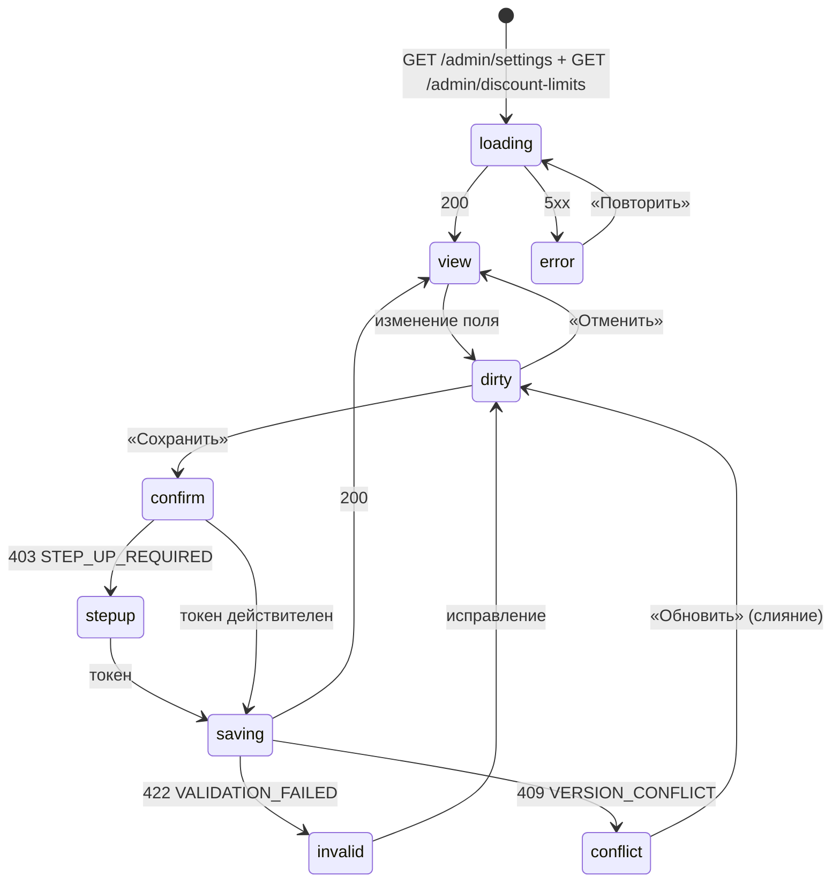

| Состояние | Отображение |
|---|---|
| Загрузка | скелетон навигации и 6 полей формы |
| Успех | значения |
| Ошибка | `ErrorState.fullScreen` |
| Пустой | не применимо |
| Офлайн | `EmptyState offlineNoCache` (настройки не кэшируются); «Сохранить» недоступно |
| Только чтение (`owner`) | UI-46-015 |
| Step-up | §0.5 |
| Устаревшие данные | `VERSION_CONFLICT` → UI-46-014 |

#### 8. Валидация и сообщения
| Поле | Правило | Ключ ARB | Текст |
|---|---|---|---|
| Лимит роли | 0…100, шаг 0,5 | `admin_settings_limit_error` | «Введите значение от 0 до 100 % с шагом 0,5» |
| Порог долгов | 5…1440 мин | `admin_settings_receivables_error` | «От 5 до 1440 минут» |
| Порог «мало» | целое ≥ 0 | `admin_settings_low_stock_error` | «Введите целое число не меньше 0» |
| Интервал синхронизации | 2…1440 мин | `admin_settings_interval_error` | «От 2 до 1440 минут» |
| OTP TTL | 180…600 с | `admin_settings_otp_ttl_error` | «От 180 до 600 секунд» |
| Автоблокировка | 5…30 мин | `admin_settings_idle_error` | «Не больше 30 минут для сотрудников» |
| Версия | `X.Y.Z`; рекомендуемая ≥ минимальной | `admin_settings_version_error` / `admin_settings_version_order_error` | «Формат версии: 1.4.0» / «Рекомендуемая версия не может быть ниже минимальной» |
| Подтверждающая роль | лимит ≥ подтверждаемых | `admin_settings_limits_override_warning` | «Лимит подтверждающей роли ниже лимита подчинённой роли» |
| Сохранено | 200 | `admin_settings_saved` / `admin_settings_limits_saved` | «Настройки сохранены» / «Лимиты скидок сохранены. Применятся в течение минуты» |
| Только чтение | — | `admin_settings_readonly_banner` | «Просмотр. Изменять настройки может администратор» |
| Режим клиента | переключатель | `admin_settings_customer_mode_label` / `admin_settings_customer_mode_env` | «Режим клиента (самообслуживание)» / «По умолчанию на сервере: {value}» |
| Включение режима клиента | подтверждение | `admin_settings_customer_mode_enable_confirm` | «Клиенты смогут регистрироваться по телефону, видеть каталог с ценами своего вида цены и оформлять заявки-заказы» |
| Выключение режима клиента | подтверждение | `admin_settings_customer_mode_disable_confirm` | «Новые клиенты не смогут регистрироваться; у существующих клиентов главный экран станет недоступен» |
| Интервал группы | подпись | `admin_settings_interval_group_hint` | «Сущности: {entities}. По умолчанию на сервере: {value}» |
| Env | — | `admin_settings_env_hint` | «Задаётся на сервере. Изменение — через администратора сервера» |

#### 9. Источники данных, API, бизнес-правила
| Данные / действие | API | Правило / аудит |
|---|---|---|
| Лимиты скидок | `GET`/`PUT /admin/discount-limits` (S!) | D-23, DISC-*, SEC-034; `discount.limits_changed` |
| Настройки | `GET`/`PUT /admin/settings` (частичный объект + `rowVersion`, S!) | 08 §4.18.6; `settings.changed` (по ключам before/after) |
| Склады | `GET /catalog/warehouses` | — |
| Ключи `app_settings` | канон ядра §17.7 (`low_stock_threshold`, `cart_stale_minutes`, `parked_cart_ttl_days`, `overpay_allowed`, `return_approval_threshold`, `returns_enabled`, `cash_rounding`, `delivery_slots`, `receivables.max_age_minutes`, `min_app_version`, `secure_screens`, `privacy_contact`, `sync_interval.<entity>`) | поля API — camelCase-эквиваленты (D-37); ключи, отсутствующие в перечне 08 §4.18.6, — замечание №4 |

#### 10. Действия по ролям и ограничения безопасности
| Действие | admin | owner | прочие |
|---|---|---|---|
| Просмотр | ✓ | ✓ (только чтение) | — |
| Изменение лимитов | ✓ S! | — | — |
| Изменение настроек | ✓ S! | — | — |
| Режим клиента `customerSelfService` (UI-46-017) | ✓ S! (дополнительное подтверждение) | только чтение | — |
| Значения env / секреты | только чтение / не отображаются | только чтение / не отображаются | — |

#### 11. Повторное нажатие / двойной запрос / назад / перезапуск
- «Сохранить» в `loading` игнорирует повторы; PUT по `rowVersion` идемпотентен (повтор того же тела → `200` без изменений).
- «Назад» с несохранёнными изменениями → диалог; системное «Назад» Android — то же.
- Перезапуск: несохранённые изменения теряются (не кэшируются — критичные настройки); открывается последняя секция (`?section=`).

#### 12. Платформы
- Windows — основной; числовые поля принимают цифры с клавиатуры, стрелки ↑/↓ меняют значение на шаг; `Ctrl+S`.
- Android — цифровая клавиатура; футер над клавиатурой.
- Поля 52 (C) / 44 (E); формы ≤ 720.

#### 13. Критерии приёмки
| ID | Критерий |
|---|---|
| AC-UI-46-001 | Изменение лимита продавца 5 % → 7 % требует подтверждения diff и step-up; после сохранения продавец не может применить 7,5 % (`DISCOUNT_LIMIT_EXCEEDED`), 7 % — может |
| AC-UI-46-002 | Значение `RECEIVABLES_MAX_AGE_MIN` (env) отображается только для чтения с подписью «задаётся на сервере»; env `CUSTOMER_SELF_SERVICE` показывается подписью «по умолчанию на сервере» рядом с изменяемым переключателем `customerSelfService` (UI-46-017) |
| AC-UI-46-003 | Изменение `receivables.max_age_minutes` на 30 приводит к блокировке продажи в долг при снимке старше 30 мин (`RECEIVABLES_STALE`) |
| AC-UI-46-004 | Ввод интервала 1 мин отклоняется с текстом ошибки; 5 мин для группы `stock` отправляется как `sync.intervals.stock = 300` (секунды) и отображается на SCR-43 как `intervalSec = 300` у сущности `stock`; изменение группы `master` меняет интервал всех её сущностей |
| AC-UI-46-005 | Повышение минимальной версии требует отдельного подтверждения; устройства ниже версии получают SCR-90 «Требуется обновление» |
| AC-UI-46-006 | `owner` видит все значения, но поля неактивны и кнопки «Сохранить» нет |
| AC-UI-46-007 | При одновременном сохранении двумя администраторами второй получает баннер конфликта и может слить изменения |
| AC-UI-46-008 | Уход с секции с несохранёнными изменениями показывает диалог «Сохранить изменения?» |
| AC-UI-46-009 | Каждое сохранение создаёт запись аудита (`settings.changed` / `discount.limits_changed`) с before/after по ключам |
| AC-UI-46-010 | Секреты (SMSPro, 1С, ключи) не отображаются ни в одном поле экрана |
| AC-UI-46-011 | Включение «Режима клиента» требует diff, отдельного подтверждения последствий и step-up; после `200` `GET /admin/settings` возвращает `customerSelfService=true`, в аудите — `settings.changed` с before/after; `owner` видит переключатель неактивным |
| AC-UI-46-012 | Ссылка «История изменений» открывает SCR-47 с фильтром `action` по секции и периодом ≤ 92 дней; «Назад» возвращает в ту же секцию SCR-46 |

#### 14. Трассировка
SRC-C-129 (управление настройками), SRC-C-136 (аудит скидок), SRC-C-113, SRC-B-006, SRC-B-007 (интервалы); D-23, D-24, D-29, D-46; 08 §4.18.5–§4.18.6; 11 §4.4 (`settings.*`), SEC-019, SEC-034; 05 SYNC-021; ядро §16 п.2–3, §17.7.

---

## 8. Экран SCR-47

### SCR-47 — Аудит (маршрут `/admin/audit?from=&to=&userId=&action=&entityType=&entityId=&result=`, роли: `admin` (без финансовых значений before/after), `owner` (полный); R1: да)

#### 1. Назначение и роль пользователя
Просмотр append-only журнала чувствительных операций `audit_logs` (D-36, SRC-C-134…140): изменения скидок и лимитов, прав и ролей, отмены, ручные подтверждения оплаты, продажи в долг при блокировке, просмотры финансовых данных, ручные синхронизации, действия с сессиями и PIN, применённые изменения цен/остатков из 1С (`sync.prices.applied`/`sync.stock.applied` — ядро §17.2, «изменение цен»/«корректировка остатков» в R1 возникают только как события синхронизации). Записи не редактируются и не удаляются из UI. Каждое открытие журнала фиксируется сервером (`audit.viewed`). Право — `audit.read`.

#### 2. Структура экрана
**Compact:** шапка «Аудит» + кнопка «Фильтры (3)» → строка активных фильтров (`CategoryChip` с крестиками) → список `AuditRow` 80 (3 строки), группировка по дням → тап → экран детали.

**Medium:** список `AuditRow` 64 + SS фильтров.

**Expanded:** SB → контент-зона: слева таблица (колонки: «Время» (до секунд, `tnum`), «Пользователь» (+ `RoleBadge.text`), «Действие», «Объект», «Устройство», «Результат»), справа `FilterPanel` 280; деталь записи — SS 480 с блоком «было/стало». Large — таблица ≤ 1200.

#### 3. Таблица элементов
Соответствие `wireframes-cashier.html`: UI-47-001…005 совпадают по смыслу (имена событий приведены к словарю 11 §7.2: `payment.manual_qr_confirmed` вместо `payment.manual_confirmed`, `sync.manual_started` вместо `sync.manual_run`, `discount.limits_changed` вместо `discount.limit_changed`); UI-47-006…013 — новые.

| № | UI-ID | Элемент | Компонент (03) | Расположение/размер | Токены | Состояния | Поведение | Источник данных | Роли | Правило |
|---|---|---|---|---|---|---|---|---|---|---|
| 1 | UI-47-001 | Фильтры | `FilterPanel` (E) / `FilterSheet` (C) + `DateRangePicker` range + `AppDropdown` + `CategoryChip` | справа 280 (E) / лист (C) | 03 §9.25 | default, active, error (период > 92 дня) | период (обязателен, по умолчанию «Сегодня»), пользователь, группа действий, объект (тип + id), результат | параметры `from`, `to`, `actorId`, `action` (префикс), `entityType`, `entityId`, `result` | `admin`, `owner` | 08 §4.18.7 |
| 2 | UI-47-002 | Строка записи | `AuditRow` 64 (E) / 80 (C) | таблица / список | нейтральные; результат — `StatusChip` (`ok` success «Успешно», `denied` error «Отказано», `error` warning «Ошибка») | default, hover, pressed, focused, selected | тап/Enter → деталь UI-47-004 | `Page<AuditRow>` | `admin`, `owner` | 03 §9.62 |
| 3 | UI-47-003 | Чипы активных фильтров | `CategoryChip` (input, с крестиком) | над таблицей, лента | — | — | крестик снимает фильтр (кроме периода) | URL | `admin`, `owner` | — |
| 4 | UI-47-004 | Деталь «было/стало» | `AuditRow` (detail) + таблица diff | SS 480 (E; `side` шире 03 §9.47 — замечание №16) / SS 400 (M) / экран (C) | старое значение — `textSecondary` зачёркнутое не используется (A11Y-004): колонки «Было» / «Стало» | loading, ready, masked | показывает `before`, `after` (ключ → значение), `reason`, `stepUpMethod`, `requestId`, `sessionId`, `deviceId`, `ip`, `appVersion`, `onecRef`, `rowHash` | запись из списка | `admin` (финансовые значения — «скрыто»), `owner` | SEC-083 (11), 08 §4.18.7 |
| 5 | UI-47-005 | Целостность | `caption` `rowHash` (сокращённый) + место для баннера | деталь, низ | `textSecondary`, моноширинные/`tnum` | — | копирование хэша; баннер «Нарушена целостность» — при наличии признака от сервера (в 08 нет — замечание №5) | `rowHash` | `owner`, `admin` | D-36 |
| 6 | UI-47-006 | Выбор пользователя | `AppDropdown` с поиском | в фильтрах | — | default, open, loading | список сотрудников | `GET /admin/users?q=` | `admin`, `owner` | — |
| 7 | UI-47-007 | Группы действий | `CategoryChip` choice | в фильтрах | — | — | «Вход и сессии» (`auth.`, `session.`), «Пользователи и роли» (`user.`, `invitation.`), «Скидки» (`discount.`), «Заказы» (`order.`), «Оплата и долг» (`payment.`, `credit.`), «Клиенты и финансы» (`customer.`, `receivables.`), «Возвраты» (`return.`), «Синхронизация» (`sync.`, `outbox.`), «Настройки» (`settings.`), «Отчёты и аудит» (`report.`, `audit.`, `export.`), «Отказы доступа» (`authz.`) | `action` префикс | `admin`, `owner` | 11 §7.2 |
| 8 | UI-47-008 | Подпись действия | текст строки | — | `body 500` | — | локализованное название `audit_action_<action>`; неизвестный `action` — код как есть | ARB | — | — |
| 9 | UI-47-009 | Пустое состояние | `EmptyState` `generic` («Записей за период нет» / «Изменить период») | центр | — | — | «Изменить период» открывает `DateRangePicker` | — | — | 03 §9.62 |
| 10 | UI-47-010 | Подгрузка | `AppProgress` | низ списка | — | — | курсор, по 100 (≤ 200) | `cursor` | — | — |
| 11 | UI-47-011 | Ссылка на объект | `AppButton` text S | деталь | `primary` | — | `order` → SCR-24; `customer` → SCR-32; `user` → SCR-45; `payment`/`transaction` → SCR-37; `return_request` → SCR-39; `sync_run` → SCR-43 | `entityType`, `entityId` | по правам цели | — |
| 12 | UI-47-012 | Экспорт | `AppButton.outlined` «Экспорт CSV» | заголовок | disabled + тултип «Доступно в следующей версии» | disabled | R1 — неактивна. Требование задания «экспорт CSV» в R1 не покрыто `[ТРЕБУЕТ РЕШЕНИЯ ЗАКАЗЧИКА: Q-217]`. Для аудита, в отличие от отчётов SCR-48, в 08 §4.18.7 нет параметра `format=csv` — при решении «да» требуется дополнение 08 (замечание №2); поведение включённой кнопки — как SCR-48 UI-48-006 (S!, аудит `export.created`) | — | — | 03 §9.62 (`could`, R2), Q-217 |
| 13 | UI-47-013 | Маска финансовых значений | `caption` «скрыто» + иконка `visibility_off` | в diff | `textSecondary` | — | для `admin` у финансовых событий (D-36 «Финансовое») | ответ сервера (поле маскировано) | `admin` | SEC-083 |

#### 4. Поведение каждого контрола
- **Период.** Обязателен; по умолчанию «Сегодня»; пресеты «Сегодня», «Вчера», «7 дней», «30 дней», «Период…»; максимум 92 дня — больший диапазон блокирует «Применить» с текстом (`audit_period_error`); сервер также отвечает `VALIDATION_FAILED date_range`.
- **Применение фильтров.** C — кнопка «Показать» в листе; E — сразу (debounce 300 мс для текстового поля объекта). Параметры в URL; «Сбросить» — к периоду «Сегодня» без прочих фильтров.
- **Строка.** Тап/Enter — деталь; повторный тап по выбранной строке (E) — закрывает SS. Двойной клик ничего дополнительно не делает.
- **Деталь.** Значения `before/after` выводятся парами «ключ: было → стало»; длинные JSON-значения сворачиваются («Показать полностью»); ПДн маскированы сервером (NFR-LOG-001). `requestId` и `rowHash` копируются тапом с иконкой `content_copy` (снекбар «Скопировано»).
- **Ссылка на объект.** Переход по правам целевого экрана; при отсутствии прав целевой экран покажет `FORBIDDEN`.
- **Клавиатура (E).** ↑/↓ — строки, Enter — деталь, Esc — закрыть деталь, `Ctrl+F` — фокус в фильтр объекта, `F5` — обновить.

#### 5. Анимации
| Анимация | Ссылка 03 | Начальное → конечное | Триггер | Длительность | Ошибка | Reduce-motion |
|---|---|---|---|---|---|---|
| Открытие детали (E) | ANIM-025 (side) | — | выбор строки | 250 мс | — | fade 80 мс |
| Лист фильтров (C) | ANIM-025 | — | «Фильтры» | 250 мс | — | fade 80 мс |
| Скелетон | ANIM-013 | `SkeletonList.row64` | загрузка | loop | — | статично |
| Выделение строки | ANIM-015 | default → selected (`primaryContainer` заголовок) | выбор | 150 мс | — | мгновенно |

#### 6. Переходы
| Откуда → куда | Триггер | Данные | «Назад» |
|---|---|---|---|
| Ветка «Админ»/«Отчёты» → SCR-47 | «Аудит» | период по умолчанию | корень раздела |
| SCR-45 → SCR-47 | «Аудит пользователя» | `userId`, `from`, `to` | SCR-45 |
| SCR-37 → SCR-47 | «Журнал изменений» | `entityType=transaction`, `entityId` | SCR-37 |
| SCR-47 → цель (UI-47-011) | ссылка | `orderId`/`customerId`/`userId`/… | `go` с переключением ветки |

#### 7. Состояния экрана
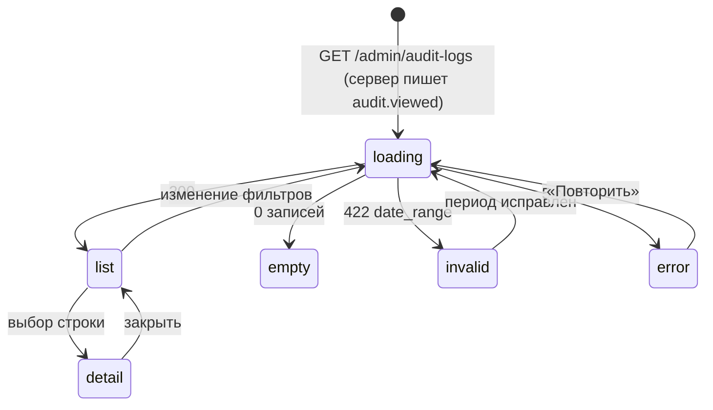

| Состояние | Отображение |
|---|---|
| Загрузка | `SkeletonList.row64` 10 строк |
| Успех | таблица/список |
| Пустой | UI-47-009 |
| Ошибка | `ErrorState`; `FORBIDDEN` — на главный экран роли |
| Офлайн | `EmptyState offlineNoCache` (аудит не кэшируется) |
| Нет прав | guard G-7 |
| Step-up | не требуется (чтение) |

#### 8. Валидация и сообщения
| Ключ ARB | Текст (ru) |
|---|---|
| `audit_title` | Журнал аудита |
| `audit_filters_button` | `{count, plural, =0{Фильтры} other{Фильтры ({count})}}` |
| `audit_period_error` | Период не больше 92 дней |
| `audit_filter_user` / `audit_filter_action` / `audit_filter_object` / `audit_filter_result` | Пользователь / Действие / Объект / Результат |
| `audit_result_ok` / `audit_result_denied` / `audit_result_error` | Успешно / Отказано / Ошибка |
| `audit_before` / `audit_after` / `audit_reason` / `audit_step_up_method` | Было / Стало / Причина / Подтверждение |
| `audit_masked_value` | скрыто |
| `audit_copied` | Скопировано |
| `audit_export_r2_tooltip` | Экспорт будет доступен в следующей версии |
| `audit_empty_title` / `audit_empty_action` | Записей за период нет / Изменить период |
| `audit_action_user_role_changed` | Изменены роли |
| `audit_action_discount_over_limit_approved` | Подтверждена скидка сверх лимита |
| `audit_action_discount_limits_changed` | Изменены лимиты скидок |
| `audit_action_payment_manual_qr_confirmed` | Оплата QR подтверждена вручную |
| `audit_action_credit_sale_approved` | Разрешена продажа в долг |
| `audit_action_order_cancel_requested` | Запрошена отмена заказа |
| `audit_action_customer_finance_view` | Просмотр детализации долга |
| `audit_action_sync_manual_started` | Ручной запуск синхронизации |
| `audit_action_sync_prices_applied` / `audit_action_sync_stock_applied` | Применены цены из 1С / Применены остатки из 1С |
| `audit_action_settings_changed` | Изменены настройки |
| `audit_action_user_blocked` / `audit_action_user_unblocked` | Пользователь заблокирован / разблокирован |
| `audit_action_auth_pin_reset` | Сброшен PIN сотрудника |
| `audit_action_unknown` | Событие {code} |

Полный перечень `audit_action_*` — по словарю 11 §7.2 (≈ 70 событий), ключи формируются механически из `action`.

#### 9. Источники данных, API, бизнес-правила
| Данные | API | Правило |
|---|---|---|
| Журнал | `GET /admin/audit-logs?entityType=&entityId=&actorId=&action=&from=&to=&result=&limit=&cursor=` → `Page<AuditRow>` | 08 §4.18.7; `from`/`to` обязательны, ≤ 92 дня |
| Пользователи для фильтра | `GET /admin/users?q=` | — |
| Маскирование | сервер (SEC-083) | `admin` без финансовых before/after |
| Запись о просмотре | сервер: `audit.viewed` | R6 §6.2 |
| Хранение | 3 года (Q-028) | D-36 |

#### 10. Действия по ролям и ограничения безопасности
| Действие | admin | owner |
|---|---|---|
| Просмотр журнала, фильтры, деталь | ✓ (финансовые значения скрыты) | ✓ полный |
| Экспорт CSV | — (R2) | — (R2) |
| Изменение/удаление записей | — (нет в UI и API) | — |

#### 11. Повторное нажатие / двойной запрос / назад / перезапуск
- Быстрая смена фильтров отменяет предыдущий запрос (CancelToken), показывается результат последнего.
- «Назад» из детали (C) → список с прокруткой; из списка → предыдущий раздел.
- Перезапуск/deep link: фильтры восстанавливаются из URL.

#### 12. Платформы
| Платформа / класс окна | Раскладка и размеры | Ввод | Особенности |
|---|---|---|---|
| Windows-POS, expanded ≥ 1024 (основной сценарий) | таблица: строки `AuditRow` 64, колонки «Время» 160 · «Пользователь» 220 · «Действие» flex (мин. 240) · «Объект» 200 · «Устройство» 160 · «Результат» 120; `FilterPanel` 280 справа; деталь — SS 480; large ≥ 1600 — таблица ≤ 1200 по центру | ↑/↓ — строки, Enter — деталь, Esc — закрыть деталь, `Ctrl+F` — фокус в фильтр пользователя, `F5` — обновить, Tab — фильтры → таблица → деталь; мышь: hover строки (ANIM-015), клик — деталь, двойной клик не используется | выделение и копирование `requestId`, `rowHash`, `entityId` (`Ctrl+C` на сфокусированном поле, иконка `content_copy`); колонки не скрываются, горизонтальной прокрутки страницы нет (длинные значения — многоточие + тултип) |
| Планшет Android, medium 600–1023 | список `AuditRow` 64 (2 строки), фильтры — SS 400, деталь — SS 400 поверх списка | тач, цели ≥ 48; аппаратная клавиатура — как Windows | pull-to-refresh; ориентация — обе |
| Телефон Android, compact < 600 | список `AuditRow` 80 (3 строки: время + результат / пользователь + действие / объект), фильтры — `FilterSheet` (`AppBottomSheet` `fullHeight`), деталь — отдельный экран | тач, цели ≥ 48; системное «Назад» закрывает лист/деталь | долгое нажатие на значении в детали — копирование со снекбаром `audit_copied` «Скопировано»; масштаб текста 1.3× — строки переносятся, высота растёт |
| iOS (без проверки сборки, Q-008) | как Android по классу окна; цели 44 pt | свайп от края = «Назад» | — |
| Все | время — Asia/Bishkek до секунд (03 §16.4), `tnum`; reduce-motion — ANIM-025 → fade 80 мс | — | данные не кэшируются на диске (аудит, ядро §18.2 п.1) |

#### 13. Критерии приёмки
| ID | Критерий |
|---|---|
| AC-UI-47-001 | Пользователь без `audit.read` не открывает `/admin/audit` |
| AC-UI-47-002 | По умолчанию показан период «Сегодня»; период > 92 дней блокирует «Применить» |
| AC-UI-47-003 | Фильтр «Скидки» показывает только события с префиксом `discount.` |
| AC-UI-47-004 | Деталь записи `user.role_changed` показывает роли «было/стало» и причину |
| AC-UI-47-005 | `admin` видит «скрыто» вместо сумм в финансовых событиях; `owner` видит значения |
| AC-UI-47-006 | Открытие журнала создаёт запись `audit.viewed` |
| AC-UI-47-007 | В UI нет действий изменения или удаления записей |
| AC-UI-47-008 | Фильтры сохраняются в URL; переход из SCR-45 «Аудит пользователя» открывает журнал с фильтром по пользователю |
| AC-UI-47-009 | Неизвестный `action` отображается кодом без падения экрана |
| AC-UI-47-010 | Время записей отображается до секунд в часовом поясе Asia/Bishkek |
| AC-UI-47-011 | Группа «Синхронизация» показывает события применения цен и остатков из 1С (`sync.prices.applied`, `sync.stock.applied`) с подписями «Применены цены из 1С» / «Применены остатки из 1С»; фильтр `action=price.changed` и `action=stock.adjusted` показывает только записи этих событий |
| AC-UI-47-012 | Группа «Оплата и долг» показывает аннулирования платежей (`payment.voided`), группа «Заказы» — отмены заказов (`order.cancelled`, запросы отмены) с причиной в детали «было/стало» и ссылкой на объект |
| AC-UI-47-013 | Группа «Клиенты и финансы» показывает события просмотра детализации долга (11 §7.2); у `admin` суммы в этих записях заменены на «скрыто», у `owner` — показаны |

#### 14. Трассировка
| Требование | SRC-ID | Элементы | Критерии приёмки | Правила |
|---|---|---|---|---|
| Журнал аудита чувствительных операций: просмотр, фильтры, неизменяемость | SRC-C-134 | UI-47-001, UI-47-002, UI-47-003, UI-47-006, UI-47-007, UI-47-008, UI-47-010, UI-47-011 | AC-UI-47-001, AC-UI-47-002, AC-UI-47-006, AC-UI-47-007, AC-UI-47-008, AC-UI-47-009, AC-UI-47-010 | D-36; 08 §4.18.7; 11 §7.2 |
| Изменение цен | SRC-C-135 | UI-47-007 (группа «Синхронизация»: `sync.prices.applied`), UI-47-001 (фильтр `action=price.changed`), UI-47-004 | AC-UI-47-011 | 11 §7.2 |
| Изменение скидок | SRC-C-136 | UI-47-007 (группа «Скидки», `discount.`), UI-47-004 | AC-UI-47-003 | 11 §7.2; DISC-* (10) |
| Изменение прав доступа | SRC-C-137 | UI-47-007 (группа «Пользователи и роли»), UI-47-004 (роли «было/стало») | AC-UI-47-004, AC-UI-47-008 | 11 §4.4, §7.2 |
| Отмена транзакций | SRC-C-138 | UI-47-007 (группы «Оплата и долг», «Заказы»), UI-47-004, UI-47-011 (ссылка на объект) | AC-UI-47-012 | 11 §7.2 |
| Корректировка остатков | SRC-C-139 | UI-47-007 (группа «Синхронизация»: `sync.stock.applied`), UI-47-001 (фильтр `action=stock.adjusted`) | AC-UI-47-011 | 11 §7.2 |
| Работа с финансовыми данными и аудит финансовых операций | SRC-C-140, SRC-C-118a | UI-47-007 (группы «Клиенты и финансы», «Оплата и долг»), UI-47-013 (маска для `admin`), UI-47-004 | AC-UI-47-005, AC-UI-47-013 | SEC-083; D-36 |
| Целостность записей | SRC-C-134 | UI-47-005 | AC-UI-47-007 | D-36; 08 §3.16 |
| Экспорт журнала (R2) | SRC-C-134 (требование задания на экран) | UI-47-012 | — (R2, Q-217) | 03 §9.62 |

---

## 9. Экран SCR-48

### SCR-48 — Отчёты руководителя (минимум) (маршрут `/reports?from=&to=&report=&groupBy=`, роли: `owner` (главный экран), `admin`; R1: да)

#### 1. Назначение и роль пользователя
Минимальная отчётность R1 (ядро §3.1, SRC-C-130): сводка продаж по периоду с разрезами по дням/неделям/месяцам/продавцам/способам оплаты/складам; долги по снимку 1С (сумма, просрочка, корзины по срокам, топ должников); сверка QR-платежей Бакай Банка (подтверждения вебхуком/вручную, расхождения) для ежедневной сверки с выпиской. Экспорт CSV — требование задания на экран; по 11 §4.3 №60 и 08 §4.18.8 право `reports.export` в R1 не выдаётся, поэтому в R1 требование **не покрыто** `[ТРЕБУЕТ РЕШЕНИЯ ЗАКАЗЧИКА: Q-217]`: кнопка видна неактивной. Поведение включённого экспорта специфицировано полностью (UI-48-006, п. 4 «Экспорт CSV (сценарий включения)», AC-UI-48-012…015) и вступает в силу при решении Q-217 «да» без изменения экрана — только выдачей права. Права — `reports.sales.read`, `reports.receivables.read`, `reports.qr_reconciliation.read`. Каждый просмотр пишет `report.viewed`.

#### 2. Структура экрана (по зонам)
**Зона A — период:** `DateRangePicker` (пресеты «Сегодня» (по умолчанию) · «Вчера» · «7 дней» · «Месяц» · «Период…»; ≤ 366 дней), справа «Обновить» и «Экспорт CSV» (disabled, R2).

**Зона B — карточки сводок:** «Продажи» (сумма заказов `PriceText` display, число заказов, средний чек, оплачено, скидки, отменено; полосы по способам оплаты `cash`/`qr_bakai`/`credit` с числами), «Долги» (общий долг, просрочено, клиентов с долгом / с просрочкой, «по данным 1С на 09:41», корзины 0–30 / 31–60 / 61–90 / > 90 дней, топ-5 должников), «QR-сверка» (подтверждено вебхуком N, вручную M, расхождения K — `StatusChip` warning).

**Зона C — таблица выбранного отчёта:** `ViewModeSegmented` разреза (для продаж: «Дни · Недели · Месяцы · Продавцы · Способы оплаты · Склады»), таблица с итоговой строкой; для QR — строки платежей с фильтром «Все · Расхождения · Вручную».

**Compact:** зона A → карточки вертикально (высота ≥ 120) → тап по карточке раскрывает её таблицу (зона C) ниже.
**Medium:** карточки 2 колонки; таблица под ними.
**Expanded:** SB → карточки 3 колонки; таблица выбранной карточки (выбранная карточка — обводка `primary` 2 px); large ≤ 1200.

Пример значений (арифметика ядра §17.2): заказ на 16 850,00 сом со скидкой 5 % (842,50) учитывается в «Продажи» как 16 007,50 сом, в «Скидки» — 842,50 сом.

#### 3. Таблица элементов
Соответствие `wireframes-cashier.html`: UI-48-001…005 совпадают; UI-48-006…014 — новые; UI-48-016 `[НОВЫЙ UI-ID]` добавлен при сборке 02 (ЖС-2), номер UI-48-015 не используется.

| № | UI-ID | Элемент | Компонент (03) | Расположение/размер | Токены | Состояния | Поведение | Источник данных | Роли | Правило |
|---|---|---|---|---|---|---|---|---|---|---|
| 1 | UI-48-001 | Период | `DateRangePicker` range + пресеты `CategoryChip` | зона A слева | 03 §9.60 | default, open, error (> 366 дней) | применяется ко всем карточкам | `from`, `to` | `owner`, `admin` | 08 §4.18.8 |
| 2 | UI-48-002 | Карточка «Продажи» | карточка `surface` `ds.radius.lg` + `PriceText` display + `AppProgress` linear (полосы способов) | зона B | сумма `display 32/700 tnum`; подписи `caption` | loading, ready, error, empty («Продаж за период нет») | тап → таблица продаж | `GET /admin/reports/sales-summary?from&to&groupBy` (`totals`, `rows[].byMethod`) | `reports.sales.read` | SRC-C-130 |
| 3 | UI-48-003 | Карточка «Долги» | карточка + `ReceivableBadge` + `PriceText` | зона B | просрочено — `error` + иконка; «по данным 1С на HH:MM» `caption` | loading, ready, stale (`isStale` → `warning` «данные могут быть неактуальны»), error | тап → таблица корзин и топ-должников; строка должника → SCR-34 (S!) | `GET /admin/reports/receivables?asOfOnly=` | `reports.receivables.read` | DEBT-001, DEBT-006, D-24 |
| 4 | UI-48-004 | Карточка «QR-сверка» | карточка + `StatusChip` | зона B | расхождения — `warning` | loading, ready, error, empty | тап → таблица платежей QR | `GET /admin/reports/qr-reconciliation?from&to&status=` | `reports.qr_reconciliation.read` | PAY-* (QR), Q-014 |
| 5 | UI-48-005 | Таблица отчёта | `ViewModeSegmented` + таблица | зона C | числа `tnum`, выравнивание вправо; итог `body 600` | loading, ready, empty | сортировка по колонкам (E); разрез → параметр `groupBy` | ответы отчётов | по отчёту | — |
| 6 | UI-48-006 | «Экспорт CSV» | `AppButton.outlined` M + `AppTooltip`; при включении — + `ConfirmDialog` + `StepUpDialog` | зона A справа, высота 44 (E) / 48 (C), отступ слева 8 от «Обновить» | R1: `disabledText`; включено: `primary` текст/обводка, иконка `download` | R1: disabled. Включено (Q-217 «да», право `reports.export`): default, hover, pressed, focused, loading, error | R1: тултип «Экспорт будет доступен в следующей версии». Включено: экспорт **выбранного** отчёта (карточка зоны C) за текущий период и разрез → `ConfirmDialog` («Выгрузить «{report}» за {period} в CSV? Файл содержит финансовые данные») → `GET /admin/reports/{report}?from&to&groupBy|status&format=csv` + step-up (§0.5) → файл сохраняется через системный диалог сохранения (Windows) / лист «Поделиться/Сохранить» (Android/iOS) | R1: — . Включено: ответ `text/csv` того же отчёта (08 §4.18.8) | R1: никто. Включено: роли с `reports.export` (11 §4.3 №60 — `admin`; `owner` — по решению Q-217) | 11 §4.3 №60, 08 §4.18.8, Q-217; аудит `export.created` (11 §7.2) |
| 7 | UI-48-007 | «Обновить» | `AppIconButton` `refresh` | зона A | — | default, loading | перезапрос всех трёх отчётов | — | `owner`, `admin` | — |
| 8 | UI-48-008 | Средний чек | `PriceText` | карточка «Продажи» | `title tnum` | — | `ordersTotal / ordersCount` в тыйынах, HALF_UP до тыйына (MNY-*), только отображение [ТИПОВО] | `totals` | — | D-19 |
| 9 | UI-48-009 | Источник данных | `caption` + `StatusChip` neutral «POS» / «1С» | под таблицей продаж | `textSecondary` | — | строки `source=onec` помечаются «из 1С» | `source` | — | 08 §4.18.8 |
| 10 | UI-48-010 | Топ должников | `AppListTile` ×5 + `ReceivableBadge` | карточка «Долги» раскрытая | — | — | тап → SCR-34 (step-up при первом просмотре детализации, ядро §17.2) | `top[]` | `reports.receivables.read` | DEBT-004, DEBT-005 |
| 11 | UI-48-011 | Строка QR-платежа | строка таблицы + `StatusChip` (`webhook`/`manual`) + чип `payment_review_<reason>` | таблица QR | — | needsReview → фон `warningContainer` | тап → SCR-36 с фильтром периода и типа `manual_qr_confirm`/поиском по номеру заказа | `rows[]` | `reports.qr_reconciliation.read` | D-21 (`review_reason`) |
| 12 | UI-48-012 | Фильтр QR | `ViewModeSegmented` «Все · Расхождения · Вручную» | над таблицей QR | — | selected | `status=all/unmatched/manual` | — | — | — |
| 13 | UI-48-013 | Ссылка «Аудит» | `AppButton` text | зона A (E) | `primary` | — | → SCR-47 с тем же периодом (≤ 92 дня; больше — обрезается до последних 92) | — | `owner`, `admin` | — |
| 14 | UI-48-014 | Пустые состояния карточек | `EmptyState` `generic` (компактный, без иллюстрации) | внутри карточки | — | — | «Продаж за период нет» / «Долгов нет» / «QR-платежей нет» | — | — | — |
| 15 | UI-48-016 `[НОВЫЙ UI-ID]` | Ссылка «Отложенные заказы ({count})» | `AppListTile` (dense) + шеврон | карточка «Продажи», нижняя строка (C, M, E); высота 48, паддинг по горизонтали 16 | текст `ds.text.body` `primary`; счётчик tnum; иконка `chevron_right` 20 `textSecondary` | default, hover, pressed, focused, loading (счётчик — `SkeletonBox` 24), без счётчика (нет `totalEstimate` или ошибка), скрыт (нет права) | тап / `Enter` → SCR-23 `push /cart/parked?scope=all` поверх ветки `reports`; у `owner` — режим чтения (UI-23-012) | `GET /cart/parked?scope=all&limit=1` (`totalEstimate`; 08 §4.7.6) | `owner`, `admin` (`cart.parked.read.all`) | 11 §4.4; ЖС-2 |

#### 4. Поведение каждого контрола
- **Период.** Смена периода перезапрашивает три отчёта параллельно; каждая карточка загружается независимо (ошибка одной не скрывает другие). Период > 366 дней блокируется. Время — Asia/Bishkek; «Сегодня» — с 00:00 по текущий момент.
- **Карточка.** Тап (C — раскрытие под карточкой; E — выбор и показ таблицы в зоне C). Повторный тап по раскрытой (C) — сворачивает.
- **Разрез продаж.** Переключение `groupBy` перезапрашивает только «Продажи»; выбранный разрез — в URL.
- **Топ должников → SCR-34.** Переход `go` в ветку `customers`; детализация долга запрашивает step-up (первый просмотр в сессии или > 15 мин с последнего, ядро §17.2); суммы на SCR-48 — сводные и step-up не требуют.
- **QR-строка.** Переход к журналу транзакций для разбора; ручного подтверждения с этого экрана нет (`admin`/`owner` без кассовых прав, ядро §17.2).
- **«Отложенные заказы ({count})» (UI-48-016).** Тап или `Enter` → `push /cart/parked?scope=all` (SCR-23; у `owner` — только чтение: вкладка «Все», без «Продолжить» и «Удалить»). Счётчик запрашивается вместе с отчётами (`GET /cart/parked?scope=all&limit=1`, поле `totalEstimate`) и не блокирует карточку «Продажи»; при ошибке или без `totalEstimate` строка показывается без числа (`reports_parked_link_nocount`), переход доступен. Повторный тап во время перехода игнорируется; долгое нажатие не имеет отдельного действия. Элемент скрыт, если в `GET /me.permissions` нет `cart.parked.read.all`.
- **«Экспорт CSV» (R1).** Неактивна; тултип по hover/focus/долгому нажатию. Требование задания в R1 не выполнено — зависит от Q-217.
- **«Экспорт CSV» (сценарий включения, Q-217 «да»).** Кнопка видна и активна только при наличии `reports.export` в `GET /me.permissions` (иначе — R1-вид). Нажатие → `ConfirmDialog` с названием отчёта, периодом и предупреждением о финансовых данных (фокус на «Отмена») → «Выгрузить» → кнопка `loading`, повторные нажатия игнорируются → `GET /admin/reports/{sales-summary|receivables|qr-reconciliation}?…&format=csv` (без `Idempotency-Key`: GET) → `403 STEP_UP_REQUIRED` → `StepUpDialog` (§0.5, operation `reports.export`) → повтор с `X-Step-Up-Token` → `200 text/csv` → сохранение файла `optomstroy_{report}_{from}_{to}.csv` (UTF-8 с BOM, разделитель `;` [ТИПОВО] — для открытия в Excel) → снекбар `reports_export_done` «Файл сохранён» + «Открыть» (Windows). Ошибки: `FORBIDDEN` → снекбар `error_forbidden`, кнопка возвращается в R1-вид; `VALIDATION_FAILED` (`date_range`) → `reports_period_error`; сеть/таймаут 15 с → `reports_export_error` + «Повторить». Сервер пишет `export.created` (тип отчёта, период, число строк). Офлайн — кнопка disabled (`ds_offline_banner`). Отмена диалога сохранения — файл не создаётся, снекбар не показывается.
- **Клавиатура (E).** `F5` — обновить; ←/→ — смена карточки; Tab — в таблицу; Enter на строке — переход.

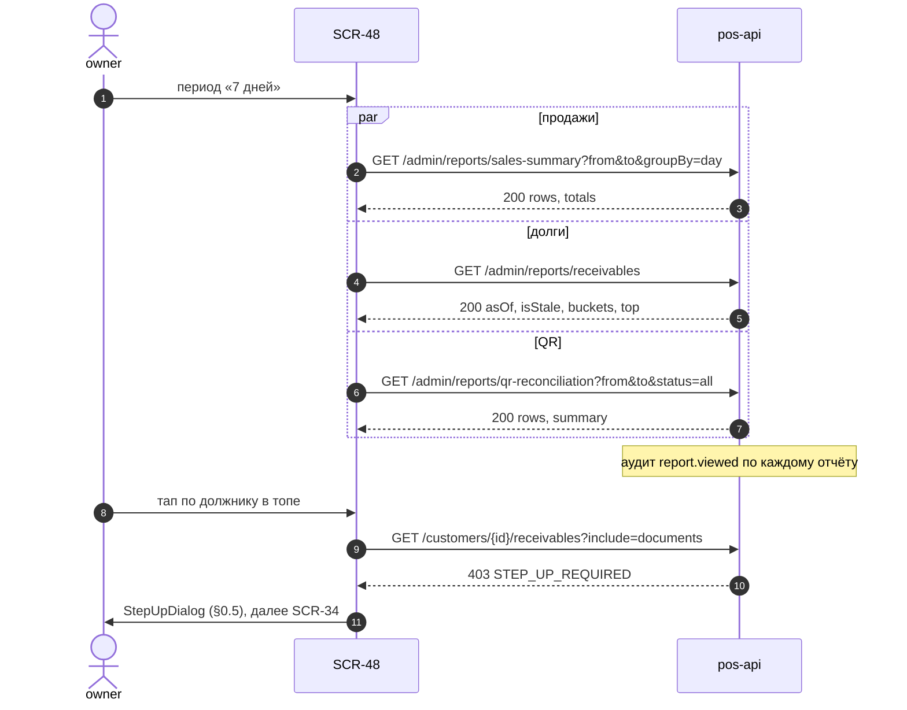

Сценарий включения экспорта (только при решении Q-217 «да»):

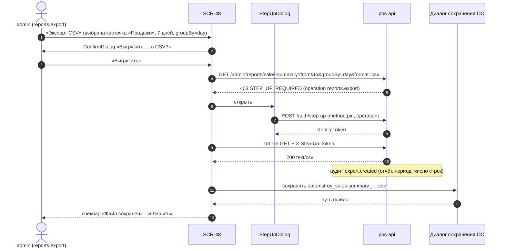

#### 5. Анимации
| Анимация | Ссылка 03 | Начальное → конечное | Триггер | Длительность | Ошибка | Reduce-motion |
|---|---|---|---|---|---|---|
| Перекат итогов | ANIM-010 | старое число → новое | смена периода | 200 мс | — | мгновенно |
| Полосы способов оплаты (специфичная) | `AppProgress` определённый | 0 → доля | загрузка | 300 мс `standardDecelerate` | — | без анимации |
| Раскрытие карточки (C) (специфичная, по образцу ANIM-016: `AnimatedSize` высоты; ANIM-020 относится к `OptionTile`) | — | свёрнута → таблица под карточкой: высота 0 → n + fade содержимого | тап по карточке | 200 мс `standard` | ошибка загрузки — внутри раскрытой области `ErrorState.inline` | мгновенно |
| Скелетон карточек | ANIM-013 | — | загрузка | loop | `ErrorState.inline` в карточке | статично |
| Выбор карточки (E) | ANIM-015 | обводка `border` → `primary` 2 px | тап | 150 мс | — | мгновенно |
| Экспорт CSV (сценарий включения) | ANIM-023 (диалоги), ANIM-027 (снекбар) | кнопка → `loading` (спиннер 16) → default; снекбар «Файл сохранён» | «Выгрузить» | до ответа; снекбар 150 мс, виден 8 с | `ErrorState`-снекбар `reports_export_error` | спиннер статичен, снекбар fade 80 мс |

#### 6. Переходы
| Откуда → куда | Триггер | Данные | «Назад» |
|---|---|---|---|
| Вход `owner` → SCR-48 | главный экран | период «Сегодня» | корень ветки `reports` |
| Ветка «Админ» (`admin`) → SCR-48 | «Отчёты» | — | раздел «Админ» |
| SCR-48 → SCR-34 | топ должников | `customerId` | `go` в ветку `customers`; «Назад» → SCR-32 → SCR-31 |
| SCR-48 → SCR-36 | строка QR | `from`, `to`, тип операции, номер заказа | `go` в ветку транзакций |
| SCR-48 → SCR-47 | «Аудит» | `from`, `to` | SCR-48 |
| SCR-48 → SCR-23 | «Отложенные заказы ({count})» (UI-48-016) | `scope=all` (query) | `push` поверх ветки `reports`; «Назад» → SCR-48 с тем же периодом и выбранной карточкой |

#### 7. Состояния экрана
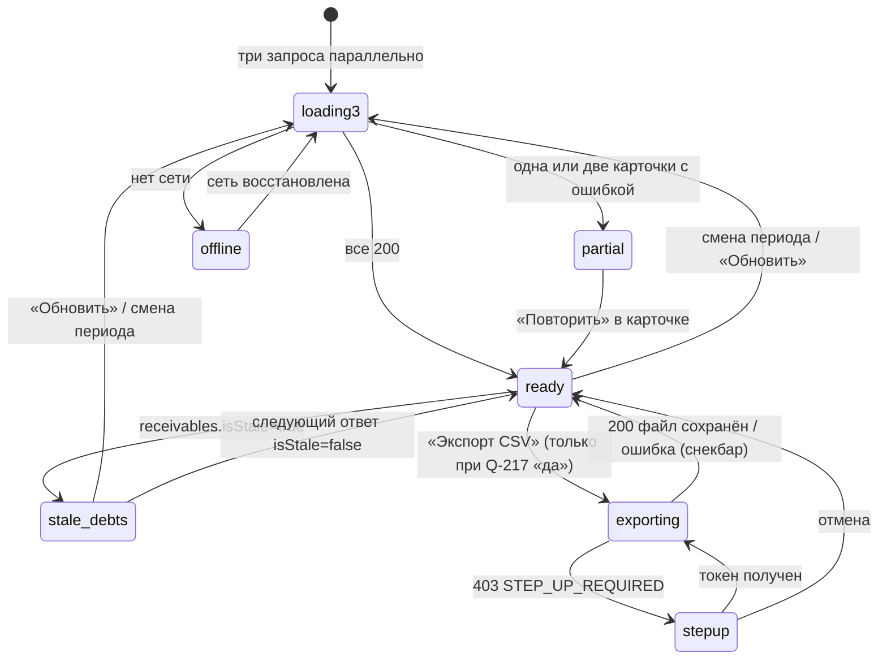

| Состояние | Отображение |
|---|---|
| Загрузка | скелетоны трёх карточек и таблицы |
| Успех | значения |
| Частичная ошибка | `ErrorState.inline` в карточке + «Повторить»; остальные карточки работают |
| Пустой | UI-48-014 |
| Устаревшие данные (долги) | `warning` «Данные 1С от HH:MM могут быть неактуальны» |
| Офлайн | `EmptyState offlineNoCache` (отчёты не кэшируются — финансовые данные, ядро §18.2 п.1) |
| `FORBIDDEN` (`format=csv` или нет права на отчёт) | соответствующая карточка скрыта |
| Step-up | только при переходе к детализации долга |

#### 8. Валидация и сообщения
| Ключ ARB | Текст (ru) |
|---|---|
| `reports_title` | Отчёты |
| `reports_card_sales` / `reports_card_debts` / `reports_card_qr` | Продажи / Долги / QR-сверка |
| `reports_orders_count` | `{count, plural, one{{count} заказ} few{{count} заказа} many{{count} заказов} other{{count} заказа}}` |
| `reports_avg_check` / `reports_paid_total` / `reports_discount_total` / `reports_cancelled` | Средний чек / Оплачено / Скидки / Отменено: {count} |
| `reports_method_cash` / `reports_method_qr` / `reports_method_credit` | Наличные / QR Бакай Банк / В долг |
| `reports_debt_total` / `reports_debt_overdue` | Общий долг / Просрочено |
| `reports_debt_as_of` | По данным 1С на {time} |
| `reports_debt_stale` | Данные 1С от {time} могут быть неактуальны |
| `reports_debt_bucket_0_30` / `reports_debt_bucket_31_60` / `reports_debt_bucket_61_90` / `reports_debt_bucket_90_plus` | 0–30 дней / 31–60 / 61–90 / более 90 |
| `reports_qr_webhook` / `reports_qr_manual` / `reports_qr_unmatched` | Подтверждено банком / Подтверждено вручную / Расхождения |
| `reports_groupby_day` / `reports_groupby_week` / `reports_groupby_month` / `reports_groupby_seller` / `reports_groupby_method` / `reports_groupby_warehouse` | Дни / Недели / Месяцы / Продавцы / Способы оплаты / Склады |
| `reports_source_onec` | из 1С |
| `reports_period_error` | Период не больше 366 дней |
| `reports_export_r2_tooltip` | Экспорт будет доступен в следующей версии |
| `reports_export_confirm_title` / `reports_export_confirm_body` | Выгрузить в CSV? / «{report}» за {period}. Файл содержит финансовые данные |
| `reports_export_confirm_action` | Выгрузить |
| `reports_export_done` / `reports_export_open` | Файл сохранён / Открыть |
| `reports_export_error` | Не удалось выгрузить файл. Повторите |
| `reports_empty_sales` / `reports_empty_debts` / `reports_empty_qr` | Продаж за период нет / Долгов нет / QR-платежей нет |
| `reports_parked_link` / `reports_parked_link_nocount` | Отложенные заказы ({count}) / Отложенные заказы |

#### 9. Источники данных, API, бизнес-правила
| Данные | API | Правило |
|---|---|---|
| Сводка продаж | `GET /admin/reports/sales-summary?from&to&groupBy` | 08 §4.18.8; деньги — строки `Money` → тыйыны (D-19) |
| Долги | `GET /admin/reports/receivables?asOfOnly` | DEBT-001 (только 1С), DEBT-006 (устаревание) |
| QR-сверка | `GET /admin/reports/qr-reconciliation?from&to&status` | D-21, `review_reason`; R7 §3.3 |
| Экспорт | R1: `format=csv` → `FORBIDDEN`. Сценарий включения: тот же отчёт с `format=csv` + `X-Step-Up-Token` → `text/csv` | 11 §4.3 №60; 08 §4.18.8; Q-217; аудит `export.created` |
| Аудит | `report.viewed` (сервер) | D-36 |
| Отложенные заказы (счётчик UI-48-016) | `GET /cart/parked?scope=all&limit=1` | 08 §4.7.6; право `cart.parked.read.all` (11 §4.4) |

#### 10. Действия по ролям и ограничения безопасности
| Действие | owner | admin | прочие |
|---|---|---|---|
| Все три отчёта | ✓ | ✓ | — |
| Переход к детализации долга (S!) | ✓ | ✓ | — |
| Экспорт CSV | R1 — нет; при Q-217 «да» — по праву `reports.export` S! (по 11 §4.3 №60 — `admin`; `owner` — по решению Q-217) | R1 — нет; при Q-217 «да» — ✓ S! | — |
| Кассовые действия с QR | — | — | — |
| Переход к отложенным заказам (SCR-23) | ✓ (только чтение) | ✓ (чтение `scope=all`; продолжение — по праву `cart.parked.resume.any` в SCR-23) | — |

#### 11. Повторное нажатие / двойной запрос / назад / перезапуск
- «Обновить» в `loading` игнорирует повторы; смена периода отменяет незавершённые запросы.
- «Назад» с SCR-34/SCR-36 возвращает к тому же периоду и выбранной карточке (URL).
- Перезапуск: период и разрез — из URL / последних значений (локально, без данных).

#### 12. Платформы
- Windows/планшет — основной (таблицы, сортировка); Android-телефон — карточки и горизонтальная прокрутка таблиц внутри карточки (без прокрутки страницы по горизонтали).
- Числа — `tnum`, выравнивание вправо; суммы с 2 знаками (03 §16.4 «финансовые контексты»).

#### 13. Критерии приёмки
| ID | Критерий |
|---|---|
| AC-UI-48-001 | `owner` после входа попадает на SCR-48 с периодом «Сегодня» |
| AC-UI-48-002 | Сумма «Продажи» равна `totals.ordersTotal` ответа; заказ 16 850,00 со скидкой 5 % учитывается как 16 007,50, скидка — 842,50 |
| AC-UI-48-003 | Разрез «Продавцы» показывает строки по продавцам с итоговой строкой, равной общей сумме |
| AC-UI-48-004 | Карточка «Долги» показывает время снимка 1С; при `isStale` — предупреждение |
| AC-UI-48-005 | Переход из топа должников к детализации долга требует step-up (первый раз в сессии) |
| AC-UI-48-006 | Карточка «QR-сверка» показывает число расхождений; фильтр «Расхождения» показывает только `needsReview=true` с причиной |
| AC-UI-48-007 | Кнопка «Экспорт CSV» неактивна с подсказкой; запрос `format=csv` в R1 возвращает 403 |
| AC-UI-48-008 | Ошибка одного отчёта не скрывает остальные карточки |
| AC-UI-48-009 | Период > 366 дней не применяется (текст ошибки) |
| AC-UI-48-010 | Каждый просмотр отчёта фиксируется событием `report.viewed` |
| AC-UI-48-011 | Роли без `reports.*` не открывают `/reports` |
| AC-UI-48-012 | (Сценарий включения, Q-217 «да») Пользователь с `reports.export` видит активную «Экспорт CSV»; без права — кнопка в R1-виде (неактивна с подсказкой) |
| AC-UI-48-013 | (Сценарий включения) Экспорт требует подтверждения и step-up; после `200 text/csv` файл сохранён, строки и итоги CSV совпадают с таблицей выбранного отчёта за тот же период и разрез |
| AC-UI-48-014 | (Сценарий включения) Каждая выгрузка создаёт запись аудита `export.created` с типом отчёта, периодом и числом строк; двойное нажатие «Выгрузить» даёт одну выгрузку |
| AC-UI-48-015 | При `isStale=true` у долгов «Обновить» и смена периода перезапрашивают отчёт; после ответа с `isStale=false` предупреждение исчезает |
| AC-UI-48-016 | У `owner` в карточке «Продажи» есть ссылка «Отложенные заказы ({count})» с числом из `GET /cart/parked?scope=all`; тап открывает SCR-23 во вкладке «Все» в режиме чтения (без «Продолжить» и «Удалить»); «Назад» возвращает на SCR-48 с тем же периодом |
| AC-UI-48-017 | Ошибка запроса счётчика отложенных заказов не скрывает карточку «Продажи»: ссылка показывается без числа и остаётся рабочей; пользователь без `cart.parked.read.all` ссылку не видит |

#### 14. Трассировка
SRC-C-125, SRC-C-130 (руководитель просматривает отчёты; вход в отложенные заказы UI-48-016 → SCR-23 — AC-UI-48-016/017, AC-UI-23-012, SRC-C-069), SRC-C-104, SRC-C-112 (долги по 1С с датой синхронизации), SRC-C-140 (финансовые данные в аудите); требование задания «экспорт CSV» — **в R1 не покрыто** `[ТРЕБУЕТ РЕШЕНИЯ ЗАКАЗЧИКА: Q-217]`, сценарий включения специфицирован (UI-48-006, AC-UI-48-012…014); 11 §7.2 `export.created`; D-21, D-24, D-36; 08 §4.18.8; 11 §4.3 №57–60; 10 DEBT-001, DEBT-004–006.

---

## 10. Экран SCR-50

### SCR-50 — Главный экран клиента (маршрут `/home?view=&sort=`, роли: `customer`; R1: условно — только при `CUSTOMER_SELF_SERVICE=true`, Q-001)

#### 1. Назначение и роль пользователя
Рабочее пространство клиента-покупателя в режиме самообслуживания (D-07, ядро §3.2): каталог с ценами по правилам вида цены клиента (11 §4.4 `catalog.prices.read` — «вид цены по правилам»), без остатков по складам (только «в наличии/нет»), без ручной скидки и выбора клиента; быстрый доступ к своим заказам и — после подтверждения привязки к карточке 1С (`customer_link.confirmed`) — к своему долгу (SRC-B-142…145). Корзина ведёт к заявке-заказу (SCR-21 без шага «Оплата», условно). При выключенном флаге маршрут не регистрируется (navigation G-8), зарегистрировавшийся без приглашения пользователь видит SCR-07.

#### 2. Структура экрана
**Compact:** шапка: логотип (Q-006), `AppIconButton` поиска, `NotificationBell` dot → `SearchBar` (по нажатию — SCR-11; без кнопки камеры-сканера — SCR-17 только для staff, ядро §9) → баннер привязки (если статус не `confirmed`/`none`) → блок «Мой кабинет» (горизонтальная лента карточек 140×96: «Мои заказы · 2 в работе», «Мой долг · 7 900,00 сом» (только `confirmed`), «Избранное · 12») → баннер «Ваш вид цены: Оптовая» `caption` → категории: сетка `CategoryTile` 3 колонки → «Недавние товары» (горизонтальная лента) → сетка товаров 2 колонки (`ProductCardGrid` без остатков по складам: `StockBadge` «В наличии/Нет в наличии») → `CartFab` → BNB клиента: Каталог · Избранное · Корзина · Мои заказы · Профиль.

**Medium:** Rail; колонка категорий 240 + контент; корзина overlay.

**Expanded:** SB категорий 240 (как макет каталога, «Избранное N», «Недавние товары») → контент: сверху «Мой кабинет» в ряд (3 карточки), затем сетка товаров (W = ширина без постоянной корзины; например, 1280 lp → 5 колонок); корзина — overlay по кнопке в шапке (не постоянная, responsive-spec §8).

#### 3. Таблица элементов
Новый экран: в `wireframes-*.html` таблицы элементов для SCR-50 нет; UI-50-001…014 вводятся здесь.

| № | UI-ID | Элемент | Компонент (03) | Расположение/размер | Токены | Состояния | Поведение | Источник данных | Роли | Правило |
|---|---|---|---|---|---|---|---|---|---|---|
| 1 | UI-50-001 | Шапка клиента | `TopAppBarPos` вариант `customer` `[НОВОЕ ИМЯ варианта — в 03 §9.57 есть только full/compact/modal/auth; замечание к ядру №14]`: без `SyncIndicator`, часов/даты и «бургера», с кнопкой корзины на E | 56/64/72 | `surface` | default | логотип → верх каталога; колокольчик → SCR-44 | `GET /me` | `customer` | ядро §9 |
| 2 | UI-50-002 | Поиск | `SearchBar` (без кнопки камеры) | под шапкой (C) / в шапке (E), высота 48 | 03 §9.7 | default, focused | ввод → SCR-11 (debounce 300 мс, ≥ 2 символа); штрихкод вводится цифрами и ищется тем же поиском (D-31: штрихкод → артикул → FTS); кнопка камеры не показывается — сканер SCR-17 у `customer` закрыт (ядро §9, SCR-17 п.10) (сборка 1.1, раздел 12) | `GET /search/products` | `customer` | D-31, D-42 |
| 3 | UI-50-003 | Баннер статуса привязки | `ErrorState.banner` (info/warning) + `AppButton` text | под поиском | `proposed` — info «Подтвердите организацию», `conflict` — warning «Ожидает подтверждения администратором», `rejected` — neutral | скрыт при `none`/`confirmed` | `proposed` → SCR-06; закрытие крестиком — до следующего запуска | `GET /registration/customer-match` | `customer` | D-08, SRC-B-142, SRC-B-145 |
| 4 | UI-50-004 | Карточка «Мои заказы» | карточка 140×96 `surface` `ds.radius.md` + `AppBadge` | лента «Мой кабинет» | число `title tnum` | loading, ready, empty («Заказов нет») | → SCR-25 (свои; UI-параметр маршрута `mine=1` — не параметр API) | `GET /orders?status=<статусы «в работе»>&limit=1` — для `customer` выборка «свои» обеспечивается правом `order.read.own` (08 §4.8.2), параметра `mine` в API нет; число — `Page.totalEstimate`, если сервер его отдаёт для `/orders` (08 §3.4: только где дёшево); иначе карточка показывает «Есть заказы в работе» без числа (`home_my_orders_active_nocount`) — потребность в счётчике вынесена в замечание к ядру №20 | `customer` | ORD-* |
| 5 | UI-50-005 | Карточка «Мой долг» | карточка + `ReceivableBadge` + `PriceText` | лента | сумма `title tnum`; просрочка `error` | видна только при `confirmed`; loading, stale («данные от HH:MM»), «Нет данных из 1С» | → SCR-34 (свой; `customer.self.receivables.read`) | `GET /customers/{id}/receivables` (`id` = `Me.customerLink.customerId`) | `customer` (confirmed) | DEBT-004, DEBT-009, SEC-037 |
| 6 | UI-50-006 | Карточка «Избранное» | карточка | лента | — | — | → SCR-40 | `GET /favorites/products` (`count`) | `customer` | FAV-001 |
| 7 | UI-50-007 | Вид цены | `StatusChip` `priceList` | над каталогом | `primaryContainer`/`primary`, иконка `sell` | — | тултип «Цены показаны по вашему виду цены» | `Me` / ответы каталога | `customer` | 11 §4.4 |
| 8 | UI-50-008 | Категории | `CategoryTile` (C/M) / `CategorySidebarItem` (E) | сетка 3 кол. / сайдбар 240 | 03 §9.8, §9.10 | default, selected | → SCR-12 | `GET /catalog/categories` | `customer` | SRC-C-011…013 |
| 9 | UI-50-009 | Карточка товара | `ProductCardGrid` + `FavoriteToggle` + `PriceText` + `StockBadge` (только наличие) + «+ Добавить» | сетка 2 / 3 / 5 | как SCR-10 | как SCR-10 | «+ Добавить» → корзина; тап → SCR-14 (без таблицы складов) | `GET /catalog/products` | `customer` | INV-*, 11 §4.4 (наличие без количества) |
| 10 | UI-50-010 | Недавние товары | `ProductCardCompact` лента + `AppSectionHeader` «Недавние · Очистить» | под категориями (C) / сайдбар (E) | — | скрыт при пустом | «Очистить» → `ConfirmDialog` → `DELETE /catalog/products/recent` | `GET /catalog/products/recent` | `customer` | FAV-005 |
| 11 | UI-50-011 | `CartFab` / кнопка корзины в шапке (E) | `CartFab` | C/M справа снизу; E — `AppIconButton` с бейджем в шапке | `primary` | видна при непустой корзине | → SCR-20 (overlay на E) | `cart_draft` | `customer` | CART-* |
| 12 | UI-50-012 | Навигация клиента | `BottomNavBar` / `NavigationRailApp` / SB | низ (C) / слева | 03 §9.55 | selected «Каталог» | Каталог · Избранное · Корзина · Мои заказы · Профиль | — | `customer` | ядро §9 |
| 13 | UI-50-013 | Подгрузка каталога | `AppProgress` + `caption` «Загружаем ещё товары…» | низ сетки | — | loading, end | курсорная пагинация | `cursor` | — | макет каталога |
| 14 | UI-50-014 | Режим «ограниченный» (до привязки) | `caption` в карточке «Мой долг» | лента | `textSecondary` | `proposed`/`conflict`/`none` — карточка «Долг доступен после подтверждения организации» | — | `customer_link_status` | `customer` | SRC-B-145 |

#### 4. Поведение каждого контрола
- **UI-50-002 поиск.** Тап — переход к SCR-11 с фокусом в поле; повторный тап во время перехода игнорируется. Кнопки камеры нет: камера-сканер SCR-17 у роли `customer` в R1 не предусмотрен (ядро §9; SCR-17 п.10). Штрихкод с упаковки клиент вводит цифрами в поле поиска — результат как у поиска по штрихкоду (D-31). Расширение сканера на `customer` — кандидат R2 (раздел 11.1, С-14).
- **UI-50-003 баннер.** `proposed` — «Мы нашли организацию {maskedName}. Это вы?» → SCR-06 (подтверждение без раскрытия финансов); `conflict` — без действия; `rejected` — «Организация не подтверждена. Заказы оформляются как новый клиент».
- **UI-50-005 «Мой долг».** Загружается только при `confirmed`; данные не кэшируются на устройстве (ядро §18.2 п.1); при недоступности — «Нет данных из 1С» (DEBT-009), не «0 сом». Тап → SCR-34 свой (step-up для `customer` не требуется по 11 §4.4/08 §9).
- **UI-50-009 «+ Добавить».** Как SCR-10: crossfade в степпер; кратность/минимум (INV-*); цены не передаются клиентом (SRC-C-114). Нажатия во время запроса (`inFlight`) игнорируются (защита от двойного запроса); каждое следующее нажатие «+» степпера увеличивает количество на шаг без открытия окон (SRC-C-033, 02b UI-10-109); запросы объединяются debounce 400 мс.
- **UI-50-010 «Очистить».** `ConfirmDialog` → `DELETE /catalog/products/recent` → лента скрывается.
- **Pull-to-refresh** — обновление статуса привязки, счётчиков и первой страницы каталога.

#### 5. Анимации
| Анимация | Ссылка 03 | Начальное → конечное | Триггер | Длительность / кривая | Ошибка | Reduce-motion |
|---|---|---|---|---|---|---|
| Добавление в корзину | ANIM-006 | «+ Добавить» → `QuantityStepper` crossfade; `CartFab` (C/M) пульс scale 1→1.04→1 / бейдж кнопки корзины в шапке (E) scale 1→1.25→1 | тап «+ Добавить» | 200 мс `standard` | `STOCK_INSUFFICIENT`/`VARIANT_UNAVAILABLE` → shake ±4 lp (ANIM-012) + подпись «Нет в наличии» (без количества) | смена кнопки без crossfade, без пульса |
| Автоповтор степпера | ANIM-007 | значение n → n ± шаг каждые 150 мс | удержание «+»/«−» > 500 мс | 500 мс задержка, шаг 150 мс; один запрос debounce 400 мс | достижение доступного количества → остановка, число `error` | без анимации числа |
| Избранное | ANIM-009 | контур `star` → filled, scale 1→1.3→1 | тап `FavoriteToggle` | 200 мс `emphasized` | откат 150 мс + снекбар `error` | мгновенная смена иконки |
| Скелетоны «Мой кабинет», категорий, сетки | ANIM-013 | блоки 140×96 / плитки / карточки → контент fade-in 150 мс | загрузка > 300 мс | loop 1,2 с linear | > 10 с — «Долгая загрузка… · Повторить»; ошибка → `ErrorState` | статичные блоки |
| Фото товара | ANIM-014 | `SkeletonBox.image` → фото fade-in; `Hero` в SCR-14 (C) | загрузка изображения / тап | 200 / 300 мс | заглушка «Нет фото» без анимации | мгновенно; `Hero` → fade |
| Сайдбар категорий (E) | ANIM-016 | дети скрыты → видны, шеврон 0→180° | шеврон категории | 200 мс `standard` | — | мгновенно |
| Вид сетки / сортировка | ANIM-017 | индикатор сегмента на старом → на новом | `ViewModeSegmented` | 200 мс | — | мгновенно |
| Баннер статуса привязки UI-50-003 | ANIM-019 | скрыт → slide-down 40 lp + fade, контент сдвигается (`AnimatedSize`) | получен статус `proposed`/`conflict`/`rejected` | 200 мс `standardDecelerate`; скрытие 150 мс | — | fade 80 мс |
| `CartFab` | ANIM-019 | скрыт → slide-up 16 lp + fade | корзина стала непустой / пустой | 200 / 150 мс | — | fade 80 мс |
| Обновление чисел «Мой кабинет» (специфичная, по образцу ANIM-010 без подсветки фона) | — | старое число → новое «перекатом» (tnum) | pull-to-refresh / возврат на экран | 200 мс `standard` | при ошибке значение не меняется, под ним `caption` «данные от HH:MM» | мгновенная замена |
| Переходы к SCR-11/12/14/20/25/34/40 | ANIM-024 | shared-axis X (C) / fade-through панели (M/E); корзина на E — overlay `AppBottomSheet` `side` (ANIM-025) | навигация | 300 / 200 / 250 мс | — | fade 80 мс |
| Снекбары («Добавлено», ошибки) | ANIM-027 | скрыт → виден 4 с → скрыт | события | 150 мс | — | fade 80 мс |

#### 6. Переходы
| Откуда → куда | Триггер | Данные | «Назад» |
|---|---|---|---|
| SCR-00/SCR-08/SCR-02 → SCR-50 | вход `customer` (флаг включён) | — | выход из приложения (корень) |
| SCR-50 → SCR-11 / SCR-12 / SCR-14 | поиск / категория / товар | `q` / `categoryId` / `productId` | SCR-50 |
| SCR-50 → SCR-06 | баннер `proposed` | — | SCR-50 |
| SCR-50 → SCR-25 / SCR-34 / SCR-40 | карточки «Мой кабинет» | `mine=1` / `customerId` / — | `go` с переключением ветки |
| SCR-50 → SCR-20 → SCR-21 (заявка-заказ) | корзина | `cartId` | SCR-50 |
| Флаг выключен, deep link `/home` | — | — | SCR-07 (navigation G-8) |

#### 7. Состояния экрана
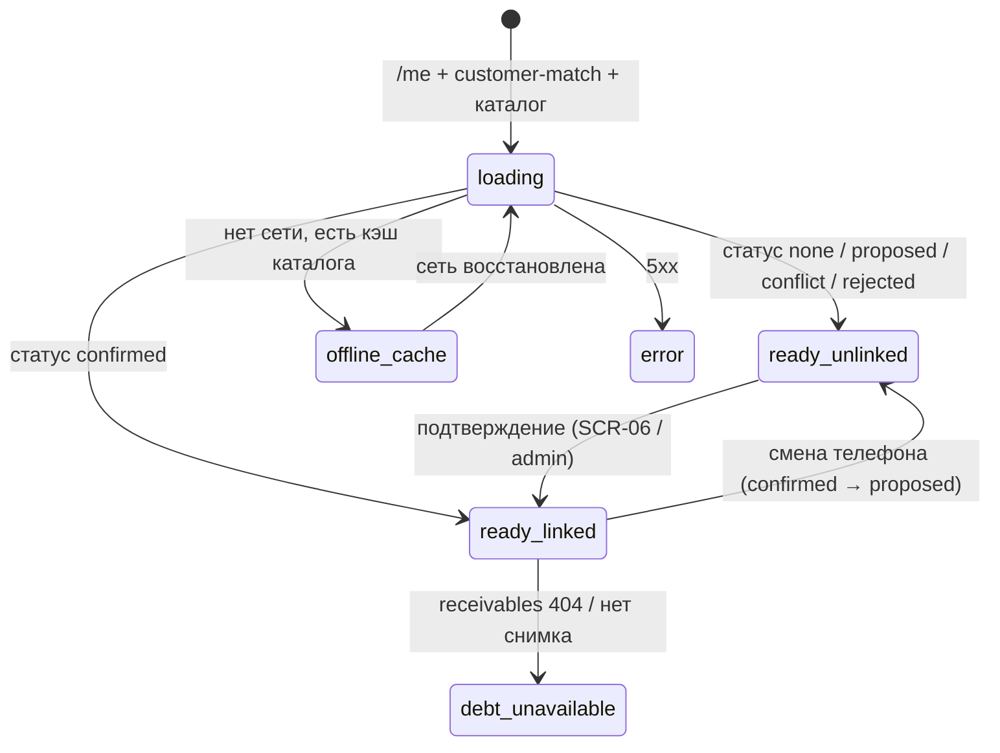

| Состояние | Отображение |
|---|---|
| Загрузка | скелетоны ленты, категорий и сетки |
| Успех | каталог + «Мой кабинет» |
| Ошибка | `ErrorState.fullScreen` (без кэша) / баннер (с кэшем) |
| Пустой каталог | `EmptyState categories` |
| Офлайн | каталог из кэша с `ds_offline_banner`; «Мой долг» — скрыт (финансы не кэшируются); «Мои заказы» — «нет сети»; оформление заказа недоступно (D-32) |
| Нет разрешений | не применяется: экран не запрашивает разрешений ОС (камера у клиента не используется — SCR-17 только для staff) |
| Устаревшие данные | долг старше `RECEIVABLES_MAX_AGE_MIN` — «данные от HH:MM» |
| Step-up | не требуется |

#### 8. Валидация и сообщения
| Ключ ARB | Текст (ru) |
|---|---|
| `home_my_orders` / `home_my_orders_active` | Мои заказы / `{count, plural, one{{count} в работе} other{{count} в работе}}` |
| `home_my_orders_active_nocount` | Есть заказы в работе |
| `home_my_debt` / `home_my_debt_unavailable` | Мой долг / Долг доступен после подтверждения организации |
| `home_my_debt_no_data` | Нет данных из 1С |
| `home_favorites` | Избранное |
| `home_price_list_label` | Ваш вид цены: {name} |
| `home_link_proposed` | Мы нашли организацию {name}. Это вы? |
| `home_link_proposed_action` | Проверить |
| `home_link_conflict` | Привязка к организации ожидает подтверждения администратором |
| `home_link_rejected` | Организация не подтверждена. Заказы оформляются как новый клиент |
| `home_recent_title` / `home_recent_clear` | Недавние товары / Очистить |
| `home_loading_more` | Загружаем ещё товары… |

#### 9. Источники данных, API, бизнес-правила
| Данные | API | Правило |
|---|---|---|
| Пользователь, привязка | `GET /me` (`customerLink`), `GET /registration/customer-match` | D-07, D-08, 09 §7.9 |
| Каталог, поиск, категории, недавние | `/catalog/*`, `/search/*` (цена по правилам; остатки — только наличие) | 11 §4.4 |
| Мои заказы | `GET /orders` (own) | 08 §4.8.2 |
| Мой долг | `GET /customers/{id}/receivables` (own, `confirmed`) | DEBT-004, SEC-037; аудит `customer.debt_viewed` |
| Избранное | `GET /favorites/products` | FAV-001 |
| Корзина | `/cart*` (own), без `/cart/discount`, `/cart/customer` | 08 §9 |

#### 10. Действия по ролям и ограничения безопасности
| Действие | `customer`, привязка `none`/`proposed`/`conflict`/`rejected` | `customer`, привязка `confirmed` | staff (все роли) |
|---|---|---|---|
| Открыть SCR-50 (`/home`) | ✓ (при `customerSelfService=true`) | ✓ | — (главный экран своей роли; guard) |
| Каталог, поиск, категории, недавние; цены своего вида цены | ✓ | ✓ | — |
| Наличие товара | ✓ только «В наличии/Нет» (без количества и складов) | ✓ то же | — |
| «+ Добавить», степпер, корзина (own), заявка-заказ (SCR-21 без «Оплаты») | ✓ | ✓ | — |
| Избранное товаров | ✓ | ✓ | — |
| «Мои заказы» (own, `order.read.own`) | ✓ | ✓ | — |
| «Мой долг» (`customer.self.receivables.read`, own) | — (карточка «Долг доступен после подтверждения организации») | ✓ без step-up | — |
| Подтверждение организации (SCR-06) | ✓ только при `proposed` | — | — |
| Ручная скидка, выбор клиента, другие виды цен, остатки по складам | — | — | — |

Ограничения: экран доступен только `customer` при включённом флаге (navigation G-8); запрещены ручная скидка, выбор клиента, просмотр остатков по складам и видов цен кроме своего, финансы до `confirmed` (SEC-031, SEC-037); доступ к чужим заказам/долгам → `NOT_FOUND` (SEC-030); цена позиции не передаётся клиентом — сервер рассчитывает её по виду цены (SRC-C-114); скрытие элементов — только UX, сервер проверяет права на каждом запросе (SRC-C-133).

#### 11. Повторное нажатие / двойной запрос / назад / перезапуск
- Как SCR-10 для добавления в корзину; «Очистить» недавние — `loading`, повтор игнорируется.
- «Назад» на корне — выход из приложения (Android: двойное «Назад» с подсказкой `home_back_to_exit` «Нажмите ещё раз для выхода» [ТИПОВО]).
- Перезапуск: корзина-черновик и избранное восстанавливаются; статус привязки перезапрашивается.

#### 12. Платформы
| Платформа / класс окна | Раскладка и размеры | Ввод | Особенности |
|---|---|---|---|
| Телефон Android/iOS, compact < 600 (основной) | шапка 56; `SearchBar` 48 под шапкой; лента «Мой кабинет» карточки 140×96, зазор 12, горизонтальная прокрутка; `CategoryTile` 3 колонки; сетка товаров 2 колонки (карточка ≥ 156 lp на 360 lp); `CartFab` 56 справа снизу над BNB, отступ 16; BNB 64 (5 пунктов) | тач, цели 48 lp (iOS 44 pt); камеры-сканера нет (SCR-17 — staff); системное «Назад» на корне — двойное нажатие для выхода (Android) | pull-to-refresh; свайп от края = «Назад» (iOS); масштаб текста до 1.3× — карточки растут по высоте, лента «Мой кабинет» переносит подписи в 2 строки |
| Планшет, medium 600–1023 | шапка 64; Rail 80 слева; колонка категорий 240 + контент; «Мой кабинет» — 3 карточки в ряд; сетка 3 колонки; корзина — `AppBottomSheet` `side` (overlay) по `CartFab` | тач; аппаратная клавиатура — Tab/Enter | ориентация — обе; в портрете колонка категорий скрывается в лист |
| Expanded ≥ 1024 (планшет в ландшафте, Windows — не целевая для клиента, D-39) | шапка 72; SB категорий 240; «Мой кабинет» — 3 карточки в ряд; сетка по ширине без постоянной корзины (1280 lp → 5 колонок); корзина — overlay по кнопке с бейджем в шапке; контент ≤ 1200 на large | мышь: hover карточек (ANIM-015), клик; клавиатура: `Ctrl+F` — фокус в поиск, Tab/Shift+Tab, Enter — открыть, Esc — закрыть overlay корзины, `F5` — обновить; HID-сканер (если подключён) — ввод в `SearchBar` с открытием SCR-14 (у клиента скан не добавляет в корзину) | плотность `standard` (не POS); правый клик не используется |
| Все | плотность `standard`; reduce-motion (A11Y-006); контраст AA (A11Y-001); финансы клиента не кэшируются на диске | — | — |

#### 13. Критерии приёмки
| ID | Критерий |
|---|---|
| AC-UI-50-001 | При `CUSTOMER_SELF_SERVICE=false` маршрут `/home` недоступен, пользователь без приглашения видит SCR-07 |
| AC-UI-50-002 | При включённом флаге `customer` после входа видит SCR-50 с навигацией «Каталог · Избранное · Корзина · Мои заказы · Профиль» |
| AC-UI-50-003 | Цены каталога соответствуют виду цены клиента; другие виды цен не приходят в ответах API |
| AC-UI-50-004 | Карточки товаров показывают «В наличии/Нет в наличии» без количества и без таблицы складов |
| AC-UI-50-005 | При статусе привязки `proposed` показан баннер с маскированным наименованием и без сумм долга |
| AC-UI-50-006 | Карточка «Мой долг» появляется только после `confirmed` и показывает сумму и дату снимка 1С |
| AC-UI-50-007 | Отсутствие снимка долга показывается как «Нет данных из 1С», а не «0 сом» |
| AC-UI-50-008 | В корзине клиента нет поля скидки и выбора клиента |
| AC-UI-50-009 | Офлайн каталог доступен из кэша, «Мой долг» скрыт, оформление заказа недоступно с объяснением |
| AC-UI-50-010 | Смена номера телефона клиента возвращает статус привязки в `proposed` и скрывает «Мой долг» |
| AC-UI-50-011 | Двойной тап «+ Добавить» во время запроса создаёт одну строку количеством 1; после появления степпера два нажатия «+» дают количество 3 без открытия окон (SRC-C-033) |
| AC-UI-50-012 | Карточка «Мои заказы» запрашивает `GET /orders` без параметра `mine`; при отсутствии `totalEstimate` показывается «Есть заказы в работе» без числа |
| AC-UI-50-013 | На expanded корзина открывается overlay по кнопке в шапке, постоянная `CartPanel` не отображается; Esc закрывает overlay |

#### 14. Трассировка
SRC-B-142, SRC-B-143, SRC-B-144, SRC-B-145, SRC-B-146 (привязка к клиенту 1С), SRC-C-033 (повторное нажатие «+» увеличивает количество без окон — п. 4, AC-UI-50-011), SRC-C-114 (клиент не меняет цену), SRC-C-133 (скрытие кнопки — не защита), SRC-E-083, SRC-E-094; D-07, D-08, D-24, D-31, D-32; 11 §4.4 (`customer`), SEC-030, SEC-031, SEC-037; 10 DEBT-004, DEBT-009, FAV-001, FAV-005; Q-001.

---

## 11. Сводный словарь строк UI части 02e

Правила ключей — §0.3 и 03 §16.2. Общие строки `ds_*`, `error_*`, `status_order_*`, `status_payment_*`, `status_sync_*`, `status_outbox_*`, `status_link_*`, `role_*` — владелец 03 (§16.5) и здесь не дублируются, кроме новых. Плюральные строки — ICU.

| Ключ ARB | Русский текст | Экран | Примечание |
|---|---|---|---|
| `favorites_title` | Избранное | SCR-40 | заголовок |
| `favorites_tab_products_count` | Товары · {count} | SCR-40 | ICU plural |
| `favorites_tab_customers_count` | Клиенты · {count} | SCR-40 | ICU plural |
| `favorites_products_found` | {count} товар / товара / товаров | SCR-40 | ICU plural |
| `favorites_filter_customers_hint` | Фильтр по избранным клиентам | SCR-40 | плейсхолдер |
| `favorites_removed_snackbar` | Убрано из избранного | SCR-40 | + `ds_button_undo` |
| `favorites_customer_removed_snackbar` | Клиент убран из избранного | SCR-40 | + `ds_button_undo` |
| `favorites_remove_error` | Не удалось убрать из избранного. Повторите | SCR-40 | ошибка |
| `favorites_pending_label` | Ожидает отправки | SCR-40 | офлайн |
| `favorites_not_sold_label` | Не продаётся | SCR-40 | `deletion_mark` |
| `favorites_empty_customers_title` | Избранных клиентов пока нет | SCR-40 | `EmptyState` |
| `favorites_empty_customers_body` | Отмечайте клиентов звездой в карточке клиента | SCR-40 | `EmptyState` |
| `favorites_empty_customers_action` | Найти клиента | SCR-40 | кнопка |
| `favorites_scan_ignored` | Сканирование работает во вкладке «Товары» | SCR-40 | снекбар |
| `favorites_star_remove_tooltip` | Убрать из избранного | SCR-40 | тултип |
| `favorites_to_order_button` | В заказ | SCR-40 | кнопка S |
| `favorites_item_a11y` | Товар {name}, цена {price}, {stock}, в избранном | SCR-40 | диктор |
| `profile_title` | Профиль | SCR-41 | заголовок |
| `profile_edit_button` | Изменить данные | SCR-41 | кнопка |
| `profile_fullname_label` | ФИО | SCR-41 | поле |
| `profile_birthyear_label` | Год рождения (необязательно) | SCR-41 | поле |
| `profile_activity_label` | Сфера деятельности (необязательно) | SCR-41 | поле |
| `profile_activity_hint` | Например: сантехника, строительство | SCR-41 | подсказка |
| `profile_not_specified` | Не указано | SCR-41 | пустое значение |
| `profile_last_login` | Вход: {device} · {time} | SCR-41 | шапка |
| `profile_menu_my_orders` | Мои заказы | SCR-41 | пункт |
| `profile_menu_my_transactions` | Мои транзакции | SCR-41 | пункт |
| `profile_menu_notifications` | Уведомления | SCR-41 | пункт |
| `profile_menu_sync` | Синхронизация | SCR-41 | пункт |
| `profile_menu_settings` | Настройки | SCR-41 | пункт |
| `profile_menu_lock` | Заблокировать | SCR-41 | пункт, `Ctrl+L` |
| `profile_menu_switch_user` | Сменить пользователя | SCR-41 | disabled, метка R2 |
| `profile_r2_badge` | Скоро | SCR-41 | метка R2 |
| `profile_phone_change` | Сменить номер телефона | SCR-41 | пункт |
| `profile_phone_change_confirm` | После смены номера вход выполняется по новому номеру. Все другие устройства будут отключены | SCR-41 | диалог |
| `profile_phone_new_label` | Новый номер телефона | SCR-41 | поле |
| `profile_phone_get_code` | Получить код | SCR-41 | кнопка |
| `profile_phone_code_sent` | Код отправлен на {phone} | SCR-41 | шаг 2 |
| `profile_phone_resend_in` | Отправить код повторно через {seconds} с | SCR-41 | таймер |
| `profile_phone_resend` | Отправить код ещё раз | SCR-41 | кнопка |
| `profile_phone_error_format` | Введите 9 цифр номера | SCR-41 | валидация |
| `profile_phone_error_same` | Это ваш текущий номер | SCR-41 | валидация |
| `profile_phone_error_taken` | Этот номер уже используется другим пользователем | SCR-41 | `PHONE_ALREADY_REGISTERED` |
| `profile_phone_changed` | Номер изменён. Другие устройства отключены | SCR-41 | успех |
| `profile_phone_abort_confirm` | Прервать смену номера? | SCR-41 | диалог |
| `profile_fullname_error_required` | Введите ФИО | SCR-41 | валидация |
| `profile_fullname_error_length` | От 2 до 150 символов | SCR-41 | валидация |
| `profile_birthyear_error_range` | Год рождения от 1920 до {maxYear} | SCR-41 | валидация |
| `profile_saved` | Данные сохранены | SCR-41 | снекбар |
| `profile_conflict` | Профиль изменён на другом устройстве. Проверьте и сохраните ещё раз | SCR-41 | 409 |
| `profile_discard_confirm` | Отменить изменения? | SCR-41 | диалог |
| `profile_logout` | Выйти | SCR-41 | пункт |
| `profile_logout_confirm` | Выйти из аккаунта? | SCR-41 | диалог |
| `profile_logout_unsynced_cart` | В корзине есть неотправленные изменения | SCR-41 | предупреждение |
| `profile_logout_anyway` | Выйти всё равно | SCR-41 | кнопка |
| `profile_logout_offline_done` | Вы вышли. Сессия на сервере будет завершена при появлении сети | SCR-41 | снекбар |
| `profile_logout_all` | Выйти на всех устройствах | SCR-41, SCR-42 | пункт / кнопка |
| `profile_logout_all_confirm` | Все сеансы, включая этот, будут завершены. Потребуется вход по SMS | SCR-41, SCR-42 | диалог |
| `profile_logout_all_done` | Вы вышли на всех устройствах | SCR-41 | снекбар на SCR-01 |
| `profile_value_not_set` | Не указано | SCR-41 | пустое необязательное поле |
| `profile_stale_banner` | Данные профиля от {time} | SCR-41 | устаревшие данные |
| `profile_login_device` | Вход: {deviceName} · {time} | SCR-41 | UI-41-001, данные `GET /auth/sessions` |
| `profile_offline_action_disabled` | Недоступно без сети | SCR-41 | подсказка |
| `profile_version` | Версия {version} ({build}) · {platform} | SCR-41 | caption |
| `profile_update_available` | Доступно обновление | SCR-41 | ссылка |
| `profile_customer_link_title` | Клиент 1С | SCR-41 | блок `customer` |
| `profile_customer_link_waiting` | Ожидает подтверждения администратором | SCR-41 | статус `conflict` |
| `settings_title` | Настройки | SCR-42 | заголовок |
| `settings_section_language` | Язык | SCR-42 | секция |
| `settings_section_security` | Защита входа | SCR-42 | секция |
| `settings_section_sessions` | Устройства и сессии | SCR-42 | секция |
| `settings_section_scanner` | Сканер штрихкодов | SCR-42 | секция |
| `settings_section_printer` | Принтер | SCR-42 | секция |
| `settings_section_display` | Отображение | SCR-42 | секция |
| `settings_section_about` | О приложении | SCR-42 | секция |
| `settings_language_soon` | Скоро | SCR-42 | ky/en disabled (покрытие ARB < 95 %) |
| `settings_stale_caption` | Настройки от {time} | SCR-42 | устаревшие данные |
| `settings_sessions_stale_banner` | Список устройств от {time} | SCR-42 | устаревшие данные |
| `settings_session_revoke_error` | Не удалось завершить сеанс. Повторите | SCR-42 | ошибка `DELETE /auth/sessions/{id}` |
| `settings_privacy_policy_version` | Версия от {date} | SCR-42 | лист политики ПДн (`GET /me/consents`) |
| `settings_pin_status_set` | PIN приложения: установлен | SCR-42 | строка |
| `settings_pin_change` | Сменить PIN | SCR-42 | кнопка |
| `settings_pin_new_title` | Новый PIN | SCR-42 | лист |
| `settings_pin_repeat_title` | Повторите PIN | SCR-42 | лист |
| `settings_pin_error_weak` | Слишком простой PIN: не используйте одинаковые цифры, последовательности и год рождения | SCR-42 | `pin_weak` |
| `settings_pin_error_mismatch` | PIN не совпадает. Введите ещё раз | SCR-42 | валидация |
| `settings_pin_changed` | PIN изменён | SCR-42 | снекбар |
| `settings_pin_forgot` | Забыли PIN? | SCR-42 | ссылка |
| `settings_pin_abort_confirm` | Прервать смену PIN? | SCR-42 | диалог |
| `settings_pin_required_staff` | Для сотрудников PIN обязателен | SCR-42 | подпись тумблера |
| `settings_bio_android` | Вход по отпечатку или лицу | SCR-42 | тумблер Android |
| `settings_bio_ios` | Вход по Face ID / Touch ID | SCR-42 | тумблер iOS |
| `settings_bio_windows` | Windows Hello перед вводом PIN | SCR-42 | тумблер Windows |
| `settings_bio_windows_note` | Windows Hello только подтверждает присутствие. Вход всегда завершается PIN приложения | SCR-42 | подпись |
| `settings_bio_consent_title` | Согласие на вход по биометрии | SCR-42 | лист (текст — Q-027) |
| `settings_bio_consent_check` | Согласен | SCR-42 | чекбокс |
| `settings_bio_enable` | Включить | SCR-42 | кнопка |
| `settings_bio_enabled` | Вход по биометрии включён | SCR-42 | снекбар |
| `settings_bio_disable_confirm` | Вход по биометрии будет отключён на этом устройстве | SCR-42 | диалог |
| `settings_bio_cancelled` | Биометрия не подтверждена. Вход по биометрии не включён | SCR-42 | снекбар |
| `settings_bio_unavailable` | Биометрия на устройстве недоступна или не настроена | SCR-42 | подпись |
| `settings_bio_open_system` | Настроить в системе | SCR-42 | ссылка |
| `settings_autolock_label` | Автоблокировка | SCR-42 | dropdown |
| `settings_autolock_value` | Через {minutes} мин | SCR-42 | значение |
| `settings_require_pin_label` | Требовать PIN при запуске | SCR-42 | тумблер |
| `settings_sessions_this_device` | Это устройство | SCR-42 | метка |
| `settings_sessions_last_active` | Активность: {time} | SCR-42 | строка |
| `settings_session_rename` | Переименовать | SCR-42 | действие |
| `settings_device_name_error` | От 1 до 60 символов | SCR-42 | валидация |
| `settings_session_revoke` | Завершить | SCR-42 | кнопка |
| `settings_session_revoke_confirm` | Завершить сеанс на устройстве {device}? | SCR-42 | диалог |
| `settings_session_revoked` | Сеанс завершён | SCR-42 | снекбар |
| `settings_scanner_mode_hid` | Аппаратный (HID) | SCR-42 | сегмент |
| `settings_scanner_mode_camera` | Камера | SCR-42 | сегмент |
| `settings_scanner_suffix_label` | Окончание скана | SCR-42 | dropdown |
| `settings_scanner_suffix_enter` / `_tab` / `_none` | Enter / Tab / Без суффикса | SCR-42 | значения |
| `settings_scanner_add_to_cart` | Сразу добавлять в корзину | SCR-42 | тумблер |
| `settings_scanner_test_hint` | Отсканируйте любой штрихкод… | SCR-42 | поле теста |
| `settings_scanner_test_found` | Найден: {name} · арт. {sku} | SCR-42 | результат |
| `settings_scanner_test_not_found` | Штрихкод {code} не найден в каталоге | SCR-42 | результат |
| `settings_scanner_no_suffix` | Сканер не отправил окончание. Выберите «Без суффикса» или настройте сканер | SCR-42 | подсказка |
| `settings_scanner_test_camera` | Проверить камерой | SCR-42 | кнопка |
| `settings_printer_format_80mm` / `_a4` | Чек 80 мм / A4 | SCR-42 | радио |
| `settings_printer_default` | Принтер по умолчанию | SCR-42 | dropdown |
| `settings_printer_address` / `_port` | Адрес принтера / Порт | SCR-42 | поля |
| `settings_printer_address_error` | Введите адрес принтера, например 192.168.1.50 | SCR-42 | валидация |
| `settings_printer_port_error` | Порт от 1 до 65535 | SCR-42 | валидация |
| `settings_printer_autoprint` | Печатать автоматически после создания заказа | SCR-42 | тумблер |
| `settings_print_test` | Тестовая печать | SCR-42 | кнопка |
| `settings_print_test_ok` | Тестовая страница отправлена на принтер | SCR-42 | снекбар |
| `settings_print_error` | Не удалось напечатать: {reason} | SCR-42 | ошибка |
| `settings_print_test_page_title` | ТЕСТОВАЯ ПЕЧАТЬ · не является фискальным документом | SCR-42 | содержимое образца (PRINT-010) |
| `settings_density_label` / `_auto` / `_standard` / `_compact` | Плотность / Авто / Стандартная / Компактная | SCR-42 | сегменты |
| `settings_text_scale_label` / `_system` / `_large` / `_xlarge` | Размер текста / Системный / Крупнее / Крупный | SCR-42 | `[НОВОЕ ИМЯ]`, Q-218 |
| `settings_reduce_motion` | Уменьшить анимации | SCR-42 | тумблер |
| `settings_about_version` / `_min_version` / `_recommended_version` | Версия / Минимальная поддерживаемая версия / Рекомендуемая версия | SCR-42 | строки |
| `settings_about_device_id` | Идентификатор устройства: …{suffix} | SCR-42 | строка |
| `settings_about_licenses` / `_privacy` / `_support` | Лицензии / Политика обработки персональных данных / Техническая поддержка | SCR-42 | ссылки |
| `settings_conflict` | Настройки изменены на другом устройстве. Показаны актуальные значения | SCR-42 | 409 |
| `settings_save_error` | Не удалось сохранить настройку. Значение возвращено | SCR-42 | откат |
| `settings_offline_disabled` | Недоступно без сети | SCR-42 | подсказка |
| `sync_title` | Синхронизация с 1С | SCR-43 | заголовок |
| `sync_overall_ok` / `_degraded` / `_failed` | Обмен работает / Есть задержки / Обмен нарушен | SCR-43 | статус |
| `sync_onec_reachable` / `sync_onec_unreachable` | 1С доступна / 1С недоступна | SCR-43 | статус |
| `sync_last_success` | Последний успешный обмен: {time} | SCR-43 | строка |
| `sync_checked_at` | Проверено {time} · обновляется каждые 30 с | SCR-43 | caption |
| `sync_next_run` | Следующий: {time} | SCR-43 | строка |
| `sync_interval` | каждые {minutes} мин | SCR-43 | ICU plural |
| `sync_errors_count` | {count} ошибка / ошибки / ошибок подряд | SCR-43 | ICU plural |
| `sync_running_for` | идёт {minutes} мин | SCR-43 | прогон |
| `sync_run_button_stock` / `_prices` / `_order_status` | Обновить остатки / Обновить цены / Обновить статусы | SCR-43 | `senior_seller` |
| `sync_run_button_busy` | Обновляем… | SCR-43 | loading |
| `sync_run_open_dialog` | Запустить… | SCR-43 | `admin`/`owner` |
| `sync_run_dialog_title` / `_entity` / `_mode` | Запуск синхронизации / Что синхронизировать / Режим | SCR-43 | диалог |
| `sync_mode_incremental` / `_full` / `_reconcile` | Только изменения / Полная загрузка / Сверка | SCR-43 | `sync_mode` |
| `sync_run_full_warning` | Полная загрузка увеличивает нагрузку на 1С и может занять до {minutes} мин. Рекомендуется вне рабочего времени | SCR-43 | предупреждение |
| `sync_run_started` / `_done` / `_partial` / `_failed` | Синхронизация запущена / завершена / Завершено с ошибками: {count} / Синхронизация не выполнена | SCR-43 | снекбары |
| `sync_rate_limited` | Слишком частый запуск. Повторите через {seconds} с | SCR-43 | 429 |
| `sync_permission_hint` | Ручной запуск выполняет старший продавец или администратор | SCR-43 | подсказка |
| `sync_stale_banner` | {entity}: данные старше {minutes} мин | SCR-43 | баннер |
| `sync_tab_entities` / `_runs` / `_errors` / `_outbox` | Сущности / Прогоны / Ошибки / Outbox | SCR-43 | вкладки |
| `sync_trigger_schedule` / `_manual` / `_retry` / `_dependency` | По расписанию / Вручную: {name} / Повтор / По зависимости | SCR-43 | `sync_trigger` (07); используются после добавления `trigger` в `SyncRun` 08 (замечание №17) |
| `sync_trigger_auto` | Автоматически | SCR-43 | `triggeredBy=null`, до появления `trigger` в 08 |
| `sync_outbox_retry` | Повторить | SCR-43 | кнопка |
| `sync_outbox_retry_confirm` | Повторить отправку {number} в 1С? Убедитесь, что причина ошибки устранена | SCR-43 | диалог |
| `sync_outbox_retried` | Поставлено в очередь | SCR-43 | снекбар |
| `sync_outbox_already_sent` | Документ уже отправлен в 1С | SCR-43 | 409 |
| `sync_outbox_counts` | В очереди {pending} · Ошибки {failed} · Отказы {dead} | SCR-43 | зона A |
| `sync_never` | Ещё не синхронизировано | SCR-43 | empty |
| `sync_empty_runs` / `_errors` / `_outbox` | Прогонов за период нет / Ошибок нет / Очередь пуста | SCR-43 | `EmptyState generic` |
| `sync_entity_<code>` | Остатки, Цены, Статусы заказов, Товары, Варианты, Категории, Штрихкоды, Единицы, Склады, Клиенты, Долги, Скидки, История продаж, Платёжные документы, Документы возвратов, Характеристики, Фото | SCR-43, SCR-44 | 17 значений `sync_entity` (ядро §6, §17.3); `[НОВОЕ ИМЯ префикса]` |
| `notifications_title` | Уведомления | SCR-44 | заголовок |
| `notifications_filter_all` / `_unread` | Все / Непрочитанные ({count}) | SCR-44 | сегменты |
| `notifications_read_all` | Прочитать все | SCR-44 | кнопка |
| `notifications_view_all` | Все уведомления | SCR-44 | popover |
| `notifications_new_above` | {count} новое / новых уведомления(-й) | SCR-44 | ICU plural |
| `notifications_mark_read` | Отметить прочитанным | SCR-44 | меню |
| `notifications_empty_filtered` | Нет уведомлений выбранного вида | SCR-44 | empty |
| `notifications_action_open_cart` / `_details` / `_not_me` | Открыть корзину / Подробнее / Это не я | SCR-44 | действия |
| `notifications_bell_a11y` | Уведомления, {count} непрочитанных | SCR-44 | диктор |
| `notifications_item_unread_a11y` | Непрочитанное: {title}, {time} | SCR-44 | диктор |
| `notifications_stale_banner` | Уведомления обновлены в {time} | SCR-44 | устаревшие данные |
| `notification_kind_sync_error` | Ошибка синхронизации | SCR-44 | `[НОВОЕ ИМЯ префикса]` |
| `notification_kind_order_status` | Статус заказа | SCR-44 | — |
| `notification_kind_cart_price_changed` | Цена в корзине изменилась | SCR-44 | — |
| `notification_kind_cart_stock_changed` | Остаток в корзине изменился | SCR-44 | — |
| `notification_kind_credit_blocked` | Продажа в долг заблокирована | SCR-44 | — |
| `notification_kind_payment_status` | Оплата | SCR-44 | — |
| `notification_kind_return_status` | Заявка на возврат | SCR-44 | — |
| `notification_kind_system` | Система | SCR-44 | — |
| `admin_users_title` | Пользователи | SCR-45 | заголовок |
| `admin_users_tab_users` / `_invitations` / `_links` | Пользователи · {count} / Приглашения · {count} / Привязки клиентов · {count} | SCR-45 | вкладки |
| `admin_users_search_hint` | Имя или телефон | SCR-45 | поиск |
| `admin_users_filter_role` / `_status` | Роль / Статус | SCR-45 | фильтры |
| `admin_users_invite_button` | + Пригласить | SCR-45 | кнопка |
| `admin_users_source_invitation` / `_self` | По приглашению / Самостоятельная регистрация | SCR-45 | шапка карточки |
| `admin_users_role_section` | Роль | SCR-45 | блок |
| `admin_users_role_save` | Сохранить роль | SCR-45 | кнопка |
| `admin_users_role_diff` | Роль {name}: {old} → {new} | SCR-45 | диалог |
| `admin_users_role_saved` | Роль изменена. Права обновятся в течение минуты | SCR-45 | снекбар |
| `admin_users_effect_hint` | Права изменятся в течение минуты; при понижении прав все сеансы пользователя будут завершены | SCR-45 | подсказка |
| `admin_users_owner_hint` | Роль «Руководитель» назначает только руководитель | SCR-45 | тултип |
| `admin_users_error_self_demotion` | Нельзя снять с себя роль администратора | SCR-45 | 422 |
| `admin_users_error_self_block` | Нельзя заблокировать свою учётную запись | SCR-45 | 422 |
| `admin_users_reason_label` | Причина | SCR-45 | поле |
| `admin_users_reason_error` | Укажите причину (не менее 5 символов) | SCR-45 | валидация |
| `admin_users_limit_label` | Индивидуальный лимит скидки | SCR-45 | поле |
| `admin_users_limit_by_role` | По роли | SCR-45 | чекбокс |
| `admin_users_limit_error` | Лимит от 0 до 100 % | SCR-45 | валидация |
| `admin_users_warehouses` | Склады | SCR-45 | блок |
| `admin_users_devices` | Устройств: {count} · последний вход {time} | SCR-45 | блок сессий |
| `admin_users_revoke_sessions` | Завершить все сессии | SCR-45 | кнопка |
| `admin_users_sessions_revoked` | Все сеансы пользователя завершены | SCR-45 | снекбар |
| `admin_users_reset_pin` | Сбросить PIN | SCR-45 | кнопка |
| `admin_users_reset_pin_confirm` | PIN будет сброшен. Сотрудник задаст новый PIN после входа по SMS | SCR-45 | диалог |
| `admin_users_pin_reset` | PIN сброшен | SCR-45 | снекбар |
| `admin_users_block` / `_unblock` | Заблокировать / Разблокировать | SCR-45 | кнопки |
| `admin_users_block_confirm` | Заблокировать {name}? Все сеансы будут завершены, приглашение аннулировано | SCR-45 | диалог |
| `admin_users_activate` | Активировать | SCR-45 | `pending_activation` |
| `admin_users_activated` | Пользователь активирован | SCR-45 | снекбар |
| `admin_users_audit_link` | Аудит пользователя | SCR-45 | ссылка |
| `admin_users_conflict_banner` | Данные изменены другим администратором | SCR-45 | 409 |
| `admin_users_empty` | Пользователи не найдены | SCR-45 | empty |
| `admin_invites_title` | Приглашение сотрудника | SCR-45 | форма |
| `admin_invites_expires_label` | Действует до | SCR-45 | поле |
| `admin_invites_send` | Отправить приглашение | SCR-45 | кнопка |
| `admin_invites_no_sms_hint` | SMS приглашённому не отправляется. Сообщите сотруднику, что вход выполняется по номеру телефона | SCR-45 | подсказка (Q-038) |
| `admin_invites_created` | Приглашение создано. Сотрудник может войти по номеру {phone} | SCR-45 | снекбар |
| `admin_invites_updated` | Приглашение для этого номера обновлено | SCR-45 | снекбар |
| `admin_invites_applied_existing` | Роль назначена существующему аккаунту | SCR-45 | снекбар |
| `admin_invites_error_phone` | Введите 9 цифр номера | SCR-45 | валидация |
| `admin_invites_error_registered` | Номер уже принадлежит активному сотруднику. Измените его роль в карточке | SCR-45 | 409 |
| `admin_invites_error_role` | Выберите роль | SCR-45 | валидация |
| `admin_invites_error_expiry` | Срок действия — от 1 до 90 дней | SCR-45 | валидация |
| `admin_invites_revoke` / `_again` | Отозвать / Пригласить снова | SCR-45 | действия |
| `admin_invites_empty` | Приглашений нет | SCR-45 | empty |
| `admin_links_confirm` / `_reject` / `_reject_all` | Подтвердить / Отклонить / Отклонить все | SCR-45 | панель привязки |
| `admin_links_error_conflict` | У клиента уже есть подтверждённая привязка | SCR-45 | 409 |
| `status_invitation_pending` / `_accepted` / `_revoked` / `_expired` | Ожидает / Принято / Отозвано / Истекло | SCR-45 | `invitation_status`; `[НОВОЕ ИМЯ ключей]` |
| `status_user_pending` / `_pending_activation` / `_active` / `_blocked` / `_deleted` | Не завершена регистрация / Ожидает активации / Активен / Заблокирован / Удалён | SCR-45 | `user_status`; `[НОВОЕ ИМЯ ключей]` |
| `role_<code>_summary` | Краткое описание прав роли (5 строк) | SCR-45 | тултипы (11 §4.4) |
| `admin_settings_title` | Настройки системы | SCR-46 | заголовок |
| `admin_settings_section_limits` / `_debts` / `_stock` / `_payments` / `_carts` / `_print` / `_sync` / `_auth` / `_versions` / `_registration` / `_texts` | Лимиты скидок / Долги / Склад и остатки / Оплата и возвраты / Корзины / Печать / Синхронизация / Вход и сессии / Версии приложения / Регистрация и режим клиента / Тексты и контакты | SCR-46 | секции |
| `admin_settings_limit_override` | Может подтверждать сверх лимита | SCR-46 | чекбокс |
| `admin_settings_limit_was` | было {value} % | SCR-46 | подпись |
| `admin_settings_onec_rules_banner` | Лимиты должны совпадать с «Правилами продаж» 1С, иначе 1С отклонит заказ | SCR-46 | баннер |
| `admin_settings_limit_error` | Введите значение от 0 до 100 % с шагом 0,5 | SCR-46 | валидация |
| `admin_settings_limits_override_warning` | Лимит подтверждающей роли ниже лимита подчинённой роли | SCR-46 | предупреждение |
| `admin_settings_receivables_error` | От 5 до 1440 минут | SCR-46 | валидация |
| `admin_settings_low_stock_error` | Введите целое число не меньше 0 | SCR-46 | валидация |
| `admin_settings_interval_error` | От 2 до 1440 минут | SCR-46 | валидация |
| `admin_settings_otp_ttl_error` | От 180 до 600 секунд | SCR-46 | валидация |
| `admin_settings_idle_error` | Не больше 30 минут для сотрудников | SCR-46 | валидация |
| `admin_settings_version_error` | Формат версии: 1.4.0 | SCR-46 | валидация |
| `admin_settings_version_order_error` | Рекомендуемая версия не может быть ниже минимальной | SCR-46 | валидация |
| `admin_settings_min_version_confirm` | Устройства с версией ниже {version} перестанут работать до обновления | SCR-46 | диалог |
| `admin_settings_env_hint` | Задаётся на сервере. Изменение — через администратора сервера | SCR-46 | тултип |
| `admin_settings_customer_mode_label` | Режим клиента (самообслуживание) | SCR-46 | UI-46-017 |
| `admin_settings_customer_mode_env` | По умолчанию на сервере: {value} | SCR-46 | env `CUSTOMER_SELF_SERVICE` |
| `admin_settings_customer_mode_enable_confirm` | Клиенты смогут регистрироваться по телефону, видеть каталог с ценами своего вида цены и оформлять заявки-заказы | SCR-46 | `ConfirmDialog` destructive |
| `admin_settings_customer_mode_disable_confirm` | Новые клиенты не смогут регистрироваться; у существующих клиентов главный экран станет недоступен | SCR-46 | `ConfirmDialog` |
| `admin_settings_interval_group_hint` | Сущности: {entities}. По умолчанию на сервере: {value} | SCR-46 | UI-46-009 |
| `admin_settings_history_link` | История изменений | SCR-46 | → SCR-47 |
| `admin_settings_diff_title` | Проверьте изменения | SCR-46 | диалог |
| `admin_settings_unsaved_confirm` | Сохранить изменения в секции {name}? | SCR-46 | диалог |
| `admin_settings_saved` | Настройки сохранены | SCR-46 | снекбар |
| `admin_settings_limits_saved` | Лимиты скидок сохранены. Применятся в течение минуты | SCR-46 | снекбар |
| `admin_settings_conflict_banner` | Настройки изменены другим администратором | SCR-46 | 409 |
| `admin_settings_readonly_banner` | Просмотр. Изменять настройки может администратор | SCR-46 | `owner` |
| `admin_settings_changed_by` | Изменено {time} · {name} | SCR-46 | caption |
| `audit_title` | Журнал аудита | SCR-47 | заголовок |
| `audit_filters_button` | Фильтры ({count}) | SCR-47 | ICU plural |
| `audit_period_error` | Период не больше 92 дней | SCR-47 | валидация |
| `audit_filter_user` / `_action` / `_object` / `_result` | Пользователь / Действие / Объект / Результат | SCR-47 | фильтры |
| `audit_group_<name>` | Вход и сессии / Пользователи и роли / Скидки / Заказы / Оплата и долг / Клиенты и финансы / Возвраты / Синхронизация / Настройки / Отчёты и аудит / Отказы доступа | SCR-47 | группы действий |
| `audit_result_ok` / `_denied` / `_error` | Успешно / Отказано / Ошибка | SCR-47 | `StatusChip` |
| `audit_before` / `_after` / `_reason` / `_step_up_method` | Было / Стало / Причина / Подтверждение | SCR-47 | деталь |
| `audit_masked_value` | скрыто | SCR-47 | `admin` |
| `audit_copied` | Скопировано | SCR-47 | снекбар |
| `audit_export_r2_tooltip` | Экспорт будет доступен в следующей версии | SCR-47 | R2 |
| `audit_empty_title` / `_action` | Записей за период нет / Изменить период | SCR-47 | empty |
| `audit_action_<action>` | локализованное имя события (≈ 70, словарь 11 §7.2) | SCR-47 | `[НОВОЕ ИМЯ префикса]`; примеры — §8 SCR-47 |
| `audit_action_unknown` | Событие {code} | SCR-47 | fallback |
| `reports_title` | Отчёты | SCR-48 | заголовок |
| `reports_card_sales` / `_debts` / `_qr` | Продажи / Долги / QR-сверка | SCR-48 | карточки |
| `reports_orders_count` | {count} заказ / заказа / заказов | SCR-48 | ICU plural |
| `reports_avg_check` / `reports_paid_total` / `reports_discount_total` / `reports_cancelled` | Средний чек / Оплачено / Скидки / Отменено: {count} | SCR-48 | строки |
| `reports_method_cash` / `_qr` / `_credit` | Наличные / QR Бакай Банк / В долг | SCR-48 | способы |
| `reports_debt_total` / `_overdue` | Общий долг / Просрочено | SCR-48 | долги |
| `reports_debt_as_of` | По данным 1С на {time} | SCR-48 | caption |
| `reports_debt_stale` | Данные 1С от {time} могут быть неактуальны | SCR-48 | warning |
| `reports_debt_bucket_0_30` / `_31_60` / `_61_90` / `_90_plus` | 0–30 дней / 31–60 / 61–90 / более 90 | SCR-48 | корзины |
| `reports_qr_webhook` / `_manual` / `_unmatched` | Подтверждено банком / Подтверждено вручную / Расхождения | SCR-48 | QR |
| `reports_qr_filter_all` / `_unmatched` / `_manual` | Все / Расхождения / Вручную | SCR-48 | фильтр |
| `reports_groupby_day` / `_week` / `_month` / `_seller` / `_method` / `_warehouse` | Дни / Недели / Месяцы / Продавцы / Способы оплаты / Склады | SCR-48 | разрез |
| `reports_source_onec` | из 1С | SCR-48 | метка |
| `reports_period_error` | Период не больше 366 дней | SCR-48 | валидация |
| `reports_export_csv` | Экспорт CSV | SCR-48 | disabled (R2, Q-217) |
| `reports_export_r2_tooltip` | Экспорт будет доступен в следующей версии | SCR-48 | тултип |
| `reports_export_confirm_title` | Выгрузить в CSV? | SCR-48 | сценарий включения (Q-217) |
| `reports_export_confirm_body` | «{report}» за {period}. Файл содержит финансовые данные | SCR-48 | сценарий включения |
| `reports_export_confirm_action` | Выгрузить | SCR-48 | кнопка диалога |
| `reports_export_done` / `reports_export_open` | Файл сохранён / Открыть | SCR-48 | снекбар |
| `reports_export_error` | Не удалось выгрузить файл. Повторите | SCR-48 | ошибка |
| `reports_audit_link` | Аудит | SCR-48 | ссылка |
| `reports_empty_sales` / `_debts` / `_qr` | Продаж за период нет / Долгов нет / QR-платежей нет | SCR-48 | empty |
| `reports_parked_link` / `reports_parked_link_nocount` | Отложенные заказы ({count}) / Отложенные заказы | SCR-48 | UI-48-016, добавлено при сборке 02 v1.1 |
| `home_my_orders` | Мои заказы | SCR-50 | карточка |
| `home_my_orders_active` | {count} в работе | SCR-50 | ICU plural |
| `home_my_orders_active_nocount` | Есть заказы в работе | SCR-50 | нет `totalEstimate` (замечание №20) |
| `home_my_debt` | Мой долг | SCR-50 | карточка |
| `home_my_debt_unavailable` | Долг доступен после подтверждения организации | SCR-50 | до `confirmed` |
| `home_my_debt_no_data` | Нет данных из 1С | SCR-50 | DEBT-009 |
| `home_favorites` | Избранное | SCR-50 | карточка |
| `home_price_list_label` | Ваш вид цены: {name} | SCR-50 | чип |
| `home_link_proposed` | Мы нашли организацию {name}. Это вы? | SCR-50 | баннер |
| `home_link_proposed_action` | Проверить | SCR-50 | кнопка |
| `home_link_conflict` | Привязка к организации ожидает подтверждения администратором | SCR-50 | баннер |
| `home_link_rejected` | Организация не подтверждена. Заказы оформляются как новый клиент | SCR-50 | баннер |
| `home_recent_title` / `home_recent_clear` | Недавние товары / Очистить | SCR-50 | блок |
| `home_loading_more` | Загружаем ещё товары… | SCR-50 | макет |
| `home_back_to_exit` | Нажмите ещё раз для выхода | SCR-50 | Android [ТИПОВО] |

---

## 12. Открытые вопросы

### 12.1. Вопросы ядра и других документов, влияющие на экраны части

| ID | Влияние на экраны части | Принятое допущение |
|---|---|---|
| Q-001 | наличие SCR-50, вкладки «Привязки клиентов» SCR-45, блока «Клиент 1С» SCR-41 | `CUSTOMER_SELF_SERVICE` выключен; экраны специфицированы условно |
| Q-002 | пункт «Сменить пользователя» SCR-41 | R2, показывается неактивным |
| Q-004 | диапазоны секции «Вход и сессии» SCR-46, автоблокировка SCR-42 | значения D-10/D-12 |
| Q-005 | состав ролей и одна/несколько ролей SCR-45 | одна роль (`AppRadio`), DATA-106 |
| Q-006 | логотип в шапке всех экранов | A+ (D-16) |
| Q-007 | секция «Язык» SCR-42 | только ru |
| Q-008 | платформы и канал обновления (SCR-41, SCR-42) | Android + Windows |
| Q-009 | секция «Сканер» SCR-42 | HID + камера на мобильных |
| Q-014 | карточка «QR-сверка» SCR-48, секция «Оплата» SCR-46 | ручное подтверждение + аудит |
| Q-015 | лимиты SCR-46, SCR-45 | 5/5/10/15 % [НЕ ПОДТВЕРЖДЕНО] |
| Q-016 | `cash_rounding` SCR-46 | без округления |
| Q-017 | видимость долга в строках клиентов SCR-40 | продавец — без сумм |
| Q-019 | секция «Принтер» SCR-42 | 80 мм ESC/POS + A4 системный |
| Q-020 | интервалы SCR-43/46 | D-29 |
| Q-027 | тексты согласия биометрии SCR-42, тексты SCR-46 | шаблон 11 §10.3 |
| Q-028 | срок хранения аудита SCR-47 | 3 года |
| Q-034 | «Заблокировать» / `Ctrl+L` SCR-41 | PIN + idle-блокировка |
| Q-036 | push в SCR-44 | нет (in-app) |
| Q-038 | SMS приглашённому / о входе с нового устройства | нет; in-app уведомление |
| Q-141 | срок приглашения SCR-45 | 30 дней |
| Q-241 | офлайн-разблокировка (SCR-41 «Заблокировать», SCR-42) | вне R1 |

### 12.2. Новые вопросы части (диапазон Q-216…Q-219)

| ID | Вопрос | Влияние | Рекомендуемое допущение |
|---|---|---|---|
| Q-216 | [НОВЫЙ ВОПРОС] Как администратор получает **список** конфликтов привязки `customer_link` (`proposed`/`conflict`) для вкладки «Привязки клиентов» SCR-45? В 08 есть только `GET /customers/{id}/links` по конкретному клиенту; списочного запроса или фильтра нет | SCR-45, 08 §4.11 | до решения — список строится из уведомлений `system` администратора с `payload.target=customer_link`; предложение для 08: параметр `linkStatus` у `GET /customers` (только `customer.link.read`) |
| Q-217 | [НОВЫЙ ВОПРОС] Нужен ли экспорт CSV отчётов руководителя (SCR-48) и журнала аудита (SCR-47) уже в R1? Задание на экраны требует экспорт CSV, а 11 §4.3 №60 и 08 §4.18.8 относят `reports.export` к R2 | SCR-47, SCR-48, 11, 08 | R1 — кнопки видимы неактивными с пометкой «в следующей версии»; требование задания в R1 **не покрыто** `[ТРЕБУЕТ РЕШЕНИЯ ЗАКАЗЧИКА]`. При решении «да» — выдача `reports.export` (S!, аудит `export.created`) без изменения экрана SCR-48 (сценарий включения: UI-48-006, AC-UI-48-012…014); для SCR-47 дополнительно нужен параметр `format=csv` у `GET /admin/audit-logs` в 08 |
| Q-218 | [НОВЫЙ ВОПРОС] (а) Нужна ли настройка «Размер текста» внутри приложения (кроме системного масштаба) — responsive-spec FS-14 её не вводит, задание требует; (б) откуда клиентское приложение получает **контакты** ответственного за ПДн (`privacy_contact`) и технической поддержки для «О приложении» — `GET /admin/settings` доступен только `admin`/`owner`. Текст политики ПДн вопросом не является: он берётся из `GET /me/consents` (`required[].textUrl`, 08 §4.3.7) | SCR-42, 08 `GET /me` | (а) да: Системный / 1,15× / 1,3×, ограничение A11Y-005; (б) до решения — контакты из сборки (данные заказчика); предложение — поле `support` в `GET /me` |
| Q-219 | [НОВЫЙ ВОПРОС] Нужны ли в R1 UI-действия «пометить ошибку синхронизации решённой с комментарием» (05 SYNC-039) и «приостановить/возобновить синхронизацию сущности» (05 SYNC-028)? Эндпоинтов в 08 нет | SCR-43, 08 §4.17 | R1 — только просмотр ошибок и статуса паузы (если сервер вернёт); действия — после добавления эндпоинтов |

---

## 13. Трассировка на исходные требования (зона части)

| SRC-ID | Формулировка (кратко) | Где покрыто | Требования ТЗ |
|---|---|---|---|
| SRC-C-100 | Добавлять клиента в избранное | SCR-40 UI-40-003; SCR-32 (`FavoriteToggle` customer) | FAV-006, AC-UI-40-002 |
| SRC-C-101 | Удалять клиента из избранного | SCR-40 UI-40-003, UI-40-004 | FAV-006, AC-UI-40-003 |
| SRC-C-102 | Быстро находить избранного клиента на главном экране кассира | SCR-40 вкладка «Клиенты», переход SCR-30 → SCR-40, UI-40-006 | FAV-007, AC-UI-40-002 |
| SRC-C-103 | Избранное хранится на сервере | SCR-40 п. 9, 11; outbox | FAV-001, FAV-002, AC-UI-40-004, AC-UI-40-006 |
| SRC-C-121 | Ролевая модель | SCR-45 (роли), §10 каждого экрана | 11 §4.4, AC-UI-45-005 |
| SRC-C-122…SRC-C-125 | Роли продавец, кассир, администратор, руководитель | матрицы п. 10 всех экранов; SCR-48 для `owner` | AC-UI-43-002/003, AC-UI-45-009, AC-UI-48-001 |
| SRC-C-126 | Роли имеют разные разрешения | SCR-45 UI-45-019 (права роли), п. 10 экранов | AC-UI-45-014 |
| SRC-C-127, SRC-C-127a | Продавец ищет товары и создаёт разрешённые заказы | SCR-40 «+ Добавить», SCR-50 | AC-UI-40-007 |
| SRC-C-033 | Повторное нажатие на контрол добавления увеличивает количество без открытия окон | SCR-40 п. 4 (UI-40-002 «+ Добавить» и степпер, HID-скан), SCR-50 п. 4 (UI-50-009); основное покрытие — 02b UI-10-109 | AC-UI-40-007, AC-UI-40-013, AC-UI-50-011 |
| SRC-C-128 | Кассир — кассовые операции | В зоне части — только смежные функции кассира: избранные клиенты (SCR-40 вкладка «Клиенты»), просмотр статуса синхронизации без запуска (SCR-43), уведомления `payment_status`/`return_status` (SCR-44). **Фактическое покрытие кассовых операций — часть 02d** (SCR-30 дашборд кассира, SCR-36/SCR-37 транзакции, SCR-38 приём оплаты, SCR-39 возвраты); здесь трассировка формальная | AC-UI-40-002, AC-UI-43-002; AC — в 02d |
| SRC-C-129 | Администратор управляет пользователями и настройками | SCR-45, SCR-46 (включая режим клиента `customerSelfService`, UI-46-017) | AC-UI-45-001…016, AC-UI-46-001…012 |
| SRC-C-130 | Руководитель просматривает отчёты | SCR-48 | AC-UI-48-001…011, AC-UI-48-015 |
| Требование задания к SCR-48 «экспорт CSV» (и SCR-47) | Экспорт отчётов руководителя в CSV | **В R1 не покрыто** `[ТРЕБУЕТ РЕШЕНИЯ ЗАКАЗЧИКА: Q-217]`: противоречит 11 §4.3 №60 и 08 §4.18.8 (`reports.export` — R2). Кнопка видна неактивной (UI-48-006, UI-47-012); сценарий включения специфицирован полностью (SCR-48 п. 4, диаграмма последовательности, S!, аудит `export.created`) | AC-UI-48-007 (R1); AC-UI-48-012…014 (после решения Q-217) |
| SRC-C-131, SRC-C-131a | Роли предварительные, согласовать | SCR-45 п. 1, Q-005 | — |
| SRC-C-132 | Критические права проверяются на сервере | §0.5, п. 10 всех экранов | AC-UI-43-004, AC-UI-45-001, AC-UI-45-006 |
| SRC-C-133 | Скрытие кнопки — не защита | §0.5, п. 10 | AC-UI-40-010, AC-UI-43-004 |
| SRC-C-134 | Журнал аудита | SCR-47 | AC-UI-47-001…010 |
| SRC-C-135 | Аудит изменения цен | SCR-47 (`sync.prices.applied`, ядро §17.2) | AC-UI-47-003 |
| SRC-C-136 | Аудит скидок | SCR-47, SCR-46 (`discount.limits_changed`) | AC-UI-46-009 |
| SRC-C-137 | Аудит прав | SCR-45 (`user.role_changed`), SCR-47 | AC-UI-45-005, AC-UI-47-004 |
| SRC-C-138 | Аудит отмены транзакций | SCR-47 (`order.cancelled`, `payment.voided`) | AC-UI-47-003 |
| SRC-C-139 | Аудит корректировки остатков | SCR-47 (`sync.stock.applied`, ядро §17.2) | AC-UI-47-003 |
| SRC-C-140 | Аудит работы с финансовыми данными | SCR-47 (`customer.finance.view`, `report.viewed`), SCR-48 | AC-UI-47-005, AC-UI-48-010 |
| SRC-B-057 (строка 164) | Тексты интерфейса централизованы | §0.3, §11 словарь, п. 8 всех экранов, SCR-42 «Язык» | AC-UI-42-001 |
| SRC-C-004, SRC-C-004a, SRC-C-005, SRC-C-006 (строка 258) | В шапке — профиль, имя, статус синхронизации, уведомления | §0.2, SCR-41 UI-41-008, SCR-43 UI-43-019, SCR-44 UI-44-005 | AC-UI-41-001, AC-UI-43-015, AC-UI-44-001 |
| SRC-B-008 (строка 120) | Ручная синхронизация с отображением статуса | SCR-43 UI-43-004/005 | AC-UI-43-003, AC-UI-43-005, AC-UI-43-007 |
| SRC-B-009 (строка 121) | Повторы при временных ошибках | SCR-43 (статусы прогонов, `retry`), outbox «Повторить» | AC-UI-43-011 |
| SRC-B-010…SRC-B-012 (строка 122) | Идемпотентность, версии, конфликты | SCR-43 (`Idempotency-Key`, singleton), SCR-45 привязки | AC-UI-43-005, AC-UI-43-006, AC-UI-45-013 |
| SRC-B-013, SRC-B-014 (строка 123) | Мониторинг последней успешной синхронизации и количества ошибок | SCR-43 UI-43-001/002 | AC-UI-43-001, AC-UI-43-008 |
| SRC-B-054 | Индикаторы синхронизации | SCR-43, `SyncIndicator` | AC-UI-43-013 |
| SRC-E-176h, SRC-E-176i, SRC-E-177, SRC-E-178 | Журналы, мониторинг, ручной запуск, время последнего обмена | SCR-43 | AC-UI-43-001, AC-UI-43-009, AC-UI-43-010 |
| SRC-E-094 | Карта экранов: избранное | SCR-40 | — |
| SRC-E-095 (строка 638) | Карта экранов: профиль | SCR-41 | AC-UI-41-001…013 |
| SRC-E-096 (строка 638) | Карта экранов: настройки | SCR-42 | AC-UI-42-001…015 |
| SRC-B-079…SRC-B-084 | Биометрия системная, токен, fallback | SCR-42 UI-42-010 | AC-UI-42-005, AC-UI-42-006 |
| SRC-B-140, SRC-B-141 | Профиль приложения отдельно от карточки 1С | SCR-41 п. 1, UI-41-009 | AC-UI-41-002 |
| SRC-B-142…SRC-B-146 | Привязка к клиенту 1С, без раскрытия финансов, конфликт | SCR-41 UI-41-011, SCR-45 UI-45-017/018, SCR-50 | AC-UI-41-010, AC-UI-45-013, AC-UI-50-005/006 |
| SRC-C-114 | Клиент не меняет цену | SCR-50 п. 4, 10 | AC-UI-50-008 |
| SRC-C-010, SRC-C-119 | Сканер, оборудование | SCR-42 секции «Сканер», «Принтер» | AC-UI-42-008…010 |
| SRC-B-078 | Анимации не мешают работе | п. 5 всех экранов, SCR-44 UI-44-011 | AC-UI-42-011 |

Примечание: в задании зона указана как «SRC-A 120–123»; строки 120–123 мастер-промта в реестре относятся к части B (SRC-B-008…SRC-B-014) — трассировка выполнена на них.

---

## 14. Замечания к ядру

1. **Роли SCR-45/SCR-46 для `owner`.** Ядро §9: SCR-45 и SCR-46 — только `admin`; navigation G-7 закрывает их для `owner`. Однако словарь и матрица 11 §4.4 (владелец по ядру §18.1) дают `owner` права `users.read`, `users.roles.assign` (S!), `session.revoke.any` (S!), `settings.app.read`, а SEC-040 требует, чтобы роль `owner` назначал только `owner` — без доступа к SCR-45 это невыполнимо. Часть специфицирует ограниченный режим `owner` (SCR-45: список, роли, сессии; SCR-46: только чтение). Предложение: дополнить ядро §9 — SCR-45 «admin; owner (просмотр, роли, сессии)», SCR-46 «admin; owner (чтение)» и снять G-7 для этих маршрутов у `owner` (guard по permission).
2. **Экспорт CSV (SCR-48, SCR-47).** Задание требует экспорт CSV, 11 §4.3 №60 и 08 §4.18.8 — R2. Часть следует 11/08 (кнопка неактивна), требование в R1 не покрыто `[ТРЕБУЕТ РЕШЕНИЯ ЗАКАЗЧИКА: Q-217]`; сценарий включения для SCR-48 специфицирован. Для SCR-47 при решении «да» в 08 §4.18.7 нужен параметр `format=csv` (сейчас отсутствует).
3. **`CUSTOMER_SELF_SERVICE`.** Ядро §16 п.3 — переменная окружения; responsive-spec SCR-46 — только чтение; 08 §4.18.6 перечисляет `customerSelfService` среди изменяемых `app_settings`, 11 §4.3 №54 — среди `settings.app.update`. Часть следует документам-владельцам 08/11: `AppSwitch` UI-46-017 (S!, diff, дополнительное подтверждение, аудит `settings.changed`), env — значение по умолчанию; описан и вариант «только env» (строка только для чтения). Предложение: дополнить ядро §16 п.3 — «env задаёт значение по умолчанию, `app_settings.customer_self_service` переопределяет без перезапуска» (по аналогии с D-29) и исправить responsive-spec SCR-46.
4. **Ключи `app_settings` в API.** Ядро §17.7 перечисляет `overpay_allowed`, `returns_enabled`, `return_approval_threshold`, `cart_stale_minutes`, `delivery_slots`, `secure_screens`, `privacy_contact`, `recommended_app_version`; 08 §4.18.6 не содержит их camelCase-полей. Часть использует ключи ядра; 08 следует дополнить именами полей (`[НОВОЕ ИМЯ]` для 08). **Интервалы синхронизации:** ядро §17.7/D-29 — `sync_interval.<entity>` по каждой `sync_entity` (в минутах по смыслу UI), 08 §4.18.6 — `sync.intervals` в **секундах** с групповыми ключами `stock`, `prices`, `orderStatus`, `master`, `images`. Часть показывает минуты и пересчитывает в секунды, группирует сущности по ключам 08 (SCR-46 п. 2); сущности `receivables`, `sales_history`, `payment_docs`, `return_docs` в группы 08 не входят. Нужно выровнять: либо 08 принимает ключи по `sync_entity`, либо ядро фиксирует группы и их состав.
5. **Целостность аудита.** 03 §9.62 (`AuditRow` error «Нарушена целостность») и `wireframes` UI-47-005 предполагают признак проверки хэш-цепочки, но в `AuditRow` 08 §4.18.7 такого поля нет. Предложение: поле `integrity: "ok|broken|unchecked"` в ответе `GET /admin/audit-logs` или удалить состояние из 03.
6. **Список конфликтов привязки.** См. Q-216 — в 08 нет списочного запроса для SCR-45.
7. **Вид согласия на биометрию.** 07 §6 (`consent_kind`): `biometrics_device`; 08 §3.14 и §4.3.6–§4.3.7: `biometric_unlock`. Владелец enum — 07 (ядро §18.1); часть использует `biometrics_device`, 08 требует выравнивания.
8. **Метод установки PIN.** 09 §9.6 упоминает `PUT /me/pin {pin, pinConfirm}`, ядро §7 и 08 §4.3.5 — `POST /me/pin {newPin}`. Часть использует `POST /me/pin` (08 — владелец кодов/путей).
9. **Step-up на `confirm|reject` привязки.** 08 §4.11.7 требует `X-Step-Up-Token`, 11 §4.3 №32 не помечает `customer.link.resolve` как S!. UI реагирует на ответ сервера (`STEP_UP_REQUIRED` → диалог), но 08 и 11 следует согласовать.
10. **Step-up на повтор outbox для `admin`.** 05 SYNC-046: «`admin` — со step-up»; 08 §4.17.3 и 11 §4.4 — без step-up. Часть следует 11 (без), UI готов к `STEP_UP_REQUIRED`.
11. **Устройства другого пользователя.** `wireframes` UI-45-006 показывает список сессий сотрудника через `/auth/sessions`, но этот путь возвращает только свои сессии; в части — `AdminUser.devicesCount`/`lastLoginAt`. Если нужен список устройств сотрудника — требуется новый путь в 08.
12. **Имена событий аудита в старых источниках.** `wireframes` UI-47-001 и 05 SYNC-025 используют `payment.manual_confirmed`, `sync.manual_run`, `discount.limit_changed`; канон 11 §7.2 — `payment.manual_qr_confirmed`, `sync.manual_started`, `discount.limits_changed`. Часть использует канон 11.
13. **`payload.target` у уведомлений `system`.** Для маршрутизации системных уведомлений (сессии, профиль, привязка, обновление) часть использует поле `payload.target` `[НОВОЕ ИМЯ]`; 08 §3.13 описывает `payload` только примером `orderId`. Предложение: зафиксировать в 08 состав `payload` по `kind`.
14. **Новые имена части** (для внесения в ядро/03): префиксы ARB `sync_entity_*`, `notification_kind_*`, `audit_action_*`, `audit_group_*`, `role_<code>_summary`, `admin_links_*`; ключи статусов `status_invitation_*`, `status_user_*`; локальные настройки устройства `reduceMotion`, `textScale`; варианты компонентов: `EmptyState.generic`, `SyncIndicator.never` («ещё не синхронизировано», SCR-43 UI-43-001), `TopAppBarPos.customer` (шапка клиента без `SyncIndicator`, часов и «бургера», SCR-50 UI-50-001); значения `?section=` SCR-46; локальные имена `pending_logout` (secure storage, SCR-41) и `pendingReads` (очередь в памяти, SCR-44). Вариант кнопки `danger-outlined` в части **не используется** — заменён на `AppButton.danger` (03 §9.1).
15. **Размер текста.** responsive-spec FS-14 не вводит масштаб в приложении, задание его требует — Q-218; при подтверждении — добавить в 03 §6.3 правило `textScale` (максимум из системного и выбранного, clamp A11Y-005).

16. **Ширина `AppBottomSheet` `side`.** 03 §9.47 определяет вариант `side` только для medium шириной 320 lp (overlay-корзина). Часть использует `side` и на expanded шириной 480 lp (деталь прогона SCR-43 UI-43-011/UI-43-019, деталь аудита SCR-47 UI-47-004, формы SCR-41 UI-41-009/010, панель привязки SCR-45 UI-45-018) и на medium шириной 400 lp (SCR-43, SCR-44, SCR-47) — для форм и таблиц «было/стало» 320 lp недостаточно. Предложение для 03 §9.47 `[НОВОЕ ИМЯ размера]`: `side` — 320 (корзина, medium), 400 (medium, детали/формы), 480 (expanded, детали/формы); ANIM-025 — slide-in справа на соответствующую ширину.
17. **Поле `trigger` в `SyncRun`.** 07 содержит `sync_runs.trigger` (enum `sync_trigger`: `schedule|manual|retry|dependency`, ядро §17.3), схема `SyncRun` 08 §3.13/§4.17.2 — нет. SCR-43 UI-43-011 до дополнения 08 показывает производное значение по `triggeredBy` («Вручную: {name}» / «Автоматически»). Предложение: добавить `trigger` в `SyncRun` 08 §3.13.
18. **Поле `expiresAt` в ответе `Invitation`.** 08 §4.18.4 принимает `expiresAt` в теле POST, но не возвращает его в `Invitation` (`id`, `phoneMasked`, `roles`, `status`, `createdBy`, `createdAt`, `acceptedAt`). SCR-45 не показывает срок до дополнения. Предложение: добавить `expiresAt` в ответ `Invitation`.
19. **Типы `outbox_actions`.** 07 §11.2 перечисляет `cart.sync`, `favorite.add`, `favorite.remove`, `recent.touch`, `profile.settings`. (а) 09 §8.6 требует офлайн-выход через outbox — нужен тип `auth.logout` `[НОВОЕ ИМЯ]` (payload `{sid}` без токенов; токен для отзыва — отдельная запись secure storage `pending_logout`, удаляемая после `POST /auth/logout` или `DELETE /auth/sessions/{sid}`, SCR-41 п. 4). (б) Для надёжной отметки прочтения уведомлений после перезапуска — тип `notification.read` `[НОВОЕ ИМЯ]`; до принятия SCR-44 использует очередь в памяти `pendingReads` с потерей при перезапуске (п. 4 SCR-44).
20. **Счётчик своих заказов.** SCR-50 UI-50-004 показывает число заказов «в работе»; `GET /orders` (08 §4.8.2) отдаёт `Page<OrderSummary>`, `totalEstimate` — только «где дёшево» (08 §3.4). Предложение: гарантировать `totalEstimate` для `GET /orders` при `limit=1` или ввести счётчик в `GET /me`. До решения — подпись «Есть заказы в работе» без числа. Параметр `mine` в API не используется (это UI-параметр маршрута SCR-25).
21. **Код ошибки при назначении `owner` администратором.** 08 §4.18.2 определяет `VALIDATION_FAILED` только для `self_demotion`; нарушение SEC-040 (`admin` назначает или снимает `owner`) кода не имеет. Часть ожидает `403 FORBIDDEN` (AC-UI-45-006 (б)). Предложение: добавить в ошибки 08 §4.18.2 `FORBIDDEN` (`owner_assignment_requires_owner`).
22. **Устройство и время входа в `Me.session`.** `Me.session` (08 §3.14) содержит только `sid`, `deviceId`, `amr`, `expiresAt`; SCR-41 берёт `deviceName` и `createdAt` из `GET /auth/sessions` (`isCurrent=true`) — второй запрос при открытии профиля. Необязательное предложение для 08: добавить `deviceName` и `createdAt` в `Me.session`.

---

## 15. Журнал проверки

Журнал фиксирует обработку замечаний независимого проверяющего (доработка части). Все замечания признаны обоснованными; отклонённых нет.

| № | Замечание (кратко) | Решение | Где исправлено |
|---|---|---|---|
| 1 | Вариант `AppButton … danger-outlined` отсутствует в 03 §9.1 | Принято. Заменён на `AppButton.danger` (03 §9.1; необратимые операции — с `ConfirmDialog`, DS-040); «Разблокировать», «Сбросить PIN» — `AppButton.outlined` | SCR-42 п. 2, UI-42-013, UI-42-017; SCR-45 UI-45-006, UI-45-007, UI-45-011; §14 №14 |
| 2 | Офлайн-выход очищает токены до постановки `POST /auth/logout` в outbox; типа `logout` нет в 07 §11.2 | Принято. Для отложенного отзыва сохраняется только запись `pending_logout` (`sid`, `refreshToken`); при сети — `POST /auth/refresh` → `POST /auth/logout`, резерв — `DELETE /auth/sessions/{sid}` из новой сессии; тип `auth.logout` вынесен в замечание к ядру | SCR-41 UI-41-005, UI-41-014, п. 4, п. 9, п. 11, AC-UI-41-007, AC-UI-41-014; §14 №19 |
| 3 | Экспорт CSV SCR-48 в R1 не выполнен | Принято. Требование помечено как не покрытое `[ТРЕБУЕТ РЕШЕНИЯ ЗАКАЗЧИКА: Q-217]`; описан сценарий включения (видимая кнопка, S!, `export.created`, диаграмма, AC) | SCR-48 п. 1, UI-48-006, п. 4, п. 5, п. 7, п. 8, п. 9, п. 10, AC-UI-48-012…014, п. 14; SCR-47 UI-47-012; §12.2 Q-217; §13; §14 №2 |
| 4 | `CUSTOMER_SELF_SERVICE` только для чтения расходится с 08/11 | Принято. По документам-владельцам 08 §4.18.6 и 11 §4.3 №54 — `AppSwitch` UI-46-017 (S!, diff, аудит `settings.changed`), env — значение по умолчанию; описан вариант «только env» | SCR-46 п. 1, п. 2, UI-46-017, п. 4, п. 8, п. 10, AC-UI-46-002, AC-UI-46-011; §14 №3 |
| 5 | Устройство и время входа берутся из `Me.session`, где их нет | Принято. Источник — `GET /auth/sessions` (`isCurrent=true`: `deviceName`, `createdAt`) | SCR-41 UI-41-001, п. 9, AC-UI-41-001; §14 №22 |
| 6 | Поле `trigger` отсутствует в `SyncRun` 08 | Принято. Показ по `triggeredBy` + ключ `sync_trigger_auto`; замечание к ядру | SCR-43 UI-43-011, п. 8, AC-UI-43-018; §11; §14 №17 |
| 7 | Срок приглашения без `expiresAt` в ответе `Invitation` | Принято. Срок показывается только при наличии поля; замечание к ядру | SCR-45 п. 2 зона C, UI-45-010, AC-UI-45-016; §14 №18 |
| 8 | Параметр `mine` в `GET /orders` | Принято. Запрос без `mine` (own по `order.read.own`), число — `totalEstimate` или подпись без числа | SCR-50 UI-50-004, AC-UI-50-012; §14 №20 |
| 9 | ANIM-010/018/020/008/025 используются не по определению 03 §11 | Принято. Такие анимации помечены специфичными («по образцу ANIM-0NN») с собственными параметрами; ANIM-025 для `side` оставлен (03 ANIM-025 явно описывает `side`: slide-in справа), отклонение по ширине — §14 №16 | SCR-41 п. 5 (шаги мастера), SCR-42 п. 5 (строка сессии), SCR-43 п. 5, SCR-44 п. 5, SCR-45 п. 5, SCR-46 п. 5, SCR-48 п. 5, SCR-50 п. 5 |
| 10 | Ширины 400/480 для `side` не помечены как отклонение | Принято | §0.1, SCR-43 UI-43-019, SCR-44 п. 2, SCR-47 UI-47-004; §14 №16 |
| 11 | `SyncIndicator` `empty` и вариант `TopAppBarPos` для клиента отсутствуют в 03 | Принято. Помечены `[НОВОЕ ИМЯ варианта]`: `SyncIndicator.never`, `TopAppBarPos.customer` | SCR-43 UI-43-001, п. 7; SCR-50 UI-50-001; §14 №14 |
| 12 | Противоречие механизма отметки прочтения (память vs outbox) | Принято. Единый механизм: очередь в памяти `pendingReads` с повтором при сети/foreground/опросе, потеря при перезапуске; `notification.read` предложен в замечании к ядру | SCR-44 UI-44-002, п. 4, п. 7, п. 11, AC-UI-44-007; §14 №19 |
| 13 | Противоречие о доступе `owner` к «Приглашениям» | Принято. `owner` — вкладка «Приглашения» только для чтения (`users.read`, 08 §4.18.4) | SCR-45 UI-45-001, UI-45-010, п. 10, AC-UI-45-009 |
| 14 | AC-UI-45-006: «API 422» для назначения `owner` администратором | Принято. Критерий разделён: `self_demotion` → 422 `VALIDATION_FAILED`; назначение `owner` → 403 `FORBIDDEN` (код не закреплён в 08 — замечание) | SCR-45 п. 8, AC-UI-45-006; §14 №21 |
| 15 | Интервалы синхронизации: минуты/секунды и состав ключей | Принято. Пересчёт мин × 60, сопоставление групп 08 ↔ `sync_entity`, расхождение — в замечании №4 | SCR-46 п. 2, UI-46-009, AC-UI-46-004; §14 №4 |
| 16 | Противоречие правила показа языков | Принято. Единое правило: ky/en видны неактивными «Скоро» до покрытия ARB ≥ 95 % | SCR-42 п. 2 |
| 17 | SRC-C-033 не трассирован; AC-UI-40-007 двусмыслен | Принято. Уточнено: игнорируются только нажатия во время запроса, каждое «+» степпера — +1 шаг без окон | SCR-40 п. 4, AC-UI-40-007, AC-UI-40-013, п. 14; SCR-50 п. 4, AC-UI-50-011, п. 14; §13 |
| 18 | HID-скан на SCR-40 не учитывает `scan_adds_to_cart` | Принято. Выключено — открывается SCR-14 | §0.7; SCR-40 п. 4, п. 12, AC-UI-40-009 |
| 19 | §0.2: «CartPanel … на SCR-40 и SCR-50 (overlay)» | Принято. SCR-40 — постоянная `CartPanel`, SCR-50 — overlay | §0.2; AC-UI-50-013 |
| 20 | Префикс `admin_links_` и ключ `reports_debt_buckets` | Принято. Префикс добавлен в §0.3, ключ в SCR-48 п. 8 выровнен со словарём | §0.3; SCR-48 п. 8 |
| 21 | Тупик `stale_debts`; step-up SCR-43 только из `ok` | Принято. Добавлены выходы `stale_debts` и переходы `degraded`/`failed`/`never` → `stepup` | SCR-48 п. 7, AC-UI-48-015; SCR-43 п. 7, AC-UI-43-017 |
| 22 | Текст политики ПДн из ARB при наличии `textUrl` в `GET /me/consents` | Принято. Текст — по `textUrl`; Q-218 (б) сужен до контактов | SCR-42 п. 4, п. 5, п. 9, AC-UI-42-016; §12.2 Q-218 |

Пропущенные пункты экранов, восполненные в доработке:

| Экран / пункт | Что добавлено |
|---|---|
| SCR-44 п. 10 | матрица ролей по видам уведомлений и ограничения безопасности |
| SCR-50 п. 10 | матрица действий по статусу привязки `customer` и staff |
| SCR-50 п. 5 | полная таблица анимаций (начальное/конечное, триггер, длительность, ошибка, reduce-motion) |
| SCR-50 п. 12 | таблица платформ по compact/medium/expanded, мышь и клавиатура |
| SCR-47 п. 12 | таблица платформ: размеры колонок, клавиатура/мышь Windows, Android-телефон/планшет, iOS |
| SCR-41 п. 7 | состояния «Пустой» и «Устаревшие данные» (+ переходы в диаграмме), AC-UI-41-015 |
| SCR-42 п. 7 | состояние «Устаревшие данные» (настройки, список сессий, версии), AC-UI-42-017 |
| SCR-44 п. 7 | «Устаревшие данные»; «Нет разрешений ОС», «Нет прав», «Step-up» — с обоснованием вместо «не применимо», AC-UI-44-012 |
| SCR-46 п. 6 | переходы SCR-45 ↔ SCR-46, SCR-46 → SCR-47/SCR-43, из SCR-44, deep link — с передаваемыми данными; значения `?section=`; AC-UI-46-012 |

Проверка целостности после доработки: структура 14 подразделов сохранена у всех экранов SCR-40…SCR-50; идентификаторы UI-ID и AC-UI существующих элементов не менялись (новые добавлены в конец нумерации: UI-46-017, AC-UI-40-013, AC-UI-41-014/015, AC-UI-42-016/017, AC-UI-43-017/018, AC-UI-44-012/013, AC-UI-45-016, AC-UI-46-011/012, AC-UI-48-012…015, AC-UI-50-011…013).
