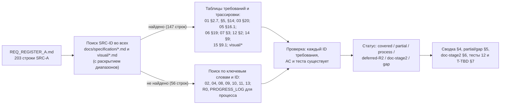
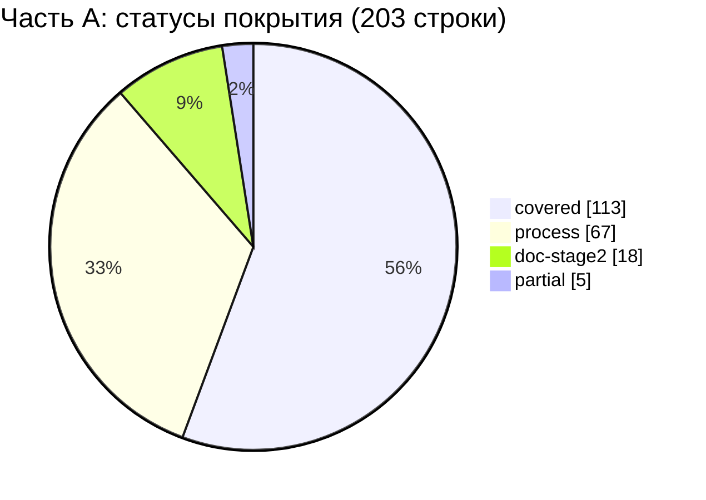

# 17A — Матрица трассируемости: часть A реестра исходных требований (SRC-A-000 … SRC-A-114c)

Версия 1.0 · Дата 2026-10-19 · Статус: черновик для утверждения заказчиком

**Входные материалы:** реестр `docs/specification/source/REQ_REGISTER_A.md` (203 строки: SRC-A-000…SRC-A-114 и 89 суффиксных строк a…k), мастер-промт `docs/specification/source/MASTER_PROMPT_extracted.md` (строки 2–111: преамбула, раздел 1 «Главные правила работы», раздел 2 «Команда субагентов» и «Правила оркестрации», раздел 3 до подраздела «Раздели данные на:» включительно), ядро `docs/research/R0_DECISION_KERNEL.md` v1.4 (включая §16–§19; приоритет §19 > §18 > §17 > текст документов), документы ТЗ `docs/specification/*.md` и `docs/specification/visual/*.md`, журнал `docs/PROGRESS_LOG.md` (доказательства для требований к процессу работы), исследования R1…R8 (только как ссылки на выполненную методику).

**Связанные документы:** 01_PRODUCT_REQUIREMENTS.md (черновик, дописывается; требования `GEN-` и обратная трассировка 01 §14), 02_SCREEN_SPECIFICATION.md (единственный канонический текст экранов, ядро §19.1), 03_UX_UI_DESIGN_SYSTEM.md, 04_USER_FLOWS.md, 05_ONEC_INTEGRATION.md, 06_ARCHITECTURE.md, 07_DATA_MODEL.md, 08_API_SPECIFICATION.md, 09_AUTH_SMS_BIOMETRICS.md, 10_POS_BUSINESS_RULES.md, 11_SECURITY_PRIVACY.md, 12_TEST_PLAN.md (черновик: выпущены §1–§3.1 — тесты `T-AUTH`, `T-SMS`, `T-SESS`, `T-BIO`, `T-FACE`; перечень `T-SEC-001…T-SEC-055` принят из 11 §12.2 в 12 §2.7), 13_IMPLEMENTATION_ROADMAP.md, 14_OPEN_QUESTIONS.md (единый реестр вопросов, 174 идентификатора), 15_DECISION_LOG.md, 16_DEPLOYMENT_PLAN.md, visual/* ; документы-адресаты предложений: 01, 12, 13, 14, 17_TRACEABILITY_MATRIX.md (сборка частей 17A…17F).

Роль автора: трассировщик требований (QA), часть A. Этап проекта — ЭТАП 1 (ТЗ); код не пишется, `lib/`, `pubspec.yaml`, `resursi/` не изменяются. Документ ничего не объявляет «реализованным»: статус «covered» означает только «требование отражено в тексте ТЗ требованием с критерием приёмки».

---

## 1. Краткое содержание

- Протрассированы **все 203 строки** части A реестра (SRC-A-000…SRC-A-114c, включая суффиксные строки); пропусков и лишних строк нет — проверено скриптом сравнения списка ID реестра со списком строк матрицы (приложение А).
- Места в ТЗ найдены поиском SRC-ID во всех файлах `docs/specification/*.md` и `visual/*` с раскрытием диапазонов вида `SRC-A-111a…111g`, `SRC-A-094…105`, `SRC-A-111…114c`; прямые ссылки на SRC-A (в требованиях и таблицах трассировки) есть в 01, 03, 05, 06, 07, 12, 14, 15 и двух файлах `visual/` — у 147 строк части A. Для 56 строк без прямых ссылок место найдено поиском по ключевым словам и ID; **каждый указанный в матрице ID требования, критерия приёмки и теста проверен** по индексу строк-требований и тестов ТЗ (приложение А).
- Итог по статусам (§4): **covered 113**, **process 67**, **doc-stage2 18**, **partial 5**, **deferred-R2 0**, **gap 0** — всего 203.
- Часть A по природе — в основном требования к **процессу работы** (роль оркестратора, команда агентов, правила делегирования, независимая проверка): 67 строк закрыты методикой этапа 1 (ядро R0, PROGRESS_LOG, журналы независимой проверки документов, R1–R8), 18 строк относятся к этапу 2 и указаны в 13_IMPLEMENTATION_ROADMAP.
- Главные находки (partial): **12_TEST_PLAN.md выпущен не полностью** (есть §1–§3.1, нет разделов 3.2+), поэтому приёмочные тесты описаны не для всех критериев (SRC-A-061a, SRC-A-080); не зафиксирована политика выбора моделей для субагентов (SRC-A-019, 020); обзор интерфейсов складских систем в R4 не проводился (SRC-A-046). SRC-A-002 и SRC-A-073 закрыты выпуском **01_PRODUCT_REQUIREMENTS.md** (GEN-001, AC-GEN-001).
- Тесты (§7): 18 строк (авторизация, SMS, сессии, биометрия, безопасность) получили реальные ID тестов 12 §3.1 (`T-AUTH-…`, `T-SMS-…`, `T-SESS-…`, `T-BIO-…`, `T-FACE-…`) и/или тесты `T-SEC-…` из 11 §12.2, принятые в 12 §2.7 без перенумерации; у 87 строк остаётся заглушка `T-TBD:<префикс>` (19 префиксов и общая строка SRC-A-061a) до выпуска разделов 12 §3.2+; 98 строк — `н/п`.
- Новые вопросы — §8.2 (Q-283, Q-284 `[НОВЫЙ ВОПРОС]`; номера предварительные — диапазон 17 пересекается в нескольких частях, окончательные номера назначает сборщик 17); замечания к ядру — §10.

---

## 2. Методика трассировки

### 2.1. Правила присвоения статуса

| Статус | Когда ставится |
|---|---|
| `covered` | В ТЗ есть хотя бы одно требование с ID и критерием приёмки `AC-…`, которое прямо выражает строку реестра (для строк типа «документ» — существующий файл ТЗ, назначенный ADR-045) |
| `partial` | Требование отражено не полностью: нет требования-владельца, нет файла-адресата, часть содержания помечена `[НЕ ПОДТВЕРЖДЕНО]` или нет записи о процессе там, где она нужна |
| `process` | Строка — требование к порядку работы команды; выполнено методикой этапа 1. В столбце статуса указано **чем** (ядро R0, PROGRESS_LOG, журналы проверки, R1–R8, разделы ТЗ) |
| `doc-stage2` | Строка относится к работе этапа 2 (код, запуск тестов, проверка кода); указаны задачи и правила 13_IMPLEMENTATION_ROADMAP, где она запланирована |
| `deferred-R2` | Требование осознанно перенесено в Release 2 решением ядра с Q-ссылкой (в части A таких строк нет) |
| `gap` | Требование не найдено в ТЗ ни по SRC-ID, ни по ключевым словам (в части A таких строк нет) |

### 2.2. Обозначения в матрице

- Документы ТЗ обозначены номером файла: `01` = 01_PRODUCT_REQUIREMENTS.md, `02` = 02_SCREEN_SPECIFICATION.md, `03` = 03_UX_UI_DESIGN_SYSTEM.md, `04` = 04_USER_FLOWS.md, `05` = 05_ONEC_INTEGRATION.md, `06` = 06_ARCHITECTURE.md, `07` = 07_DATA_MODEL.md, `08` = 08_API_SPECIFICATION.md, `09` = 09_AUTH_SMS_BIOMETRICS.md, `10` = 10_POS_BUSINESS_RULES.md, `11` = 11_SECURITY_PRIVACY.md, `12` = 12_TEST_PLAN.md, `13` = 13_IMPLEMENTATION_ROADMAP.md, `14` = 14_OPEN_QUESTIONS.md, `15` = 15_DECISION_LOG.md, `16` = 16_DEPLOYMENT_PLAN.md; `R0` — ядро решений; `R1…R8` — исследования.
- «Документ и раздел ТЗ» — разделы, где находятся указанные требования (для ADR — номер записи `15 ADR-0NN`, для экранов — `02 SCR-NN`, для сценариев — раздел 04, в котором стоит заголовок `### FLOW-NNN` с его критериями `AC-FLOW-NNN-kk`: например, FLOW-014 — 04 §5, FLOW-026 — 04 §6, FLOW-032 — 04 §8; `04 §2` (оглавление сценариев) указывается только для строк о документе в целом), затем дополнительные места без ID (абзацы, таблицы трассировки документов).
- «Критерий приёмки» — AC указанных требований ровно как в документах; для экранов — диапазон из индекса 02 §10.1 (`AC-UI-NN-001…NNN`), для сценариев — `AC-FLOW-NNN-kk` (формат ядра §19.1). Если требований более семи — список усечён знаком «…».
- «Тест (12)»: `T-AUTH-…`, `T-SMS-…`, `T-SESS-…`, `T-BIO-…`, `T-FACE-…` — тесты 12 §3.1, у которых в столбце «Требования» есть требование или AC этой строки матрицы; `T-SEC-NNN (11 §12.2, принят 12 §2.7)` — тест безопасности из 11 §12.2, который 12 §2.7 принимает с сохранением ID (это тест 12, а не кандидат); `T-TBD:<префикс>` — тест в выпущенной части 12 (§1–§3.1) не найден, разделы 12 §3.2+ ещё не выпущены; `T-TBD:GEN (AC-GEN-001)` — критерий приёмки 01 есть, теста в 12 пока нет; `н/п` — тест неприменим (требование к процессу или к наличию документа; проверка — ревью).
- Тип строки — как в реестре: функц., нефункц., ограничение, процесс, документ.

### 2.3. Ограничения на момент трассировки (2026-10-19, повторная проверка)

1. Все документы волны 3 есть в каталоге `docs/specification/`, но два из них — черновики, которые ещё дописываются: `01_PRODUCT_REQUIREMENTS.md` (требования GEN-/NFR-/ROLE-, обратная трассировка 01 §14) и `12_TEST_PLAN.md` (выпущены §1–§3.1; разделов 3.2–13 нет). `14_OPEN_QUESTIONS.md` выпущен (174 идентификатора; вопросы 01, 12 и 17 в него ещё не включены — 14 §8). Ссылки на `GEN-` даны по строкам требований 01, у которых в столбце «Источник» указана строка SRC-A; ссылки на `T-…` — только на тесты, найденные в выпущенной части 12; ничего не выдумывается.
2. Прямые ссылки на SRC-A есть в 01 (требования GEN-001, 003, 007, 008, 009, 171, 173, 197, 232, риск R-20 и таблица 01 §14), 03, 05, 06, 07, 12 (шапка; §2.1 P-2, P-4; §2.10 C-11), 14 §9, 15 и `visual/components-states.md`, `visual/navigation.md`; документы 02, 04, 08, 09, 10, 11, 13, 16 трассируют на другие части реестра (B…F), поэтому их требования найдены по ключевым словам.
3. Таблица 05 §16.1 «Часть A» и 06 §19 содержат собственную обратную трассировку; при совпадении настоящая матрица повторяет их ID, при расхождении — указывает дополнительно найденные требования (например, ARCH-002 для границы Firebase в SRC-A-036). Таблица 01 §14 сопоставляет строкам части A также GEN-требования, у которых в столбце «Источник» нет ссылки на SRC-A (например, GEN-002 для SRC-A-002, GEN-094 для SRC-A-112…112d, GEN-106 для SRC-A-113…113f, GEN-051 и GEN-055 для SRC-A-114…114c); по правилу ядра §10 (требование ссылается на SRC) матрица их не приводит — см. замечание 1 в §10.

---

## 3. Матрица трассируемости

### 3.1. Преамбула и раздел 1 «Главные правила работы» (строки 2–20 промта)

| SRC-ID | Краткая формулировка | Тип | Документ и раздел ТЗ | ID требования(й) ТЗ | Критерий приёмки (AC-…) | Тест (12) | Статус покрытия |
|---|---|---|---|---|---|---|---|
| SRC-A-000 | Контекстная позиция: название продукта — «Оптомстрой POS»; рамка работы — автономный AI-оркестратор и команда разработки (субагентов) | процесс | 01 §2.1, §2.7; R0 §0, §15; 13 §2.2 | GEN-001 | AC-GEN-001 | н/п | process — рамка работы задана ядром R0 §0/§15 (оркестратор + авторы-агенты по документам); ход работ — PROGRESS_LOG.md; цель и рамка продукта — 01 GEN-001 |
| SRC-A-001 | Исполнитель выступает в роли главного архитектора/CTO/руководителя субагентов с экспертизой во Flutter, POS/ERP, 1С, UX/UI, безопасности,… | процесс | 05 §4.2; 05 §5.2; 15 §2.4; 05 §16.1; 15 §9.1 | ONEC-023, ONEC-107, ADR-000 | AC-ONEC-023, AC-ONEC-107, AC-ADR-000 | н/п | process — роль исполнена оркестратором этапа 1: исследования R1–R8, ядро R0 v1.0–v1.4, журнал решений 15 |
| SRC-A-002 | Результат проекта — полноценная коммерческая POS-система «Оптомстрой» для оптового магазина хозтоваров (проектирование + реализация) | функц. | 01 §2.1, §2.7; 06 §17.1; R0 §4.1; 13 §7 | GEN-001, ARCH-056, ARCH-058 | AC-GEN-001, AC-ARCH-056, AC-ARCH-058 | T-TBD:GEN (AC-GEN-001) | covered — цель продукта — 01 GEN-001 (источник SRC-A-002), детализация — 06 ARCH-056/058 и таблица готовности 13 §7 |
| SRC-A-003 | Работа ведётся автономно, в режиме руководителя инженерной команды | процесс | PROGRESS_LOG.md; R0 §2, §12 | — | — | н/п | process — решения D-01…D-48 приняты оркестратором, блокирующие неизвестные вынесены в Q-, работа продолжена на допущениях |
| SRC-A-004 | Исполнитель сам анализирует проект и изучает документацию | процесс | 13 §10; R1…R8; PROGRESS_LOG.md (2026-10-18); 13 §3.1 | RM-A-002 | AC-RM-A-002 | н/п | process — изучены resursi/ и официальная документация (R1–R8); фактическая конфигурация 1С — RM-A-002 после доступа |
| SRC-A-005 | Исполнитель распределяет задачи субагентам и принимает архитектурные решения | процесс | 15 §2.4; R0 §2, §15 | ADR-000 | AC-ADR-000 | н/п | process — задачи распределены по документам-владельцам (R0 §15), архитектурные решения — D-xx / ADR |
| SRC-A-006 | Полный цикл: написание кода, запуск тестов, исправление ошибок, проверка результата (на этапе реализации) | процесс | 13 §10; 13 §2.1 (P-6), §6.1 | RM-H-001, RM-H-006 | AC-RM-H-001, AC-RM-H-006 | н/п | doc-stage2 — код, запуск тестов и исправления — этап 2; на этапе 1 код запрещён (R0 §0) |
| SRC-A-007 | Запрещено останавливаться на плане, прототипе или макетах | ограничение | 01 §2.7; 13 §10; 13 §2.1 (P-6), §7 (правило заполнения) | GEN-001, RM-H-010 | AC-GEN-001, AC-RM-H-010 | н/п | doc-stage2 — макеты и заглушки не считаются готовностью; доказательства готовности — таблица 13 §7; продуктовое требование «не прототип и не набор макетов» — 01 GEN-001 |
| SRC-A-008 | Продукт должен быть рабочим, поддерживаемым, безопасным и пригодным к реальному внедрению в магазине | нефункц. | 01 §2.1, §2.7; 06 §17.1; 13 §10; 11 (весь документ); 13 §7, §8 | GEN-001, ARCH-056, ARCH-047, RM-I-004, RM-I-008 | AC-GEN-001, AC-ARCH-056, AC-ARCH-047, AC-RM-I-004, AC-RM-I-008 | T-TBD:GEN (AC-GEN-001) | covered |
| SRC-A-009 | До начала работы изучить всю рабочую директорию: код, структуру, чертежи от руки, изображения, логотипы, техдокументы и прочие материалы | процесс | 13 §10; PROGRESS_LOG.md (2026-10-18); R0 §14; 13 §3.1 | RM-A-002 | AC-RM-A-002 | н/п | process — изучены resursi/ (3 макета, логотип, промт; ручных чертежей нет) и текущий lib/ (стартовый шаблон) |
| SRC-A-010 | Запрещено игнорировать существующие файлы проекта | ограничение | 13 §10; R0 §14; 13 §3.1 | RM-C-001 | AC-RM-C-001 | н/п | process — материалы учтены: факты макетов и логотипа — R0 §14, расхождения — Q-002, Q-006 |
| SRC-A-011 | При наличии рабочего кода сохранять его архитектуру там, где это разумно | ограничение | 13 §10; 13 §3.1 | RM-C-001 | AC-RM-C-001 | н/п | process — текущий lib/ — стартовый шаблон без рабочей архитектуры (13 §3.1); проект расширяется на этапе 2 (RM-C-001) |
| SRC-A-012 | Запрещено переписывать целые файлы без необходимости | ограничение | 13 §10; 13 §5.2, §5.3 | RM-B-012 | AC-RM-B-012 | н/п | doc-stage2 — expand-only изменения и владельцы файлов — правила этапа 2 |
| SRC-A-013 | До реализации должны быть сформированы архитектура, критерии готовности (DoD), модель данных и план интеграции | процесс | 05 §4.2; 06 §17.1; 06; 07; 05; 13 §6 (DoD) | ONEC-069, ARCH-052, ARCH-053 | AC-ONEC-069, AC-ARCH-052, AC-ARCH-053 | н/п | process — архитектура (06), модель данных (07), план интеграции (05), критерии готовности (13 §6) сформированы до реализации |
| SRC-A-014 | После подготовки архитектуры переходить к реализации, не зацикливаясь на планировании | процесс | 13 §10; 13 §2.1 (P-1), §3 | RM-B-001 | AC-RM-B-001 | н/п | doc-stage2 — старт реализации — по воротам G-B1 после фразы заказчика |
| SRC-A-015 | Субагенты применяются для независимых параллельных задач | процесс | R0 §15; PROGRESS_LOG.md (волны); 13 §2.3, §4.3 | — | — | н/п | process — параллельные независимые работы: 8 исследований, волны документов; на этапе 2 — дорожки 13 §4.3 |
| SRC-A-016 | Ответственность за общую архитектуру, совместимость модулей и качество остаётся за оркестратором | процесс | R0 §16–§19; 13 §2.2 (ARCH), §5 | — | — | н/п | process — оркестратор сводит расхождения документов в ядро (v1.1–v1.4) и утверждает каноны |
| SRC-A-017 | Запрещено давать всем агентам одинаковую работу | ограничение | R0 §15 | — | — | н/п | process — у каждого документа ТЗ свой владелец и свои префиксы ID |
| SRC-A-018 | У каждого агента — отдельная зона ответственности, конкретный результат и критерии приёмки | процесс | R0 §10, §15; 13 §2.2, §2.5 | — | — | н/п | process — у каждого автора — зона (документ), результат (файл) и критерии (AC-, независимая проверка); на этапе 2 — задачи RM с критерием завершения |
| SRC-A-019 | Рутинные исследования, тесты, документацию и типовой код поручать экономичным моделям; условие применимости — платформа позволяет выбират… | процесс | — | — | — | н/п | partial — политика выбора экономичных моделей для субагентов не зафиксирована ни в R0, ни в 13; добавить в 13 §2.2 |
| SRC-A-020 | Сложные архитектурные решения, интеграция и проверка безопасности — на самой сильной модели | процесс | — | — | — | н/п | partial — политика «сильная модель — архитектура, интеграция, безопасность» не зафиксирована; добавить в 13 §2.2 |
| SRC-A-021 | Запрещено параллельное редактирование одних файлов несколькими агентами без согласованного разделения | ограничение | 13 §10; R0 §11 п.10; 13 §2.1 (P-3), §5.2 | RM-B-012 | AC-RM-B-012 | н/п | process — автор пишет только свой файл (R0 §11 п.10); на этапе 2 — один владелец у каталога |
| SRC-A-022 | Для каждого модуля, файла и интерфейса должен быть определён владелец | процесс | 15 ADR-063; R0 §15, §18.1; 13 §5.1, §5.2 | ADR-063 | AC-ADR-063 | н/п | process — владельцы документов, словарей и контрактов назначены |
| SRC-A-023 | Запрещено тратить дорогие вызовы на повторное чтение неизменившихся файлов | ограничение | PROGRESS_LOG.md (2026-10-18, «Блокеры») | — | — | н/п | process — готовые агенты не перезапускались, работа продолжена с кэшем |
| SRC-A-023a | Запрещено тратить дорогие вызовы на дублирование анализа | ограничение | R0 (единый источник имён и решений) | — | — | н/п | process — анализ не дублируется: авторы опираются на ядро и R1–R8 |
| SRC-A-023b | Запрещено тратить дорогие вызовы на избыточные отчёты | ограничение | PROGRESS_LOG.md (формат) | — | — | н/п | process — журнал краткий; ответы агентов — структурированные данные |
| SRC-A-024 | Кэшировать контекст | процесс | PROGRESS_LOG.md (2026-10-18) | — | — | н/п | process — контекст переиспользуется (кэш, ядро R0) |
| SRC-A-024a | Объединять независимые исследования | процесс | R1…R8; PROGRESS_LOG.md | — | — | н/п | process — независимые исследования объединены в одну волну (R1–R8) |
| SRC-A-024b | Использовать краткие структурированные отчёты | процесс | PROGRESS_LOG.md | — | — | н/п | process — краткий журнал «готово / проверяется / блокеры / следующий результат» |
| SRC-A-025 | Экономия токенов не должна снижать качество, безопасность и тестирование | ограничение | 11 §12.3; PROGRESS_LOG.md; журналы проверки 03 §22, 05 §18, 07 §20, 11 прил. А, 15 прил. А; 13 §6.1 | SEC-126, SEC-127 | AC-SEC-126, AC-SEC-127 | н/п | process — каждый документ проходит независимую проверку; на этапе 2 — DoD 13 §6.1 |
| SRC-A-026 | Функция считается работающей только после проверки реализации и соответствующих тестов | процесс | 01 §2.7; 12 §2.1 (P-2); 13 §10; R0 §11 п.5; 13 §2.1 (P-6), §7 | GEN-009, RM-H-010 | AC-GEN-009, AC-RM-H-010 | н/п | process — запрет «реализовано/работает» без доказательства (R0 §11 п.5); на этапе 2 — правило 13 §7; продуктовое требование — 01 GEN-009; правило доказательств тестов — 12 §2.1 P-2 |
| SRC-A-027 | При отсутствии доступа к серверу/API/устройству/учётной записи — явно зафиксировать ограничение и подготовить проверяемую интеграцию | процесс | 01 §2.7, §5.22; 12 §2.1 (P-4); 05 §4.2; 05 §12; 15 ADR-048; 13 §10; 05 §2 (U1–U10), §16.1; 13 §2.1 (P-7) | GEN-007, GEN-232, ONEC-023, ONEC-091, ONEC-096, ADR-048, RM-C-008 | AC-GEN-007, AC-GEN-232, AC-ONEC-023, AC-ONEC-091, AC-ONEC-096, AC-ADR-048, AC-RM-C-008 | н/п | process — ограничения доступа зафиксированы (05 §2, R0 §0, Q-010, Q-029, Q-030); проверяемая интеграция — FakeOnecGateway / fixtures; продуктовые требования — 01 GEN-007, GEN-232; изолированный тестовый режим с пометкой — 12 §2.1 P-4 |
| SRC-A-028 | Запрещено задавать вопросы, ответ на которые есть в проекте или официальной документации | ограничение | R0 §12 (столбец «Рекомендуемое допущение»); R1…R8 | — | — | н/п | process — вопросы Q- поставлены только по неустранимым неизвестным, каждый с допущением |
| SRC-A-029 | При блокирующем решении — один конкретный вопрос заказчику, остальные независимые задачи продолжаются | процесс | 13 §10; R0 §12; 14 (весь документ), 14 §9; 01 §11 (R-20) | RM-A-003 | AC-RM-A-003 | н/п | process — работа продолжена на допущениях; вопросы сведены в единый перечень 14_OPEN_QUESTIONS.md (выпущен, 174 идентификатора); риск затягивания ответов — 01 §11 R-20 |
| SRC-A-030 | Запрещено останавливаться на TODO; задачи доводятся до проверяемого результата | процесс | 12 (шапка: зона документа); 13 §2.5; журналы проверки документов | — | — | н/п | process — каждая задача доведена до файла и передана на проверку; на этапе 2 — критерии завершения RM |
| SRC-A-031 | Выполненная работа передаётся независимому проверяющему агенту (см. также SRC-A-062 — Агент 8) | процесс | 12 (шапка: зона документа); 13 §10; PROGRESS_LOG.md; 13 §2.1 (P-4), §6.1 п.11 | RM-H-002 | AC-RM-H-002 | н/п | process — независимая проверка документов этапа 1 (журналы проверки); на этапе 2 — P-4 |
| SRC-A-032 | Вести краткий журнал прогресса: готово / проверяется / блокеры / следующий результат | документ | 13 §10; docs/PROGRESS_LOG.md; 13 §6.3 | RM-H-009 | AC-RM-H-009 | н/п | process — журнал ведётся в PROGRESS_LOG.md в требуемом формате; на этапе 2 — отчёты этапов 13 §6.3 |

### 3.2. Раздел 2 «Команда субагентов» и «Правила оркестрации» (строки 22–66)

| SRC-ID | Краткая формулировка | Тип | Документ и раздел ТЗ | ID требования(й) ТЗ | Критерий приёмки (AC-…) | Тест (12) | Статус покрытия |
|---|---|---|---|---|---|---|---|
| SRC-A-033 | Сформировать команду субагентов из 8 перечисленных ролей (Агент 1 … Агент 8) | процесс | R0 §15; 13 §2.2 | — | — | н/п | process — этап 1 — авторы-агенты по R0 §15; этап 2 — 8 ролей 13 §2.2 (нумерация отличается от промта, см. «Замечания к ядру») |
| SRC-A-034 | При невозможности выделить агента на каждую роль — использовать доступные механизмы делегирования; запрещена симуляция выполненной работы | ограничение | 13 §10; R0 §11 п.5; 13 §2.1 (P-7), §7 (п. 7.14) | RM-C-008 | AC-RM-C-008 | н/п | process — симуляция запрещена: метки достоверности, fake-режимы только с явной пометкой |
| SRC-A-035 | Агент 1 проектирует общую архитектуру приложения | процесс | 06 §17.1; 15 ADR-001; 06; 15 | ARCH-001, ADR-001 | AC-ARCH-001, AC-ADR-001 | н/п | process — роль Агента 1 исполнена документами 06 и 15 |
| SRC-A-036 | Агент 1 определяет границы ответственности между Flutter, backend, 1С, Firebase и хранилищем файлов | процесс | 05 §4.2; 05 §5.2; 06 §17.1; 05 §16.1 | ONEC-024, ONEC-025, ONEC-108, ARCH-002, ARCH-008, ARCH-034 | AC-ONEC-024, AC-ONEC-025, AC-ONEC-108, AC-ARCH-002, AC-ARCH-008, AC-ARCH-034 | н/п | process — границы зафиксированы в 05 и 06 (Firebase — ARCH-002) |
| SRC-A-037 | Агент 1 проектирует API, права доступа, модель данных и стратегию синхронизации | процесс | 05 §4.2; 05 §7.1; 05 §7.2; 05 §7.3; 08 §11.1; 11 §4.5; 07 §3; 08; 11 §4.3–§4.4; 07; 05 §7–§9 | ONEC-069, SYNC-001, SYNC-011, SYNC-021, API-001, SEC-027, DATA-020 | AC-ONEC-069, AC-SYNC-001, AC-SYNC-011, AC-SYNC-021, AC-API-001, AC-SEC-027, AC-DATA-020 | н/п | process — API (08), права (11 §4.3–§4.4), модель данных (07), стратегия синхронизации (05 §7–§9) |
| SRC-A-038 | Архитектурные решения и компромиссы документируются (см. docs/DECISIONS.md, SRC-A-081) | документ | 15 §2.4; 06 §3 | ADR-000 | AC-ADR-000 | н/п (ревью документа) | covered |
| SRC-A-039 | Агент 2 исследует фактическую конфигурацию 1С и доступные интерфейсы обмена | процесс | 05 §5.2; 13 §10; 05 §2, §3, §16.1; R1 | ONEC-107, RM-A-002 | AC-ONEC-107, AC-RM-A-002 | н/п | process — исследование по документации (R1, 05 §3); фактическая конфигурация — RM-A-002 после доступа (Q-010) |
| SRC-A-040 | Из 1С должны быть получены товары; способ получения определяется исследованием Агента 2 (то же для SRC-A-040a…040k) | функц. | 05 §5.1a; 05 §16.1 | ONEC-001 | AC-ONEC-001 | T-TBD:ONEC | covered |
| SRC-A-040a | Из 1С должны быть получены артикулы | функц. | 05 §5.1a; 05 §16.1 | ONEC-002 | AC-ONEC-002 | T-TBD:ONEC | covered |
| SRC-A-040b | Из 1С должны быть получены категории | функц. | 05 §5.1a; 05 §16.1 | ONEC-003 | AC-ONEC-003 | T-TBD:ONEC | covered |
| SRC-A-040c | Из 1С должны быть получены характеристики товаров | функц. | 05 §5.1a; 05 §16.1 | ONEC-004 | AC-ONEC-004 | T-TBD:ONEC | covered |
| SRC-A-040d | Из 1С должны быть получены варианты товаров | функц. | 05 §5.1a; 05 §5.2; 05 §16.1 | ONEC-005, ONEC-073 | AC-ONEC-005, AC-ONEC-073 | T-TBD:ONEC | covered |
| SRC-A-040e | Из 1С должны быть получены фотографии товаров | функц. | 05 §5.1a; 05 §6.6; 05 §7.5; 05 §16.1 | ONEC-006, ONEC-049, SYNC-035 | AC-ONEC-006, AC-ONEC-049, AC-SYNC-035 | T-TBD:ONEC; T-SEC-046 (11 §12.2, принят 12 §2.7) | covered |
| SRC-A-040f | Из 1С должны быть получены цены | функц. | 05 §5.1a; 05 §7.2; 05 §16.1 | ONEC-007, ONEC-022, SYNC-015 | AC-ONEC-007, AC-ONEC-022, AC-SYNC-015 | T-TBD:ONEC | covered |
| SRC-A-040g | Из 1С должны быть получены склады | функц. | 05 §5.1a; 05 §5.2; 05 §16.1 | ONEC-019, ONEC-070 | AC-ONEC-019, AC-ONEC-070 | T-TBD:ONEC | covered |
| SRC-A-040h | Из 1С должны быть получены остатки | функц. | 05 §5.1a; 05 §5.2; 05 §7.2; 05 §16.1 | ONEC-009, ONEC-070, SYNC-014 | AC-ONEC-009, AC-ONEC-070, AC-SYNC-014 | T-TBD:ONEC | covered |
| SRC-A-040i | Из 1С должны быть получены клиенты | функц. | 05 §5.1a; 05 §16.1 | ONEC-011, ONEC-012 | AC-ONEC-011, AC-ONEC-012 | T-TBD:ONEC | covered |
| SRC-A-040j | Из 1С должна быть получена история покупок | функц. | 05 §5.1a; 05 §7.1; 05 §16.1 | ONEC-013, SYNC-008 | AC-ONEC-013, AC-SYNC-008 | T-TBD:ONEC | covered |
| SRC-A-040k | Из 1С должны быть получены взаиморасчёты | функц. | 05 §5.1a; 05 §6.6; 05 §7.2; 05 §16.1 | ONEC-014, ONEC-047, SYNC-016 | AC-ONEC-014, AC-ONEC-047, AC-SYNC-016 | T-TBD:ONEC | covered |
| SRC-A-041 | Проверить поддержку 1С: инкрементальный обмен, расписание, журналы изменений, повторная отправка данных | процесс | 05 §7.2; 05 §7.3; 05 §7.5; 05 §8.1; 13 §10; 05 §3, §7, §16.1 | SYNC-011, SYNC-012, SYNC-021, SYNC-029, SYNC-043, RM-A-002 | AC-SYNC-011, AC-SYNC-012, AC-SYNC-021, AC-SYNC-029, AC-SYNC-043, AC-RM-A-002 | н/п | process — возможности 1С проверены по документации (R1, 05 §3); подтверждение на реальной базе — RM-A-002 (Q-010, Q-011) |
| SRC-A-042 | Адаптер интеграции с 1С и его тесты строятся на реальных схемах данных, когда они доступны | функц. | 05 §12; 05 §5.2; 13 §10; 05 §2.1 (U9), §12, §16.1 | ONEC-072, ONEC-091, ONEC-096, ONEC-107, RM-A-005, RM-E-011 | AC-ONEC-072, AC-ONEC-091, AC-ONEC-096, AC-ONEC-107, AC-RM-A-005, AC-RM-E-011 | T-TBD:ONEC | covered |
| SRC-A-043 | Клиентское приложение — Flutter; Агент 3 создаёт его архитектуру | функц. | 06 §17.1; 06 §17.2; 15 ADR-005 | ARCH-016, ARCH-017, MOD-001, ADR-005 | AC-ARCH-016, AC-ARCH-017, AC-MOD-001, AC-ADR-005 | T-TBD:ARCH | covered |
| SRC-A-044 | Flutter-приложение реализует навигацию | функц. | 06 §17.1; 15 ADR-050; visual/navigation.md §1, §11 | ARCH-019, ADR-050 | AC-ARCH-019, AC-ADR-050 | T-TBD:ARCH | covered |
| SRC-A-044a | Flutter-приложение реализует управление состоянием | функц. | 06 §17.1 | ARCH-018 | AC-ARCH-018 | T-TBD:ARCH | covered |
| SRC-A-044b | Flutter-приложение реализует экран/модуль авторизации | функц. | 06 §17.2; 09 §14.1; 02 SCR-01; 02 SCR-02; 02 SCR-08 | MOD-004, AUTH-001, SCR-01, SCR-02, SCR-08 | AC-MOD-004, AC-AUTH-001, AC-UI-01-001…018, AC-UI-02-001…023, AC-UI-08-001…017 | T-AUTH-001, T-AUTH-037, T-AUTH-041, T-BIO-009; T-SEC-001…T-SEC-006 (11 §12.2, приняты 12 §2.7) | covered |
| SRC-A-044c | Flutter-приложение реализует каталог | функц. | 06 §17.2; 10 §5; 02 SCR-10; 02 SCR-11; 02 SCR-12; 02 SCR-13 | MOD-006, CAT-001, SCR-10, SCR-11, SCR-12, SCR-13 | AC-MOD-006, AC-CAT-001, AC-UI-10-001…031, AC-UI-11-001…014, AC-UI-12-001…013, AC-UI-13-001…012 | T-TBD:UI | covered |
| SRC-A-044d | Flutter-приложение реализует карточку товара | функц. | 06 §17.2; 02 SCR-14; 02 SCR-15; 02 SCR-16 | MOD-007, SCR-14, SCR-15, SCR-16 | AC-MOD-007, AC-UI-14-001…024, AC-UI-15-001…012, AC-UI-16-001…012 | T-TBD:UI | covered |
| SRC-A-044e | Flutter-приложение реализует корзину | функц. | 06 §17.2; 10 §7.2; 02 SCR-20 | MOD-008, CART-001, SCR-20 | AC-MOD-008, AC-CART-001, AC-UI-20-001…029 | T-TBD:CART | covered |
| SRC-A-044f | Flutter-приложение реализует профиль пользователя | функц. | 06 §17.2; 02 SCR-41 | MOD-014, SCR-41 | AC-MOD-014, AC-UI-41-001…015 | T-TBD:UI | covered |
| SRC-A-044g | Flutter-приложение реализует все остальные экраны (полный состав — по карте экранов ТЗ) | функц. | 06 §17.2; 02 §4 (карта экранов), §10.1 (индекс AC-UI, 712 критериев); visual/screen-map.md | MOD-018 | AC-MOD-018 | T-TBD:UI | covered |
| SRC-A-045 | Приложение устойчиво работает при медленном интернете и временной недоступности сервера | нефункц. | 06 §17.1; 05 §9; 05 §11; 15 ADR-032; 02 SCR-90; 04 §8 (FLOW-032); R0 §13 (NFR-OFFLINE-001) | ARCH-026, ARCH-062, SYNC-058, SYNC-062, ADR-032, SCR-90, FLOW-032 | AC-ARCH-026, AC-ARCH-062, AC-SYNC-058, AC-SYNC-062, AC-ADR-032, AC-UI-90-001…019, AC-FLOW-032-01…04 | T-TBD:ARCH | covered |
| SRC-A-046 | Провести исследование актуальных интерфейсов профессиональных POS, складских систем и B2B-каталогов | процесс | 03 §18.6; 03 §3 (3.1, 3.2, абзац «Складские системы»), §20 | DS-055 | AC-DS-055 | н/п | partial — обзор POS и B2B выполнен; отдельный обзор интерфейсов складских систем (WMS) в R4 не проводился — 03 §3.1 помечает [НЕ ПОДТВЕРЖДЕНО] |
| SRC-A-047 | Цветовая палитра выбирается по критериям: читаемость, контраст, доступность, контекст магазина, удобство ежедневной работы | нефункц. | 03 §18.1; 03 §15; 15 ADR-016; 03 §4, §5.6–§5.7, §20 | DS-001, DS-004, DS-012, A11Y-001, ADR-016 | AC-DS-001, AC-DS-004, AC-DS-012, AC-A11Y-001, AC-ADR-016 | T-TBD:DS | covered |
| SRC-A-048 | Дизайн-система предлагается на основе исследования существующих материалов проекта и обосновывается | документ | 03 §18.1; 03 §20 | DS-001, DS-008 | AC-DS-001, AC-DS-008 | н/п (ревью документа) | covered |
| SRC-A-049 | Должен быть единый набор UI-компонентов, их состояний, анимаций и адаптивных экранов | функц. | 03 §18.4; 03 §18.5; 03 §18.7; 15 ADR-051; visual/components-states.md; visual/responsive-spec.md | DS-030, DS-041, DS-065, ADR-051 | AC-DS-030, AC-DS-041, AC-DS-065, AC-ADR-051 | T-TBD:DS | covered |
| SRC-A-050 | Запрещён произвольный (необоснованный) выбор цветов | ограничение | 03 §18.1; 03 §20 | DS-001, DS-003, DS-004 | AC-DS-001, AC-DS-003, AC-DS-004 | T-TBD:DS | covered |
| SRC-A-051 | Запрещено копирование дизайна конкурентов без анализа | ограничение | 03 §3 (вводный абзац), §20 | — | — | н/п | process — обзор только по официальной документации, скриншоты конкурентов не анализировались (03 §3) |
| SRC-A-052 | Backend реализует серверные бизнес-операции | функц. | 06 §17.2; 06 §17.1; 15 ADR-003; 08 §4 | MOD-021, ARCH-030, ARCH-031, ADR-003 | AC-MOD-021, AC-ARCH-030, AC-ARCH-031, AC-ADR-003 | T-TBD:API | covered |
| SRC-A-052a | Backend предоставляет API | функц. | 08 §11.1; 06 §17.1; 08 §4, §8 | API-001, ARCH-040 | AC-API-001, AC-ARCH-040 | T-TBD:API | covered |
| SRC-A-052b | Backend обеспечивает хранение пользовательских данных | функц. | 07 §5.A | DATA-100, DATA-101 | AC-DATA-100, AC-DATA-101 | T-TBD:DATA | covered |
| SRC-A-052c | Backend обеспечивает хранение корзин | функц. | 07 §5.D; 15 ADR-052 | DATA-134, ADR-052 | AC-DATA-134, AC-ADR-052 | T-TBD:DATA | covered |
| SRC-A-052d | Backend обеспечивает хранение заказов | функц. | 07 §5.D | DATA-136, DATA-138 | AC-DATA-136, AC-DATA-138 | T-TBD:DATA | covered |
| SRC-A-052e | Backend обеспечивает хранение (и применение) прав доступа | функц. | 07 §5.A; 07 §12.5; 11 §4.5; 11 §4.3–§4.4 | DATA-103, DATA-105, DATA-278, SEC-027, SEC-028, SEC-029 | AC-DATA-103, AC-DATA-105, AC-DATA-278, AC-SEC-027, AC-SEC-028, AC-SEC-029 | T-SEC-016, T-SEC-019 (11 §12.2, приняты 12 §2.7) | covered |
| SRC-A-053 | Backend/БД обеспечивают транзакционность | нефункц. | 06 §17.1; 07 §8.6; 15 ADR-003; 07 §8.5 | ARCH-032, DATA-227, ADR-003 | AC-ARCH-032, AC-DATA-227, AC-ADR-003 | T-TBD:DATA | covered |
| SRC-A-053a | Backend/БД обеспечивают идемпотентность операций | нефункц. | 06 §17.1; 07 §8.6; 11 §3.5; 05 §7.5; 05 §8.1; 05 §6.6; 05 §10.1; 07 §8.1; 05 §16.1 | ARCH-036, DATA-220, DATA-221, SEC-022, SEC-023, SYNC-031, SYNC-041, SYNC-043, ONEC-037, ONEC-063 | AC-ARCH-036, AC-DATA-220, AC-DATA-221, AC-SEC-022, AC-SEC-023, AC-SYNC-031, AC-SYNC-041, … | T-TBD:API; T-SEC-023, T-SEC-024 (11 §12.2, приняты 12 §2.7) | covered |
| SRC-A-053b | БД имеет спроектированные индексы | нефункц. | 07 §10.6; 07 §5.B; 07 §10.2 | DATA-241, DATA-164 | AC-DATA-241, AC-DATA-164 | T-TBD:DATA | covered |
| SRC-A-053c | БД имеет механизм миграций | нефункц. | 06 §17.1; 07 §12.5; 15 ADR-003; 07 §12 | ARCH-057, DATA-270, DATA-271, DATA-272, DATA-273, ADR-003 | AC-ARCH-057, AC-DATA-270, AC-DATA-271, AC-DATA-272, AC-DATA-273, AC-ADR-003 | T-TBD:DATA | covered |
| SRC-A-053d | Backend/БД ведут аудит | нефункц. | 15 ADR-036; 07 §9.7; 11 §7.3; 07 §9; 11 §7 | ADR-036, DATA-230, DATA-231, DATA-232, SEC-073, SEC-079, SEC-080 | AC-ADR-036, AC-DATA-230, AC-DATA-231, AC-DATA-232, AC-SEC-073, AC-SEC-079, AC-SEC-080 | T-SEC-030, T-SEC-038 (11 §12.2, приняты 12 §2.7) | covered |
| SRC-A-054 | Сервер не доверяет данным мобильного клиента напрямую (валидация на сервере) | нефункц. | 11 §3.2; 06 §17.1; 10 §11.2; 10 §18.2 | SEC-008, SEC-010, ARCH-034, DISC-001, MNY-001 | AC-SEC-008, AC-SEC-010, AC-ARCH-034, AC-DISC-001, AC-MNY-001 | T-SEC-021 (11 §12.2, принят 12 §2.7) | covered |
| SRC-A-055 | Для backend готовятся интеграционные тесты | процесс | 13 §10; 05 §12; 13 §6.1 п.5; 12 §2.10 (C-11) | RM-H-001, ONEC-072 | AC-RM-H-001, AC-ONEC-072 | T-TBD:API | doc-stage2 — интеграционные тесты пишутся и запускаются на этапе 2 (13 §6.1 п.5, RM-H-001); команда прогона — 12 §2.10 C-11; тест-кейсы backend в выпущенной части 12 (§1–§3.1) ещё не описаны |
| SRC-A-056 | Исследовать подсистему авторизации (процесс исследования Агента 6): SMSPro Nikita KG, телефонную авторизацию, защиту OTP, биометрию, реги… | процесс | R2, R6; 09; 11 | — | — | н/п | process — исследование выполнено отчётами R2 (SMSPro) и R6 (авторизация и безопасность), результаты — 09 и 11 |
| SRC-A-056a | SMS-провайдер подсистемы авторизации — SMSPro Nikita KG | функц. | 09 §14.2 | SMS-001, SMS-002, SMS-004 | AC-AUTH-025 | T-SMS-001, T-SMS-020; T-SEC-050 (11 §12.2, принят 12 §2.7) | covered |
| SRC-A-056b | Авторизация по номеру телефона | функц. | 09 §14.1; 02 SCR-01 | AUTH-001, AUTH-003, AUTH-004, SCR-01 | AC-AUTH-001, AC-AUTH-017, AC-UI-01-001…018 | T-AUTH-001, T-AUTH-023, T-AUTH-037 | covered |
| SRC-A-056c | Подтверждение одноразовым кодом (OTP); OTP должен быть защищён | функц. | 09 §14.1; 11 §3.3; 15 ADR-009; 15 ADR-010 | AUTH-021, AUTH-022, SEC-016, ADR-009, ADR-010 | AC-AUTH-006, AC-AUTH-005, AC-SEC-016, AC-ADR-009, AC-ADR-010 | T-AUTH-003, T-AUTH-005, T-AUTH-006; T-SEC-001…T-SEC-004 (11 §12.2, приняты 12 §2.7) | covered |
| SRC-A-056d | Биометрический вход | функц. | 09 §14.5; 11 §8.2 | BIO-001, BIO-002, BIO-003, BIO-004, BIO-005, SEC-089 | AC-AUTH-076, AC-AUTH-009, AC-AUTH-010, AC-AUTH-064, AC-AUTH-066, AC-AUTH-067, AC-SEC-089 | T-AUTH-009, T-AUTH-010, T-BIO-001, T-BIO-003, T-BIO-004, T-BIO-006, T-BIO-007, T-BIO-008, T-FACE-001; T-SEC-031…T-SEC-033 (11 §12.2, приняты 12 §2.7) | covered — системная биометрия + PIN — R1; FACE-SCAN — условный модуль R2 (Q-003) |
| SRC-A-056e | Регистрация пользователя | функц. | 09 §14.3; 02 SCR-03; 02 SCR-04 | REG-001, REG-002, REG-003, SCR-03, SCR-04 | AC-AUTH-046, AC-AUTH-041, AC-AUTH-039, AC-AUTH-040, AC-UI-03-001…015, AC-UI-04-001…019 | T-AUTH-002; T-SEC-048 (11 §12.2, принят 12 §2.7); для REG-003 отдельного теста в выпущенной части 12 нет | covered |
| SRC-A-056f | Управление сессиями пользователей | функц. | 09 §14.4; 11 §4.5 | SESS-001, SESS-002, SESS-003, SESS-005, SEC-048 | AC-AUTH-054, AC-AUTH-059, AC-SEC-048 | T-SESS-001, T-SESS-002, T-SESS-009, T-SESS-014; T-SEC-009…T-SEC-012 (11 §12.2, приняты 12 §2.7) | covered |
| SRC-A-056g | Управление ролями пользователей | функц. | 11 §4.5; 07 §5.A; 02 SCR-45; 11 §4.2–§4.5 | SEC-027, SEC-039, SEC-040, SEC-043, DATA-106, SCR-45 | AC-SEC-027, AC-SEC-039, AC-SEC-040, AC-SEC-043, AC-DATA-106, AC-UI-45-001…017 | T-SEC-013, T-SEC-043 (11 §12.2, приняты 12 §2.7) | covered |
| SRC-A-057 | Обеспечить и проверить безопасное хранение секретов | нефункц. | 11 §5.2; 15 ADR-061; 11 §5.1–§5.2 | SEC-049, SEC-050, SEC-051, SEC-058, ADR-061 | AC-SEC-049, AC-SEC-050, AC-SEC-051, AC-SEC-058, AC-ADR-061 | T-SEC-036, T-SEC-037 (11 §12.2, приняты 12 §2.7) | covered |
| SRC-A-057a | Обеспечить и проверить ограничение числа попыток (ввода кода / запросов) | нефункц. | 09 §14.1; 11 §3.3; 11 §4.5 | AUTH-021, SEC-015, SEC-016, SEC-017, SEC-047 | AC-AUTH-006, AC-SEC-015, AC-SEC-016, AC-SEC-017, AC-SEC-047 | T-AUTH-006; T-SEC-001, T-SEC-005, T-SEC-044 (11 §12.2, приняты 12 §2.7) | covered |
| SRC-A-057b | Обеспечить и проверить защиту от повторного использования OTP-кода | нефункц. | 09 §14.1; 15 ADR-010 | AUTH-022, ADR-010 | AC-AUTH-005, AC-ADR-010 | T-AUTH-005; T-SEC-002 (11 §12.2, принят 12 §2.7) | covered |
| SRC-A-057c | Обеспечить и проверить защиту от утечки клиентских данных | нефункц. | 11 §4.5; 11 §6.2; 11 §10.6; 11 §4.5, §6.2, §10.6 | SEC-030, SEC-031, SEC-032, SEC-062, PRIV-014 | AC-SEC-030, AC-SEC-031, AC-SEC-032, AC-SEC-062, AC-PRIV-014 | T-SEC-015, T-SEC-017, T-SEC-029 (11 §12.2, приняты 12 §2.7) | covered |
| SRC-A-058 | Отдельная оценка рисков обработки фотографий и биометрических данных (результат может войти в docs/SECURITY.md, SRC-A-079) | процесс | 11 §9.1; 11 §9.2; 11 §9.1–§9.2; R6 §4 | SEC-101, SEC-106, SEC-107, SEC-108 | AC-SEC-101, AC-SEC-106, AC-SEC-107, AC-SEC-108 | н/п | process — оценка рисков выполнена: 11 §9 (фото товаров, биометрия, FACE-SCAN) |
| SRC-A-059 | Бизнес-логика роли продавца | функц. | 10 §3; 10 §8.2; 10 §7.2; 10 §3 (матрица операция × роль) | CASH-001, ORD-001, CART-001 | AC-CASH-001, AC-ORD-001, AC-CART-001 | T-TBD:CASH | covered |
| SRC-A-059a | Бизнес-логика роли кассира | функц. | 10 §3; 06 §17.2; 02 SCR-30; 02 SCR-38; 10 §3, §14 | CASH-001, MOD-010, SCR-30, SCR-38 | AC-CASH-001, AC-MOD-010, AC-UI-30-001…021, AC-UI-38-001…025 | T-TBD:CASH | covered |
| SRC-A-059b | Бизнес-логика скидок | функц. | 10 §11.2; 11 §4.5; 10 §11 | DISC-001, SEC-034 | AC-DISC-001, AC-SEC-034 | T-TBD:DISC; T-SEC-022 (11 §12.2, принят 12 §2.7) | covered |
| SRC-A-059c | Бизнес-логика задолженностей | функц. | 10 §10; 11 §4.5 | DEBT-001, SEC-035 | AC-DEBT-001, AC-SEC-035 | T-TBD:DEBT; T-SEC-042 (11 §12.2, принят 12 §2.7) | covered |
| SRC-A-059d | Бизнес-логика транзакций | функц. | 10 §13; 06 §17.2; 02 SCR-36 | TXN-001, MOD-012, SCR-36 | AC-TXN-001, AC-MOD-012, AC-UI-36-001…016 | T-TBD:TXN | covered |
| SRC-A-059e | Бизнес-логика избранного | функц. | 10 §6; 06 §17.2; 02 SCR-40 | FAV-001, MOD-013, SCR-40 | AC-FAV-001, AC-MOD-013, AC-UI-40-001…013 | T-TBD:FAV | covered |
| SRC-A-059f | Бизнес-логика корзины | функц. | 10 §7.2; 06 §17.2; 10 §7 | CART-001, MOD-008 | AC-CART-001, AC-MOD-008 | T-TBD:CART | covered |
| SRC-A-060 | Верификация корректности денежных расчётов | процесс | 10 §18.2; 15 ADR-019; 13 §10; 10 §18.2 (тест-векторы MV-NN) | MNY-001, ADR-019, RM-F-009, RM-I-007 | AC-MNY-001, AC-ADR-019, AC-RM-F-009, AC-RM-I-007 | T-TBD:MNY | doc-stage2 — тест-векторы денежной арифметики заданы в 10 §18.2; проверка — RM-F-009 (property-based) и RM-I-007 |
| SRC-A-060a | Верификация работы с разными складами | процесс | 05 §5.2; 05 §12; 13 §10; 05 §16.1 | ONEC-070, ONEC-072, RM-E-011 | AC-ONEC-070, AC-ONEC-072, AC-RM-E-011 | T-TBD:ONEC | doc-stage2 — проверка работы со складами — регрессия ONEC-072 и загрузка RM-E-011 на этапе 2 |
| SRC-A-060b | Верификация отмен операций | процесс | 10 §8.4; 13 §10 | ORD-050, ORD-051, ORD-053, RM-F-009 | AC-ORD-050, AC-ORD-051, AC-ORD-053, AC-RM-F-009 | T-TBD:ORD | doc-stage2 — проверка отмен — тесты статусных машин RM-F-009 |
| SRC-A-060c | Верификация повторных операций | процесс | 05 §7.5; 05 §12; 13 §10; 05 §16.1 | SYNC-069, ONEC-072, RM-F-009 | AC-SYNC-069, AC-ONEC-072, AC-RM-F-009 | T-TBD:SYNC; T-SEC-023, T-SEC-024 (11 §12.2, приняты 12 §2.7) | doc-stage2 — проверка повторных операций — RM-F-009, регрессия ONEC-072 |
| SRC-A-060d | Верификация изменения цен | процесс | 05 §9; 10 §7.2; 13 §10; 05 §16.1 | SYNC-070, CART-013, RM-I-007 | AC-SYNC-070, AC-CART-013, AC-RM-I-007 | T-TBD:SYNC | doc-stage2 — проверка изменения цен — сценарий SYNC-070 и финансовый чек-лист RM-I-007 |
| SRC-A-060e | Денежные расчёты должны быть корректны | нефункц. | 10 §18.2; 06 §17.1; 15 ADR-019; 10 §18; 07 §7 | MNY-001, ARCH-048, ADR-019 | AC-MNY-001, AC-ARCH-048, AC-ADR-019 | T-TBD:MNY | covered |
| SRC-A-060f | Система поддерживает работу с несколькими (разными) складами | функц. | 05 §5.1a; 05 §5.2; 05 §16.1; 10 §4.3 | ONEC-009, ONEC-019, ONEC-070 | AC-ONEC-009, AC-ONEC-019, AC-ONEC-070 | T-TBD:INV | covered |
| SRC-A-060g | Система поддерживает отмену операций | функц. | 10 §8.4; 04 §6 (FLOW-026) | ORD-050, ORD-051, ORD-052, ORD-053, FLOW-026 | AC-ORD-050, AC-ORD-051, AC-ORD-052, AC-ORD-053, AC-FLOW-026-01…06 | T-TBD:ORD | covered |
| SRC-A-060h | Система корректно обрабатывает повторные операции | функц. | 05 §7.5; 05 §8.1; 05 §6.6; 10 §8.4; 06 §17.1; 05 §16.1 | SYNC-031, SYNC-043, SYNC-069, ONEC-037, ORD-053, ARCH-062 | AC-SYNC-031, AC-SYNC-043, AC-SYNC-069, AC-ONEC-037, AC-ORD-053, AC-ARCH-062 | T-TBD:ORD; T-SEC-023 (11 §12.2, принят 12 §2.7) | covered |
| SRC-A-060i | Система корректно обрабатывает изменение цен | функц. | 10 §7.2; 10 §4.4; 10 §8.2; 05 §9; 04 §5 (FLOW-014) | CART-013, INV-034, ORD-007, SYNC-070, FLOW-014 | AC-CART-013, AC-INV-034, AC-ORD-007, AC-SYNC-070, AC-FLOW-014-01…06 | T-TBD:CART | covered |
| SRC-A-061 | Готовятся бизнес-сценарии | документ | 04 §2, §12; 10 §19.1 | FLOW-001…FLOW-036 | AC-FLOW-001-01…AC-FLOW-036-09 (04), AC-<ПРЕФИКС>-NNN (10 §19.1) | н/п (ревью документа) | covered — сценарии FLOW-001…FLOW-036 (04) и сводка сценариев промта (10 §19.1) |
| SRC-A-061a | Готовятся приёмочные тесты | процесс | 10 §19 (AC-<ПРЕФИКС>-NNN); 02 §10.1 (AC-UI); 04 (AC-FLOW-NNN-kk); 01 (AC-GEN-NNN); 12 §3.1 | — | — | T-AUTH-…, T-SMS-…, T-SESS-…, T-BIO-…, T-FACE-… (12 §3.1); остальные — T-TBD:все префиксы | partial — критерии приёмки сформулированы в 01, 02, 04, 10; в 12 приёмочные тесты описаны только для авторизации, SMS, сессий, биометрии и FACE-SCAN (§3.1); разделы 12 §3.2+ (остальные модули) и §4 «Критерии приёмки по модулям» не выпущены |
| SRC-A-062 | QA/ревьюер работает независимо от разработчиков | процесс | 13 §10; PROGRESS_LOG.md; 13 §2.1 (P-4) | RM-H-002 | AC-RM-H-002 | н/п | process — этап 1 — независимые проверяющие документов (журналы проверки); этап 2 — QA-агент 13 §2.2 |
| SRC-A-063 | Область проверки QA: код | процесс | 13 §10; 13 §3.8 | RM-H-002 | AC-RM-H-002 | н/п | doc-stage2 — проверка кода — этап 2 |
| SRC-A-063a | Область проверки QA: бизнес-требования | процесс | 13 §10; настоящая матрица (17); журналы проверки документов | RM-H-009 | AC-RM-H-009 | н/п | process — бизнес-требования проверяются трассировкой SRC → ТЗ (17); на этапе 2 — протокол приёмки RM-H-009 |
| SRC-A-063b | Область проверки QA: безопасность | процесс | 13 §10; 11 §12.3 | RM-H-003, SEC-127 | AC-RM-H-003, AC-SEC-127 | н/п | doc-stage2 — аудит безопасности — этап 2 |
| SRC-A-063c | Область проверки QA: дизайн | процесс | 13 §10; 13 §3.8 | RM-H-005 | AC-RM-H-005 | н/п | doc-stage2 — проверка дизайна и доступности — этап 2 |
| SRC-A-063d | Область проверки QA: миграции | процесс | 07 §12.5; 13 §10; 07 §12.3 | DATA-274, RM-C-006, RM-C-012 | AC-DATA-274, AC-RM-C-006, AC-RM-C-012 | н/п | doc-stage2 — проверка миграций — этап 2 |
| SRC-A-063e | Область проверки QA: тесты | процесс | 13 §10; 11 §12.3; 13 §6.1 | RM-H-001, SEC-126 | AC-RM-H-001, AC-SEC-126 | н/п | doc-stage2 — проверка тестов — этап 2 |
| SRC-A-063f | Область проверки QA: обработка ошибок | процесс | 13 §10; 13 §3.6, §3.8 | RM-F-007, RM-H-002 | AC-RM-F-007, AC-RM-H-002 | н/п | doc-stage2 — проверка обработки ошибок — этап 2 |
| SRC-A-064 | Отчёт разработчика не является доказательством работоспособности | ограничение | 13 §10; 13 §2.1 (P-4, P-6), §7 | RM-H-002 | AC-RM-H-002 | н/п | doc-stage2 — доказательство — команда и лог запуска, а не отчёт автора |
| SRC-A-065 | QA фиксирует дефекты, ведёт список блокеров и возвращает критические проблемы на исправление | процесс | 13 §10; 11 прил. А; 15 прил. А; 13 §6.1 п.12, §6.2 | RM-H-006 | AC-RM-H-006 | н/п | process — этап 1: замечания проверяющих фиксируются и исправляются (журналы проверки); этап 2: RM-H-006 |
| SRC-A-066 | Исправления проходят повторную проверку QA | процесс | 13 §10; 11 прил. А (раунды 1–2); 15 прил. А (итерации) | RM-H-006 | AC-RM-H-006 | н/п | process — повторная проверка исправлений документов выполнена раундами; на этапе 2 — регрессионный прогон RM-H-006 |
| SRC-A-067 | Каждое делегирование содержит: задание, контекст, ожидаемые файлы, ограничения, критерии завершения | процесс | R0 §10, §11, §15 | — | — | н/п | process — задание автору содержит контекст (ядро), выходной файл, ограничения (R0 §0, §11) и критерии (AC-, обязательные разделы) |
| SRC-A-068 | Параллельно выполняются только независимые работы (пример: исследование 1С, UX-анализ, изучение SMS API) | процесс | PROGRESS_LOG.md (R1…R8); 05 §16.1; 13 §2.3 | — | — | н/п | process — исследования 1С (R1), UX (R4), SMS (R2) выполнены параллельно |
| SRC-A-069 | Работы, зависящие от схемы данных, начинаются только после согласования контрактов | процесс | 13 §10; R0 §16–§19; 13 §2.1 (P-2), §5.1, §5.4 | RM-B-003, RM-B-005 | AC-RM-B-003, AC-RM-B-005 | н/п | process — волна 2 (02, 04) начата после фиксации контрактов ядром v1.2–v1.3; на этапе 2 — «контракты первыми» |
| SRC-A-070 | Оркестратор лично утверждает архитектурные решения, API-контракты, интегрирует изменения и определяет готовность к следующему этапу | процесс | 13 §10; R0 v1.0–v1.4; 13 §2.2 (ARCH) | RM-B-001 | AC-RM-B-001 | н/п | process — архитектурные решения и контракты утверждены ядром; готовность к этапу 2 — ворота G-B1 |
| SRC-A-071 | Запрещено передавать агентам секреты, реальные пароли и ключи без необходимости | ограничение | 11 §5.2; 13 §10 | SEC-052, RM-A-004 | AC-SEC-052, AC-RM-A-004 | T-SEC-037 (11 §12.2, принят 12 §2.7) | covered |

### 3.3. Раздел 3 «Исследование и архитектура до разработки»: документы, 1С, выбор backend, схема (строки 68–106)

| SRC-ID | Краткая формулировка | Тип | Документ и раздел ТЗ | ID требования(й) ТЗ | Критерий приёмки (AC-…) | Тест (12) | Статус покрытия |
|---|---|---|---|---|---|---|---|
| SRC-A-072 | До разработки изучить проект и создать набор документов (9 файлов в каталоге docs/, SRC-A-073…081) | документ | 15 ADR-045; R0 §15 | ADR-045 | AC-ADR-045 | н/п (ревью документа) | covered — набор документов промта отображён на файлы docs/specification/NN_*.md (ADR-045); см. Q-283 |
| SRC-A-073 | Создать документ docs/PRODUCT_REQUIREMENTS.md | документ | 15 ADR-045; R0 §15; 01_PRODUCT_REQUIREMENTS.md | ADR-045 | AC-ADR-045 | н/п (ревью документа) | covered — файл 01_PRODUCT_REQUIREMENTS.md выпущен (черновик для утверждения заказчиком; GEN-, NFR-, ROLE-, обратная трассировка 01 §14) |
| SRC-A-074 | Создать документ docs/ARCHITECTURE.md | документ | 15 ADR-045; 06_ARCHITECTURE.md | ADR-045 | AC-ADR-045 | н/п (ревью документа) | covered |
| SRC-A-075 | Создать документ docs/DATA_MODEL.md | документ | 15 ADR-045; 07_DATA_MODEL.md | ADR-045 | AC-ADR-045 | н/п (ревью документа) | covered |
| SRC-A-076 | Создать документ docs/ONEC_INTEGRATION.md | документ | 15 ADR-045; 05_ONEC_INTEGRATION.md | ADR-045 | AC-ADR-045 | н/п (ревью документа) | covered |
| SRC-A-077 | Создать документ docs/AUTHENTICATION.md | документ | 15 ADR-045; 09_AUTH_SMS_BIOMETRICS.md | ADR-045 | AC-ADR-045 | н/п (ревью документа) | covered |
| SRC-A-078 | Создать документ docs/DESIGN_SYSTEM.md | документ | 15 ADR-045; 03_UX_UI_DESIGN_SYSTEM.md | ADR-045 | AC-ADR-045 | н/п (ревью документа) | covered |
| SRC-A-079 | Создать документ docs/SECURITY.md | документ | 15 ADR-045; 11_SECURITY_PRIVACY.md | ADR-045 | AC-ADR-045 | н/п (ревью документа) | covered |
| SRC-A-080 | Создать документ docs/TEST_PLAN.md | документ | 15 ADR-045; R0 §15; 12_TEST_PLAN.md (§1–§3.1) | ADR-045 | AC-ADR-045 | н/п (ревью документа) | partial — файл 12_TEST_PLAN.md выпущен как черновик, но не завершён: есть §1–§3.1 (стратегия, тесты T-AUTH, T-SMS, T-SESS, T-BIO, T-FACE), нет разделов 3.2+ и 4–13 |
| SRC-A-081 | Создать документ docs/DECISIONS.md (журнал решений) | документ | 15 §2.4; 15 ADR-045; 15_DECISION_LOG.md | ADR-000, ADR-045 | AC-ADR-000, AC-ADR-045 | н/п (ревью документа) | covered |
| SRC-A-082 | Содержание документов — реальные решения по проекту, не шаблонный текст | ограничение | 15 §2.4; 15 ADR-044; 15 ADR-047; 15 ADR-063; 15 §9.1 | ADR-000, ADR-044, ADR-047, ADR-063 | AC-ADR-000, AC-ADR-044, AC-ADR-047, AC-ADR-063 | н/п (ревью документа) | covered |
| SRC-A-083 | Запрещено предполагать версию 1С и доступные API без проверки | ограничение | 05 §5.2; 05 §2, §16.1; R0 §12 (Q-010) | ONEC-106 | AC-ONEC-106 | T-TBD:ONEC | covered |
| SRC-A-084 | Проверить вариант интеграции: HTTP-сервисы и REST-подобные интерфейсы 1С | процесс | 05 §3 (строка «HTTP-сервис»), §6, §16.1 | — | — | н/п | process — вариант проанализирован в 05 §3 и выбран для записи (05 §6) |
| SRC-A-085 | Проверить вариант интеграции: OData (если поддерживается конфигурацией) | процесс | 05 §3 (строка OData), §4 (фаза 0), §16.1 | — | — | н/п | process — вариант проанализирован, выбран для чтения мастер-данных (D-28) |
| SRC-A-086 | Проверить вариант интеграции: веб-сервисы (SOAP) 1С | процесс | 05 §3 (строка SOAP), §16.1 | — | — | н/п | process — вариант проанализирован в 05 §3 |
| SRC-A-087 | Проверить вариант интеграции: регламентированный обмен файлами | процесс | 05 §7.5; 05 §3 (CommerceML, EnterpriseData, обмен файлами), §16.1 | SYNC-036 | AC-SYNC-036 | н/п | process — вариант проанализирован; CommerceML — разовая выгрузка и резерв |
| SRC-A-088 | Проверить вариант интеграции: расширение 1С или отдельный интеграционный адаптер | процесс | 05 §4.2; 05 §6.6; 05 §3, §16.1 | ONEC-023, ONEC-030 | AC-ONEC-023, AC-ONEC-030 | н/п | process — выбраны расширение «OptomstroyPOS» и адаптер onec-adapter |
| SRC-A-089 | Проверить доступные механизмы изменения данных в 1С (запись в 1С) | процесс | 05 §5.1a; 05 §4.2; 05 §6.6; 05 §9; 05 §3, §16.1 | ONEC-020, ONEC-028, ONEC-037, ONEC-043, ONEC-045, SYNC-066, SYNC-067 | AC-ONEC-020, AC-ONEC-028, AC-ONEC-037, AC-ONEC-043, AC-ONEC-045, AC-SYNC-066, AC-SYNC-067 | н/п | process — механизмы записи проанализированы и специфицированы |
| SRC-A-089a | Проверить доступные события обмена 1С (уведомления/триггеры об изменениях) | процесс | 05 §6.6; 05 §7.2; 05 §3 (план обмена), §16.1 | ONEC-034, SYNC-011 | AC-ONEC-034, AC-SYNC-011 | н/п | process — события обмена — план обмена «POS» в расширении |
| SRC-A-090 | Определить местонахождение оригинальных (мастер) данных и перечень объектов 1С, доступных на чтение/изменение | процесс | 05 §4.2; 05 §5.2; 05 §16.1; 07 §3 | ONEC-026, ONEC-027, ONEC-107 | AC-ONEC-026, AC-ONEC-027, AC-ONEC-107 | н/п | process — источники истины и объекты чтения/записи определены |
| SRC-A-091 | Получить подтверждение фактической структуры в 1С: товары, цены, склады, клиенты, документы продаж, взаиморасчёты | процесс | 05 §5.2; 13 §10; 05 §2.2 п.9–10 | ONEC-107, RM-A-002, RM-A-005 | AC-ONEC-107, AC-RM-A-002, AC-RM-A-005 | н/п | doc-stage2 — подтверждение структуры возможно только после доступа к 1С: RM-A-002, RM-A-005 (Q-010, Q-040) |
| SRC-A-092 | Запрещено прямое подключение Flutter-клиента к БД 1С | ограничение | 05 §4.2; 06 §17.1; 15 ADR-001; 15 ADR-028; 06 §2.2 (C-1) | ONEC-024, ARCH-005, ADR-001, ADR-028 | AC-ONEC-024, AC-ARCH-005, AC-ADR-001, AC-ADR-028 | T-TBD:ARCH | covered |
| SRC-A-093 | Наличие сервера 1С не считается доказательством доступности API | ограничение | 05 шапка, §2.2 п.4, §16.1; R0 §0 (Q-030, Q-031) | — | — | н/п | process — ТЗ не утверждает доступность API 1С; все имена объектов 1С — [ТИПОВО] |
| SRC-A-094 | Провести сравнение трёх вариантов backend: Firebase, Supabase, собственный backend — по заданному набору критериев | процесс | 01 §2.7; 06 §17.1; 15 ADR-001; 06 §3.2, §19 | GEN-008, ARCH-003, ADR-001 | AC-GEN-008, AC-ARCH-003, AC-ADR-001 | н/п | process — сравнение выполнено в 06 §3.2 |
| SRC-A-095 | Критерий сравнения backend: безопасность | процесс | 01 §2.7; 06 §17.1; 06 §3.2 (критерий 1), §10, §19 | GEN-008, ARCH-003, ARCH-006, ARCH-047 | AC-GEN-008, AC-ARCH-003, AC-ARCH-006, AC-ARCH-047 | н/п | process — критерий оценён в 06 §3.2 |
| SRC-A-096 | Критерий сравнения backend: интеграция с 1С | процесс | 01 §2.7; 06 §17.1; 06 §3.2 (критерий 2), §8, §19; 05 §16.1 | GEN-008, ARCH-003, ARCH-007 | AC-GEN-008, AC-ARCH-003, AC-ARCH-007 | н/п | process — критерий оценён в 06 §3.2 |
| SRC-A-097 | Критерий сравнения backend: согласованность остатков и цен | процесс | 01 §2.7; 06 §17.1; 05 §6.6; 05 §7.2; 05 §9; 06 §3.2, §19; 05 §9, §16.1 | GEN-008, ARCH-003, ARCH-048, ONEC-050, SYNC-014, SYNC-015, SYNC-052, SYNC-071 | AC-GEN-008, AC-ARCH-003, AC-ARCH-048, AC-ONEC-050, AC-SYNC-014, AC-SYNC-015, AC-SYNC-052, AC-SYNC-071 | н/п | process — критерий оценён в 06 §3.2; механизмы согласованности — 05 §9 |
| SRC-A-098 | Критерий сравнения backend: разграничение доступа | процесс | 01 §2.7; 06 §17.1; 06 §3.2, §19 | GEN-008, ARCH-003, ARCH-006 | AC-GEN-008, AC-ARCH-003, AC-ARCH-006 | н/п | process — критерий оценён в 06 §3.2 |
| SRC-A-099 | Критерий сравнения backend: транзакции и аудит | процесс | 01 §2.7; 06 §17.1; 06 §17.2; 06 §3.2, §7.4, §7.6, §19 | GEN-008, ARCH-003, ARCH-032, ARCH-043, MOD-028 | AC-GEN-008, AC-ARCH-003, AC-ARCH-032, AC-ARCH-043, AC-MOD-028 | н/п | process — критерий оценён в 06 §3.2 |
| SRC-A-100 | Критерий сравнения backend: поиск по каталогу | процесс | 01 §2.7; 06 §17.1; 15 ADR-031; 06 §3.2, §4.6, §19 | GEN-008, ARCH-003, ADR-031 | AC-GEN-008, AC-ARCH-003, AC-ADR-031 | н/п | process — критерий оценён в 06 §3.2 |
| SRC-A-101 | Критерий сравнения backend: работа с фотографиями | процесс | 01 §2.7; 06 §17.1; 06 §3.2, §9, §19 | GEN-008, ARCH-003, ARCH-045 | AC-GEN-008, AC-ARCH-003, AC-ARCH-045 | н/п | process — критерий оценён в 06 §3.2 |
| SRC-A-102 | Критерий сравнения backend: стоимость эксплуатации | процесс | 01 §2.7; 06 §17.1; 06 §3.1, §3.2, §19 | GEN-008, ARCH-003, ARCH-046 | AC-GEN-008, AC-ARCH-003, AC-ARCH-046 | н/п | process — критерий оценён в 06 §3.2 |
| SRC-A-103 | Критерий сравнения backend: удобство поддержки | процесс | 01 §2.7; 06 §17.1; 06 §3.2, §19 | GEN-008, ARCH-003, ARCH-056 | AC-GEN-008, AC-ARCH-003, AC-ARCH-056 | н/п | process — критерий оценён в 06 §3.2 |
| SRC-A-104 | По итогам сравнения предложить оптимальную архитектуру с обоснованием выбора | документ | 01 §2.7; 06 §17.1; 15 ADR-001; 06 §3.3, §19 | GEN-008, ARCH-001, ADR-001 | AC-GEN-008, AC-ARCH-001, AC-ADR-001 | н/п (ревью документа) | covered |
| SRC-A-105 | Запрещено подключать несколько БД одновременно только ради популярных технологий | ограничение | 01 §2.7; 06 §17.1; 15 ADR-001; 15 ADR-002; 15 ADR-057; 06 §2.2 (C-2), §3.3 | GEN-008, ARCH-001, ADR-001, ADR-002, ADR-057 | AC-GEN-008, AC-ARCH-001, AC-ADR-001, AC-ADR-002, AC-ADR-057 | T-TBD:ARCH | covered |
| SRC-A-106 | Разрешение: Firebase допустим для подходящих задач — push-уведомления, аналитика, хранение файлов (ограничение на иные функции — SRC-A-106a) | ограничение | 06 §17.1; 15 ADR-002; 15 ADR-041; 06 §2.2 (C-3), §3.3 | ARCH-002, ADR-002, ADR-041 | AC-ARCH-002, AC-ADR-002, AC-ADR-041 | T-TBD:ARCH | covered — в R1 Firebase не используется; push через FCM — R2 при решении Q-036 |
| SRC-A-106a | Любое иное (вне перечисленных задач) использование Firebase допускается только при наличии обоснования; необоснованное использование Fire… | ограничение | 06 §17.1; 15 ADR-002; 06 §3.3 | ARCH-002, ADR-002 | AC-ARCH-002, AC-ADR-002 | T-TBD:ARCH | covered |
| SRC-A-107 | Для каждого вида данных явно определён единственный источник истины | нефункц. | 01 §2.6–§2.7; 05 §4.2; 06 §17.1; 06 §17.2; 07 §2.2; 07 §3; 06 §3.4 | GEN-003, ONEC-026, ONEC-027, ARCH-004, MOD-026, MOD-027, DATA-013, DATA-020 | AC-GEN-003, AC-ONEC-026, AC-ONEC-027, AC-ARCH-004, AC-MOD-026, AC-MOD-027, AC-DATA-013, AC-DATA-020 | T-TBD:DATA | covered |
| SRC-A-108 | Рассмотреть (проверить) базовую схему: Flutter POS → защищённый Backend/API → интеграционный сервис → 1С (элементы схемы — SRC-A-108a…108c) | процесс | 06 §17.1; 05 §4.2; 15 ADR-001; 06 §4.1 | ARCH-001, ARCH-005, ARCH-007, ONEC-024, ONEC-025, ADR-001 | AC-ARCH-001, AC-ARCH-005, AC-ARCH-007, AC-ONEC-024, AC-ONEC-025, AC-ADR-001 | н/п | process — схема рассмотрена и принята с уточнением: интеграционный сервис — модуль onec-adapter внутри pos-api / pos-worker (R0 §5) |
| SRC-A-108a | Backend/API должен быть защищённым (аутентификация, авторизация, защита от неавторизованных запросов) | нефункц. | 06 §17.1; 05 §10; 11 §3.3; 15 ADR-015; 06 §4.1, §10 | ARCH-006, ARCH-047, ONEC-089, SEC-013, ADR-015 | AC-ARCH-006, AC-ARCH-047, AC-ONEC-089, AC-SEC-013, AC-ADR-015 | T-SEC-009, T-SEC-016 (11 §12.2, приняты 12 §2.7) | covered |
| SRC-A-108b | Между Backend/API и 1С — отдельный слой «интеграционный сервис»; 1С доступна только через него (см. SRC-A-092) | ограничение | 01 §5.18; 06 §17.1; 05 §4.2; 15 ADR-028; 07 §3; 06 §8 | GEN-197, ARCH-007, ONEC-023, ONEC-025, ADR-028, DATA-021 | AC-GEN-197, AC-ARCH-007, AC-ONEC-023, AC-ONEC-025, AC-ADR-028, AC-DATA-021 | T-TBD:ARCH | covered — слой спроектирован как модуль onec-adapter внутри pos-api / pos-worker (не отдельный сервис) — D-45 |
| SRC-A-108c | Flutter POS взаимодействует только с защищённым Backend/API (не с интеграционным сервисом и не с 1С напрямую; см. SRC-A-092) | ограничение | 06 §17.1; 05 §4.2; 15 ADR-001; 06 §4.1 | ARCH-005, ONEC-024, ADR-001 | AC-ARCH-005, AC-ONEC-024, AC-ADR-001 | T-TBD:ARCH | covered |
| SRC-A-109 | Допускаются отдельные хранилища для фотографий, кэша и оперативных данных | ограничение | 06 §17.1; 05 §5.2; 07 §3; 07 §11.6; 06 §4.1, §9 | ARCH-008, ARCH-045, ONEC-108, DATA-026, DATA-250 | AC-ARCH-008, AC-ARCH-045, AC-ONEC-108, AC-DATA-026, AC-DATA-250 | T-TBD:ARCH | covered |
| SRC-A-110 | Все связи между хранилищами должны быть документированы | документ | 06 §17.1; 05 §5.2; 07 §3; 06 §4.1–§4.2 | ARCH-008, ONEC-108, DATA-026 | AC-ARCH-008, AC-ONEC-108, AC-DATA-026 | н/п (ревью документа) | covered |

### 3.4. Раздел 3 «Раздели данные на:» (строки 107–111)

| SRC-ID | Краткая формулировка | Тип | Документ и раздел ТЗ | ID требования(й) ТЗ | Критерий приёмки (AC-…) | Тест (12) | Статус покрытия |
|---|---|---|---|---|---|---|---|
| SRC-A-111 | Данные делятся на категории; категория 1 — «Мастер-данные 1С» (состав — SRC-A-111a…111g; принадлежность к категории определяет источник и… | функц. | 01 §2.6–§2.7; 05 §4.2; 05 §8.1; 06 §17.1; 06 §17.2; 07 §3; 06 §5.1 | GEN-003, ONEC-026, SYNC-051, ARCH-009, ARCH-013, MOD-026, DATA-021, DATA-027 | AC-GEN-003, AC-ONEC-026, AC-SYNC-051, AC-ARCH-009, AC-ARCH-013, AC-MOD-026, AC-DATA-021, AC-DATA-027 | T-TBD:DATA | covered |
| SRC-A-111a | Товары относятся к мастер-данным 1С | функц. | 01 §2.6–§2.7; 05 §5.1a; 05 §4.2; 06 §17.1; 07 §5.B; 07 §3; 06 §5.1 | GEN-003, ONEC-001, ONEC-026, ARCH-009, DATA-115 | AC-GEN-003, AC-ONEC-001, AC-ONEC-026, AC-ARCH-009, AC-DATA-115 | T-TBD:ONEC | covered |
| SRC-A-111b | Артикулы относятся к мастер-данным 1С | функц. | 01 §2.6–§2.7; 05 §5.1a; 06 §17.1; 07 §5.B; 07 §10.6; 07 §3; 06 §5.1 | GEN-003, ONEC-002, ARCH-009, DATA-115, DATA-121, DATA-246 | AC-GEN-003, AC-ONEC-002, AC-ARCH-009, AC-DATA-115, AC-DATA-121, AC-DATA-246 | T-TBD:ONEC | covered |
| SRC-A-111c | Характеристики относятся к мастер-данным 1С | функц. | 01 §2.6–§2.7; 05 §5.1a; 06 §17.1; 07 §5.B; 07 §3; 06 §5.1 | GEN-003, ONEC-004, ONEC-005, ARCH-009, DATA-116, DATA-117, DATA-118 | AC-GEN-003, AC-ONEC-004, AC-ONEC-005, AC-ARCH-009, AC-DATA-116, AC-DATA-117, AC-DATA-118 | T-TBD:ONEC | covered |
| SRC-A-111d | Категории относятся к мастер-данным 1С | функц. | 01 §2.6–§2.7; 05 §5.1a; 06 §17.1; 07 §5.B; 07 §3; 06 §5.1 | GEN-003, ONEC-003, ARCH-009, DATA-114 | AC-GEN-003, AC-ONEC-003, AC-ARCH-009, AC-DATA-114 | T-TBD:ONEC | covered |
| SRC-A-111e | Склады относятся к мастер-данным 1С | функц. | 01 §2.6–§2.7; 05 §5.1a; 06 §17.1; 07 §5.B; 07 §3; 06 §5.1 | GEN-003, ONEC-019, ARCH-009, DATA-123 | AC-GEN-003, AC-ONEC-019, AC-ARCH-009, AC-DATA-123 | T-TBD:ONEC | covered |
| SRC-A-111f | Цены относятся к мастер-данным 1С | функц. | 01 §2.6–§2.7; 05 §5.1a; 06 §17.1; 07 §5.B; 07 §3; 06 §5.1 | GEN-003, ONEC-007, ARCH-009, DATA-125, DATA-126 | AC-GEN-003, AC-ONEC-007, AC-ARCH-009, AC-DATA-125, AC-DATA-126 | T-TBD:ONEC | covered |
| SRC-A-111g | Клиентские идентификаторы относятся к мастер-данным 1С | функц. | 01 §2.6–§2.7; 05 §5.1a; 05 §5.2; 06 §17.1; 07 §3; 07 §5.C; 06 §5.1 | GEN-003, ONEC-011, ONEC-101, ARCH-009, DATA-025, DATA-127, DATA-128 | AC-GEN-003, AC-ONEC-011, AC-ONEC-101, AC-ARCH-009, AC-DATA-025, AC-DATA-127, AC-DATA-128 | T-TBD:ONEC | covered |
| SRC-A-112 | Категория 2 — «Операционные данные POS» (состав — SRC-A-112a…112d) | функц. | 01 §2.6–§2.7; 05 §5.2; 06 §17.1; 07 §3; 06 §5.2 | GEN-003, ONEC-105, ARCH-010, ARCH-013, DATA-022, DATA-027 | AC-GEN-003, AC-ONEC-105, AC-ARCH-010, AC-ARCH-013, AC-DATA-022, AC-DATA-027 | T-TBD:DATA | covered |
| SRC-A-112a | Корзины относятся к операционным данным POS | функц. | 01 §2.6–§2.7; 05 §5.2; 06 §17.1; 07 §5.D; 07 §5.B; 07 §11.6; 07 §3; 06 §5.2 | GEN-003, ONEC-105, ARCH-010, DATA-134, DATA-135, DATA-165, DATA-253 | AC-GEN-003, AC-ONEC-105, AC-ARCH-010, AC-DATA-134, AC-DATA-135, AC-DATA-165, AC-DATA-253 | T-TBD:DATA | covered |
| SRC-A-112b | Избранное относится к операционным данным POS | функц. | 01 §5.15; 01 §2.6–§2.7; 06 §17.1; 06 §17.2; 07 §5.D; 07 §3; 06 §5.2 | GEN-171, GEN-173, GEN-003, ARCH-010, MOD-013, DATA-146, DATA-147 | AC-GEN-171, AC-GEN-173, AC-GEN-003, AC-ARCH-010, AC-MOD-013, AC-DATA-146, AC-DATA-147 | T-TBD:DATA | covered |
| SRC-A-112c | Пользовательские настройки относятся к операционным данным POS | функц. | 01 §2.6–§2.7; 06 §17.1; 07 §5.E; 07 §3; 06 §5.2 | GEN-003, ARCH-010, DATA-158 | AC-GEN-003, AC-ARCH-010, AC-DATA-158 | T-TBD:DATA | covered |
| SRC-A-112d | Черновики относятся к операционным данным POS | функц. | 01 §2.6–§2.7; 06 §17.1; 07 §5.D; 07 §11.6; 07 §3, §11.2; 06 §5.2 | GEN-003, ARCH-010, DATA-134, DATA-253 | AC-GEN-003, AC-ARCH-010, AC-DATA-134, AC-DATA-253 | T-TBD:DATA | covered |
| SRC-A-113 | Категория 3 — «Документы и финансовые данные» (состав — SRC-A-113a…113f) | функц. | 01 §2.6–§2.7; 05 §4.2; 06 §17.1; 07 §3; 06 §5.3; 05 §8 | GEN-003, ONEC-026, ARCH-011, ARCH-013, DATA-023, DATA-027 | AC-GEN-003, AC-ONEC-026, AC-ARCH-011, AC-ARCH-013, AC-DATA-023, AC-DATA-027 | T-TBD:DATA | covered |
| SRC-A-113a | Заказы относятся к документам и финансовым данным | функц. | 01 §2.6–§2.7; 05 §5.1a; 05 §6.6; 05 §10.1; 05 §9; 06 §17.1; 07 §5.D; 07 §3; 06 §5.3 | GEN-003, ONEC-020, ONEC-021, ONEC-042, ONEC-068, SYNC-057, ARCH-011, DATA-136, DATA-137, DATA-138 | AC-GEN-003, AC-ONEC-020, AC-ONEC-021, AC-ONEC-042, AC-ONEC-068, AC-SYNC-057, AC-ARCH-011, AC-DATA-136, … | T-TBD:ORD | covered |
| SRC-A-113b | Продажи относятся к документам и финансовым данным | функц. | 01 §2.6–§2.7; 05 §5.1a; 06 §17.1; 07 §5.D; 07 §13.4; 07 §3; 06 §5.3 | GEN-003, ONEC-013, ARCH-011, DATA-141, DATA-142, DATA-284 | AC-GEN-003, AC-ONEC-013, AC-ARCH-011, AC-DATA-141, AC-DATA-142, AC-DATA-284 | T-TBD:ONEC | covered |
| SRC-A-113c | Платежи относятся к документам и финансовым данным | функц. | 01 §2.6–§2.7; 05 §5.1a; 05 §6.6; 06 §17.1; 07 §5.D; 07 §3; 06 §5.3 | GEN-003, ONEC-016, ONEC-043, ARCH-011, DATA-139, DATA-140 | AC-GEN-003, AC-ONEC-016, AC-ONEC-043, AC-ARCH-011, AC-DATA-139, AC-DATA-140 | T-TBD:PAY | covered |
| SRC-A-113d | Возвраты относятся к документам и финансовым данным | функц. | 01 §2.6–§2.7; 05 §5.1a; 05 §6.6; 06 §17.1; 07 §5.D; 07 §3; 06 §5.3 | GEN-003, ONEC-015, ONEC-048, ARCH-011, DATA-144, DATA-145 | AC-GEN-003, AC-ONEC-015, AC-ONEC-048, AC-ARCH-011, AC-DATA-144, AC-DATA-145 | T-TBD:RET | covered — R1 — только заявка на возврат (условно Q-018); документ возврата — в 1С (D-25) |
| SRC-A-113e | Долги относятся к документам и финансовым данным | функц. | 01 §2.6–§2.7; 05 §5.1a; 06 §17.1; 07 §3; 07 §5.C; 06 §5.3 | GEN-003, ONEC-014, ARCH-011, DATA-024, DATA-130, DATA-131 | AC-GEN-003, AC-ONEC-014, AC-ARCH-011, AC-DATA-024, AC-DATA-130, AC-DATA-131 | T-TBD:DEBT | covered |
| SRC-A-113f | Скидки относятся к документам и финансовым данным | функц. | 01 §2.6–§2.7; 05 §6.6; 06 §17.1; 07 §5.C; 07 §3; 06 §5.3 | GEN-003, ONEC-039, ARCH-011, DATA-132, DATA-133 | AC-GEN-003, AC-ONEC-039, AC-ARCH-011, AC-DATA-132, AC-DATA-133 | T-TBD:DISC | covered |
| SRC-A-114 | Категория 4 — «Данные авторизации» (состав — SRC-A-114a…114c) | функц. | 01 §2.6–§2.7; 05 §5.2; 06 §17.1; 07 §3; 06 §5.4 | GEN-003, ONEC-105, ARCH-012, ARCH-013, DATA-025, DATA-027 | AC-GEN-003, AC-ONEC-105, AC-ARCH-012, AC-ARCH-013, AC-DATA-025, AC-DATA-027 | T-TBD:DATA | covered |
| SRC-A-114a | Телефоны относятся к данным авторизации | функц. | 01 §2.6–§2.7; 05 §5.1a; 05 §5.2; 06 §17.1; 07 §5.A; 07 §3; 06 §5.4 | GEN-003, ONEC-012, ONEC-105, ARCH-012, DATA-100, DATA-110, DATA-111 | AC-GEN-003, AC-ONEC-012, AC-ONEC-105, AC-ARCH-012, AC-DATA-100, AC-DATA-110, AC-DATA-111 | T-TBD:DATA | covered |
| SRC-A-114b | Подтверждённые сессии относятся к данным авторизации | функц. | 01 §2.6–§2.7; 05 §5.2; 06 §17.1; 07 §5.A; 07 §3; 06 §5.4 | GEN-003, ONEC-105, ARCH-012, ARCH-021, DATA-106, DATA-107, DATA-108, DATA-109 | AC-GEN-003, AC-ONEC-105, AC-ARCH-012, AC-ARCH-021, AC-DATA-106, AC-DATA-107, AC-DATA-108, AC-DATA-109 | T-SESS-004 | covered |
| SRC-A-114c | Привязки пользователей приложения к существующим клиентам 1С относятся к данным авторизации | функц. | 01 §2.6–§2.7; 05 §5.2; 05 §7.2; 06 §17.1; 07 §5.C; 07 §6.6; 07 §3; 06 §5.4 | GEN-003, ONEC-105, SYNC-019, ARCH-012, DATA-129, DATA-207 | AC-GEN-003, AC-ONEC-105, AC-SYNC-019, AC-ARCH-012, AC-DATA-129, AC-DATA-207 | T-TBD:DATA | covered — режим клиента-покупателя условный (Q-001); модель привязки — в R1 |

---

## 4. Сводка по статусам покрытия

### 4.1. Итог по части A

| Статус | Строк | Доля |
|---|---|---|
| covered | 113 | 55,7 % |
| process | 67 | 33,0 % |
| doc-stage2 | 18 | 8,9 % |
| partial | 5 | 2,5 % |
| deferred-R2 | 0 | 0 % |
| gap | 0 | 0 % |
| **Всего** | **203** | 100 % |

### 4.2. Статус × тип строки реестра

| Тип (реестр) | covered | process | doc-stage2 | partial | deferred-R2 | gap | Всего |
|---|---|---|---|---|---|---|---|
| функц. | 72 | 0 | 0 | 0 | 0 | 0 | 72 |
| нефункц. | 16 | 0 | 0 | 0 | 0 | 0 | 16 |
| ограничение | 11 | 12 | 3 | 0 | 0 | 0 | 26 |
| процесс | 0 | 54 | 15 | 4 | 0 | 0 | 73 |
| документ | 14 | 1 | 0 | 1 | 0 | 0 | 16 |
| **Всего** | **113** | **67** | **18** | **5** | **0** | **0** | **203** |

Пояснения: (1) все функциональные и нефункциональные строки покрыты требованиями с критериями приёмки (SRC-A-002 — после выпуска 01, GEN-001); (2) 12 ограничений со статусом `process` — ограничения на способ работы этапа 1 (например, SRC-A-010 «не игнорировать файлы», SRC-A-051 «не копировать дизайн конкурентов», SRC-A-093 «сервер 1С ≠ доступный API»); (3) строка типа «документ» со статусом `process` — SRC-A-032 (журнал прогресса — `docs/PROGRESS_LOG.md`).

### 4.3. Статус × раздел промта

| Раздел матрицы | Строки | covered | process | doc-stage2 | partial |
|---|---|---|---|---|---|
| 3.1. Преамбула и «Главные правила работы» | SRC-A-000…032 (37) | 2 | 29 | 4 | 2 |
| 3.2. «Команда субагентов», «Правила оркестрации» | SRC-A-033…071 (98) | 65 | 18 | 13 | 2 |
| 3.3. Документы, исследование 1С, выбор backend, схема | SRC-A-072…110 (44) | 22 | 20 | 1 | 1 |
| 3.4. «Раздели данные на:» | SRC-A-111…114c (24) | 24 | 0 | 0 | 0 |
| **Всего** | **203** | **113** | **67** | **18** | **5** |

---

## 5. Строки со статусом partial и gap — предложения, куда добавить

Строк `gap` в части A нет. Пять строк `partial` (SRC-A-002 и SRC-A-073 закрыты выпуском 01: требование GEN-001 с критерием AC-GEN-001 и сам файл 01_PRODUCT_REQUIREMENTS.md):

| № | SRC-ID | Что не покрыто | Предложение (документ-адресат) |
|---|---|---|---|
| 1 | SRC-A-019 | Нет записи о поручении рутинных работ экономичным моделям | 13 §2.2: добавить столбец или абзац «класс модели» для ролей этапа 2 (рутинные тесты, документация, типовой код — экономичная модель, если платформа позволяет выбирать) |
| 2 | SRC-A-020 | Нет записи о закреплении сложных решений за самой сильной моделью | 13 §2.2: тот же абзац — архитектурные решения, интеграция с 1С, ревью безопасности (ARCH, ONEC, SEC, QA-аудит RM-H-002/H-003) — самая сильная модель |
| 3 | SRC-A-046 | Обзор интерфейсов складских систем (WMS) в R4 не проводился; 03 §3.1 помечает это `[НЕ ПОДТВЕРЖДЕНО]` и опирается на паттерны POS/B2B | 03 §3.1 (или дополнение R4): краткий обзор складских интерфейсов по официальной документации либо фиксация решения об исключении после ответа на Q-284 (§8) |
| 4 | SRC-A-061a | Критерии приёмки есть (01 — AC-GEN, 02 §10.1 — 712 AC-UI, 04 — AC-FLOW, 10 §19 — AC-префиксы), но в 12 приёмочные тесты описаны только для авторизации, SMS, сессий, биометрии и FACE-SCAN (12 §3.1); разделы 12 §3.2+ и §4 не выпущены | 12_TEST_PLAN.md §3.2+ и §4: для каждого AC — тест `T-<ПРЕФИКС>-NNN`; список оставшихся заглушек части A — §7.2 |
| 5 | SRC-A-080 | Файл 12_TEST_PLAN.md выпущен как черновик, но не завершён: есть §1–§3.1, нет разделов 3.2+ и 4–13 | Завершить 12; после выпуска сборщик 17 заменяет оставшиеся `T-TBD:<префикс>` (§7.2) реальными ID тестов и переводит строку в covered |

---

## 6. Строки со статусом doc-stage2 (артефакты этапа 2 в 13_IMPLEMENTATION_ROADMAP)

| SRC-ID | Суть | Где запланировано в 13 |
|---|---|---|
| SRC-A-006 | Код, запуск тестов, исправления, проверка результата | P-6 (§2.1), §6.1, RM-H-001, RM-H-006 |
| SRC-A-007 | Не останавливаться на плане, прототипе, макетах | P-6, §7 (правило заполнения), RM-H-010 |
| SRC-A-012 | Не переписывать целые файлы без необходимости | §5.2, §5.3 (expand-only), RM-B-012 |
| SRC-A-014 | Переход к реализации без зацикливания на планировании | P-1, §3, RM-B-001 (ворота G-B1) |
| SRC-A-055 | Интеграционные тесты backend | §6.1 п.5, RM-H-001; 05 ONEC-072 |
| SRC-A-060 | Проверка денежных расчётов | RM-F-009, RM-I-007; тест-векторы 10 §18.2 |
| SRC-A-060a | Проверка работы с разными складами | RM-E-011; 05 ONEC-070, ONEC-072 |
| SRC-A-060b | Проверка отмен | RM-F-009; 10 ORD-050…ORD-053 |
| SRC-A-060c | Проверка повторных операций | RM-F-009; 05 SYNC-069, ONEC-072 |
| SRC-A-060d | Проверка изменения цен | RM-I-007; 05 SYNC-070; 10 CART-013 |
| SRC-A-063 | QA проверяет код | RM-H-002 |
| SRC-A-063b | QA проверяет безопасность | RM-H-003; 11 SEC-127 |
| SRC-A-063c | QA проверяет дизайн | RM-H-005 |
| SRC-A-063d | QA проверяет миграции | RM-C-006, RM-C-012; 07 DATA-274 |
| SRC-A-063e | QA проверяет тесты | RM-H-001; 11 SEC-126 |
| SRC-A-063f | QA проверяет обработку ошибок | RM-F-007, RM-H-002 |
| SRC-A-064 | Отчёт разработчика — не доказательство | P-4, P-6, §7, RM-H-002 |
| SRC-A-091 | Подтверждение фактической структуры данных 1С | RM-A-002, RM-A-005 (зависит от Q-010, Q-040); 05 ONEC-107 |

---

## 7. Тесты 12_TEST_PLAN.md и оставшиеся заглушки T-TBD

12_TEST_PLAN.md выпущен как черновик: есть §1–§2 (стратегия; в §2.7 перечень `T-SEC-001…T-SEC-055` принят из 11 §12.2 с сохранением ID) и §3.1 (`T-AUTH-001…041`, `T-SMS-001…020`, `T-SESS-001…022`, `T-BIO-001…018`, `T-FACE-001…005`); разделов 3.2+ (остальные модули) и 4–13 нет. Строкам матрицы, чьи требования или AC указаны в столбце «Требования» тестов 12 §3.1, назначены реальные ID (§7.1); тесты `T-SEC-…` считаются тестами 12. Для остальных строк остаются заглушки `T-TBD:<префикс>` (§7.2), которые автор 12 заменит ID `T-<ПРЕФИКС>-NNN` (ядро §10). Префиксы `T-CAT`, `T-CART`, `T-CASH`, `T-SYNC`, `T-MNY` 12 уже объявляет в §1 п.2, `T-ONEC`/`T-SYNC` — 05 ONEC-072; сами тест-кейсы этих префиксов в выпущенной части 12 отсутствуют.

### 7.1. Строки с реальными тестами 12

| № | Строка SRC-A | Тесты 12 §3.1 | Тесты T-SEC (11 §12.2, приняты 12 §2.7) | По каким требованиям сопоставлено (столбец «Требования» теста) |
|---|---|---|---|---|
| 1 | SRC-A-044b | T-AUTH-001, T-AUTH-037, T-AUTH-041, T-BIO-009 | T-SEC-001…T-SEC-006 | AUTH-001, AC-AUTH-001 (T-AUTH-001, T-AUTH-037); экраны SCR-01/02 (golden T-AUTH-041) и SCR-08 (T-BIO-009) |
| 2 | SRC-A-056a | T-SMS-001, T-SMS-020 | T-SEC-050 | SMS-004, AC-AUTH-025 (T-SMS-001); SMS-001, SMS-002 (T-SMS-020) |
| 3 | SRC-A-056b | T-AUTH-001, T-AUTH-023, T-AUTH-037 | — | AUTH-001, AC-AUTH-001; AUTH-003, AUTH-004, AC-AUTH-017 (T-AUTH-023) |
| 4 | SRC-A-056c | T-AUTH-003, T-AUTH-005, T-AUTH-006 | T-SEC-001…T-SEC-004 | AUTH-021, AC-AUTH-006 (T-AUTH-003, T-AUTH-006); AUTH-022, AC-AUTH-005 (T-AUTH-005) |
| 5 | SRC-A-056d | T-AUTH-009, T-AUTH-010, T-BIO-001, T-BIO-003, T-BIO-004, T-BIO-006, T-BIO-007, T-BIO-008, T-FACE-001 | T-SEC-031…T-SEC-033 | BIO-001…BIO-005, SEC-089, AC-AUTH-009, AC-AUTH-010, AC-AUTH-064, AC-AUTH-066, AC-AUTH-067, AC-AUTH-076 |
| 6 | SRC-A-056e | T-AUTH-002 | T-SEC-048 | REG-001, REG-002 (T-AUTH-002); для REG-003 (поле «ФИО») отдельного теста в выпущенной части 12 нет — ожидается в разделах 12 §3.2+ |
| 7 | SRC-A-056f | T-SESS-001, T-SESS-002, T-SESS-009, T-SESS-014 | T-SEC-009…T-SEC-012 | SESS-001, SESS-003, SESS-005, AC-AUTH-054 (T-SESS-001); SESS-002 (T-SESS-002); SEC-048 (T-SESS-009); AC-AUTH-059 (T-SESS-014) |
| 8 | SRC-A-057b | T-AUTH-005 | T-SEC-002 | AUTH-022, AC-AUTH-005 |
| 9 | SRC-A-057a | T-AUTH-006 | T-SEC-001, T-SEC-005, T-SEC-044 | AUTH-021, AC-AUTH-006 |
| 10 | SRC-A-114b | T-SESS-004 | — | DATA-108 |
| 11 | SRC-A-052e | — | T-SEC-016, T-SEC-019 | права доступа на сервере (SEC-027…SEC-029) |
| 12 | SRC-A-053d | — | T-SEC-030, T-SEC-038 | аудит (SEC-073, SEC-079, SEC-080) |
| 13 | SRC-A-054 | — | T-SEC-021 | недоверие к данным клиента (SEC-008, SEC-010) |
| 14 | SRC-A-056g | — | T-SEC-013, T-SEC-043 | роли (SEC-039, SEC-040, SEC-043) |
| 15 | SRC-A-057 | — | T-SEC-036, T-SEC-037 | секреты (SEC-049…SEC-051, SEC-058) |
| 16 | SRC-A-057c | — | T-SEC-015, T-SEC-017, T-SEC-029 | утечки клиентских данных (SEC-030…SEC-032, SEC-062, PRIV-014) |
| 17 | SRC-A-071 | — | T-SEC-037 | секреты вне агентов и репозитория (SEC-052) |
| 18 | SRC-A-108a | — | T-SEC-009, T-SEC-016 | защищённость backend (SEC-013, ARCH-006) |

Сопоставление T-SEC со строками SEC-требований выполнено по перечню 11 §12.2 (как в первой редакции матрицы); 12 §2.7 принимает этот перечень без перенумерации.

### 7.2. Оставшиеся заглушки T-TBD

| № | Тест-заглушка | Строки SRC-A | Дополнительно указанные T-SEC (приняты 12 §2.7) | Что должен проверить тест (по требованиям матрицы) |
|---|---|---|---|---|
| 1 | `T-TBD:GEN` (AC-GEN-001) | SRC-A-002, SRC-A-008 | — | цель продукта и готовность к внедрению — критерий AC-GEN-001 (все критерии 01 §10 имеют доказательство-артефакт), таблица готовности 13 §7 |
| 2 | `T-TBD:ARCH` | SRC-A-043, SRC-A-044, SRC-A-044a, SRC-A-045, SRC-A-092, SRC-A-105, SRC-A-106, SRC-A-106a, SRC-A-108b, SRC-A-108c, SRC-A-109 | — | структура слоёв Flutter, маршрутизация, офлайн-устойчивость, отсутствие прямого доступа к 1С, одна БД, отсутствие Firebase в R1, хранилища |
| 3 | `T-TBD:ONEC` | SRC-A-040, SRC-A-040a, SRC-A-040b, SRC-A-040c, SRC-A-040d, SRC-A-040e, SRC-A-040f, SRC-A-040g, SRC-A-040h, SRC-A-040i, SRC-A-040j, SRC-A-040k, SRC-A-042, SRC-A-060a, SRC-A-083, SRC-A-111a, SRC-A-111b, SRC-A-111c, SRC-A-111d, SRC-A-111e, SRC-A-111f, SRC-A-111g, SRC-A-113b | T-SEC-046 (SRC-A-040e) | получение каждой сущности 1С (контракт и маппинг на фикстурах FakeOnecGateway), реплики мастер-данных, склады, проверка на реальных схемах |
| 4 | `T-TBD:SYNC` | SRC-A-060c, SRC-A-060d | T-SEC-023, T-SEC-024 (SRC-A-060c) | повторные операции и изменение цен при синхронизации (SYNC-069, SYNC-070); 12 объявляет `T-SYNC-001…008`, `T-SYNC-F01…F18` (§1 п.2), но тест-кейсы не выпущены |
| 5 | `T-TBD:DATA` | SRC-A-052b, SRC-A-052c, SRC-A-052d, SRC-A-053, SRC-A-053b, SRC-A-053c, SRC-A-107, SRC-A-111, SRC-A-112, SRC-A-112a, SRC-A-112b, SRC-A-112c, SRC-A-112d, SRC-A-113, SRC-A-114, SRC-A-114a, SRC-A-114c | — | хранение пользовательских данных, корзин, заказов; транзакционность, индексы, миграции, источник истины и категории данных |
| 6 | `T-TBD:API` | SRC-A-052, SRC-A-052a, SRC-A-053a, SRC-A-055 | T-SEC-023, T-SEC-024 (SRC-A-053a) | бизнес-операции и API, идемпотентность финансовых POST, интеграционные тесты backend (команда прогона — 12 §2.10 C-11) |
| 7 | `T-TBD:UI` | SRC-A-044c, SRC-A-044d, SRC-A-044f, SRC-A-044g | — | экраны каталога, карточки товара, профиля и полный состав экранов (AC-UI) |
| 8 | `T-TBD:DS` | SRC-A-047, SRC-A-049, SRC-A-050 | — | палитра и контраст, единый набор компонентов и состояний |
| 9 | `T-TBD:CART` | SRC-A-044e, SRC-A-059f, SRC-A-060i | — | корзина, предупреждение об изменении цены |
| 10 | `T-TBD:ORD` | SRC-A-060b, SRC-A-060g, SRC-A-060h, SRC-A-113a | T-SEC-023 (SRC-A-060h) | отмены заказов, повторные запросы, документы-заказы |
| 11 | `T-TBD:PAY` | SRC-A-113c | — | платёжные документы и их отражение в 1С |
| 12 | `T-TBD:CASH` | SRC-A-059, SRC-A-059a | — | логика продавца и кассира по матрице операция × роль |
| 13 | `T-TBD:DISC` | SRC-A-059b, SRC-A-113f | T-SEC-022 (SRC-A-059b) | скидки в лимите роли, скидка 1С |
| 14 | `T-TBD:DEBT` | SRC-A-059c, SRC-A-113e | T-SEC-042 (SRC-A-059c) | долги только из 1С, fail-closed продажи в долг |
| 15 | `T-TBD:TXN` | SRC-A-059d | — | журнал транзакций |
| 16 | `T-TBD:FAV` | SRC-A-059e | — | избранное (сервер + локальная копия) |
| 17 | `T-TBD:INV` | SRC-A-060f | — | работа с несколькими складами |
| 18 | `T-TBD:MNY` | SRC-A-060, SRC-A-060e | — | денежная арифметика (тест-векторы 10 §18.2); 12 объявляет `T-MNY-001…028` (§1 п.2), тест-кейсы не выпущены |
| 19 | `T-TBD:RET` | SRC-A-113d | — | заявки на возврат (условно Q-018) |
| 20 | `T-TBD:все` | SRC-A-061a | — | тест для каждого критерия приёмки AC-* документов 01, 02, 04, 10 и др.; для авторизации/SMS/сессий/биометрии тесты уже есть (12 §3.1) |

Итого: 19 префиксов и одна общая строка (SRC-A-061a) — 87 строк матрицы с заглушкой `T-TBD`; 18 строк имеют только реальные ID тестов 12 (§7.1); остальные 98 строк — `н/п` (требования к процессу или к наличию документа, проверка — ревью). 87 + 18 + 98 = 203.

---

## 8. Открытые вопросы

### 8.1. Вопросы ядра, от которых зависят строки части A

| Q | Строки SRC-A | Влияние на трассировку |
|---|---|---|
| Q-001 | SRC-A-114c | Привязка `customer_link` для режима клиента — условная (флаг `CUSTOMER_SELF_SERVICE`) |
| Q-002, Q-006 | SRC-A-010 | Расхождения макета входа и логотипа с промтом учтены как вопросы, а не проигнорированы |
| Q-003 | SRC-A-056d | Биометрия R1 — системная + PIN; FACE-SCAN — условный модуль R2 |
| Q-010, Q-011 | SRC-A-039, SRC-A-041, SRC-A-083, SRC-A-091 | Подтверждение конфигурации 1С, инкремента и расширения — только после доступа (RM-A-002, RM-A-006) |
| Q-018 | SRC-A-113d | Заявка на возврат из приложения — условный элемент R1 |
| Q-029, Q-030, Q-031 | SRC-A-027, SRC-A-071, SRC-A-093 | Нет доступа к SMSPro, серверу и 1С — ограничения зафиксированы, интеграции проверяемы в fake-режимах |
| Q-036 | SRC-A-106 | Использование Firebase (FCM push) — только R2 после решения |
| Q-040 | SRC-A-042, SRC-A-091 | Тесты адаптера на реальных схемах — после получения образцов данных 1С |

### 8.2. Новые вопросы части A (диапазон 17 — Q-280…Q-289 по ядру §19.5)

Части 17A…17F выбирают номера из общего диапазона Q-280…Q-289 независимо, и номера пересекаются сразу в нескольких частях. На момент повторной проверки: **17B** — Q-280; **17C** — Q-280…Q-282; **17E** — Q-280…Q-282; **17F** — Q-287, Q-288 (17F указывает, что Q-280…Q-284 заняты частями 17A…17C); **17D** номера не назначает и передаёт это сборщику. Поэтому номера Q-283, Q-284 ниже — **предварительные**. Рекомендация сборщику 17_TRACEABILITY_MATRIX: составить таблицу перенумерации «часть → предварительный номер → окончательный номер» и передать окончательные номера вместе с текстами вопросов составителю 14_OPEN_QUESTIONS.md — в 14 (174 идентификатора, новые вопросы 14 — Q-290…Q-296) вопросы 17 ещё не включены (14 §4, строка «17_TRACEABILITY_MATRIX»; 14 §8). См. замечание 5 в §10.

| ID | Вопрос заказчику | Строки | Влияние | Допущение в ТЗ до ответа |
|---|---|---|---|---|
| Q-283 `[НОВЫЙ ВОПРОС]` (номер предварительный) | Принимает ли заказчик, что документы промта `docs/PRODUCT_REQUIREMENTS.md`, `docs/ARCHITECTURE.md`, `docs/DATA_MODEL.md`, `docs/ONEC_INTEGRATION.md`, `docs/AUTHENTICATION.md`, `docs/DESIGN_SYSTEM.md`, `docs/SECURITY.md`, `docs/TEST_PLAN.md`, `docs/DECISIONS.md` выпущены как `docs/specification/01…15_*.md` по таблице соответствия ADR-045, а не под исходными именами? | SRC-A-072…SRC-A-081 | Приёмка комплекта документов | Да, по ADR-045; при необходимости на этапе 2 в `docs/` создаются файлы-указатели с исходными именами |
| Q-284 `[НОВЫЙ ВОПРОС]` (номер предварительный) | Использует ли магазин помимо 1С складскую систему или терминалы сбора данных, интерфейс которых сотрудники знают и который нужно учесть в дизайне (обзор WMS, SRC-A-046)? | SRC-A-046 | Полнота обзора 03 §3 | Нет; складские паттерны покрываются обзором POS и B2B (03 §3.1) |

---

## 9. Трассировка на исходные требования

Настоящий документ целиком является трассировкой части A: каждая строка реестра `REQ_REGISTER_A.md` имеет ровно одну строку в матрице §3.

| Раздел промта (строки) | Диапазон SRC-ID | Строк реестра | Строк в матрице | Раздел этого документа |
|---|---|---|---|---|
| Заголовок, преамбула, раздел 1 (2–20) | SRC-A-000…SRC-A-032 (вкл. 023a/b, 024a/b) | 37 | 37 | §3.1 |
| Раздел 2: агенты 1–8 и правила оркестрации (22–66) | SRC-A-033…SRC-A-071 (вкл. суффиксы 040a–k, 044a–g, 052a–e, 053a–d, 056a–g, 057a–c, 059a–f, 060a–i, 061a, 063a–f) | 98 | 98 | §3.2 |
| Раздел 3: документы, 1С, выбор backend, схема (68–106) | SRC-A-072…SRC-A-110 (вкл. 089a, 106a, 108a–c) | 44 | 44 | §3.3 |
| Раздел 3: «Раздели данные на:» (107–111) | SRC-A-111…SRC-A-114c | 24 | 24 | §3.4 |
| **Итого** | | **203** | **203** | |

Строка 112 промта («Не считай все эти категории одинаково подходящими для свободной двусторонней синхронизации») по примечанию 1 реестра A относится к части B (SRC-B-001) и здесь не трассируется; её покрытие — 05 ONEC-027, 06 ARCH-013.

---

## 10. Замечания к ядру

1. **01 и 12 выпускаются позже остальных документов и ещё дописываются.** На момент повторной проверки 01 (GEN-/NFR-/ROLE-, обратная трассировка 01 §14) и 14 (174 идентификатора) есть в каталоге, а 12 выпущен только до §3.1. Следствия для части A: SRC-A-061a и SRC-A-080 остаются `partial`, у 87 строк — заглушки `T-TBD`; таблица 01 §14 сопоставляет строкам части A GEN-требования, в столбце «Источник» которых нет SRC-A (GEN-002, GEN-094, GEN-106, GEN-051, GEN-055), — двусторонняя трассировка в 01 расходится. Предложение: (а) сборщик 17 повторно заменяет `T-TBD` после выпуска 12 §3.2+; (б) автор 01 добавляет SRC-A в «Источник» тех GEN-требований, которые 01 §14 сопоставляет части A, либо убирает их из §14; (в) ссылка таблицы 05 §16.1 (строка SRC-A-096) на «D-01 (01_PRD)» теперь сопоставима с 01 GEN-008 — её стоит заменить на GEN-008.
2. **ID тестов вне 12.** Ядро §10 закрепляет `T-<ПРЕФИКС>-NNN` за 12; 11 §12.2 определяет T-SEC-001…T-SEC-055, и 12 §2.7 уже принял этот перечень с сохранением ID — расхождение по T-SEC снято на уровне 12. Ссылки 03 на T-DS-…/T-A11Y-…, 09 — на T-AUTH-001…003, 04 — на T-FLOW-036 сверяются с 12 после выпуска его остальных разделов. Предложение: зафиксировать в ядре, что T-SEC-001…055 из 11 §12.2 — канонические ID тестов 12 (как принято в 12 §2.7).
3. **Статус «process».** Ядро §10 требует, чтобы каждое требование ТЗ, вытекающее из промта, ссылалось на SRC, но для требований к порядку работы команды (SRC-A-000…035, 062…071) требования-владельца в ТЗ нет; доказательства — `PROGRESS_LOG.md`, журналы проверки документов, ядро. Предложение: в ядре признать статус `process` и перечень допустимых доказательств; политику выбора моделей для субагентов (SRC-A-019, 020) записать в 13 §2.2.
4. **Нумерация агентов.** Промт нумерует агентов 1–8 (System Architect = 1 … QA = 8; SRC-A-035…066), 13 §2.2 вводит другую нумерацию (архитектор без номера, QA — агент 7, POS-аналитик — агент 8). Предложение: в ядре таблица соответствия «агент промта → роль 13 §2.2», чтобы трассировка SRC-A-033…066 на этап 2 была однозначной.
5. **Диапазон вопросов 17.** Ядро §19.5 отдаёт документу 17 диапазон Q-280…Q-289 без разбиения между шестью трассировщиками. Фактические пересечения: 17B — Q-280; 17C — Q-280…Q-282; 17E — Q-280…Q-282; 17F — Q-287, Q-288; настоящая часть — Q-283, Q-284 (предварительно). Предложение: закрепить поддиапазоны по частям или поручить окончательную нумерацию сборщику 17 с таблицей перенумерации (часть → предварительный номер → окончательный номер), которую затем использует 14_OPEN_QUESTIONS.md.
6. **Обратная трассировка в документах.** Требования, прямо реализующие строки части A, в 02, 04, 08, 09, 10, 11, 13 трассируются только на части B…F (например, 09 SMS-/AUTH-/BIO- для SRC-A-056a…g, 10 CART-/DISC-/DEBT- для SRC-A-059a…f, 13 RM-H-* для SRC-A-062…066). Блокером это не является (место найдено по ключевым словам), но для двусторонней трассируемости рекомендуется добавить SRC-A-ID в разделы «Трассировка» этих документов.

---

## Приложение А. Журнал самопроверки

Приложение вынесено за основные разделы, чтобы последними разделами документа оставались «Открытые вопросы», «Трассировка на исходные требования» и «Замечания к ядру» (ядро §11 п.3).

| № | Проверка | Способ | Результат |
|---|---|---|---|
| 1 | Все строки реестра A присутствуют в матрице, без дублей и лишних | Скрипт: список ID из `REQ_REGISTER_A.md` (203) сравнён со списком первых ячеек строк матрицы §3 | 203 = 203, пропусков 0, лишних 0, дублей 0 |
| 2 | Каждый ID требования из столбца «ID требования(й) ТЗ» существует | Индекс первых ячеек таблиц всех `docs/specification/*.md` (включая 01, 12, 14) и `visual/*.md`, заголовков `### FLOW-NNN` и кодов `SCR-NN`, `AC-…` (7 192 ID при повторной проверке) | Несуществующих ID 0 (включая добавленные GEN-001, 003, 007, 008, 009, 171, 173, 197, 232) |
| 3 | Каждый AC в столбце «Критерий приёмки» взят из строки соответствующего требования | AC извлечены из той же строки таблицы; для `AC-UI` — индекс 02 §10.1, для `AC-FLOW` — фактический диапазон в 04; `AC-GEN-NNN` — столбец «Критерий приёмки» строк 01 | Выдуманных AC нет |
| 4 | Ссылки на разделы | Номер раздела взят из ближайшего заголовка `##`/`###` строки требования; ручные ссылки (01 §2.6–§2.7/§5.15/§5.18/§5.22/§11/§14, 04 §5/§6/§8, 05 §2/§3/§16.1, 06 §2.2/§3.2/§19, 03 §3/§20, 12 §2.1/§2.7/§2.10/§3.1, 13 §2.1…§7, 14 §4/§8/§9, 15 §9.1/прил. А, 11 прил. А) сверены с заголовками файлов | Расхождений нет |
| 5 | Сумма статусов | Подсчёт скриптом по матрице | 113 + 67 + 18 + 5 + 0 + 0 = 203; разбивка по типам и разделам (§4.2, §4.3) пересчитана тем же скриптом |
| 6 | Тесты | Каждый `T-AUTH/SMS/SESS/BIO/FACE-NNN` в столбце «Тест (12)» найден в 12 §3.1, и в его столбце «Требования» есть требование, AC или экран строки матрицы; каждый `T-SEC-NNN` найден в 11 §12.2 (перечень принят 12 §2.7) | Несуществующих тестов 0, несопоставленных 0; строк с реальными тестами — 18, с `T-TBD` — 87, `н/п` — 98 (сумма 203) |
| 7 | Запреты этапа 1 | Документ не изменяет `lib/`, `pubspec.yaml`, `resursi/`, ядро и чужие файлы; слова «реализовано/работает» встречаются только в цитатах реестра и в формулировке запрета | Соблюдено |

## Приложение Б. Журнал проверки

Доработка 2026-10-19 по замечаниям независимой проверки (7 замечаний: 2 major, 5 minor). Правки точечные; структура матрицы и формулировки строк реестра не менялись.

| № | Замечание (суть) | Серьёзность | Что исправлено | Где |
|---|---|---|---|---|
| 1 | 01_PRODUCT_REQUIREMENTS.md объявлен отсутствующим, хотя он есть и содержит GEN-требования с источниками SRC-A; SRC-A-002 и SRC-A-073 ошибочно в `partial` | major | Повторный поиск SRC-A по 01, 12, 14. Добавлены GEN-001/AC-GEN-001 в SRC-A-000, 002, 007, 008; GEN-009 — в SRC-A-026; GEN-007, GEN-232 — в SRC-A-027; GEN-008 — в SRC-A-094…105; GEN-003 — в SRC-A-107 и SRC-A-111…114c; GEN-197 — в SRC-A-108b; GEN-171, GEN-173 — в SRC-A-112b. SRC-A-002 и SRC-A-073 переведены в `covered`; partial 7 → 5, covered 111 → 113; пересчитаны §4.1–§4.3; `T-TBD:GEN` связан с AC-GEN-001. Отдельно отмечено расхождение 01 §14 с источниками GEN-требований (§2.3 п.3, §10 п.1) | шапка, §1, §2 (схема), §2.2, §2.3, §3.1, §3.3, §3.4, §4, §5, §7.2, §10 п.1 |
| 2 | 12_TEST_PLAN.md объявлен невыпущенным; строкам авторизации/SMS/сессий/биометрии оставлены `T-TBD`; `T-TBD:REG` не соответствует 12; T-SEC названы «кандидатами» | major | Строкам SRC-A-044b, 056a…056f, 057a, 057b, 114b назначены реальные тесты 12 §3.1 (по столбцу «Требования» тестов); `T-TBD:REG` заменён на T-AUTH-002; T-SEC-… помечены как тесты 12 (12 §2.7 принимает перечень 11 §12.2 с сохранением ID); для строк SEC заглушка `T-TBD:SEC` снята. SRC-A-080 оставлен `partial` с причиной «12 не завершён: есть §1–§3.1, нет разделов 3.2+ и 4–13»; SRC-A-061a — `partial` с актуальной причиной; SRC-A-026/027/055 дополнены ссылками на 12 §2.1 (P-2, P-4) и §2.10 (C-11). §7 разделён на §7.1 (реальные тесты) и §7.2 (оставшиеся `T-TBD`: 87 строк вместо 105) | §1, §2.2, §3.2, §3.3, §3.4, §5, §7, прил. А п.6 |
| 3 | 14_OPEN_QUESTIONS.md назван отсутствующим / «в работе»; Q-283, Q-284 в него не внесены | minor | Указано, что 14 выпущен (174 идентификатора, новые вопросы — Q-290…); SRC-A-029 ссылается на 14 как на единый перечень вопросов; в §8.2 — передача Q-283, Q-284 сборщику 17 и составителю 14 | шапка, §2.3, §3.1, §8.2 |
| 4 | Пересечения номеров Q-280…Q-289 описаны неполно; Q-283, Q-284 без метки «[НОВЫЙ ВОПРОС]» | minor | Перечислены фактические пересечения на момент повторной проверки (17B — Q-280; 17C — Q-280…Q-282; 17E — Q-280…Q-282; 17F — Q-287, Q-288, ранее Q-280…Q-282); рекомендована таблица перенумерации у сборщика 17; Q-283, Q-284 помечены `[НОВЫЙ ВОПРОС]` и «номер предварительный» | §8.2, §10 п.5 |
| 5 | Ссылки на сценарии вели на «04 §2 Оглавление сценариев» | minor | Правило §2.2 изменено: указывается раздел с заголовком `### FLOW-NNN`; SRC-A-045 → 04 §8 (FLOW-032), SRC-A-060g → 04 §6 (FLOW-026), SRC-A-060i → 04 §5 (FLOW-014) | §2.2, §3.2 |
| 6 | Формулировка статуса SRC-A-108b нарушала запрет ядра §11 п.5 на слова «реализовано/работает» | minor | Заменено на «слой спроектирован как модуль onec-adapter внутри pos-api / pos-worker (не отдельный сервис) — D-45» | §3.3 (SRC-A-108b; в замечании указан §3.4) |
| 7 | После «Замечаний к ядру» стоял раздел §11 «Журнал самопроверки» | minor | Журнал самопроверки перенесён в приложение А; журнал проверки — приложение Б; последними основными разделами остаются §8 «Открытые вопросы», §9 «Трассировка на исходные требования», §10 «Замечания к ядру» | приложения А, Б |

Проверка целостности после доработки: файл сохранён в UTF-8, все 203 строки матрицы имеют 8 столбцов, суммы статусов и тестов сходятся (приложение А п.1, 5, 6); 01 и 12 на момент проверки ещё дописываются их авторами, поэтому сборщику 17 рекомендуется повторить поиск SRC-A по 01 и 12 перед сборкой.
