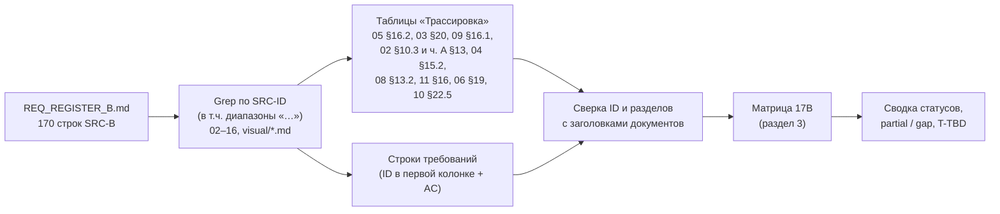
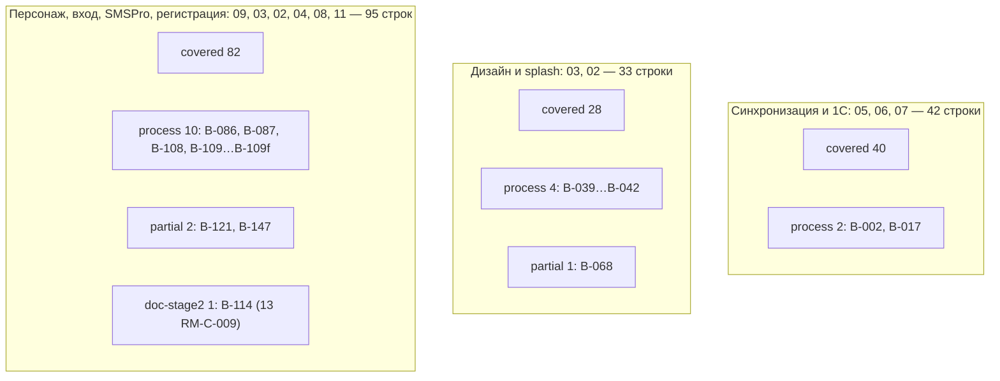

# 17B. Матрица трассируемости — часть B реестра исходных требований (синхронизация, дизайн, splash, персонаж, вход по лицу, вход по телефону, SMSPro, регистрация)

Версия 1.1 · Дата 2026-10-19 · Статус: черновик для утверждения заказчиком (доработан по замечаниям проверки — раздел 10)

**Входные материалы:** `docs/research/R0_DECISION_KERNEL.md` (ядро v1.4, включая §16–§19); `source/REQ_REGISTER_B.md` (SRC-B-001…SRC-B-149, 170 ID с подстроками `a…f`); `source/MASTER_PROMPT_extracted.md` (строки 112–252); исследования R1 (1С), R2 (SMSPro), R3 (Flutter), R4 (UX), R5 (backend), R6 (аутентификация и безопасность) — только как подтверждение статуса `process`.

**Связанные документы:** 01_PRODUCT_REQUIREMENTS.md (GEN-024 / AC-GEN-024 — фиксация отступления SRC-B-068; вопрос Q-273), 14_OPEN_QUESTIONS.md (сводный реестр вопросов, адресат раздела 7), 02_SCREEN_SPECIFICATION.md (единственный канонический текст экранов, ядро §19.1), 03_UX_UI_DESIGN_SYSTEM.md, 04_USER_FLOWS.md, 05_ONEC_INTEGRATION.md, 06_ARCHITECTURE.md, 07_DATA_MODEL.md, 08_API_SPECIFICATION.md, 09_AUTH_SMS_BIOMETRICS.md, 10_POS_BUSINESS_RULES.md, 11_SECURITY_PRIVACY.md, 13_IMPLEMENTATION_ROADMAP.md, 15_DECISION_LOG.md, 16_DEPLOYMENT_PLAN.md, `visual/*.md`; сводный документ 17_TRACEABILITY_MATRIX.md (собирает части 17A…17F); 12_TEST_PLAN.md (§3.1 — тесты T-AUTH, T-SMS, T-SESS, T-BIO, T-FACE; адресат списка T-TBD, раздел 6).

---

## 1. Краткое содержание

- Протрассированы **все 170 строк** реестра части B (149 исходных ID + 21 подстрока `a…f`), без пропусков; полнота проверена сверкой со списком ID реестра (раздел 8).
- Для каждой строки указаны документ и раздел ТЗ, ID требований ТЗ, критерии приёмки `AC-…`, тест и статус покрытия. Все ссылки найдены поиском (Grep) по SRC-ID в файлах `docs/specification/*.md` и `visual/*.md` и по ID требований; разделы сверены с заголовками документов `[ПОДТВЕРЖДЕНО: Grep по ТЗ, 2026-10-19]`.
- Итог по статусам: **covered — 150**, **partial — 3** (SRC-B-068, SRC-B-121, SRC-B-147), **process — 16**, **doc-stage2 — 1** (SRC-B-114), **deferred-R2 — 0**, **gap — 0**.
- Частичные покрытия: (1) SRC-B-068 — для `staff` «сразу на рабочий экран» выполняется через одношаговую разблокировку SCR-08 (осознанное отступление по D-48, ядро §19.4; зафиксировано в 01 GEN-024 / AC-GEN-024 и в строке SRC-B-068 настоящего документа); (2) SRC-B-121 — 13 RM-A-004 запрашивает учётные данные SMSPro на этапе A, раньше адаптера RM-D-002, что расходится с порядком промта и 09 §6.12; (3) SRC-B-147 — по умолчанию OTP подтверждает номер **до** формы регистрации (D-10), буквальный порядок «форма → OTP» доступен только флагом `REGISTRATION_SECOND_OTP` (Q-162).
- Файлы **01_PRODUCT_REQUIREMENTS.md и 12_TEST_PLAN.md выпускаются параллельно** с частями 17 и в `docs/specification/` есть `[ПОДТВЕРЖДЕНО: листинг каталога и Grep, 2026-10-19 05:07]`. В 01 отступление SRC-B-068 зафиксировано требованием GEN-024 с критерием AC-GEN-024 (01 §5.1, также §1). В 12 на момент проверки описан модуль §3.1 (тесты T-AUTH-001…041, T-SMS-001…020, T-SESS-001…022, T-BIO-001…018, T-FACE-001…005); разделов T-SYNC, T-ONEC, T-REG, T-UI, T-DS, T-CUST в 12 пока нет.
- Столбец «Тест»: ⁴ — тест описан в 12 §3.1 (50 строк); ¹ — `T-SEC-NNN` из 11 §12.2; ² — `T-DS-…`, `T-ANIM-…`, `T-A11Y-…` из 03 §17.9; ³ — `T-AUTH-001…010` из 09 §16.4 (те же ID описаны в 12 §3.1.1). `T-TBD:<префикс>` остался в **69 строках** (было 105): SYNC — 30, REG — 22, ONEC — 10, UI — 4, DS — 4, CUST — 1; префиксы AUTH, SESS, BIO, FACE, SMS закрыты тестами 12. Полный список — в разделе 6.
- Новых вопросов нет. Подтверждение заказчиком отступления SRC-B-068 уже вынесено документом 01 как Q-273; номер Q-280 из версии 1.0 отозван (номер занят в других частях 17, коллизия описана в разделе 7.1 и в замечании 6 раздела 9) — раздел 7.

---

## 2. Методика и обозначения

### 2.1. Порядок трассировки

1. Список ID взят из основной таблицы реестра B (строки с `| SRC-B-… |`; журнал проверки реестра не учитывается).
2. По каждому ID выполнен поиск прямых упоминаний (`SRC-B-NNN` без продолжения цифрой/буквой, чтобы `SRC-B-032` не совпадал с `SRC-B-032a`) и упоминаний в диапазонах вида `SRC-B-090…097`. Прямые упоминания в строках требований и в таблицах трассировки документов — основной источник; диапазоны — только вспомогательный.
3. ID требований и критериев приёмки взяты из строк, где они определены (первая колонка таблицы требований; критерий `AC-<ID>` — в той же строке). Номера разделов взяты из заголовков документов (`#`…`####`).
4. Для 02 указывается экран (`SCR-NN`) и пункт его 14-пунктовой структуры («п. N»), либо общий раздел 02 (§3, §6, §7, ч. A §0).

### 2.2. Статусы покрытия

| Статус | Значение |
|---|---|
| `covered` | Требование полностью отражено проверяемыми требованиями ТЗ с критериями приёмки |
| `partial` | Отражено не полностью или с отступлением от буквального текста промта; предложение — в разделе 5 |
| `process` | Требование к процессу работы (исследовать, изучить, проверить) — выполнено методикой этапа 1; в столбце статуса указано, чем (исследование R*, раздел ТЗ) |
| `deferred-R2` | Перенесено в R2 с Q-ссылкой (в части B таких строк нет: условный модуль FACE-SCAN не делает строки B «отложенными», т.к. обязательная альтернатива R1 специфицирована) |
| `doc-stage2` | Артефакт этапа 2, указанный в 13_IMPLEMENTATION_ROADMAP.md |
| `gap` | Покрытия в ТЗ нет (в части B не выявлено) |

### 2.3. Обозначения тестов

| Обозначение | Смысл |
|---|---|
| `T-TBD:<ПРЕФИКС>` | Тест не описан; добавить в 12_TEST_PLAN.md (раздел 6) |
| `T-…-NNN`⁴ | Тест описан в 12_TEST_PLAN.md §3.1 (T-AUTH-011…041, T-SMS, T-SESS, T-BIO, T-FACE); выбран по совпадению ID требований и `AC-…` в столбце «Требования» теста 12 и в строке матрицы |
| `T-SEC-NNN`¹ | ID зарезервирован в 11_SECURITY_PRIVACY.md §12.2 «Перечень тестов T-SEC»; в 12 перенести без перенумерации |
| `T-DS-…`² / `T-ANIM-…`² / `T-A11Y-…`² | Диапазоны зарезервированы в 03_UX_UI_DESIGN_SYSTEM.md §17.9 «Тесты дизайн-системы (для 12_TEST_PLAN)», в т. ч. `T-ANIM-001…030` (длительности и кривые `DsMotion`, reduce-motion) и `T-DS-085…096` (дополнения ядра v1.4) |
| `T-AUTH-NNN`³ | ID назначены в 09_AUTH_SMS_BIOMETRICS.md §16.4 (сценарии промта строк 451–460); те же ID описаны в 12 §3.1.1 |
| `н/п` | Не применимо: строка типа «процесс», проверяется ревью артефактов этапа 1 |

### 2.4. Сокращения в столбце «Тип»

`функц.` — функциональное, `нефункц.` — нефункциональное, `огр.` — ограничение, `процесс`, `документ` — как в реестре.

---

## 3. Матрица трассируемости SRC-B

### 3.1. Синхронизация с 1С и синхронизируемые сущности (SRC-B-001…SRC-B-037)

Все имена объектов 1С в 05 имеют метку `[ТИПОВО]` до ответа Q-010 и выгрузки `$metadata` (13 RM-A-002); это не снижает статус покрытия требования к ТЗ, но подтверждение на конкретной базе — работа этапа 2.

| SRC-ID | Краткая формулировка | Тип | Документ и раздел ТЗ | ID требований ТЗ | Критерий приёмки | Тест | Статус покрытия |
|---|---|---|---|---|---|---|---|
| SRC-B-001 | Свой режим синхронизации для каждой категории данных; свободная двусторонняя синхронизация — не умолчание | огр. | 05 §4.2, §8.1; 06 §5, §17.1; 07 §3 | ONEC-026, ONEC-027, SYNC-051; ARCH-009…ARCH-013; DATA-027 | AC-ONEC-026, AC-ONEC-027, AC-SYNC-051, AC-ARCH-013, AC-DATA-027 | T-TBD:ONEC | covered |
| SRC-B-002 | Проверить достаточность интервала 30 мин для каждой категории данных | процесс | 05 §7.3, §11; 15 ADR-029 | SYNC-022, SYNC-060; ADR-029 | AC-SYNC-022, AC-SYNC-060, AC-ADR-029 | н/п | process: анализ выполнен в исследованиях R1 §8 и R5 §6, итог — таблица соответствия интервалов по сущностям (05 §7.3) и оценка нагрузки (05 §11) `[РЕШЕНИЕ: D-29]` `[ТРЕБУЕТ РЕШЕНИЯ ЗАКАЗЧИКА: Q-020]` |
| SRC-B-003 | Предложить гибридную стратегию синхронизации | документ | 05 §4, §7, §9; 15 ADR-029 | SYNC-022, SYNC-052; ADR-029 | AC-SYNC-022, AC-SYNC-052 | T-TBD:SYNC | covered |
| SRC-B-004 | Первоначальная полная загрузка и сверка | функц. | 05 §7.1; 15 ADR-048 | SYNC-001, SYNC-003, SYNC-009 | AC-SYNC-001, AC-SYNC-003, AC-SYNC-009 | T-TBD:SYNC | covered |
| SRC-B-005 | Инкрементальный обмен по времени изменения или журналу изменений | функц. | 05 §6.6, §7.2, §10.1; 06 §5.1, §17.1; 15 ADR-028, ADR-048 | SYNC-011, SYNC-012, ONEC-034, ONEC-061; ARCH-035, ARCH-037 | AC-SYNC-011, AC-SYNC-012, AC-ONEC-034, AC-ONEC-061 | T-TBD:SYNC | covered `[ТИПОВО: план обмена «POS» в расширении — Q-011]` |
| SRC-B-006 | Периодическая фоновая синхронизация ~30 мин | функц. | 05 §7.3; 02 SCR-46 (интервалы `sync_interval.<entity>`); 15 ADR-029 | SYNC-021, SYNC-022 | AC-SYNC-021, AC-SYNC-022 | T-TBD:SYNC | covered `[РЕШЕНИЕ: D-29]` |
| SRC-B-007 | Более частое обновление критичных данных | функц. | 05 §6.6, §7.3, §7.5, §9, §11 | SYNC-021, SYNC-022, SYNC-030, SYNC-052, SYNC-056, SYNC-060, SYNC-071, ONEC-050 | AC-SYNC-021, AC-SYNC-052, AC-SYNC-056, AC-SYNC-071, AC-ONEC-050 | T-TBD:SYNC | covered `[РЕШЕНИЕ: D-29]` |
| SRC-B-008 | Ручная синхронизация с отображением статуса | функц. | 05 §7.1, §7.4; 02 SCR-43; visual/screen-map.md §2.6 | SYNC-010, SYNC-025, SYNC-026; UI-43-004, UI-43-005 | AC-SYNC-025, AC-SYNC-026, AC-UI-43-003, AC-UI-43-005, AC-UI-43-007 | T-TBD:SYNC, T-TBD:UI | covered |
| SRC-B-009 | Повторные попытки при временных ошибках | функц. | 05 §6.6, §7.5, §8.1, §10.1; 02 SCR-43 | SYNC-029, SYNC-044, ONEC-035, ONEC-055, ONEC-063 | AC-SYNC-029, AC-SYNC-044, AC-ONEC-035, AC-ONEC-055, AC-UI-43-011 | T-TBD:SYNC | covered |
| SRC-B-010 | Идемпотентность операций синхронизации | нефункц. | 05 §6.6, §7.1, §7.5, §8.1, §9, §10.1; 02 SCR-43; 15 ADR-028 | SYNC-002, SYNC-031, SYNC-042, SYNC-043, SYNC-048, SYNC-066, SYNC-069, ONEC-035, ONEC-037, ONEC-061, ONEC-063 | AC-SYNC-031, AC-SYNC-043, AC-SYNC-069, AC-ONEC-037, AC-UI-43-005, AC-UI-43-006 | T-TBD:SYNC | covered |
| SRC-B-011 | Контроль версий синхронизируемых объектов | нефункц. | 05 §7.2, §7.5 | SYNC-012, SYNC-013, SYNC-032, SYNC-068 | AC-SYNC-012, AC-SYNC-013, AC-SYNC-032, AC-SYNC-068 | T-TBD:SYNC | covered |
| SRC-B-012 | Обнаружение конфликтов при синхронизации | функц. | 05 §7.5 (SYNC-033 — основная ссылка), §13 (F6, F9); 02 SCR-43 (UI-43-007 «Ошибки» — записи `sync_errors`, в т. ч. `BARCODE_CONFLICT`); 02 SCR-45 (смежное: конфликты привязки клиента, SYNC-033 п. «г») | SYNC-033 | AC-SYNC-033, AC-UI-45-013 | T-TBD:SYNC | covered |
| SRC-B-013 | Мониторинг времени последней успешной синхронизации | функц. | 05 §6.6, §7.4, §7.6, §10.1; 02 SCR-43; visual/screen-map.md §2.6 | SYNC-026, SYNC-037, ONEC-051, ONEC-064; UI-43-001 | AC-SYNC-037, AC-ONEC-051, AC-ONEC-064, AC-UI-43-001, AC-UI-43-008 | T-TBD:SYNC | covered |
| SRC-B-014 | Мониторинг количества ошибок синхронизации | функц. | 05 §7.6; 02 SCR-43 | SYNC-037, SYNC-038; UI-43-001 | AC-SYNC-037, AC-SYNC-038, AC-UI-43-001, AC-UI-43-008 | T-TBD:SYNC | covered |
| SRC-B-015 | Фоновые задачи на мобильном не гарантируют расписание | огр. | 05 §7 (вводная), §7.3 | SYNC-023, SYNC-024 | AC-SYNC-023, AC-SYNC-024 | T-TBD:SYNC | covered |
| SRC-B-016 | Планировщик — на сервере или ином постоянно работающем компоненте | огр. | 05 §7.3; 15 ADR-003, ADR-029 | SYNC-023, SYNC-024; ADR-029 | AC-SYNC-023, AC-SYNC-024, AC-ADR-029 | T-TBD:SYNC | covered `[РЕШЕНИЕ: D-29, D-44]` |
| SRC-B-017 | Исследовать возможность получения из 1С каждой сущности | процесс | 05 §5.1, §5.1a, §5.2, §6.6 | ONEC-001, ONEC-017, ONEC-018, ONEC-057, ONEC-106 | AC-ONEC-001, AC-ONEC-106 | н/п | process: исследование R1 (§5, §6, §9); итог — карта сущностей 05 §5 с метками `[ТИПОВО]`; подтверждение на базе заказчика — 13 RM-A-002 `[ТРЕБУЕТ РЕШЕНИЯ ЗАКАЗЧИКА: Q-010]` |
| SRC-B-018 | Синхронизация товаров и артикулов | функц. | 05 §5.1a, §7.2 | ONEC-001, ONEC-002, ONEC-017, SYNC-020 | AC-ONEC-001, AC-ONEC-002, AC-SYNC-020 | T-TBD:ONEC | covered `[ТИПОВО: Q-010]` |
| SRC-B-019 | Синхронизация категорий и подкатегорий | функц. | 05 §5.1a | ONEC-003 | AC-ONEC-003 | T-TBD:ONEC | covered `[ТИПОВО: Q-010]` |
| SRC-B-020 | Синхронизация описаний и характеристик | функц. | 05 §5.1a | ONEC-004 | AC-ONEC-004 | T-TBD:ONEC | covered `[ТИПОВО: Q-010]` |
| SRC-B-021 | Синхронизация цветов, размеров, моделей, вариантов | функц. | 05 §5.1a, §5.2 | ONEC-005, ONEC-073 | AC-ONEC-005, AC-ONEC-073 | T-TBD:ONEC | covered `[ТИПОВО: Q-021]` |
| SRC-B-022 | Синхронизация изображений и ссылок на изображения | функц. | 05 §5.1a, §6.6, §7.5; 15 ADR-030 | ONEC-006, ONEC-049, SYNC-035, SYNC-036 | AC-ONEC-006, AC-ONEC-049, AC-SYNC-035, AC-SYNC-036 | T-TBD:SYNC | covered `[РЕШЕНИЕ: D-30]` `[ТРЕБУЕТ РЕШЕНИЯ ЗАКАЗЧИКА: Q-022]` |
| SRC-B-023 | Синхронизация цен и правил ценообразования | функц. | 05 §5.1a, §7.2, §10.1 | ONEC-007, ONEC-008, ONEC-022, ONEC-062, SYNC-015 | AC-ONEC-007, AC-ONEC-008, AC-ONEC-022, AC-SYNC-015 | T-TBD:SYNC | covered |
| SRC-B-024 | Синхронизация остатков по каждому складу | функц. | 05 §5.1a, §5.2, §7.2, §10.1 | ONEC-009, ONEC-019, ONEC-062, ONEC-070, SYNC-014 | AC-ONEC-009, AC-ONEC-019, AC-ONEC-070, AC-SYNC-014 | T-TBD:SYNC | covered |
| SRC-B-025 | Синхронизация резервов и доступного количества | функц. | 05 §5.1a, §6.6, §7.2, §9; 15 ADR-022 | ONEC-010, ONEC-050, SYNC-014, SYNC-052, SYNC-053, SYNC-071 | AC-ONEC-010, AC-ONEC-050, AC-SYNC-052, AC-SYNC-053 | T-TBD:SYNC | covered `[РЕШЕНИЕ: D-22]` |
| SRC-B-026 | Синхронизация клиентской базы | функц. | 05 §5.1a, §7.2 | ONEC-011, ONEC-012, SYNC-019 | AC-ONEC-011, AC-ONEC-012, AC-SYNC-019 | T-TBD:SYNC | covered |
| SRC-B-027 | Синхронизация истории продаж и покупок | функц. | 05 §5.1a, §7.1, §7.2 | ONEC-013, SYNC-008, SYNC-018 | AC-ONEC-013, AC-SYNC-008, AC-SYNC-018 | T-TBD:SYNC | covered |
| SRC-B-028 | Синхронизация скидок и условий оптовых продаж | функц. | 05 §5.1a, §6.6 | ONEC-008, ONEC-039 | AC-ONEC-008, AC-ONEC-039 | T-TBD:ONEC | covered `[ТРЕБУЕТ РЕШЕНИЯ ЗАКАЗЧИКА: Q-015]` |
| SRC-B-029 | Синхронизация задолженностей и взаиморасчётов | функц. | 05 §5.1a, §6.6, §7.2, §10.1; 15 ADR-024 | ONEC-014, ONEC-047, ONEC-062, SYNC-016, SYNC-073 | AC-ONEC-014, AC-ONEC-047, AC-SYNC-016, AC-SYNC-073 | T-TBD:SYNC | covered `[РЕШЕНИЕ: D-24]` |
| SRC-B-030 | Синхронизация возвратов и платёжных документов | функц. | 05 §5.1a, §6.6, §7.2, §8.1; 15 ADR-025 | ONEC-015, ONEC-016, ONEC-020, ONEC-043, ONEC-048, ONEC-067, SYNC-018, SYNC-050 | AC-ONEC-015, AC-ONEC-016, AC-ONEC-043, AC-SYNC-050 | T-TBD:SYNC | covered `[ТРЕБУЕТ РЕШЕНИЯ ЗАКАЗЧИКА: Q-012, Q-018]` |
| SRC-B-031 | Не декларировать доступность полей 1С без подтверждения | огр. | 05 §5.2, §9; 15 ADR-047 | ONEC-106, SYNC-072; ADR-047 | AC-ONEC-106, AC-SYNC-072, AC-ADR-047 | T-TBD:ONEC | covered |
| SRC-B-032 | Для каждого поля — исходный объект 1С | документ | 05 §5.2, §5.3 (словарь полей) | ONEC-100 | AC-ONEC-100 | T-TBD:ONEC | covered `[ТИПОВО: имена 1С — RM-A-002, Q-010]` |
| SRC-B-032a | Для каждого поля — идентификатор | документ | 05 §5.2, §5.3 | ONEC-100, ONEC-101 | AC-ONEC-100, AC-ONEC-101 | T-TBD:ONEC | covered |
| SRC-B-032b | Для каждого поля — тип данных | документ | 05 §5.2, §5.3 | ONEC-103 | AC-ONEC-103 | T-TBD:ONEC | covered |
| SRC-B-032c | Для каждого поля — правила обновления | функц. | 05 §5.2, §5.3 | ONEC-104 | AC-ONEC-104 | T-TBD:SYNC | covered |
| SRC-B-032d | Для каждого поля — обработка удаления в 1С | функц. | 05 §5.2, §5.3, §7.1, §7.5 | ONEC-102, SYNC-006, SYNC-034 | AC-ONEC-102, AC-SYNC-006, AC-SYNC-034 | T-TBD:SYNC | covered |
| SRC-B-032e | Для каждого поля — восстановление после сбоя | функц. | 05 §5.1 (столбец), §7.1, §13; 06 §5.1, §7.6, §17.1 | SYNC-002, SYNC-063; ARCH-037, ARCH-039 | AC-SYNC-002, AC-SYNC-063, AC-ARCH-037, AC-ARCH-039 | T-TBD:SYNC | covered |
| SRC-B-033 | Фото не перекачиваются при каждой периодической синхронизации | огр. | 05 §7.3, §7.5 | SYNC-035 | AC-SYNC-035 | T-TBD:SYNC | covered `[РЕШЕНИЕ: D-29, D-30]` |
| SRC-B-034 | Для фото — идентификаторы, контрольные суммы или версии файлов | функц. | 05 §5.1a, §6.6, §7.5; 15 ADR-030 | ONEC-006, ONEC-049, SYNC-035 | AC-ONEC-049, AC-SYNC-035, AC-ADR-030 | T-TBD:SYNC | covered |
| SRC-B-035 | Сверка количества объектов при первой загрузке | функц. | 05 §7.1, §7.2, §12 | SYNC-003, SYNC-007, SYNC-068, ONEC-092 | AC-SYNC-003, AC-SYNC-007, AC-SYNC-068, AC-ONEC-092 | T-TBD:SYNC | covered |
| SRC-B-036 | Контроль дубликатов при первой загрузке | функц. | 05 §7.1 | SYNC-004 | AC-SYNC-004 | T-TBD:SYNC | covered |
| SRC-B-037 | Повторная синхронизация не создаёт дубликатов товаров и клиентов | огр. | 05 §7.1; 10 §15.3 | SYNC-002, SYNC-004, SYNC-005; CUST-012 | AC-SYNC-005, AC-CUST-012 | T-TBD:SYNC | covered |

### 3.2. Дизайн и визуальная система (SRC-B-038…SRC-B-059)

| SRC-ID | Краткая формулировка | Тип | Документ и раздел ТЗ | ID требований ТЗ | Критерий приёмки | Тест | Статус покрытия |
|---|---|---|---|---|---|---|---|
| SRC-B-038 | Интерфейс современный, премиально аккуратный, удобный, для длительной ежедневной работы | нефункц. | 03 §4.1, §5.6, §15 | DS-005, DS-027, DS-045, A11Y-003 | AC-DS-005, AC-DS-027, AC-DS-045, AC-A11Y-003 | T-A11Y-001…022², T-TBD:DS | covered |
| SRC-B-039 | Палитра не выбирается произвольно — только после исследования | процесс | 03 §2, §5 | DS-001, DS-004 | AC-DS-001, AC-DS-004 | н/п | process: исследование материалов и палитр (R4 §3; 03 §2) выполнено до выбора палитры (03 §5.7) `[РЕШЕНИЕ: D-16]` |
| SRC-B-040 | Изучить логотипы, изображения и ручные чертежи заказчика | процесс | 03 §2.1–§2.4 | DS-008 | AC-DS-008 | н/п | process: материалы изучены (R4 §1; 03 §2; ядро §14); ручных чертежей нет (ядро §0, §14) `[ПОДТВЕРЖДЕНО: ядро §14]` |
| SRC-B-041 | Исследовать профессиональные POS-интерфейсы и B2B-каталоги | процесс | 03 §3.1–§3.4 | — (раздел 3 без ID требований) | — | н/п | process: обзор паттернов POS и B2B (R4 §2; 03 §3) |
| SRC-B-042 | Анализ читаемости, контраста, плотности, числа действий | процесс | 03 §4.1–§4.4, §18.5, §18.8 | DS-045, DS-071…DS-074 | AC-DS-045, AC-DS-071…AC-DS-074 | T-DS-071…074² | process: анализ — 03 §4; проверяемые нормы числа действий — DS-071…DS-074 |
| SRC-B-043 | Два обоснованных варианта палитры и их сравнение | документ | 03 §5.2–§5.6; 15 ADR-016; visual/palette-comparison.html | DS-003, DS-004; ADR-016 | AC-DS-003, AC-DS-004, AC-ADR-016 | T-DS-001…012² | covered `[ТРЕБУЕТ РЕШЕНИЯ ЗАКАЗЧИКА: Q-006]` |
| SRC-B-044 | Выбрать лучший вариант и зафиксировать в docs/DESIGN_SYSTEM.md | документ | 03 §5.7; 15 ADR-016, ADR-045 | DS-001; ADR-045 | AC-DS-001, AC-ADR-045 | T-DS-001…012² | covered: роль `docs/DESIGN_SYSTEM.md` выполняет 03_UX_UI_DESIGN_SYSTEM.md (ADR-045; SRC-E-199) `[РЕШЕНИЕ: D-16]` |
| SRC-B-045 | Цветовые токены: фон, поверхности, тексты, интерактив, успех, предупреждение, ошибка | документ | 03 §5.2; 15 ADR-016, ADR-043 | DS-001, DS-005 | AC-DS-001, AC-DS-005 | T-DS-001…012² | covered |
| SRC-B-046 | Проверка контраста и читаемости мелких подписей | нефункц. | 03 §4.1, §4.2, §5.4, §15 | DS-007, DS-008, DS-012, A11Y-001, A11Y-008 | AC-DS-007, AC-DS-008, AC-DS-012, AC-A11Y-001, AC-A11Y-008 | T-DS-001…012², T-A11Y-001…022² | covered |
| SRC-B-046a | Дизайн-система включает все элементы перечня строк 154–163 | нефункц. | 03 §6–§11; 15 ADR-051 | DS-013, DS-025, DS-026, DS-029, DS-041, DS-050…DS-054, DS-061 | AC-DS-013, AC-DS-025, AC-DS-026, AC-DS-029, AC-DS-041, AC-DS-050, AC-DS-061 | T-DS-050…066² | covered |
| SRC-B-047 | Согласованная типографика | нефункц. | 03 §6; 15 ADR-017, ADR-049 | DS-013…DS-019 | AC-DS-013, AC-DS-019 | T-DS-013…020² | covered `[РЕШЕНИЕ: D-17]` |
| SRC-B-048 | Единые отступы и размеры | нефункц. | 03 §7.1, §7.4 | DS-025, DS-027, DS-028 | AC-DS-025, AC-DS-027, AC-DS-028 | T-TBD:DS | covered |
| SRC-B-049 | Сетка карточек и компонентов | нефункц. | 03 §7.2–§7.3 | DS-026 | AC-DS-026 | T-DS-041…049² | covered |
| SRC-B-050 | Понятные иконки | нефункц. | 03 §7.7, §15 | DS-029, DS-090, A11Y-004, A11Y-007, A11Y-019 | AC-DS-029, AC-DS-090, AC-A11Y-004, AC-A11Y-007, AC-A11Y-019 | T-DS-085…096² (DS-090), T-TBD:DS, T-A11Y-001…022² | covered |
| SRC-B-051 | Скелетоны загрузки | функц. | 03 §9.42, §18.6; 02 §3.3, §6 (колонка «Загрузка») | DS-050, ANIM-013 | AC-DS-050 | T-DS-050…066² | covered |
| SRC-B-052 | Оформленные пустые состояния | функц. | 03 §9.43, §14, §18.4; 02 §3.3, §6 (колонка «Пусто») | DS-037, DS-051, ANIM-022 | AC-DS-037, AC-DS-051 | T-DS-030…040², T-DS-050…066² | covered |
| SRC-B-053 | Оформленные состояния ошибок | функц. | 03 §9.41, §9.44; 02 §3.3, §6, SCR-90 | DS-034, DS-052, DS-054 | AC-DS-034, AC-DS-052, AC-DS-054 | T-DS-050…066², T-TBD:UI | covered |
| SRC-B-054 | Индикаторы синхронизации в интерфейсе | функц. | 03 §9.40; 02 §3.1, SCR-43; 05 §7.4, §9; visual/components-states.md, visual/screen-map.md §2.6 | DS-053, ANIM-021, SYNC-026, SYNC-059 | AC-DS-053, AC-SYNC-026, AC-SYNC-059, AC-UI-43-013 | T-DS-050…066², T-TBD:UI | covered |
| SRC-B-055 | Анимации плавные и не мешающие работе | нефункц. | 03 §11; 02 §3.7 | DS-061…DS-064, A11Y-006 | AC-DS-061, AC-DS-062, AC-DS-063, AC-DS-064, AC-A11Y-006 | T-ANIM-001…030², T-A11Y-001…022² | covered |
| SRC-B-056 | Адаптивность для телефонов, планшетов и POS-экранов | нефункц. | 03 §8; 02 §3.2; visual/responsive-spec.md | DS-041…DS-049, A11Y-014 | AC-DS-041, AC-DS-049, AC-A11Y-014 | T-DS-041…049² | covered `[РЕШЕНИЕ: D-18]` |
| SRC-B-057 | Все тексты UI централизованы для добавления языков | нефункц. | 03 §16; 02 §7 (сводный словарь строк), SCR-42 «Язык» | DS-080…DS-084 | AC-DS-080, AC-DS-084, AC-UI-42-001 | T-DS-075…079², T-DS-080…084² | covered `[РЕШЕНИЕ: D-38]` `[ТРЕБУЕТ РЕШЕНИЯ ЗАКАЗЧИКА: Q-007]` |
| SRC-B-058 | Рабочее пространство не перегружено декоративными элементами | огр. | 03 §5.8, §14.1; 02 §3.11 | DS-006, DS-060, DS-063 | AC-DS-006, AC-DS-060, AC-DS-063 | T-TBD:DS | covered |
| SRC-B-059 | Основные операции доступны быстро и предсказуемо | нефункц. | 03 §4.4, §15; 02 §3.5, §3.8 | DS-047, DS-071…DS-074, A11Y-009, A11Y-022 | AC-DS-047, AC-DS-071, AC-A11Y-009, AC-A11Y-022 | T-DS-071…074², T-A11Y-001…022² | covered |

### 3.3. Экран запуска — Splash (SRC-B-060…SRC-B-068)

| SRC-ID | Краткая формулировка | Тип | Документ и раздел ТЗ | ID требований ТЗ | Критерий приёмки | Тест | Статус покрытия |
|---|---|---|---|---|---|---|---|
| SRC-B-060 | Современный анимированный экран запуска | функц. | 03 §11.2, §12; 02 SCR-00; 04 FLOW-001 | DS-067, ANIM-001 | AC-DS-067, AC-UI-00-001, AC-UI-00-002 | T-DS-067…070² | covered |
| SRC-B-061 | Логотип «Оптомстрой» из материалов заказчика | функц. | 03 §2.4, §9.53, §12.1; 02 SCR-00 | DS-067 (`SplashLogo`) | AC-DS-067 | T-DS-067…070² | covered `[ТРЕБУЕТ РЕШЕНИЯ ЗАКАЗЧИКА: Q-006]` (какой логотип актуален) |
| SRC-B-062 | Плавное появление логотипа | функц. | 03 §11.2, §12.2; 02 SCR-00 | ANIM-001, DS-067 | AC-DS-067, AC-UI-00-001 | T-DS-067…070², T-ANIM-001…030² | covered |
| SRC-B-063 | Качественная анимация, соответствующая дизайн-системе | нефункц. | 03 §11.1, §12 | DS-061, DS-066, DS-067 | AC-DS-061, AC-DS-066, AC-DS-067 | T-DS-067…070², T-ANIM-001…030² | covered |
| SRC-B-064 | Индикатор загрузки — только при реальной необходимости | функц. | 03 §12.1–§12.2; 02 SCR-00 | DS-068; UI-00-002 | AC-DS-068, AC-UI-00-001, AC-UI-00-003 | T-DS-067…070² | covered |
| SRC-B-065 | Проверка состояния приложения на splash | функц. | 03 §12.2–§12.3; 02 SCR-00 (п. 6, п. 9); 09 §8 | DS-068, DS-070 | AC-DS-068, AC-DS-070 | T-DS-067…070², T-AUTH-031⁴ | covered |
| SRC-B-065a | Проверка авторизационной сессии на splash | функц. | 03 §12.3; 02 SCR-00 (п. 6); 09 §4.5, §8 | DS-070 | AC-DS-070, AC-UI-00-005 | T-DS-067…070², T-AUTH-031⁴ | covered |
| SRC-B-066 | Корректный переход к нужному экрану после splash | функц. | 03 §12.3; 02 SCR-00 (п. 6); visual/navigation.md (охрана G-0…G-5) | DS-070, ANIM-028 | AC-UI-00-005…AC-UI-00-009 | T-DS-067…070², T-AUTH-031⁴, T-TBD:UI | covered |
| SRC-B-067 | Без искусственной задержки анимацией | огр. | 03 §12.2; 02 SCR-00 (п. 5) | DS-062, DS-069 | AC-DS-062, AC-DS-069 | T-DS-067…070², T-ANIM-001…030² | covered |
| SRC-B-068 | Авторизованный пользователь — сразу на свой рабочий экран | функц. | 01 §5.1 (GEN-024, AC-GEN-024 — фиксация отступления; также §1); 03 §12.3; 02 SCR-00 (п. 6, п. 14), SCR-08; 09 §4.5; visual/navigation.md §7.1; 13 RM-D-007 | GEN-024; DS-069, DS-070, DS-095; SESS-031, BIO-013 | AC-GEN-024, AC-DS-069, AC-DS-070, AC-DS-095 | T-DS-067…070², T-DS-085…096² (DS-095), T-AUTH-031⁴, T-SESS-021⁴, T-BIO-009⁴ | partial: для `staff` переход выполняется через одношаговую разблокировку SCR-08 (PIN/биометрия) — осознанное отступление `[РЕШЕНИЕ: D-48; ядро §19.4]`; отступление зафиксировано в 01 GEN-024 / AC-GEN-024 `[ПОДТВЕРЖДЕНО: Grep 01, 2026-10-19 05:07]` и в данной строке 17; подтверждение заказчика — Q-273 (вопрос 01, раздел 7) |

### 3.4. Экран авторизации и эмоциональный персонаж (SRC-B-069…SRC-B-078)

Логика состояний — 09 §11 (6 состояний Rive `idle`, `typing`, `verifying`, `success`, `error`, `retry` для 8 состояний процесса), визуал — 03 §13, экранные правила — 02 ч. A §0.3 `[РЕШЕНИЕ: D-40]`. Стиль персонажа — `[ТРЕБУЕТ РЕШЕНИЯ ЗАКАЗЧИКА: Q-035]`.

| SRC-ID | Краткая формулировка | Тип | Документ и раздел ТЗ | ID требований ТЗ | Критерий приёмки | Тест | Статус покрытия |
|---|---|---|---|---|---|---|---|
| SRC-B-069 | Экран авторизации — белый | огр. | 03 §13.2; 09 §11; 02 ч. A §0.1, SCR-01; visual/screen-map.md §2.1 | DS-059, AUTH-050 | AC-AUTH-073, AC-UI-01-001 | T-AUTH-041⁴ | covered (фон `surface #FFFFFF`; тёмный макет входа не используется — ядро §14, D-09) |
| SRC-B-069a | Экран авторизации — минималистичный | огр. | 03 §2.3, §13.2; 09 §3, §11; 02 SCR-01 | AUTH-050 | AC-AUTH-073, AC-UI-01-001 | T-AUTH-041⁴ | covered |
| SRC-B-069b | Дружелюбный анимированный персонаж на экране авторизации | функц. | 03 §9.52, §13; 09 §11; 02 ч. A §0.3, SCR-01…SCR-04, SCR-08; visual/components-states.md | DS-059, AUTH-043, AUTH-050 | AC-DS-059, AC-AUTH-073 | T-AUTH-041⁴, T-AUTH-034⁴ | covered |
| SRC-B-070 | Персонаж реагирует на этап процесса авторизации | функц. | 03 §13.3, §13.5, §13.8; 09 §11.1, §11.2 | DS-059, AUTH-043, AUTH-044 | AC-AUTH-073, AC-AUTH-074 | T-AUTH-034⁴ | covered |
| SRC-B-071 | «Ожидание»: открытые глаза, спокойное выражение | функц. | 03 §13.3; 09 §11.1 (`idle`); 02 ч. A §0.3 | ANIM-002, AUTH-043 | AC-AUTH-073, AC-UI-01-011 | T-AUTH-034⁴, T-ANIM-001…030² | covered |
| SRC-B-072 | «Ввод данных»: взгляд на поле ввода | функц. | 03 §13.3, §13.5; 09 §11.1 (`typing`, `lookX`) | ANIM-003, AUTH-043, AUTH-049 | AC-AUTH-073 | T-AUTH-034⁴, T-ANIM-001…030² | covered |
| SRC-B-073 | «Проверка»: лёгкая анимация ожидания | функц. | 03 §13.3; 09 §11.1 (`verifying`) | ANIM-004, AUTH-043, AUTH-044 | AC-AUTH-073, AC-AUTH-074 | T-AUTH-034⁴, T-ANIM-001…030² | covered |
| SRC-B-074 | «Успех»: улыбка, затем зелёная галочка | функц. | 03 §13.3, §13.6 (`SuccessCheck`); 09 §11.1 (`success`) | ANIM-005, AUTH-043, AUTH-048 | AC-AUTH-073, AC-AUTH-075 | T-AUTH-034⁴, T-AUTH-035⁴, T-ANIM-001…030² | covered |
| SRC-B-075 | «Ошибка»: мягкая анимация отрицания | функц. | 03 §13.3; 09 §11.1 (`error`) | ANIM-011, AUTH-043 | AC-AUTH-003, AC-AUTH-073 | T-AUTH-003³, T-AUTH-034⁴, T-ANIM-001…030² | covered |
| SRC-B-075a | «Ошибка»: понятное текстовое сообщение | функц. | 09 §3.3, §4.4, §11.1; 03 §13.3; 02 ч. A §0.2, п. 8 каждого экрана, §7 | AUTH-007, AUTH-043, A11Y-013, DS-034 | AC-AUTH-003, AC-AUTH-018, AC-A11Y-013 | T-AUTH-003³, T-AUTH-024⁴, T-AUTH-034⁴ | covered |
| SRC-B-076 | «Повторная попытка»: возврат в нейтральное состояние | функц. | 03 §13.3; 09 §11.1 (`retry`) | ANIM-026, AUTH-043 | AC-AUTH-073 | T-AUTH-034⁴, T-ANIM-001…030² | covered |
| SRC-B-077 | Плавные переходы между состояниями персонажа | нефункц. | 03 §13.4; 09 §11.1 (инварианты); 02 ч. A §0.3 | AUTH-045 | AC-AUTH-073 | T-AUTH-035⁴, T-ANIM-001…030² | covered |
| SRC-B-078 | Без резких миганий, раздражающих эффектов, чрезмерной анимации | огр. | 03 §11.1, §13.4; 09 §11.1; 02 ч. A §0.3, SCR-42 (UI-42-007 «Уменьшить анимации» — владелец AC-UI-42-011), SCR-44 (UI-44-011) | DS-063, A11Y-018, AUTH-045; UI-42-007, UI-44-011 | AC-DS-063, AC-A11Y-018, AC-AUTH-073, AC-UI-42-011 | T-AUTH-035⁴, T-ANIM-001…030², T-A11Y-001…022² | covered |

### 3.5. Вход по лицу и системная биометрия (SRC-B-079…SRC-B-089)

| SRC-ID | Краткая формулировка | Тип | Документ и раздел ТЗ | ID требований ТЗ | Критерий приёмки | Тест | Статус покрытия |
|---|---|---|---|---|---|---|---|
| SRC-B-079 | Различать системную биометрию ОС и распознавание лица по фото | огр. | 09 §9.1, §10; 02 SCR-04, SCR-05; visual/screen-map.md §2.1 | BIO-001 | AC-AUTH-076 | T-BIO-001⁴, T-FACE-001⁴ | covered `[РЕШЕНИЕ: D-13, D-14]` |
| SRC-B-080 | Сценарий строк 189–193 — предпочтительный, не единственный | огр. | 09 §9.2; 04 FLOW-003; 02 SCR-02, SCR-04 | BIO-002 | AC-AUTH-009, AC-AUTH-064 | T-AUTH-009³ | covered |
| SRC-B-080a | Шаг 1: привязка подтверждённого номера к аккаунту | функц. | 09 §4, §9.2 | BIO-002, AUTH-039 | AC-AUTH-072 | T-AUTH-031⁴ | covered |
| SRC-B-081 | Предложение включить биометрический вход средствами ОС | функц. | 09 §9.2, §9.5; 02 SCR-02 (UI-02-018), SCR-04 (UI-04-006, UI-04-010, UI-04-014); 08 §4.3.6; visual/screen-map.md §2.1 | BIO-002, BIO-010, REG-006 | AC-AUTH-042, AC-AUTH-064, AC-UI-02-021, AC-UI-02-022, AC-UI-04-018 | T-BIO-001⁴, T-AUTH-038⁴ | covered `[ТРЕБУЕТ РЕШЕНИЯ ЗАКАЗЧИКА: Q-201]` (step-up при включении сразу после OTP) |
| SRC-B-082 | Последующий вход — через системную биометрию ОС | функц. | 09 §9.2, §9.3; 02 SCR-08 | BIO-002, BIO-003 | AC-AUTH-009, AC-UI-08-001 | T-AUTH-009³, T-BIO-006⁴, T-SEC-031¹, T-SEC-033¹ | covered `[РЕШЕНИЕ: D-13]` |
| SRC-B-082a | Токен сессии хранится безопасно (защищённое хранилище ОС) | нефункц. | 09 §8.1–§8.8, §9.2, §9.6; 11 §8.2; 02 SCR-08 | SESS-001…SESS-032, BIO-003, BIO-011, BIO-019; SEC-085, SEC-086, SEC-089 | AC-AUTH-054…AC-AUTH-058, AC-AUTH-062, AC-AUTH-064, AC-AUTH-080, AC-SEC-085, AC-SEC-086 | T-SEC-031¹, T-SEC-032¹, T-SEC-033¹, T-SEC-035¹, T-SESS-022⁴ | covered `[РЕШЕНИЕ: ядро §18.2 п. 2]` |
| SRC-B-083 | При успешной проверке открывается аккаунт именно этого пользователя | функц. | 09 §4.5, §8.4, §8.7, §9.2 | BIO-002, BIO-024, AUTH-039, AUTH-040, SESS-013, SESS-016, SESS-017, SESS-022, SESS-023, SESS-029 | AC-AUTH-009, AC-AUTH-024, AC-AUTH-059, AC-AUTH-061, AC-AUTH-072 | T-AUTH-009³ | covered |
| SRC-B-084 | При отказе/ошибке биометрии — альтернативный вход по номеру телефона | функц. | 09 §8.8, §9.3, §9.6, §9.7; 02 SCR-08 (UI-08-016, п. 4) | BIO-002, BIO-013, BIO-014, BIO-018…BIO-023, SESS-024…SESS-027, SESS-031 | AC-AUTH-010, AC-AUTH-060, AC-AUTH-066, AC-AUTH-080 | T-AUTH-010³, T-BIO-014⁴ | covered |
| SRC-B-085 | Не декларировать универсальный Face ID во Flutter на всех Android | огр. | 09 §8.8, §9.2, §9.4; 02 SCR-04 (UI-04-006), SCR-08 (п. 12); 04 FLOW-003 | BIO-005, BIO-008, BIO-017, SESS-032 | AC-AUTH-067, AC-AUTH-068, AC-AUTH-080 | T-BIO-004⁴, T-BIO-005⁴, T-BIO-010⁴, T-SESS-020⁴ | covered |
| SRC-B-086 | Исследовать local_auth и системные ограничения платформ | процесс | 09 §9.2, §9.4 | BIO-006, BIO-007, BIO-008, BIO-009, BIO-026 | AC-AUTH-010, AC-AUTH-067, AC-AUTH-068, AC-AUTH-071 | н/п | process: исследование R3 §6 и R6 §3; итог — матрица платформ 09 §9.4 `[РЕШЕНИЕ: D-13]` |
| SRC-B-087 | Оценить отдельное решение распознавания и liveness при повороте головы | процесс | 09 §10.1; 02 SCR-05 (п. 1) | FACE-009 | AC-AUTH-079, AC-UI-05-012 | н/п | process: оценка выполнена (R6 §4, R3 §6.3–§6.5; 09 §10.1); модуль FACE-SCAN — условный R2 `[РЕШЕНИЕ: D-14]` `[ТРЕБУЕТ РЕШЕНИЯ ЗАКАЗЧИКА: Q-003]` |
| SRC-B-088 | Серия фотографий не считается защитой от подделки | огр. | 09 §10.1; 02 SCR-05 (п. 1) | FACE-010 | AC-AUTH-079, AC-UI-05-012 | T-FACE-004⁴ | covered |
| SRC-B-089 | Сырые биометрические данные — только при необходимости, согласии, защите, сроке | огр. | 09 §2.3, §9.5, §10.5; 11 §9.2; 02 SCR-04 (п. 10), SCR-05 (п. 9–10) | BIO-016, FACE-012, FACE-013 | AC-AUTH-069, AC-AUTH-070, AC-AUTH-079, AC-UI-05-011 | T-SEC-033¹, T-BIO-010⁴, T-FACE-004⁴, T-FACE-005⁴ | covered `[РЕШЕНИЕ: D-13]` |

### 3.6. Вход по номеру телефона и поток авторизации (SRC-B-090…SRC-B-106)

Принцип потока — нейтральный ответ `/auth/otp/request` и ветвление «вход / регистрация» только после верного OTP `[РЕШЕНИЕ: D-10]`; соответствие формулировкам промта разобрано в 09 §5.5. Формат телефона — ввод/отображение `+996 XXX XXX XXX`, хранение E.164 (ядро §17.2). Для группы SRC-B-090…097 общие критерии экрана — AC-UI-01-002…AC-UI-01-005 и AC-UI-01-013 (02 SCR-01).

| SRC-ID | Краткая формулировка | Тип | Документ и раздел ТЗ | ID требований ТЗ | Критерий приёмки | Тест | Статус покрытия |
|---|---|---|---|---|---|---|---|
| SRC-B-090 | Удобное поле ввода номера телефона | функц. | 09 §3; 02 SCR-01 (UI-01-006, UI-01-007, п. 4, п. 8) | AUTH-003…AUTH-006 | AC-AUTH-017, AC-UI-01-002…AC-UI-01-005 | T-AUTH-023⁴, T-AUTH-024⁴ | covered |
| SRC-B-091 | Автоматическое форматирование номера при вводе | функц. | 09 §3.1, §3.2; 02 SCR-01 | AUTH-004, AUTH-005 | AC-AUTH-017 | T-AUTH-023⁴ | covered |
| SRC-B-092 | Корректный международный код | функц. | 09 §3.1; 02 SCR-01 | AUTH-003 | AC-AUTH-017 | T-AUTH-023⁴ | covered |
| SRC-B-093 | Понятное отображение кода Кыргызстана | функц. | 09 §3.1; 02 SCR-01 | AUTH-003 | AC-AUTH-017 | T-AUTH-023⁴ | covered |
| SRC-B-094 | Валидация номера телефона | функц. | 09 §3.2, §3.4; 02 SCR-01 | AUTH-006, AUTH-009 | AC-AUTH-018, AC-AUTH-020 | T-AUTH-024⁴, T-AUTH-026⁴ | covered |
| SRC-B-095 | Поддержка изменения введённого номера | функц. | 09 §3.2 (п. 7), §4.4, §4.7; 04 FLOW-008; 02 SCR-02 | AUTH-008, AUTH-038 | AC-AUTH-019, AC-AUTH-023 | T-AUTH-025⁴, T-AUTH-029⁴ | covered |
| SRC-B-096 | Удобное редактирование номера | функц. | 09 §3.2; 02 SCR-01 | AUTH-005 | AC-AUTH-017 | T-AUTH-023⁴ | covered |
| SRC-B-097 | Понятные сообщения об ошибках ввода номера | функц. | 09 §3.3; 02 SCR-01 (п. 8) | AUTH-007 | AC-AUTH-018 | T-AUTH-024⁴ | covered |
| SRC-B-098 | Шаг 1: пользователь вводит номер | функц. | 09 §4.1, §4.2; 04 FLOW-002 (S1–S2); 08 §4.1.1, §5.1; 02 SCR-01 | AUTH-001, AUTH-016; API-031, API-035 | AC-AUTH-001, AC-API-031, AC-API-035 | T-AUTH-001³ | covered |
| SRC-B-099 | Шаг 2: backend проверяет существование учётной записи | функц. | 09 §4.1, §5.5; 04 FLOW-002 (S3); 08 §4.1.1, §5.1 | AUTH-010; API-035 | AC-AUTH-011, AC-API-035 | T-AUTH-011⁴ | covered |
| SRC-B-100 | Шаг 3а: аккаунт есть — OTP через SMSPro | функц. | 09 §4.1, §5.5; 04 FLOW-002 (S3–S4); 08 §4.1.1, §7.1 | AUTH-012; API-036, API-129 | AC-AUTH-001, AC-AUTH-011, AC-API-036, AC-API-129 | T-AUTH-001³ | covered (SMS отправляется и для нового номера — следствие нейтрального ответа, 09 §4.1) |
| SRC-B-100a | Шаг 3б: открывается отдельный экран подтверждения OTP | функц. | 09 §4.4; 04 FLOW-002 (S4); 08 §4.1.2; 02 SCR-02 | AUTH-013; API-038 | AC-AUTH-001, AC-API-038 | T-AUTH-001³ | covered |
| SRC-B-101 | Аккаунта нет — переход на регистрацию | функц. | 09 §4.1, §5.5, §7; 04 FLOW-002 (S6) → FLOW-004; 08 §4.1.2, §4.2.1, §5.2; 02 SCR-02 (п. 6) | AUTH-014, AUTH-017, REG-020…REG-022; API-038, API-039, API-040 | AC-AUTH-002, AC-AUTH-047, AC-AUTH-048, AC-AUTH-053, AC-API-039 | T-AUTH-002³ | covered (регистрация открывается после подтверждения кода — 09 §5.5) |
| SRC-B-102 | После верного OTP — автоматически в свой аккаунт | функц. | 09 §4.1, §4.4; 04 FLOW-002 (S7); 08 §4.1.2, §5.1; 02 SCR-02 | AUTH-014, AUTH-015, AUTH-017; API-038, API-040 | AC-AUTH-001, AC-FLOW-002-02, AC-UI-02-009 | T-AUTH-001³ | covered |
| SRC-B-103 | Проверка существования аккаунта — только на сервере | огр. | 09 §4.1, §5.5; 08 §4.1.1; 11 §3.3 | AUTH-010; API-035; SEC-017 | AC-AUTH-011, AC-API-035, AC-SEC-017 | T-SEC-006¹, T-AUTH-011⁴ | covered |
| SRC-B-104 | Защита от перебора номеров | нефункц. | 09 §4.1, §4.3, §5.4, §5.5; 08 §2.9, §4.1.1; 11 §3.2, §3.3; 02 SCR-01 | AUTH-009, AUTH-011, AUTH-052; API-021, API-035, API-037, API-052; SEC-011, SEC-017, SEC-068 | AC-AUTH-011, AC-AUTH-013, AC-AUTH-020, AC-AUTH-082, AC-SEC-017 | T-SEC-006¹, T-AUTH-011⁴, T-AUTH-026⁴ | covered |
| SRC-B-105 | Защита от злоупотребления отправкой SMS | нефункц. | 09 §5.4, §6.8; 08 §2.9, §7.1; 11 §3.3 | AUTH-024…AUTH-027, SMS-015, SMS-021; API-021, API-022, API-036, API-037, API-129; SEC-016 | AC-AUTH-007, AC-AUTH-013, AC-AUTH-014, AC-AUTH-030, AC-SEC-016 | T-SEC-005¹ | covered `[РЕШЕНИЕ: D-10]` `[ТРЕБУЕТ РЕШЕНИЯ ЗАКАЗЧИКА: Q-004]` |
| SRC-B-106 | Не раскрывать посторонним клиентскую информацию | огр. | 09 §3.3, §4.3, §5.5, §11.1; 08 §2.4, §3.7, §4.11, §9; 11 §3.3; 04 FLOW-002 | AUTH-007, AUTH-011, AUTH-037, AUTH-041, AUTH-047; API-006, API-035, API-048, API-060, API-096, API-101, API-104, API-105, API-128, API-134; SEC-017, SEC-030, SEC-031, SEC-037, SEC-042, SEC-098 | AC-AUTH-011, AC-AUTH-018, AC-AUTH-021, AC-AUTH-074, AC-SEC-017 | T-SEC-006¹, T-SEC-015¹, T-SEC-017¹ | covered |

### 3.7. Интеграция SMSPro Nikita KG (SRC-B-107…SRC-B-122)

Факты API SMSPro в 09 §6 воспроизведены из R2 без изменений `[ПОДТВЕРЖДЕНО: R2 §3–§11]`; выбран HTTP-XML API, OTP API вендора — резервный вариант (Q-242) `[РЕШЕНИЕ: D-11, D-47]`.

| SRC-ID | Краткая формулировка | Тип | Документ и раздел ТЗ | ID требований ТЗ | Критерий приёмки | Тест | Статус покрытия |
|---|---|---|---|---|---|---|---|
| SRC-B-107 | SMS-провайдер — SMSPro Nikita KG | документ | 09 §6 | SMS-001 | AC-AUTH-025, AC-AUTH-038 | T-SMS-020⁴ | covered `[РЕШЕНИЕ: D-11]` |
| SRC-B-108 | Источники документации SMSPro: techno.html, about.html, faq.html | документ | 09 §6 (вводная), §6.1 | SMS-002 | AC-AUTH-025 | н/п | process: страницы изучены в R2 (источники S2–S4 реестра источников R2); 09 §6 опирается на R2 |
| SRC-B-109 | Изучить официальный XML API SMSPro | процесс | 09 §6.1–§6.6 | SMS-002, SMS-031 | AC-AUTH-025 | н/п | process: R2 §3–§5; результат — спецификация 09 §6.1–§6.6 |
| SRC-B-109a | Изучить SOAP-интерфейс SMSPro | процесс | 09 §6 (вводная) | SMS-034 | — (критерия нет: SOAP вне R1) | н/п | process: SOAP изучен (R2 §7), в R1 не используется |
| SRC-B-109b | Изучить официальные примеры SMSPro | процесс | 09 §6 (вводная, S14), §6.1 | SMS-002, SMS-034 | AC-AUTH-025 | н/п | process: R2 (источник S14) |
| SRC-B-109c | Изучить требования к авторизации | процесс | 09 §6.2 (`login`, `pwd`), §6.7 | SMS-003, SMS-007, SMS-018, SMS-031 | AC-AUTH-031, AC-AUTH-038 | н/п | process: R2 §3.2; результат — 09 §6.2 |
| SRC-B-109d | Изучить требования к формату номера | процесс | 09 §6.2 (`phone`) | SMS-008 | AC-AUTH-025 | н/п | process: R2 §3.2; результат — 09 §6.2 |
| SRC-B-109e | Изучить требования к отправке сообщения | процесс | 09 §6.2, §6.7 | SMS-004…SMS-009, SMS-012, SMS-025, SMS-032 | AC-AUTH-025, AC-AUTH-028, AC-AUTH-037 | н/п | process: R2 §3; результат — 09 §6.2, §6.7 |
| SRC-B-109f | Изучить требования к обработке ответа | процесс | 09 §6.3–§6.6 | SMS-010…SMS-018 | AC-AUTH-026…AC-AUTH-033 | T-AUTH-007³, T-SEC-050¹ | process: R2 §3.3–§5; результат — 09 §6.3–§6.6 (коды `status` 0–11, DLR, `/api/info`) |
| SRC-B-110 | Не придумывать адреса, поля, XML-теги и параметры SMSPro | огр. | 09 §6 (вводная), §6.2 | SMS-004, SMS-010 | AC-AUTH-025, AC-AUTH-026 | T-SMS-001⁴, T-SMS-002⁴, T-SMS-020⁴ | covered |
| SRC-B-111 | Отправка SMS — только на сервере | огр. | 09 §6, §6.8; 11 §3.1, §3.6, §5.2, §10.6; 02 SCR-01 (п. 10) | SMS-001; SEC-005, SEC-026, SEC-051, PRIV-008, PRIV-021 | AC-AUTH-025, AC-SEC-051, AC-PRIV-008 | T-SEC-036¹ | covered |
| SRC-B-112 | Секреты SMSPro не во Flutter-коде, приложении и репозитории | огр. | 09 §6.11, §6.12; 11 §5.2, §8.2, §13.3 | SMS-023, SMS-028; SEC-051, SEC-093, SEC-123 | AC-AUTH-012, AC-AUTH-035, AC-SEC-051, AC-SEC-093, AC-SEC-123 | T-SEC-036¹, T-SEC-037¹, T-SMS-015⁴ | covered |
| SRC-B-113 | Конфигурация SMSPro через переменные окружения | огр. | 09 §6.11; 11 §5.2; 16 §4.3 | SMS-026; SEC-049, SEC-050 | AC-AUTH-034, AC-SEC-049, AC-SEC-050 | T-SEC-037¹, T-SMS-014⁴ | covered `[РЕШЕНИЕ: ядро §16 п. 3, §18.1]` |
| SRC-B-114 | Файл-пример конфигурации без секретов | документ | 09 §6.11; 16 §4.3 (пример `.env.example` — спецификация); 11 §5.2; 13 RM-C-009 | SMS-027; SEC-050; RM-C-009 | AC-AUTH-035, AC-SEC-050, AC-RM-C-009 | T-SEC-037¹, T-SMS-015⁴ | doc-stage2: файл `.env.example` — артефакт этапа 2 (13 RM-C-009); его состав специфицирован (09 §6.11, 16 §4.3) |
| SRC-B-115 | Тестовый режим отправки SMS без реального провайдера | функц. | 09 §5.8, §6.8; 11 §5.2, §10.6, §12.3; 13 RM-C-008 | AUTH-031, AUTH-032, SMS-009, SMS-019, SMS-020; SEC-056, SEC-129, PRIV-028 | AC-AUTH-016, AC-AUTH-027, AC-AUTH-034, AC-SEC-056, AC-PRIV-028 | T-SEC-007¹, T-AUTH-022⁴, T-SMS-016⁴ | covered |
| SRC-B-116 | Журналирование SMS без OTP-кодов | нефункц. | 09 §5.7, §6.9; 11 §6.2; 02 SCR-02 (п. 4) | AUTH-030, SMS-022, SMS-023, SMS-024; SEC-061, SEC-062 | AC-AUTH-012, AC-AUTH-036, AC-SEC-061, AC-SEC-062, AC-UI-02-019 | T-SEC-008¹, T-SEC-029¹, T-AUTH-040⁴, T-SMS-012⁴, T-SMS-013⁴ | covered |
| SRC-B-117 | Ограничение частоты запросов на отправку OTP | нефункц. | 09 §5.3, §5.4; 11 §3.3; 02 SCR-01 (UI-01-012) | AUTH-023, AUTH-024, AUTH-028; SEC-015, SEC-016 | AC-AUTH-013, AC-AUTH-014, AC-AUTH-015, AC-SEC-015 | T-SEC-005¹, T-AUTH-014⁴, T-AUTH-015⁴ | covered `[РЕШЕНИЕ: D-10]` `[ТРЕБУЕТ РЕШЕНИЯ ЗАКАЗЧИКА: Q-004]` |
| SRC-B-118 | Ограниченное время действия OTP | функц. | 09 §5.3; 11 §3.3; 02 SCR-02 | AUTH-018, AUTH-020; SEC-016 | AC-AUTH-004, AC-SEC-016 | T-AUTH-004³, T-SEC-003¹ | covered `[РЕШЕНИЕ: D-10]` `[ТРЕБУЕТ РЕШЕНИЯ ЗАКАЗЧИКА: Q-004]` |
| SRC-B-119 | Лимит попыток ввода OTP | функц. | 09 §5.3; 11 §3.3; 02 SCR-02 | AUTH-021; SEC-016 | AC-AUTH-003, AC-AUTH-006, AC-SEC-016 | T-AUTH-006³, T-SEC-001¹ | covered `[РЕШЕНИЕ: D-10]` |
| SRC-B-120 | Защита от повторного использования OTP | функц. | 09 §5.3, §5.6; 11 §3.3; 04 FLOW-002 | AUTH-019, AUTH-022, AUTH-023, AUTH-029, AUTH-051; SEC-016 | AC-AUTH-005, AC-AUTH-015, AC-AUTH-022 | T-AUTH-005³, T-SEC-002¹ | covered |
| SRC-B-121 | Порядок: сначала адаптер по документации, затем запрос учётных данных | процесс | 09 §6.12; 11 §5.2, §13.3; 13 RM-A-004, RM-D-002 | SMS-029; SEC-052, SEC-123 | AC-AUTH-038, AC-SEC-052 | н/п | partial: 09 §6.12 задаёт порядок «адаптер и контрактные тесты на фикстурах → запрос параметров», но 13 RM-A-004 (этап A) предусматривает передачу учётных данных SMSPro до RM-D-002 (адаптер, этап D) — расхождение с порядком промта (раздел 5) |
| SRC-B-121a | Запрашиваются только минимально необходимые параметры | огр. | 09 §6.12; 11 §5.2 | SMS-029; SEC-052 | AC-AUTH-038, AC-SEC-052 | T-SMS-018⁴, T-SMS-019⁴ | covered |
| SRC-B-121b | Параметры передаются безопасным способом, не через чат | огр. | 09 §6.12; 11 §5.2; 13 RM-A-004 | SMS-030; SEC-052 | AC-AUTH-035, AC-SEC-052 | T-SMS-015⁴, T-SMS-018⁴ | covered |
| SRC-B-122 | Не запрашивать пароль от личного кабинета SMSPro в чате | огр. | 09 §6.12; 11 §5.2 | SMS-030; SEC-052 | AC-AUTH-035, AC-SEC-052 | T-SMS-015⁴ | covered |

### 3.8. Регистрация пользователя и требования к форме (SRC-B-123…SRC-B-137)

Порядок экранов R1: SCR-01/02 (OTP) → SCR-03 «Данные» → SCR-04 «Защита входа» + согласие → (условно) SCR-06 «Привязка» → «Готово»; `RegistrationStepper` — 3 шага (+ «Привязка») `[РЕШЕНИЕ: ядро §19.3]`.

| SRC-ID | Краткая формулировка | Тип | Документ и раздел ТЗ | ID требований ТЗ | Критерий приёмки | Тест | Статус покрытия |
|---|---|---|---|---|---|---|---|
| SRC-B-123 | Современный экран регистрации с заданным набором полей | функц. | 09 §7.1; 02 SCR-03, SCR-04; 04 FLOW-004; visual/screen-map.md §2.1 | REG-002 | AC-AUTH-039 | T-AUTH-002³, T-TBD:REG | covered |
| SRC-B-124 | «ФИО» — обязательное | функц. | 09 §7.1; 02 SCR-03 (UI-03-006…UI-03-009) | REG-003 | AC-AUTH-039, AC-UI-03-001 | T-TBD:REG | covered `[ТРЕБУЕТ РЕШЕНИЯ ЗАКАЗЧИКА: Q-165]` (правило для ФИО) |
| SRC-B-125 | «Номер телефона» — обязательное | функц. | 09 §7.1; 02 SCR-03 | REG-004 | AC-AUTH-039, AC-UI-03-001 | T-TBD:REG | covered |
| SRC-B-126 | Этап «сканирование лица или настройка биометрии» — обязательный, по утверждённому безопасному сценарию | функц. | 09 §7.1, §9.5, §10; 02 SCR-04, SCR-05; visual/screen-map.md §2.1 | REG-006, FACE-001 | AC-AUTH-042, AC-AUTH-076 | T-AUTH-038⁴, T-FACE-001⁴, T-TBD:REG | covered: в R1 обязательный шаг SCR-04 (PIN обязателен для `staff`, биометрия ОС — по выбору с отдельным согласием) `[РЕШЕНИЕ: D-14, D-48]`; сканирование лица — условный модуль R2 `[ТРЕБУЕТ РЕШЕНИЯ ЗАКАЗЧИКА: Q-003]` |
| SRC-B-127 | «Год рождения» — обязательное | функц. | 09 §7.1; 11 §10.2, §10.6; 02 SCR-03 | REG-007; PRIV-003, PRIV-005 | AC-AUTH-039, AC-PRIV-003 | T-SEC-048¹, T-TBD:REG | covered `[ТРЕБУЕТ РЕШЕНИЯ ЗАКАЗЧИКА: Q-161]` (граница года) |
| SRC-B-128 | «Сфера деятельности» — необязательное | функц. | 09 §7.1; 11 §10.6; 02 SCR-03 | REG-008; PRIV-003, PRIV-005, PRIV-006 | AC-AUTH-039, AC-PRIV-005 | T-SEC-048¹ | covered `[ТРЕБУЕТ РЕШЕНИЯ ЗАКАЗЧИКА: Q-165]` (справочник) |
| SRC-B-129 | Пропущенный п. 3 перечня не заменяется лишним обязательным полем | огр. | 09 §7.1; 02 SCR-03 (п. 1) | REG-005 | AC-AUTH-039, AC-UI-03-001 | T-TBD:REG | covered |
| SRC-B-130 | Форматирование номера в форме регистрации | функц. | 09 §7.4; 02 SCR-03; visual/screen-map.md §2.1 | REG-004 | AC-AUTH-039 | T-TBD:REG | covered |
| SRC-B-131 | Проверка заполнения обязательных полей | функц. | 09 §7.4; 02 SCR-03 (п. 8) | REG-010 | AC-AUTH-039 | T-TBD:REG | covered |
| SRC-B-132 | Понятные сообщения об ошибках формы | функц. | 09 §7.4; 02 SCR-03 (п. 8); visual/screen-map.md §2.1 | REG-011 | AC-AUTH-040 | T-TBD:REG | covered |
| SRC-B-133 | Корректная клавиатура для каждого поля | функц. | 09 §3.2, §7.1, §7.4 | REG-012 | AC-AUTH-040 | T-TBD:REG | covered |
| SRC-B-134 | Индикатор прогресса регистрации | функц. | 09 §7.1, §7.4; 02 SCR-03 (`RegistrationStepper`); visual/screen-map.md §2.1 | REG-002; DS-096 | AC-AUTH-041, AC-DS-096 | T-AUTH-002³, T-DS-085…096² (DS-096), T-TBD:REG | covered `[РЕШЕНИЕ: ядро §19.3]` |
| SRC-B-135 | Анимация подтверждения успешной регистрации | функц. | 09 §7.4; 02 SCR-04 (UI-04-015); 03 §13.6; visual/components-states.md | REG-013, ANIM-005 | AC-AUTH-043, AC-UI-04-009 | T-TBD:REG | covered |
| SRC-B-136 | Защита от повторной регистрации | функц. | 09 §7.3, §7.4; 02 SCR-04 (п. 11); 04 FLOW-004 | REG-017, AUTH-038 | AC-AUTH-023, AC-AUTH-044, AC-UI-04-008 | T-AUTH-029⁴, T-TBD:REG | covered |
| SRC-B-137 | Сохранение введённых данных при временной ошибке сети | функц. | 09 §7.4; 02 SCR-03 (п. 11, UI-03-017), SCR-04 (UI-04-016) | REG-018, AUTH-034 | AC-AUTH-008, AC-AUTH-045, AC-AUTH-046 | T-AUTH-008³ | covered (черновик формы — в `flutter_secure_storage`, ядро §18.2 п. 1, §19.3) |

### 3.9. Регистрация и клиентская база 1С (SRC-B-138…SRC-B-149)

Привязка аккаунта к клиенту 1С (SCR-06) применяется в режиме клиента `CUSTOMER_SELF_SERVICE` (по умолчанию выключен) и при создании клиента сотрудником `[РЕШЕНИЕ: D-07, D-08]` `[ТРЕБУЕТ РЕШЕНИЯ ЗАКАЗЧИКА: Q-001, Q-025]`.

| SRC-ID | Краткая формулировка | Тип | Документ и раздел ТЗ | ID требований ТЗ | Критерий приёмки | Тест | Статус покрытия |
|---|---|---|---|---|---|---|---|
| SRC-B-138 | Перед созданием клиента — поиск записи 1С по подтверждённому номеру и разрешённым признакам | функц. | 09 §7.8; 05 §6.6, §8.1; 10 §15.3; 04 FLOW-006, FLOW-029; 02 SCR-06 | REG-025; ONEC-044, ONEC-045, SYNC-049; CUST-012, CUST-013, CUST-014 | AC-AUTH-047, AC-AUTH-049, AC-ONEC-044, AC-CUST-012, AC-CUST-013 | T-TBD:REG, T-TBD:CUST | covered `[РЕШЕНИЕ: D-08]` |
| SRC-B-139 | Отсутствие нового поля в старой записи 1С — не основание для дубликата | огр. | 09 §7.7; 05 §6.6, §7.1; 04 FLOW-029; 02 SCR-06 | REG-024; ONEC-044, ONEC-045, SYNC-005 | AC-AUTH-049, AC-ONEC-045, AC-SYNC-005 | T-TBD:REG | covered |
| SRC-B-140 | Профиль пользователя приложения и карточка клиента 1С — раздельные сущности | огр. | 09 §2.1, §7.7; 05 §5.2, §6.6; 10 §15.3; 02 SCR-03, SCR-41 (UI-41-009) | REG-023; ONEC-105, ONEC-046; CUST-014 | AC-AUTH-052, AC-ONEC-105, AC-CUST-014, AC-UI-41-002 | T-TBD:REG | covered |
| SRC-B-141 | Поля, которых нет в 1С, хранятся отдельно или передаются по согласованным правилам | функц. | 09 §7.7; 05 §5.2, §6.6; 04 FLOW-004; 02 SCR-03, SCR-41 | REG-023; ONEC-105, ONEC-046 | AC-AUTH-052, AC-ONEC-046, AC-ONEC-105 | T-TBD:REG | covered |
| SRC-B-142 | При найденном клиенте — безопасная привязка к существующей записи | функц. | 09 §7.8, §7.9; 04 FLOW-006 (S1–S3); 05 §6.6, §7.2; 02 SCR-06 (UI-06-004…UI-06-012), SCR-41 (UI-41-011), SCR-45 | REG-027; ONEC-044, SYNC-019 | AC-AUTH-049, AC-AUTH-050, AC-UI-06-002…AC-UI-06-009, AC-UI-41-010 | T-TBD:REG | covered |
| SRC-B-143 | При привязке сохраняются история покупок, долги и документы | функц. | 09 §7.9; 04 FLOW-006 (S4); 05 §5.2, §7.2 | REG-030; SYNC-019, ONEC-102 | AC-AUTH-050, AC-FLOW-006-03 | T-TBD:REG | covered |
| SRC-B-144 | При найденном клиенте новая карточка не создаётся автоматически | огр. | 09 §7.8; 04 FLOW-006 (A1), FLOW-029; 05 §6.6, §7.1, §8.1 | REG-026; ONEC-045, SYNC-005, SYNC-049 | AC-AUTH-049, AC-ONEC-045 | T-TBD:REG | covered |
| SRC-B-145 | Финансовая информация — только после подтверждения владения аккаунтом | огр. | 09 §2.4, §7.8, §7.9; 04 FLOW-006, FLOW-030 (A3); 05 §10; 02 SCR-06, SCR-41, SCR-50; visual/responsive-spec.md | REG-027, REG-029, REG-031…REG-033; ONEC-089 | AC-AUTH-049, AC-AUTH-050, AC-FLOW-006-01, AC-UI-50-005, AC-UI-50-006 | T-SEC-055¹, T-SEC-017¹ | covered |
| SRC-B-146 | Неоднозначное совпадение — на безопасное разрешение конфликта | функц. | 09 §7.8, §7.9; 04 FLOW-006 (A2); 05 §6.6, §7.2, §7.5, §8.1; 02 SCR-06, SCR-45 (UI-45-017, UI-45-018) | REG-028; ONEC-045, SYNC-019, SYNC-033, SYNC-049 | AC-AUTH-049, AC-AUTH-051, AC-FLOW-006-02, AC-UI-45-013 | T-SEC-055¹, T-TBD:REG | covered (список конфликтов — `GET /customers?linkStatus=proposed,conflict`, ядро §19.2) |
| SRC-B-147 | После заполнения формы регистрации отправляется OTP | функц. | 09 §5.5, §7.4; 04 FLOW-004 (A3); 08 §4.2.1; 02 SCR-04 (п. 6) | REG-019 | AC-AUTH-002, AC-AUTH-081, AC-FLOW-004-08 | T-AUTH-002³ | partial: по умолчанию OTP подтверждает номер **до** формы (SCR-01/02 → SCR-03) `[РЕШЕНИЕ: D-10]`; буквальный порядок «форма → OTP» — только при `REGISTRATION_SECOND_OTP=true` (в R1 выключено) `[ТРЕБУЕТ РЕШЕНИЯ ЗАКАЗЧИКА: Q-162]` |
| SRC-B-148 | При верном OTP регистрация завершается автоматически, без нажатия «Войти» | функц. | 09 §7.4; 04 FLOW-004 (S10–S11); 02 SCR-04 | REG-014 | AC-AUTH-043, AC-FLOW-004-05, AC-UI-04-009 | T-TBD:REG | covered |
| SRC-B-149 | Регистрация завершена только после успешной серверной проверки номера | огр. | 09 §7.1, §7.4; 04 FLOW-004 (S1); 02 SCR-03 (UI-03-007), SCR-04 (п. 9) | REG-001, REG-015, AUTH-012 | AC-AUTH-002, AC-AUTH-046, AC-FLOW-004-01 | T-AUTH-002³ | covered |

---

## 4. Сводка по статусам покрытия

### 4.1. Счётчики

| Подраздел матрицы | Строки SRC-B | Всего | covered | partial | process | doc-stage2 | deferred-R2 | gap |
|---|---|---|---|---|---|---|---|---|
| 3.1. Синхронизация и сущности 1С | 001…037 (+032a…032e) | 42 | 40 | 0 | 2 | 0 | 0 | 0 |
| 3.2. Дизайн и визуальная система | 038…059 (+046a) | 23 | 19 | 0 | 4 | 0 | 0 | 0 |
| 3.3. Splash | 060…068 (+065a) | 10 | 9 | 1 | 0 | 0 | 0 | 0 |
| 3.4. Экран авторизации и персонаж | 069…078 (+069a, 069b, 075a) | 13 | 13 | 0 | 0 | 0 | 0 | 0 |
| 3.5. Вход по лицу и биометрия | 079…089 (+080a, 082a) | 13 | 11 | 0 | 2 | 0 | 0 | 0 |
| 3.6. Поле телефона и поток авторизации | 090…106 (+100a) | 18 | 18 | 0 | 0 | 0 | 0 | 0 |
| 3.7. SMSPro | 107…122 (+109a…109f, 121a, 121b) | 24 | 14 | 1 | 8 | 1 | 0 | 0 |
| 3.8. Регистрация и форма | 123…137 | 15 | 15 | 0 | 0 | 0 | 0 | 0 |
| 3.9. Регистрация и клиентская база 1С | 138…149 | 12 | 11 | 1 | 0 | 0 | 0 | 0 |
| **Итого** | **SRC-B-001…149** | **170** | **150** | **3** | **16** | **1** | **0** | **0** |

Доля строк, покрытых требованиями ТЗ с критериями приёмки (covered + partial + doc-stage2): 154 из 170 (90,6 %); остальные 16 строк — требования к процессу этапа 1 (process), выполненные исследованиями R1–R6 и отражённые в разделах ТЗ.

### 4.2. Распределение по документам-владельцам

Основные документы-владельцы зоны B (по таблицам трассировки самих документов): 05 §16.2 (SRC-B-001…037, 054, 138…146), 03 §20 (SRC-B-038…078), 09 §16.1 (SRC-B-069…149); дополнительно — 02 §10.3 и ч. A §13, 04 §15.2, 08 §13.2, 11 §16, 06 §19, 10 §22.5, 15 §9.2.

---

## 5. Строки partial и gap — предложения по доработке

Строк со статусом `gap` нет.

| SRC-ID | Что не покрыто или покрыто с отступлением | Предложение: куда добавить | Ответственный документ |
|---|---|---|---|
| SRC-B-068 | Для `staff` переход «сразу на рабочий экран» заменён одношаговой разблокировкой SCR-08 (PIN проверяется сервером, D-48); холодный старт `staff` требует сети (ядро §19.3) | (1) Фиксация, которую требует ядро §19.4 «в 01 и 17», выполнена: 01 §5.1 GEN-024 / AC-GEN-024 (и §1 документа 01) и строка SRC-B-068 раздела 3.3 `[ПОДТВЕРЖДЕНО: Grep 01, 2026-10-19 05:07]`; доработка 01 не требуется. (2) Тесты в 12 §3.1 есть: T-AUTH-031 (Splash → SCR-08 при наличии токенов и PIN), T-SESS-021 (холодный старт `staff` без сети), T-BIO-009 (SCR-08 в двух режимах). Предложение для 12: дополнить T-AUTH-031 вариантом «`customer` без защиты входа → рабочий экран без промежуточных экранов» и проверкой «для `staff` — одно действие пользователя на SCR-08». (3) Подтверждение заказчика — Q-273 (вопрос 01; при сведении в 14 новый номер из диапазона 17 не нужен) | 12, 14 (Q-273) |
| SRC-B-121 | 13 RM-A-004 (этап A) предусматривает передачу учётных данных SMSPro в секрет-хранилище до создания адаптера RM-D-002 (этап D); промт и 09 §6.12 требуют обратного порядка: сначала адаптер и контрактные тесты на фикстурах, затем запрос только необходимых параметров | В 13: разделить RM-A-004 — на этапе A фиксировать только наличие аккаунта, договора и заявки на альфа-имя (без логина и пароля); передачу `SMSPRO_LOGIN_FILE`/`SMSPRO_PASSWORD_FILE` перенести в этап D после зелёных контрактных тестов RM-D-002 (шаги 1→2 из 09 §6.12); критерий приёмки RM-A-004 скорректировать | 13 |
| SRC-B-147 | По умолчанию OTP подтверждает номер **до** формы регистрации (D-10, нейтральный ответ); буквальный порядок промта «форма → OTP» доступен только при `REGISTRATION_SECOND_OTP=true` (в R1 выключено) | Решение заказчика по Q-162; при выборе буквального порядка — включить флаг (09 §7.4, 02 SCR-04 п. 6, 08 §4.2.1) без изменения API; в 12 — тесты обоих режимов по AC-AUTH-081 и AC-FLOW-004-08 | 14 (Q-162), 12 |

Наблюдения, не меняющие статус:

- SRC-B-114 (`doc-stage2`): приёмка RM-C-009 должна включать проверку «в `.env.example` нет значений секретов» (T-SEC-037¹).
- SRC-B-109a: требование SMS-034 (SOAP вне R1) не имеет критерия `AC-…` в 09 §16.1 — допустимо для строки типа «процесс»; при желании 09 может добавить AC «интерфейс SOAP не используется адаптером».
- SRC-B-041: обзор POS/B2B (03 §3) не оформлен отдельным ID требования — допустимо для строки типа «процесс».
- Для строк SRC-B-018…SRC-B-032e полнота подтверждена на уровне ТЗ; фактическая доступность полей конкретной 1С подтверждается на этапе 2 (13 RM-A-002, Q-010) — это не `gap`, а ограничение, прямо требуемое SRC-B-031.

---

## 6. Список T-TBD для 12_TEST_PLAN.md

12_TEST_PLAN.md выпускается параллельно; на момент проверки в нём описан модуль §3.1 «Авторизация, OTP, SMS, сессии, биометрия/PIN» (T-AUTH-001…041, T-SMS-001…020, T-SESS-001…022, T-BIO-001…018, T-FACE-001…005) `[ПОДТВЕРЖДЕНО: Grep 12, 2026-10-19 05:07]`. Тесты §3.1 внесены в матрицу (пометка ⁴, таблица 6.3); ниже — тесты, которые 12 должен ещё описать, чтобы закрыть столбец «Тест». Критерии приёмки, которые проверяет каждый тест, указаны в соответствующих строках раздела 3.

### 6.1. Новые тесты (T-TBD)

| Префикс | Число строк | Строки SRC-B, требующие теста | Основные критерии приёмки |
|---|---|---|---|
| `T-TBD:SYNC` | 30 | 003, 004, 005, 006, 007, 008, 009, 010, 011, 012, 013, 014, 015, 016, 022, 023, 024, 025, 026, 027, 029, 030, 032c, 032d, 032e, 033, 034, 035, 036, 037 | AC-SYNC-001…AC-SYNC-073 из строк матрицы (05 §7–§9, §13) |
| `T-TBD:ONEC` | 10 | 001, 018, 019, 020, 021, 028, 031, 032, 032a, 032b | AC-ONEC-001…AC-ONEC-022, AC-ONEC-026, AC-ONEC-027, AC-ONEC-039, AC-ONEC-073, AC-ONEC-100…AC-ONEC-106 |
| `T-TBD:UI` | 4 | 008, 053, 054, 066 | AC-UI-43-003/005/007/013, AC-UI-00-005…AC-UI-00-009 |
| `T-TBD:DS` | 4 | 038, 048, 050, 058 | AC-DS-005, AC-DS-025, AC-DS-027…AC-DS-029, AC-DS-060, AC-DS-063 |
| `T-TBD:REG` | 22 | 123, 124, 125, 126, 127, 129, 130, 131, 132, 133, 134, 135, 136, 138, 139, 140, 141, 142, 143, 144, 146, 148 | AC-AUTH-039…AC-AUTH-052, AC-FLOW-004-05, AC-FLOW-006-03 (в 12 §3.1 регистрацию частично проверяют T-AUTH-002, T-AUTH-029, T-AUTH-038; отдельного модуля T-REG нет) |
| `T-TBD:CUST` | 1 | 138 | AC-CUST-012, AC-CUST-013 |
| **Итого** | **69 строк** (71 пометка: строки 008 и 138 имеют по две) | | |

Префиксы `T-TBD:AUTH` (22 строки), `T-TBD:SESS` (2), `T-TBD:BIO` (5), `T-TBD:FACE` (1), `T-TBD:SMS` (5) версии 1.0 закрыты тестами 12 §3.1; строки 055, 062, 063, 067 и 071…078 получили зарезервированный диапазон `T-ANIM-001…030`² (03 §17.9). Префиксы `T-REG`, `T-SESS`, `T-SMS` совпадают с перечнем 13 RM-D-011 (e2e «T-AUTH/T-REG/T-SESS/T-SMS»).

Предложения для 12 (тесты есть, но не покрывают вариант из строки матрицы): T-AUTH-031 — добавить вариант «`customer` без защиты входа → рабочий экран без промежуточных экранов» (SRC-B-068); тесты режима `REGISTRATION_SECOND_OTP=true` по AC-AUTH-081 и AC-FLOW-004-08 (SRC-B-147) — в 12 §3.1 не найдены.

### 6.2. Зарезервированные тест-ID, которые 12 должен принять без перенумерации

| Тест-ID | Где зарезервирован | Строки SRC-B |
|---|---|---|
| T-AUTH-001 | 09 §16.4; описан в 12 §3.1.1 | 098, 100, 100a, 102 |
| T-AUTH-002 | 09 §16.4; описан в 12 §3.1.1 | 101, 123, 134, 147, 149 |
| T-AUTH-003 | 09 §16.4; описан в 12 §3.1.1 | 075, 075a |
| T-AUTH-004 | 09 §16.4; описан в 12 §3.1.1 | 118 |
| T-AUTH-005 | 09 §16.4; описан в 12 §3.1.1 | 120 |
| T-AUTH-006 | 09 §16.4; описан в 12 §3.1.1 | 119 |
| T-AUTH-007 | 09 §16.4; описан в 12 §3.1.1 | 109f |
| T-AUTH-008 | 09 §16.4; описан в 12 §3.1.1 | 137 |
| T-AUTH-009 | 09 §16.4; описан в 12 §3.1.1 | 080, 082, 083 |
| T-AUTH-010 | 09 §16.4; описан в 12 §3.1.1 | 084 |
| T-SEC-001, T-SEC-002, T-SEC-003 | 11 §12.2 | 119; 120; 118 |
| T-SEC-005, T-SEC-006 | 11 §12.2 | 105, 117; 103, 104, 106 |
| T-SEC-007, T-SEC-008 | 11 §12.2 | 115; 116 |
| T-SEC-015, T-SEC-017 | 11 §12.2 | 106; 106, 145 |
| T-SEC-029 | 11 §12.2 | 116 |
| T-SEC-031, T-SEC-032, T-SEC-033, T-SEC-035 | 11 §12.2 | 082, 082a; 082a; 082, 082a, 089; 082a |
| T-SEC-036, T-SEC-037 | 11 §12.2 | 111, 112; 112, 113, 114 |
| T-SEC-048, T-SEC-050, T-SEC-055 | 11 §12.2 | 127, 128; 109f; 145, 146 |
| T-DS-001…012 | 03 §17.9 | 043, 044, 045, 046 |
| T-DS-013…020 | 03 §17.9 | 047 |
| T-DS-030…040 | 03 §17.9 | 052 |
| T-DS-041…049 | 03 §17.9 | 049, 056 |
| T-DS-050…066 | 03 §17.9 | 046a, 051, 052, 053, 054 |
| T-DS-067…070 | 03 §17.9 | 060, 061, 062, 063, 064, 065, 065a, 066, 067, 068 |
| T-DS-071…074 | 03 §17.9 | 042, 059 |
| T-DS-075…079, T-DS-080…084 | 03 §17.9 | 057 |
| T-DS-085…096 | 03 §17.9 (дополнения ядра v1.4, п. 18.10) | 050 (DS-090), 068 (DS-095), 134 (DS-096) |
| T-ANIM-001…030 | 03 §17.9 (длительности и кривые `DsMotion`, reduce-motion) | 055, 062, 063, 067, 071, 072, 073, 074, 075, 076, 077, 078 |
| T-A11Y-001…022 | 03 §17.9 | 038, 046, 050, 055, 059, 078 |

Строки со статусом `process` (16, включая SRC-B-108 типа «документ») проверяются не тестами, а ревью артефактов этапа 1 — `н/п`; исключения — SRC-B-042 (T-DS-071…074²) и SRC-B-109f (T-AUTH-007³, T-SEC-050¹), где тесты есть у связанных требований. SRC-B-121 имеет тип «процесс», но статус `partial` (раздел 5); тест для неё также `н/п`.

### 6.3. Тесты 12 §3.1, внесённые в матрицу (пометка ⁴)

Тест выбран, если ID требования или критерия `AC-…` из строки матрицы указан в столбце «Требования» теста 12 `[ПОДТВЕРЖДЕНО: Grep 12 §3.1, 2026-10-19]`.

| Тест 12 | Название в 12 | Строки SRC-B |
|---|---|---|
| T-AUTH-011 | Нейтральный ответ `/auth/otp/request` | 099, 103, 104 |
| T-AUTH-014, T-AUTH-015 | Cooldown 60 с и повторная отправка; лимит 3 отправки / 15 мин | 117 |
| T-AUTH-022 | Тестовый режим OTP только вне prod | 115 |
| T-AUTH-023 | `PhoneField`: формат и нормализация | 090, 091, 092, 093, 096 |
| T-AUTH-024 | `PhoneField`: валидация и сообщения | 075a, 090, 094, 097 |
| T-AUTH-025 | «Изменить номер» на SCR-02 | 095 |
| T-AUTH-026 | Серверная нормализация, не-KG номера | 094, 104 |
| T-AUTH-029 | Смена номера телефона | 095, 136 |
| T-AUTH-031 | Splash → нужный экран | 065, 065a, 066, 068, 080a |
| T-AUTH-034 | Персонаж: состояния по этапам | 069b, 070, 071, 072, 073, 074, 075, 075a, 076 |
| T-AUTH-035 | Персонаж: тайминги и reduce-motion | 074, 077, 078 |
| T-AUTH-038 | Компенсации SMS как restricted-аутентификатора | 081, 126 |
| T-AUTH-040 | OTP не попадает в логи | 116 |
| T-AUTH-041 | Экран входа: визуальный состав | 069, 069a, 069b |
| T-SMS-001, T-SMS-002 | Формат запроса `/api/message`; разбор ответа | 110 |
| T-SMS-012, T-SMS-013 | `sms_outbox` без текста и кода; логи и метрики отправки | 116 |
| T-SMS-014 | Валидация конфигурации при старте | 113 |
| T-SMS-015 | Секреты вне клиента и репозитория | 112, 114, 121b, 122 |
| T-SMS-016 | `FakeSmsGateway` и `OtpService` | 115 |
| T-SMS-018 | Smoke с тестовым аккаунтом (`test=1`) | 121a, 121b |
| T-SMS-019 | Приёмочный smoke с реальной SMS | 121a |
| T-SMS-020 | Только документированные адреса и интерфейсы | 107, 110 |
| T-SESS-020 | Разблокировка по PIN и правило Windows | 085 |
| T-SESS-021 | Телефон не хранится на устройстве; холодный старт без сети | 068 |
| T-SESS-022 | Параметры secure storage | 082a |
| T-BIO-001 | Включение биометрии | 079, 081 |
| T-BIO-004 | Windows Hello только гейт | 085 |
| T-BIO-005 | Android без Class 3 / API 24–27 | 085 |
| T-BIO-006 | Криптопривязка Android | 082 |
| T-BIO-009 | SCR-08 в двух режимах | 068 |
| T-BIO-010 | Биометрические данные не хранятся | 085, 089 |
| T-BIO-014 | Цепочка fallback | 084 |
| T-FACE-001 | FACE-SCAN выключен в R1 | 079, 126 |
| T-FACE-004 | Ничего не хранится и не заявляется (условно) | 088, 089 |
| T-FACE-005 | Условия включения | 089 |

Итого тесты 12 §3.1 (⁴) указаны в 50 строках матрицы; с учётом T-AUTH-001…010³ ссылки на тесты, уже описанные в 12, есть в 66 строках.

---

## 7. Открытые вопросы

### 7.1. Новые вопросы этого документа (диапазон 17: Q-280…Q-289, ядро §19.5)

Новых вопросов нет. Вопрос версии 1.0 (номер Q-280) отозван по двум причинам: (1) номер Q-280 занят другими частями: 17E — метрика стабильности (SRC-E-181d); 17C в первой редакции использовал Q-280 для признака подтверждённого телефона в 1С (SRC-C-094) и затем перешёл на предварительные номера; 17A и 17F считают Q-280…Q-284 занятыми `[ПОДТВЕРЖДЕНО: Grep 17A…17F, 2026-10-19 05:07]`; (2) тот же вопрос уже вынесен документом 01 как Q-273 (01 §4 и §5.1 GEN-024 / AC-GEN-024: «подтверждение заказчиком — Q-273»). Ниже — вопрос, на который ссылается строка SRC-B-068; его владелец — 01.

| ID | Вопрос | Влияние | Допущение в ТЗ |
|---|---|---|---|
| Q-273 (документ 01, диапазон Q-270…Q-279; в 17 не перенумеровывается) | Подтверждает ли заказчик уже принятое и зафиксированное отступление (ядро §19.4, 01 GEN-024 / AC-GEN-024): для сотрудников требование «если пользователь уже авторизован, переходи к его рабочему экрану» (SRC-B-068) выполняется через одношаговую разблокировку SCR-08 (PIN или биометрия, проверка на сервере), а не прямым переходом без действия пользователя? Заказчик подтверждает решение, а не принимает его с нуля. | SCR-00, SCR-08, D-48, NFR-PERF-005, T-AUTH-031, T-SESS-021, T-BIO-009 | Да — по ядру §19.4 (осознанное отступление по D-48); для `customer` без защиты входа — прямой переход |

Если при сведении 14 окажется, что 01 не определил Q-273 в своём разделе вопросов (на момент проверки он упомянут в 01 §4 и §5.1, а раздел вопросов 01 ещё не выпущен), сборщик 17_TRACEABILITY_MATRIX назначает вопросу номер **Q-28x** из диапазона 17 (предварительный; номер назначает сборщик).

### 7.2. Вопросы ядра и документов, влияющие на статус строк части B

| ID | Связанные строки SRC-B | Состояние |
|---|---|---|
| Q-001 | 138…146 (режим клиента `CUSTOMER_SELF_SERVICE`) | открыт; флаг выключен по умолчанию |
| Q-003 | 087, 088, 126 (FACE-SCAN) | открыт; модуль условный R2 |
| Q-004 | 105, 117, 118 (числовые параметры OTP) | открыт; значения D-10 |
| Q-006 | 043, 061 (палитра, логотип) | открыт; A+ (D-16) |
| Q-007 | 057 (языки) | открыт; `ru`, каркас `ky`/`en` |
| Q-010, Q-011 | 005, 017…032e (конфигурация 1С, расширение) | открыты; имена 1С `[ТИПОВО]` |
| Q-012, Q-018 | 030 (платёжные документы, возвраты) | открыты |
| Q-015 | 028 (скидки) | открыт |
| Q-020 | 002 (свежесть данных) | открыт; D-29 |
| Q-021, Q-022 | 021, 022 (варианты, фото) | открыты |
| Q-025 | 138…146 (правила создания клиента) | открыт |
| Q-035 | 069b…078 (стиль персонажа) | открыт |
| Q-161, Q-165 | 124, 127, 128 (год рождения, ФИО, сфера) | открыты |
| Q-162 | 147 (порядок OTP и формы) | открыт — определяет статус `partial` |
| Q-201 | 080, 081 (step-up при включении биометрии сразу после OTP) | открыт |
| Q-242 | 107…109f (OTP API SMSPro как альтернатива) | открыт; R1 — собственный `OtpService` |
| Q-273 (документ 01) | 068 (подтверждение отступления для `staff`, 01 GEN-024) | открыт; допущение — ядро §19.4, D-48 |
| Q-216 | 146 (список конфликтов привязки) | закрыт решением ядра v1.4 (`GET /customers?linkStatus=proposed,conflict`, ядро §19.2) |

---

## 8. Трассировка на исходные требования

### 8.1. Покрытие зоны по разделам промта

| Раздел промта (строки) | ID реестра B | Строк | Подраздел матрицы | Статусы |
|---|---|---|---|---|
| 3. Архитектура данных — хвост (112) | SRC-B-001 | 1 | 3.1 | covered 1 |
| 4. Синхронизация с 1С (114–124) | SRC-B-002…SRC-B-016 | 15 | 3.1 | covered 14, process 1 |
| 4. Синхронизируемые сущности (126–143) | SRC-B-017…SRC-B-037 (+032a…032e) | 26 | 3.1 | covered 25, process 1 |
| 5. Дизайн и визуальная система (145–165) | SRC-B-038…SRC-B-059 (+046a) | 23 | 3.2 | covered 19, process 4 |
| 6. Splash Screen (167–175) | SRC-B-060…SRC-B-068 (+065a) | 10 | 3.3 | covered 9, partial 1 |
| 7. Авторизация — персонаж (177–185) | SRC-B-069…SRC-B-078 (+069a, 069b, 075a) | 13 | 3.4 | covered 13 |
| 7. Вход по лицу (187–196) | SRC-B-079…SRC-B-089 (+080a, 082a) | 13 | 3.5 | covered 11, process 2 |
| 8. Вход по номеру телефона и поток (198–212) | SRC-B-090…SRC-B-106 (+100a) | 18 | 3.6 | covered 18 |
| 8. Интеграция SMSPro (214–223) | SRC-B-107…SRC-B-122 (+109a…109f, 121a, 121b) | 24 | 3.7 | covered 14, process 8, partial 1, doc-stage2 1 |
| 9. Регистрация и требования к форме (225–240) | SRC-B-123…SRC-B-137 | 15 | 3.8 | covered 15 |
| 9. Регистрация и клиентская база 1С (242–252) | SRC-B-138…SRC-B-149 | 12 | 3.9 | covered 11, partial 1 |
| **Итого** | | **170** | | covered 150, partial 3, process 16, doc-stage2 1 |

### 8.2. Проверка полноты

- Число строк основной таблицы реестра `REQ_REGISTER_B.md` — 170 (149 исходных + 21 подстрока; совпадает с итогом «Самопроверки» реестра). Число строк матрицы раздела 3 — 170; порядок совпадает с реестром; дубликатов нет `[ПОДТВЕРЖДЕНО: скрипт сверки ID, 2026-10-19]`.
- Все ID в столбцах «Документ и раздел ТЗ», «ID требований ТЗ», «Критерий приёмки» и «Тест» матрицы (826 уникальных ID вида `ПРЕФИКС-…-N`, включая `SCR-`, `UI-`, `FLOW-`, `RM-`, `ADR-`, `D-`, `Q-`; версия 1.0 считала 721 ID без ссылок на 01 и 12) найдены в текстах документов ТЗ `docs/specification/*.md` и `visual/*`, включая 01_PRODUCT_REQUIREMENTS.md (GEN-024, AC-GEN-024) и 12_TEST_PLAN.md §3.1 (тесты с пометкой ⁴) `[ПОДТВЕРЖДЕНО: скрипт сверки ID, 2026-10-19 05:10]`.
- Каждая строка части B имеет прямое (не только диапазонное) упоминание своего SRC-ID хотя бы в одном документе ТЗ.

---

## 9. Замечания к ядру

1. **Документы 01, 12 и части 17 выпускаются параллельно.** Требование ядра §19.4 зафиксировать отступление SRC-B-068 «в 01 и 17» выполнено: 01 §5.1 GEN-024 / AC-GEN-024 и строка SRC-B-068 настоящего документа; вопрос подтверждения — Q-273 (01). 12 на момент проверки содержит только модуль §3.1 (T-AUTH, T-SMS, T-SESS, T-BIO, T-FACE); его тесты внесены в матрицу (раздел 6.3), `T-TBD` осталось в 69 строках из 170 (SYNC, ONEC, REG, UI, DS, CUST). Сборщику 17_TRACEABILITY_MATRIX.md — после выпуска остальных модулей 12 заменить оставшиеся `T-TBD:<префикс>` фактическими ID и сверить столбец «Тест» между частями 17A…17F (части сверялись с разными состояниями 12).
2. **Резервирование тест-ID вне 12.** 11 §12.2 (T-SEC-001…055), 03 §17.9 (T-DS-…, T-ANIM-…, T-A11Y-…), 09 §16.4 (T-AUTH-001…010) уже назначают ID с префиксом `T-`, который по ядру §10 принадлежит 12. Предложение: дополнить ядро правилом «12 принимает зарезервированные ID без перенумерации и продолжает нумерацию после них».
3. **Расхождение 13 RM-A-004 с SRC-B-121 и 09 §6.12** (порядок «адаптер → учётные данные»). Ядро не содержит решения по этому порядку; предложение — закрепить в ядре (раздел решений по SMS, рядом с D-11): «учётные данные SMSPro запрашиваются только после готовности адаптера и контрактных тестов на фикстурах (этап D)».
4. **Объём части B.** В задании трассировщика ориентир объёма для части B — 205 строк, тогда как основная таблица `REQ_REGISTER_B.md` содержит 170 ID (с подстроками), что совпадает с итогом самопроверки реестра. Матрица следует реестру как источнику ID; сборщику 17 — использовать фактические числа строк реестров при расчёте итогов.
5. **SRC-B-147 и D-10.** Ядро фиксирует D-10 (ветвление только после OTP), из которого следует порядок «OTP → форма»; это прямое отступление от must-требования промта (строка 251). В ядре §19 отступление явно не названо (в отличие от SRC-B-068). Предложение: добавить в ядро §19 строку, аналогичную §19.4 для SRC-B-068, с привязкой к Q-162.
6. **Общий диапазон вопросов 17 (Q-280…Q-289) на шесть частей.** Ядро §19.5 даёт документу 17 один диапазон на шесть параллельных трассировщиков 17A…17F; уже возникла коллизия номера Q-280 (17B в версии 1.0, 17C в первой редакции, 17E). Предложение: дополнить ядро §19.5 разбиением диапазона между частями (например, по одному-два номера на часть) или правилом «части 17 используют предварительные номера Q-28x, окончательные назначает сборщик 17_TRACEABILITY_MATRIX». Кроме того, вопрос, уже вынесенный документом-владельцем (здесь — Q-273 в 01), в 17 не дублируется.

---

## 10. Журнал проверки

Доработка версии 1.0 → 1.1 по замечаниям проверки (2026-10-19). Матрица по-прежнему содержит 170 строк; статусы покрытия не изменились (covered 150, partial 3, process 16, doc-stage2 1).

| № | Серьёзность | Замечание | Что сделано | Где |
|---|---|---|---|---|
| 1 | major | Документ утверждал, что 01 и 12 отсутствуют; фиксация SRC-B-068 в 01 GEN-024 не учтена; T-TBD не заменены тестами 12 §3.1 | Ссылки на 01 §5.1 GEN-024 / AC-GEN-024 добавлены в строку SRC-B-068 (столбцы документа, ID, AC, статус) и в раздел 5; фраза «файл 01 отсутствует» удалена. Тесты 12 §3.1 внесены в 50 строк (пометка ⁴, таблица 6.3), подбор — по совпадению ID требований и AC; T-TBD сократились со 105 до 69 строк, префиксы AUTH, SESS, BIO, FACE, SMS закрыты. Пересчитаны §1, §6.1, переписаны §8.2 п. 2 и §9 п. 1; отметки «листинг каталога» заменены актуальными `[ПОДТВЕРЖДЕНО: … 05:07]` | §1, §2.3, §3.3–§3.9, §5, §6, §8.2, §9 |
| 2 | major | Номер Q-280 занят в других частях 17; не помечен как предварительный | Вопрос с номером Q-280 отозван: тот же вопрос уже вынесен документом 01 как Q-273 (01 §4, §5.1); в §7.1 формулировка — подтверждение уже принятого отступления; резервный путь — Q-28x (номер назначает сборщик 17). В §7.2 добавлен Q-273; в §9 добавлено замечание 6 о разбиении диапазона Q-280…Q-289 | §1, §5, §7.1, §7.2, §9 |
| 3 | minor | В «Связанных документах» нет 01 и 14 | Добавлены 01_PRODUCT_REQUIREMENTS.md и 14_OPEN_QUESTIONS.md | шапка |
| 4 | minor | SRC-B-078: не назван экран-владелец AC-UI-42-011 | В столбец документа добавлен SCR-42 (UI-42-007 «Уменьшить анимации»), в столбец ID — UI-42-007 | §3.4 |
| 5 | minor | Не использованы T-ANIM-001…030 и T-DS-085…096 из 03 §17.9 | T-ANIM-001…030² указан в 12 строках (055, 062, 063, 067, 071…078); T-DS-085…096² — в строках 050 (DS-090), 068 (DS-095), 134 (DS-096, добавлен с AC-DS-096); строки добавлены в §6.2; T-TBD:DS сокращён с 5 до 4 строк, T-TBD:AUTH — с 22 до 0 | §2.3, §3.2–§3.4, §3.8, §6 |
| 6 | minor | Фраза о строках «процесс» в §6.2 смешивала тип и статус | Переформулировано: строки со статусом `process` (16, включая SRC-B-108 типа «документ»); отдельно указано, что SRC-B-121 типа «процесс» имеет статус `partial` | §6.2 |
| 7 | minor | SRC-B-012: SCR-45 относится к требованию косвенно | Основная ссылка — 05 §7.5 SYNC-033 (и §13, сценарии F6, F9); добавлен SCR-43 UI-43-007 (вкладка «Ошибки», записи `sync_errors`); SCR-45 помечен «смежное: конфликты привязки клиента, SYNC-033 п. «г»» | §3.1 |

Проверка целостности после доработки `[ПОДТВЕРЖДЕНО: скрипты сверки, 2026-10-19]`:

- строк матрицы SRC-B — 170, у каждой 8 столбцов; дубликатов нет; итоги статусов по строкам совпадают с §4.1 и §8.1;
- 826 уникальных ID из столбцов документа, требований, AC и тестов найдены в `docs/specification/*.md` и `visual/*`;
- разделы 1–10 на месте, файл в UTF-8; номера разделов, на которые ссылается текст (5, 6.1–6.3, 7.1, 7.2, 9), существуют.
