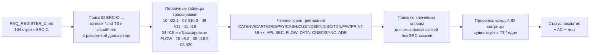
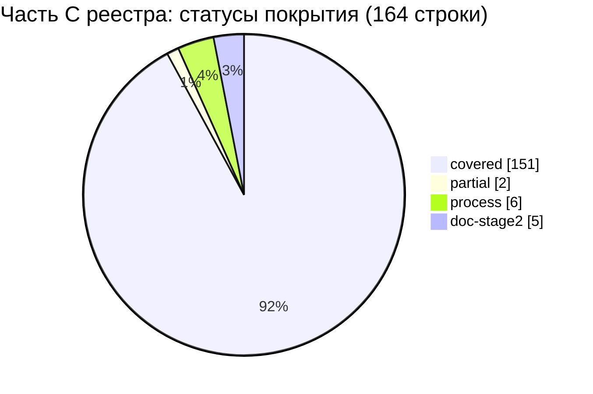

# 17C. Матрица трассируемости — часть C реестра исходных требований (SRC-C-001 … SRC-C-140)

Версия 1.0 · Дата 2026-10-19 · Статус: черновик для утверждения заказчиком

**Входные материалы:**

- Реестр исходных требований, часть C: `docs/specification/source/REQ_REGISTER_C.md` (строки 253–378 мастер-промта, разделы 10–13: главный экран продавца, каталог, карточка товара, корзина, экран кассира, клиенты, долги, транзакции, роли и аудит) — 164 атомарных требования `SRC-C-001 … SRC-C-140` (включая 24 ID с буквенным суффиксом).
- Мастер-промт: `docs/specification/source/MASTER_PROMPT_extracted.md` (строки 253–378).
- Ядро решений: `docs/research/R0_DECISION_KERNEL.md` v1.4 (§1–§19; приоритет §19 → §18 → §17 над текстом документов).
- Исследовательские отчёты R1 (1С), R4 (дизайн), R5 (backend), R6 (безопасность), R7 (правила POS) — используются только через документы ТЗ, на которые они уже отображены.

**Связанные документы:** 01_PRODUCT_REQUIREMENTS.md (GEN-, ROLE-, NFR-; продуктовый уровень требований), 02_SCREEN_SPECIFICATION.md (единственный канонический текст экранов, ядро §19.1), 03_UX_UI_DESIGN_SYSTEM.md, 04_USER_FLOWS.md, 05_ONEC_INTEGRATION.md, 07_DATA_MODEL.md, 08_API_SPECIFICATION.md, 10_POS_BUSINESS_RULES.md, 11_SECURITY_PRIVACY.md, 13_IMPLEMENTATION_ROADMAP.md, 15_DECISION_LOG.md, `visual/*`; адресаты результатов — 12_TEST_PLAN.md (список T-TBD, §5), 14_OPEN_QUESTIONS.md (вопросы Q-285, Q-286, Q-289 — номера предварительные, §6.2), 17_TRACEABILITY_MATRIX.md (сборщик матриц частей A–F).

---

## Краткое содержание

- Документ — матрица трассируемости «исходное требование → требования ТЗ → критерий приёмки → тест» для **всех 164 строк** части C реестра (разделы 10–13 промта); пропусков нет, порядок строк — как в реестре.
- Каждая ссылка на раздел и ID ТЗ найдена поиском по ID `SRC-C-…` (с развёрткой диапазонов вида «SRC-C-115a…115d») во всех `docs/specification/*.md` и `visual/*.md`, а при отсутствии прямой ссылки — по ключевым словам; существование каждого приведённого ID проверено повторным поиском (§1.4).
- Итог покрытия: **covered — 151**, **partial — 2** (SRC-C-018 «компактный список» на телефоне; SRC-C-094 «подтверждённый номер» в R1), **process — 6** (выполнено методикой этапа 1), **doc-stage2 — 5** (артефакт этапа 2 указан в 13), **deferred-R2 — 0**, **gap — 0**.
- Основные владельцы покрытия: 10_POS_BUSINESS_RULES (CAT/INV/CART/ORD/PAY/CASH/CUST/DEBT/DISC/TXN/FAV/PRINT — 10 §22.1 трассирует все 164 строки), 02 (UI-xx-NNN, AC-UI-…; 02 §10.3), 08 (API-NNN, 08 §11), 11 (SEC-NNN, PRIV-NNN, T-SEC-NNN), 04 (FLOW-NNN); продуктовый уровень — 01_PRODUCT_REQUIREMENTS (GEN-, ROLE-, NFR-; с AC-GEN/AC-ROLE), на который ссылаются 163 из 164 строк (кроме SRC-C-014).
- `12_TEST_PLAN.md` на дату трассировки не содержит тестов зоны C (готов только §3.1 — T-AUTH/T-SMS/T-SESS/T-BIO/T-FACE; ссылок на SRC-C нет): тесты указаны как `T-TBD:<префикс>` (сводный список для 12 — §5), кроме тестов безопасности `T-SEC-NNN`, перечень которых зафиксирован в 11 §12.2 и принят 12 §2.7 с сохранением ID (детализация — будущий 12 §3.12).
- Найдены 2 частичных покрытия и 3 расхождения между документами (§4, «Замечания к ядру»); расхождение по SRC-C-018 затрагивает три документа (01 GEN-071, 10 CAT-010, 02 UI-10-013). Сформулированы 3 новых вопроса — Q-285, Q-286, Q-289 (диапазон 17 по ядру §19.5; номера предварительные, перенумерованы из Q-280…Q-282 из-за коллизии с частями 17B/17E — «Замечания к ядру», п. 7).
- Метки статуса: все выводы о покрытии — `[РЕШЕНИЕ: …]` документов ТЗ либо `[ТРЕБУЕТ РЕШЕНИЯ ЗАКАЗЧИКА: Q-…]`; документ ничего не утверждает о готовности программного кода (этап 1, код запрещён).

---

## 1. Методика и обозначения

### 1.1. Порядок трассировки

1. Реестр прочитан полностью; учтены только строки основной таблицы (164 ID). В файле реестра есть ещё 11 строк, начинающихся с `SRC-C-…`, — это строки «Журнала проверки» (таблица «Исправленные строки»), а не требования; поэтому механический подсчёт даёт 175, а требований — 164 (см. «Замечания к ядру», п. 2).
2. Для каждой строки выполнен поиск ID во всех `docs/specification/*.md` и `docs/specification/visual/*.md` (черновики `source/02_parts_drafts/` не использовались — ядро §19.1). Диапазоны вида «SRC-C-026…SRC-C-032», «SRC-C-075…075c», «SRC-C-011a…c» развёрнуты.
3. Главная точка опоры — таблица 10 §22.1 (трассирует все 164 строки части C на правила POS); она сверена с 02 §10.3 (UI → SRC), 08 §11 (API → SRC), 11 §16 (SEC/PRIV → SRC), 04 §15 и абзацами «Трассировка» сценариев FLOW, 15 §9.2, 05 §16.5, 03 §20, а также с колонкой «Источник» требований 01 (GEN- §2.7, §5; ROLE- §3.2–§3.3; NFR- §6.2; диапазоны вида «SRC-C-094…SRC-C-099a» развёрнуты в порядке реестра).
4. Смысловые связи без прямой SRC-ссылки (например, API-054/API-058/API-059 для фильтров и поиска, FLOW-010/FLOW-013/FLOW-028 по названию сценария, DATA-122/DATA-146 по имени таблицы) добавлены только после прочтения соответствующей строки требования.

### 1.2. Сокращения документов

| Сокращение | Файл |
|---|---|
| 01 | `01_PRODUCT_REQUIREMENTS.md` (ROLE- — §3.2 карточки ролей, §3.3 правила прав; GEN- — §2.7, §5.1…§5.19; NFR- — §6.2) |
| 02 | `02_SCREEN_SPECIFICATION.md` (ч. B — SCR-10…SCR-17, ч. C — SCR-20…SCR-26, ч. D — SCR-30…SCR-39, ч. E — SCR-40…SCR-50) |
| 03 | `03_UX_UI_DESIGN_SYSTEM.md` |
| 04 | `04_USER_FLOWS.md` |
| 05 | `05_ONEC_INTEGRATION.md` |
| 07 | `07_DATA_MODEL.md` |
| 08 | `08_API_SPECIFICATION.md` (таблицы требований API-NNN — §11.1…§11.10) |
| 10 | `10_POS_BUSINESS_RULES.md` |
| 11 | `11_SECURITY_PRIVACY.md` |
| 13 | `13_IMPLEMENTATION_ROADMAP.md` |
| 15 | `15_DECISION_LOG.md` |
| ядро | `docs/research/R0_DECISION_KERNEL.md` v1.4 |

### 1.3. Статусы покрытия

| Статус | Смысл |
|---|---|
| `covered` | Требование полностью отражено проверяемыми требованиями ТЗ с критериями приёмки |
| `partial` | Отражено не полностью или с отступлением / противоречием между документами; предложение — §4 |
| `process` | Требование к процессу работы; выполнено методикой этапа 1 (указано, чем именно) |
| `doc-stage2` | Требование к процессу, завершение которого зависит от ответа заказчика; артефакт этапа 2 указан в 13 |
| `deferred-R2` | Перенесено в R2 решением ядра с Q-ссылкой (в части C таких строк нет) |
| `gap` | Покрытие в ТЗ не найдено (в части C таких строк нет) |

### 1.4. Колонки «Критерий приёмки» и «Тест»

- **Критерий приёмки**: приводятся реально существующие ID — `AC-<ПРЕФИКС>-NNN` из 10 §19, `AC-UI-xx-NNN` из 02 §10.1, `AC-API-NNN` (08), `AC-SEC-NNN`/`AC-PRIV-NNN` (11), `AC-DATA-NNN` (07), `AC-ONEC/SYNC-NNN` (05), `AC-ADR-NNN` (15), `AC-GEN-NNN`/`AC-ROLE-NNN` (01, колонка «Критерий приёмки» строк GEN-/ROLE-). Запись «AC-UI-14-004…006» означает непрерывный диапазон, подтверждённый в 02 §10.3. Карточки ролей 01 §3.2 (ROLE-001…ROLE-005) и строки NFR 01 §6.2 собственных AC не имеют (у NFR — «Метод проверки»), поэтому для них в колонке AC ничего не добавлено.
- **Тест**: `12_TEST_PLAN.md` на дату трассировки не содержит тестов зоны C (готов только §3.1 — T-AUTH/T-SMS/T-SESS/T-BIO/T-FACE; ссылок на SRC-C в 12 нет), поэтому ни один `T-<ПРЕФИКС>-NNN` для строк части C, кроме `T-SEC-NNN`, пока не описан. Для таких строк указано `T-TBD:<префикс>` (префикс — владелец основного требования; сводный список — §5). `T-SEC-NNN` — ID, зафиксированные в 11 §12.2 («перечень … обязательный минимум тестов безопасности для 12_TEST_PLAN.md, владелец 12 детализирует шаги, сохраняя ID») и принятые 12 §2.7 («`T-SEC-001…T-SEC-055` (11 §12.2, сохранены ID)»; шаги тестов — будущий 12 §3.12). Для строк `process`/`doc-stage2` тест не применяется («—»), проверка — по артефакту.
- Проверка ID: после сборки матрицы все ID вида `CAT-…`, `UI-…`, `AC-…`, `API-…`, `SEC-…`, `FLOW-…`, `DATA-…`, `ONEC-…`, `SYNC-…`, `ADR-…`, `GEN-…`, `ROLE-…`, `NFR-…`, `T-SEC-…`, `RM-…`, `Q-…`, `SCR-…` повторно найдены поиском в документах ТЗ или ядре (кроме новых Q-285, Q-286, Q-289, вводимых настоящим документом).

---

## 2. Матрица трассируемости SRC-C → ТЗ

### 2.1. Раздел 10 промта — главный экран продавца, поиск, категории, каталог, карточка товара (SRC-C-001 … SRC-C-057)

| SRC-ID | Краткая формулировка | Тип | Документ и раздел ТЗ | ID требования(й) ТЗ | Критерий приёмки (AC-…) | Тест | Статус покрытия |
|---|---|---|---|---|---|---|---|
| SRC-C-001 | Отдельное рабочее пространство (главный экран) продавца | функц. | 10 §5; 02 ч. B SCR-10 (SCR-10.1); ядро §3.2, §9; visual/screen-map.md §2.2; 01 §5.5 | CAT-013; SCR-10; GEN-065 | AC-CAT-013; AC-UI-10-001; AC-GEN-065 | T-TBD:UI-10 | covered |
| SRC-C-002 | Логотип «Оптомстрой» слева в верхней панели | функц. | 02 §3.1, SCR-10.3; 10 §5; 01 §5.5 | UI-10-001; CAT-013; GEN-065 | AC-UI-10-001; AC-CAT-013; AC-GEN-065 | T-TBD:UI-10 | covered |
| SRC-C-003 | Большая строка поиска в центре верхней панели | функц. | 02 SCR-10.3; 10 §5; 01 §5.5 | UI-10-003; CAT-001; CAT-013; GEN-065 | AC-UI-10-001; AC-CAT-001; AC-GEN-065 | T-TBD:UI-10 | covered |
| SRC-C-004 | Профиль пользователя справа в верхней панели | функц. | 02 SCR-10.3, SCR-41; 10 §5; 01 §5.5 | UI-10-006; UI-10-033; UI-41-008; CAT-013; GEN-065 | AC-UI-10-001; AC-UI-41-001; AC-CAT-013; AC-GEN-065 | T-TBD:UI-10 | covered |
| SRC-C-004a | Имя пользователя справа в верхней панели | функц. | 02 SCR-10.3; 10 §5; 01 §5.5 | UI-10-006; CAT-013; GEN-065 | AC-UI-10-001; AC-CAT-013; AC-GEN-065 | T-TBD:UI-10 | covered |
| SRC-C-005 | Статус синхронизации справа в верхней панели | функц. | 02 SCR-10.3, SCR-43; 05 §7.4; 10 §4.3, §5; 01 §5.5, §5.18 | UI-10-004; UI-43-019; SYNC-026; INV-027; CAT-013; GEN-065; GEN-195 | AC-UI-10-001; AC-UI-43-015; AC-SYNC-026; AC-INV-027; AC-GEN-065; AC-GEN-195 | T-TBD:UI-10 | covered |
| SRC-C-006 | Необходимые уведомления справа в верхней панели | функц. | 02 SCR-10.3, SCR-44; 10 §5, §10; 15 ADR-041; 01 §5.5, §5.17 | UI-10-007; UI-44-005; CAT-013; DEBT-013; GEN-065; GEN-183 | AC-UI-10-001; AC-UI-44-001; AC-CAT-013; AC-ADR-041; AC-GEN-065; AC-GEN-183 | T-TBD:UI-44 | covered |
| SRC-C-007 | Поиск по названию, артикулу, штрихкоду и другим доступным полям | функц. | 10 §4.2, §5; 02 SCR-11; 08 §11.3; 04 FLOW-010, FLOW-011; 15 ADR-031; 01 §5.5, §6.2 | CAT-001; INV-017; UI-10-003; UI-11-001; API-058; API-059; GEN-066; NFR-SEARCH-001 | AC-CAT-001; AC-INV-017; AC-UI-11-003; AC-UI-11-004; AC-ADR-031; AC-GEN-066 | T-TBD:CAT | covered |
| SRC-C-008 | Задержка (debounce) перед поисковым запросом | нефункц. | 10 §5; 02 SCR-10, SCR-11; 15 ADR-031 (300 мс, D-31); 01 §5.5 | CAT-002; UI-11-001; GEN-067 | AC-CAT-002; AC-UI-10-013; AC-UI-11-001; AC-GEN-067 | T-TBD:CAT | covered |
| SRC-C-009 | Обработка и отображение пустого результата поиска | функц. | 10 §5; 02 SCR-10, SCR-11; 01 §5.5 | CAT-004; UI-11-013; UI-10-037; GEN-068 | AC-CAT-004; AC-UI-11-005; AC-GEN-068 | T-TBD:CAT | covered |
| SRC-C-010 | Поиск сканированием штрихкода при поддерживаемом оборудовании | функц. | 10 §5; 02 SCR-17, SCR-10/11 (HID), SCR-42; 04 FLOW-011; 08 §11.3; 15 ADR-042; 01 §5.5, §6.2 | CAT-003; UI-17-014; API-059; GEN-069; NFR-PERF-012 | AC-CAT-003; AC-UI-10-014; AC-UI-17-012; AC-UI-17-014; AC-ADR-042; AC-GEN-069 | T-TBD:CAT | covered (модели сканеров — Q-009) |
| SRC-C-011 | Меню категорий под логотипом | функц. | 10 §5; 02 SCR-10.3; 03 §2.3; 01 §5.5 | CAT-009; UI-10-009; GEN-070 | AC-CAT-009; AC-UI-10-002; AC-GEN-070 | T-TBD:UI-10 | covered |
| SRC-C-011a | Меню категорий — вертикальное | функц. | 10 §5; 02 SCR-10.3; 03 §2.3, §9.10; 01 §5.5 | CAT-009; UI-10-009; GEN-070 | AC-CAT-009; AC-UI-10-002; AC-GEN-070 | T-TBD:UI-10 | covered |
| SRC-C-011b | Элементы меню категорий — компактные карточки | функц. | 02 SCR-10.3, SCR-12; 03 §9.10 (`CategoryTile`); 01 §5.5 | CAT-009; UI-10-009; UI-12-006; GEN-070 | AC-UI-10-002; AC-UI-12-004; AC-GEN-070 | T-TBD:UI-10 | covered |
| SRC-C-011c | Карточка категории содержит изображение и название | функц. | 02 SCR-10.3, SCR-12; 03 §9.10; 10 §5; 01 §5.5 | UI-10-009 (изображение 1С 32×32, fallback `iconKey`); UI-12-006; CAT-009; GEN-070 | AC-UI-10-002; AC-UI-12-004; AC-UI-12-012; AC-GEN-070 | T-TBD:UI-10 | covered (фото категорий в 1С — Q-022) |
| SRC-C-012 | Горизонтальная полоса категорий/подборок под поиском и профилем (если полезно) | функц. | 10 §5, §6; 02 SCR-10, SCR-12; 01 §5.5 | CAT-012; FAV-005; UI-10-016; UI-10-036; UI-12-007; GEN-070 | AC-CAT-012; AC-UI-10-003; AC-UI-12-001; AC-GEN-070 | T-TBD:CAT | covered |
| SRC-C-013 | Подкатегории — только при фактическом наличии | функц. | 10 §5; 02 SCR-10, SCR-12; 01 §5.5 | CAT-009; UI-10-016; UI-12-003; UI-12-007; GEN-070 | AC-CAT-009; AC-UI-10-003; AC-UI-12-001; AC-UI-12-002; AC-GEN-070 | T-TBD:UI-12 | covered |
| SRC-C-014 | Ручные чертежи заказчика — обязательный исходный материал компоновки | процесс | 02 §3.11, ч. B §9 и SCR-10.1 (таблица отличий от макета); 03 §2 (табл. «Ручные чертежи — отсутствуют»); 13 §3.1 (этап A); ядро §0, §14 | CAT-013 | — | — | process: ручных чертежей нет [ПОДТВЕРЖДЕНО: R4 §1, 03 §2]; исходным материалом служат три цифровых макета (ядро §14), их использование и отличия зафиксированы в 02 SCR-10.1 и ч. B §9 |
| SRC-C-015 | Переключение представления списка товаров | функц. | 10 §5; 02 SCR-10 (UI-10-013); 03 §9.26 (`ViewModeSegmented`); 01 §5.5 | CAT-010; UI-10-013; GEN-071 | AC-CAT-010; AC-UI-10-004; AC-GEN-071 | T-TBD:CAT | covered |
| SRC-C-016 | Представление «сетка» | функц. | 10 §5; 02 SCR-10; 01 §5.5 | CAT-010; UI-10-013; GEN-071 | AC-CAT-010; AC-UI-10-004; AC-GEN-071 | T-TBD:CAT | covered |
| SRC-C-017 | Представление «список» | функц. | 10 §5; 02 SCR-10; 01 §5.5 | CAT-010; UI-10-013; GEN-071 | AC-CAT-010; AC-UI-10-004; AC-GEN-071 | T-TBD:CAT | covered |
| SRC-C-018 | Представление «компактный список» | функц. | 10 §5; 02 SCR-10 (UI-10-013, UI-10-118), ч. B §14 (замечание 23); 01 §5.5 | CAT-010; UI-10-013; UI-10-118; GEN-071 | AC-CAT-010; AC-UI-10-029; AC-GEN-071 | T-TBD:UI-10 | partial: на compact и medium < 840 lp режим «компакт» не предлагается (UI-10-013 — вариант `two`), тогда как CAT-010 (10) и GEN-071 (01, «сетка, список, компактный список» без оговорки о ширине) требуют переключения всех трёх представлений; см. §4 P-1, Q-289 |
| SRC-C-019 | Сортировка товаров в каталоге | функц. | 10 §5; 02 SCR-10, SCR-11; 08 §11.10; 01 §5.5 | CAT-006; CAT-005; UI-10-014; UI-11-008; API-159; GEN-072 | AC-CAT-006; AC-UI-10-031; AC-GEN-072 | T-TBD:CAT | covered (Q-204 закрыт решением ядра v1.4) |
| SRC-C-020 | Фильтры товаров в каталоге | функц. | 10 §5; 02 SCR-13; 08 §11.3; 01 §5.5 | CAT-007; CAT-008; UI-10-015; API-054; GEN-073 | AC-CAT-007; AC-UI-13-001; AC-GEN-073 | T-TBD:CAT | covered |
| SRC-C-021 | Фильтр по диапазону цены (если данные доступны) | функц. | 02 SCR-13 (UI-13-002); 10 §5; 08 §11.3 (`priceMin/priceMax`); 01 §5.5 | CAT-007; UI-13-002; API-054; GEN-073 | AC-CAT-007; AC-UI-13-002; AC-GEN-073 | T-TBD:CAT | covered |
| SRC-C-022 | Фильтр по наличию на складах | функц. | 02 SCR-13 (UI-13-003, UI-13-016); 10 §4.3, §5; 08 §11.3 (`inStock`, `warehouseId`); 01 §5.5 | CAT-007; INV-025; UI-13-003; API-054; GEN-073 | AC-CAT-007; AC-INV-025; AC-UI-13-007; AC-GEN-073 | T-TBD:CAT | covered (мультивыбор складов — Q-205) |
| SRC-C-023 | Фильтр по категории | функц. | 02 SCR-13 (UI-13-004); 10 §5; 08 §11.3 (`categoryId`); 01 §5.5 | CAT-007; UI-13-004; API-054; GEN-073 | AC-CAT-007; AC-GEN-073 | T-TBD:CAT | covered |
| SRC-C-024 | Фильтры по бренду, модели, цвету, размеру и другим реальным характеристикам | функц. | 10 §5; 02 SCR-13; 07 (`product_attributes`); 01 §5.5 | CAT-007; CAT-008; UI-13-005…UI-13-008; UI-13-012; DATA-117; GEN-073 | AC-CAT-008; AC-UI-13-001; AC-UI-13-003; AC-GEN-073 | T-TBD:CAT | covered |
| SRC-C-025 | «Избранное» в каталоге (фильтр или режим — трактовка) | функц. | 10 §5, §6; 02 SCR-10, SCR-13, SCR-40; 01 §5.5 | CAT-014; CAT-007; FAV-001; FAV-003; FAV-004; UI-10-010; UI-13-009; GEN-074 | AC-CAT-014; AC-UI-10-015; AC-UI-13-008; AC-GEN-074 | T-TBD:CAT | covered (CAT-014 закладывает обе трактовки: фильтр «только избранные» и раздел SCR-40) |
| SRC-C-026 | Карточка в каталоге — фотография | функц. | 10 §5; 02 ч. B п. 2.3, SCR-10 (UI-10-101…UI-10-112); 01 §5.5 | CAT-010; UI-10-102; GEN-075 | AC-CAT-010; AC-UI-10-005; AC-UI-10-021; AC-GEN-075 | T-TBD:CAT | covered |
| SRC-C-027 | Карточка в каталоге — название | функц. | 10 §5; 02 SCR-10; 01 §5.5 | CAT-010; UI-10-101…UI-10-112; GEN-075 | AC-CAT-010; AC-UI-10-005; AC-GEN-075 | T-TBD:CAT | covered |
| SRC-C-028 | Карточка в каталоге — артикул | функц. | 10 §5; 02 SCR-10; ядро §14 (на макете артикула нет — ТЗ добавляет); 01 §5.5 | CAT-010; UI-10-101…UI-10-112; GEN-075 | AC-CAT-010; AC-UI-10-005; AC-GEN-075 | T-TBD:CAT | covered |
| SRC-C-029 | Карточка в каталоге — цена с понятным обозначением условий | функц. | 10 §4.4, §5; 02 SCR-10; 01 §5.5, §5.6 | INV-030; INV-031; INV-032; CAT-010; GEN-075; GEN-086 | AC-INV-031; AC-CAT-010; AC-UI-10-009; AC-GEN-075; AC-GEN-086 | T-TBD:INV | covered (трактовка «условий» — вид цены и единица/упаковка, INV-031; цена товара с вариантами — Q-206) |
| SRC-C-030 | Карточка в каталоге — доступный остаток | функц. | 10 §4.3; 02 SCR-10; 01 §5.5 | INV-009; INV-020; INV-022; CAT-010; GEN-075 | AC-INV-020; AC-INV-022; AC-UI-10-010; AC-GEN-075 | T-TBD:INV | covered |
| SRC-C-031 | Карточка в каталоге — статус наличия | функц. | 10 §4.3; 02 SCR-10; 03 §9.17 (`StockBadge`); 01 §5.5 | INV-022; INV-023; CAT-010; GEN-075 | AC-INV-022; AC-INV-023; AC-GEN-075 | T-TBD:INV | covered (порог «Мало» — Q-175) |
| SRC-C-032 | Карточка в каталоге — кнопка или контрол количества | функц. | 10 §4.5; 02 SCR-10; 01 §5.5 | INV-040; CAT-010; UI-10-109; GEN-075 | AC-INV-040; AC-UI-10-006; AC-GEN-075 | T-TBD:INV | covered |
| SRC-C-033 | Повторное нажатие увеличивает количество без лишних окон | функц. | 10 §4.5, §7.2; 02 ч. B п. 2.3, SCR-10, SCR-14, SCR-40, SCR-50; 04 FLOW-011, FLOW-013; 01 §5.5 | INV-014; INV-040; INV-043; CART-002; UI-10-109; UI-10-119; UI-14-020; UI-40-002; UI-50-009; GEN-076 | AC-INV-040; AC-UI-10-006; AC-UI-10-026; AC-UI-10-027; AC-UI-14-011; AC-UI-40-007; AC-GEN-076 | T-TBD:INV | covered |
| SRC-C-034 | Отдельный быстрый ввод количества | функц. | 10 §4.5; 02 SCR-16; 03 §9.21 (`QuantityNumpadSheet`); 01 §5.5 | INV-041; INV-006; GEN-076 | AC-INV-041; AC-UI-16-001; AC-GEN-076 | T-TBD:INV | covered |
| SRC-C-035 | Единицы измерения и упаковки, используемые в 1С | функц. | 10 §4.1; 02 SCR-14 (UI-14-009), SCR-16 (UI-16-002); 05 §5.1a (ONEC-018); 01 §5.6 | INV-001; INV-002; INV-003; CART-025; ONEC-018; GEN-083 | AC-INV-001; AC-UI-14-009; AC-UI-16-005; AC-ONEC-018; AC-GEN-083 | T-TBD:INV | covered (состав единиц/упаковок — Q-021) |
| SRC-C-036 | Недопустимы некорректные количества (критерии — определить в ТЗ) | ограничение | 10 §4.1; 02 SCR-16; 01 §5.6 | INV-001; INV-004…INV-008; INV-010; INV-042; CART-012; GEN-083 | AC-INV-004; AC-UI-16-002; AC-UI-16-003; AC-UI-16-004; AC-GEN-083 | T-TBD:INV | covered (критерии: точность единицы, кратность, минимальная партия, остаток — INV-001…INV-010) |
| SRC-C-037 | Подробная карточка товара — панель или отдельный экран | функц. | 10 §4.2; 02 SCR-14; 01 §5.6 | INV-018; SCR-14; GEN-080 | AC-INV-018; AC-UI-14-001; AC-UI-14-002; AC-GEN-080 | T-TBD:INV | covered |
| SRC-C-038 | Крупная фотография слева или сверху | функц. | 02 SCR-14 (UI-14-003); 03 §9.15 (`ImageGallery`); 10 §4.2; 01 §5.6 | INV-018; UI-14-003; GEN-080 | AC-INV-018; AC-UI-14-003; AC-GEN-080 | T-TBD:UI-14 | covered |
| SRC-C-039 | Миниатюры других изображений и вариантов | функц. | 02 SCR-14 (UI-14-004); 10 §4.2; 01 §5.6 | INV-018; UI-14-004; GEN-080 | AC-INV-018; AC-UI-14-003; AC-GEN-080 | T-TBD:UI-14 | covered |
| SRC-C-040 | Для товаров с цветами/размерами/моделями показываются доступные варианты | функц. | 10 §4.2; 02 SCR-14 (UI-14-008), SCR-15; 04 FLOW-012; 01 §5.6 | INV-011; INV-012; UI-14-008; GEN-081 | AC-INV-012; AC-UI-14-004…006; AC-GEN-081 | T-TBD:INV | covered |
| SRC-C-041 | При выборе варианта обновляются фото и характеристики | функц. | 10 §4.2; 02 SCR-14; 04 FLOW-012; 01 §5.6 | INV-012; UI-14-008; GEN-081 | AC-INV-012; AC-UI-14-004…006; AC-GEN-081 | T-TBD:INV | covered |
| SRC-C-042 | Артикул выбранного варианта | функц. | 10 §4.2; 02 SCR-14 (UI-14-006); 01 §5.6 | INV-011; INV-012; UI-14-006; GEN-081 | AC-INV-011; AC-UI-14-004…006; AC-GEN-081 | T-TBD:INV | covered |
| SRC-C-043 | Остаток выбранного варианта по каждому складу | функц. | 10 §4.3; 02 SCR-14 (UI-14-013); 03 §9.18 (`WarehouseStockTable`); 08 §11.3; 01 §5.6 | INV-020; INV-021; INV-011; UI-14-013; API-061; GEN-081; GEN-082 | AC-INV-021; AC-UI-14-004…006; AC-GEN-081; AC-GEN-082 | T-TBD:INV | covered |
| SRC-C-044 | Основная часть карточки — название | функц. | 10 §4.2; 02 SCR-14 (зоны C–E); 01 §5.6 | INV-018; GEN-080 | AC-INV-018; AC-UI-14-008; AC-GEN-080 | T-TBD:INV | covered |
| SRC-C-045 | Основная часть карточки — артикул | функц. | 10 §4.2; 02 SCR-14; 01 §5.6 | INV-018; INV-011; GEN-080 | AC-INV-018; AC-UI-14-008; AC-GEN-080 | T-TBD:INV | covered |
| SRC-C-046 | Основная часть карточки — описание | функц. | 10 §4.2; 02 SCR-14; 01 §5.6 | INV-018; GEN-080 | AC-INV-018; AC-UI-14-008; AC-GEN-080 | T-TBD:INV | covered |
| SRC-C-047 | Основная часть карточки — характеристики | функц. | 10 §4.2; 02 SCR-14; 01 §5.6 | INV-016; INV-018; GEN-080 | AC-INV-018; AC-UI-14-010…015; AC-GEN-080 | T-TBD:INV | covered |
| SRC-C-048 | Основная часть карточки — варианты | функц. | 10 §4.2; 02 SCR-14; 01 §5.6 | INV-012; INV-018; GEN-080 | AC-INV-012; AC-UI-14-010…015; AC-GEN-080 | T-TBD:INV | covered |
| SRC-C-049 | Основная часть карточки — цена | функц. | 10 §4.2, §4.4; 02 SCR-14; 01 §5.6 | INV-013; INV-018; INV-031; GEN-080 | AC-INV-018; AC-UI-14-010…015; AC-GEN-080 | T-TBD:INV | covered |
| SRC-C-050 | Основная часть карточки — доступность | функц. | 10 §4.3; 02 SCR-14; 01 §5.6 | INV-018; INV-021; GEN-080 | AC-INV-021; AC-UI-14-010…015; AC-GEN-080 | T-TBD:INV | covered |
| SRC-C-051 | Основная часть карточки — выбор количества | функц. | 10 §4.5; 02 SCR-14, SCR-16; 01 §5.6 | INV-018; INV-041; GEN-080 | AC-INV-018; AC-UI-14-010…015; AC-GEN-080 | T-TBD:INV | covered |
| SRC-C-052 | Основная часть карточки — добавление в корзину | функц. | 10 §4.5; 02 SCR-14; 01 §5.6 | INV-018; INV-040; GEN-080 | AC-INV-018; AC-UI-14-010…015; AC-GEN-080 | T-TBD:INV | covered |
| SRC-C-053 | Качественная заглушка при отсутствии фото | функц. | 10 §4.6; 02 SCR-10 (UI-10-102), SCR-14 (UI-14-003); 15 ADR-030; 01 §5.6 | INV-050; UI-10-102; GEN-084 | AC-INV-050; AC-UI-10-021; AC-UI-14-007; AC-ADR-030; AC-GEN-084 | T-TBD:INV | covered |
| SRC-C-054 | Запрещено подставлять фото другого товара | ограничение | 10 §4.6; 07 (`product_images`); 15 ADR-030; 01 §5.6 | INV-050; DATA-122; GEN-084 | AC-INV-050; AC-UI-14-007; AC-DATA-122; AC-GEN-084 | T-TBD:INV | covered |
| SRC-C-055 | Фотографии привязаны к реальным товарам из 1С | функц. | 10 §4.6; 05 §5.1a, §7.5 (ONEC-006, SYNC-035, SYNC-036); 15 ADR-030; 01 §5.6 | INV-050; ONEC-006; SYNC-035; SYNC-036; GEN-084 | AC-INV-050; AC-ONEC-006; AC-SYNC-035; AC-GEN-084 | T-TBD:INV | covered (место хранения фото в 1С — Q-022) |
| SRC-C-056 | Кэширование фотографий | нефункц. | 10 §4.6; 02 SCR-10 (UI-10-102); 08 §11.3 (`immutable`); 15 ADR-030; 01 §5.6, §6.2 | INV-051; API-057; GEN-084; NFR-PERF-010; NFR-OFFLINE-004 | AC-INV-051; AC-UI-10-021; AC-GEN-084 | T-TBD:INV | covered |
| SRC-C-057 | Загрузка фотографий по требованию | нефункц. | 10 §4.6; 02 SCR-10 (UI-10-102); 01 §5.6, §6.2 | INV-051; UI-10-102; GEN-084; NFR-PERF-010 | AC-INV-051; AC-UI-10-021; AC-GEN-084 | T-TBD:INV | covered |

### 2.2. Раздел 11 промта — корзина и оформление заказа, заказ ≠ продажа (SRC-C-058 … SRC-C-082)

| SRC-ID | Краткая формулировка | Тип | Документ и раздел ТЗ | ID требования(й) ТЗ | Критерий приёмки (AC-…) | Тест | Статус покрытия |
|---|---|---|---|---|---|---|---|
| SRC-C-058 | Корзина доступна из нижней части интерфейса на мобильных | функц. | 10 §7.2; 02 SCR-20 (UI-20-019), SCR-10 (UI-10-020…UI-10-031); 03 §18.5 (DS-042); 15 ADR-018; 01 §5.1, §5.7 | CART-001; UI-20-019; DS-042; GEN-022; GEN-090 | AC-CART-001; AC-UI-20-001; AC-ADR-018; AC-GEN-022; AC-GEN-090 | T-TBD:CART | covered |
| SRC-C-059 | Корзина — постоянно доступная панель на больших экранах | функц. | 10 §7.2; 02 SCR-20 (вариант `panel` 340), SCR-10; 03 §9.27 (`CartPanel`); 15 ADR-018; 01 §5.1, §5.7 | CART-001; UI-10-040; GEN-022; GEN-090 | AC-CART-001; AC-UI-20-001; AC-ADR-018; AC-GEN-022; AC-GEN-090 | T-TBD:CART | covered |
| SRC-C-060 | Счётчик товаров (позиций) в корзине | функц. | 10 §7.2; 02 SCR-20; 01 §5.7 | CART-001; UI-20-001; UI-20-021; GEN-090 | AC-CART-001; AC-UI-20-002; AC-GEN-090 | T-TBD:CART | covered |
| SRC-C-061 | Общее количество единиц в корзине | функц. | 10 §7.2 (`units_count`); 02 SCR-20; 01 §5.7 | CART-001; UI-20-021; GEN-090 | AC-CART-001; AC-UI-20-002; AC-GEN-090 | T-TBD:CART | covered |
| SRC-C-062 | Изменение количества позиции | функц. | 10 §7.2; 02 SCR-20, SCR-16; 01 §5.7 | CART-003; UI-20-008; GEN-091 | AC-CART-003; AC-UI-20-004; AC-UI-20-005; AC-GEN-091 | T-TBD:CART | covered |
| SRC-C-063 | Удаление позиции | функц. | 10 §7.2; 02 SCR-20; 01 §5.7 | CART-004; CART-012; UI-20-010; UI-20-018; GEN-091 | AC-CART-004; AC-UI-20-005; AC-UI-20-006; AC-GEN-091 | T-TBD:CART | covered |
| SRC-C-064 | Выбор/смена варианта в корзине | функц. | 10 §4.2, §7.2; 02 SCR-20 (UI-20-007), SCR-15; 01 §5.7 | CART-005; INV-015; UI-20-007; GEN-092 | AC-CART-005; AC-UI-20-007; AC-GEN-092 | T-TBD:CART | covered |
| SRC-C-065 | Цена и сумма по каждой позиции | функц. | 10 §7.2; 02 SCR-20; 01 §5.7 | CART-006; UI-20-006; UI-20-009; GEN-093 | AC-CART-006; AC-UI-20-008; AC-GEN-093 | T-TBD:CART | covered |
| SRC-C-066 | Промежуточный итог | функц. | 10 §7.2; 02 SCR-20, SCR-21; 01 §5.7 | CART-006; UI-20-014; UI-21-015; GEN-093 | AC-CART-006; AC-UI-20-003; AC-UI-21-002; AC-GEN-093 | T-TBD:CART | covered |
| SRC-C-067 | Скидка, если она разрешена | функц. | 10 §7.2, §11; 02 SCR-20; 04 FLOW-015, FLOW-016; 08 §11.4; 15 ADR-023; 01 §5.7 | CART-007; DISC-002; DISC-004; UI-20-013; API-067; GEN-093; GEN-103 | AC-CART-007; AC-UI-20-011; AC-UI-20-022…025; AC-API-067; AC-GEN-093; AC-GEN-103 | T-TBD:CART | covered (лимиты по ролям — Q-015) |
| SRC-C-068 | Итоговая сумма | функц. | 10 §7.2, §18; 02 SCR-20, SCR-21; ядро §17.2 (16 850,00 − 842,50 = 16 007,50); 01 §5.7 | CART-006; MNY-001; UI-20-014; GEN-093 | AC-CART-006; AC-UI-20-003; AC-UI-21-002; AC-GEN-093 | T-TBD:MNY | covered |
| SRC-C-069 | Сохранение черновика корзины | функц. | 10 §7.2, §7.3; 02 SCR-20 (UI-20-023), SCR-23; 04 FLOW-017; 08 §11.4; 07 (`carts`); 01 §5.7 | CART-008; CART-018; CART-030; CART-031; CART-033…CART-035; API-068; DATA-134; GEN-094 | AC-CART-008; AC-UI-20-013; AC-UI-23-001; AC-GEN-094 | T-TBD:CART | covered |
| SRC-C-070 | Восстановление корзины после перезапуска | функц. | 10 §7.2; 02 SCR-20 §4.11, SCR-21 §5.11; 15 ADR-032; 01 §5.7 | CART-009; CART-018; ORD-010; GEN-094 | AC-CART-009; AC-UI-20-013; AC-UI-21-017; AC-ADR-032; AC-GEN-094 | T-TBD:CART | covered |
| SRC-C-071 | Очистка корзины только с подтверждением | функц. | 10 §7.2; 02 SCR-20; 08 §11.4; 01 §5.7 | CART-011; UI-20-003; UI-20-029; API-069; GEN-095 | AC-CART-011; AC-UI-20-012; AC-GEN-095 | T-TBD:CART | covered |
| SRC-C-072 | Понятные предупреждения об изменившихся ценах и остатках | функц. | 10 §4.4, §7.2; 02 SCR-20, SCR-21; 04 FLOW-014; 08 §11.4; 01 §5.7 | CART-013; CART-014; CART-016; INV-034; API-065; GEN-096 | AC-CART-013; AC-CART-014; AC-UI-20-009; AC-UI-20-010; AC-UI-20-018; AC-GEN-096 | T-TBD:CART | covered |
| SRC-C-073 | Товары, варианты и количества сохраняются между экранами | функц. | 10 §7.2; 02 SCR-20 §4.6; 01 §5.7 | CART-010; GEN-097 | AC-CART-010; AC-UI-20-017; AC-GEN-097 | T-TBD:CART | covered |
| SRC-C-074 | Корзина не теряется при переходе в карточку и обратно | ограничение | 10 §7.2; 02 SCR-20 §4.6; 01 §5.7 | CART-010; GEN-097 | AC-CART-010; AC-UI-20-017; AC-GEN-097 | T-TBD:CART | covered |
| SRC-C-075 | Сервер перед подтверждением перепроверяет актуальные цены | функц. | 10 §8.2, §8.3; 02 SCR-20 (UI-20-016), SCR-21; 04 FLOW-018; 08 §11.4, §11.10; 15 ADR-029; 01 §5.8 | ORD-007; ORD-008; ORD-020; INV-034; API-065; API-070; API-071; API-161; GEN-110 | AC-ORD-008; AC-UI-21-002; AC-UI-21-010; AC-API-070; AC-API-161; AC-GEN-110 | T-TBD:ORD | covered |
| SRC-C-075a | … актуальные остатки | функц. | 10 §8.2; 02 SCR-21 (UI-21-021); 04 FLOW-018; 08 §11.4, §11.10; 01 §5.8 | ORD-007; ORD-008; INV-008; CART-014; API-070; API-161; GEN-110 | AC-ORD-008; AC-UI-21-011; AC-API-070; AC-GEN-110 | T-TBD:ORD | covered |
| SRC-C-075b | … права пользователя | функц. | 10 §8.2, §3; 02 SCR-21 §5.10 (`CheckoutPreview.permissions`); 08 §11.4, §11.5; 01 §5.8 | ORD-008; CASH-001; API-070; API-097; GEN-110 | AC-ORD-008; AC-UI-21-018; AC-API-070; AC-GEN-110 | T-TBD:ORD | covered |
| SRC-C-075c | … правила скидок | функц. | 10 §8.2, §11; 02 SCR-20, SCR-21; 08 §11.4; 15 ADR-023; 01 §5.8 | ORD-008; ORD-020; DISC-010; API-067; API-070; GEN-110 | AC-ORD-008; AC-UI-20-023; AC-UI-20-024; AC-API-067; AC-GEN-110 | T-TBD:ORD | covered |
| SRC-C-076 | Добавление в корзину не списывает остаток | ограничение | 10 §4.3, §7.2; 02 SCR-20 §4.1; 08 §11.3, §11.4, §11.10; 07 (`carts`); 15 ADR-022; 01 §5.7 | INV-024; CART-019; API-061; API-084; API-151; DATA-134; GEN-098 | AC-INV-024; AC-UI-20-026; AC-DATA-134; AC-ADR-022; AC-GEN-098 | T-TBD:INV | covered |
| SRC-C-077 | Резервирование и списание — по согласованному бизнес-процессу | процесс | 10 §4.3, §8.4; 02 SCR-21 §5.1, SCR-24 (UI-24-003); 15 ADR-022; 13 RM-A-003, §9 (O-10), RM-F-010; 01 §5.7 | INV-024; ORD-042; ORD-033; ORD-040; GEN-098 | AC-INV-024; AC-ORD-042; AC-UI-24-001; AC-GEN-098 | — | doc-stage2: модель D-22 заложена в ТЗ [ТИПОВО: УТ 11.5, ORD-042]; согласование процесса — ответ на Q-012 в 14_OPEN_QUESTIONS v1.1 (13 RM-A-003, O-10), проверка на копии 1С — RM-F-010 |
| SRC-C-078 | Заказ и продажа — разные сущности | ограничение | 10 §2.1, §8.4; 02 SCR-21 §5.1, SCR-24 §8.1; 08 §11.4; 15 ADR-020; 01 §5.8 | ORD-001; ORD-032; ORD-060; API-063; API-073; API-077; GEN-106; GEN-117 | AC-ORD-032; AC-UI-24-002; AC-API-073; AC-ADR-020; AC-GEN-106; AC-GEN-117 | T-TBD:ORD | covered |
| SRC-C-079 | Отдельный сценарий оформления заказа | функц. | 10 §8; 02 SCR-21; 04 FLOW-018; 08 §11.4; 01 §5.8 | ORD-001; ORD-032; API-074; GEN-105 | AC-ORD-001; AC-UI-21-001; AC-API-074; AC-GEN-105 | T-TBD:ORD | covered |
| SRC-C-079a | Отдельный сценарий выставления счёта | функц. | 10 §8.2, §16; 02 SCR-21 (UI-21-016), SCR-22 (UI-22-008), SCR-24 (UI-24-009); 04 FLOW-027; 08 §11.4, §11.8; 15 ADR-027; 01 §5.8 | ORD-009; PRINT-001; PRINT-002; PRINT-003; API-080; API-131; GEN-106 | AC-PRINT-002; AC-UI-22-002; AC-UI-24-008; AC-API-080; AC-ADR-027; AC-GEN-106 | T-TBD:PRINT | covered (формы и НДС — Q-019) |
| SRC-C-079b | Отдельный сценарий кассовой продажи | функц. | 10 §8.1, §9.2; 02 SCR-22 (UI-22-012, UI-22-018), SCR-24 (UI-24-010) → SCR-38; 04 FLOW-020; 08 §11.4; 01 §5.8 | ORD-001; PAY-010; PAY-011; API-081; GEN-106 | AC-PAY-010; AC-UI-22-007; AC-API-081; AC-GEN-106 | T-TBD:PAY | covered (кассовая продажа R1 = заказ + приём оплаты; реализация — в 1С, ядро §4.2) |
| SRC-C-080 | Сценарии — исходя из реальных процессов магазина и возможностей 1С | процесс | 10 §8.3; 02 SCR-21 (UI-21-018); 05 §6.6 (ONEC-038); 08 §11.4, §11.8; 15 ADR-020, ADR-028; 13 RM-A-003, §9 (O-10), RM-F-010; 01 §5.8 | ORD-001; ORD-024; ONEC-038; API-073; API-075; API-076; API-130; GEN-109 | AC-ORD-024; AC-UI-21-009; AC-ONEC-038; AC-GEN-109 | — | doc-stage2: процессы и возможности 1С исследованы на этапе 1 (R1, R7 → ядро D-20, D-28), открытые параметры — Q-010, Q-012; ответы фиксируются в 14_OPEN_QUESTIONS v1.1 (13 RM-A-003, O-10), сквозная проверка — RM-F-010 |
| SRC-C-081 | Не вводить способы оплаты и документы, которые магазин не использует | ограничение | 10 §8.2, §9, §16; 02 SCR-21 (UI-21-012, UI-21-016); 04 FLOW-021; 08 §11.4, §11.5; 15 ADR-021; 01 §5.8 | ORD-002; PAY-007; PAY-012; PRINT-004; PRINT-008; API-074; API-086; GEN-109 | AC-ORD-002; AC-UI-21-021; AC-UI-21-007; AC-API-074; AC-ADR-021; AC-GEN-109 | T-TBD:ORD | covered (перечень `cash`/`qr_bakai`/`credit` и документов — [ТРЕБУЕТ РЕШЕНИЯ ЗАКАЗЧИКА: Q-012], ORD-002) |
| SRC-C-082 | Сначала выявить операции, затем реализовать с корректной синхронизацией | процесс | 10 §2.1, §3, §8.3; 02 SCR-21 (UI-21-018), SCR-22 (UI-22-014); 05 §6.6 (ONEC-038); 08 §11.4, §11.6, §11.8; 13 RM-A-003, §9 (O-10); 01 §5.8 | ORD-002; ORD-024…ORD-026; PAY-012; CUST-014; API-075; API-102; API-130; API-133; GEN-109 | AC-ORD-024; AC-UI-21-009; AC-UI-22-002; AC-GEN-109 | — | doc-stage2: перечень операций выявлен на этапе 1 (10 §2.1 — границы сущностей, §3 — матрица операций × ролей; R7), подтверждение документов 1С — Q-012 → 14_OPEN_QUESTIONS v1.1 (13 RM-A-003, O-10) |

### 2.3. Раздел 12 промта — экран кассира, клиенты, долги и скидки, транзакции (SRC-C-083 … SRC-C-120)

| SRC-ID | Краткая формулировка | Тип | Документ и раздел ТЗ | ID требования(й) ТЗ | Критерий приёмки (AC-…) | Тест | Статус покрытия |
|---|---|---|---|---|---|---|---|
| SRC-C-083 | Отдельный интерфейс кассира с быстрым доступом к повседневным операциям | функц. | 10 §14; 02 ч. D SCR-30; ядро §3.2; visual/screen-map.md, visual/responsive-spec.md §12; 01 §2.7, §3.2, §5.10 | CASH-010; CASH-015; SCR-30; GEN-005; ROLE-002; GEN-133 | AC-CASH-010; AC-UI-30-001; AC-UI-30-016; AC-GEN-005; AC-GEN-133 | T-TBD:CASH | covered |
| SRC-C-084 | Дашборд кассира — поиск клиентов | функц. | 10 §14.1, §15.2; 02 SCR-30 (UI-30-002), SCR-31; 04 FLOW-028; 01 §5.10, §5.11 | CASH-010; CUST-008; UI-30-002; GEN-133; GEN-139 | AC-CUST-008; AC-UI-30-005; AC-UI-31-011; AC-GEN-133; AC-GEN-139 | T-TBD:CUST | covered |
| SRC-C-085 | Дашборд кассира — избранные клиенты | функц. | 10 §6, §14.1; 02 SCR-30 (UI-30-005); 08 §11.6, §11.10 (`favoriteCustomers` ≤ 12); 01 §5.10 | FAV-006; CASH-010; API-112; API-166; GEN-133 | AC-FAV-006; AC-UI-30-006; AC-GEN-133 | T-TBD:FAV | covered |
| SRC-C-086 | Дашборд кассира — недавние операции | функц. | 10 §13, §14.1; 02 SCR-30 (UI-30-006); 01 §5.10 | TXN-009; CASH-010; GEN-133 | AC-TXN-009; AC-UI-30-001; AC-GEN-133 | T-TBD:TXN | covered (число строк — [НЕ ПОДТВЕРЖДЕНО, Q-176]) |
| SRC-C-087 | Дашборд кассира — долги и просрочки (если данные доступны) | функц. | 10 §10, §14.1; 02 SCR-30 (UI-30-007, UI-30-008, UI-30-017); 08 §11.5; 01 §5.10, §5.12 | DEBT-007; CASH-010; API-099; GEN-133; GEN-153 | AC-DEBT-007; AC-UI-30-014; AC-GEN-133; AC-GEN-153 | T-TBD:DEBT | covered |
| SRC-C-088 | Дашборд кассира — скидки и условия продаж | функц. | 10 §11.2, §14.1; 02 SCR-30 (UI-30-009), SCR-35; 01 §5.10, §5.12 | DISC-013; CASH-010; GEN-133; GEN-158 | AC-DISC-013; AC-UI-30-015; AC-GEN-133; AC-GEN-158 | T-TBD:DISC | covered |
| SRC-C-089 | Дашборд кассира — список транзакций | функц. | 10 §13, §14.1; 02 SCR-30 (UI-30-006, UI-30-015) → SCR-36; 01 §5.10 | CASH-010; TXN-002; GEN-133 | AC-CASH-010; AC-UI-30-001; AC-GEN-133 | T-TBD:CASH | covered |
| SRC-C-090 | Дашборд кассира — быстрый доступ к каталогу | функц. | 10 §14.1; 02 SCR-30 (UI-30-003 «Принять оплату» и «Каталог», UI-30-016); 01 §5.10 | CASH-010; UI-30-003; GEN-133 | AC-CASH-010; AC-UI-30-001; AC-GEN-133 | T-TBD:CASH | covered |
| SRC-C-090a | Дашборд кассира — быстрый доступ к кассе | функц. | 10 §14.2; 02 SCR-30 (UI-30-003) → SCR-38; 01 §5.10 | CASH-010; CASH-012; GEN-133; GEN-136 | AC-CASH-012; AC-UI-30-003; AC-GEN-133; AC-GEN-136 | T-TBD:CASH | covered |
| SRC-C-091 | Дашборд кассира — уведомления об ошибках синхронизации | функц. | 10 §14.2; 02 SCR-30 (UI-30-001, UI-30-010); 05 §7.6 (SYNC-038); 08 §11.7 (`GET /sync/status`); 15 ADR-041; 01 §5.10 | CASH-017; CASH-010; SYNC-038; API-113; GEN-133 | AC-CASH-017; AC-UI-30-012; AC-SYNC-038; AC-ADR-041; AC-GEN-133 | T-TBD:CASH | covered (уведомление `sync_error` по SYNC-038 адресовано `admin`/`owner`; кассир видит ошибки баннером дашборда по CASH-017) |
| SRC-C-092 | Карточка клиента — только данные, разрешённые роли | ограничение | 10 §15.1; 02 ч. D §0.4, SCR-32; 08 §11.6; 11 §4.5; 01 §3.3, §5.11 | CUST-001; CUST-009; DEBT-004; API-101; SEC-031; ROLE-018; GEN-140 | AC-CUST-001; AC-UI-32-002; AC-SEC-031; AC-ROLE-018; AC-GEN-140 | T-SEC-017 | covered (трактовка «роль текущего пользователя» принята CUST-001 [РЕШЕНИЕ]; подтверждение трактовки — Q-286) |
| SRC-C-093 | Карточка клиента — имя | функц. | 10 §15.2; 02 SCR-32 (UI-32-001, UI-32-016); 01 §5.11 | CUST-002; GEN-140 | AC-CUST-002; AC-UI-32-001; AC-GEN-140 | T-TBD:CUST | covered |
| SRC-C-093a | Карточка клиента — идентификатор | функц. | 10 §15.2; 02 SCR-32 (UI-32-001, UI-32-016); 01 §5.11 | CUST-002; GEN-140 | AC-CUST-002; AC-UI-32-001; AC-GEN-140 | T-TBD:CUST | covered |
| SRC-C-094 | Карточка клиента — подтверждённый номер | функц. | 10 §15.2; 02 SCR-32 (UI-32-001, `Customer.phones[].verified`); ядро §19.2; 01 §5.11 | CUST-003; CUST-013 (R2); GEN-140 | AC-CUST-003; AC-GEN-140 | T-TBD:CUST | partial: признак «подтверждён» в R1 возникает только при совпадении с номером, подтверждённым OTP при `customer_link`, а режим клиента в R1 выключен (Q-001), подтверждение при создании клиента — R2 (CUST-013, ядро §19.2); источник признака в R1 фактически отсутствует — §4 P-2, Q-285 |
| SRC-C-095 | Карточка клиента — история покупок | функц. | 10 §15.2; 02 SCR-33, SCR-32; 08 §11.6; 01 §5.11 | CUST-005; API-103; GEN-140; GEN-141 | AC-CUST-005; AC-UI-33-002; AC-GEN-140; AC-GEN-141 | T-TBD:CUST | covered |
| SRC-C-096 | Карточка клиента — разрешённые сведения о взаиморасчётах | функц. | 10 §10, §15; 02 SCR-32 (UI-32-006), SCR-34; 11 §4.5; 01 §3.3, §5.11, §5.12 | CUST-004; DEBT-002; DEBT-004; SEC-031; SEC-032; ROLE-018; GEN-140; GEN-151 | AC-CUST-004; AC-UI-32-003; AC-SEC-032; AC-ROLE-018; AC-GEN-140; AC-GEN-151 | T-SEC-017; T-SEC-020 | covered |
| SRC-C-097 | Карточка клиента — доступные скидки | функц. | 10 §11.2, §15.2; 02 SCR-35, SCR-32; 01 §5.11, §5.12 | DISC-013; CUST-004; DISC-005; DISC-007; GEN-140; GEN-158 | AC-DISC-013; AC-UI-35-001; AC-GEN-140; AC-GEN-158 | T-TBD:DISC | covered |
| SRC-C-098 | Карточка клиента — признак «избранный» | функц. | 10 §6, §15.2; 02 SCR-32 (UI-32-003), SCR-31; 01 §5.11 | CUST-006; FAV-006; GEN-140; GEN-144 | AC-CUST-006; AC-UI-32-006; AC-UI-31-007; AC-GEN-140; AC-GEN-144 | T-TBD:CUST | covered |
| SRC-C-099 | Карточка клиента — связанные заказы | функц. | 10 §13, §15.2; 02 SCR-32 (UI-32-007); 01 §5.11 | CUST-007; TXN-011; ORD-070; GEN-140 | AC-CUST-007; AC-UI-32-009; AC-GEN-140 | T-TBD:CUST | covered |
| SRC-C-099a | Карточка клиента — связанные транзакции | функц. | 10 §13, §15.2; 02 SCR-32 (UI-32-007); 01 §5.11 | CUST-007; TXN-011; GEN-140 | AC-TXN-011; AC-UI-32-009; AC-GEN-140 | T-TBD:TXN | covered |
| SRC-C-100 | Добавить клиента в избранное | функц. | 10 §6; 02 SCR-30, SCR-31 (UI-31-003), SCR-32 (UI-32-003), SCR-40 (UI-40-003); 08 §11.6; 01 §5.11 | FAV-006; CUST-006; API-106; GEN-144 | AC-FAV-006; AC-UI-40-002; AC-UI-32-006; AC-GEN-144 | T-TBD:FAV | covered |
| SRC-C-101 | Удалить клиента из избранного | функц. | 10 §6; 02 SCR-30, SCR-32, SCR-40 (UI-40-003, UI-40-004); 08 §11.6; 01 §5.11 | FAV-006; CUST-006; API-106; GEN-144 | AC-FAV-006; AC-UI-40-003; AC-UI-30-006; AC-GEN-144 | T-TBD:FAV | covered |
| SRC-C-102 | Быстро находить избранного клиента на главном экране кассира | функц. | 10 §6, §15.2; 02 SCR-30 (UI-30-005), SCR-40 (UI-40-006); 01 §5.11 | FAV-006; FAV-007; CUST-006; GEN-144 | AC-UI-30-006; AC-UI-40-002; AC-CUST-006; AC-GEN-144 | T-TBD:FAV | covered |
| SRC-C-103 | Избранные клиенты хранятся на сервере, не теряются после закрытия | функц. | 10 §6; 07 (`favorites_customers`); 08 §11.6; 02 SCR-32 п. 4, SCR-40 п. 9, 11; 01 §5.11 | FAV-001; FAV-002; FAV-006; DATA-146; DATA-147; API-106; GEN-144 | AC-FAV-002; AC-UI-32-006; AC-UI-40-004; AC-UI-40-006; AC-DATA-146; AC-GEN-144 | T-TBD:FAV | covered |
| SRC-C-104 | Задолженность — на основании данных 1С | функц. | 10 §10; 02 SCR-34; 05 §5.1a, §6.6, §7.2 (ONEC-014, ONEC-047, SYNC-016); 07 (`receivables`); 08 §11.5; 15 ADR-024; 01 §5.12 | DEBT-001; ONEC-014; ONEC-047; SYNC-016; DATA-024; DATA-130; API-096; GEN-149 | AC-DEBT-001; AC-ONEC-047; AC-DATA-024; AC-ADR-024; AC-GEN-149 | T-TBD:DEBT | covered |
| SRC-C-105 | Не вычислять долг только по истории покупок | ограничение | 10 §10; 02 SCR-33 (UI-33-006), SCR-34; 07 (`receivables`); 01 §5.12 | DEBT-001; PAY-037; DATA-024; GEN-149 | AC-DEBT-001; AC-UI-33-004; AC-DATA-024; AC-GEN-149 | T-TBD:DEBT | covered |
| SRC-C-106 | Взаиморасчёты — сумма долга | функц. | 10 §10; 02 SCR-34 (UI-34-001); 01 §5.12 | DEBT-002; GEN-150 | AC-DEBT-002; AC-UI-34-001; AC-GEN-150 | T-TBD:DEBT | covered |
| SRC-C-107 | Взаиморасчёты — дата документа | функц. | 10 §10; 02 SCR-34 (UI-34-005); 01 §5.12 | DEBT-003; GEN-150 | AC-DEBT-003; AC-UI-34-005; AC-GEN-150 | T-TBD:DEBT | covered |
| SRC-C-107a | Взаиморасчёты — статус документа | функц. | 10 §10; 02 SCR-34 (UI-34-005, `documents[].status` — ядро §19.2); 01 §5.12 | DEBT-003; DEBT-012; GEN-150 | AC-DEBT-003; AC-UI-34-005; AC-GEN-150 | T-TBD:DEBT | covered |
| SRC-C-108 | Взаиморасчёты — платежи | функц. | 10 §9.5, §10; 02 SCR-34, SCR-38 (режим долга); 01 §5.12 | DEBT-003; PAY-040; PAY-041; GEN-150 | AC-DEBT-003; AC-PAY-040; AC-UI-34-005; AC-GEN-150 | T-TBD:DEBT | covered |
| SRC-C-109 | Взаиморасчёты — возвраты | функц. | 10 §10, §12; 02 SCR-34; 04 FLOW-031; 15 ADR-025; 01 §5.12 | DEBT-003; RET-007; PAY-051; GEN-150 | AC-DEBT-003; AC-UI-34-005; AC-GEN-150 | T-TBD:DEBT | covered |
| SRC-C-110 | Взаиморасчёты — скидки | функц. | 10 §10, §11; 02 SCR-34 (`kind` = `discount`/`adjustment`), SCR-35; 01 §5.12 | DEBT-003; DEBT-008; GEN-150 | AC-DEBT-003; AC-UI-35-001; AC-GEN-150 | T-TBD:DEBT | covered |
| SRC-C-111 | Взаиморасчёты — доступный лимит, если он существует | функц. | 10 §9.4, §10; 02 SCR-34 (UI-34-002), SCR-32 (UI-32-006); 04 FLOW-023; 01 §5.12 | DEBT-002; DEBT-011; PAY-030; GEN-150 | AC-DEBT-002; AC-UI-34-001; AC-UI-32-015; AC-GEN-150 | T-TBD:DEBT | covered |
| SRC-C-112 | Дата последней синхронизации финансовых данных | функц. | 10 §10, §14.2; 02 SCR-34 (UI-34-003); 05 §7.4 (SYNC-027); 11 §10.6 (PRIV-017); 04 FLOW-025; 01 §5.12 | DEBT-002; DEBT-006; CASH-018; SYNC-027; PRIV-017; GEN-150 | AC-DEBT-006; AC-UI-34-006; AC-PRIV-017; AC-GEN-150 | T-TBD:DEBT | covered |
| SRC-C-113 | Скидки рассчитываются по утверждённым правилам | функц. | 10 §11; 08 §11.4, §11.7; 11 §4.5; 15 ADR-023; 01 §5.12 | DISC-001; DISC-002; DISC-004…DISC-010; DISC-015; SEC-034; API-066; API-067; API-117; GEN-154 | AC-DISC-001; AC-SEC-034; AC-API-067; AC-ADR-023; AC-GEN-154 | T-SEC-022 | covered (лимиты — Q-015) |
| SRC-C-114 | Клиент не может изменить итоговую цену запросами приложения | ограничение | 10 §8.3, §11, §18; 08 §11.1, §11.4; 11 §3.2; 02 SCR-35, SCR-38 (UI-38-001); 01 §5.12 | ORD-020; DISC-001; DISC-011; PAY-002; MNY-001; SEC-008; SEC-010; API-025; API-027; API-032; API-071; GEN-154 | AC-DISC-011; AC-SEC-010; AC-API-032; AC-UI-35-003; AC-UI-38-002; AC-GEN-154 | T-SEC-021 | covered |
| SRC-C-115 | Список транзакций | функц. | 10 §13; 02 SCR-36; 04 FLOW-036; 08 §11.6; 01 §5.13 | TXN-001; API-107; GEN-160 | AC-TXN-001; AC-UI-36-001; AC-API-107; AC-GEN-160 | T-TBD:TXN | covered |
| SRC-C-115a | Фильтр транзакций по периоду | функц. | 10 §13; 02 SCR-36; 04 FLOW-036 (FLOW-036.S2); 08 §11.6; 01 §5.13 | TXN-002; API-107; GEN-160 | AC-TXN-002; AC-UI-36-002; AC-UI-36-007; AC-GEN-160 | T-TBD:TXN | covered (период ≤ 366 дней — ядро §19.4; умолчания — Q-215) |
| SRC-C-115b | Фильтр транзакций по клиенту | функц. | 10 §13; 02 SCR-36; 08 §11.6; 11 §4.5; 01 §5.13 | TXN-002; API-107; SEC-042; GEN-160 | AC-TXN-002; AC-UI-36-002; AC-SEC-042; AC-GEN-160 | T-SEC-015 | covered |
| SRC-C-115c | Фильтр транзакций по статусу | функц. | 10 §13; 02 SCR-36; 08 §11.6, §11.10; 01 §5.13 | TXN-002; API-107; API-168; GEN-160 | AC-TXN-002; AC-UI-36-002; AC-API-168; AC-GEN-160 | T-TBD:TXN | covered |
| SRC-C-115d | Фильтр транзакций по типу операции | функц. | 10 §13; 02 SCR-36; 04 FLOW-036.S2; 08 §11.6; 01 §5.13 | TXN-002; API-107; GEN-160 | AC-TXN-002; AC-UI-36-002; AC-GEN-160 | T-TBD:TXN | covered |
| SRC-C-116 | Для операции — номер | функц. | 10 §13; 02 SCR-36 (UI-36-003), SCR-37; 08 §11.6; 01 §5.13 | TXN-001; TXN-003; API-108; GEN-161 | AC-TXN-003; AC-UI-36-003; AC-API-108; AC-GEN-161 | T-TBD:TXN | covered |
| SRC-C-116a | Для операции — дата | функц. | 10 §13; 02 SCR-36, SCR-37; 04 FLOW-036.S4; 08 §11.6; 01 §5.13 | TXN-001; TXN-003; API-108; GEN-161 | AC-TXN-003; AC-UI-36-003; AC-API-108; AC-GEN-161 | T-TBD:TXN | covered |
| SRC-C-116b | Для операции — сумма | функц. | 10 §13; 02 SCR-36, SCR-37; 08 §11.6; 11 §4.5; 01 §5.13 | TXN-003; TXN-008; API-108; SEC-031; GEN-161 | AC-TXN-003; AC-UI-36-003; AC-API-108; AC-GEN-161 | T-TBD:TXN | covered |
| SRC-C-116c | Для операции — статус | функц. | 10 §13; 02 SCR-36, SCR-37; 08 §11.6, §11.10; 01 §5.13 | TXN-003; API-108; API-168; GEN-161 | AC-TXN-003; AC-UI-36-003; AC-API-168; AC-GEN-161 | T-TBD:TXN | covered |
| SRC-C-116d | Для операции — связанные документы (если доступны) | функц. | 10 §13; 02 SCR-36 (UI-36-017), SCR-37; 08 §11.6; 11 §4.5; 01 §5.13 | TXN-003; TXN-007; API-108; SEC-030; GEN-161 | AC-TXN-003; AC-UI-36-004; AC-UI-37-009; AC-SEC-030; AC-GEN-161 | T-SEC-015 | covered |
| SRC-C-117 | Нет повторного проведения финансовой операции при повторном нажатии/сетевой ошибке | ограничение | 10 §8.3, §9.1, §13; 02 §3.5, SCR-37, SCR-38; 08 §11.1, §11.4, §11.10; 11 §3.5; 04 FLOW-018, FLOW-021; 01 §5.9 | ORD-021; PAY-003; PAY-004; TXN-005; API-012; API-016; API-019; API-162; SEC-022; SEC-023; GEN-123 | AC-PAY-003; AC-TXN-005; AC-UI-38-005; AC-UI-37-005; AC-SEC-022; AC-SEC-023; AC-GEN-123 | T-SEC-023; T-SEC-024 | covered |
| SRC-C-118 | Серверная идемпотентность финансовых операций | нефункц. | 08 §11.1, §11.5; 11 §3.5; 07 (`idempotency_keys`); 10 §8.3, §9.1; 15 ADR-037; 01 §5.9 | ORD-021; PAY-003; TXN-005; API-012; API-013; API-093; SEC-022; DATA-155; GEN-123 | AC-API-012; AC-API-013; AC-SEC-022; AC-DATA-155; AC-ADR-037; AC-GEN-123 | T-SEC-023 | covered |
| SRC-C-118a | Аудит финансовых операций | нефункц. | 10 §9.1, §13; 11 §7.3; 08 §11.4, §11.5, §11.8; 07 (`audit_logs`); 04 FLOW-022; 01 §5.12, §5.19 | PAY-006; TXN-012; PAY-024; PAY-026; PAY-029; SEC-073; API-085; API-100; API-142; DATA-156; GEN-157; GEN-202 | AC-PAY-006; AC-TXN-012; AC-SEC-073; AC-API-100; AC-GEN-157; AC-GEN-202 | T-SEC-038 | covered |
| SRC-C-119 | До реализации выяснить потребность в кассовом оборудовании, фискализации, терминале | процесс | 10 §17; 11 §3.7 (SEC-125); 02 SCR-42 (секции «Сканер», «Принтер»), §10.2.1 (Q-214); 15 ADR-026; 13 RM-A-008, RM-A-009, §9 (O-10, O-13); 01 §5.16 | SEC-125; PRINT-010; PRINT-011; GEN-178 | AC-SEC-125; AC-UI-42-008…010; AC-GEN-178 | — | doc-stage2: на этапе 1 заданы вопросы Q-013, Q-009, Q-019, Q-214 и принято допущение D-26; артефакты — `docs/discovery/devices.md` (13 RM-A-008) и образцы печатных форм (RM-A-009) |
| SRC-C-120 | Не объявлять приложение фискальной кассой без интеграции и проверки законодательства | ограничение | 10 §16, §17; 11 §3.7; 02 SCR-38 (UI-38-006, UI-38-021), SCR-39 (UI-39-011); 04 FLOW-027; 15 ADR-026; 01 §5.16 | PRINT-010; PRINT-011; PRINT-005; PAY-014; RET-010; SEC-125; GEN-178 | AC-PRINT-010; AC-SEC-125; AC-ADR-026; AC-GEN-178 | T-SEC-041 | covered |

### 2.4. Раздел 13 промта — профили, роли, права доступа, аудит (SRC-C-121 … SRC-C-140)

| SRC-ID | Краткая формулировка | Тип | Документ и раздел ТЗ | ID требования(й) ТЗ | Критерий приёмки (AC-…) | Тест | Статус покрытия |
|---|---|---|---|---|---|---|---|
| SRC-C-121 | Спроектировать ролевую модель доступа | процесс | 11 §4.2–§4.4; 10 §3; 07 (`roles`, `permissions`, `role_permissions`); 02 SCR-45; 15 ADR-015; 01 §3.3 | CASH-004; SEC-027; DATA-103…DATA-106; ROLE-010 | AC-CASH-004; AC-SEC-027; AC-ROLE-010 | — | process: ролевая модель спроектирована на этапе 1 — словарь `permissions` (11 §4.3) и матрица «ресурс × действие × роль» (11 §4.4, владелец по ядру §18.1), матрица операций POS (10 §3), ADR-015; состав ролей подтверждает заказчик (Q-005) |
| SRC-C-122 | Исследовать роль «продавец» | процесс | 11 §4.2, §4.4; 10 §3; ядро §3.1, D-15; 01 §3.2 | CASH-004; CASH-005; ROLE-001 | AC-CASH-005 | — | process: роль исследована (R7 §10, R6 §5 → ядро §3.1; права — 11 §4.4, операции — 10 §3) |
| SRC-C-123 | Исследовать роль «кассир» | процесс | 11 §4.2, §4.4; 10 §3, §14; ядро §3.1, D-15; 01 §3.2 | CASH-004; CASH-005; ROLE-002 | AC-CASH-005 | — | process: роль исследована (R7 §10, R6 §5 → ядро §3.1; рабочее место — 10 §14, права — 11 §4.4) |
| SRC-C-124 | Исследовать роль «администратор» | процесс | 11 §4.2, §4.4; 10 §3; 02 SCR-45, SCR-46; ядро §3.1, §17.2; 01 §3.2 | CASH-004; CASH-005; ROLE-004 | AC-CASH-005 | — | process: роль исследована (R6 §5 → ядро §3.1, уточнение §17.2 «без кассовых операций»; права — 11 §4.4) |
| SRC-C-125 | Исследовать роль «руководитель или владелец» | процесс | 11 §4.2, §4.4; 10 §3; 02 SCR-48; ядро §3.1, §17.2, §19.1; 01 §3.2 | CASH-003; CASH-004; CASH-005; ROLE-005 | AC-CASH-003; AC-CASH-005 | — | process: роль `owner` исследована (ядро §3.1; без кассовых прав — CASH-003; ограниченный режим SCR-45/46 — ядро §19.1, 11 §4.4) |
| SRC-C-126 | Роли имеют различные наборы разрешений | функц. | 11 §4.3–§4.4; 10 §3; 02 SCR-45 (UI-45-019); 07 (`role_permissions`); 15 ADR-015; 01 §3.3 | CASH-004; CASH-006; CASH-016; CUST-016; SEC-027; DATA-105; ROLE-010 | AC-SEC-027; AC-UI-45-014; AC-ADR-015; AC-ROLE-010 | T-SEC-019 | covered |
| SRC-C-127 | Права продавца: поиск товаров | функц. | 10 §3, §14.2; 11 §4.4; 02 SCR-10, SCR-40, SCR-50; 01 §3.2 | CASH-005; ROLE-001 | AC-CASH-005; AC-UI-40-007 | T-TBD:CASH | covered |
| SRC-C-127a | Права продавца: создание разрешённых заказов | функц. | 10 §3, §14.2; 11 §4.4; 02 SCR-21; 01 §3.2 | CASH-005; ROLE-001 | AC-CASH-005 | T-TBD:CASH | covered |
| SRC-C-128 | Права кассира: доступные кассовые операции | функц. | 10 §3, §9, §14; 02 SCR-30, SCR-38; 04 FLOW-020; 01 §3.2 | CASH-005; CASH-012; PAY-010; PAY-011; ROLE-002 | AC-CASH-005; AC-CASH-012 | T-TBD:CASH | covered |
| SRC-C-129 | Права администратора: пользователи и настройки | функц. | 10 §3; 11 §4.4; 02 SCR-45, SCR-46; 08 §11.7; 01 §3.2, §5.19 | CASH-005; API-116; ROLE-004; GEN-200 | AC-CASH-005; AC-UI-45-001…016; AC-UI-46-001…012; AC-GEN-200 | T-TBD:CASH | covered |
| SRC-C-130 | Права руководителя: просмотр разрешённых отчётов | функц. | 10 §3, §13; 02 SCR-48; 08 §11.7; 01 §3.2, §5.19 | CASH-003; CASH-005; TXN-010; PAY-029; API-119; ROLE-005; GEN-204 | AC-CASH-005; AC-UI-48-001; AC-GEN-204 | T-TBD:CASH | covered |
| SRC-C-131 | Роли предварительные, не утверждение о структуре магазина | ограничение | 10 §3; 02 SCR-45 (п. 1); ядро §12; 01 §3.1 (принцип без ID: роли — по D-15 до ответа Q-005) | CASH-004; CASH-006 | AC-CASH-004 | T-TBD:CASH | covered (матрица §3 действует как допущение, CASH-004 [ТРЕБУЕТ РЕШЕНИЯ ЗАКАЗЧИКА: Q-005]) |
| SRC-C-131a | Итоговый набор ролей согласовать с бизнес-процессами | процесс | 10 §3; 13 RM-A-003, §9 (O-09); 01 §3.1 (принцип без ID: роли — по D-15 до ответа Q-005) | CASH-004; CASH-006; CUST-016 | AC-CASH-004 | — | doc-stage2: вопрос Q-005 поставлен на этапе 1; ответ фиксируется в 14_OPEN_QUESTIONS v1.1 (13 RM-A-003) и подтверждением бизнес-правил (13 §9, O-09) |
| SRC-C-132 | Все критические права проверяются на сервере | нефункц. | 11 §4.5; 10 §3; 08 §11.2, §11.8, §11.10; 02 ч. D §0.5; 15 ADR-015; 01 §3.3 | CASH-001; CASH-007; SEC-027; SEC-028; SEC-029; SEC-033; API-046; API-127; API-167; ROLE-011 | AC-CASH-001; AC-SEC-029; AC-SEC-033; AC-API-127; AC-ROLE-011 | T-SEC-016; T-SEC-018; T-SEC-020 | covered |
| SRC-C-133 | Скрытие кнопки во Flutter — не механизм безопасности | ограничение | 11 §4.5; 10 §3; 08 §11.2, §11.8, §11.9; 02 ч. D §0.5, ч. E (п. 10 экранов); 01 §3.3 | CASH-001; SEC-029; SEC-044; SEC-046; API-047; API-148; ROLE-011 | AC-SEC-044; AC-SEC-046; AC-UI-40-010; AC-UI-43-004; AC-ROLE-011 | T-SEC-016; T-SEC-019 | covered |
| SRC-C-134 | Журнал аудита для чувствительных операций | функц. | 11 §7; 10 §13; 02 SCR-47; 07 (`audit_logs`); 08 §11.7; 15 ADR-036; 01 §5.19 | TXN-012; SEC-041; SEC-073; SEC-075; SEC-077; DISC-012; DATA-156; API-118; GEN-202 | AC-TXN-012; AC-SEC-073; AC-UI-47-001…010; AC-ADR-036; AC-GEN-202 | T-SEC-038 | covered |
| SRC-C-135 | В аудит — изменение цен | функц. | 11 §7.2, §7.3; 10 §11.2; 02 SCR-47; 01 §5.19 | TXN-012; DISC-011; SEC-074; SEC-075; GEN-202; GEN-205 | AC-SEC-075; AC-DISC-011; AC-UI-47-003; AC-GEN-202; AC-GEN-205 | T-SEC-038 | covered (цены в приложении R1 не изменяются; фиксируются `sync.prices.applied` и `price.override_attempt` — ядро §17.2, §18.1) |
| SRC-C-136 | В аудит — изменение скидок | функц. | 10 §11.2; 11 §7.2, §4.5; 02 SCR-46, SCR-47; 04 FLOW-016; 01 §5.12, §5.19 | DISC-010; DISC-012; TXN-012; SEC-034; SEC-075; GEN-157; GEN-202 | AC-DISC-012; AC-SEC-075; AC-UI-46-009; AC-GEN-157; AC-GEN-202 | T-SEC-022; T-SEC-038 | covered |
| SRC-C-137 | В аудит — изменение прав доступа | функц. | 11 §4.5, §7.2; 07 (`role_permissions`, `user_roles`); 02 SCR-45, SCR-47; 04 FLOW-005, FLOW-007; 01 §5.19 | DISC-012; TXN-012; SEC-039; SEC-040; SEC-043; DATA-105; DATA-106; GEN-202 | AC-SEC-040; AC-UI-45-005; AC-UI-47-004; AC-GEN-202 | T-SEC-013; T-SEC-043 | covered |
| SRC-C-138 | В аудит — отмена транзакций | функц. | 10 §8.4, §9.5, §12; 11 §7.3; 02 SCR-47; 04 FLOW-026, FLOW-031; 01 §5.19 | ORD-053; PAY-050; RET-011; TXN-012; SEC-076; GEN-202 | AC-ORD-053; AC-SEC-076; AC-UI-47-003; AC-GEN-202 | T-SEC-038 | covered |
| SRC-C-139 | В аудит — корректировка остатков | функц. | 10 §4.3; 11 §7.2, §7.3; 02 SCR-47; 01 §5.19 | INV-028; TXN-012; SEC-074; SEC-075; GEN-202; GEN-205 | AC-INV-028; AC-SEC-075; AC-UI-47-003; AC-GEN-202; AC-GEN-205 | T-SEC-038 | covered (корректировки остатков — только в 1С, INV-028; в R1 фиксируется `sync.stock.applied` — ядро §17.2) |
| SRC-C-140 | В аудит — работа с финансовыми данными | функц. | 11 §4.5, §7.3; 10 §9.1, §10, §15.2; 02 SCR-47, SCR-48; 04 FLOW-022, FLOW-024; 01 §5.12, §5.19 | PAY-006; DEBT-005; CUST-020; SEC-031; SEC-032; SEC-035; SEC-083; GEN-151; GEN-202 | AC-DEBT-005; AC-SEC-032; AC-UI-47-005; AC-UI-48-010; AC-GEN-151; AC-GEN-202 | T-SEC-017; T-SEC-020; T-SEC-042 | covered |

---

## 3. Сводка по статусам покрытия

### 3.1. Счётчики

| Статус | Количество строк | Доля | SRC-ID |
|---|---|---|---|
| `covered` | 151 | 92,1 % | все, кроме перечисленных ниже |
| `partial` | 2 | 1,2 % | SRC-C-018, SRC-C-094 |
| `process` | 6 | 3,7 % | SRC-C-014, SRC-C-121, SRC-C-122, SRC-C-123, SRC-C-124, SRC-C-125 |
| `doc-stage2` | 5 | 3,0 % | SRC-C-077, SRC-C-080, SRC-C-082, SRC-C-119, SRC-C-131a |
| `deferred-R2` | 0 | 0 % | — |
| `gap` | 0 | 0 % | — |
| **Итого** | **164** | 100 % | SRC-C-001 … SRC-C-140 (140 основных ID + 24 ID с суффиксом) |

### 3.2. Разрез по разделам промта

| Раздел промта (строки) | Раздел матрицы | Строк | covered | partial | process | doc-stage2 | deferred-R2 | gap |
|---|---|---|---|---|---|---|---|---|
| 10. Главный экран продавца (253–306) | §2.1 | 61 | 59 | 1 | 1 | 0 | 0 | 0 |
| 11. Корзина и оформление заказа (307–328) | §2.2 | 30 | 27 | 0 | 0 | 3 | 0 | 0 |
| 12. Экран кассира (329–367) | §2.3 | 51 | 49 | 1 | 0 | 1 | 0 | 0 |
| 13. Профили, роли и права доступа (368–378) | §2.4 | 22 | 16 | 0 | 5 | 1 | 0 | 0 |
| **Итого** | | **164** | **151** | **2** | **6** | **5** | **0** | **0** |

### 3.3. Разрез по типу требования (из реестра)

| Тип | Строк | Статусы |
|---|---|---|
| функц. | 134 | covered 132, partial 2 |
| ограничение | 13 | covered 13 |
| нефункц. | 6 | covered 6 |
| процесс | 11 | process 6, doc-stage2 5 |

---

## 4. Частичные покрытия, пробелы и найденные расхождения — предложения

Пробелов (`gap`) в части C не найдено. Ниже — строки `partial` и расхождения между документами, влияющие на проверяемость требований части C.

| № | SRC-ID / объект | Что не так | Где проявляется | Предложение: куда добавить | Вопрос |
|---|---|---|---|---|---|
| P-1 | SRC-C-018 «компактный список» | 10 CAT-010 и 01 GEN-071 («сетка, список, компактный список; выбор запоминается», AC-GEN-071 «три режима на SCR-10/SCR-12») требуют переключения трёх представлений без оговорки о ширине экрана, а 02 UI-10-013 на compact и medium < 840 lp предлагает только два (`two`), отступление обосновано в 02 ч. B §14 (замечание 23). Требование промта на телефоне и планшете в портретной ориентации не выполняется, а три документа (01, 10, 02) расходятся | 01 §5.5 GEN-071, AC-GEN-071; 10 §5 CAT-010; 02 SCR-10 UI-10-013, UI-10-118, AC-UI-10-029 | Вариант (а): 02 SCR-10 — добавить режим `three` на compact (компактная строка без таблицы колонок UI-10-118; спецификация вида — 03 §9.26 `ViewModeSegmented`, §9.13 `ProductCardCompact`), AC-UI-10-029 расширить на compact; 01 и 10 не меняются. Вариант (б): с согласия заказчика явно зафиксировать отступление «компактный список — при ширине ≥ 840 lp» в 10 CAT-010 и 01 GEN-071 (с уточнением AC-GEN-071), запись об осознанном отступлении — в сводной 17 (по аналогии с ядром §19.4 для SRC-B-068), ADR — в 15 | Q-289 |
| P-2 | SRC-C-094 «подтверждённый номер» | CUST-003 считает номер подтверждённым только при совпадении с номером, подтверждённым OTP при `customer_link`; `customer_link` создаётся в режиме клиента-покупателя, который в R1 выключен (D-07, Q-001), а SMS-подтверждение при создании клиента перенесено в R2 (CUST-013, ядро §19.2). В R1 признак `verified` фактически не может стать `true` | 10 §15.2 CUST-003, CUST-013; 02 SCR-32 UI-32-001; 08 DTO `Customer.phones[{value, verified}]`; 01 §5.11 GEN-140 (AC-GEN-140 — только DTO по ролям, источник признака не задан) | 10 CUST-003 — указать источник признака в R1 после ответа на Q-285 (если в 1С есть реквизит подтверждения телефона — маппинг в 05 §5.1a и DTO 08; [НЕ ПОДТВЕРЖДЕНО]); иначе — записать в 01 и сводной 17 осознанное отступление «в R1 номер отображается с признаком „не подтверждён“, подтверждение — R2 (CUST-013)» и добавить AC в 10 §19.9 | Q-285 |
| P-3 | SRC-C-092 (трактовка «его роли») | Покрытие полное, но реестр помечает формулировку как неоднозначную; ТЗ выбрало трактовку «роль текущего пользователя» без вопроса заказчику | 10 §15.1 CUST-001; 11 §4.4; 02 ч. D §0.4; 01 §3.3 ROLE-018 (видимость финансовых данных по роли сотрудника) | 14_OPEN_QUESTIONS — подтвердить трактовку; при иной трактовке (категория клиента) — доработать 10 §15.1, 11 §4.4 и 01 ROLE-018 | Q-286 |
| P-4 | Код `RECEIVABLES_STALE` (влияет на тесты SRC-C-112, SRC-C-140) | 07 AC-DATA-130 ожидает HTTP **409**, тогда как владелец кодов ошибок 08 §2.4 (ядро §18.1) и 11 AC-SEC-035 задают **422** | 07 DATA-130; 08 §2.4; 11 SEC-035 | 07 — привести AC-DATA-130 к 422 по 08 §2.4 | — |
| P-5 | SRC-C-091 (адресаты уведомлений) | Не дефект: уведомление `sync_error` (05 SYNC-038) адресовано `admin`/`owner`, а кассир видит ошибки синхронизации баннером дашборда (CASH-017, UI-30-001) по `GET /sync/status`. В центре уведомлений кассира (SCR-44) ошибок синхронизации не будет | 05 §7.6 SYNC-038; 10 CASH-017; 02 SCR-30 | Сохранить как есть или (по решению заказчика) расширить адресатов SYNC-038 ролью `cashier` для сущностей `stock`, `prices`, `receivables` | — |
| P-6 | 10 CASH-004 (ссылка «ROLE-* (01)») | Не дефект (снято при доработке): ссылка разрешается — 01 §3.2 содержит карточки ROLE-001…ROLE-007, 01 §3.3 — правила ROLE-010…ROLE-021; строки SRC-C-121…130, 132, 133 ссылаются на ROLE-001, ROLE-002, ROLE-004, ROLE-005, ROLE-010, ROLE-011, ROLE-018 (см. матрицу §2.4). Для SRC-C-131 и SRC-C-131a в 01 отдельного ROLE-ID нет: предварительность ролей зафиксирована только принципом 01 §3.1 со ссылкой на Q-005 | 10 §14.2 CASH-004; 01 §3.1–§3.3 | 01 — при желании выделить принцип §3.1 в отдельную строку ROLE-NNN с AC (не блокирует) | — |

---

## 5. Список тестов T-TBD для 12_TEST_PLAN.md

`12_TEST_PLAN.md` на дату трассировки не содержит тестов зоны C (готов только §3.1 — T-AUTH/T-SMS/T-SESS/T-BIO/T-FACE; ссылок на SRC-C нет). Ниже — тесты, которые 12 должен описать, чтобы закрыть колонку «Тест» части C (присвоить ID `T-<ПРЕФИКС>-NNN` по ядру §10 и заменить `T-TBD` при сборке 17). Основание каждого теста — перечисленные в матрице критерии приёмки.

| Метка | Строк | SRC-C | Основание (критерии приёмки, см. матрицу) | Предлагаемый уровень |
|---|---|---|---|---|
| T-TBD:UI-10 | 11 | SRC-C-001, 002, 003, 004, 004a, 005, 011, 011a, 011b, 011c, 018 | AC-UI-10-001, AC-UI-10-002, AC-UI-10-029, AC-CAT-009, AC-CAT-013, AC-SYNC-026 | widget/golden (compact, medium, expanded) |
| T-TBD:UI-12 | 1 | SRC-C-013 | AC-UI-12-001, AC-UI-12-002, AC-CAT-009 | widget |
| T-TBD:UI-14 | 2 | SRC-C-038, 039 | AC-UI-14-003, AC-INV-018 | widget/golden |
| T-TBD:UI-44 | 1 | SRC-C-006 | AC-UI-44-001, AC-UI-10-001 | widget |
| T-TBD:CAT | 18 | SRC-C-007, 008, 009, 010, 012, 015, 016, 017, 019, 020, 021, 022, 023, 024, 025, 026, 027, 028 | AC-CAT-001…AC-CAT-014, AC-UI-11-001…005, AC-UI-13-001…008 | unit (backend поиск/фильтры) + widget + integration (HID) |
| T-TBD:INV | 28 | SRC-C-029…037, 040…057, 076 | AC-INV-001, AC-INV-004, AC-INV-011, AC-INV-012, AC-INV-018, AC-INV-020…024, AC-INV-031, AC-INV-040, AC-INV-041, AC-INV-050, AC-INV-051, AC-UI-14-*, AC-UI-16-* | unit (domain количества) + widget + integration (фото, кэш) |
| T-TBD:CART | 16 | SRC-C-058…067, 069…074 | AC-CART-001…AC-CART-014, AC-UI-20-001…AC-UI-20-026, AC-UI-23-001 | unit + widget + integration (перезапуск, drift) |
| T-TBD:MNY | 1 | SRC-C-068 | AC-CART-006, AC-UI-20-003 (пример 16 850,00 / 842,50 / 16 007,50, ядро §17.2) | unit (тест-векторы 10 §18.2) |
| T-TBD:ORD | 7 | SRC-C-075, 075a, 075b, 075c, 078, 079, 081 | AC-ORD-001, AC-ORD-002, AC-ORD-008, AC-ORD-032, AC-API-070, AC-API-073, AC-API-161 | contract (T-API) + integration (ONEC_MODE=fixtures) |
| T-TBD:PRINT | 1 | SRC-C-079a | AC-PRINT-002, AC-UI-22-002, AC-API-080 | integration (PDF) |
| T-TBD:PAY | 1 | SRC-C-079b | AC-PAY-010, AC-UI-22-007, AC-API-081 | integration |
| T-TBD:CASH | 11 | SRC-C-083, 089, 090, 090a, 091, 127, 127a, 128, 129, 130, 131 | AC-CASH-001…AC-CASH-017, AC-UI-30-001, AC-UI-30-003, AC-UI-30-012 | widget + integration (матрица ролей) |
| T-TBD:CUST | 7 | SRC-C-084, 093, 093a, 094, 095, 098, 099 | AC-CUST-002…AC-CUST-008, AC-UI-31-011, AC-UI-32-001, AC-UI-33-002 | integration + widget |
| T-TBD:FAV | 5 | SRC-C-085, 100, 101, 102, 103 | AC-FAV-002, AC-FAV-006, AC-UI-40-002…006, AC-DATA-146 | integration (сервер, переустановка) |
| T-TBD:TXN | 10 | SRC-C-086, 099a, 115, 115a, 115c, 115d, 116, 116a, 116b, 116c | AC-TXN-001…AC-TXN-011, AC-UI-36-001…007, AC-API-107, AC-API-108, AC-API-168 | contract + widget |
| T-TBD:DEBT | 11 | SRC-C-087, 104…112 (включая 107a) | AC-DEBT-001…AC-DEBT-007, AC-UI-34-001…006, AC-DATA-024, AC-PRIV-017 | integration (снимок 1С, устаревание) |
| T-TBD:DISC | 2 | SRC-C-088, 097 | AC-DISC-013, AC-UI-30-015, AC-UI-35-001 | widget + contract |
| **Итого T-TBD** | **133** | | | |

Тесты безопасности, использованные в матрице, уже перечислены в 11 §12.2 и сохраняются в 12 с теми же ID (12 §2.7: «`T-SEC-001…T-SEC-055` (11 §12.2, сохранены ID)»; шаги — будущий 12 §3.12) (20 строк части C закрываются только ими): T-SEC-013 (SRC-C-137), T-SEC-015 (115b, 116d), T-SEC-016 (132, 133), T-SEC-017 (092, 096, 140), T-SEC-018 (132), T-SEC-019 (126, 133), T-SEC-020 (096, 132, 140), T-SEC-021 (114), T-SEC-022 (113, 136), T-SEC-023 (117, 118), T-SEC-024 (117), T-SEC-038 (118a, 134, 135, 136, 138, 139), T-SEC-041 (120), T-SEC-042 (140), T-SEC-043 (137). Рекомендация для 12: для строк SRC-C-092, 096, 113, 114, 115b, 116d дополнительно к T-SEC описать функциональные тесты (T-CUST, T-DISC, T-TXN), так как T-SEC проверяют только запрет, а не отображение данных.

Строки `process` и `doc-stage2` (11 строк) тестами не проверяются: приёмка — по наличию артефакта (13 RM-A-003, RM-A-008, RM-A-009, O-09, O-10) или по методике этапа 1 (§2.4, §2.1 SRC-C-014).

---

## 6. Открытые вопросы

### 6.1. Вопросы ядра и документов ТЗ, влияющие на покрытие части C

| ID | Кратко | Строки части C | Статус |
|---|---|---|---|
| Q-001 | Режим клиента-покупателя в R1 | SRC-C-094 (источник `verified`) | открыт |
| Q-005 | Реальный состав ролей | SRC-C-121…131a | открыт (13 RM-A-003) |
| Q-009 | Сканеры штрихкодов | SRC-C-010, SRC-C-119 | открыт (13 RM-A-008) |
| Q-010 | Конфигурация и версия 1С | SRC-C-080 | открыт |
| Q-012 | Документы 1С для оплат/возвратов, приём заказов извне | SRC-C-077, 080, 081, 082 | открыт (13 RM-A-003, O-10) |
| Q-013 | Фискализация | SRC-C-119, SRC-C-120 | открыт (13 O-10) |
| Q-015 | Лимиты ручной скидки | SRC-C-067, SRC-C-113 | открыт |
| Q-019 | Печатные формы, НДС/ЭСФ | SRC-C-079a, SRC-C-119 | открыт (13 RM-A-009) |
| Q-021 | Единицы, упаковки, кратность | SRC-C-035 | открыт |
| Q-022 | Хранение фото в 1С, фото категорий | SRC-C-011c, SRC-C-055 | открыт |
| Q-175 | Порог статуса «Мало» | SRC-C-031 | открыт |
| Q-176 | Числовые параметры POS (недавние операции и др.) | SRC-C-086 | открыт |
| Q-204 | Сортировки «Сначала в наличии», «По артикулу» | SRC-C-019 | закрыт решением ядра v1.4 |
| Q-205 | Мультивыбор складов в фильтре наличия | SRC-C-022 | открыт |
| Q-206 | Цена на карточке товара с вариантами | SRC-C-029 | открыт |
| Q-214 | Кассовое оборудование на рабочем месте кассира | SRC-C-119 | открыт (13 RM-A-008) |
| Q-215 | Период журнала транзакций по умолчанию | SRC-C-115a | открыт (максимум 366 дней — ядро §19.4) |

### 6.2. Новые вопросы трассировщика (диапазон 17: Q-280…Q-289, ядро §19.5)

Номера **предварительные**. В первой редакции документа вопросы имели номера Q-280…Q-282, но эти номера уже заняты другими вопросами в частях 17B (Q-280) и 17E (Q-280…Q-282), а Q-283/Q-284 и Q-287/Q-288 — частями 17A и 17F. Поэтому взяты оставшиеся свободные номера диапазона 17 — Q-285, Q-286, Q-289. Окончательные номера назначает сборщик 17_TRACEABILITY_MATRIX или 14_OPEN_QUESTIONS (при необходимости — из диапазона 14, Q-290…Q-299); см. «Замечания к ядру», п. 7.

| ID | Прежний номер (ред. 1) | Вопрос | Влияние | Рекомендуемое допущение до ответа |
|---|---|---|---|---|
| Q-285 [НОВЫЙ ВОПРОС] | Q-280 | Есть ли в карточке клиента 1С признак подтверждённого телефона (или иной утверждённый источник подтверждения), который можно показывать как «подтверждённый номер» в R1? Если нет — согласен ли заказчик, что в R1 номер клиента отображается с признаком «не подтверждён», а подтверждение появится в R2 (CUST-013)? | SRC-C-094; 10 CUST-003; 01 GEN-140; 02 SCR-32; 05 §5.1a; 08 DTO `Customer.phones` | В R1 — «не подтверждён», если нет OTP-подтверждения через `customer_link`; отступление фиксируется в 01 и 17 |
| Q-286 [НОВЫЙ ВОПРОС] | Q-281 | Подтвердите трактовку промта «карточка клиента показывает только данные, разрешённые его роли»: имеется в виду роль сотрудника, открывшего карточку (продавец, кассир, администратор, руководитель), а не категория самого клиента? | SRC-C-092; 10 CUST-001, §15.1; 11 §4.4; 01 ROLE-018 | Роль текущего пользователя приложения (как в CUST-001 и ROLE-018) |
| Q-289 [НОВЫЙ ВОПРОС] | Q-282 | Нужен ли режим «компактный список» каталога на телефонах и на планшетах в портретной ориентации (ширина < 840 lp), или достаточно его на POS-мониторах и планшетах в альбомной ориентации? | SRC-C-018; 01 GEN-071 (AC-GEN-071); 10 CAT-010; 02 UI-10-013, UI-10-118; 03 §9.26 | По 02 UI-10-013 (компакт — при ширине ≥ 840 lp) с записью отступления; GEN-071 и CAT-010 уточняются после ответа |

---

## 7. Трассировка на исходные требования

Документ сам является трассировкой; собственных требований с ID он не вводит. Ниже — покрытие зоны и отображение новых вопросов на SRC.

### 7.1. Покрытие зоны части C

| Раздел промта | Строки промта | SRC-ID | Раздел настоящего документа | Строк в матрице |
|---|---|---|---|---|
| 10. Главный экран продавца | 253–306 | SRC-C-001 … SRC-C-057 (с 004a, 011a…011c) | §2.1 | 61 |
| 11. Корзина и оформление заказа | 307–328 | SRC-C-058 … SRC-C-082 (с 075a…075c, 079a…079b) | §2.2 | 30 |
| 12. Экран кассира | 329–367 | SRC-C-083 … SRC-C-120 (с 090a, 093a, 099a, 107a, 115a…115d, 116a…116d, 118a) | §2.3 | 51 |
| 13. Профили, роли и права доступа | 368–378 | SRC-C-121 … SRC-C-140 (с 127a, 131a) | §2.4 | 22 |
| **Итого** | 253–378 | 164 ID | §2 | **164** |

### 7.2. Новые элементы документа → SRC

| Элемент | SRC |
|---|---|
| Q-285 (предварительный номер; ред. 1 — Q-280) | SRC-C-094 |
| Q-286 (предварительный номер; ред. 1 — Q-281) | SRC-C-092 |
| Q-289 (предварительный номер; ред. 1 — Q-282) | SRC-C-018 |
| §4 P-4 (код `RECEIVABLES_STALE`) | SRC-C-112, SRC-C-140 |
| §5 (список T-TBD) | все строки `covered`/`partial` части C, кроме закрытых только T-SEC |

---

## 8. Замечания к ядру

1. **Состояние 01 и 12 на дату трассировки (исправлено при доработке).** `01_PRODUCT_REQUIREMENTS.md` выпущен и ссылается на SRC-C (GEN-005, GEN-022, GEN-065…GEN-205, ROLE-001/002/004/005, ROLE-010, ROLE-011, ROLE-018, NFR-PERF-010, NFR-PERF-012, NFR-SEARCH-001, NFR-OFFLINE-004); его ID и AC-GEN/AC-ROLE внесены в матрицу §2 (163 из 164 строк; без ссылки из 01 — только SRC-C-014). Ссылка 10 CASH-004 на «ROLE-* (01)» разрешается (§4 P-6). `12_TEST_PLAN.md` существует, но в работе: готов только §3.1 (T-AUTH/T-SMS/T-SESS/T-BIO/T-FACE), тестов зоны C и ссылок на SRC-C нет; перечень `T-SEC-001…T-SEC-055` принят 12 §2.7 с сохранением ID 11 §12.2. Следствие: колонка «Тест» заполнена метками `T-TBD:<префикс>` (133 строки), кроме тестов `T-SEC-NNN`. Предложение: сборщику 17_TRACEABILITY_MATRIX заменить `T-TBD` на ID из 12 после выпуска разделов 3.2 и далее; 01 — при желании выделить принцип §3.1 о предварительности ролей (SRC-C-131, SRC-C-131a) в отдельную строку ROLE-NNN с AC.
2. **Число строк части C.** В задании трассировщику объём части C указан как 175 (ядро §11 п.9 задаёт объём 17 «по числу SRC-строк»); это механический подсчёт всех строк файла, начинающихся с `| SRC-C-`, включая 11 строк таблицы «Исправленные строки» журнала проверки реестра. Требований в части C — **164** (140 исходных ID + 24 ID с суффиксом, что подтверждает и сам реестр: «всего в реестре 164 требования»). Предложение: считать объём по основной таблице реестра.
3. **Расхождение 01 / 10 ↔ 02 по SRC-C-018** (§4 P-1): GEN-071 (01) и CAT-010 (10 — владелец бизнес-правил по ядру §19.4) требуют трёх представлений без оговорки о ширине, а UI-10-013 (02) не предлагает «компактный список» на compact/medium < 840 lp. Предложение: решение ядра по Q-289 и, при сохранении отступления, его запись рядом с отступлением для SRC-B-068 (ядро §19.4, «фиксируется в 01 и 17»).
4. **Следствие ядра §19.2 для SRC-C-094** (§4 P-2): перенос CUST-013 в R2 при выключенном `CUSTOMER_SELF_SERVICE` оставляет «подтверждённый номер» без источника в R1. Предложение: зафиксировать в ядре как осознанное отступление (аналогично SRC-B-068) или назначить источник по ответу на Q-285.
5. **Код ошибки `RECEIVABLES_STALE`** (§4 P-4): 07 AC-DATA-130 — 409, 08 §2.4 (владелец по ядру §18.1) и 11 AC-SEC-035 — 422. По правилу §18.1 07 приводится к 08.
6. **Обратные ссылки на SRC-C в 06, 07, 09, 13, 16.** В этих документах прямых ссылок на SRC-C нет; требования 07 (DATA-024, DATA-122, DATA-130, DATA-134, DATA-146, DATA-147, DATA-155, DATA-156, DATA-103…DATA-106), покрывающие строки части C, ссылаются на D-xx и SRC других частей. Нарушения ядра §10 нет (ссылка на SRC присутствует), но для сквозной обратной трассировки рекомендуется дополнить их трассировки ссылками на SRC-C (не блокирует).
7. **Номера вопросов документа 17 (коллизия).** Ядро §19.5 даёт документу 17 один общий диапазон Q-280…Q-289 без разбиения между шестью частями трассировки A–F. Первая редакция настоящей части использовала Q-280…Q-282 и тем самым пересеклась с 17B (Q-280 — отступление SRC-B-068) и 17E (Q-280 — метрика стабильности, Q-281 — «8 ролей», Q-282 — повторные запросы); 17A заняла Q-283, Q-284, 17F — Q-287, Q-288, 17D оставила кандидатов без номеров. Настоящая часть перенумерована на оставшиеся свободные номера Q-285, Q-286, Q-289 (помечены как предварительные, §6.2); после этого диапазон 17 исчерпан, и кандидатам 17D номеров в нём не остаётся. Предложение: (а) закрепить окончательные номера за сборщиком 17_TRACEABILITY_MATRIX с таблицей соответствия «часть → прежний номер → итоговый номер»; (б) снять двойное использование Q-280…Q-282 в 17B/17E (одна из частей переходит на номера из диапазона 14, Q-290…Q-299); (в) в следующей версии ядра разбить диапазон 17 по частям или выделить 17 дополнительный диапазон.

---

## Журнал проверки

Доработка по замечаниям рецензента (ред. 2, 2026-10-19). Правки точечные: статусы покрытия, счётчики §3 и список T-TBD §5 не изменились.

| № | Замечание (важность) | Что исправлено | Где |
|---|---|---|---|
| 1 | Номера новых вопросов Q-280…Q-282 совпадают с вопросами 17B/17E (major) | Вопросы перенумерованы на свободные номера диапазона 17 и помечены как предварительные: Q-280 → **Q-285** (SRC-C-094), Q-281 → **Q-286** (SRC-C-092), Q-282 → **Q-289** (SRC-C-018). В §6.2 добавлена колонка «Прежний номер (ред. 1)» и пояснение о занятых номерах (17A — Q-283/Q-284, 17B — Q-280, 17E — Q-280…Q-282, 17F — Q-287/Q-288). Коллизия и исчерпание диапазона описаны в «Замечаниях к ядру», п. 7 | шапка; Краткое содержание; §1.4; §2.1 SRC-C-018; §2.3 SRC-C-092, SRC-C-094; §4 P-1…P-3; §6.2; §7.2; §8 п. 3, 4, 7 |
| 2 | Документ ошибочно утверждал, что 01 отсутствует; ID из 01 не были внесены в матрицу (major) | По Grep «SRC-C-» в 01 (с развёрткой диапазонов в порядке реестра) в колонки «Документ и раздел ТЗ», «ID требования(й) ТЗ» и «Критерий приёмки» добавлены ID 01: GEN-xxx (§2.7, §5.1…§5.19) с AC-GEN-xxx, ROLE-010/011/018 (§3.3) с AC-ROLE-xxx, карточки ROLE-001/002/004/005 (§3.2, без AC), NFR-PERF-010, NFR-PERF-012, NFR-SEARCH-001, NFR-OFFLINE-004 (§6.2, без AC). Ссылку из 01 получили 163 из 164 строк; SRC-C-131 и SRC-C-131a указывают на принцип 01 §3.1 без ID; без ссылки из 01 только SRC-C-014. Утверждения об отсутствии 01 убраны; P-6 переведён в «не дефект»; в P-1 и Q-289 GEN-071 указан как третий затронутый документ | шапка; Краткое содержание; §1.1 п. 3; §1.2; §1.4; §2.1–§2.4; §4 P-1, P-2, P-3, P-6; §6.2; §8 п. 1, 3 |
| 3 | Неверная формулировка «12_TEST_PLAN.md отсутствует» (minor) | Заменено на «12_TEST_PLAN.md на дату трассировки не содержит тестов зоны C (готов только §3.1)». Добавлено, что 12 §2.7 принимает перечень `T-SEC-001…T-SEC-055` из 11 §12.2 с сохранением ID. Метки T-TBD и список §5 сохранены | Краткое содержание; §1.4; §5 (вводный абзац и абзац T-SEC); §8 п. 1 |
| 4 | SRC-C-080 и SRC-C-082 ссылались на 08 §11.7 вместо §11.8 (minor) | «§11.7» заменено на «§11.8» (API-130, API-133 — 08 §11.8) | §2.2 |
| 5 | SRC-C-133: не указан 08 §11.9 (API-148); SRC-C-075/075a: не указан 08 §11.10 (API-161) (minor) | Добавлены §11.9 в строку SRC-C-133 и §11.10 в строки SRC-C-075, SRC-C-075a | §2.2, §2.4 |
| 6 | Найдено при повторной сверке (сверх замечаний) | В строке SRC-C-022 был указан API-054 без раздела 08; добавлено «08 §11.3 (`inStock`, `warehouseId`)» | §2.1 |

**Повторная проверка целостности (после правок):**

- В матрице §2 — 164 строки с уникальными ID SRC-C-001…SRC-C-140 (включая 24 ID с суффиксом), в каждой 8 колонок; итог по статусам — covered 151, partial 2, process 6, doc-stage2 5 (совпадает с §3.1); строк с `T-TBD` — 133 (совпадает с §5).
- Все ID `GEN-…`, `ROLE-…`, `NFR-…`, `AC-GEN-…`, `AC-ROLE-…` из матрицы и текста найдены в 01_PRODUCT_REQUIREMENTS.md.
- Сверка «API-NNN в строке → подраздел 08 §11.x» выполнена скриптом для всех строк: у каждой строки указан подраздел 08 каждого её API-ID. Лишние ссылки остались в двух строках: SRC-C-117 (§11.4 — контекст идемпотентности заказов ORD-021) и SRC-C-133 (§11.8 — безопасность контракта); они не ошибочны и сохранены.
- Устаревшие номера Q-280…Q-282 остаются только как «прежний номер» и в описании коллизии (Краткое содержание, §6.2, §7.2, §8 п. 7).
- Файл записан в UTF-8; Mermaid-блоков два, оба закрыты.
