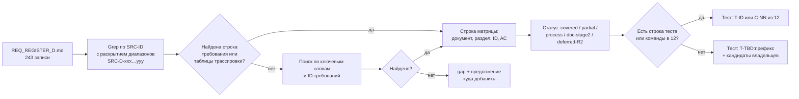

# 17D — Матрица трассируемости, часть D: Flutter-архитектура, backend и модель данных, безопасность, тестирование, план реализации, критерии готовности, финальный отчёт

Версия 1.0 · Дата 2026-10-19 · Статус: черновик для утверждения заказчиком

**Входные материалы:** `source/REQ_REGISTER_D.md` (243 записи `SRC-D-001`…`SRC-D-192`, включая записи с суффиксами `a`…`e`); `source/MASTER_PROMPT_extracted.md`, строки 379–548 (разделы 14–20 первого промта) и 550–559 (правило двух этапов); ядро решений `docs/research/R0_DECISION_KERNEL.md` v1.4 (§10, §11, §15, §16–§19).

**Связанные документы:** 01_PRODUCT_REQUIREMENTS.md, 02_SCREEN_SPECIFICATION.md, 03_UX_UI_DESIGN_SYSTEM.md, 04_USER_FLOWS.md, 05_ONEC_INTEGRATION.md, 06_ARCHITECTURE.md, 07_DATA_MODEL.md, 08_API_SPECIFICATION.md, 09_AUTH_SMS_BIOMETRICS.md, 10_POS_BUSINESS_RULES.md, 11_SECURITY_PRIVACY.md, 12_TEST_PLAN.md, 13_IMPLEMENTATION_ROADMAP.md, 14_OPEN_QUESTIONS.md, 15_DECISION_LOG.md, 16_DEPLOYMENT_PLAN.md, visual/*; сборный документ — 17_TRACEABILITY_MATRIX.md (сборщик).

**Состояние документов 01, 12, 14 на момент сверки.** В первой версии матрицы этих документов в каталоге не было. При доработке их листинг выполнялся дважды, и оба раза файлы ещё дописывались. В 05:08 (+04:00): 01 — 1537 строк, 12 — 385 строк (только §1–§3.1), 14 — 752 строки. В 05:20 (+04:00): 01 — 1537 строк (изменён в 05:10), 12 — 1395 строк (изменён в 05:17; написаны §1–§3.14, разделов §4–§13 оглавления ещё нет), 14 — 819 строк (изменён в 05:15). Матрица сверена с содержимым на 05:20 `[ПОДТВЕРЖДЕНО: листинг каталога и Grep по SRC-D 2026-10-19 05:20 +04:00]`. Сверку по 01, 12 и 14 нужно повторить при сборке 17, после того как авторы закончат эти документы (§10 п. 1).

---

## 1. Краткое содержание

1. Документ — матрица трассируемости для **всех 243 записей** части D реестра исходных требований (`SRC-D-001`…`SRC-D-192` с суффиксами): для каждой записи указано место в ТЗ, ID требований, критерий приёмки, тест и статус покрытия.
2. Каждая ссылка на раздел или ID проверена Grep по SRC-ID во всех `docs/specification/*.md` и `visual/*.md`, включая 01, 12 и 14 в состоянии на 05:20. У 17 записей прямой SRC-ссылки нет ни в одном документе: SRC-D-177…182, SRC-D-184, SRC-D-185, SRC-D-187…192 с суффиксами 189a…c. Для них место найдено поиском по ключевым словам и ID требований (помечено «по ключевым словам») `[ПОДТВЕРЖДЕНО: Grep 2026-10-19 05:20]`. В первой версии таких записей было 24. Прямые ссылки появились у SRC-D-134…139 (01 GEN-239, 12 C-01…C-10) и у SRC-D-186 (12 P-2).
3. Итог по статусам (§4): covered — 157, doc-stage2 — 54, process — 27, partial — 5, gap — 0, deferred-R2 — 0. Требований без места в ТЗ нет. Все 5 частичных покрытий относятся к составу финального отчёта и к запрету обещать безошибочность (SRC-D-182…185, SRC-D-187). После появления 12 и 14 в covered переведены SRC-D-091 (partial), SRC-D-172 (partial) и SRC-D-172a (doc-stage2).
4. Колонка «Тест» содержит ID теста или команды из 12_TEST_PLAN.md, если в 12 есть строка со ссылкой на эту запись SRC-D. Так заполнены 70 записей. Для пяти из них — SRC-D-032, 033, 140, 149a, 162 — строка 12 найдена по ключевым словам, а не по SRC-ссылке. Тесты обязательных сценариев промта: `T-AUTH-001…010` (12 §3.1.1), `T-CAT-001…010` (§3.3.1), `T-CART-001…010` (§3.4.1), `T-CASH-001…007` (§3.6.1), `T-SYNC-001…008` (§3.7.1), сценарии сбоев `T-SYNC-F01…F18` (§3.7.5). Команды CI — `C-01…C-18` (12 §2.9–§2.10). Также используются `T-ARCH`, `T-BUILD`, `T-SESS`, `T-SMS`, `T-ONEC`, `T-DEPLOY`. Строки 12 по префиксам DATA, SEC, INV, ORD и другим на записи SRC-D не ссылаются, поэтому для этих записей сохранены `T-TBD:<префикс>` и кандидаты документов-владельцев: 11 §12.2 — `T-SEC-001…055`, 04 — `T-FLOW-NNN-kk`. Привязку оставшихся T-TBD к тестам 12 выполняет сборщик 17 (§7).
5. Требования разделов 18–20 промта (план, критерии готовности, финальный отчёт) по природе выполняются на ЭТАПЕ 2; они трассируются на задачи и доказательства 13_IMPLEMENTATION_ROADMAP.md (статус doc-stage2). На ЭТАПЕ 1 код не создаётся (R0 §0).
6. Обнаружено: регистр части D содержит 243 записи, а не 273 (273 — число строк с префиксом `| SRC-D` вместе с таблицами журнала проверки реестра); формулировка «гарантированно доходит до 1С» в 04 противоречит SRC-D-187; 08 не содержит SRC-D-ссылок, хотя покрывает SRC-D-080/083/086 (§5, §10).

---

## 2. Методика, легенда статусов и правила колонок

### 2.1. Порядок трассировки

- Диапазоны вида `SRC-D-102…SRC-D-109`, `SRC-D-145…145d`, `SRC-D-104/104a` раскрывались по порядку записей реестра.
- Ссылки из шапок документов («Входные материалы», «зона трассировки: SRC-D-001…SRC-D-041») покрытием **не считались**; учитывались только строки требований (`| ID | … | Источник SRC-… |`), строки таблиц трассировки документов и строки трассировки экранов 02 (`SCR-xx.14`).
- Все ссылки колонки «Документ и раздел ТЗ» — `[ПОДТВЕРЖДЕНО: Grep 2026-10-19]`; номер раздела указан так, как он озаглавлен в документе. «(трасс.)» — таблица трассировки документа; «(по ключевым словам)» — место найдено без прямой SRC-ссылки.

### 2.2. Легенда статусов покрытия

| Статус | Значение |
|---|---|
| covered | В ТЗ есть проверяемое требование (ID) и критерий приёмки `AC-…`, полностью покрывающие запись |
| partial | Покрыта часть записи, или нет отдельного требования/AC, или нет обратной SRC-ссылки при неочевидном соответствии — предложение в §5 |
| process | Требование к процессу работы; выполнено методикой ЭТАПА 1 (указано, чем) и/или закреплено правилом для ЭТАПА 2 |
| doc-stage2 | Артефакт или действие ЭТАПА 2; в ТЗ указано, где он будет создан/выполнен (задача `RM-…` в 13, раздел 16) |
| deferred-R2 | Перенесено в Release 2 с Q-ссылкой (в части D таких записей нет) |
| gap | Места в ТЗ не найдено (в части D таких записей нет) |

### 2.3. Правила колонок

- «Тип» — из реестра (функц. / нефункц. / ограничение / процесс / документ).
- «Критерий приёмки» — ID `AC-…` из документа-владельца требования; «—» — у требования нет отдельного AC (раздел/таблица 13 служит доказательством).
- «Тест» — ID теста `T-…` или команды CI `C-NN` из 12_TEST_PLAN.md с указанием раздела 12, если в 12 на момент листинга (05:20) есть такая строка со ссылкой на запись SRC-D или однозначным номером сценария. Если строки нет — `T-TBD:<префикс>`, а в скобках ID-кандидаты, уже назначенные документами-владельцами. Если номер теста подобран по номеру сценария, а не по SRC-ссылке (например, `T-SYNC-F03` по сбою F3 из 05 §13), это указано в ячейке «Документ и раздел ТЗ» («по номеру сбоя») или «(по ключевым словам)». «н/п» — тест неприменим (процесс или документ ЭТАПА 1).
- Сокращения документов: 01 … 16 — номера файлов ТЗ; `ADR-…` — 15_DECISION_LOG.md; `RM-…` — 13_IMPLEMENTATION_ROADMAP.md; `GEN-…`, `NFR-…`, `ROLE-…` — 01_PRODUCT_REQUIREMENTS.md; `C-NN`, `P-N` (в ссылке «12 …») — 12 §2.10 и §2.1. Ссылки на 01, 12 и 14 расположены в конце ячейки «Документ и раздел ТЗ»: они добавлены при доработке по состоянию на 05:20.

---

## 3. Матрица трассируемости

### 3.1. Раздел 14 промта — требования к Flutter-архитектуре (SRC-D-001…SRC-D-041)

| SRC-ID | Краткая формулировка | Тип | Документ и раздел ТЗ | ID требования(й) ТЗ | Критерий приёмки (AC-…) | Тест | Статус покрытия |
|---|---|---|---|---|---|---|---|
| SRC-D-001 | Актуальная стабильная версия Flutter | ограничение | 06 §2.1, §6.16, §17.1, §19 (трасс.); 15 ADR-004; 12 §3.12.3 (T-ARCH-003) | ARCH-014; ADR-004 | AC-ARCH-014; AC-ADR-004 | T-ARCH-003 (12 §3.12.3) | covered |
| SRC-D-002 | Зависимости совместимы и проверены в текущем окружении | ограничение | 06 §6.16, §16, §17.1; 13 §3.3; 01 §6.2; 12 §3.12.3 (T-ARCH-003) | ARCH-014; ADR-004; RM-C-013; NFR-MAINT-001 | AC-ARCH-014; AC-RM-C-013 | T-ARCH-003 (12 §3.12.3) | covered (совместимость набора `[ТИПОВО]` до пробной сборки RM-C-013) |
| SRC-D-003 | Перед выбором библиотеки проверить совместимость | процесс | 06 §16, §17.1, §19 (трасс.); 01 §6.2; 12 §3.12.3 (T-ARCH-003) | ARCH-015; NFR-MAINT-001 | AC-ARCH-015 | н/п (процесс ЭТАПА 1); на ЭТАПЕ 2 — T-ARCH-003 (12 §3.12.3) | process (ЭТАП 1: исследование R3 §1, обоснование 06 §16; правило ARCH-015 для ЭТАПА 2) |
| SRC-D-004 | Проверить поддержку (сопровождение) библиотеки | процесс | 06 §16, §17.1; 15 ADR-004; 01 §6.2; 12 §3.12.3 (T-ARCH-003) | ARCH-015; ADR-004; NFR-MAINT-001 | AC-ARCH-015; AC-ADR-004 | н/п (процесс ЭТАПА 1); на ЭТАПЕ 2 — T-ARCH-003 (12 §3.12.3) | process (ЭТАП 1: R3 §1 — даты релизов/активность; 06 §16) |
| SRC-D-005 | Проверить лицензию библиотеки | процесс | 06 §16, §17.1; 15 ADR-004, ADR-049; 01 §6.2; 12 §3.12.3 (T-ARCH-003) | ARCH-015; ADR-004; ADR-049; NFR-MAINT-001 | AC-ARCH-015; AC-ADR-004 | н/п (процесс ЭТАПА 1); на ЭТАПЕ 2 — T-ARCH-003 (12 §3.12.3) | process (ЭТАП 1: лицензии в 06 §16, 15 ADR-004/ADR-049) |
| SRC-D-006 | Проверить состояние проекта (жив/заброшен) | процесс | 06 §16, §17.1; 15 ADR-004; 01 §6.2; 12 §3.12.3 (T-ARCH-003) | ARCH-015; ADR-004; NFR-MAINT-001 | AC-ARCH-015; AC-ADR-004 | н/п (процесс ЭТАПА 1); на ЭТАПЕ 2 — T-ARCH-003 (12 §3.12.3) | process (ЭТАП 1: R3 §12 — отказ от discontinued пакетов, 06 §6.13) |
| SRC-D-007 | Организация приложения по функциональным модулям | нефункц. | 06 §6.2, §6.15, §17.2; 15 ADR-005; 01 §5.21 | MOD-001; ADR-005; GEN-219 | AC-MOD-001; AC-ADR-005; AC-GEN-219 | T-TBD:MOD | covered |
| SRC-D-008 | Модуль core | нефункц. | 06 §6.2, §17.2; 01 §5.21 | MOD-002; GEN-219 | AC-MOD-002; AC-GEN-219 | T-TBD:MOD | covered |
| SRC-D-009 | Модуль design_system | нефункц. | 06 §6.2, §17.2; 01 §5.21 | MOD-003; GEN-219 | AC-MOD-003; AC-GEN-219 | T-TBD:MOD | covered |
| SRC-D-010 | Модуль authentication | нефункц. | 06 §6.15, §17.2; 01 §5.21 | MOD-004; GEN-219 | AC-MOD-004; AC-GEN-219 | T-TBD:MOD | covered |
| SRC-D-011 | Модуль registration | нефункц. | 06 §6.15, §17.2; 01 §5.21 | MOD-005; GEN-219 | AC-MOD-005; AC-GEN-219 | T-TBD:MOD | covered |
| SRC-D-012 | Модуль catalog | нефункц. | 06 §6.15, §17.2; 01 §5.21 | MOD-006; GEN-219 | AC-MOD-006; AC-GEN-219 | T-TBD:MOD | covered |
| SRC-D-013 | Модуль product_details | нефункц. | 06 §6.15, §17.2; 01 §5.21 | MOD-007; GEN-219 | AC-MOD-007; AC-GEN-219 | T-TBD:MOD | covered |
| SRC-D-014 | Модуль cart | нефункц. | 06 §6.15, §17.2; 01 §5.21 | MOD-008; GEN-219 | AC-MOD-008; AC-GEN-219 | T-TBD:MOD | covered |
| SRC-D-015 | Модуль checkout | нефункц. | 06 §6.15, §17.2; 01 §5.21 | MOD-009; GEN-219 | AC-MOD-009; AC-GEN-219 | T-TBD:MOD | covered |
| SRC-D-016 | Модуль cashier | нефункц. | 06 §6.15, §17.2; 01 §5.21 | MOD-010; GEN-219 | AC-MOD-010; AC-GEN-219 | T-TBD:MOD | covered |
| SRC-D-017 | Модуль customers | нефункц. | 06 §6.15, §17.2; 01 §5.21 | MOD-011; GEN-219 | AC-MOD-011; AC-GEN-219 | T-TBD:MOD | covered |
| SRC-D-018 | Модуль transactions | нефункц. | 06 §6.15, §17.2; 01 §5.21 | MOD-012; GEN-219 | AC-MOD-012; AC-GEN-219 | T-TBD:MOD | covered |
| SRC-D-019 | Модуль favorites | нефункц. | 06 §6.15, §17.2; 01 §5.21 | MOD-013; GEN-219 | AC-MOD-013; AC-GEN-219 | T-TBD:MOD | covered |
| SRC-D-020 | Модуль profile | нефункц. | 06 §6.15, §17.2; 01 §5.21 | MOD-014; GEN-219 | AC-MOD-014; AC-GEN-219 | T-TBD:MOD | covered |
| SRC-D-021 | Модуль settings | нефункц. | 06 §6.15, §17.2; 01 §5.21 | MOD-015; GEN-219 | AC-MOD-015; AC-GEN-219 | T-TBD:MOD | covered |
| SRC-D-022 | Модуль sync_status | нефункц. | 06 §6.15, §17.2; 01 §5.21 | MOD-016; GEN-219 | AC-MOD-016; AC-GEN-219 | T-TBD:MOD | covered |
| SRC-D-023 | Разделение UI, состояния, бизнес-логики, репозиториев, сети | нефункц. | 06 §6.1, §17.1; 15 ADR-005; 01 §5.21 | ARCH-016; ADR-005; GEN-217 | AC-ARCH-016; AC-ADR-005; AC-GEN-217 | T-TBD:ARCH | covered |
| SRC-D-024 | Запрет всей логики в одном файле/виджете | ограничение | 06 §6.1, §17.1; 15 ADR-005; 01 §5.21 | ARCH-017; ADR-005; GEN-218 | AC-ARCH-017; AC-GEN-218 | T-TBD:ARCH | covered |
| SRC-D-025 | Типизированные модели данных | нефункц. | 06 §6.8, §17.1 | ARCH-022 | AC-ARCH-022 | T-TBD:ARCH | covered |
| SRC-D-026 | Централизованная обработка ошибок | нефункц. | 06 §6.8, §17.1; 15 ADR-056; 01 §5.21 | ARCH-022; ADR-056; GEN-225 | AC-ARCH-022; AC-ADR-056; AC-GEN-225 | T-TBD:ARCH | covered |
| SRC-D-027 | Маршрутизация как отдельный механизм | нефункц. | 06 §6.4, §17.1; 15 ADR-050; visual/navigation.md; 01 §5.1 | ARCH-019; ADR-050; GEN-021 | AC-ARCH-019; AC-ADR-050; AC-GEN-021 | T-TBD:ARCH | covered |
| SRC-D-028 | Управление конфигурацией приложения | нефункц. | 06 §6.9, §17.1; 01 §5.21 | ARCH-024; GEN-225 | AC-ARCH-024; AC-GEN-225 | T-TBD:ARCH | covered |
| SRC-D-029 | Сервисы тестируемы | нефункц. | 06 §6.13, §7.12, §17.1; 12 §2.1 (P-7); 12 §3.12.3 (T-ARCH-007) | ARCH-025 | AC-ARCH-025 | T-ARCH-007 (12 §3.12.3) | covered |
| SRC-D-030 | Запрет пакетов «по популярности» | ограничение | 06 §2.2 (C-6), §16, §17.1; 15 ADR-004, §9 (трасс.); 01 §5.21 | ARCH-015; ADR-004; GEN-226 | AC-ARCH-015; AC-ADR-004; AC-GEN-226 | н/п | covered |
| SRC-D-031 | Обоснование существенных зависимостей | процесс | 06 §16, §17.1; 15 §6, ADR-004; 01 §5.21 | ARCH-015; ADR-004; GEN-226 | AC-ARCH-015; AC-ADR-004; AC-GEN-226 | н/п | process (ЭТАП 1: 06 §16 и 15 §6 — польза/стоимость/альтернативы по каждой зависимости) |
| SRC-D-032 | Безопасное хранение сессионных данных | нефункц. | 06 §6.6, §17.1; 15 ADR-012, ADR-061; 02 SCR-08.14 (трасс.); 01 §5.4, §5.21; 12 §3.1.3 (T-SESS-003, T-SESS-022) (по ключевым словам) | ARCH-021; ADR-012; ADR-061; GEN-055; GEN-056; GEN-229 | AC-ARCH-021; AC-ADR-012; AC-GEN-055; AC-GEN-056; AC-GEN-229 | T-SESS-003, T-SESS-022 (12 §3.1.3); T-SEC-035 | covered |
| SRC-D-033 | Корректное завершение сессии | функц. | 06 §6.7, §17.1; 15 ADR-012; 02 SCR-07.14, SCR-08.14, SCR-90.14 (трасс.); 01 §5.4; 12 §3.1.3 (T-SESS-013) (по ключевым словам) | ARCH-021; ADR-012; GEN-061 | AC-ARCH-021; AC-ADR-012; AC-GEN-061 | T-SESS-013 (12 §3.1.3); T-SEC-012 | covered |
| SRC-D-034 | Обработка потери сети | функц. | 06 §6.7, §6.11, §6.12, §17.1; 15 ADR-032; 02 SCR-08.14, SCR-90.14 (трасс.); 01 §5.1, §5.7, §5.21 | ARCH-020; ARCH-026; ARCH-027; ARCH-062; ADR-032; GEN-023; GEN-101; GEN-228 | AC-ARCH-026; AC-ARCH-027; AC-ARCH-062; AC-ADR-032; AC-GEN-023; AC-GEN-101; AC-GEN-228 | T-TBD:ARCH | covered |
| SRC-D-035 | Восстановление состояния приложения | функц. | 06 §6.4, §6.12, §17.1; 15 ADR-032, ADR-050; 01 §5.21 | ARCH-019; ARCH-020; ARCH-026; GEN-228 | AC-ARCH-019; AC-ARCH-020; AC-ARCH-026; AC-GEN-228 | T-TBD:ARCH | covered |
| SRC-D-036 | Проверить требования каждой платформы | процесс | 06 §6.16, §17.1; 15 ADR-039; 01 §5.23 | ARCH-028; ADR-039; GEN-241 | AC-ARCH-028; AC-ADR-039; AC-GEN-241 | н/п | process (ЭТАП 1: чек-лист платформ 06 §6.16 по R3 §13; проверка сборкой — RM-C-013, ЭТАП 2; iOS — Q-008) |
| SRC-D-037 | Проверить ввод с клавиатуры на каждой платформе | процесс | 06 §6.16, §17.1; 15 ADR-042; visual/navigation.md, visual/responsive-spec.md; 01 §5.1, §5.23, §6.2 | ARCH-028; ADR-042; GEN-028; GEN-241; NFR-A11Y-002 | AC-ARCH-028; AC-ADR-042; AC-GEN-028; AC-GEN-241 | T-TBD:ARCH | process (чек-лист 06 §6.16; фактическая проверка — RM-C-013/RM-H-007) |
| SRC-D-038 | Проверить размеры экрана на каждой платформе | процесс | 06 §6.16, §17.1; 01 §5.23 | ARCH-028; GEN-241 | AC-ARCH-028; AC-GEN-241 | T-TBD:ARCH | process (брейкпоинты D-18, 06 §6.16; golden-тесты compact/medium/expanded — 13 §6.1 п. 4) |
| SRC-D-039 | Проверить работу сканеров на каждой платформе | процесс | 06 §6.16, §17.1; 15 ADR-042; 01 §5.23, §6.2 | ARCH-028; ADR-042; GEN-241; NFR-PERF-012; NFR-DEV-003 | AC-ARCH-028; AC-ADR-042; AC-GEN-241 | T-TBD:ARCH | process (чек-лист 06 §6.16; модели сканеров — Q-009, RM-A-008) |
| SRC-D-040 | Проверить особенности установки на каждой платформе | процесс | 06 §6.16, §17.1; 15 ADR-039; 01 §5.23 | ARCH-028; ADR-039; GEN-241 | AC-ARCH-028; AC-GEN-241 | н/п | process (MSIX/zip, APK — 06 §6.16; фактическая установка — RM-H-007, RM-I-001) |
| SRC-D-041 | Не заявлять поддержку платформы без проверенной сборки | ограничение | 06 §2.2 (C-8), §6.16, §17.1; 15 ADR-039; 01 §5.23 | ARCH-029; ADR-039; GEN-241 | AC-ARCH-029; AC-ADR-039; AC-GEN-241 | T-TBD:ARCH | covered |

### 3.2. Раздел 15 промта — backend и модель данных (SRC-D-042…SRC-D-076)

| SRC-ID | Краткая формулировка | Тип | Документ и раздел ТЗ | ID требования(й) ТЗ | Критерий приёмки (AC-…) | Тест | Статус покрытия |
|---|---|---|---|---|---|---|---|
| SRC-D-042 | Сущности по реальной структуре магазина | процесс | 07 §1, §3, §5, §18 (трасс.) | DATA-102 | AC-DATA-102 | н/п | process (ЭТАП 1: карточки 07 §5 построены по R1 §5, R5 §4 и макетам; подтверждение по `$metadata` 1С — RM-A-002, Q-010) |
| SRC-D-043 | Исследовать сущности-кандидаты до проектирования | процесс | 07 §2.2, §3, §5, §18 (трасс.), §19 | DATA-003 | AC-DATA-003 | н/п | process (ЭТАП 1: по каждой сущности-кандидату — карточка 07 §5 или решение об объединении/исключении, 07 §19 п. 1–2) |
| SRC-D-044 | Сущность users | процесс | 07 §5.1, §18 (трасс.) | DATA-100 | AC-DATA-100 | T-TBD:DATA | covered |
| SRC-D-045 | Сущность user_profiles | процесс | 07 §5.2, §18 (трасс.) | DATA-101 | AC-DATA-101 | T-TBD:DATA | covered |
| SRC-D-046 | Сущность customer_links | процесс | 07 §5.30, §6.6, §18 (трасс.) | DATA-129; DATA-207 | AC-DATA-129; AC-DATA-207 | T-TBD:DATA | covered |
| SRC-D-047 | Сущность products | процесс | 07 §5.16, §18 (трасс.) | DATA-115 | AC-DATA-115 | T-TBD:DATA | covered |
| SRC-D-048 | Сущность product_variants | процесс | 07 §5.17–5.19, §18 (трасс.) | DATA-116; DATA-117; DATA-118 | AC-DATA-116; AC-DATA-117; AC-DATA-118 | T-TBD:DATA | covered |
| SRC-D-049 | Сущность categories | процесс | 07 §5.15, §18 (трасс.) | DATA-114 | AC-DATA-114 | T-TBD:DATA | covered |
| SRC-D-050 | Сущность product_images | процесс | 07 §5.23, §18 (трасс.) | DATA-122 | AC-DATA-122 | T-TBD:DATA | covered |
| SRC-D-051 | Сущность warehouses | процесс | 07 §5.24, §18 (трасс.) | DATA-123 | AC-DATA-123 | T-TBD:DATA | covered |
| SRC-D-052 | Сущность stock_balances | процесс | 07 §5.25, §18 (трасс.) | DATA-124 | AC-DATA-124 | T-TBD:DATA | covered |
| SRC-D-053 | Сущность price_lists | процесс | 07 §5.26–5.27, §18 (трасс.) | DATA-125; DATA-126 | AC-DATA-125; AC-DATA-126 | T-TBD:DATA | covered |
| SRC-D-054 | Сущность customers | процесс | 07 §5.28–5.29, §18 (трасс.) | DATA-127; DATA-128; DATA-166; DATA-167 | AC-DATA-127; AC-DATA-166 | T-TBD:DATA | covered |
| SRC-D-055 | Сущность orders | процесс | 07 §5.37, §6.3, §6.6, §18 (трасс.) | DATA-136; DATA-201; DATA-202 | AC-DATA-136; AC-DATA-201; AC-DATA-202 | T-TBD:DATA | covered |
| SRC-D-056 | Сущность order_items | процесс | 07 §5.38, §7.6, §18 (трасс.) | DATA-137; DATA-213 | AC-DATA-137; AC-DATA-213 | T-TBD:DATA | covered |
| SRC-D-057 | Сущность payments | процесс | 07 §5.40–5.41, §6.4, §6.6, §18 (трасс.) | DATA-139; DATA-140; DATA-203 | AC-DATA-139; AC-DATA-140; AC-DATA-203 | T-TBD:DATA | covered |
| SRC-D-058 | Сущность transactions | процесс | 07 §4.6, §5.44, §18 (трасс.) | DATA-032; DATA-143 | AC-DATA-032; AC-DATA-143 | T-TBD:DATA | covered |
| SRC-D-059 | Сущность receivables | процесс | 07 §3, §5.31–5.32, §18 (трасс.) | DATA-024; DATA-130; DATA-131 | AC-DATA-024; AC-DATA-130; AC-DATA-131 | T-TBD:DATA | covered |
| SRC-D-060 | Сущность favorites | процесс | 07 §5.47–5.48, §18 (трасс.) | DATA-146; DATA-147 | AC-DATA-146; AC-DATA-147 | T-TBD:DATA | covered (сущность промта представлена двумя таблицами ядра `favorites_products`, `favorites_customers`) |
| SRC-D-061 | Сущность carts | процесс | 07 §5.35, §6.6, §11.6, §18 (трасс.) | DATA-134; DATA-205; DATA-253 | AC-DATA-134; AC-DATA-205; AC-DATA-253 | T-TBD:DATA | covered |
| SRC-D-062 | Сущность cart_items | процесс | 07 §5.36, §18 (трасс.) | DATA-135 | AC-DATA-135 | T-TBD:DATA | covered |
| SRC-D-063 | Сущность sync_runs | процесс | 07 §5.51–5.52, §5.54, §6.6, §18 (трасс.) | DATA-150; DATA-151; DATA-153; DATA-154; DATA-209 | AC-DATA-150; AC-DATA-209 | T-TBD:DATA | covered |
| SRC-D-064 | Сущность sync_errors | процесс | 07 §5.53, §18 (трасс.) | DATA-152 | AC-DATA-152 | T-TBD:DATA | covered |
| SRC-D-065 | Сущность audit_logs | процесс | 07 §5.57–5.58, §9, §9.7, §18 (трасс.) | DATA-156; DATA-157; DATA-230…DATA-238 | AC-DATA-156; AC-DATA-230 | T-TBD:DATA (кандидаты 11 §12.2: T-SEC-030, T-SEC-038) | covered |
| SRC-D-066 | Перечень сущностей предварительный, уточняется | процесс | 07 §1, §2.2, §5, §18 (трасс.), §19 | DATA-003 | AC-DATA-003 | н/п | process (ЭТАП 1: 63 карточки 07 §5 = 56 таблиц ядра §6 + 7 таблиц ядра §17.3 — уточнение предварительного перечня) |
| SRC-D-067 | Не дублировать сущности проекта и 1С | ограничение | 07 §2.2, §3, §5, §18 (трасс.); 05 §4.2, §7.1, §16 (трасс.); 10 §15.3, §22 (трасс.) | DATA-013; DATA-020; DATA-021; DATA-163; DATA-166; ONEC-026; SYNC-004; CUST-014 | AC-DATA-013; AC-DATA-020; AC-ONEC-026; AC-SYNC-004; AC-CUST-014 | T-TBD:DATA | covered |
| SRC-D-068 | Первичный ключ каждой сущности | документ | 07 §2.2, §5 (поле PK), §14.8, §18 (трасс.) | DATA-001; DATA-008; DATA-285 | AC-DATA-001; AC-DATA-008; AC-DATA-285 | T-TBD:DATA | covered |
| SRC-D-069 | Внешний идентификатор 1С каждой сущности | документ | 07 §2.2, §3, §5 (поле «Внешний id 1С»), §8.6, §18 (трасс.); 05 §4.2, §5.2, §16 (трасс.); 15 ADR-028 | DATA-008; DATA-021; DATA-023; DATA-127; DATA-136; DATA-139; DATA-141; DATA-222; ONEC-026; ONEC-100 | AC-DATA-008; AC-DATA-023; AC-ONEC-100 | T-TBD:DATA | covered |
| SRC-D-070 | Ограничения уникальности каждой сущности | документ | 07 §2.2, §5 (поле «Уникальность»), §18 (трасс.) | DATA-008; DATA-100; DATA-102; DATA-116; DATA-121; DATA-123; DATA-125; DATA-126; DATA-127; DATA-129; DATA-134; DATA-139; DATA-150; DATA-154; DATA-155 | AC-DATA-008; AC-DATA-116; AC-DATA-129 | T-TBD:DATA | covered |
| SRC-D-071 | Индексы каждой сущности | документ | 07 §5 (поле «Индексы»), §10.2, §10.6, §12.5, §18 (трасс.) | DATA-164; DATA-240…DATA-243; DATA-246; DATA-272 | AC-DATA-164; AC-DATA-240; AC-DATA-272 | T-TBD:DATA | covered |
| SRC-D-072 | Правила удаления каждой сущности | документ | 07 §2.2, §5 (поле «Удаление»), §13.3–13.4, §15.3, §15.6, §18 (трасс.) | DATA-006; DATA-007; DATA-148; DATA-149; DATA-282; DATA-293; DATA-294 | AC-DATA-006; AC-DATA-007; AC-DATA-293 | T-TBD:DATA | covered |
| SRC-D-073 | Происхождение данных каждой сущности | документ | 07 §2.2, §3, §5 (колонка «Происх.»), §6.6, §11.6, §18 (трасс.); 05 §4.2, §5.2 | DATA-013; DATA-020; DATA-021; DATA-163; DATA-166; DATA-209; DATA-251; ONEC-026; ONEC-100 | AC-DATA-020; AC-DATA-251; AC-ONEC-100 | T-TBD:DATA | covered |
| SRC-D-074 | Точная десятичная арифметика денег, без неконтролируемого double | ограничение | 07 §2.2, §7, §7.6, §11.6, §18 (трасс.); 10 §18.2, §22 (трасс.); 11 §3.2, §16 (трасс.); 13 §2.1 (P-9); 01 §5.12, §6.2 | DATA-005; DATA-210…DATA-215; DATA-217; DATA-252; MNY-008; SEC-010; GEN-156; NFR-TEST-004 | AC-DATA-005; AC-DATA-210; AC-MNY-008; AC-SEC-010; AC-GEN-156 | T-TBD:MNY (тест-векторы `MV-NN` 10 §18.2) | covered |
| SRC-D-075 | Атомарность финансовых изменений и критичных переходов | нефункц. | 07 §5, §6.6, §8.5, §8.6, §18 (трасс.); 11 §3.5, §16 (трасс.) | DATA-138; DATA-142; DATA-143; DATA-146; DATA-162; DATA-201; DATA-203; DATA-222; DATA-227; SEC-023; SEC-024 | AC-DATA-201; AC-DATA-222; AC-SEC-023; AC-SEC-024 | T-TBD:DATA (кандидат 11 §12.2: T-SEC-023) | covered |
| SRC-D-076 | Финансовая история не меняется задним числом без корректирующих документов и аудита | ограничение | 07 §2.2, §8.6, §9.2, §9.7, §12.5, §14.8, §15.6, §18 (трасс.); 11 §3.5, §16 (трасс.); 01 §5.21 | DATA-004; DATA-136; DATA-156; DATA-161; DATA-228; DATA-231; DATA-235; DATA-275; DATA-287; DATA-293; SEC-024; SEC-074…SEC-076; SEC-079; SEC-084; SEC-125; GEN-221 | AC-DATA-004; AC-DATA-228; AC-SEC-024; AC-GEN-221 | T-TBD:DATA (кандидат T-SEC-041) | covered |

### 3.3. Раздел 16 промта — безопасность (SRC-D-077…SRC-D-090)

| SRC-ID | Краткая формулировка | Тип | Документ и раздел ТЗ | ID требования(й) ТЗ | Критерий приёмки (AC-…) | Тест | Статус покрытия |
|---|---|---|---|---|---|---|---|
| SRC-D-077 | HTTPS для всех соединений | нефункц. | 11 §3.1, §8.2, §16 (трасс.); 08 §2.1 (по ключевым словам); 01 §5.20, §6.2 | SEC-001…SEC-006; SEC-086; SEC-095; API-001; GEN-207; NFR-SEC-001 | AC-SEC-001; AC-SEC-006; AC-SEC-086; AC-GEN-207 | T-TBD:SEC (кандидат T-SEC-026) | covered |
| SRC-D-078 | Секреты вне исходного кода | нефункц. | 11 §3.4, §5.1, §5.2, §16 (трасс.); 16 §4.3 (по ключевым словам); 01 §5.20, §6.2 | SEC-019; SEC-049; SEC-050; SEC-056; SEC-057; SEC-058; SEC-060; GEN-209; NFR-SEC-004 | AC-SEC-049; AC-SEC-050; AC-SEC-060; AC-GEN-209 | T-TBD:SEC (кандидаты T-SEC-036, T-SEC-037) | covered |
| SRC-D-079 | Серверная проверка полномочий | нефункц. | 11 §3.3, §4.3–§4.5, §16 (трасс.); 01 §3.3, §6.2 | SEC-014; SEC-028; SEC-029; SEC-030; SEC-033; SEC-045; ROLE-011; NFR-SEC-001 | AC-SEC-014; AC-SEC-028; AC-SEC-029; AC-ROLE-011 | T-TBD:SEC (кандидаты T-SEC-015, T-SEC-016, T-SEC-018) | covered |
| SRC-D-080 | Защита API от неавторизованных запросов | нефункц. | 11 §3.1, §3.3, §3.4, §3.6, §6.2, §16 (трасс.); 15 ADR-037; 01 §5.20 | SEC-007; SEC-013; SEC-015; SEC-018…SEC-021; SEC-025; SEC-069; ADR-037; GEN-208 | AC-SEC-013; AC-SEC-015; AC-ADR-037; AC-GEN-208 | T-TBD:SEC (кандидаты T-SEC-009, T-SEC-016) | covered |
| SRC-D-081 | Безопасная авторизация по номеру телефона | нефункц. | 11 §2.3, §3.3, §4.5, §8.2, §16 (трасс.); 09 §4, §5 (по ключевым словам) | SEC-017; SEC-047; SEC-085; SEC-088…SEC-090 | AC-SEC-017; AC-SEC-085 | T-TBD:SEC (кандидаты T-SEC-001…T-SEC-006) | covered |
| SRC-D-082 | Rate limiting отправки SMS | нефункц. | 11 §3.3, §6.2, §16 (трасс.); 09 §5 (по ключевым словам); 01 §5.2 | SEC-016; SEC-068; GEN-034 | AC-SEC-016; AC-SEC-068; AC-GEN-034 | T-TBD:SEC (кандидат T-SEC-005) | covered |
| SRC-D-082a | Rate limiting проверки OTP | нефункц. | 09 §4.3, §5.3, §5.4, §13.1, §14.1, §16.4 (трасс.); 11 §3.3, §6.2, §16 (трасс.); 01 §5.2; 12 §3.1.1 (T-AUTH-006) | AUTH-021; AUTH-051; SEC-016; SEC-068; GEN-033 | AC-AUTH-006; AC-AUTH-022; AC-SEC-016; AC-GEN-033 | T-AUTH-006 (12 §3.1.1); T-SEC-001 | covered |
| SRC-D-083 | Валидация входных данных | нефункц. | 11 §3.2, §16 (трасс.); 08 §2.14 (по ключевым словам); 01 §5.20 | SEC-008; SEC-009; SEC-011; SEC-012; GEN-208 | AC-SEC-008; AC-SEC-009; AC-GEN-208 | T-TBD:SEC (кандидаты T-SEC-021, T-SEC-025, T-SEC-027) | covered |
| SRC-D-084 | В журналах нет паролей, токенов, OTP | ограничение | 11 §5.2, §6.2, §7.3, §8.2, §16 (трасс.); 15 ADR-036; 01 §5.11, §5.20, §6.2 | SEC-058; SEC-061…SEC-064; SEC-066; SEC-078; SEC-096; ADR-036; GEN-146; GEN-210; NFR-LOG-001 | AC-SEC-061; AC-SEC-062; AC-SEC-096; AC-GEN-146; AC-GEN-210 | T-TBD:SEC (кандидаты T-SEC-008, T-SEC-029) | covered |
| SRC-D-085 | Безопасная обработка фотографий | нефункц. | 11 §9.1, §9.2, §16 (трасс.); 15 ADR-030; 01 §5.20 | SEC-101…SEC-108; ADR-030; GEN-211 | AC-SEC-101; AC-SEC-105; AC-GEN-211 | T-TBD:SEC (кандидат T-SEC-046) | covered |
| SRC-D-086 | Защита от повторных финансовых запросов | нефункц. | 11 §3.5, §3.6, §6.2, §13.3, §16 (трасс.); 15 ADR-037; 08 §2.7 (по ключевым словам); 01 §5.9 | SEC-022; SEC-023; SEC-025; SEC-070; SEC-122; API-012…API-014; GEN-123 | AC-SEC-022; AC-SEC-023; AC-ADR-037; AC-GEN-123 | T-TBD:SEC (кандидаты T-SEC-023, T-SEC-024) | covered |
| SRC-D-087 | Резервное копирование данных | нефункц. | 11 §5.2, §6.2, §7.3, §11.3, §16 (трасс.); 16 §8, §18 (трасс.); 15 ADR-035; 01 §5.22 | SEC-059; SEC-071; SEC-081; SEC-082; SEC-109…SEC-115; SEC-117; OPS-001; OPS-003; OPS-008; ADR-035; GEN-233 | AC-SEC-109; AC-SEC-110; AC-OPS-008; AC-ADR-035; AC-GEN-233 | T-TBD:OPS (кандидат T-SEC-049) | covered |
| SRC-D-087a | Документированная процедура восстановления | документ | 11 §11.3, §13.3, §16 (трасс.); 16 §8.5, §15, §16.2, §18 (трасс.); 15 ADR-035; 01 §5.22 | SEC-109; SEC-114; SEC-116; SEC-118; SEC-119; SEC-123; OPS-008; OPS-028; GEN-233 | AC-SEC-116; AC-OPS-008; AC-OPS-028; AC-GEN-233 | T-TBD:OPS (кандидат T-SEC-049) | covered |
| SRC-D-088 | Тестирование разграничения доступа | процесс | 11 §4.5, §6.2, §12.2, §12.3, §13.3, §16 (трасс.); 01 §5.23; 12 §2.1 (P-5), §2.10 (C-13); 12 §3.6.1 (T-CASH-007) | SEC-041; SEC-046; SEC-069; SEC-124; SEC-126; SEC-127; SEC-128; GEN-240 | AC-SEC-046; AC-SEC-126; AC-SEC-128; AC-GEN-240 | T-CASH-007 (12 §3.6.1); C-13 (12 §2.10); T-SEC-015…T-SEC-020, T-SEC-043 | covered |
| SRC-D-089 | Нет секретов 1С и SMSPro во Flutter-клиенте | ограничение | 11 §2.2.1, §5.2, §8.2, §12.3, §16 (трасс.); 05 §6.6, §10, §10.1, §16 (трасс.); 01 §5.20, §6.2 | SEC-051; SEC-093; SEC-094; SEC-126; ONEC-032; ONEC-066; ONEC-084; GEN-209; NFR-SEC-004 | AC-SEC-051; AC-SEC-093; AC-ONEC-084; AC-GEN-209 | T-TBD:SEC (кандидат T-SEC-036) | covered |
| SRC-D-090 | Нет реальных данных клиентов в тестах, логах, демо без разрешения | ограничение | 11 §5.2, §6.2, §8.2, §10.6, §11.3, §12.3, §16 (трасс.); 01 §5.20; 12 §1 п. 6, §2.1 (P-3) | SEC-056; SEC-062; SEC-096; SEC-112; SEC-117; SEC-129; PRIV-023; PRIV-027; PRIV-028; GEN-213 | AC-SEC-129; AC-PRIV-027; AC-PRIV-028; AC-GEN-213 | T-TBD:SEC (кандидат T-SEC-048) | covered |

### 3.4. Раздел 17 промта — тестирование и проверки (SRC-D-091…SRC-D-143)

| SRC-ID | Краткая формулировка | Тип | Документ и раздел ТЗ | ID требования(й) ТЗ | Критерий приёмки (AC-…) | Тест | Статус покрытия |
|---|---|---|---|---|---|---|---|
| SRC-D-091 | Автотесты ключевых сценариев | процесс | 04 §15 (трасс.: все AC-FLOW → `T-FLOW-*`); 06 §6.13, §7.12; 13 §6.1 п. 3–5, §3.8; 01 §5.23, §6.2; 12 §2.1 (P-1), §3.1.1; 12 §3.3.1, §3.4.1, §3.6.1, §3.7.1, §3.13 | ARCH-025; RM-H-001; GEN-238; NFR-TEST-001 | AC-ARCH-025; AC-RM-H-001; AC-GEN-238 | T-AUTH-001…T-AUTH-010 (12 §3.1.1), T-CAT-001…T-CAT-010 (§3.3.1), T-CART-001…T-CART-010 (§3.4.1), T-CASH-001…T-CASH-007 (§3.6.1), T-SYNC-001…T-SYNC-008 (§3.7.1); сквозные T-FLOW-* (12 §3.13) | covered (01 GEN-238 и AC-GEN-238, NFR-TEST-001, 12 P-1; у каждого сценария промта SRC-D-092…133 — отдельный тест с пометкой «[промт]» в 12 §3; прогон — ЭТАП 2) |
| SRC-D-092 | Автотест: зарегистрированный клиент | процесс | 09 §13.1, §16.4 (трасс.); 04 §4 (FLOW-002), §15 (трасс.); 01 §5.23; 12 §3.1.1 (T-AUTH-001) | FLOW-002; GEN-238 | AC-AUTH-001; AC-FLOW-002-02; AC-GEN-238 | T-AUTH-001 (12 §3.1.1) | covered (в R1 «зарегистрированный» = активный пользователь `staff`, D-07; режим `customer` — Q-001) |
| SRC-D-093 | Автотест: новый клиент | процесс | 09 §4, §7, §13.1, §16.4 (трасс.); 04 §4 (FLOW-004), §15 (трасс.); 01 §5.23; 12 §3.1.1 (T-AUTH-002) | FLOW-004; GEN-238 | AC-AUTH-002; AC-FLOW-004-01…AC-FLOW-004-06; AC-GEN-238 | T-AUTH-002 (12 §3.1.1) | covered (новый номер без приглашения → `pending_activation` при выключенном `CUSTOMER_SELF_SERVICE`, D-07, Q-001) |
| SRC-D-094 | Автотест: неправильный OTP | процесс | 09 §4.4, §5.3, §13.1, §16.4 (трасс.); 04 FLOW-002.E6; 07 §5 (DATA-110), §18 (трасс.); 01 §5.2, §5.23; 12 §3.1.1 (T-AUTH-003) | DATA-110; GEN-033; GEN-238 | AC-AUTH-003; AC-FLOW-002-03; AC-DATA-110; AC-GEN-033; AC-GEN-238 | T-AUTH-003 (12 §3.1.1) | covered |
| SRC-D-095 | Автотест: истёкший OTP | процесс | 09 §5.3, §13.1, §16.4 (трасс.); 04 FLOW-002.E7; 07 DATA-110; 01 §5.2, §5.23; 12 §3.1.1 (T-AUTH-004) | DATA-110; GEN-033; GEN-238 | AC-AUTH-004; AC-FLOW-002-04; AC-GEN-033; AC-GEN-238 | T-AUTH-004 (12 §3.1.1); T-SEC-003 | covered |
| SRC-D-096 | Автотест: повторное использование OTP | процесс | 09 §5.3, §5.6, §13.1, §14.1, §16.4 (трасс.); 04 §15 (трасс.); 07 DATA-110; 01 §5.2, §5.23; 12 §3.1.1 (T-AUTH-005) | AUTH-051; DATA-110; GEN-033; GEN-238 | AC-AUTH-005; AC-FLOW-002-04; AC-GEN-033; AC-GEN-238 | T-AUTH-005 (12 §3.1.1); T-SEC-002 | covered |
| SRC-D-097 | Автотест: ограничение числа попыток | процесс | 09 §5.3, §5.4, §13.1, §16.4 (трасс.); 04 FLOW-002.E3, E8; 07 DATA-110; 01 §5.2, §5.23; 12 §3.1.1 (T-AUTH-006) | DATA-110; GEN-033; GEN-238 | AC-AUTH-006; AC-FLOW-002-03; AC-FLOW-002-05; AC-GEN-033; AC-GEN-238 | T-AUTH-006 (12 §3.1.1); T-SEC-001 | covered |
| SRC-D-098 | Автотест: ошибка SMS-сервиса | процесс | 09 §4.2, §4.3, §6.4, §6.8, §13.1, §13.5, §14.1, §14.2, §16.4 (трасс.); 04 FLOW-002.E5; 01 §5.2, §5.23, §6.2; 12 §3.1.1 (T-AUTH-007) | AUTH-035; AUTH-052; SMS-021; GEN-039; GEN-238; NFR-STAB-005 | AC-AUTH-007; AC-AUTH-082; AC-FLOW-002-06; AC-GEN-039; AC-GEN-238 | T-AUTH-007 (12 §3.1.1); T-SEC-050 | covered |
| SRC-D-099 | Автотест: потеря сети (авторизация) | процесс | 09 §4.4, §5.6, §8.3, §13.1, §13.5, §14.1, §14.4, §16.4 (трасс.); 04 FLOW-002.E1, FLOW-003.E5; 02 SCR-90.14 (трасс.); 01 §5.23; 12 §3.1.1 (T-AUTH-008) | AUTH-029; AUTH-034; AUTH-036; SESS-012; GEN-238 | AC-AUTH-008; AC-AUTH-056; AC-FLOW-001-06; AC-GEN-238 | T-AUTH-008 (12 §3.1.1) | covered |
| SRC-D-100 | Автотест: успешный биометрический вход | процесс | 09 §9.2, §9.3, §13.1, §16.4 (трасс.); 04 FLOW-003; 01 §5.4, §5.23; 12 §3.1.1 (T-AUTH-009) | FLOW-003; GEN-057; GEN-238 | AC-AUTH-009; AC-FLOW-003-01; AC-GEN-057; AC-GEN-238 | T-AUTH-009 (12 §3.1.1) | covered |
| SRC-D-101 | Автотест: неуспешный биометрический вход | процесс | 09 §9.3, §9.7, §13.1, §16.4 (трасс.); 04 FLOW-003; 01 §5.4, §5.23; 12 §3.1.1 (T-AUTH-010) | FLOW-003; GEN-057; GEN-238 | AC-AUTH-010; AC-FLOW-003-04; AC-FLOW-003-05; AC-GEN-057; AC-GEN-238 | T-AUTH-010 (12 §3.1.1); T-SEC-031, T-SEC-032 | covered |
| SRC-D-102 | Автотест каталога: получение товаров | процесс | 10 §5, §22 (трасс.); 02 SCR-10.14, §10.3 (трасс.); 04 FLOW-001.S7, FLOW-010; 01 §5.23; 12 §3.3.1 (T-CAT-001) | CAT-011; GEN-238 | AC-CAT-011; AC-UI-10-011; AC-GEN-238 | T-CAT-001 (12 §3.3.1) | covered |
| SRC-D-103 | Автотест каталога: поиск по артикулу | процесс | 10 §5, §22 (трасс.); 02 SCR-10.14, SCR-11.14, §10.3 (трасс.); 04 FLOW-010.A1; 01 §5.5, §5.23; 12 §3.3.1 (T-CAT-002) | CAT-001; GEN-066; GEN-238 | AC-CAT-001; AC-UI-11-003; AC-FLOW-010-02; AC-GEN-066; AC-GEN-238 | T-CAT-002 (12 §3.3.1) | covered |
| SRC-D-104 | Автотест каталога: категории | процесс | 10 §5, §22 (трасс.); 02 SCR-10.14, SCR-12.14, §10.3 (трасс.); 04 FLOW-010.A4; 01 §5.23; 12 §3.3.1 (T-CAT-003) | CAT-009; GEN-238 | AC-CAT-009; AC-UI-12-001; AC-FLOW-010-07; AC-GEN-238 | T-CAT-003 (12 §3.3.1) | covered |
| SRC-D-104a | Автотест каталога: подкатегории | процесс | 10 §5, §22 (трасс.); 02 SCR-10.14, SCR-12.14, §10.3 (трасс.); 04 FLOW-010.A4; 01 §5.23; 12 §3.3.1 (T-CAT-004) | CAT-009; GEN-238 | AC-CAT-009; AC-FLOW-010-06; AC-GEN-238 | T-CAT-004 (12 §3.3.1) | covered |
| SRC-D-105 | Автотест каталога: варианты товара | процесс | 10 §4.2, §22 (трасс.); 02 SCR-14.14, §10.3 (трасс.); 04 FLOW-012; 01 §5.6, §5.23; 12 §3.3.1 (T-CAT-005) | INV-012; GEN-081; GEN-238 | AC-INV-012; AC-FLOW-012-02; AC-GEN-081; AC-GEN-238 | T-CAT-005 (12 §3.3.1) | covered |
| SRC-D-105a | Автотест каталога: фотографии товара | процесс | 10 §4.2, §4.6, §22 (трасс.); 02 SCR-14.14, §10.3 (трасс.); 04 FLOW-012; 01 §5.6, §5.23; 12 §3.3.1 (T-CAT-006) | INV-012; INV-050; GEN-084; GEN-238 | AC-INV-050; AC-FLOW-012-02; AC-GEN-084; AC-GEN-238 | T-CAT-006 (12 §3.3.1) | covered |
| SRC-D-106 | Автотест каталога: остатки по складам | процесс | 10 §4.3, §22 (трасс.); 02 SCR-14.14, §10.3 (трасс.); 04 FLOW-012.A1; 01 §5.6, §5.23; 12 §3.3.1 (T-CAT-007) | INV-021; GEN-082; GEN-238 | AC-INV-021; AC-FLOW-012-06; AC-GEN-082; AC-GEN-238 | T-CAT-007 (12 §3.3.1) | covered |
| SRC-D-107 | Автотест каталога: товар без изображения | процесс | 10 §4.6, §22 (трасс.); 07 §5 (DATA-122), §18 (трасс.); 02 SCR-10.14, SCR-14.14 (трасс.); 04 FLOW-010.E3; 01 §5.6, §5.23; 12 §3.3.1 (T-CAT-008) | INV-050; DATA-122; GEN-084; GEN-238 | AC-INV-050; AC-FLOW-010-09; AC-DATA-122; AC-GEN-084; AC-GEN-238 | T-CAT-008 (12 §3.3.1) | covered |
| SRC-D-108 | Автотест каталога: отсутствующий товар | процесс | 10 §4.3, §5, §22 (трасс.); 02 SCR-11.14, SCR-14.14 (трасс.); 04 FLOW-010.E1, FLOW-011.E1, E2; 01 §5.6, §5.23; 12 §3.3.1 (T-CAT-009) | INV-023; CAT-004; GEN-085; GEN-238 | AC-INV-023; AC-CAT-004; AC-GEN-085; AC-GEN-238 | T-CAT-009 (12 §3.3.1) | covered |
| SRC-D-109 | Автотест: повторная синхронизация без дубликатов | процесс | 05 §7.1, §13, §16 (трасс.); 10 §4.6; 07 §5 (DATA-115); 02 SCR-12.14 (трасс.); 04 FLOW-033.E2; 01 §5.6, §5.23; 12 §3.3.1 (T-CAT-010) | SYNC-004; SYNC-005; SYNC-065; INV-054; DATA-115; GEN-088; GEN-238 | AC-SYNC-005; AC-INV-054; AC-FLOW-033-03; AC-GEN-088; AC-GEN-238 | T-CAT-010 (12 §3.3.1) | covered |
| SRC-D-110 | Автотест корзины: добавление товара | процесс | 10 §4.5, §7.2, §22 (трасс.); 07 §5 (DATA-135); 02 SCR-10.14, SCR-17.14, §10.3 (трасс.); 04 FLOW-013; 01 §5.7, §5.23; 12 §3.4.1 (T-CART-001) | INV-040; CART-002; DATA-135; GEN-091; GEN-238 | AC-CART-002; AC-INV-040; AC-FLOW-013-01; AC-UI-10-006; AC-GEN-091; AC-GEN-238 | T-CART-001 (12 §3.4.1) | covered |
| SRC-D-110a | Автотест корзины: удаление товара | процесс | 10 §7.2, §22 (трасс.); 02 SCR-10.14, SCR-16.14, §10.3 (трасс.); 04 FLOW-013; 01 §5.7, §5.23; 12 §3.4.1 (T-CART-002) | CART-003; CART-004; CART-012; GEN-091; GEN-238 | AC-CART-004; AC-UI-16-006; AC-GEN-091; AC-GEN-238 | T-CART-002 (12 §3.4.1) | covered |
| SRC-D-111 | Автотест корзины: изменение количества | процесс | 10 §7.2, §22 (трасс.); 02 SCR-10.14, SCR-16.14 (трасс.); 04 FLOW-013.S2–S4; 01 §5.7, §5.23; 12 §3.4.1 (T-CART-003) | CART-003; GEN-091; GEN-238 | AC-CART-003; AC-FLOW-013-02; AC-GEN-091; AC-GEN-238 | T-CART-003 (12 §3.4.1) | covered |
| SRC-D-112 | Автотест корзины: выбор другого варианта | процесс | 10 §7.2, §22 (трасс.); 02 SCR-15.14 (трасс.); 04 FLOW-012.A2; 01 §5.7, §5.23; 12 §3.4.1 (T-CART-004) | CART-005; GEN-092; GEN-238 | AC-CART-005; AC-FLOW-012-03; AC-GEN-092; AC-GEN-238 | T-CART-004 (12 §3.4.1) | covered |
| SRC-D-113 | Автотест корзины: восстановление корзины | процесс | 10 §7.2, §22 (трасс.); 04 FLOW-013.E2, FLOW-032; 01 §5.7, §5.23; 12 §3.4.1 (T-CART-005) | CART-009; GEN-094; GEN-238 | AC-CART-009; AC-FLOW-013-05; AC-GEN-094; AC-GEN-238 | T-CART-005 (12 §3.4.1) | covered |
| SRC-D-114 | Автотест продаж: изменение цены | процесс | 10 §7.2, §22 (трасс.); 04 FLOW-014; 01 §5.7, §5.23; 12 §3.4.1 (T-CART-006) | CART-013; GEN-096; GEN-238 | AC-CART-013; AC-FLOW-014-01; AC-GEN-096; AC-GEN-238 | T-CART-006 (12 §3.4.1) | covered |
| SRC-D-115 | Автотест продаж: недостаточный остаток | процесс | 10 §4.5, §7.2, §22 (трасс.); 02 SCR-16.14 (трасс.); 04 FLOW-014.S5–S6; 01 §5.7, §5.23; 12 §3.4.1 (T-CART-007) | INV-042; CART-014; GEN-096; GEN-238 | AC-CART-014; AC-INV-042; AC-FLOW-014-03; AC-GEN-096; AC-GEN-238 | T-CART-007 (12 §3.4.1) | covered |
| SRC-D-116 | Автотест продаж: повторный запрос | процесс | 10 §8.3, §22 (трасс.); 04 FLOW-018.E1, E8, FLOW-020.E1; 08 §2.7 (по ключевым словам); 01 §5.8, §5.21, §5.23, §6.2; 12 §3.4.1 (T-CART-008) | ORD-021; ORD-028; API-013; API-014; GEN-111; GEN-224; GEN-238; NFR-STAB-002 | AC-ORD-021; AC-ORD-028; AC-FLOW-018-02; AC-GEN-111; AC-GEN-224; AC-GEN-238 | T-CART-008 (12 §3.4.1); T-SEC-023 | covered |
| SRC-D-117 | Автотест продаж: ошибка создания заказа | процесс | 10 §7.2, §8.3, §22 (трасс.); 04 FLOW-018.E2, E6, FLOW-019.E3; 01 §5.8, §5.23; 12 §3.4.1 (T-CART-009) | CART-022; ORD-027; GEN-113; GEN-114; GEN-238 | AC-CART-022; AC-ORD-027; AC-GEN-113; AC-GEN-114; AC-GEN-238 | T-CART-009 (12 §3.4.1) | covered |
| SRC-D-118 | Автотест продаж: отмена операции | процесс | 10 §8.2, §8.4, §22 (трасс.); 04 FLOW-018.A3, FLOW-026; 01 §5.8, §5.23; 12 §3.4.1 (T-CART-010) | ORD-010; ORD-050; GEN-116; GEN-238 | AC-ORD-010; AC-ORD-050; AC-GEN-116; AC-GEN-238 | T-CART-010 (12 §3.4.1) | covered |
| SRC-D-119 | Автотест кассира: поиск клиента | процесс | 10 §15.2, §22 (трасс.); 02 SCR-31.14 (трасс.); 04 FLOW-028; 01 §5.11, §5.23; 12 §3.6.1 (T-CASH-001) | CUST-008; GEN-139; GEN-238 | AC-CUST-008; AC-GEN-139; AC-GEN-238 | T-CASH-001 (12 §3.6.1) | covered |
| SRC-D-120 | Автотест кассира: избранное | процесс | 10 §6, §22 (трасс.); 04 FLOW-028.S4, A1; 01 §5.11, §5.23; 12 §3.6.1 (T-CASH-002) | FAV-006; GEN-144; GEN-238 | AC-FAV-006; AC-GEN-144; AC-GEN-238 | T-CASH-002 (12 §3.6.1) | covered |
| SRC-D-121 | Автотест кассира: история покупок | процесс | 10 §15.2, §22 (трасс.); 02 SCR-33.14 (трасс.); 04 FLOW-030.S4; 01 §5.11, §5.23; 12 §3.6.1 (T-CASH-003) | CUST-005; GEN-141; GEN-238 | AC-CUST-005; AC-GEN-141; AC-GEN-238 | T-CASH-003 (12 §3.6.1) | covered |
| SRC-D-122 | Автотест кассира: отображение долга | процесс | 10 §10, §22 (трасс.); 04 FLOW-030, FLOW-025; 01 §5.12, §5.23; 12 §3.6.1 (T-CASH-004) | DEBT-002; GEN-149; GEN-238 | AC-DEBT-002; AC-GEN-149; AC-GEN-238 | T-CASH-004 (12 §3.6.1) | covered |
| SRC-D-123 | Автотест кассира: скидка по правилам | процесс | 10 §11.2, §18.2, §22 (трасс.); 02 SCR-35.14 (трасс.); 04 FLOW-015, FLOW-016; 15 ADR-023; 01 §5.12, §5.23; 12 §3.6.1 (T-CASH-005) | DISC-003; DISC-004; DISC-010; MNY-004; GEN-154; GEN-238 | AC-DISC-003; AC-DISC-004; AC-DISC-010; AC-MNY-004; AC-GEN-154; AC-GEN-238 | T-CASH-005 (12 §3.6.1); T-SEC-022 | covered |
| SRC-D-124 | Автотест кассира: просмотр транзакций | процесс | 10 §13, §22 (трасс.); 02 SCR-36.14 (трасс.); 04 FLOW-036; 01 §5.13, §5.23; 12 §3.6.1 (T-CASH-006) | TXN-002; FLOW-036; GEN-160; GEN-238 | AC-TXN-002; AC-FLOW-036-01…AC-FLOW-036-09; AC-GEN-160; AC-GEN-238 | T-CASH-006 (12 §3.6.1) | covered |
| SRC-D-125 | Автотест кассира: нет доступа к запрещённым операциям | процесс | 10 §14.2, §22 (трасс.); 04 §15 (трасс.); visual/navigation.md, visual/screen-map.md; 01 §5.23; 12 §3.6.1 (T-CASH-007) | CASH-016; GEN-238; GEN-240 | AC-CASH-016; AC-FLOW-016-02; AC-FLOW-020-04; AC-GEN-238; AC-GEN-240 | T-CASH-007 (12 §3.6.1); T-SEC-016 | covered |
| SRC-D-126 | Автотест интеграции: первоначальная загрузка | процесс | 05 §7.1, §12 (по ключевым словам); 04 FLOW-001.S7, A2, §15 (трасс.); 01 §5.18, §5.23; 12 §3.7.1 (T-SYNC-001) | SYNC-001; SYNC-003; SYNC-010; ONEC-072; GEN-185; GEN-238 | AC-SYNC-001; AC-ONEC-072; AC-GEN-185; AC-GEN-238 | T-SYNC-001 (12 §3.7.1) | covered (обратная SRC-ссылка в 05 отсутствует — §5.2) |
| SRC-D-127 | Автотест интеграции: инкрементальная синхронизация | процесс | 05 §7.2, §12, §13, §16 (трасс.); 04 FLOW-034.S2, FLOW-014.S1; 01 §5.18, §5.23; 12 §3.7.1 (T-SYNC-002) | SYNC-011; SYNC-012; SYNC-065; ONEC-072; GEN-185; GEN-238 | AC-SYNC-065; AC-ONEC-072; AC-GEN-185; AC-GEN-238 | T-SYNC-002 (12 §3.7.1) | covered |
| SRC-D-128 | Автотест интеграции: частичный сбой | процесс | 05 §7.1, §13 (сбои F3, F4) (по ключевым словам); 04 FLOW-033.S8, A2; 01 §5.18, §5.23; 12 §3.7.1 (T-SYNC-003); 12 §3.7.5 (T-SYNC-F03, T-SYNC-F04 — по номеру сбоя 05 §13) | SYNC-006; SYNC-065; GEN-191; GEN-238 | AC-FLOW-033-06; AC-SYNC-065; AC-GEN-191; AC-GEN-238 | T-SYNC-003 (12 §3.7.1); T-SYNC-F03, T-SYNC-F04 (12 §3.7.5) | covered (обратная SRC-ссылка в 05 отсутствует — §5.2) |
| SRC-D-129 | Автотест интеграции: повторная обработка | процесс | 05 §7.5 (SYNC-069), §13 (сбой F5) (по ключевым словам); 04 FLOW-033.S6, FLOW-019.S4; 01 §5.18, §5.23; 12 §3.7.1 (T-SYNC-004); 12 §3.7.5 (T-SYNC-F05 — по номеру сбоя 05 §13) | SYNC-069; SYNC-065; GEN-194; GEN-238 | AC-SYNC-069; AC-SYNC-065; AC-GEN-194; AC-GEN-238 | T-SYNC-004 (12 §3.7.1); T-SYNC-F05 (12 §3.7.5) | covered (обратная SRC-ссылка в 05 отсутствует — §5.2) |
| SRC-D-130 | Автотест интеграции: конфликт данных | процесс | 05 §7.2 (SYNC-019), §13 (сбои F8, F9, F10) (по ключевым словам); 04 FLOW-013.A4, FLOW-026.E2, FLOW-006.A2; 01 §5.18, §5.23; 12 §3.7.1 (T-SYNC-005); 12 §3.7.5 (T-SYNC-F08…T-SYNC-F10 — по номеру сбоя 05 §13) | SYNC-019; SYNC-065; GEN-190; GEN-238 | AC-SYNC-019; AC-SYNC-065; AC-GEN-190; AC-GEN-238 | T-SYNC-005 (12 §3.7.1); T-SYNC-F08…T-SYNC-F10 (12 §3.7.5) | covered (обратная SRC-ссылка в 05 отсутствует — §5.2) |
| SRC-D-131 | Автотест интеграции: нет связи с 1С | процесс | 05 §9, §12, §13 (сбой F1), §16 (трасс.); 04 FLOW-019; 01 §5.8, §5.23, §6.2; 12 §3.7.1 (T-SYNC-006); 12 §3.7.5 (T-SYNC-F01 — по номеру сбоя 05 §13) | SYNC-054; SYNC-065; ONEC-072; GEN-113; GEN-238; NFR-STAB-003 | AC-SYNC-054; AC-FLOW-019-01…AC-FLOW-019-03; AC-GEN-113; AC-GEN-238 | T-SYNC-006 (12 §3.7.1); T-SYNC-F01 (12 §3.7.5) | covered |
| SRC-D-132 | Автотест интеграции: сверка количества объектов | процесс | 05 §7.1, §7.2, §13 (сбой F4) (по ключевым словам); 04 FLOW-034.A1; 01 §5.18, §5.23; 12 §3.7.1 (T-SYNC-007); 12 §3.7.5 (T-SYNC-F04 — по номеру сбоя 05 §13) | SYNC-003; SYNC-068; GEN-192; GEN-238 | AC-SYNC-003; AC-SYNC-068; AC-FLOW-034-05; AC-GEN-192; AC-GEN-238 | T-SYNC-007 (12 §3.7.1); T-SYNC-F04 (12 §3.7.5) | covered (обратная SRC-ссылка в 05 отсутствует — §5.2) |
| SRC-D-133 | Автотест интеграции: восстановление после ошибки | процесс | 05 §13 (SYNC-063, SYNC-065) (по ключевым словам); 04 FLOW-033; 01 §5.18, §5.23; 12 §3.7.1 (T-SYNC-008); 12 §3.7.5 (T-SYNC-F03, T-SYNC-F16 — по номеру сбоя 05 §13) | SYNC-063; SYNC-065; GEN-191; GEN-238 | AC-SYNC-063; AC-SYNC-065; AC-GEN-191; AC-GEN-238 | T-SYNC-008 (12 §3.7.1); T-SYNC-F03, T-SYNC-F16 (12 §3.7.5) | covered (обратная SRC-ссылка в 05 отсутствует — §5.2) |
| SRC-D-134 | Проверка: анализатор Flutter | процесс | 06 §6.13 (строка «статика»), §13.6 (по ключевым словам); 13 §3.3 (RM-C-011, job `app-analyze-test`); 01 §5.23; 12 §2.10 (C-01); 12 §3.12.4 (T-BUILD-001) | RM-C-011; GEN-239 | AC-RM-C-011; AC-GEN-239 | C-01 (12 §2.10); T-BUILD-001 (12 §3.12.4) | doc-stage2 (RM-C-011, 12 C-01; обратная SRC-ссылка есть в 01 GEN-239 и 12 C-01, в 13 RM-C-011 отсутствует — §5.2) |
| SRC-D-135 | Проверка: форматирование кода | процесс | 06 §6.13 (`dart format --set-exit-if-changed`), §13.6 (по ключевым словам); 13 §3.3 (RM-C-011); 01 §5.23; 12 §2.10 (C-02); 12 §3.12.4 (T-BUILD-002) | RM-C-011; GEN-239 | AC-RM-C-011; AC-GEN-239 | C-02 (12 §2.10); T-BUILD-002 (12 §3.12.4) | doc-stage2 (RM-C-011, 12 C-02; в перечне jobs RM-C-011 форматирование явно не названо — §5.2) |
| SRC-D-136 | Проверка: unit-тесты | процесс | 06 §6.13 (domain, data), §7.12 (по ключевым словам); 13 §6.1 п. 3; 01 §5.23; 12 §2.10 (C-04, C-10) | ARCH-025; RM-C-011; GEN-239 | AC-ARCH-025; AC-RM-C-011; AC-GEN-239 | C-04, C-10 (12 §2.10); unit-тесты по префиксам — T-TBD | doc-stage2 (RM-C-011, 13 §6.1) |
| SRC-D-137 | Проверка: widget-тесты | процесс | 06 §6.13 (widgets, golden) (по ключевым словам); 13 §6.1 п. 4, п. 6; 01 §5.23, §6.2; 12 §2.10 (C-04; C-05 — по ключевым словам) | RM-C-011; GEN-239; NFR-TEST-005 | AC-RM-C-011; AC-GEN-239 | C-04, C-05 (12 §2.10); T-TBD:UI (widget/golden) | doc-stage2 (RM-C-011 job `app-golden`, 13 §6.1) |
| SRC-D-138 | Проверка: интеграционные тесты | процесс | 06 §6.13 (integration) (по ключевым словам); 13 §6.1 п. 5, §3.8; 01 §5.23; 12 §2.10 (C-06) | RM-H-001; GEN-239 | AC-RM-H-001; AC-GEN-239 | C-06 (12 §2.10); T-TBD:FLOW (integration_test) | doc-stage2 (RM-H-001) |
| SRC-D-139 | Проверка: backend-тесты | процесс | 06 §7.12 (по ключевым словам); 13 §3.3 (RM-C-011, jobs `api-lint-test`, `api-e2e`), §6.1; 01 §5.23; 12 §2.10 (C-10; C-11…C-13 — по ключевым словам) | ARCH-025; RM-C-011; GEN-239 | AC-ARCH-025; AC-RM-C-011; AC-GEN-239 | C-10…C-13 (12 §2.10); T-TBD:API | doc-stage2 (RM-C-011) |
| SRC-D-140 | Проверка: тесты безопасности | процесс | 11 §4.5, §12.2, §12.3, §16 (трасс.); 13 §10, §12 (трасс.); 01 §5.23; 12 §2.7, §2.10 (C-15…C-17) (по ключевым словам) | SEC-046; SEC-126; SEC-127; RM-D-011; RM-G-009; RM-H-003; GEN-239 | AC-SEC-126; AC-SEC-127; AC-RM-H-003; AC-GEN-239 | T-SEC-001…T-SEC-055 (11 §12.2; 12 §2.7); C-15…C-17 (12 §2.10) | covered (перечень — 11 §12.2; запуск — ЭТАП 2) |
| SRC-D-141 | Проверка: сборка целевых платформ | процесс | 13 §3.1, §3.3, §3.8, §12 (трасс.); 16 §16.1, §18 (трасс.); 15 ADR-039; 01 §5.23; 12 §2.9, §2.10 (C-18); 12 §3.11 (T-DEPLOY-017), §3.12.4 (T-BUILD-005…T-BUILD-007) | RM-A-008; RM-C-013; RM-H-007; DEPLOY-044; GEN-239 | AC-RM-C-013; AC-RM-H-007; AC-DEPLOY-044; AC-GEN-239 | C-18 (12 §2.9, §2.10); T-BUILD-005…T-BUILD-007 (12 §3.12.4); T-DEPLOY-017 (12 §3.11) | doc-stage2 (RM-C-013, RM-H-007) |
| SRC-D-142 | Тесты фактически запускаются | процесс | 13 §2.1 (P-6), §6.1, §6.3, §7 (п. 7.10), §12 (трасс.); 01 §2.7, §5.23; 12 §2.1 (P-1) | RM-C-011; GEN-009; GEN-239 | AC-RM-C-011; AC-GEN-009; AC-GEN-239 | н/п | doc-stage2 (P-6; лог запуска в отчёте этапа 13 §6.3) |
| SRC-D-143 | Найденные дефекты исправляются | процесс | 13 §3.8, §6.1 п. 12, §12 (трасс.); 01 §5.23; 12 §2.1 (P-1) | RM-H-006; GEN-239 | AC-RM-H-006; AC-GEN-239 | н/п | doc-stage2 (RM-H-006) |

### 3.5. Раздел 18 промта — план реализации (SRC-D-144…SRC-D-159)

| SRC-ID | Краткая формулировка | Тип | Документ и раздел ТЗ | ID требования(й) ТЗ | Критерий приёмки (AC-…) | Тест | Статус покрытия |
|---|---|---|---|---|---|---|---|
| SRC-D-144 | Работа выполняется поэтапно | процесс | 13 §3 (этапы A–I), §4.1, §12 (трасс.) | RM-A-…, RM-I-… (задачи этапов) | — | н/п | process (ЭТАП 1 = этапы A/B плана; этапы C–I — 13 §3, ворота §4.1) |
| SRC-D-145 | Этап A: изучить рабочую папку | процесс | 13 §3.1 («что уже сделано»), §12 (трасс.) | — | — | н/п | process (ЭТАП 1: изучены `D:\optomstroy`, `resursi/` — R0 §0, §14; 13 §3.1) |
| SRC-D-145a | Этап A: изучить документы | процесс | 13 §3.1, §12 (трасс.) | — | — | н/п | process (ЭТАП 1: исследования R1–R8, реестр SRC A–F, ядро R0) |
| SRC-D-145b | Этап A: изучить чертежи | процесс | 13 §3.1, §12 (трасс.) | — | — | н/п | process (ЭТАП 1: ручных чертежей нет; изучены три цифровых макета и логотип — R0 §0, §14) |
| SRC-D-145c | Этап A: изучить текущий код | процесс | 13 §3.1, §12 (трасс.) | — | — | н/п | process (ЭТАП 1: стартовый шаблон `lib/`, `pubspec.yaml` изучен и не изменяется — 13 §3.1, R3 §0) |
| SRC-D-145d | Этап A: изучить доступные системы | процесс | 13 §3.1, §10, §12 (трасс.) | RM-A-001; RM-A-002; RM-A-004 | AC-RM-A-001; AC-RM-A-002; AC-RM-A-004 | н/п | doc-stage2 (доступ к серверу, 1С и SMSPro не предоставлен — Q-030, Q-010, Q-029; задачи RM-A-001/002/004) |
| SRC-D-146 | Этап A: выявить неизвестные параметры | процесс | 13 §3.1, §10, §11, §12 (трасс.); 14 §5, §9 (трасс.) | RM-A-002; RM-A-003 | AC-RM-A-002; AC-RM-A-003 | н/п | process (ЭТАП 1: R0 §12 Q-001…Q-040 и разделы «Открытые вопросы» документов; закрытие — RM-A-003) |
| SRC-D-147 | Этап B: утвердить архитектуру | документ | 06 (весь документ); 15 (ADR); 13 §3.2, §12 (трасс.) | RM-B-001; RM-B-010 | AC-RM-B-001; AC-RM-B-010 | н/п | covered (архитектура — 06 и 15; утверждение — ворота RM-B-001 «ТЗ УТВЕРЖДЕНО») |
| SRC-D-147a | Этап B: утвердить модель данных | документ | 07 (весь документ); 13 §2.1 (P-2), §3.2 | RM-B-005 | AC-RM-B-005 | н/п | covered (07; контракт `0001_init.sql` — RM-B-005) |
| SRC-D-147b | Этап B: утвердить контракты API | документ | 08 (весь документ); 13 §2.1 (P-2), §3.2 | RM-B-003 | AC-RM-B-003 | н/п | covered (08; `pos-api.v1.yaml` — RM-B-003) |
| SRC-D-147c | Этап B: утвердить роли | документ | 11 §4.2–§4.4 (канон прав, R0 §18.1); 10 §3; 13 §2.1 (P-2), §3.2; 01 §3.1–§3.4 (ROLE-001…ROLE-007 — каталог ролей; ROLE-010…ROLE-021 — правила прав; §3.4 — сводка «роль × возможность», канон — 11 §4.4) | RM-B-008; ROLE-001…ROLE-021 | AC-RM-B-008; AC-ROLE-010; AC-ROLE-011 | н/п | covered (роли — 01 §3 (ROLE-*); канон прав и матрица — 11 §4.3–§4.4 (R0 §18.1); `permissions.yaml` — RM-B-008) |
| SRC-D-147d | Этап B: утвердить стратегию синхронизации | документ | 05 §7, §16 (трасс.); 13 §2.1 (P-2), §3.2 | RM-B-004 | AC-RM-B-004 | н/п | covered (05 §7; контракт 1С — RM-B-004) |
| SRC-D-147e | Этап B: утвердить дизайн-систему | документ | 03 (весь документ); 13 §2.1 (P-2), §3.2 | DS-001; RM-B-006 | AC-RM-B-006 | н/п | covered (03; `tokens.json` — RM-B-006) |
| SRC-D-148 | Этап C: структура Flutter-проекта | процесс | 13 §3.3, §12 (трасс.); 06 §6.2 | RM-C-001; RM-C-002 | AC-RM-C-001; AC-RM-C-002 | T-TBD:ARCH | doc-stage2 (RM-C-001, RM-C-002) |
| SRC-D-148a | Этап C: подготовить backend | процесс | 13 §3.3; 06 §7.3 | RM-C-005 | AC-RM-C-005 | T-TBD:API | doc-stage2 (RM-C-005) |
| SRC-D-148b | Этап C: конфигурация окружений | процесс | 13 §3.3; 16 §4.3; 06 §6.9, §7.10 | RM-C-009 | AC-RM-C-009 | T-TBD:OPS | doc-stage2 (RM-C-009) |
| SRC-D-148c | Этап C: миграции БД | процесс | 13 §3.3; 07 §12; 06 §7.7 | RM-C-006 | AC-RM-C-006 | T-TBD:DATA | doc-stage2 (RM-C-006) |
| SRC-D-148d | Этап C: логирование | процесс | 13 §3.3; 11 §6; 06 §7.11 | RM-C-010 | AC-RM-C-010 | T-TBD:SEC (кандидат T-SEC-029) | doc-stage2 (RM-C-010) |
| SRC-D-148e | Этап C: тестовый контур | процесс | 13 §3.3; 16 §11 | RM-C-012 | AC-RM-C-012 | н/п | doc-stage2 (RM-C-012) |
| SRC-D-149 | Этап D: регистрация | процесс | 13 §3.4; 09 §7 | RM-D-004 | AC-RM-D-004 | T-TBD:REG | doc-stage2 (RM-D-004) |
| SRC-D-149a | Этап D: OTP | процесс | 13 §3.4; 09 §5 | RM-D-001 | AC-RM-D-001 | T-AUTH-001…T-AUTH-010 (12 §3.1.1) | doc-stage2 (RM-D-001) |
| SRC-D-149b | Этап D: интеграция SMSPro | процесс | 13 §3.4; 09 §6 | RM-D-002 | AC-RM-D-002 | T-TBD:SMS | doc-stage2 (RM-D-002) |
| SRC-D-149c | Этап D: привязка клиента | процесс | 13 §3.4; 06 §17.2 (MOD-005); 07 §5.30 | RM-D-005 | AC-RM-D-005 | T-TBD:REG | doc-stage2 (RM-D-005; режим `customer` условный — Q-001) |
| SRC-D-149d | Этап D: безопасный биометрический сценарий | процесс | 13 §3.4; 09 §9; 15 ADR-013 | RM-D-008 | AC-RM-D-008 | T-TBD:BIO (кандидаты T-SEC-031…T-SEC-033) | doc-stage2 (RM-D-008) |
| SRC-D-150 | Этап E: синхронизация товаров | процесс | 13 §3.5; 05 §7, §16 (трасс.) | RM-E-001; RM-E-002 | AC-RM-E-001; AC-RM-E-002 | T-TBD:SYNC | doc-stage2 (RM-E-001, RM-E-002) |
| SRC-D-150a | Этап E: категории | процесс | 13 §3.5; 10 §5 (CAT-009) | RM-E-004 | AC-RM-E-004 | T-TBD:CAT | doc-stage2 (RM-E-004) |
| SRC-D-150b | Этап E: варианты товара | процесс | 13 §3.5, §10 (источник RM-E-004); 10 §4.2 | RM-E-004 | AC-RM-E-004 | T-TBD:INV | doc-stage2 (RM-E-004) |
| SRC-D-150c | Этап E: фотографии товара | процесс | 13 §3.5; 06 §9; 15 ADR-030 | RM-E-003 | AC-RM-E-003 | T-TBD:INV | doc-stage2 (RM-E-003) |
| SRC-D-150d | Этап E: поиск | процесс | 13 §3.5; 07 §10; 10 §5 | RM-E-005 | AC-RM-E-005 | T-TBD:CAT | doc-stage2 (RM-E-005) |
| SRC-D-150e | Этап E: складские остатки | процесс | 13 §3.5, §10 (источник RM-E-004); 10 §4.3 | RM-E-004 | AC-RM-E-004 | T-TBD:INV | doc-stage2 (RM-E-004) |
| SRC-D-151 | Этап F: корзина | процесс | 13 §3.6; 10 §7 | RM-F-001; RM-F-005 | AC-RM-F-001; AC-RM-F-005 | T-TBD:CART | doc-stage2 (RM-F-001, RM-F-005) |
| SRC-D-151a | Этап F: проверка цен | процесс | 13 §3.6, §10 (источник RM-F-001); 10 §7.2 (CART-013); 05 §9 | RM-F-001 | AC-RM-F-001 | T-TBD:CART | doc-stage2 (RM-F-001) |
| SRC-D-151b | Этап F: оформление заказа | процесс | 13 §3.6; 10 §8; visual/screen-map.md (SCR-21) | RM-F-002; RM-F-006 | AC-RM-F-002; AC-RM-F-006 | T-TBD:ORD | doc-stage2 (RM-F-002, RM-F-006) |
| SRC-D-151c | Этап F: разрешённые кассовые операции | процесс | 13 §3.6; 10 §9, §14 | RM-F-003 | AC-RM-F-003 | T-TBD:PAY | doc-stage2 (RM-F-003) |
| SRC-D-151d | Этап F: обработка ошибок | процесс | 13 §3.6; 08 §2.4 | RM-F-007 | AC-RM-F-007 | T-TBD:ORD | doc-stage2 (RM-F-007) |
| SRC-D-152 | Этап G: работа с клиентами | процесс | 13 §3.7; 10 §15 | RM-G-001 | AC-RM-G-001 | T-TBD:CUST | doc-stage2 (RM-G-001) |
| SRC-D-152a | Этап G: избранное | процесс | 13 §3.5, §3.7; 10 §6 | RM-E-006; RM-G-004 | AC-RM-E-006; AC-RM-G-004 | T-TBD:FAV | doc-stage2 (RM-E-006, RM-G-004) |
| SRC-D-152b | Этап G: долги | процесс | 13 §3.7; 10 §10 | RM-G-002 | AC-RM-G-002 | T-TBD:DEBT | doc-stage2 (RM-G-002) |
| SRC-D-152c | Этап G: скидки | процесс | 13 §3.7; 10 §11 | RM-G-003 | AC-RM-G-003 | T-TBD:DISC | doc-stage2 (RM-G-003) |
| SRC-D-152d | Этап G: история покупок | процесс | 13 §3.7, §10 (источник RM-G-001); 10 §15.2 (CUST-005) | RM-G-001 | AC-RM-G-001 | T-TBD:CUST | doc-stage2 (RM-G-001) |
| SRC-D-152e | Этап G: транзакции | процесс | 13 §3.7, §10 (источник RM-G-004); 10 §13 | RM-G-004 | AC-RM-G-004 | T-TBD:TXN | doc-stage2 (RM-G-004) |
| SRC-D-153 | Этап H: интеграционные тесты | процесс | 13 §3.8, §12 (трасс.) | RM-H-001; RM-H-009 | AC-RM-H-001; AC-RM-H-009 | T-TBD:все префиксы | doc-stage2 (RM-H-001, RM-H-009) |
| SRC-D-153a | Этап H: независимый аудит | процесс | 13 §2.1 (P-4), §3.2, §3.4, §3.8; 06 §15; 11 §12.3 (SEC-127); 01 §6.2 | RM-B-010; RM-D-012; RM-H-002; SEC-127; NFR-SEC-006 | AC-RM-H-002; AC-SEC-127 | н/п | doc-stage2 (RM-H-002; P-4) |
| SRC-D-153b | Этап H: исправить найденные ошибки | процесс | 13 §3.8, §6.1 п. 12 | RM-H-006 | AC-RM-H-006 | н/п | doc-stage2 (RM-H-006) |
| SRC-D-153c | Этап H: проверить сборки | процесс | 13 §3.3, §3.8 | RM-C-013; RM-H-007 | AC-RM-C-013; AC-RM-H-007 | н/п | doc-stage2 (RM-H-007) |
| SRC-D-154 | Этап I: тестовое внедрение | процесс | 13 §3.9, §8.1, §8.2, §12 (трасс.); 01 §5.22, §5.23 | RM-I-001; RM-I-004; GEN-232; GEN-242 | AC-RM-I-001; AC-RM-I-004; AC-GEN-232; AC-GEN-242 | н/п | doc-stage2 (RM-I-001, RM-I-004) |
| SRC-D-154a | Тестовое внедрение — на копии 1С | ограничение | 13 §2.1 (P-10), §3.1, §3.9, §9 (O-05); 05 §11, §12, §16 (трасс.); 01 §5.22; 12 §3.14 (T-ONEC-030) | RM-A-006; RM-I-002; RM-I-004; ONEC-090; SYNC-060; GEN-232 | AC-ONEC-090; AC-SYNC-060; AC-RM-I-002; AC-GEN-232 | T-ONEC-030 (12 §3.14) | covered |
| SRC-D-154b | Этап I: инструкции по внедрению | документ | 13 §3.9; 01 §5.22 | RM-I-003; GEN-236 | AC-RM-I-003; AC-GEN-236 | н/п | doc-stage2 (RM-I-003) |
| SRC-D-154c | Этап I: план отката | документ | 13 §8.5, §3.9; 16 §10.4, §14.2; 01 §5.22 | RM-I-005; GEN-235 | AC-RM-I-005; AC-GEN-235 | н/п | covered (план отката описан в 13 §8.5 и 16 §14.2; учебный откат — RM-I-005) |
| SRC-D-155 | Реальные продажи — после проверки финансовых сценариев и согласования | ограничение | 13 §2.1 (P-10), §8.3, §8.4, §8.6, §9 (O-21), §12 (трасс.); 01 §5.23 | RM-I-007; RM-I-008; GEN-242 | AC-RM-I-007; AC-RM-I-008; AC-GEN-242 | н/п | covered |
| SRC-D-156 | После этапа — перечень готовых файлов | документ | 13 §6.3 п. 1, §12 (трасс.) | RM-A-010; RM-B-013; RM-C-014; RM-D-012; RM-E-012; RM-F-011; RM-G-010; RM-H-010; RM-I-010 | AC-RM-A-010; AC-RM-H-010 | н/п | doc-stage2 (шаблон отчёта этапа 13 §6.3) |
| SRC-D-157 | После этапа — выполненные проверки | документ | 13 §6.3 п. 2, §12 (трасс.) | те же RM-*-отчёты | AC-RM-A-010; AC-RM-H-010 | н/п | doc-stage2 (13 §6.3) |
| SRC-D-158 | После этапа — известные проблемы | документ | 13 §6.3 п. 3, §12 (трасс.) | те же RM-*-отчёты | AC-RM-A-010; AC-RM-H-010 | н/п | doc-stage2 (13 §6.3) |
| SRC-D-159 | После этапа — условия перехода | документ | 13 §6.3 п. 4, §4.1 (ворота), §12 (трасс.) | те же RM-*-отчёты | AC-RM-A-010; AC-RM-H-010 | н/п | doc-stage2 (13 §6.3) |

### 3.6. Раздел 19 промта — что считается завершённым продуктом (SRC-D-160…SRC-D-176)

| SRC-ID | Краткая формулировка | Тип | Документ и раздел ТЗ | ID требования(й) ТЗ | Критерий приёмки (AC-…) | Тест | Статус покрытия |
|---|---|---|---|---|---|---|---|
| SRC-D-160 | Макеты и заглушки — не готовый продукт | ограничение | 13 §7 (правило заполнения), §2.1 (P-6), §12 (трасс.); 01 §2.7, §10, §14.2 (трасс.) | RM-H-010; GEN-001 | AC-RM-H-010; AC-GEN-001 | н/п | covered |
| SRC-D-161 | Запускаемое приложение с единой дизайн-системой | функц. | 13 §7 (п. 7.1), §12 (трасс.); 03 (DS-001…); 06 §17.2 (MOD-003); 01 §5.1, §6.2, §10 п. 1, §14.2 (трасс.) | RM-C-003; RM-H-007; MOD-003; GEN-025; NFR-TEST-005 | AC-RM-C-003; AC-MOD-003; AC-GEN-025 | T-TBD:DS (golden) | covered |
| SRC-D-162 | Работающие экраны авторизации и регистрации | функц. | 13 §7 (п. 7.2); 02 Часть A (SCR-00…SCR-08); 09 §4, §7; 01 §10 п. 2, §14.2 (трасс.); 12 §3.1.1 (по ключевым словам) | RM-D-007; GEN-030…GEN-063 | AC-RM-D-007 | T-AUTH-001…T-AUTH-010 (12 §3.1.1) | covered |
| SRC-D-163 | Подготовленный и проверенный адаптер SMSPro | функц. | 13 §7 (п. 7.3); 09 §6; 13 §3.1 (RM-A-004), §3.4; 01 §10 п. 3, §14.2 (трасс.); 12 §3.1.2 (T-SMS-018, T-SMS-019) | RM-A-004; RM-D-002; GEN-038…GEN-041 | AC-RM-D-002; AC-RM-A-004 | T-SMS-018, T-SMS-019 (12 §3.1.2); T-SEC-050 | covered (реальная проверка — при наличии аккаунта, Q-029) |
| SRC-D-164 | Документированная интеграция с 1С, проверенная на тестовом окружении | функц. | 05 §12, §16 (трасс.); 13 §7 (п. 7.4); 01 §10 п. 4, §14.2 (трасс.); 12 §3.7.6 (T-ONEC-023) | ONEC-072; ONEC-092; ONEC-093; RM-E-001; RM-F-010; GEN-112; GEN-185…GEN-198 | AC-ONEC-092; AC-ONEC-093; AC-RM-F-010 | T-ONEC-023 (12 §3.7.6) | covered (тестовая копия — Q-011) |
| SRC-D-165 | Реальная загрузка товаров и изображений (при доступе) | функц. | 13 §7 (п. 7.5); 01 §10 п. 5, §14.2 (трасс.) | RM-E-003; RM-E-011; GEN-084; GEN-188; GEN-192 | AC-RM-E-003; AC-RM-E-011 | T-TBD:SYNC | covered (без доступа — явная пометка «на фикстурах», SRC-D-176) |
| SRC-D-166 | Рабочий поиск | функц. | 13 §7 (п. 7.6); 10 §5; 07 §10; 01 §10 п. 6, §14.2 (трасс.) | CAT-001…CAT-005; RM-E-005; GEN-066…GEN-069 | AC-CAT-001; AC-RM-E-005 | T-TBD:CAT | covered |
| SRC-D-166a | Рабочие фильтры | функц. | 13 §7 (п. 7.6); 10 §5; 02 SCR-13; 01 §10 п. 6, §14.2 (трасс.) | CAT-007; CAT-008; RM-E-007; GEN-073 | AC-CAT-007; AC-CAT-008; AC-RM-E-007 | T-TBD:CAT | covered |
| SRC-D-166b | Рабочие варианты | функц. | 13 §7 (п. 7.6); 10 §4.2; 01 §10 п. 6, §14.2 (трасс.) | INV-011; INV-012; RM-E-008; GEN-081 | AC-INV-012; AC-RM-E-008 | T-TBD:INV | covered |
| SRC-D-166c | Рабочие остатки | функц. | 13 §7 (п. 7.6), §10 (источник RM-E-008); 10 §4.3; 01 §10 п. 6, §14.2 (трасс.) | INV-020…INV-023; RM-E-008; GEN-082 | AC-INV-021; AC-RM-E-008 | T-TBD:INV | covered |
| SRC-D-167 | Корзина с проверкой цен и остатков | функц. | 13 §7 (п. 7.7); 10 §7.2; 01 §10 п. 7, §14.2 (трасс.) | CART-013; CART-014; RM-F-001; RM-F-005; GEN-096; GEN-110 | AC-CART-013; AC-CART-014; AC-RM-F-001 | T-TBD:CART | covered |
| SRC-D-168 | Разрешённые сценарии кассира | функц. | 13 §7 (п. 7.8); 10 §3, §14; 02 Часть D; 01 §2.7, §10 п. 8, §14.2 (трасс.) | CASH-001; CASH-002; RM-G-004; RM-G-007; GEN-005; GEN-133…GEN-169 | AC-CASH-001; AC-CASH-002; AC-RM-G-007; AC-GEN-005 | T-TBD:CASH | covered |
| SRC-D-169 | Серверная защита пользовательских и финансовых данных | нефункц. | 13 §7 (п. 7.9); 11 (весь документ); 01 §2.7, §5.20, §6.2, §10 п. 9, §14.2 (трасс.) | RM-D-006; RM-G-006; RM-H-003; GEN-005; GEN-006; GEN-207…GEN-215; ROLE-010…ROLE-021; NFR-SEC-006 | AC-RM-H-003; AC-GEN-005; AC-GEN-214 | T-TBD:SEC (T-SEC-001…T-SEC-055) | covered |
| SRC-D-170 | Автотесты с фактическими результатами запуска | процесс | 13 §2.1 (P-6), §7 (п. 7.10); 01 §2.7, §10 п. 10, §14.2 (трасс.) | RM-C-011; RM-H-001; GEN-009; GEN-238; GEN-239 | AC-RM-C-011; AC-RM-H-001; AC-GEN-009 | н/п | doc-stage2 (`docs/stages/H_full_test_run.md` — 13 §7, п. 7.10) |
| SRC-D-171 | Инструкция по установке, настройке, развёртыванию | документ | 16 §14, §15, §16.1, §16.2, §18 (трасс.); 13 §7 (п. 7.11); 01 §5.22, §10 п. 11, §14.2 (трасс.) | DEPLOY-042; OPS-028; OPS-031; RM-H-008; RM-I-009; GEN-236 | AC-DEPLOY-042; AC-OPS-031; AC-RM-H-008; AC-GEN-236 | н/п | covered (содержание — 16; файл `docs/deploy/INSTALL.md` — ЭТАП 2) |
| SRC-D-172 | Список нерешённых вопросов | документ | 13 §7 (п. 7.12), §11; R0 §12; разделы «Открытые вопросы» каждого документа; 01 §10 п. 12, §13, §14.2 (трасс.); 14 §3 (полный реестр), §9 (трасс.) | RM-G-010; RM-H-008; Q-270…Q-276 (01 §13.1) | AC-RM-H-008 | н/п | covered (сводный реестр — 14 §3; критерий готовности — 01 §10 п. 12; файл для ЭТАПА 2 — 13 §7 п. 7.12) |
| SRC-D-172a | Список внешних зависимостей | документ | 13 §7 (п. 7.12) (`docs/external_dependencies.md`); 01 §8.2, §10 п. 12, §14.2 (трасс.); 14 §6, §9 (трасс.) | RM-H-008 | AC-RM-H-008 | н/п | covered (список — 14 §6 и 01 §8.2; файл `docs/external_dependencies.md` — ЭТАП 2, RM-H-008) |
| SRC-D-172b | Список действий владельца магазина | документ | 13 §9 (O-01…), §7 (п. 7.12); 01 §8.3, §10 п. 12, §14.2 (трасс.); 14 §6, §7, §9 (трасс.) | RM-H-008 | AC-RM-H-008 | н/п | covered (перечень — 13 §9, 14 §6–§7, 01 §8.3; файл `docs/owner_actions.md` — ЭТАП 2) |
| SRC-D-173 | Изолированный тестовый режим без 1С/SMSPro | функц. | 05 §4.2, §6.6, §12, §16 (трасс.); 13 §2.1 (P-7), §7 (п. 7.13); 16 §16.2; 01 §2.7, §5.2, §6.2, §10, §14.2 (трасс.); 12 §2.1 (P-4); 14 §5, §9 (трасс.) | ONEC-023; ONEC-056; ONEC-091; ONEC-097; RM-C-008; OPS-027; GEN-007; GEN-041; NFR-TEST-003 | AC-ONEC-091; AC-RM-C-008; AC-OPS-027; AC-GEN-007; AC-GEN-041 | T-TBD:ONEC (кандидат T-SEC-007) | covered |
| SRC-D-174 | Адаптеры для подключения | функц. | 05 §4.2, §6.6, §12, §16 (трасс.); 13 §2.1 (P-7), §7 (п. 7.13); 01 §2.7, §5.22, §6.2, §8.2, §10, §14.2 (трасс.); 14 §5, §9 (трасс.) | ONEC-023; ONEC-091; RM-C-008; RM-D-002; GEN-007; GEN-038; GEN-197; GEN-236; NFR-TEST-003 | AC-ONEC-023; AC-RM-C-008; AC-GEN-007; AC-GEN-236 | T-TBD:ONEC | covered |
| SRC-D-175 | Понятные инструкции подключения | документ | 05 §6.6, §12, §16 (трасс.); 13 §7 (п. 7.13); 01 §2.7, §5.22, §6.2, §10, §14.2 (трасс.); 14 §5, §9 (трасс.) | ONEC-056; ONEC-097; RM-H-008; GEN-007; GEN-236; NFR-TEST-003 | AC-ONEC-097; AC-RM-H-008; AC-GEN-007; AC-GEN-236 | н/п | covered (содержание — 05; файлы `docs/integration/*` — ЭТАП 2) |
| SRC-D-176 | Не выдавать фиктивные данные за реальную интеграцию | ограничение | 13 §2.1 (P-7), §7 (п. 7.14), §12 (трасс.); 16 §16.2; 01 §2.7, §6.2, §10, §14.2 (трасс.); 12 §2.1 (P-4); 14 §5, §6, §9 (трасс.) | RM-C-008; RM-E-011; RM-F-010; OPS-027; GEN-007; NFR-TEST-003 | AC-RM-E-011; AC-OPS-027; AC-GEN-007 | T-TBD:OPS (кандидат T-SEC-007) | covered |

### 3.7. Раздел 20 промта — правила финального отчёта (SRC-D-177…SRC-D-192)

| SRC-ID | Краткая формулировка | Тип | Документ и раздел ТЗ | ID требования(й) ТЗ | Критерий приёмки (AC-…) | Тест | Статус покрытия |
|---|---|---|---|---|---|---|---|
| SRC-D-177 | Финальный отчёт: сводка функций | документ | 13 §3.9, §10 (RM-I-010, `docs/FINAL_REPORT.md`) (по ключевым словам) | RM-I-010 | AC-RM-I-010 | н/п | doc-stage2 (RM-I-010) |
| SRC-D-178 | Финальный отчёт: архитектурная схема | документ | 13 §3.9 (RM-I-010) (по ключевым словам); основа — 06 §4 | RM-I-010 | AC-RM-I-010 | н/п | doc-stage2 (RM-I-010) |
| SRC-D-179 | Финальный отчёт: созданные и изменённые файлы | документ | 13 §3.9 (RM-I-010), §6.3 п. 1 (по ключевым словам) | RM-I-010 | AC-RM-I-010 | н/п | doc-stage2 (RM-I-010) |
| SRC-D-180 | Финальный отчёт: команды запуска и сборки | документ | 13 §3.9 (RM-I-010), §3.8 (RM-H-008, README) (по ключевым словам) | RM-I-010; RM-H-008 | AC-RM-I-010 | н/п | doc-stage2 (RM-I-010) |
| SRC-D-181 | Финальный отчёт: результаты тестов | документ | 13 §3.9 (RM-I-010), §7 (п. 7.10) (по ключевым словам) | RM-I-010; RM-H-001 | AC-RM-I-010; AC-RM-H-001 | н/п | doc-stage2 (RM-I-010) |
| SRC-D-182 | Финальный отчёт: переменные окружения без секретов | документ | 16 §4.3 (канонический перечень, `.env.example` без значений) (по ключевым словам); 13 §3.9 (RM-I-009: реестр секретов без значений) | RM-I-009 | AC-RM-I-009 | н/п | partial (содержание есть в 16 §4.3; RM-I-010 не включает пункт в состав финального отчёта — §5.1) |
| SRC-D-183 | Финальный отчёт: порядок подключения 1С и SMSPro | документ | 05 §6.6, §12, §16 (трасс.); 13 §3.8 (RM-H-008: `docs/integration/*`) | ONEC-056; ONEC-097; RM-H-008 | AC-ONEC-097; AC-RM-H-008 | н/п | partial (содержание — 05/09 и RM-H-008; RM-I-010 не включает пункт — §5.1) |
| SRC-D-184 | Финальный отчёт: известные проблемы и блокеры | документ | 13 §6.3 п. 3, §3.7 (RM-G-010), §3.8 (RM-H-008: `docs/known_issues.md`) (по ключевым словам) | RM-G-010; RM-H-008 | AC-RM-G-010; AC-RM-H-008 | н/п | partial (RM-I-010 упоминает «известные ограничения» отчёта этапа I, но не пункт финального отчёта — §5.1) |
| SRC-D-185 | Финальный отчёт: план безопасного пилота | документ | 13 §8 (8.1–8.6) (по ключевым словам) | RM-I-004…RM-I-008 | AC-RM-I-004; AC-RM-I-007 | н/п | partial (план пилота есть в 13 §8; в составе финального отчёта RM-I-010 не назван — §5.1) |
| SRC-D-186 | Утверждения о готовности — с проверяемым доказательством | процесс | 13 §6.1 (колонка «Доказательство»), §7 (правило заполнения), §2.1 (P-6) (по ключевым словам); R0 §11 п. 5; 12 §2.1 (P-2) | RM-H-010 | AC-RM-H-010 | н/п | process (ЭТАП 1: запрет утверждений о готовности без доказательства и метки достоверности — R0 §0, §11 п. 5; ЭТАП 2: таблица доказательств 13 §7) |
| SRC-D-187 | Не обещать гарантированную безошибочность | ограничение | 13 §7 (правило заполнения) (по ключевым словам); R0 §11 п. 5 | — | — | н/п | partial (явного требования нет; в 04 FLOW-019 формулировка «гарантированно доходит до 1С без дублей» — §5.1, §10) |
| SRC-D-188 | Надёжность — тестами, независимой проверкой, документированными ограничениями | процесс | 13 §2.1 (P-4, P-6), §6.1, §3.8 (RM-H-002); 06 §14.4, §15 (по ключевым словам) | RM-H-002; ARCH-061 | AC-RM-H-002 | н/п | process (ЭТАП 1: независимая проверка каждого документа (журналы проверки 05/06/07/09/10/11), ограничения R1 — 06 §14.4; ЭТАП 2 — P-4, P-6) |
| SRC-D-189 | Немедленно: исследовать рабочую папку | процесс | 13 §3.1 (по ключевым словам) | — | — | н/п | process (ЭТАП 1: R0 §0, §14; 13 §3.1) |
| SRC-D-189a | Немедленно: изучить материалы и документацию | процесс | 13 §3.1 (по ключевым словам) | — | — | н/п | process (ЭТАП 1: R1–R8, реестр SRC A–F) |
| SRC-D-189b | Работа через команду субагентов | процесс | 13 §2.2, §5.2, §12 (трасс. SRC-E-241) (по ключевым словам); R0 §15 | — | — | н/п | process (ЭТАП 1: документы ТЗ пишут агенты-владельцы R0 §15 под оркестратором; ЭТАП 2: роли-агенты 13 §2.2) |
| SRC-D-189c | Немедленно: составить архитектуру | процесс | 06 (весь документ); R0 §5 (по ключевым словам) | — | — | н/п | process (ЭТАП 1: архитектура R0 §5 и 06) |
| SRC-D-190 | Работать автономно в пределах полномочий | процесс | 13 §2.1 (P-1) (по ключевым словам); R0 §0 | — | — | н/п | process (ЭТАП 1 выполняется автономно; код, серверы, подключение сервисов запрещены R0 §0) |
| SRC-D-191 | Переходить к реализации (перекрыто правилом двух этапов) | процесс | 13 §2.1 (P-1), §3.2 (RM-B-001, ворота G-B1), §9 (O-01) (по ключевым словам); R0 §0 | RM-B-001 | AC-RM-B-001 | н/п | process (перекрыто стр. 550–559: старт ЭТАПА 2 только после «ТЗ УТВЕРЖДЕНО. НАЧИНАЙ РАЗРАБОТКУ») |
| SRC-D-192 | Не заявлять непроверенные результаты | ограничение | 13 §7 (правило заполнения), §2.1 (P-6) (по ключевым словам); 06 §17.1 (ARCH-029); R0 §11 п. 5 | ARCH-029; RM-H-010 | AC-ARCH-029; AC-RM-H-010 | н/п | covered |

---

## 4. Сводка по статусам

### 4.1. Счётчики по разделам промта

| Раздел промта | Диапазон SRC | Записей | covered | partial | process | doc-stage2 | deferred-R2 | gap |
|---|---|---|---|---|---|---|---|---|
| 14. Flutter-архитектура | SRC-D-001…041 | 41 | 31 | 0 | 10 | 0 | 0 | 0 |
| 15. Backend и модель данных | SRC-D-042…076 | 35 | 32 | 0 | 3 | 0 | 0 | 0 |
| 16. Безопасность | SRC-D-077…090 (+082a, 087a) | 16 | 16 | 0 | 0 | 0 | 0 | 0 |
| 17. Тестирование и проверки | SRC-D-091…143 (+104a, 105a, 110a) | 56 | 47 | 0 | 0 | 9 | 0 | 0 |
| 18. План реализации | SRC-D-144…159 (+145a…d, 147a…e, 148a…e, 149a…d, 150a…e, 151a…d, 152a…e, 153a…c, 154a…c) | 54 | 9 | 0 | 6 | 39 | 0 | 0 |
| 19. Завершённый продукт | SRC-D-160…176 (+166a…c, 172a…b) | 22 | 21 | 0 | 0 | 1 | 0 | 0 |
| 20. Финальный отчёт | SRC-D-177…192 (+189a…c) | 19 | 1 | 5 | 8 | 5 | 0 | 0 |
| **Итого** | | **243** | **157** | **5** | **27** | **54** | **0** | **0** |

Проверка: 157 + 5 + 27 + 54 = 243 = числу записей реестра `[ПОДТВЕРЖДЕНО: скрипт сверки ID матрицы с реестром и подсчёта статусов по колонке «Статус покрытия», 2026-10-19 05:22 — расхождений и дублей нет, порядок совпадает]`. По сравнению с первой версией: SRC-D-091 перешла из partial в covered (в 12 появились тесты всех сценариев промта), SRC-D-172 — из partial в covered (появился 14), SRC-D-172a — из doc-stage2 в covered (14 §6, 01 §8.2).

### 4.2. Распределение по документам ТЗ (число строк матрицы, в которых документ указан как место покрытия)

Правило подсчёта: строка учитывается для документа, если номер документа хотя бы раз встречается в колонке «Документ и раздел ТЗ» как ссылка. Учитываются и формы «06 (весь документ)» и «основа — 06 §4». Номера разделов вида «§13» документом не считаются. `[ПОДТВЕРЖДЕНО: скрипт подсчёта 2026-10-19 05:22]`. В первой версии для 06 было указано 61 строка, по этому правилу их 62: учтены SRC-D-178 и SRC-D-189c.

| Документ | Строк | Основные зоны |
|---|---|---|
| 01_PRODUCT_REQUIREMENTS.md | 140 | GEN-* верхнего уровня (§5.1–§5.23), NFR-* (§6.2), ROLE-* (§3), критерии готовности §10, трассировка §14.2 |
| 13_IMPLEMENTATION_ROADMAP.md | 107 | план A–I, DoD, критерии готовности §7, пилот §8, действия владельца §9 |
| 12_TEST_PLAN.md | 75 | принципы P-1…P-7, команды CI C-01…C-18, тесты сценариев промта T-AUTH/T-CAT/T-CART/T-CASH/T-SYNC, сбои T-SYNC-F, T-ARCH, T-BUILD, T-SESS, T-SMS, T-ONEC; состояние на 05:20 — документ дописывается (нет §4–§13) |
| 06_ARCHITECTURE.md | 62 | Flutter-архитектура, модули, тестируемость, платформы |
| 10_POS_BUSINESS_RULES.md | 50 | автотесты каталога/корзины/продаж/кассира, деньги |
| 07_DATA_MODEL.md | 47 | сущности-кандидаты, PK/внешний id/уникальность/индексы/удаление/происхождение |
| 04_USER_FLOWS.md | 46 | сценарии автотестов (FLOW, `AC-FLOW-NNN-kk`) |
| 15_DECISION_LOG.md | 32 | ADR-004/005/012/013/023/028/030/032/035/036/037/039/042/049/050/056/061 |
| 02_SCREEN_SPECIFICATION.md | 26 | трассировка экранов `SCR-xx.14`, §10.3 |
| 11_SECURITY_PRIVACY.md | 24 | раздел 16 промта, тесты T-SEC |
| 05_ONEC_INTEGRATION.md | 22 | интеграционные автотесты, изолированный режим, копия 1С |
| 09_AUTH_SMS_BIOMETRICS.md | 19 | автотесты авторизации, OTP, SMSPro, биометрия |
| 16_DEPLOYMENT_PLAN.md | 11 | бэкапы, восстановление, инструкция развёртывания, сборки |
| 14_OPEN_QUESTIONS.md | 8 | реестр вопросов §3, неизвестные параметры §5, внешние зависимости и действия владельца §6–§7 |
| 08_API_SPECIFICATION.md | 6 | HTTPS, валидация, идемпотентность, ошибки (без SRC-D-ссылок) |
| visual/* | 4 | навигация, горячие клавиши/сканер, карта экранов |
| 03_UX_UI_DESIGN_SYSTEM.md | 2 | дизайн-система (этап B, критерий готовности 7.1) |

---

## 5. Записи partial и недостающие обратные ссылки — предложения, куда добавить

### 5.1. Записи со статусом partial (5)

| SRC-ID | Что не покрыто | Предложение (куда добавить) | Метка |
|---|---|---|---|
| SRC-D-182 | Перечень переменных окружения есть (16 §4.3), но в составе финального отчёта RM-I-010 не назван | 13 §3.9 / §10, строка RM-I-010: добавить пункт «перечень переменных окружения без значений (из 16 §4.3)» и источник SRC-D-182 | предложение трассировщика |
| SRC-D-183 | Порядок подключения 1С и SMSPro есть (05 ONEC-056/ONEC-097, 09 §6, RM-H-008), но в составе RM-I-010 не назван | 13, строка RM-I-010: пункт «порядок подключения 1С и SMSPro (ссылки на `docs/integration/*`)» + источник SRC-D-183 | предложение трассировщика |
| SRC-D-184 | Известные проблемы ведутся (`docs/known_issues.md`, RM-G-010, RM-H-008, 13 §6.3 п. 3), но пункт финального отчёта «известные проблемы и оставшиеся блокеры» не выделен | 13, строка RM-I-010: пункт «известные проблемы и оставшиеся блокеры» + источник SRC-D-184 | предложение трассировщика |
| SRC-D-185 | План пилота есть (13 §8), но в составе финального отчёта не назван | 13, строка RM-I-010: пункт «план безопасного пилотного запуска (ссылка на 13 §8)» + источник SRC-D-185 | предложение трассировщика |
| SRC-D-187 | Нет явного требования «не обещать гарантированную безошибочность»; в 04 (сценарий FLOW-019, строка 1428) формулировка «гарантированно доходит до 1С без дублей» | (а) 13 §2.1 — принцип P-11 «Отчёты и ТЗ не обещают безошибочность; надёжность подтверждается тестами, независимой проверкой и документированными ограничениями» с источником SRC-D-187/188; (б) 04 FLOW-019 — заменить «гарантированно доходит» на «доставляется через outbox с повторами и идемпотентностью; при исчерпании попыток — статус outbox `dead` (R0 §6) и уведомление» | предложение трассировщика |

### 5.2. Покрытие есть, но в документе-владельце нет обратной ссылки на SRC-D (рекомендация, статус не снижает)

| SRC-ID | Где покрыто | Куда добавить ссылку |
|---|---|---|
| SRC-D-126, 128, 129, 130, 132, 133 | 05 SYNC-001/003/006/019/063/065/068/069, ONEC-072, §13 (F1–F18); обратные ссылки уже есть в 01 (GEN-185, GEN-190, GEN-191, GEN-192, GEN-194, GEN-238) | 05: в колонку «Источник» SYNC-065 и ONEC-072 добавить SRC-D-126, 128, 129, 130, 132, 133; в 05 §16 — строки трассировки |
| SRC-D-134, 135 | 06 §6.13 (статика), §13.6; 13 RM-C-011; обратные ссылки уже есть в 01 GEN-239 и 12 C-01, C-02 | 13 RM-C-011: источник SRC-D-134, SRC-D-135; явно назвать job форматирования (`dart format --set-exit-if-changed`, 12 C-02) |
| SRC-D-136…139 | 06 §6.13, §7.12; 13 §6.1 п. 3–5, RM-C-011, RM-H-001; обратные ссылки уже есть в 01 GEN-239 и 12 C-04, C-06, C-10 | 06 ARCH-025 и 13 RM-C-011: источник SRC-D-136…139 |
| SRC-D-177…181 | 13 RM-I-010 (`docs/FINAL_REPORT.md`) | 13 RM-I-010: источник SRC-D-177…185 (сейчас — SRC-D-156…159, SRC-F-121) |
| SRC-D-186, 188, 192 | 13 §7 (правило заполнения), P-4, P-6; 06 §14.4, §15; для SRC-D-186 обратная ссылка уже есть в 12 P-2 | 13 §2.1 P-6 и §7: источник SRC-D-186, 188, 192 |
| SRC-D-189…191 | 13 §2.1 P-1, §2.2, §3.1; R0 §0, §15 | 13 §12: строки трассировки SRC-D-189…191 |
| SRC-D-077, 083, 086 | 08 §2.1 (API-001), §2.14, §2.7 (API-012…API-014) | 08: в колонку «Источник» API-001, API-012…API-014 и правил §2.14 добавить SRC-D-077/083/086 (в 08 нет ни одной ссылки SRC-D) |
| SRC-D-032, 033 | 06 ARCH-021; 02 SCR-08.14; обратные ссылки уже есть в 01 GEN-055, GEN-056, GEN-061, GEN-229; тесты 12 T-SESS-003/013/022 ссылаются только на SESS-* и T-SEC-* | 09 §8 (SESS): источник SRC-D-032, SRC-D-033 (09 трассирует часть D только для автотестов и SRC-D-082a); 12 T-SESS-003, T-SESS-013, T-SESS-022: добавить SRC-D-032/033 в колонку «Требования» |
| SRC-D-161, 147e | 03 (вся дизайн-система), 13 RM-B-006, RM-C-003; для SRC-D-161 обратная ссылка уже есть в 01 GEN-025, NFR-TEST-005 | 03: строка трассировки SRC-D-147e, SRC-D-161 (в 03 нет ни одной ссылки SRC-D) |
| SRC-D-147c | 11 §4.2–§4.4; 01 §3 (ROLE-001…ROLE-021) | 01 §3.3 или §14.2: источник SRC-D-147c (утверждение ролей на этапе B); сейчас ни одно требование ROLE-* не ссылается на SRC-D-147c |
| SRC-D-140 | 11 §12.2 (T-SEC-001…055); 12 §2.7; 01 GEN-239 (диапазон SRC-D-134…143) | 12 §2.7 или C-15…C-17: источник SRC-D-140 |

---

## 6. Записи с особенностями интерпретации

| SRC-ID | Особенность | Как трактовано в матрице |
|---|---|---|
| SRC-D-092, 093 | «Клиент» в автотестах авторизации; в R1 пользователи приложения — сотрудники (D-07), режим `customer` условный (Q-001) | Покрыто AC-AUTH-001/002 на пользователях `staff` и `pending_activation`; при включении `CUSTOMER_SELF_SERVICE` нужны те же сценарии для `customer` (кандидат T-SEC-055) |
| SRC-D-145d, 163, 164, 165 | Доступ к серверу, 1С и SMSPro не предоставлен (Q-030, Q-010, Q-011, Q-029) | ЭТАП 1 описывает проверку; фактическое выполнение — ЭТАП 2 (RM-A-001/002/004, RM-E-011, RM-F-010); при отсутствии доступа — пометка «на фикстурах» (SRC-D-176) |
| SRC-D-191 | Перекрыто правилом двух этапов (стр. 550–559) | process: ворота RM-B-001 / G-B1; реализация на ЭТАПЕ 1 не ведётся |
| SRC-D-036…041 | iOS-сборка на текущей машине невозможна (нет macOS, R0 §0) | Платформы R1 — Android и Windows (D-39); iOS — «архитектурно поддерживается, сборка не проверена» (ARCH-029, Q-008) |
| SRC-D-060 | Сущность `favorites` промта | Две таблицы ядра: `favorites_products`, `favorites_customers` (07 §5.47–5.48) |

---

## 7. Список T-TBD для 12_TEST_PLAN.md

Префиксы — по ядру §10 (`T-<ПРЕФИКС>-NNN`). На 05:20 в 12 §3 уже есть разделы по всем префиксам из таблицы ниже `[ПОДТВЕРЖДЕНО: Grep заголовков 12 2026-10-19 05:20]`. Однако строки 12 ссылаются на SRC-D только в части тестов. Таблица делит записи на два вида:

- «закрыто в 12» — у записи есть строка 12 со ссылкой на SRC-D (или однозначный номер сценария), и ID теста уже стоит в колонке «Тест» §3;
- «T-TBD» — раздел 12 для префикса есть, но отдельной строки со ссылкой на запись SRC-D нет. Для таких записей сборщик 17 выбирает тест 12 по AC из колонки «Опорные AC» или предлагает автору 12 добавить SRC-D-ссылку в колонку «Требования».

| Префикс | Закрыто в 12 (SRC-D → T-ID) | Остаётся T-TBD (SRC-D) | Раздел 12 | Опорные AC / кандидаты |
|---|---|---|---|---|
| ARCH | 001, 002 → T-ARCH-003; 029 → T-ARCH-007 | 023…028, 032, 034, 035, 037…039, 041, 148 | §3.12.3 | AC-ARCH-014…029, AC-ARCH-062 |
| MOD | — | 007…022 | §3.12.3 | AC-MOD-001…016 |
| SESS | 032 → T-SESS-003, T-SESS-022; 033 → T-SESS-013 (по ключевым словам) | — | §3.1.3 | AC-ARCH-021, AC-ADR-012, AC-AUTH-058; T-SEC-012, T-SEC-035 |
| DATA | — | 044…065, 067…073, 075, 076, 148c | §3.12.2 | AC-DATA-001…294 по строкам матрицы (кандидаты T-SEC-030, T-SEC-038, T-SEC-041) |
| MNY | — | 074 | §3.4.3 | AC-MNY-008 (тест-векторы `MV-NN`: 16 850,00 − 5 % = 842,50 → 16 007,50) |
| SEC | 088 → T-CASH-007, C-13 | 077…086, 089, 090, 140, 148d, 169 | §3.8 | T-SEC-001…T-SEC-055 (11 §12.2; ID сохранены в 12 §2.7) |
| OPS | — | 087, 087a, 148b, 176 | §3.11 | AC-OPS-008, AC-OPS-027, AC-OPS-028 (кандидаты T-SEC-007, T-SEC-049) |
| AUTH | 082a → T-AUTH-006; 092…101 → T-AUTH-001…T-AUTH-010 по порядку; 149a, 162 → T-AUTH-001…T-AUTH-010 (по ключевым словам) | — | §3.1.1 | AC-AUTH-001…010, AC-AUTH-022, AC-AUTH-056, AC-AUTH-082 |
| REG | — | 149, 149c | §3.2 | AC-RM-D-004, AC-RM-D-005 |
| BIO | — | 149d | §3.1.4 | AC-RM-D-008 (кандидаты T-SEC-031…T-SEC-033) |
| SMS | 163 → T-SMS-018, T-SMS-019 | 149b | §3.1.2 | AC-RM-D-002 (кандидат T-SEC-050) |
| CAT | 102…109 → T-CAT-001…T-CAT-010 (102→001, 103→002, 104→003, 104a→004, 105→005, 105a→006, 106→007, 107→008, 108→009, 109→010) | 150a, 150d, 166, 166a | §3.3.1 | AC-CAT-001, 004, 007, 008, 009, 011 |
| INV | — (сценарии 105…107 закрыты тестами T-CAT) | 150b, 150c, 150e, 166b, 166c | §3.3.2 | AC-INV-012, 021, 023, 050 |
| CART | 110…118 → T-CART-001…T-CART-010 (110→001, 110a→002, 111→003, 112→004, 113→005, 114→006, 115→007, 116→008, 117→009, 118→010) | 151, 151a, 167 | §3.4.1 | AC-CART-002…005, 009, 013, 014 |
| ORD | — (сценарии 116…118 закрыты тестами T-CART-008…010) | 151b, 151d | §3.4.2 | AC-ORD-010, 021, 027, 028, 050 |
| PAY | — | 151c | §3.5.1 | AC-RM-F-003 |
| CUST | — (сценарии 119, 121 закрыты тестами T-CASH) | 152, 152d | §3.6.2 | AC-CUST-005, AC-CUST-008 |
| FAV | — (сценарий 120 закрыт T-CASH-002) | 152a | §3.3.3 | AC-FAV-006 |
| DEBT | — (сценарий 122 закрыт T-CASH-004) | 152b | §3.5.2 | AC-DEBT-002 |
| DISC | — (сценарий 123 закрыт T-CASH-005) | 152c | §3.5.3 | AC-DISC-003, 004, 010; AC-MNY-004 |
| TXN | — (сценарий 124 закрыт T-CASH-006) | 152e | §3.6.3 | AC-TXN-002, AC-FLOW-036-01…09 |
| CASH | 119…125 → T-CASH-001…T-CASH-007 по порядку | 168 | §3.6.1 | AC-CASH-001, 002, 016 |
| SYNC | 126…133 → T-SYNC-001…T-SYNC-008 по порядку; сбои: 128 → F03, F04; 129 → F05; 130 → F08…F10; 131 → F01; 132 → F04; 133 → F03, F16 (подобраны по номеру сбоя 05 §13; строки T-SYNC-F в 12 на SRC-D не ссылаются) | 150, 165 | §3.7.1, §3.7.5 | AC-SYNC-001…069 по строкам |
| ONEC | 154a → T-ONEC-030; 164 → T-ONEC-023 | 173, 174 | §3.7.6, §3.14 | AC-ONEC-072, 091, 092, 093 |
| FLOW | 091 → тесты сценариев промта (см. §3.4) | 138 (integration_test по `AC-FLOW-NNN-kk`) | §3.13 | `T-FLOW-*` (12 §3.13), AC-FLOW (04 §15) |
| UI | — | 137 | §3.9.1–§3.9.2 | AC-UI-* (02 §10.1); команды 12 C-04, C-05 |
| DS | — | 161 | §3.9.3 | AC-RM-C-003, AC-MOD-003 |
| API | — | 139, 148a | §3.12.1 | AC-RM-C-005, AC-RM-C-011; команды 12 C-10…C-13 |
| BUILD / C-NN | 134 → C-01, T-BUILD-001; 135 → C-02, T-BUILD-002; 136 → C-04; 137 → C-04; 138 → C-06; 139 → C-10; 141 → C-18, T-BUILD-005…007, T-DEPLOY-017 | — | §2.9, §2.10, §3.11, §3.12.4 | AC-GEN-239 |

---

## 8. Открытые вопросы (ссылки на Q-…)

### 8.1. Вопросы ядра и документов, от которых зависит покрытие части D

| Q-ID | Влияние на часть D | Записи SRC-D |
|---|---|---|
| Q-001 | Трактовка «зарегистрированный/новый клиент» в автотестах авторизации; привязка клиента | 092, 093, 149c |
| Q-003 | Объём биометрического сценария (FACE-SCAN — условный R2) | 100, 101, 149d |
| Q-008 | Обязательные платформы; iOS без проверки сборки | 036…041, 141, 153c |
| Q-009 | Модели сканеров и режим HID | 037, 039 |
| Q-010, Q-011 | Конфигурация 1С, тестовая копия, 1С-разработчик — проверка интеграции | 042, 126…133, 145d, 154a, 164, 165 |
| Q-029 | Аккаунт SMSPro — проверка адаптера | 098, 149b, 163 |
| Q-030 | Аудит сервера — изучение доступных систем, развёртывание | 145d, 154, 171 |
| Q-192 | Платформа CI (13) — гейты analyze/format/tests | 134…139, 142 |
| Q-195 | Размер выборки сверки загруженного каталога (13 §7, п. 7.5) | 165 |

Сводный реестр всех перечисленных вопросов — 14_OPEN_QUESTIONS.md §3 (формулировки и статусы — по 14). Вопросы 01 (Q-270…Q-276, 01 §13.1) на покрытие части D не влияют: Grep по их строкам SRC-D-ссылок не находит.

### 8.2. Кандидаты в новые вопросы (номера из диапазона 17, Q-280…Q-289, назначает сборщик 17)

Распределение номеров из §10 п. 3 первой версии (D: Q-286…Q-287) больше применить нельзя. Состояние номеров по 14 §3.10 и Grep частей 17A…17F на 2026-10-19 05:20 `[ПОДТВЕРЖДЕНО: 14 §3.10; Grep строк вопросов в 17_trace/*]`:

- 17A — Q-283, Q-284;
- 17B — Q-280 (14 §4.2 считает его дублем Q-273, номер отзывается);
- 17C — Q-285, Q-286, Q-289 (ред. 1: Q-280…Q-282);
- 17E — Q-280…Q-282;
- 17F — Q-287, Q-288.

Все десять номеров заняты, а по Q-280 есть коллизия между 17B и 17E. 14 §3.10 уже внёс кандидатов части D в реестр как «17D-1 (без номера)» и «17D-2 (без номера)». Если присвоить им номера из диапазона 17, коллизий станет больше. Поэтому кандидаты остаются без номеров, а номера назначает сборщик 17. Предложение о расширении диапазона — в §10 п. 3.

| Кандидат | Вопрос | Кому | Рекомендуемое допущение |
|---|---|---|---|
| 17D-1 | Принимает ли заказчик трактовку SRC-D-092/093 («клиент» = пользователь приложения; в R1 — сотрудник, D-07), или автотесты должны покрывать и `customer`-аккаунты при выключенном флаге `CUSTOMER_SELF_SERVICE`? | заказчик | Сценарии на `staff`; для `customer` — тесты «флаг выключен» (13 §7, п. 7.8) |
| 17D-2 | Нужен ли финальный отчёт (SRC-D-177…185) отдельным документом `docs/FINAL_REPORT.md` с обязательной структурой из 9 пунктов промта, или достаточно отчёта этапа I (RM-I-010) со ссылками? | оркестратор/заказчик | Отдельный `docs/FINAL_REPORT.md` с 9 разделами SRC-D-177…185 |

---

## 9. Трассировка на исходные требования

Настоящий документ трассирует **каждую** запись части D; обратное соответствие «раздел этого документа → SRC»:

| Раздел 17D | SRC-ID | Записей |
|---|---|---|
| §3.1 | SRC-D-001…SRC-D-041 | 41 |
| §3.2 | SRC-D-042…SRC-D-076 | 35 |
| §3.3 | SRC-D-077…SRC-D-090 (+082a, 087a) | 16 |
| §3.4 | SRC-D-091…SRC-D-143 (+104a, 105a, 110a) | 56 |
| §3.5 | SRC-D-144…SRC-D-159 (с суффиксами) | 54 |
| §3.6 | SRC-D-160…SRC-D-176 (+166a…c, 172a…b) | 22 |
| §3.7 | SRC-D-177…SRC-D-192 (+189a…c) | 19 |
| **Итого** | | **243** |

Пропусков нет: множество ID матрицы совпадает с множеством ID реестра, дублей нет, порядок совпадает с реестром `[ПОДТВЕРЖДЕНО: скрипт сверки 2026-10-19]`. Все ID требований, AC, тестов и команд, указанные в §3 и §7, найдены Grep в документах ТЗ, включая 01, 12 и 14 в состоянии на 05:20 (§9.1). Номера тестов, подобранные по номеру сценария (`T-SYNC-F03` и т. п.), теперь тоже есть строками в 12 §3.7.5.

### 9.1. Проверка идентификаторов

| Проверка | Результат | Метка |
|---|---|---|
| ID матрицы ↔ реестр `REQ_REGISTER_D.md` | 243 = 243, дублей нет, порядок совпадает | `[ПОДТВЕРЖДЕНО: скрипт сверки 2026-10-19 05:22]` |
| Уникальные ID требований, AC, тестов и команд в §3 и §7 (без SRC-, D-, R-, MV-) | 1068 найдено, 0 не найдено. Команды `C-NN` и принципы `P-N` проверялись по 12, ограничения C-6 и C-8 — по 06 §2.2 | `[ПОДТВЕРЖДЕНО: скрипт сверки 2026-10-19 05:22]` |
| Записи без прямой SRC-ссылки ни в одном документе ТЗ | 17 (SRC-D-177…182, 184, 185, 187…192, 189a…c) | `[ПОДТВЕРЖДЕНО: Grep 2026-10-19 05:20]` |
| Состояние 01, 12, 14 | документы дописываются; сверка — по состоянию на 05:20 | `[НЕ ПОДТВЕРЖДЕНО]` для их будущих версий — повторить при сборке 17 |

---

## 10. Замечания к ядру

1. **Документы 01, 12 и 14 выпускаются параллельно с трассировкой.** В первой версии матрицы этих документов не было. При доработке они уже были в каталоге, но их ещё дописывали: на 05:20 в 12 нет §4–§13 оглавления. Матрица сверена с состоянием на 05:20, см. шапку и §9.1. Предложения:
   - (а) сборщик 17 повторяет Grep по SRC-D в 01, 12 и 14 после того, как авторы закончат эти документы, и обновляет колонки «Документ и раздел ТЗ» и «Тест»;
   - (б) оставшиеся `T-TBD` (§7) сборщик привязывает к тестам 12 по AC;
   - (в) ядру стоит зафиксировать порядок: трассировщики 17 начинают работу после выпуска 01, 12 и 14 либо явно работают по снимку с указанием времени листинга.
2. **Число записей части D.** Задание оркестратора указывает 273 строки; реестр содержит **243** записи (так указано и в журнале проверки реестра: «243 записи после правки»); 273 — число строк, начинающихся с `| SRC-D`, вместе с таблицами журнала проверки. Предложение: в ядре/задании сборщика использовать 243.
3. **Диапазон вопросов 17 (Q-280…Q-289) исчерпан.** Шесть частей трассировки уже заняли все 10 номеров, а Q-280 используется дважды (17B и 17E; см. §8.2 и 14 §3.10). Предложение из первой версии (по два номера на часть, D: Q-286…Q-287) больше применить нельзя: эти номера заняты частями 17C и 17F. Предложения ядру:
   - (а) выделить документу 17 дополнительный диапазон (например, Q-300…Q-309) и поручить сборщику 17 назначить из него номера оставшимся кандидатам, включая 17D-1 и 17D-2;
   - (б) закрепить, что части трассировки номеров не назначают, а предлагают кандидатов без номеров.
4. **Формулировка «гарантированно» в 04.** 04 (FLOW-019, стр. 1428): «гарантированно доходит до 1С без дублей» противоречит SRC-D-187 (запрет обещать гарантированную безошибочность). Предложение: ядру зафиксировать правило словаря (не использовать «гарантированно/гарантирует» для поведения системы; описывать механизм — outbox, повторы, идемпотентность, `dead` + уведомление).
5. **Расположение частей трассировки.** Ядро §15 называет только 17_TRACEABILITY_MATRIX.md; части создаются в `docs/specification/17_trace/17A…17F_TRACE_*.md`. Предложение: добавить папку в §15/§19.1 как рабочие материалы сборщика (аналогично `source/02_parts_drafts/`).
6. **08 без SRC-D-ссылок.** 08_API_SPECIFICATION.md покрывает SRC-D-077/083/086 (API-001, §2.7, §2.14), но не ссылается на часть D; 03 не ссылается на SRC-D-147e/161. Предложение: при следующей сверке документов-владельцев добавить обратные ссылки по §5.2.

---

## Журнал проверки

| № | Замечание (серьёзность) | Что сделано | Где |
|---|---|---|---|
| 1 | Матрица устарела относительно 01, 12, 14; ложная метка `[ПОДТВЕРЖДЕНО]` об отсутствии файлов (major) | Утверждение об отсутствии файлов убрано из шапки, §1, Mermaid §2.1, §2.3 и §10 п. 1 и заменено меткой с точным временем листинга (05:08 и 05:20). Повторён Grep по SRC-D в 01, 12, 14 с раскрытием диапазонов. Ссылки на 01 (GEN-*, NFR-*, ROLE-*, §10, §14.2) добавлены в 140 строк, на 12 — в 75 строк, на 14 — в 8 строк; AC-GEN/AC-ROLE — в колонку AC. В колонке «Тест»: T-AUTH-001…010 (12 §3.1.1), T-CAT/T-CART/T-CASH/T-SYNC-001…, T-SYNC-F (12 §3.7.5), C-01…C-18 (12 §2.9–§2.10), T-ARCH, T-BUILD, T-SESS, T-SMS, T-ONEC, T-DEPLOY. Статусы: SRC-D-091 partial → covered, SRC-D-172 partial → covered, SRC-D-172a doc-stage2 → covered. SRC-D-147c трассирована на 01 §3 (ROLE-001…ROLE-021). §4.1 и §4.2 пересчитаны скриптом, §5.1, §5.2 и §7 обновлены | шапка; §1 п. 2–5; §2.1; §2.3; §3.1–§3.7; §4; §5; §7; §9.1; §10 п. 1 |
| 2 | Счётчик 06 в §4.2 — 61 вместо 62 (minor) | Исправлено на 62. Правило подсчёта записано явно: «основа — 06 §4» и «06 (весь документ)» учитываются. Подсчёт выполнен скриптом, остальные счётчики первой версии совпали с пересчётом рецензента | §4.2 |
| 3 | Запрещённое правилом задания слово в статусе SRC-D-060 (minor) | Заменено на «представлена». В §1 п. 5 «ЭТАП 1 ничего не реализует» заменено на «На ЭТАПЕ 1 код не создаётся». Цитата запрета в статусе SRC-D-186 переформулирована без запрещённого слова. Остались только название раздела промта «план реализации» и фраза «реализация на ЭТАПЕ 1 не ведётся» (§6) | §3.2; §3.7 (SRC-D-186); §1 п. 5 |
| 4 | Кандидаты 17D-1/17D-2 без номеров Q-280…Q-289 (minor) | Номера не проставлены. Причина: на 05:20 все 10 номеров диапазона заняты частями 17A, 17B, 17C, 17E и 17F, по Q-280 есть коллизия; 14 §3.10 уже учитывает 17D-1 и 17D-2 как кандидатов без номера. Прежнее предложение §10 п. 3 (D: Q-286…Q-287) отозвано, потому что эти номера заняты. Ядру предложен дополнительный диапазон, номера назначает сборщик 17 | §8.2; §10 п. 3 |
| 5 | Номера T-SYNC-F03…F16 не проверялись Grep (minor) | Сверено с 12: строки T-SYNC-F01…T-SYNC-F18 есть в 12 §3.7.5. Привязка к SRC-D подобрана по номеру сбоя (05 §13), это отмечено в ячейках. Проверка ID §9.1 повторена: 1068 ID, 0 не найдено | §3.4 (SRC-D-128…133); §7; §9.1 |
| 6 | Целостность файла | Файл сохранён в UTF-8 без BOM с LF. В матрице 243 строки по 8 ячеек, дублей SRC-ID нет, порядок совпадает с реестром. Сумма статусов 157 + 5 + 27 + 54 = 243. Mermaid §2.1 синтаксически замкнут. Заключительные разделы на месте: «Открытые вопросы», «Трассировка на исходные требования», «Замечания к ядру» | весь документ |

Ограничение проверки: 01, 12 и 14 на момент доработки ещё дописывались. Ссылки на них верны для состояния на 2026-10-19 05:20 (+04:00) `[ПОДТВЕРЖДЕНО: листинг и Grep]`; для их следующих версий сверку нужно повторить (§10 п. 1).
