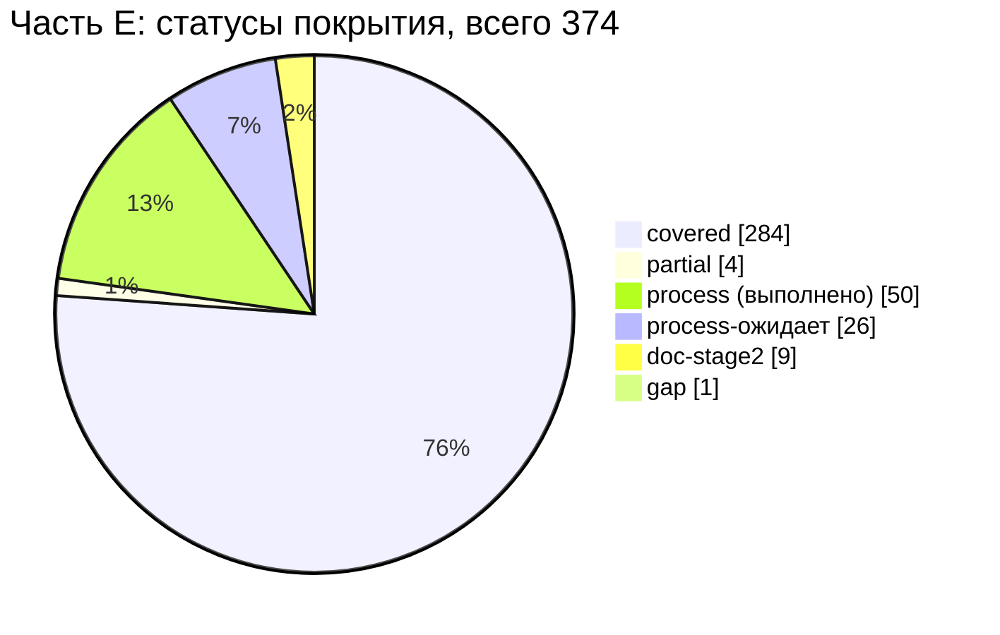

# 17E — Матрица трассируемости: часть E реестра исходных требований «Оптомстрой POS»

Версия 1.0 · Дата 2026-10-19 · Статус: черновик для утверждения заказчиком

Роль автора: трассировщик требований (QA). Документ — рабочая часть сводной матрицы `17_TRACEABILITY_MATRIX.md` (R0 §15); собирается вместе с частями 17A…17F.

**Входные материалы**

| Материал | Что взято |
|---|---|
| `docs/research/R0_DECISION_KERNEL.md` v1.4 (§0–§19; приоритет §19 → §18 → §17 → §16 → основной текст) | префиксы ID (§10, §17.6), владельцы документов и словарей (§15, §18.1, §19.1), диапазоны вопросов (§19.5: 17 → Q-280…Q-289), НФТ (§13) |
| `docs/specification/source/REQ_REGISTER_E.md` | все требования SRC-E-001…SRC-E-249 (374 уникальных ID, включая дочерние с буквенными суффиксами) |
| `docs/specification/source/MASTER_PROMPT_extracted.md`, строки 550–833 | контекст формулировок части E |
| Документы ТЗ `01`–`11`, `13`, `15`, `16` и `visual/*.md` в состоянии на 2026-10-19 ≈ 04:50; при доработке (§11) повторно проверены `01_PRODUCT_REQUIREMENTS.md` (1 576 строк, §1–§15 и журнал проверки), `12_TEST_PLAN.md` (2 507 строк, §1–§13) и `14_OPEN_QUESTIONS.md` (819 строк) в состоянии на ≈ 05:25 (12 и 14 во время доработки дописывались: 12 — с 385 до 2 507 строк) | места покрытия, ID требований, критерии приёмки, существующие ID тестов |
| Части `17_trace/17A`, `17B`, `17C`, `17D`, `17F` (≈ 05:00–05:07) | занятые номера вопросов из общего диапазона 17 (§8, §10) |
| `docs/PROGRESS_LOG.md` | свидетельства выполнения процессных требований этапа 1 |

**Связанные документы:** 12_TEST_PLAN.md (получает список T-TBD из §7), 14_OPEN_QUESTIONS.md (получает кандидатов в вопросы 17E-1…17E-3; номера из диапазона Q-280…Q-289 назначает сборщик 17, §8), 00_EXECUTIVE_SUMMARY.md (сводка статусов, таблица «раздел промта 4.1–4.15 → файл»), сборка 17_TRACEABILITY_MATRIX.md и части 17A, 17B, 17C, 17D, 17F.

> **Этап.** Идёт ЭТАП 1 (ТЗ). Матрица фиксирует, *где в ТЗ описано* требование; ни одна функция не считается созданной или работающей. Код, экраны, серверы, миграции не создавались.

---

## 1. Краткое содержание

- Протрассированы **все 374 уникальных требования** части E (SRC-E-001…SRC-E-249 с дочерними ID); 31 строка журнала изменений реестра, начинающаяся с `| SRC-E-`, отнесена к своим основным ID (§4) — пропусков нет.
- Итог по статусам (после повторной трассировки по 01, 12, 14 на ≈ 05:25): **covered — 284**, **process — 50** (выполнено), **process-ожидает — 26** (не выполнено, выполняется в конце этапа 1), **partial — 4**, **doc-stage2 — 9**, **gap — 1**, deferred-R2 — 0.
- Содержательные разделы ТЗ 4.1–4.15 (цели и границы, экраны, дизайн-система, сценарии, авторизация, каталог, корзина и касса, модель данных, API, синхронизация, безопасность, НФТ, план тестирования, план разработки) покрыты с ID требований и критериями приёмки; раздел 4.1 и НФТ 4.13 — в 01 §2–§8 (в т. ч. НФТ «стабильность» — NFR-STAB-001), раздел 4.14 — в 12 §1–§13.
- Пробел (gap) один: файл `00_EXECUTIVE_SUMMARY.md` отсутствует (SRC-E-196).
- Частичное покрытие (partial): итоговая QA-проверка пакета (волна 4) не выполнена (SRC-E-074, 214); нет явной нормы о «молчании» как неразрешении на разработку (SRC-E-022) и сопоставления 8 ролей промта исполнителям (SRC-E-025a).
- Процессные требования: 50 выполнены методикой этапа 1 (указано, чем); 26 ожидают завершения этапа (итоговая QA-проверка, итоговый отчёт, остановка до утверждения) и в выполненные не засчитываются.
- Тесты: в столбце «Тест» — ID из 12 §3 (сопоставлены по общим ID требований), `T-SEC-*` (11 §12, сохранены в 12), `T-DS-*`, `T-A11Y-*` (03 §17.9; нумерация T-DS в 12 отличается — §7, §10 п.9). Без теста осталось 6 строк — **2 группы T-TBD** (ONEC — 5 строк исследования 1С, NFR — стабильность) (§7).
- Кандидаты в новые вопросы (номер назначает сборщик 17; общий диапазон Q-280…Q-289 уже занят частями 17A, 17B, 17C, 17F): 17E-1 (утверждение показателя стабильности NFR-STAB-001), 17E-2 (соответствие исполнителей 8 ролям промта), 17E-3 (трактовка «повторных запросов»).

---

## 2. Методика и легенда

1. Для каждого SRC-ID выполнен Grep по `docs/specification/*.md` и `visual/*.md` с раскрытием диапазонов вида `SRC-E-121…136c`, `SRC-E-099a…e`, `SRC-E-174h/174i`; при отсутствии ссылки — поиск по ключевым словам (например, «Firebase», «стабильн», «молчан», `NFR-AVAIL-001`). Скрипт-проверка подтвердил, что **каждый** ID требования, критерия приёмки и теста, указанный в матрице, присутствует в текстах ТЗ `[ПОДТВЕРЖДЕНО: Grep по файлам ТЗ, 2026-10-19 ≈ 04:50; повторно после доработки ≈ 05:30, §11]`.
2. Ссылки «NN §X» — документ ТЗ и раздел; «R0 §X» — ядро; «R1…R8» — исследовательские отчёты (вход ТЗ, не документ ТЗ). Диапазоны ID (`SYNC-001…SYNC-010`, `AC-UI-14-001…024`) перечисляют реально существующие ID (проверены первый и последний номера).
3. `12_TEST_PLAN.md` во время доработки дописывался (04:57 — 385 строк, §1–§3.1; ≈ 05:23 — 2 507 строк, §1–§13). Матрица сверена со снимком ≈ 05:23 `[ПОДТВЕРЖДЕНО: Grep по 12, ≈ 05:25]`. ID тестов в столбце «Тест» для строк, где ранее стояло `T-TBD:<префикс>`, подобраны скриптом: тест 12 включён, если в его строке указан хотя бы один ID требования или критерия приёмки из этой строки матрицы (предпочтение — тестам того же префикса; при числе тестов > 6 показаны первые 6 и «и ещё N в 12»). `T-AUTH-001…010` и `T-SEC-001…055` в 12 совпадают с 09 §16 и 11 §12.2. Столбец «Тест»: (а) ID из 12 и из 03/11; (б) `T-TBD:<префикс>` — тест в 12 не найден (§7); (в) «н/п» — требование документное, процессное или относится к этапу 2 и проверяется ревью.
4. `01_PRODUCT_REQUIREMENTS.md` на ≈ 05:25 содержит §1–§15 и журнал проверки (1 576 строк): роли ROLE-001…007, ROLE-010…021 (§3), процессы GEN-010…GEN-016 (§4), GEN-020…GEN-242 (§5), таблица NFR (§6.2, включая `NFR-STAB-001…005`), границы R1 (§7), риски R-01…R-22 (§11), трассировка (§14). Строки SRC-E-076…077c, 181…183a, 197 протрассированы по этому состоянию. Если 01, 12 или 14 изменятся до сборки 17, сборщику следует повторить проверку существования ID (п.1).

**Статусы покрытия**

| Статус | Значение |
|---|---|
| covered | требование описано в ТЗ: указан раздел, ID требования и (если применимо) критерий приёмки |
| partial | описано не полностью или документ-владелец не завершён; что не хватает — в столбце статуса и в §6 |
| process | требование к процессу работы этапа 1, **выполненное** методикой этапа 1; в строке указано, чем выполнено |
| process-ожидает | процессное требование этапа 1, которое на дату трассировки **не выполнено** (выполняется в конце этапа 1: итоговая QA-проверка, итоговый отчёт, остановка до утверждения); в выполненные не засчитывается, перечень — §6.3 |
| deferred-R2 | осознанно перенесено в Release 2 со ссылкой на Q-xxx |
| doc-stage2 | процесс этапа 2, зафиксированный в 13_IMPLEMENTATION_ROADMAP.md |
| gap | в ТЗ нет покрытия; предложение — в §6 |

Метки достоверности в столбце статуса (`[ТИПОВО]`, `[НЕ ПОДТВЕРЖДЕНО]`, ссылки на Q-xxx) повторяют метки документов-источников.

---

## 3. Матрица трассируемости SRC-E → ТЗ

Столбцы: SRC-ID · краткая формулировка (из реестра) · тип · документ и раздел ТЗ · ID требования(й) ТЗ · критерий приёмки · тест · статус покрытия.

### 3.1. Двухэтапный режим, роль исполнителя, состав системы (стр. 550–561)

| SRC-ID | Краткая формулировка | Тип | Документ и раздел ТЗ | ID требования(й) ТЗ | Критерий приёмки (AC-…) | Тест | Статус покрытия |
|---|---|---|---|---|---|---|---|
| SRC-E-001 | Работа ведётся в два этапа: сначала полное ТЗ, затем разработка только после разрешения заказчика | процесс | 06 §2.2 (C-10), §17; 13 §2.1 (P-1), §3.2; 01 §1 | ARCH-055, RM-B-001 | AC-ARCH-055, AC-RM-B-001 | н/п (процесс) | **covered** — двухэтапность закреплена воротами утверждения RM-B-001 |
| SRC-E-002 | Исполнитель действует в роли CTO, главного архитектора, руководителя AI-команды и оркестратора субагентов | процесс | R0 (шапка: «главный архитектор (оркестратор)»), R0 §15 | — | — | н/п (процесс) | **process** — роль исполняет оркестратор: ведёт ядро R0 v1.0–v1.4 и распределяет документы по владельцам (R0 §15) |
| SRC-E-003 | Целевой продукт — полноценная POS-система «Оптомстрой» | функц. | 06 §4 (целевая архитектура); 01 §2.1 | ARCH-001, GEN-001 | AC-ARCH-001, AC-GEN-001 | н/п (интегральное; готовность — 13 §7) | **covered** |
| SRC-E-003a | Технология клиентского приложения — Flutter | ограничение | 06 §6 (Flutter-архитектура); 15 ADR-004 | ARCH-001, ARCH-014, ADR-004 | AC-ARCH-014, AC-ADR-004 | T-ARCH-003, T-ARCH-005 | **covered** |
| SRC-E-004 | Система должна интегрироваться с существующей 1С магазина | функц. | 05 (весь документ), §4; 06 §8 | ONEC-023, ARCH-007 | AC-ONEC-023, AC-ARCH-007 | T-ONEC-001, T-ONEC-002 | **covered** — имена объектов 1С — [ТИПОВО] до Q-010 |
| SRC-E-005 | В состав системы входит серверная часть (backend) | функц. | 06 §7 (backend-архитектура); 15 ADR-001, ADR-003 | ARCH-001, ARCH-030, ADR-003 | AC-ARCH-001, AC-ADR-003 | T-ARCH-002, T-ARCH-004, T-ARCH-005 | **covered** |
| SRC-E-006 | В состав системы входит клиентская база (база клиентов/покупателей) | функц. | 10 §15 (§15.1–§15.2 карточка и поиск клиентов, §15.3 новый клиент и дедупликация); 06 §17 (MOD-011); 01 §4.1 (процесс GEN-016); 02 SCR-31, SCR-32 | MOD-011, CUST-001, CUST-008, GEN-016 | AC-MOD-011, AC-CUST-001, AC-CUST-008 | T-CUST-001 | **covered** — CUST-018 (системный клиент «Розничный покупатель») к клиентской базе в целом не относится и из трассировки исключён |
| SRC-E-007 | В состав системы входит каталог товаров | функц. | 10 §4–§5 (INV, CAT); 06 §17 (MOD-006); 02 SCR-10…SCR-17 | MOD-006, CAT-001 | AC-MOD-006, AC-UI-10-001…031 | T-CAT-002, T-CAT-014 | **covered** |
| SRC-E-008 | В состав системы входит авторизация пользователей | функц. | 09 §4–§5 (AUTH); 06 §17 (MOD-004) | MOD-004, AUTH-001 | AC-MOD-004, AC-AUTH-001 | T-AUTH-001 | **covered** |
| SRC-E-009 | В состав системы входит корзина | функц. | 10 §7 (CART); 06 §17 (MOD-008); 02 SCR-20 | CART-001, MOD-008 | AC-CART-001, AC-MOD-008 | T-CART-001, T-CART-024 | **covered** |
| SRC-E-010 | В состав системы входит рабочее место кассира | функц. | 10 §14 (CASH); 02 SCR-30; visual/screen-map.md §2.3 | CASH-010, MOD-010 | AC-CASH-010, AC-UI-30-001…021 | T-CASH-002, T-CASH-008 | **covered** |
| SRC-E-011 | Этапы 1 и 2 строго разделены и не смешиваются | процесс | 06 §2.2 (C-10); 13 §2.1 (P-1) | ARCH-055, RM-B-001 | AC-ARCH-055, AC-RM-B-001 | н/п (процесс) | **covered** |
| SRC-E-012 | Этап 1 — исследование и ТЗ; полноценная разработка на этапе 1 запрещена; работа начинается исключительно с этапа 1 | ограничение | R0 §0; 06 §2.2 (C-10); 13 §3.1 | ARCH-055 | AC-ARCH-055 | н/п (процесс) | **process** — этап 1 ведётся без разработки: `lib/`, `pubspec.yaml` не изменяются (13 §3.1 «стартовый шаблон, не трогается»); выход этапа — только документы |
| SRC-E-013 | На этапе 1 запрещено создавать рабочие экраны приложения | ограничение | R0 §0; visual/README.md | — | — | н/п (процесс) | **process** — рабочие экраны не создаются; `visual/wireframes-*.html` — макеты требований (разрешены SRC-E-019), не код приложения |
| SRC-E-014 | На этапе 1 запрещено реализовывать бизнес-логику | ограничение | R0 §0, §11 п.5 | — | — | н/п (процесс) | **process** — бизнес-логика описана только как правила (10) и интерфейсы (08 §7 «реализация — ЭТАП 2») |
| SRC-E-015 | На этапе 1 запрещено писать производственный код | ограничение | R0 §11 п.5; 08 §7; 07 §14 («DDL — как спецификация») | — | — | н/п (процесс) | **process** — сигнатуры, DDL и JSON приводятся как спецификация, не как производственный код |
| SRC-E-016 | На этапе 1 запрещено разворачивать серверы | ограничение | R0 §0, D-33; 06 §2.2 (C-9); 16 §14 («план первичного развёртывания (этап 2)») | — | — | н/п (процесс) | **process** — серверы не разворачиваются; доступ к серверу не предоставлен (Q-030) |
| SRC-E-017 | На этапе 1 запрещено выполнять миграции баз данных | ограничение | R0 §0; 07 §12, §14; 13 RM-B-005 (этап 2) | — | — | н/п (процесс) | **process** — миграции описаны как спецификация; применение — этап 2 |
| SRC-E-018 | На этапе 1 запрещено подключать реальные внешние сервисы | ограничение | R0 §0; 13 §2.1 (P-7); 09 §6 (`FakeSmsGateway`); 05 §4 (`FakeOnecGateway`) | ONEC-023 | — | н/п (процесс) | **process** — реальные 1С, SMSPro, Бакай Банк не подключались; предусмотрен изолированный тестовый режим |
| SRC-E-019 | На этапе 1 разрешены: изучение кода и материалов, исследование официальной документации, анализ, архитектура, схемы, макеты требований, тест-планы, документация | процесс | R1…R8, R0, 02–16, visual/* | — | — | н/п (процесс) | **process** — выполнялись только разрешённые виды работ: исследование, анализ, архитектура, схемы, макеты требований, документация |
| SRC-E-020 | Этап 2 (разработка) начинается только после личного изучения ТЗ заказчиком и отдельного сообщения с точной фразой «ТЗ УТВЕРЖДЕНО. НАЧИНАЙ РАЗРАБОТКУ» (дубль: стр. 559 и … | процесс | 13 §9 (O-01), §2.1 (P-1), §3.2 (RM-B-001); 01 §1 | RM-B-001 | AC-RM-B-001 | н/п (процесс) | **covered** — точная фраза «ТЗ УТВЕРЖДЕНО. НАЧИНАЙ РАЗРАБОТКУ» — ворота G-B1 |
| SRC-E-021 | До получения точной команды исполнитель остаётся на этапе 1 | ограничение | 13 §3.2 (RM-B-001: «точная фраза заказчика до любого кода») | RM-B-001 | AC-RM-B-001 | н/п (процесс) | **covered** |
| SRC-E-022 | Молчание, положительный отзыв или просьба внести исправления не являются разрешением на разработку | ограничение | R0 §0; 13 RM-B-001 | — | — | н/п (процесс) | **partial** — ворота открываются только точной фразой, но явной нормы «молчание, отзыв или просьба правок не являются разрешением» в документах ТЗ нет (Grep «молчан» — 0 совпадений по смыслу) |
| SRC-E-023 | При запросе изменений ТЗ — внести правки и повторно проверить связанные разделы | процесс | R0 §16–§19 (версии ядра); «Журнал сверки с ядром» в 03–11, 13, 15, 16; 13 RM-B-002 | RM-B-002 | AC-RM-B-002 | н/п (процесс) | **process** — изменения вносятся версиями ядра с повторной сверкой связанных документов |
| SRC-E-024 | После правок предоставить обновлённую версию ТЗ на утверждение | процесс | PROGRESS_LOG.md (план, п.5 «итоговый отчёт заказчику»); 13 RM-B-002 | RM-B-002 | AC-RM-B-002 | н/п (процесс) | **process-ожидает** — обновлённая версия передаётся на утверждение; на дату трассировки — ожидает выполнения |

### 3.2. Организация команды (стр. 563–577)

| SRC-ID | Краткая формулировка | Тип | Документ и раздел ТЗ | ID требования(й) ТЗ | Критерий приёмки (AC-…) | Тест | Статус покрытия |
|---|---|---|---|---|---|---|---|
| SRC-E-025 | Независимые направления исследуются параллельно с помощью субагентов | процесс | PROGRESS_LOG.md (волны 1–3); R1…R8 | — | — | н/п (процесс) | **process** — независимые направления (R1…R8, документы волн 1–3) выполнялись параллельными субагентами |
| SRC-E-025a | Команда состоит ровно из 8 назначенных ролей, перечисленных в стр. 566–573 (SRC-E-026…033); все роли должны быть назначены, лишние/пропущенные роли не допускаются | процесс | R0 §15 (владельцы документов); PROGRESS_LOG.md | — | — | н/п (процесс) | **partial** — сопоставление «8 ролей промта → агенты и документы» нигде не зафиксировано; фактически исполнителей больше 8 (по документам и частям) — Q-кандидат 17E-2 (§8) |
| SRC-E-026 | Роль «Главный архитектор»: общая архитектура, границы компонентов, API, интеграции, технические решения | процесс | R0 (оркестратор); 06; 15 | — | — | н/п (процесс) | **process** — главный архитектор = оркестратор (R0, D-01…D-48), документ 06, журнал ADR 15 |
| SRC-E-027 | Роль «Эксперт по 1С»: конфигурация, объекты учёта, способы обмена, доступные данные | процесс | R1; 05 (шапка, §2–§3) | — | — | н/п (процесс) | **process** — роль выполнена исследованием R1 и документом 05 (05 §16.3) |
| SRC-E-028 | Роль «Flutter-архитектор»: структура приложения, платформы, навигация, управление состоянием | процесс | R3; 06 §6; visual/navigation.md §11 | — | — | н/п (процесс) | **process** — роль выполнена исследованием R3, 06 §6, visual/navigation.md (трассирует SRC-E-028) |
| SRC-E-029 | Роль «UI/UX-дизайнер»: анализ POS-систем, удобство продавцов, визуальные концепции, дизайн-система | процесс | R4; 03; visual/* | — | — | н/п (процесс) | **process** — роль выполнена исследованием R4, документами 03, 02, visual/* |
| SRC-E-030 | Роль «Backend и Database Engineer»: варианты backend, модель данных, API, транзакции, безопасность | процесс | R5; 07; 08 | — | — | н/п (процесс) | **process** — роль выполнена исследованием R5, документами 07, 08 |
| SRC-E-031 | Роль «Специалист по авторизации»: SMSPro Nikita KG, OTP, биометрический вход, регистрация | процесс | R2, R6; 09 | — | — | н/п (процесс) | **process** — роль выполнена исследованиями R2 (SMSPro), R6 и документом 09 |
| SRC-E-032 | Роль «POS-бизнес-аналитик»: каталог, склады, цены, скидки, корзина, клиенты, долги, платежи, возвраты | процесс | R7; 10 | — | — | н/п (процесс) | **process** — роль выполнена исследованием R7 и документом 10 |
| SRC-E-033 | Роль «QA и Security Reviewer»: независимая проверка полноты требований, рисков, тестируемости, безопасности | процесс | R6; 11; журналы проверки 03 §22, 05 §18, 06 прил. А, 07 §20, 08 §15, 09 §18, 10 §24, 11 прил. А, 16 §20 | — | — | н/п (процесс) | **process-ожидает** — независимая проверка каждого документа выполнена; итоговая QA-проверка пакета — волна 4 (ожидает) |
| SRC-E-034 | При нехватке реальных субагентов — использовать доступные возможности делегирования | процесс | PROGRESS_LOG.md | — | — | н/п (процесс) | **process** — субагенты доступны и использовались; делегирование штатное |
| SRC-E-034a | При нехватке реальных субагентов — честно сообщить заказчику об ограничениях среды (требование к отчётности) | процесс | PROGRESS_LOG.md («Блокеры») | — | — | н/п (процесс) | **process-ожидает** — ограничения среды фиксируются в журнале прогресса (исчерпание лимита); в итоговом отчёте заказчику — ожидает выполнения |
| SRC-E-035 | Каждому агенту выдаются: отдельная задача, список вопросов, ожидаемый результат, критерии качества | процесс | R0 §11 (правила), §15 (владельцы); задания агентов оркестратора | — | — | н/п (процесс) | **process** — агент получает задачу, ожидаемый результат и критерии качества (пример — задание этой трассировки); тексты заданий в docs/ не хранятся |
| SRC-E-036 | Дублирование работы между агентами не допускается | процесс | R0 §15, §18.1 (владельцы словарей), §19.1 | — | — | н/п (процесс) | **process** — один владелец на документ и словарь; черновики 02a…02e выведены в source/02_parts_drafts (R0 §19.1) |
| SRC-E-037 | Сводное (родительское): три обязанности оркестратора — см. SRC-E-037a…037c | процесс | R0 §16–§19 | — | — | н/п (процесс) | **process** — см. SRC-E-037a…037c |
| SRC-E-037a | Оркестратор сам координирует команду | процесс | R0 §15; PROGRESS_LOG.md | — | — | н/п (процесс) | **process** — координация через ядро R0 и волны работ |
| SRC-E-037b | Оркестратор согласовывает противоречия между результатами агентов | процесс | R0 §16–§19 (сведение замечаний и расхождений) | — | — | н/п (процесс) | **process** — противоречия сводятся дополнениями ядра v1.1–v1.4 |
| SRC-E-037c | Окончательные архитектурные решения принимает оркестратор | процесс | R0 §2, §17.1 (D-01…D-48); 15 (ADR-001…ADR-069) | — | — | н/п (процесс) | **process** — окончательные решения — D-xx ядра, оформлены как ADR |
| SRC-E-038 | Контекст и вычислительные ресурсы экономятся (императив без оговорок); приёмы — см. SRC-E-038a…038c | процесс | R0; PROGRESS_LOG.md | — | — | н/п (процесс) | **process** — см. SRC-E-038a…038c |
| SRC-E-038a | Отчёты агентов — краткие | процесс | R0 (сжатое ядро для всех авторов) | — | — | н/п (процесс) | **process** — авторы получают ядро вместо полных отчётов R1…R8 |
| SRC-E-038b | Независимые исследования выполняются параллельно | процесс | PROGRESS_LOG.md (волны 1–3) | — | — | н/п (процесс) | **process** — параллельные независимые исследования и документы |
| SRC-E-038c | Уже изученные материалы используются повторно, а не изучаются заново | процесс | R0; PROGRESS_LOG.md («готовые агенты не перезапускались») | — | — | н/п (процесс) | **process** — повторное использование материалов через R0 и R1…R8 |

### 3.3. Исследование рабочей папки (стр. 579–590)

| SRC-ID | Краткая формулировка | Тип | Документ и раздел ТЗ | ID требования(й) ТЗ | Критерий приёмки (AC-…) | Тест | Статус покрытия |
|---|---|---|---|---|---|---|---|
| SRC-E-039 | До составления ТЗ изучаются все доступные материалы проекта | процесс | 03 §2.1; 13 §3.1; R0 §0, §14 | — | — | н/п (процесс) | **process** — выполнено до ТЗ (13 §3.1: «изучены рабочая папка, resursi/, текущий Flutter-каркас») |
| SRC-E-040 | Изучить ручные чертежи экранов | процесс | 03 §2.1 (строка «Ручные чертежи — отсутствуют»); R0 §0 | — | — | н/п (процесс) | **process** — ручных чертежей нет — зафиксировано |
| SRC-E-041 | Изучить логотипы | процесс | 03 §2.1, §2.3 (логотип), §2.4; R0 §14 | — | — | н/п (процесс) | **process** — изучены оранжевый `Logo Orange.png` и синий логотип макетов; расхождение — Q-006 |
| SRC-E-042 | Изучить изображения | процесс | 03 §2.1–§2.2; R0 §14 | — | — | н/п (процесс) | **process** — изучены три цифровых макета |
| SRC-E-043 | Изучить существующие документы | процесс | source/MASTER_PROMPT_extracted.md; source/REQ_REGISTER_A…F.md; 13 §3.1 | — | — | н/п (процесс) | **process** — мастер-промт извлечён и разложен в реестр SRC |
| SRC-E-044 | Изучить возможный исходный код | процесс | 13 §3.1 (текущий Flutter-каркас `lib/`, `pubspec.yaml` — стартовый шаблон); R3 §0 | — | — | н/п (процесс) | **process** — исходный код изучен: стартовый шаблон Flutter |
| SRC-E-045 | Изучить описания бизнес-процессов | процесс | R0 §0 (перечень материалов); 03 §2.1 | — | — | н/п (процесс) | **process** — описаний бизнес-процессов в материалах нет; процессы восстановлены из промта (04, 10) |
| SRC-E-046 | Изучить доступные примеры товаров и данных 1С | процесс | 05 §12 (ONEC-096); 13 §3.1 (RM-A-005); R0 §12 (Q-040) | ONEC-096, RM-A-005 | AC-ONEC-096, AC-RM-A-005 | н/п (процесс) | **process** — примеров данных 1С нет; запрошены (Q-040, RM-A-005) |
| SRC-E-047 | Исходные материалы проекта изменять запрещено | ограничение | R0 §0 («resursi — только чтение»); 13 §3.1 | — | — | н/п (процесс) | **process** — исходные материалы не изменялись (PROGRESS_LOG 2026-10-18) |
| SRC-E-048 | Удалять файлы проекта запрещено | ограничение | R0 §0; PROGRESS_LOG.md | — | — | н/п (процесс) | **process** — файлы не удалялись (черновики 02a…02e перенесены, не удалены — R0 §19.1) |
| SRC-E-049 | Зафиксировать перечень найденных материалов, что они подтверждают и открытые вопросы | документ | 03 §2.1–§2.4; R0 §14; 13 §3.1; R0 §12 | — | — | н/п (документ) | **covered** — перечень найденных материалов, что они подтверждают, и вопросы (Q-006, Q-022) зафиксированы |
| SRC-E-050 | Содержимое отсутствующих файлов не выдумывается | ограничение | R0 §11 п.5; 15 ADR-047; метки [НЕ ПОДТВЕРЖДЕНО]/[ТИПОВО] во всех документах | ADR-047 | AC-ADR-047 | н/п (процесс) | **process** — отсутствующее не выдумывается: метки статуса и вопросы Q-xxx |

### 3.4. Исследование 1С и архитектуры (стр. 592–613)

| SRC-ID | Краткая формулировка | Тип | Документ и раздел ТЗ | ID требования(й) ТЗ | Критерий приёмки (AC-…) | Тест | Статус покрытия |
|---|---|---|---|---|---|---|---|
| SRC-E-051 | До утверждения архитектуры исследовать возможные способы интеграции с установленной 1С магазина | процесс | 05 §3 (анализ способов обмена); 15 ADR-028 | ADR-028 | AC-ADR-028 | н/п (документ) | **covered** — исследование R1 оформлено в 05 §3 до выбора архитектуры (D-28) |
| SRC-E-052 | Проверить официальную документацию по HTTP-сервисам, OData, веб-сервисам, регламентированному обмену и другим механизмам 1С | процесс | 05 §3 (все строки таблицы механизмов); R1 | ADR-028 | AC-ADR-028 | н/п (документ) | **covered** |
| SRC-E-053 | Не предполагать, что конкретный API 1С включён или доступен | ограничение | 05 §2, §5.2; 15 ADR-048 | ONEC-106, ADR-048 | AC-ONEC-106, AC-ADR-048 | T-TBD:ONEC | **covered** |
| SRC-E-054 | Определить, какие данные реально можно получать из 1С и при каких условиях | процесс | 05 §5, §5.2 | ONEC-107 | AC-ONEC-107 | н/п (документ) | **covered** |
| SRC-E-055 | Исследовать возможность и условия получения из 1С товаров и артикулов | процесс | 05 §5.1a | ONEC-001, ONEC-002, ONEC-017, ONEC-018 | AC-ONEC-001, AC-ONEC-002, AC-ONEC-017, AC-ONEC-018 | T-ONEC-019 | **covered** — имена объектов [ТИПОВО] до Q-010 |
| SRC-E-056 | Исследовать возможность и условия получения из 1С категорий и подкатегорий | процесс | 05 §5.1a | ONEC-003 | AC-ONEC-003 | T-TBD:ONEC | **covered** |
| SRC-E-057 | Исследовать возможность и условия получения из 1С фотографий товаров | процесс | 05 §5.1a; 06 §9 (D-30) | ONEC-006, SYNC-036 | AC-ONEC-006 | T-ONEC-012 | **covered** — место хранения фото — Q-022 |
| SRC-E-058 | Исследовать возможность и условия получения из 1С описаний и характеристик | процесс | 05 §5.1a | ONEC-004 | AC-ONEC-004 | T-TBD:ONEC | **covered** |
| SRC-E-059 | Исследовать возможность и условия получения из 1С моделей, размеров и цветов | процесс | 05 §5.1a, §5.2 | ONEC-005, ONEC-073 | AC-ONEC-005, AC-ONEC-073 | T-ONEC-019 | **covered** |
| SRC-E-060 | Исследовать возможность и условия получения из 1С цен и оптовых условий | процесс | 05 §5.1a | ONEC-007, ONEC-008, ONEC-022 | AC-ONEC-007, AC-ONEC-008, AC-ONEC-022 | T-ONEC-019 | **covered** |
| SRC-E-061 | Исследовать возможность и условия получения из 1С остатков по каждому складу | процесс | 05 §5.1a, §5.2 | ONEC-009, ONEC-019, ONEC-070 | AC-ONEC-009, AC-ONEC-019, AC-ONEC-070 | T-ONEC-019 | **covered** |
| SRC-E-062 | Исследовать возможность и условия получения из 1С резервов | процесс | 05 §5.1a | ONEC-010 | AC-ONEC-010 | T-TBD:ONEC | **covered** |
| SRC-E-063 | Исследовать возможность и условия получения из 1С клиентов | процесс | 05 §5.1a | ONEC-011, ONEC-012 | AC-ONEC-011, AC-ONEC-012 | T-ONEC-009 | **covered** |
| SRC-E-064 | Исследовать возможность и условия получения из 1С истории покупок | процесс | 05 §5.1a; 07 DATA-141 | ONEC-013 | AC-ONEC-013 | T-CASH-003 | **covered** |
| SRC-E-065 | Исследовать возможность и условия получения из 1С долгов и взаиморасчётов | процесс | 05 §5.1a | ONEC-014 | AC-ONEC-014 | T-ONEC-010 | **covered** |
| SRC-E-066 | Исследовать возможность и условия получения из 1С скидок | процесс | 05 §5.1a | ONEC-008 | AC-ONEC-008 | T-TBD:ONEC | **covered** |
| SRC-E-067 | Исследовать возможность и условия получения из 1С документов продаж, платежей и возвратов | процесс | 05 §5.1a, §6, §7.2 | ONEC-013, ONEC-015, ONEC-016, ONEC-020, ONEC-021, ONEC-067, SYNC-018 | AC-ONEC-013, AC-ONEC-015, AC-ONEC-016, AC-ONEC-020, AC-SYNC-018 | T-ONEC-006, T-ONEC-008, T-ONEC-011 | **covered** — документы оплаты/возврата 1С — Q-012 |
| SRC-E-068 | Сводное (родительское): для каждой сущности 1С описываются пять атрибутов — см. SRC-E-068a…068e | документ | 05 §5.1 (столбцы карты сущностей), §5.2 | ONEC-100…ONEC-106 | AC-ONEC-100…AC-ONEC-106 | н/п (документ) | **covered** — см. SRC-E-068a…068e |
| SRC-E-068a | Для каждой сущности 1С описан источник истины | документ | 05 §4, §5.1 | ONEC-026 | AC-ONEC-026 | н/п (документ) | **covered** |
| SRC-E-068b | Для каждой сущности 1С описан способ обмена | документ | 05 §5.1 (столбцы «чтение/запись»), §4 | ONEC-027 | AC-ONEC-027 | н/п (документ) | **covered** |
| SRC-E-068c | Для каждой сущности 1С описаны идентификаторы | документ | 05 §5.1, §5.2 | ONEC-101 | AC-ONEC-101 | н/п (документ) | **covered** |
| SRC-E-068d | Для каждой сущности 1С описана частота обновления | документ | 05 §5.1 (столбец частоты), §7.3 | SYNC-021, SYNC-022 | AC-SYNC-021, AC-SYNC-022 | н/п (документ) | **covered** |
| SRC-E-068e | Для каждой сущности 1С описана обработка ошибок | документ | 05 §5.1 (столбец «восстановление»), §6, §13 | ONEC-055 | AC-ONEC-055 | н/п (документ) | **covered** |
| SRC-E-069 | Рассмотреть режим первоначальной загрузки данных из 1С (см. также стр. 743, SRC-E-176a) | функц. | 05 §7.1 | SYNC-001…SYNC-010 | AC-SYNC-001…AC-SYNC-010 | T-SYNC-001, T-SYNC-003, T-SYNC-007, T-SYNC-008, T-SYNC-009, T-SYNC-010 и ещё 4 в 12 | **covered** |
| SRC-E-069a | Рассмотреть режим инкрементальной синхронизации с 1С (см. также стр. 743, SRC-E-176c) | функц. | 05 §7.2 | SYNC-011…SYNC-020 | AC-SYNC-011…AC-SYNC-020 | T-SYNC-002, T-SYNC-005, T-SYNC-013, T-SYNC-014, T-SYNC-015, T-SYNC-016 и ещё 5 в 12 | **covered** |
| SRC-E-070 | Рассмотреть периодический обмен с 1С каждые 30 минут (см. также стр. 743, SRC-E-176b) | функц. | 05 §7.3; 15 ADR-029 | SYNC-021, SYNC-022, ADR-029 | AC-SYNC-021, AC-SYNC-022, AC-ADR-029 | T-SYNC-020 | **covered** — 30 мин — мастер-данные, клиенты, долги, история (D-29); значения — Q-020 |
| SRC-E-070a | Критичные данные обновляются чаще, чем базовый период 30 минут (единственное место в промте; состав «критичных данных» требует уточнения) | функц. | 05 §7.3; 15 ADR-029 | SYNC-021, SYNC-022, ADR-029 | AC-SYNC-021, AC-ADR-029 | T-SYNC-020 | **covered** — «критичные данные» приняты по D-29: остатки 5–10 мин, цены 10–15 мин, статусы заказов 5 мин; подтверждение — Q-020 |
| SRC-E-071 | Сравнить варианты backend: Firebase, Supabase, собственный backend | процесс | 06 §3.1–§3.3; 15 ADR-001, ADR-002; 01 (GEN-008) | ARCH-003, ARCH-002, GEN-008 | AC-ARCH-003, AC-ADR-002 | н/п (документ) | **covered** |
| SRC-E-072 | Сводное (родительское): выбор архитектуры обосновывается тремя критериями — см. SRC-E-072a…072c | процесс | 06 §3.2–§3.3 | ARCH-003 | AC-ARCH-003 | н/п (документ) | **covered** — см. SRC-E-072a…072c |
| SRC-E-072a | Критерий выбора архитектуры: реальные требования (а не предположения) | процесс | 06 §3.2 (9 критериев заказчика SRC-A-095…103) | ARCH-003 | AC-ARCH-003 | н/п (документ) | **covered** |
| SRC-E-072b | Критерий выбора архитектуры: безопасность | процесс | 06 §3.2 (критерий 1 «Безопасность»), §10 | ARCH-003, ARCH-047 | AC-ARCH-003 | н/п (документ) | **covered** |
| SRC-E-072c | Критерий выбора архитектуры: стоимость эксплуатации | процесс | 06 §3.1 (тарифы), §3.2 (критерий 8 «Стоимость эксплуатации») | ARCH-003 | AC-ARCH-003 | н/п (документ) | **covered** |
| SRC-E-073 | Не заявлять о наличии доступа к данным 1С, если он не был предоставлен | ограничение | 05 (шапка, §2); 06 §2.1; R0 §0 | — | — | н/п (документ) | **covered** — доступ к 1С не заявляется; все имена объектов — [ТИПОВО] (Q-010) |

### 3.5. Требования к ТЗ в целом и раздел 4.1 «Цели и границы» (стр. 615–625)

| SRC-ID | Краткая формулировка | Тип | Документ и раздел ТЗ | ID требования(й) ТЗ | Критерий приёмки (AC-…) | Тест | Статус покрытия |
|---|---|---|---|---|---|---|---|
| SRC-E-074 | ТЗ должно быть профессиональным, однозначным и достаточно подробным для реализации другой командой без догадок | документ | весь пакет 01–16, visual/* | — | — | н/п (проверка QA) | **partial** — однозначность и полнота подтверждаются итоговой QA-проверкой (волна 4, не выполнена); на ≈ 05:25 01, 12 и 14 выпущены, 00 отсутствует |
| SRC-E-075 | ТЗ включает обязательные разделы 4.1–4.15 | документ | 4.1→01 §2–§8; 4.2→02, visual/screen-map.md; 4.3→03; 4.4→04; 4.5→09; 4.6→10 §4–§6, 02 ч. B; 4.7→10 §7–§12; 4.8→10 §14, 02 ч. D; 4.9→07; 4.10→08, 05; 4.11→05 §7; 4.12→11; 4.13→01 §6; 4.14→12 (§2 стратегия, §3 тест-кейсы, §4 критерии приёмки, §5 матрица покрытия); 4.15→13 | — | — | н/п (документ) | **covered** — все 15 разделов промта сопоставлены файлам ТЗ (01 §2–§8 — 4.1 и 4.13; 12 §1–§13 — 4.14); сводная таблица «раздел → файл» для 00 — см. E-G-1 |
| SRC-E-076 | Сводное (родительское): раздел 4.1 «Цели и границы проекта» содержит пункты, см. SRC-E-076a…076d | документ | 01 §2–§6 (трассировка — 01 §14.2) | GEN-001…GEN-016, ROLE-001…ROLE-007, ROLE-010…ROLE-021, GEN-020…GEN-242, NFR-* | AC-GEN-001 | н/п (документ) | **covered** — см. SRC-E-076a…076d |
| SRC-E-076a | Раздел 4.1 содержит назначение системы | документ | 01 §2.1 «Назначение», §2.7 | GEN-001, GEN-002 | AC-GEN-001 | н/п (документ) | **covered** |
| SRC-E-076b | Раздел 4.1 содержит пользователей и роли | документ | 01 §2.3, §3 (§3.2 каталог ролей, §3.3 правила прав, §3.4 сводка «роль × возможность»); 10 §3; 11 §4.4 | ROLE-001…ROLE-007, ROLE-010…ROLE-021 | AC-ROLE-010…AC-ROLE-021 | н/п (документ) | **covered** — канон матрицы прав — 11 §4.3–§4.4 (ядро §18.1); 01 §3.4 — уровень продукта |
| SRC-E-076c | Раздел 4.1 содержит основные бизнес-процессы | документ | 01 §4 (§4.1 сводка, §4.2–§4.7 процессы GEN-010…GEN-015, §4.8 соответствие сценариям 04); 04 FLOW-001…FLOW-036 | GEN-010…GEN-016, FLOW-001…FLOW-036 | AC-FLOW-001-01… | н/п (документ) | **covered** |
| SRC-E-076d | Раздел 4.1 содержит функциональные и нефункциональные требования | документ | 01 §5 (§5.1–§5.23, GEN), §6 (§6.1 правила, §6.2 таблица NFR); детализация — 02, 04, 09, 10 | GEN-020…GEN-242, NFR-* (01 §6.2) | AC-GEN-020…AC-GEN-242 | н/п (документ) | **covered** |
| SRC-E-077 | Сводное (родительское): раздел 4.1 фиксирует границы проекта, см. SRC-E-077a…077c | документ | 06 §14; 01 §7–§8 | ARCH-058, ARCH-059, ARCH-061 | AC-ARCH-058, AC-ARCH-059, AC-ARCH-061 | н/п (документ) | **covered** — см. SRC-E-077a…077c |
| SRC-E-077a | Раздел 4.1 определяет состав первой версии | документ | 06 §14.1; R0 §4.1 | ARCH-058 | AC-ARCH-058 | н/п (документ) | **covered** |
| SRC-E-077b | Раздел 4.1 определяет, что откладывается на будущие версии | документ | 06 §14.2; R0 §4.2 | ARCH-059 | AC-ARCH-059 | н/п (документ) | **covered** |
| SRC-E-077c | Раздел 4.1 определяет ограничения и внешние зависимости | документ | 06 §2.2 (C-1…C-12), §14.4; 13 §9 (действия владельца) | ARCH-061 | AC-ARCH-061 | н/п (документ) | **covered** |

### 3.6. Раздел 4.2 «Полная карта экранов» (стр. 626–638)

| SRC-ID | Краткая формулировка | Тип | Документ и раздел ТЗ | ID требования(й) ТЗ | Критерий приёмки (AC-…) | Тест | Статус покрытия |
|---|---|---|---|---|---|---|---|
| SRC-E-078 | ТЗ содержит полную карту экранов с описанием каждого экрана | документ | 02 §4 (§4.1 таблица экранов, §4.2 схема навигации); visual/screen-map.md §2 | SCR-00…SCR-90 | 02 §10.1 (индекс AC-UI) | T-UI-000, T-UI-090, T-UI-102 | **covered** — 45 позиций, 771 UI-ID, 712 AC-UI (02 §4.1) |
| SRC-E-079 | Сводное (родительское): для каждого экрана описываются десять атрибутов — см. SRC-E-079a…079j | документ | 02 §2.3 (структура описания экрана — 14 пунктов) | SCR-00…SCR-90 | AC-UI-00-001… | T-UI-000, T-UI-090, T-UI-102 | **covered** — см. SRC-E-079a…079j |
| SRC-E-079a | Для каждого экрана описано назначение | документ | 02 §2.3 п.1; §9 (каждый экран) | SCR-xx п.1 | AC-UI-xx-NNN | н/п (документ) | **covered** |
| SRC-E-079b | Для каждого экрана описан состав элементов | документ | 02 §2.3 п.3 (таблица элементов, UI-ID) | UI-xx-NNN | AC-UI-xx-NNN | н/п (документ) | **covered** |
| SRC-E-079c | Для каждого экрана описано расположение элементов | документ | 02 §2.3 п.2–п.3 | UI-xx-NNN | AC-UI-xx-NNN | н/п (документ) | **covered** |
| SRC-E-079d | Для каждого экрана описаны доступные действия | документ | 02 §2.3 п.4, п.10; §5 (матрица «экран × роль × действия») | UI-xx-NNN | AC-UI-xx-NNN | н/п (документ) | **covered** |
| SRC-E-079e | Для каждого экрана описаны переходы | документ | 02 §2.3 п.6; §4.2; visual/navigation.md §5; visual/screen-map.md §4 | SCR-xx п.6 | AC-UI-xx-NNN | н/п (документ) | **covered** |
| SRC-E-079f | Для каждого экрана описаны состояния загрузки | документ | 02 §2.3 п.7; §3.3; §6 (матрица «экран × состояния») | SCR-xx п.7 | AC-UI-xx-NNN | н/п (документ) | **covered** |
| SRC-E-079g | Для каждого экрана описаны пустые состояния | документ | 02 §2.3 п.7; §6 | SCR-xx п.7 | AC-UI-xx-NNN | н/п (документ) | **covered** |
| SRC-E-079h | Для каждого экрана описана обработка ошибок | документ | 02 §2.3 п.7–п.8; §3.3; §6 | SCR-xx п.7–8 | AC-UI-xx-NNN | н/п (документ) | **covered** |
| SRC-E-079i | Для каждого экрана описаны доступные права (кто имеет доступ) | документ | 02 §2.3 п.10; §4.1 (роли); §5; 11 §4.4 | SCR-xx п.10 | AC-UI-xx-NNN | н/п (документ) | **covered** |
| SRC-E-079j | Для каждого экрана описана адаптивность | документ | 02 §2.3 п.2, п.12; §3.2; visual/responsive-spec.md | SCR-xx п.12 | AC-UI-xx-NNN | н/п (документ) | **covered** |
| SRC-E-080 | Карта экранов включает splash screen | функц. | 02 §9 SCR-00; 03 §12 | SCR-00 | AC-UI-00-001…012 | T-UI-000 | **covered** |
| SRC-E-081 | Карта экранов включает экран авторизации | функц. | 02 §9 SCR-01, SCR-02, SCR-08 | SCR-01, SCR-02, SCR-08 | AC-UI-01-001…018, AC-UI-02-001…023 | T-UI-001, T-UI-002, T-UI-008 | **covered** |
| SRC-E-082 | Карта экранов включает экран регистрации | функц. | 02 §9 SCR-03, SCR-04 (SCR-05 — R2, SCR-06 — условно) | SCR-03, SCR-04 | AC-UI-03-001…015, AC-UI-04-001…019 | T-UI-003, T-UI-004 | **covered** |
| SRC-E-083 | Карта экранов включает каталог | функц. | 02 §9 SCR-10, SCR-12 (SCR-50 — условно) | SCR-10, SCR-12 | AC-UI-10-001…031, AC-UI-12-001…013 | T-UI-010, T-UI-012, T-UI-109, T-UI-111 | **covered** |
| SRC-E-084 | Карта экранов включает поиск | функц. | 02 §9 SCR-11, SCR-17 | SCR-11, SCR-17 | AC-UI-11-001…014, AC-UI-17-001…014 | T-UI-011, T-UI-017, T-UI-111 | **covered** |
| SRC-E-085 | Карта экранов включает карточку товара | функц. | 02 §9 SCR-14; §4.1 | SCR-14 | AC-UI-14-001…024 | T-UI-014 | **covered** |
| SRC-E-086 | Карта экранов включает экран/блок вариантов товара | функц. | 02 §9 SCR-15 | SCR-15 | AC-UI-15-001…012 | T-UI-015 | **covered** |
| SRC-E-087 | Карта экранов включает корзину | функц. | 02 §9 SCR-20, SCR-23 | SCR-20, SCR-23 | AC-UI-20-001…029, AC-UI-23-001…013 | T-UI-020, T-UI-023, T-UI-109 | **covered** |
| SRC-E-088 | Карта экранов включает оформление заказа | функц. | 02 §9 SCR-21, SCR-22 | SCR-21, SCR-22 | AC-UI-21-001…023, AC-UI-22-001…012 | T-UI-021, T-UI-022, T-UI-109 | **covered** |
| SRC-E-089 | Карта экранов включает кассу | функц. | 02 §9 SCR-30, SCR-38 | SCR-30, SCR-38 | AC-UI-30-001…021, AC-UI-38-001…025 | T-UI-030, T-UI-038 | **covered** |
| SRC-E-090 | Карта экранов включает экран клиентов | функц. | 02 §9 SCR-31, SCR-32, SCR-26 | SCR-31, SCR-32, SCR-26 | AC-UI-31-001…011, AC-UI-32-001…016 | T-UI-026, T-UI-031, T-UI-032 | **covered** |
| SRC-E-091 | Карта экранов включает экран долгов | функц. | 02 §9 SCR-34 | SCR-34 | AC-UI-34-001…017 | T-UI-034 | **covered** |
| SRC-E-092 | Карта экранов включает экран скидок | функц. | 02 §9 SCR-35 | SCR-35 | AC-UI-35-001…010 | T-UI-035 | **covered** |
| SRC-E-093 | Карта экранов включает экран транзакций | функц. | 02 §9 SCR-36, SCR-37 | SCR-36, SCR-37 | AC-UI-36-001…016, AC-UI-37-001…013 | T-UI-036, T-UI-037 | **covered** |
| SRC-E-094 | Карта экранов включает избранное | функц. | 02 §9 SCR-40 | SCR-40, UI-40-007 | AC-UI-40-001…013 | T-UI-040 | **covered** |
| SRC-E-095 | Карта экранов включает профиль | функц. | 02 §9 SCR-41 | SCR-41, UI-41-001 | AC-UI-41-001…015 | T-UI-041 | **covered** |
| SRC-E-096 | Карта экранов включает настройки | функц. | 02 §9 SCR-42 | SCR-42, UI-42-001 | AC-UI-42-001…017 | T-UI-042 | **covered** |

### 3.7. Раздел 4.3 «Дизайн-система»

| SRC-ID | Краткая формулировка | Тип | Документ и раздел ТЗ | ID требования(й) ТЗ | Критерий приёмки (AC-…) | Тест | Статус покрытия |
|---|---|---|---|---|---|---|---|
| SRC-E-097 | Исследовать профессиональные POS-интерфейсы и современные B2B-каталоги | процесс | 03 §3; R4 §2 | — | — | н/п (процесс) | **covered** — обзор POS- и B2B-интерфейсов по официальным источникам |
| SRC-E-098 | Предложить и сравнить два варианта цветовой палитры | документ | 03 §5; visual/palette-comparison.html; 15 ADR-016 | DS-003, DS-004, ADR-016 | AC-DS-003, AC-ADR-016 | T-DS-001…012 | **covered** |
| SRC-E-099 | Сводное (родительское): выбор палитры обосновывается пятью критериями — см. SRC-E-099a…099e | документ | 03 §5.6; 15 ADR-016 | DS-004 | AC-DS-004 | н/п (документ) | **covered** — см. SRC-E-099a…099e |
| SRC-E-099a | Критерий обоснования палитры: удобство | документ | 03 §5.6 (строка «Удобство») | DS-004 | AC-DS-004 | н/п (документ) | **covered** |
| SRC-E-099b | Критерий обоснования палитры: читаемость | документ | 03 §5.6; §15 | DS-004, A11Y-001 | AC-DS-004, AC-A11Y-001 | T-A11Y-001…022 | **covered** |
| SRC-E-099c | Критерий обоснования палитры: контраст | документ | 03 §5.4, §5.6; §15 | DS-004, DS-012, A11Y-001, A11Y-002 | AC-DS-012, AC-A11Y-001 | T-DS-001…012 | **covered** |
| SRC-E-099d | Критерий обоснования палитры: ассоциации с брендом | документ | 03 §5.6, §5.8 | DS-004, DS-006 | AC-DS-004, AC-DS-006 | н/п (документ) | **covered** — актуальный логотип — Q-006 |
| SRC-E-099e | Критерий обоснования палитры: пригодность для длительной ежедневной работы | документ | 03 §4.1, §5.6 | DS-004 | AC-DS-004 | н/п (документ) | **covered** |
| SRC-E-100 | Сводное (родительское): дизайн-система определяет двенадцать элементов — см. SRC-E-100a…100l | документ | 03 §5–§17 | DS-001…DS-084 | AC-DS-001… | T-DS-001…096 | **covered** — см. SRC-E-100a…100l |
| SRC-E-100a | Дизайн-система определяет цвета | документ | 03 §5 | DS-001…DS-012 | AC-DS-001 | T-DS-001…012 | **covered** |
| SRC-E-100b | Дизайн-система определяет типографику | документ | 03 §6 | DS-013…DS-024 | AC-DS-013 | T-DS-013…020 | **covered** |
| SRC-E-100c | Дизайн-система определяет сетку | документ | 03 §7.2–§7.3 | DS-026 | AC-DS-026 | T-DS-041…049 | **covered** |
| SRC-E-100d | Дизайн-система определяет отступы | документ | 03 §7.1 | DS-025 | AC-DS-025 | T-DS-012 | **covered** |
| SRC-E-100e | Дизайн-система определяет размеры кнопок | документ | 03 §7.4 | DS-027 | AC-DS-027 | T-DS-050…066 | **covered** |
| SRC-E-100f | Дизайн-система определяет карточки | документ | 03 §9.11–§9.13 | DS-055, DS-026 | AC-DS-055 | T-DS-050…066 | **covered** |
| SRC-E-100g | Дизайн-система определяет поля ввода | документ | 03 §9.3–§9.7 | DS-056 | AC-DS-056 | T-DS-050…066 | **covered** |
| SRC-E-100h | Дизайн-система определяет иконки | документ | 03 §7.7 | DS-029 | AC-DS-029 | T-DS-012 | **covered** |
| SRC-E-100i | Дизайн-система определяет состояния элементов | документ | 03 §9, §10 (матрица «компонент × состояние») | DS-030…DS-040 | AC-DS-030 | T-DS-030…040 | **covered** |
| SRC-E-100j | Дизайн-система определяет анимации | документ | 03 §11 | DS-061…DS-066, ANIM-001…ANIM-030 | AC-DS-061, AC-DS-065 | T-ANIM-001, T-ANIM-009 | **covered** |
| SRC-E-100k | Дизайн-система определяет адаптивность | документ | 03 §8; visual/responsive-spec.md | DS-041…DS-049 | AC-DS-041 | T-DS-041…049 | **covered** |
| SRC-E-100l | Дизайн-система определяет требования доступности | нефункц. | 03 §15 | A11Y-001…A11Y-022 | AC-A11Y-001, AC-A11Y-002 | T-A11Y-001…022 | **covered** |
| SRC-E-101 | Цвета дизайн-системы не выбираются произвольно | ограничение | 03 §2, §5 | DS-001, DS-004, DS-008 | AC-DS-001, AC-DS-004 | н/п (документ) | **covered** |
| SRC-E-101a | При выборе цветов учитываются логотип и материалы, найденные в проекте (вход для дизайна; связь: SRC-E-041…043) | процесс | 03 §2, §5.8 | DS-006, DS-008 | AC-DS-006, AC-DS-008 | н/п (документ) | **covered** |

### 3.8. Раздел 4.4 «Подробные пользовательские сценарии»

| SRC-ID | Краткая формулировка | Тип | Документ и раздел ТЗ | ID требования(й) ТЗ | Критерий приёмки (AC-…) | Тест | Статус покрытия |
|---|---|---|---|---|---|---|---|
| SRC-E-102 | ТЗ содержит пошаговые пользовательские сценарии | документ | 04 §4–§9, §12 (сводная таблица сценариев) | FLOW-001…FLOW-036 | AC-FLOW-001-01… | T-FLOW-001, T-FLOW-036 | **covered** |
| SRC-E-103 | Сценарий «первый запуск» | функц. | 04 §4 FLOW-001 | FLOW-001 | AC-FLOW-001-01…06 | T-FLOW-001 | **covered** |
| SRC-E-104 | Сценарий «вход по телефону» | функц. | 04 §4 FLOW-002; 09 §4 | FLOW-002, AUTH-001 | AC-FLOW-002-01…09, AC-AUTH-001 | T-AUTH-001, T-AUTH-003 | **covered** |
| SRC-E-105 | Сценарий «вход через системную биометрию» | функц. | 04 §4 FLOW-003; 09 §9; 15 ADR-013 | FLOW-003, BIO-001 | AC-FLOW-003-01…07 | T-AUTH-009, T-AUTH-010 | **covered** |
| SRC-E-106 | Сценарий «регистрация» | функц. | 04 §4 FLOW-004, FLOW-005, FLOW-007; 09 §7 | FLOW-004, FLOW-005, FLOW-007 | AC-FLOW-004-01…09, AC-FLOW-005-01…04, AC-FLOW-007-01…07 | T-AUTH-002 | **covered** |
| SRC-E-107 | Сценарий «привязка существующего клиента из 1С» | функц. | 04 §4 FLOW-006 (условно, Q-001), §7 FLOW-029; 05 §6 (ONEC-044) | FLOW-006, FLOW-029, ONEC-044, SYNC-019 | AC-FLOW-006-01…04, AC-FLOW-029-01…05 | T-SEC-055, T-FLOW-006, T-FLOW-029 | **covered** |
| SRC-E-108 | Сценарий «поиск товара» | функц. | 04 §5 FLOW-010, FLOW-011 | FLOW-010, FLOW-011 | AC-FLOW-010-01…12, AC-FLOW-011-01…07 | T-FLOW-010, T-FLOW-011 | **covered** |
| SRC-E-109 | Сценарий «выбор варианта» | функц. | 04 §5 FLOW-012 | FLOW-012 | AC-FLOW-012-01…08 | T-FLOW-012 | **covered** |
| SRC-E-110 | Сценарий «добавление нескольких товаров в корзину» | функц. | 04 §5 FLOW-013 | FLOW-013 | AC-FLOW-013-01…11 | T-FLOW-013 | **covered** |
| SRC-E-111 | Сценарий «изменение цены или остатка» | функц. | 04 §5 FLOW-014; 05 §9 (SYNC-070) | FLOW-014, SYNC-070 | AC-FLOW-014-01…06, AC-SYNC-070 | T-FLOW-014 | **covered** |
| SRC-E-112 | Сценарий «оформление заказа» | функц. | 04 §6 FLOW-018, FLOW-019, FLOW-023 | FLOW-018, FLOW-019, FLOW-023 | AC-FLOW-018-01…14, AC-FLOW-019-01…07, AC-FLOW-023-01…08 | T-FLOW-018, T-FLOW-019, T-FLOW-023 | **covered** |
| SRC-E-113 | Сценарий «кассовая продажа» | функц. | 04 §6 FLOW-020, FLOW-021, FLOW-022 | FLOW-020, FLOW-021, FLOW-022 | AC-FLOW-020-01…07, AC-FLOW-021-01…05, AC-FLOW-022-01…05 | T-FLOW-020, T-FLOW-021, T-FLOW-022 | **covered** — QR-вебхук условно (Q-014) |
| SRC-E-114 | Сценарий «поиск клиента» | функц. | 04 §7 FLOW-028 | FLOW-028 | AC-FLOW-028-01…08 | T-FLOW-028 | **covered** |
| SRC-E-115 | Сценарий «просмотр разрешённых финансовых данных» | функц. | 04 §7 FLOW-030, §6 FLOW-025 | FLOW-030, FLOW-025 | AC-FLOW-030-01…07, AC-FLOW-025-01…07 | T-SEC-017, T-FLOW-025, T-FLOW-030 | **covered** |
| SRC-E-116 | Сценарий «применение скидки» | функц. | 04 §5 FLOW-015, FLOW-016 | FLOW-015, FLOW-016 | AC-FLOW-015-01…05, AC-FLOW-016-01…05 | T-SEC-022, T-FLOW-015, T-FLOW-016 | **covered** — лимиты скидок — Q-015 |
| SRC-E-117 | Сценарий «возврат» | функц. | 04 §7 FLOW-031; 15 ADR-025 | FLOW-031, ADR-025 | AC-FLOW-031-01…06, AC-ADR-025 | T-FLOW-031 | **covered** — R1 — заявка на возврат (условно Q-018), документ — в 1С |
| SRC-E-118 | Сценарий «потеря интернета» | функц. | 04 §8 FLOW-032, §6 FLOW-019 | FLOW-032, FLOW-019 | AC-FLOW-032-01…04, AC-FLOW-019-01…07 | T-AUTH-008, T-FLOW-019, T-FLOW-032 | **covered** |
| SRC-E-119 | Сценарий «восстановление после ошибки синхронизации» | функц. | 04 §8 FLOW-033, FLOW-034; 05 §8, §13 | FLOW-033, FLOW-034, SYNC-046, SYNC-063, SYNC-065 | AC-FLOW-033-01…07, AC-FLOW-034-01…06, AC-SYNC-065 | T-FLOW-033, T-FLOW-034 | **covered** |
| SRC-E-120 | Для каждого сценария указываются ожидаемый результат и критерии успешного завершения | документ | 04 §4–§9 (раздел «Ожидаемый результат» и таблица AC каждого сценария), §12 | FLOW-001…FLOW-036 | AC-FLOW-NNN-kk (R0 §19.1) | н/п (документ) | **covered** |

### 3.9. Раздел 4.5 «Регистрация и авторизация»

| SRC-ID | Краткая формулировка | Тип | Документ и раздел ТЗ | ID требования(й) ТЗ | Критерий приёмки (AC-…) | Тест | Статус покрытия |
|---|---|---|---|---|---|---|---|
| SRC-E-121 | Поле регистрации «ФИО» — обязательное | функц. | 09 §7.1; 02 §9 SCR-03 (UI-03-006) | REG-003, UI-03-006 | AC-AUTH-039 | T-REG-003 | **covered** |
| SRC-E-122 | Поле регистрации «Номер телефона» — обязательное | функц. | 09 §7.1; 02 §9 SCR-03 | REG-004 | AC-AUTH-039 | T-REG-003, T-REG-004 | **covered** |
| SRC-E-123 | При регистрации предусмотрена настройка биометрического входа или согласованный сценарий проверки лица | функц. | 09 §7.1, §9.5, §10; 02 §9 SCR-04 (SCR-05 — R2); 15 ADR-014 | REG-006, ADR-014 | AC-AUTH-042, AC-ADR-014 | T-AUTH-038, T-BIO-001 | **covered** — R1 — системная биометрия/PIN с согласием; сценарий лица FACE-SCAN — условный R2 (Q-003) |
| SRC-E-124 | Поле регистрации «Год рождения» — обязательное | функц. | 09 §7.1; 02 §9 SCR-03 (UI-03-008) | REG-007, UI-03-008 | AC-AUTH-039, AC-AUTH-040 | T-SEC-048 | **covered** — границы года — Q-161 |
| SRC-E-125 | В форме регистрации присутствует поле «Сфера деятельности» (наличие поля обязательно; заполнение пользователем — необязательно) | функц. | 09 §7.1; 02 §9 SCR-03 (UI-03-009) | REG-008, UI-03-009 | AC-AUTH-039 | T-SEC-048 | **covered** |
| SRC-E-126 | Описать форматирование номера телефона | функц. | 09 §3, §7.4; 02 §9 SCR-01, SCR-03 | REG-004, AUTH-004 | AC-AUTH-017, AC-AUTH-039 | T-AUTH-023 | **covered** |
| SRC-E-126a | Описать проверку обязательных полей формы регистрации | функц. | 09 §7.4 | REG-010 | AC-AUTH-039 | T-REG-003 | **covered** |
| SRC-E-127 | Описать отправку OTP | функц. | 09 §4–§6; 02 §9 SCR-01, SCR-02 | AUTH-012, AUTH-016, AUTH-052, REG-019, SMS-021 | AC-AUTH-001, AC-AUTH-002, AC-AUTH-081 | T-AUTH-001, T-AUTH-002, T-AUTH-007 | **covered** |
| SRC-E-128 | Описать ограничения числа попыток (ввода/отправки OTP) | функц. | 09 §5.3–§5.4; 11 §3.3 (SEC-016) | AUTH-021, AUTH-024, SEC-016 | AC-AUTH-006, AC-AUTH-013 | T-AUTH-006, T-SEC-001, T-SEC-005 | **covered** — значения — Q-004 |
| SRC-E-129 | Описать время действия OTP-кода | функц. | 09 §5.3 | AUTH-020 | AC-AUTH-004 | T-AUTH-004, T-SEC-003 | **covered** — TTL 5 мин — Q-004 |
| SRC-E-130 | Описать автоматический переход после успешного подтверждения кода | функц. | 09 §4.4, §7.4 | AUTH-015, REG-014 | AC-AUTH-001, AC-AUTH-043 | T-AUTH-001, T-REG-010 | **covered** |
| SRC-E-131 | Исследовать официальную документацию SMSPro Nikita KG (https://smspro.nikita.kg/) | процесс | 09 §6 (вводная, источники S8–S15); R2 | SMS-002 | AC-AUTH-025 | н/п (процесс) | **covered** |
| SRC-E-132 | Проверить доступные методы API SMSPro и требования к подключению | процесс | 09 §6.1–§6.7, §6.12; 15 ADR-060 | SMS-002, SMS-007, ADR-060 | AC-AUTH-025, AC-AUTH-038 | T-SEC-050 | **covered** — параметры аккаунта — Q-029 |
| SRC-E-133 | Параметры API SMSPro не выдумываются | ограничение | 09 §6 (вводная), §6.2; 15 ADR-047 | SMS-004, ADR-047 | AC-AUTH-025 | н/п (документ) | **covered** |
| SRC-E-134 | Отдельно (в самостоятельном подразделе) описать механизм привязки существующих записей клиентов 1С к учётным записям приложения; ограничения — SRC-E-134a/134b | функц. | 09 §7.8–§7.9; 05 §6, §7.2; 10 §15.3 | REG-025, ONEC-044, ONEC-045, SYNC-019, CUST-011, CUST-017 | AC-AUTH-049, AC-ONEC-044, AC-CUST-017 | T-REG-018 | **covered** — самостоятельный подраздел — 09 §7.8–§7.9 |
| SRC-E-134a | При привязке клиента 1С дубликаты записей клиента не создаются | ограничение | 09 §7.8–§7.9; 05 §6, §7.1; 10 §15.3; 04 FLOW-029 | REG-030, ONEC-045, SYNC-005, CUST-011, CUST-012, CUST-015 | AC-AUTH-049, AC-AUTH-050, AC-CUST-011, AC-ONEC-045 | T-CUST-003, T-CUST-004, T-CUST-005, T-CUST-006 | **covered** |
| SRC-E-134b | При привязке клиента 1С история покупок и взаиморасчётов не теряется | ограничение | 09 §7.9; 05 §5.2, §7.2; 10 §15.2–§15.3 | REG-030, SYNC-019, ONEC-102, CUST-005, CUST-015, CUST-017 | AC-AUTH-050, AC-CUST-005, AC-SYNC-019 | T-CUST-006, T-CUST-012 | **covered** |
| SRC-E-135 | Различать системную биометрию устройства и полноценное распознавание лица | ограничение | 09 §9.1, §10; 02 §9 SCR-04 (UI-04-010); 15 ADR-014 | BIO-001, ADR-014 | AC-AUTH-076 | T-SEC-033 | **covered** |
| SRC-E-136 | Сводное (родительское): для биометрии описываются три аспекта — см. SRC-E-136a…136c | документ | 09 §9.4, §9.8 | BIO-001…BIO-028 | AC-AUTH-064…AC-AUTH-070 | T-SEC-031…033 | **covered** — см. SRC-E-136a…136c |
| SRC-E-136a | Для биометрии описаны ограничения платформ (iOS/Android) | документ | 09 §9.2, §9.4; 15 ADR-013 | BIO-003, BIO-004, BIO-005, BIO-014 | AC-AUTH-066, AC-AUTH-067 | T-SEC-031, T-SEC-032, T-SEC-033 | **covered** |
| SRC-E-136b | Для биометрии описаны требования согласия пользователя (юридически значимый пункт) | документ | 09 §7.1, §9.5, §9.8; 11 §10 (PRIV) | REG-009, BIO-011, BIO-012, BIO-025, FACE-013 | AC-AUTH-042, AC-AUTH-064, AC-AUTH-065 | T-BIO-001, T-BIO-002, T-BIO-016 | **covered** — текст согласия и юр. заключение — Q-027 |
| SRC-E-136c | Для биометрии описана защита биометрических данных (юридически значимый пункт) | нефункц. | 09 §2.3, §9.5, §9.8; 11 §9.2 | BIO-016, FACE-013, SEC-108 | AC-AUTH-070, AC-SEC-108 | T-SEC-033 | **covered** |

### 3.10. Раздел 4.6 «Каталог и карточка товара»

| SRC-ID | Краткая формулировка | Тип | Документ и раздел ТЗ | ID требования(й) ТЗ | Критерий приёмки (AC-…) | Тест | Статус покрытия |
|---|---|---|---|---|---|---|---|
| SRC-E-137 | Каталог: описать режимы отображения «сетка» и «список» | функц. | 10 §5; 02 §9 SCR-10 (UI-10-013) | CAT-010, UI-10-013 | AC-CAT-010 | T-CAT-018 | **covered** |
| SRC-E-138 | Каталог: описать поиск | функц. | 10 §5; 02 §9 SCR-11; 04 FLOW-010 | CAT-001 | AC-CAT-001, AC-UI-11-011 | T-SEC-027, T-CAT-002, T-CAT-014 | **covered** |
| SRC-E-139 | Каталог: описать сортировку | функц. | 10 §5; 02 §9 SCR-10 (UI-10-014) | CAT-006, UI-10-014 | AC-CAT-006 | T-CAT-016 | **covered** |
| SRC-E-140 | Каталог: описать фильтры | функц. | 10 §5; 02 §9 SCR-13 | CAT-007 | AC-CAT-007 | T-CAT-017 | **covered** |
| SRC-E-141 | Каталог: описать категории | функц. | 10 §5; 02 §9 SCR-12 | CAT-009 | AC-CAT-009, AC-UI-10-002 | T-CAT-003, T-CAT-004 | **covered** — фото категорий — Q-022 |
| SRC-E-142 | Каталог: описать подкатегории | функц. | 10 §5; 02 §9 SCR-12 | CAT-009 | AC-CAT-009 | T-CAT-003, T-CAT-004 | **covered** |
| SRC-E-143 | Каталог/карточка: описать фотографии | функц. | 10 §4.6; 02 §9 SCR-10 (UI-10-102), SCR-14 (UI-14-003); 05 ONEC-006 | INV-050, UI-10-102, UI-14-003 | AC-INV-050 | T-SEC-046, T-CAT-008, T-FAIL-016 | **covered** |
| SRC-E-144 | Карточка товара: описать варианты | функц. | 10 §4.2; 02 §9 SCR-14 (UI-14-008), SCR-15 | INV-011, UI-14-008 | AC-INV-011 | T-CAT-005 | **covered** |
| SRC-E-145 | Карточка товара: описать артикулы | функц. | 10 §4.2; 02 §9 SCR-10 (UI-10-105), SCR-14 (UI-14-006); 05 ONEC-002 | INV-011, UI-14-006, ONEC-002 | AC-INV-011, AC-ONEC-002 | T-CAT-005 | **covered** — артикул характеристики — Q-021 |
| SRC-E-146 | Карточка товара: описать характеристики | функц. | 10 §4.2; 02 §9 SCR-14 (UI-14-016), SCR-13 (UI-13-012) | INV-016, UI-14-016 | AC-INV-016 | T-CAT-028 | **covered** |
| SRC-E-147 | Карточка товара: описать цены | функц. | 10 §4.2, §4.4; 02 §9 SCR-14 (UI-14-007, UI-14-021) | INV-013, INV-030, INV-031 | AC-INV-013, AC-INV-030, AC-INV-031 | T-INV-013 | **covered** |
| SRC-E-148 | Карточка товара: описать склады | функц. | 10 §4.3; 02 §9 SCR-14 (UI-14-013), SCR-13 (UI-13-003) | INV-021, INV-025, INV-026 | AC-INV-021, AC-INV-025, AC-INV-026 | T-CAT-007, T-CART-007, T-CART-031 | **covered** |
| SRC-E-149 | Карточка товара: описать доступные остатки | функц. | 10 §4.1, §4.3; 02 §9 SCR-10 (UI-10-106), SCR-14 (UI-14-013) | INV-009, INV-020, INV-021 | AC-INV-009, AC-INV-020, AC-INV-021 | T-INV-008 | **covered** |
| SRC-E-150 | Карточка товара: описать единицы измерения | функц. | 10 §4.1; 02 §9 SCR-14 (UI-14-009), SCR-16 (UI-16-002) | INV-001, INV-002 | AC-INV-001, AC-INV-002 | T-INV-001, T-INV-002 | **covered** — кратность/упаковки — Q-021 |
| SRC-E-151 | Карточка товара: описать управление количеством | функц. | 10 §4.1, §4.5; 02 §9 SCR-14 (UI-14-010), SCR-16 | INV-003, INV-041 | AC-INV-003, AC-INV-041 | T-INV-002, T-INV-010 | **covered** |
| SRC-E-152 | Каталог/карточка: описать избранное | функц. | 10 §5, §6; 02 §9 SCR-10 (UI-10-010), SCR-14 (UI-14-002) | CAT-007, CAT-014, FAV-001 | AC-CAT-014, AC-FAV-001 | T-FAV-001 | **covered** |
| SRC-E-153 | Описать обработку отсутствующих фотографий и данных | функц. | 10 §4.6; 05 §5.2, §7.5, §9; 02 §9 SCR-14 | INV-050, INV-052, SYNC-035, SYNC-072, ONEC-106 | AC-INV-050, AC-INV-052, AC-UI-14-007, AC-UI-14-008 | T-SEC-046, T-INV-014 | **covered** |
| SRC-E-154 | Описать механизм выбора нескольких вариантов одного товара | функц. | 10 §4.2, §7.2; 02 §9 SCR-15 (UI-15-002), SCR-10 | INV-012, INV-014, INV-015, CART-002 | AC-INV-014, AC-INV-015, AC-UI-15-002 | T-CAT-005, T-CART-001, T-CART-004 | **covered** |

### 3.11. Раздел 4.7 «Корзина и касса»

| SRC-ID | Краткая формулировка | Тип | Документ и раздел ТЗ | ID требования(й) ТЗ | Критерий приёмки (AC-…) | Тест | Статус покрытия |
|---|---|---|---|---|---|---|---|
| SRC-E-155 | Описать структуру корзины | функц. | 10 §7.2; 02 §9 SCR-20 | CART-001 | AC-CART-001, AC-UI-20-008 | T-CART-001, T-CART-024 | **covered** |
| SRC-E-156 | Корзина: изменение количества | функц. | 10 §7.2; 02 §9 SCR-20 (UI-20-008) | CART-003, UI-20-008 | AC-CART-003, AC-UI-20-004 | T-CART-003 | **covered** |
| SRC-E-157 | Корзина: удаление позиции | функц. | 10 §7.2; 02 §9 SCR-20 (UI-20-010) | CART-004, UI-20-010 | AC-CART-004, AC-UI-20-006 | T-CART-002 | **covered** |
| SRC-E-158 | Корзина: сохранение черновика | функц. | 10 §7.2; 02 §9 SCR-20 (UI-20-023), SCR-23; 15 ADR-052 | CART-008, CART-030, CART-035, ADR-052 | AC-CART-008, AC-UI-20-013, AC-UI-23-009 | T-CART-013, T-CART-025, T-CART-030 | **covered** |
| SRC-E-159 | Корзина: проверка актуальной цены | функц. | 10 §7.2, §8.2; 05 §9; 02 §9 SCR-20, SCR-21 | CART-013, ORD-007, SYNC-052, SYNC-070, SYNC-071 | AC-CART-013, AC-ORD-007, AC-UI-20-009, AC-UI-21-010 | T-CART-006 | **covered** |
| SRC-E-160 | Корзина: проверка остатков | функц. | 10 §7.2, §8.2; 05 §9; 02 §9 SCR-20, SCR-21 | CART-014, CART-015, ORD-007, SYNC-071 | AC-CART-014, AC-CART-015, AC-UI-20-010, AC-UI-21-011 | T-CART-007, T-CART-015 | **covered** |
| SRC-E-161 | Корзина/касса: применение скидок | функц. | 10 §7.2, §11.2; 02 §9 SCR-20 (UI-20-013), SCR-21 (UI-21-015) | CART-007, CART-020, DISC-001, DISC-014 | AC-CART-007, AC-DISC-001, AC-DISC-014, AC-UI-20-011 | T-SEC-022, T-DISC-001, T-DISC-010 | **covered** — лимиты — Q-015 |
| SRC-E-162 | Оформление заказа | функц. | 10 §8.2–§8.3; 02 §9 SCR-21, SCR-22 | ORD-001, ORD-005, ORD-023, ORD-024, ORD-029 | AC-ORD-001, AC-ORD-023, AC-UI-21-001…023 | T-ORD-001, T-ORD-005, T-ORD-009 | **covered** |
| SRC-E-163 | Кассовая продажа | функц. | 10 §8.3, §9.1–§9.2; 02 §9 SCR-22, SCR-38 | PAY-001, PAY-010, PAY-012, PAY-013, PAY-014, PAY-020, MNY-005 | AC-PAY-001, AC-PAY-010, AC-UI-22-007, AC-UI-38-001…025 | T-PAY-001, T-PAY-009, T-PAY-010, T-PAY-011, T-PAY-031 | **covered** — документ оплаты в 1С — Q-012; округление — Q-016 |
| SRC-E-164 | Отмена (заказа/продажи) | функц. | 10 §8.4, §9.5; 02 §9 SCR-24 (UI-24-013), SCR-37 (UI-37-009) | ORD-050, ORD-051, ORD-052, ORD-071, PAY-050 | AC-ORD-050, AC-ORD-051, AC-UI-24-004 | T-ORD-020, T-ORD-021, T-ORD-022, T-ORD-026 | **covered** |
| SRC-E-165 | Возврат | функц. | 10 §12, §9.5; 02 §9 SCR-24 (UI-24-012), SCR-39 | RET-001…RET-012, ORD-052, PAY-051 | AC-RET-001, AC-RET-002, AC-UI-24-012 | T-RET-001, T-RET-002, T-RET-003, T-RET-004, T-RET-005, T-RET-006 и ещё 6 в 12 | **covered** — R1 — заявка (условно Q-018); документ возврата и деньги — 1С (D-25) |
| SRC-E-166 | Описать обработку повторных запросов при операциях корзины/кассы (в контексте SRC-E-167 и 4.10 «идемпотентность», «правила повторных запросов» — SRC-E-174h/174i; смысл … | функц. | 10 §7.2, §8.3; 08 §11.1; 02 §3.5, SCR-20, SCR-21 | CART-023, ORD-021, ORD-022, ORD-028, API-012 | AC-CART-023, AC-ORD-021, AC-API-012, AC-UI-20-019 | T-SEC-023, T-SEC-024 | **covered** — трактовка «повторный запрос» = дублирующий/повторно отправленный — подтвердить (Q-кандидат 17E-3, §8) |
| SRC-E-167 | Защита от двойных финансовых операций | функц. | 10 §7.2, §8.3, §9.1, §13; 08 §11.1; 15 ADR-021 | CART-023, ORD-021, PAY-003, TXN-005, API-012 | AC-PAY-003, AC-TXN-005, AC-ORD-021, AC-UI-21-008 | T-SEC-023, T-SEC-024 | **covered** |
| SRC-E-168 | Чётко различать сущности: корзина, заказ, продажа, оплата, фискальный документ | ограничение | 10 §2, §8.3, §9.1, §16; 15 ADR-020, ADR-026; 02 §9 SCR-24 | ORD-032, ORD-001, PAY-005, ORD-060, PRINT-005 | AC-ORD-032, AC-PAY-005, AC-PRINT-005, AC-UI-24-002 | T-SEC-041, T-ORD-001, T-ORD-016, T-ORD-024 | **covered** |
| SRC-E-169 | Не объединять корзину/заказ/продажу/оплату/фискальный документ в один статус без обоснования | ограничение | 10 §8.3–§8.4, §9.1, §12; 15 ADR-020; 02 §9 SCR-24, SCR-25 | ORD-032, ORD-033, ORD-041, PAY-005, RET-007 | AC-ORD-033, AC-ORD-041, AC-UI-24-002, AC-UI-25-005 | T-ORD-016, T-ORD-017 | **covered** |

### 3.12. Раздел 4.8 «Рабочее место кассира»

| SRC-ID | Краткая формулировка | Тип | Документ и раздел ТЗ | ID требования(й) ТЗ | Критерий приёмки (AC-…) | Тест | Статус покрытия |
|---|---|---|---|---|---|---|---|
| SRC-E-170 | Сводное (родительское): рабочее место кассира содержит восемь элементов — см. SRC-E-170a…170h | функц. | 10 §14; 02 §9 SCR-30…SCR-38 | CASH-010 | AC-CASH-010 | T-CASH-002, T-CASH-008 | **covered** — см. SRC-E-170a…170h |
| SRC-E-170a | Рабочее место кассира: главная панель | функц. | 10 §14.2; 02 §9 SCR-30 | CASH-010 | AC-CASH-010, AC-UI-30-001…021 | T-CASH-002, T-CASH-008 | **covered** |
| SRC-E-170b | Рабочее место кассира: избранные клиенты | функц. | 10 §6, §14.2; 02 §9 SCR-30 (UI-30-005), SCR-40 | FAV-006, CASH-010 | AC-FAV-006 | T-FAV-005 | **covered** |
| SRC-E-170c | Рабочее место кассира: поиск | функц. | 10 §15.2; 02 §9 SCR-30 (UI-30-002), SCR-31 | CUST-008, CASH-010 | AC-CUST-008 | T-CASH-001, T-CASH-002, T-CASH-008 | **covered** |
| SRC-E-170d | Рабочее место кассира: история операций | функц. | 10 §13; 02 §9 SCR-30 (UI-30-006); 04 FLOW-036 | TXN-009, CASH-010 | AC-TXN-009 | T-TXN-009 | **covered** |
| SRC-E-170e | Рабочее место кассира: долги | функц. | 10 §10, §14.2; 02 §9 SCR-30 (UI-30-007), SCR-34, SCR-38 | DEBT-002, DEBT-007, CASH-013 | AC-DEBT-002, AC-DEBT-007, AC-CASH-013 | T-SEC-042, T-DEBT-002, T-DEBT-007 | **covered** — права на долг — Q-017 |
| SRC-E-170f | Рабочее место кассира: скидки | функц. | 10 §11.2; 02 §9 SCR-30 (UI-30-009), SCR-35 | DISC-013, CASH-010 | AC-DISC-013 | T-DISC-009 | **covered** |
| SRC-E-170g | Рабочее место кассира: транзакции | функц. | 10 §13; 02 §9 SCR-30 (UI-30-014), SCR-36 | TXN-001, CASH-010 | AC-TXN-001 | T-TXN-001 | **covered** |
| SRC-E-170h | Рабочее место кассира: перечень доступных действий | функц. | 10 §13, §14.2; 02 §9 SCR-30 (UI-30-003), SCR-37 | TXN-006, CASH-012, CASH-013 | AC-TXN-006, AC-CASH-012 | T-CASH-016 | **covered** |
| SRC-E-171 | Указать, какие сведения берутся из 1С и какие операции выполняются в приложении | документ | 10 §3, §14.2; 05 §5.1, §6; 02 §9 SCR-30 (таблица зон) | CASH-011, FAV-008, CUST-019, ONEC-016, ONEC-043, ONEC-047 | AC-CASH-011, AC-ONEC-043, AC-ONEC-047 | н/п (документ) | **covered** |

### 3.13. Раздел 4.9 «Модель данных»

| SRC-ID | Краткая формулировка | Тип | Документ и раздел ТЗ | ID требования(й) ТЗ | Критерий приёмки (AC-…) | Тест | Статус покрытия |
|---|---|---|---|---|---|---|---|
| SRC-E-172 | Сводное (родительское): модель данных содержит девять составляющих — см. SRC-E-172a…172i | документ | 07 (весь документ), §18 | DATA-030, DATA-285 | AC-DATA-030, AC-DATA-285 | н/п (документ) | **covered** — см. SRC-E-172a…172i |
| SRC-E-172a | Модель данных: ER-диаграмма | документ | 07 §4 (ER по доменам, §4.6 общая); 15 ADR-046 | DATA-030, ADR-046 | AC-DATA-030, AC-ADR-046 | н/п (документ) | **covered** |
| SRC-E-172b | Модель данных: таблицы или коллекции | документ | 07 §5 (карточки таблиц), §14 | DATA-100…DATA-167, DATA-285 | AC-DATA-100, AC-DATA-285 | T-DATA-003, T-DATA-005 | **covered** |
| SRC-E-172c | Модель данных: поля | документ | 07 §5 (таблицы полей каждой карточки) | DATA-285 | AC-DATA-285 | н/п (документ) | **covered** |
| SRC-E-172d | Модель данных: типы данных | документ | 07 §2.2, §7.6 | DATA-005, DATA-011, DATA-210, DATA-211 | AC-DATA-005, AC-DATA-011, AC-DATA-210, AC-DATA-211 | T-DATA-009 | **covered** |
| SRC-E-172e | Модель данных: ключи | документ | 07 §2.2, §5 (PK, FK, UNIQUE) | DATA-001, DATA-008 | AC-DATA-001, AC-DATA-008 | T-DATA-001 | **covered** |
| SRC-E-172f | Модель данных: связи | документ | 07 §2.2, §4.6, §5 (FK) | DATA-004, DATA-030, DATA-031 | AC-DATA-004, AC-DATA-031 | н/п (документ) | **covered** |
| SRC-E-172g | Модель данных: индексы | документ | 07 §5 (индексы), §10 | DATA-164, DATA-241 | AC-DATA-164, AC-DATA-241 | T-DATA-004 | **covered** |
| SRC-E-172h | Модель данных: ограничения (constraints) | документ | 07 §5 (ограничения), §7.5, §14.8 | DATA-287 | AC-DATA-287 | T-SEC-030, T-DATA-015 | **covered** |
| SRC-E-172i | Модель данных: правила доступа к данным | документ | 07 §3, §5 (доступ), §9, §10, §15.6; 11 §4.3–§4.4 | DATA-020, DATA-103, DATA-104, DATA-237, DATA-243, DATA-296 | AC-DATA-020, AC-DATA-104, AC-DATA-237, AC-DATA-296 | T-SEC-015, T-SEC-019, T-SEC-030 | **covered** |
| SRC-E-173 | Для каждой сущности определить владельца и источник истины | документ | 07 §3; 05 §4, §5.1a; 06 §3.4; 10 §15.3 | DATA-020…DATA-027, ONEC-026, ONEC-027, ARCH-004, CUST-019 | AC-DATA-020, AC-ONEC-026, AC-ARCH-004, AC-CUST-019 | н/п (документ) | **covered** |

### 3.14. Раздел 4.10 «API и интеграции»

| SRC-ID | Краткая формулировка | Тип | Документ и раздел ТЗ | ID требования(й) ТЗ | Критерий приёмки (AC-…) | Тест | Статус покрытия |
|---|---|---|---|---|---|---|---|
| SRC-E-174 | Сводное (родительское): каждый API-контракт описывается девятью атрибутами — см. SRC-E-174a…174i | документ | 08 (весь документ), §11; 05 §6.3; 15 ADR-037 | API-001…, ONEC-071, ADR-037 | AC-API-001, AC-ONEC-071, AC-ADR-037 | T-API-002 | **covered** — см. SRC-E-174a…174i |
| SRC-E-174a | API-контракт: назначение | документ | 08 §4 (назначение каждого эндпоинта), §11.8; 05 §6.3, §10.1 | API-142, ONEC-071 | AC-API-142, AC-ONEC-071 | н/п (документ) | **covered** |
| SRC-E-174b | API-контракт: методы | документ | 08 §2, §4, §11.1, §11.10; 05 §6.3 | API-001, API-002, API-029, API-141, ONEC-071 | AC-API-001, AC-API-141 | T-API-001, T-API-002, T-API-024 | **covered** |
| SRC-E-174c | API-контракт: параметры | документ | 08 §2, §3, §4, §11.1; 05 §6.4 | API-002, API-003, API-010, API-054 | AC-API-003, AC-API-010, AC-API-054 | T-API-002, T-API-005 | **covered** |
| SRC-E-174d | API-контракт: типы ответов | документ | 08 §3, §11.1; 05 §6.4–§6.5 | API-004, API-009, API-023, ONEC-058 | AC-API-004, AC-API-009, AC-ONEC-058 | T-API-003, T-API-004, T-API-008 | **covered** |
| SRC-E-174e | API-контракт: коды ошибок | документ | 08 §2.4, §11.1; 05 §6.5; 15 ADR-056 | API-003…API-008, ONEC-055 | AC-API-004, AC-API-005, AC-API-007, AC-ONEC-055 | T-SEC-028, T-API-002, T-API-003 | **covered** |
| SRC-E-174f | API-контракт: авторизация | документ | 08 §2, §11.2; 05 §6, §10.1 | API-033, API-034, API-041, ONEC-032, ONEC-060 | AC-API-041, AC-API-051, AC-ONEC-032, AC-ONEC-060 | T-SEC-009, T-SEC-010 | **covered** |
| SRC-E-174g | API-контракт: ограничения доступа | документ | 08 §9 (матрица endpoint × роль), §11; 05 §6, §10; 11 §4.4 | API-021, API-044, API-046, API-152, ONEC-052, ONEC-080 | AC-API-152, AC-ONEC-052, AC-ONEC-080 | T-SEC-015, T-SEC-016, T-SEC-018 | **covered** |
| SRC-E-174h | API-контракт: идемпотентность операций (связь: SRC-E-166/167) | функц. | 08 §2, §11.1; 05 §6, §7.5, §8, §10.1 | API-012…API-015, SYNC-031, SYNC-043, SYNC-069, ONEC-037, ONEC-061, ONEC-063 | AC-API-012, AC-API-013, AC-SYNC-043, AC-ONEC-037 | T-SEC-023, T-SEC-024 | **covered** |
| SRC-E-174i | API-контракт: правила повторных запросов (связь: SRC-E-166/167) | функц. | 08 §2, §11.1; 05 §6, §7.5, §8 | API-017…API-020, SYNC-029, SYNC-044, SYNC-069, ONEC-055 | AC-API-017, AC-API-018, AC-SYNC-029, AC-SYNC-044 | T-ORD-014, T-SYNC-004, T-SYNC-006, T-SYNC-034, T-SYNC-F01, T-SYNC-F02 и ещё 5 в 12 | **covered** |
| SRC-E-175 | В API/интеграциях подтверждённые сведения отделяются от предварительных предложений | ограничение | 08 §10 (реестр «подтверждено / предварительно»), §11.8, §11.10; 05 (метки статусов); 15 ADR-047 | API-138, API-170, ADR-047 | AC-API-138, AC-API-170, AC-ADR-047 | н/п (документ) | **covered** |

### 3.15. Раздел 4.11 «Синхронизация»

| SRC-ID | Краткая формулировка | Тип | Документ и раздел ТЗ | ID требования(й) ТЗ | Критерий приёмки (AC-…) | Тест | Статус покрытия |
|---|---|---|---|---|---|---|---|
| SRC-E-176 | Сводное (родительское): раздел «Синхронизация» описывает девять аспектов — см. SRC-E-176a…176i (см. также стр. 611, SRC-E-069/069a/070) | функц. | 05 §7 (целиком); 02 §9 SCR-43 | SYNC-001…SYNC-072 | AC-SYNC-001… | T-SYNC-001, T-SYNC-045 | **covered** — см. SRC-E-176a…176i |
| SRC-E-176a | Синхронизация: первоначальная загрузка (дубль: стр. 611, SRC-E-069) | функц. | 05 §7.1 | SYNC-001…SYNC-010 | AC-SYNC-001…AC-SYNC-010 | T-SYNC-001, T-SYNC-003, T-SYNC-007, T-SYNC-008, T-SYNC-009, T-SYNC-010 и ещё 4 в 12 | **covered** |
| SRC-E-176b | Синхронизация: периодическое обновление каждые 30 минут (дубль: стр. 611, SRC-E-070) | функц. | 05 §7.3; 15 ADR-029 | SYNC-021, SYNC-022 | AC-SYNC-021, AC-SYNC-022 | T-SYNC-020 | **covered** |
| SRC-E-176c | Синхронизация: инкрементальный обмен (дубль: стр. 611, SRC-E-069a) | функц. | 05 §7.2, §10.1 | SYNC-011, SYNC-012, ONEC-061 | AC-SYNC-011, AC-SYNC-012, AC-ONEC-061 | T-SYNC-002 | **covered** |
| SRC-E-176d | Синхронизация: контроль изменений (отслеживание, что изменилось с момента последнего обмена) | функц. | 05 §5.1a, §6, §7.2, §7.5, §8, §9 | SYNC-011, SYNC-012, SYNC-017, SYNC-032, SYNC-045, SYNC-066, SYNC-068, ONEC-021, ONEC-034, ONEC-041 | AC-SYNC-017, AC-SYNC-032, AC-ONEC-034 | T-SYNC-002, T-SYNC-005, T-SYNC-007, T-SYNC-016, T-SYNC-035, T-SYNC-047 и ещё 2 в 12 | **covered** |
| SRC-E-176e | Синхронизация: обработка удаления объектов (единственное упоминание в промте) | функц. | 05 §5.2, §6, §7.1, §7.5 | SYNC-034, SYNC-006, ONEC-102, ONEC-034 | AC-SYNC-034, AC-SYNC-006, AC-ONEC-102 | T-SYNC-002, T-SYNC-003, T-SYNC-010, T-SYNC-F03 | **covered** |
| SRC-E-176f | Синхронизация: разрешение конфликтов (единственное упоминание в промте) | функц. | 05 §5.2, §7.5; 06 §5 (ARCH-039) | SYNC-033, ONEC-104, ARCH-039 | AC-SYNC-033, AC-ONEC-104, AC-ARCH-039 | T-SYNC-005, T-SYNC-F06, T-SYNC-F07, T-SYNC-F09 | **covered** |
| SRC-E-176g | Синхронизация: повторные попытки при сбоях обмена | функц. | 05 §6, §7.5, §8, §10.1 | SYNC-029, SYNC-044, ONEC-037, ONEC-063 | AC-SYNC-029, AC-SYNC-044, AC-ONEC-063 | T-SYNC-004, T-SYNC-006, T-SYNC-033, T-SYNC-034, T-SYNC-F01, T-SYNC-F02 и ещё 2 в 12 | **covered** |
| SRC-E-176h | Синхронизация: журналы обмена | нефункц. | 05 §6, §7.6; 02 §9 SCR-43 | SYNC-037, SYNC-039, ONEC-054 | AC-SYNC-037, AC-SYNC-039, AC-ONEC-054, AC-UI-43-001 | T-SYNC-003, T-SYNC-008, T-SYNC-025 | **covered** |
| SRC-E-176i | Синхронизация: мониторинг обмена | нефункц. | 05 §6, §7.6, §9, §10.1, §13; 16 §9; 01 §6.2 (мониторинг и алерты) | SYNC-037, SYNC-038, SYNC-040, SYNC-064, SYNC-067, ONEC-051, ONEC-064, NFR-LOG-003 | AC-SYNC-038, AC-SYNC-040, AC-SYNC-064, AC-ONEC-051 | T-SYNC-003, T-SYNC-006, T-SYNC-008, T-SYNC-026, T-SYNC-047, T-SYNC-049 и ещё 3 в 12 | **covered** |
| SRC-E-177 | Предусмотреть ручной запуск синхронизации | функц. | 05 §7.4; 02 §9 SCR-43; 04 FLOW-034 | SYNC-025 | AC-SYNC-025, AC-UI-43-009, AC-FLOW-034-01 | T-SYNC-012, T-SYNC-023 | **covered** — права запуска — R0 §17.2 |
| SRC-E-178 | Отображать время последнего успешного обмена | функц. | 05 §7.4; 02 §9 SCR-43 | SYNC-026, SYNC-027 | AC-SYNC-026, AC-SYNC-027, AC-UI-43-001 | T-SYNC-024 | **covered** |

### 3.16. Раздел 4.12 «Безопасность»

| SRC-ID | Краткая формулировка | Тип | Документ и раздел ТЗ | ID требования(й) ТЗ | Критерий приёмки (AC-…) | Тест | Статус покрытия |
|---|---|---|---|---|---|---|---|
| SRC-E-179 | Сводное (родительское): раздел «Безопасность» определяет девять аспектов — см. SRC-E-179a…179i | нефункц. | 11 §3–§13 | SEC-001…SEC-129, PRIV-001…PRIV-030 | AC-SEC-001… | T-SEC-001…055 | **covered** — см. SRC-E-179a…179i |
| SRC-E-179a | Безопасность: защита API | нефункц. | 11 §3, §8.2 | SEC-001, SEC-008, SEC-012, SEC-018, SEC-099 | AC-SEC-001, AC-SEC-008, AC-SEC-012, AC-SEC-018 | T-SEC-009, T-SEC-025, T-SEC-026, T-SEC-028, T-SEC-040 | **covered** |
| SRC-E-179b | Безопасность: управление сессиями | нефункц. | 11 §3.3, §4.5, §8.2 | SEC-013, SEC-014, SEC-039, SEC-047, SEC-048, SEC-085, SEC-086, SEC-087 | AC-SEC-013, AC-SEC-014, AC-SEC-087 | T-SEC-010, T-SEC-011, T-SEC-012, T-SEC-013, T-SEC-014 | **covered** — сроки — Q-004 |
| SRC-E-179c | Безопасность: роли пользователей | нефункц. | 11 §4.5 | SEC-027, SEC-036, SEC-038 | AC-SEC-027, AC-SEC-036, AC-SEC-038 | T-SEC-019, T-SEC-043 | **covered** — состав ролей — Q-005 |
| SRC-E-179d | Безопасность: права доступа | нефункц. | 11 §4.3–§4.5; 08 §9 | SEC-027, SEC-036, SEC-040 | AC-SEC-027, AC-SEC-040 | T-SEC-015, T-SEC-016, T-SEC-017, T-SEC-018 | **covered** |
| SRC-E-179e | Безопасность: хранение секретов | нефункц. | 11 §5, §13.3; 16 §4.3 | SEC-049, SEC-053, SEC-054, SEC-055, SEC-057, SEC-059, SEC-060, SEC-119, SEC-123 | AC-SEC-049, AC-SEC-055, AC-SEC-057 | T-SEC-036, T-SEC-037, T-SEC-045 | **covered** |
| SRC-E-179f | Безопасность: защита OTP | нефункц. | 11 §3.3, §5.2; 09 §5 | SEC-016, SEC-054 | AC-SEC-016, AC-SEC-054 | T-SEC-001…T-SEC-008 | **covered** |
| SRC-E-179g | Безопасность: аудит | нефункц. | 11 §6.2, §7.3; 07 §9 | SEC-064, SEC-065, SEC-067, SEC-070, SEC-071, SEC-073, SEC-079…SEC-084 | AC-SEC-064, AC-SEC-073, AC-SEC-079 | T-SEC-030, T-SEC-038 | **covered** — срок хранения — Q-028 |
| SRC-E-179h | Безопасность: резервное копирование (отдельное НФТ со своими критериями приёмки) | нефункц. | 11 §11.3; 16 §8, §16.2; 15 ADR-035 | SEC-109, SEC-110, SEC-111, SEC-113, SEC-115, OPS-003, ADR-035 | AC-SEC-109, AC-SEC-110, AC-OPS-003, AC-ADR-035 | T-SEC-049 | **covered** — RPO/RTO — Q-033 |
| SRC-E-179i | Безопасность: восстановление после сбоев/потери данных (отдельное НФТ со своими критериями приёмки) | нефункц. | 11 §11.3; 05 §12–§13; 16 §8, §16.2 | SEC-113, SEC-114, SEC-116, SYNC-063, SYNC-065, ONEC-098, OPS-007 | AC-SEC-114, AC-SEC-116, AC-SYNC-063, AC-OPS-007 | T-SEC-049, T-SEC-053 | **covered** |
| SRC-E-180 | Отдельно описать защиту персональных и финансовых данных | нефункц. | 11 §4.5, §6, §8, §9, §10 (PRIV), §11 | SEC-031, SEC-032, SEC-035, SEC-037, SEC-063, SEC-097, SEC-098, SEC-100, SEC-106, SEC-108, PRIV-001…PRIV-030 | AC-SEC-031, AC-SEC-035, AC-SEC-097 | T-SEC-017, T-SEC-034, T-SEC-035, T-SEC-047, T-SEC-048 | **covered** — согласия и юр. заключение — Q-027 |

### 3.17. Раздел 4.13 «Нефункциональные требования»

| SRC-ID | Краткая формулировка | Тип | Документ и раздел ТЗ | ID требования(й) ТЗ | Критерий приёмки (AC-…) | Тест | Статус покрытия |
|---|---|---|---|---|---|---|---|
| SRC-E-181 | Сводное (родительское): девять НФТ, каждое с отдельным измеримым значением — см. SRC-E-181a…181i | нефункц. | R0 §13; 06 §2.3; 01 §6.1–§6.2 | NFR-PERF-001…012, NFR-SEARCH-001, NFR-CAT-001…004, NFR-STAB-001…005, NFR-AVAIL-001…004, NFR-SCALE-001…004, NFR-SYNC-001…004, NFR-OFFLINE-001…004, NFR-LOG-001…003, NFR-DEV-001…003 | — | T-PERF-001…012, T-NFR-002, T-NFR-003, T-NFR-005, T-NFR-006 | **covered** — все 9 аспектов имеют измеримое значение в 01 §6.2; значения — предложение, требуют согласования (01 §6.1) |
| SRC-E-181a | НФТ: скорость поиска | нефункц. | R0 §13 (NFR-PERF-001/002); 01 §6.2; 07 §10; 02 §9 SCR-11; 15 ADR-031; 13 RM-H-004 | NFR-PERF-001, NFR-PERF-002, NFR-PERF-007, DATA-247, ADR-031, RM-H-004 | AC-UI-11-011, AC-DATA-247, AC-ADR-031, AC-RM-H-004 | T-PERF-001, T-PERF-002, T-PERF-003, T-DATA-012 | **covered** — ≤ 300 мс p95 сервер, ≤ 1 с результат — согласование Q-020/Q-023 |
| SRC-E-181b | НФТ: объём каталога | нефункц. | R0 §13 (50 000 SKU); 01 §6.2; 07 §13; 10 §7.2; 15 ADR-055 | NFR-CAT-001…NFR-CAT-004, DATA-280, CART-024, ADR-055 | AC-ADR-055, AC-CART-024 | T-PERF-001, T-PERF-007, T-CART-022, T-DATA-015 | **covered** — объёмы [НЕ ПОДТВЕРЖДЕНО] — Q-023 |
| SRC-E-181c | НФТ: время загрузки | нефункц. | R0 §13 (NFR-PERF-005/006); 01 §6.2; 05 §7.1, §11; 07 §11; 03 §12 | NFR-PERF-003…NFR-PERF-006, NFR-PERF-008, SYNC-062, SYNC-010, DATA-257, DS-069 | AC-SYNC-062, AC-DATA-257, AC-DS-069, AC-FLOW-003-06 | T-PERF-004, T-PERF-005, T-PERF-006, T-PERF-007, T-DS-067…070, T-CAT-025, T-SYNC-051 | **covered** |
| SRC-E-181d | НФТ: стабильность | нефункц. | 01 §6.2 (NFR-STAB-001 «Стабильность клиента в пилоте»: 0 потерь корзины/черновика при перезапуске, ≤ 1 аварийного завершения приложения на 500 рабочих сессий; NFR-STAB-002 — 0 дублей финансовых операций); 06 §2.3; 06 §18 (Q-134 — crash-репортинг) | NFR-STAB-001, NFR-STAB-002 | — (метод проверки в 01 §6.2: журнал инцидентов пилота 13 §8; e2e повторов) | T-TBD:NFR | **covered** — значение NFR-STAB-001 `[НЕ ПОДТВЕРЖДЕНО]`, требует согласования; утверждение значения и способа измерения — Q-кандидат 17E-1 (§8) |
| SRC-E-181e | НФТ: доступность | нефункц. | R0 §13 (NFR-AVAIL-001); 01 §6.2; 16 §9, §16.2 | NFR-AVAIL-001, NFR-AVAIL-003, OPS-033 | AC-OPS-033 | T-OPS-021, T-PERF-010 | **covered** — 99,5 % в рабочие часы — требует согласования |
| SRC-E-181f | НФТ: масштабирование | нефункц. | R0 §13 (NFR-SCALE-001), §16 п.7; 01 §6.2; 16 §5; 15 ADR-034; 13 RM-H-004 | NFR-SCALE-001, NFR-SCALE-002, ADR-034, RM-H-004 | AC-ADR-034, AC-RM-H-004 | T-PERF-008, T-PERF-009, T-PERF-012 | **covered** |
| SRC-E-181g | НФТ: работа при слабом интернете | нефункц. | R0 §13 (NFR-OFFLINE-001); 01 §6.2; 06 §6.12; 05 §9; 04 FLOW-032; 15 ADR-032 | NFR-OFFLINE-001, NFR-OFFLINE-002, NFR-OFFLINE-004, ARCH-026, SYNC-058, ADR-032, FLOW-032 | AC-ARCH-026, AC-SYNC-058, AC-ADR-032, AC-FLOW-032-01 | T-AUTH-008, T-FLOW-032 | **covered** |
| SRC-E-181h | НФТ: логирование | нефункц. | R0 §13 (NFR-LOG-001); 01 §6.2; 06 §12; 11 §6; 05 §6, §10 | NFR-LOG-001, NFR-LOG-002, ARCH-043, SEC-063, ONEC-054, ONEC-088 | AC-ARCH-043, AC-SEC-063, AC-ONEC-054 | T-SEC-008, T-SEC-029 | **covered** |
| SRC-E-181i | НФТ: поддерживаемые устройства | нефункц. | R0 §13 (NFR-DEV-001); 01 §6.2; 06 §6, §17; 03 §8; 15 ADR-039 | NFR-DEV-001, ARCH-028, ARCH-029, DS-048, ADR-039 | AC-ARCH-028, AC-ARCH-029, AC-DS-048, AC-ADR-039 | T-ARCH-012 | **covered** — платформы — Q-008 |
| SRC-E-182 | Показатели НФТ не выдумываются без основания | ограничение | R0 §11 п.4; 15 ADR-047; 06 §2.1; 01 §6.1 | ADR-047 | AC-ADR-047 | н/п (документ) | **covered** — все значения НФТ помечены как предложение |
| SRC-E-183 | Для НФТ предлагаются измеримые значения | документ | R0 §13; 01 §6.1–§6.2 (колонки «Цель R1», «Метод проверки»); 06 §2.3; 13 RM-H-004 | NFR-* (01 §6.2), RM-H-004 | AC-RM-H-004 | н/п (документ) | **covered** — у каждого NFR в 01 §6.2 есть целевое значение и метод проверки |
| SRC-E-183a | Показатели НФТ, требующие согласования с владельцем магазина, помечаются отдельно (вход для 14_OPEN_QUESTIONS, SRC-E-210) | документ | 01 §6.1 (правило «каждое числовое значение требует согласования», привязка к Q-004, Q-020, Q-023, Q-033); 01 §6.2 (колонка «Статус»: `НЕ ПОДТВЕРЖДЕНО` / `РЕШЕНИЕ; Q-…`); 14 §3 (Q-020, Q-023, Q-033, Q-134) | NFR-* (01 §6.2) | — | н/п (документ) | **covered** — у NFR-STAB-001 статус `НЕ ПОДТВЕРЖДЕНО` без ссылки на Q — Q-кандидат 17E-1 (§8) |

### 3.18. Раздел 4.14 «План тестирования и критерии приёмки»

| SRC-ID | Краткая формулировка | Тип | Документ и раздел ТЗ | ID требования(й) ТЗ | Критерий приёмки (AC-…) | Тест | Статус покрытия |
|---|---|---|---|---|---|---|---|
| SRC-E-184 | Подготовить функциональные тесты | документ | 12 §3.1–§3.7, §3.9, §3.13–§3.14 (тест-кейсы по модулям: T-AUTH, T-SMS, T-SESS, T-BIO, T-REG, T-CAT, T-INV, T-FAV, T-CART, T-ORD, T-MNY, T-PAY, T-DEBT, T-DISC, T-CASH, T-CUST, T-TXN, T-RET, T-PRINT, T-NOTIF, T-ADMIN, T-UI, T-FLOW); 12 §12 (трассировка SRC-E-184) | — | AC-* документов-владельцев; 12 §4 (`AC-GATE-NNN`) | T-AUTH-001…041, T-REG-001…023, T-CAT-001…033, T-CART-001…031, T-ORD-001…030, T-PAY-001…032, T-CASH-001…016, T-FLOW-001…036 и др. (12 §5.3) | **covered** — снимок 12 на ≈ 05:25 |
| SRC-E-185 | Подготовить интеграционные тесты | документ | 05 §12 (ONEC-072, ONEC-090…ONEC-098); 12 §2.5–§2.6 (стратегия), §3.1.2 (SMSPro: T-SMS-001…020), §3.7.6 (контракты расширения 1С и входящего обмена: T-ONEC-001…030); 13 RM-H-001 | ONEC-072, ONEC-090…ONEC-098, RM-H-001 | AC-ONEC-072, AC-ONEC-093, AC-RM-H-001 | T-SMS-001…020, T-ONEC-001, T-ONEC-003, T-ONEC-022, T-ONEC-023, T-ONEC-024, T-ONEC-025 и ещё 4 в 12 | **covered** — 12 §12 трассирует SRC-E-185 |
| SRC-E-186 | Подготовить тесты синхронизации | документ | 05 §12–§13 (ONEC-093, SYNC-065); 04 FLOW-033; 12 §3.7 (T-SYNC-001…054, сценарии сбоев T-SYNC-F01…F18) | ONEC-072, ONEC-093, SYNC-065 | AC-ONEC-093, AC-SYNC-065 | T-SYNC-001…054, T-SYNC-F01…F18 | **covered** — 12 §12 трассирует SRC-E-186 |
| SRC-E-187 | Подготовить тесты безопасности | документ | 11 §12 (12.1–12.4); 12 §2.7, §3.8 (T-SEC-001…066, T-PRIV-001…009) | T-SEC-001…T-SEC-055 | AC-SEC-… | T-SEC-001…055 | **covered** — 12 сохранил `T-SEC-001…055` из 11 §12.2 и добавил T-SEC-056…066 |
| SRC-E-188 | Подготовить тесты интерфейса | документ | 03 §17.9 (T-DS, T-A11Y); 02 AC-UI-…; 12 §2.3, §3.9 (T-UI-000…112, T-DS, T-A11Y-001…022, T-ANIM-001…010); 13 RM-H-005 | DS-078, RM-H-005 | AC-DS-078, AC-RM-H-005 | T-UI-000…112, T-A11Y-001…022, T-ANIM-001…010, T-DS-050…066 (03 §17.9; в 12 — T-DS-028, см. §7) | **covered** — 12 §12 трассирует SRC-E-188; нумерация T-DS в 12 не совпадает с 03 §17.9 (§10 п.9) |
| SRC-E-189 | Подготовить сценарии отказов | документ | 05 §13 (сценарии сбоев F1–F18); 11 §13; 16 §15 (runbooks); 04 §8; 12 §3.7.5, §3.10 (T-FAIL-001…020) | SYNC-063, SYNC-064, SYNC-065, SEC-119, SEC-123 | AC-SYNC-063, AC-SYNC-065 | T-SEC-050, T-SEC-053, T-SYNC-048, T-SYNC-049, T-SYNC-F16, T-SYNC-F17, T-SYNC-053, T-FAIL-001…020 | **covered** |
| SRC-E-190 | Подготовить критерии приёмки для каждого модуля | документ | AC-* в каждом документе; 06 §17 (AC-MOD-001…); 13 §6 (DoD модуля); 12 §4 (критерии приёмки по модулям, ворота `AC-GATE-NNN`) | MOD-001… | AC-MOD-001… | н/п (документ) | **covered** — сводный реестр — 12 §4 |
| SRC-E-191 | Каждое требование получает уникальный идентификатор формата вида AUTH-001, CAT-001, CART-001, SYNC-001 | документ | R0 §10; 15 ADR-044; все документы | ADR-044 | AC-ADR-044 | н/п (документ) | **covered** |

### 3.19. Раздел 4.15 «План разработки»

| SRC-ID | Краткая формулировка | Тип | Документ и раздел ТЗ | ID требования(й) ТЗ | Критерий приёмки (AC-…) | Тест | Статус покрытия |
|---|---|---|---|---|---|---|---|
| SRC-E-192 | Сводное (родительское): план разработки имеет четыре составляющие — см. SRC-E-192a…192d | документ | 13 §3, §4, §10 | RM-A-001…RM-I-010 | AC-RM-… | н/п (документ) | **covered** — см. SRC-E-192a…192d |
| SRC-E-192a | План разработки разбит на этапы | документ | 13 §3 (этапы A–I) | RM-<этап>-NNN | AC-RM-… | н/п (документ) | **covered** |
| SRC-E-192b | План разработки содержит задачи | документ | 13 §3, §10 | RM-A-001…RM-I-010 | AC-RM-… | н/п (документ) | **covered** |
| SRC-E-192c | План разработки содержит зависимости между задачами/этапами | документ | 13 §4 (граф зависимостей и параллельность) | — | — | н/п (документ) | **covered** |
| SRC-E-192d | План разработки содержит проверяемые результаты для каждого этапа/задачи | документ | 13 §3 (критерий завершения), §6 (DoD), §10 | RM-… | AC-RM-… | н/п (документ) | **covered** |
| SRC-E-193 | Определить порядок реализации, исключающий создание несовместимых компонентов | процесс | 13 §2.1 (P-2), §5 | RM-B-012 | AC-RM-B-012 | н/п (документ) | **covered** |
| SRC-E-194 | Указать параллельные задачи и задачи, зависящие от завершения предыдущего этапа | документ | 13 §2.3, §4.2, §4.3 | — | — | н/п (документ) | **covered** |

### 3.20. Обязательные файлы первого этапа

| SRC-ID | Краткая формулировка | Тип | Документ и раздел ТЗ | ID требования(й) ТЗ | Критерий приёмки (AC-…) | Тест | Статус покрытия |
|---|---|---|---|---|---|---|---|
| SRC-E-195 | Документы ТЗ сохраняются в отдельной папке «docs/specification/» | документ | docs/specification/ | — | — | н/п (процесс) | **covered** — папка существует, документы сохраняются в ней |
| SRC-E-196 | Файл 00_EXECUTIVE_SUMMARY.md — краткое описание проекта | документ | 00_EXECUTIVE_SUMMARY.md — отсутствует | — | — | н/п (документ) | **gap** — файл не создан на дату трассировки (план: волна 3, PROGRESS_LOG) |
| SRC-E-197 | Файл 01_PRODUCT_REQUIREMENTS.md — требования и границы | документ | 01_PRODUCT_REQUIREMENTS.md (1 576 строк на ≈ 05:25; §1–§15 и журнал проверки: роли §3, процессы §4, GEN §5, NFR §6, границы R1 §7, ограничения §8, риски §11, трассировка §14) | GEN-001…GEN-242, NFR-*, ROLE-001…ROLE-021 | AC-GEN-001…AC-GEN-242, AC-ROLE-010…AC-ROLE-021 | н/п (документ) | **covered** |
| SRC-E-198 | Файл 02_SCREEN_SPECIFICATION.md — полное описание экранов | документ | 02_SCREEN_SPECIFICATION.md | SCR-00…SCR-90 | AC-UI-… | н/п (документ) | **covered** |
| SRC-E-199 | Файл 03_UX_UI_DESIGN_SYSTEM.md — дизайн-система и обоснование цветов | документ | 03_UX_UI_DESIGN_SYSTEM.md (§5 — обоснование цветов) | DS-001… | AC-DS-… | н/п (документ) | **covered** |
| SRC-E-200 | Файл 04_USER_FLOWS.md — пользовательские сценарии | документ | 04_USER_FLOWS.md | FLOW-001…FLOW-036 | AC-FLOW-… | н/п (документ) | **covered** |
| SRC-E-201 | Файл 05_ONEC_INTEGRATION.md — исследование и план интеграции с 1С | документ | 05_ONEC_INTEGRATION.md | ONEC-…, SYNC-… | AC-ONEC-… | н/п (документ) | **covered** |
| SRC-E-202 | Файл 06_ARCHITECTURE.md — архитектура и сравнение технологий | документ | 06_ARCHITECTURE.md (§3 — сравнение backend, §16 — обоснование зависимостей) | ARCH-…, MOD-…, EVO-… | AC-ARCH-… | н/п (документ) | **covered** |
| SRC-E-203 | Файл 07_DATA_MODEL.md — модель данных и ER-диаграмма | документ | 07_DATA_MODEL.md (§4 — ER) | DATA-… | AC-DATA-… | н/п (документ) | **covered** |
| SRC-E-204 | Файл 08_API_SPECIFICATION.md — контракты будущего API | документ | 08_API_SPECIFICATION.md | API-… | AC-API-… | н/п (документ) | **covered** |
| SRC-E-205 | Файл 09_AUTH_SMS_BIOMETRICS.md — авторизация, SMSPro и биометрия | документ | 09_AUTH_SMS_BIOMETRICS.md | AUTH-…, REG-…, BIO-…, SMS-…, SESS-… | AC-AUTH-… | н/п (документ) | **covered** |
| SRC-E-206 | Файл 10_POS_BUSINESS_RULES.md — корзина, касса, скидки, долги и транзакции | документ | 10_POS_BUSINESS_RULES.md | CART-…, CASH-…, DISC-…, DEBT-…, TXN-… | AC-CART-… | н/п (документ) | **covered** |
| SRC-E-207 | Файл 11_SECURITY_PRIVACY.md — безопасность и персональные данные | документ | 11_SECURITY_PRIVACY.md | SEC-…, PRIV-… | AC-SEC-… | н/п (документ) | **covered** |
| SRC-E-208 | Файл 12_TEST_PLAN.md — тестирование и критерии приёмки | документ | 12_TEST_PLAN.md (2 507 строк на ≈ 05:25; §1–§13: стратегия §2, тест-кейсы §3, критерии приёмки §4, матрица покрытия §5, регрессия §6, совместимость §7, нагрузка §8, UAT §9, пилот §10) | T-<ПРЕФИКС>-NNN (12 §5.3), AC-GATE-NNN | — | н/п (документ) | **covered** — снимок на ≈ 05:25; 12 §12 трассирует SRC-E-208 |
| SRC-E-209 | Файл 13_IMPLEMENTATION_ROADMAP.md — этапы будущей разработки | документ | 13_IMPLEMENTATION_ROADMAP.md | RM-… | AC-RM-… | н/п (документ) | **covered** |
| SRC-E-210 | Файл 14_OPEN_QUESTIONS.md — вопросы без подтверждённых ответов | документ | 14_OPEN_QUESTIONS.md (819 строк на ≈ 05:25; §3 реестр по 8 категориям, §3.10 предварительные вопросы 12 и 17, §4 таблицы соответствия, §9 трассировка SRC-E-210) | Q-001…Q-040, Q-101…Q-107, Q-108…Q-276, Q-290…Q-296 | — | н/п (документ) | **covered** — 181 ID; вопросы 12 (Q-230…) и 17 (Q-280…, кандидаты) — в 14 §3.10 как предварительные, вне счётчиков |
| SRC-E-211 | Файл 15_DECISION_LOG.md — архитектурные решения и их обоснования | документ | 15_DECISION_LOG.md | ADR-000…ADR-069 | AC-ADR-000 | н/п (документ) | **covered** |
| SRC-E-212 | При необходимости добавляются диаграммы, таблицы, карта экранов и схемы взаимодействия | документ | 05, 06, 07 (Mermaid); visual/*; 15 ADR-046 | ADR-046 | AC-ADR-046 | н/п (документ) | **covered** |
| SRC-E-213 | Запрещено создавать пустые файлы ради выполнения списка обязательных файлов | ограничение | docs/specification/*.md (размеры 23–2 595 КБ) | — | — | н/п (процесс) | **process** — пустых файлов нет; 12 и 14 выпущены с содержанием, отсутствующий 00 заглушкой не создавался (≈ 05:25) |
| SRC-E-213a | Каждый документ ТЗ содержит полезное (содержательное) наполнение | документ | 02–16, visual/* | — | — | н/п (процесс) | **process** — каждый созданный документ содержательный (таблицы требований, AC, трассировка) |

### 3.21. Независимая проверка ТЗ

| SRC-ID | Краткая формулировка | Тип | Документ и раздел ТЗ | ID требования(й) ТЗ | Критерий приёмки (AC-…) | Тест | Статус покрытия |
|---|---|---|---|---|---|---|---|
| SRC-E-214 | Готовые документы ТЗ проходят независимую проверку QA-агентом | процесс | журналы проверки 03 §22, 05 §18, 06 прил. А, 07 §20, 08 §15, 09 §18, 10 §24, 11 прил. А, 16 §20; 13 RM-B-001 | RM-B-001 | AC-RM-B-001 | н/п (процесс) | **partial** — каждый документ проверен независимо; итоговая QA-проверка пакета (волна 4) не выполнена |
| SRC-E-215 | QA проверяет: описаны ли все экраны | процесс | 02 §8 (проверка согласованности частей); 02 §12 (журнал сборки) | — | — | н/п (процесс) | **process-ожидает** — ожидает: итоговая QA-проверка (волна 4) |
| SRC-E-216 | QA проверяет: согласованность требований и архитектуры | процесс | 06 §15 (независимая архитектурная проверка) | ARCH-054 | AC-ARCH-054 | н/п (процесс) | **process-ожидает** — архитектура проверена (06 §15); сквозная проверка требований × архитектуры — волна 4 (ожидает) |
| SRC-E-217 | QA проверяет: отсутствие противоречий между 1С и backend | процесс | 05 §17; 05 §4 (ONEC-029), §6 (ONEC-033) | ONEC-029, ONEC-033 | AC-ONEC-029, AC-ONEC-033 | н/п (процесс) | **process-ожидает** — противоречия 1С ↔ backend сведены в 05 и ядре §18.1; итоговая QA-проверка — волна 4 (ожидает) |
| SRC-E-218 | QA проверяет: реализуемость всех основных сценариев | процесс | 04 §10–§12 (карты «сценарий × экраны/требования») | — | — | н/п (процесс) | **process-ожидает** — ожидает: итоговая QA-проверка (волна 4) |
| SRC-E-219 | QA проверяет: определены ли права доступа | процесс | 11 §4.3–§4.4 (словарь прав, матрица); 08 §9 | — | — | н/п (процесс) | **process-ожидает** — права определены; проверка QA — волна 4 (ожидает) |
| SRC-E-220 | QA проверяет: учтены ли ошибки сети и синхронизации | процесс | 05 §9, §13; 04 §8 | SYNC-030, SYNC-054, SYNC-056, SYNC-057, SYNC-058, SYNC-065, SYNC-066, SYNC-067, ONEC-065 | AC-SYNC-054, AC-SYNC-058, AC-SYNC-065 | н/п (процесс) | **process-ожидает** — ошибки сети и синхронизации описаны; проверка QA — волна 4 (ожидает) |
| SRC-E-221 | QA проверяет: защиту персональных и финансовых данных | процесс | 11 §4.5, §8–§10 | — | — | н/п (процесс) | **process-ожидает** — ожидает: итоговая QA-проверка (волна 4) |
| SRC-E-222 | QA проверяет: наличие проверяемых критериев приёмки | процесс | AC-* во всех документах | — | — | н/п (процесс) | **process-ожидает** — ожидает: итоговая QA-проверка (волна 4); эта матрица — вход проверки |
| SRC-E-223 | QA проверяет: отсутствие выдуманных неподтверждённых API | процесс | 08 §10; 05 (метки [ТИПОВО]); 09 §6 | API-138, API-170 | AC-API-138 | н/п (процесс) | **process-ожидает** — ожидает: итоговая QA-проверка (волна 4) |
| SRC-E-224 | QA проверяет: отсутствие ненужных функций, повышающих стоимость разработки | процесс | 06 §2.2 (C-6), §16; 15 §6 | — | — | н/п (процесс) | **process-ожидает** — ожидает: итоговая QA-проверка (волна 4) |
| SRC-E-225 | После независимой проверки найденные противоречия исправляются | процесс | R0 §16–§19 (сведение расхождений после проверок) | — | — | н/п (процесс) | **process-ожидает** — исправления по проверкам волн 1–2 выполнены; по волне 4 — ожидает |
| SRC-E-225a | После исправлений выпускается итоговая версия ТЗ | процесс | PROGRESS_LOG.md (план, п.4–5) | — | — | н/п (процесс) | **process-ожидает** — ожидает: итоговая версия ТЗ после волны 4 |

### 3.22. Условия завершения первого этапа

| SRC-ID | Краткая формулировка | Тип | Документ и раздел ТЗ | ID требования(й) ТЗ | Критерий приёмки (AC-…) | Тест | Статус покрытия |
|---|---|---|---|---|---|---|---|
| SRC-E-226 | Критерий завершения этапа 1: изучены все доступные материалы проекта (связь: SRC-E-039…046) | процесс | 13 §3.1; 03 §2; R0 §0, §14 | — | — | н/п (процесс) | **process** — выполнено (см. SRC-E-039…046) |
| SRC-E-227 | Критерий завершения: подготовлено полное ТЗ (связь: SRC-E-074/075) | процесс | пакет 01–16 | — | — | н/п (процесс) | **process-ожидает** — ожидает: на ≈ 05:25 01–16 выпущены, нет 00; итоговая QA-проверка (волна 4) не выполнена |
| SRC-E-228 | Критерий завершения: определена предварительная архитектура (связь: SRC-E-071/072) | процесс | 06; R0 §2, §17.1; 15 | — | — | н/п (процесс) | **process** — выполнено: архитектура D-01, ADR-001…ADR-069 |
| SRC-E-229 | Критерий завершения: документирована интеграция с 1С и SMSPro с явным указанием неизвестных параметров | процесс | 05 §2, §15 (ONEC-056, ONEC-092); 09 §6 (SMS-002, SMS-004; Q-029) | ONEC-056, ONEC-092, SMS-004 | AC-ONEC-056, AC-ONEC-092 | н/п (процесс) | **process** — выполнено: неизвестные параметры 1С и SMSPro указаны явно (Q-010, Q-011, Q-029) |
| SRC-E-230 | Критерий завершения: описаны все экраны и ключевые сценарии (связь: SRC-E-078…120) | процесс | 02 (SCR-00…SCR-90); 04 (FLOW-001…FLOW-036) | — | — | н/п (процесс) | **process** — выполнено для 02 и 04 |
| SRC-E-231 | Критерий завершения: подготовлены модель данных, API-контракты и стратегия синхронизации (связь: SRC-E-172…178) | процесс | 07; 08; 05 §7 | — | — | н/п (процесс) | **process** — выполнено (05 §16.3: §5.3, §6.3–§6.5, §7) |
| SRC-E-232 | Критерий завершения: определены безопасность и критерии приёмки (связь: SRC-E-179/180, 184…191) | процесс | 11; AC-* в документах; 12 §4 (критерии приёмки по модулям), §2.7 и §3.8 (тесты безопасности) | — | — | н/п (процесс) | **process** — безопасность определена (11), критерии приёмки сведены (12 §4); 12 §12 трассирует SRC-E-232 |
| SRC-E-233 | Критерий завершения: выполнена независимая проверка QA-агентом (связь: SRC-E-214…225) | процесс | PROGRESS_LOG.md (план, п.4) | — | — | н/п (процесс) | **process-ожидает** — ожидает: волна 4 |
| SRC-E-234 | Критерий завершения: все существенные вопросы и ограничения перечислены отдельно (связь: SRC-E-210) | процесс | R0 §12; разделы «Открытые вопросы» документов; 14 §3 (181 ID), §3.10 (предварительные вопросы 12 и 17) | — | — | н/п (процесс) | **process-ожидает** — ожидает: 14 выпущен и включает вопросы 01 (Q-270…Q-276); вопросы 12 (Q-230…) и 17 (номера частей 17A…17F) приведены в 14 §3.10 как предварительные — окончательное сведение после нумерации сборщиком 17 |
| SRC-E-235 | Критерий завершения: документы сохранены в рабочей папке (связь: SRC-E-195) | процесс | docs/specification/ | — | — | н/п (процесс) | **process** — выполнено |
| SRC-E-236 | После выполнения условий завершения этапа 1 работа останавливается (дубль: стр. 814 и 832) | ограничение | R0 §0; 06 §2.2 (C-10); 13 RM-B-001 | ARCH-055, RM-B-001 | AC-RM-B-001 | н/п (процесс) | **process-ожидает** — ожидает: остановка после итогового отчёта |
| SRC-E-237 | После завершения этапа 1 запрещено начинать разработку, создавать рабочие экраны и подключать реальные сервисы (дубль: стр. 556, SRC-E-012/013/018) | ограничение | R0 §0; 06 §2.2 (C-9, C-10); 13 §2.1 (P-1) | ARCH-055 | AC-ARCH-055 | н/п (процесс) | **process** — соблюдается (см. SRC-E-012…018) |
| SRC-E-238 | Сводное (родительское): по завершении этапа 1 заказчику предоставляется отчёт из пяти обязательных частей — см. SRC-E-238a…238e | документ | PROGRESS_LOG.md (план, п.5) | — | — | н/п (процесс) | **process-ожидает** — ожидает: итоговый отчёт; см. SRC-E-238a…238e |
| SRC-E-238a | Отчёт содержит список созданных документов | документ | PROGRESS_LOG.md (план, п.5) | — | — | н/п (процесс) | **process-ожидает** — ожидает: итоговый отчёт оркестратора |
| SRC-E-238b | Отчёт содержит краткое содержание ТЗ | документ | 00_EXECUTIVE_SUMMARY.md (отсутствует на ≈ 05:25); PROGRESS_LOG.md | — | — | н/п (процесс) | **process-ожидает** — ожидает: итоговый отчёт оркестратора |
| SRC-E-238c | Отчёт содержит принятые архитектурные решения | документ | 15 (ADR); PROGRESS_LOG.md | — | — | н/п (процесс) | **process-ожидает** — ожидает: итоговый отчёт (источник — 15) |
| SRC-E-238d | Отчёт содержит найденные риски | документ | разделы рисков документов; 01 §11 «Риски продукта» (R-01…R-22) | — | — | н/п (процесс) | **process-ожидает** — ожидает: итоговый отчёт (источник — 01 §11 «Риски продукта») |
| SRC-E-238e | Отчёт содержит вопросы, требующие решения заказчика | документ | R0 §12; 14 §2 (топ-12 блокирующих), §7 (форма ответа) | — | — | н/п (процесс) | **process-ожидает** — ожидает: итоговый отчёт (источник — 14) |
| SRC-E-239 | После отчёта исполнитель ждёт утверждения заказчика (дубль: стр. 817 и 832) | процесс | 13 RM-B-001; R0 §0 | RM-B-001 | AC-RM-B-001 | н/п (процесс) | **process-ожидает** — ожидает: остановка до утверждения |

### 3.23. Переход ко второму этапу

| SRC-ID | Краткая формулировка | Тип | Документ и раздел ТЗ | ID требования(й) ТЗ | Критерий приёмки (AC-…) | Тест | Статус покрытия |
|---|---|---|---|---|---|---|---|
| SRC-E-240 | На этапе 2 следовать согласованному ТЗ | процесс | 13 §2.1 (P-5), §3.2 (RM-B-002) | RM-B-002 | AC-RM-B-002 | н/п (этап 2) | **doc-stage2** |
| SRC-E-241 | На этапе 2 делегировать задачи субагентам | процесс | 13 §2.2, §5.2 (владельцы), §2.1 (P-3) | — | — | н/п (этап 2) | **doc-stage2** |
| SRC-E-242 | На этапе 2 разрабатывать модули в порядке, установленном планом разработки | процесс | 13 §4.1, §5.4 | — | — | н/п (этап 2) | **doc-stage2** |
| SRC-E-243 | На этапе 2 запускать тесты | процесс | 13 §2.1 (P-6), §6.1; RM-H-001 | RM-H-001 | AC-RM-H-001 | н/п (этап 2) | **doc-stage2** |
| SRC-E-244 | На этапе 2 проводить независимую проверку | процесс | 13 §2.1 (P-4), §6.1; RM-H-002 | RM-H-002 | AC-RM-H-002 | н/п (этап 2) | **doc-stage2** |
| SRC-E-245 | На этапе 2 исправлять дефекты | процесс | 13 §6.1; RM-H-006 | RM-H-006 | AC-RM-H-006 | н/п (этап 2) | **doc-stage2** |
| SRC-E-246 | На этапе 2 документировать прогресс | процесс | 13 §6.3; RM-H-009 | RM-H-009 | AC-RM-H-009 | н/п (этап 2) | **doc-stage2** |
| SRC-E-247 | На этапе 2 сообщать заказчику о критических изменениях требований | процесс | 13 §2.1 (P-5), §5.3 | — | — | н/п (этап 2) | **doc-stage2** |
| SRC-E-248 | Существенные изменения архитектуры или важных бизнес-правил, влияющие на утверждённое ТЗ, требуют объяснения причины и предварительного согласования заказчика | процесс | 13 §2.1 (P-5), §5.3; RM-B-002 | RM-B-002 | AC-RM-B-002 | н/п (этап 2) | **doc-stage2** |

### 3.24. Граница с частью F (обязательное дополнение UI/UX)

| SRC-ID | Краткая формулировка | Тип | Документ и раздел ТЗ | ID требования(й) ТЗ | Критерий приёмки (AC-…) | Тест | Статус покрытия |
|---|---|---|---|---|---|---|---|
| SRC-E-249 | Дополнение «Ультрадетальная UI/UX-спецификация» имеет статус ОБЯЗАТЕЛЬНОГО (не опционального) блока требований; его содержание (стр. 834 и далее) фиксируется в Части F. … | документ | 02 §2.3 (14 пунктов), шапка 02 (SRC-F-001…003); R0 §11 п.6, §19.1 | SCR-00…SCR-90 | AC-UI-… | н/п (документ) | **covered** — обязательность дополнения сохранена; содержание трассируется в части F (17F) |

---

## 4. Строки журнала изменений реестра (31 строка с префиксом `| SRC-E-`)

Таблица «Исправленные строки» реестра E повторяет ID в первой колонке. Это не новые требования: каждая строка отнесена к основной строке матрицы §3.

| № | Строка журнала (ID) | Суть изменения в реестре (кратко) | Основная строка(и) §3 |
|---|---|---|---|
| 1 | SRC-E-003 | Разделено: SRC-E-003 — цель (функц.), SRC-E-003a — ограничение «на Flutter» | SRC-E-003, SRC-E-003a |
| 2 | SRC-E-034 | Сужено до «используй доступные возможности делегирования»; добавлен SRC-E-034a | SRC-E-034, SRC-E-034a |
| 3 | SRC-E-037 | Родительский ID + SRC-E-037a…037c (координация; согласование противоречий; окончательные архитектурные решения) | SRC-E-037, SRC-E-037a…SRC-E-037c |
| 4 | SRC-E-038 | Приоритет should → must (императив без оговорок); добавлены SRC-E-038a…038c (краткие отчёты; параллельные исследования; повторное … | SRC-E-038, SRC-E-038a…SRC-E-038c |
| 5 | SRC-E-055…SRC-E-067 | Тип функц. → процесс; формулировка «Исследовать возможность и условия получения из 1С …» (соответствует цитате-инструкции исследования) | SRC-E-055…SRC-E-067 |
| 6 | SRC-E-068 | Родительский ID + SRC-E-068a…068e (источник истины; способ обмена; идентификаторы; частота обновления; обработка ошибок) | SRC-E-068, SRC-E-068a…SRC-E-068e |
| 7 | SRC-E-069 | Сужено до «первоначальная загрузка»; добавлен SRC-E-069a «инкрементальная синхронизация»; перекрёстные ссылки на SRC-E-176a/176c | SRC-E-069, SRC-E-069a |
| 8 | SRC-E-070 | Сужено до «периодический обмен каждые 30 минут»; добавлен SRC-E-070a; ссылка на SRC-E-176b | SRC-E-070, SRC-E-070a |
| 9 | SRC-E-072 | Родительский ID + SRC-E-072a…072c (реальные требования; безопасность; стоимость эксплуатации) | SRC-E-072, SRC-E-072a…SRC-E-072c |
| 10 | SRC-E-076 | Родительский ID + SRC-E-076a…076d (назначение; пользователи и роли; бизнес-процессы; функц. и нефункц. требования) со ссылками на строки … | SRC-E-076, SRC-E-076a…SRC-E-076d |
| 11 | SRC-E-077 | Родительский ID + SRC-E-077a…077c (первая версия; будущие версии; ограничения и внешние зависимости), строки 623–625 | SRC-E-077, SRC-E-077a…SRC-E-077c |
| 12 | SRC-E-079 | Родительский ID + SRC-E-079a…079j (десять атрибутов экрана), строки 628–637 | SRC-E-079, SRC-E-079a…SRC-E-079j |
| 13 | SRC-E-099 | Родительский ID + SRC-E-099a…099e (пять критериев обоснования палитры) | SRC-E-099, SRC-E-099a…SRC-E-099e |
| 14 | SRC-E-100 | Родительский ID + SRC-E-100a…100l (двенадцать элементов дизайн-системы), строки 643–654; «требования доступности» — тип нефункц. | SRC-E-100, SRC-E-100a…SRC-E-100l |
| 15 | SRC-E-101 | Сужено до запрета «Не выбирай цвета произвольно» (ограничение); добавлен SRC-E-101a «Учитывай логотип и материалы…» (процесс) | SRC-E-101, SRC-E-101a |
| 16 | SRC-E-125 | Приоритет should → must; формулировка уточнена: наличие поля обязательно, заполнение — необязательно | SRC-E-125 |
| 17 | SRC-E-126 | Сужено до «форматирование телефона»; добавлен SRC-E-126a «проверка обязательных полей» | SRC-E-126, SRC-E-126a |
| 18 | SRC-E-134 | Сужено до «отдельно опиши, как привязывать существующие записи 1С»; добавлены SRC-E-134a/134b | SRC-E-134, SRC-E-134a, SRC-E-134b |
| 19 | SRC-E-136 | Родительский ID + SRC-E-136a…136c | SRC-E-136, SRC-E-136a…SRC-E-136c |
| 20 | SRC-E-166 | Формулировка исправлена: «retry» убран как утверждение, оставлен как помеченное предположение; добавлены ссылки на SRC-E-167, … | SRC-E-166 |
| 21 | SRC-E-170 | Родительский ID + SRC-E-170a…170h (восемь элементов рабочего места кассира) | SRC-E-170, SRC-E-170a…SRC-E-170h |
| 22 | SRC-E-172 | Родительский ID + SRC-E-172a…172i (девять составляющих модели данных) | SRC-E-172, SRC-E-172a…SRC-E-172i |
| 23 | SRC-E-174 | Родительский ID + SRC-E-174a…174i (девять атрибутов API-контракта), строки 732–740; идемпотентность и правила повторных запросов — тип … | SRC-E-174, SRC-E-174a…SRC-E-174i |
| 24 | SRC-E-176 | Родительский ID + SRC-E-176a…176i (девять аспектов синхронизации); отмечено, что «удаление объектов» и «разрешение конфликтов» встречаются … | SRC-E-176, SRC-E-176a…SRC-E-176i |
| 25 | SRC-E-179 | Родительский ID + SRC-E-179a…179i (девять аспектов безопасности); резервное копирование и восстановление — отдельные НФТ | SRC-E-179, SRC-E-179a…SRC-E-179i |
| 26 | SRC-E-181 | Родительский ID + SRC-E-181a…181i (девять НФТ) | SRC-E-181, SRC-E-181a…SRC-E-181i |
| 27 | SRC-E-183 | Сужено до «предлагай измеримые значения»; добавлен SRC-E-183a | SRC-E-183, SRC-E-183a |
| 28 | SRC-E-192 | Родительский ID + SRC-E-192a…192d (этапы; задачи; зависимости; проверяемые результаты) | SRC-E-192, SRC-E-192a…SRC-E-192d |
| 29 | SRC-E-213 | Сужено до запрета пустых файлов; добавлен SRC-E-213a «каждый документ содержит полезное содержание» | SRC-E-213, SRC-E-213a |
| 30 | SRC-E-225 | Сужено до «исправь найденные противоречия»; добавлен SRC-E-225a «выпусти итоговую версию ТЗ» | SRC-E-225, SRC-E-225a |
| 31 | SRC-E-238 | Родительский ID + SRC-E-238a…238e (пять обязательных частей отчёта) | SRC-E-238, SRC-E-238a…SRC-E-238e |

---

## 5. Сводка по статусам

Счётчики посчитаны скриптом по столбцу «Статус покрытия» §3 (374 строки, по одной на ID) после повторной трассировки по 01, 12, 14 на ≈ 05:25. `process` и `process-ожидает` разделены: в выполненные засчитывается только `process`.

### 5.1. Итог

| Статус | Количество | Доля |
|---|---|---|
| covered | 284 | 75.9 % |
| partial | 4 | 1.1 % |
| process (выполнено) | 50 | 13.4 % |
| process-ожидает (не выполнено) | 26 | 7.0 % |
| deferred-R2 | 0 | 0.0 % |
| doc-stage2 | 9 | 2.4 % |
| gap | 1 | 0.3 % |
| **Всего** | **374** | 100 % (сумма долей 100,1 % — округление) |

Выполнено (covered + process + doc-stage2): 343 из 374 (91.7 %); не выполнено или выполнено частично (partial + process-ожидает + gap): 31 (8.3 %).

### 5.2. По блокам промта

| Блок | Всего | covered | partial | process | process-ожидает | deferred-R2 | doc-stage2 | gap |
|---|---|---|---|---|---|---|---|---|
| Двухэтапный режим, роль исполнителя, состав системы (стр. 550–561) | 25 | 13 | 1 | 10 | 1 | 0 | 0 | 0 |
| Организация команды (стр. 563–577) | 22 | 0 | 1 | 19 | 2 | 0 | 0 | 0 |
| Исследование рабочей папки (стр. 579–590) | 12 | 1 | 0 | 11 | 0 | 0 | 0 | 0 |
| Исследование 1С и архитектуры (стр. 592–613) | 33 | 33 | 0 | 0 | 0 | 0 | 0 | 0 |
| Требования к ТЗ в целом и раздел 4.1 «Цели и границы» (стр. 615–625) | 11 | 10 | 1 | 0 | 0 | 0 | 0 | 0 |
| Раздел 4.2 «Полная карта экранов» (стр. 626–638) | 29 | 29 | 0 | 0 | 0 | 0 | 0 | 0 |
| Раздел 4.3 «Дизайн-система» | 23 | 23 | 0 | 0 | 0 | 0 | 0 | 0 |
| Раздел 4.4 «Подробные пользовательские сценарии» | 19 | 19 | 0 | 0 | 0 | 0 | 0 | 0 |
| Раздел 4.5 «Регистрация и авторизация» | 22 | 22 | 0 | 0 | 0 | 0 | 0 | 0 |
| Раздел 4.6 «Каталог и карточка товара» | 18 | 18 | 0 | 0 | 0 | 0 | 0 | 0 |
| Раздел 4.7 «Корзина и касса» | 15 | 15 | 0 | 0 | 0 | 0 | 0 | 0 |
| Раздел 4.8 «Рабочее место кассира» | 10 | 10 | 0 | 0 | 0 | 0 | 0 | 0 |
| Раздел 4.9 «Модель данных» | 11 | 11 | 0 | 0 | 0 | 0 | 0 | 0 |
| Раздел 4.10 «API и интеграции» | 11 | 11 | 0 | 0 | 0 | 0 | 0 | 0 |
| Раздел 4.11 «Синхронизация» | 12 | 12 | 0 | 0 | 0 | 0 | 0 | 0 |
| Раздел 4.12 «Безопасность» | 11 | 11 | 0 | 0 | 0 | 0 | 0 | 0 |
| Раздел 4.13 «Нефункциональные требования» | 13 | 13 | 0 | 0 | 0 | 0 | 0 | 0 |
| Раздел 4.14 «План тестирования и критерии приёмки» | 8 | 8 | 0 | 0 | 0 | 0 | 0 | 0 |
| Раздел 4.15 «План разработки» | 7 | 7 | 0 | 0 | 0 | 0 | 0 | 0 |
| Обязательные файлы первого этапа | 20 | 17 | 0 | 2 | 0 | 0 | 0 | 1 |
| Независимая проверка ТЗ | 13 | 0 | 1 | 0 | 12 | 0 | 0 | 0 |
| Условия завершения первого этапа | 19 | 0 | 0 | 8 | 11 | 0 | 0 | 0 |
| Переход ко второму этапу | 9 | 0 | 0 | 0 | 0 | 0 | 9 | 0 |
| Граница с частью F (обязательное дополнение UI/UX) | 1 | 1 | 0 | 0 | 0 | 0 | 0 | 0 |
| **Итого** | **374** | **284** | **4** | **50** | **26** | **0** | **9** | **1** |

### 5.3. По типу требования (из реестра)

| Тип | Всего | covered | partial | process | process-ожидает | deferred-R2 | doc-stage2 | gap |
|---|---|---|---|---|---|---|---|---|
| процесс | 96 | 29 | 2 | 37 | 19 | 0 | 9 | 0 |
| функц. | 110 | 110 | 0 | 0 | 0 | 0 | 0 | 0 |
| ограничение | 27 | 13 | 1 | 12 | 1 | 0 | 0 | 0 |
| документ | 116 | 107 | 1 | 1 | 6 | 0 | 0 | 1 |
| нефункц. | 25 | 25 | 0 | 0 | 0 | 0 | 0 | 0 |
| **Итого** | **374** | **284** | **4** | **50** | **26** | **0** | **9** | **1** |

Примечание: deferred-R2 — 0. Условные элементы (FACE-SCAN — Q-003, режим клиента — Q-001, заявка на возврат — Q-018, QR-вебхук — Q-014) не снижают покрытие части E: каждое такое требование промта имеет покрытие в R1 альтернативным решением ядра (D-14, D-07, D-25, D-21), что отмечено в столбце статуса.

---

## 6. Список gap и partial с предложениями, куда добавить

Номера пунктов имеют префикс части (`E-G-n` — gap, `E-P-n` — partial), чтобы не путать их с принципами 13 §2.1 (P-1…P-7) и с пунктами других частей 17 при сборке.

### 6.1. Gap

| № | SRC-ID | Чего нет | Предложение (куда добавить, владелец) |
|---|---|---|---|
| E-G-1 | SRC-E-196 | Файл `00_EXECUTIVE_SUMMARY.md` (на ≈ 05:25 отсутствует) | оркестратор (волна 3): краткое описание проекта; включить таблицу «раздел промта 4.1–4.15 → файл ТЗ» (§3, строка SRC-E-075) и сводку статусов §5 |

Пункты первичной версии, закрытые повторной трассировкой (≈ 05:25):

| Прежний № | SRC-ID | Было | Стало |
|---|---|---|---|
| G-1 | SRC-E-181d | нет измеримого НФТ «стабильность» | **covered**: 01 §6.2 `NFR-STAB-001` (≤ 1 аварийного завершения на 500 рабочих сессий; 0 потерь корзины/черновика), `NFR-STAB-002`; трассировка на SRC-E-181d в 01; утверждение значения — кандидат 17E-1 |
| G-2 | SRC-E-184 | 12 отсутствует, функциональных тестов нет | **covered**: 12 §3 (тест-кейсы по модулям), 12 §12 трассирует SRC-E-184 |
| G-3 | SRC-E-196 | 00 отсутствует | без изменений → E-G-1 |
| G-4 | SRC-E-208 | 12 отсутствует | **covered**: 12 выпущен (§1–§13) |
| G-5 | SRC-E-210 | 14 отсутствует | **covered**: 14 выпущен (181 ID, §9 трассирует SRC-E-210) |

### 6.2. Partial

| № | SRC-ID | Что не хватает | Предложение |
|---|---|---|---|
| E-P-1 | SRC-E-074 | Однозначность и полнота ТЗ не подтверждены итоговой проверкой; 00 нет | закрывается волной 4 (QA по 14 линзам) и выпуском 00 |
| E-P-2 | SRC-E-022 | Нет явной нормы «молчание, положительный отзыв или просьба о правках не являются разрешением на разработку» | 13 §2.1 (дополнение к принципу P-1 документа 13) или 01 §8.1 (п.1 «ЭТАП 1 …»): явная норма + AC «разработка не начинается без точной фразы, иные сообщения не открывают ворота G-B1» |
| E-P-3 | SRC-E-025a | Не зафиксировано соответствие исполнителей восьми ролям промта; фактически исполнителей больше 8 | 00 или итоговый отчёт: таблица «роль промта (8) → исследование R* → документы ТЗ → независимые проверки»; `[ТРЕБУЕТ РЕШЕНИЯ ЗАКАЗЧИКА: кандидат 17E-2]` |
| E-P-4 | SRC-E-214 | Итоговая независимая QA-проверка пакета не выполнена (выполнены проверки отдельных документов) | волна 4; результат зафиксировать в 00 и журнале прогресса |

Пункты partial первичной версии, закрытые повторной трассировкой (≈ 05:25) → **covered**: P-2 (SRC-E-075 — 12 §1–§13), P-5 (SRC-E-076), P-6 (SRC-E-076b — 01 §3, ROLE-001…021), P-7 (SRC-E-076c — 01 §4, GEN-010…016), P-8 (SRC-E-076d — 01 §5–§6), P-9 (SRC-E-181 — все 9 НФТ в 01 §6.2), P-10 (SRC-E-183 — 01 §6.2), P-11 (SRC-E-183a — 01 §6.1–§6.2, 14 §3), P-12 (SRC-E-185 — 12 §3.7.6, T-ONEC-001…030), P-13 (SRC-E-186 — 12 §3.7, T-SYNC-001…054, F01…F18), P-14 (SRC-E-188 — 12 §3.9, T-UI-000…112), P-15 (SRC-E-197 — 01 §1–§15). Соответствие оставшихся: P-1 → E-P-1, P-3 → E-P-2, P-4 → E-P-3, P-16 → E-P-4.

### 6.3. Процессные требования, ожидающие завершения этапа 1 (`process-ожидает`)

Ниже — 26 строк со статусом `process-ожидает`. Они **не выполнены** на дату трассировки и не засчитываются в выполненные (§5.1); выполняются оркестратором в конце этапа 1 (PROGRESS_LOG.md, «Следующие результаты», п.4–5). SRC-E-232 (критерий «определены безопасность и критерии приёмки») после выпуска 12 §4 переведён в `process`.

| SRC-ID | Что ожидается |
|---|---|
| SRC-E-024 | обновлённая версия передаётся на утверждение; на дату трассировки — ожидает выполнения |
| SRC-E-033 | независимая проверка каждого документа выполнена; итоговая QA-проверка пакета — волна 4 (ожидает) |
| SRC-E-034a | ограничения среды фиксируются в журнале прогресса (исчерпание лимита); в итоговом отчёте заказчику — ожидает выполнения |
| SRC-E-215 | ожидает: итоговая QA-проверка (волна 4) |
| SRC-E-216 | архитектура проверена (06 §15); сквозная проверка требований × архитектуры — волна 4 (ожидает) |
| SRC-E-217 | противоречия 1С ↔ backend сведены в 05 и ядре §18.1; итоговая QA-проверка — волна 4 (ожидает) |
| SRC-E-218 | ожидает: итоговая QA-проверка (волна 4) |
| SRC-E-219 | права определены; проверка QA — волна 4 (ожидает) |
| SRC-E-220 | ошибки сети и синхронизации описаны; проверка QA — волна 4 (ожидает) |
| SRC-E-221 | ожидает: итоговая QA-проверка (волна 4) |
| SRC-E-222 | ожидает: итоговая QA-проверка (волна 4); эта матрица — вход проверки |
| SRC-E-223 | ожидает: итоговая QA-проверка (волна 4) |
| SRC-E-224 | ожидает: итоговая QA-проверка (волна 4) |
| SRC-E-225 | исправления по проверкам волн 1–2 выполнены; по волне 4 — ожидает |
| SRC-E-225a | ожидает: итоговая версия ТЗ после волны 4 |
| SRC-E-227 | ожидает: на ≈ 05:25 01–16 выпущены, нет 00; итоговая QA-проверка (волна 4) не выполнена |
| SRC-E-233 | ожидает: волна 4 |
| SRC-E-234 | ожидает: 14 включает вопросы 01 (Q-270…Q-276); вопросы 12 (Q-230…) и 17 приведены в 14 §3.10 как предварительные — окончательное сведение после нумерации сборщиком 17 |
| SRC-E-236 | ожидает: остановка после итогового отчёта |
| SRC-E-238 | ожидает: итоговый отчёт; см. SRC-E-238a…238e |
| SRC-E-238a | ожидает: итоговый отчёт оркестратора |
| SRC-E-238b | ожидает: итоговый отчёт оркестратора (00 отсутствует) |
| SRC-E-238c | ожидает: итоговый отчёт (источник — 15) |
| SRC-E-238d | ожидает: итоговый отчёт (источник — 01 §11 «Риски продукта», R-01…R-22) |
| SRC-E-238e | ожидает: итоговый отчёт (источник — 14 §2, §7) |
| SRC-E-239 | ожидает: остановка до утверждения |

Всего: 26 строк.

---

## 7. Список T-TBD для 12_TEST_PLAN.md

На ≈ 05:25 12 содержит тест-кейсы по всем модулям (§3, §7.2, §8.2). Строки матрицы, где раньше стоял `T-TBD:<префикс>`, получили ID тестов 12 по правилу §2 п.3. Тест в 12 не найден для 6 строк — это две оставшиеся группы T-TBD.

| № | Группа | SRC-ID | Что покрыть тестами | Предложение для 12 |
|---|---|---|---|---|
| 1 | `T-TBD:ONEC` | SRC-E-053, SRC-E-056, SRC-E-058, SRC-E-062, SRC-E-066 | исследовательские требования к 1С: не предполагать доступность API (ONEC-106, ADR-048); получение категорий (ONEC-003), описаний и характеристик (ONEC-004), резервов (ONEC-010), скидок (ONEC-008) | в контрактных тестах 12 §3.7.6 (`T-ONEC-001…030`) указать эти ID требований в столбце «Требования» или добавить проверки фикстур `ONEC_MODE=fixtures` по сущностям `categories`, `attributes`, `stock` (резерв), `discounts`; для ONEC-106 — например, проверка, что режим обмена выбирается по ответу `GET /pos/v1/health` (T-ONEC-003), а не по допущению о доступности API |
| 2 | `T-TBD:NFR` | SRC-E-181d | стабильность: NFR-STAB-001 (≤ 1 аварийного завершения на 500 рабочих сессий; 0 потерь корзины/черновика), NFR-STAB-002 (0 дублей финансовых операций) | тест-кейс пилота в 12 §10 (подсчёт аварийных завершений по журналу инцидентов 13 §8; значение — кандидат 17E-1) и ссылка на NFR-STAB-002 в тестах идемпотентности (`T-SEC-023`, `T-SEC-024`, тесты повторов `POST /orders`) |

Группы первичной версии, закрытые ID из 12 (≈ 05:25):

| Прежняя группа | Раздел 12 | ID в 12 |
|---|---|---|
| `T-TBD:ARCH` | §3.12.3, §3.12.4 | T-ARCH-001…014, T-BUILD-001…010 |
| `T-TBD:ONEC` (кроме 5 строк выше) | §3.7.6 | T-ONEC-001…030 |
| `T-TBD:CUST` | §3.6.2 | T-CUST-001…012 |
| `T-TBD:CAT` | §3.3.1 | T-CAT-001…033 |
| `T-TBD:CART` | §3.4.1 | T-CART-001…031 |
| `T-TBD:CASH` | §3.6.1 | T-CASH-001…016 |
| `T-TBD:SYNC` | §3.7.1–§3.7.5 | T-SYNC-001…054, T-SYNC-F01…F18 |
| `T-TBD:UI` | §3.9.1–§3.9.2 | T-UI-000…112 |
| `T-TBD:DS` | §3.9.3–§3.9.4 | T-DS-001…029, T-DS-080…084 (нумерация 12, см. таблицу соответствия ниже) |
| `T-TBD:ANIM` | §3.9.6 | T-ANIM-001…010 |
| `T-TBD:FLOW` | §3.13 | T-FLOW-001…036 |
| `T-TBD:REG` | §3.2, §3.14 | T-REG-001…023 |
| `T-TBD:INV` | §3.3.2 | T-INV-001…014 |
| `T-TBD:FAV` | §3.3.3 | T-FAV-001…008 |
| `T-TBD:DISC` | §3.5.3 | T-DISC-001…012 |
| `T-TBD:ORD` | §3.4.2 | T-ORD-001…030 |
| `T-TBD:PAY` | §3.5.1, §3.4.3 | T-PAY-001…032, T-MNY-001…034 |
| `T-TBD:RET` | §3.6.4 | T-RET-001…013 |
| `T-TBD:TXN` | §3.6.3 | T-TXN-001…011 |
| `T-TBD:DEBT` | §3.5.2 | T-DEBT-001…014 |
| `T-TBD:DATA` | §3.12.2 | T-DATA-001…016 |
| `T-TBD:API` | §3.12.1 | T-API-001…028 |
| `T-TBD:NFR` (кроме SRC-E-181d) | §8.2, §3.14 | T-PERF-001…012, T-NFR-001…006 |
| `T-TBD:OPS` | §3.11 | T-OPS-001…023, T-DEPLOY-001…020 |
| `T-TBD:AUTH` | §3.1.1 | T-AUTH-023 (SRC-E-126), T-AUTH-001 (SRC-E-130) |
| `T-TBD:BIO` | §3.1.4 | T-BIO-001, T-BIO-002, T-BIO-016 (SRC-E-136b) |
| `T-TBD:12` | — | группа упразднена: «12» — номер документа, а не префикс; SRC-E-184 трассирован на тесты 12 §3 по модулям |

**Нумерация `T-DS` в 03 и 12 не совпадает.** 03 §17.9 задаёт диапазоны `T-DS-001…096`, а 12 §3.9.3–§3.9.4 присвоил отдельные ID `T-DS-001…029` и `T-DS-080…084` с другим смыслом (например, в 03 `T-DS-067…070` — splash, в 12 splash — `T-DS-025`). Ссылки матрицы на `T-DS-*` даны **по 03 §17.9**. Ниже соответствие по названиям тестов `[НЕ ПОДТВЕРЖДЕНО: сопоставлено трассировщиком, требует подтверждения владельцами 03 и 12]`; предложение — §10 п.9.

| 03 §17.9 (на него ссылается матрица) | Содержание | 12 §3.9.3–§3.9.4 |
|---|---|---|
| T-DS-001…012 | токены цвета, контраст | T-DS-001…004 |
| T-DS-013…020 | типографика, `tnum`, глифы | T-DS-006…011 |
| T-DS-030…040 | общие состояния компонентов | T-DS-013, T-DS-014 |
| T-DS-041…049 | раскладки по классам окна | T-DS-015…018 |
| T-DS-050…066 | golden всех компонентов | T-DS-028 |
| T-DS-067…070 | splash: тайминг и переходы | T-DS-025 |
| T-DS-071…074 | число тапов | T-DS-026 |
| T-DS-075…079 | lint-правила, изоляция `design_system/` | T-DS-027 |
| T-DS-080…084 | ARB, форматы | T-DS-080…084 (совпадает) |
| T-DS-085…096 | дополнения ядра v1.4 | T-DS-029 |

**Уже присвоенные ID тестов, на которые ссылается матрица** (владелец 12 сохраняет их без перенумерации):

| ID / диапазон | Где определён | SRC-ID части E |
|---|---|---|
| T-AUTH-001 | 12 §3.1.1; 09 §16 (трассировка SRC-D) | SRC-E-008, SRC-E-104, SRC-E-127, SRC-E-130 |
| T-DS-001…012 | 03 §17.9 | SRC-E-098, SRC-E-099c, SRC-E-100a |
| T-A11Y-001…022 | 03 §17.9 | SRC-E-099b, SRC-E-100l, SRC-E-188 |
| T-DS-001…096 | 03 §17.9 | SRC-E-100 |
| T-DS-013…020 | 03 §17.9 | SRC-E-100b |
| T-DS-041…049 | 03 §17.9 | SRC-E-100c, SRC-E-100k |
| T-DS-050…066 | 03 §17.9 | SRC-E-100e, SRC-E-100f, SRC-E-100g, SRC-E-188 |
| T-DS-030…040 | 03 §17.9 | SRC-E-100i |
| T-AUTH-003 | 12 §3.1.1; 09 §16 (трассировка SRC-D) | SRC-E-104 |
| T-AUTH-009 | 12 §3.1.1; 09 §16 (трассировка SRC-D) | SRC-E-105 |
| T-AUTH-010 | 12 §3.1.1; 09 §16 (трассировка SRC-D) | SRC-E-105 |
| T-AUTH-002 | 12 §3.1.1; 09 §16 (трассировка SRC-D) | SRC-E-106, SRC-E-127 |
| T-SEC-055 | 11 §12.2 | SRC-E-107 |
| T-SEC-017 | 11 §12.2 | SRC-E-115, SRC-E-179d, SRC-E-180 |
| T-SEC-022 | 11 §12.2 | SRC-E-116, SRC-E-161 |
| T-AUTH-008 | 12 §3.1.1; 09 §16 (трассировка SRC-D) | SRC-E-118, SRC-E-181g |
| T-SEC-048 | 11 §12.2 | SRC-E-124, SRC-E-125, SRC-E-180 |
| T-AUTH-007 | 12 §3.1.1; 09 §16 (трассировка SRC-D) | SRC-E-127 |
| T-AUTH-006 | 12 §3.1.1; 09 §16 (трассировка SRC-D) | SRC-E-128 |
| T-SEC-001 | 11 §12.2 | SRC-E-128 |
| T-SEC-005 | 11 §12.2 | SRC-E-128 |
| T-AUTH-004 | 12 §3.1.1; 09 §16 (трассировка SRC-D) | SRC-E-129 |
| T-SEC-003 | 11 §12.2 | SRC-E-129 |
| T-SEC-050 | 11 §12.2 | SRC-E-132, SRC-E-189 |
| T-SEC-033 | 11 §12.2 | SRC-E-135, SRC-E-136a, SRC-E-136c |
| T-SEC-031…033 | 11 §12.2 | SRC-E-136 |
| T-SEC-031 | 11 §12.2 | SRC-E-136a |
| T-SEC-032 | 11 §12.2 | SRC-E-136a |
| T-SEC-027 | 11 §12.2 | SRC-E-138 |
| T-SEC-046 | 11 §12.2 | SRC-E-143, SRC-E-153 |
| T-SEC-023 | 11 §12.2 | SRC-E-166, SRC-E-167, SRC-E-174h |
| T-SEC-024 | 11 §12.2 | SRC-E-166, SRC-E-167, SRC-E-174h |
| T-SEC-041 | 11 §12.2 | SRC-E-168 |
| T-SEC-042 | 11 §12.2 | SRC-E-170e |
| T-SEC-030 | 11 §12.2 | SRC-E-172h, SRC-E-172i, SRC-E-179g |
| T-SEC-015 | 11 §12.2 | SRC-E-172i, SRC-E-174g, SRC-E-179d |
| T-SEC-019 | 11 §12.2 | SRC-E-172i, SRC-E-179c |
| T-SEC-028 | 11 §12.2 | SRC-E-174e, SRC-E-179a |
| T-SEC-009 | 11 §12.2 | SRC-E-174f, SRC-E-179a |
| T-SEC-010 | 11 §12.2 | SRC-E-174f, SRC-E-179b |
| T-SEC-016 | 11 §12.2 | SRC-E-174g, SRC-E-179d |
| T-SEC-018 | 11 §12.2 | SRC-E-174g, SRC-E-179d |
| T-SEC-001…055 | 11 §12.2 | SRC-E-179, SRC-E-187 |
| T-SEC-025 | 11 §12.2 | SRC-E-179a |
| T-SEC-026 | 11 §12.2 | SRC-E-179a |
| T-SEC-040 | 11 §12.2 | SRC-E-179a |
| T-SEC-011 | 11 §12.2 | SRC-E-179b |
| T-SEC-012 | 11 §12.2 | SRC-E-179b |
| T-SEC-013 | 11 §12.2 | SRC-E-179b |
| T-SEC-014 | 11 §12.2 | SRC-E-179b |
| T-SEC-043 | 11 §12.2 | SRC-E-179c |
| T-SEC-036 | 11 §12.2 | SRC-E-179e |
| T-SEC-037 | 11 §12.2 | SRC-E-179e |
| T-SEC-045 | 11 §12.2 | SRC-E-179e |
| T-SEC-001…T-SEC-008 | 11 §12.2 | SRC-E-179f |
| T-SEC-038 | 11 §12.2 | SRC-E-179g |
| T-SEC-049 | 11 §12.2 | SRC-E-179h, SRC-E-179i |
| T-SEC-053 | 11 §12.2 | SRC-E-179i, SRC-E-189 |
| T-SEC-034 | 11 §12.2 | SRC-E-180 |
| T-SEC-035 | 11 §12.2 | SRC-E-180 |
| T-SEC-047 | 11 §12.2 | SRC-E-180 |
| T-DS-067…070 | 03 §17.9 | SRC-E-181c |
| T-SEC-008 | 11 §12.2 | SRC-E-181h |
| T-SEC-029 | 11 §12.2 | SRC-E-181h |
| T-AUTH-023 | 12 §3.1.1 | SRC-E-126 |
| T-AUTH-038 | 12 §3.1.1 | SRC-E-123 |
| T-BIO-001 | 12 §3.1.4 | SRC-E-123, SRC-E-136b |
| T-BIO-002 | 12 §3.1.4 | SRC-E-136b |
| T-BIO-016 | 12 §3.1.4 | SRC-E-136b |
| T-SMS-001…020 | 12 §3.1.2 | SRC-E-185 |
| все T-ID 12 §3 (сводка по префиксам — 12 §5.3) | 12 §3 | SRC-E-184 |

Таблица отражает 12 на ≈ 05:25; если 12 изменится до сборки, сборщик 17 повторяет сопоставление по правилу §2 п.3.

---

## 8. Открытые вопросы

Ядро §19.5 отдаёт документу 17 один диапазон Q-280…Q-289 на шесть параллельных частей трассировки. На ≈ 05:25 номера этого диапазона уже использованы другими частями: Q-280 — 17B (по 14 §3.10 — дубль Q-273, в кратком содержании 17B номер отозван); Q-283, Q-284 — 17A; Q-285, Q-286, Q-289 — 17C (в строках матрицы 17C ещё встречаются Q-280…Q-282 до её перенумерации); Q-287, Q-288 — 17F; 17D использует кандидатов без номеров. Поэтому новые вопросы этой части оформлены как **кандидаты 17E-1…17E-3** без номера Q. Окончательный номер назначает сборщик `17_TRACEABILITY_MATRIX.md`, после чего 14_OPEN_QUESTIONS.md включает вопрос под этим номером (см. §10 п.7). 14 §3.10 (≈ 05:15) приводит эти вопросы под прежними номерами первичной версии 17E (Q-280…Q-282) как предварительные, с пометкой о коллизии; при сведении их следует заменить на номера, назначенные сборщиком.

| Кандидат | Вопрос | Влияние | Рекомендуемое допущение |
|---|---|---|---|
| 17E-1 `[КАНДИДАТ В ВОПРОС, номер — сборщик 17]` | Утверждает ли заказчик показатель стабильности `NFR-STAB-001` из 01 §6.2 (0 потерь корзины/черновика при перезапуске; ≤ 1 аварийного завершения приложения на 500 рабочих сессий) и способ его измерения в пилоте: по журналу инцидентов (13 §8) или с автоматическим сбором отчётов о сбоях (связь с Q-134)? | SRC-E-181d, SRC-E-183a, 01 §6.2, 12 §10 (`T-TBD:NFR`) | до ответа — значение 01 со статусом `НЕ ПОДТВЕРЖДЕНО`, измерение по журналу инцидентов пилота `[ТРЕБУЕТ РЕШЕНИЯ ЗАКАЗЧИКА: кандидат 17E-1]` |
| 17E-2 `[КАНДИДАТ В ВОПРОС, номер — сборщик 17]` | Считается ли выполненным требование «назначь 8 ролей» (SRC-E-025a), если работы выполняли более 8 агентов, каждый из которых сопоставлен одной из восьми ролей промта? (связь с Q-191 — состав команды этапа 2) | процессная приёмка этапа 1, итоговый отчёт | да, при наличии таблицы соответствия «роль → исполнители» в итоговом отчёте |
| 17E-3 `[КАНДИДАТ В ВОПРОС, номер — сборщик 17]` | Подтвердить трактовку «обработки повторных запросов» (SRC-E-166) как обработки дублирующих и повторно отправленных запросов (идемпотентность, повтор с тем же ключом), а не только автоматических повторов при сбое | 10 (CART-023, ORD-021…028), 08 (API-012…020), 01 §6.2 (NFR-STAB-002) | трактовка реестра и 10/08: дубли + повторы с тем же `Idempotency-Key` |

Существующие вопросы, влияющие на статусы этой матрицы: Q-001 (режим клиента, SRC-E-107), Q-003 (FACE-SCAN, SRC-E-123), Q-004 (OTP/сессии, SRC-E-128/129/179b), Q-006 (логотип, SRC-E-041/099d), Q-010/Q-011 (1С, SRC-E-055…067), Q-012 (документы оплаты, SRC-E-163), Q-014 (QR, SRC-E-113), Q-015 (лимиты скидок), Q-017 (долг), Q-018 (возвраты, SRC-E-117/165), Q-020 (свежесть, SRC-E-070/070a), Q-021 (единицы/варианты), Q-022 (фото), Q-023 (объёмы, SRC-E-181b), Q-027 (согласия, SRC-E-136b/180), Q-028 (срок аудита), Q-029 (SMSPro), Q-033 (RPO/RTO), Q-040 (образцы 1С, SRC-E-046), Q-134 (crash-репортинг, SRC-E-181d), Q-161 (год рождения), Q-191 (состав команды, SRC-E-025a), Q-272 (рабочие часы для NFR-AVAIL-001, SRC-E-181e).

---

## 9. Трассировка на исходные требования

| Раздел этого документа | SRC-ID | Примечание |
|---|---|---|
| §3 Матрица | SRC-E-001…SRC-E-249 (все 374 ID) | по одной строке на ID |
| §4 Строки журнала изменений реестра | SRC-E-003, 034, 037, 038, 055…067, 068, 069, 070, 072, 076, 077, 079, 099, 100, 101, 125, 126, 134, 136, 166, 170, 172, 174, 176, 179, 181, 183, 192, 213, 225, 238 | отнесены к основным строкам §3 |
| §5 Сводка | все SRC-E | счётчики по статусам, блокам и типам (скрипт по §3) |
| §6.1–§6.2 Gap/partial | SRC-E-022, 025a, 074, 196, 214; закрытые: 075, 076, 076b, 076c, 076d, 181, 181d, 183, 183a, 184, 185, 186, 188, 197, 208, 210 | предложения по доработке; таблицы закрытых пунктов |
| §6.3 process-ожидает | SRC-E-024, 033, 034a, 215…225a, 227, 233, 234, 236, 238…238e, 239 | 26 строк, не засчитываются в выполненные |
| §7 T-TBD | SRC-E-053, 056, 058, 062, 066, 181d; закрытые группы — все строки с тестами 12 | вход для 12_TEST_PLAN.md |
| §8 Вопросы | SRC-E-025a, 166, 181d, 183a | кандидаты 17E-1…17E-3 |
| вся матрица как метод | SRC-E-214…SRC-E-222, SRC-E-232 | матрица — вход независимой QA-проверки (волна 4) |

---

## 10. Замечания к ядру

1. **Состав 17 (R0 §15).** Ядро называет один файл `17_TRACEABILITY_MATRIX.md` с «6 трассировщиками + сборщиком», но не определяет имена частей. Предлагается закрепить: рабочие части — `17_trace/17A…17F_TRACE_*.md`, канон — сборка `17_TRACEABILITY_MATRIX.md`; при расхождении приоритет у сборки.
2. **Объём части E.** В реестре E 405 строк начинаются с `| SRC-E-`, но 31 из них — таблица журнала изменений (ссылки на уже существующие ID). Уникальных требований — 374 (итог реестра: «Итого строк: 374»). Предлагается считать объём части E по 374 ID, чтобы сборщик 17 не получил ложных «пропусков» или дублей.
3. **ID тестов вне 12.** R0 §10 отводит префикс `T-` документу 12, но ID уже присвоены в 03 §17.9 (`T-DS-001…096`, `T-A11Y-001…022`), 09 §16 (`T-AUTH-001…010`) и 11 §12.2 (`T-SEC-001…055`). 12 сохранил `T-AUTH-001…010` и `T-SEC-001…055` без перенумерации, но `T-DS` перенумеровал (п.9). Предлагается правило по аналогии с Q-xxx: 12 включает все такие ID без перенумерации.
4. **НФТ «стабильность».** 01 §6.2 ввёл область `NFR-STAB` (`NFR-STAB-001…005`, `[НОВОЕ ИМЯ]`) с измеримым значением «≤ 1 аварийного завершения на 500 рабочих сессий» в статусе `НЕ ПОДТВЕРЖДЕНО`. Предлагается канонизировать область `NFR-STAB` в ядре §13 (вместе с другими новыми областями 01: `NFR-SEARCH`, `NFR-CAT`, `NFR-L10N`, `NFR-MAINT`) и связать утверждение значения с вопросом (кандидат 17E-1).
5. **Восемь ролей промта (SRC-E-025a).** R0 §15 назначает владельцев документов, но не сопоставляет их восьми ролям промта. Предлагается добавить в ядро или в 00 таблицу «роль промта → исполнители», чтобы процессная приёмка была проверяемой (кандидат 17E-2).
6. **Снимок состояния.** Документы ТЗ менялись во время трассировки: 01 (163 строки на 04:50 → 1 576 строк на ≈ 05:25), 12 (создан в 04:57; 385 строк на ≈ 05:10 → 2 507 строк на ≈ 05:23), 14 (752 строки на ≈ 05:04 → 819 строк на ≈ 05:15). Первичная версия этой части опиралась на снимок 04:50 и устарела; при доработке (§11) строки, зависящие от 01, 12 и 14, протрассированы заново по состоянию ≈ 05:25. Предлагается, чтобы трассировка запускалась после выпуска всех документов волны 3, а сборщик 17 перед сборкой повторял проверку существования ID (скрипт из §2 п.1).
7. **Общий диапазон вопросов 17 (R0 §19.5).** Диапазон Q-280…Q-289 выдан документу 17 целиком, без разбиения между шестью частями, которые писались параллельно. Результат — коллизии: Q-280 использует 17B, в 17C ранее тоже были Q-280…Q-282, в первичной версии 17E — также Q-280…Q-282 (14 §3.10 фиксирует эти коллизии); свободных номеров для трёх вопросов части E нет. Эту проблему фиксируют и части 17A, 17D, 17F. Предлагается: (а) поручить окончательную нумерацию вопросов 17 только сборщику `17_TRACEABILITY_MATRIX.md` (части дают кандидатов `17X-n`), либо (б) выделить документу 17 второй диапазон и разбить его по частям заранее. До решения часть E использует кандидатов 17E-1…17E-3 (§8).
8. **Статус `process-ожидает`.** Задание определяет `process` как «выполнено методикой этапа 1». Процессные требования, которые на дату трассировки ещё не выполнены (итоговая QA-проверка, итоговый отчёт, остановка до утверждения), в части E выделены в отдельный статус `process-ожидает` и не засчитываются в выполненные. Предлагается принять этот статус (или перевод таких строк в `partial`) единообразно для всех частей 17A…17F, чтобы сводный процент выполнения при сборке не был завышен.
9. **Расхождение нумерации `T-DS` между 03 и 12.** 03 §17.9 (владелец компонентов и токенов по ядру §18.1) задаёт `T-DS-001…096` диапазонами, 12 §3.9.3 присвоил `T-DS-001…029`, `T-DS-080…084` с другим смыслом (например, splash: 03 — `T-DS-067…070`, 12 — `T-DS-025`). Один и тот же ID обозначает разные тесты в двух документах. Предлагается решить в ядре, какой документ — владелец ID `T-DS` (по ядру §10 — 12), и обязать 03 §17.9 ссылаться на ID 12 (или 12 — сохранить ID 03). Соответствие по названиям — §7.

---

## 11. Журнал проверки

| № | Замечание проверки (уровень) | Что сделано | Где |
|---|---|---|---|
| 1 | Коллизия номеров Q-280…Q-282 с частями 17A, 17B, 17C, 17F; фраза «включаются без перенумерации»; проблема общего диапазона не поднята (major) | Вопросы переоформлены в кандидатов 17E-1…17E-3, номер назначает сборщик 17; фраза «включаются без перенумерации» удалена; приведён перечень номеров, занятых другими частями, и ссылка на 14 §3.10; добавлено замечание к ядру о разбиении диапазона | шапка («Связанные документы»), §1, §3 (SRC-E-025a, 166, 181d, 183a), §6.2 (E-P-3), §7, §8, §9, §10 п.4, п.5, п.7 |
| 2 | Трассировка опиралась на устаревший снимок 04:50: 01, 12, 14 считались отсутствующими или незавершёнными (major) | Повторная трассировка по 01 (1 576 строк), 12 (2 507 строк, §1–§13) и 14 (819 строк) на ≈ 05:25. Во время доработки 12 дописывался (385 → 2 507 строк), поэтому строки 4.14 проверены дважды. SRC-E-075, 076, 076b, 076c, 076d, 181, 181d, 183, 183a, 184, 185, 186, 188, 197, 208, 210 → covered (01 §2–§6, NFR-STAB-001 с трассировкой на SRC-E-181d; 12 §1–§13; 14); SRC-E-232 → process; строки 181a…181i, 176i, 182, 187, 189, 190 дополнены ID из 01 §6.2 и 12. Из 147 строк с `T-TBD` 141 получила ID тестов 12 (138 — скриптом по общим ID требований, §2 п.3; SRC-E-123, 126, 136b — вручную; для SRC-E-181, 181a, 181b, 181c, 181e список уточнён тестами T-PERF), без теста осталось 6 строк. Пересчитаны §5.1–§5.3 и pie-диаграмма (скрипт по §3: covered 284, process 50, process-ожидает 26, partial 4, doc-stage2 9, gap 1; всего 374), переписаны §6 и §7 | §1, §2 п.3–4, §3, §5, §6, §7, §10 п.6 |
| 3 | Строки «process … ожидает» засчитывались как выполненные; легенда расширена против определения задания (minor) | Легенда приведена к определению: `process` — выполнено (указано чем); введён отдельный статус `process-ожидает` (не выполнено, не засчитывается); 27 строк переведены в него, затем SRC-E-232 после выпуска 12 §4 возвращён в `process` (итог — 26); §5.1–§5.3 разделяют 50 и 26; §6.3 озаглавлен по новому статусу | §2, §3, §5, §6.3, §10 п.8 |
| 4 | Смысловые несоответствия ссылок: SRC-E-006 → CUST-018; SRC-E-176i → T-SEC-052 (minor) | SRC-E-006: CUST-018 заменён на MOD-011, CUST-001, CUST-008, GEN-016 (AC-CUST-001, AC-CUST-008), тест — T-CUST-001; SRC-E-176i: T-SEC-052 удалён, добавлены NFR-LOG-003 (01 §6.2) и тесты синхронизации 12 (T-SYNC-*); строка T-SEC-052 удалена из таблицы присвоенных тестов §7 | §3.1, §3.15, §7 |
| 5 | Номера G-n/P-n неоднозначны с принципами 13 §2.1 (P-1…P-7) и пунктами других частей (minor) | Введены префиксы части: E-G-1, E-P-1…E-P-4; добавлены таблицы соответствия прежних номеров (G-1…G-5, P-1…P-16) новым или закрытым пунктам | §6.1, §6.2 |
| 6 | Группа `T-TBD:12` — номер документа вместо префикса (minor) | Группа упразднена; SRC-E-184 трассирован на тесты 12 §3 по модулям; группы `T-TBD:<префикс>` сопоставлены с разделами и ID 12; оставшиеся 2 группы (ONEC — 5 строк, NFR — SRC-E-181d) получили предложения для 12 | §1, §3 (SRC-E-184), §7 |
| 7 | (найдено при доработке) Нумерация `T-DS` в 03 §17.9 и 12 §3.9.3 не совпадает | Ссылки матрицы на `T-DS-*` оставлены по 03 §17.9 с явной пометкой; добавлена таблица соответствия по названиям `[НЕ ПОДТВЕРЖДЕНО]`; замечание к ядру | §3 (SRC-E-188), §7, §10 п.9 |

**Проверка целостности после доработки** `[ПОДТВЕРЖДЕНО: скрипт по файлу, 2026-10-19 ≈ 05:30]`: в §3 374 строки и 374 уникальных SRC-E-ID; у каждой строки ровно один статус из легенды §2; суммы §5.1, §5.2 (по 24 блокам) и §5.3 (по 5 типам) равны 374 и совпадают по каждому статусу; число столбцов в каждой строке каждой таблицы равно числу столбцов заголовка; перечень §6.3 совпадает со строками `process-ожидает` в §3; номера Q-280…Q-282 не используются как вопросы этой части; каждый ID требования, критерия приёмки и теста, указанный в документе, найден Grep в `docs/specification/*.md`, `visual/*.md` или ядре.
