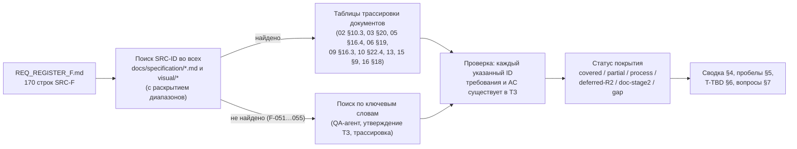
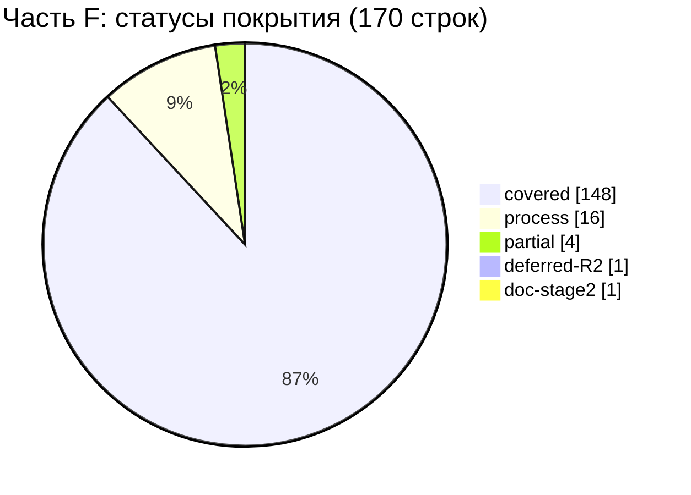

# 17F — Матрица трассируемости: часть F реестра исходных требований (SRC-F-001 … SRC-F-145)

Версия 1.1 · Дата 2026-10-19 · Статус: черновик для утверждения заказчиком (доработан по замечаниям проверки — «Журнал проверки» в конце)

**Входные материалы:** реестр `docs/specification/source/REQ_REGISTER_F.md` (170 строк: SRC-F-001…SRC-F-145 и 25 суффиксных строк), мастер-промт `docs/specification/source/MASTER_PROMPT_extracted.md` (строки 834–980), ядро `docs/research/R0_DECISION_KERNEL.md` v1.4 (включая §16–§19), документы ТЗ `docs/specification/01…16`, `visual/*`.

**Связанные документы:** 01_PRODUCT_REQUIREMENTS.md (в выпуске), 02_SCREEN_SPECIFICATION.md (единственный канонический текст экранов, ядро §19.1), 03_UX_UI_DESIGN_SYSTEM.md, 04_USER_FLOWS.md, 05_ONEC_INTEGRATION.md, 06_ARCHITECTURE.md, 07_DATA_MODEL.md, 08_API_SPECIFICATION.md, 09_AUTH_SMS_BIOMETRICS.md, 10_POS_BUSINESS_RULES.md, 11_SECURITY_PRIVACY.md, 12_TEST_PLAN.md (в выпуске), 13_IMPLEMENTATION_ROADMAP.md, 14_OPEN_QUESTIONS.md, 15_DECISION_LOG.md, 16_DEPLOYMENT_PLAN.md, `visual/` (screen-map.md, navigation.md, responsive-spec.md, components-states.md, palette-comparison.html, wireframes-auth.html, wireframes-catalog.html, wireframes-cashier.html); сборный файл 17_TRACEABILITY_MATRIX.md (части 17A…17F). 01 и 12 выпускаются параллельно с трассировкой — учтено состояние на момент её завершения (§7).

Роль автора: трассировщик требований (QA), часть F. Этап проекта — ЭТАП 1 (ТЗ); код не пишется. Статус «covered» означает только «требование отражено в тексте ТЗ»; о готовности системы документ ничего не утверждает.

---

## 1. Краткое содержание

- Протрассированы **все 170 строк** части F реестра (SRC-F-001…SRC-F-145 + 25 суффиксных строк a…e); пропусков и дублей нет (скриптовое сравнение ID реестра и матрицы, §9).
- Место в ТЗ найдено поиском по SRC-ID во всех файлах `docs/specification/*.md` и `visual/*` (с раскрытием диапазонов вида `SRC-F-004…019`), для SRC-F-051…055 — по ключевым словам; все 1501 вхождение ID требований, критериев приёмки, тестов и решений (790 уникальных ID), указанных в столбцах 4–7 матрицы, проверены на существование в документах ТЗ и ядре (§9, пересчёт ред. 1.1).
- Итог по статусам (§4): **covered 148**, **process 16**, **partial 4**, **deferred-R2 1**, **doc-stage2 1**, **gap 0** — всего 170.
- Главные находки: (1) 12_TEST_PLAN.md выпускается параллельно — тесты из 12 найдены для 8 строк (T-AUTH-034/035, T-FACE-001…005, T-SMS-015), 146 строк помечены `T-TBD:<префикс>` (23 префикс-группы, §6), кандидаты `T-SEC-…` из 11 §12.2 указаны; (1а) must-требование SRC-F-123 «независимая архитектурная проверка» на этапе 1 покрыто только самооценкой автора 06 §15 — статус `partial` (§5.1), полная проверка — 13 RM-B-010 / RM-H-002; (2) SRC-F-051…SRC-F-055 («Проверка полноты») не упоминаются в документах ТЗ, кроме ADR-044 (SRC-F-051a), — их закрывают этот документ, 13 RM-B-001 и методика этапа 1; (3) SRC-F-041 «подробные макеты ключевых экранов» закрыт только спецификациями 02 и wireframes (по SRC-F-049) — нужен ответ заказчика (Q-287); (4) 08 и 11 описывают решения по SRC-F-086…091, 138…138c без конкретных обратных ссылок SRC-F-ID (в 08 есть только обобщённая ссылка «SRC-F (EVO — 06)» в строке API-029); (5) в 02 §10.3 устаревшая нумерация подразделов части C, AC-DS-079 называет несуществующий `visual/wireframes.html`.
- Сканирование лица (SRC-F-024) — единственная строка «deferred-R2» (D-14, Q-003); описание шагов, подсказок и ограничений технологии (SRC-F-025…027) в ТЗ присутствует полностью, тесты T-FACE — условные.
- Новые вопросы: Q-287, Q-288 (диапазон 17 по ядру §19.5, номера предварительные — §10); замечания к ядру — §12.

---

## 2. Методика трассировки

### 2.1. Правила присвоения статуса

| Статус | Когда ставится |
|---|---|
| `covered` | требование отражено в тексте ТЗ: есть раздел и ID требования (или раздел-артефакт для документных требований), для функциональных/нефункциональных — критерий приёмки `AC-…` |
| `partial` | отражено не полностью: нет критерия/теста там, где они нужны, артефакт заменён упрощённым, или зависит от невыпущенного документа ТЗ |
| `process` | требование к процессу работы, **полностью** выполненное методикой этапа 1 (в пределах информации, доступной на этапе 1) — в столбце «Документ и раздел» указано, чем именно; если методикой этапа 1 требование выполнено лишь частично, ставится `partial`, если работа целиком отнесена к этапу 2 — `doc-stage2` |
| `deferred-R2` | функция осознанно вынесена за R1 решением ядра; указаны D-xx и Q-ссылка |
| `doc-stage2` | артефакт или действие этапа 2 (разработки), запланированное в 13_IMPLEMENTATION_ROADMAP |
| `gap` | места в ТЗ нет — не обнаружено ни одной такой строки |

### 2.2. Обозначения в таблице

- «02 ч. A…E» — часть A…E раздела 9 сводного 02 (полный текст частей внутри 02; черновики `source/02_parts_drafts/` не используются, ядро §19.1). «п.N» у экрана 02 — подраздел `SCR-xx.N` (14 пунктов промта).
- `AC-UI-*` — критерии приёмки экранов; полный индекс — 02 §10.1.
- Столбец «Тест»: `T-TBD:<префикс>` — тест должен быть описан в 12_TEST_PLAN.md (документ не выпущен); в скобках «канд.» — существующие тест-ID из 11 §12.2 (T-SEC-…), которые 12 может принять без перенумерации. Для строк `process` тест не применяется («—»), проверка — ревью QA.
- Тип — из реестра (функц. / нефункц. / ограничение / процесс / документ).

---

## 3. Матрица трассируемости SRC-F → ТЗ

### 3.1. Ультрадетальная спецификация экранов (SRC-F-001…SRC-F-020)

| SRC-ID | Краткая формулировка | Тип | Документ и раздел ТЗ | ID требования(й) ТЗ | Критерий приёмки (AC-…) | Тест | Статус покрытия |
|---|---|---|---|---|---|---|---|
| SRC-F-001 | Первоначальные требования к экранам — обязательная часть проекта | ограничение | 02 §2.2, §2.5, §10.3 (строки SRC-F-001…003 частей A, B, D); 15 ADR-064 | ADR-064 | AC-ADR-064 | T-TBD:UI | covered |
| SRC-F-002 | Не сокращать требования к экранам, не заменять общими формулировками | ограничение | 02 §10.3; 02 ч. B §13, ч. D «Трассировка»; ядро §19.1 (верхняя граница объёма 02 снята); 15 ADR-064 | ADR-064 | AC-ADR-064 | T-TBD:UI | covered |
| SRC-F-003 | Не исключать детали, даже «несущественные» | ограничение | 02 §10.3; 02 ч. D §0.7 (макетные подписи сохранены); 15 ADR-064 | ADR-064 | AC-ADR-064 | T-TBD:UI | covered |
| SRC-F-004 | Ультрадетальная спецификация всех экранов до начала разработки | документ | 02 целиком (§9 ч. A–E — SCR-00…SCR-50, SCR-90); `visual/screen-map.md` §2 | SCR-00…SCR-90 (ядро §9), ADR-064 | AC-ADR-064 (у каждого SCR-xx есть раздел в 02); индекс AC-UI-* — 02 §10.1 | T-TBD:UI | covered |
| SRC-F-005 | Для каждого экрана — назначение и роль пользователя | документ | 02, подраздел `SCR-xx.1` каждого экрана; `visual/screen-map.md` §2 | ADR-064; SCR-xx.1 у каждого экрана (напр. SCR-01.1, SCR-10.1) | AC-ADR-064; напр. AC-UI-10-019 (роль `owner`); индекс AC-UI — 02 §10.1 | T-TBD:UI | covered |
| SRC-F-006 | Полная структура экрана сверху вниз и слева направо | документ | 02, подраздел `SCR-xx.2` (compact / medium / expanded) | ADR-064; SCR-xx.2 (напр. SCR-01.2, SCR-10.2) | AC-ADR-064; напр. AC-UI-10-030, AC-UI-01-015; индекс AC-UI — 02 §10.1 | T-TBD:UI | covered |
| SRC-F-007 | Каждый UI-элемент: расположение, размер, отступы, выравнивание, иерархия | документ | 02, подраздел `SCR-xx.3` (таблицы элементов с UI-ID; SCR-10 и SCR-14 — по зонам) | UI-<SCR>-NNN (например UI-14-006) | напр. AC-UI-10-001, AC-UI-10-020; индекс AC-UI — 02 §10.1 | T-TBD:UI | covered |
| SRC-F-008 | Цвета, типографика, иконки, радиусы, тени, состояния — со ссылками на дизайн-систему | документ | 02 `SCR-xx.3` (токены `ds.*`); 03 §7–§10 (токены, компоненты, матрица состояний) | UI-<SCR>-NNN; DS-030 | AC-UI-* (02 §10.1); AC-DS-030 | T-TBD:UI | covered |
| SRC-F-009 | Поведение каждого поля, кнопки, карточки, переключателя, меню, фильтра | документ | 02, подраздел `SCR-xx.4` | ADR-064; SCR-xx.4 (напр. SCR-01.4, SCR-10.4) | AC-ADR-064; напр. AC-UI-10-004, AC-UI-10-006; индекс AC-UI — 02 §10.1 | T-TBD:UI | covered |
| SRC-F-010 | Все анимации: начальное состояние, триггер, последовательность, конечное, длительность, ошибка | документ | 02 `SCR-xx.5` (таблицы у всех экранов); 03 §11.2 (реестр ANIM-NNN), §18.7 | DS-065, ANIM-001…ANIM-030 | AC-DS-065; AC-UI-* | T-TBD:ANIM | covered |
| SRC-F-011 | Все переходы между экранами с передаваемыми данными | документ | 02 `SCR-xx.6`, §4 (карта экранов), §8 (перекрёстные переходы); `visual/navigation.md` §5; `visual/screen-map.md` §4 | ADR-064; SCR-xx.6 (напр. SCR-01.6, SCR-10.6) | AC-ADR-064; напр. AC-UI-10-008, AC-UI-10-013; индекс AC-UI — 02 §10.1 | T-TBD:UI | covered |
| SRC-F-012 | Состояния загрузки, успеха, ошибки, пустого, нет сети, нет разрешений, повтор | документ | 02 `SCR-xx.7` (stateDiagram-v2), §6 (матрица «экран × состояния»), SCR-90; `visual/components-states.md`; `visual/responsive-spec.md` §12 | SCR-90, NFR-OFFLINE-001 | напр. AC-UI-10-017, AC-UI-01-010; индекс AC-UI — 02 §10.1 | T-TBD:UI | covered |
| SRC-F-013 | Правила валидации, сообщения, ограничения ввода | документ | 02 `SCR-xx.8`; 02 §7 (словарь строк UI) | ADR-064; SCR-xx.8 (напр. SCR-01.8, SCR-10.8) | AC-ADR-064; напр. AC-UI-01-003, AC-UI-01-005; индекс AC-UI — 02 §10.1 | T-TBD:UI | covered |
| SRC-F-014 | Источники данных, API, состояния приложения, бизнес-правила | документ | 02 `SCR-xx.9`; 08 (эндпоинты); 10 (бизнес-правила) | ADR-064; SCR-xx.9 (напр. SCR-01.9, SCR-10.9) | AC-ADR-064; напр. AC-UI-10-012, AC-UI-10-024; индекс AC-UI — 02 §10.1 | T-TBD:UI | covered |
| SRC-F-015 | Действия по ролям и ограничения безопасности | документ | 02 `SCR-xx.10` (матрицы роль × действие), §5 (сводная матрица «экран × роль»); 11 §4.4 | ADR-064; SCR-xx.10 (напр. SCR-01.10, SCR-10.10) | AC-ADR-064; напр. AC-UI-10-019; индекс AC-UI — 02 §10.1 | T-TBD:UI | covered |
| SRC-F-016 | Повторное нажатие, двойной запрос, «Назад», повторный запуск | документ | 02 `SCR-xx.11`; 03 §18.4 (DS-033, DS-039); `visual/navigation.md` §6–§7 | DS-033, DS-039, DS-046 | AC-DS-033, AC-DS-039, AC-DS-046 | T-TBD:UI | covered |
| SRC-F-017 | Требования к телефонам, планшетам, другим платформам | документ | 02 `SCR-xx.12`, §3.2; 03 §18.5 (DS-049); `visual/responsive-spec.md` §1.1, §3–§8; 15 ADR-018 | DS-049, ADR-018 | AC-DS-049, AC-ADR-018 | T-TBD:DS | covered |
| SRC-F-018 | Критерии приёмки для каждого экрана | документ | 02 `SCR-xx.13`; 02 §10.1 (индекс AC-UI) | ADR-064; SCR-xx.13 (напр. SCR-01.13, SCR-10.13) | AC-ADR-064; напр. AC-UI-01-001…AC-UI-01-018, AC-UI-10-001…AC-UI-10-031; индекс AC-UI — 02 §10.1 | T-TBD:UI | covered |
| SRC-F-019 | Описание экрана не одним абзацем | ограничение | 02: все подразделы `.1…14` развёрнуты — 02 §10.3 (строка SRC-F-019), 02 ч. B §13 (строка SRC-F-019: пункты, бывшие абзацем, переведены в таблицы), 02 ч. B §15 «Журнал проверки (версия 1.1)», пп. П-1…П-4 | ADR-064; SCR-xx.1…14 (напр. SCR-12.5, SCR-12.9…SCR-12.12, SCR-16.10) | AC-ADR-064; AC-UI-12-010…AC-UI-12-013, AC-UI-16-012 (02 ч. B §15, П-1, П-4) | T-TBD:UI | covered |
| SRC-F-020 | Для сложных экранов — подразделы, таблицы элементов, диаграммы переходов и последовательностей | документ | 02 ч. A §13 (SCR-05.4.1–SCR-05.4.2, SCR-90 зоны A–H, sequence SCR-01/02/04/08); 02 ч. B §13 (SCR-10 зоны A–F, SCR-14 зоны A–E, sequence/stateDiagram); 02 §4 (flowchart) | SCR-05, SCR-10, SCR-14, SCR-90 | напр. AC-UI-10-011; индекс AC-UI — 02 §10.1 | T-TBD:UI | covered |

### 3.2. Персонаж, сканирование лица, каталог, корзина, кассир (SRC-F-021…SRC-F-036)

| SRC-ID | Краткая формулировка | Тип | Документ и раздел ТЗ | ID требования(й) ТЗ | Критерий приёмки (AC-…) | Тест | Статус покрытия |
|---|---|---|---|---|---|---|---|
| SRC-F-021 | 8 состояний персонажа авторизации (нейтральное … переход в приложение) | документ | 02 ч. A §0.3 («8 состояний промта → 6 состояний `MascotAuth`»), SCR-02/04/08 п.14; 03 §13.3, §13.8; 09 §13.6, §14.1; 15 ADR-040 (D-40); 01 §5.2 (GEN-036) | AUTH-043, AUTH-048, DS-059, ADR-040, GEN-036 | AC-AUTH-073, AC-AUTH-075, AC-ADR-040, AC-GEN-036 | T-AUTH-034, T-AUTH-035 (12 §3.1) | covered |
| SRC-F-022 | Не подменять реальное распознавание лица анимацией | ограничение | 02 ч. A §0.3 (И1, И4), SCR-05.1; 03 §13.1; 09 §10.2, §13.6, §14.6; 15 ADR-014; 01 §5.2 (GEN-036) | AUTH-044, FACE-011, DS-059, ADR-014, GEN-036 | AC-AUTH-074, AC-AUTH-079, AC-UI-05-015, AC-ADR-014, AC-GEN-036 | T-AUTH-034 (12 §3.1) | covered |
| SRC-F-023 | Визуальная реакция и результат проверки — независимые слои | нефункц. | 09 §10.2; 03 §9.52 (`Mascot`), §13.1, §17.6 (`MascotController`); 02 SCR-02 п.14; 15 ADR-040; 01 §5.2 (GEN-036) | AUTH-044, FACE-011, DS-059, ADR-040, GEN-036 | AC-AUTH-074, AC-AUTH-079, AC-ADR-040, AC-GEN-036 | T-AUTH-034 (12 §3.1) | covered |
| SRC-F-024 | Сканирование лица: прямо → влево → вправо → вверх | функц. | 02 SCR-05.4.1; 09 §10.3, §14.6 (FACE-NNN, «R2, вне R1»); 15 ADR-014; ядро D-14, §4.2; 01 §5.3 (GEN-050) | FACE-004, ADR-014, GEN-050 | AC-AUTH-077, AC-ADR-014, AC-GEN-050 | T-FACE-001, T-FACE-002 (12 §3.1, условно) | deferred-R2 (D-14, Q-003) |
| SRC-F-025 | Для каждого шага: подсказки, индикатор, условия захвата, повтор, отмена, неподдерживаемое устройство | документ | 02 SCR-05.4.1–SCR-05.4.2 (UI-05-004…017); 09 §10.3–10.4, §14.6; 01 §5.3 (GEN-050) | FACE-003, FACE-005, FACE-006, FACE-007, FACE-008, GEN-050 | AC-AUTH-077, AC-AUTH-078 | T-FACE-002, T-FACE-003 (12 §3.1, условно) | covered |
| SRC-F-026 | Отдельно: что подтверждено технологией, что требует SDK | документ | 02 SCR-05.1.1; 09 §10.1; 01 §5.3 (GEN-050) | FACE-009, GEN-050 | AC-AUTH-079 | T-FACE-004, T-FACE-005 (12 §3.1) | covered |
| SRC-F-027 | Не заявлять полноценную защиту от подделки без технологии | ограничение | 02 SCR-05.1, SCR-05.14; 09 §10.1, §14.6; 01 §5.3 (GEN-050) | FACE-010, GEN-050 | AC-UI-05-012, AC-AUTH-079 | T-FACE-004 (12 §3.1) | covered |
| SRC-F-028 | Отдельно: главный каталог, поиск, результаты, категории, подкатегории, фильтры, сетка, список, карточка | документ | 02 ч. B SCR-10…SCR-14, п. 2.3; 10 §4.2, §5; `visual/wireframes-catalog.html` | SCR-10…SCR-14, CAT-001, CAT-004, CAT-005, CAT-006, CAT-007, CAT-009, CAT-010, INV-018 | AC-CAT-001, AC-CAT-004, AC-CAT-005, AC-CAT-006, AC-CAT-007, AC-CAT-009, AC-CAT-010, AC-INV-018 | T-TBD:CAT | covered |
| SRC-F-029 | Связь каждого варианта с артикулом, изображениями, ценой, единицей, остатками по складам | функц. | 02 SCR-14 зоны B–D, SCR-15 п.14, ч. C §3.3 (строка корзины); 10 §4.2; 05 §5.2; 03 §18.6; 04 FLOW-012 | INV-011, ONEC-073, DS-055, UI-14-006, UI-14-007, UI-14-009, UI-14-013, CART-006 | AC-UI-14-004, AC-INV-011, AC-ONEC-073, AC-DS-055 | T-TBD:INV | covered |
| SRC-F-030 | Поведение при большом числе товаров, длинных названиях, без фото, нескольких расцветках, многих характеристиках | нефункц. | 02 ч. B §5 («Поведение при больших объёмах и „трудных“ данных»), SCR-10.3, SCR-14/15 п.14; 10 §4.2, §4.3, §4.6, §5; 03 §14.3, §18.2, §18.4, §18.6; 15 ADR-055 | INV-015, INV-016, INV-022, INV-052, INV-053, CAT-008, CAT-011, DS-017, DS-035, DS-055, DS-060, ADR-055 | AC-UI-10-011, AC-UI-10-020, AC-UI-14-014, AC-UI-15-006, AC-INV-053, AC-CAT-011 | T-TBD:CAT | covered |
| SRC-F-031 | Состояния корзины: пустая, с товарами, изменение количества, удаление, изменение цены, недостаточный остаток, устаревшие данные, ошибка оформления | документ | 02 ч. C SCR-20.7, SCR-21.7 (в 02 §10.3 — устаревшая нумерация «§4.7», «§5.7»); 10 §7.1–7.2, §8.3; 03 §18.6 (DS-057); 04 FLOW-013, FLOW-014; 01 §5.7 (GEN-102) | CART-013…CART-022, CART-016, CART-021, CART-022, CART-024, ORD-027, DS-057, GEN-102 | AC-UI-20-009, AC-UI-20-010, AC-UI-20-018, AC-UI-21-010, AC-CART-016, AC-ORD-027, AC-GEN-102 | T-TBD:CART | covered |
| SRC-F-032 | Определить механизм сохранения корзины | функц. | 02 ч. C SCR-20.3 (UI-20-023), SCR-20.9, SCR-20.11, SCR-23; 10 §7.2; 15 ADR-032, ADR-052; 04 FLOW-013, FLOW-017, FLOW-032 | CART-008, CART-009, CART-018, CART-030, UI-20-023, ADR-052 | AC-UI-20-013, AC-UI-20-014, AC-CART-008, AC-ADR-052 | T-TBD:CART | covered |
| SRC-F-033 | Определить, как предотвращаются повторные операции | функц. | 02 ч. C SCR-20.11, SCR-20.11.1 (UI-20-020, UI-20-027), SCR-21.4, SCR-21.4.1, SCR-21.11 (UI-21-019); 10 §7.2, §8.3; 03 §18.4 (DS-039); 15 ADR-052 | CART-017, CART-022, CART-023, CART-025, ORD-021, ORD-028, DS-039 | AC-UI-20-016, AC-UI-20-028, AC-UI-21-008, AC-CART-023, AC-CART-025 | T-TBD:CART | covered |
| SRC-F-034 | Отдельно экраны кассира: панель, поиск клиентов, профиль, история, задолженности, скидки, транзакции, избранное, детали операции, подтверждение критических действий | документ | 02 ч. D SCR-30…SCR-38, §0.5; 02 ч. E SCR-40 (избранное); 10 §13, §14.2; 04 FLOW-028; `visual/wireframes-cashier.html`; 01 §5.10 (GEN-137) | SCR-30…SCR-38, SCR-40, CASH-010, CASH-014, TXN-003, GEN-137 | AC-CASH-010, AC-CASH-014, AC-TXN-003, AC-GEN-137 | T-TBD:CASH | covered |
| SRC-F-035 | Какие данные разрешено показывать каждой роли | функц. | 02 ч. D §0.4 (матрица видимости полей клиента), п.10 экранов SCR-30…36; 10 §4.4, §9.4, §10, §13, §15.2; 11 §4.4; 04 FLOW-028, FLOW-030; 01 §5.10 (GEN-137) | CUST-001, CUST-009, DEBT-004, TXN-004, INV-033, PAY-036, SEC-031, SEC-042, GEN-137 | AC-CUST-001, AC-CUST-009, AC-DEBT-004, AC-TXN-004, AC-INV-033, AC-PAY-036, AC-GEN-137 | T-TBD:CUST | covered |
| SRC-F-036 | Какие операции должны быть подтверждены сервером | функц. | 02 ч. D §0.5 (P-STEPUP), SCR-34/37/38/39 п.14; 10 §3 (матрица операция × роль × где выполняется), §8.4, §9.3–9.4, §10–§12, §14.2; 04 FLOW-016, FLOW-022, FLOW-024, FLOW-026, FLOW-031; 01 §5.10 (GEN-137) | CASH-001, CASH-002, CASH-007, CASH-008, CASH-014, ORD-051, PAY-026, PAY-032, DEBT-010, DISC-010, RET-006, RET-009, GEN-137 | AC-CASH-001, AC-CASH-002, AC-CASH-007, AC-CASH-008, AC-CASH-014, AC-ORD-051, AC-DEBT-010, AC-RET-009, AC-GEN-137 | T-TBD:CASH | covered |

### 3.3. Визуальные материалы и проверка полноты (SRC-F-037…SRC-F-055)

| SRC-ID | Краткая формулировка | Тип | Документ и раздел ТЗ | ID требования(й) ТЗ | Критерий приёмки (AC-…) | Тест | Статус покрытия |
|---|---|---|---|---|---|---|---|
| SRC-F-037 | Визуальные материалы готовятся до программирования, в меру инструментов | процесс | Выполнено методикой этапа 1: папка `visual/` (8 файлов, `visual/README.md` §1) подготовлена до разработки; 03 §18.9 | DS-079 | AC-DS-079 | — (process) | process |
| SRC-F-038 | Карта экранов | документ | `visual/screen-map.md` §2, §4; 02 §4 «Карта экранов» | DS-079 | AC-DS-079 | T-TBD:DS | covered |
| SRC-F-039 | Пользовательские flow-диаграммы | документ | 04 FLOW-001…FLOW-036 (Mermaid-диаграммы, §3.4, §10); 15 ADR-046 | FLOW-001…FLOW-036, DS-079, ADR-046 | AC-DS-079, AC-ADR-046, AC-FLOW-NNN-kk (04) | T-TBD:FLOW | covered |
| SRC-F-040 | Wireframes всех основных экранов | документ | `visual/wireframes-auth.html` (SCR-00…08, SCR-90), `visual/wireframes-catalog.html` (SCR-10…26), `visual/wireframes-cashier.html` (SCR-30…48); вместе покрывают все SCR ядра §9 | DS-079 | AC-DS-079 (формулировка устарела — см. §12 п. 2) | T-TBD:DS | covered |
| SRC-F-041 | Подробные макеты ключевых экранов | документ | Заменены структурированными спецификациями 02 (п.3 таблицы элементов с токенами) и wireframes `visual/` по правилу SRC-F-049; 03 §20 (строка SRC-F-041) | DS-079 | AC-DS-079 | T-TBD:DS | partial (Q-287) |
| SRC-F-042 | Два варианта цветовой системы | документ | 03 §5.2–5.3; `visual/palette-comparison.html`; ядро D-16, §8.1 (вариант B — Q-006) | DS-003, ADR-016 | AC-DS-003, AC-ADR-016 | T-TBD:DS | covered |
| SRC-F-043 | Сравнительный анализ вариантов | документ | 03 §5.4–5.6; `visual/palette-comparison.html` | DS-004 | AC-DS-004 | T-TBD:DS | covered |
| SRC-F-044 | Таблица всех UI-компонентов | документ | 03 §9 (спецификация компонентов), §10; `visual/components-states.md` §2, §4; 02 §10.3 (строка сборки); 15 ADR-051 | DS-030, ADR-051 | AC-DS-030, AC-ADR-051 | T-TBD:DS | covered |
| SRC-F-045 | Таблица состояний компонентов | документ | 03 §10 («Сводная матрица компонент × состояние»); `visual/components-states.md`; 02 §6 | DS-030, DS-040 | AC-DS-030, AC-DS-040 | T-TBD:DS | covered |
| SRC-F-046 | Схема навигации | документ | `visual/navigation.md` §2–§5; 02 §3.1, §4.2, §8.1; 15 ADR-050 | DS-079, ADR-050 | AC-DS-079, AC-ADR-050 | T-TBD:DS | covered |
| SRC-F-047 | Спецификация адаптивных состояний | документ | `visual/responsive-spec.md` §1–§8; 03 §8, §18.5; 02 §3.2, п.2 и п.12 экранов; 15 ADR-018 | DS-041…DS-049, ADR-018 | AC-DS-041, AC-DS-049, AC-ADR-018 | T-TBD:DS | covered |
| SRC-F-048 | Сначала — визуальная концепция | процесс | Выполнено методикой: 03 (разделы 2–8 — концепция) выпущен в волне 1 до визуальных материалов и экранов 02 (`docs/PROGRESS_LOG.md`, 2026-10-19); 03 §20 | DS-079 | AC-DS-079 | — (process) | process |
| SRC-F-048a | Контрольная точка: концепция — на утверждение заказчику в составе ТЗ | процесс | Выполнено методикой: 03 и `visual/` имеют статус «черновик для утверждения заказчиком»; выбор палитры/персонажа вынесен в Q-006, Q-035; решение заказчика — в составе утверждения ТЗ (RM-B-001) | DS-079, RM-B-001 | AC-RM-B-001 | — (process) | process |
| SRC-F-049 | Без редактируемых макетов — структурированные спецификации и схемы | документ | 03 §8–§10 (схемы, таблицы), §18.9; 02 (таблицы элементов); `visual/*.md` (Mermaid) | DS-079 | AC-DS-079 | T-TBD:DS | covered |
| SRC-F-050 | Не выдавать статичную иллюстрацию за готовый интерфейс | ограничение | 03 §18.9 (DS-079: пометка на всех визуальных материалах); `visual/README.md` §2.2, §5; пометка «Wireframe / структурная схема для ТЗ — не финальный интерфейс» в HTML-файлах `visual/` | DS-079 | AC-DS-079 | T-TBD:DS | covered |
| SRC-F-051 | Создать матрицу трассируемости по каждому первоначальному требованию | документ | Этот документ (часть F) и части 17A…17E → сборный 17_TRACEABILITY_MATRIX.md (ядро §15); формат трассировки — 15 ADR-044 | ADR-044 | AC-ADR-044 | T-TBD:TRACE `[НОВОЕ ИМЯ]` | covered |
| SRC-F-051a | Атрибут: идентификатор у каждого требования | документ | Столбец «SRC-ID» этой матрицы (ID реестра без изменений, ядро §10); 15 ADR-044 | ADR-044 | AC-ADR-044 | T-TBD:TRACE | covered |
| SRC-F-051b | Атрибут: место в ТЗ | документ | Столбцы «Документ и раздел ТЗ» и «ID требования(й) ТЗ» этой матрицы — заполнены для 170 из 170 строк | ADR-044 | AC-ADR-044 | T-TBD:TRACE | covered |
| SRC-F-051c | Атрибут: критерий приёмки | документ | Столбец «Критерий приёмки» этой матрицы; AC отсутствует у 3 строк (SRC-F-051d, SRC-F-052, SRC-F-054), у остальных 14 строк `process`/`doc-stage2` AC указан; у 14 строк-документов 02 (SRC-F-004…015, 018, 020) критерий дан ссылкой на индекс AC-UI (02 §10.1) с 1–2 опорными примерами (ред. 1.1), а не полным перечнем AC по каждому экрану | ADR-044 | AC-ADR-044 | T-TBD:TRACE | partial (§5) |
| SRC-F-051d | Атрибут: соответствующий тестовый сценарий | документ | Столбец «Тест» этой матрицы. 12_TEST_PLAN.md выпускается параллельно (на момент трассировки написаны §1–§3.1): тесты из 12 указаны для 8 строк (T-AUTH, T-FACE, T-SMS), остальные — `T-TBD:<префикс>` (§6); SRC-F-051d входит в зону 12 | — | — | T-TBD:TRACE | partial (§5) |
| SRC-F-052 | Проверить, что ни одна первоначальная функция не потеряна | процесс | Выполнено методикой: §4 (сводка статусов), §5 (gap/partial), §9 (скриптовая сверка 170/170 ID реестра с матрицей); аналогично — части 17A…17E | — | — | — (process) | process |
| SRC-F-053 | После матрицы и проверки полноты — передать ТЗ независимому QA-агенту | процесс | Порядок шагов закреплён: 13 RM-B-001 («после независимой проверки ТЗ QA-агентом»); план волны 4 «независимая QA-проверка всего пакета» — `docs/PROGRESS_LOG.md` | RM-B-001 | AC-RM-B-001 | — (process) | process |
| SRC-F-054 | Исправить все существенные пробелы, найденные QA | процесс | Методика этапа 1: каждый документ ТЗ содержит «Журнал проверки» с исправлениями по замечаниям проверяющего (например, 02 §12, 06 прил. А, 16 §20); итоговые исправления пакета — волна 4 (`docs/PROGRESS_LOG.md`) | — | — | — (process) | process |
| SRC-F-055 | Разработка запрещена до письменного утверждения итогового ТЗ | ограничение | 13 §2.1 P-1, §3.2 RM-B-001; 06 ARCH-055; ядро §0. Строки ссылаются на SRC-F-125 / SRC-E-020, а не на SRC-F-055 (§5.2) | P-1, RM-B-001, ARCH-055 | AC-RM-B-001, AC-ARCH-055 | T-TBD:RM | covered |

### 3.4. Clean Architecture, модули, backend и БД, правила развития (SRC-F-056…SRC-F-103)

| SRC-ID | Краткая формулировка | Тип | Документ и раздел ТЗ | ID требования(й) ТЗ | Критерий приёмки (AC-…) | Тест | Статус покрытия |
|---|---|---|---|---|---|---|---|
| SRC-F-056 | Профессиональная коммерческая POS: сначала MVP / Release 1, далее расширение | нефункц. | 06 §2.3, §14; 06 §17.1, §17.3; 01 §2.7 (GEN-002) | ARCH-056, EVO-022, GEN-002 | AC-ARCH-056, AC-EVO-022, AC-GEN-002 | T-TBD:ARCH | covered |
| SRC-F-057 | Clean Architecture, SOLID, разделение ответственности, слабая связанность | нефункц. | 06 §6.1; 15 ADR-005 (D-05); 01 §5.21 (GEN-217) | ARCH-016, ADR-005, GEN-217 | AC-ARCH-016, AC-ADR-005, AC-GEN-217 | T-TBD:ARCH | covered |
| SRC-F-058 | Слой Presentation (экраны, компоненты, состояния, действия) | нефункц. | 06 §6.1, §6.2; 01 §5.21 (GEN-217) | ARCH-016, GEN-217 | AC-ARCH-016, AC-GEN-217 | T-TBD:ARCH | covered |
| SRC-F-059 | Слой Domain (сущности, правила, интерфейсы репозиториев, Use Cases) | нефункц. | 06 §6.1; 15 ADR-005; 01 §5.21 (GEN-217) | ARCH-016, ADR-005, GEN-217 | AC-ARCH-016, AC-ADR-005, AC-GEN-217 | T-TBD:ARCH | covered |
| SRC-F-060 | Слой Data (репозитории, DTO, источники, API-клиенты, локальное хранилище) | нефункц. | 06 §6.1, §6.5, §6.7; 01 §5.21 (GEN-217) | ARCH-016, GEN-217 | AC-ARCH-016, AC-GEN-217 | T-TBD:ARCH | covered |
| SRC-F-061 | Слой Core (утилиты, ошибки, конфигурация, сеть, общие компоненты) | нефункц. | 06 §6.1, §6.2, §6.8, §6.9; 01 §5.21 (GEN-217) | ARCH-016, MOD-002, GEN-217 | AC-ARCH-016, AC-MOD-002, AC-GEN-217 | T-TBD:ARCH | covered |
| SRC-F-062 | Выбрать и обосновать способ управления состоянием | документ | 06 §6.3 (Riverpod 3 — обоснование и альтернативы); 15 ADR-004 (D-04); 01 §5.21 (GEN-218) | ARCH-018, ADR-004, GEN-218 | AC-ARCH-018, AC-ADR-004, AC-GEN-218 | T-TBD:ARCH | covered |
| SRC-F-063 | Не смешивать бизнес-логику с UI | ограничение | 06 §6.1 (правила зависимостей); 01 §5.21 (GEN-218) | ARCH-017, GEN-218 | AC-ARCH-017, AC-GEN-218 | T-TBD:ARCH | covered |
| SRC-F-064 | Не обращаться к API напрямую из экранов | ограничение | 06 §6.1; 01 §5.21 (GEN-218) | ARCH-017, GEN-218 | AC-ARCH-017, AC-GEN-218 | T-TBD:ARCH | covered |
| SRC-F-065 | Запрет огромных файлов и универсальных классов | ограничение | 06 §6.1, §17.1; 01 §5.21 (GEN-218) | ARCH-017, GEN-218 | AC-ARCH-017, AC-GEN-218 | T-TBD:ARCH | covered |
| SRC-F-066 | Структура слоёв — ориентир; без ненужных абстракций | ограничение | 06 §6.1, §17.1–17.2; 01 §5.21 (GEN-218) | ARCH-023, MOD-023, GEN-218 | AC-ARCH-023, AC-MOD-023, AC-GEN-218 | T-TBD:ARCH | covered |
| SRC-F-066a | Структура соответствует реальному масштабу проекта | нефункц. | 06 §6.1; 01 §5.21 (GEN-218) | ARCH-023, GEN-218 | AC-ARCH-023, AC-GEN-218 | T-TBD:ARCH | covered |
| SRC-F-067 | Разделить систему на логические функциональные модули | нефункц. | 06 §6.15, §7.4, §17.2; 15 ADR-006 (D-06); 01 §5.21 (GEN-219) | MOD-001, ADR-006, GEN-219 | AC-MOD-001, AC-ADR-006, AC-GEN-219 | T-TBD:MOD | covered |
| SRC-F-068 | Модуль Authentication (авторизация, SMS OTP, биометрия) | функц. | 06 §6.15, §17.2; 09 (весь документ); 01 §5.21 (GEN-219) | MOD-004, GEN-219 | AC-MOD-004, AC-GEN-219 | T-TBD:MOD | covered |
| SRC-F-069 | Модуль User Profile (профиль, регистрационные данные) | функц. | 06 §6.15, §17.2; 01 §5.17 (GEN-180), §5.21 (GEN-219) | MOD-005, MOD-014, GEN-180, GEN-219 | AC-MOD-005, AC-MOD-014, AC-GEN-219 | T-TBD:MOD | covered |
| SRC-F-070 | Модуль Catalog (товары, категории, подкатегории, варианты) | функц. | 06 §6.15, §17.2; 01 §5.21 (GEN-219) | MOD-006, MOD-007, GEN-219 | AC-MOD-006, AC-MOD-007, AC-GEN-219 | T-TBD:MOD | covered |
| SRC-F-071 | Модуль Search & Filters | функц. | 06 §6.15 (объединён с Catalog), §17.2; 15 ADR-031; 01 §5.21 (GEN-219) | MOD-006, ADR-031, GEN-219 | AC-MOD-006, AC-ADR-031, AC-GEN-219 | T-TBD:MOD | covered |
| SRC-F-072 | Модуль Inventory (остатки, склады) | функц. | 06 §6.15, §17.2; 01 §5.21 (GEN-219) | MOD-006, MOD-007, GEN-219 | AC-MOD-006, AC-MOD-007, AC-GEN-219 | T-TBD:MOD | covered |
| SRC-F-073 | Модуль Cart (корзина, сохранённые черновики) | функц. | 06 §6.15, §17.2; 01 §5.21 (GEN-219) | MOD-008, GEN-219 | AC-MOD-008, AC-GEN-219 | T-TBD:MOD | covered |
| SRC-F-074 | Модуль POS / Sales (оформление и проведение продаж) | функц. | 06 §6.15, §17.2; 01 §5.21 (GEN-219) | MOD-009, MOD-010, GEN-219 | AC-MOD-009, AC-MOD-010, AC-GEN-219 | T-TBD:MOD | covered |
| SRC-F-075 | Модуль Customers (клиентская база, история покупок) | функц. | 06 §6.15, §17.2; 01 §5.21 (GEN-219) | MOD-011, GEN-219 | AC-MOD-011, AC-GEN-219 | T-TBD:MOD | covered |
| SRC-F-076 | Модуль Debts & Discounts (задолженности, скидки, правила доступа) | функц. | 06 §6.15, §17.2; 01 §5.21 (GEN-219) | MOD-011, GEN-219 | AC-MOD-011, AC-GEN-219 | T-TBD:MOD | covered |
| SRC-F-077 | Модуль Favorites | функц. | 06 §6.15, §17.2; 01 §5.15 (GEN-171), §5.21 (GEN-219) | MOD-013, GEN-171, GEN-219 | AC-MOD-013, AC-GEN-171, AC-GEN-219 | T-TBD:MOD | covered |
| SRC-F-078 | Модуль OneC Integration | функц. | 06 §6.15, §8, §17.2; 05 §4.2; 01 §5.21 (GEN-219) | MOD-016, ARCH-007, ONEC-023, ONEC-025, GEN-219 | AC-MOD-016, AC-ONEC-023, AC-ONEC-025, AC-GEN-219 | T-TBD:MOD | covered |
| SRC-F-079 | Модуль Notifications (уведомления, системные сообщения) | функц. | 06 §6.15, §17.2–17.3; 15 ADR-041 (R1 — только in-app, push — R2); 01 §5.17 (GEN-182), §5.21 (GEN-219) | MOD-017, EVO-019, ADR-041, GEN-182, GEN-219 | AC-MOD-017, AC-EVO-019, AC-ADR-041, AC-GEN-182, AC-GEN-219 | T-TBD:MOD | covered |
| SRC-F-080 | Модуль Settings (настройки приложения и пользователя) | функц. | 06 §6.15, §17.2; 01 §5.17 (GEN-181), §5.21 (GEN-219) | MOD-015, GEN-181, GEN-219 | AC-MOD-015, AC-GEN-181, AC-GEN-219 | T-TBD:MOD | covered |
| SRC-F-081 | Проверить, какие модули действительно нужны для R1 | процесс | Выполнено методикой: 06 §6.15 «Модули из списка заказчика: нужен / объединён / отложен»; 01 §5.21 (GEN-219) | MOD-019, GEN-219 | AC-MOD-019, AC-GEN-219 | — (process) | process |
| SRC-F-082 | Не создавать пустые модули ради списка | ограничение | 06 §6.15, §17.2; 15 ADR-006; 01 §5.21 (GEN-219) | MOD-019, ADR-006, GEN-219 | AC-MOD-019, AC-ADR-006, AC-GEN-219 | T-TBD:MOD | covered |
| SRC-F-083 | Понятный способ добавлять модули в дальнейшем | нефункц. | 06 §6.14 (шаблон feature-модуля), §13.1; 01 §5.21 (GEN-219) | MOD-020, EVO-001, GEN-219 | AC-MOD-020, AC-EVO-001, AC-GEN-219 | T-TBD:EVO | covered |
| SRC-F-084 | Разделение API, логики, данных, авторизации, синхронизации, фоновых задач | нефункц. | 06 §7.2, §7.4, §7.5; 05 §4.2, §7.3; 01 §5.21 (GEN-220) | ARCH-030, ARCH-031, ARCH-033, MOD-021, ONEC-025, SYNC-023, GEN-220 | AC-ARCH-030, AC-ARCH-031, AC-ARCH-033, AC-MOD-021, AC-SYNC-023, AC-GEN-220 | T-TBD:ARCH | covered |
| SRC-F-085 | Определить операции: сервер vs устройство | документ | 06 §4.6 («Что выполняется на сервере, а что допустимо на устройстве»); 01 §2.7 (GEN-006) | ARCH-034, GEN-006 | AC-ARCH-034, AC-GEN-006 | T-TBD:ARCH | covered |
| SRC-F-086 | Секреты SMS-сервиса не зависят от Flutter-клиента | ограничение | 06 §4.6, §10; 09 §14 (SMS-026, SMS-028); 11 §5.2; 05 §10; 01 §2.7 (GEN-006) | ARCH-034, ARCH-047, SMS-026, SMS-028, SEC-051, ONEC-084, GEN-006 | AC-ARCH-034, AC-ARCH-047, AC-AUTH-034, AC-AUTH-035, AC-ONEC-084, AC-GEN-006 | T-SMS-015 (12 §3.1); канд. T-SEC-036, T-SEC-037 | covered |
| SRC-F-086a | Критичные финансовые операции не зависят от Flutter-клиента | ограничение | 06 §4.6, §10; 05 §6.6, §9, §10; 08 §11.1 (API-032 — цены и итоги в теле запроса запрещены); 01 §2.7 (GEN-006) | ARCH-034, ARCH-047, ONEC-052, ONEC-053, ONEC-089, SYNC-052, API-032, GEN-006 | AC-ARCH-034, AC-ARCH-047, AC-ONEC-052, AC-SYNC-052, AC-API-032, AC-GEN-006 | T-TBD:ORD | covered |
| SRC-F-086b | Проверка прав доступа не зависит от Flutter-клиента | ограничение | 06 §4.6, §10; 11 §4.5 (deny by default); 01 §2.7 (GEN-006) | ARCH-034, ARCH-006, SEC-028, GEN-006 | AC-ARCH-034, AC-ARCH-006, AC-GEN-006 | T-TBD:SEC (канд. T-SEC-016, T-SEC-018) | covered |
| SRC-F-086c | Доверенные бизнес-правила не зависят от Flutter-клиента | ограничение | 06 §4.6, §10; 05 §6.6, §10; 11 §4.5 (SEC-034 — лимит скидки на сервере); 01 §2.7 (GEN-006) | ARCH-034, ARCH-047, ONEC-053, ONEC-089, SEC-034, GEN-006 | AC-ARCH-034, AC-ARCH-047, AC-ONEC-089, AC-GEN-006 | T-TBD:ARCH (канд. T-SEC-022) | covered |
| SRC-F-087 | Схема данных расширяема без нарушения истории, долгов, ID клиентов, связей с 1С | нефункц. | 06 §13.3; 05 §5.2, §12; 15 ADR-054; 01 §5.21 (GEN-221) | EVO-007, EVO-010, ONEC-100, ONEC-102, ONEC-098, ADR-054, GEN-221 | AC-EVO-007, AC-EVO-010, AC-ONEC-100, AC-ONEC-102, AC-ADR-054, AC-GEN-221 | T-TBD:EVO | covered |
| SRC-F-088 | Продумать миграции БД | нефункц. | 06 §7.7; 07 (DATA-270…DATA-279); 16 §10.1 (OPS-019); 05 ONEC-098; 01 §5.21 (GEN-222) | ARCH-057, EVO-004, DATA-270, DATA-271, OPS-019, ONEC-098, GEN-222 | AC-ARCH-057, AC-EVO-004, AC-DATA-271, AC-OPS-019, AC-GEN-222 | T-TBD:DATA | covered |
| SRC-F-089 | Продумать версионирование API | нефункц. | 06 §7.9; 08 §2.1, §2.11 (API-028, API-029); 05 ONEC-033; 01 §5.21 (GEN-223) | ARCH-041, EVO-003, API-028, API-029, ONEC-033, GEN-223 | AC-ARCH-041, AC-EVO-003, AC-API-029, AC-ONEC-033, AC-GEN-223 | T-TBD:API | covered |
| SRC-F-090 | Продумать обработку повторных запросов | нефункц. | 06 §7.6; 08 §2.7, §2.10 (API-012…API-019); 11 §3.5; 05 §7.5, §8.1; 01 §5.21 (GEN-224) | ARCH-036, API-012, API-013, API-014, SYNC-031, SYNC-043, SYNC-069, GEN-224 | AC-ARCH-036, AC-API-013, AC-SYNC-031, AC-SYNC-069, AC-GEN-224 | T-TBD:API | covered |
| SRC-F-091 | Продумать журналирование | нефункц. | 06 §7.11; 11 §6 (SEC-061…SEC-069), §7 (аудит); 05 §7.6 | ARCH-043, SEC-061, SEC-064, SYNC-037, SYNC-039 | AC-ARCH-043, AC-SYNC-037 | T-TBD:SEC (канд. T-SEC-029) | covered |
| SRC-F-092 | Продумать восстановление после ошибок синхронизации | нефункц. | 06 §5.3, §7.6; 05 §13 «Сценарии сбоев и восстановления»; 16 §15.2; 01 §5.18 (GEN-194), §6.2 (NFR-STAB-004) | ARCH-037, ARCH-039, SYNC-029, SYNC-046, SYNC-063, GEN-194, NFR-STAB-004 | AC-ARCH-037, AC-ARCH-039, AC-SYNC-029, AC-SYNC-063, AC-GEN-194 | T-TBD:SYNC | covered |
| SRC-F-093 | Не выбирать микросервисы автоматически | ограничение | 06 §2.2 (C-5); ядро D-45; 01 §5.21 (GEN-220) | ARCH-051, GEN-220 | AC-ARCH-051, AC-GEN-220 | T-TBD:ARCH | covered |
| SRC-F-094 | Для R1 — модульный монолит, если анализ не докажет иное | нефункц. | 06 §3.3, §7.4; 15 ADR-006, ADR-058 (D-45); 01 §5.21 (GEN-220) | ARCH-051, ARCH-001, ADR-058, GEN-220 | AC-ARCH-051, AC-ARCH-001, AC-ADR-058, AC-GEN-220 | T-TBD:ARCH | covered |
| SRC-F-095 | Учитывать будущее расширение (роли, отчёты, склады, финансы, интеграции, уведомления) | нефункц. | 06 §13, §14.3; 15 ADR-053, ADR-069; 01 §3.3 (ROLE-021); 01 §6.2 (NFR-SCALE-004) | EVO-015, EVO-016, EVO-017, EVO-018, EVO-019, ADR-053, ROLE-021, NFR-SCALE-004 | AC-EVO-015, AC-EVO-016, AC-EVO-017, AC-EVO-018, AC-EVO-019, AC-ROLE-021 | T-TBD:EVO | covered |
| SRC-F-096 | Новая функция не требует переписывания несвязанных модулей | нефункц. | 06 §13.1; 05 ONEC-029, ONEC-030; 15 ADR-006; 01 §2.7 (GEN-002), §3.3 (ROLE-021) | EVO-001, MOD-025, MOD-022, ONEC-029, GEN-002, ROLE-021 | AC-EVO-001, AC-MOD-025, AC-MOD-022, AC-ONEC-029, AC-GEN-002, AC-ROLE-021 | T-TBD:EVO | covered |
| SRC-F-097 | Изменения одного модуля минимально затрагивают остальные | нефункц. | 06 §7.4, §13; 05 ONEC-030; 15 ADR-006 | EVO-002, MOD-022, MOD-024, MOD-026, MOD-027, MOD-028, ONEC-030 | AC-EVO-002, AC-MOD-024, AC-ONEC-030 | T-TBD:EVO | covered |
| SRC-F-098 | Контролируемое изменение контрактов API и схем данных | нефункц. | 06 §13.2; 08 §2.11; 05 ONEC-033, ONEC-095; 15 ADR-059, ADR-067; 01 §5.21 (GEN-223), §6.2 (NFR-MAINT-002) | EVO-003, EVO-004, EVO-005, EVO-006, ARCH-040, ARCH-041, API-029, ADR-059, GEN-223, NFR-MAINT-002 | AC-EVO-003, AC-EVO-005, AC-ARCH-040, AC-API-029, AC-ADR-059, AC-GEN-223 | T-TBD:EVO | covered |
| SRC-F-099 | Целостность существующих продаж, клиентов, долгов, истории | нефункц. | 06 §5.3, §7.4 (г), §13.3; 05 ONEC-102, ONEC-059; 07 DATA-275; 01 §5.21 (GEN-221) | EVO-007, ARCH-032, ARCH-048, MOD-028, ONEC-102, DATA-275, GEN-221 | AC-EVO-007, AC-ARCH-032, AC-ARCH-048, AC-ONEC-102, AC-GEN-221 | T-TBD:EVO | covered |
| SRC-F-100 | Идемпотентность и защита от дублирования критических операций | нефункц. | 06 §6.7, §7.6; 08 §2.7 (API-012…API-016); 05 §7.5, §8.1; 15 ADR-020, ADR-021, ADR-028, ADR-037, ADR-065; 01 §5.8 (GEN-111); 01 §5.18 (GEN-194), §5.21 (GEN-224), §6.2 (NFR-STAB-002) | EVO-008, ARCH-036, ARCH-037, ARCH-062, ARCH-032, API-012, API-016, ONEC-037, SYNC-042, GEN-111, GEN-194, GEN-224, NFR-STAB-002 | AC-EVO-008, AC-ARCH-036, AC-ARCH-062, AC-API-016, AC-ONEC-037, AC-SYNC-042, AC-GEN-194, AC-GEN-224 | T-TBD:API | covered |
| SRC-F-101 | Устойчивые внешние идентификаторы для интеграции с 1С | нефункц. | 06 §7.6, §13.3; 05 §5.2 (ONEC-100, ONEC-101), §6.6; 15 ADR-008, ADR-028, ADR-054; 01 §5.18 (GEN-194), §5.21 (GEN-221) | ARCH-038, EVO-009, ONEC-100, ONEC-101, ONEC-040, ONEC-059, ADR-054, GEN-194, GEN-221 | AC-ARCH-038, AC-EVO-009, AC-ONEC-100, AC-ONEC-101, AC-GEN-194, AC-GEN-221 | T-TBD:ONEC | covered |
| SRC-F-101a | Документированная стратегия разрешения конфликтов синхронизации | документ | 06 §5.3, §13.3; 05 §7.5 (SYNC-033); 15 ADR-028; 01 §5.18 (GEN-190) | ARCH-039, EVO-009, SYNC-033, GEN-190 | AC-ARCH-039, AC-SYNC-033, AC-GEN-190 | T-TBD:SYNC | covered |
| SRC-F-102 | Профессиональная организация зависимостей, окружений, секретов, логирования, ошибок | нефункц. | 06 §7.10, §7.11, §12, §16; 11 §5, §6; 16 §4.3 (канон переменных окружения); 15 ADR-011, ADR-033, ADR-037, ADR-061, ADR-067, ADR-069; 01 §5.21 (GEN-225), §6.2 (NFR-MAINT-001) | ARCH-042, ARCH-043, EVO-021, SEC-049, SEC-058, GEN-225, NFR-MAINT-001 | AC-ARCH-042, AC-ARCH-043, AC-EVO-021, AC-GEN-225 | T-TBD:SEC (канд. T-SEC-029, T-SEC-037) | covered |
| SRC-F-103 | Архитектура поддерживает автотестирование и CI/CD | нефункц. | 06 §6.13, §7.12, §13.6; 15 ADR-005; 12 §2.2, §2.10 (пирамида тестов по слоям, инструменты) | EVO-014, ARCH-025 | AC-EVO-014, AC-ARCH-025 | T-TBD:EVO | covered |

### 3.5. Границы Release 1, документация и контроль качества, этапность (SRC-F-104…SRC-F-128)

| SRC-ID | Краткая формулировка | Тип | Документ и раздел ТЗ | ID требования(й) ТЗ | Критерий приёмки (AC-…) | Тест | Статус покрытия |
|---|---|---|---|---|---|---|---|
| SRC-F-104 | Не реализовывать все функции будущих версий сразу | ограничение | 06 §14; 15 §9.1 (ADR-002, ADR-014, ADR-025, ADR-026, ADR-041, ADR-043, ADR-058), §5; ядро §4.2; 01 §7 (вводная), §7.1–§7.2 | EVO-022, ADR-058 | AC-EVO-022, AC-ADR-058 | T-TBD:EVO | covered |
| SRC-F-104a | Сначала надёжная основа; реализуется только утверждённый объём R1 | процесс | Выполнено методикой: ядро §4.1–4.3 фиксирует объём R1; 06 §14; 15 §9.1 (ADR-001, ADR-003, ADR-005, ADR-032, ADR-058; статусы «Принято условно», §5); 13 §3 (этапы A–I); 01 §2.7 (GEN-002); 01 §7 (вводная), §7.1–§7.2 | EVO-022, GEN-002 | AC-EVO-022, AC-GEN-002 | — (process) | process |
| SRC-F-105 | Не добавлять технологии, библиотеки, серверы, очереди, абстракции без обоснования | ограничение | 06 §16; 15 §6, ADR-000, ADR-057 (без Redis, D-44), ADR-058; 01 §5.21 (GEN-226) | ARCH-035, MOD-023, ARCH-015, ADR-057, GEN-226 | AC-ARCH-035, AC-MOD-023, AC-ARCH-015, AC-ADR-057, AC-GEN-226 | T-TBD:ARCH | covered |
| SRC-F-106 | Для каждого существенного решения — польза, стоимость сопровождения, альтернативы | документ | 06 §16 («Обоснование существенных зависимостей»); 15 §2.1 (обязательные поля ADR), §6; 01 §5.21 (GEN-226) | ARCH-015, GEN-226 | AC-ARCH-015, AC-GEN-226 | T-TBD:ADR | covered |
| SRC-F-107 | В ТЗ: что входит в первый релиз | документ | 06 §14.1; ядро §4.1; 15 §9.1 (ADR-045 — владелец границ 01); 01 §7.1 «Объём R1 по модулям» | ARCH-058 | AC-ARCH-058 | T-TBD:ARCH | covered |
| SRC-F-108 | В ТЗ: что намеренно не входит в первый релиз | документ | 06 §14.2; ядро §4.2, §19.2 «Не в R1 (R2)»; 15 §9.1; 01 §7.2 «Намеренно не входит в R1», §7.3 | ARCH-059, EVO-022 | AC-ARCH-059, AC-EVO-022 | T-TBD:ARCH | covered |
| SRC-F-109 | В ТЗ: архитектурные решения, обеспечивающие расширяемость | документ | 06 §14.3; 15 §9.1 (ADR-005, ADR-006, ADR-050, ADR-051, ADR-053, ADR-054, ADR-058, ADR-059, ADR-062); 01 §5.21 (GEN-227), §7.6 | ARCH-060, GEN-227 | AC-ARCH-060, AC-GEN-227 | T-TBD:ARCH | covered |
| SRC-F-110 | В ТЗ: допустимые ограничения первого релиза | документ | 06 §14.4; 01 §7.5 «Допустимые ограничения R1», §8.1; 15 §9.1 (ADR-022, ADR-024, ADR-026, ADR-027, ADR-032, ADR-035, ADR-039, ADR-057) | ARCH-061 | AC-ARCH-061 | T-TBD:ARCH | covered |
| SRC-F-111 | В ТЗ: как добавлять новые функции в последующих версиях | документ | 06 §13.1, §14.5; 15 §2.3; 01 §5.21 (GEN-227), §7.6 | EVO-001, EVO-025, MOD-020, GEN-227 | AC-EVO-001, AC-EVO-025, AC-MOD-020, AC-GEN-227 | T-TBD:EVO | covered |
| SRC-F-112 | В ТЗ: как обновлять приложение и БД без потери данных | документ | 06 §13.4, §14.6; 16 §10 (OPS-018…OPS-022); 05 ONEC-094, ONEC-098, SYNC-063; 15 ADR-003, ADR-035, ADR-059, ADR-062; 01 §5.21 (GEN-222), §5.22 (GEN-235), §7.6 | EVO-011, EVO-012, ARCH-057, OPS-021, OPS-022, GEN-222, GEN-235 | AC-EVO-011, AC-EVO-012, AC-ARCH-057, AC-OPS-021, AC-OPS-022, AC-GEN-222, AC-GEN-235 | T-TBD:OPS | covered |
| SRC-F-113 | В ТЗ: как тестировать совместимость новых версий с данными и интеграцией с 1С | документ | 06 §13.5, §14.7; 05 §12 (ONEC-094, ONEC-095); 15 ADR-059, ADR-062; 12 — в зоне документа (§7 «Тестирование совместимости версий» по оглавлению 12); 01 §5.21 (GEN-227), §7.6 | EVO-013, EVO-006, EVO-024, ONEC-094, ONEC-095, GEN-227 | AC-EVO-013, AC-EVO-024, AC-ONEC-094, AC-ONEC-095, AC-GEN-227 | T-TBD:EVO | covered |
| SRC-F-114 | До разработки: архитектурная схема приложения и backend | документ | 06 §4.1–§4.5 (контекст, контейнеры, компоненты, sequence); 13 §3.2 (входы этапа B) | ARCH-052 | AC-ARCH-052 | T-TBD:ARCH | covered |
| SRC-F-115 | До разработки: структура каталогов и модулей | документ | 06 §6.2 (`lib/`), §7.3 (backend), §6.15; 13 RM-C-001 (создание структуры — этап 2) | ARCH-052, RM-C-001 | AC-ARCH-052, AC-RM-C-001 | T-TBD:ARCH | covered |
| SRC-F-116 | До разработки: диаграмма зависимостей между слоями | документ | 06 §6.1, §7.2; 15 ADR-005, ADR-046 | ARCH-052 | AC-ARCH-052, AC-ADR-046 | T-TBD:ARCH | covered |
| SRC-F-117 | До разработки: ER-диаграмма БД | документ | 07 (erDiagram — 8 диаграмм); 06 ARCH-053; 13 RM-B-005 (DDL и `docs/erd/` — этап B) | ARCH-053, RM-B-005 | AC-ARCH-053, AC-RM-B-005 | T-TBD:DATA | covered |
| SRC-F-118 | До разработки: контракты API и интеграции с 1С | документ | 08 (весь документ, §2 конвенции, §4 эндпоинты); 05 §6.3–§6.5; 06 §7.8; 13 RM-B-003, RM-B-004 | ARCH-040, ARCH-053, ONEC-033, ONEC-069, ONEC-071, RM-B-003, RM-B-004 | AC-ARCH-040, AC-ARCH-053, AC-ONEC-033, AC-RM-B-003, AC-RM-B-004 | T-TBD:API | covered |
| SRC-F-119 | До разработки: стратегия обработки ошибок, синхронизации и миграций | документ | 06 §6.8, §7.7, §5; 05 §7, §13; 08 §2.4; 07 (DATA-270…DATA-279); 13 RM-C-006, RM-F-007 | ARCH-053, ARCH-022, ARCH-057, ONEC-098, ONEC-069 | AC-ARCH-053, AC-ARCH-022, AC-ARCH-057, AC-ONEC-098 | T-TBD:ARCH | covered |
| SRC-F-120 | До разработки: стратегия тестирования каждого слоя | документ | 06 §6.13 «Тестируемость (стратегия по слоям)», §7.12; 12 §2.2 «Пирамида тестов и слои», §2.3–§2.5 (Flutter, backend, 1С); 13 §6.1 п. 3–5 | ARCH-025 | AC-ARCH-025 | T-TBD:ARCH | covered |
| SRC-F-121 | До разработки: план развития от R1 к следующим версиям | документ | 06 §13 (EVO-NNN), §14.3; 13 (план R1, RM-I-010 — бэклог Release 2); ядро §4.2 | ARCH-053, EVO-025, RM-I-010 | AC-ARCH-053, AC-EVO-025, AC-RM-I-010 | T-TBD:EVO | covered |
| SRC-F-122 | До разработки: перечень архитектурных решений с обоснованием (ADR) | документ | 15 целиком (ADR-000…ADR-069, §7 индекс); 06 ARCH-053, EVO-020; 13 RM-B-012 | ARCH-053, EVO-020, ADR-044 | AC-ARCH-053, AC-EVO-020, AC-RM-B-012 | T-TBD:ADR | covered |
| SRC-F-123 | Независимая архитектурная проверка (циклы, смешение слоёв, дублирование, избыточные абстракции, риски потери данных, сопровождение) | процесс | На этапе 1 — только чек-лист и самооценка автора (06 §15) и журналы проверки 06 прил. А; ARCH-054 требует проверки QA-агентом до утверждения ТЗ — отчёта нет; полная проверка — 13 RM-B-010 (этап B дорожной карты), RM-H-002 (этап H) — этап 2 | ARCH-054, RM-B-010, RM-H-002 | AC-ARCH-054, AC-RM-B-010, AC-RM-H-002 | T-TBD:ARCH | partial (§5.1) |
| SRC-F-124 | Констатация: текущий этап — подготовка ТЗ | процесс | Выполнено методикой: шапки всех документов ТЗ («черновик для утверждения заказчиком»), ядро §0; 06 §2.2 (C-10); 13 (преамбула) | ARCH-055 | AC-ARCH-055 | — (process) | process |
| SRC-F-124a | Контрольная точка: архитектура описывается и согласуется до остальных шагов | процесс | Выполнено методикой: 06 §4 и 15 выпущены в волне 1; согласование — в составе утверждения ТЗ (13 §3.1–§3.2, RM-B-001) | ARCH-055, RM-B-001 | AC-ARCH-055, AC-RM-B-001 | — (process) | process |
| SRC-F-124b | Контрольная точка: согласование границ первого релиза | процесс | Выполнено методикой: 06 §14, ядро §4; согласование — RM-B-001 | ARCH-055, RM-B-001 | AC-ARCH-055, AC-RM-B-001 | — (process) | process |
| SRC-F-124c | Контрольная точка: согласование плана будущего расширения | процесс | Выполнено методикой: 06 §13; согласование — RM-B-001 | ARCH-055, RM-B-001 | AC-ARCH-055, AC-RM-B-001 | — (process) | process |
| SRC-F-125 | Не начинать реализацию до явного утверждения ТЗ | ограничение | 13 §2.1 P-1, §3.2 RM-B-001; 06 ARCH-055 | P-1, RM-B-001, ARCH-055 | AC-RM-B-001, AC-ARCH-055 | T-TBD:RM | covered |
| SRC-F-126 | После утверждения — поэтапная реализация с проверкой каждого модуля тестами | процесс | 13 §3 (этапы C–I), §6 (DoD, независимая проверка модуля, P-4); 06 §13.6; 12 — в зоне документа (регрессия и прогоны CI, §6 по оглавлению 12) | ARCH-055 | AC-ARCH-055 | T-TBD:RM | doc-stage2 |
| SRC-F-127 | Не нарушать утверждённую архитектуру без документированного обоснования | ограничение | 13 §2.1 P-5, §5.3, §5.4; 06 §13; 13 RM-B-012 | EVO-020, ARCH-055, RM-B-012 | AC-EVO-020, AC-ARCH-055, AC-RM-B-012 | T-TBD:EVO | covered |
| SRC-F-128 | Цель: чистая, понятная, поддерживаемая архитектура — основа следующих релизов | нефункц. | 06 §2.3 (цели качества) | ARCH-056 | AC-ARCH-056 | T-TBD:ARCH | covered |

### 3.6. Использование существующего сервера (SRC-F-129…SRC-F-145; промт 955–967 и дубль 968–980)

| SRC-ID | Краткая формулировка | Тип | Документ и раздел ТЗ | ID требования(й) ТЗ | Критерий приёмки (AC-…) | Тест | Статус покрытия |
|---|---|---|---|---|---|---|---|
| SRC-F-129 | До выбора инфраструктуры изучить размещение backend на сервере заказчика | процесс | Выполнено методикой в пределах доступной информации: 16 §1, §3, §3.5 (дерево выбора после аудита); 06 §11; доступ к серверу не предоставлен — Q-030 | DEPLOY-001, ARCH-046 | AC-DEPLOY-001 | — (process) | process |
| SRC-F-130 | Аудит сервера: ОС, CPU, RAM, диски, сеть, службы, порты, домены, приложения | процесс | Выполнено методикой: 16 §2 (чек-лист аудита), §2.5 (форма ответа заказчика); результаты ожидаются — Q-030; 15 ADR-034 | DEPLOY-002 | AC-DEPLOY-002 | — (process) | process |
| SRC-F-131 | Не выдумывать характеристики сервера при отсутствии доступа | ограничение | 16 §2, §2.5 (значения — только из ответа заказчика); 05 §2.2 | DEPLOY-002 | AC-DEPLOY-002 | T-TBD:DEPLOY | covered |
| SRC-F-132 | Список команд и проверок для заказчика с объяснением простым языком | документ | 16 §2.2 (Linux), §2.3 (Windows Server), §2.4; 05 §2.2 (команды для 1С), ONEC-097 | DEPLOY-003, ONEC-097 | AC-DEPLOY-003, AC-ONEC-097 | T-TBD:DEPLOY | covered |
| SRC-F-133 | Оценить безопасное размещение backend, БД и синхронизации с 1С на имеющейся инфраструктуре | процесс | Выполнено методикой в пределах доступной информации (как SRC-F-129, SRC-F-130): 16 §3.4, §3.5 (оценка сценариев размещения); 05 §10, §10.1, §11; 06 §11; фактические данные сервера не получены — Q-030, Q-031 | DEPLOY-004, ARCH-046, ONEC-060 | AC-DEPLOY-004, AC-ONEC-060 | — (process) | process |
| SRC-F-134 | Схема развёртывания | документ | 16 §3.1–§3.3, §4 (топология, compose, Caddyfile); 06 §4.2, §11; 15 ADR-033 (D-33) | DEPLOY-006, ARCH-046, ADR-033 | AC-DEPLOY-006, AC-ADR-033 | T-TBD:DEPLOY | covered |
| SRC-F-134a | Требования к ресурсам сервера | документ | 16 §5 (D-34, рост на 2–3 года); 15 ADR-034 | DEPLOY-027, DEPLOY-028, ADR-034 | AC-DEPLOY-027, AC-DEPLOY-028, AC-ADR-034 | T-TBD:DEPLOY | covered |
| SRC-F-134b | План резервного копирования | документ | 16 §8 (D-35); 11 §11; 15 ADR-035 | OPS-001, OPS-002, OPS-003, OPS-004, OPS-009, ADR-035 | AC-OPS-001, AC-OPS-003, AC-OPS-009, AC-ADR-035 | T-TBD:OPS | covered |
| SRC-F-134c | План обновления | документ | 16 §10 (10.1–10.6) | OPS-018, OPS-021, OPS-026 | AC-OPS-018, AC-OPS-021, AC-OPS-026 | T-TBD:OPS | covered |
| SRC-F-134d | План мониторинга | документ | 16 §9 «Мониторинг и алерты»; 05 SYNC-038; 11 §6 | OPS-010, OPS-011, OPS-012, OPS-013, OPS-014, OPS-015, SYNC-038 | AC-OPS-010, AC-OPS-011, AC-OPS-015, AC-SYNC-038 | T-TBD:OPS | covered |
| SRC-F-134e | План восстановления после сбоя | документ | 16 §8.1, §8.5, §15 (runbooks); 05 §13; 15 ADR-035 | OPS-006, OPS-007, OPS-008, OPS-028, SYNC-063 | AC-OPS-006, AC-OPS-008, AC-OPS-028, AC-SYNC-063 | T-TBD:OPS | covered |
| SRC-F-135 | Изоляция приложения от работающих сервисов | нефункц. | 16 §6.1, §6.2; 06 §2.2 (C-9), §11; 05 ONEC-085, ONEC-086, ONEC-087, SYNC-061 | DEPLOY-023, DEPLOY-025, DEPLOY-012, ARCH-046, ONEC-085 | AC-DEPLOY-023, AC-DEPLOY-025, AC-DEPLOY-012, AC-ONEC-085 | T-TBD:DEPLOY | covered |
| SRC-F-136 | Не менять конфигурации, порты, DNS, firewall, БД без согласования | ограничение | 16 §6.3 (перечень согласований), §14.2; 05 ONEC-087; 15 ADR-033 | DEPLOY-024, DEPLOY-046, ONEC-087 | AC-DEPLOY-024, AC-DEPLOY-046, AC-ONEC-087 | T-TBD:DEPLOY | covered |
| SRC-F-137 | Не публиковать БД в интернет | ограничение | 16 §4.2, §7 (H-1, H-5); 06 §10 (S-7); 05 ONEC-080, ONEC-031; ядро D-33 (postgres без публикации порта) | DEPLOY-008, DEPLOY-009, DEPLOY-020, ONEC-080 | AC-DEPLOY-008, AC-DEPLOY-009, AC-DEPLOY-020, AC-ONEC-080 | T-TBD:DEPLOY | covered |
| SRC-F-138 | Использовать HTTPS | нефункц. | 16 §4.5, §7; 11 §3.1 (SEC-001…SEC-003); 05 ONEC-081 | DEPLOY-010, DEPLOY-011, DEPLOY-013, DEPLOY-015, DEPLOY-018, DEPLOY-047, SEC-001, ONEC-081 | AC-DEPLOY-010, AC-DEPLOY-011, AC-ONEC-081 | T-TBD:SEC (канд. T-SEC-026, T-SEC-036) | covered |
| SRC-F-138a | Безопасное хранение секретов на сервере | нефункц. | 16 §4.3, §7 (H-6), §8.2, §15.6; 11 §5 (SEC-049…SEC-060); 05 ONEC-084 | DEPLOY-013, OPS-004, OPS-005, OPS-029, SEC-049, SEC-050, ONEC-084 | AC-DEPLOY-013, AC-OPS-004, AC-OPS-005, AC-OPS-029, AC-ONEC-084 | T-TBD:SEC (канд. T-SEC-037) | covered |
| SRC-F-138b | Ограничение доступа к серверу и сервисам | нефункц. | 16 §4.2, §6.1, §7 (H-2, H-5, H-10); 11 §5.2 (SEC-060); 05 ONEC-082, ONEC-083 | DEPLOY-008, DEPLOY-017, DEPLOY-018, DEPLOY-020, DEPLOY-047, SEC-060, ONEC-082 | AC-DEPLOY-017, AC-DEPLOY-047, AC-ONEC-082 | T-TBD:SEC (канд. T-SEC-051) | covered |
| SRC-F-138c | Серверная проверка прав доступа | нефункц. | 16 §1 п. 6, §4.5, §7 (H-15); 11 §4.5 (SEC-028, SEC-029); 06 ARCH-006 | DEPLOY-049, SEC-028, ARCH-006, ONEC-089 | AC-DEPLOY-049, AC-ARCH-006, AC-ONEC-089 | T-TBD:SEC (канд. T-SEC-016, T-SEC-018) | covered |
| SRC-F-139 | Ничего не устанавливать и не запускать на сервере до отдельного разрешения | ограничение | 16 шапка (§0), §14 предусловия; 05 ONEC-087; ядро D-33 | DEPLOY-026, ONEC-087 | AC-DEPLOY-026, AC-ONEC-087 | T-TBD:DEPLOY | covered |
| SRC-F-139a | На первом этапе — только план развёртывания и требования | процесс | Выполнено методикой: 16 — документ-план без действий на сервере (шапка, §1 п. 9, §14 предусловия); 15 ADR-033 | DEPLOY-026 | AC-DEPLOY-026 | — (process) | process |
| SRC-F-140 | При слабом/небезопасном сервере — минимальные улучшения и сравнение стоимости с альтернативами | документ | 16 §13 (13.1 улучшения, 13.2 VPS, 13.3 сравнение на 3 года); 15 ADR-034 | DEPLOY-029, ADR-034 | AC-DEPLOY-029, AC-ADR-034 | T-TBD:DEPLOY | covered |
| SRC-F-141 | Разделение тестового и рабочего окружений в меру ресурсов | нефункц. | 16 §11; 11 §5.2 (SEC-056); 05 ONEC-090, ONEC-091 | DEPLOY-030, DEPLOY-031, SEC-056, ONEC-090 | AC-DEPLOY-030, AC-DEPLOY-031, AC-ONEC-090 | T-TBD:DEPLOY | covered |
| SRC-F-142 | Безопасные миграции БД | нефункц. | 16 §10.1, §10.4; 07 (DATA-270…DATA-279); 06 §7.7; 05 ONEC-098 | OPS-019, OPS-020, OPS-022, OPS-009, DATA-271, DATA-274, ARCH-057 | AC-OPS-019, AC-OPS-020, AC-DATA-271, AC-DATA-274, AC-ARCH-057 | T-TBD:DATA | covered |
| SRC-F-142a | Резервные копии | нефункц. | 16 §8.2, §8.3, §10.1; 15 ADR-035 | OPS-001, OPS-002, OPS-003, OPS-009 | AC-OPS-001, AC-OPS-002, AC-OPS-003, AC-OPS-009 | T-TBD:OPS | covered |
| SRC-F-142b | Откат обновлений | нефункц. | 16 §10.4, §14.2 | OPS-022 | AC-OPS-022 | T-TBD:OPS | covered |
| SRC-F-143 | Clean Architecture и модульность сохраняются независимо от места развёртывания | ограничение | 16 §3 (вводная); 06 §6.1, §7.4; 15 ADR-033 | DEPLOY-032 | AC-DEPLOY-032 | T-TBD:DEPLOY | covered |
| SRC-F-144 | В ТЗ: что на сервере заказчика, ресурсы, внешние компоненты, связь с 1С | документ | 16 §1 («итог для ТЗ по SRC-F-144»), §5, §12 (связь с 1С); 05 §10, §11; 06 §11 | DEPLOY-005 | AC-DEPLOY-005 | T-TBD:DEPLOY | covered |
| SRC-F-145 | Не переходить к развёртыванию до утверждения ТЗ | ограничение | 16 §14 (предусловия плана первичного развёртывания); 13 RM-B-001; 15 ADR-033 | DEPLOY-026, DEPLOY-042, RM-B-001 | AC-DEPLOY-026, AC-DEPLOY-042, AC-RM-B-001 | T-TBD:DEPLOY | covered |

---

## 4. Сводка по статусам покрытия

| Статус | Количество | SRC-ID |
|---|---|---|
| covered | 148 | все строки, не перечисленные ниже |
| partial | 4 | SRC-F-041, SRC-F-051c, SRC-F-051d, SRC-F-123 |
| process | 16 | SRC-F-037, SRC-F-048, SRC-F-048a, SRC-F-052, SRC-F-053, SRC-F-054, SRC-F-081, SRC-F-104a, SRC-F-124, SRC-F-124a, SRC-F-124b, SRC-F-124c, SRC-F-129, SRC-F-130, SRC-F-133, SRC-F-139a |
| deferred-R2 | 1 | SRC-F-024 (D-14, Q-003) |
| doc-stage2 | 1 | SRC-F-126 (13 §3, §6) |
| gap | 0 | — |
| **Итого** | **170** | совпадает с числом строк реестра части F |

Распределение по типам требований реестра:

| Тип | covered | partial | process | deferred-R2 | doc-stage2 | Всего |
|---|---|---|---|---|---|---|
| документ | 64 | 3 | 0 | 0 | 0 | 67 |
| нефункц. | 38 | 0 | 0 | 0 | 0 | 38 |
| ограничение | 28 | 0 | 0 | 0 | 0 | 28 |
| функц. | 18 | 0 | 0 | 1 | 0 | 19 |
| процесс | 0 | 1 (SRC-F-123) | 16 | 0 | 1 | 18 |
| **Итого** | **148** | **4** | **16** | **1** | **1** | **170** |

---

## 5. Пробелы и частичное покрытие — предложения, куда добавить

### 5.1. Строки со статусом partial

| SRC-ID | Что не хватает | Предложение (куда добавить) | Владелец |
|---|---|---|---|
| SRC-F-041 | «Подробные макеты ключевых экранов» представлены только wireframes и таблицами элементов 02 (по правилу SRC-F-049); детализированных (hi-fi) макетов ключевых экранов (SCR-01, SCR-10, SCR-14, SCR-20, SCR-21, SCR-30) нет | (а) получить решение заказчика Q-287; (б) при ответе «нужны» — добавить в `visual/` hi-fi макеты ключевых экранов с пометкой «спецификация, не реализация» и строку в DS-079; (в) при ответе «достаточно» — зафиксировать отступление в 01 §7 и 15 (ADR) | заказчик → 03 / visual |
| SRC-F-051c | Критерий приёмки отсутствует у 3 строк: SRC-F-051d, SRC-F-052, SRC-F-054 (у остальных 14 строк `process`/`doc-stage2` AC указан). У 14 строк-документов 02 (SRC-F-004…015, 018, 020) критерий дан ссылкой на индекс `AC-UI-*` (02 §10.1); в ред. 1.1 к ним добавлены опорные конкретные AC (AC-ADR-064 и 1–2 примера AC-UI, например AC-UI-10-011), но полного перечня AC по каждому экрану в матрице нет | (а) для SRC-F-052, SRC-F-054 в сборном 17_TRACEABILITY_MATRIX.md ввести критерий «ревью методики QA волны 4» с ID в 12 (например `AC-TRACE-NNN` `[НОВОЕ ИМЯ]`); для SRC-F-051d AC появится вместе с 12; (б) в 12 §4 добавить критерий-кандидат полноты спецификации экранов: «у каждого SCR-xx ядра §9 в 02 есть подразделы `SCR-xx.1…SCR-xx.14` и непустой `SCR-xx.13`» (проверка скриптом по заголовкам; опора — AC-ADR-064) | 12, сборщик 17 |
| SRC-F-005, SRC-F-006, SRC-F-009, SRC-F-011, SRC-F-013…SRC-F-015, SRC-F-018, SRC-F-019 (покрытие `covered`, замечание к конкретности) | В 02 нет отдельных ID требований вида «у каждого экрана есть подраздел `.N`»: в матрице указаны шаблоны `SCR-xx.N` с опорными примерами (SCR-01.N, SCR-10.N) и примерами AC (AC-UI-10-004, AC-UI-01-003 и др.); полноты по всем экранам эти примеры не доказывают | (а) принять в 12 §4 критерий-кандидат из строки SRC-F-051c п. (б) и тест `T-TBD:UI` (§6) — скриптовая проверка заголовков `SCR-xx.1…14` у каждого SCR ядра §9; (б) по решению владельца 02 — добавить в 02 §10.1 сводную строку «экран → диапазон AC-UI» для всех SCR, чтобы матрица ссылалась на конкретные диапазоны | 12, 02, сборщик 17 |
| SRC-F-051d | 12_TEST_PLAN.md выпускается параллельно: тест-ID из 12 найдены только для 8 строк (T-AUTH-034/035, T-FACE-001…005, T-SMS-015); 146 строк — `T-TBD` | 12 §3–§5: описать тесты по списку §6 этого документа; после выпуска 12 сборщик 17 заменяет `T-TBD:<префикс>` на реальные ID (скрипт §9 повторить) | 12, сборщик 17 |
| SRC-F-123 | must-требование «независимая архитектурная проверка» на этапе 1 закрыто только чек-листом и самооценкой автора (06 §15) и журналами проверки 06 прил. А; ARCH-054 требует проверки QA-агентом до утверждения ТЗ с отчётом по CHK-1…CHK-12 — такого отчёта нет; полная проверка запланирована в 13 RM-B-010 (этап B) и RM-H-002 (этап H) | (а) в отчёт QA волны 4 включить прогон чек-листа 06 §15 (CHK-1…CHK-12) независимым агентом и приложить результат к 12 (AC-ARCH-054); (б) после этого пересмотреть статус строки (часть этапа 1 — covered; этапные проверки остаются за RM-B-010 / RM-H-002) | QA волны 4, 12 |

### 5.2. Строки covered/process с замечаниями (не пробелы, но требуют правки текста ТЗ)

| № | SRC-ID | Замечание | Предложение | Владелец |
|---|---|---|---|---|
| 1 | SRC-F-051…SRC-F-055 | Раздел промта «Проверка полноты» не упоминается ни в одном документе ТЗ, кроме ADR-044 (SRC-F-051a); найдено только по ключевым словам | добавить SRC-F-051…055 в столбцы «Источник» 13 RM-B-001 (порядок: матрица → проверка полноты → QA → исправления → утверждение) и в 12 (зона QA-проверки ТЗ) | 13, 12 |
| 2 | SRC-F-040, SRC-F-050 | AC-DS-079 (03 §18.9) называет файл `visual/wireframes.html` и пишет «на 2026-10-18 — `wireframes-auth.html`, остальные зоны в работе»; фактически выпущены три файла `wireframes-auth/catalog/cashier.html`, вместе покрывающие все SCR ядра §9; 03 §20 (строка SRC-F-040) — та же устаревшая формулировка | обновить AC-DS-079 и 03 §20: перечислить три файла wireframes; см. §12 п. 2 | 03 |
| 3 | SRC-F-055 | Запрет разработки до утверждения покрыт 13 P-1, RM-B-001 и 06 ARCH-055, но они ссылаются на SRC-F-125 / SRC-E-020, а не на SRC-F-055 | добавить SRC-F-055 в источники RM-B-001 и ARCH-055 | 13, 06 |
| 4 | SRC-F-031…SRC-F-033 | 02 §10.3 и 02 ч. C §13 ссылаются на устаревшую нумерацию черновика («SCR-20 §4.7, §4.9, §4.11, §4.11.1; SCR-21 §5.4, §5.4.1, §5.7»); в сводном 02 заголовки — `SCR-20.7`, `SCR-20.9`, `SCR-20.11`, `SCR-20.11.1`, `SCR-21.4`, `SCR-21.4.1`, `SCR-21.7` | заменить ссылки в 02 §10.3 и ч. C §13 на `SCR-xx.N` | 02 |
| 5 | SRC-F-086…086c, SRC-F-089, SRC-F-090, SRC-F-091, SRC-F-138…138c | 08_API_SPECIFICATION.md и 11_SECURITY_PRIVACY.md описывают решения по этим требованиям (08 §2.7, §2.11, §11.1; 11 §3.1, §4.5, §5, §6), но не содержат конкретных SRC-F-ID (в 08 API-029 — только обобщённая ссылка «SRC-F (EVO — 06)», в 11 ссылок на SRC-F нет) — трассировка односторонняя (из 06/16/05) | добавить SRC-F-ID в столбцы «Источник» API-012…019, API-028/029, API-032, SEC-001…003, SEC-028, SEC-049…060, SEC-061…066 | 08, 11 |
| 6 | SRC-F-129, SRC-F-130, SRC-F-133 | Изучение и аудит сервера, оценка размещения выполнены «в меру доступа»: чек-лист и форма ответа готовы (16 §2), сценарии размещения оценены (16 §3.4–§3.5), фактических данных нет; все три строки — `process` (в ред. 1.0 SRC-F-133 непоследовательно имела `covered`) | ответ заказчика Q-030 / Q-031; после него — обновить 16 §3.5 (выбор сценария) | заказчик → 16 |
| 7 | SRC-F-107, SRC-F-108, SRC-F-110 | Канонический владелец границ R1 по 15 ADR-045 — 01 §7; раздел появился во время трассировки (01 §7.1, §7.2, §7.5 учтены в матрице), но 01 ещё дописывается; ссылки на SRC-F-110 в 01 §7.5 нет (найдено по заголовку раздела) | после выпуска 01 — повторить скрипт §9 и добавить SRC-F-110 в источники 01 §7.5 | 01, сборщик 17 |
| 8 | SRC-F-024 | Функция сканирования лица вне R1 (D-14); спецификация полная (02 SCR-05, 09 §10, FACE-NNN), тесты T-FACE-002…005 условные | включение — только после Q-003 и юридического заключения (09 §14.6) | заказчик |

### 5.3. Строки gap

Не выявлено. Для каждой из 170 строк найдено место в ТЗ (раздел и ID требования либо артефакт методики этапа 1).

---

## 6. Список T-TBD для 12_TEST_PLAN.md

Тесты, которые 12 должен описать (группировка по префиксу ожидаемого тест-ID `T-<ПРЕФИКС>-NNN`, ядро §10). В столбце «Что проверять» — объект проверки по требованию ТЗ из матрицы; «канд.» — уже существующие тест-ID 11 §12.2, которые 12 может принять без перенумерации.

| Префикс | Кол-во строк | SRC-F (номера) | Что проверять (по ID требований ТЗ) | Канд. существующие тесты |
|---|---|---|---|---|
| T-TBD:UI | 18 | 001–009, 011–016, 018–020 | полнота спецификации экранов: у каждого SCR-xx ядра §9 есть подразделы `.1…14`, таблица элементов, диаграммы для сложных экранов (AC-ADR-064; критерий-кандидат 12 §4 — §5.1, строка SRC-F-051c); AC-UI-* по индексу 02 §10.1 (опорные примеры в матрице: AC-UI-01-003, AC-UI-10-004, AC-UI-10-019 и др.) | — |
| T-TBD:ANIM | 1 | 010 | реестр ANIM-NNN: у каждой анимации заданы начальное/конечное состояние, триггер, длительность, реакция на ошибку, reduce-motion (DS-065) | — |
| T-TBD:DS | 12 | 017, 038, 040–047, 049, 050 | наличие и полнота визуальных материалов (DS-079, DS-003, DS-004, DS-030, DS-040, DS-041…049); пометка «не финальный интерфейс» | T-DS-050…066 (03 §17.9) |
| T-TBD:FLOW | 1 | 039 | у каждого FLOW-NNN есть Mermaid-диаграмма и AC-FLOW-NNN-kk | — |
| T-TBD:CAT | 2 | 028, 030 | CAT-001…011, большие объёмы и «трудные» данные (AC-UI-10-011, AC-UI-10-020, AC-UI-14-014, AC-UI-15-006) | — |
| T-TBD:INV | 1 | 029 | связь варианта с артикулом, фото, ценой, единицей, остатками по складам (INV-011, ONEC-073, AC-UI-14-004) | — |
| T-TBD:CART | 3 | 031, 032, 033 | состояния корзины, сохранение (CART-008, ADR-052), защита от повторов (CART-022/023/025, ORD-021) | — |
| T-TBD:CASH | 2 | 034, 036 | экраны кассира; операции с серверным подтверждением и step-up (CASH-001, CASH-002, CASH-007, CASH-008, CASH-014) | — |
| T-TBD:CUST | 1 | 035 | видимость полей по ролям (CUST-001, CUST-009, DEBT-004, TXN-004; 02 ч. D §0.4) | — |
| T-TBD:ORD | 1 | 086a | финансовые итоги считает сервер; цены/итоги в теле запроса отклоняются (API-032) | — |
| T-TBD:ARCH | 29 | 056–066a, 084, 085, 086c, 093, 094, 105, 107–110, 114–116, 119, 120, 123, 128 | архитектурные правила 06 §17.1 (ARCH-016/017/018/023, ARCH-030…034, ARCH-051…061): статический анализ зависимостей слоёв, отсутствие вызовов API из виджетов, ревью артефактов; для 123 — отчёт независимой проверки по CHK-1…CHK-12 (AC-ARCH-054); для 086c — лимит скидки проверяет сервер (SEC-034) | T-SEC-022 (11 §12.2; для 086c) |
| T-TBD:MOD | 15 | 067–080, 082 | состав модулей 06 §17.2 (MOD-001…MOD-019): каждый модуль из списка заказчика сопоставлен (нужен / объединён / отложен), пустых модулей нет | — |
| T-TBD:EVO | 13 | 083, 087, 095–099, 103, 104, 111, 113, 121, 127 | правила развития 06 §17.3 (EVO-001…025): аддитивность API, совместимость N/N−1, миграции на копии данных, CI | — |
| T-TBD:API | 4 | 089, 090, 100, 118 | версионирование и совместимость (API-028/029), идемпотентность (API-012…016), контракт OpenAPI (RM-B-003) | — |
| T-TBD:DATA | 3 | 088, 117, 142 | миграции forward-only, expand→migrate→contract, проверка на копии (DATA-270…279, OPS-019); ERD (RM-B-005) | — |
| T-TBD:SYNC | 2 | 092, 101a | восстановление после ошибок синхронизации (SYNC-029, SYNC-046, SYNC-063); стратегия конфликтов (SYNC-033) | — |
| T-TBD:ONEC | 1 | 101 | устойчивые внешние идентификаторы (ONEC-100, ONEC-101) | — |
| T-TBD:SEC | 7 | 086b, 091, 102, 138, 138a, 138b, 138c | deny by default на сервере, журналирование без ПДн, секреты, HTTPS/TLS, ограничение доступа к хосту | T-SEC-016, T-SEC-018, T-SEC-026, T-SEC-029, T-SEC-036, T-SEC-037, T-SEC-051 (11 §12.2) |
| T-TBD:DEPLOY | 13 | 131, 132, 134, 134a, 135–137, 139–141, 143–145 | DEPLOY-NNN 16 §16.1: изоляция, порты, БД не опубликована, разделение окружений, ничего не устанавливается до разрешения | — |
| T-TBD:OPS | 7 | 112, 134b–134e, 142a, 142b | OPS-NNN 16 §16.2: бэкап и restore-drill, обновление и откат, мониторинг, runbooks | — |
| T-TBD:ADR | 2 | 106, 122 | у каждой ADR — альтернативы, польза, стоимость сопровождения (15 §2.1; AC-ADR-044) | — |
| T-TBD:RM | 3 | 055, 125, 126 | ворота утверждения RM-B-001; DoD модуля (13 §6.1) | — |
| T-TBD:TRACE `[НОВОЕ ИМЯ]` | 5 | 051, 051a–051d | скриптовая проверка матрицы: 100 % SRC-ID реестра в 17, у каждой строки место в ТЗ, AC и тест (AC-ADR-044) | — |
| **Итого** | **146** | — | 23 префикс-группы | — |

Строки с тестами из 12 (8): SRC-F-021 (T-AUTH-034, T-AUTH-035), SRC-F-022, SRC-F-023 (T-AUTH-034), SRC-F-024 (T-FACE-001, T-FACE-002), SRC-F-025 (T-FACE-002, T-FACE-003), SRC-F-026 (T-FACE-004, T-FACE-005), SRC-F-027 (T-FACE-004), SRC-F-086 (T-SMS-015). Строки `process` (16) тестов не требуют. Проверка: 146 + 8 + 16 = 170. В ред. 1.1: SRC-F-123 (теперь `partial`) получила `T-TBD:ARCH`, SRC-F-133 (теперь `process`) — «—»; итог 146 не изменился.

---

## 7. Зависимость от документов, выпускаемых параллельно

| Документ | Состояние на момент трассировки | Влияние на часть F | Что сделать сборщику 17 |
|---|---|---|---|
| 12_TEST_PLAN.md | в выпуске: написаны §1–§3.1 (T-AUTH, T-SMS, T-SESS, T-BIO, T-FACE, T-SEC); зона 12 включает SRC-F-051d, SRC-F-103, SRC-F-113, SRC-F-120, SRC-F-126 | 146 строк с `T-TBD` | после выпуска 12 — заменить `T-TBD:<префикс>` на ID из 12 §3/§5, повторить проверку §9 |
| 01_PRODUCT_REQUIREMENTS.md | в выпуске: на момент завершения трассировки написаны §1–§9; ссылки на SRC-F найдены и учтены в 72 строках (GEN-002, GEN-006, GEN-036, GEN-050, GEN-102, GEN-111, GEN-137, GEN-171, GEN-180…182, GEN-190, GEN-194, GEN-217…227, GEN-235, ROLE-021, NFR-STAB-002/004, NFR-SCALE-004, NFR-MAINT-001/002; §7.1–§7.6) | границы R1 (SRC-F-107…111) подтверждены 01 §7 и 06 §14 | после выпуска финальной версии 01 — повторить скрипт §9 (новые GEN-ID) |
| 14_OPEN_QUESTIONS.md | выпущен; вопросы 17 (Q-280…Q-289) в нём не сведены | новые вопросы Q-287, Q-288 (§10) | включить в 14 после назначения окончательных номеров |

---

## 8. Обратная проверка: какие документы ТЗ покрывают часть F

Число строк матрицы §3, в столбце «Документ и раздел ТЗ» которых упомянут документ (строка может ссылаться на несколько документов). Метод (ред. 1.1, пересчёт по замечанию проверки): в тексте столбца 4 ищутся двузначные номера документов 01…16 как отдельные токены (в начале текста или после пробела, «(», «;», «,», «»», не после «§», «-», «/» и не перед цифрой, «.», «–», «…», «-»; фраза «NN строк» исключена) — учитываются формы «02 §…», «02 ч. B», «02, подраздел», «05 ONEC-…», «13 RM-…», «12_TEST_PLAN.md»; «ядро» — по словам «ядро/ядра» и R0; `visual/` — по подстроке. Отличия от ред. 1.0 (02 — 34, 05 — 22, 13 — 10, 16 — 32, 06 — 92, 15 — 59, 03 — 21, 12 — 4) — следствие прежнего неполного шаблона (не учитывались формы «02, подраздел», «05 ONEC-…», «13 RM-…»).

| Документ | Строк части F | Основные зоны |
|---|---|---|
| 06_ARCHITECTURE.md | 93 | Clean Architecture, модули, backend, правила развития, границы R1, документация (SRC-F-056…SRC-F-128) |
| 01_PRODUCT_REQUIREMENTS.md | 72 | GEN/ROLE/NFR верхнего уровня, границы R1 §7 (документ в выпуске) |
| 15_DECISION_LOG.md | 60 | ADR по экранам, палитре, персонажу, модулям, развитию, развёртыванию |
| 02_SCREEN_SPECIFICATION.md | 46 | ультрадетальная спецификация экранов (SRC-F-001…036), визуальные материалы (SRC-F-038…049), строки 051c, 054 |
| 05_ONEC_INTEGRATION.md | 38 | идентификаторы 1С, конфликты, повторы, миграции, публикация 1С, связь backend ↔ 1С (SRC-F-029; выборочно 078…101a, 112…119, 131…144) |
| 16_DEPLOYMENT_PLAN.md | 33 | существующий сервер, развёртывание, эксплуатация (SRC-F-129…145; также 054, 088, 092, 102, 112) |
| 03_UX_UI_DESIGN_SYSTEM.md | 22 | визуальные материалы, персонаж, состояния компонентов |
| visual/ | 21 | карта экранов, навигация, адаптивность, wireframes, палитры |
| 13_IMPLEMENTATION_ROADMAP.md | 18 | ворота утверждения, этапность, контракты этапа B, независимая проверка (SRC-F-053, 055, 104a, 114, 115, 117…127 кроме 124b/124c, 145) |
| ядро R0 | 17 | границы R1, решения D-14, D-33, D-45 |
| 11_SECURITY_PRIVACY.md | 15 | секреты, логирование, RBAC, HTTPS |
| 10_POS_BUSINESS_RULES.md | 10 | каталог, корзина, касса, роли |
| 09_AUTH_SMS_BIOMETRICS.md | 9 | персонаж, FACE-SCAN, секреты SMS |
| 08_API_SPECIFICATION.md | 8 | версии API, идемпотентность, серверные итоги |
| 04_USER_FLOWS.md | 7 | flow-диаграммы, сценарии корзины и кассира |
| 07_DATA_MODEL.md | 5 | миграции, ERD, целостность данных |
| 12_TEST_PLAN.md | 5 | стратегия тестирования по слоям, зона 12 (SRC-F-051d, 103, 113, 120, 126; документ в выпуске) |

---

## 9. Проверка целостности матрицы

| Проверка | Метод | Результат |
|---|---|---|
| Все строки реестра присутствуют | сравнение множества `SRC-F-…` из `REQ_REGISTER_F.md` и столбца «SRC-ID» этой матрицы (скрипт, `diff`) | 170 = 170, расхождений нет, дублей нет |
| Указанные ID требований и AC существуют | извлечение всех ID (`ARCH-`, `MOD-`, `EVO-`, `DEPLOY-`, `OPS-`, `DS-`, `AC-…`, `T-SEC-…` и др.) из столбцов 4–7 и поиск каждого в `docs/specification/*.md`, `visual/*` | ред. 1.1 (пересчёт после правок): проверено 1501 вхождение (790 уникальных ID; шаблон «необязательный `AC-`/`T-` + ПРЕФИКС + номер», диапазоны «…» — по концам, SRC-ID исключены), поиск в `docs/specification/*.md`, `visual/*` и ядре R0; 0 не найдено. Число 720 из ред. 1.0 получено прежним, более узким шаблоном и не воспроизводится — заменено. В ред. 1.0 исправлена одна ошибка: AC для SMS-028 — `AC-AUTH-035` |
| Ссылки на разделы | выборочная сверка заголовков 02, 03, 05, 06, 09, 10, 13, 16, 01, 12 | несовпадения в 02 §10.3 (устаревшая нумерация частей) зафиксированы в §5.2 п. 4; в матрице указаны фактические заголовки |
| Сумма статусов | подсчёт скриптом по столбцу «Статус покрытия» | 148 + 4 + 16 + 1 + 1 = 170 (ред. 1.1: SRC-F-123 process → partial, SRC-F-133 covered → process) |
| Кодировка и формат | UTF-8 без BOM, LF, таблицы Markdown с 8 столбцами | соблюдено |

---

## 10. Открытые вопросы

Ссылки на канонические вопросы ядра §12 и документов, от которых зависит покрытие части F:

| Q | Суть | Строки части F |
|---|---|---|
| Q-003 | Нужно ли сканирование лица с поворотами в R1 (liveness-SDK, юридическое заключение) | SRC-F-024…027 |
| Q-006 | Логотип, цвет интерактива, вариант палитры A+ / B, тёмная тема | SRC-F-042, SRC-F-043, SRC-F-048a |
| Q-030 | Результаты аудита сервера | SRC-F-129, SRC-F-130, SRC-F-133, SRC-F-134a, SRC-F-140 |
| Q-031 | Сетевая связь backend ↔ 1С | SRC-F-133, SRC-F-144 |
| Q-035 | Стиль персонажа, бюджет на Rive | SRC-F-021, SRC-F-048a |

Новые вопросы трассировщика части F (диапазон 17 — Q-280…Q-289 по ядру §19.5). Занятость номеров на момент ред. 1.1: Q-280…Q-282 — 17B/17E, Q-283/Q-284 — 17A, Q-285/Q-286/Q-289 — 17C (после перенумерации, 17C §6.2); 17F — Q-287/Q-288 (предварительно; с другими частями не конфликтуют, что подтверждает 17C §6.2). Окончательные номера назначает сборщик 17:

| Q | Вопрос | Влияние | Рекомендуемое допущение | Строки |
|---|---|---|---|---|
| Q-287 | Принимает ли заказчик замену «подробных макетов ключевых экранов» структурированными спецификациями 02 и wireframes `visual/` (промт допускает это, «если инструмент не позволяет создавать редактируемые макеты»), или до разработки нужны детализированные макеты ключевых экранов в графическом редакторе? | объём работ этапа 1 / этапа B, бюджет дизайнера | достаточно спецификаций 02 + wireframes; hi-fi макеты — в этапе B по решению заказчика | SRC-F-041, SRC-F-049 |
| Q-288 | Утверждает ли заказчик визуальную концепцию (палитра A+, синий интерактивный цвет, логотип, персонаж) отдельно и раньше остального ТЗ или в составе общего утверждения «ТЗ УТВЕРЖДЕНО»? | порядок контрольных точек, сроки | утверждение в составе ТЗ, с ответами на Q-006 и Q-035 | SRC-F-048, SRC-F-048a |

---

## 11. Трассировка на исходные требования

Зона этого документа — все 170 строк части F (таблица §3). Собственные требования к самому документу трассировки:

| Раздел этого документа | SRC-ID |
|---|---|
| §3 (матрица: ID, место в ТЗ, критерий приёмки, тест) | SRC-F-051, SRC-F-051a, SRC-F-051b, SRC-F-051c, SRC-F-051d |
| §4, §5, §9 (сводка, пробелы, проверка целостности — «ни одна функция не потеряна») | SRC-F-052 |
| §5 (список существенных пробелов для исправления после QA) | SRC-F-053, SRC-F-054 |
| §6 (список тестов для 12) | SRC-F-051d, SRC-F-120 |
| §10 (вопросы заказчику) | SRC-F-041, SRC-F-048a |

---

## 12. Замечания к ядру

1. **Документы волны 3 выпускаются одновременно с трассировкой.** Ядро §15 делает 17 зависимым от 12 (тесты) и 01 (границы R1), но 01, 12 и 17 пишутся параллельно; на момент завершения трассировки 01 дописывается (§1–§9), а у 12 написаны только §1–§3.1. Предложение: в ядре зафиксировать, что сборщик 17 после выпуска 01 и 12 повторяет скриптовую проверку (§9) и заменяет `T-TBD` на фактические ID; статус `partial` у SRC-F-051d снимается только после этого.
2. **Имя файла wireframes.** Ядро §15 перечисляет `visual/wireframes.html`, AC-DS-079 (03 §18.9) и 03 §20 — тоже; фактически выпущены `wireframes-auth.html`, `wireframes-catalog.html`, `wireframes-cashier.html` (вместе покрывают все SCR ядра §9; `visual/README.md` §1 уже описывает их). Предложение: канонизировать три файла в ядре §15 и обновить AC-DS-079.
3. **Диапазон вопросов 17.** Ядро §19.5 даёт документу 17 один диапазон Q-280…Q-289 на шесть параллельных трассировщиков; уже возникла коллизия (Q-280 используется частями 17B и 17E; 17C от Q-280 отказалась и перешла на Q-285, Q-286, Q-289). Предложение: разбить диапазон по частям (например, A — Q-280/281, B — Q-282/283, …, F — Q-288/289) или поручить нумерацию только сборщику; в этом документе использованы Q-287, Q-288 как предварительные.
4. **Префикс тестов для проверки трассировки.** В ядре §10 нет префикса для требований к самой матрице и QA-процессу (SRC-F-051…055); использовано `T-TBD:TRACE` `[НОВОЕ ИМЯ]`. Предложение: добавить префикс `TRACE-` (требования/тесты к 17) или закрепить эти проверки за `T-RM-` (13).
5. **Владелец тест-ID `T-SEC-…`.** Ядро §10 закрепляет `T-<ПРЕФИКС>-NNN` за 12, но 11 §12.2 уже определяет перечень T-SEC (на него ссылается и 12 §3.1, например T-SMS-015 → T-SEC-036, T-SEC-037). Предложение: зафиксировать в ядре, что T-SEC — канон 11 §12.2, а 12 включает их без перенумерации.
6. **Обратные ссылки на SRC-F в 08 и 11.** Ядро §10 требует, чтобы каждое требование из промта ссылалось хотя бы на один SRC; в 08 и 11 нет конкретных SRC-F-ID (в 08 API-029 есть только обобщённая ссылка «SRC-F (EVO — 06)»), хотя они описывают решения по SRC-F-086…086c, 089, 090, 091, 138…138c (см. §5.2 п. 5). Предложение: включить в чек-лист сверки волны 4 проверку «двусторонней» трассировки для этих строк.

---

## 13. Журнал проверки

Редакция 1.1 (2026-10-19) — доработка по замечаниям проверки ред. 1.0. Правки точечные; затронутые разделы пересчитаны скриптом (§4, §6, §8, §9).

| № | Замечание (уровень) | Где | Что сделано |
|---|---|---|---|
| 1 | SRC-F-123 (must) получила `process`, хотя на этапе 1 есть только самооценка автора 06 §15; частичное покрытие не попадало в §5.1 (major) | §3.5, §4, §5.2 п. 6, §2.1 | Статус SRC-F-123 → `partial (§5.1)`; столбец «Документ и раздел» уточнён (ARCH-054 требует проверки QA-агентом до утверждения ТЗ — отчёта нет; полная проверка — 13 RM-B-010, RM-H-002); тест — `T-TBD:ARCH`. Строка перенесена из §5.2 (п. 6 удалён, пп. 7–9 → 6–8) в §5.1 с предложением. В §2.1 уточнено: `process` — только при полном выполнении методикой этапа 1, частичное → `partial`. Пересчитаны §4 (таблица статусов, таблица по типам, pie), §1, §9 |
| 2 | Утверждение «AC отсутствует у 17 строк process/doc-stage2» противоречит матрице (minor) | §3.3 SRC-F-051c, §5.1 | Исправлено: AC отсутствует у 3 строк (SRC-F-051d, 052, 054), у 14 остальных строк `process`/`doc-stage2` AC указан. Число строк-документов 02 со ссылкой на индекс `AC-UI-*` уточнено скриптом: 14 (SRC-F-004…015, 018, 020), а не 18 |
| 3 | Шаблоны `SCR-xx.N`, `AC-UI-*` вместо конкретных ID у SRC-F-005, 006, 009, 011, 013–015, 018, 019 (minor) | §3.1, §5.1, §6 | В строки добавлены опорные ID: ADR-064 / AC-ADR-064 и примеры подразделов (SCR-01.N, SCR-10.N) и AC (например, AC-UI-10-019, AC-UI-10-030, AC-UI-01-015, AC-UI-10-004, AC-UI-10-006, AC-UI-10-008, AC-UI-10-013, AC-UI-01-003, AC-UI-01-005, AC-UI-10-012, AC-UI-10-024, AC-UI-01-001…018, AC-UI-10-001…031; для 019 — AC-UI-12-010…013, AC-UI-16-012); примеры добавлены также в 007, 012, 020. В §5.1 — отдельная строка с предложением: критерий-кандидат в 12 §4 «у каждого SCR-xx ядра §9 есть подразделы `.1…14`» и сводка «экран → диапазон AC-UI» в 02 §10.1. Все добавленные ID проверены в 02 |
| 4 | Счётчики §8 «подсчёт скриптом» не воспроизводятся (minor) | §8 | Пересчитано по тексту столбца 4 с учётом форм «02, подраздел», «05 ONEC-…», «13 RM-…»; метод описан в §8. Новые значения: 06 — 93, 01 — 72, 15 — 60, 02 — 46, 05 — 38, 16 — 33, 03 — 22, visual — 21, 13 — 18, ядро — 17, 11 — 15, 10 — 10, 09 — 9, 08 — 8, 04 — 7, 07 — 5, 12 — 5; порядок строк обновлён. Расхождение с оценкой проверяющего по 16 (34) и 02 (39–42): шаблон ред. 1.1 не считает ссылкой на документ фразу вида «16 строк» (была в SRC-F-051c ред. 1.0), а для 02 учитывает все формы упоминания, включая «02, подраздел» и «строк-документов 02»; тот же скрипт на тексте ред. 1.0 даёт те же значения (16 — 33, 02 — 46) |
| 5 | Неточное описание занятых номеров Q-280…Q-289 (minor) | §10, §12 п. 3 | §10: «Q-280…Q-282 — 17B/17E, Q-283/284 — 17A, Q-285/286/289 — 17C (17C §6.2); 17F — Q-287/288 (предварительно)». §12 п. 3: «17B и 17C» → «17B и 17E» (17C перешла на Q-285, Q-286, Q-289). Сверено с 17A §8.2 и 17C §6.2 |
| 6 | «08 не содержит ни одной ссылки на SRC-F» — неточно (minor) | §1 п. (4), §5.2 п. 5, §12 п. 6 | Уточнено: в 08 и 11 нет конкретных SRC-F-ID; в 08 API-029 есть только обобщённая ссылка «SRC-F (EVO — 06)» (проверено поиском по 08 и 11) |
| 7 | Неверная ссылка «02 ч. B §15 … п. 17» в SRC-F-019 (minor) | §3.1 | Заменено на «02 ч. B §15, пп. П-1…П-4»; добавлены 02 §10.3 (строка SRC-F-019) и 02 ч. B §13 (строка SRC-F-019) |
| 8 | «T-DS-050 (03 §10)» — неверный раздел (minor) | §6 | Заменено на «T-DS-050…066 (03 §17.9)» |
| 9 | Для SRC-F-086c не указан кандидат T-SEC-022 (SEC-034 → T-SEC-022, 11 §12.2) (minor) | §3.4, §6 | В столбец «Тест» SRC-F-086c добавлено «канд. T-SEC-022»; в §6 строка T-TBD:ARCH дополнена кандидатом T-SEC-022 |
| 10 | Непоследовательные статусы SRC-F-133 (covered) и однотипных SRC-F-129/130 (process) (minor) | §3.6, §4, §5.2 п. 6, §6 | SRC-F-133 переведена в `process` по аналогии с 129/130 (оценка размещения выполнена в меру доступа, фактических данных нет — Q-030, Q-031); тест — «—». Пересчитаны §4 (covered 148, process 16), §6 (T-TBD:DEPLOY — 13 строк; итог T-TBD — 146 без изменений: +1 SRC-F-123, −1 SRC-F-133) |

**Проверка целостности после правок (скрипт):** в §3 — 170 строк по 8 столбцов, множество SRC-ID совпадает с реестром (170 = 170, без дублей); статусы: covered 148 + partial 4 + process 16 + deferred-R2 1 + doc-stage2 1 = 170; по типам — документ 67, нефункц. 38, ограничение 28, функц. 19, процесс 18; `T-TBD` — 146 (23 префикс-группы), тесты из 12 — 8 строк, `process` без теста — 16 (146 + 8 + 16 = 170); ID в столбцах 4–7 — 1501 вхождение, 0 не найдено; файл — UTF-8 без BOM, LF.
