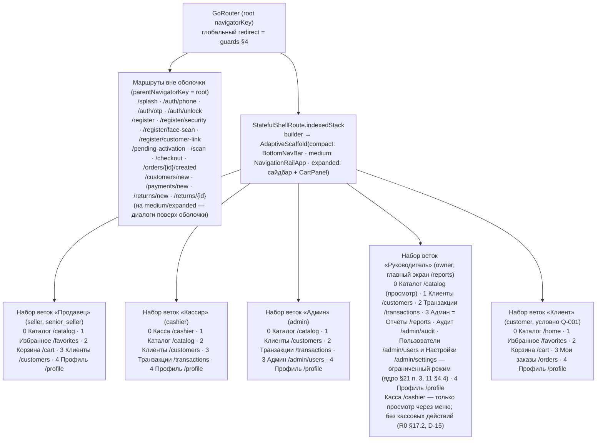
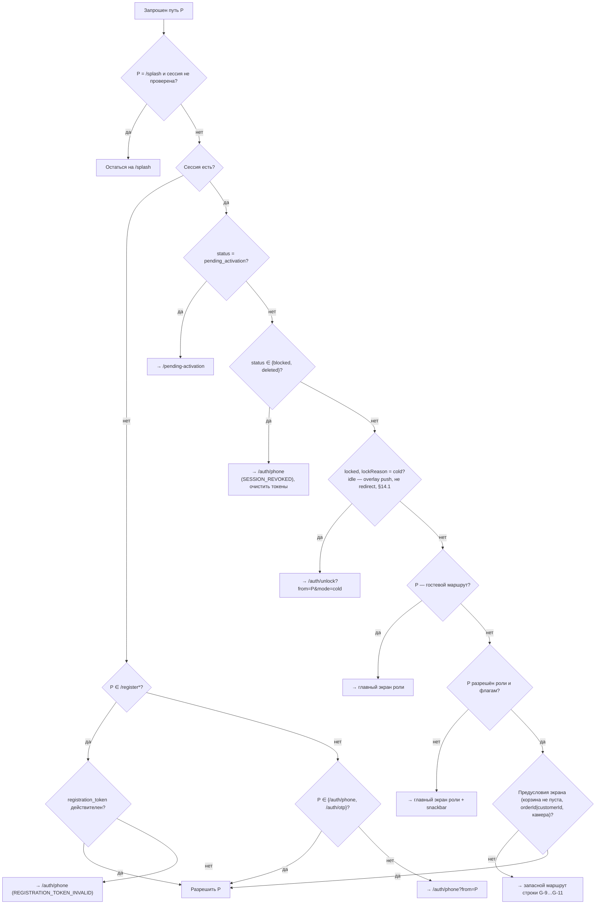
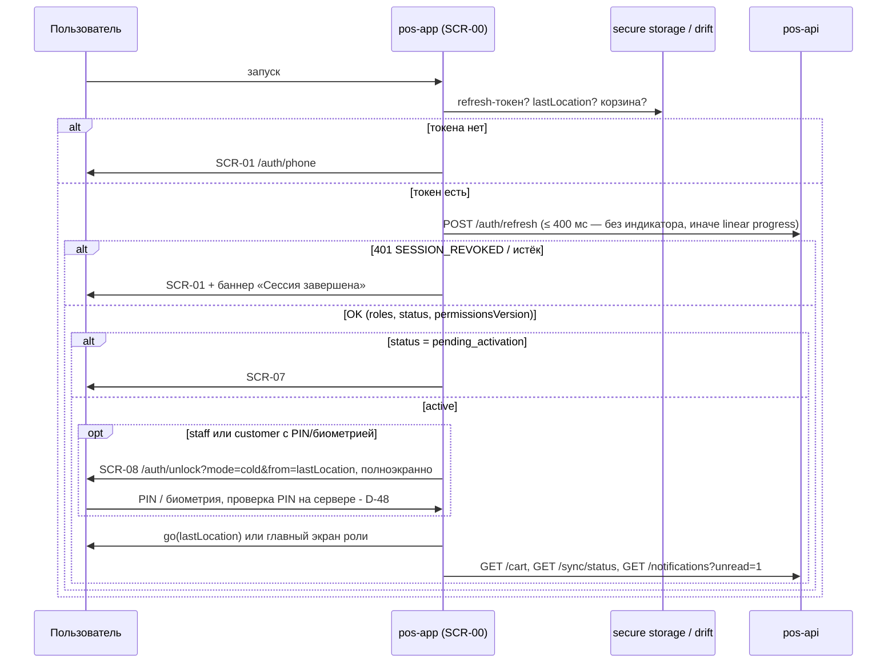
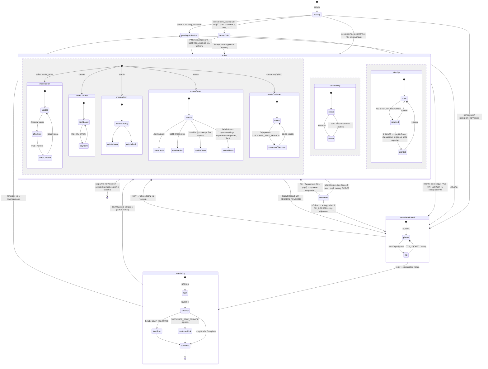
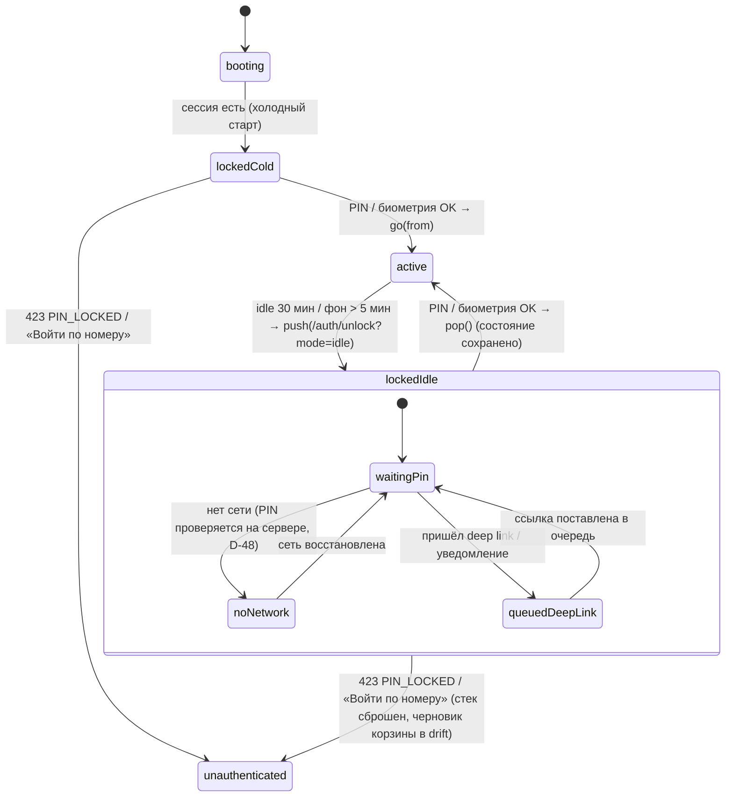

# Схема навигации «Оптомстрой POS» (visual/navigation.md)

Версия 1.5 (сверка с ядром v1.7 — R0 §21, §22, высший приоритет; ранее v1.4 — R0 §19, v1.3 — R0 §18, v1.2 + доработка по замечаниям проверяющего) · Дата 2026-10-19 · Статус: **черновик для утверждения заказчиком** · Тип материала: **структурная схема для ТЗ — не финальный интерфейс**

Входные материалы: [R0 — ядро решений](../../research/R0_DECISION_KERNEL.md) (§3 роли и режимы, §7 API, §9 карта экранов и структура оболочки, §12 вопросы, §17 дополнения v1.2, §18 дополнения v1.3, §19 дополнения v1.4, §20 дополнения v1.5, §21 дополнения v1.6, §22 дополнения v1.7 — высший приоритет; §18.1/§19.1/§20.1 — владельцы словарей; по §22 правило излагает документ-владелец, этот документ ссылается на него), [R3 — стек Flutter](../../research/R3_FLUTTER_STACK_RESEARCH.md) (§3 go_router + go_router_builder, `redirect`, `StatefulShellRoute`), [R4 — UX-исследование](../../research/R4_UX_RESEARCH.md) (§2.4 паттерны, §5.2 брейкпоинты, §7.2 анимации переходов #13, #14), [R6 — авторизация и безопасность](../../research/R6_AUTH_SECURITY_RESEARCH.md) (сессии, idle-блокировка — через D-12/D-13), реестр `REQ_REGISTER_A…F.md`.

Связанные документы: [screen-map.md](screen-map.md), [responsive-spec.md](responsive-spec.md), [components-states.md](components-states.md), [README.md](README.md), [02_SCREEN_SPECIFICATION.md](../02_SCREEN_SPECIFICATION.md) (единственный канонический текст спецификации экранов; части `02a…02e` — нерабочие черновики в `source/02_parts_drafts/`, ссылки на них не используются — ядро §19.1), [03_UX_UI_DESIGN_SYSTEM.md](../03_UX_UI_DESIGN_SYSTEM.md) (A11Y-009 — горячие клавиши), [04_USER_FLOWS.md](../04_USER_FLOWS.md), [10_POS_BUSINESS_RULES.md](../10_POS_BUSINESS_RULES.md) (бизнес-правила POS, ядро §19.4), [06_ARCHITECTURE.md](../06_ARCHITECTURE.md) (`app/router/`), [07_DATA_MODEL.md](../07_DATA_MODEL.md) (§11 локальная схема drift), [08_API_SPECIFICATION.md](../08_API_SPECIFICATION.md), [09_AUTH_SMS_BIOMETRICS.md](../09_AUTH_SMS_BIOMETRICS.md) (`SESS-`), [11_SECURITY_PRIVACY.md](../11_SECURITY_PRIVACY.md) (§4.3 permissions, PRIV). Далее в тексте документы упоминаются кратко (R0, 07, 08, 09, 11 …) — ссылки на файлы приведены здесь.

---

## Краткое содержание

- Навигация `pos-app` строится на **go_router + go_router_builder** (типизированные маршруты, `GoRouteData`, глобальный `redirect`) — `[РЕШЕНИЕ: D-04]`; маршруты — **ровно** из R0 §9, менять пути нельзя.
- Оболочка — один `StatefulShellRoute` с **ветками по режиму** (продавец / кассир / админ-руководитель / клиент); набор веток выбирается после входа по роли, а не по платформе: на compact ветки отображает `BottomNavBar`, на medium — `NavigationRailApp`, на expanded/large — сайдбар `AdaptiveScaffold` с постоянной панелью корзины.
- **Guards** (глобальный `redirect`) в фиксированном порядке: нет сессии → `/auth/phone`; `pending_activation` → `/pending-activation`; заблокированная сессия при холодном старте → `/auth/unlock` полноэкранно (idle 30 мин — не `redirect`, а overlay SCR-08 поверх оболочки с сохранением состояния, R0 §17.2, §14.1); роль → ветка и запрет чужих маршрутов; `registration_token` → только `/register/*`.
- Идентификаторы сущностей передаются **через путь или query** (`productId`, `variantId`, `cartId`, `orderId`, `paymentId`, `customerId`, `transactionId`), а не через `$extra`, чтобы работали «Назад», deep links и восстановление после перезапуска. **Персональные данные (телефон, ФИО) в путь и query не попадают никогда** — номер для предзаполнения передаётся состоянием провайдера в памяти или невосстанавливаемым `extra` (§5.2, §14.5).
- Переходы на путь другой ветки `StatefulShellRoute` (например, «Избранное» → карточка товара, дашборд кассира → карточка клиента) выполняются `go` с переключением ветки; «Назад» на целевом экране идёт по стеку целевой ветки (§2.2 «Правило веток»).
- Описаны: поведение кнопки «Назад» (аппаратная Android, `Esc` на Windows, стрелка в шапке) для экранов, панелей, sheet и модальных окон; повторный запуск (восстановление последнего экрана ветки, корзины-черновика и незавершённого оформления); защита от двойного нажатия и двойного запроса.
- Ядро v1.2 (R0 §17) учтено в §14: SCR-08 при idle-блокировке — overlay через `push` без потери состояния веток (при холодном старте — полноэкранный через `redirect`), доступ к кассовым маршрутам по permissions (`admin`/`owner` без кассовых операций), отдельный набор веток `owner` (§2, §14.7), права SCR-43 (`senior_seller` — только `incremental` для `stock`/`prices`/`order_status`), «Очистить» недавние товары (`DELETE /catalog/products/recent`, §5.1), новые коды ответа (`APP_READ_ONLY`, `DEVICE_MISMATCH`, `PIN_LOCKED`), очистка ПДн в сохраняемом `lastLocation`.
- Ядро v1.3 (R0 §18, приоритет над §17 и текстом документа) учтено прямо в разделах (журнал — в конце): роли SCR-21 `/checkout` = `seller`, `cashier`, `senior_seller`, `admin` + `customer` (условно, `CUSTOMER_SELF_SERVICE`); SCR-38 — без `admin` и `owner` (оплата долга — `payment.debt.receive`); `owner` — только чтение SCR-39; повтор элемента outbox `senior_seller` на SCR-43 — не запуск синхронизации; step-up SCR-34 при первом просмотре и повторно после > 15 мин; локальные drift-таблицы `cart_draft`/`cart_items_draft` и `checkout_draft` канонизированы (R0 §18.2 п. 1, 07 §11.2); `401 UNLOCK_REQUIRED` / `401 PIN_INVALID` без вызова `/auth/refresh`; заголовок `X-Recommended-App-Version`; access-токен — только в памяти.
- Ядро v1.4 (R0 §19, высший приоритет) учтено прямо в разделах (журнал — в конце): горячие клавиши **`F9` — «Создать заказ», `F8` — «Отложить заказ»** (03 A11Y-009 — канон, Q-111, §9); блокировка при возврате из фона — **5 мин** (`AUTH_BACKGROUND_LOCK_MINUTES`), idle — 30 мин (§4.1, §4.3, §14.1); холодный старт `staff` требует сети (офлайн — SCR-08 с баннером, разблокировка недоступна, Q-241, §7.2); телефон пользователя на устройстве не хранится и на SCR-08 не показывается/не предзаполняется; `registration_token` — только в памяти; guard G-10 — по ядру §22.5 (см. пункт v1.6/v1.7 ниже); QR-платёж создаётся в составе `POST /orders` (§5.1); `owner` — ограниченный режим SCR-45/SCR-46 (уточнён ядром §21 п. 3, см. пункт v1.6/v1.7 ниже; §2, §3, §14.7); флаги условных маршрутов — из `GET /settings/public` (`features{…}`, G-8); `checkout_draft` — без ПДн получателя; финансовые данные клиента офлайн не показываются; типы outbox `recent.clear`, `notification.read`, `auth.logout`.
- Ядро v1.6/v1.7 (R0 §21, §22, высший приоритет) учтено прямо в разделах (журнал — в конце): приём оплаты по заказу **любым способом** допустим в статусах `submitting`, `pending_approval`, `approved`, `awaiting_payment` `[РЕШЕНИЕ: ядро §22.5]` (владельцы — 10 §2.2 правило 4, PAY-052; 08 §4.8.6) — G-10, SCR-38, переход SCR-24 → SCR-38, §14.2; в варианте C-2 ручной запуск синхронизации на SCR-43 недоступен — кнопка неактивна с пояснением `[РЕШЕНИЕ: ядро §22.8]` (05 SYNC-025, 08 §4.17.2); повтор элемента outbox `senior_seller` — все элементы, без фильтра «свой магазин» (ядро §22.10); `owner` на SCR-45/SCR-46 — по ядру §21 п. 3 (11 §4.4); ключи идемпотентности при перезапуске — по ядру §22.6 (08 §2.7/§2.10; §7.1, §7.3).
- `stateDiagram-v2` оболочки приложения: `booting → unauthenticated → otp → registering → pendingActivation → lockedCold → active(seller|cashier|admin|owner|customer) ⇄ lockedIdle` с наложенными состояниями `offline` и `stepUp`.

---

## 1. Принципы навигации

| № | Правило | Обоснование / источник |
|---|---|---|
| N-1 | Один граф маршрутов для всех платформ и классов окна; различается только **раскладка** оболочки (`AdaptiveScaffold`), не маршруты | R3 §3 («один и тот же граф, разный layout по Breakpoint»), D-18 |
| N-2 | Пути — канонические из R0 §9; типизированные классы маршрутов генерируются `go_router_builder` (`@TypedGoRoute`, `@TypedStatefulShellRoute`) | D-04, R3 §3 |
| N-3 | Идентификаторы сущностей — в path/query (`/catalog/p/{productId}?variantId=`), **без** `$extra` для данных, влияющих на отображение; `$extra` допустим только для «подсказок» (например, предзаполненный номер в форме нового клиента), потеря которых безопасна; `extra` не сохраняется в `lastLocation` и не восстанавливается. ПДн (телефон, ФИО) в path/query — **запрещены** (§5.2, §14.5; NFR-LOG-001, 11 PRIV) | R3 §3, SRC-C-073, SRC-C-074, SRC-F-016 |
| N-4 | Guards — единственный глобальный `redirect` на корне роутера, читающий `authStateProvider` (Riverpod) и `roleProvider`; route-level `redirect` — только для ролевых ограничений внутри ветки | R3 §3, D-15 |
| N-5 | Скрытие маршрута/кнопки — UX-ограничение; **права проверяет сервер** на каждом запросе (`FORBIDDEN`, `STEP_UP_REQUIRED`) | D-15, R0 §7 |
| N-6 | Sheets SCR-15, SCR-16 (нампад) — `showModalBottomSheet`/popover **без** записи в истории go_router; закрываются «Назад» через `PopScope`. Исключение — SCR-13: на compact/medium это **маршрут** `/catalog/filters` (ядро задаёт ему путь), отображаемый как лист/side sheet (страница-лист с записью в истории, «Назад» = `pop` без применения); на expanded — состояние `FilterPanel` в контент-колонке без смены URL (§3, §12 п. 2) | R0 §9 (SCR-13 — путь `/catalog/filters` (sheet); SCR-15/16 — «sheet» без пути) |
| N-7 | Переходы экранов: compact — shared-axis X 300 мс; medium/expanded — fade-through внутри панели 300 мс; sheet — slide-up 250 мс; `reduceMotion` → crossfade ≤ 80 мс или статичный кадр (R0 §17.5) | R4 §7.2 #13, #14; R0 §8.4, §17.5 |
| N-8 | Навигация никогда не блокируется анимацией; повторный тап по текущему пункту ветки возвращает ветку к корню (`initialLocation`) и прокручивает к началу | R4 §7.1 |
| N-9 | Deep links и восстановление используют те же пути; неавторизованный deep link сохраняется как `from` и применяется после входа, если роль допускает | R3 §3, SRC-F-016 |
| N-10 | Любая финансовая операция (`POST /orders`, `POST /orders/{id}/payments` — оплата по заказу, `POST /payments` — оплата долга без заказа (условно Q-152), `POST /returns`; R0 §17.4) защищена `Idempotency-Key`; повторное нажатие кнопки не создаёт второго запроса (кнопка в `loading`, ключ фиксирован на экране) | D-37, SRC-C-117, SRC-C-118 |

---

## 2. Структура оболочки: `StatefulShellRoute` и ветки по режимам

### 2.1. Схема оболочки

Реализационная заметка (спецификация, не код): набор веток — один `StatefulShellRoute` с **полным списком** `StatefulShellBranch` (каталог, касса, избранное, корзина, клиенты, транзакции, заказы, админ, отчёты, профиль); `AdaptiveScaffold` показывает в навигации только ветки, разрешённые роли (таблица §2.2), остальные ветки существуют в графе, но закрыты route-level `redirect`. Это позволяет не пересобирать роутер при смене роли и сохранять состояние веток (`IndexedStack`) `[ТИПОВО: практика go_router, требует проверки на go_router 18.x]`.

### 2.2. Ветки и их содержимое

| Ветка (branch) | `initialLocation` | Вложенные маршруты ветки | Показана в навигации для | Иконка (Material Symbols Rounded) | Подпись (ключ ARB) |
|---|---|---|---|---|---|
| `catalog` | `/catalog` (customer: `/home`) | `/catalog/search`, `/catalog/c/{categoryId}`, `/catalog/filters`, `/catalog/p/{productId}` | seller, senior_seller, cashier, admin, owner (просмотр), customer | `storefront` | `nav_catalog` «Каталог» |
| `cashier` | `/cashier` | — (SCR-38 `/payments/new` и SCR-39 `/returns/*` — маршруты root-уровня, §3) | cashier, senior_seller (через меню); admin и owner — через меню, только просмотр дашборда без кассовых действий (`dashboard.cashier.read`, R0 §17.2, §14.2) | `point_of_sale` | `nav_cashier` «Касса» |
| `favorites` | `/favorites` | — | seller, senior_seller, customer; cashier/admin — через сайдбар/меню | `star` | `nav_favorites` «Избранное» |
| `cart` | `/cart` | `/cart/parked` | seller, senior_seller, customer (compact/medium — пункт навигации; expanded — постоянная панель, пункт скрыт) | `shopping_cart` (+ бейдж количества позиций) | `nav_cart` «Корзина» |
| `customers` | `/customers` | `/customers/{id}`, `/customers/{id}/history`, `/customers/{id}/receivables`, `/customers/{id}/discounts` | все staff | `group` | `nav_customers` «Клиенты» |
| `transactions` | `/transactions` | `/transactions/{id}` | cashier, admin, owner; seller — свои (через профиль) | `receipt_long` | `nav_transactions` «Транзакции» |
| `orders` | `/orders` | `/orders/{id}` | customer (вкладка «Мои заказы»); staff — через профиль/дашборд | `list_alt` | `nav_orders` «Мои заказы» / «Заказы» |
| `admin` | `/admin/users` | `/admin/settings`, `/admin/audit` | admin (owner — из пункта «Админ» с корнем `/reports`: `/admin/audit`, а также `/admin/users` и `/admin/settings` в ограниченном режиме по 11 §4.4 `[РЕШЕНИЕ: ядро §19.1, §21 п. 3]`, §14.7) | `admin_panel_settings` | `nav_admin` «Админ» |
| `reports` | `/reports` | — | owner (пункт «Админ» → корень `/reports`, главный экран), admin (через меню) | `monitoring` | `nav_reports` «Отчёты» |
| `profile` | `/profile` | `/settings`, `/sync`, `/notifications` | все | `person` | `nav_profile` «Профиль» |

Набор веток `owner` (R0 §3.2, §17.2 D-15; согласовано с `screen-map.md` §3) `[ТИПОВО]`: «Каталог · Клиенты · Транзакции · Админ (Отчёты · Аудит) · Профиль», главный экран — SCR-48 `/reports`; `/checkout`, `/payments/new`, `/returns/new` для `owner` закрыты guard G-7; `/admin/users` (SCR-45) и `/admin/settings` (SCR-46) открыты в **ограниченном режиме**: SCR-45 — просмотр пользователей и ролей; со step-up — только назначение/снятие ролей `admin`/`owner` и отзыв сессий (`logout-all`) учётных записей `admin`/`owner`; роли `seller`/`cashier`/`senior_seller`, приглашения, блокировка, сброс PIN, отзыв сессий прочих сотрудников — только `admin` (`owner` → `403 FORBIDDEN`); SCR-46 — только просмотр `[РЕШЕНИЕ: ядро §21 п. 3]` (владелец прав — 11 §4.4, SEC-040); подробнее — §14.7.

Максимум **5 пунктов** в `BottomNavBar`/`NavigationRailApp` (R4 §5.2); остальные ветки роли доступны из сайдбара на expanded и из меню профиля («Ещё») на compact. Маршрут `/customers/new` (SCR-26) вынесен на root-уровень (§3), поэтому в ветке `customers` не указан.

**Правило веток для переходов между ветками** `[ТИПОВО; R3 §3]`: в `StatefulShellRoute` путь принадлежит ровно одной ветке (таблица выше), поэтому переход из экрана одной ветки на путь другой ветки (`/catalog/p/…`, `/customers/{id}…`, `/transactions/{id}`, `/orders/{id}`, `/sync`, `/notifications`) выполняется `go` с **переключением активной ветки**, а не `push`. Последствия: (а) «Назад» на целевом экране идёт по стеку **целевой** ветки — к её предку по таблице §3, затем к корню ветки, а не к исходному экрану; (б) исходная ветка сохраняет состояние (`IndexedStack`: прокрутка, фильтры, период отчёта) — к ней возвращаются пунктом навигации; (в) индикация навигации — по правилам ниже. Альтернатива (дублирующие root-маршруты) отклонена — §12 п. 10. В таблице §5.1 такие переходы помечены «`go` с переключением ветки».

Индикация навигации при переходе в ветку, у которой нет пункта в `BottomNavBar`/`NavigationRailApp` роли (например, `go` в ветку `orders` из SCR-22/33/37/44 у `seller`/`cashier`, ветка `favorites` у `cashier`, `cashier`/`reports` у `admin`) `[ТИПОВО]`:

- compact/medium — подсвечивается пункт «Профиль» (через него, меню «Ещё», такие разделы открываются), в шапке экрана — стрелка «Назад»; повторный тап по «Профиль» возвращает в корень ветки `profile`;
- expanded/large — в сайдбаре все ветки роли видимы, подсвечивается пункт самой ветки («Заказы», «Избранное», «Касса», «Отчёты»);
- ветка, запрещённая роли, не активируется вовсе — срабатывает guard G-7.

### 2.3. Экран входа в оболочку по роли (после `redirect`)

| Роль | Первая ветка после входа | Запасной маршрут, если `from` недоступен |
|---|---|---|
| seller, senior_seller, admin | `/catalog` | `/catalog` |
| cashier | `/cashier` | `/cashier` |
| owner | `/reports` | `/reports` |
| customer (Q-001) | `/home` | `/home` |
| `pending_activation` | `/pending-activation` (вне оболочки) | — |

---

## 3. Таблица маршрутов go_router

Пути — ровно R0 §9. «Уровень»: `root` — вне оболочки (полноэкранный, `parentNavigatorKey: rootNavigatorKey`); `shell:<ветка>` — внутри ветки оболочки; `sheet` — без маршрута. «Параметры»: `path` — сегмент пути, `query` — строка запроса.

| SCR | Путь | Уровень | Параметры | Guard (помимо глобальных §4) | Экран-предок для «Назад» | Примечание |
|---|---|---|---|---|---|---|
| SCR-00 | `/splash` | root | — | — | — (нельзя вернуться) | `redirect` сразу после проверки сессии; максимум 1,2 с (R4 §7.2 #1) |
| SCR-01 | `/auth/phone` | root | query `from` (сохранённый deep link). Номер для предзаполнения после logout — только из состояния провайдера потока входа в памяти (Riverpod), **не** в URL и не в `lastLocation` (§5.2, §14.5) | только гость | — (корень стека гостя) | «Назад» на Android — выход из приложения (двойное нажатие за 2 с `[ТИПОВО]`) |
| SCR-02 | `/auth/otp` | root | query `challengeId`. Номер для текста «Код отправлен на +996 …» — из провайдера потока входа в памяти (после перезапуска не восстанавливается: экран → SCR-01) | только гость, после `/auth/otp/request` | SCR-01 | `OTP_LOCKED` → назад на SCR-01 с баннером |
| SCR-03 | `/register` | root | — (`registration_token` — **только в памяти**, **не** в URL и не в secure storage; после перезапуска — новый OTP и подстановка черновика шагов из secure storage `[РЕШЕНИЕ: ядро §19.3]`) | `registrationToken != null` и не истёк (15 мин) | SCR-01 (с `ConfirmDialog` «Прервать регистрацию?») | |
| SCR-04 | `/register/security` | root | — | как SCR-03 + форма SCR-03 валидна | SCR-03 | |
| SCR-05 | `/register/face-scan` | root | — | `FACE_SCAN_MODE ≠ off` (переключатель из 09 §10 / FACE-001 `[НОВОЕ ИМЯ]` — нет в перечне env ядра §16 п. 3; R2, Q-003) | SCR-04 | маршрут не регистрируется при `FACE_SCAN_MODE=off` (значение R1) |
| SCR-06 | `/register/customer-link` | root | query `matchId` | `CUSTOMER_SELF_SERVICE` (Q-001) | SCR-04 | статус привязки читается `GET /registration/customer-match` (только GET, R0 §17.4); маршрут не меняется до ответа |
| SCR-07 | `/pending-activation` | root | — | `userStatus == pending_activation` | — (корень) | «Назад» — нет; кнопка «Выйти» → `/auth/phone` |
| SCR-08 | `/auth/unlock` | root; два режима (R0 §17.2): `cold` — полноэкранная страница через `redirect` (G-5); `idle` — overlay через `push` на корневом навигаторе поверх оболочки, ветки не уничтожаются (§14.1) | query `from` (экран, на который вернуться; только `cold`), `mode` (`cold\|idle`) | `cold`: G-5 (`session != null`, `lockReason = cold`); `idle`: открывается оболочкой через `push`, guard не участвует (§4.3) | — (корень; «Назад» — не закрывает) | `cold` → непрозрачная полноэкранная страница во **всех** классах окна (medium+ — карточка `r-xl 20` по центру, оболочки под ней нет), после успеха `go(from)`; `idle` → блокирующий слой поверх текущего экрана во всех классах окна (на expanded — диалог над размытой раскладкой), после успеха `pop()` в прежнее состояние (`responsive-spec.md` §3 SCR-08). Телефон пользователя на устройстве не хранится: SCR-08 его не показывает и не предзаполняет; «Войти по номеру» → SCR-01 с пустым полем `[РЕШЕНИЕ: ядро §19.3]`. `cold` без сети (`staff`) — SCR-08 с баннером «нет сети», разблокировка недоступна (Q-241). `StepUpDialog`/разблокировка: PIN — 5 попыток до `PIN_LOCKED` (счёт только из ответа сервера) |
| SCR-10 | `/catalog` | shell:catalog | query `view` (`grid\|list\|compact`), `sort` | staff (owner — просмотр) | — (корень ветки) | блок сайдбара «Недавние товары · Очистить»: «Очистить» — `DELETE /catalog/products/recent` (R0 §17.4) без смены маршрута (§5.1) |
| SCR-11 | `/catalog/search` | shell:catalog | query `q` (обязателен, ≥ 2 символов; для штрихкода/артикула — любой), `view`, `sort` | staff, customer | SCR-10 | Ввод в `SearchBar` заменяет текущую запись (`go`), а не добавляет (`push`) — чтобы «Назад» не листал буквы |
| SCR-12 | `/catalog/c/{categoryId}` | shell:catalog | path `categoryId` (uuid), query `view`, `sort`, `f` (сериализованные фильтры) | staff, customer | SCR-10 (или родительская категория) | Подкатегория → `push` новой записи с тем же маршрутом |
| SCR-13 | `/catalog/filters` | shell:catalog (compact/medium — маршрут-лист с записью в истории; expanded — состояние панели без маршрута) | query `f` | staff, customer | SCR-10/11/12 | compact/medium: `push` маршрута, отображаемого как `FilterSheet`/side sheet, «Назад» = `pop` без применения; expanded: URL не меняется, `FilterPanel` открыт как боковая панель контент-колонки (N-6) |
| SCR-14 | `/catalog/p/{productId}` | shell:catalog | path `productId`; query `variantId` (опц.), `qty` (опц., предзаполнение из сканера) | staff, customer | SCR-10/11/12 (`push` внутри ветки `catalog` — возврат к исходному списку); из SCR-40 (ветка `favorites`) и SCR-44 — `go` с переключением на ветку `catalog`, «Назад» → SCR-10 (§2.2 «Правило веток») | На expanded — панель поверх контент-колонки с тем же URL (`responsive-spec.md`) |
| SCR-15 | — | sheet | `productId`, `variantId?` (аргументы sheet) | — | закрытие sheet | `PopScope` перехватывает «Назад» |
| SCR-16 | — | sheet/popover | `variantId`, `unitId`, `qty`, `qtyPrecision`, `packFactor` | — | закрытие sheet | |
| SCR-17 | `/scan` | root (полноэкранный) | query `mode` (`search\|add`) | staff; только при наличии камеры (Android/iOS) | экран, из которого открыт | Результат возвращается `pop(result)` → SCR-11 или SCR-14 |
| SCR-20 | `/cart` | shell:cart | query `cartId` (опц.; по умолчанию активная) | staff, customer | — (корень ветки) | На expanded ветка «Корзина» скрыта, панель постоянна; URL `/cart` сохраняется для deep link и compact |
| SCR-21 | `/checkout` | root (модальный на expanded) | query `cartId` (обязателен), `step` (`customer\|delivery\|payment\|done`, только compact) | seller, cashier, senior_seller, admin + customer (условно: флаг `CUSTOMER_SELF_SERVICE`, Q-001; `order.create`/`cart.manage.own` по 11 §4.4) `[РЕШЕНИЕ: ядро §18.2 п. 11]`; owner — нет (G-7); корзина не пуста | SCR-20 (`ConfirmDialog` «Прервать оформление? Данные сохранятся») | Шаги на compact — `go` с заменой `step`; «Назад» = предыдущий шаг; черновик шагов — drift `checkout_draft` (§7.1) |
| SCR-22 | `/orders/{id}/created` | root (модальный на expanded) | path `id` (orderId); query `paymentId` (опц.) | те же | — (заменяет SCR-21: `pushReplacement`) | «Назад» → главный экран роли (§2.3: SCR-10 / SCR-30 / SCR-50 для `customer`) с очищенной корзиной (корзина `converted`) |
| SCR-23 | `/cart/parked` | shell:cart | — | staff | SCR-20 | |
| SCR-24 | `/orders/{id}` | shell:orders — единственная ветка-владелец пути `[ТИПОВО]`; из SCR-25 — `push` (та же ветка), из других веток (SCR-22, SCR-33, SCR-37, SCR-44) — `go`, переключающий активную ветку на `orders`; `parentNavigatorKey: root` и дублирование маршрута не используются | path `id` | владелец заказа, cashier+, customer (свой) | SCR-25 / SCR-22 / SCR-33 / SCR-37 / SCR-44 | |
| SCR-25 | `/orders` | shell:orders | query `status`, `from`, `to`, `customerId`, `mine` | staff, customer | корень ветки или SCR-41 | |
| SCR-26 | `/customers/new` | root (`parentNavigatorKey: rootNavigatorKey`; compact — полноэкранно без нижней навигации, medium/expanded — модальный диалог) | query `returnTo` (`checkout`); номер из строки поиска для предзаполнения — невосстанавливаемый `extra` (подсказка по N-3), **не** query | seller+, cashier | SCR-31 / SCR-21 | Один root-маршрут для обоих входов: из SCR-21 (root) и из SCR-31 (оболочка) открывается `push` на root-навигаторе поверх вызывающего экрана; результат `customerId` → `pop(result)` в `CustomerPicker` (SCR-21) или переход на SCR-32 (SCR-31) |
| SCR-30 | `/cashier` | shell:cashier | — | cashier, senior_seller; admin, owner — только просмотр (`dashboard.cashier.read`), кассовые кнопки скрыты (R0 §17.2, D-15; §14.2) | — (корень ветки) | |
| SCR-31 | `/customers` | shell:customers | query `q`, `favorites=1`, `withDebt=1` | staff | — (корень ветки) | |
| SCR-32 | `/customers/{id}` | shell:customers | path `id`; query `tab` (`history\|receivables\|discounts\|orders`) на expanded | staff (поля по роли), customer (свой) | SCR-31 (`push` внутри ветки `customers`); из SCR-30, SCR-40 и других веток — `go` с переключением на ветку `customers`, «Назад» → SCR-31 (§2.2 «Правило веток») | |
| SCR-33 | `/customers/{id}/history` | shell:customers | path `id`; query `from`, `to` | cashier, senior_seller, admin, owner (`customer.history.read`, доступ — по 11 §4.4 `[РЕШЕНИЕ: ядро §19.1]`), customer (свои) | SCR-32 | На expanded — вкладка в SCR-32 с тем же URL |
| SCR-34 | `/customers/{id}/receivables` | shell:customers | path `id` | cashier, senior_seller, admin, owner (`customer.receivables.read.detail`, 11 §4.4); customer (свой, `customer_link.confirmed`); **step-up** при первом просмотре в сессии и повторно, если с последнего step-up прошло > 15 мин (R0 §17.2, §18.2 п. 6: `stepUpToken` многоразовый в пределах своей области 15 мин) | SCR-32 (из SCR-30 и SCR-48 — `go` с переключением на ветку `customers`, «Назад» → SCR-32 → SCR-31) | При `STEP_UP_REQUIRED` показывается `StepUpDialog`, маршрут не меняется |
| SCR-35 | `/customers/{id}/discounts` | shell:customers | path `id` | seller+, cashier | SCR-32 | |
| SCR-36 | `/transactions` | shell:transactions | query `from`, `to`, `customerId`, `status`, `kind`, `mine` | cashier+, owner; seller (`mine=1` принудительно) | — (корень ветки) | |
| SCR-37 | `/transactions/{id}` | shell:transactions | path `id` | те же | SCR-36 (`push` внутри ветки); из SCR-30 — `go` с переключением на ветку `transactions`, «Назад» → SCR-36 | На expanded — side sheet с тем же URL |
| SCR-38 | `/payments/new` | root (диалог на expanded) | query `orderId` **или** `customerId` (ровно один), `method` (предвыбор) | permission `payment.cash.receive` / `payment.qr.show` (с `orderId`) или `payment.debt.receive` (с `customerId`, Q-152) (11 §4.3): cashier, senior_seller; **не** admin, **не** owner `[РЕШЕНИЕ: ядро §18.2 п. 11]` (D-15; список ролей R0 §9 исправлен ядром); с `orderId` — приём оплаты **любым способом** допустим для заказа в статусах `submitting`, `pending_approval`, `approved`, `awaiting_payment` `[РЕШЕНИЕ: ядро §22.5]` (правило — 10 §2.2 правило 4 и PAY-052, контракт — 08 §4.8.6; G-10, §14.2); с `customerId` — при `features.debtPaymentsFromPos` (`GET /settings/public`) | SCR-24 / SCR-34 / SCR-30 | Идемпотентный ключ генерируется при открытии экрана; отправка: по заказу — `POST /orders/{id}/payments`, по долгу — `POST /payments` (условно Q-152) |
| SCR-39 | `/returns/new`, `/returns/{id}` | root (диалог на expanded) | query `orderId` (new); path `id` | создание (`return.create`; отправка — `return.submit`, step-up): cashier, senior_seller, admin; `/returns/{id}` — owner только просмотр (`return.read`, 11 §4.4; ядро §18.2 п. 11); флаг Q-018 | SCR-24 / SCR-37 | |
| SCR-40 | `/favorites` | shell:favorites | query `tab` (`products\|customers`) | staff, customer (products) | — (корень ветки) | |
| SCR-41 | `/profile` | shell:profile | — | все | — (корень ветки) | |
| SCR-42 | `/settings` | shell:profile | query `section` | все | SCR-41 | |
| SCR-43 | `/sync` | shell:profile | query `entity`, `runId` | маршрут — все staff (`sync.status.read`, кратко); `senior_seller` — ручной запуск **только** `incremental` для `stock`, `prices`, `order_status`, без step-up (`sync.run.incremental.limited`); admin/owner — полный журнал и любой запуск, `full`/`reconcile` и остальные сущности — со step-up (`sync.run.full`) (R0 §17.2); `senior_seller` также повторяет отправку **любого** элемента outbox (`POST /sync/outbox/{id}/retry`, `sync.outbox.manage`; фильтра «свой магазин» в R1 нет — ядро §22.10) — это не запуск синхронизации, без смены маршрута (ядро §18.2 п. 11); в варианте C-2 (`ONEC_INBOUND_ENABLED=true`) ручной запуск недоступен для любой роли: кнопка «Синхронизировать» неактивна с пояснением «Обмен инициирует 1С», маршрут доступен для просмотра `[РЕШЕНИЕ: ядро §22.8]` (05 SYNC-025, 08 §4.17.2: `POST /sync/runs` → `422 VALIDATION_FAILED`, rule `inbound_mode`) | SCR-41 / SCR-44 (`push` в ветке `profile`); из SCR-30 — `go` с переключением на ветку `profile` | Недоступные действия скрыты, маршрут не меняется (§14.2); `runId` открывает журнал только при `sync.runs.read`. На expanded `SyncIndicator` открывает краткий вид side sheet поверх текущего экрана без смены URL; «Подробнее» → `go('/sync')` |
| SCR-44 | `/notifications` | shell:profile (popover на expanded) | query `unread=1` | все | SCR-41 (`push` в ветке `profile`); с колокольчика на compact/medium — `go` с переключением на ветку `profile` | На expanded колокольчик открывает popover поверх текущего экрана без смены URL; «Все уведомления» → `go('/notifications')` |
| SCR-45 | `/admin/users` | shell:admin | query `tab` (`users\|invitations\|links`), `userId` (expanded — деталь) | admin — полный; owner — **ограниченный режим**: просмотр пользователей и ролей; со step-up — только назначение/снятие ролей `admin`/`owner` и отзыв сессий учётных записей `admin`/`owner`; прочие действия скрыты `[РЕШЕНИЕ: ядро §19.1, §21 п. 3]` (11 §4.4, SEC-040) | — (корень ветки; для owner — переход из пункта «Админ» с корнем `/reports`, «Назад» → SCR-48) | Вкладка `links` — конфликты привязки клиентов `GET /customers?linkStatus=proposed,conflict` (admin; `[РЕШЕНИЕ: ядро §19.2]`) без смены маршрута; недоступные owner действия скрыты, маршрут не меняется |
| SCR-46 | `/admin/settings` | shell:admin | query `section` | admin — изменение; owner — только просмотр (`settings.app.read`, 11 §4.4) `[РЕШЕНИЕ: ядро §19.1, §21 п. 3]` | SCR-45 (ветка «Админ»; для owner — SCR-48) | `CUSTOMER_SELF_SERVICE` в UI — только чтение (env, ядро §19.2) |
| SCR-47 | `/admin/audit` | shell:admin | query `from`, `to`, `userId`, `action` | admin, owner | SCR-45 / SCR-48 | |
| SCR-48 | `/reports` | shell:reports | query `from`, `to`, `report` | owner, admin | — (корень ветки) | |
| SCR-50 | `/home` | shell:catalog (customer) | query `view`, `sort` | customer | — (корень ветки) | Q-001 |
| SCR-90 | overlay/dialog | — | — | — | — | Не маршруты: `OfflineBanner`, `ErrorState`, `StepUpDialog`, `ConfirmDialog` поверх текущего маршрута; «Требуется обновление» — полноэкранный блокирующий диалог без маршрута |

---

## 4. Guards (глобальный `redirect`)

### 4.1. Порядок проверки

Проверки выполняются **в этом порядке**; первая сработавшая возвращает новый путь, остальные не проверяются. Исходные данные: `session` (есть ли refresh-токен в `flutter_secure_storage`), `locked` + `lockReason` (`cold` — холодный старт с действующей сессией: для `staff` — всегда `[РЕШЕНИЕ: R0 §17.2 (SCR-08 полноэкранно при холодном старте), D-48]`, для `customer` — только если включены PIN/биометрия, 09 §5 `[ТИПОВО; Q-004, Q-034]`; `idle` — 30 мин без ввода (`SESSION_IDLE_LOCK_MINUTES`) или возврат из фона > **5 мин** (`AUTH_BACKGROUND_LOCK_MINUTES`) `[РЕШЕНИЕ: ядро §19.3]`, D-12), `userStatus`, `roles[]`, `permissions[]` (из access-токена, 11 §4.3), `registrationToken` (только в памяти, ядро §19.3), `featureFlags` (из `GET /settings/public` → `features{customerSelfService, returnsFromPos, qrWebhook, debtPaymentsFromPos}` `[РЕШЕНИЕ: ядро §19.2]`; `CUSTOMER_SELF_SERVICE` — только env, в UI только чтение). Guard G-5 обрабатывает только `lockReason = cold`; при `idle` `redirect` путь не меняет (SCR-08 уже открыт оболочкой через `push`, §4.3), входящие переходы ставятся в очередь (§14.1).

| № | Условие | Результат | Источник |
|---|---|---|---|
| G-0 | путь = `/splash` и проверка сессии не завершена | остаться (показать SCR-00 ≤ 1,2 с) | R4 §7.2 #1 |
| G-1 | `session == null` **и** путь не в `{/auth/phone, /auth/otp, /register, /register/security, /register/face-scan, /register/customer-link}` | → `/auth/phone?from=<исходный путь>` (`from` только если путь — разрешённый deep link, §5.3) | D-09, SRC-B-101 |
| G-2 | `session == null` и путь начинается с `/register` и `registrationToken == null` (или истёк) | → `/auth/phone` с баннером `REGISTRATION_TOKEN_INVALID` | D-10 |
| G-3 | `session != null` и `userStatus == pending_activation` и путь ≠ `/pending-activation` | → `/pending-activation` | D-07 |
| G-4 | `session != null` и `userStatus ∈ {blocked, deleted}` | → `/auth/phone` + `SESSION_REVOKED`; локальные токены удаляются | D-12 |
| G-5 | `session != null` и `locked == true`, `lockReason == cold` (холодный старт) и путь ≠ `/auth/unlock` | → `/auth/unlock?from=<путь>&mode=cold` — полноэкранный режим SCR-08 (Windows: обязателен PIN; Android/iOS: биометрия с fallback на PIN). Idle-блокировка через `redirect` **не** проходит: оболочка показывает SCR-08 overlay (`push('/auth/unlock?mode=idle')`) с сохранением состояния экрана (R0 §17.2, §14.1) | D-12 (idle), R0 §17.2 и D-48 (холодный старт, `staff`), D-13; для `customer` — `[ТИПОВО; Q-004, Q-034]` |
| G-6 | `session != null` и путь ∈ гостевым (`/auth/phone`, `/auth/otp`, `/register*`) | → главный экран роли (§2.3) | — |
| G-7 | путь ∈ ветке, не разрешённой роли (таблица §2.2 / матрица в `screen-map.md` §5); для кассовых и служебных маршрутов (`/payments/new`, `/cashier`, `/returns/*`, действия `/sync`) проверяется **permission** из access-токена, а не список ролей R0 §9 (§14.2) | → главный экран роли + `AppSnackbar` «Раздел недоступен для вашей роли» (для `/payments/new` — «Приём оплаты выполняет кассир») | D-15, R0 §17.2, 11 §4.3 |
| G-8 | путь условного экрана при выключенном флаге (`/register/face-scan`, `/register/customer-link`, `/home`, `/returns/*` — `features.returnsFromPos`; `/payments/new?customerId=` — `features.debtPaymentsFromPos`; для роли `customer` — также `/cart`, `/checkout` при выключенном `CUSTOMER_SELF_SERVICE` (`features.customerSelfService`), ядро §18.2 п. 11; флаги — из `GET /settings/public`, ядро §19.2) | → главный экран роли (гость: `/auth/phone`) | Q-001, Q-003, Q-018, Q-152 |
| G-9 | `/checkout` при пустой корзине или `cartId` ≠ активной/отложенной корзине пользователя | → `/cart` | D-32 |
| G-10 | `/payments/new` без ровно одного из `orderId`/`customerId`; или `orderId` заказа в статусе вне `submitting`/`pending_approval`/`awaiting_payment`/`approved` — условие одинаково для **любого** способа приёма (`cash`, `qr_bakai`, смена способа между ними — 10 PAY-052): приём оплаты любым способом допустим в статусах `submitting`, `pending_approval`, `approved`, `awaiting_payment` `[РЕШЕНИЕ: ядро §22.5]` (правило — 10 §2.2 правило 4; контракт — 08 §4.8.6) | → предыдущий экран (`pop`) или `/cashier`; при неподходящем статусе — остаться на SCR-24 с `AppSnackbar` «Оплата недоступна для заказа в статусе {status}» (сервер всё равно вернёт `ORDER_STATE_INVALID`/`PAYMENT_STATE_INVALID`) | ядро §22.5; 10 §2.2 правило 4, PAY-052; 08 §4.8.6 |
| G-11 | `/scan` на платформе без камеры (Windows) | → остаться на исходном экране; `AppSnackbar` «Используйте аппаратный сканер» | D-42 |
| G-12 | любой ответ `pos-api` HTTP **426** `APP_UPDATE_REQUIRED` с заголовком `X-Min-App-Version` (клиент передаёт `X-App-Version`, `X-Platform`) | блокирующий диалог SCR-90 «Требуется обновление» поверх любого маршрута; навигация заморожена, «Назад»/`Esc` не закрывают; детали — §13.1 | `[РЕШЕНИЕ: R0 §16 п. 4, D-46]` |
| G-13 | действует режим 503 `APP_READ_ONLY` и путь начинает запись (`/checkout`, `/payments/new`, `/returns/new`, `/customers/new`) | остаться на текущем экране + баннер SCR-90 «Только просмотр»; просмотровые маршруты разрешены | R0 §17.4 `[ТИПОВО]` |

### 4.2. Дерево решений `redirect`

### 4.3. События, меняющие состояние guards во время работы

| Событие | Источник | Реакция навигации |
|---|---|---|
| Ответ API `401` + `SESSION_REVOKED` (reuse-detection, logout-all, блокировка) | любой запрос | очистить токены, `go('/auth/phone')`, баннер «Сессия завершена»; корзина-черновик остаётся локально, но привязана к `userId` |
| Ответ `403` + `STEP_UP_REQUIRED` | критическая операция (R0 §3.3) | показать `StepUpDialog` поверх текущего экрана; при успехе повторить исходный запрос с `stepUpToken`; маршрут не меняется |
| Idle 30 мин без ввода (сотрудник) | таймер в оболочке (`Listener` на pointer/keyboard) | `locked = true` → overlay SCR-08: `push('/auth/unlock?mode=idle')` на корневом навигаторе (**не** `go`, R0 §17.2); состояние веток и экрана сохраняется (`IndexedStack`), корзина не теряется; после успеха — `pop()` (§14.1) |
| Переход приложения в фон/возврат (Android/iOS) | `AppLifecycleState` | при возврате, если прошло > **5 мин** (`AUTH_BACKGROUND_LOCK_MINUTES`, `[РЕШЕНИЕ: ядро §19.3]`) — как idle (overlay через `push`, не `go`); иначе остаёмся; при `resumed` — проверка `/sync/status` |
| Смена роли администратором (`permissionsVersion` в JWT изменился) | `/auth/refresh` | пересчитать набор веток; если текущий путь недоступен — главный экран роли + snackbar |
| Потеря сети | `connectivity_plus` | `OfflineBanner` (SCR-90), навигация внутри кэшированных экранов разрешена; `/checkout` шаг «Оплата», `/payments/new`, `/returns/new` — кнопки отправки disabled с подсказкой (D-32); финансовые данные клиента (SCR-34, долги на SCR-30/SCR-32) офлайн не показываются — только загруженные в память текущей сессии, маршрут при этом доступен `[РЕШЕНИЕ: ядро §19.4]` |
| Восстановление сети | `connectivity_plus` | баннер «Снова в сети» 3 с; outbox (`outbox_actions`: избранное, корзина, `recent.clear`, `notification.read`, `auth.logout` — типы 07, ядро §19.4) отправляется; `SyncIndicator` обновляется |
| Ответ `401 UNAUTHENTICATED` / `401 TOKEN_STALE` | любой запрос | тихий `POST /auth/refresh` и однократный повтор запроса; при неуспехе — G-1 (`/auth/phone?from=<путь>`, если путь — разрешённый deep link) |
| Ответ `401 UNLOCK_REQUIRED` (сессия не отозвана, требуется разблокировка; ядро §18.2 п. 5) | любой запрос | `/auth/refresh` **не** вызывается, токены не очищаются; оболочка построена — overlay SCR-08 `push('/auth/unlock?mode=idle')` (как idle, §14.1), исходный запрос повторяется после успешного `POST /auth/unlock`; до построения оболочки (холодный старт) — G-5 `mode=cold` |
| Ответ `401 PIN_INVALID` с `attemptsLeft` (ядро §18.2 п. 5) | SCR-08 (`POST /auth/unlock`), `StepUpDialog` (`POST /auth/step-up`) | маршрут не меняется, `/auth/refresh` **не** вызывается; поле PIN очищается, показывается остаток попыток; после исчерпания — `423 PIN_LOCKED` (строка ниже) |
| Ответ `409 DEVICE_MISMATCH` | любой запрос | как `SESSION_REVOKED`: очистить токены, `go('/auth/phone')`, диалог «Сессия привязана к другому устройству» |
| Ответ `423 PIN_LOCKED` | SCR-08 (оба режима), `StepUpDialog` | `go('/auth/phone')`: стек и ветки сбрасываются, корзина-черновик остаётся в drift `cart_draft`/`cart_items_draft` (07 §11.2, ядро §18.2 п. 1) |
| Ответ `503 APP_READ_ONLY` | любой запрос | баннер SCR-90 «Только просмотр»; переходы, начинающие запись, блокирует G-13 |

---

## 5. Переходы с передаваемыми данными

### 5.1. Таблица переходов

Способ: `go` — замена текущей позиции ветки; `push` — добавление в стек; `pushReplacement` — замена верхнего; `pop(result)` — возврат с результатом; `sheet` — модальный лист без маршрута.

| Откуда → куда | Триггер | Передаваемые данные | Способ | Что видит пользователь при «Назад» |
|---|---|---|---|---|
| SCR-10/11/12 → SCR-14 | тап по фото/названию карточки | `productId` (path), `variantId` (query, если карточка — конкретный вариант), `qty` (query, из сканера) | `push` (внутри ветки `catalog`) | исходный список с сохранённой прокруткой и фильтрами |
| SCR-40 → SCR-14 | тап по товару в «Избранном» | `productId` (path), `variantId` (query) | `go` с переключением на ветку `catalog` (путь `/catalog/p/…` принадлежит ветке `catalog`, §2.2 «Правило веток»); подсвечивается пункт «Каталог» | SCR-10 (корень ветки `catalog`); «Избранное» сохранило прокрутку — возврат пунктом навигации |
| SCR-10/11/12/40 → SCR-15 | «+ Добавить» на товаре с > 1 вариантом | `productId`, список `variantId` c ценой/остатком (из кэша) | `sheet` | лист закрывается, список без изменений |
| SCR-15 → SCR-20 (панель/бейдж) | «Добавить» | `variantId`, `qty`, `unitId` → `PUT /cart/items/{variantId}` | `pop` + обновление `cartProvider` | — |
| SCR-14 → SCR-20 | «В корзину» | `variantId`, `qty`, `unitId`, `packagingId?` | `pop`-less: остаёмся в SCR-14, snackbar «Добавлено · Открыть» (compact) / строка появляется в панели (expanded) | SCR-14 → список |
| SCR-14 / SCR-20 → SCR-16 | тап по числу степпера / долгое нажатие | `variantId`, текущий `qty`, `qtyPrecision`, `packFactor`, `maxAvailable` | `sheet`/popover | закрытие без изменений |
| `SearchBar` → SCR-11 | ввод ≥ 2 символов + debounce 300 мс, Enter, суффикс HID-сканера | `q` (query) | `go` (замена) | SCR-10 (одна запись, а не история ввода) |
| HID-сканер (любой экран каталога) → SCR-14 или корзина | буфер + суффикс Enter/Tab | `barcode` → `GET /search/barcode/{value}` → `variantId` | точное совпадение: по настройке пользователя `scan_adds_to_cart` (`user_profiles.settings`, 07; по умолчанию `cashier` — «сразу в корзину», `seller` — «открыть карточку», `[РЕШЕНИЕ: ядро §19.4]`) — добавить в корзину без смены маршрута (`qty` = 1 или кратность; при неизвестном остатке добавление запрещено, INV-052 — открывается SCR-14) либо `push` SCR-14; нет совпадения → `go` SCR-11 с `q=barcode` и `EmptyState` | как у SCR-14/11 |
| SCR-10 → SCR-17 → результат | иконка сканера (Android/iOS) | `mode=search\|add`; результат `barcode` через `pop(result)` | `push` (root) → `pop` | экран, откуда открыт сканер |
| SCR-10 → SCR-12 | тап категории (сайдбар/чип) | `categoryId` | `go` (compact: `push`) | SCR-10 |
| SCR-12 → SCR-12 | тап подкатегории | дочерний `categoryId` | `push` | родительская категория |
| SCR-10/11/12 → SCR-13 | «Фильтры» | текущие фильтры `f`, `categoryId` | compact/medium: `push` маршрута-листа `/catalog/filters` (запись в истории, N-6); expanded: состояние панели без маршрута | список с применёнными/отменёнными фильтрами |
| SCR-20 → SCR-21 | «Создать заказ →» (`F9`) | `cartId` (query), сервер — `POST /cart/checkout-preview` (08 §4.7.7) | `push` (root; на expanded — модальное окно) | SCR-20; черновик оформления сохранён локально в drift `checkout_draft` (состояние шагов: клиент, получение, способ оплаты — без платёжных данных и без ПДн получателя: адрес/телефон получателя после перезапуска вводятся заново, `[РЕШЕНИЕ: ядро §19.4]`; §7.1) |
| SCR-21 → SCR-31 (встроенный `CustomerPicker`) | ввод в поле «Клиент» | `q` → `GET /search/customers` (`cashier`+ — от 4 цифр телефона или 2 букв имени; `seller` — полный номер или код клиента, ядро §19.4) | встроенный список, без смены маршрута | — |
| SCR-21 → SCR-26 → SCR-21 | «+ Новый клиент» | `returnTo=checkout` (query); номер из поля поиска для предзаполнения — невосстанавливаемый `extra` (N-3), не URL → результат `customerId` | `push` на root-навигаторе (SCR-26 — root-маршрут, §3) → `pop(customerId)` | SCR-21 с выбранным клиентом |
| SCR-21 → SCR-22 | «Создать заказ…» (`POST /orders` с `Idempotency-Key`; QR-платёж создаётся **в составе** `POST /orders` по выбранному способу оплаты `[РЕШЕНИЕ: ядро §19.2]`, отдельного запроса из SCR-21 нет; приём наличных по созданному заказу — `POST /orders/{id}/payments` на SCR-38; `POST /payments` — только оплата долга без заказа на SCR-38, Q-152). Ответ `202 submitting` (1С недоступна) — переход на SCR-22 со статусом `submitting`; `422` с `conflicts[]` — остаёмся на SCR-21 с показом конфликтов (ядро §19.2) | `orderId` (path), `paymentId` (query, при QR — из ответа `POST /orders`) | `pushReplacement` | главный экран роли (§2.3) (корзина `converted`, панель пуста) — **не** возвращается в оформление; «Обновить QR» на SCR-22 — тот же `paymentId` (PAY-025), маршрут не меняется |
| SCR-22 → SCR-24 | «Открыть заказ» | `orderId` | `go` в ветку `orders` (индикация навигации — §2.2) | SCR-25 |
| SCR-22 → SCR-38 | «Принять оплату» (наличные после создания, по решению Q-012) | `orderId`, `method` | `push` | SCR-22 |
| SCR-20 → SCR-23 → SCR-20 | «Отложить заказ» (`F8`) / «Продолжить» | `POST /cart/park` → `cartId`; `POST /cart/parked/{id}/resume`; удаление отложенной корзины — `DELETE /cart/parked/{id}` (своей; чужой — `cart.parked.resume.any`, ядро §19.2) без смены маршрута | `push` → `pop` | корзина (активная заменена; текущая активная при наличии — автоматически отложена с `ConfirmDialog`) |
| SCR-25 → SCR-24 | тап по заказу | `orderId` | `push` (ветка `orders`) | SCR-25 |
| SCR-33/37/44 → SCR-24 | тап по заказу | `orderId` | `go` в ветку `orders` (ветка переключается; «Назад» — по стеку ветки `orders`, возврат к исходному списку — переключением ветки) | SCR-25 |
| SCR-24 → SCR-38 | «Принять оплату» (только `cashier`/`senior_seller`; приём оплаты **любым способом** — `cash`, `qr_bakai`, смена способа по 10 PAY-052 — для заказа в статусах `submitting`, `pending_approval`, `approved`, `awaiting_payment` `[РЕШЕНИЕ: ядро §22.5]`; G-10, §14.2) | `orderId`, сумма к оплате (сервер) → `POST /orders/{id}/payments` | `push` | SCR-24 с обновлённым статусом платежа |
| SCR-24/37 → SCR-39 | «Оформить возврат» | `orderId` (new) / `returnId` | `push` | SCR-24/37 |
| SCR-31 → SCR-32 | тап по клиенту | `customerId` | `push` (внутри ветки `customers`) | SCR-31 с сохранённым поиском |
| SCR-30 → SCR-32 / SCR-34 | тап по избранному клиенту / по долгу в блоке «Долги» | `customerId` | `go` с переключением на ветку `customers` (§2.2 «Правило веток»); для SCR-34 — step-up по правилам SCR-34 | SCR-31 (для SCR-34 — SCR-32 → SCR-31); дашборд — пунктом «Касса» (состояние сохранено) |
| SCR-30 → SCR-37 / SCR-36 | «Недавние операции» / «Все транзакции» | `transactionId` / — | `go` с переключением на ветку `transactions` | SCR-36 (корень ветки); дашборд — пунктом «Касса» |
| SCR-32 → SCR-33/34/35 | вкладка | `customerId` (path), на expanded — `tab` (query) | compact: `push`; expanded: `go` (смена `tab`) | SCR-32 |
| SCR-32 → SCR-34 (первый раз за сессию или > 15 мин с последнего step-up, R0 §17.2) | вкладка «Долги» | `STEP_UP_REQUIRED` → `StepUpDialog` → `stepUpToken` (15 мин) | диалог; при отказе — остаёмся на SCR-32 | — |
| SCR-34 → SCR-38 | «Принять оплату по долгу» (только `cashier`/`senior_seller` — `payment.debt.receive`; не `admin`/`owner`, ядро §18.2 п. 11) | `customerId`, сумма (ввод кассира, ≤ сальдо) → `POST /payments` (оплата долга без заказа, условно Q-152) | `push` | SCR-34 с обновлённым снимком (после синхронизации — «ожидает подтверждения 1С») |
| SCR-32 → SCR-20 | «В заказ» | `customerId` → `POST /cart/customer` (08 §4.7.4; снятие клиента — `DELETE /cart/customer`) | `go` в ветку корзины (expanded — в ветку `catalog` с постоянной CP) | — |
| SCR-36 → SCR-37 | тап по строке | `transactionId` | `push` (expanded — side sheet, тот же URL) | SCR-36 с фильтрами |
| SCR-37 → SCR-24 / SCR-37 (транзакция платежа) / SCR-39 | связанные документы | `orderId` / `transactionId` транзакции платежа (`payment_received`, `payment_voided`, `manual_qr_confirm`) / `returnId` | SCR-24 — `go` в ветку `orders`; платёж — `push` `/transactions/{id}` в той же ветке (экранного маршрута платежа нет: `/payments/{id}` — эндпоинт API R0 §7, а не маршрут R0 §9); SCR-39 — `push` (root) | SCR-37 (для SCR-24 — через переключение ветки) |
| `NotificationBell` → SCR-44 → цель | тап уведомления | `notification.kind` + `entityId` (`orderId`, `cartId`, `syncRunId`) | цель в другой ветке (`/orders/{id}`, `/cart`, `/catalog/p/…`) — `go` с переключением ветки; `/sync` — `push` в ветке `profile`; уведомление помечается прочитанным (`POST /notifications/{id}/read`; офлайн — outbox `notification.read`, ядро §19.4); цель — из `Notification.payload.target` (ядро §19.2) | по стеку ветки цели (для `/sync` — SCR-44) |
| `SyncIndicator` → SCR-43 | тап | `entity` (опц.) | compact/medium — `go` с переключением на ветку `profile`; expanded — краткий вид side sheet поверх текущего экрана без смены URL, «Подробнее» → `go('/sync')` | compact/medium — SCR-41; expanded — side sheet закрывается, исходный экран |
| SCR-41 → SCR-42/43/44 | пункты профиля | — | `push` (ветка `profile`) | SCR-41 |
| SCR-41 → SCR-25 | «Мои заказы» | — | `go` с переключением на ветку `orders` (индикация — §2.2) | SCR-25 — корень ветки `orders`; профиль — пунктом «Профиль» |
| SCR-45 → SCR-47 | «Аудит пользователя» | `userId` → query `userId` | `push` | SCR-45 |
| SCR-48 → SCR-34 | строка отчёта «Долги» | `customerId` | `go` с переключением на ветку `customers` (§2.2 «Правило веток»); step-up при первом просмотре в сессии и повторно, если с последнего step-up прошло > 15 мин (R0 §17.2) | SCR-32 этого клиента → SCR-31; отчёт — пунктом «Отчёты»/«Админ» (ветка `reports` сохранила период и прокрутку) |
| SCR-01 → SCR-02 | «Получить код» (`POST /auth/otp/request`, нейтральный ответ) | `challengeId` (query); номер — только в провайдере потока входа в памяти (не в URL, §5.2) | `push` | SCR-01 с номером (из памяти); повторный запрос — только после cooldown 60 с |
| SCR-02 → главный экран | `POST /auth/otp/verify` → токены | роль → §2.3; `from` из SCR-01 | `go` (стек гостя очищается) | — |
| SCR-02 → SCR-03 | `verify` → `registration_token` | токен в памяти | `pushReplacement` | SCR-01 (с подтверждением прерывания) |
| SCR-03 → SCR-04 → (SCR-05/06) → завершение | «Далее» / `POST /registration/complete` | данные формы — локально до завершения; результат `active` / `pending_activation` | `push` … `go` | — |
| SCR-08 (`mode=cold`) → `from` | PIN/биометрия OK | `from` (query) | `go(from)`; если `from` недоступен — главный экран роли | — |
| SCR-08 (`mode=idle`, overlay) → прежний экран | PIN/биометрия OK | — (состояние оболочки не покидало стек) | `pop()`; отложенный deep link из очереди выполняется после `pop()` (§14.1) | — |
| SCR-10 (сайдбар «Недавние товары») → SCR-14 | тап по товару блока | `productId` (path) | `push` | SCR-10 |
| SCR-10 «Недавние товары · Очистить» | тап «Очистить» → `ConfirmDialog` (FAV-005) | `DELETE /catalog/products/recent` (R0 §17.4); офлайн — через outbox, тип `recent.clear` (07, `[РЕШЕНИЕ: ядро §19.4]`; `components-states.md`) | без смены маршрута; блок показывает `EmptyState`, «Очистить» disabled | — |

### 5.2. Данные, которые **не** передаются через навигацию

- Цены, суммы, скидки, итоги — всегда с сервера (`/cart`, `/cart/checkout-preview`, `/orders/{id}`), клиент ничего не считает (D-19, D-23, SRC-C-114).
- Access-токен и `stepUpToken` — **только в памяти** процесса; refresh-токен и `deviceId` — в `flutter_secure_storage` (`allowBackup=false`) (ядро §18.2 п. 2); `registration_token` — **только в памяти** на время регистрации (после перезапуска — новый OTP, черновик шагов подставляется из secure storage) `[РЕШЕНИЕ: ядро §19.3]`; в URL, логах, `lastLocation`, secure storage и drift — никогда (NFR-LOG-001).
- Телефон пользователя на устройстве не хранится (ни в secure storage, ни в drift); SCR-08 его не показывает и не предзаполняет `[РЕШЕНИЕ: ядро §19.3]`.
- ПДн клиента (ФИО, телефон) — только `customerId`; отображаемые данные загружаются по id с проверкой прав на сервере.
- Телефон пользователя в потоке входа (SCR-01 → SCR-02) и номер для предзаполнения формы клиента (SCR-21/31 → SCR-26) — **не** в path/query: в провайдере Riverpod в памяти или в невосстанавливаемом `extra`; поэтому номер не попадает в историю навигации, логи роутера и сохраняемый `lastLocation` (NFR-LOG-001, 11 PRIV, §14.5).

### 5.3. Deep links

| Параметр | Значение |
|---|---|
| Схема / хост | `optomstroypos://` (custom scheme, R1) и `https://<домен>/app/...` (App Links/Universal Links — после Q-032, домен) `[ТИПОВО]` |
| Разрешённые цели deep link | `/orders/{id}`, `/customers/{id}`, `/transactions/{id}`, `/catalog/p/{productId}?variantId=`, `/sync`, `/notifications`; **запрещены** `/checkout`, `/payments/new`, `/returns/new`, `/auth/*`, `/register/*` (финансовые и гостевые действия по ссылке не начинаются) |
| Неавторизованный пользователь | guard G-1 сохраняет путь в `from`; после входа — переход, если роль допускает (G-7), иначе главный экран + snackbar |
| Заблокированная сессия | G-5: `/auth/unlock?from=<deep link>` |
| Windows | регистрация протокола `optomstroypos://` при установке (MSIX) `[ТИПОВО, требует проверки]`; открытие второго экземпляра — передача ссылки в запущенный (single-instance) |
| Источники ссылок R1 | только внутренние: in-app уведомления (D-41), печатные документы с QR на заказ (`/orders/{id}`) — по решению Q-019 |
| Push-ссылки | R2 (D-41, Q-036) |

---

## 6. Поведение «Назад»

### 6.1. Источники команды «Назад»

| Платформа / контекст | Источник | Обработка |
|---|---|---|
| Android | системный жест/кнопка | `PopScope` на уровне оболочки и каждого экрана с несохранёнными данными; предиктивный жест Android 14+ поддерживается `[ТИПОВО]` |
| Windows | `Esc`, `Alt+←`, стрелка «Назад» в `TopAppBarPos`, кнопка мыши «Назад» | `Esc` — закрыть верхний sheet/диалог/панель; если их нет — `pop` маршрута внутри ветки; на корне ветки — ничего (не выходить из приложения) |
| iOS (без проверки сборки) | свайп от края, стрелка в шапке | как Android |
| Сканер HID | — | «Назад» не генерирует; суффикс Enter обрабатывается `SearchBar`/активным полем |

### 6.2. Правила по типам экранов

| Тип | Правило «Назад» | Исключения / подтверждения |
|---|---|---|
| Корень ветки (SCR-10/30/31/36/40/41/45/48/50) | compact Android: первое нажатие — переключение на первую ветку роли; на первой ветке — «Нажмите ещё раз для выхода» (2 с); Windows: ничего | — |
| Вложенный экран ветки (SCR-11/12/14/24/32…) | `pop` к предку по таблице §3; прокрутка и фильтры предка восстанавливаются | SCR-11: один `pop` ведёт в SCR-10 (ввод не листается); экран, открытый `go` из другой ветки, возвращает к предку в **своей** ветке (§2.2 «Правило веток») |
| Панель на expanded (SCR-14, SCR-37 side sheet, SCR-44 popover) | `Esc`/клик вне панели/крестик — закрыть панель = `pop` того же маршрута | — |
| Sheet (SCR-13 compact/medium — маршрут-лист, `pop`; SCR-15, SCR-16 — без маршрута) | закрыть sheet без применения (SCR-13 — без применения фильтров; SCR-16 — без изменения qty) | — |
| Модальное оформление SCR-21 | compact: шаг назад (`step-1`); на первом шаге — `ConfirmDialog` «Прервать оформление? Корзина и введённые данные сохранятся»; expanded: крестик/«Отмена»/`Esc` — тот же диалог | Во время `POST /orders` (loading) «Назад» игнорируется, кнопка «Отмена» disabled |
| SCR-22 | «Назад» = «Новый заказ» → главный экран роли (§2.3); вернуться в SCR-21 нельзя (заказ создан) | QR-ожидание не прерывается: платёж остаётся `qr_shown`, статус виден в SCR-24 |
| SCR-38 / SCR-39 | до отправки — `pop` с `ConfirmDialog`, если есть введённые данные; после отправки — `pop` без диалога | во время запроса — игнор |
| Гостевые SCR-01/02 | SCR-02 → SCR-01 (challenge остаётся действительным до TTL); SCR-01 — выход из приложения (Android) | — |
| SCR-03/04 регистрация | SCR-04 → SCR-03 (данные формы сохраняются); SCR-03 → `ConfirmDialog` «Прервать регистрацию?» → SCR-01, `registration_token` сбрасывается | — |
| SCR-07, SCR-08 | «Назад» не закрывает экран (Android: двойное нажатие — свернуть приложение, не выход из сессии) | SCR-08 в обоих режимах (`cold`/`idle`, R0 §17.2): `PopScope(canPop: false)`; overlay `idle` снимается только успешной разблокировкой (`pop()`), `Esc` на Windows игнорируется |
| `StepUpDialog`, `ConfirmDialog` | «Назад»/`Esc` = «Отмена» (безопасный вариант) | «Требуется обновление» — не закрывается |

---

## 7. Повторный запуск и восстановление

### 7.1. Что восстанавливается

| Состояние | Где хранится | Когда восстанавливается | Правило |
|---|---|---|---|
| Сессия (refresh-токен, `deviceId`; access-токен не сохраняется — только в памяти, ядро §18.2 п. 2) | `flutter_secure_storage` | SCR-00 → `/auth/refresh` | истёк абсолютный срок (7 дн. сотрудник / 30 дн. клиент — D-12) → SCR-01; иначе → SCR-08 полноэкранно: `staff` — всегда (PIN обязателен для всех сотрудников) `[РЕШЕНИЕ: R0 §17.2, D-48]`; `customer` — только если включены PIN или биометрия, иначе сразу `lastLocation` `[ТИПОВО: 09 §5; Q-004, Q-034]`. Для `staff` SRC-B-068 («авторизованный — сразу на рабочий экран») выполняется через одношаговую разблокировку SCR-08 — осознанное отступление по D-48 `[РЕШЕНИЕ: ядро §19.4]`; холодный старт `staff` требует сети (офлайн — SCR-08 с баннером «нет сети», разблокировка недоступна, Q-241, ядро §19.3) |
| Последний маршрут ветки и активная ветка | drift `app_meta` (таблица — 07 §11.2, R0 §18.2 п. 1; ключи `last_location`, `last_branch`, `last_location_at` `[НОВОЕ ИМЯ]`) — запись при каждом переходе; перед записью из пути удаляются `q` поиска (§14.5), `extra` не сохраняется | после SCR-08 успешно → `go(lastLocation)` | восстанавливаются только маршруты оболочки (`shell:*`) и SCR-24/32/37; **не** восстанавливаются `/checkout`, `/payments/new`, `/returns/new`, `/scan`, `/orders/{id}/created` → вместо них предок (`/cart`, `/cashier`, `/catalog`) с баннером «Оформление не завершено — продолжить?» (SCR-21); незавершённый приём денег (`/payments/new`) после перезапуска **не повторяется автоматически** — только по решению кассира после проверки статуса платежа/заказа `[РЕШЕНИЕ: ядро §19.2]` |
| Корзина-черновик (активная) | drift `cart_draft`/`cart_items_draft` (07 §11.2) `[РЕШЕНИЕ: ядро §18.2 п. 1]` + сервер `/cart` | при входе в оболочку | локальная копия показывается сразу; затем `GET /cart` сверяет: сервер — источник истины; расхождения → баннер `cart_price_changed`/`cart_stock_changed` (D-32, SRC-C-070, SRC-C-072) |
| Отложенные корзины | сервер `/cart/parked` (+ кэш) | SCR-23 | — |
| Черновик оформления (клиент, получение, оплата, печать) | drift `checkout_draft` `[РЕШЕНИЕ: ядро §18.2 п. 1]` (07 §11.2; по `cartId`; только состояние шагов оформления, **без платёжных данных и без ПДн получателя** — адрес/телефон получателя после перезапуска вводятся заново `[РЕШЕНИЕ: ядро §19.4]`) | при повторном открытии SCR-21 для того же `cartId`; если в черновике есть `order_idempotency_key` — сначала поиск заказа `GET /orders?idempotencyKey=`: созданный заказ открывается (SCR-22/SCR-24) без повторной отправки `[РЕШЕНИЕ: ядро §22.6]` (владелец — 08 §2.7/§2.10) | удаляется при `converted`/`cleared` корзины; TTL 24 ч `[ТИПОВО]` |
| Фильтры, сортировка, режим вида каталога | query текущего маршрута + `app_settings` (локально) для `view`/`sort` по умолчанию | — | — |
| Позиция прокрутки списков | `PageStorageKey` в памяти; после перезапуска — не восстанавливается | — | `[ТИПОВО]` |
| Введённый, но не отправленный OTP/телефон | не сохраняется | — | безопасность |
| Состояние step-up | память (15 мин) | нет — после перезапуска требуется снова | R0 §3.3 |
| Кэш каталога/цен/остатков | drift (снимок с меткой времени) | сразу | `OfflineBanner` показывает возраст данных при отсутствии сети (NFR-OFFLINE-001) |
| Очередь outbox (избранное, корзина, `recent.clear`, `notification.read`, `auth.logout` — типы 07, ядро §19.4) | drift `outbox_actions` (07 §11) | при восстановлении сети | идемпотентные операции (D-32) |

### 7.2. Последовательность холодного старта

Целевое время до рабочего экрана — ≤ 2,5 с (NFR-PERF-005). При отсутствии сети: `staff` — холодный старт требует сети (PIN проверяется сервером, D-48): SCR-08 `mode=cold` с баннером «нет сети», разблокировка недоступна до появления сети, кнопка «Повторить» (Q-241) `[РЕШЕНИЕ: ядро §19.3]`; `customer` без PIN/биометрии — проверка по локальному сроку токена с `OfflineBanner` (заказы и оплаты недоступны) `[ТИПОВО]`.

### 7.3. Повторное нажатие и двойной запрос

| Ситуация | Поведение |
|---|---|
| Двойной тап по «Создать заказ…», «Принять оплату», «Отправить заявку» | первый тап переводит `AppButton` в `loading` и блокирует повтор; `Idempotency-Key` сформирован при открытии экрана (ключ `POST /orders` — в `checkout_draft.order_idempotency_key`, ключи платежей — только в памяти; после перезапуска кассир видит платежи заказа на SCR-24 и решает сам, автоповтора нет — ядро §22.6, владелец 08 §2.7/§2.10); при обрыве сети и повторе — тот же ключ → сервер возвращает исходный результат или `IDEMPOTENCY_IN_PROGRESS` (показать «Операция выполняется…», опрос `/orders/{id}`) |
| Двойной тап по «+ Добавить» | второй тап — увеличение количества (без окна) — SRC-C-033; запросы `PUT /cart/items/{variantId}` коалесцируются (debounce **500 мс**, последнее значение, `[РЕШЕНИЕ: ядро §19.4]`); «−» на минимальном количестве — удаление строки **с подтверждением** (CART-003/012), без смены маршрута |
| Двойной тап по карточке товара | второй `push` того же `productId` подавляется (сравнение с верхним маршрутом) |
| Повторный тап по пункту навигации | ветка возвращается к `initialLocation`, список прокручивается к началу |
| Повтор «Получить код» | кнопка disabled 60 с (cooldown), таймер виден; лимиты D-10 — сервер |
| Повтор «Запустить синхронизацию» | `SYNC_ALREADY_RUNNING` → `AppSnackbar`, индикатор показывает идущий прогон |

---

## 8. Диаграмма состояний оболочки приложения

---

## 9. Клавиатурная навигация (Windows POS, сенсорные мониторы и клавиатура)

| Клавиша | Действие | Экраны |
|---|---|---|
| `F2` / `Ctrl+F` | фокус в `SearchBar` (выделить текст) | все экраны оболочки |
| `F4` | открыть/закрыть панель корзины (medium overlay) / перейти в `/cart` (compact) | каталог |
| `F9` | «Создать заказ →» (если корзина не пуста) `[РЕШЕНИЕ: ядро §19.4; 03 A11Y-009]` | SCR-10 (панель корзины), SCR-20 |
| `F8` | «Отложить заказ» `[РЕШЕНИЕ: ядро §19.4; 03 A11Y-009]` | SCR-10 (панель корзины), SCR-20 |
| `Ctrl+L` | ручная блокировка — overlay SCR-08 `push('/auth/unlock?mode=idle')` (§14.1) | все экраны сотрудника |
| `Ctrl+Shift+N` | открыть центр уведомлений SCR-44 (как колокольчик, §5.1) | все экраны сотрудника |
| `Esc` | закрыть sheet/панель/диалог → `pop` | все |
| `Tab` / `Shift+Tab` | порядок фокуса: шапка → сайдбар → контент → корзина | expanded |
| `Enter` | в `SearchBar` — поиск; в степпере — применить; в диалоге — безопасная кнопка по умолчанию (не destructive) | все |
| `Ctrl+1…5` | переключение веток 1–5 | оболочка |
| `+` / `−` на выделенной строке корзины | изменить количество | SCR-20 |
| `Delete` на выделенной строке корзины | удалить строку **с подтверждением** (CART-003/012, ядро §19.4); «−» на минимальном количестве — так же | SCR-20 |

Сочетания — `[ТИПОВО: практика 1С:РМК, R4 §2.1]`, набор подлежит подтверждению (Q-111). Канон горячих клавиш — `03` A11Y-009 (ядро §19.4, §18.1); полный сводный набор (включая `F5`, `F6`, `F7`, `F11`, `Ctrl+K`, `Ctrl+P`, `Ctrl+S`, `Ctrl+N`, `Ctrl+R`, `Ctrl+Z`, `Ctrl+Enter`, `Alt+1…4`) — `02_SCREEN_SPECIFICATION.md` §3.8; таблица выше содержит только сочетания, влияющие на навигацию, и выровнена с ними (прежнее `F8` — создать / `F9` — отложить устранено). HID-сканер в режиме клавиатуры: буфер символов с интервалом < 50 мс + суффикс Enter/Tab распознаётся `HardwareKeyboard`-слушателем оболочки **до** обработки обычных горячих клавиш, чтобы код не попадал в случайное поле (D-42, Q-009).

---

## 10. Открытые вопросы (ссылки на Q-…)

| Q | Влияние на навигацию |
|---|---|
| Q-001 | набор веток `customer`, маршруты `/home`, `/register/customer-link` |
| Q-002 | отдельный поток «быстрое переключение сотрудника» (R2) добавит маршрут вне R1 |
| Q-003 | `/register/face-scan` |
| Q-004 | idle 30 мин и фон 5 мин (ядро §19.3) → частота попадания в `/auth/unlock`; абсолютные сроки сессии |
| Q-005 | состав прав `owner`/`senior_seller`/`admin` → набор веток `owner` (§2, §14.7), доступ к SCR-38/SCR-30 (§14.2) |
| Q-008 | iOS deep links (Universal Links) и свайп-назад |
| Q-009 | суффикс сканера, перехват в оболочке |
| Q-012…Q-014 | переходы SCR-22 → SCR-38, состояние `QrPanel` |
| Q-018 | `/returns/*` |
| Q-032 | домен для App Links/Universal Links |
| Q-034 | обязательность PIN при каждом холодном старте на общем Windows-ПК |
| Q-111 | подтверждение набора горячих клавиш (`F9` — создать заказ, `F8` — отложить; канон 03 A11Y-009, ядро §19.4) — §9 |
| Q-152 | переход SCR-34 → SCR-38 «оплата долга» (`POST /payments` без заказа — условно) |
| Q-167 | long-polling `GET /payments/{id}?wait=` (≤ 25 с) на SCR-22/SCR-38; приостановка при overlay SCR-08 (§14.1) |
| Q-241 | офлайн-разблокировка SCR-08 вне R1 — слой остаётся до появления сети (§14.1) |

---

## 11. Трассировка на исходные требования

| Элемент | SRC / D / R |
|---|---|
| go_router, типизированные маршруты, один граф (§1) | D-04, R3 §3; SRC-A-044, SRC-D-027, SRC-E-028 |
| `StatefulShellRoute`, ветки по режимам (§2) | R0 §9 (структура), R0 §3.2; SRC-C-083, SRC-C-090, SRC-C-090a |
| Таблица маршрутов (§3) | R0 §9; SRC-F-046 |
| Guards (§4) | D-07, D-09, D-12, D-13, D-15; SRC-B-101, SRC-B-106, SRC-C-075b, SRC-D-125 |
| Переходы с данными (§5) | SRC-F-011, SRC-E-079e, SRC-C-073, SRC-C-074, SRC-C-064 |
| Запрет передачи цен клиентом (§5.2) | D-19, D-23; SRC-C-114 |
| Deep links (§5.3) | D-41; `[ТИПОВО]` |
| «Назад» (§6), повторный запуск (§7) | SRC-F-016, SRC-C-069, SRC-C-070, SRC-C-072; D-32 |
| Двойной запрос (§7.3) | D-37; SRC-C-033, SRC-C-117, SRC-C-118 |
| Диаграмма состояний (§8) | D-07, D-10, D-12, D-14, R0 §3.3 |
| Клавиатура/сканер (§9) | D-42; SRC-D-037, SRC-D-039; 03 A11Y-009 (ядро §19.4); 02 §3.8 |

---

## 12. Замечания к ядру

1. Ядро (§9) относит SCR-21 `/checkout` и SCR-22 к маршрутам без указания уровня; здесь они вынесены **вне оболочки** (root navigator), чтобы на expanded отображаться модальным окном поверх трёхколоночной раскладки (как на макете `IMG_7090.PNG`), а на compact — полноэкранно без нижней навигации. Просьба подтвердить.
2. Для SCR-13 `/catalog/filters` на expanded предложено не менять URL (панель — состояние контент-колонки); на compact/medium — маршрут, отображаемый как лист, **с записью в истории** go_router (N-6, §3, §5.1; так же — `screen-map.md` §9 п. 3). Это уточнение, не противоречие.
3. Набор веток `owner` в ядре не описан (R0 §17.2 фиксирует только «без кассовых прав по умолчанию», D-15); принято: ветка «Админ» для `owner` = `/reports` как корень + `/admin/audit` `[ТИПОВО]`, а также `/admin/users` и `/admin/settings` в ограниченном режиме по 11 §4.4 `[РЕШЕНИЕ: ядро §19.1, уточнено §21 п. 3]` — состав режима см. §14.7 (см. `screen-map.md` §9 п. 1); `owner` выделен в отдельный набор веток (§2.1, §8, §14.7) без кассовых действий.
4. Предлагается добавить в R0 §7 параметр query `from` для `/auth/phone` и `/auth/unlock` как **клиентскую** конвенцию (не API) — `[НОВОЕ ИМЯ]` не требуется, это не эндпоинт.

5. Путь SCR-24 `/orders/{id}` закреплён за одной веткой `orders` `[ТИПОВО]` (индикация навигации при `go` в ветку без пункта меню — §2.2): в `go_router` один путь принадлежит одной `StatefulShellBranch`, а варианты «внутри текущей ветки» потребовали бы `parentNavigatorKey: root` (тогда на expanded теряется трёхколоночная оболочка) или дублирования маршрута под разными путями (расходится с R0 §9). Переходы из других веток выполняются `go` с переключением ветки — см. §3 и §5.

6. Новые имена, отсутствующие в ядре, — `[НОВОЕ ИМЯ]`, просьба внести в R0 / 07 §11: (а) переключатель `FACE_SCAN_MODE` (`off | guided_only | sdk_liveness`; источник — 09 §10, FACE-001; в каноническом перечне env R0 §16 п. 3 и §17.7 его нет; Q-003) — используется guard-ом SCR-05 вместо прежнего `FACE_SCAN_ENABLED`, который из документа удалён; (б) ключи `app_meta` `last_location`, `last_branch`, `last_location_at` (восстановление последнего маршрута, §7.1); (в) локальная drift-таблица `checkout_draft` (черновик оформления по `cartId`, §7.1) — **закрыто**: канонизирована `[РЕШЕНИЕ: ядро §18.2 п. 1]` (07 §11.2, состояние шагов оформления без платёжных данных). Пункты (а) и (б) ядром v1.3 не решены и остаются `[НОВОЕ ИМЯ]`. Прежние имена `app_state`, `outbox`, `carts`/`cart_items` (локальные) заменены каноническими `app_meta`, `outbox_actions`, `cart_draft`/`cart_items_draft` (07 §11; расхождение с R0 §17.3 — п. 9).
7. SCR-26 `/customers/new` и SCR-38/39 (`/payments/new`, `/returns/*`) вынесены на root-уровень (вне оболочки, `parentNavigatorKey: root`): это даёт один навигатор для вызова из root-оформления SCR-21 и из экранов оболочки (корректный `pop(result)`), полноэкранный вид без нижней навигации на compact и диалог поверх трёхколоночной раскладки на expanded (как в `responsive-spec.md`). Просьба подтвердить уровень маршрутов в R0 §9.
8. Правило PIN при разблокировке (SCR-08, `StepUpDialog`) приведено к 09 BIO-020 и D-48: PIN проверяется на сервере, после **5** неверных вводов подряд — `423 PIN_LOCKED`, разблокировка только через OTP-вход (SCR-01); офлайн-разблокировка вне R1 (Q-241). Прежнее «3 ошибки PIN» удалено из `navigation.md`, `screen-map.md` и `components-states.md`.
9. Имя локальной drift-таблицы корзины-черновика расходится: R0 §17.3 перечисляет `cart_drafts`, а каноническая схема 07 §11 (на которую R0 §17.3 сам ссылается) — `cart_draft` + `cart_items_draft`. Документ везде использует имя 07 §11 (`cart_draft`); просьба исправить R0 §17.3. **Закрыто ядром v1.3** `[РЕШЕНИЕ: ядро §18.2 п. 1]`: канон — `cart_draft` + `cart_items_draft` (07 §11.2), таблиц `cart_drafts`, `pending_operations`, `receivables_cache` нет; формулировка R0 §17.3 исправлена ядром.
10. Переходы между ветками (`/catalog/p/…` из «Избранного», `/customers/{id}` с дашборда кассира и из отчётов, `/transactions/{id}` с дашборда, `/sync` и `/notifications` с шапки) выполняются `go` с переключением ветки по тому же правилу, что SCR-24 (п. 5; §2.2 «Правило веток»). Альтернатива — дублирующие root-маршруты — отклонена: она противоречит R0 §9 (один путь — один экран) и ломает трёхколоночную оболочку на expanded.

---

## 13. Дополнения по ядру v1.1 (R0 §16)

Раздел добавлен при доработке документа после выхода R0 §16 (2026-10-18). Ядро §16 в основном касается backend/деплоя; для навигации существенны два пункта.

### 13.1. Guard G-12 «Требуется обновление» — уточнение по R0 §16 п. 4

| Атрибут | Значение `[РЕШЕНИЕ: R0 §16 п. 4]` |
|---|---|
| Заголовки запроса клиента | `X-App-Version` (semver сборки `pos-app`), `X-Platform` (`android` / `ios` / `windows`) — добавляются `dio`-интерцептором ко **всем** запросам к `pos-api` |
| Сигнал сервера | HTTP **426** с телом `code=APP_UPDATE_REQUIRED` и заголовком `X-Min-App-Version` (минимально допустимая версия; серверная переменная `MIN_APP_VERSION`, см. 16_DEPLOYMENT_PLAN.md §4.3). По ядру §18.2 п. 12 сервер добавляет к **каждому** ответу заголовки `X-Min-App-Version` и `X-Recommended-App-Version` для платформы из `X-Platform`; источник — `app_settings.min_app_version` / `recommended_app_version` (если заданы), иначе env `MIN_APP_VERSION` / `RECOMMENDED_APP_VERSION`; формат значения настройки — `platform=semver` через запятую (`android=1.2.0,windows=1.2.0`) |
| Реакция навигации | как в G-12 (§4.1): блокирующий диалог SCR-90 «Требуется обновление» поверх **любого** маршрута, `ConfirmDialog` без кнопки отмены; навигация оболочки заморожена, аппаратная «Назад» и `Esc` диалог не закрывают; единственная кнопка — «Обновить» (Android/iOS: ссылка на магазин/MDM; Windows: ссылка на установщик MSIX/zip — `[ТИПОВО]`; формат дистрибуции — Q-243, домен/размещение ссылки — Q-032, состав платформ — Q-008) |
| Когда проверяется | любой ответ 426 (в том числе на `POST /auth/refresh` при холодном старте — тогда диалог показывается поверх SCR-00/SCR-08 до входа в оболочку); перехват — в `dio`-интерцепторе до бизнес-логики экрана |
| Офлайн | при отсутствии сети ответа 426 быть не может; после восстановления сети первый же запрос может вернуть 426 — диалог появляется поверх текущего экрана, локальная корзина-черновик сохраняется (§7.1) |
| Отличие от `SESSION_REVOKED` | токены **не** очищаются; после обновления приложения пользователь возвращается на `lastLocation` по правилам §7.1 |

Строка G-12 таблицы §4.1 переписана по этому уточнению (`[РЕШЕНИЕ: R0 §16 п. 4, D-46]`).

### 13.2. Нумерация открытых вопросов

По R0 §16 п. 9 новые вопросы нумеруются по документам (`02 → Q-200…`, `03 → Q-108…`, `04 → Q-220…`). Папка `visual/` собственного диапазона не имеет и **новых `Q-` не вводит**: все ссылки в §10 указывают на вопросы ядра R0 §12 (`Q-001…Q-036`); предложения к ядру оформлены в §12 как «Замечания к ядру» и при необходимости получают номера через `14_OPEN_QUESTIONS.md` (таблица соответствия) либо через владельца 02/03/04.

### 13.3. Прочие пункты R0 §16

Пункты 1–3, 5–8 (порты, переменные окружения, Compose, health-эндпоинты, входящий обмен 1С) на навигацию клиента не влияют. `GET /health/ready` клиентом не вызывается; возраст синхронизации для `SyncIndicator` берётся из `GET /sync/status` (как в §4.3 и §7.2).

---

## 14. Дополнения по ядру v1.2 (R0 §17)

Ядро v1.2 (R0 §17) имеет приоритет над текстом документа. Пути таблицы маршрутов §3 не меняются (ровно R0 §9). Изменения **внесены прямо** в основные разделы: §3 (SCR-08, SCR-30, SCR-38, SCR-39, SCR-43), §4.1 (G-5, G-7, G-10, G-13), §4.2, §4.3, §5.1, §7, §8 (журнал — в конце документа). Ниже — подробности механизмов.

### 14.1. SCR-08: холодный старт и idle-блокировка — разные механизмы

R0 §17.2: SCR-08 используется в двух режимах — **полноэкранный при холодном старте** и **overlay при idle-блокировке с сохранением состояния экрана**. Строки SCR-08 §3, G-5 §4.1, «Idle 30 мин» §4.3, последовательность §7.2 и диаграмма §8 приведены к этой таблице:

| Режим | Механизм go_router | Почему так | «Назад» / `Esc` | После успеха |
|---|---|---|---|---|
| Холодный старт (`mode=cold`) | guard G-5 в `redirect`: `go('/auth/unlock?from=<lastLocation>&mode=cold')` — маршрут root-уровня, **непрозрачная** страница; оболочка ещё не построена | восстанавливать нечего, кроме `lastLocation` (§7.1) | не закрывают (Android: свернуть приложение) | `go(from)`; если `from` недоступен роли — главный экран роли |
| Idle-блокировка (30 мин) и возврат из фона > 5 мин (`mode=idle`; `AUTH_BACKGROUND_LOCK_MINUTES`, ядро §19.3) | **не** `redirect` и **не** `go`: оболочка вызывает `push('/auth/unlock?mode=idle')` на корневом навигаторе; страница `/auth/unlock` строится как **непрозрачный для ввода, но не заменяющий стек** слой (`CustomTransitionPage`/`DialogPage` с `opaque: false`, `barrierDismissible: false`), поэтому `StatefulShellRoute` и все ветки остаются в стеке совпадений и **не уничтожаются** | `go(...)` на маршрут вне оболочки заменил бы стек и уничтожил состояние веток, прокрутку и незавершённые формы — это противоречит R0 §17.2 | не закрывают; `PopScope(canPop: false)` | `pop()` — возврат ровно в прежнее состояние (не `go(from)`) |

Правила режима `idle`:

- Пока слой показан (`locked = true`), входящие deep links и переходы из уведомлений **не передаются в роутер**: обработчик ссылок оболочки ставит их в очередь (одна последняя ссылка) и выполняет после `pop()` разблокировки; аппаратные сочетания клавиш оболочки (`navigation.md` §9) отключены.
- Таймеры и подписки оболочки (long-polling `GET /payments/{id}?wait=` ≤ 25 с, Q-167, на SCR-22/SCR-38, обновление `SyncIndicator`) приостанавливаются на время блокировки и возобновляются после неё; long-polling оплаты повторяется с тем же `paymentId`.
- Содержимое под слоем визуально скрыто (размытие + `overlay`, `responsive-spec.md` §15.1), чтобы на общем POS-терминале не были видны суммы и данные клиентов (Q-034).
- Ввод HID-сканера во время блокировки игнорируется и не буферизуется (как в `responsive-spec.md` SCR-08).
- `423 PIN_LOCKED` (5 неверных PIN, D-48) и «Войти по номеру» в обоих режимах → `go('/auth/phone')`: стек и ветки сбрасываются; корзина-черновик остаётся в drift (`cart_draft`/`cart_items_draft` — каноническое имя 07 §11.2, `[РЕШЕНИЕ: ядро §18.2 п. 1]`) и будет предложена после входа того же `userId`.
- Нет сети: PIN проверяется на сервере (D-48), офлайн-разблокировка вне R1 (Q-241) — слой остаётся с сообщением «Нужна сеть для проверки PIN» и кнопкой «Повторить»; обход блокировки без сети невозможен.
- Параметр `mode` (`cold|idle`) — клиентская конвенция query, а не API (как `from`, §12 п. 4).

Диаграмма §8 использует те же два состояния: `lockedCold` (переход в `active` через `go`) и `lockedIdle` (переход через `pop`).

### 14.2. Доступ к кассовым маршрутам — по permissions, не по роли

R0 §17.2 (D-15): `admin` — без кассовых операций, `owner` — без кассовых прав по умолчанию (Q-005); словарь `permissions` — канонический в `11_SECURITY_PRIVACY.md` §4.3 (R0 §17.4). Поэтому guard G-7 для перечисленных маршрутов проверяет **permission из access-токена**, а не список ролей R0 §9 (внесено в G-7 §4.1 и строки SCR-30/38/39/43 §3):

| Маршрут | Требуемый permission (11 §4.3) | Итог по ролям (11 §4.4) | Реакция при отсутствии |
|---|---|---|---|
| `/payments/new` (SCR-38) | с `orderId`: `payment.cash.receive` **или** `payment.qr.show`; с `customerId` (оплата долга, Q-152): `payment.debt.receive` | cashier, senior_seller; **не** admin, **не** owner `[РЕШЕНИЕ: ядро §18.2 п. 11]` | главный экран роли + `AppSnackbar` «Приём оплаты выполняет кассир» |
| `/cashier` (SCR-30) | `dashboard.cashier.read` | cashier, senior_seller, admin, owner (без кассовых кнопок у admin/owner) | — |
| `/returns/new`, `/returns/{id}` (SCR-39) | `return.create` / `return.read` | cashier, senior_seller, admin (отправка `return.submit` — со step-up); owner — только чтение (SCR-39 просмотр, ядро §18.2 п. 11) | чтение — `/returns/{id}` открывается без кнопки «Отправить» |
| `/sync` (SCR-43) действия | `sync.run.incremental.limited` / `sync.run.full` | senior_seller — только `incremental` для `stock`, `prices`, `order_status`; admin/owner — всё (`full`/`reconcile` со step-up); повтор любого элемента outbox (`POST /sync/outbox/{id}/retry`, `sync.outbox.manage`; без фильтра «свой магазин» — ядро §22.10) — также senior_seller, это не запуск синхронизации (ядро §18.2 п. 11; код permission — по 11 §4.3–§4.4); в варианте C-2 запуск недоступен для всех ролей — кнопка неактивна с пояснением (ядро §22.8; 05 SYNC-025, 08 §4.17.2) | кнопки скрыты, маршрут доступен для просмотра (`sync.status.read`) |

Переход «Принять оплату» с SCR-24 (`/payments/new?orderId=`) дополнительно ограничен статусом заказа: приём оплаты **любым способом** допустим в статусах `submitting`, `pending_approval`, `approved`, `awaiting_payment` `[РЕШЕНИЕ: ядро §22.5 — заменяет формулировки §17.2 D-20 и §19.4 «только QR»]`. Правило и способы (приём наличных — `payment.cash.receive`, показ/перевыпуск QR — `payment.qr.show`, смена способа между `cash` и `qr_bakai`) излагает владелец — 10 §2.2 правило 4 и PAY-052; контракт — 08 §4.8.6 (способ `credit` после создания заказа не меняется — там же). Навигация только применяет условие в guard G-10 §4.1: при другом статусе — остаться на SCR-24 с `AppSnackbar` «Оплата недоступна для заказа в статусе {status}». Сервер всё равно проверяет и возвращает `ORDER_STATE_INVALID`/`PAYMENT_STATE_INVALID`.

При изменении `permissionsVersion` (смена ролей администратором) действует строка §4.3 «Смена роли»: набор веток и разрешённых маршрутов пересчитывается после `/auth/refresh`.

### 14.3. Step-up без смены маршрута — новые точки (R0 §17.2)

`StepUpDialog` по-прежнему показывается поверх текущего экрана при `403 STEP_UP_REQUIRED` и маршрут не меняет (§4.3). Добавляются точки: SCR-42 — установка/смена PIN, включение/выключение биометрии; SCR-45 — отзыв чужих сессий (`POST /admin/users/{id}/logout-all`), сброс PIN пользователя (`DELETE /admin/users/{id}/pin`), создание/отзыв приглашений; SCR-46 — изменение настроек приложения/OTP/SMS; SCR-43 — `full`/`reconcile`; SCR-45 в ограниченном режиме `owner` — только назначение/снятие ролей `admin`/`owner` (`users.roles.assign`) и отзыв сессий учётных записей `admin`/`owner` (`session.revoke.any`) (11 §4.4, ядро §19.1, §21 п. 3); SCR-45 «Привязки» — разрешение конфликта `customer.link.resolve` (ядро §19.3). `StepUpDialog` на compact — нижний лист (без маршрута, как SCR-15/16); кнопка биометрии в step-up в R1 скрыта; PIN — 5 попыток до `PIN_LOCKED`, счёт только из ответа сервера (ядро §19.3). Вариант `StepUpDialog.supervisor` (PIN старшего на чужом устройстве) — **R2** (ядро §19.2), в R1 подтверждение старшего — по CASH-007. Срок `stepUpToken` — 15 мин, в течение которых он многоразовый для операций своей области (`scope`, ядро §18.2 п. 6) — повторный `StepUpDialog` в пределах срока и области не показывается; детализация долга SCR-34 — повторный step-up, если с последнего прошло > 15 мин (при возврате на вкладку «Долги» SCR-32 по «Назад» диалог может появиться снова — маршрут при этом не меняется).

### 14.4. Новые коды ответа и реакция навигации (R0 §17.4, D-46) — внесено в §4.1 (G-13) и §4.3

| Ответ | Реакция навигации | Guard / строка |
|---|---|---|
| `401 UNAUTHENTICATED` / `401 TOKEN_STALE` | тихий `POST /auth/refresh` и однократный повтор запроса; при неуспехе — G-1 (`/auth/phone?from=<путь>`, если путь — разрешённый deep link) | §4.3 |
| `409 DEVICE_MISMATCH` | как `SESSION_REVOKED`: очистить токены, `go('/auth/phone')`, диалог «Сессия привязана к другому устройству» | §4.3 |
| `401 UNLOCK_REQUIRED` (ядро §18.2 п. 5) | без `/auth/refresh`; overlay SCR-08 `mode=idle` (оболочка построена) или G-5 `mode=cold`; после `POST /auth/unlock` — повтор исходного запроса | §4.3 |
| `401 PIN_INVALID` + `attemptsLeft` (ядро §18.2 п. 5) | маршрут не меняется, `/auth/refresh` не вызывается; остаток попыток в SCR-08/`StepUpDialog` | §4.3 |
| `423 PIN_LOCKED` | из SCR-08 и `StepUpDialog` → `go('/auth/phone')` | §14.1 |
| `503 APP_READ_ONLY` | навигация по просмотровым маршрутам разрешена; переходы, начинающие запись (`/checkout`, `/payments/new`, `/returns/new`, `/customers/new`, «Сохранить» в `/admin/*`), не выполняются — остаться на экране + баннер SCR-90 «Только просмотр» | guard **G-13** (внесён в §4.1 после G-12) `[ТИПОВО]` |
| `426 APP_UPDATE_REQUIRED` | без изменений (G-12, §13.1) | G-12 |
| Версия ниже `RECOMMENDED_APP_VERSION` (D-46; сигнал — заголовок ответа `X-Recommended-App-Version`, ядро §18.2 п. 12) | навигация не меняется; `AppSnackbar` «Доступна новая версия» не чаще 1 раза за запуск, кроме SCR-21/SCR-22/SCR-38 | — |
| Предупреждение `STALE_DATA` + `X-Data-As-Of` | маршрут не меняется; в SCR-21 способ «долг» недоступен (fail-closed, D-24/D-29), подпись возраста данных | — |

### 14.5. Сохранение последнего маршрута и персональные данные

`lastLocation` хранится в drift `app_meta` (R0 §17.3; 07 §11). Чтобы в локальной БД не оседали персональные данные (11, PRIV), при записи `last_location` из пути удаляются query-параметры поиска, которые могут содержать телефон или имя клиента: `q` для `/customers?q=` (SCR-31) и `/catalog/search?q=` (SCR-11) — сохраняется путь без `q`, строка поиска восстанавливается пустой `[ТИПОВО]`. Телефон в маршрутах и deep links не передаётся никогда; формат телефона на экранах — `+996 XXX XXX XXX`, в API — E.164 (R0 §17.2, Q-112).

### 14.6. Прочие пункты R0 §17

D-44, D-45, D-47, новые таблицы, пути API (кроме упомянутых в §14.2–§14.3 и ниже), env-переменные и обмен с 1С на навигацию клиента не влияют. Пути R0 §17.4, касающиеся навигации: `DELETE /catalog/products/recent` — действие «Очистить» блока «Недавние товары» SCR-10 без смены маршрута (§3, §5.1); `POST /orders/{id}/payments` (приём оплаты по заказу на SCR-38; QR-платёж при оформлении создаётся в составе `POST /orders` с SCR-21, ядро §19.2) и `POST /payments` (оплата долга без заказа, Q-152) — отправка с SCR-21/SCR-38 (N-10, §5.1); `GET /registration/customer-match` — только чтение статуса на SCR-06 (§3). `DELETE /auth/sessions/{id}`, `PATCH /auth/sessions/{id}` (SCR-42 «Устройства и сессии») и `DELETE /cart/customer` (снятие клиента в SCR-20/SCR-21) выполняются без смены маршрута; отзыв **текущей** сессии ведёт по строке §4.3 `SESSION_REVOKED` → `/auth/phone`. Компоненты R0 §17.5 не добавляют маршрутов: `WarehouseStockTable` на compact — `AppBottomSheet` без маршрута (как SCR-15/SCR-16), `ImageGallery` полноэкранный просмотр — модальный слой без маршрута, «Назад» закрывает его первым (правило §6.2 для sheet/диалогов).

### 14.7. Набор веток `owner` (R0 §3.2, §17.2 D-15)

`owner` выделен из набора «Админ» в отдельный набор веток (§2.1, §8 `modeOwner`), согласованный с `screen-map.md` §3 `[ТИПОВО]`:

| Атрибут | Значение для `owner` |
|---|---|
| Главный экран (§2.3) | SCR-48 `/reports` |
| Пункты навигации | Каталог `/catalog` (просмотр, без корзины) · Клиенты `/customers` · Транзакции `/transactions` · Админ (корень `/reports`; внутри — Отчёты · Аудит `/admin/audit` · Пользователи `/admin/users` · Настройки `/admin/settings`) · Профиль `/profile` |
| Ограниченный режим SCR-45/SCR-46 `[РЕШЕНИЕ: ядро §19.1, §21 п. 3]` | SCR-45 — просмотр пользователей и ролей; со step-up — только назначение/снятие ролей `admin`/`owner` и отзыв сессий (`logout-all`) учётных записей `admin`/`owner`; роли `seller`/`cashier`/`senior_seller`, приглашения, блокировка, сброс PIN, отзыв сессий прочих сотрудников — только `admin` (`owner` → `403 FORBIDDEN`); SCR-46 — только просмотр `[РЕШЕНИЕ: ядро §21 п. 3]` (владелец прав — 11 §4.4, SEC-040); недоступные кнопки скрыты, маршрут не меняется; расширение прав `owner` — R2 по Q-005. SCR-33 (история покупок) — по 11 §4.4 |
| Через меню / сайдбар | Касса `/cashier` — только просмотр дашборда (`dashboard.cashier.read`), кассовые кнопки скрыты; `/sync` — полный журнал и запуск (`full`/`reconcile` со step-up; в C-2 запуск недоступен — ядро §22.8) |
| Закрыто guard G-7 | `/checkout`, `/payments/new`, `/returns/new` (чтение `/returns/{id}` — разрешено), `/cart`, `/cart/parked` |
| Step-up | детализация долга SCR-34 (из SCR-48 «Долги»), `full`/`reconcile` SCR-43, назначение/снятие ролей `admin`/`owner` и отзыв сессий учётных записей `admin`/`owner` на SCR-45 (§14.3, ядро §21 п. 3) |
| Вопрос | Q-005 (состав прав `owner`) |

---

## 15. Дополнения по ядру v1.4 (R0 §19)

Ядро v1.4 (R0 §19) имеет высший приоритет над текстом документа и над §13–§14. Пути таблицы маршрутов §3 не меняются (ровно R0 §9). Изменения **внесены прямо** в основные разделы (шапка, краткое содержание, §2, §3, §4.1, §4.3, §5.1, §5.2, §7, §8, §9, §10, §11, §12, §14; журнал — в конце). Ниже — пункты §19, не меняющие маршрутов.

### 15.1. Новые операции API без смены маршрута (ядро §19.2)

| Операция | Экран | Реакция навигации |
|---|---|---|
| `GET /auth/otp/challenges/{challengeId}` | SCR-02 («SMS не пришло») | маршрут не меняется, данные без ПДн |
| `PATCH /cart` `{warehouseId}` | SCR-20 / панель корзины | смена склада активной корзины с пересчётом доступности, без смены маршрута |
| `DELETE /cart/parked/{id}` | SCR-23 | строка удаляется, маршрут не меняется (§5.1) |
| `DELETE /returns/{id}` | SCR-39 `/returns/{id}` (черновик) | после удаления — `pop` к экрану-предку (SCR-24/SCR-37) `[ТИПОВО]` |
| `GET /payments/{id}/documents/receipt.pdf` | SCR-38 (оплата долга без заказа) | печать/просмотр без смены маршрута |
| `POST /orders/{id}/onec-link` | SCR-24 (`ORDER_MATCH_AMBIGUOUS`; `senior_seller`/`admin`/`owner`, step-up) | `StepUpDialog` поверх SCR-24, маршрут не меняется |
| `POST /customers/{id}/receivables/refresh` | SCR-34 | точечное обновление снимка долга без смены маршрута (Q-221 — закрыт решением ядра v1.4) |
| `GET /settings/public` | оболочка (после входа и при `resumed`) | источник `featureFlags` для G-8 и `minAppVersion`/`recommendedAppVersion` (§4.1, §13.1; закрывает Q-218(б) — закрыт решением ядра v1.4) |
| `GET /customers?linkStatus=proposed,conflict` | SCR-45 вкладка `links` (admin) | query `tab=links`, маршрут тот же (Q-216 — закрыт решением ядра v1.4) |
| `GET /orders?include=statusCounts` | SCR-25 (чипы статусов) | query `status` маршрута не меняется |
| Сортировки `available:desc`, `sku:asc` | SCR-10/11/12 query `sort` | значения query `sort` расширены (Q-204 — закрыт решением ядра v1.4) |

### 15.2. Элементы R2 (ядро §19.2, §19.4) — маршрутов и переходов в R1 не создают

**R2:** `PATCH /customers/{id}/contacts` (контакты — мастер-данные 1С); SMS-подтверждение клиента (CUST-013); экспорт CSV (Q-217); «пометить ошибку синхронизации решённой» и пауза сущности на SCR-43 (Q-219); объединение корзин (CART-032) — при «Продолжить» отложенной корзины текущая активная только откладывается (§5.1), не объединяется; вариант `StepUpDialog.supervisor` (§14.3); «Выбрать на карте» в адресе доставки SCR-21 (Q-178). В требованиях R1 этого документа эти элементы не используются.

### 15.3. Нумерация вопросов (ядро §19.5)

Документ новых `Q-` не вводит (§13.2). Закрытые ядром v1.4 вопросы Q-204, Q-216, Q-218(б), Q-221 упоминаются только в §15.1 со статусом «закрыт решением ядра v1.4».

---

## Журнал сверки с ядром v1.2–v1.7

| Пункт ядра | Что изменено | Где |
|---|---|---|
| R0 §17.2 — SCR-08 два режима (полноэкранный при холодном старте / overlay при idle) | Строка SCR-08: параметр `mode` (`cold\|idle`), механизмы `redirect` и `push` overlay, `go(from)` / `pop()`; G-5 ограничен холодным стартом; дерево `redirect`; строка «Idle 30 мин» переписана на `push('/auth/unlock?mode=idle')`; переходы SCR-08 разделены на `cold`/`idle`; правило «Назад» SCR-08; переходы диаграммы состояний | Краткое содержание; §3 (SCR-08); §4.1 G-5; §4.2; §4.3; §5.1; §6.2; §8 |
| R0 §17.2 — SCR-43: `senior_seller` только `incremental` для `stock`/`prices`/`order_status`; `full`/`reconcile` — admin/owner со step-up | Guard SCR-43 расписан по permissions (`sync.status.read`, `sync.run.incremental.limited`, `sync.run.full`, `sync.runs.read`) | §3 (SCR-43); §14.2 (без изменений, сверено) |
| R0 §17.2 — D-15 (`owner` без кассовых прав, `admin` без кассовых операций) и ветка `owner` | `owner` выделен в отдельный набор веток; SCR-30 — просмотр для admin/owner; SCR-38 — только cashier/senior_seller (приоритет над списком ролей R0 §9); SCR-39 — создание без owner, чтение — с owner; `modeOwner` в диаграмме; новый §14.7 | §2.1; §2.2; §3 (SCR-30, SCR-38, SCR-39); §8; §10 (Q-005); §12 п. 3; §14.7 |
| R0 §17.2 — D-20 (оплата для статусов `submitting`/`pending_approval`/`approved`) | Предусловие добавлено в guard SCR-38 и переход SCR-24 → SCR-38 | §3 (SCR-38); §5.1; §14.2 |
| R0 §17.2 — step-up долга повторно через 15 мин | SCR-34 и переход SCR-32 → SCR-34 дополнены условием «> 15 мин» | §3 (SCR-34); §5.1 |
| R0 §17.4 — `DELETE /catalog/products/recent` | Действие «Очистить» блока «Недавние товары» SCR-10: `ConfirmDialog` → запрос без смены маршрута; переход «Недавние товары» → SCR-14 | §3 (SCR-10); §5.1; §14.6; краткое содержание |
| R0 §17.4 — `POST /orders/{id}/payments` / `POST /payments` (Q-152) | Оплата по заказу — `POST /orders/{id}/payments` (вместо `POST /payments`); оплата долга — `POST /payments` | §1 N-10; §3 (SCR-38); §5.1 (SCR-21 → SCR-22, SCR-24 → SCR-38, SCR-34 → SCR-38); §10 |
| R0 §17.4 — `GET /payments/{id}?wait=` (Q-167) | Long-polling ≤ 25 с указан при приостановке на время overlay | §10; §14.1 |
| R0 §17.4 — `GET /registration/customer-match` (только GET) | Примечание к SCR-06 | §3 (SCR-06); §14.6 |
| R0 §17.4 — `DELETE`/`PATCH /auth/sessions/{id}`, `DELETE /cart/customer` | Зафиксировано: без смены маршрута; отзыв текущей сессии → `SESSION_REVOKED` | §14.6 |
| R0 §17.3 — локальная схема drift канонична в 07 §11 | `cart_drafts` заменено на `cart_draft`/`cart_items_draft` (имя 07 §11) | §14.1 |
| D-48 / Q-241 — офлайн-разблокировка вне R1 | Вопрос добавлен в перечень | §10 |
| R0 §17.2 — формат телефона, пример арифметики | Сверено: формат — §14.5; сумм в документе нет, изменений не требуется | — |
| R0 §17.1, §17.5–§17.7 (D-44…D-47, дизайн-система, префиксы, env) | Сверено: на навигацию не влияют (кроме §14.4, §14.6) | §14.4; §14.6 |
| v1.3: R0 §18.2 п. 11 — SCR-21 `/checkout` | Роли маршрута: `seller`, `cashier`, `senior_seller`, `admin` + `customer` (условно, `CUSTOMER_SELF_SERVICE`), `owner` — нет; G-8 закрывает `/cart`/`/checkout` для `customer` при выключенном флаге; SCR-22 «Назад» → SCR-50 для `customer`; переход `customerCheckout` в `modeCustomer` | §3 (SCR-21, SCR-22); §4.1 G-8; §8 |
| v1.3: R0 §18.2 п. 11 — SCR-38 без `admin` | Метка `[РЕШЕНИЕ: ядро §18.2 п. 11]`; ссылка «приоритет над R0 §9» заменена на «список R0 §9 исправлен ядром»; для `customerId` — permission `payment.debt.receive` (11 §4.3 код 65) | §3 (SCR-38); §5.1 (SCR-34 → SCR-38); §14.2 |
| v1.3: R0 §18.2 п. 11 — `owner` читает заявки на возврат; outbox retry `senior_seller` | SCR-39: `owner` — только просмотр (`return.read`), отправка — `return.submit` со step-up; SCR-43: повтор элемента outbox своего магазина `senior_seller` (`POST /sync/outbox/{id}/retry`) — не запуск синхронизации (ограничение «свой магазин» снято ядром §22.10 — строка v1.7 ниже) | §3 (SCR-39, SCR-43); §14.2 |
| v1.3: R0 §17.2 / §18.2 п. 6 — step-up SCR-34 | Условие «при первом просмотре в сессии и повторно > 15 мин» распространено на переход SCR-48 → SCR-34; permission `customer.receivables.read.detail`; `stepUpToken` многоразовый в пределах `scope` 15 мин | §3 (SCR-34); §5.1; §14.3 |
| v1.3: R0 §18.2 п. 1 — локальная схема drift (07 §11.2) | `checkout_draft`: `[НОВОЕ ИМЯ]` → `[РЕШЕНИЕ: ядро §18.2 п. 1]`, «без платёжных данных»; `cart_draft`/`cart_items_draft` — канон (вместо `cart_drafts`); ссылки 07 §11 → 07 §11.2; замечания к ядру §12 п. 6 (в) и п. 9 закрыты | §3 (SCR-21); §4.3; §5.1 (SCR-20 → SCR-21); §7.1; §12 п. 6, п. 9; §14.1 |
| v1.3: R0 §18.2 п. 2 — токены на устройстве | Access-токен и `stepUpToken` — только в памяти; refresh и `deviceId` — `flutter_secure_storage` (`allowBackup=false`) | §5.2; §7.1 |
| v1.3: R0 §18.2 п. 5 — `UNLOCK_REQUIRED`, `PIN_INVALID` (401) | Новые строки реакции навигации: без `/auth/refresh`; `UNLOCK_REQUIRED` → overlay SCR-08 / G-5; `PIN_INVALID` → остаток попыток без смены маршрута | §4.3; §14.4 |
| v1.3: R0 §18.2 п. 12 — `X-Min-App-Version` / `X-Recommended-App-Version` | Заголовки в каждом ответе, источник `app_settings` → env, формат `platform=semver` | §13.1; §14.4 |
| v1.3: R0 §18.1 (владельцы словарей), §18.2 п. 3, 4, 7–10, 13–16 | Сверено: permissions — по 11 §4.3–§4.4, drift — по 07 §11.2; `deviceId`, integration-токены, OTP `purpose`, `revoke_reason`, SMSPro id, коды журнала синхронизации, QR allowlist, env порогов, дизайн-токены (`r-xl 20` для SCR-08 — совпадает), нумерация Q — на навигацию не влияют; `FACE_SCAN_MODE` и ключи `app_meta` ядром не канонизированы — метка `[НОВОЕ ИМЯ]` сохранена | §3 (SCR-05, SCR-08); §7.1; §12 п. 6 |
| v1.4: R0 §19.1 — 02 единственный канонический текст; части 02a…02e — черновики | Шапка: 02 и 04 больше не «в работе»; добавлены ссылки на 03 (A11Y-009) и 10; ссылок на `02_screens/02x…` в документе не было — новые ссылки только на разделы 02 (§3.8) | шапка; §9; §11 |
| v1.4: R0 §19.1 — `owner`: ограниченный режим SCR-45/SCR-46, SCR-33 по 11 §4.4 | Ветка «Админ» `owner` включает `/admin/users` (просмотр, роли со step-up, отзыв сессий) и `/admin/settings` (только чтение); `/admin/users`, `/admin/settings` удалены из перечня закрытых G-7 для `owner`; роли SCR-33 — по 11 §4.4; состояние `ownerUsers` в `modeOwner` | §2.1; §2.2; §3 (SCR-33, SCR-45, SCR-46); §8; §12 п. 3; §14.3; §14.7 |
| v1.4: R0 §19.4 — `F9` — создать заказ, `F8` — отложить (03 A11Y-009, Q-111) | Строки `F8`/`F9` поменяны местами; добавлены `Ctrl+L` (ручная блокировка) и `Ctrl+Shift+N`; `Delete`/«−» — удаление с подтверждением (CART-003/012); ссылка A11Y-007 → A11Y-009 и 02 §3.8; Q-111 в перечне вопросов; хоткеи в переходах SCR-20 → SCR-21/SCR-23 | §5.1; §9; §10; §11 |
| v1.4: R0 §19.4 — G-10: показ QR допустим в `awaiting_payment` | Условие `awaiting_payment` для `payment.qr.show` добавлено в G-10, строку SCR-38, переход SCR-24 → SCR-38 и §14.2 | §3 (SCR-38); §4.1 G-10; §5.1; §14.2 |
| v1.4: R0 §19.3 — блокировка из фона 5 мин (`AUTH_BACKGROUND_LOCK_MINUTES`), idle 30 мин (`SESSION_IDLE_LOCK_MINUTES`) | «Фон > 30 мин» заменено на «фон > 5 мин» во вводной guards, событиях, диаграммах и таблице режимов SCR-08 | §4.1 (вводная); §4.3; §8; §10 (Q-004); §14.1 |
| v1.4: R0 §19.3 — телефон пользователя не хранится, SCR-08 не показывает/не предзаполняет; `registration_token` только в памяти; холодный старт `staff` требует сети | Примечание SCR-08 («Войти по номеру» → SCR-01 с пустым полем, офлайн — баннер, разблокировка недоступна); SCR-03 и §5.2 — `registration_token` только в памяти (после перезапуска — новый OTP); §7.2 — офлайн-старт `staff` → SCR-08 с баннером (Q-241) | §3 (SCR-03, SCR-08); §5.2; §7.1; §7.2 |
| v1.4: R0 §19.3 — `StepUpDialog`: нижний лист на compact, биометрия в step-up скрыта, 5 попыток PIN по ответу сервера | Точки step-up дополнены; переход `required → granted` в диаграмме — без биометрии | §8; §14.3 |
| v1.4: R0 §19.2 — QR-платёж создаётся в составе `POST /orders`; «Обновить QR» — тот же `payment_id`; `202 submitting` / `422 conflicts[]`; приём денег после перезапуска не повторяется автоматически | Переход SCR-21 → SCR-22 переписан (нет отдельного `POST /orders/{id}/payments` из оформления); реакция на 202/422; правило восстановления `/payments/new` | §5.1; §7.1; §14.6 |
| v1.4: R0 §19.2 — `GET /settings/public` (`features{…}`), `CUSTOMER_SELF_SERVICE` только env | Источник `featureFlags` для guards; G-8 дополнен флагами `returnsFromPos`, `debtPaymentsFromPos`, `customerSelfService` (Q-152); SCR-46 — флаг только для чтения | §3 (SCR-38, SCR-46); §4.1 (вводная, G-8); §15.1 |
| v1.4: R0 §19.2 — новые операции (`/auth/otp/challenges/{id}`, `PATCH /cart`, `DELETE /cart/parked/{id}`, `DELETE /returns/{id}`, `receipt.pdf`, `onec-link`, `receivables/refresh`, `linkStatus`, `statusCounts`, сортировки, `Notification.payload.target`) | Зафиксированы как действия без смены маршрута; вкладка `links` в query `tab` SCR-45; цель уведомления — `payload.target` | §3 (SCR-45); §5.1; §15.1 |
| v1.4: R0 §19.2 «Не в R1 (R2)» | Перечень R2-элементов (контакты клиента, CUST-013, CSV, решение ошибок синхронизации, объединение корзин, `StepUpDialog.supervisor`, карта адреса) помечен «R2», в требованиях R1 документа не используется | §14.3; §15.2 |
| v1.4: R0 §19.5 / §19.2 — закрытые вопросы Q-204, Q-216, Q-218(б), Q-221 | Помечены «закрыт решением ядра v1.4» при упоминании соответствующих операций; новых `Q-` документ не вводит | §15.1; §15.3 |
| v1.4: R0 §19.4 — сканер (`scan_adds_to_cart`, умолчания по роли), INV-052, debounce 500 мс, «−» с подтверждением | Переход HID-сканера: настройка `scan_adds_to_cart` и запрет добавления при неизвестном остатке; debounce `PUT /cart/items` 300 → 500 мс; удаление строки с подтверждением | §5.1; §7.3; §9 |
| v1.4: R0 §19.4 — outbox `recent.clear`, `notification.read`, `auth.logout`; финансовые данные офлайн не показываются; `checkout_draft` без ПДн получателя; поиск клиента по роли; SRC-B-068 через SCR-08 (D-48) | Типы outbox в «Очистить», уведомлениях, восстановлении сети и §7.1; строка «Потеря сети» — без финансовых данных клиента; черновик оформления — без адреса/телефона получателя; пороги поиска в `CustomerPicker`; отступление SRC-B-068 зафиксировано | §4.3; §5.1; §7.1 |
| v1.4: R0 §19.4 — прочие пункты (избранное `PUT/DELETE /favorites/…`, адрес 300 символов, печать, `customer_type`, outbox `admin` без step-up, период журналов 366 дн., `AppBottomSheet side`, глифы, макет) | Сверено: маршрутов и переходов не меняют; метки `[НОВОЕ ИМЯ]` у `FACE_SCAN_MODE` и ключей `app_meta` сохранены (ядром §19 не канонизированы) | — |
| v1.4 (остаточные правки): 08 §4.7.7 — метод `checkout-preview` | Переход SCR-20 → SCR-21: `GET /cart/checkout-preview` → `POST /cart/checkout-preview` (08 §4.7.7) | §5.1 (SCR-20 → SCR-21) |
| v1.6: R0 §21 п. 1 — заявка на возврат R1 must, `returns_enabled=true` по умолчанию; `features.returnsFromPos` = `returns_enabled` | Сверено: G-8 скрывает `/returns/*` по `features.returnsFromPos`; маршрут SCR-39 в R1 включён по умолчанию, отключение — только `returns_enabled=false` (Q-018); маршрутов и переходов не меняет | §4.1 G-8 (без изменений) |
| v1.6: R0 §21 п. 2 — D-13, порядок путей криптопривязки | Сверено: на навигацию не влияет (SCR-08 и step-up без изменений) | — |
| v1.6: R0 §21 п. 3 — `owner` на SCR-45/SCR-46 | SCR-46 — только просмотр; SCR-45 — просмотр, со step-up только назначение/снятие ролей `admin`/`owner` и отзыв сессий учётных записей `admin`/`owner`; прочее — только `admin`; формулировка совпадает с ядром, владелец — 11 §4.4, SEC-040 | Краткое содержание; §2.1 (Mermaid); §2.2; §3 (SCR-45, SCR-46); §12 п. 3; §14.3; §14.7 |
| v1.7: R0 §22.5 — приём оплаты любым способом в 4 статусах | G-10, строка SCR-38, переход SCR-24 → SCR-38, абзац §14.2: «любым способом в `submitting`, `pending_approval`, `approved`, `awaiting_payment`»; собственный пересказ (основание через §17.2 D-20 и §19.4, «смена на `credit`») убран — способы и смена способа по владельцу 10 §2.2 правило 4, PAY-052, контракт 08 §4.8.6 (`credit` после создания заказа не меняется) | Краткое содержание; §3 (SCR-38); §4.1 G-10; §5.1; §14.2 |
| v1.7: R0 §22.8 — C-2: ручной запуск синхронизации недоступен | SCR-43: в C-2 кнопка запуска неактивна с пояснением для всех ролей (`POST /sync/runs` → `422`, rule `inbound_mode`; 05 SYNC-025, 08 §4.17.2); маршрут доступен для просмотра | Краткое содержание; §3 (SCR-43); §14.2; §14.7 |
| v1.7: R0 §22.10 — одна торговая точка, без фильтра «свой магазин» | SCR-43 и §14.2: `senior_seller` повторяет любой элемент outbox (`sync.outbox.manage`) | §3 (SCR-43); §14.2 |
| v1.7: R0 §22.6 — ключи идемпотентности | Восстановление оформления: поиск заказа по `checkout_draft.order_idempotency_key` (`GET /orders?idempotencyKey=`); ключи платежей только в памяти, после перезапуска — решение кассира; ссылка на владельца 08 §2.7/§2.10 | §7.1; §7.3 |
| v1.7: R0 §22.1–§22.4, §22.7, §22.9, §22.11–§22.13 (автоматы outbox и платежа, создание заказа, долг, офлайн-кэш, отмена, возвраты, привязка клиента, прочее) | Сверено: новых маршрутов, guards и переходов не создают; пересказов этих правил в документе нет (статусы и коды — по владельцам 07, 08, 10, 11, 05) | — |

### Журнал доработки по замечаниям проверяющего (версия 1.2)

| Замечание | Что изменено | Где |
|---|---|---|
| Телефон (ПДн) в query `/auth/phone`, `/auth/otp`, `/customers/new` | `phone` удалён из всех маршрутов; номер — в провайдере потока входа в памяти (SCR-01/02) или в невосстанавливаемом `extra` (SCR-26); правило добавлено в N-3 и §5.2 | краткое содержание; §1 N-3; §3 (SCR-01, SCR-02, SCR-26); §5.1; §5.2 |
| Оплата заказа — `POST /orders/{id}/payments` | `POST /payments` оставлен только для оплаты долга без заказа (SCR-38 с `customerId`, Q-152) | §1 N-10; §3 (SCR-38); §5.1 |
| SCR-08: базовые строки противоречили v1.2 | idle — `push` overlay, холодный старт — непрозрачная страница во всех классах; введён `lockReason` | §3 (SCR-08); §4.1 (вводная, G-5); §4.2; §4.3; §7.2; §8 |
| Переходы между ветками (`push` с обещанием «Назад → исходный список») | общее «Правило веток»; переходы переписаны на `go` с переключением ветки и явным поведением «Назад» | §2.2; §3 (SCR-14, SCR-32, SCR-34, SCR-37, SCR-43, SCR-44); §5.1; §6.2; §12 п. 10 |
| `cart_drafts` / `cart_draft` | везде имя 07 §11 `cart_draft`; расхождение с R0 §17.3 — в «Замечания к ядру» | §4.3; §14.1; §12 п. 6, п. 9 |
| `PUT /cart/customer` | `POST /cart/customer` (08 §4.7.4), снятие — `DELETE /cart/customer` | §5.1 |
| Наслоение «Дополнений» | поправки v1.1/v1.2 внесены в §3–§8; §13–§14 — журнал и подробности механизмов | §3–§8; §13–§14 |
| Подписи рёбер Mermaid | подписи рёбер `flowchart` взяты в кавычки, скобки убраны из подписей | §2.1; §4.2 |
| Ссылки на документы | относительные ссылки в шапке; 02 и 04 помечены «в работе» | шапка |

### Журнал независимой проверки (волна 4)

| Замечание | Линза | Действие |
|---|---|---|
| critical — G-10 (§4.1) и §5.1/§14.2 пропускали `awaiting_payment` только для показа QR (`payment.qr.show`); по 10 §2.2 (P8, правило 4) неоплаченный заказ `cash` с номером 1С всегда находится в `awaiting_payment`, поэтому основной кассовый сценарий FLOW-020 (приём наличных, AC-FLOW-020-06) упирался в guard; противоречие с 08 §4.8.6 и 02 SCR-38 п. 4 | feasible | **Исправлено.** G-10: условие — `orderId` в {`submitting`, `pending_approval`, `awaiting_payment`, `approved`} для **любого** `method` (`cash`, `qr`, смена на `credit`); то же — строка SCR-38 (§3), переход SCR-24 → SCR-38 (§5.1), абзац §14.2, краткое содержание. Основание: ядро §17.2 D-20 («`awaiting_payment` — служебный статус „ждёт денег“») и §19.4 (10 — владелец бизнес-правил POS: 10 §2.2 правило 4 допускает «оплату и показ QR» в `awaiting_payment`); 08 §4.8.6 и 02 SCR-38 п. 4 уже следуют этому правилу, расхождение было только в navigation.md. Сервер остаётся окончательной проверкой (`ORDER_STATE_INVALID`/`PAYMENT_STATE_INVALID`). Правки в R0 §19.4 (явная формулировка «все способы, а не только QR»), 02 (снять оговорку «только QR» в журнале З-29, если сохранится) и 12 (тест «наличные в `awaiting_payment` → `received`») — вне этого файла, переданы в notes. **Уточнено при сверке с ядром v1.7:** правило закреплено ядром §22.5 (заменяет §17.2 и §19.4 «только QR»); формулировка «смена на `credit`» снята — способ `credit` после создания заказа не меняется (10 PAY-052, 08 §4.8.6); основание в G-10/SCR-38/§14.2 — ядро §22.5 и владельцы 10 §2.2 правило 4, 08 §4.8.6 (журнал сверки, строка v1.7) |
