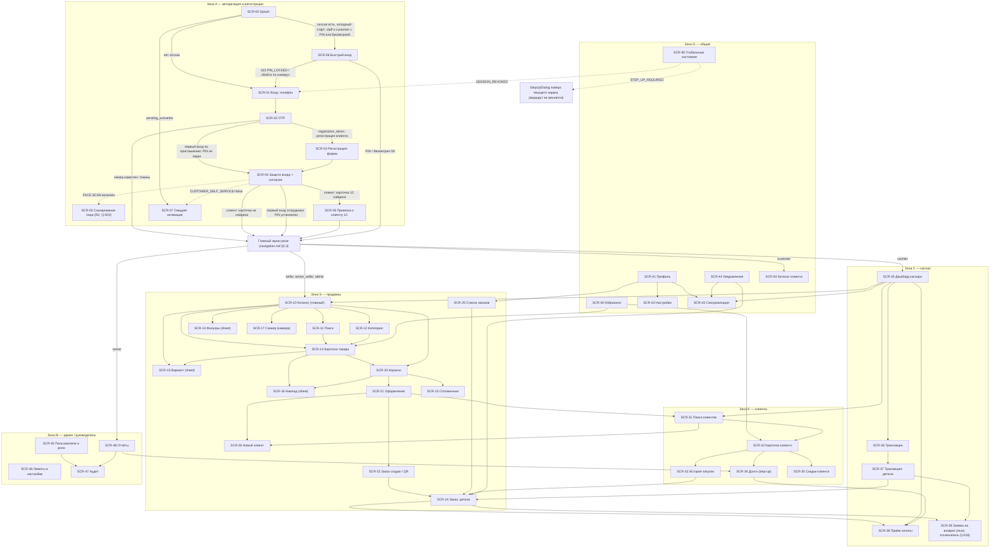
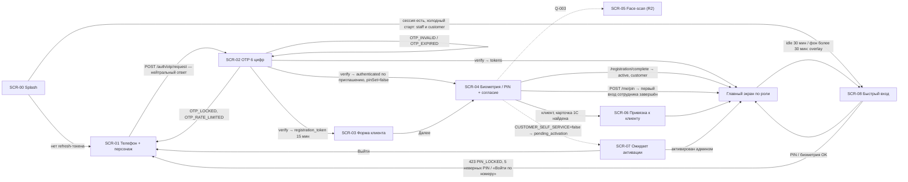
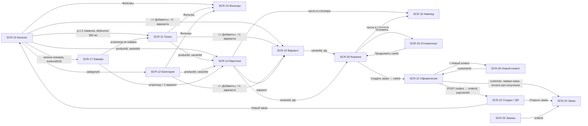
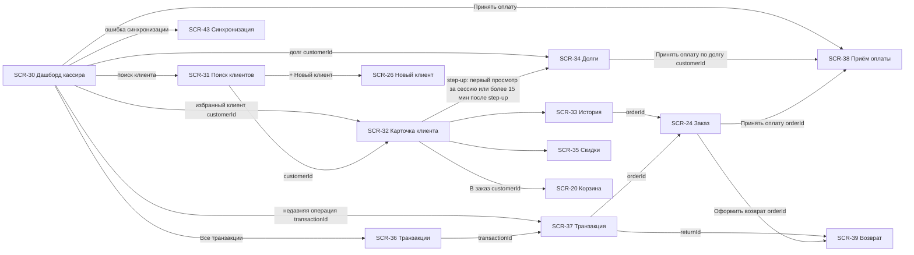
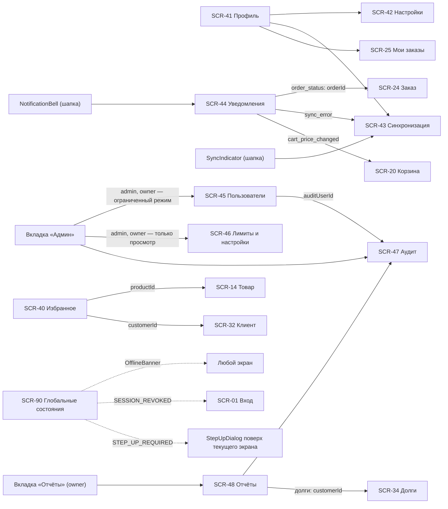
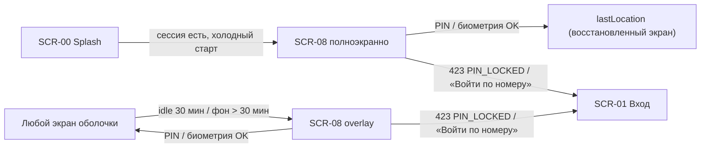

# Карта экранов «Оптомстрой POS» (visual/screen-map.md)

Версия 1.6 (сверка с ядром v1.9, R0 §24 — ответы заказчика 2026-10-21; ранее — v1.8, R0 §21–§23) · Дата 2026-10-21 · Статус: **черновик для утверждения заказчиком** · Тип материала: **структурная схема для ТЗ — не финальный интерфейс**

Входные материалы: [R0 — ядро решений](../../research/R0_DECISION_KERNEL.md) (§3 роли, §4 границы R1, §8 дизайн-система, §9 карта экранов, §12 вопросы, §14 факты о макетах, §17 дополнения v1.2, §18 дополнения v1.3, §19–§20 дополнения v1.4–v1.5, §21 дополнения v1.6, §22 дополнения v1.7, §23 дополнения v1.8, §24 дополнения v1.9 — ответы заказчика 2026-10-21, наивысший приоритет; при расхождении действует более поздний раздел), [R4 — UX-исследование](../../research/R4_UX_RESEARCH.md) (§1 макеты, §2.4 паттерны, §5.2 брейкпоинты, §6 компоненты), [R3 — стек Flutter](../../research/R3_FLUTTER_STACK_RESEARCH.md) (§3 навигация), [11 — безопасность](../11_SECURITY_PRIVACY.md) (§4.3–§4.4 permissions и матрица ролей), [08 — API](../08_API_SPECIFICATION.md), [09 — авторизация, SMS, биометрия](../09_AUTH_SMS_BIOMETRICS.md) (§2.2 кто регистрируется, §7.6 первый вход по приглашению), [10 — бизнес-правила POS](../10_POS_BUSINESS_RULES.md) (RET, PAY-031, PAY-053, ORD, CUST-021…CUST-025), реестр исходных требований `docs/specification/source/REQ_REGISTER_A…F.md`.

Связанные документы: [navigation.md](navigation.md) (маршруты, guards, переходы), [responsive-spec.md](responsive-spec.md) (адаптивные состояния каждого экрана), [components-states.md](components-states.md) (матрица компонентов × состояний), [README.md](README.md), [02_SCREEN_SPECIFICATION.md](../02_SCREEN_SPECIFICATION.md) (ультрадетальные описания экранов `UI-<SCR>-NNN`; единственный канонический текст спецификации экранов по R0 §19.1 — при расхождении с картой прав 02), [03_UX_UI_DESIGN_SYSTEM.md](../03_UX_UI_DESIGN_SYSTEM.md) (`DS-`, `A11Y-`, `ANIM-`), [04_USER_FLOWS.md](../04_USER_FLOWS.md) (`FLOW-`). Далее в тексте документы упоминаются кратко (R0, R4, 03, 08, 11 …) — ссылки на файлы приведены здесь.

---

## Краткое содержание

- Документ фиксирует **полный перечень экранов** приложения `pos-app` ровно по ядру R0 §9: 45 канонических идентификаторов `SCR-xx` (включая глобальные состояния `SCR-90`), их маршруты go_router, роли, статус Release 1 и зону навигации.
- Экраны сгруппированы в **шесть зон**: авторизация/регистрация, продавец (каталог и корзина), кассир (касса и оплата), клиенты, администратор/руководитель, общие (профиль, настройки, синхронизация, уведомления, глобальные состояния).
- Для каждого экрана указаны: точка входа, форма представления на compact/expanded (экран, панель, bottom sheet, диалог, overlay), ключевые компоненты из R0 §8.5 и ссылки на решения `D-xx` / вопросы `Q-xxx`.
- Диаграммы Mermaid (`flowchart`) показывают связи экранов внутри зоны и между зонами; матрица «экран × роль» показывает, кто видит экран полностью, ограниченно или не видит вовсе.
- Экран `SCR-05` (сканирование лица) — **условный** (R2, `Q-003`). Режим клиента-покупателя — **R1** по ядру v1.9 §24.2 (`Q-001` закрыт ответом заказчика, `CUSTOMER_SELF_SERVICE=true` по умолчанию): `SCR-03`, `SCR-04`, `SCR-06`, `SCR-50`, ветка «клиент» в оболочке и доступ `customer` к SCR-21 (заявка-заказ: шаг «Клиент» заполняет сервер, оплата при получении или QR своего заказа, без долга и ручной скидки — 10 CUST-023, CUST-024). `SCR-39` (заявка на возврат) — **R1 must**, включён по умолчанию (`app_settings.returns_enabled = true`, R0 §21 п.1); отключается только при ответе Q-018 «возвраты полностью в 1С» без изменения кода.
- Ядро v1.2 (R0 §17) внесено **прямо в таблицы §2 и §5 и в диаграммы §4**: разделение обязанностей (`admin`/`owner` без кассовых операций), два режима SCR-08 (полноэкранный при холодном старте / overlay при idle-блокировке), права ручной синхронизации SCR-43, новые варианты SCR-90, компоненты R0 §17.5. Разделы §10–§11 (и итоговый §12 «Журнал сверки с ядром v1.2 / v1.3») — краткий журнал изменений со ссылками на исправленные строки (плюс детальная схема режимов SCR-08 и вариантов SCR-90).
- Ядро v1.3 (R0 §18.2 п. 11 — исправление ролей R0 §9) внесено в §2, §3 и §5: SCR-38 — только `cashier`, `senior_seller` (без `admin`); SCR-21 — `customer` условно (с ядра v1.9 §24.2 — R1, §12.5); `owner` на SCR-39 — только просмотр заявок на возврат (11 §4.4); `senior_seller` может повторять отправку элемента outbox на SCR-43 (ограничение «своего магазина» снято ядром v1.7 §22.10: в R1 одна торговая точка, фильтров нет). Журнал — §12.2.
- Ядро v1.6–v1.8 (R0 §21–§23) внесено в §2, §3, §5, §6: SCR-39 — must с действиями «Согласовать»/«Отклонить» для держателя `return.approve`; `owner` на SCR-45 — ограниченный режим (просмотр, роли и сессии только учётных записей `admin`/`owner`, step-up), на SCR-46 — только просмотр; «Принять оплату» на SCR-24 и блок «Ожидают оплаты» SCR-30 — в статусах `submitting`, `pending_approval`, `approved`, `awaiting_payment`; SCR-45 — «Выдать аварийный код входа»; SCR-43 — без фильтра «свой магазин», ручной запуск недоступен в варианте C-2. Журнал — §12.4.
- Ядро v1.9 (R0 §24, ответы заказчика 2026-10-21) внесено в §1–§9: регистрация по телефону — только для клиентов; сотрудник сам не регистрируется — `admin` создаёт приглашение на SCR-45, сотрудник входит SCR-01 → SCR-02 → SCR-04 в режиме «первый вход сотрудника» (обязательный PIN) → главный экран роли, без формы SCR-03 (09 §7.6); SCR-07 — только при `CUSTOMER_SELF_SERVICE=false`; QR — через 1С (`QR_PROVIDER=onec`, основной вариант), статический QR с ручным подтверждением — запасной; палитра B «Оранжевый» и оранжевый логотип (ядро §24.1) структуру карты не меняют — цвета задаёт 03. Новых `SCR-` нет; новый вопрос — Q-303. Журнал — §12.5.
- Все схемы и wireframes в папке `visual/` — структурные, без финальной графики; окончательный вид определяется `03_UX_UI_DESIGN_SYSTEM.md` и `02_SCREEN_SPECIFICATION.md`.

---

## 1. Легенда

| Обозначение | Значение |
|---|---|
| `SCR-xx` | Канонический ID экрана из R0 §9 (менять нельзя) |
| **да** / **условно** / **R2** | Статус R1 из R0 §9: входит в Release 1 / входит при решении заказчика (`Q-xxx`) / вне R1 |
| Зона **A** | Авторизация и регистрация (гость — регистрация клиента; первый вход сотрудника по приглашению; `pending_activation` — только при `CUSTOMER_SELF_SERVICE=false`; разблокировка) |
| Зона **S** | Режим продавца: каталог, товар, корзина, оформление, заказы |
| Зона **C** | Режим кассира: дашборд, приём оплаты, транзакции, возвраты |
| Зона **K** | Клиенты (общая для продавца/кассира/админа; поля по роли) |
| Зона **M** | Администратор и руководитель |
| Зона **G** | Общие экраны и глобальные состояния |
| Форма: **экран** | Полноэкранный маршрут в своей ветке `StatefulShellRoute` |
| Форма: **панель** | Постоянная или выдвижная колонка внутри трёхколоночной раскладки (expanded/large) |
| Форма: **sheet** | `AppBottomSheet` (compact) / side sheet или popover (medium/expanded) |
| Форма: **диалог** | `ConfirmDialog` / `StepUpDialog` / модальное окно (на expanded — как на макете `IMG_7090.PNG`) |
| Форма: **overlay** | Баннер, snackbar или полноэкранная заглушка поверх текущего экрана (`SCR-90`) |
| Роли | `seller`, `cashier`, `senior_seller`, `admin`, `owner`, `customer` (клиент-покупатель, R1 — ядро §24.2), `staff` = все сотрудники (R0 §3.1) |
| Метки достоверности | `[ПОДТВЕРЖДЕНО: макет]`, `[РЕШЕНИЕ: D-xx]`, `[ТРЕБУЕТ РЕШЕНИЯ ЗАКАЗЧИКА: Q-xxx]`, `[ТИПОВО]` |

---

## 2. Сводная таблица экранов

Маршруты и роли — **ровно** из R0 §9. Колонка «Форма» — представление на compact → expanded (см. `responsive-spec.md`). Колонка «Компоненты» — канонические имена из R0 §8.5 (подробно — `components-states.md`).

### 2.1. Зона A — авторизация и регистрация

| ID | Экран | Маршрут | Роли | R1 | Точка входа | Форма compact → expanded | Ключевые компоненты | Источники |
|---|---|---|---|---|---|---|---|---|
| SCR-00 | Splash | `/splash` | все | да | холодный старт, `redirect` по состоянию сессии | экран → экран (центрированный логотип) | `SplashLogo`, `SyncIndicator` (скрыт), `AppProgress` linear 2 lp при проверке сессии > 400 мс | D-40, R4 §7.2 #1, SRC-B-069 |
| SCR-01 | Вход: ввод телефона (с персонажем) | `/auth/phone` | гость | да | SCR-00 (нет сессии), SCR-08 «Войти по номеру», SCR-90 «сессия отозвана» | экран → экран (карточка 420–480 lp по центру, персонаж сверху) | `Mascot`, `PhoneField`, `AppButton` L primary, `OfflineBanner` | D-09, D-10, D-40, R4 §1.4 (расхождение с макетом — Q-002), SRC-B-069…078 |
| SCR-02 | Подтверждение OTP | `/auth/otp` | гость | да | SCR-01 после `/auth/otp/request` | экран → экран | `Mascot`, `OtpField`, `AppButton` text «Отправить повторно» (таймер 60 с), `AppSnackbar`, `SuccessCheck` (успешный вход) | D-10, D-11, SRC-B-147…149 |
| SCR-03 | Регистрация клиента: форма | `/register` | гость с `registration_token` (будущий `customer`; сотрудники форму не проходят — ядро §24.2) | да | SCR-02 (ветвь «номер не зарегистрирован и действующего приглашения нет» → `registration_required`) | экран → экран (форма 1 колонка, ширина ≤ 560 lp) | `AppTextField` ×3, `PhoneField` (read-only, подтверждён), `AppDropdown` (год рождения, сфера деятельности), `AppButton` L, `RegistrationStepper` («Шаг 1 из 3 · Данные»; при показе SCR-06 — из 4; канон — 02 UI-03-002, 09 §7.1) | D-07 (пересмотрено ядром §24.2), D-10, Q-001 (закрыт), SRC-B-123, SRC-B-130, SRC-B-132, SRC-B-134 |
| SCR-04 | Регистрация: защита входа (биометрия/PIN) + согласие; первый вход сотрудника по приглашению | `/register/security` | гость с `registration_token` (клиент); сотрудник при первом входе по приглашению (`authenticated`, `GET /me` → `security.pinSet=false`; 09 §7.6) | да | SCR-03 «Далее» (клиент); SCR-02 после первого входа по приглашению — режим «первый вход сотрудника»: обязательная установка PIN, биометрия по выбору, ознакомление с обработкой ПДн, без «Пропустить» (ядро §24.2) | экран → экран | `PinField` (PIN обязателен для `staff` на всех платформах; для `customer` — хотя бы один способ: биометрия или PIN, шаг без «Пропустить» — D-48, ядро §24.2), `AppButton` tonal «Включить биометрию», `AppCheckbox` согласий (ошибка `CONSENT_REQUIRED`), `RegistrationStepper` («Шаг 2 из 3»; при SCR-06 — «2 из 4»; канон — 02 UI-04-002), `SuccessCheck` (регистрация завершена), `ConfirmDialog` | D-13, D-14, D-48, ядро §24.2, 09 §7.6, SRC-B-079…084, SRC-B-126 |
| SCR-05 | Сканирование лица (guided capture) | `/register/face-scan` | условно | **R2 (условно)** | SCR-04 (только при включённом модуле FACE-SCAN) | экран → экран (камера, кольцо-прогресс) | Progress stepped (R4 §6 #50), `ErrorState` «нет разрешения камеры» | D-14, Q-003, R4 §7.2 #20 |
| SCR-06 | Привязка к клиенту 1С | `/register/customer-link` | `customer` | да | SCR-04 при найденной карточке 1С (`CUSTOMER_SELF_SERVICE=true` по умолчанию — ядро §24.2) | экран → экран | `CustomerCard` (без финансов), `AppButton` primary/secondary, `ConfirmDialog` | D-08, R0 §22.12, ядро §24.2 (Q-001 закрыт), SRC-B-138…146 |
| SCR-07 | Ожидает активации | `/pending-activation` | `pending_activation` | да | только при `CUSTOMER_SELF_SERVICE=false`: SCR-02/SCR-04 (неизвестный номер без приглашения), SCR-00 при повторном запуске; в R1 по умолчанию такой номер регистрируется как клиент (ядро §24.2) | экран → экран | `EmptyState` (иллюстрация с `brandAccent`), `AppButton` text «Выйти», «Проверить статус» | D-07, ядро §24.2 |
| SCR-08 | Быстрый вход (биометрия/PIN) | `/auth/unlock` | авторизованные | да | (1) SCR-00 — холодный старт с действующей сессией: `staff` — всегда, `customer` — при включённых PIN/биометрии (у клиента настроен хотя бы один способ — ядро §24.2; R0 §17.2, D-48); (2) любой экран оболочки — 30 мин без ввода или возврат из фона > 30 мин (D-12); (3) ответ API 401 `UNLOCK_REQUIRED` (сессия не отозвана) → overlay; разблокировка — `POST /auth/unlock` (refresh + PIN или биометрия), неверный PIN — 401 `PIN_INVALID` с `attemptsLeft` без вызова `/auth/refresh` `[РЕШЕНИЕ: ядро §18.2 п.5]` | два режима (R0 §17.2, детали — §11.2): **холодный старт** — непрозрачный полноэкранный маршрут во всех классах окна (compact — экран; medium+ — карточка `r-xl 20` по центру на фоне `background`, оболочки под ней нет); **idle** — блокирующий overlay поверх текущего экрана во всех классах окна, состояние экрана сохраняется (`responsive-spec.md` §3 SCR-08) | `PinField`, `AppButton` tonal «Биометрия», text «Войти по номеру», `AppAvatar`, `RoleBadge`, `AppProgress` (проверка PIN на сервере) | D-12, D-13, D-48, Q-034, Q-241, SRC-B-081…084 |

### 2.2. Зона S — режим продавца (каталог, товар, корзина, заказы)

| ID | Экран | Маршрут | Роли | R1 | Точка входа | Форма compact → expanded | Ключевые компоненты | Источники |
|---|---|---|---|---|---|---|---|---|
| SCR-10 | Рабочее пространство продавца / Каталог (главный) | `/catalog` | staff | да | главный экран `seller`/`senior_seller`/`admin`; вкладка «Каталог» у остальных | экран (1 колонка, чипы категорий) → 3 колонки (сайдбар категорий / сетка / корзина) `[ПОДТВЕРЖДЕНО: макет каталога]` | `TopAppBarPos`, `SearchBar`, `CategorySidebarItem`, `CategoryChip`, `AppSectionHeader` («Недавние товары · Очистить» в сайдбаре), `ViewModeSegmented`, `SortMenu`, `ProductCardGrid/List/Compact`, `AppTooltip` (полные названия, expanded), `CartPanel` (expanded) / `CartFab` (compact), `SyncIndicator`, `NotificationBell` | D-16, D-18, D-31, R0 §14, SRC-C-003…020 |
| SCR-11 | Результаты поиска | `/catalog/search?q=` | staff, customer | да | `SearchBar` (ввод ≥ 2 символов, debounce 300 мс; штрихкод/артикул — любой длины), HID-сканер | экран → контент-колонка SCR-10 (сайдбар и корзина остаются) | `SearchBar`, `ProductCardGrid/List`, `EmptyState` search, `SkeletonList`, `CartFab` (compact) | D-31, D-42, SRC-C-007…010 |
| SCR-12 | Категория / подкатегории | `/catalog/c/{categoryId}` | staff, customer | да | `CategorySidebarItem` / `CategoryChip` | экран → контент-колонка SCR-10 | `CategoryChip` (подкатегории), `CategoryTile` (compact/medium, категория с подкатегориями), `ProductCardGrid`, `SortMenu`, `FilterPanel`, `CartFab` (compact) | SRC-C-011c, SRC-C-012 |
| SCR-13 | Фильтры (панель/лист) | `/catalog/filters` (sheet) | staff, customer | да | кнопка «Фильтры» в SCR-10/11/12 | `AppBottomSheet` → `FilterPanel` (side sheet 320 lp справа от контента) | `FilterSheet`/`FilterPanel`, `CategoryChip` (filter), `AppButton` «Применить»/«Сбросить» | SRC-C-020 |
| SCR-14 | Карточка товара | `/catalog/p/{productId}` | staff, customer | да | `ProductCardGrid/List/Compact` тап по фото/названию; сканер (точное совпадение штрихкода → сразу карточка или добавление, по настройке) | экран → **панель** поверх контент-колонки (ширина контента; корзина остаётся видимой) | `ImageGallery` (`ProductImage`), `VariantSelector`, `PriceText`, `StockBadge` + `WarehouseStockTable` (остатки по складам; у `customer` — по `app_settings.customer_stock_display`: по умолчанию только статус наличия, без количеств и таблицы — 10 CUST-022), `UnitSelector`, `OptionTile` (выбор упаковки), `QuantityStepper`, `FavoriteToggle`, `AppTabs` (Описание · Характеристики · Склады), `AppButton` L «В корзину», `CartFab` (compact) | D-22, D-30, Q-021, SRC-C-037…052 |
| SCR-15 | Выбор варианта (лист) | sheet | staff, customer | да | «+ Добавить» на карточке товара с > 1 вариантом (SCR-10/11/12/40), `CartLine` «изменить вариант» | `AppBottomSheet` → popover/side sheet у карточки | `VariantSelector`, `PriceText`, `StockBadge`, `AppButton` M «Добавить» | SRC-C-040, SRC-C-064 |
| SCR-16 | Ввод количества (нампад) | sheet | staff, customer | да | долгое нажатие/тап по числу `QuantityStepper` (SCR-14, SCR-20) | `QuantityNumpadSheet` (bottom sheet) → popover 280 lp у степпера | `QuantityNumpadSheet`, `UnitSelector`, подпись кратности | D-19, SRC-C-033, SRC-C-034 |
| SCR-17 | Сканер штрихкода (камера) | `/scan` | staff (Android/iOS) | да | иконка сканера в `SearchBar` (только при наличии камеры); на Windows — отсутствует, HID-сканер работает без экрана | экран (полноэкранная камера) → диалог ≈ 480×360 `[ТИПОВО]` (планшет с камерой) | `ErrorState` «нет разрешения камеры», `AppButton` text «Ввести вручную» | D-42, Q-009, SRC-C-010 |
| SCR-20 | Корзина | `/cart` | staff, customer (своя корзина без `DiscountInput`, `CustomerPicker` и «Отложить заказ» — 10 CUST-023) | да | нижняя панель-итог (compact), вкладка «Корзина», бейдж в шапке; на expanded — постоянная панель | экран → **панель** 320–340 lp справа `[ПОДТВЕРЖДЕНО: макет]` | `CartPanel`, `CartLine`, `CartSummary`, `DiscountInput`, `CustomerPicker` (кратко), `AppButton` outlined «Отложить заказ», primary «Создать заказ →», `ConfirmDialog` (очистка), баннер `PRICE_CHANGED`/`STOCK_INSUFFICIENT` | D-19, D-23, D-32, SRC-C-058…074 |
| SCR-21 | Оформление заказа (Клиент · Получение · Оплата · Завершение) | `/checkout` | seller, cashier, senior_seller, admin (`admin` — без приёма денег: заказ создаётся с оплатой «позже», оплату принимает кассир на SCR-38 — R0 §17.2, D-15 `[ТИПОВО; Q-005]`); customer — **R1** (`CUSTOMER_SELF_SERVICE=true` по умолчанию) `[РЕШЕНИЕ: ядро §18.2 п.11, §24.2]`: «заявка-заказ» (в 1С — «Заказ клиента», «Не согласован», согласует магазин): шаг «Клиент» заполняет сервер, клиент его не редактирует (карточка 1С при подтверждённой привязке, иначе карточка POS из профиля); шаг «Оплата» — только «Оплата при получении» (`cash`) и QR своего заказа при `QR_PROVIDER=onec` (11 SEC-037; при `none` способ QR клиенту не предлагается); без `credit`, `DiscountInput` и `StepUpDialog`; после отправки → SCR-22 (QR) или SCR-24 (свой); правила — 10 CUST-023, CUST-024 | да (customer — R1, ядро §24.2) | SCR-20 «Создать заказ →» (корзина не пуста) | 4 последовательных шага-экрана → **модальное окно** с 3 колонками поверх трёхколоночной раскладки; компоновка `[ПОДТВЕРЖДЕНО: макет IMG_7090]`, размер — ≈ 60 % ширины окна по пропорциям макета (скриншот 1536 px неизвестного масштаба, абсолютные px не переносятся) `[ТИПОВО]`, окончательные значения — 03/02 | `CheckoutStepper`, `CustomerPicker`, `CustomerCard`, `OptionTile` (получение, получатель), `AppDropdown` (желаемое время), `PaymentMethodCard` ×3 (`AppRadio`), `AppTextField` (адрес, телефон получателя, комментарий 0/200), `PrintOptions` (`AppCheckbox`), `DocumentPreview`, `CartSummary`, `AppButton` L success «Создать заказ…», `StepUpDialog` (скидка сверх лимита / долг), сообщение об отказе в долге по `creditReason` (`forbidden_role`, `credit_not_allowed`, `overdue`, `limit_exceeded`, `stale_snapshot`; клиент не выбран или «Розничный покупатель» — `CUSTOMER_NOT_IDENTIFIED`; правило — 10 PAY-031, R0 §22.4, §23 п.5) | D-20, D-21, D-23, D-24, D-27, Q-012, Q-014, Q-026, SRC-C-079…081, SRC-D-151b |
| SCR-22 | Заказ создан / QR для оплаты | `/orders/{id}/created` | те же (у `admin` — без `QrPanel` и ручного подтверждения: R0 §17.2; `customer` — только свой заказ: QR и его перевыпуск, без ручного подтверждения и смены способа, `manual_confirm` — «Оплата проверяется магазином», 10 CUST-024) | да | SCR-21 после `POST /orders` (`201` или `202` с `warnings[STALE_DATA]`; начальный платёж выбранного способа создаётся в той же транзакции, номер 1С появляется после отправки воркером — R0 §22.3; смена способа до получения денег — `POST /orders/{id}/payments`, прежний неполученный платёж система аннулирует без step-up — R0 §23 п.3, 08 §4.8.6; `POST /payments` здесь не используется) | экран → модальное окно (замещает SCR-21) | `QrPanel` (динамический QR из 1С при `QR_PROVIDER=onec` — основной вариант R1, ядро §24.4; 1С не выдала QR — «Повторить» / «Показать статический QR» / «Сменить способ оплаты», 10 PAY-053; при `none` — статический QR и «ручное подтверждение»), `AppProgress` (формирование QR), `SuccessCheck` (оплата получена), `StatusChip`, `PrintOptions` (статус печати), `DocumentPreview`, `AppButton` «Подтвердить оплату вручную» (step-up; в т. ч. поздняя оплата истёкшего QR — `manual_confirm`, `review_reason=late_payment`, R0 §23 п.4), «Новый заказ» | D-21, D-27, Q-013, Q-014 (частично отвечен — ядро §24.4) |
| SCR-23 | Отложенные заказы | `/cart/parked` | staff | да | `CartPanel` «Отложить заказ» → список; меню корзины «Отложенные (n)» | экран (список) → side sheet/панель поверх корзины | `CartLine` compact, `StatusChip` parked, `AppButton` «Продолжить», `ConfirmDialog` (замена активной корзины) | D-32, SRC-C-069, SRC-C-070 |
| SCR-24 | Заказ: детали и статус | `/orders/{id}` | владелец, cashier+, customer (свой) | да | SCR-25, SCR-22 «Открыть заказ», SCR-33, SCR-37, уведомление `order_status` | экран → экран (контент-колонка; корзина скрыта) | `StatusChip` (D-20), `CartLine` read-only, `CartSummary`, `PrintOptions`, `DocumentPreview`, `AppButton` «Принять оплату» / «Показать QR» (только `cashier`/`senior_seller` и только для статусов `submitting`, `pending_approval`, `approved`, `awaiting_payment` — R0 §22.5, заменяет §17.2), `AppButton` danger «Отменить заказ» / «Запросить отмену» (`order.cancel.own` — свой заказ до согласования без полученных платежей, без step-up; `order.cancel.request.any` — `cashier`, `senior_seller`, `admin`, step-up — R0 §22.9, §23 п.6), `AppButton` «Привязать к документу 1С» (`ORDER_MATCH_AMBIGUOUS`, step-up, R0 §23 п.1; роли — 02), `ReceivableBadge` | D-20, D-27, D-36 |
| SCR-25 | Список заказов | `/orders` | staff (свои/все по роли), customer (свои) | да | меню/вкладка «Мои заказы» (customer), раздел «Заказы» в профиле/дашборде | экран → экран (таблица) | `TransactionRow` (вариант order), `StatusChip`, `DateRangePicker`, `FilterPanel`, `EmptyState`, `SkeletonList` | D-20 |
| SCR-26 | Новый клиент (форма) | `/customers/new` | seller+, cashier | да | SCR-21 «+ Новый клиент», SCR-31 «Создать клиента» | экран → диалог ≈ 560 lp `[ТИПОВО]` | `PhoneField`, `AppTextField` ×N, `AppDropdown` (тип клиента), `CustomerCard` «Найден в 1С — привязать?» (дедупликация), `AppButton` L | D-08, Q-025, SRC-B-138…146 |

### 2.3. Зона C — режим кассира (касса, оплата, транзакции, возвраты)

| ID | Экран | Маршрут | Роли | R1 | Точка входа | Форма compact → expanded | Ключевые компоненты | Источники |
|---|---|---|---|---|---|---|---|---|
| SCR-30 | Дашборд кассира (главный для cashier) | `/cashier` | cashier, senior_seller, admin, owner (`admin`, `owner` — просмотр без кассовых действий: кнопка «Принять оплату» скрыта, R0 §17.2) | да | главный экран `cashier`; вкладка «Касса» | экран (вертикальные секции) → 2–3 колонки (поиск клиентов + избранные / недавние операции + транзакции / долги + синхронизация) | `SearchBar` (клиенты), `CustomerCard` ×N (избранные), блок «Ожидают оплаты» (заказы в статусах `submitting`, `pending_approval`, `approved`, `awaiting_payment` с открытым платежом — R0 §23 п.7, §22.5), `TransactionRow`, `ReceivableBadge`, `SyncIndicator`, `AppButton` «Принять оплату», «К каталогу» | SRC-C-083…091, SRC-E-010 |
| SCR-31 | Поиск клиентов | `/customers?q=` | staff | да | вкладка «Клиенты», `SearchBar` SCR-30, `CustomerPicker` в SCR-21 | экран → контент-колонка | `SearchBar`, `CustomerCard` (row), `ReceivableBadge` (по роли: без права финансового чтения — только индикатор «есть долг / просрочка» без сумм, R0 §22.13 п.1), `EmptyState`, `AppButton` «+ Новый клиент» | D-08, SRC-C-084 |
| SCR-36 | Транзакции (список с фильтрами) | `/transactions` | cashier+, owner; seller (свои) | да | вкладка «Транзакции», SCR-30 «Все транзакции» | экран → экран (таблица + `FilterPanel` справа) | `TransactionRow`, `StatusChip`, `DateRangePicker`, `FilterPanel`/`FilterSheet` (период, клиент, статус, тип), `EmptyState`, `SkeletonList` | SRC-C-115…116d |
| SCR-37 | Транзакция: детали | `/transactions/{id}` | те же | да | SCR-36, SCR-33, SCR-30 «Недавние операции» | экран → side sheet 480 lp поверх списка | `StatusChip`, `CartSummary`, ссылки на связанные документы: заказ (SCR-24 `/orders/{id}`), платёж (транзакция платежа SCR-37 `/transactions/{id}`; `/payments/{id}` — эндпоинт API, не маршрут), возврат (SCR-39 `/returns/{id}`); `AuditRow` (кратко) | D-36, SRC-C-116d |
| SCR-38 | Приём оплаты (по заказу / по долгу) | `/payments/new?orderId=\|customerId=` | cashier, senior_seller — **без `admin`** `[РЕШЕНИЕ: ядро §18.2 п.11]` (исправление R0 §9; D-15: `admin` — без кассовых операций); guard проверяет permission `payment.cash.receive` / `payment.qr.show` — 11 §4.3, Q-005 | да | SCR-24 «Принять оплату» (заказ в статусах `submitting`, `pending_approval`, `approved`, `awaiting_payment`, любой способ — R0 §22.5), SCR-34 «Принять оплату по долгу», SCR-30 «Принять оплату» | экран → диалог ≈ 640 lp `[ТИПОВО]` | `PaymentMethodCard` ×3 (`AppRadio`), `AppTextField` сумма (tabular), `QrPanel` (QR через 1С — ядро §24.4; запасной — статический QR), `AppProgress` (формирование QR), `SuccessCheck` (оплата получена), `StepUpDialog` (ручное подтверждение QR), `PrintOptions` (чек), `DocumentPreview`; запрос — `POST /orders/{id}/payments` (по заказу) или `POST /payments` (по долгу без заказа, условно Q-152) | D-21, D-26, D-36, Q-005, Q-012…Q-014, SRC-C-117, SRC-C-118 |
| SCR-39 | Заявка на возврат | `/returns/new?orderId=` и `/returns/{id}` | cashier, senior_seller, admin — создание и отправка; «Согласовать» (`POST /returns/{id}/accept`, только при `RETURNS_FROM_POS_ENABLED=false`) и «Отклонить» (`POST /returns/{id}/reject`) — только держатель `return.approve` (`senior_seller`, `admin`) со step-up `[РЕШЕНИЕ: ядро §22.11, §23 п.8]`; owner — **только просмотр** `/returns/{id}` (`return.read`, 11 §4.4; без «Оформить возврат», без `StepUpDialog`) `[РЕШЕНИЕ: ядро §18.2 п.11]` | да (**must**, R0 §21 п.1: включён по умолчанию, `returns_enabled = true`; отключатель — Q-018, 10 RET-012) | SCR-24 «Оформить возврат», SCR-37 (у `owner` — только переход к существующей заявке `returnId`) | экран → диалог ≈ 720 lp `[ТИПОВО]` | `CartLine` с `AppCheckbox` и `QuantityStepper`, `AppDropdown` / `AppRadio` причина (`return_reason`, обязательно) + `AppTextField` комментарий, `StepUpDialog`, `StatusChip` (`return_request_status`: `draft → submitted → accepted → completed`, `rejected` — 10 RET), `AppButton` «Согласовать» / «Отклонить» (причина обязательна; `return.approve`, step-up) | D-25, Q-018, 10 RET-001…RET-012 |

### 2.4. Зона K — клиенты

| ID | Экран | Маршрут | Роли | R1 | Точка входа | Форма compact → expanded | Ключевые компоненты | Источники |
|---|---|---|---|---|---|---|---|---|
| SCR-32 | Карточка клиента | `/customers/{id}` | staff (поля по роли), customer (свой) | да | SCR-31, SCR-30 (избранные), SCR-21 (карточка выбранного), SCR-24 | экран с `AppTabs` → экран-«мастер-деталь» (шапка клиента + вкладки: История · Долги · Скидки · Заказы) | `CustomerCard` full, `ReceivableBadge`, `FavoriteToggle` (клиенты — cashier/admin), `AppTabs`, `RoleBadge` (видимость полей), `AppButton` «В заказ» | D-08, D-24, Q-017, SRC-C-092…103 |
| SCR-33 | История покупок клиента | `/customers/{id}/history` | cashier+, customer (свой, только при `customer_link.confirmed` — 10 CUST-025) | да | вкладка «История» SCR-32 | экран → вкладка внутри SCR-32 | `TransactionRow`, `DateRangePicker`, `EmptyState`, `SkeletonList` | SRC-C-095 |
| SCR-34 | Долги и взаиморасчёты клиента | `/customers/{id}/receivables` | cashier+, owner; customer (свой, confirmed) | да | вкладка «Долги» SCR-32; `ReceivableBadge` в SCR-30; **step-up при первом просмотре за сессию и повторно, если с последнего step-up прошло > 15 мин** (R0 §17.2) | экран → вкладка внутри SCR-32 | `ReceivableBadge` (zero/due/overdue), таблица документов (дата, статус, платежи, возвраты, скидки, лимит), подпись «снимок 1С от HH:MM» (порог устаревания — `app_settings.receivables.max_age_minutes`, по умолчанию env `RECEIVABLES_MAX_AGE_MIN` = 60; R0 §16 п. 2, §17.7), `StepUpDialog`, `AppButton` «Принять оплату по долгу» (cashier, senior_seller; у admin/owner скрыта — R0 §17.2) | D-24, D-36, Q-017, SRC-C-104…112 |
| SCR-35 | Скидки и условия клиента | `/customers/{id}/discounts` | seller+, cashier | да | вкладка «Скидки» SCR-32 | экран → вкладка внутри SCR-32 | список правил (`discount_rules`), `StatusChip`, подпись источника «из 1С» | D-23, Q-015, SRC-C-097, SRC-C-113 |

### 2.5. Зона M — администратор и руководитель

| ID | Экран | Маршрут | Роли | R1 | Точка входа | Форма compact → expanded | Ключевые компоненты | Источники |
|---|---|---|---|---|---|---|---|---|
| SCR-45 | Админ: пользователи, роли, приглашения | `/admin/users` | admin; owner — **ограниченный режим** `[РЕШЕНИЕ: ядро §21 п.3]`: просмотр пользователей и ролей, со step-up — только назначение/снятие ролей `admin`/`owner` (SEC-040) и отзыв сессий учётных записей `admin`/`owner` (SEC-043); роли `seller`/`cashier`/`senior_seller`, приглашения, блокировка, сброс PIN, отзыв сессий прочих сотрудников — только `admin` (расширение — R2, Q-005) | да | вкладка «Админ» | экран (список + детали по тапу) → мастер-деталь (список 360 lp + карточка пользователя) | `AppTabs` (Пользователи · Приглашения), `AppAvatar`, `RoleBadge`, `StatusChip` (`user_status`), `PhoneField` (приглашение) + `AppDropdown` (роль) — приглашение сотрудника `seller`/`cashier`/`senior_seller` (`POST /admin/invitations`, step-up) — единственный способ появления учётной записи сотрудника (ядро §24.2; «супер-админ» заказчика = `admin`, в интерфейсе «Администратор» — Q-303), `AppTooltip` (права роли), `StepUpDialog` (смена ролей/блокировка, отзыв чужих сессий, создание/отзыв приглашений — R0 §17.2), `ConfirmDialog`, `AppButton` «Выдать аварийный код входа» (`users.emergency_code.issue`, только `admin`, step-up; цель — активный сотрудник, не `admin`/`owner`; код показывается один раз; R1 should — R0 §22.13 п.2, §23 п.8, Q-168), подтверждение/отклонение привязки клиента — только `admin` (`customer.link.resolve`, step-up, R0 §22.12) | D-07, D-15, D-36, Q-005, Q-168, Q-303, ядро §24.2, SRC-C-129 |
| SCR-46 | Админ: лимиты скидок и настройки | `/admin/settings` | admin; owner — **только просмотр** (без изменения лимитов и настроек, кнопка «Сохранить» скрыта) `[РЕШЕНИЕ: ядро §21 п.3]` | да | вкладка «Админ» → «Настройки» | экран (секции-аккордеон) → экран (2 колонки: навигация секций 240 lp + форма) | таблица лимитов (`role_discount_limits`) с `RoleBadge`, `AppTextField` (`app_settings.receivables.max_age_minutes`), значения env `RECEIVABLES_MAX_AGE_MIN` и `CUSTOMER_SELF_SERVICE` (`true` по умолчанию — ядро §24.2) — только для чтения (задаются на сервере, R0 §16 п. 3), `AppDropdown` «Показ остатков клиенту» (`app_settings.customer_stock_display`: `status` по умолчанию \| `quantity`; 10 CUST-022), `AppListTile` (навигация секций), `AppSwitch` (флаги `app_settings`), `AppDropdown`, `StepUpDialog` (в т. ч. настройки приложения/OTP/SMS — R0 §17.2), `AppButton` «Сохранить» | D-23, D-24, Q-015, Q-017 |
| SCR-47 | Аудит | `/admin/audit` | admin, owner | да | вкладка «Админ»/«Отчёты» → «Аудит», ссылка из SCR-37 | экран → экран (таблица + `FilterPanel`) | `AuditRow`, `DateRangePicker`, `FilterPanel` (пользователь, тип операции), `EmptyState`, экспорт (R2) | D-36, Q-028, SRC-C-134…140 |
| SCR-48 | Отчёты руководителя (минимум) | `/reports` | owner, admin | да | главный экран `owner`; вкладка «Отчёты» | экран (карточки сводок вертикально) → экран (сетка сводок 2–3 колонки) | карточки «Сводка продаж» (`groupBy=day\|seller\|paymentMethod`, данные POS), «Долги» (без разбивки по срокам; разбивка — R2), «QR-сверка» (`/admin/reports/*`, 08 §4.18.8, R0 §22.13 п.3), `DateRangePicker`, `ReceivableBadge`, `StatusChip` | D-36, Q-014, SRC-C-130 |

### 2.6. Зона G — общие экраны и глобальные состояния

| ID | Экран | Маршрут | Роли | R1 | Точка входа | Форма compact → expanded | Ключевые компоненты | Источники |
|---|---|---|---|---|---|---|---|---|
| SCR-40 | Избранное (вкладки Товары · Клиенты) | `/favorites` | staff, customer (товары) | да | вкладка «Избранное» (продавец/клиент), блок «Избранное 27» в сайдбаре `[ПОДТВЕРЖДЕНО: макет]`, SCR-30 (клиенты) | экран с `AppTabs` → контент-колонка SCR-10 (корзина остаётся) | `AppTabs`, `ProductCardGrid/List`, `CustomerCard`, `FavoriteToggle`, `EmptyState` favorites, `CartFab` (compact) | D-32 (outbox избранного), SRC-C-025, SRC-C-100…103 |
| SCR-41 | Профиль | `/profile` | все | да | вкладка «Профиль», блок «Абдулла · Продавец» в шапке `[ПОДТВЕРЖДЕНО: макет]` | экран → экран (карточка 560 lp) | `AppAvatar` 64, `RoleBadge`, `PhoneField` (смена номера — step-up), ссылки на SCR-42/43/44/25, `AppButton` danger «Выйти», «Выйти на всех устройствах» (step-up) | D-12, D-15 |
| SCR-42 | Настройки | `/settings` | все | да | SCR-41 «Настройки», шестерёнка в шапке (expanded) | экран (список секций) → экран (2 колонки) | секции (`AppListTile`): язык (`ru`, каркас `ky`/`en`; `AppDropdown`), защита входа (`PinField`, `AppSwitch` биометрии — установка/смена PIN и вкл./выкл. биометрии со `StepUpDialog`, R0 §17.2), устройства/сессии (`/auth/sessions`), сканер (суффикс Enter/Tab, тест), принтер (A4/80 мм; `AppDropdown`), плотность (`DsDensity` standard/compact), «Уменьшить анимации» (`AppSwitch`), о приложении | D-13, D-38, D-42, D-27, D-48, Q-009, Q-019 |
| SCR-43 | Статус синхронизации | `/sync` | staff (кратко), admin/owner (полный + запуск); senior_seller — кратко + запуск только `incremental` для `stock`/`prices`/`order_status` без step-up (R0 §17.2) + «Повторить» любой элемент outbox (`POST /sync/outbox/{id}/retry`; не запуск синхронизации; фильтра «свой магазин» в R1 нет — R0 §22.10) `[РЕШЕНИЕ: ядро §18.2 п.11, §22.10]`; `owner` — без списка outbox (02) | да | `SyncIndicator` в шапке, SCR-30 блок синхронизации, уведомление `sync_error` | экран → side sheet ≈ 480 lp `[ТИПОВО]` (staff) / экран-таблица (admin/owner) | `SyncIndicator`, таблица `sync_runs` по `sync_entity`, `StatusChip` (`sync_run_status`), `AppProgress`, `AppListTile` (compact), `AppTooltip` (по сущностям); запуск по роли (R0 §17.2): `admin`/`owner` — `AppButton` «Запустить…» для любых сущностей и режимов (`full`/`reconcile` — со `StepUpDialog`), `senior_seller` — только `incremental` для `stock`, `prices`, `order_status` без step-up, остальные роли — кнопок нет; `SYNC_ALREADY_RUNNING` → `AppSnackbar`; в варианте C-2 ручной запуск недоступен ни одной роли — кнопки неактивны с пояснением (`422`, `rule: inbound_mode`, R0 §22.8); список `onec_outbox` с «Повторить» для `failed`/`dead` (`admin` и `senior_seller` — все элементы, `POST /sync/outbox/{id}/retry`, R0 §18.2 п. 11, §22.1, §22.10) | D-28, D-29, D-32, SRC-B-008, SRC-B-013, SRC-B-054 |
| SCR-44 | Центр уведомлений | `/notifications` | все | да | `NotificationBell` с бейджем «3» `[ПОДТВЕРЖДЕНО: макет]` | экран → popover 400 lp под колокольчиком (полный экран по «Все») | список по `notification_kind`, `StatusChip`, `AppButton` text «Прочитать все», `EmptyState` | D-41, SRC-C-006 |
| SCR-50 | Главный экран клиента (каталог клиента) | `/home` | customer | да | главный экран `customer` (`CUSTOMER_SELF_SERVICE=true` по умолчанию — ядро §24.2) | экран (1 колонка) → 2 колонки (категории + сетка; корзина — overlay) | как SCR-10 без `DiscountInput`, `CustomerPicker`, остатков по складам в штуках (статус наличия — по `customer_stock_display`; вид цены — соглашение 1С → `price_lists.is_default` → розничный, 10 CUST-021); `CategoryTile` (compact/medium), `CartFab` (compact) | D-07, ядро §24.2 (Q-001 закрыт), 10 CUST-021…CUST-025 |
| SCR-90 | Глобальные состояния | overlay/dialog | все | да | события: нет сети, 5xx, требуется обновление (HTTP 426 `APP_UPDATE_REQUIRED` + `X-Min-App-Version`, R0 §16 п. 4), мягкое обновление (версия ниже `RECOMMENDED_APP_VERSION`, заголовок ответа `X-Recommended-App-Version`, D-46, `[РЕШЕНИЕ: ядро §18.2 п.12]`), только просмотр (503 `APP_READ_ONLY`), устройство не совпадает (409 `DEVICE_MISMATCH`), PIN заблокирован (423 `PIN_LOCKED`), нет разрешения (камера/биометрия), `STEP_UP_REQUIRED`, `SESSION_REVOKED` | overlay/диалог поверх любого экрана (формы вариантов — §11.3) | `OfflineBanner`, `ErrorState` full-screen, `StepUpDialog`, `ConfirmDialog`, `AppSnackbar`, `EmptyState` | D-12, D-32, D-46, D-48, SRC-F-012 |

Итого: **45 идентификаторов**, из них **44** со статусом «да» (включая SCR-39 — must по R0 §21 п.1 и SCR-06, SCR-50 — режим клиента R1 по ядру §24.2), **1** условный (SCR-05 «R2 (условно)» — вне R1 до решения Q-003). Экраны-«sheet» без маршрута (SCR-15, SCR-16) открываются поверх родителя и не создают записи в истории навигации (см. `navigation.md` §6).

---

## 3. Главные экраны по режимам (R0 §3.2)

| Режим | Роли | Главный экран после входа | Ветки `StatefulShellRoute` (R0 §9) | Доп. разделы (из профиля/меню) |
|---|---|---|---|---|
| Продавец | `seller`, `senior_seller` | SCR-10 `/catalog` | Каталог · Избранное · Корзина · Клиенты · Профиль | Заказы (SCR-25), Отложенные (SCR-23), Транзакции свои (SCR-36), Синхронизация кратко (SCR-43), Уведомления (SCR-44) |
| Кассир | `cashier` | SCR-30 `/cashier` | Касса · Каталог · Клиенты · Транзакции · Профиль | Корзина (панель/экран внутри Каталога), Приём оплаты (SCR-38), Возвраты (SCR-39), Избранное (SCR-40) |
| Администратор | `admin` | SCR-10 `/catalog` | Каталог · Клиенты · Транзакции · Админ · Профиль | Касса (SCR-30), Отчёты (SCR-48), Аудит (SCR-47), Синхронизация полная (SCR-43) |
| Руководитель | `owner` | SCR-48 `/reports` | Каталог · Клиенты · Транзакции · Админ (Отчёты · Аудит · Пользователи — ограниченно · Настройки — просмотр) · Профиль `[ТИПОВО: owner использует ветку админа; SCR-45 — ограниченный режим, SCR-46 — только просмотр — РЕШЕНИЕ: ядро §21 п.3]` | Касса — только просмотр дашборда (SCR-30), без кассовых прав по умолчанию; заявки на возврат — только просмотр (SCR-39 `/returns/{id}`, R0 §18.2 п. 11) |
| Клиент (R1, ядро §24.2) | `customer` | SCR-50 `/home` | Каталог · Избранное · Корзина · Мои заказы · Профиль | Долг и история покупок свои (SCR-34, SCR-33 — только при `customer_link.confirmed`), заявка-заказ из корзины (SCR-21: оплата при получении или QR своего заказа на SCR-22 — 10 CUST-024), привязка к карточке 1С (SCR-06) |
| Первый вход сотрудника по приглашению | `seller`, `cashier`, `senior_seller` (роль — из приглашения `admin`, SCR-45) | SCR-04 «первый вход сотрудника» (обязательный PIN) → главный экран роли (строки выше) | ветки режима роли | форма SCR-03 не показывается, год рождения и сфера деятельности не запрашиваются (09 §7.6, ядро §24.2) |
| Ожидание активации (только при `CUSTOMER_SELF_SERVICE=false`) | `pending_activation` | SCR-07 | — (оболочка не создаётся) | Профиль-минимум: «Выйти» |

---

## 4. Диаграммы связей экранов

### 4.1. Общая карта (все зоны)

### 4.2. Зона A — авторизация и регистрация (детально)

Замечание к макету входа (`photo_2026-10-18_16-03-36.jpg`): элементы «Логин или телефон», «Пароль», «Запомнить меня», «Забыли пароль?», плитки выбора сотрудника и «Вход по карте сотрудника» в R1 **не реализуются** `[РЕШЕНИЕ: D-09]`, вынесены в `Q-002`; на схеме их нет намеренно.

### 4.3. Зона S — продавец: от каталога до заказа

### 4.4. Зоны C и K — кассир и клиенты

### 4.5. Зоны M и G — администратор, руководитель, общие

---

## 5. Матрица «экран × роль»

Обозначения: **П** — полный доступ; **О** — ограниченный (поля/действия по роли, см. примечание); **—** — экран недоступен (маршрут закрыт guard-ом, пункт навигации скрыт; права всё равно проверяет сервер — D-15). Роль `customer` — R1 (`CUSTOMER_SELF_SERVICE=true` по умолчанию, ядро §24.2; Q-001 закрыт); при выключенном флаге столбец `customer` не действует.

Толкование групп ролей из R0 §9 (единое для всего документа): **«cashier+»** = `cashier`, `senior_seller`, `admin` — роли, которым 11 §4.4 даёт финансовое чтение (`customer.history.read`, `customer.receivables.read.*`, `transactions.read.all`); `owner` в «cashier+» **не входит** и получает доступ только там, где R0 §9 называет его явно (SCR-34, SCR-36/37, SCR-47, SCR-48) или где его даёт 11 §4.4 — такие клетки помечены `[ТИПОВО]`. **«seller+»** = `seller`, `senior_seller`, `admin`. **«staff»** = все сотрудники, включая `owner` (R0 §3.1). Любое отступление клетки от списка ролей R0 §9 помечено `[ТИПОВО]` с источником (11 §4.4 или R0 §17.2) и относится к Q-005 (состав ролей и прав).

| SCR | seller | senior_seller | cashier | admin | owner | customer | Примечание |
|---|---|---|---|---|---|---|---|
| 00–02, 08, 41, 42, 44, 90 | П | П | П | П | П | П | общие для всех авторизованных/гостей |
| 03, 04 | гость | гость | гость | гость | гость | гость | только с `registration_token` (регистрация клиента); SCR-04 также — сотрудник при первом входе по приглашению (`pinSet=false`, только установка PIN — 09 §7.6, ядро §24.2); SCR-03 сотруднику не показывается |
| 05 | — | — | — | — | — | усл. | R2, Q-003 |
| 06 | — | — | — | — | — | П | R1 (ядро §24.2) |
| 07 | — | — | — | — | — | — | экран не зависит от роли: доступен только пользователю со статусом `user_status = pending_activation` (роль ещё не назначена), guard G-3 `navigation.md` §4.1; только при `CUSTOMER_SELF_SERVICE=false` (ядро §24.2) |
| 10 | П | П | П | П | О | — | owner — просмотр без корзины `[ТИПОВО]` |
| 11, 12, 13 | П | П | П | П | О | О | customer — свой вид цены (соглашение 1С → `price_lists.is_default` → розничный, 10 CUST-021) |
| 14 | П | П | П | П | О | О | customer: остатки по `app_settings.customer_stock_display` — по умолчанию только статус наличия, без количеств (ядро §24.2, 10 CUST-022) |
| 15, 16 | П | П | П | П | — `[ТИПОВО]` | П | owner: без корзины (см. 10) — выбор варианта и ввод количества не нужны; R0 §9 даёт «staff» — см. §9 п. 4 |
| 17 | П (Android/iOS) | П | П | П | О (поиск по штрихкоду без добавления в корзину, Android/iOS) | — | на Windows отсутствует (D-42); owner — только переход в SCR-14/SCR-11 |
| 20 | П | П | П | П | — | О | customer: своя корзина без `DiscountInput`, `CustomerPicker` и «Отложить» (10 CUST-023) |
| 21 | П | П | П | О | — | О | admin — без приёма денег (заказ с оплатой «позже», R0 §17.2; §11.1) `[ТИПОВО; Q-005]`; customer — R1: «заявка-заказ» на том же маршруте `/checkout` `[РЕШЕНИЕ: ядро §18.2 п.11, §24.2]`; шаг «Клиент» заполняет сервер, «Оплата» — только `cash` (оплата при получении) и QR при `QR_PROVIDER=onec`, без `credit`, скидки и step-up (10 CUST-023, CUST-024) |
| 22 | П | П | П | О | — | свой | admin — без `QrPanel` и ручного подтверждения (нет `payment.qr.*`, 11 §4.4); customer — только свой заказ: QR и перевыпуск при `QR_PROVIDER=onec`, без ручного подтверждения и смены способа (10 CUST-024, 11 SEC-037) |
| 23 | свои | П (чужие тоже) | свои | П | — | — | R0 §3.1 |
| 24 | свои | П | П | П | П `[ТИПОВО: 11 §4.4 «Чтение заказов — all»]` | свои | R0 §9: «владелец (заказа), cashier+, customer (свой)»; senior_seller входит в cashier+; «Принять оплату» — только cashier/senior_seller, в статусах `submitting`/`pending_approval`/`approved`/`awaiting_payment` (R0 §22.5); отмена своего до согласования — `order.cancel.own` без step-up, иная отмена — `cashier`/`senior_seller`/`admin` со step-up (R0 §22.9) |
| 25 | свои | П | П | П | П | свои | |
| 26 | П | П | П | П | — | — | |
| 30 | — | П | П | О | О | — | admin и owner — просмотр без кассовых действий (R0 §17.2, D-15; §11.1); блок «Ожидают оплаты» — 4 статуса (R0 §23 п.7) |
| 31 | П | П | П | П | П | — | |
| 32 | О | П | П | П | П | свой | seller видит только «есть долг/просрочка» без суммы (Q-017); senior_seller — полные поля (11 §4.4: `customer.receivables.read.summary`) |
| 33 | — | П | П | П | П `[ТИПОВО: 11 §4.4 customer.history.read]` | свой (confirmed) | R0 §9: «cashier+, customer (свой)»; customer — только при `customer_link.confirmed` (10 CUST-025) |
| 34 | — | П (step-up) | П | П | П | свой (confirmed) | R0 §9: «cashier+, owner; customer»; step-up при первом просмотре и повторно через 15 мин (R0 §17.2); «Принять оплату по долгу» — только cashier/senior_seller |
| 35 | П | П | П | П | П `[ТИПОВО: 11 §4.4 discount.rules.read]` | — | R0 §9: «seller+, cashier» — owner добавлен по 11 §4.4 (Q-005) |
| 36 | свои | П | П | П | П | — | R0 §9: «cashier+, owner; seller (свои)»; senior_seller входит в cashier+ (11 §4.4 `transactions.read.all`) |
| 37 | свои | П | П | П | П | — | как 36 |
| 38 | — | П | П | — | — | — | роли — `cashier`, `senior_seller`, без `admin` `[РЕШЕНИЕ: ядро §18.2 п.11]` (исправление R0 §9; D-15; §11.1) |
| 39 | — | П | П | П | О | — | R1 must (R0 §21 п.1), при `returns_enabled=false` (Q-018) скрыт у всех; cashier — создание и отправка (без «Согласовать»/«Отклонить»: нет `return.approve`; сверх `return_approval_threshold` отправляет держатель `return.approve`); senior_seller, admin — плюс «Согласовать»/«Отклонить» со step-up `[РЕШЕНИЕ: ядро §22.11, §23 п.8]`; owner — только просмотр заявок `/returns/{id}` (`return.read`, 11 §4.4), без создания и отправки `[РЕШЕНИЕ: ядро §18.2 п.11]` |
| 40 | П (товары) | П (товары) | П (товары + клиенты) | П | О | товары | избранные клиенты — cashier/admin |
| 43 | О (кратко) | О (кратко + запуск только `incremental` для `stock`/`prices`/`order_status` + «Повторить» любой элемент outbox) | О (кратко) | П | О (полный статус и запуск, без outbox — 02) | — | `full`/`reconcile` и остальные сущности — admin/owner со step-up (R0 §17.2); повтор элемента outbox `senior_seller` (`POST /sync/outbox/{id}/retry`) — не запуск синхронизации, без фильтра «свой магазин» `[РЕШЕНИЕ: ядро §18.2 п.11, §22.10]`; в варианте C-2 ручной запуск недоступен ни одной роли (R0 §22.8) |
| 45 | — | — | — | П | О | — | приглашения сотрудников — только admin (единственный способ создать учётную запись сотрудника, ядро §24.2; «супер-админ» = `admin`, Q-303); owner — просмотр пользователей и ролей; со step-up — только назначение/снятие ролей `admin`/`owner` и отзыв сессий учётных записей `admin`/`owner`; прочее (включая «Выдать аварийный код входа») — только admin `[РЕШЕНИЕ: ядро §21 п.3, §23 п.8]` |
| 46 | — | — | — | П | О | — | owner — только просмотр, без изменения лимитов и настроек `[РЕШЕНИЕ: ядро §21 п.3]` |
| 47 | — | — | — | П | П | — | |
| 48 | — | — | — | П | П | — | |
| 50 | — | — | — | — | — | П | R1 (ядро §24.2) |

---

## 6. Условные экраны и зависимости

| Экран | Условие включения | Что происходит при «выключено» |
|---|---|---|
| SCR-05 | Q-003 = «да» + юридическое заключение (ст. 80 Цифрового кодекса КР) + коммерческий liveness-SDK | SCR-04 ведёт напрямую к `/registration/complete`; маршрут `/register/face-scan` не регистрируется |
| SCR-06, SCR-50 (не условные: R1, ядро §24.2) | `CUSTOMER_SELF_SERVICE=true` по умолчанию (Q-001 закрыт); выключается только env при развёртывании | При `false`: телефон без приглашения → SCR-07; ветка «клиент» в оболочке отсутствует |
| SCR-21 для `customer` (заявка-заказ; R1, ядро §24.2) | `CUSTOMER_SELF_SERVICE=true` по умолчанию | При `false`: роль `customer` отсутствует, маршрут `/checkout` доступен только сотрудникам (R0 §9) |
| SCR-07 | `CUSTOMER_SELF_SERVICE=false` (ядро §24.2) | При `true` (R1 по умолчанию) экран не показывается: неизвестный номер → регистрация клиента (SCR-03), приглашённый сотрудник → SCR-04 «первый вход сотрудника» |
| SCR-14, SCR-50: остатки для `customer` | `app_settings.customer_stock_display = quantity` (меняет `admin` на SCR-46) | По умолчанию `status`: только `StockBadge` без количеств, `WarehouseStockTable` не показывается (10 CUST-022) |
| SCR-39 (не условный: R1 must, R0 §21 п.1) | включён по умолчанию (`app_settings.returns_enabled = true`); выключается только при ответе Q-018 «возвраты полностью в 1С» → `returns_enabled = false` без изменения кода | SCR-39 скрыт, кнопки «Оформить возврат» скрыты, `/returns*` недоступны (10 RET-012); в SCR-24/37 — подпись «Возврат оформляется в 1С» |
| SCR-39: передача заявки в 1С | env `RETURNS_FROM_POS_ENABLED` (по умолчанию `false`, Q-012/Q-018) — единственная условная часть возвратов (R0 §21 п.1, §4.3) | заявка остаётся в статусе `submitted`, печатается и оформляется в 1С вручную; «Согласовать» на SCR-39 доступно держателю `return.approve` (R0 §22.11, §23 п.8); при `true` заявку согласует 1С |
| SCR-43: ручной запуск синхронизации | вариант обмена C-2 (входящий `/order-status`) | кнопки запуска неактивны с пояснением для всех ролей (`422`, `rule: inbound_mode`, R0 §22.8) |
| SCR-22 (динамический QR) | `QR_PROVIDER=onec` — основной вариант R1: QR и статус оплаты через 1С (ядро §24.4; методы — 05 §6 и `18_ONEC_API_REQUEST.md`); прямой банк `QR_PROVIDER=bakai` — R2; Q-014 частично отвечен | `QR_PROVIDER=none` или 1С не выдала QR (10 PAY-053): статический QR, состояние «Ожидает ручного подтверждения», кнопка «Подтвердить оплату вручную» (step-up, аудит); клиенту способ QR при `none` не предлагается (10 CUST-024) |
| SCR-17 | камера на устройстве (Android/iOS) | На Windows иконка сканера в `SearchBar` означает «ожидание HID-сканера» (D-42), экран не открывается |
| SCR-38 наличные с ПКО в 1С | Q-012 | Наличные фиксируются как `cash_pending` → `received` в backend с аудитом; документ 1С — по решению |

---

## 7. Открытые вопросы (ссылки на Q-…)

| Q | Влияние на карту экранов |
|---|---|
| Q-001 | **Закрыт** ответом заказчика 2026-10-21 (ядро §24.2): регистрация — для клиентов; SCR-03, SCR-04, SCR-06, SCR-50, ветка «клиент» и доступ `customer` к SCR-21 — R1; сотрудники — по приглашению `admin` (SCR-45) |
| Q-002 | Экран входа: быстрое переключение сотрудников/карта сотрудника (макет) — отдельные экраны R2, в карте отсутствуют |
| Q-003 | SCR-05 |
| Q-006 | **Закрыт** (кроме векторного логотипа; ядро §24.1): палитра B «Оранжевый», оранжевый логотип — цвета карта не задаёт (канон — 03 §5.3); векторный исходник логотипа для `SplashLogo` (SCR-00) и шапки — открыт |
| Q-005 | Состав ролей → строки матрицы §5 (`senior_seller`, `owner`); расширение прав `owner` на SCR-45/46 — R2 (R0 §21 п.3) |
| Q-008 | iOS-варианты SCR-17 и биометрии |
| Q-009 | SCR-17 (камера) и секция «Сканер» в SCR-42 |
| Q-012, Q-013, Q-014 | Состав SCR-22 и SCR-38 (QR автоматически/вручную, ПКО, чек); Q-014 частично отвечен (ядро §24.4): QR через 1С (`QR_PROVIDER=onec`), ручное подтверждение — запасной вариант; детали (банк, протокол, срок жизни QR) — к специалисту 1С |
| Q-017 | Поля SCR-32/34 для `seller` |
| Q-018 | Отключатель SCR-39 (`returns_enabled=false` при ответе «возвраты полностью в 1С»); частично закрыт ядром v1.6 §21 п.1 — SCR-39 must и включён по умолчанию |
| Q-168 | Действие «Выдать аварийный код входа» на SCR-45 (09 SMS-035, R0 §22.13 п.2, §23 п.9) |
| Q-274 | SCR-43: одна торговая точка — без фильтра «свой магазин» для outbox (R0 §22.10) |
| Q-019 | `PrintOptions` в SCR-21/22/24/38 |
| Q-026 | Системный клиент «Розничный покупатель» в SCR-21 `CustomerPicker` |
| Q-303 | SCR-45: кто такой «супер-админ» заказчика — допущение `admin` («Администратор» создаёт приглашения сотрудников); при ответе «владелец магазина» — `owner`, отдельная роль выше `admin` — новые строки матрицы §5 (не блокирует, ядро §24.5) |

---

## 8. Трассировка на исходные требования

| Элемент документа | SRC / D / R |
|---|---|
| Перечень экранов и ролей (§2) | R0 §9, R0 §3; SRC-F-004, SRC-F-005, SRC-E-079 |
| Переходы между экранами (§4) | SRC-F-011, SRC-E-079e, SRC-F-046 |
| Главные экраны по режимам (§3) | R0 §3.2; SRC-C-083, SRC-C-090, SRC-C-090a, SRC-E-010 |
| Зона A | D-07…D-14, ядро §24.2; SRC-B-069…084, SRC-B-101, SRC-B-123…149 |
| Зона S: каталог, карточка, корзина | D-18, D-19, D-22, D-31, D-32, D-42; SRC-C-003…074 |
| Зона S: оформление, заказ | D-20, D-21, D-23, D-27; SRC-C-075…081, SRC-D-151b; макет `IMG_7090.PNG` |
| Зона C | SRC-C-083…091, SRC-C-115…118a, SRC-D-119…125 |
| Зона K | D-08, D-24; SRC-C-092…114 |
| Зона M | D-15, D-36; SRC-C-124…140 |
| Зона G | D-38, D-41, D-29; SRC-B-008, SRC-B-013, SRC-B-054, SRC-C-006 |
| Матрица экран × роль (§5) | D-15; SRC-C-092, SRC-C-128…130, SRC-D-125 |
| Статус «wireframe, не финальный интерфейс» | R0 §0 (этап 1, запрет кода), R0 §15 (visual/) |

---

## 9. Замечания к ядру

1. R0 §9 задаёт для `owner` главный экран «отчёты» (§3.2), но ветки оболочки для `owner` в §9 отдельно не описаны; в §3 этого документа принято `[ТИПОВО]`: `owner` использует ветку администратора, ограниченную SCR-47/48, плюс SCR-30 в режиме просмотра. Просьба зафиксировать в ядре. **Частично закрыто ядром v1.6 §21 п.3**: `owner` на SCR-45 — ограниченный режим, на SCR-46 — только просмотр (внесено в §2.5, §3, §5); состав веток оболочки `owner` по-прежнему `[ТИПОВО]` (канон — `navigation.md`).
2. Для `customer` в SCR-21 R0 §9 указывает роли только сотрудников, тогда как R0 §3.1 даёт клиенту «корзина → заявка-заказ» (условно, Q-001). В версии 1.2 документа принято `[ТИПОВО]`: `customer` использует **тот же** SCR-21 `/checkout` условно (`CUSTOMER_SELF_SERVICE=on`) в усечённом виде — без шага «Оплата», без скидки и step-up; новый `SCR-` не вводится. Ранее предложенный «отдельный экран R2» отменён. Просьба отразить роль `customer (условно)` в строке SCR-21 R0 §9. **Закрыто ядром v1.3**: R0 §18.2 п. 11 исправляет строку SCR-21 §9 (`customer` — условно, флаг `CUSTOMER_SELF_SERVICE`) `[РЕШЕНИЕ: ядро §18.2 п.11]`. **Дополнено ядром v1.9 §24.2**: `customer` — R1; шаг «Оплата» у клиента есть (только оплата при получении или QR своего заказа — 10 CUST-024), прежнее «без шага «Оплата»» заменено (§2.2, §5, §12.5).
3. Маршрут SCR-13 `/catalog/filters` помечен в ядре как sheet с путём; в `navigation.md` (N-6, §3, §5.1, §12 п. 2) принято: на compact/medium это маршрут, отображаемый как лист, **с записью в истории** go_router («Назад» = `pop` без применения фильтров); на expanded — состояние `FilterPanel` без маршрута и без смены URL. Противоречия с ядром нет, уточнение.

4. R0 §9 относит SCR-15, SCR-16 и SCR-17 к «staff», куда входит `owner`. В матрице §5 принято `[ТИПОВО]`: `owner` работает с каталогом в режиме просмотра без корзины (строка 10), поэтому SCR-15/SCR-16 (выбор варианта и количества при добавлении) для него недоступны — вход в них есть только из действия «+ Добавить», которое у `owner` скрыто; SCR-17 (камера) доступен ограниченно — для поиска товара по штрихкоду с переходом в SCR-14/SCR-11. Если заказчик даёт `owner` право продавать — строки 10/15/16/17/20–22 становятся «П» без изменения маршрутов.

5. R0 §9 использует обозначения «cashier+» и «seller+» без определения. В §5 принято: «cashier+» = `cashier`, `senior_seller`, `admin` (по 11 §4.4), `owner` — только там, где назван явно или где право даёт 11 §4.4 (клетки `[ТИПОВО]`); «seller+» = `seller`, `senior_seller`, `admin`. Отсюда изменения матрицы v1.1 документа: `senior_seller` получает «П» на SCR-32/33/34/36/37, `owner` — «П» на SCR-33/35 `[ТИПОВО]`. Просьба зафиксировать определение групп в R0 §3.1 (Q-005).

---

## 10. Дополнения по ядру v1.1 (R0 §16)

1. **SCR-90, событие «требуется обновление»** — источник события уточнён ядром R0 §16 п. 4: ответ `pos-api` HTTP **426** `APP_UPDATE_REQUIRED` с заголовком `X-Min-App-Version` (клиент передаёт `X-App-Version`, `X-Platform`). Форма представления не меняется: блокирующий диалог поверх любого экрана; детали поведения — `navigation.md` §13.1. **Внесено** в строку SCR-90 таблицы §2.6.
2. **Нумерация вопросов** (R0 §16 п. 9): документ не вводит новых `Q-`; §7 ссылается только на вопросы ядра. Предложения §9 «Замечания к ядру» нумерует `14_OPEN_QUESTIONS.md`.
3. Остальные пункты R0 §16 (порты, переменные окружения, Compose, health, обмен 1С) состав экранов не меняют: новых экранов не добавлено, список по-прежнему ровно 45 идентификаторов `SCR-xx` из R0 §9.

---

## 11. Дополнения по ядру v1.2 (R0 §17)

Ядро v1.2 (R0 §17) имеет приоритет над текстом документов. Состав экранов не меняется: по-прежнему **45 идентификаторов** `SCR-xx` из R0 §9, маршруты те же. Все изменения **внесены прямо** в таблицы §2 (столбцы «Роли», «Точка входа», «Форма», «Ключевые компоненты»), матрицу §5 и диаграммы §4.1–§4.2; этот раздел — журнал изменений со ссылками на исправленные строки, а также детальная схема режимов SCR-08 (§11.2) и вариантов SCR-90 (§11.3).

### 11.1. Роли и права на экранах

| Экран | Было в версии 1.0 §2/§5 | Уточнение v1.2 (внесено в §2 и §5) | Источник |
|---|---|---|---|
| SCR-38 Приём оплаты | admin — «П» (по списку ролей R0 §9) | **admin — «—»**: роль `admin` не имеет кассовых операций (ни одного `payment.*`); `owner` — тоже без кассовых прав. Маршрут `/payments/new` остаётся в таблице маршрутов (R0 §9), но guard проверяет **permission** (`payment.cash.receive` / `payment.qr.show`), а не роль; для `admin` пункт меню и кнопки «Принять оплату» скрыты | R0 §17.2 (D-15), 11 §4.3–§4.4 (SEC-036), Q-005 |
| SCR-30 Дашборд кассира | admin — «П» | **admin — «О»**: просмотр дашборда (`dashboard.cashier.read`) без кассовых действий, как у `owner` | R0 §17.2, 11 §4.4 |
| SCR-39 Заявка на возврат | admin — «П» | без изменений: заявка на возврат — не кассовая операция, `return.create` у `admin` есть (со step-up) | 11 §4.4 |
| SCR-21 шаг «Оплата» | admin — «П» | `admin` оформляет заказ, но способы `cash`/`qr_bakai`/`credit` для него недоступны как приём денег: заказ создаётся с оплатой «позже», оплату принимает кассир на SCR-38 `[ТИПОВО; Q-005]` | R0 §17.2 |
| SCR-43 Синхронизация | senior_seller — «О (кратко + ручной запуск)» | ручной запуск `senior_seller` — **только** `incremental` для `stock`, `prices`, `order_status`, без step-up; `full`/`reconcile` и остальные сущности — только `admin`/`owner` со step-up | R0 §17.2 (SCR-43) |
| SCR-24 «Принять оплату» / «Показать QR» | без ограничения по статусу | кнопки показываются только для заказа в статусах `submitting`, `pending_approval`, `approved`; **заменено ядром v1.7 §22.5**: приём оплаты любым способом — в статусах `submitting`, `pending_approval`, `approved`, `awaiting_payment` (внесено в §2.2, §2.3, §5; журнал — §12.4) | R0 §17.2 (D-20), §22.5 |
| SCR-21 для `customer` | customer — «—», «отдельный экран R2» | customer — **«усл.»** (Q-001): заявка-заказ на том же маршруте без шага «Оплата» `[ТИПОВО]`; **заменено ядром v1.9 §24.2**: customer — R1, «О», оплата при получении или QR (§12.5) | R0 §3.1, §4.3; §9 п. 2 |

Внесено: строки SCR-21, SCR-22, SCR-24, SCR-30, SCR-38, SCR-43 таблицы §2 и строки 21, 22, 30, 38, 43 матрицы §5.

### 11.2. SCR-08 — два режима показа (внесено в строку SCR-08 §2.1 и диаграммы §4.1–§4.2)

| Режим | Когда | Форма | Состояние экрана под ним |
|---|---|---|---|
| Полноэкранный | холодный старт приложения с действующей сессией (`staff` — всегда; `customer` — если включены PIN/биометрия) | отдельный экран `/auth/unlock` во всех классах окна (на medium+ — карточка `r-xl 20` по центру) | оболочки ещё нет; после разблокировки — переход на `lastLocation` |
| Overlay | idle-блокировка (30 мин без ввода, D-12) и возврат из фона > 30 мин | блокирующий слой поверх текущего экрана во всех классах окна; данные под слоем скрыты размытием + `overlay` `[ТИПОВО]` | **сохраняется** (ветки оболочки, прокрутка, корзина, незавершённые формы); после разблокировки — возврат ровно в то же состояние |

PIN проверяется на сервере (D-48), поэтому без сети SCR-08 в обоих режимах показывает «Нужна сеть для проверки PIN» (офлайн-разблокировка вне R1, Q-241). Детали навигации — `navigation.md` §14.1.

### 11.3. Глобальные состояния SCR-90 — новые варианты (внесено в строку SCR-90 §2.6)

SCR-90 остаётся одним идентификатором; добавляются варианты (новых `SCR-` нет):

| Вариант | Триггер | Форма |
|---|---|---|
| Мягкое обновление | версия клиента ниже `RECOMMENDED_APP_VERSION`, но не ниже `MIN_APP_VERSION` (D-46); клиент сравнивает `X-App-Version` с заголовками ответа `X-Min-App-Version` / `X-Recommended-App-Version` (формат `platform=semver` через запятую) `[РЕШЕНИЕ: ядро §18.2 п.12]` | `AppSnackbar` info «Доступна новая версия · Обновить», не блокирует |
| Только просмотр | HTTP 503 `APP_READ_ONLY` (режим сдерживания инцидента) | баннер под шапкой; все действия записи недоступны, просмотр работает |
| Устройство не совпадает | HTTP 409 `DEVICE_MISMATCH` | диалог → вход по номеру (SCR-01) |
| PIN заблокирован | HTTP 423 `PIN_LOCKED` | в SCR-08 / `StepUpDialog` → вход по номеру (SCR-01) |

### 11.4. Компоненты R0 §17.5 на экранах (журнал: внесено в столбец «Ключевые компоненты» §2)

| Экран | Добавляемые компоненты |
|---|---|
| SCR-00 | `AppProgress` (linear 2 lp при проверке сессии > 400 мс) |
| SCR-02, SCR-04 | `SuccessCheck` (успешный вход / регистрация завершена) |
| SCR-03, SCR-04 | `RegistrationStepper` «Шаг 1 из 2 / 2 из 2» (вместо compact-варианта `CheckoutStepper`; в версии 1.6 уточнено по 02/09: 3 шага «Данные · Защита входа · Готово», при SCR-06 — 4 — §12.5); SCR-04 — `AppCheckbox` согласий (`CONSENT_REQUIRED`) |
| SCR-10, SCR-11, SCR-12, SCR-14, SCR-40, SCR-50 | `CartFab` на compact; `AppSectionHeader` («Недавние товары · Очистить») в сайдбаре SCR-10 |
| SCR-12, SCR-50 | `CategoryTile` (compact/medium) |
| SCR-14 | `ImageGallery`, `WarehouseStockTable`, `OptionTile` (выбор упаковки) |
| SCR-21 | `OptionTile` (получение, получатель), `AppDropdown` (желаемое время), `AppRadio`, `AppCheckbox` (`PrintOptions`), `DocumentPreview` |
| SCR-22, SCR-38 | `SuccessCheck` (оплата получена), `DocumentPreview` (чек), `AppProgress` (формирование QR) |
| SCR-42 | `AppListTile`, `AppSwitch` (биометрия, «Уменьшить анимации»), `AppDropdown` (язык, принтер) |
| SCR-43 | `AppProgress`, `AppListTile` (compact), `AppTooltip` (по сущностям) |
| SCR-45, SCR-46 | `AppDropdown` (роль), `AppSwitch` (флаги `app_settings`), `AppListTile` (секции SCR-46), `AppTooltip` (права роли) |

Полная матрица состояний этих компонентов — `components-states.md` §9.1, таблица «компонент → экраны» — §9.2.

### 11.5. Прочие пункты R0 §17

- Формат телефона на всех экранах (SCR-01, SCR-03, SCR-21, SCR-26, SCR-31, SCR-32, SCR-41, SCR-45): ввод и отображение `+996 XXX XXX XXX`, хранение/API — E.164 (до ответа Q-112).
- Пример арифметики корзины на SCR-20/21/22: 16 850,00 − 842,50 (5 %) = **16 007,50 сом**; суммы макета (−820 / 16 030) не используются.
- Step-up дополнительно (R0 §17.2): SCR-42 (установка/смена PIN, вкл./выкл. биометрии), SCR-45 (отзыв чужих сессий, создание/отзыв приглашений), SCR-46 (настройки приложения/OTP/SMS), SCR-43 (`full`/`reconcile`). Переход на эти экраны step-up не требует — диалог появляется при действии, маршрут не меняется.
- Остальные пункты §17 (Redis, модульный монолит, OTP-сервис, таблицы, API-пути, env-переменные, 1С) состава и связей экранов не меняют.

---

## 12. Журнал сверки с ядром v1.2 – v1.9

Сверка выполнена 2026-10-19 по R0 §9, §16, §17. Состав экранов не изменён: 45 идентификаторов `SCR-xx`, маршруты R0 §9 без изменений.

| Пункт ядра | Что изменено | Где |
|---|---|---|
| R0 §9 + §17.2 (SCR-43) | Столбец «Роли» дополнен: `senior_seller` — кратко + запуск только `incremental` для `stock`/`prices`/`order_status` без step-up; `full`/`reconcile` и прочие сущности — `admin`/`owner` со step-up (было только в «Компонентах») | §2.6 строка SCR-43; матрица §5 строка 43 и §11.1 — проверено, без изменений |
| R0 §17.2 (SCR-08, два режима) | Проверено: полноэкранный режим при холодном старте и overlay при idle-блокировке с сохранением состояния уже внесены | §2.1 строка SCR-08, §4.1, §4.2, §11.2 — без изменений |
| R0 §3.1, §4.3 (customer — условно; SCR-21) | `customer` получил условный доступ к SCR-21 (заявка-заказ без шага «Оплата», скидки и step-up, `[ТИПОВО]`, Q-001); предложение «отдельный экран R2» отменено | §2.2 строка SCR-21 (столбцы «Роли», «R1»); матрица §5 строка 21 (`—` → `усл.`); §3 строка «Клиент»; §4.3 (ребро SCR-21 → SCR-24); §6; §7 Q-001; §9 п. 2; §11.1; краткое содержание |
| R0 §17.2 (D-15: `admin`/`owner` без кассовых операций) | Проверено: SCR-21/22/30/38 уже приведены (admin — без приёма денег и `QrPanel`, SCR-38 — «—») | §2.2, §2.3, §5, §11.1 — без изменений |
| R0 §17.2 (D-20: оплата/QR для `submitting`, `pending_approval`, `approved`) | Проверено (в версии 1.5 дополнено статусом `awaiting_payment` по R0 §22.5 — §12.4) | §2.2 строка SCR-24 — без изменений |
| R0 §17.2 (§3.3 step-up: детализация долга) | Добавлено повторное требование step-up, если с последнего step-up прошло > 15 мин | §2.4 строка SCR-34 (точка входа); §4.4 подпись ребра SCR-32 → SCR-34; матрица §5 строка 34 — уже было |
| R0 §17.2 (§3.3 step-up: PIN, биометрия, сессии, приглашения, настройки) | Проверено | §2.5 SCR-45/46, §2.6 SCR-42/43, §11.5 — без изменений |
| R0 §17.1 D-48 (PIN на сервере; обязателен для `staff`, опционален для `customer`) | В SCR-04 добавлено правило обязательности PIN по типу пользователя | §2.1 строка SCR-04 (компоненты); SCR-08 и §11.2 — уже было |
| R0 §17.1 D-46 (`RECOMMENDED_APP_VERSION`, HTTP 426) | Проверено | §2.6 строка SCR-90, §11.3 — без изменений |
| R0 §17.4 (`POST /orders/{id}/payments` \| `POST /payments`, коды `DEVICE_MISMATCH`, `PIN_LOCKED`, `APP_READ_ONLY`) | Проверено | §2.2 SCR-22, §2.3 SCR-38, §2.6 SCR-90 — без изменений |
| R0 §16 п. 2, §17.7 (`RECEIVABLES_MAX_AGE_MIN`, `app_settings.receivables.max_age_minutes`) | Проверено | §2.4 SCR-34, §2.5 SCR-46 — без изменений |
| R0 §17.2 (формат телефона, пример арифметики 16 007,50) | Проверено | §11.5 — без изменений |
| R0 §17.5 (компоненты) | Проверено | §2, §11.4 — без изменений |
| Версия документа | 1.1 → 1.2 | шапка документа |

### 12.1. Журнал доработки по замечаниям проверяющего (версия 1.3)

| Замечание | Что изменено | Где |
|---|---|---|
| Скобки в подписях рёбер Mermaid ломали разбор §4.1–§4.2 | все подписи рёбер `flowchart` во всех диаграммах взяты в кавычки `-->\|"…"\|`; скобки из подписей SCR-00 → SCR-08 и SCR-08 → SCR-01 убраны | §4.1–§4.5, §11.2 |
| Splash сразу на главный экран роли | S00 → S08 для `staff` и `customer` с PIN; S00 → S50 только для `customer` без PIN/биометрии; после OTP/регистрации/разблокировки — узел «Главный экран роли» с ветвлением по ролям | §4.1, §4.2 |
| Оплата заказа через `POST /payments` | SCR-22, SCR-38: `POST /orders/{id}/payments`; `POST /payments` — только оплата долга без заказа (Q-152) | §2.2 SCR-22, §2.3 SCR-38 |
| Строка SCR-08 противоречила §11.2 | точка входа и форма переписаны по двум режимам (холодный старт — полноэкранно во всех классах; idle — overlay) | §2.1 SCR-08 |
| 925×850 «подтверждено макетом» | SCR-21: «≈ 60 % ширины окна по пропорциям макета» `[ТИПОВО]`, макетом подтверждена компоновка; размеры диалогов SCR-17/26/38/39/43 помечены `[ТИПОВО]` | §2.2–§2.6 |
| SCR-43 без `owner`; «cashier+» толковался по-разному | SCR-43: admin/owner — полный запуск, senior_seller — только `incremental`; определены группы «cashier+»/«seller+»; клетки, отличающиеся от R0 §9, помечены `[ТИПОВО]` с источником (11 §4.4) и Q-005; senior_seller — «П» на SCR-32/33/34/36/37 | §2.6 SCR-43; §5; §9 п. 5 |
| Наслоение «Дополнений» | роли v1.2, компоненты R0 §17.5, варианты SCR-90 внесены в §2 и §5; §10–§11 — журнал | §2, §5, §10, §11 |
| Ссылки на документы | относительные ссылки в шапке (пометка «в работе» у 02 и 04, действовавшая в версии 1.3, снята при независимой проверке, волна 4 — §12.3: оба файла выпущены, 02 канонический по R0 §19.1) | шапка |

### 12.2. Сверка с ядром v1.3 (R0 §18, версия документа 1.4)

Сверка выполнена 2026-10-19 по R0 §18 (высший приоритет). Состав экранов не изменён: 45 идентификаторов `SCR-xx`, маршруты R0 §9 без изменений. Документ не является владельцем словаря по R0 §18.1 (компоненты, токены, `ANIM-`, ARB — владелец 03; permissions и матрица ролей — 11 §4.3–§4.4); имена компонентов и permissions используются по владельцам.

| Пункт ядра | Что изменено | Где |
|---|---|---|
| R0 §18.2 п. 11 (SCR-38 — `cashier`, `senior_seller`, без `admin`) | Оговорка «R0 §9 называет также `admin`» заменена решением ядра; метка `[РЕШЕНИЕ: ядро §18.2 п.11]` | §2.3 строка SCR-38 (столбец «Роли»); матрица §5 строка 38 (примечание) |
| R0 §18.2 п. 11 (SCR-21 — `customer` условно, флаг `CUSTOMER_SELF_SERVICE`) | Роль `customer (условно)` помечена `[РЕШЕНИЕ: ядро §18.2 п.11]` вместо `[ТИПОВО]`; усечённая форма (без «Оплаты», скидки, step-up) остаётся `[ТИПОВО]`; замечание к ядру закрыто | §2.2 строка SCR-21; матрица §5 строка 21; §9 п. 2 |
| R0 §18.2 п. 11 (`owner` — SCR-39 только просмотр, 11 §4.4 `return.read`) | `owner` добавлен в роли SCR-39 с ограничением «только просмотр `/returns/{id}`»; клетка матрицы `—` → `О`; доп. раздел owner в §3 | §2.3 строка SCR-39 (столбцы «Роли», «Точка входа»); матрица §5 строка 39; §3 строка «Руководитель» |
| R0 §18.2 п. 11 (`senior_seller` — повтор элемента outbox своего магазина, `POST /sync/outbox/{id}/retry`) | «Повторить» в списке `onec_outbox` SCR-43 доступен `senior_seller` для своего магазина (не запуск синхронизации); в версии 1.5 ограничение «своего магазина» снято по R0 §22.10 — §12.4 | §2.6 строка SCR-43 (столбцы «Роли», «Ключевые компоненты»); матрица §5 строка 43 |
| R0 §18.2 п. 5 (`POST /auth/unlock`, 401 `UNLOCK_REQUIRED`, 401 `PIN_INVALID` с `attemptsLeft`) | Добавлена точка входа (3) в SCR-08: ответ 401 `UNLOCK_REQUIRED` → overlay; поведение при неверном PIN | §2.1 строка SCR-08 (столбец «Точка входа») |
| R0 §18.2 п. 12 (заголовки `X-Min-App-Version`, `X-Recommended-App-Version`) | Источник события мягкого обновления уточнён заголовком ответа | §2.6 строка SCR-90; §11.3 строка «Мягкое обновление» |
| R0 §18.2 п. 15 (`r-xl 20` — SCR-01…SCR-04, SCR-08; SCR-06, SCR-07 — `r-lg 16`) | Проверено: `r-xl 20` указан только для карточки SCR-08 (medium+); для SCR-06/07 радиус в карте не задаётся (канон — 03) | §2.1, §11.2 — без изменений |
| R0 §18.2 п. 1 (локальная схема drift; `receivables_cache` нет) | Проверено: карта не ссылается на локальный кэш долгов; SCR-34 показывает серверный снимок 1С | §2.4 строка SCR-34 — без изменений |
| R0 §18.2 п. 6 (`stepUpToken` многоразовый 15 мин в своей области) | Проверено: правило повторного step-up на SCR-34 (> 15 мин) согласовано | §2.4 строка SCR-34, §4.4 — без изменений |
| R0 §18.1 (владельцы словарей), §18.2 п. 16 (номера вопросов) | Проверено: меток «новое имя» в документе нет; новых `Q-` не вводится | весь документ — без изменений |
| Версия документа | 1.3 → 1.4; входные материалы дополнены R0 §18; заголовок §12 — «v1.2 / v1.3» | шапка; краткое содержание; §12 |

### 12.3. Журнал независимой проверки (волна 4)

Проверка выполнена 2026-10-19 независимым проверяющим (агент 8). Состав экранов, маршруты и идентификаторы `SCR-xx` не изменены.

| Замечание | Линза | Действие |
|---|---|---|
| Шапка «Связанные документы» помечала 02 и 04 как «в работе — файл ещё не выпущен», что противоречит R0 §19.1 (02 — единственный канонический текст спецификации экранов); строка самопроверки §12.1 «Ссылки на документы» повторяла устаревшую пометку (minor) | ids | Исправлено: в шапке пометка снята у 02 и 04; для 02 указано «единственный канонический текст по R0 §19.1 — при расхождении с картой прав 02»; строка §12.1 дополнена пояснением, что пометка действовала в версии 1.3 и снята в волне 4. Аналогичные строки самопроверки в `components-states.md`, `navigation.md`, `responsive-spec.md` — вне области этого файла (правятся их авторами) |

### 12.4. Сверка с ядром v1.6–v1.8 (R0 §21–§23, версия документа 1.5)

Сверка выполнена 2026-10-19 по R0 §21, §22, §23 (высший приоритет; §23 — наивысший). Состав экранов не изменён: 45 идентификаторов `SCR-xx`, маршруты R0 §9 без изменений, новых `SCR-`, `Q-` и иных ID не вводится. Документ не является владельцем словарей (R0 §18.1, §19.1, §20.1): тексты экранов — 02, permissions — 11 §4.3–§4.4, правила — 10, API — 08; карта ссылается на владельцев и правило не пересказывает иначе (R0 §22, принцип).

| Пункт ядра | Что изменено | Где |
|---|---|---|
| R0 §21 п.1 (заявка на возврат — R1 must, `returns_enabled=true` по умолчанию; `RETURNS_FROM_POS_ENABLED` — только outbox в 1С) | SCR-39 переведён из условных в must: столбец «R1» — «да (must)», отключатель — только Q-018 (`returns_enabled=false`, 10 RET-012); итог §2.6 — 42 «да» и 3 условных (было 41 и 4); §6 — строка SCR-39 переписана, добавлена строка о передаче заявки в 1С; §7 Q-018; подпись узла S39 | краткое содержание; §2.3 строка SCR-39; итог после §2.6; §4.1; §5 строка 39; §6; §7 |
| R0 §21 п.3 (`owner` в SCR-45/SCR-46) | SCR-45: `owner` — ограниченный режим (просмотр; роли и сессии только учётных записей `admin`/`owner`, step-up); SCR-46: `owner` — только просмотр; матрица: строка «45, 46» разделена, клетки `owner` `—` → `О`; §3 строка «Руководитель»; §4.5 — подписи рёбер ADM → S45/S46; §9 п.1 — частично закрыт | §2.5 строки SCR-45, SCR-46; §3; §4.5; §5 строки 45, 46; §7 Q-005; §9 п.1 |
| R0 §21 п.2 (D-13, порядок путей криптопривязки) | Проверено: карта не указывает путь реализации биометрии | §2.1 SCR-04, SCR-08 — без изменений |
| R0 §22.1, §23 п.1 (автомат `onec_outbox`; ручная привязка `pending \| failed \| dead → sent`) | SCR-24 — действие «Привязать к документу 1С» (`ORDER_MATCH_AMBIGUOUS`, step-up; роли — 02); SCR-43 — «Повторить» для `failed`/`dead` | §2.2 строка SCR-24; §2.6 строка SCR-43 |
| R0 §22.2, §23 п.3–п.4 (автомат `payment_status`; смена способа без step-up; поздняя оплата истёкшего QR → `manual_confirm`, `late_payment`) | SCR-22 — смена способа через `POST /orders/{id}/payments` с аннулированием прежнего неполученного платежа системой без step-up; ручное подтверждение покрывает `late_payment` | §2.2 строка SCR-22 |
| R0 §22.3 (`POST /orders` без синхронного документа 1С; `201`/`202` `STALE_DATA`) | SCR-22: точка входа уточнена — начальный платёж создаётся вместе с заказом, номер 1С появляется после отправки воркером | §2.2 строка SCR-22 |
| R0 §22.4, §23 п.5 (решение о долге; `CUSTOMER_NOT_IDENTIFIED`, `credit_not_allowed`) | SCR-21: сообщение об отказе в долге по полному перечню `creditReason` со ссылкой на 10 PAY-031 | §2.2 строка SCR-21 |
| R0 §22.5 (приём оплаты в `submitting`, `pending_approval`, `approved`, `awaiting_payment`) | «Принять оплату» / «Показать QR» на SCR-24 и вход в SCR-38 — четыре статуса (было три, §17.2); §11.1 и §12 помечены «заменено» | §2.2 строка SCR-24; §2.3 строка SCR-38; §5 строка 24; §11.1; §12 |
| R0 §22.6 (ключи идемпотентности, `409 VERSION_CONFLICT` — диалог) | Проверено: карта не описывает хранение ключей; диалог конфликта — 02 | без изменений |
| R0 §22.7, §22.8 (офлайн-кэш каталога; обмен 1С; C-2 — ручной запуск недоступен) | SCR-43: в варианте C-2 кнопки запуска неактивны с пояснением (`422`, `inbound_mode`); §6 — новая строка | §2.6 строка SCR-43; §5 строка 43; §6 |
| R0 §22.9, §23 п.6 (отмена заказа; код `order.cancel.own`) | SCR-24: «Отменить заказ» (`order.cancel.own`, без step-up) / «Запросить отмену» (`order.cancel.request.any`, step-up); имя `order.cancel.own_draft` в документе не используется | §2.2 строка SCR-24; §5 строка 24 |
| R0 §22.10 (одна торговая точка, Q-274) | SCR-43: «Повторить» outbox у `senior_seller` — все элементы, фильтр «свой магазин» снят; `owner` — без outbox (по 02); §12.2 помечен «снято» | краткое содержание; §2.6 строка SCR-43; §5 строка 43; §7 Q-274; §12.2 |
| R0 §22.11, §23 п.8 (возвраты: `accepted`, `rejected`; `return.approve`) | SCR-39: «Согласовать» (`POST /returns/{id}/accept`, только при `RETURNS_FROM_POS_ENABLED=false`) и «Отклонить» (`POST /returns/{id}/reject`) — держатель `return.approve` (`senior_seller`, `admin`) со step-up; в примечании строки 39 матрицы — разграничение `cashier` (без `return.approve`) и `senior_seller`/`admin` | §2.3 строка SCR-39; §5 строка 39; §6 |
| R0 §22.12 (привязка клиента — решение только `admin`) | SCR-45: подтверждение/отклонение привязки — только `admin` (`customer.link.resolve`, step-up) | §2.5 строка SCR-45 |
| R0 §22.13 п.1 (долг в поиске клиентов без сумм для ролей без финансового чтения) | SCR-31: `ReceivableBadge` — только индикатор без сумм | §2.3 строка SCR-31 |
| R0 §22.13 п.2, §23 п.8–п.9 (аварийный код входа, Q-168) | SCR-45: действие «Выдать аварийный код входа» (`users.emergency_code.issue`, `admin`, step-up, цель — не `admin`/`owner`, код показывается один раз); §7 — Q-168 | §2.5 строка SCR-45; §5 строка 45; §7 |
| R0 §22.13 п.3 (отчёты SCR-48 по 08 §4.18.8) | SCR-48: `groupBy=day\|seller\|paymentMethod`, долги без разбивки по срокам (разбивка — R2) | §2.5 строка SCR-48 |
| R0 §22.13 п.5–п.6 (правило утверждения ТЗ; Q-302 — ручные чертежи) | Проверено: карта не излагает правило утверждения; статус документа «черновик для утверждения заказчиком» не противоречит; ручных чертежей в `resursi/` нет — карта опирается на макеты (R0 §14) | шапка — без изменений |
| R0 §23 п.2 (момент проекции статуса заказа — при `sent`) | Проверено: статусы заказа на SCR-22/24 показываются по `StatusChip` (канон — 10 §2.2); карта момент проекции не пересказывает | без изменений |
| R0 §23 п.7 (блок «Ожидают оплаты» SCR-30 — 4 статуса) | Добавлен блок «Ожидают оплаты» в компоненты SCR-30 с четырьмя статусами | §2.3 строка SCR-30; §5 строка 30 |
| R0 §23 п.10 (статистика — скриптом у владельцев) | Проверено: единственная статистика документа — число экранов (45; 42 «да», 3 условных), пересчитано по таблицам §2; T-ID, требований и вопросов карта не считает | итог после §2.6 |
| Итоговая проверка v1.8 (замечание major: SCR-39 условный, SCR-45/46 без режима `owner`, оплата SCR-24 в трёх статусах, нет строк журнала v1.6/v1.7) | Исправлено по строкам выше | шапка; краткое содержание; §2; §3; §5; §6; §11.1; §12.4 |
| Версия документа | 1.4 → 1.5; входные материалы дополнены R0 §19–§23 и 10; заголовок §12 — «v1.2 – v1.8» | шапка; §12 |

### 12.5. Сверка с ядром v1.9 (R0 §24 — ответы заказчика 2026-10-21, версия документа 1.6)

Сверка выполнена 2026-10-21 по R0 §24 (наивысший приоритет) и обновлённым владельцам 03, 05, 07, 08, 09, 10, 11. Состав экранов не изменён: 45 идентификаторов `SCR-xx`, маршруты R0 §9 без изменений, новых `SCR-` не вводится; из новых ID ядра используется только Q-303. Документ не является владельцем словарей (R0 §18.1, §19.1, §20.1): тексты экранов — 02, поток входа — 09, права — 11 §4.3–§4.4, правила клиента — 10 §15.4, цвета — 03.

| Пункт ядра | Что изменено | Где |
|---|---|---|
| §24.2 (Q-001 закрыт: регистрация по телефону — для клиентов; режим клиента — R1, `CUSTOMER_SELF_SERVICE=true` по умолчанию) | SCR-06, SCR-50 — «условно» → «да»; SCR-03 — «Регистрация клиента», сотрудники форму не проходят; итог — 44 «да» и 1 условный (SCR-05; было 42 и 3); строка «Клиент» §3 — R1; матрица — клетки `customer` «усл.» → «П»/«О»/«свой»; §6 — строки SCR-06/SCR-50 и SCR-21 переписаны как «не условные, при `false` …»; §7 Q-001 — закрыт | краткое содержание; §1 легенда; §2.1 SCR-03, SCR-06; §2.6 SCR-50; итог после §2.6; §3; §5; §6; §7 |
| §24.2 (сотрудников создаёт администратор приглашением; вход по телефону + OTP с ролью из приглашения, затем PIN — D-48) | SCR-04 — режим «первый вход сотрудника» (`GET /me` → `security.pinSet=false`, обязательный PIN, без «Пропустить», 09 §7.6); SCR-45 — приглашение `POST /admin/invitations` как единственный способ появления сотрудника; §3 — строка «Первый вход сотрудника по приглашению»; диаграммы — рёбра SCR-02 → SCR-04 и SCR-04 → «Главный экран» для сотрудника, прежнее ребро «приглашение найдено» после регистрации снято | §2.1 SCR-04; §2.5 SCR-45; §3; §4.1; §4.2; §5 строки 03/04 и 45 |
| §24.2 (`pending_activation` — только при `CUSTOMER_SELF_SERVICE=false`) | SCR-07 — точка входа только при выключенном флаге; рёбра в SCR-07 — пунктир с условием; §6 — новая строка SCR-07; §3 — строка «Ожидание активации» с условием | §1; §2.1 SCR-07; §3; §4.1; §4.2; §5 строка 07; §6 |
| §24.2 (защита входа клиента — биометрия или PIN, хотя бы один способ) | SCR-04: для `customer` — хотя бы один способ без «Пропустить» (было «PIN опционален»); SCR-08 и диаграммы — холодный старт `customer` через SCR-08, ребро SCR-00 → SCR-50 «без PIN и биометрии» снято; `RegistrationStepper` — 3 шага (4 при SCR-06) по 02 UI-03-002/UI-04-002 и 09 §7.1 (было «1 из 2 / 2 из 2») | §2.1 SCR-03, SCR-04, SCR-08; §4.1; §4.2; §11.4 (пометка) |
| §24.2 (возможности клиента: вид цены, статус наличия `customer_stock_display`, своя корзина, заявка-заказ с оплатой при получении или QR, без долга и ручной скидки; долг и история — после подтверждённой привязки) | SCR-14 — остатки клиента по `customer_stock_display`; SCR-20 — своя корзина без «Отложить»; SCR-21 — шаг «Клиент» заполняет сервер, «Оплата» — `cash`/QR (было «без шага «Оплата»»); SCR-22 — QR своего заказа; SCR-33 — только при `confirmed`; SCR-46 — настройка `customer_stock_display`; §4.3 — ребро SCR-21 → SCR-24 для клиента; §6 — строка об остатках; §9 п.2 и §11.1 — пометка «заменено» | §2.2 SCR-14, SCR-20, SCR-21, SCR-22; §2.4 SCR-33; §2.5 SCR-46; §4.3; §5 строки 11–14, 20–22, 33; §6; §9 п.2; §11.1 |
| §24.4 (Q-014 частично: QR через 1С — `QR_PROVIDER=onec` основной, ручное подтверждение — запасной, прямой банк — R2) | SCR-22, SCR-38 — `QrPanel`: QR из 1С, при отказе 1С — «Повторить» / статический QR / смена способа (10 PAY-053); §6 — условие динамического QR переписано (было «есть API Бакай Банка»); §7 — Q-014 частично отвечен | §2.2 SCR-22; §2.3 SCR-38; §6; §7 |
| §24.3 (API 1С делает специалист 1С; HTTP-сервис расширения — основной путь; `18_ONEC_API_REQUEST.md`) | Проверено: экраны и маршруты не меняются; ссылка на 05 §6 и `18_ONEC_API_REQUEST.md` — только в условии QR §6; SCR-43 описывает обмен без привязки к способу (канон — 05) | §6 — строка SCR-22; SCR-43 — без изменений |
| §24.1 (Q-006: палитра B «Оранжевый», оранжевый логотип; макеты — эталон компоновки) | Проверено: карта цвета не задаёт («Все схемы … структурные», цвета — 03 §5.3); `brandAccent` в SCR-07 — токен 03 (в палитре B = `primary` #FF8700); §7 — строка Q-006 (векторный логотип — открыт) | краткое содержание; §7 |
| §24.5 (Q-303 — «супер-админ») | §7 — новая строка Q-303; SCR-45 и строка 45 матрицы — допущение `admin` | §2.5 SCR-45; §5 строка 45; §7 |
| Итоговая проверка v1.9 | Статистика пересчитана по таблицам §2: 45 ID, 44 «да», 1 условный (SCR-05); Mermaid — подписи рёбер в кавычках, `sequenceDiagram` в документе нет | итог после §2.6; §4 |
| Версия документа | 1.5 → 1.6; входные материалы дополнены R0 §24 и 09; заголовок §12 — «v1.2 – v1.9» | шапка; §12 |
