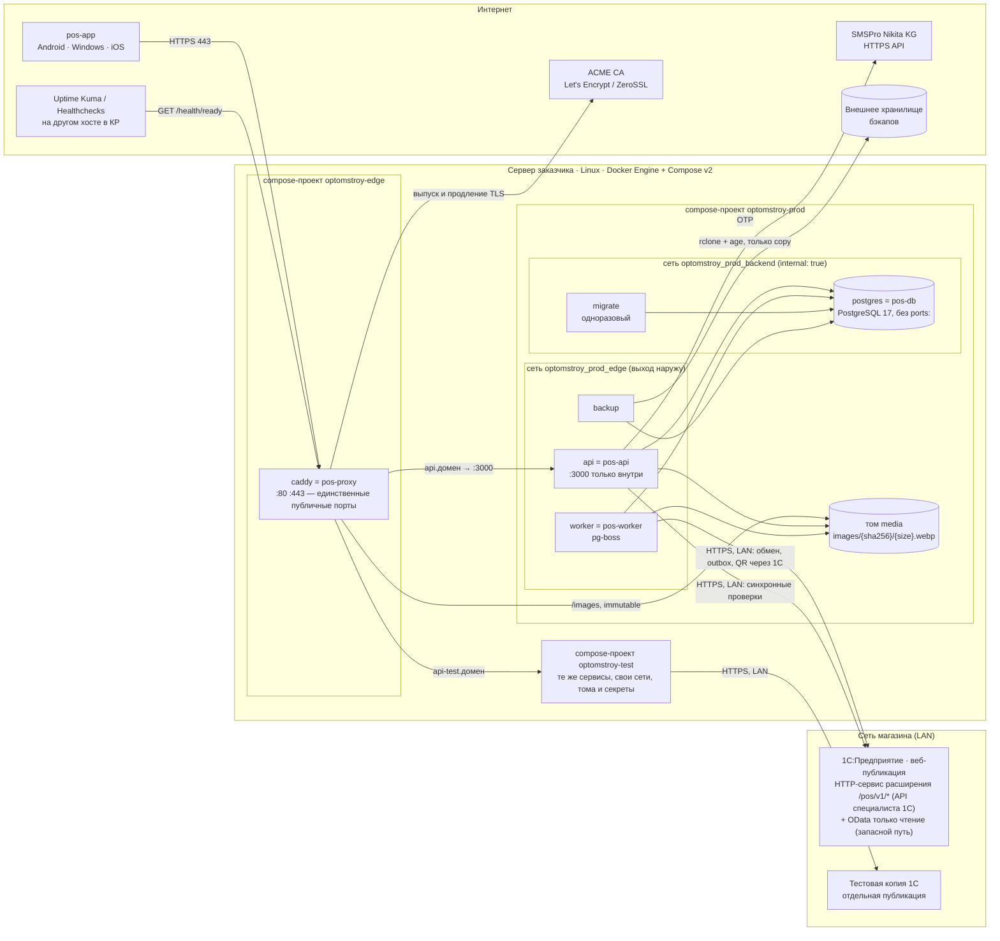

# infra — целевая схема развёртывания «Оптомстрой POS» (R1)

Задача: **RM-B-011** (13_IMPLEMENTATION_ROADMAP §3.2). Владелец каталога `infra/**` — роль `OPS` (13 §5.2).
Решение: **ADR-082** в `docs/specification/15_DECISION_LOG.md` — сценарий A (Linux + Docker Compose) по умолчанию, пересмотр до этапа I.

Этот файл — схема для разработки и CI. Он не заменяет `16_DEPLOYMENT_PLAN.md` — источник истины для развёртывания. Если этот файл расходится с 16, прав 16. Имена переменных окружения берутся из 16 §4.3: это владелец словаря (ядро R0 §18.1). Новых имён здесь нет.

> **Ограничение.** На сервер заказчика ничего не устанавливается без отдельного письменного разрешения заказчика (16, шапка; R8 §10 шаг 0; 13 RM-I-001). Аудит сервера (RM-A-001, вопрос Q-030) **не выполнен**: доступа к серверу нет. Поэтому ниже описан сценарий **A по умолчанию** (ядро D-33), а не результат аудита.

---

## 1. Статус решения

| Параметр | Значение по умолчанию (до аудита) | Источник | Что его меняет |
|---|---|---|---|
| Сценарий размещения | **A** — Linux-сервер заказчика + Docker Compose | ядро D-33; 16 §3.1; ADR-033, ADR-082 | аудит RM-A-001 (Q-030, Q-101) → дерево выбора 16 §3.5 |
| Связь backend ↔ 1С | **LAN** (16 §12.1): исходящие HTTPS-вызовы `api`/`worker` к веб-публикации 1С | 16 §12.1; ADR-082 | ответ на Q-031: если 1С в другой сети — WireGuard (16 §12.2), если нельзя поставить WireGuard на машину 1С — исходящий обмен C-2 (16 §12.3) |
| Канал обмена с 1С | **API специалиста 1С**: HTTP-сервис расширения «OptomstroyPOS» `/pos/v1/*` (`ONEC_MODE=extension`); стандартный OData только на чтение — запасной путь (`ONEC_MODE=odata_only`) | ядро §24.3; ADR-080; 05 §6; `18_ONEC_API_REQUEST.md` | приёмка API (RM-B-014, RM-E-016); при задержке — решение по 13 §3.12 |
| Входящий обмен от 1С (C-2) | выключен: `ONEC_INBOUND_ENABLED=false`, весь префикс `/api/v1/integrations/onec/*` → `404` | 16 §4.6; 13 §3.12 | новая ADR при выборе C-2 (тогда выполняются RM-D-013 и RM-E-013) |
| QR-оплата | через 1С (`QR_PROVIDER=onec`) по тому же исходящему каналу; входящих маршрутов от банка нет. До приёмки методов QR — `QR_PROVIDER=none` | ядро §24.4; ADR-081; 16 §4.6 | ответы специалиста 1С на вопросы QR-1…QR-9 (Q-014) |
| Пересмотр | новая ADR после аудита и ответа на Q-031, **до старта RM-I-001** (первая задача этапа I) | 13 RM-B-011, RM-I-001; ADR-082 | — |

Сценарий B-3 (Linux-VM на Hyper-V) — это сценарий A внутри виртуальной машины. Сценарий C-1 (VPS + WireGuard) — это сценарий A на VPS. В обоих случаях compose-файлы, сети и сервисы те же. Меняются только хост, сетевой путь до 1С и `ONEC_BASE_URL` (16 §3, «Общие компоненты»; SRC-F-143).

---

## 2. Целевая схема (сценарий A, связь с 1С по LAN)

Свойства схемы (16 §3.1, §4.1, §4.2):

- Наружу открыты только `80/tcp` и `443/tcp` у `caddy`. SSH для администрирования — с ограничением по IP или VPN. Проверка: `ss -tulpn` и `iptables -S DOCKER-USER`, а не `ufw status`: Docker обходит ufw.
- `postgres` подключён только к сети `backend` (`internal: true`) и не публикует порт на хост.
- `api`, `worker` и `backup` подключены к обеим сетям. Иначе они теряют доступ к 1С, SMSPro и хранилищу бэкапов.
- `caddy` не аутентифицирует и не авторизует запросы. Все проверки прав, токенов, подписей и IP-allowlist выполняет `api` (DEPLOY-049, 16 §4.6).
- `api` и `worker` — один образ `optomstroy/api:<версия>` с разной командой: `node dist/main.js` / `node dist/worker.js`, `WORKERS_ENABLED=false|true`. Redis нет: очереди, расписания, rate-limit и идемпотентность хранятся в PostgreSQL (ядро D-44, D-45).
- Один общий `caddy` в проекте `optomstroy-edge` обслуживает prod (`api.<домен>`) и test (`api-test.<домен>`). Имена хостов — плейсхолдеры до ответа на Q-032 (16 §11; ядро §16 п. 6).

---

## 3. Сервисы

Спецификация — 16 §4.1. Пример `docker-compose.yml` — 16 §4.4, пример `Caddyfile` — 16 §4.5.

| Сервис compose | Каноническое имя (R0 §5) | Образ / команда | Порты | Сети | Исходящие соединения | Тома | Healthcheck |
|---|---|---|---|---|---|---|---|
| `caddy` | `pos-proxy` | `caddy:2.<minor>.<patch>` | `80`, `443` — единственные публичные | `edge` | ACME CA | `caddy_data` (persistent обязателен), `caddy_config`, `media:ro` | нет (намеренно); доступность проверяет внешний монитор |
| `api` | `pos-api` | `optomstroy/api:<версия>`, `node dist/main.js` | внутренний `3000`, **без** `ports:` | `edge`, `backend` | SMSPro, 1С (синхронные проверки), `postgres` | `media` (rw) | `GET /health` |
| `worker` | `pos-worker` | тот же образ, `node dist/worker.js` | нет | `edge`, `backend` | 1С (обмен, outbox, статус QR), Healthchecks, `postgres` | `media` (rw) | процесс жив + heartbeat pg-boss |
| `migrate` | — | тот же образ, `node dist/migrate.js` | нет | `backend` | `postgres` | — | одноразовый, `restart: "no"`; `api` ждёт `service_completed_successfully` |
| `postgres` | `pos-db` | `postgres:17.<minor>` | **без** `ports:` | только `backend` | нет | `pgdata` | `pg_isready` |
| `backup` | — | `optomstroy/backup:<версия>` (postgres-client + rclone + age) | нет | `edge`, `backend` | внешнее хранилище, Healthchecks | `backups`, `media:ro` | код 0 + ping Healthchecks |
| `pgadmin` (опционально) | — | `dpage/pgadmin4:<версия>` | `127.0.0.1:5050` — только через SSH-туннель | `edge`, `backend` | нет | `pgadmin` | — |

## 4. Сети, порты, тома

| Объект | Имя | Свойства |
|---|---|---|
| Сеть | `optomstroy_prod_edge` (`edge`) | bridge с выходом наружу через NAT хоста |
| Сеть | `optomstroy_prod_backend` (`backend`) | `internal: true` — без выхода наружу |
| Сети теста | `optomstroy_test_edge`, `optomstroy_test_backend` (`internal: true`) | те же правила; тестовый контур `infra/compose.test.yml` (RM-C-012) |
| Публичные порты хоста | `80/tcp`, `443/tcp` | только `caddy`; **ничего больше** не публикуется |
| Локальные порты | `127.0.0.1:5050` | `pgadmin`, опционально |
| Тома | `pgdata`, `media`, `backups`, `caddy_data`, `caddy_config` | размещение — `/srv/optomstroy/<prod\|test>/…` (16 §4.2); `caddy_data` не пересоздаётся при деплое (лимиты Let's Encrypt) |
| Конфигурация на хосте | `/opt/optomstroy/<prod\|test>/{docker-compose.yml,.env,Caddyfile,secrets/,bin/}` | каталоги `750`, `.env` и `secrets/*` — `600`; владелец — пользователь ОС `optomstroy` |

Секреты передаются только файлами через Compose `secrets:` и переменные `*_FILE` (`/run/secrets/…`). Секретов нет ни в git, ни в `.env`, ни в образах (16 §4.3; SEC-110).

---

## 5. Связь с 1С: API специалиста 1С

Протокол обмена описан в 05_ONEC_INTEGRATION §6. Здесь — только сетевой уровень (16 §12).

| Аспект | Значение по умолчанию |
|---|---|
| Направление | только **исходящие** вызовы `api`/`worker` → 1С; 1С к backend не обращается (`ONEC_INBOUND_ENABLED=false`) |
| Основной канал | HTTP-сервис расширения «OptomstroyPOS» `/pos/v1/*` (05 §6.3): изменения плана обмена «POS» и их подтверждение, запись заказов, платежей, клиентов, заявок на возврат с идемпотентностью по `externalId`, проверка `/pos/v1/check`, QR-оплата (`POST /pos/v1/payments/qr`, `GET /pos/v1/payments/{externalId}/status`, `POST /pos/v1/payments/{externalId}/qr/cancel` — 05 §6.7). Реализует **специалист 1С заказчика** по `18_ONEC_API_REQUEST.md` (ядро §24.3; RM-B-014) |
| Запасной канал | стандартный OData, **только чтение** (`ONEC_MODE=odata_only`), пока API не принят (ADR-080; 13 §3.12) |
| Без 1С | `ONEC_MODE=fixtures` (`FakeOnecGateway`) — только dev/test, в prod запрещён (RM-C-008). Фикстуры `contracts/onec/fixtures` — в образе стадии `test-fixtures` (`infra/docker/api/Dockerfile`, `compose.test.yml` → `build.target`; FQ-INT-08); прод-образ (стадия `release`, по умолчанию) их не содержит |
| Адрес | `ONEC_BASE_URL=https://<lan-ip-или-имя>/<база>`; имя резолвится локальным DNS или через `extra_hosts:` |
| Транспорт | HTTPS и в LAN. Сертификат веб-сервера 1С подключается через `ONEC_CA_CERT_FILE`, проверку сертификата не отключают. HTTP допустим только на тестовой копии в изолированной сети (16 §12.1) |
| Пользователи ИБ 1С | разведены (05 ONEC-052, ONEC-082): `pos_hs` — только HTTP-сервис расширения (`ONEC_HS_USER_FILE`/`ONEC_HS_PASSWORD_FILE`/`ONEC_HS_TOKEN_FILE`); `pos_integration` — только OData, только чтение (`ONEC_USER_FILE`/`ONEC_PASSWORD_FILE`); `pos_odata_write` — только во временном режиме `ONEC_ODATA_WRITE_ENABLED=true` |
| Доступ к публикации 1С | только с адреса backend (allow-list на веб-сервере 1С или firewall хоста 1С); веб-клиент 1С не публикуется (16 §12.5 P-1…P-4) |
| Окружения | `optomstroy-prod` → рабочая 1С (на пилоте сначала только чтение, RM-I-006); `optomstroy-test` → **тестовая копия** 1С или фикстуры, **никогда** не рабочая 1С (16 §11) |
| Отказ 1С | backend продолжает работать: outbox копит записи, `ONEC_UNAVAILABLE`, `/health/ready` → `degraded`, алерт (16 §12.2, §15.1) |

Варианты при другом ответе на Q-031 (16 §12.2–§12.4): WireGuard-туннель, который инициирует магазин (входящие порты в магазине не нужны), или исходящий обмен C-2 (1С вызывает `/api/v1/integrations/onec/*` с токеном роли `integration` и обязательным `ONEC_INBOUND_ALLOWED_IPS`). В варианте C-2 QR через 1С недоступен и действует `QR_PROVIDER=none` (16 §12.3).

---

## 6. Что будет лежать в `infra/`

Каталог заполняется задачами этапов C и I. Пути взяты из 13; других файлов этот документ не вводит.

| Путь | Задача | Содержание |
|---|---|---|
| `infra/README.md` | RM-B-011 | этот файл — целевая схема |
| `infra/compose.test.yml` | RM-C-012 | тестовый контур: `caddy, api, worker, migrate, postgres, backup`; сети `optomstroy_test_edge` и `optomstroy_test_backend` (`internal: true`); `ports:` только у `caddy` |
| `infra/caddy/Caddyfile` | RM-C-010 | reverse-proxy, JSON access-log, сквозной requestId |
| `infra/env/README.md` | RM-C-009 | конвенция `*_FILE`, профили `APP_ENV` (`dev`, `staging`, `prod`), ротация секретов |
| `infra/ci/` (если CI не GitHub Actions) | RM-C-011 | workflows CI, в том числе `contracts-lint` (`CONTRIBUTING.md` §5) |
| прод-конфигурация (compose, `Caddyfile`, `bin/backup_db.sh`, `bin/restore_drill.sh`) | RM-I-001, RM-I-002, RM-I-006 | по спецификациям 16 §4.4, §4.5, §8.3; размещается после пересмотра ADR-082 |

`.env.example` лежит в корне репозитория (13 §5.2, RM-C-009) и сверяется с 16 §4.3 скриптом `scripts/check_env_example.py`.

## 7. Проверки схемы (выполняются на этапах C и I)

| Проверка | Команда | Задача |
|---|---|---|
| Публикуется только `caddy` | `docker compose -f infra/compose.test.yml config` — `ports:` только у `caddy` (80/443) | RM-C-012 п. 3 |
| Миграции на пустой БД | `docker compose -f infra/compose.test.yml run --rm migrate` | RM-C-012 п. 1 |
| e2e на тестовом контуре | `docker compose -f infra/compose.test.yml up -d && npm run test:e2e` (Linux-раннер CI с Docker) | RM-C-012 п. 2, RM-C-011 |
| Порты на хосте | `ss -tulpn`, `iptables -S DOCKER-USER` — только ожидаемые | RM-I-001 п. 2 |
| TLS и доступность | `curl -vI https://api-test.<домен>/health` → 200, сертификат валиден | RM-I-001 п. 3 |
| Входящие интеграции выключены | все маршруты 16 §4.6 → `404` при значениях по умолчанию | 16 §4.6, 12_TEST_PLAN |

На текущей машине разработки Docker нет. Поэтому проверки compose выполняются в CI на обязательном Linux-раннере с Docker (ядро §20.2 п. 1; ADR-070).
